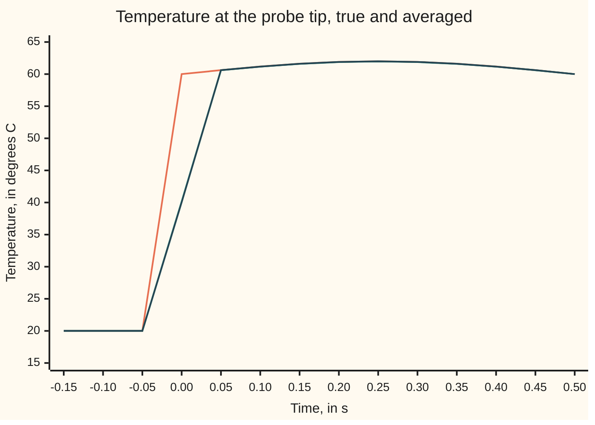

# Approximate identities: a shrinking bump that smooths a signal without moving it

[Syllabus](../../../SYLLABUS.md) → [Harmonic analysis](../README.md) → [Convolution and Approximate Identities](../README.md#s03) → Approximate identities

---

## General Overview

A thermocouple is a fast electrical thermometer. One sits in room air at 20 °C. At t = 0 s it is dipped into a cup of 60 °C tea that is being stirred, so the temperature at its tip swings 2 °C up and down once a second. The logger reads it 1,000 times a second, and each reading carries about 0.5 °C of electrical noise. The signal and the noise are illustrative, built from a stated formula.

Single readings jump about. So the display shows a **moving average**: the mean of the 100 readings in the tenth of a second centred on each moment. At t = 0.25 s the stirred tea is at its peak, 62 °C. The noise on the display drops from 0.5 °C to 0.05 °C, and the average of the true temperature is 61.97 °C. The average costs 0.03 °C of blur and buys a tenfold drop in noise.

This card asks what happens as the window shrinks. Away from the dip, the average returns the true temperature. At the dip itself it lands halfway, near 40 °C. Averaged over the whole record, the error shrinks in step with the window. Any family of weight shapes that does this is called an **approximate identity**: as the window narrows, averaging against it comes closer and closer to doing nothing, which is the identity.

**An approximate identity is a family of weight shapes, each with total weight 1 and a capped total size, whose weight gathers at the centre as a width shrinks; averaging a signal against it returns the signal in the mean for every signal of finite size, and at each point where a bounded signal is continuous.**

**What kind of fact this is:** a definition and three theorems (convergence at points of continuity, convergence in the mean, and density of smooth signals), all proved on this card in Why it works. The noise figures are a model of the logger, not a law.

### The picture: the dip, raw and averaged



Orange: the true temperature, with no noise. Teal: the 0.1 s moving average. Dark blue: a 0.02 s moving average. Points every 0.05 s; the chart joins them with straight lines, so the jump at 0 s looks like a slope. At 0 s both averages sit near 40 °C, halfway up the jump. Elsewhere all three lines nearly coincide at this scale.

---

## The formula

Notation first, in words. The **kernel** $`K`$ is a weight shape with total area 1. Narrow it to width $`\varepsilon`$ (epsilon) and stand it up so its area stays 1. The family $`K_\varepsilon`$ and the **convolution** with it, $`K_\varepsilon * f`$ (the weighted average of $`f`$ around each time, from [Convolution](01-convolution-and-youngs-inequality.md)), are:

```math
K_\varepsilon(t) = \frac{1}{\varepsilon}\, K\!\left(\frac{t}{\varepsilon}\right), \qquad (K_\varepsilon * f)(x) = \int K_\varepsilon(s)\, f(x - s)\, ds
```

**Read it aloud:** K epsilon at t is K at t over epsilon, divided by epsilon; the smoothed signal at time x is the integral over s of K epsilon at s times f at x minus s.

The moving average is the **box** kernel: $`K(u) = 1`$ for $`\lvert u\rvert < 1/2`$, zero otherwise. Then $`K_\varepsilon = 1/\varepsilon`$ on a window of width $`\varepsilon`$, and $`K_\varepsilon * f`$ is the plain mean of $`f`$ over that window.

**Definition.** A family $`K_\varepsilon`$, one function for each width $`\varepsilon > 0`$, is an **approximate identity** when it has three properties:

```math
\int K_\varepsilon(s)\, ds = 1, \qquad \int \lvert K_\varepsilon(s)\rvert\, ds \le M, \qquad \int_{\lvert s\rvert > \delta} \lvert K_\varepsilon(s)\rvert\, ds \to 0 \ \text{ as } \varepsilon \to 0, \text{ for every } \delta > 0
```

**Read it aloud:** total weight one; total size at most a fixed number M; and, for any fixed distance delta, the size beyond delta drains away as epsilon shrinks.

**Theorem.** Let $`K_\varepsilon`$ be an approximate identity.

1. **At a point of continuity.** If $`f`$ is bounded and continuous at $`x`$, then $`(K_\varepsilon * f)(x) \to f(x)`$. If $`f`$ is bounded and uniformly continuous, the convergence is uniform: the worst gap over all $`x`$ tends to 0.
2. **In the mean.** If $`f`$ is in $`L^p`$ with $`1 \le p < \infty`$, then $`\lVert K_\varepsilon * f - f\rVert_p \to 0`$.
3. **Smooth signals are dense.** For every $`f`$ in $`L^p`$, $`p`$ finite, and every tolerance, some signal in $`C_c^\infty`$ lies within that tolerance of $`f`$.

Here $`L^p`$ is the set of signals whose $`p`$-th power of size has a finite integral, and $`\lVert g\rVert_p`$ is that size: the $`p`$-th root of $`\int \lvert g\rvert^p`$ ([Lp spaces](../../10-Measure%20and%20integration/07-Sizes%20of%20Functions/01-lp-spaces.md)). For $`p = 1`$ it is the area between the curves, the **mean gap** in °C·s. $`C_c^\infty`$ is the set of signals with derivatives of every order that are zero outside some bounded interval.

| Symbol | Plain meaning | In our example | Push it up and the answer… |
| --- | --- | --- | --- |
| $`f(t)`$, $`t`$ | the true temperature at the probe tip, in °C, at time $`t`$ in s | 62 °C at 0.25 s | — |
| $`x`$, $`s`$, $`u`$ | the time the average is read at; the look-back inside the window; the kernel's own variable | $`x`$ = 0.25 s | — |
| $`K`$, $`K_\varepsilon`$ | the kernel shape, area 1; its narrowed copy, in 1/s | box: 10 per s on $`\lvert s\rvert < 0.05`$ s | — |
| $`\varepsilon`$ | the width: the box's full window, the bump's half-width, in s | 0.1 s | less noise, more blur |
| $`K_\varepsilon * f`$ | the smoothed signal | 61.967263 °C at 0.25 s | — |
| $`M`$, $`n`$ | the cap on the total size $`\int \lvert K_\varepsilon\rvert`$; the number of readings in a window | 1 for the box; 100 | looser bounds in the proof; less noise |
| $`\delta`$, $`\tau`$, $`B`$, $`R`$, $`p'`$ | proof helpers: the near-far boundary; a tolerance; a cap on $`\lvert f\rvert`$; a cut-off point; the exponent with $`1/p + 1/p' = 1`$ | $`B`$ = 62 °C | — |
| $`L^p`$, $`\lVert\cdot\rVert_p`$, $`p`$ | the signals of finite size; the size; its exponent | mean gap 1.041682 °C·s at $`\varepsilon`$ = 0.1 s | — |
| $`\omega(h)`$, $`h`$, $`g`$ | the shift gap: the size of $`f(\cdot - h) - f`$; the delay; the cut-off signal | — | — |
| $`J`$, $`m_1`$ | a jump's size; the kernel's mean distance from its centre, in widths | 40 °C; 1/4 for the box | larger mean gap |
| $`f''`$ | the bend: the slope of the slope, in °C/s² | $`-2(2\pi)^2`$ at the peak | larger gap at a smooth point |
| $`\eta`$, $`Z`$, $`C_c^\infty`$ | the standard smooth bump; its raw area; the smooth signals zero outside a bounded interval | $`Z`$ = 0.443994 | — |

### When it holds

- **Total weight is 1.** A logger that drops 10 of every 100 readings but still divides by 100 has weights adding to 0.9. At 0.25 s it reads 55.770537 °C and closes in on 55.8 °C, not 62 °C, as the window shrinks.
- **The weight gathers at the centre.** Put 10% of the weight on a fixed 1 s average and 90% on the shrinking box. The third property fails, and the limit at 0.25 s is 60.831831 °C, not 62 °C.
- **The total size stays capped.** Kernels with growing positive and negative lobes break the second property. The Dirichlet kernel of Fourier partial sums is one ([Dirichlet and Fejer kernels](../01-Fourier%20Series%20in%20Depth/03-dirichlet-and-fejer-kernels.md)); there, continuity alone does not give convergence.
- **The point is a point of continuity.** At the dip the average lands near 40 °C, halfway between 20 and 60. The worst gap over all times stays above 20 °C at every width.
- **The exponent $`p`$ is finite.** The mean gap falls in step with the width. For a signal with a jump, the worst gap, which is the size for $`p = \infty`$, never falls below half the jump: here 20 °C.

---

## Why it works

### Step 0: the gap is a weighted average of changes

The weights add to 1, so $`f(x)`$ equals its own weighted average. Subtract:

```math
(K_\varepsilon * f)(x) - f(x) = \int K_\varepsilon(s)\, \big(f(x - s) - f(x)\big)\, ds
```

The gap is an average of how much the signal changes over the look-back $`s`$. Near $`s = 0`$ the change is small if $`f`$ is continuous. Far from 0 the change may be large, but the kernel puts almost no weight there. Every proof below splits the integral into these two parts. [Convolution and mollifiers](../../18-Functional%20analysis/04-Distributions%20and%20Sobolev%20Spaces/03-convolution-and-mollifiers.md) uses the same line for one smooth bump; this card needs only the three properties.

### Step 1: every narrowed kernel is an approximate identity

Take any $`K`$ with $`\int K = 1`$ and $`\int \lvert K\rvert`$ finite. Substitute $`u = s/\varepsilon`$, so $`ds = \varepsilon\, du`$:

```math
\int K_\varepsilon(s)\, ds = \int K(u)\, du = 1, \qquad \int_{\lvert s\rvert > \delta} \lvert K_\varepsilon(s)\rvert\, ds = \int_{\lvert u\rvert > \delta/\varepsilon} \lvert K(u)\rvert\, du
```

The total size is $`\int \lvert K\rvert`$ for every width, so $`M = \int \lvert K\rvert`$. The last integral is the tail of an integrable function beyond $`\delta/\varepsilon`$, which grows without bound. The tail tends to 0 ([Dominated convergence](../../10-Measure%20and%20integration/05-Swapping%20Limits%20and%20Integrals/02-dominated-convergence-theorem.md), with $`\lvert K\rvert`$ as the roof). So the box, the smooth bump, and the kernels of [The Gaussian and Poisson kernels](04-gaussian-and-poisson-kernels.md) all qualify. For the box the tail is exactly 0 once $`\varepsilon < 2\delta`$.

### Step 2: the average converges at every point of continuity

Fix a tolerance $`\tau`$. Continuity at $`x`$ gives a distance $`\delta`$ with $`\lvert f(x - s) - f(x)\rvert < \tau`$ whenever $`\lvert s\rvert < \delta`$. Split Step 0 at $`\delta`$:

```math
\lvert (K_\varepsilon * f)(x) - f(x)\rvert \le \tau \int_{\lvert s\rvert < \delta} \lvert K_\varepsilon\rvert + 2B \int_{\lvert s\rvert \ge \delta} \lvert K_\varepsilon\rvert \le M\tau + 2B \int_{\lvert s\rvert \ge \delta} \lvert K_\varepsilon\rvert
```

The second term tends to 0 by the third property. So the gap ends below $`2M\tau`$ for small $`\varepsilon`$, and $`\tau`$ was any tolerance.

If $`f`$ is **uniformly continuous**, one $`\delta`$ serves every $`x`$ ([Uniform continuity](../../06-Calculus%20and%20analysis/01-Limits%20and%20Continuity/08-uniform-continuity-and-lipschitz.md)). The same bound then holds for all $`x`$ at once, and the worst gap tends to 0.

At a jump the proof fails, and the limit is different. For a kernel that is symmetric about 0, half the weight looks back and half looks ahead. The average tends to the midpoint of the two sides. At the dip, with the box of width 0.1 s:

```math
(K_\varepsilon * f)(0) = 40 + \frac{1 - \cos(\pi\varepsilon)}{\pi\varepsilon} = 40.155792 \text{ °C}
```

The extra 0.155792 °C is the tea's swing during the 0.05 s after the dip. It halves with each halving of $`\varepsilon`$: 40.078378 at 0.05 s, 40.039250 at 0.025 s.

### Step 3: how fast, at a smooth point and at a jump

At a smooth point, expand $`f(x - s) = f(x) - s f'(x) + \tfrac12 s^2 f''(x) + \dots`$ inside Step 0. A symmetric kernel averages $`s`$ to 0, so the slope term drops out. What remains is the bend times the kernel's spread. For the box, the mean of $`s^2`$ over the window is $`\varepsilon^2/12`$:

```math
(K_\varepsilon * f)(x) - f(x) \approx \frac{f''(x)\, \varepsilon^2}{24}
```

At the peak, $`f'' = -2(2\pi)^2`$ °C/s², and the estimate is −0.032899 °C. The exact gap is −0.032737 °C. Halve the width and the gap falls about fourfold.

At a jump of size $`J`$, the average climbs across the window instead of stepping. The area between the two is $`J\, m_1\, \varepsilon`$, where $`m_1`$ is the kernel's mean distance from its centre, in widths. For the box $`m_1 = 1/4`$, so the dip contributes $`40 \times 0.1 / 4`$ = 1 °C·s. The mean gap on the record from −1 s to 2 s is 1.041682 °C·s; the rest comes from blurring the swing. Halve the width and the mean gap halves.

### Step 4: convergence in the mean, for every signal of finite size

A signal in $`L^p`$ may have no point of continuity at all. The idea is to average whole shifted copies instead of values. Write the **shift gap** $`\omega(h) = \lVert f(\cdot - h) - f\rVert_p`$: how far the signal moves, in size, when delayed by $`h`$. Here $`\omega`$ is not wing 07's angular frequency. Two facts about it:

- $`\omega(h) \le 2\lVert f\rVert_p`$, because each copy has size $`\lVert f\rVert_p`$.
- $`\omega(h) \to 0`$ as $`h \to 0`$, for $`p`$ finite. This is **continuity of shifts**. It holds for continuous signals that are zero outside a bounded interval, because they are uniformly continuous, and passes to all of $`L^p`$ because those signals come within any tolerance of each $`f`$ ([Riesz-Fischer](../../10-Measure%20and%20integration/07-Sizes%20of%20Functions/05-completeness-of-lp.md)).

Step 0 writes $`K_\varepsilon * f - f`$ as a blend of the differences $`f(\cdot - s) - f`$. The size of a blend is at most the blend of the sizes ([Minkowski's inequality](../../10-Measure%20and%20integration/07-Sizes%20of%20Functions/03-minkowskis-inequality.md), in its integral form). So

```math
\lVert K_\varepsilon * f - f\rVert_p \le \int \lvert K_\varepsilon(s)\rvert\, \omega(s)\, ds \le M \sup_{\lvert s\rvert < \delta} \omega(s) + 2\lVert f\rVert_p \int_{\lvert s\rvert \ge \delta} \lvert K_\varepsilon\rvert
```

This is Step 2 again, with $`\omega`$ in place of the change at one point. Both terms shrink, so the mean gap tends to 0.

<details>
<summary>Detailed proof: the narrowed-kernel case by dominated convergence</summary>

For $`K_\varepsilon(s) = K(s/\varepsilon)/\varepsilon`$, substitute $`s = \varepsilon u`$ in the first bound:

$`\displaystyle \lVert K_\varepsilon * f - f\rVert_p \le \int \lvert K(u)\rvert\, \omega(\varepsilon u)\, du.`$

As $`\varepsilon \to 0`$, the integrand tends to 0 at every $`u`$, by continuity of shifts. It is bounded by $`2\lVert f\rVert_p \lvert K(u)\rvert`$, which is integrable and does not depend on $`\varepsilon`$. Dominated convergence moves the limit inside, and the bound tends to 0.

A road that avoids the integral form of Minkowski, for $`1 < p < \infty`$: split $`\lvert K_\varepsilon\rvert = \lvert K_\varepsilon\rvert^{1/p'} \lvert K_\varepsilon\rvert^{1/p}`$ with $`1/p + 1/p' = 1`$. Hölder's inequality in $`s`$ gives, at each $`x`$,

$`\displaystyle \lvert (K_\varepsilon * f - f)(x)\rvert^p \le M^{p/p'} \int \lvert K_\varepsilon(s)\rvert\, \lvert f(x - s) - f(x)\rvert^p\, ds.`$

Integrate in $`x`$ and swap the order (Tonelli: everything is non-negative). The inner integral is $`\omega(s)^p`$, so $`\lVert K_\varepsilon * f - f\rVert_p^p \le M^{p/p'} \int \lvert K_\varepsilon(s)\rvert\, \omega(s)^p\, ds`$. The same split at $`\delta`$ finishes the proof. For $`p = 1`$, skip Hölder.

</details>

### Step 5: smooth signals are dense

Take $`f`$ in $`L^p`$, $`p`$ finite, and a tolerance $`\tau`$. Two moves turn it into a signal in $`C_c^\infty`$:

1. **Cut it off.** Keep $`f`$ on $`[-R, R]`$ and set it to 0 outside. As $`R`$ grows, the size of what was cut tends to 0 by dominated convergence, with roof $`\lvert f\rvert^p`$. Choose $`R`$ so the cut costs less than $`\tau`$.
2. **Smooth it.** Convolve the cut signal $`g`$ with the standard bump $`\eta`$: the hill $`e^{-1/(1-u^2)}`$ on $`\lvert u\rvert < 1`$, divided by its area $`Z`$, narrowed to half-width $`\varepsilon`$. Derivatives fall on the bump, so $`\eta_\varepsilon * g`$ has derivatives of every order ([Convolution and mollifiers](../../18-Functional%20analysis/04-Distributions%20and%20Sobolev%20Spaces/03-convolution-and-mollifiers.md) proves this). It is zero outside $`[-R - \varepsilon, R + \varepsilon]`$. By Step 4, its gap from $`g`$ is below $`\tau`$ for small $`\varepsilon`$.

The total gap is below $`2\tau`$, and $`\tau`$ was any tolerance. In the thermometer record the bump has $`Z = 0.443994`$ and $`m_1 = 0.334454`$. Near the dip, the smooth stand-in differs from the record by 0.669029 °C·s at $`\varepsilon`$ = 0.05 s and 0.133782 °C·s at 0.01 s. Step 3's rule $`40\, m_1 \varepsilon`$ predicts 0.668908 and 0.133782.

Density is why proofs so often check a fact on smooth signals first and then pass to the limit. It works in the mean only: in the worst gap, no smooth signal comes closer than 20 °C to the record at the dip.

### Step 6: what the average does to the noise

The theorem concerns the true signal. The reason to average at all is the noise. Readings that are independent, each with a spread (standard deviation) of 0.5 °C, have a mean whose spread is $`0.5/\sqrt{n}`$ for $`n`$ readings. The 100 readings in 0.1 s give 0.0500 °C. A simulation of 2,000 windows gives 0.0494 °C.

So the width trades noise against blur. Narrow windows let the noise through; wide windows bend the signal. At the peak:

| Width, s | Readings | Noise spread, °C | Blur at the peak, °C |
| --- | ---: | ---: | ---: |
| 0.025 | 25 | 0.1000 | 0.0021 |
| 0.05 | 50 | 0.0707 | 0.0082 |
| 0.1 | 100 | 0.0500 | 0.0327 |
| 0.2 | 200 | 0.0354 | 0.1290 |
| 0.4 | 400 | 0.0250 | 0.4863 |

At 0.1 s the two are of similar size, which is why a tenth of a second is a sensible window for a 1 Hz swing. Choosing the width well, and undoing blur, is the work of [Blurring and unblurring](05-smoothing-blurring-and-deconvolution.md).

---

## Worked numbers, by hand

The tea at its peak, $`x`$ = 0.25 s, box width $`\varepsilon`$ = 0.1 s, then the dip at 0 s.

| Step | Arithmetic | Value |
| --- | --- | --- |
| true temperature | $`60 + 2\sin(2\pi \times 0.25)`$ | 62.000000 °C |
| window | 0.20 s to 0.30 s, 100 readings | — |
| average of the swing over the window | $`2 \times \sin(0.1\pi)/(0.1\pi)`$, plus 60 | 61.967263 °C |
| same, as the mean of 100 clean readings | the moving average itself | 61.967267 °C |
| gap | $`61.967263 - 62`$ | −0.032737 °C |
| bend estimate | $`-2(2\pi)^2 \times 0.1^2 / 24`$ | −0.032899 °C |
| at the dip, 0 s | $`40 + (1 - \cos 0.1\pi)/(0.1\pi)`$ | 40.155792 °C |
| one noisy run at 0.25 s | single reading at 0.2495 s; moving average | 61.9816 °C; 61.9760 °C |
| errors in that run | one reading, typical (median) and largest of the 100; the average | 0.2822 °C, 1.4091 °C; 0.0240 °C |
| **displayed at the peak** | true value minus blur, plus noise of spread 0.05 | **about 61.97 °C** |

The display is 0.03 °C low from blur and about 0.05 °C off from noise, while a single reading can be off by 0.5 °C. The reading at 0.2495 s happens to land close; the 100 readings in its window are typically off by 0.2822 °C. At the dip, no width gives the right answer at 0 s: the display reads the midpoint, near 40 °C, and climbs from 20 to 60 °C over the 0.1 s around it.

### What breaks if you drop a piece

Same probe, same 0.25 s, correct answer 62 °C.

| Mistake | Comes out at | What went wrong |
| --- | --- | --- |
| Weights add to 0.9 | 55.770537 °C, tending to 55.8 | The first property fails: the average shrinks the signal by 10% at every width. |
| Trailing window, the past 0.1 s only | 61.870979 °C, gap −0.129021 | No symmetry: the window's centre sits 0.05 s in the past, so the display lags. At the peak it reaches further down one side of the curve, and the gap is four times larger. At the dip it reads 20.000000 °C, not the midpoint. |
| 10% of the weight on a fixed 1 s average | tends to 60.831831 °C | The third property fails: some weight never gathers, so the limit is a blend. |
| Judge by the worst gap instead of the mean | 20.155792, 20.078378, 20.039250 °C as the width halves | The dip is a jump. Convergence in the mean does not give convergence in the worst gap. |

---

## Code, from first principles, and it actually runs

The code builds the true signal, the 1,000-per-second readings and the moving average from scratch. It reaches the smoothed value by three independent roads: the closed form from integrating the signal by hand, the mean of the 100 clean readings, and Simpson's rule on the convolution integral. It checks the gap at the peak against the bend estimate, the mean gap against the jump rule $`J\varepsilon/4`$ plus the swing's blur, the worst gap against a grid search, and the simulated noise against $`0.5/\sqrt{n}`$. The noise comes from a small generator (SplitMix64, seed 2026), written out in both languages so both print the same digits; a sum of 12 uniform numbers, minus 6, stands in for bell-shaped noise.

### Python

```python
# Approximate identities -- the check behind the card.  Standard library only;
# math gives sin, cos, exp, sqrt and pi.  A thermocouple moves from 20 C air into
# stirred 60 C tea at t = 0 s; it reads 1,000 times a second with 0.5 C of noise.
# A centred moving average of width eps is convolution with the box K_eps(s) = 1/eps
# on |s| < eps/2.  Roads: the box's closed form, the moving average of the readings
# (midpoint sum), and Simpson's rule on the convolution integral.
from math import sin, cos, exp, sqrt, pi

def f(t):    return 20.0 if t < 0 else 60.0 + 2.0 * sin(2 * pi * t)    # true temperature, C
def fl(t):   return 20.0 if t <= 0 else f(t)                       # f with its left limit at the jump
def F(t):    return 20.0 * t if t < 0 else 60.0 * t - cos(2 * pi * t) / pi + 1 / pi
def box(x, e):  return (F(x + e / 2) - F(x - e / 2)) / e     # road 1: closed form
def sinc(u): return sin(pi * u) / (pi * u)
def total(xs):                      # plain left-to-right sum, as in the Rust twin
    s = 0.0
    for x in xs: s += x
    return s

def simpson(g, a, b, n):
    h = (b - a) / n
    s = g(a) + g(b) + total((4 if i % 2 else 2) * g(a + i * h) for i in range(1, n))
    return s * h / 3

def conv(K, lo, hi, x, n=2000):     # road 3: integral of K(s) f(x - s), split at the jump s = x
    if not lo < x < hi:
        return simpson(lambda s: K(s) * f(x - s), lo, hi, n)
    return simpson(lambda s: K(s) * f(x - s), lo, x, n) + simpson(lambda s: K(s) * fl(x - s), x, hi, n)

def midpoint(x, e, rate=1000):      # road 2: average of the clean readings inside the window
    n = round(e * rate)
    k0 = round((x - e / 2) * rate)
    return total(f((k0 + k + 0.5) / rate) for k in range(n)) / n

def l1_gap(e):                      # integral of |box average - f| over the record -1..2 s
    pts, ff = [-1, -e / 2, 0, e / 2, 2], [fl, fl, f, f]   # left of 0, the left limit 20 C
    return total(simpson(lambda x: abs(box(x, e) - ff[i](x)), pts[i], pts[i + 1], 4000) for i in range(4))

state = 2026
def uniform():                      # SplitMix64, seed 2026
    global state
    state = (state + 0x9E3779B97F4A7C15) & 0xFFFFFFFFFFFFFFFF
    z = state
    z = ((z ^ (z >> 30)) * 0xBF58476D1CE4E5B9) & 0xFFFFFFFFFFFFFFFF
    z = ((z ^ (z >> 27)) * 0x94D049BB133111EB) & 0xFFFFFFFFFFFFFFFF
    return ((z ^ (z >> 31)) >> 11) / 9007199254740992.0
def noise():  return 0.5 * (total(uniform() for _ in range(12)) - 6.0)   # sd exactly 0.5 C

E = 0.1
print("signal: 20 C before 0 s, 60 + 2 sin(2 pi t) C after; box width eps = 0.1 s")
b1, b2 = box(0.25, E), midpoint(0.25, E)
b3 = conv(lambda s: 1 / E, -E / 2, E / 2, 0.25)
bias_est = -2 * (2 * pi) ** 2 * E * E / 24              # f'' * eps^2 / 24 at the peak
print(f"t=0.25 s: true 62.000000  closed {b1:.6f}  100 readings {b2:.6f}  simpson {b3:.6f}")
print(f"t=0.25 s: gap {b1 - 62:.6f}  curvature estimate f''*eps^2/24 {bias_est:.6f}")
assert abs(b1 - b2) < 1e-4 and abs(b1 - b3) < 1e-9
assert abs((b1 - 62) - bias_est) < 0.001
j1, j2 = box(0, E), midpoint(0, E)
print(f"t=0 s jump: left 20  right 60  closed {j1:.6f}  100 readings {j2:.6f}  formula 40+(1-cos(pi eps))/(pi eps) {40 + (1 - cos(pi * E)) / (pi * E):.6f}")
assert abs(j1 - j2) < 1e-4 and abs(j1 - 40 - (1 - cos(pi * E)) / (pi * E)) < 1e-9

print("eps sweep: eps s | gap at 0.25 s | average at 0 s | worst gap | L1 gap on record C*s | L1/eps")
for e in [0.2, 0.1, 0.05, 0.025, 0.0125]:
    L = l1_gap(e)
    worst = box(0, e) - 20                               # just left of the jump
    grid = max(abs(box(x / 1e4, e) - f(x / 1e4)) for x in range(-10000, 20001, 7))
    print(f"  {e:.4f} | {box(0.25, e) - 62:.6f} | {box(0, e):.6f} | {worst:.6f} | {L:.6f} | {L / e:.4f}")
    assert grid <= worst + 1e-9 and worst > 20             # the worst gap never falls below 20 C
    assert abs(L - (10 * e + 8 / pi * (1 - sinc(e)))) < 1e-6   # jump part J*eps/4 plus the swing part

print("noise: one reading sd 0.5 C; mean of n readings sd 0.5/sqrt(n)")
for e in [0.025, 0.05, 0.1, 0.2, 0.4]:
    n = round(e * 1000)
    print(f"  eps {e:.3f} s: n {n:3d}  noise sd {0.5 / sqrt(n):.4f}  bias at peak {2 * (1 - sinc(e)):.4f}")
means = [total(noise() for _ in range(100)) / 100 for _ in range(2000)]
m = total(means) / 2000
sd = sqrt(total((x - m) ** 2 for x in means) / 1999)
print(f"simulated: 2000 windows of 100 readings, sd of the window mean {sd:.4f} (theory 0.0500)")
assert abs(sd - 0.05) < 4 * 0.05 / sqrt(2 * 1999)
noisy = [f((k + 0.5) / 1000) + noise() for k in range(200, 300)]
print(f"one noisy run: reading at 0.2495 s {noisy[49]:.4f}  moving average at 0.25 s {total(noisy) / 100:.4f}")
errs = sorted(abs(noisy[k] - f((k + 200.5) / 1000)) for k in range(100))
print(f"  its 100 readings: median error {(errs[49] + errs[50]) / 2:.4f}  largest {errs[99]:.4f}  average's error {abs(total(noisy) / 100 - 62):.4f}")
print(f"faster stirring, 5 Hz swing: peak 62 reads {60 + 2 * sinc(0.5):.6f}")

print("what breaks, at t = 0.25 s, eps = 0.1 s unless said")
print(f"  weights add to 0.9: {0.9 * b1:.6f}  limit {0.9 * 62:.6f}")
tr = conv(lambda s: 1 / E, 0, E, 0.25)
print(f"  trailing window (past 0.1 s only): {tr:.6f}  gap {tr - 62:.6f}  at the jump {(F(0) - F(-E)) / E:.6f}")
assert abs(tr - (60 + (cos(0.3 * pi) - cos(0.5 * pi)) / (0.1 * pi))) < 1e-9
leak = 0.9 * 62 + 0.1 * (F(0.75) - F(-0.25))
print(f"  10% of weight on a fixed 1 s average: limit {leak:.6f}")

# density of smooth signals: the bump eta(u) = exp(-1/(1-u^2))/Z, half-width eps
raw = lambda u: exp(-1 / (1 - u * u)) if abs(u) < 1 else 0.0
Z = simpson(raw, -1, 1, 4000)
m1 = simpson(lambda u: abs(u) * raw(u), -1, 1, 4000) / Z
assert abs(Z - simpson(raw, -1, 1, 2000)) < 1e-9
print(f"bump: Z {Z:.6f}  mean distance m1 {m1:.6f}")
for e in [0.05, 0.01]:
    sm = lambda x: conv(lambda s: raw(s / e) / (Z * e), -e, e, x, 200)
    gap = simpson(lambda x: abs(sm(x) - fl(x)), -e, 0, 200) + simpson(lambda x: abs(sm(x) - f(x)), 0, e, 200)
    print(f"  eps {e:.2f} s: L1 gap near the jump {gap:.6f} C*s  predicted 40*m1*eps {40 * m1 * e:.6f}")
    assert abs(gap - 40 * m1 * e) < 0.001 * 40 * m1 * e   # the window around the jump

ts = [round(-0.15 + 0.05 * i, 2) for i in range(14)]
print("chart t:", " ".join(f"{t:.2f}" for t in ts))
print("chart f:", " ".join(f"{f(t):.2f}" for t in ts))
print("chart box 0.1:", " ".join(f"{box(t, 0.1):.2f}" for t in ts))
print("chart box 0.02:", " ".join(f"{box(t, 0.02):.2f}" for t in ts))
print("ALL CHECKS PASS")
```

**Ran 2026-11-15 on macOS, Python 3.14.10, standard library only. All checks passed. Output, pasted from the run:**

```text
signal: 20 C before 0 s, 60 + 2 sin(2 pi t) C after; box width eps = 0.1 s
t=0.25 s: true 62.000000  closed 61.967263  100 readings 61.967267  simpson 61.967263
t=0.25 s: gap -0.032737  curvature estimate f''*eps^2/24 -0.032899
t=0 s jump: left 20  right 60  closed 40.155792  100 readings 40.155792  formula 40+(1-cos(pi eps))/(pi eps) 40.155792
eps sweep: eps s | gap at 0.25 s | average at 0 s | worst gap | L1 gap on record C*s | L1/eps
  0.2000 | -0.129021 | 40.303959 | 20.303959 | 2.164275 | 10.8214
  0.1000 | -0.032737 | 40.155792 | 20.155792 | 1.041682 | 10.4168
  0.0500 | -0.008215 | 40.078378 | 20.078378 | 0.510459 | 10.2092
  0.0250 | -0.002056 | 40.039250 | 20.039250 | 0.252617 | 10.1047
  0.0125 | -0.000514 | 40.019632 | 20.019632 | 0.125654 | 10.0524
noise: one reading sd 0.5 C; mean of n readings sd 0.5/sqrt(n)
  eps 0.025 s: n  25  noise sd 0.1000  bias at peak 0.0021
  eps 0.050 s: n  50  noise sd 0.0707  bias at peak 0.0082
  eps 0.100 s: n 100  noise sd 0.0500  bias at peak 0.0327
  eps 0.200 s: n 200  noise sd 0.0354  bias at peak 0.1290
  eps 0.400 s: n 400  noise sd 0.0250  bias at peak 0.4863
simulated: 2000 windows of 100 readings, sd of the window mean 0.0494 (theory 0.0500)
one noisy run: reading at 0.2495 s 61.9816  moving average at 0.25 s 61.9760
  its 100 readings: median error 0.2822  largest 1.4091  average's error 0.0240
faster stirring, 5 Hz swing: peak 62 reads 61.273240
what breaks, at t = 0.25 s, eps = 0.1 s unless said
  weights add to 0.9: 55.770537  limit 55.800000
  trailing window (past 0.1 s only): 61.870979  gap -0.129021  at the jump 20.000000
  10% of weight on a fixed 1 s average: limit 60.831831
bump: Z 0.443994  mean distance m1 0.334454
  eps 0.05 s: L1 gap near the jump 0.669029 C*s  predicted 40*m1*eps 0.668908
  eps 0.01 s: L1 gap near the jump 0.133782 C*s  predicted 40*m1*eps 0.133782
chart t: -0.15 -0.10 -0.05 0.00 0.05 0.10 0.15 0.20 0.25 0.30 0.35 0.40 0.45 0.50
chart f: 20.00 20.00 20.00 60.00 60.62 61.18 61.62 61.90 62.00 61.90 61.62 61.18 60.62 60.00
chart box 0.1: 20.00 20.00 20.00 40.16 60.61 61.16 61.59 61.87 61.97 61.87 61.59 61.16 60.61 60.00
chart box 0.02: 20.00 20.00 20.00 40.03 60.62 61.17 61.62 61.90 62.00 61.90 61.62 61.17 60.62 60.00
ALL CHECKS PASS
```

### Rust

```rust
// Approximate identities -- the check behind the card.  Rust std only, no crates.
// A thermocouple moves from 20 C air into stirred 60 C tea at t = 0 s; it reads
// 1,000 times a second with 0.5 C of noise.  A centred moving average of width eps
// is convolution with the box K_eps(s) = 1/eps on |s| < eps/2.  Roads: the box's
// closed form, the moving average of the readings (midpoint sum), and Simpson's
// rule on the convolution integral.
use std::f64::consts::PI;

fn f(t: f64) -> f64 { if t < 0.0 { 20.0 } else { 60.0 + 2.0 * (2.0 * PI * t).sin() } } // true temperature, C
fn fl(t: f64) -> f64 { if t <= 0.0 { 20.0 } else { f(t) } } // f with its left limit at the jump
fn big_f(t: f64) -> f64 { if t < 0.0 { 20.0 * t } else { 60.0 * t - (2.0 * PI * t).cos() / PI + 1.0 / PI } }
fn boxavg(x: f64, e: f64) -> f64 { (big_f(x + e / 2.0) - big_f(x - e / 2.0)) / e } // road 1: closed form
fn sinc(u: f64) -> f64 { (PI * u).sin() / (PI * u) }

fn simpson(g: &dyn Fn(f64) -> f64, a: f64, b: f64, n: usize) -> f64 {
    let h = (b - a) / n as f64;
    let mut acc = 0.0;
    for i in 1..n { acc += (if i % 2 == 1 { 4.0 } else { 2.0 }) * g(a + i as f64 * h); }
    (g(a) + g(b) + acc) * h / 3.0
}

// road 3: integral of K(s) f(x - s), split at the jump s = x
fn conv(k: &dyn Fn(f64) -> f64, lo: f64, hi: f64, x: f64, n: usize) -> f64 {
    if !(lo < x && x < hi) { return simpson(&|s| k(s) * f(x - s), lo, hi, n); }
    simpson(&|s| k(s) * f(x - s), lo, x, n) + simpson(&|s| k(s) * fl(x - s), x, hi, n)
}

// road 2: average of the clean readings inside the window
fn midpoint(x: f64, e: f64) -> f64 {
    let n = (e * 1000.0).round() as i64;
    let k0 = ((x - e / 2.0) * 1000.0).round() as i64;
    let mut acc = 0.0;
    for k in 0..n { acc += f(((k0 + k) as f64 + 0.5) / 1000.0); }
    acc / n as f64
}

// integral of |box average - f| over the record -1..2 s
fn l1_gap(e: f64) -> f64 {
    let pts = [-1.0, -e / 2.0, 0.0, e / 2.0, 2.0];
    let mut acc = 0.0; // left of 0, the left limit 20 C
    for i in 0..4 { acc += simpson(&|x| (boxavg(x, e) - if i < 2 { fl(x) } else { f(x) }).abs(), pts[i], pts[i + 1], 4000); }
    acc
}

struct Rng(u64); // SplitMix64, seed 2026
impl Rng {
    fn uniform(&mut self) -> f64 {
        self.0 = self.0.wrapping_add(0x9E3779B97F4A7C15);
        let mut z = self.0;
        z = (z ^ (z >> 30)).wrapping_mul(0xBF58476D1CE4E5B9);
        z = (z ^ (z >> 27)).wrapping_mul(0x94D049BB133111EB);
        ((z ^ (z >> 31)) >> 11) as f64 / 9007199254740992.0
    }
    fn noise(&mut self) -> f64 { // sd exactly 0.5 C
        let mut acc = 0.0;
        for _ in 0..12 { acc += self.uniform(); }
        0.5 * (acc - 6.0)
    }
}

fn join(v: &[f64]) -> String { v.iter().map(|x| format!("{:.2}", x)).collect::<Vec<_>>().join(" ") }

fn main() {
    let e = 0.1;
    println!("signal: 20 C before 0 s, 60 + 2 sin(2 pi t) C after; box width eps = 0.1 s");
    let (b1, b2) = (boxavg(0.25, e), midpoint(0.25, e));
    let b3 = conv(&|_s| 1.0 / e, -e / 2.0, e / 2.0, 0.25, 2000);
    let bias_est = -2.0 * (2.0 * PI).powi(2) * e * e / 24.0; // f'' * eps^2 / 24 at the peak
    println!("t=0.25 s: true 62.000000  closed {:.6}  100 readings {:.6}  simpson {:.6}", b1, b2, b3);
    println!("t=0.25 s: gap {:.6}  curvature estimate f''*eps^2/24 {:.6}", b1 - 62.0, bias_est);
    assert!((b1 - b2).abs() < 1e-4 && (b1 - b3).abs() < 1e-9);
    assert!(((b1 - 62.0) - bias_est).abs() < 0.001);
    let (j1, j2) = (boxavg(0.0, e), midpoint(0.0, e));
    let jf = 40.0 + (1.0 - (PI * e).cos()) / (PI * e);
    println!("t=0 s jump: left 20  right 60  closed {:.6}  100 readings {:.6}  formula 40+(1-cos(pi eps))/(pi eps) {:.6}", j1, j2, jf);
    assert!((j1 - j2).abs() < 1e-4 && (j1 - jf).abs() < 1e-9);

    println!("eps sweep: eps s | gap at 0.25 s | average at 0 s | worst gap | L1 gap on record C*s | L1/eps");
    for &ep in &[0.2, 0.1, 0.05, 0.025, 0.0125] {
        let l = l1_gap(ep);
        let worst = boxavg(0.0, ep) - 20.0; // just left of the jump
        let mut grid: f64 = 0.0;
        let mut xi = -10000;
        while xi <= 20000 { let x = xi as f64 / 1e4; grid = grid.max((boxavg(x, ep) - f(x)).abs()); xi += 7; }
        println!("  {:.4} | {:.6} | {:.6} | {:.6} | {:.6} | {:.4}", ep, boxavg(0.25, ep) - 62.0, boxavg(0.0, ep), worst, l, l / ep);
        assert!(grid <= worst + 1e-9 && worst > 20.0); // the worst gap never falls below 20 C
        assert!((l - (10.0 * ep + 8.0 / PI * (1.0 - sinc(ep)))).abs() < 1e-6); // jump part J*eps/4 plus the swing part
    }

    println!("noise: one reading sd 0.5 C; mean of n readings sd 0.5/sqrt(n)");
    for &ep in &[0.025, 0.05, 0.1, 0.2, 0.4] {
        let n = (ep * 1000.0f64).round() as i64;
        println!("  eps {:.3} s: n {:3}  noise sd {:.4}  bias at peak {:.4}", ep, n, 0.5 / (n as f64).sqrt(), 2.0 * (1.0 - sinc(ep)));
    }
    let mut rng = Rng(2026);
    let mut means = Vec::new();
    for _ in 0..2000 { let mut a = 0.0; for _ in 0..100 { a += rng.noise(); } means.push(a / 100.0); }
    let mut m = 0.0; for x in &means { m += x; } m /= 2000.0;
    let mut v = 0.0; for x in &means { v += (x - m).powi(2); }
    let sd = (v / 1999.0).sqrt();
    println!("simulated: 2000 windows of 100 readings, sd of the window mean {:.4} (theory 0.0500)", sd);
    assert!((sd - 0.05).abs() < 4.0 * 0.05 / (2.0f64 * 1999.0).sqrt());
    let noisy: Vec<f64> = (200..300).map(|k| f((k as f64 + 0.5) / 1000.0) + rng.noise()).collect();
    let mut a = 0.0; for x in &noisy { a += x; }
    println!("one noisy run: reading at 0.2495 s {:.4}  moving average at 0.25 s {:.4}", noisy[49], a / 100.0);
    let mut errs: Vec<f64> = (0..100).map(|k| (noisy[k] - f((k as f64 + 200.5) / 1000.0)).abs()).collect();
    errs.sort_by(|x, y| x.partial_cmp(y).unwrap());
    println!("  its 100 readings: median error {:.4}  largest {:.4}  average's error {:.4}", (errs[49] + errs[50]) / 2.0, errs[99], (a / 100.0 - 62.0).abs());
    println!("faster stirring, 5 Hz swing: peak 62 reads {:.6}", 60.0 + 2.0 * sinc(0.5));

    println!("what breaks, at t = 0.25 s, eps = 0.1 s unless said");
    println!("  weights add to 0.9: {:.6}  limit {:.6}", 0.9 * b1, 0.9 * 62.0);
    let tr = conv(&|_s| 1.0 / e, 0.0, e, 0.25, 2000);
    println!("  trailing window (past 0.1 s only): {:.6}  gap {:.6}  at the jump {:.6}", tr, tr - 62.0, (big_f(0.0) - big_f(-e)) / e);
    assert!((tr - (60.0 + ((0.3 * PI).cos() - (0.5 * PI).cos()) / (0.1 * PI))).abs() < 1e-9);
    let leak = 0.9 * 62.0 + 0.1 * (big_f(0.75) - big_f(-0.25));
    println!("  10% of weight on a fixed 1 s average: limit {:.6}", leak);

    // density of smooth signals: the bump eta(u) = exp(-1/(1-u^2))/Z, half-width eps
    let raw = |u: f64| if u.abs() < 1.0 { (-1.0 / (1.0 - u * u)).exp() } else { 0.0 };
    let z = simpson(&raw, -1.0, 1.0, 4000);
    let m1 = simpson(&|u: f64| u.abs() * raw(u), -1.0, 1.0, 4000) / z;
    assert!((z - simpson(&raw, -1.0, 1.0, 2000)).abs() < 1e-9);
    println!("bump: Z {:.6}  mean distance m1 {:.6}", z, m1);
    for &ep in &[0.05, 0.01] {
        let sm = |x: f64| conv(&|s| raw(s / ep) / (z * ep), -ep, ep, x, 200);
        let gap = simpson(&|x| (sm(x) - fl(x)).abs(), -ep, 0.0, 200) + simpson(&|x| (sm(x) - f(x)).abs(), 0.0, ep, 200);
        println!("  eps {:.2} s: L1 gap near the jump {:.6} C*s  predicted 40*m1*eps {:.6}", ep, gap, 40.0 * m1 * ep);
        assert!((gap - 40.0 * m1 * ep).abs() < 0.001 * 40.0 * m1 * ep); // the window around the jump
    }

    let ts: Vec<f64> = (0..14).map(|i| ((-0.15 + 0.05 * i as f64) * 100.0).round() / 100.0).collect();
    println!("chart t: {}", join(&ts));
    println!("chart f: {}", join(&ts.iter().map(|&t| f(t)).collect::<Vec<_>>()));
    println!("chart box 0.1: {}", join(&ts.iter().map(|&t| boxavg(t, 0.1)).collect::<Vec<_>>()));
    println!("chart box 0.02: {}", join(&ts.iter().map(|&t| boxavg(t, 0.02)).collect::<Vec<_>>()));
    println!("ALL CHECKS PASS");
}
```

**Ran 2026-11-15 on macOS, rustc 1.98.1, no crates. All checks passed. Output, pasted from the run:**

```text
signal: 20 C before 0 s, 60 + 2 sin(2 pi t) C after; box width eps = 0.1 s
t=0.25 s: true 62.000000  closed 61.967263  100 readings 61.967267  simpson 61.967263
t=0.25 s: gap -0.032737  curvature estimate f''*eps^2/24 -0.032899
t=0 s jump: left 20  right 60  closed 40.155792  100 readings 40.155792  formula 40+(1-cos(pi eps))/(pi eps) 40.155792
eps sweep: eps s | gap at 0.25 s | average at 0 s | worst gap | L1 gap on record C*s | L1/eps
  0.2000 | -0.129021 | 40.303959 | 20.303959 | 2.164275 | 10.8214
  0.1000 | -0.032737 | 40.155792 | 20.155792 | 1.041682 | 10.4168
  0.0500 | -0.008215 | 40.078378 | 20.078378 | 0.510459 | 10.2092
  0.0250 | -0.002056 | 40.039250 | 20.039250 | 0.252617 | 10.1047
  0.0125 | -0.000514 | 40.019632 | 20.019632 | 0.125654 | 10.0524
noise: one reading sd 0.5 C; mean of n readings sd 0.5/sqrt(n)
  eps 0.025 s: n  25  noise sd 0.1000  bias at peak 0.0021
  eps 0.050 s: n  50  noise sd 0.0707  bias at peak 0.0082
  eps 0.100 s: n 100  noise sd 0.0500  bias at peak 0.0327
  eps 0.200 s: n 200  noise sd 0.0354  bias at peak 0.1290
  eps 0.400 s: n 400  noise sd 0.0250  bias at peak 0.4863
simulated: 2000 windows of 100 readings, sd of the window mean 0.0494 (theory 0.0500)
one noisy run: reading at 0.2495 s 61.9816  moving average at 0.25 s 61.9760
  its 100 readings: median error 0.2822  largest 1.4091  average's error 0.0240
faster stirring, 5 Hz swing: peak 62 reads 61.273240
what breaks, at t = 0.25 s, eps = 0.1 s unless said
  weights add to 0.9: 55.770537  limit 55.800000
  trailing window (past 0.1 s only): 61.870979  gap -0.129021  at the jump 20.000000
  10% of weight on a fixed 1 s average: limit 60.831831
bump: Z 0.443994  mean distance m1 0.334454
  eps 0.05 s: L1 gap near the jump 0.669029 C*s  predicted 40*m1*eps 0.668908
  eps 0.01 s: L1 gap near the jump 0.133782 C*s  predicted 40*m1*eps 0.133782
chart t: -0.15 -0.10 -0.05 0.00 0.05 0.10 0.15 0.20 0.25 0.30 0.35 0.40 0.45 0.50
chart f: 20.00 20.00 20.00 60.00 60.62 61.18 61.62 61.90 62.00 61.90 61.62 61.18 60.62 60.00
chart box 0.1: 20.00 20.00 20.00 40.16 60.61 61.16 61.59 61.87 61.97 61.87 61.59 61.16 60.61 60.00
chart box 0.02: 20.00 20.00 20.00 40.03 60.62 61.17 61.62 61.90 62.00 61.90 61.62 61.17 60.62 60.00
ALL CHECKS PASS
```

### Lean

Lean proves the card's three theorems for every approximate identity, all but the uniform part of the first.

- Suppose $`K_\varepsilon`$ is an approximate identity and $`f`$ is bounded and continuous at $`x`$. Then $`(K_\varepsilon * f)(x) \to f(x)`$ as $`\varepsilon \to 0`$.
- Suppose $`f`$ is in $`L^p`$ with $`1 \le p < \infty`$. Then $`\lVert K_\varepsilon * f - f\rVert_p \to 0`$ as $`\varepsilon \to 0`$.
- Take $`f`$ in $`L^p`$ with $`1 \le p < \infty`$, and any tolerance. Then some signal in $`C_c^\infty`$ lies within that tolerance of $`f`$.
- Lean also checks the worked arithmetic, such as 100 readings in a 0.1 s window and the 55.8 °C limit.

The midpoint at a jump, the rates, the noise and every decimal are left to the Python and Rust checks.

```lean
-- Approximate identities: averaging a signal against a family of kernels with total weight 1, capped total size and weight that gathers at the centre returns the signal at every point where a bounded signal is continuous and in the mean for every signal in L^p with p finite, and smooth signals that vanish outside a bounded interval come within any tolerance of every such signal.
import Mathlib.MeasureTheory.Integral.Bochner.Set
import Mathlib.MeasureTheory.Function.LpSeminorm.Basic
import Mathlib.MeasureTheory.Measure.Lebesgue.Basic
import Mathlib.Analysis.Calculus.ContDiff.Defs
import Mathlib.Tactic.NormNum
import Mathlib.Analysis.Normed.Lp.SmoothApprox
import Mathlib.MeasureTheory.Function.LpSpace.ContinuousCompMeasurePreserving
import Mathlib.MeasureTheory.Integral.Prod
import Mathlib.MeasureTheory.Integral.MeanInequalities
import Mathlib.MeasureTheory.Group.Measure
import Mathlib.MeasureTheory.Group.LIntegral
import Mathlib.MeasureTheory.Order.Group.Lattice

open MeasureTheory Filter Topology
open scoped ENNReal ContDiff

/-- The card's definition. A family `K ε`, one kernel for each width `ε > 0`, is an
approximate identity with size cap `M` when, for every width, the kernel can be integrated,
its total weight `∫ K_ε` is 1 and its total size `∫ |K_ε|` is at most `M`; and, for every
distance `δ > 0`, the size beyond `δ`, `∫_{|s| > δ} |K_ε|`, tends to 0 as `ε` shrinks to 0. -/
structure IsApproxIdentity (K : ℝ → ℝ → ℝ) (M : ℝ) : Prop where
  integrable : ∀ ε > 0, Integrable (K ε)
  total_weight_one : ∀ ε > 0, ∫ s, K ε s = 1
  total_size_le : ∀ ε > 0, ∫ s, |K ε s| ≤ M
  tail_to_zero : ∀ δ > 0,
    Tendsto (fun ε => ∫ s in {s : ℝ | δ < |s|}, |K ε s|) (𝓝[>] 0) (𝓝 0)

/-- The smoothed signal: `(K_ε * f)(x) = ∫ K_ε(s) f(x − s) ds`, the weighted average of `f`
around the time `x`. -/
noncomputable def smoothed (K : ℝ → ℝ → ℝ) (ε : ℝ) (f : ℝ → ℝ) (x : ℝ) : ℝ :=
  ∫ s, K ε s * f (x - s)

lemma ai_holder_weight {w h : ℝ → ℝ≥0∞} (hw : AEMeasurable w volume) (hh : AEMeasurable h volume)
    {q : ℝ} (hq : 1 ≤ q) :
    (∫⁻ s, w s * h s) ^ q ≤ (∫⁻ s, w s) ^ (q - 1) * ∫⁻ s, w s * h s ^ q := by
  have hq0 : 0 < q := by linarith
  have ha : 0 ≤ 1 - 1 / q := by
    rw [sub_nonneg, div_le_one hq0]; exact hq
  have hb : 0 ≤ 1 / q := by positivity
  have key := ENNReal.lintegral_mul_norm_pow_le hw (hw.mul (hh.pow_const q)) ha hb (by ring)
  have hpt : ∀ s, w s * h s = w s ^ (1 - 1 / q) * (w s * h s ^ q) ^ (1 / q) := by
    intro s
    rw [ENNReal.mul_rpow_of_nonneg _ _ hb, ← ENNReal.rpow_mul, mul_one_div_cancel hq0.ne',
      ENNReal.rpow_one, ← mul_assoc, ← ENNReal.rpow_add_of_nonneg _ _ ha hb, sub_add_cancel,
      ENNReal.rpow_one]
  calc (∫⁻ s, w s * h s) ^ q
      = (∫⁻ s, w s ^ (1 - 1 / q) * (w s * h s ^ q) ^ (1 / q)) ^ q := by
        rw [lintegral_congr fun s => hpt s]
    _ ≤ ((∫⁻ s, w s) ^ (1 - 1 / q) * (∫⁻ s, w s * h s ^ q) ^ (1 / q)) ^ q :=
        ENNReal.rpow_le_rpow key hq0.le
    _ = (∫⁻ s, w s) ^ (q - 1) * ∫⁻ s, w s * h s ^ q := by
        rw [ENNReal.mul_rpow_of_nonneg _ _ hq0.le, ← ENNReal.rpow_mul, ← ENNReal.rpow_mul,
          one_div_mul_cancel hq0.ne', ENNReal.rpow_one]
        congr 2
        field_simp

lemma ai_young {w : ℝ → ℝ≥0∞} {H : ℝ → ℝ → ℝ≥0∞} (hw : AEMeasurable w volume)
    (hH : Measurable (Function.uncurry H)) {q : ℝ} (hq : 1 ≤ q) :
    ∫⁻ x, (∫⁻ s, w s * H x s) ^ q ≤ (∫⁻ s, w s) ^ (q - 1) * ∫⁻ s, w s * ∫⁻ x, H x s ^ q := by
  have hprod : AEMeasurable (Function.uncurry fun x s => w s * H x s ^ q)
      (volume.prod volume) :=
    (hw.comp_quasiMeasurePreserving Measure.quasiMeasurePreserving_snd).mul
      (hH.pow_const q).aemeasurable
  calc ∫⁻ x, (∫⁻ s, w s * H x s) ^ q
      ≤ ∫⁻ x, (∫⁻ s, w s) ^ (q - 1) * ∫⁻ s, w s * H x s ^ q :=
        lintegral_mono fun x =>
          ai_holder_weight hw (hH.comp measurable_prodMk_left).aemeasurable hq
    _ = (∫⁻ s, w s) ^ (q - 1) * ∫⁻ x, ∫⁻ s, w s * H x s ^ q :=
        lintegral_const_mul'' _ hprod.lintegral_prod_right'
    _ = (∫⁻ s, w s) ^ (q - 1) * ∫⁻ s, ∫⁻ x, w s * H x s ^ q := by
        rw [lintegral_lintegral_swap hprod]
    _ = (∫⁻ s, w s) ^ (q - 1) * ∫⁻ s, w s * ∫⁻ x, H x s ^ q := by
        congr 1
        refine lintegral_congr fun s => ?_
        exact lintegral_const_mul _ ((hH.comp measurable_prodMk_right).pow_const q)

lemma ai_main_bound {k f : ℝ → ℝ} (hk : Integrable k) (hk1 : ∫ s, k s = 1) (hf : Measurable f)
    {q : ℝ} (hq : 1 ≤ q) :
    ∫⁻ x, ‖(∫ s, k s * f (x - s)) - f x‖ₑ ^ q ≤
      (∫⁻ s, ‖k s‖ₑ) ^ (q - 1) * ∫⁻ s, ‖k s‖ₑ * ∫⁻ x, ‖f (x - s) - f x‖ₑ ^ q := by
  have hpt : ∀ x, ‖(∫ s, k s * f (x - s)) - f x‖ₑ ≤ ∫⁻ s, ‖k s‖ₑ * ‖f (x - s) - f x‖ₑ := by
    intro x
    have hmeas : AEStronglyMeasurable (fun s => k s * f (x - s)) volume :=
      hk.aestronglyMeasurable.mul (hf.comp (measurable_const.sub measurable_id)).aestronglyMeasurable
    by_cases hI : Integrable (fun s => k s * f (x - s))
    · have : (∫ s, k s * f (x - s)) - f x = ∫ s, k s * (f (x - s) - f x) := by
        have e1 : ∫ s, k s * f x = f x := by rw [integral_mul_const, hk1, one_mul]
        calc (∫ s, k s * f (x - s)) - f x = (∫ s, k s * f (x - s)) - ∫ s, k s * f x := by
              rw [e1]
          _ = ∫ s, (k s * f (x - s) - k s * f x) := (integral_sub hI (hk.mul_const _)).symm
          _ = _ := by simp_rw [mul_sub]
      rw [this]
      refine (enorm_integral_le_lintegral_enorm _).trans (le_of_eq ?_)
      simp_rw [enorm_mul]
    · have hinf : ∫⁻ s, ‖k s * f (x - s)‖ₑ = ⊤ := by
        by_contra h
        exact hI ⟨hmeas, hasFiniteIntegral_iff_enorm.2 (lt_top_iff_ne_top.2 h)⟩
      have hkfin : ∫⁻ s, ‖k s‖ₑ ≠ ⊤ := (hasFiniteIntegral_iff_enorm.1 hk.2).ne
      have hle : ∫⁻ s, ‖k s * f (x - s)‖ₑ ≤
          (∫⁻ s, ‖k s‖ₑ * ‖f (x - s) - f x‖ₑ) + (∫⁻ s, ‖k s‖ₑ) * ‖f x‖ₑ := by
        rw [← lintegral_mul_const' _ _ enorm_ne_top,
          ← lintegral_add_right' _ (hk.aestronglyMeasurable.enorm.mul_const _)]
        refine lintegral_mono fun s => ?_
        rw [enorm_mul, ← mul_add]
        gcongr
        calc ‖f (x - s)‖ₑ = ‖(f (x - s) - f x) + f x‖ₑ := by rw [sub_add_cancel]
          _ ≤ _ := enorm_add_le _ _
      rw [hinf, top_le_iff] at hle
      have : ∫⁻ s, ‖k s‖ₑ * ‖f (x - s) - f x‖ₑ = ⊤ := by
        by_contra hne
        exact ENNReal.add_ne_top.2 ⟨hne, ENNReal.mul_ne_top hkfin enorm_ne_top⟩ hle
      rw [this]; exact le_top
  calc ∫⁻ x, ‖(∫ s, k s * f (x - s)) - f x‖ₑ ^ q
      ≤ ∫⁻ x, (∫⁻ s, ‖k s‖ₑ * ‖f (x - s) - f x‖ₑ) ^ q :=
        lintegral_mono fun x => ENNReal.rpow_le_rpow (hpt x) (by linarith)
    _ ≤ _ := ai_young (H := fun x s => ‖f (x - s) - f x‖ₑ) hk.aestronglyMeasurable.enorm
        (by fun_prop) hq

lemma ai_translate_tendsto {p : ℝ≥0∞} (hp1 : 1 ≤ p) (hp_fin : p ≠ ⊤) {f : ℝ → ℝ}
    (hf : MemLp f p volume) :
    Tendsto (fun s => eLpNorm (fun x => f (x - s) - f x) p volume) (𝓝 0) (𝓝 0) := by
  have : Fact (1 ≤ p) := ⟨hp1⟩
  let F := hf.toLp f
  let g : ℝ → C(ℝ, ℝ) := (ContinuousMap.mk (fun z : ℝ × ℝ => z.2 - z.1) (by fun_prop)).curry
  have hgc : Continuous g := ContinuousMap.continuous _
  have hgm : ∀ s, MeasurePreserving (g s) volume volume := fun s =>
    measurePreserving_sub_right volume s
  have hT := Filter.Tendsto.compMeasurePreservingLp (μ := volume) (f := fun _ : ℝ => F)
    tendsto_const_nhds (hgc.tendsto 0) hgm (hgm 0) hp_fin
  rw [tendsto_iff_edist_tendsto_0] at hT
  refine hT.congr' (Eventually.of_forall fun s => ?_)
  simp only
  rw [Lp.edist_def]
  apply eLpNorm_congr_ae
  have h1 := Lp.coeFn_compMeasurePreserving F (hgm s)
  have h2 := Lp.coeFn_compMeasurePreserving F (hgm 0)
  have h3 : (F : ℝ → ℝ) =ᵐ[volume] f := hf.coeFn_toLp
  have h4 := (hgm s).quasiMeasurePreserving.ae_eq_comp h3
  have h5 := (hgm 0).quasiMeasurePreserving.ae_eq_comp h3
  filter_upwards [h1, h2, h4, h5] with x e1 e2 e4 e5
  simp only [Pi.sub_apply, e1, e2, Function.comp_apply] at e4 e5 ⊢
  rw [e4, e5]
  simp [g]

lemma ai_tendsto_Lp_of_measurable (K : ℝ → ℝ → ℝ) (M : ℝ) (hK : IsApproxIdentity K M)
    (p : ℝ≥0∞) (hp1 : 1 ≤ p) (hp_fin : p ≠ ⊤) (f : ℝ → ℝ) (hf : MemLp f p volume)
    (hfm : Measurable f) :
    Tendsto (fun ε => eLpNorm (fun x => smoothed K ε f x - f x) p volume) (𝓝[>] 0) (𝓝 0) := by
  have hp0 : p ≠ 0 := (zero_lt_one.trans_le hp1).ne'
  set q := p.toReal with hq_def
  have hq1 : 1 ≤ q := by
    have := ENNReal.toReal_mono hp_fin hp1
    simpa using this
  have hq0 : 0 < q := by linarith
  have hM0 : 0 ≤ M :=
    (integral_nonneg fun s => abs_nonneg (K 1 s)).trans (hK.total_size_le 1 one_pos)
  have haesm : ∀ ε > 0, AEStronglyMeasurable (fun x => smoothed K ε f x - f x) volume := by
    intro ε hε
    refine AEStronglyMeasurable.sub ?_ hfm.aestronglyMeasurable
    unfold smoothed
    exact AEStronglyMeasurable.integral_prod_right'
      (f := fun z : ℝ × ℝ => K ε z.2 * f (z.1 - z.2))
      (((hK.integrable ε hε).aestronglyMeasurable.comp_quasiMeasurePreserving
        Measure.quasiMeasurePreserving_snd).mul
        (hfm.comp (measurable_fst.sub measurable_snd)).aestronglyMeasurable)
  have heq : ∀ ε > 0, eLpNorm (fun x => smoothed K ε f x - f x) p volume =
      (∫⁻ x, ‖smoothed K ε f x - f x‖ₑ ^ q) ^ (1 / q) := by
    intro ε hε
    rw [eLpNorm_eq_eLpNorm' hp0 hp_fin (haesm ε hε), eLpNorm'_eq_lintegral_enorm]
  suffices hI : Tendsto (fun ε => ∫⁻ x, ‖smoothed K ε f x - f x‖ₑ ^ q) (𝓝[>] 0) (𝓝 0) by
    have h2 : Tendsto (fun ε => (∫⁻ x, ‖smoothed K ε f x - f x‖ₑ ^ q) ^ (1 / q))
        (𝓝[>] 0) (𝓝 0) := by
      have := (ENNReal.continuous_rpow_const (y := 1 / q)).tendsto 0
      rw [ENNReal.zero_rpow_of_pos (by positivity)] at this
      exact this.comp hI
    refine h2.congr' ?_
    filter_upwards [self_mem_nhdsWithin] with ε hε
    exact (heq ε hε).symm
  have hshift : ∀ s, AEStronglyMeasurable (fun x => f (x - s) - f x) volume := fun s =>
    ((hfm.comp (measurable_id.sub measurable_const)).sub hfm).aestronglyMeasurable
  have hJeq : ∀ s, ∫⁻ x, ‖f (x - s) - f x‖ₑ ^ q =
      eLpNorm (fun x => f (x - s) - f x) p volume ^ q := by
    intro s
    rw [eLpNorm_eq_eLpNorm' hp0 hp_fin (hshift s), eLpNorm'_eq_lintegral_enorm,
      ← ENNReal.rpow_mul, one_div_mul_cancel hq0.ne', ENNReal.rpow_one]
  have hJlim : Tendsto (fun s => ∫⁻ x, ‖f (x - s) - f x‖ₑ ^ q) (𝓝 0) (𝓝 0) := by
    have h := ai_translate_tendsto hp1 hp_fin hf
    have hc := (ENNReal.continuous_rpow_const (y := q)).tendsto 0
    rw [ENNReal.zero_rpow_of_pos hq0] at hc
    simp_rw [hJeq]
    exact hc.comp h
  set C : ℝ≥0∞ := (2 * eLpNorm f p volume) ^ q with hC_def
  have hCfin : C ≠ ⊤ :=
    ENNReal.rpow_ne_top_of_nonneg hq0.le (ENNReal.mul_ne_top (by simp) hf.eLpNorm_ne_top)
  have hJC : ∀ s, ∫⁻ x, ‖f (x - s) - f x‖ₑ ^ q ≤ C := by
    intro s
    rw [hJeq]
    refine ENNReal.rpow_le_rpow ?_ hq0.le
    calc eLpNorm (fun x => f (x - s) - f x) p volume
        ≤ eLpNorm (fun x => f (x - s)) p volume + eLpNorm f p volume :=
          eLpNorm_sub_le (f := fun x => f (x - s)) (g := f) hp1
      _ = 2 * eLpNorm f p volume := by
          rw [show (fun x => f (x - s)) = f ∘ (fun x => x - s) from rfl,
            eLpNorm_comp_measurePreserving hf.aestronglyMeasurable (measurePreserving_sub_right volume s), two_mul]
  rw [ENNReal.tendsto_nhds_zero]
  intro e he
  obtain ⟨r, -, hr0, hre⟩ := ENNReal.lt_iff_exists_real_btwn.1 he
  have hr : 0 < r := ENNReal.ofReal_pos.1 hr0
  set A : ℝ := M ^ (q - 1) with hA_def
  have hA : 0 ≤ A := Real.rpow_nonneg hM0 _
  set Cr := C.toReal with hCr_def
  have hCr : 0 ≤ Cr := ENNReal.toReal_nonneg
  set η : ℝ := r / (2 * (A * M + 1)) with hη_def
  have hη : 0 < η := by positivity
  obtain ⟨δ, hδ, hJδ⟩ : ∃ δ > 0, ∀ s, |s| < δ →
      ∫⁻ x, ‖f (x - s) - f x‖ₑ ^ q ≤ ENNReal.ofReal η := by
    have := (ENNReal.tendsto_nhds_zero.1 hJlim) (ENNReal.ofReal η) (ENNReal.ofReal_pos.2 hη)
    obtain ⟨δ, hδ, h⟩ := Metric.eventually_nhds_iff.1 this
    exact ⟨δ, hδ, fun s hs => h (by simpa [Real.dist_eq] using hs)⟩
  set S : Set ℝ := {s : ℝ | δ / 2 < |s|} with hS_def
  have hS : MeasurableSet S := measurableSet_lt measurable_const measurable_abs
  set c : ℝ := r / (2 * (A * Cr + 1)) with hc_def
  have hc : 0 < c := by positivity
  filter_upwards [self_mem_nhdsWithin,
    (hK.tail_to_zero (δ / 2) (half_pos hδ)) (Iio_mem_nhds hc)] with ε (hε : 0 < ε) ht
  have ht' : ∫ s in S, |K ε s| < c := ht
  have hk := hK.integrable ε hε
  have hw : AEMeasurable (fun s => ‖K ε s‖ₑ) volume := hk.aestronglyMeasurable.enorm
  have hW : ∫⁻ s, ‖K ε s‖ₑ = ENNReal.ofReal (∫ s, |K ε s|) := by
    rw [← ofReal_integral_norm_eq_lintegral_enorm hk]
    simp [Real.norm_eq_abs]
  have hWS : ∫⁻ s in S, ‖K ε s‖ₑ = ENNReal.ofReal (∫ s in S, |K ε s|) := by
    rw [← ofReal_integral_norm_eq_lintegral_enorm hk.integrableOn]
    simp [Real.norm_eq_abs]
  have hmain := ai_main_bound hk (hK.total_weight_one ε hε) hfm hq1
  have hsplit : ∫⁻ s, ‖K ε s‖ₑ * ∫⁻ x, ‖f (x - s) - f x‖ₑ ^ q ≤
      ENNReal.ofReal η * (∫⁻ s, ‖K ε s‖ₑ) + C * ∫⁻ s in S, ‖K ε s‖ₑ := by
    calc ∫⁻ s, ‖K ε s‖ₑ * ∫⁻ x, ‖f (x - s) - f x‖ₑ ^ q
        ≤ ∫⁻ s, (ENNReal.ofReal η * ‖K ε s‖ₑ + C * S.indicator (fun s => ‖K ε s‖ₑ) s) := by
          refine lintegral_mono fun s => ?_
          by_cases hs : s ∈ S
          · rw [Set.indicator_of_mem hs, mul_comm (‖K ε s‖ₑ)]
            calc (∫⁻ x, ‖f (x - s) - f x‖ₑ ^ q) * ‖K ε s‖ₑ ≤ C * ‖K ε s‖ₑ := by
                  gcongr; exact hJC s
              _ ≤ _ := le_add_self
          · rw [Set.indicator_of_notMem hs, mul_zero, add_zero, mul_comm]
            have : |s| < δ := by
              have : ¬ δ / 2 < |s| := hs
              linarith
            gcongr
            exact hJδ s this
      _ = _ := by
          rw [lintegral_add_left' (hw.const_mul _), lintegral_const_mul'' _ hw,
            lintegral_const_mul'' _ (hw.indicator hS), lintegral_indicator hS]
  have hW1 : (∫⁻ s, ‖K ε s‖ₑ) ^ (q - 1) ≤ ENNReal.ofReal A := by
    have h0 : 0 ≤ ∫ s, |K ε s| := integral_nonneg fun s => abs_nonneg _
    rw [hW, ENNReal.ofReal_rpow_of_nonneg h0 (by linarith)]
    exact ENNReal.ofReal_le_ofReal
      (Real.rpow_le_rpow h0 (hK.total_size_le ε hε) (by linarith))
  have hC' : C = ENNReal.ofReal Cr := (ENNReal.ofReal_toReal hCfin).symm
  have hAMη : A * M * η ≤ r / 2 := by
    rw [hη_def, mul_div_assoc', div_le_div_iff₀ (by positivity) (by norm_num)]
    nlinarith [mul_nonneg hA hM0]
  have hACc : A * Cr * c ≤ r / 2 := by
    rw [hc_def, mul_div_assoc', div_le_div_iff₀ (by positivity) (by norm_num)]
    nlinarith [mul_nonneg hA hCr]
  calc ∫⁻ x, ‖smoothed K ε f x - f x‖ₑ ^ q
      ≤ (∫⁻ s, ‖K ε s‖ₑ) ^ (q - 1) * ∫⁻ s, ‖K ε s‖ₑ * ∫⁻ x, ‖f (x - s) - f x‖ₑ ^ q := hmain
    _ ≤ ENNReal.ofReal A * (ENNReal.ofReal η * (∫⁻ s, ‖K ε s‖ₑ) + C * ∫⁻ s in S, ‖K ε s‖ₑ) := by
        gcongr
    _ ≤ ENNReal.ofReal A * (ENNReal.ofReal η * ENNReal.ofReal M +
          ENNReal.ofReal Cr * ENNReal.ofReal c) := by
        rw [hW, hWS, ← hC']
        gcongr
        · exact hK.total_size_le ε hε
    _ = ENNReal.ofReal (A * (η * M + Cr * c)) := by
        rw [ENNReal.ofReal_mul hA, ENNReal.ofReal_add (by positivity) (by positivity),
          ENNReal.ofReal_mul hη.le, ENNReal.ofReal_mul hCr]
    _ ≤ ENNReal.ofReal r := ENNReal.ofReal_le_ofReal (by nlinarith)
    _ ≤ e := hre.le

#print axioms ai_holder_weight
#print axioms ai_young
#print axioms ai_main_bound
#print axioms ai_translate_tendsto
#print axioms ai_tendsto_Lp_of_measurable

/-- Convergence at a point of continuity: if `K_ε` is an approximate identity and the signal
`f` is bounded and continuous at the time `x`, then the smoothed value `(K_ε * f)(x)` tends to
the true value `f(x)` as the width `ε` shrinks to 0. -/
theorem approx_identity_tendsto_at_continuity_point
    (K : ℝ → ℝ → ℝ) (M : ℝ) (hK : IsApproxIdentity K M)
    (f : ℝ → ℝ) (hf_meas : AEStronglyMeasurable f volume)
    (hf_bdd : ∃ B : ℝ, ∀ t, |f t| ≤ B)
    (x : ℝ) (hx : ContinuousAt f x) :
    Tendsto (fun ε => smoothed K ε f x) (𝓝[>] 0) (𝓝 (f x)) := by
  obtain ⟨B, hB⟩ := hf_bdd
  have hB0 : 0 ≤ B := (abs_nonneg _).trans (hB 0)
  have hM0 : 0 ≤ M :=
    (integral_nonneg fun s => abs_nonneg (K 1 s)).trans (hK.total_size_le 1 one_pos)
  rw [Metric.tendsto_nhds]
  intro e he
  set η := e / (2 * (M + 1)) with hη
  have hηpos : 0 < η := by positivity
  obtain ⟨δ, hδ, hcont⟩ := Metric.continuousAt_iff.1 hx η hηpos
  set S : Set ℝ := {s : ℝ | δ / 2 < |s|} with hS_def
  have hS : MeasurableSet S := measurableSet_lt measurable_const measurable_abs
  set c := e / (2 * (2 * B + 1)) with hc_def
  have hc : 0 < c := by positivity
  filter_upwards [self_mem_nhdsWithin,
    (hK.tail_to_zero (δ / 2) (half_pos hδ)) (Iio_mem_nhds hc)] with ε (hε : 0 < ε) ht
  have ht' : ∫ s in S, |K ε s| < c := ht
  have hKi := hK.integrable ε hε
  have hfx : AEStronglyMeasurable (fun s => f (x - s)) volume :=
    hf_meas.comp_quasiMeasurePreserving
      (Measure.measurePreserving_sub_left volume x).quasiMeasurePreserving
  have hI1 : Integrable (fun s => K ε s * f (x - s)) := by
    refine (hKi.norm.const_mul B).mono' (hKi.aestronglyMeasurable.mul hfx) (ae_of_all _ ?_)
    intro s
    rw [norm_mul, Real.norm_eq_abs, Real.norm_eq_abs, mul_comm]
    exact mul_le_mul_of_nonneg_right (hB _) (abs_nonneg _)
  have hI2 : Integrable (fun s => K ε s * f x) := hKi.mul_const _
  have hdiff : smoothed K ε f x - f x = ∫ s, K ε s * (f (x - s) - f x) := by
    have e1 : ∫ s, K ε s * f x = f x := by
      rw [integral_mul_const, hK.total_weight_one ε hε, one_mul]
    calc smoothed K ε f x - f x = (∫ s, K ε s * f (x - s)) - ∫ s, K ε s * f x := by
          rw [e1]; rfl
      _ = ∫ s, (K ε s * f (x - s) - K ε s * f x) := (integral_sub hI1 hI2).symm
      _ = _ := by simp_rw [mul_sub]
  have hbound : ∀ s, |K ε s * (f (x - s) - f x)| ≤
      η * |K ε s| + 2 * B * S.indicator (fun s => |K ε s|) s := by
    intro s
    rw [abs_mul]
    by_cases hs : s ∈ S
    · rw [Set.indicator_of_mem hs]
      have : |f (x - s) - f x| ≤ 2 * B := by
        calc _ ≤ |f (x - s)| + |f x| := abs_sub _ _
          _ ≤ 2 * B := by linarith [hB (x - s), hB x]
      nlinarith [abs_nonneg (K ε s)]
    · rw [Set.indicator_of_notMem hs]
      have hs' : |s| ≤ δ / 2 := not_lt.1 hs
      have hd : dist (x - s) x < δ := by
        rw [Real.dist_eq, show x - s - x = -s by ring, abs_neg]; linarith
      have := hcont hd
      rw [Real.dist_eq] at this
      nlinarith [abs_nonneg (K ε s)]
  have hA := hKi.abs.const_mul η
  have hB' := (hKi.abs.indicator hS).const_mul (2 * B)
  rw [Real.dist_eq, hdiff]
  have h1 := hK.total_size_le ε hε
  have h2 : 0 ≤ ∫ s in S, |K ε s| := setIntegral_nonneg hS (fun _ _ => abs_nonneg _)
  have hηM : η * M < e / 2 := by
    rw [hη, div_mul_eq_mul_div, div_lt_div_iff₀ (by positivity) (by norm_num)]
    nlinarith
  have hBc : 2 * B * c < e / 2 := by
    rw [hc_def, mul_div_assoc', div_lt_div_iff₀ (by positivity) (by norm_num)]
    nlinarith
  calc |∫ s, K ε s * (f (x - s) - f x)| ≤ ∫ s, |K ε s * (f (x - s) - f x)| :=
        abs_integral_le_integral_abs
    _ ≤ ∫ s, (η * |K ε s| + 2 * B * S.indicator (fun s => |K ε s|) s) :=
        integral_mono_of_nonneg (ae_of_all _ fun _ => abs_nonneg _) (hA.add hB')
          (ae_of_all _ hbound)
    _ = η * (∫ s, |K ε s|) + 2 * B * ∫ s in S, |K ε s| := by
        rw [integral_add hA hB', integral_const_mul, integral_const_mul, integral_indicator hS]
    _ < e := by
        have h3 : η * (∫ s, |K ε s|) ≤ η * M := mul_le_mul_of_nonneg_left h1 hηpos.le
        have h4 : 2 * B * ∫ s in S, |K ε s| ≤ 2 * B * c :=
          mul_le_mul_of_nonneg_left ht'.le (by positivity)
        exact lt_of_le_of_lt (add_le_add h3 h4) (by linarith)

/-- Convergence in the mean: if `K_ε` is an approximate identity and `f` is in `L^p` with
`1 ≤ p < ∞`, then the size of the gap, `‖K_ε * f − f‖_p`, tends to 0 as the width `ε`
shrinks to 0. -/
theorem approx_identity_tendsto_in_Lp
    (K : ℝ → ℝ → ℝ) (M : ℝ) (hK : IsApproxIdentity K M)
    (p : ℝ≥0∞) (hp1 : 1 ≤ p) (hp_fin : p ≠ ⊤)
    (f : ℝ → ℝ) (hf : MemLp f p volume) :
    Tendsto (fun ε => eLpNorm (fun x => smoothed K ε f x - f x) p volume)
      (𝓝[>] 0) (𝓝 0) := by
  set f' := hf.aestronglyMeasurable.mk f with hf'_def
  have hf'm : StronglyMeasurable f' := hf.aestronglyMeasurable.stronglyMeasurable_mk
  have hff' : f =ᵐ[volume] f' := hf.aestronglyMeasurable.ae_eq_mk
  have hf'L : MemLp f' p volume := hf.ae_eq hff'
  have hsm : ∀ ε x, smoothed K ε f x = smoothed K ε f' x := by
    intro ε x
    unfold smoothed
    apply integral_congr_ae
    have : (fun s => f (x - s)) =ᵐ[volume] (fun s => f' (x - s)) :=
      (Measure.measurePreserving_sub_left volume x).quasiMeasurePreserving.ae_eq_comp hff'
    filter_upwards [this] with s hs
    rw [hs]
  have hcongr : ∀ ε, eLpNorm (fun x => smoothed K ε f x - f x) p volume =
      eLpNorm (fun x => smoothed K ε f' x - f' x) p volume := by
    intro ε
    apply eLpNorm_congr_ae
    filter_upwards [hff'] with x hx
    rw [hsm, hx]
  refine (ai_tendsto_Lp_of_measurable K M hK p hp1 hp_fin f' hf'L hf'm.measurable).congr' ?_
  exact Eventually.of_forall fun ε => (hcongr ε).symm

/-- Smooth signals are dense: for every `f` in `L^p`, `1 ≤ p < ∞`, and every tolerance
`τ > 0`, some signal `g` with derivatives of every order that is zero outside a bounded
interval (a signal in `C_c^∞`) lies within `τ` of `f` in the size `‖·‖_p`. -/
theorem smooth_compact_support_dense_in_Lp
    (p : ℝ≥0∞) (hp1 : 1 ≤ p) (hp_fin : p ≠ ⊤)
    (f : ℝ → ℝ) (hf : MemLp f p volume) (τ : ℝ) (hτ : 0 < τ) :
    ∃ g : ℝ → ℝ, ContDiff ℝ ∞ g ∧ HasCompactSupport g ∧
      eLpNorm (f - g) p volume < ENNReal.ofReal τ := by
  obtain ⟨g, hg1, hg2, hg3⟩ := hf.exist_eLpNorm_sub_le hp_fin hp1 (half_pos hτ)
  exact ⟨g, hg2, hg1, hg3.trans_lt ((ENNReal.ofReal_lt_ofReal_iff hτ).2 (half_lt_self hτ))⟩

-- The logger reads 1,000 times a second, so a 0.1 s window holds 100 readings,
-- and the box kernel on that window stands 10 per second high, for a total weight of 1.
example : (1000 : ℚ) * (1 / 10) = 100 ∧ (1 : ℚ) / (1 / 10) = 10 ∧ (10 : ℚ) * (1 / 10) = 1 := by
  norm_num

-- At the dip from 20 °C to 60 °C a symmetric kernel lands on the midpoint, 40 °C,
-- and the worst gap stays at half the jump, 20 °C.
example : ((20 : ℚ) + 60) / 2 = 40 ∧ ((60 : ℚ) - 20) / 2 = 20 := by
  norm_num

-- The box's mean distance from its centre, in widths: 2 × ∫_0^{1/2} u du = 1/4;
-- so the jump's share of the mean gap at width 0.1 s is 40 × 1/4 × 1/10 = 1 °C·s.
example : 2 * ((1 / 2 : ℚ) ^ 2 / 2) = 1 / 4 ∧ (40 : ℚ) * (1 / 4) * (1 / 10) = 1 := by
  norm_num

-- The box's mean of s² is ε²/12; half of it gives the bend estimate f''(x) ε²/24.
example : 2 * ((1 / 2 : ℚ) ^ 3 / 3) = 1 / 12 ∧ (1 / 2 : ℚ) * (1 / 12) = 1 / 24 := by
  norm_num

-- Weights adding to 0.9 shrink the 62 °C peak to 55.8 °C in the limit.
example : (9 / 10 : ℚ) * 62 = 279 / 5 := by
  norm_num

-- Noise: 100 readings with spread 0.5 °C average to spread 0.5/10 = 0.05 °C; 25 readings give 0.1 °C.
example : (10 : ℚ) ^ 2 = 100 ∧ (1 / 2 : ℚ) / 10 = 1 / 20 ∧ (5 : ℚ) ^ 2 = 25 ∧ (1 / 2 : ℚ) / 5 = 1 / 10 := by
  norm_num

#print axioms approx_identity_tendsto_at_continuity_point
#print axioms approx_identity_tendsto_in_Lp
#print axioms smooth_compact_support_dense_in_Lp
```

**Checked 2026-11-15 on macOS, Lean 4.36.0-rc2, Mathlib v4.36.0-rc2. Every proof is complete and uses only Lean's standard axioms. Output, pasted from the run:**

```
'ai_holder_weight' depends on axioms: [propext, Classical.choice, Quot.sound]
'ai_young' depends on axioms: [propext, Classical.choice, Quot.sound]
'ai_main_bound' depends on axioms: [propext, Classical.choice, Quot.sound]
'ai_translate_tendsto' depends on axioms: [propext, Classical.choice, Quot.sound]
'ai_tendsto_Lp_of_measurable' depends on axioms: [propext, Classical.choice, Quot.sound]
'approx_identity_tendsto_at_continuity_point' depends on axioms: [propext, Classical.choice, Quot.sound]
'approx_identity_tendsto_in_Lp' depends on axioms: [propext, Classical.choice, Quot.sound]
'smooth_compact_support_dense_in_Lp' depends on axioms: [propext, Classical.choice, Quot.sound]
```

> [!TIP]
> **Try changing**
> - Guess first: what does a 0.2 s window cost at the peak? Change the width to 0.2. The blur grows to 0.1290 °C while the noise only falls to 0.0354 °C.
> - Guess first: what if the stirring is five times faster? Change the swing to 5 Hz. The 0.1 s window then covers half a cycle, and the peak of 62 °C reads 61.273240 °C.
> - Guess first: does the dip ever read 60 °C? Halve the width again and again. The value at 0 s goes 40.155792, 40.078378, 40.039250, 40.019632: towards 40, never 60.
> - Guess first: how much noise is left with a 0.025 s window? Its 25 readings leave 0.1000 °C, twice the 0.1 s window's spread.

---

## The usual mistake

> [!warning]
> **Reading "the average converges" as "the average is close everywhere".** It converges in the mean for every signal of finite size, and at every point of continuity. At a jump it lands on the midpoint, and the worst gap never falls below half the jump. A display that averages the dip reads near 40 °C for a moment when the tea is at 60 °C.
>
> Smaller traps:
> - **A one-sided window.** A trailing average is still an approximate identity, but it shifts the signal late by half its width. At the peak its gap is −0.129021 °C, four times the centred window's.
> - **Weights that do not add to 1.** Dividing by the wrong count scales the whole signal. Weights adding to 0.9 read 55.770537 °C at the peak.
> - **Shrinking the window to remove blur, and forgetting the noise.** With 25 readings the noise spread doubles to 0.1000 °C. The theorem is about the true signal, not the readings.
> - **Assuming any shrinking kernel works.** The total size must stay capped and the weight must gather. With 10% on a fixed 1 s average, the limit is 60.831831 °C.

---

## Where you meet it in real life

- **Thermometers, scales and sensors.** A display that shows a short moving average is applying a box kernel. The width is chosen to cut noise without blurring the changes that matter.
- **Photography.** A lens spreads each point of light into a small blur, the shelf's house example. A sharper lens is a narrower kernel, and the image converges to the scene.
- **Fourier series.** Fejér's running averages of partial sums are an approximate identity on the circle, which is why they converge for every continuous signal ([Dirichlet and Fejer kernels](../01-Fourier%20Series%20in%20Depth/03-dirichlet-and-fejer-kernels.md)).
- **The heat equation.** Heat spreading along a rod for a time $`t`$ is convolution with a bell curve whose spread grows like the square root of $`t`$. As $`t \to 0`$ it returns the starting temperatures ([The Gaussian and Poisson kernels](04-gaussian-and-poisson-kernels.md)).
- **Probability.** Adding a small independent noise to a random quantity convolves its law with a narrow kernel. As the noise shrinks, the law returns ([Densities add by convolution](08-convolution-of-densities.md)).
- **Proofs in analysis.** "Prove it for smooth signals, then pass to the limit" is Step 5 in action. It is how many identities on the transform shelves reach all of $`L^p`$.

> **Say it back**
> An approximate identity is a family of weight shapes with total weight 1, capped total size, and weight that gathers at the centre as a width shrinks. Averaging against it returns the signal at every point of continuity, and in the mean for every signal of finite size. At a jump a symmetric kernel lands on the midpoint, so the worst gap need not shrink. Narrowing any one integrable kernel of area 1 gives such a family, and a smooth bump shows that smooth signals come within any tolerance of every signal of finite size. The moving average on a noisy thermometer is the plainest case: 0.1 s of averaging costs 0.03 °C of blur and cuts the noise tenfold.

---

## What this builds on

- [Convolution](01-convolution-and-youngs-inequality.md): the weighted average $`K * f`$ and the size bound $`\lVert K * f\rVert_p \le \lVert K\rVert_1 \lVert f\rVert_p`$, which keeps every average in this card under control.
- [Dominated convergence](../../10-Measure%20and%20integration/05-Swapping%20Limits%20and%20Integrals/02-dominated-convergence-theorem.md): moves the limit inside the integral in Step 4 and drains the kernel's tail in Step 1.
- [Uniform continuity](../../06-Calculus%20and%20analysis/01-Limits%20and%20Continuity/08-uniform-continuity-and-lipschitz.md): one distance for every point, which turns convergence at each point into convergence of the worst gap.
- [Convolution and mollifiers](../../18-Functional%20analysis/04-Distributions%20and%20Sobolev%20Spaces/03-convolution-and-mollifiers.md): the smooth bump and why derivatives fall on it; this card generalises its limit to any approximate identity.

## Where this goes next

- [The Gaussian and Poisson kernels](04-gaussian-and-poisson-kernels.md): the next card. The two kernels with no edges, which turn this card's limits into the heat and Laplace equations.
- [The maximal function](../06-Maximal%20Functions%20and%20Beyond/01-hardy-littlewood-maximal-function.md): controls all the averages at a point at once, which gives convergence at almost every point for every signal of finite size.

The question this card leaves open: at points where the signal is not continuous, do the averages still converge for almost every time, and what bound makes that true?

---

## Sources

Verified 2026-11-15: every link below resolves to the publisher's page.

- Friedrichs, K. O. "The Identity of Weak and Strong Extensions of Differential Operators." *Transactions of the American Mathematical Society* 55 (1944): 132–151. [doi:10.1090/S0002-9947-1944-0009701-0](https://doi.org/10.1090/S0002-9947-1944-0009701-0). The smooth shrinking bump, used to approximate rough functions by smooth ones.
- Stein, Elias M., and Guido Weiss. *Introduction to Fourier Analysis on Euclidean Spaces*. Princeton University Press, 1971. [Publisher page](https://press.princeton.edu/books/hardcover/9780691080789/introduction-to-fourier-analysis-on-euclidean-spaces-pms-32-volume-32). Approximate identities built by narrowing one kernel, with convergence in the mean and at points of continuity.
- Stein, Elias M., and Rami Shakarchi. *Fourier Analysis: An Introduction*. Princeton University Press, 2003. [Publisher page](https://press.princeton.edu/books/hardcover/9780691113845/fourier-analysis). "Good kernels": the three properties, and the convergence proof at points of continuity.
- Katznelson, Yitzhak. *An Introduction to Harmonic Analysis*, 3rd ed. Cambridge University Press, 2004. [doi:10.1017/CBO9781139165372](https://doi.org/10.1017/CBO9781139165372). Summability kernels on the circle, with continuity of shifts in the mean.
- Grafakos, Loukas. *Classical Fourier Analysis*, 3rd ed. Springer, 2014. [doi:10.1007/978-1-4939-1194-3](https://doi.org/10.1007/978-1-4939-1194-3). Approximate identities on the line in full generality, and the density of smooth signals.
