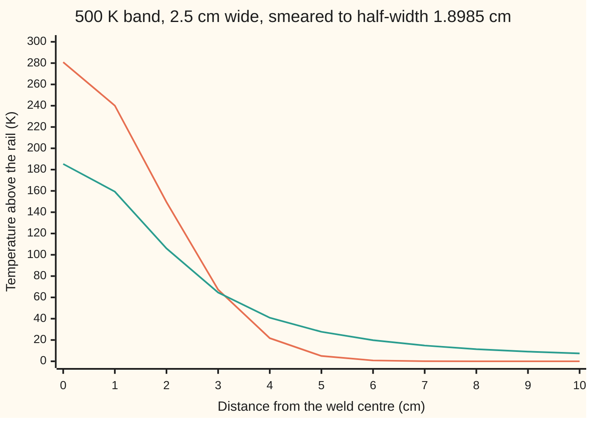
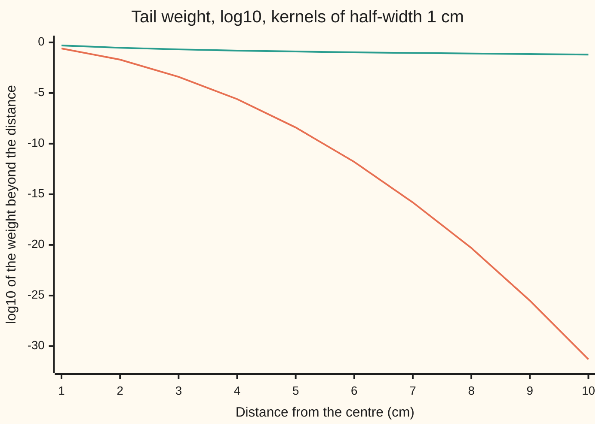

# The Gaussian and Poisson kernels: heat spreading, and a disc's boundary values

[Syllabus](../../../SYLLABUS.md) → [Harmonic analysis](../README.md) → [Convolution and Approximate Identities](../README.md#s03) → The Gaussian and Poisson kernels

---

## General Overview

Two lengths of railway rail are joined by a thermite weld: molten steel is poured into a gap about 25 mm wide. Just after the pour, a band of rail 2.5 cm wide is far hotter than the steel on either side. Take it as 500 K above the rest of the rail (an illustrative round number).

Heat then runs along the rail. Steel spreads heat at a rate set by its diffusivity (how fast temperature differences even out), about 0.13 cm²/s. After 10 s the centre of the band has fallen to 280.9 K above the rail. After 100 s it is 96.8 K. The sharp band has become a soft hump.

The hump is the band **smeared by a bell curve**. Each point of the band spreads into a bell, and the bells add up. The bell is the **Gaussian kernel**, and its width grows like the square root of time. A second shape, the **Poisson kernel**, smears in the same way and answers a steady question: hold the band's temperatures on the face of a thick steel block, and ask how warm the steel is at some depth below the face.

The same Poisson kernel, bent round a circle, fills a disc from the values on its rim.

Both shapes form **approximate identities**: families of smearing shapes that give back the starting profile as their width shrinks to zero. Both have area 1 and are never negative. They differ in their **tails**, the weight they put far away. Set both to the same half-width (the distance from the centre to where the shape falls to half its peak). After 100 s the rail's bell has half-width 6.0036 cm, and 30 cm from the weld the rail is 4.0709e-06 K above the rest. The Poisson smear of the same half-width, the block at depth 6.0036 cm, gives 2.5560 K at 30 cm.

**The bell and the Poisson kernel are both positive scaled families of area 1, so smearing by either gives back the start as the width shrinks; the bell spreads heat, the Poisson kernel fills a half-plane or disc from its edge, and the bell's far weight dies like e to the minus distance squared, the Poisson kernel's only like one over distance.**

**What kind of fact this is:** theorems, proved on this card in Why it works; the general approximate-identity theorem is proved on [Approximate identities](03-approximate-identities.md) and used here. The rail is a model: one dimension, no heat lost to the air, diffusivity 0.13 cm²/s.

### The picture: the weld band smeared two ways to the same half-width



Orange: the rail after 10 s, the band smeared by the bell of standard deviation 1.6125 cm. Green: the band smeared by the Poisson kernel at depth 1.8985 cm, which has the same half-width at half-maximum. The bell is gone by 8 cm; the Poisson curve still holds 7.4 K at 10 cm.

---

## The formula

Notation first, in words.

- $`x`$ is position along the rail in cm, measured from the weld centre. $`t`$ is time in seconds.
- $`f`$ is the start: $`f(x) = u_0 = 500`$ K for $`\lvert x\rvert < a = 1.25`$ cm, and 0 outside. It is the band.
- $`f * K`$ is convolution ([Convolution](01-convolution-and-youngs-inequality.md)): at each $`x`$, the average of $`f(x - q)`$ with weights $`K(q)`$, summed over all offsets $`q`$.
- A **scaled family** is $`K_\varepsilon(x) = K(x/\varepsilon)/\varepsilon`$: one parent shape $`K`$ stretched to width $`\varepsilon`$ and pressed down to keep its area ([Approximate identities](03-approximate-identities.md)).

The two families:

```math
G_s(x) = \frac{1}{s\sqrt{2\pi}}\,e^{-x^2/(2s^2)}, \qquad P_y(x) = \frac{1}{\pi}\,\frac{y}{x^2+y^2}
```

**Read it aloud:** the Gaussian kernel is the bell curve with standard deviation s; the Poisson kernel at height y is y divided by the product of pi and the squared distance from the point (x, 0) to the point (0, y).

What each one solves:

```math
u(x,t) = \big(f * G_{\sqrt{2\kappa t}}\big)(x), \qquad v(x,y) = \big(f * P_y\big)(x)
```

**Read it aloud:** the rail's temperature at time t is the start smeared by the bell of standard deviation root two kappa t; the steady temperature at depth y below a face held at f is f smeared by the Poisson kernel at height y.

Their tails, the weight farther than $`\delta`$ from the centre:

```math
\int_{\lvert x\rvert>\delta} G_s = 2\big(1-\Phi(\delta/s)\big) < \sqrt{\frac{2}{\pi}}\;\frac{s}{\delta}\;e^{-\delta^2/(2s^2)}, \qquad \int_{\lvert x\rvert>\delta} P_y = \frac{2}{\pi}\arctan\frac{y}{\delta} \approx \frac{2y}{\pi\delta}
```

**Read it aloud:** the bell's weight beyond delta falls like e to the minus delta squared over two s squared; the Poisson kernel's weight beyond delta falls only like two y over pi delta.

| Symbol | Plain meaning | In our example | Push it up and the answer… |
| --- | --- | --- | --- |
| $`x`$, $`q`$, $`L`$ | position along the rail; an offset inside the convolution; a cut-off for an integral over $`\lvert x\rvert < L`$; all in cm | 0 to 50 cm; $`L`$ = 10, 100, 1000 | farther out, less heat |
| $`t`$, $`\kappa`$ | time since the pour, in s; diffusivity of the steel, cm²/s | 10 s and 100 s; 0.13 | the hump widens and drops |
| $`f`$, $`u_0`$, $`a`$ | the start: a band of height $`u_0`$ and half-width $`a`$ | 500 K, 1.25 cm | every temperature scales with $`u_0`$ |
| $`K_\varepsilon`$, $`\varepsilon`$ | a scaled family and its width | $`G_s`$ or $`P_y`$ | the smear widens |
| $`G_s`$, $`s`$ | Gaussian kernel and its standard deviation, cm | $`s = \sqrt{2\kappa t}`$ = 1.6125 cm at 10 s | wider, lower bell |
| $`P_y`$, $`y`$ | Poisson kernel and its height (depth below the face), cm | 1.8985 cm, the same half-width | wider, lower hump, still heavy-tailed |
| $`u`$, $`v`$ | temperature on the rail; steady temperature in the block, K | 280.8943 K and 185.3403 K at the centre | — |
| $`\delta`$ | a distance from the centre, cm | 1.25 cm, the band edge | less weight beyond it |
| $`\Phi`$, $`\mathrm{erf}`$ | the standard normal CDF and the error function, $`\Phi(z) = \tfrac12\big(1+\mathrm{erf}(z/\sqrt2)\big)`$ | erf(0.5482) = 0.5618 | — |
| $`\xi`$, $`\hat K`$ | frequency in cycles per cm and the kernel's transform: what share of a ripple survives | 0.5 cycles/cm | less survives |
| $`z`$, $`i`$ | the point $`x + iy`$ of the plane; $`i`$ is the imaginary unit | — | — |
| $`r`$, $`\theta`$, $`P_r`$ | radius and angle in the unit disc, and the disc's Poisson kernel | $`r`$ = 0.99 | weight piles up at $`\theta`$ = 0 |

A bell's **half-width at half-maximum** is 1.1774 standard deviations ($`\sqrt{2\ln 2}`$). The Poisson kernel's is exactly $`y`$. It has no standard deviation at all, as "What breaks" shows, so the card matches the two by half-width.

### When it holds

- **Each kernel is never negative and has area exactly 1.** Drop the $`1/s`$ and the area becomes $`s`$: the centre after 10 s reads 452.9285 K instead of 280.8943 K.
- **The start is bounded.** The bell tolerates growth up to $`e^{cx^2}`$ for short times. The Poisson kernel needs $`\int \lvert f(x)\rvert/(1+x^2)\,dx`$ to be finite. Smear $`f(x) = \lvert x\rvert`$ with $`P_1`$ and the integral grows without limit: 1.4690, 2.9318, 4.3976 for cut-offs 10, 100, 1000.
- **The point is a point of continuity.** At the band's edge, the start jumps from 500 K to 0. Both smears tend to the midpoint, 250 K, not to either side.
- **The width is $`\sqrt{2\kappa t}`$, not $`\sqrt{\kappa t}`$.** The factor 2 comes from the heat equation. Without it, the centre at 10 s reads 363.5312 K.
- **The rail is one-dimensional and loses no heat.** A real rail has a cross-section and cools into the air. The model ignores both, so its numbers are illustrative.

---

## Why it works

### Step 0: squeeze a fixed shape and its weight goes with it

A scaled family is one shape, stretched. Ask how much of $`K_\varepsilon`$'s weight lies beyond a fixed distance $`\delta`$. Substitute $`x = \varepsilon u`$:

```math
\int_{\lvert x\rvert > \delta} K_\varepsilon(x)\,dx = \int_{\lvert u\rvert > \delta/\varepsilon} K(u)\,du.
```

As $`\varepsilon`$ shrinks, $`\delta/\varepsilon`$ runs off to infinity, so the right side tends to 0 for any parent with finite area. That is the whole engine: all the weight crowds into any window around the centre. A positive weighted average of values that all come from near $`x`$ is close to $`f(x)`$ when $`f`$ is continuous there.

The parent's tail sets the speed. That is where the bell and the Poisson kernel part.

### Step 1: both are positive scaled families of area 1

Both formulas are scaled copies: $`G_s(x) = G_1(x/s)/s`$ and $`P_y(x) = P_1(x/y)/y`$. Both are positive.

- **Bell.** $`\int G_1 = 1`$ is the Gauss integral, met on [The heat kernel](../../08-Differential%20equations%20and%20dynamics/10-The%20Classical%20PDEs/10-the-heat-kernel.md). The code finds 1.000000000000 over $`\lvert x\rvert < 12`$; the Mills bound of Step 4 puts the weight left outside below 3.5773e-33.
- **Poisson.** An antiderivative of $`P_1`$ is $`\arctan(x)/\pi`$. Over $`\lvert x\rvert < L`$ the area is $`(2/\pi)\arctan L`$, which tends to 1. It arrives slowly: 0.936549, 0.993634, 0.999363 for $`L`$ = 10, 100, 1000. The missing part is about $`2/(\pi L)`$.

So each family satisfies the three conditions of an approximate identity: area 1, total size bounded (here exactly 1, being positive), and weight beyond any $`\delta`$ tending to 0 (Step 0).

### Step 2: the bell is the heat kernel; the Poisson kernel is harmonic

**The bell.** [The heat kernel](../../08-Differential%20equations%20and%20dynamics/10-The%20Classical%20PDEs/10-the-heat-kernel.md) in wing 08 proves that $`G_{\sqrt{2\kappa t}}`$ solves the heat equation $`u_t = \kappa u_{xx}`$ and that smearing any start by it gives the solution. In one line: the time-rate of the bell equals $`\kappa`$ times its curvature. The code checks this on the rail at $`x`$ = 5 cm, $`t`$ = 100 s: $`u_t`$ = −0.017078 K/s and $`\kappa u_{xx}`$ = −0.017078 K/s.

**The Poisson kernel.** Write $`z = x + iy`$. Then

```math
P_y(x) = \frac{1}{\pi}\,\mathrm{Im}\Big(-\frac{1}{z}\Big), \qquad -\frac1z = \frac{-x+iy}{x^2+y^2}.
```

The imaginary part of a complex-differentiable function is **harmonic**: its two second slopes cancel, $`v_{xx} + v_{yy} = 0`$ ([The Poisson formula](../../07-Complex%20analysis/07-Conformal%20Maps%20and%20Harmonic%20Functions/06-poisson-integral-formula.md)). Smearing a bounded start by $`P_y`$ adds up shifted copies of a harmonic function, so the result is harmonic too. Harmonic means steady heat flow, so $`v`$ is the block's steady temperature. The code checks it at $`x`$ = 5 cm, $`y`$ = 6.0036 cm: $`v_{xx}`$ = 0.737038 and $`-v_{yy}`$ = 0.737038 K/cm².

### Step 3: the start comes back as the width shrinks

Steps 0 and 1 make both families approximate identities. The theorem proved on [Approximate identities](03-approximate-identities.md) then gives the modes of convergence: offsets within $`\delta`$ add little error where $`f`$ is continuous, and the weight beyond $`\delta`$ drains away by Step 0.

- **Pointwise** at every point where a bounded $`f`$ is continuous: $`(f * K_\varepsilon)(x) \to f(x)`$.
- **Uniformly** on any closed stretch that sits strictly inside a region where $`f`$ is continuous, for example $`\lvert x\rvert \le 1`$ cm on the rail, where the band is flat out to 1.25 cm.
- **Not uniformly** across a jump. At the band edge both smears tend to 250 K, the midpoint, because a symmetric kernel puts half its weight on each side.

For the rail this says: as $`t \to 0`$ the profile returns to the band. For the block it says: as the depth $`y \to 0`$ the steady temperature returns to the face's values. That is the "boundary values" half of the title.

### Step 4: the tails decide the speed

The centre of the band sits 1.25 cm from each edge. So the centre's error is exactly $`u_0`$ times the kernel's weight beyond $`\delta = a`$. Step 0 says that weight tends to 0; the tail formulas say how fast.

- **Bell.** The weight beyond $`\delta`$ is $`2(1-\Phi(\delta/s))`$. The **Mills bounds** (bounds on the tail area divided by the bell's height there) pin it between $`\sqrt{2/\pi}\,(s/\delta)\,e^{-\delta^2/(2s^2)}\,(1 - s^2/\delta^2)`$ and $`\sqrt{2/\pi}\,(s/\delta)\,e^{-\delta^2/(2s^2)}`$. Both come from integrating the tail by parts, once for the upper bound and twice for the lower. The weight falls like $`e^{-\delta^2/(2s^2)}`$.
- **Poisson.** The weight is $`(2/\pi)\arctan(y/\delta)`$, from the antiderivative in Step 1. For small $`y`$ that is about $`2y/(\pi\delta)`$. It falls only in proportion to $`y`$.

Matched by half-width ($`y = 1.1774\,s`$), the centre error of each smear is below. A rail time sets the bell's $`s = \sqrt{2\kappa t}`$; the Poisson columns are the block at depth $`y`$, a steady answer with no time in it.

| Rail time (sets $`s`$) | bell $`s`$; Poisson $`y = 1.1774\,s`$ (cm) | Bell: weight beyond 1.25 cm | Bell: centre error | Poisson: weight | Poisson: centre error |
| --- | --- | --- | --- | --- | --- |
| 1 s | 0.5099, 0.6004 | 1.4228e-02 | 7.1141 K | 0.285051 | 142.5253 K |
| 0.1 s | 0.1612, 0.1899 | 9.0335e-15 | 4.5167e-12 K | 0.095957 | 47.9786 K |
| 0.01 s | 0.0510, 0.0600 | 1.0343e-132 | 5.1716e-130 K | 0.030553 | 15.2764 K |

Each bell value sits inside its Mills bounds; at 0.01 s they are 1.0343e-132 and 1.0360e-132. Each Poisson value equals $`(2/\pi)\arctan(y/a)`$ to 12 digits.

Each row cuts both widths by $`\sqrt{10}`$, and the Poisson error falls by about the same factor: 142.5253, 47.9786, 15.2764 K. The bell's error collapses instead.

### The picture: weight beyond a distance, both kernels at half-width 1 cm



Orange: the bell, standard deviation 1/1.1774 cm; its log-tail bends down like a parabola. Green: the Poisson kernel at $`y`$ = 1 cm; its log-tail is nearly flat, going only from −0.30 to −1.20 between 1 cm and 10 cm.

### Step 5: in frequency, and why widths add

Smearing multiplies each frequency by the kernel's transform ([The convolution theorem](02-convolution-theorem-and-impulse-response.md)). With $`\hat K(\xi) = \int K(x)\,e^{-2\pi i\xi x}\,dx`$ and $`\xi`$ in cycles per cm:

```math
\hat G_s(\xi) = e^{-2\pi^2 s^2 \xi^2}, \qquad \hat P_y(\xi) = e^{-2\pi y\lvert\xi\rvert}
```

**Read it aloud:** the bell keeps a ripple of frequency xi in proportion to e to the minus two pi squared s squared xi squared; the Poisson kernel keeps it in proportion to e to the minus two pi y times the size of xi.

The bell's pair comes from [Two pairs worth memorising](../02-The%20Fourier%20Transform/03-gaussian-and-sinc-transform-pairs.md) by the scaling rule. The Poisson pair is derived in the fold below. The code checks it at $`y`$ = 1, $`x`$ = 2: the inverse integral gives 0.063661977, and $`P_1(2) = 1/(5\pi)`$ = 0.063661977.

Three consequences:

- **Fine detail.** At 10 s, a ripple of 0.5 cycles per cm keeps 2.6779e-06 of its size under the bell, but 2.5687e-03 under the Poisson kernel of the same half-width. The corner of $`e^{-2\pi y\lvert\xi\rvert}`$ at $`\xi = 0`$ is the frequency-side image of the heavy tail.
- **Bells add by variance.** $`\hat G_{s_1}\hat G_{s_2} = \hat G_{\sqrt{s_1^2+s_2^2}}`$, so $`G_3 * G_4 = G_5`$. At 0: 0.079788456 by integration, and $`G_5(0)`$ = 0.079788456. For the rail, waiting 10 s then 90 s is waiting 100 s.
- **Poisson kernels add by height.** $`\hat P_{y_1}\hat P_{y_2} = \hat P_{y_1+y_2}`$, so $`P_3 * P_4 = P_7`$. At 0: 0.045472841 both ways. Going 3 cm deep, then 4 cm deeper, is going 7 cm deep.

<details>
<summary>Detailed proof: the transform of the Poisson kernel</summary>

Start from the multiplier and invert it. Split the line at $`\xi = 0`$. On each half the integrand is a plain decaying exponential, because $`y > 0`$:

$`\displaystyle \int_{-\infty}^{\infty} e^{-2\pi y\lvert\xi\rvert}\,e^{2\pi i\xi x}\,d\xi = \frac{1}{2\pi(y - ix)} + \frac{1}{2\pi(y + ix)} = \frac{2y}{2\pi(x^2+y^2)} = P_y(x).`$

The multiplier has finite area and so does $`P_y`$, and both are continuous. The inversion theorem ([Fourier inversion](../02-The%20Fourier%20Transform/04-fourier-inversion-theorem.md)) then gives $`\hat P_y(\xi) = e^{-2\pi y\lvert\xi\rvert}`$.

</details>

### Step 6: the disc's rim looks like the half-plane's edge

[The Poisson formula](../../07-Complex%20analysis/07-Conformal%20Maps%20and%20Harmonic%20Functions/06-poisson-integral-formula.md) fills a unit disc from its rim with the weight $`\frac{1}{2\pi}P_r(\theta)`$, where $`P_r(\theta) = (1-r^2)/(1-2r\cos\theta+r^2)`$ and $`\theta`$ is the angle to the rim point. It is the same idea on a circle, with $`\varepsilon = 1 - r`$, the distance to the rim.

Near the rim and at small angles, $`1 - r^2 \approx 2\varepsilon`$ and $`1 - 2r\cos\theta + r^2 \approx \varepsilon^2 + \theta^2`$. So

```math
\frac{1}{2\pi}P_r(\theta) \approx \frac{1}{\pi}\,\frac{\varepsilon}{\theta^2+\varepsilon^2} = P_{\varepsilon}(\theta).
```

At $`r`$ = 0.99 and angles 0, 0.01, 0.03 rad the disc gives 31.6718, 15.9156, 3.1962; the half-plane kernel gives 31.8310, 15.9155, 3.1831. The weight beyond 0.5 rad shrinks in proportion to $`1 - r`$, as the half-plane formula predicts: 0.129409, 0.012527, 0.001247 for $`r`$ = 0.9, 0.99, 0.999, against 0.125666, 0.012731, 0.001273. The disc kernel is an approximate identity with the Poisson kernel's heavy tail.

---

## Worked numbers, by hand

The rail at 10 s, and the block at the same half-width. The bell's centre is $`u_0\,\mathrm{erf}\big(a/(s\sqrt2)\big)`$. The Poisson centre is $`(2u_0/\pi)\arctan(a/y)`$, from the antiderivative.

| Step | Arithmetic | Value |
| --- | --- | --- |
| standard deviation | $`s = \sqrt{2 \times 0.13 \times 10} = \sqrt{2.6}`$ | 1.6125 cm |
| matching half-width | $`y = 1.1774 \times 1.6125`$ | 1.8985 cm |
| bell's argument | $`1.25 / (1.6125 \times 1.4142)`$ | 0.5482 |
| error function | erf(0.5482) | 0.5618 |
| **rail centre at 10 s** | $`500 \times 0.5618`$ | **280.8943 K** |
| Poisson's argument | $`1.25 / 1.8985`$, then arctan | 0.6584, then 0.5823 rad |
| block centre at depth 1.8985 cm | $`(2 \times 500/\pi) \times 0.5823 = 318.3099 \times 0.5823`$ | 185.3403 K |
| far out, 30 cm | rail at 100 s (bell); block at depth $`y`$ = 6.0036 cm (Poisson), about $`2au_0y/(\pi x^2)`$ = 2.6542 | 4.0709e-06 K; 2.5560 K |

The hand values are rounded to four places; the code carries full precision. Ten seconds after the pour, the weld centre is 280.9 K above the rail. Smear the same band with the Poisson kernel of the same half-width, the block at depth 1.8985 cm, and the centre is lower, 185.3 K, because that kernel puts more of its weight far away.

### What breaks if you drop a piece

| Mistake | Comes out at | What went wrong |
| --- | --- | --- |
| Width $`\sqrt{\kappa t}`$ instead of $`\sqrt{2\kappa t}`$ | centre 363.5312 K at 10 s, not 280.8943 K | The heat equation's bell has variance $`2\kappa t`$ |
| Drop the $`1/s`$ in $`G_s`$ | area 1.6125; centre 452.9285 K | Not an approximate identity: the area is $`s`$, not 1, so every value at 10 s is 1.6125 times too big, and the smear fades to 0 as $`s`$ shrinks |
| Smear an unbounded start, $`f(x) = \lvert x\rvert`$, by $`P_1`$ | 1.4690, 2.9318, 4.3976 for cut-offs 10, 100, 1000: no limit | The Poisson tail times $`\lvert x\rvert`$ is like $`1/\lvert x\rvert`$, not integrable. The bell gives 0.7979 |
| Match the kernels by standard deviation | Poisson's second moment 5.43, 62.67, 635.62 for cut-offs 10, 100, 1000 | The Poisson kernel has no variance; use half-width |

The third row is the hypothesis that matters. The bell's tail beats any polynomial growth in the start. The Poisson kernel's tail beats only starts that grow slower than $`\lvert x\rvert`$.

---

## Code, from first principles, and it actually runs

Both programs build the two kernels from their formulas and test every claim by a second road. They take five roads:

1. Closed forms against brute force: the band's smear by erf (a series written out) and by arctan, against the convolution integral.
2. The equations: finite differences confirm $`u_t = \kappa u_{xx}`$ for the bell and $`v_{xx} + v_{yy} = 0`$ for Poisson.
3. Tails by direct integration at two cell counts, against the Mills bounds and against $`(2/\pi)\arctan(y/\delta)`$; the centre error by erf against the tail.
4. Frequency: $`G_3 * G_4 = G_5`$ and $`P_3 * P_4 = P_7`$ by integration, and the Poisson transform inverted by integration.
5. The disc kernel against the half-plane kernel near the rim.

Integrals use three-point Gauss–Legendre rules written out. The Poisson integrals over the whole line use $`x = 5\tan\theta`$ or $`x = \delta/u`$, so no cut-off is needed. The bell integrals and the frequency integral are cut off; the code prints each cut-off with a bound on the part left out, far below the digits shown.

### Python

```python
# Gaussian and Poisson kernels -- the check behind the card.  Standard library only;
# math gives exp, sqrt, log, atan, tan, cos and pi.  The rail: steel, diffusivity about
# 0.13 cm^2/s, a weld band 2.5 cm wide left 500 K above the rest of the rail at t = 0.
from math import exp, sqrt, log, atan, tan, cos, pi

KAP, A, U0 = 0.13, 1.25, 500.0     # cm^2/s, band half-width in cm, band height in K
C = sqrt(2 * log(2))               # a bell's half-width at half-maximum, in standard deviations

def G(s, x): return exp(-x * x / (2 * s * s)) / (s * sqrt(2 * pi))   # bell, standard deviation s
def P(y, x): return y / (pi * (x * x + y * y))                       # Poisson kernel at height y

def gauss(g, a, b, M):             # 3-point Gauss-Legendre on each of M cells of (a, b)
    h, r = (b - a) / M, sqrt(0.6) / 2
    return h * sum(5 / 18 * (g(c - r * h) + g(c + r * h)) + 4 / 9 * g(c)
                   for c in (a + (j + 0.5) * h for j in range(M)))

def erf(z):                        # positive-term series: (2/sqrt pi) e^(-z^2) sum 2^n z^(2n+1)/(2n+1)!!
    w = abs(z); term = s = w; n = 0
    if w > 6: return 1.0 if z > 0 else -1.0   # 1 - erf 6 is below 3e-17
    while term > 1e-17 * s:
        n += 1; term *= 2 * w * w / (2 * n + 1); s += term
    return (1 if z >= 0 else -1) * 2 / sqrt(pi) * exp(-w * w) * s

def heat(x, s): return U0 / 2 * (erf((x + A) / (s * sqrt(2))) - erf((x - A) / (s * sqrt(2))))
def lap(x, y): return U0 / pi * (atan((x + A) / y) - atan((x - A) / y))
def conv(K, w, x): return gauss(lambda q: U0 * K(w, x - q), -A, A, 200)   # band smeared by K_w
def mills(s, c): return sqrt(2 / pi) * s / c * exp(-c * c / (2 * s * s))   # Mills bound: bell weight beyond |x| = c
def cutG(s, d): return d + 40 * s * min(1, s / d)                          # where tailG stops integrating
def tailG(s, d, M): return 2 * gauss(lambda x: G(s, x), d, cutG(s, d), M)  # beyond |x| = d
def tailP(y, d): return 2 * gauss(lambda u: y * d / (pi * (d * d + y * y * u * u)), 0, 1, 200)  # x = d/u

# ---- both kernels have area 1; the Poisson area arrives slowly ----
print(f"bell area, s = 1, over |x| < 12: {gauss(lambda x: G(1, x), -12, 12, 400):.12f};"
      f" Mills bound on the weight beyond 12: {sqrt(2 / pi) / 12 * exp(-72):.4e}")
for L in (10, 100, 1000):
    num = gauss(lambda x: P(1, x), -L, L, 40 * L)
    print(f"Poisson area, y = 1, over |x| < {L}: {num:.6f}; (2/pi) atan L {2 / pi * atan(L):.6f};"
          f" missing {1 - num:.6f}, about 2/(pi L) = {2 / (pi * L):.6f}")
    assert abs(num - 2 / pi * atan(L)) < 1e-9 and 1 - num < 2 / (pi * L)
assert abs(gauss(lambda x: G(1, x), -12, 12, 400) - 1) < 1e-12

# ---- the rail: the bell of width s = sqrt(2 kappa t) is the heat kernel ----
print(f"rail: kappa {KAP} cm^2/s, band half-width {A} cm, height {U0:.0f} K;"
      f" half-max half-width = {C:.4f} standard deviations")
for t in (10, 100):
    s = sqrt(2 * KAP * t); y = C * s
    assert abs(G(s, y) - G(s, 0) / 2) < 1e-12 and abs(P(y, y) - P(y, 0) / 2) < 1e-12   # half-maximum at y
    print(f"t = {t} s: s = {s:.4f} cm, half-width {y:.4f} cm; centre by erf {heat(0, s):.4f} K,"
          f" by convolution {conv(G, s, 0):.4f} K; Poisson at y = {y:.4f}: {lap(0, y):.4f} K,"
          f" by convolution {conv(P, y, 0):.4f} K")
    assert abs(heat(0, s) - conv(G, s, 0)) < 1e-9 and abs(lap(0, y) - conv(P, y, 0)) < 1e-9
s, y = sqrt(2.6), C * sqrt(2.6)
print(f"by hand, t = 10 s: a/(s sqrt 2) {A / (s * sqrt(2)):.4f}, erf {erf(A / (s * sqrt(2))):.4f};"
      f" a/y {A / y:.4f}, atan {atan(A / y):.4f} rad, x 2u0/pi {2 * U0 / pi:.4f} K")
s, y, h = sqrt(26.0), C * sqrt(26.0), 1e-3
ut = (heat(5, sqrt(2 * KAP * (100 + h))) - heat(5, sqrt(2 * KAP * (100 - h)))) / (2 * h)
uxx = (heat(5 + h, s) - 2 * heat(5, s) + heat(5 - h, s)) / h ** 2
vxx = (lap(5 + h, y) - 2 * lap(5, y) + lap(5 - h, y)) / h ** 2
vyy = (lap(5, y + h) - 2 * lap(5, y) + lap(5, y - h)) / h ** 2
print(f"at x = 5 cm, t = 100 s: u_t {ut:.6f}, kappa u_xx {KAP * uxx:.6f} K/s;"
      f" Poisson v_xx {vxx:.6f}, -v_yy {-vyy:.6f} K/cm^2")
assert abs(ut - KAP * uxx) < 1e-5 and abs(vxx + vyy) < 1e-5

# ---- approximate identity: weight beyond the band edge, and the centre's error ----
for t in (0.01, 0.1, 1):
    s = sqrt(2 * KAP * t); y = C * s; z = A / s
    g1, g2 = tailG(s, A, 400), tailG(s, A, 800); p = tailP(y, A)
    lo = 2 * exp(-z * z / 2) / sqrt(2 * pi) * (1 / z - 1 / z ** 3); up = 2 * exp(-z * z / 2) / sqrt(2 * pi) / z
    print(f"t = {t:>5} s, s {s:.4f}, y {y:.4f} cm: bell beyond {A} cm {g2:.4e}"
          f" (Mills {lo:.4e} to {up:.4e}); Poisson {p:.6f}, (2/pi) atan(y/a) {2 / pi * atan(y / A):.6f},"
          f" 2y/(pi a) {2 * y / (pi * A):.6f}")
    print(f"      centre error: bell {U0 * g2:.4e} K, Poisson {U0 * p:.4f} K;"
          f" at the edge x = a: bell {heat(A, s):.4f} K, Poisson {lap(A, y):.4f} K")
    print(f"      bell integral cut at {cutG(s, A):.4f} cm; Mills bound on the weight beyond the cut {mills(s, cutG(s, A)):.4e}")
    assert abs(g1 - g2) < 1e-6 * g2 and lo < g2 < up and g2 - lo < 3 * up / z ** 4   # next Mills term
    assert abs(p - 2 / pi * atan(y / A)) < 1e-12 and abs(heat(0, s) - U0 * (1 - g2)) < 1e-8

# ---- the far rail at t = 100 s: bell against Poisson of the same half-width ----
s, y = sqrt(26.0), C * sqrt(26.0)
for x in (0, 10, 20, 30, 50):
    print(f"x = {x:>2} cm: bell {conv(G, s, x):.4e} K, Poisson {lap(x, y):.4f} K"
          + (f", far-field 2a u0 y/(pi x^2) {2 * A * U0 * y / (pi * x * x):.4f} K" if x else ""))
assert abs(lap(50, y) - 2 * A * U0 * y / (pi * 2500)) < 0.02 * lap(50, y) and conv(G, s, 30) < 1e-5

# ---- widths add: bells by variance (3-4-5), Poisson kernels by height ----
gg = gauss(lambda q: G(3, q) * G(4, -q), -60, 60, 400)
pp = gauss(lambda th: P(3, 5 * tan(th)) * P(4, -5 * tan(th)) * 5 / cos(th) ** 2, -pi / 2, pi / 2, 400)
print(f"G_3 * G_4 at 0 over |q| < 60 (beyond: below G_3(0) x Mills(4, 60) = {G(3, 0) * mills(4, 60):.4e}): {gg:.9f};"
      f" G_5(0) {G(5, 0):.9f}.  P_3 * P_4 at 0: {pp:.9f}; P_7(0) {P(7, 0):.9f}")
assert abs(gg - G(5, 0)) < 1e-12 and abs(pp - P(7, 0)) < 1e-12
inv = 2 * gauss(lambda xi: exp(-2 * pi * xi) * cos(4 * pi * xi), 0, 10, 1000)  # y = 1, x = 2
print(f"inverse transform of e^(-2 pi |xi|) at x = 2 over |xi| < 10 (beyond: below e^(-20 pi)/pi = {exp(-20 * pi) / pi:.4e}):"
      f" {inv:.9f}; P_1(2) = {P(1, 2):.9f}")
assert abs(inv - P(1, 2)) < 1e-12
s, y = sqrt(2.6), C * sqrt(2.6)
print(f"t = 10 s, detail 0.5 cycles/cm kept: bell {exp(-2 * pi ** 2 * s * s * 0.25):.4e},"
      f" Poisson {exp(-2 * pi * y * 0.5):.4e}")

# ---- the disc: near the rim, (1/2pi) P_r is the half-plane kernel at height 1 - r ----
def Pr(r, th): return (1 - r * r) / (1 - 2 * r * cos(th) + r * r) / (2 * pi)
print("r = 0.99 at angle 0, 0.01, 0.03 rad: disc",
      " ".join(f"{Pr(0.99, th):.4f}" for th in (0, 0.01, 0.03)),
      "; half-plane", " ".join(f"{P(0.01, th):.4f}" for th in (0, 0.01, 0.03)))
for r in (0.9, 0.99, 0.999):
    far = 2 * gauss(lambda th: Pr(r, th), 0.5, pi, 400)
    print(f"r = {r}: disc weight beyond 0.5 rad {far:.6f}; half-plane (2/pi) atan((1-r)/0.5)"
          f" {2 / pi * atan((1 - r) / 0.5):.6f}")
    assert far < 3 * (1 - r) and abs(far / (2 / pi * atan((1 - r) / 0.5)) - 1) < 0.25

# ---- what breaks ----
s = sqrt(2.6)
print(f"break, width sqrt(kappa t) at t = 10 s: centre {heat(0, sqrt(1.3)):.4f} K, not {heat(0, s):.4f} K")
print(f"break, drop the 1/s: area {s:.4f}, centre {s * heat(0, s):.4f} K")
for L in (10, 100, 1000):
    pa = gauss(lambda x: abs(x) * P(1, x), -L, L, 40 * L)
    pv = gauss(lambda x: x * x * P(1, x), -L, L, 40 * L)
    print(f"break, Poisson of |x| over |x| < {L}: {pa:.4f}, ln(1+L^2)/pi {log(1 + L * L) / pi:.4f};"
          f" second moment {pv:.2f}")
    assert abs(pa - log(1 + L * L) / pi) < 1e-8 and abs(pv - 2 / pi * (L - atan(L))) < 1e-6
print(f"bell of s = 1 on |x|: {gauss(lambda x: abs(x) * G(1, x), 0, 12, 400) * 2:.4f}, sqrt(2/pi) {sqrt(2 / pi):.4f}")

# ---- chart points ----
s, y = sqrt(2.6), C * sqrt(2.6)
print("chart x:", " ".join(f"{x}" for x in range(11)))
print("chart bell t = 10 s:", " ".join(f"{heat(x, s):.1f}" for x in range(11)))
print(f"chart Poisson y = {y:.4f}:", " ".join(f"{lap(x, y):.1f}" for x in range(11)))
sg = 1 / C
print("chart log10 tail bell:", " ".join(f"{log(tailG(sg, d, 400), 10):.1f}" for d in range(1, 11)))
print("chart log10 tail Poisson:", " ".join(f"{log(tailP(1, d), 10):.2f}" for d in range(1, 11)))
print(f"chart bell tails cut at d + 40 s min(1, s/d): Mills share beyond the cut at most"
      f" {max(mills(sg, cutG(sg, d)) / tailG(sg, d, 400) for d in range(1, 11)):.4e}")
print("ALL CHECKS PASS")
```

**Ran 2026-11-15 on macOS, Python 3.14.10, standard library only. All checks passed. Output, pasted from the run:**

```
bell area, s = 1, over |x| < 12: 1.000000000000; Mills bound on the weight beyond 12: 3.5773e-33
Poisson area, y = 1, over |x| < 10: 0.936549; (2/pi) atan L 0.936549; missing 0.063451, about 2/(pi L) = 0.063662
Poisson area, y = 1, over |x| < 100: 0.993634; (2/pi) atan L 0.993634; missing 0.006366, about 2/(pi L) = 0.006366
Poisson area, y = 1, over |x| < 1000: 0.999363; (2/pi) atan L 0.999363; missing 0.000637, about 2/(pi L) = 0.000637
rail: kappa 0.13 cm^2/s, band half-width 1.25 cm, height 500 K; half-max half-width = 1.1774 standard deviations
t = 10 s: s = 1.6125 cm, half-width 1.8985 cm; centre by erf 280.8943 K, by convolution 280.8943 K; Poisson at y = 1.8985: 185.3403 K, by convolution 185.3403 K
t = 100 s: s = 5.0990 cm, half-width 6.0036 cm; centre by erf 96.8280 K, by convolution 96.8280 K; Poisson at y = 6.0036: 65.3409 K, by convolution 65.3409 K
by hand, t = 10 s: a/(s sqrt 2) 0.5482, erf 0.5618; a/y 0.6584, atan 0.5823 rad, x 2u0/pi 318.3099 K
at x = 5 cm, t = 100 s: u_t -0.017078, kappa u_xx -0.017078 K/s; Poisson v_xx 0.737038, -v_yy 0.737038 K/cm^2
t =  0.01 s, s 0.0510, y 0.0600 cm: bell beyond 1.25 cm 1.0343e-132 (Mills 1.0343e-132 to 1.0360e-132); Poisson 0.030553, (2/pi) atan(y/a) 0.030553, 2y/(pi a) 0.030576
      centre error: bell 5.1716e-130 K, Poisson 15.2764 K; at the edge x = a: bell 250.0000 K, Poisson 246.1787 K
      bell integral cut at 1.3332 cm; Mills bound on the weight beyond the cut 1.0901e-150
t =   0.1 s, s 0.1612, y 0.1899 cm: bell beyond 1.25 cm 9.0335e-15 (Mills 9.0264e-15 to 9.1792e-15); Poisson 0.095957, (2/pi) atan(y/a) 0.095957, 2y/(pi a) 0.096691
      centre error: bell 4.5167e-12 K, Poisson 47.9786 K; at the edge x = a: bell 250.0000 K, Poisson 237.9368 K
      bell integral cut at 2.0820 cm; Mills bound on the weight beyond the cut 3.8737e-38
t =     1 s, s 0.5099, y 0.6004 cm: bell beyond 1.25 cm 1.4228e-02 (Mills 1.3443e-02 to 1.6127e-02); Poisson 0.285051, (2/pi) atan(y/a) 0.285051, 2y/(pi a) 0.305763
      centre error: bell 7.1141e+00 K, Poisson 142.5253 K; at the edge x = a: bell 249.9998 K, Poisson 212.4900 K
      bell integral cut at 9.5700 cm; Mills bound on the weight beyond the cut 1.3756e-78
x =  0 cm: bell 9.6828e+01 K, Poisson 65.3409 K
x = 10 cm: bell 1.4699e+01 K, Poisson 17.6897 K, far-field 2a u0 y/(pi x^2) 23.8877 K
x = 20 cm: bell 5.1257e-02 K, Poisson 5.4958 K, far-field 2a u0 y/(pi x^2) 5.9719 K
x = 30 cm: bell 4.0709e-06 K, Poisson 2.5560 K, far-field 2a u0 y/(pi x^2) 2.6542 K
x = 50 cm: bell 2.9024e-19 K, Poisson 0.9425 K, far-field 2a u0 y/(pi x^2) 0.9555 K
G_3 * G_4 at 0 over |q| < 60 (beyond: below G_3(0) x Mills(4, 60) = 9.8064e-52): 0.079788456; G_5(0) 0.079788456.  P_3 * P_4 at 0: 0.045472841; P_7(0) 0.045472841
inverse transform of e^(-2 pi |xi|) at x = 2 over |xi| < 10 (beyond: below e^(-20 pi)/pi = 1.6418e-28): 0.063661977; P_1(2) = 0.063661977
t = 10 s, detail 0.5 cycles/cm kept: bell 2.6779e-06, Poisson 2.5687e-03
r = 0.99 at angle 0, 0.01, 0.03 rad: disc 31.6718 15.9156 3.1962 ; half-plane 31.8310 15.9155 3.1831
r = 0.9: disc weight beyond 0.5 rad 0.129409; half-plane (2/pi) atan((1-r)/0.5) 0.125666
r = 0.99: disc weight beyond 0.5 rad 0.012527; half-plane (2/pi) atan((1-r)/0.5) 0.012731
r = 0.999: disc weight beyond 0.5 rad 0.001247; half-plane (2/pi) atan((1-r)/0.5) 0.001273
break, width sqrt(kappa t) at t = 10 s: centre 363.5312 K, not 280.8943 K
break, drop the 1/s: area 1.6125, centre 452.9285 K
break, Poisson of |x| over |x| < 10: 1.4690, ln(1+L^2)/pi 1.4690; second moment 5.43
break, Poisson of |x| over |x| < 100: 2.9318, ln(1+L^2)/pi 2.9318; second moment 62.67
break, Poisson of |x| over |x| < 1000: 4.3976, ln(1+L^2)/pi 4.3976; second moment 635.62
bell of s = 1 on |x|: 0.7979, sqrt(2/pi) 0.7979
chart x: 0 1 2 3 4 5 6 7 8 9 10
chart bell t = 10 s: 280.9 240.1 149.5 67.3 21.7 5.0 0.8 0.1 0.0 0.0 0.0
chart Poisson y = 1.8985: 185.3 159.3 106.0 64.6 40.9 27.7 19.8 14.8 11.4 9.1 7.4
chart log10 tail bell: -0.6 -1.7 -3.4 -5.6 -8.4 -11.8 -15.8 -20.3 -25.5 -31.3
chart log10 tail Poisson: -0.30 -0.53 -0.69 -0.81 -0.90 -0.98 -1.04 -1.10 -1.15 -1.20
chart bell tails cut at d + 40 s min(1, s/d): Mills share beyond the cut at most 1.0351e-20
ALL CHECKS PASS
```

### Rust

```rust
// Gaussian and Poisson kernels -- the check behind the card.  std only.
// The rail: steel, diffusivity about 0.13 cm^2/s, a weld band 2.5 cm wide left
// 500 K above the rest of the rail at t = 0.  Same roads and same output as the Python.
use std::f64::consts::PI;

const KAP: f64 = 0.13; const A: f64 = 1.25; const U0: f64 = 500.0; // cm^2/s; band half-width, cm; band height u0, K

fn c_hw() -> f64 { (2.0 * 2f64.ln()).sqrt() } // half-width at half-maximum, in standard deviations
fn g(s: f64, x: f64) -> f64 { (-x * x / (2.0 * s * s)).exp() / (s * (2.0 * PI).sqrt()) }
fn p(y: f64, x: f64) -> f64 { y / (PI * (x * x + y * y)) }

fn gauss<F: Fn(f64) -> f64>(f: F, a: f64, b: f64, m: usize) -> f64 { // 3-point Gauss-Legendre
    let (h, r) = ((b - a) / m as f64, 0.6f64.sqrt() / 2.0);
    let mut sum = 0.0;
    for j in 0..m {
        let c = a + (j as f64 + 0.5) * h;
        sum += 5.0 / 18.0 * (f(c - r * h) + f(c + r * h)) + 4.0 / 9.0 * f(c);
    }
    h * sum
}

fn erf(z: f64) -> f64 { // positive-term series: (2/sqrt pi) e^(-z^2) sum 2^n z^(2n+1)/(2n+1)!!
    let w = z.abs();
    if w > 6.0 { return if z > 0.0 { 1.0 } else { -1.0 }; } // 1 - erf 6 is below 3e-17
    let (mut term, mut s, mut n) = (w, w, 0.0);
    while term > 1e-17 * s {
        n += 1.0;
        term *= 2.0 * w * w / (2.0 * n + 1.0);
        s += term;
    }
    (if z >= 0.0 { 1.0 } else { -1.0 }) * 2.0 / PI.sqrt() * (-w * w).exp() * s
}

fn heat(x: f64, s: f64) -> f64 {
    U0 / 2.0 * (erf((x + A) / (s * 2f64.sqrt())) - erf((x - A) / (s * 2f64.sqrt())))
}
fn lap(x: f64, y: f64) -> f64 { U0 / PI * (((x + A) / y).atan() - ((x - A) / y).atan()) }
fn conv(k: fn(f64, f64) -> f64, w: f64, x: f64) -> f64 { gauss(|q| U0 * k(w, x - q), -A, A, 200) }
fn mills(s: f64, c: f64) -> f64 { (2.0 / PI).sqrt() * s / c * (-c * c / (2.0 * s * s)).exp() } // Mills bound: bell weight beyond |x| = c
fn cut_g(s: f64, d: f64) -> f64 { d + 40.0 * s * (s / d).min(1.0) } // where tail_g stops integrating
fn tail_g(s: f64, d: f64, m: usize) -> f64 { 2.0 * gauss(|x| g(s, x), d, cut_g(s, d), m) }
fn tail_p(y: f64, d: f64) -> f64 { 2.0 * gauss(|u| y * d / (PI * (d * d + y * y * u * u)), 0.0, 1.0, 200) }
fn pr(r: f64, th: f64) -> f64 { (1.0 - r * r) / (1.0 - 2.0 * r * th.cos() + r * r) / (2.0 * PI) }
fn log10(v: f64) -> f64 { v.ln() / 10f64.ln() }

fn sci(v: f64) -> String { // Python's .4e: two-digit exponent with its sign
    let t = format!("{:.4e}", v);
    let (m, e) = t.split_once('e').unwrap();
    let e: i32 = e.parse().unwrap();
    format!("{}e{}{:02}", m, if e < 0 { '-' } else { '+' }, e.abs())
}

fn main() {
    let c = c_hw();
    // ---- both kernels have area 1; the Poisson area arrives slowly ----
    let ga = gauss(|x| g(1.0, x), -12.0, 12.0, 400);
    println!("bell area, s = 1, over |x| < 12: {:.12}; Mills bound on the weight beyond 12: {}",
             ga, sci((2.0 / PI).sqrt() / 12.0 * (-72.0f64).exp()));
    for l in [10.0f64, 100.0, 1000.0] {
        let num = gauss(|x| p(1.0, x), -l, l, 40 * l as usize);
        println!("Poisson area, y = 1, over |x| < {}: {:.6}; (2/pi) atan L {:.6}; missing {:.6}, about 2/(pi L) = {:.6}",
                 l, num, 2.0 / PI * l.atan(), 1.0 - num, 2.0 / (PI * l));
        assert!((num - 2.0 / PI * l.atan()).abs() < 1e-9 && 1.0 - num < 2.0 / (PI * l));
    }
    assert!((ga - 1.0).abs() < 1e-12);

    // ---- the rail: the bell of width s = sqrt(2 kappa t) is the heat kernel ----
    println!("rail: kappa {} cm^2/s, band half-width {} cm, height {:.0} K; half-max half-width = {:.4} standard deviations", KAP, A, U0, c);
    for t in [10.0f64, 100.0] {
        let s = (2.0 * KAP * t).sqrt();
        let y = c * s;
        assert!((g(s, y) - g(s, 0.0) / 2.0).abs() < 1e-12 && (p(y, y) - p(y, 0.0) / 2.0).abs() < 1e-12); // half-maximum at y
        println!("t = {} s: s = {:.4} cm, half-width {:.4} cm; centre by erf {:.4} K, by convolution {:.4} K; Poisson at y = {:.4}: {:.4} K, by convolution {:.4} K",
                 t, s, y, heat(0.0, s), conv(g, s, 0.0), y, lap(0.0, y), conv(p, y, 0.0));
        assert!((heat(0.0, s) - conv(g, s, 0.0)).abs() < 1e-9 && (lap(0.0, y) - conv(p, y, 0.0)).abs() < 1e-9);
    }
    let (s, y) = (2.6f64.sqrt(), c * 2.6f64.sqrt());
    println!("by hand, t = 10 s: a/(s sqrt 2) {:.4}, erf {:.4}; a/y {:.4}, atan {:.4} rad, x 2u0/pi {:.4} K",
             A / (s * 2f64.sqrt()), erf(A / (s * 2f64.sqrt())), A / y, (A / y).atan(), 2.0 * U0 / PI);
    let (s, y, h) = (26f64.sqrt(), c * 26f64.sqrt(), 1e-3);
    let ut = (heat(5.0, (2.0 * KAP * (100.0 + h)).sqrt()) - heat(5.0, (2.0 * KAP * (100.0 - h)).sqrt())) / (2.0 * h);
    let uxx = (heat(5.0 + h, s) - 2.0 * heat(5.0, s) + heat(5.0 - h, s)) / (h * h);
    let vxx = (lap(5.0 + h, y) - 2.0 * lap(5.0, y) + lap(5.0 - h, y)) / (h * h);
    let vyy = (lap(5.0, y + h) - 2.0 * lap(5.0, y) + lap(5.0, y - h)) / (h * h);
    println!("at x = 5 cm, t = 100 s: u_t {:.6}, kappa u_xx {:.6} K/s; Poisson v_xx {:.6}, -v_yy {:.6} K/cm^2",
             ut, KAP * uxx, vxx, -vyy);
    assert!((ut - KAP * uxx).abs() < 1e-5 && (vxx + vyy).abs() < 1e-5);

    // ---- approximate identity: weight beyond the band edge, and the centre's error ----
    for (t, tl) in [(0.01f64, "0.01"), (0.1, "0.1"), (1.0, "1")] {
        let s = (2.0 * KAP * t).sqrt();
        let y = c * s;
        let z = A / s;
        let (g1, g2, pp) = (tail_g(s, A, 400), tail_g(s, A, 800), tail_p(y, A));
        let lo = 2.0 * (-z * z / 2.0).exp() / (2.0 * PI).sqrt() * (1.0 / z - 1.0 / z.powi(3));
        let up = 2.0 * (-z * z / 2.0).exp() / (2.0 * PI).sqrt() / z;
        println!("t = {:>5} s, s {:.4}, y {:.4} cm: bell beyond {} cm {} (Mills {} to {}); Poisson {:.6}, (2/pi) atan(y/a) {:.6}, 2y/(pi a) {:.6}",
                 tl, s, y, A, sci(g2), sci(lo), sci(up), pp, 2.0 / PI * (y / A).atan(), 2.0 * y / (PI * A));
        println!("      centre error: bell {} K, Poisson {:.4} K; at the edge x = a: bell {:.4} K, Poisson {:.4} K",
                 sci(U0 * g2), U0 * pp, heat(A, s), lap(A, y));
        println!("      bell integral cut at {:.4} cm; Mills bound on the weight beyond the cut {}", cut_g(s, A), sci(mills(s, cut_g(s, A))));
        assert!((g1 - g2).abs() < 1e-6 * g2 && lo < g2 && g2 < up && g2 - lo < 3.0 * up / z.powi(4)); // next Mills term
        assert!((pp - 2.0 / PI * (y / A).atan()).abs() < 1e-12 && (heat(0.0, s) - U0 * (1.0 - g2)).abs() < 1e-8);
    }

    // ---- the far rail at t = 100 s: bell against Poisson of the same half-width ----
    let (s, y) = (26f64.sqrt(), c * 26f64.sqrt());
    for x in [0.0f64, 10.0, 20.0, 30.0, 50.0] {
        let far = if x > 0.0 { format!(", far-field 2a u0 y/(pi x^2) {:.4} K", 2.0 * A * U0 * y / (PI * x * x)) } else { String::new() };
        println!("x = {:>2} cm: bell {} K, Poisson {:.4} K{}", x, sci(conv(g, s, x)), lap(x, y), far);
    }
    assert!((lap(50.0, y) - 2.0 * A * U0 * y / (PI * 2500.0)).abs() < 0.02 * lap(50.0, y) && conv(g, s, 30.0) < 1e-5);

    // ---- widths add: bells by variance (3-4-5), Poisson kernels by height ----
    let gg = gauss(|q| g(3.0, q) * g(4.0, -q), -60.0, 60.0, 400);
    let pp = gauss(|th: f64| p(3.0, 5.0 * th.tan()) * p(4.0, -5.0 * th.tan()) * 5.0 / th.cos().powi(2), -PI / 2.0, PI / 2.0, 400);
    println!("G_3 * G_4 at 0 over |q| < 60 (beyond: below G_3(0) x Mills(4, 60) = {}): {:.9}; G_5(0) {:.9}.  P_3 * P_4 at 0: {:.9}; P_7(0) {:.9}",
             sci(g(3.0, 0.0) * mills(4.0, 60.0)), gg, g(5.0, 0.0), pp, p(7.0, 0.0));
    assert!((gg - g(5.0, 0.0)).abs() < 1e-12 && (pp - p(7.0, 0.0)).abs() < 1e-12);
    let inv = 2.0 * gauss(|xi: f64| (-2.0 * PI * xi).exp() * (4.0 * PI * xi).cos(), 0.0, 10.0, 1000); // y = 1, x = 2
    println!("inverse transform of e^(-2 pi |xi|) at x = 2 over |xi| < 10 (beyond: below e^(-20 pi)/pi = {}): {:.9}; P_1(2) = {:.9}",
             sci((-20.0 * PI).exp() / PI), inv, p(1.0, 2.0));
    assert!((inv - p(1.0, 2.0)).abs() < 1e-12);
    let (s, y) = (2.6f64.sqrt(), c * 2.6f64.sqrt());
    println!("t = 10 s, detail 0.5 cycles/cm kept: bell {}, Poisson {}",
             sci((-2.0 * PI * PI * s * s * 0.25).exp()), sci((-2.0 * PI * y * 0.5).exp()));

    // ---- the disc: near the rim, (1/2pi) P_r is the half-plane kernel at height 1 - r ----
    let ths = [0.0f64, 0.01, 0.03];
    let dv: Vec<String> = ths.iter().map(|&th| format!("{:.4}", pr(0.99, th))).collect();
    let hv: Vec<String> = ths.iter().map(|&th| format!("{:.4}", p(0.01, th))).collect();
    println!("r = 0.99 at angle 0, 0.01, 0.03 rad: disc {} ; half-plane {}", dv.join(" "), hv.join(" "));
    for (r, rl) in [(0.9f64, "0.9"), (0.99, "0.99"), (0.999, "0.999")] {
        let far = 2.0 * gauss(|th| pr(r, th), 0.5, PI, 400);
        let hp = 2.0 / PI * ((1.0 - r) / 0.5).atan();
        println!("r = {}: disc weight beyond 0.5 rad {:.6}; half-plane (2/pi) atan((1-r)/0.5) {:.6}", rl, far, hp);
        assert!(far < 3.0 * (1.0 - r) && (far / hp - 1.0).abs() < 0.25);
    }

    // ---- what breaks ----
    let s = 2.6f64.sqrt();
    println!("break, width sqrt(kappa t) at t = 10 s: centre {:.4} K, not {:.4} K", heat(0.0, 1.3f64.sqrt()), heat(0.0, s));
    println!("break, drop the 1/s: area {:.4}, centre {:.4} K", s, s * heat(0.0, s));
    for l in [10.0f64, 100.0, 1000.0] {
        let pa = gauss(|x: f64| x.abs() * p(1.0, x), -l, l, 40 * l as usize);
        let pv = gauss(|x| x * x * p(1.0, x), -l, l, 40 * l as usize);
        println!("break, Poisson of |x| over |x| < {}: {:.4}, ln(1+L^2)/pi {:.4}; second moment {:.2}",
                 l, pa, (1.0 + l * l).ln() / PI, pv);
        assert!((pa - (1.0 + l * l).ln() / PI).abs() < 1e-8 && (pv - 2.0 / PI * (l - l.atan())).abs() < 1e-6);
    }
    println!("bell of s = 1 on |x|: {:.4}, sqrt(2/pi) {:.4}", gauss(|x: f64| x.abs() * g(1.0, x), 0.0, 12.0, 400) * 2.0, (2.0 / PI).sqrt());

    // ---- chart points ----
    let (s, y) = (2.6f64.sqrt(), c * 2.6f64.sqrt());
    let xs: Vec<String> = (0..11).map(|x| format!("{}", x)).collect();
    let hb: Vec<String> = (0..11).map(|x| format!("{:.1}", heat(x as f64, s))).collect();
    let hp: Vec<String> = (0..11).map(|x| format!("{:.1}", lap(x as f64, y))).collect();
    println!("chart x: {}", xs.join(" "));
    println!("chart bell t = 10 s: {}", hb.join(" "));
    println!("chart Poisson y = {:.4}: {}", y, hp.join(" "));
    let sg = 1.0 / c;
    let tb: Vec<String> = (1..11).map(|d| format!("{:.1}", log10(tail_g(sg, d as f64, 400)))).collect();
    let tp: Vec<String> = (1..11).map(|d| format!("{:.2}", log10(tail_p(1.0, d as f64)))).collect();
    println!("chart log10 tail bell: {}", tb.join(" "));
    println!("chart log10 tail Poisson: {}", tp.join(" "));
    let worst = (1..11).map(|d| mills(sg, cut_g(sg, d as f64)) / tail_g(sg, d as f64, 400)).fold(0.0, f64::max);
    println!("chart bell tails cut at d + 40 s min(1, s/d): Mills share beyond the cut at most {}", sci(worst));
    println!("ALL CHECKS PASS");
}
```

**Ran 2026-11-15 on macOS, rustc 1.98.1, no crates. All checks passed. Output, pasted from the run:**

```
bell area, s = 1, over |x| < 12: 1.000000000000; Mills bound on the weight beyond 12: 3.5773e-33
Poisson area, y = 1, over |x| < 10: 0.936549; (2/pi) atan L 0.936549; missing 0.063451, about 2/(pi L) = 0.063662
Poisson area, y = 1, over |x| < 100: 0.993634; (2/pi) atan L 0.993634; missing 0.006366, about 2/(pi L) = 0.006366
Poisson area, y = 1, over |x| < 1000: 0.999363; (2/pi) atan L 0.999363; missing 0.000637, about 2/(pi L) = 0.000637
rail: kappa 0.13 cm^2/s, band half-width 1.25 cm, height 500 K; half-max half-width = 1.1774 standard deviations
t = 10 s: s = 1.6125 cm, half-width 1.8985 cm; centre by erf 280.8943 K, by convolution 280.8943 K; Poisson at y = 1.8985: 185.3403 K, by convolution 185.3403 K
t = 100 s: s = 5.0990 cm, half-width 6.0036 cm; centre by erf 96.8280 K, by convolution 96.8280 K; Poisson at y = 6.0036: 65.3409 K, by convolution 65.3409 K
by hand, t = 10 s: a/(s sqrt 2) 0.5482, erf 0.5618; a/y 0.6584, atan 0.5823 rad, x 2u0/pi 318.3099 K
at x = 5 cm, t = 100 s: u_t -0.017078, kappa u_xx -0.017078 K/s; Poisson v_xx 0.737038, -v_yy 0.737038 K/cm^2
t =  0.01 s, s 0.0510, y 0.0600 cm: bell beyond 1.25 cm 1.0343e-132 (Mills 1.0343e-132 to 1.0360e-132); Poisson 0.030553, (2/pi) atan(y/a) 0.030553, 2y/(pi a) 0.030576
      centre error: bell 5.1716e-130 K, Poisson 15.2764 K; at the edge x = a: bell 250.0000 K, Poisson 246.1787 K
      bell integral cut at 1.3332 cm; Mills bound on the weight beyond the cut 1.0901e-150
t =   0.1 s, s 0.1612, y 0.1899 cm: bell beyond 1.25 cm 9.0335e-15 (Mills 9.0264e-15 to 9.1792e-15); Poisson 0.095957, (2/pi) atan(y/a) 0.095957, 2y/(pi a) 0.096691
      centre error: bell 4.5167e-12 K, Poisson 47.9786 K; at the edge x = a: bell 250.0000 K, Poisson 237.9368 K
      bell integral cut at 2.0820 cm; Mills bound on the weight beyond the cut 3.8737e-38
t =     1 s, s 0.5099, y 0.6004 cm: bell beyond 1.25 cm 1.4228e-02 (Mills 1.3443e-02 to 1.6127e-02); Poisson 0.285051, (2/pi) atan(y/a) 0.285051, 2y/(pi a) 0.305763
      centre error: bell 7.1141e+00 K, Poisson 142.5253 K; at the edge x = a: bell 249.9998 K, Poisson 212.4900 K
      bell integral cut at 9.5700 cm; Mills bound on the weight beyond the cut 1.3756e-78
x =  0 cm: bell 9.6828e+01 K, Poisson 65.3409 K
x = 10 cm: bell 1.4699e+01 K, Poisson 17.6897 K, far-field 2a u0 y/(pi x^2) 23.8877 K
x = 20 cm: bell 5.1257e-02 K, Poisson 5.4958 K, far-field 2a u0 y/(pi x^2) 5.9719 K
x = 30 cm: bell 4.0709e-06 K, Poisson 2.5560 K, far-field 2a u0 y/(pi x^2) 2.6542 K
x = 50 cm: bell 2.9024e-19 K, Poisson 0.9425 K, far-field 2a u0 y/(pi x^2) 0.9555 K
G_3 * G_4 at 0 over |q| < 60 (beyond: below G_3(0) x Mills(4, 60) = 9.8064e-52): 0.079788456; G_5(0) 0.079788456.  P_3 * P_4 at 0: 0.045472841; P_7(0) 0.045472841
inverse transform of e^(-2 pi |xi|) at x = 2 over |xi| < 10 (beyond: below e^(-20 pi)/pi = 1.6418e-28): 0.063661977; P_1(2) = 0.063661977
t = 10 s, detail 0.5 cycles/cm kept: bell 2.6779e-06, Poisson 2.5687e-03
r = 0.99 at angle 0, 0.01, 0.03 rad: disc 31.6718 15.9156 3.1962 ; half-plane 31.8310 15.9155 3.1831
r = 0.9: disc weight beyond 0.5 rad 0.129409; half-plane (2/pi) atan((1-r)/0.5) 0.125666
r = 0.99: disc weight beyond 0.5 rad 0.012527; half-plane (2/pi) atan((1-r)/0.5) 0.012731
r = 0.999: disc weight beyond 0.5 rad 0.001247; half-plane (2/pi) atan((1-r)/0.5) 0.001273
break, width sqrt(kappa t) at t = 10 s: centre 363.5312 K, not 280.8943 K
break, drop the 1/s: area 1.6125, centre 452.9285 K
break, Poisson of |x| over |x| < 10: 1.4690, ln(1+L^2)/pi 1.4690; second moment 5.43
break, Poisson of |x| over |x| < 100: 2.9318, ln(1+L^2)/pi 2.9318; second moment 62.67
break, Poisson of |x| over |x| < 1000: 4.3976, ln(1+L^2)/pi 4.3976; second moment 635.62
bell of s = 1 on |x|: 0.7979, sqrt(2/pi) 0.7979
chart x: 0 1 2 3 4 5 6 7 8 9 10
chart bell t = 10 s: 280.9 240.1 149.5 67.3 21.7 5.0 0.8 0.1 0.0 0.0 0.0
chart Poisson y = 1.8985: 185.3 159.3 106.0 64.6 40.9 27.7 19.8 14.8 11.4 9.1 7.4
chart log10 tail bell: -0.6 -1.7 -3.4 -5.6 -8.4 -11.8 -15.8 -20.3 -25.5 -31.3
chart log10 tail Poisson: -0.30 -0.53 -0.69 -0.81 -0.90 -0.98 -1.04 -1.10 -1.15 -1.20
chart bell tails cut at d + 40 s min(1, s/d): Mills share beyond the cut at most 1.0351e-20
ALL CHECKS PASS
```

### Lean

Lean proves the kernels' main facts for every width, every bounded start and every distance, not just the rail's numbers.

- Take any width $`\varepsilon > 0`$. Then $`G_\varepsilon`$ and $`P_\varepsilon`$ are positive scaled families of area exactly 1.
- Suppose the start $`f`$ is bounded and continuous at the point $`x`$. Then both smears at $`x`$ tend to $`f(x)`$ as the width shrinks to 0.
- Take diffusivity $`\kappa > 0`$ and time $`t > 0`$. Then the bell of standard deviation $`\sqrt{2\kappa t}`$ has time-rate equal to $`\kappa`$ times its curvature.
- Read $`P_y(x)`$ as a function of the point $`z = x + iy`$. Then it is harmonic wherever $`y > 0`$.
- Take $`s`$, $`\delta`$ positive. Then the bell's weight beyond $`\delta`$ is less than $`\sqrt{2/\pi}\,(s/\delta)\,e^{-\delta^2/(2s^2)}`$.
- Take $`y`$, $`\delta`$ positive. Then the Poisson kernel's weight beyond $`\delta`$ is exactly $`(2/\pi)\arctan(y/\delta)`$.
- Lean also checks the worked values $`P_1(2) = 1/(5\pi)`$ and $`P_7(0) = 1/(7\pi)`$. It checks that $`P_1`$ falls to half its peak at $`x = 1`$, and that $`3^2 + 4^2 = 5^2`$.

Uniform convergence, the lower Mills bound, how widths add, the disc kernel, the transforms and every decimal are left to the Python and Rust checks.

```lean
-- The Gaussian and Poisson kernels: the bell curve and the Poisson kernel are positive scaled families of area 1 whose smear of a bounded start returns it at every point of continuity, the bell solves the heat equation and the Poisson kernel is harmonic, and the bell's tail beyond a distance falls like e^(-δ²/2s²) while the Poisson kernel's equals (2/π) arctan(y/δ).
import Mathlib.Probability.Distributions.Gaussian.Real
import Mathlib.Probability.Distributions.Cauchy
import Mathlib.Analysis.InnerProductSpace.Harmonic.Basic
import Mathlib.Analysis.SpecialFunctions.Trigonometric.Arctan
import Mathlib.Analysis.Calculus.IteratedDeriv.Defs
import Mathlib.Tactic.NormNum
import Mathlib.Analysis.InnerProductSpace.Harmonic.Constructions
import Mathlib.Analysis.SpecialFunctions.Gaussian.GaussianIntegral
import Mathlib.Analysis.SpecialFunctions.ImproperIntegrals
import Mathlib.MeasureTheory.Integral.IntegralEqImproper
import Mathlib.Analysis.SpecialFunctions.Sqrt

open MeasureTheory Filter Topology Real ProbabilityTheory InnerProductSpace

/-- The Gaussian kernel (the bell) of standard deviation `s`:
`G_s(x) = e^(-x²/(2s²)) / (s √(2π))`, Mathlib's normal density with mean 0 and variance `s²`. -/
noncomputable def gaussKernel (s x : ℝ) : ℝ :=
  gaussianPDFReal 0 ⟨s ^ 2, sq_nonneg s⟩ x

/-- The Poisson kernel of the half-plane at height `y > 0`: `P_y(x) = y / (π (x² + y²))`,
Mathlib's Cauchy density with centre 0 and scale `y`. -/
noncomputable def poissonKernel (y x : ℝ) : ℝ :=
  cauchyPDFReal 0 (Real.toNNReal y) x

lemma gaussVar_ne_zero {ε : ℝ} (hε : 0 < ε) : (⟨ε ^ 2, sq_nonneg ε⟩ : NNReal) ≠ 0 := by
  intro h
  have : (ε ^ 2 : ℝ) = 0 := congrArg Subtype.val h
  exact (pow_pos hε 2).ne' this

#print axioms gaussVar_ne_zero

lemma gaussKernel_eq (s x : ℝ) :
    gaussKernel s x = (√(2 * π * s ^ 2))⁻¹ * exp (-x ^ 2 / (2 * s ^ 2)) := by
  have : gaussKernel s x = (√(2 * π * s ^ 2))⁻¹ * exp (-(x - 0) ^ 2 / (2 * s ^ 2)) := rfl
  rw [this, sub_zero]

#print axioms gaussKernel_eq

lemma gaussKernel_facts {ε : ℝ} (hε : 0 < ε) :
    (∀ q, 0 < gaussKernel ε q) ∧ ∫ q, gaussKernel ε q = 1 ∧
        ∀ q, gaussKernel ε q = gaussKernel 1 (q / ε) / ε := by
  refine ⟨fun q => gaussianPDFReal_pos _ _ _ (gaussVar_ne_zero hε),
    integral_gaussianPDFReal_eq_one _ (gaussVar_ne_zero hε), fun q => ?_⟩
  rw [gaussKernel_eq, gaussKernel_eq, one_pow, mul_one, mul_one]
  rw [show 2 * π * ε ^ 2 = (2 * π) * ε ^ 2 by ring, Real.sqrt_mul (by positivity),
    Real.sqrt_sq hε.le]
  have : 0 < √(2 * π) := Real.sqrt_pos.mpr (by positivity)
  field_simp

#print axioms gaussKernel_facts

lemma poissonKernel_facts {ε : ℝ} (hε : 0 < ε) :
    (∀ q, 0 < poissonKernel ε q) ∧ ∫ q, poissonKernel ε q = 1 ∧
        ∀ q, poissonKernel ε q = poissonKernel 1 (q / ε) / ε := by
  have hne : Real.toNNReal ε ≠ 0 := (Real.toNNReal_pos.mpr hε).ne'
  refine ⟨fun q => cauchyPDF_pos _ hne _, integral_cauchyPDFReal_eq_one _ hne, fun q => ?_⟩
  simp only [poissonKernel, cauchyPDFReal, Real.coe_toNNReal _ hε.le, Real.toNNReal_one,
    NNReal.coe_one, sub_zero]
  field_simp

#print axioms poissonKernel_facts

lemma approx_id_tendsto (K : ℝ → ℝ → ℝ) (hK1 : Integrable (K 1)) (hint : ∫ q, K 1 q = 1)
    (hscale : ∀ ε > 0, ∀ q, K ε q = K 1 (q / ε) / ε)
    (f : ℝ → ℝ) (hf_meas : AEStronglyMeasurable f volume)
    (hf_bdd : ∃ B : ℝ, ∀ t, |f t| ≤ B) (x : ℝ) (hx : ContinuousAt f x) :
    Tendsto (fun s => ∫ q, K s q * f (x - q)) (𝓝[>] 0) (𝓝 (f x)) := by
  obtain ⟨B, hB⟩ := hf_bdd
  have h1 : ∀ s > 0, ∫ q, K s q * f (x - q) = ∫ u, K 1 u * f (x - s * u) := by
    intro s hs
    have hc := Measure.integral_comp_div (fun u => K 1 u * f (x - s * u)) s
    calc ∫ q, K s q * f (x - q) = ∫ q, s⁻¹ * (K 1 (q / s) * f (x - s * (q / s))) := by
          congr 1; ext q
          rw [hscale s hs q, mul_div_cancel₀ q hs.ne']
          ring
      _ = s⁻¹ * (|s| * ∫ u, K 1 u * f (x - s * u)) := by
          rw [integral_const_mul, hc, smul_eq_mul]
      _ = ∫ u, K 1 u * f (x - s * u) := by
          rw [abs_of_pos hs]; field_simp
  have hfx : f x = ∫ u, K 1 u * f x := by rw [integral_mul_const, hint, one_mul]
  rw [hfx]
  refine Tendsto.congr' (eventually_nhdsWithin_of_forall fun s hs => (h1 s hs).symm) ?_
  refine tendsto_integral_filter_of_dominated_convergence (fun u => ‖K 1 u‖ * B) ?_ ?_
    (hK1.norm.mul_const B) ?_
  · filter_upwards [self_mem_nhdsWithin] with s hs
    refine hK1.aestronglyMeasurable.mul ?_
    have h2 := (hf_meas.comp_quasiMeasurePreserving
      (volume.measurePreserving_sub_left x).quasiMeasurePreserving).comp_quasiMeasurePreserving
      (Measure.quasiMeasurePreserving_smul volume (ne_of_gt hs))
    simpa [Function.comp_def, smul_eq_mul] using h2
  · filter_upwards with s
    filter_upwards with u
    rw [norm_mul, Real.norm_eq_abs (f _)]
    exact mul_le_mul_of_nonneg_left (hB _) (norm_nonneg _)
  · filter_upwards with u
    refine tendsto_const_nhds.mul (hx.tendsto.comp ?_)
    have hc : Continuous fun s : ℝ => x - s * u := by fun_prop
    exact (hc.tendsto' 0 x (by simp)).mono_left nhdsWithin_le_nhds

#print axioms approx_id_tendsto

lemma bell_hasDerivAt (A v : ℝ) (hv : 0 < v) (y : ℝ) :
    HasDerivAt (fun x => A * exp (-x ^ 2 / (2 * v))) (A * exp (-y ^ 2 / (2 * v)) * (-y / v)) y := by
  have h0 : HasDerivAt (fun x => -x ^ 2 / (2 * v)) (-y / v) y := by
    have := ((hasDerivAt_pow 2 y).neg).div_const (2 * v)
    refine this.congr_deriv ?_
    field_simp
    ring
  refine (h0.exp.const_mul A).congr_deriv ?_
  ring

#print axioms bell_hasDerivAt

lemma poissonKernel_eq {y : ℝ} (hy : 0 < y) (x : ℝ) :
    poissonKernel y x = π⁻¹ * y * (x ^ 2 + y ^ 2)⁻¹ := by
  simp only [poissonKernel, cauchyPDFReal, Real.coe_toNNReal _ hy.le, sub_zero]

#print axioms poissonKernel_eq

lemma poisson_tail (y δ : ℝ) (hy : 0 < y) (hδ : 0 < δ) :
    ∫ x in {x : ℝ | δ < |x|}, poissonKernel y x = 2 / π * arctan (y / δ) := by
  have hS : MeasurableSet {x : ℝ | δ < |x|} := measurableSet_lt measurable_const continuous_abs.measurable
  have hint : Integrable (poissonKernel y) := integrable_cauchyPDFReal _
  have htot := integral_add_compl hS hint
  have hc : {x : ℝ | δ < |x|}ᶜ = Set.Icc (-δ) δ := by
    ext x; simp [abs_le]
  have hd : ∀ x, HasDerivAt (fun x => π⁻¹ * arctan (x / y)) (poissonKernel y x) x := by
    intro x
    refine (((hasDerivAt_id x).div_const y).arctan.const_mul π⁻¹).congr_deriv ?_
    rw [poissonKernel_eq hy]
    simp only [id]
    field_simp
    ring
  have hIcc : ∫ x in Set.Icc (-δ) δ, poissonKernel y x = 2 / π * arctan (δ / y) := by
    rw [integral_Icc_eq_integral_Ioc, ← intervalIntegral.integral_of_le (by linarith),
      intervalIntegral.integral_eq_sub_of_hasDerivAt (fun x _ => hd x) hint.intervalIntegrable,
      neg_div, arctan_neg]
    ring
  have hone : ∫ x, poissonKernel y x = 1 := integral_cauchyPDFReal_eq_one _
    (Real.toNNReal_pos.mpr hy).ne'
  rw [hc, hIcc, hone] at htot
  rw [show y / δ = (δ / y)⁻¹ by rw [inv_div], arctan_inv_of_pos (by positivity)]
  have : 2 / π * (π / 2 - arctan (δ / y)) = 1 - 2 / π * arctan (δ / y) := by
    field_simp
  linarith

#print axioms poisson_tail

lemma gauss_tail (s δ : ℝ) (hs : 0 < s) (hδ : 0 < δ) :
    ∫ x in {x : ℝ | δ < |x|}, gaussKernel s x
        < √(2 / π) * (s / δ) * exp (-δ ^ 2 / (2 * s ^ 2)) := by
  set c := (√(2 * π * s ^ 2))⁻¹ with hc
  have hv : 0 < s ^ 2 := by positivity
  have hint : Integrable (gaussKernel s) := integrable_gaussianPDFReal _ _
  have hS : {x : ℝ | δ < |x|} = Set.Ioi δ ∪ Set.Iio (-δ) := by
    ext x
    simp only [Set.mem_ofPred_eq, Set.mem_union, Set.mem_Ioi, Set.mem_Iio, lt_abs]
    constructor <;> rintro (h | h) <;> first | (left; linarith) | (right; linarith)
  have hdisj : Disjoint (Set.Ioi δ) (Set.Iio (-δ)) :=
    Set.disjoint_left.mpr fun x h1 h2 => by
      simp only [Set.mem_Ioi, Set.mem_Iio] at h1 h2; linarith
  have hsym : ∫ x in Set.Iio (-δ), gaussKernel s x = ∫ x in Set.Ioi δ, gaussKernel s x := by
    rw [← integral_Iic_eq_integral_Iio, ← integral_comp_neg_Ioi]
    congr 1; ext x
    rw [gaussKernel_eq, gaussKernel_eq, neg_sq]
  rw [hS, setIntegral_union hdisj measurableSet_Iio hint.integrableOn hint.integrableOn, hsym]
  -- the comparison integral
  set F : ℝ → ℝ := fun x => -(s ^ 2 / δ) * (c * exp (-x ^ 2 / (2 * s ^ 2))) with hF
  have hFd : ∀ x, HasDerivAt F (x / δ * gaussKernel s x) x := by
    intro x
    refine ((bell_hasDerivAt c (s ^ 2) hv x).const_mul _).congr_deriv ?_
    rw [gaussKernel_eq, ← hc]
    field_simp
  have hJint : IntegrableOn (fun x => x / δ * gaussKernel s x) (Set.Ioi δ) := by
    have := (integrable_mul_exp_neg_mul_sq (b := 1 / (2 * s ^ 2)) (by positivity)).const_mul (c / δ)
    refine (this.congr (ae_of_all _ fun x => ?_)).integrableOn
    simp only
    rw [gaussKernel_eq, ← hc]
    field_simp
  have hFlim : Tendsto F atTop (𝓝 0) := by
    have h1 : Tendsto (fun x : ℝ => -x ^ 2 / (2 * s ^ 2)) atTop atBot := by
      have := tendsto_neg_atTop_atBot.comp
        ((tendsto_pow_atTop (two_ne_zero)).atTop_div_const (show (0:ℝ) < 2 * s ^ 2 by positivity))
      refine this.congr fun x => ?_
      simp [neg_div]
    have := ((Real.tendsto_exp_atBot.comp h1).const_mul c).const_mul (-(s ^ 2 / δ))
    simpa [F, Function.comp_def] using this
  have hJ : ∫ x in Set.Ioi δ, x / δ * gaussKernel s x = -F δ := by
    rw [integral_Ioi_of_hasDerivAt_of_tendsto' (fun x _ => hFd x) hJint hFlim, zero_sub]
  have hlt : ∫ x in Set.Ioi δ, gaussKernel s x < ∫ x in Set.Ioi δ, x / δ * gaussKernel s x := by
    rw [← sub_pos, ← integral_sub hJint hint.integrableOn]
    have hpos : ∀ x ∈ Set.Ioi δ, 0 < x / δ * gaussKernel s x - gaussKernel s x := by
      intro x hx
      have h1 : 1 < x / δ := (one_lt_div hδ).mpr hx
      have h2 : 0 < gaussKernel s x := by rw [gaussKernel_eq]; positivity
      nlinarith
    rw [setIntegral_pos_iff_support_of_nonneg_ae
      ((ae_restrict_iff' measurableSet_Ioi).mpr (ae_of_all _ fun x hx => (hpos x hx).le))
      (hJint.sub hint.integrableOn)]
    have hsub : Set.Ioi δ ⊆ Function.support
        (fun x => x / δ * gaussKernel s x - gaussKernel s x) ∩ Set.Ioi δ :=
      fun x hx => ⟨(hpos x hx).ne', hx⟩
    exact lt_of_lt_of_le (by simp [Real.volume_Ioi]) (measure_mono hsub)
  rw [hJ] at hlt
  have hkey : √(2 / π) * √(2 * π * s ^ 2) = 2 * s := by
    rw [← Real.sqrt_mul (by positivity),
      show 2 / π * (2 * π * s ^ 2) = (2 * s) ^ 2 by field_simp]
    exact Real.sqrt_sq (by positivity)
  have hsq : 0 < √(2 * π * s ^ 2) := Real.sqrt_pos.mpr (by positivity)
  have heq : √(2 / π) = 2 * s / √(2 * π * s ^ 2) := by
    rw [eq_div_iff hsq.ne', hkey]
  have hval : 2 * -F δ = √(2 / π) * (s / δ) * exp (-δ ^ 2 / (2 * s ^ 2)) := by
    rw [heq, hF, hc]
    field_simp
  linarith

#print axioms gauss_tail

lemma poisson_harmonic :
    HarmonicOnNhd (fun z : ℂ => poissonKernel z.im z.re) {z : ℂ | 0 < z.im} := by
  intro z hz
  have hz0 : z ≠ 0 := by
    intro h; simp [h] at hz
  have hA : HarmonicAt ((-π⁻¹ : ℝ) • fun w : ℂ => (w⁻¹).im) z :=
    ((analyticAt_inv (𝕜 := ℂ) hz0).harmonicAt_im).const_smul
  refine (harmonicAt_congr_nhds ?_).mpr hA
  have hopen : IsOpen {w : ℂ | 0 < w.im} := isOpen_lt continuous_const Complex.continuous_im
  filter_upwards [hopen.mem_nhds hz] with w hw
  simp only [poissonKernel, cauchyPDFReal, Real.coe_toNNReal _ hw.le, Pi.smul_apply,
    Complex.inv_im, smul_eq_mul, Complex.normSq_apply, sub_zero]
  field_simp

#print axioms poisson_harmonic

lemma gaussKernel_sqrt_eq (v : ℝ) (hv : 0 < v) :
    gaussKernel (√v) = fun x => (√(2 * π * v))⁻¹ * exp (-x ^ 2 / (2 * v)) := by
  funext x
  simp [gaussKernel, gaussianPDFReal, Real.sq_sqrt hv.le]
  rfl

#print axioms gaussKernel_sqrt_eq

lemma iteratedDeriv_two_bell (A v : ℝ) (hv : 0 < v) (x : ℝ) :
    iteratedDeriv 2 (fun x => A * exp (-x ^ 2 / (2 * v))) x
      = A * exp (-x ^ 2 / (2 * v)) * (x ^ 2 / v ^ 2 - 1 / v) := by
  have h1 : ∀ y, HasDerivAt (fun x => A * exp (-x ^ 2 / (2 * v)))
      (A * exp (-y ^ 2 / (2 * v)) * (-y / v)) y := by
    intro y
    have h0 : HasDerivAt (fun x => -x ^ 2 / (2 * v)) (-y / v) y := by
      have := ((hasDerivAt_pow 2 y).neg).div_const (2 * v)
      refine this.congr_deriv ?_
      field_simp
      ring
    refine (h0.exp.const_mul A).congr_deriv ?_
    ring
  have hd : deriv (fun x => A * exp (-x ^ 2 / (2 * v)))
      = fun y => A * exp (-y ^ 2 / (2 * v)) * (-y / v) := funext fun y => (h1 y).deriv
  rw [iteratedDeriv_succ, iteratedDeriv_one, hd]
  have h2 : HasDerivAt (fun y => A * exp (-y ^ 2 / (2 * v)) * (-y / v))
      (A * exp (-x ^ 2 / (2 * v)) * (x ^ 2 / v ^ 2 - 1 / v)) x := by
    have := (h1 x).mul ((hasDerivAt_id x).neg.div_const v)
    refine this.congr_deriv ?_
    simp only [Pi.neg_apply, id]
    field_simp
    ring
  exact h2.deriv

#print axioms iteratedDeriv_two_bell

lemma bell_heat (κ : ℝ) (hκ : 0 < κ) : ∀ t > 0, ∀ x : ℝ,
      HasDerivAt (fun τ => gaussKernel (√(2 * κ * τ)) x)
        (κ * iteratedDeriv 2 (gaussKernel (√(2 * κ * t))) x) t := by
  intro t ht x
  have hv : 0 < 2 * κ * t := by positivity
  rw [gaussKernel_sqrt_eq _ hv, iteratedDeriv_two_bell _ _ hv]
  -- the time function near t
  have hev : (fun τ => gaussKernel (√(2 * κ * τ)) x) =ᶠ[𝓝 t]
      fun τ => (√(2 * π * (2 * κ * τ)))⁻¹ * exp (-x ^ 2 / (2 * (2 * κ * τ))) := by
    filter_upwards [lt_mem_nhds ht] with τ hτ
    rw [gaussKernel_sqrt_eq _ (by positivity)]
  refine HasDerivAt.congr_of_eventuallyEq ?_ hev
  set h := √(2 * π * (2 * κ * t)) with hh
  have hpos : 0 < 2 * π * (2 * κ * t) := by positivity
  have hhpos : 0 < h := Real.sqrt_pos.mpr hpos
  have hh2 : h ^ 2 = 2 * π * (2 * κ * t) := Real.sq_sqrt hpos.le
  have hs : HasDerivAt (fun τ => √(2 * π * (2 * κ * τ))) (4 * π * κ / (2 * h)) t := by
    have := (Real.hasDerivAt_sqrt hpos.ne').comp t
      (((hasDerivAt_id t).const_mul (2 * κ)).const_mul (2 * π))
    refine this.congr_deriv ?_
    rw [← hh]; field_simp; ring
  have hsi := hs.inv hhpos.ne'
  have he : HasDerivAt (fun τ => exp (-x ^ 2 / (2 * (2 * κ * τ))))
      (exp (-x ^ 2 / (2 * (2 * κ * t))) * (x ^ 2 / (4 * κ * t ^ 2))) t := by
    have h0 : HasDerivAt (fun τ => -x ^ 2 / (2 * (2 * κ * τ))) (x ^ 2 / (4 * κ * t ^ 2)) t := by
      have e : (fun τ => -x ^ 2 / (2 * (2 * κ * τ))) = fun τ => (-x ^ 2 / (4 * κ)) * τ⁻¹ := by
        funext τ; ring
      rw [e]
      refine ((hasDerivAt_inv ht.ne').const_mul (-x ^ 2 / (4 * κ))).congr_deriv ?_
      field_simp
    exact h0.exp
  have := hsi.mul he
  convert this using 1
  simp only [Pi.inv_apply]
  rw [← hh]
  field_simp
  rw [hh2]
  ring

#print axioms bell_heat

/-- Both kernels are approximate identities. For every width `ε > 0` the bell `G_ε` and the
Poisson kernel `P_ε` are positive, have area exactly 1, and are the width-1 shape stretched to
width `ε`, `K_ε(x) = K_1(x/ε)/ε`. So if the start `f` is bounded and continuous at the point
`x`, the smear `(f * K_ε)(x) = ∫ K_ε(q) f(x − q) dq` tends to `f(x)` as the width shrinks to 0,
for the bell and for the Poisson kernel alike. -/
theorem gaussian_and_poisson_smears_return_the_start
    (f : ℝ → ℝ) (hf_meas : AEStronglyMeasurable f volume)
    (hf_bdd : ∃ B : ℝ, ∀ t, |f t| ≤ B) (x : ℝ) (hx : ContinuousAt f x) :
    (∀ ε > 0, (∀ q, 0 < gaussKernel ε q) ∧ ∫ q, gaussKernel ε q = 1 ∧
        ∀ q, gaussKernel ε q = gaussKernel 1 (q / ε) / ε) ∧
    (∀ ε > 0, (∀ q, 0 < poissonKernel ε q) ∧ ∫ q, poissonKernel ε q = 1 ∧
        ∀ q, poissonKernel ε q = poissonKernel 1 (q / ε) / ε) ∧
    Tendsto (fun s => ∫ q, gaussKernel s q * f (x - q)) (𝓝[>] 0) (𝓝 (f x)) ∧
    Tendsto (fun y => ∫ q, poissonKernel y q * f (x - q)) (𝓝[>] 0) (𝓝 (f x)) := by
  refine ⟨fun ε hε => gaussKernel_facts hε, fun ε hε => poissonKernel_facts hε, ?_, ?_⟩
  · exact approx_id_tendsto gaussKernel (integrable_gaussianPDFReal _ _)
      (gaussKernel_facts one_pos).2.1 (fun ε hε => (gaussKernel_facts hε).2.2) f hf_meas hf_bdd x hx
  · exact approx_id_tendsto poissonKernel (integrable_cauchyPDFReal _)
      (poissonKernel_facts one_pos).2.1 (fun ε hε => (poissonKernel_facts hε).2.2) f hf_meas
      hf_bdd x hx

/-- The tails. The bell's weight farther than `δ` from the centre is less than
`√(2/π) (s/δ) e^(-δ²/(2s²))`, while the Poisson kernel's weight farther than `δ` is exactly
`(2/π) arctan(y/δ)`. -/
theorem gaussian_and_poisson_tails (s y δ : ℝ) (hs : 0 < s) (hy : 0 < y) (hδ : 0 < δ) :
    ∫ x in {x : ℝ | δ < |x|}, gaussKernel s x
        < √(2 / π) * (s / δ) * exp (-δ ^ 2 / (2 * s ^ 2)) ∧
    ∫ x in {x : ℝ | δ < |x|}, poissonKernel y x = 2 / π * arctan (y / δ) := by
  exact ⟨gauss_tail s δ hs hδ, poisson_tail y δ hy hδ⟩

/-- The bell is the heat kernel and the Poisson kernel is harmonic. For diffusivity `κ > 0`,
the bell of standard deviation `√(2κt)` has time-rate equal to `κ` times its curvature in `x`,
`∂_t G = κ ∂²_x G`, at every time `t > 0`; and `P_y(x)`, read as a function of the point
`x + iy`, is harmonic (its two second slopes cancel) on the upper half-plane `y > 0`. -/
theorem bell_solves_heat_equation_and_poisson_is_harmonic (κ : ℝ) (hκ : 0 < κ) :
    (∀ t > 0, ∀ x : ℝ,
      HasDerivAt (fun τ => gaussKernel (√(2 * κ * τ)) x)
        (κ * iteratedDeriv 2 (gaussKernel (√(2 * κ * t))) x) t) ∧
    HarmonicOnNhd (fun z : ℂ => poissonKernel z.im z.re) {z : ℂ | 0 < z.im} := by
  exact ⟨bell_heat κ hκ, poisson_harmonic⟩

-- Bells add by variance: G_3 * G_4 = G_5 because 3² + 4² = 5².
example : (3 : ℝ) ^ 2 + 4 ^ 2 = 5 ^ 2 := by norm_num

-- The Poisson kernel at height 1, 2 cm out: P_1(2) = 1/(5π).
example : poissonKernel 1 2 = 1 / (5 * π) := by
  norm_num [poissonKernel, cauchyPDFReal]

-- Poisson kernels add by height, P_3 * P_4 = P_7, whose centre value is P_7(0) = 1/(7π).
example : poissonKernel 7 0 = 1 / (7 * π) := by
  norm_num [poissonKernel, cauchyPDFReal]
  ring

-- The Poisson kernel's half-width at half-maximum is exactly its height: P_1(1) = P_1(0)/2.
example : poissonKernel 1 1 = poissonKernel 1 0 / 2 := by
  norm_num [poissonKernel, cauchyPDFReal]
  ring

#print axioms gaussian_and_poisson_smears_return_the_start
#print axioms gaussian_and_poisson_tails
#print axioms bell_solves_heat_equation_and_poisson_is_harmonic
```

**Checked 2026-11-15 on macOS, Lean 4.36.0-rc2, Mathlib v4.36.0-rc2. Every proof is complete and uses only Lean's standard axioms. Output, pasted from the run:**

```
'gaussVar_ne_zero' depends on axioms: [propext, Classical.choice, Quot.sound]
'gaussKernel_eq' depends on axioms: [propext, Classical.choice, Quot.sound]
'gaussKernel_facts' depends on axioms: [propext, Classical.choice, Quot.sound]
'poissonKernel_facts' depends on axioms: [propext, Classical.choice, Quot.sound]
'approx_id_tendsto' depends on axioms: [propext, Classical.choice, Quot.sound]
'bell_hasDerivAt' depends on axioms: [propext, Classical.choice, Quot.sound]
'poissonKernel_eq' depends on axioms: [propext, Classical.choice, Quot.sound]
'poisson_tail' depends on axioms: [propext, Classical.choice, Quot.sound]
'gauss_tail' depends on axioms: [propext, Classical.choice, Quot.sound]
'poisson_harmonic' depends on axioms: [propext, Classical.choice, Quot.sound]
'gaussKernel_sqrt_eq' depends on axioms: [propext, Classical.choice, Quot.sound]
'iteratedDeriv_two_bell' depends on axioms: [propext, Classical.choice, Quot.sound]
'bell_heat' depends on axioms: [propext, Classical.choice, Quot.sound]
'gaussian_and_poisson_smears_return_the_start' depends on axioms: [propext, Classical.choice, Quot.sound]
'gaussian_and_poisson_tails' depends on axioms: [propext, Classical.choice, Quot.sound]
'bell_solves_heat_equation_and_poisson_is_harmonic' depends on axioms: [propext, Classical.choice, Quot.sound]
```

> [!TIP]
> **Try changing**
> - Guess first: 30 cm out, which smear of half-width 6.0036 cm leaves more heat, the bell (the rail after 100 s) or the Poisson kernel (the block at depth 6.0036 cm)? Read the `x = 30 cm` line: 4.0709e-06 K against 2.5560 K.
> - Guess first: if the half-width shrinks by $`\sqrt{10}`$, by what factor does the Poisson centre error shrink? The approximate-identity lines say 142.5253, 47.9786, 15.2764 K: about $`\sqrt{10}`$ each time, because the error is about $`2u_0y/(\pi a)`$.
> - Guess first: is the Poisson kernel's area 1 over $`\lvert x\rvert < 100`$? The area lines say 0.993634; the missing 0.006366 matches $`2/(\pi L)`$.
> - Guess first: in `P`, replace `y * y` with `2 * y * y`. The area assert stops the run, because the kernel no longer has area 1.

---

## The usual mistake

> [!warning]
> **Treating the Poisson kernel as a bell with a different name.** Both are positive, symmetric humps of area 1, but the Poisson kernel's tail falls like one over distance squared, so its weight beyond a distance falls only like one over distance. After 100 s the rail is 4.0709e-06 K above the rest 30 cm from the weld; the Poisson smear of the same half-width (the block at depth 6.0036 cm) gives 2.5560 K there. An estimate that drops the far field works for the bell and fails for Poisson.
>
> - **The factor 2 in the width.** The bell for the heat equation has standard deviation $`\sqrt{2\kappa t}`$. Using $`\sqrt{\kappa t}`$ gives 363.5312 K at the centre after 10 s, not 280.8943 K.
> - **Expecting the start back at a jump.** At the band's edge both smears tend to 250 K, the midpoint, not 500 K or 0.
> - **Matching by standard deviation.** The Poisson kernel has none: its second moment over $`\lvert x\rvert < L`$ grows like $`2L/\pi`$, reaching 635.62 at $`L`$ = 1000.
> - **Smearing a growing start with Poisson.** For $`f(x) = \lvert x\rvert`$ the integral has no value; its partial integrals reach 4.3976 at cut-off 1000 and keep climbing.

---

## Where you meet it in real life

- **Welding and heat treatment.** The temperature along a rail, pipe or wire after a local heating is the start smeared by a bell whose standard deviation grows like the square root of time, until the ends or losses to the air matter.
- **Blurred photographs.** A lens or a software "Gaussian blur" smears every point of light into a small bell; the shelf's [Blurring and unblurring](05-smoothing-blurring-and-deconvolution.md) card tries to undo it.
- **Gravity and magnetic surveys.** Geophysicists predict a field measured on the ground as it would be at height $`y`$ by smearing the ground values with a Poisson kernel, or multiplying each frequency by $`e^{-2\pi y\lvert\xi\rvert}`$. This is called upward continuation.
- **Spectral lines.** A spectral line broadened by collisions has a Lorentzian shape, which is the Poisson kernel. Its heavy wings let one strong line leak into its neighbours far more than a bell-shaped line would.
- **Probability.** The bell is the normal density and the Poisson kernel is the Cauchy density. Adding independent normals adds variances, and adding Cauchys adds widths, as Step 5 shows ([Densities add by convolution](08-convolution-of-densities.md)).

> **Say it back**
> The Gaussian kernel is the bell curve; the Poisson kernel is y over pi times one over x squared plus y squared. Both are scaled families of positive shapes with area 1, so as their width shrinks their weight crowds round the centre and the smeared signal returns to the start at every point of continuity. The bell with standard deviation root two kappa t is the heat kernel, so it spreads heat along the rail. The Poisson kernel is harmonic, so it fills a half-plane or a disc from its edge values; near the rim the disc kernel looks like the half-plane kernel. The bell's tail dies like e to the minus distance squared and the Poisson tail only like one over distance, which makes Poisson errors shrink slowly and forbids it for starts that grow.

---

## What this builds on

- [Approximate identities](03-approximate-identities.md): the three conditions and the convergence theorem that this card checks for two named families.
- [The heat kernel](../../08-Differential%20equations%20and%20dynamics/10-The%20Classical%20PDEs/10-the-heat-kernel.md): the wing 08 card proves the bell solves the heat equation and that smearing the start gives the solution.
- [The Poisson formula](../../07-Complex%20analysis/07-Conformal%20Maps%20and%20Harmonic%20Functions/06-poisson-integral-formula.md): the disc and half-plane kernels, their positive weights of total 1, and rim values recovered.
- [The heat kernel](../../19-Partial%20differential%20equations/03-The%20Heat%20Equation%20in%20Depth/01-heat-kernel-and-fundamental-solution.md): the wing 19 card derives the bell by scaling in any dimension and proves the solution is unique among those that do not grow too fast.

## Where this goes next

- [Blurring and unblurring](05-smoothing-blurring-and-deconvolution.md): the next card. It uses the bell as a blur and asks how much of the start can be recovered by dividing out $`\hat G_s`$.
- [Solving differential equations by transform](09-fourier-methods-for-differential-equations.md): turns the heat equation and Laplace's equation into the multipliers $`e^{-2\pi^2 s^2\xi^2}`$ and $`e^{-2\pi y\lvert\xi\rvert}`$ of Step 5 and solves them that way.

The question this card leaves open: the bell's multiplier crushes high frequencies to almost nothing, so after smearing, can the start be recovered at all, and how much noise does trying add?

---

## Sources

Verified 2026-11-15: every link below resolves to the publisher's page.

- Stein, Elias M., and Guido Weiss. *Introduction to Fourier Analysis on Euclidean Spaces*. Princeton University Press, 1971. [doi:10.1515/9781400883899](https://doi.org/10.1515/9781400883899). The Gauss–Weierstrass and Poisson kernels as approximate identities on the line and in space, and the Poisson kernel's transform.
- Grafakos, Loukas. *Classical Fourier Analysis*, 3rd ed. Springer, 2014. [doi:10.1007/978-1-4939-1194-3](https://doi.org/10.1007/978-1-4939-1194-3). Approximate identities, their convergence theorems, and the Poisson kernel of the half-plane.
- Katznelson, Yitzhak. *An Introduction to Harmonic Analysis*, 3rd ed. Cambridge University Press, 2004. [doi:10.1017/CBO9781139165372](https://doi.org/10.1017/CBO9781139165372). Summability kernels on the circle, with the Poisson kernel of the disc as the main example.
- Cannon, J. R. *The One-Dimensional Heat Equation*. Cambridge University Press, 1984. [doi:10.1017/CBO9781139086967](https://doi.org/10.1017/CBO9781139086967). The heat equation on the line and its solution by the Gaussian kernel.
