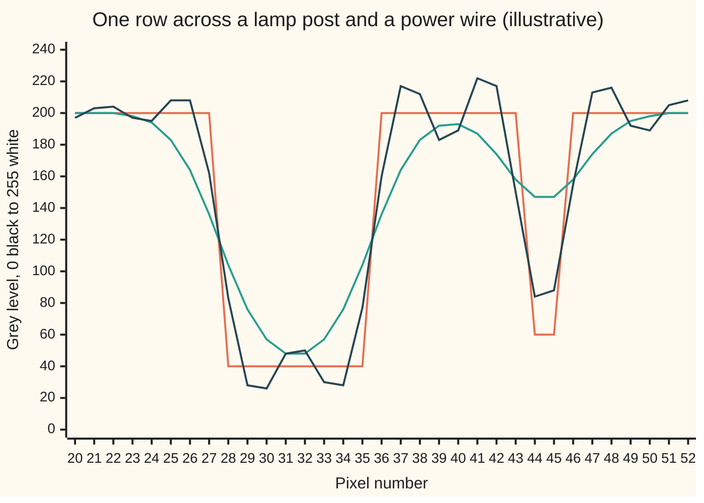
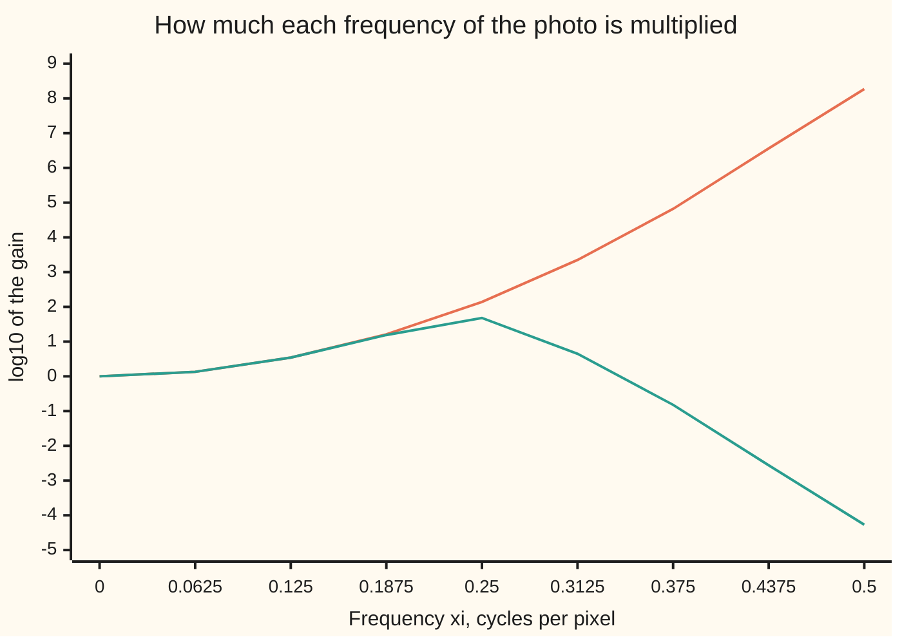

# Blurring and unblurring: why a blur is easy and undoing it is not

[Syllabus](../../../SYLLABUS.md) → [Harmonic analysis](../README.md) → [Convolution and Approximate Identities](../README.md#s03) → Blurring and unblurring

---

## General Overview

A phone photo of a street at dusk. The shutter stays open for 1/15 of a second and the hand shakes. A distant street light, a single point of light, comes out as a smudge. Real shake drags a point into a short streak. This card models the smudge as a round bell with a standard deviation of 2 pixels: a model, chosen because its effect on each stripe frequency has a simple formula.

Every point in the picture is spread the same way. Take one row of 64 pixels across a lamp post and a power wire, against the sky. The post and the wire run straight up and down, so the rows just above and below match this one. The bell also spreads light up and down, but there it only mixes identical rows, so this row is blurred by a bell along the row alone. Grey levels run from 0 (black) to 255 (white). The sky is 200, the post is 40 and 8 pixels wide, the wire is 60 and 2 pixels wide. In the photo the wire is only a faint dip to 147. The numbers are illustrative, from a stated formula, not a real file.

Blurring is easy: each pixel becomes a weighted average of its neighbours. Undoing it looks easy too. Any row is a sum of waves, light and dark stripes of different spacings; a stripe's frequency is its number of light-dark cycles per pixel, so stripes 4 pixels apart have frequency 1/4.

The blur multiplied each stripe frequency in the row by a known factor, so divide each one back out. On exact numbers that works: the error is under 0.0001 grey levels. On the stored photo, which keeps only whole grey levels, the same division gives pixels from −7,302,881 to 7,250,198.

The repair is **damping**: divide where the blur's factor is large, and give up gently where it is tiny. With the right amount of damping the wire comes back to 83.8, and the typical error (its root mean square, defined below) falls from 26.04 to 15.53 grey levels. That is the photo **sharpened**. With too little damping it is **over-sharpened**: bright and dark halos, and pixels from −181.7 to 509.9, which no screen can show.

**A blur multiplies each frequency by a factor that falls towards zero, so dividing it back out multiplies the tiny rounding noise at those frequencies by factors with no ceiling; damping caps the gain at a level you choose, trading a little blur for a stable picture.**

**What kind of fact this is:** two theorems, proved on this card in Why it works: plain division multiplies noise by a factor with no upper limit, and damping by $`\lambda`$ caps that factor at $`1/(2\sqrt{\lambda})`$. Choosing $`\lambda`$ is a method, a judgement about noise, not a law.

### The picture: the row, the photo and the repair



Orange: the true row. Green: the photo, blurred and rounded to whole grey levels. Dark blue: the photo sharpened with damping $`\lambda = 10^{-4}`$. The repair steepens the edges and deepens the wire, and leaves small ripples beside each edge. The code prints every point.

---

## The formula

A short reminder of what the shelf has set up. The **convolution** $`h * f`$ slides the kernel $`h`$ across the row $`f`$ and adds up the weighted overlap ([Convolution](01-convolution-and-youngs-inequality.md)). The hat is the Fourier transform, $`\hat f(\xi) = \int f(t)\, e^{-2\pi i \xi t}\, dt`$, with the frequency $`\xi`$ in cycles per pixel. The convolution theorem turns a blur into a multiplication, frequency by frequency ([The convolution theorem](02-convolution-theorem-and-impulse-response.md)).

The photo is the blurred row plus a small error $`e`$. This $`e`$ is not Euler's number, the base of the exponential in the bell's factor below:

```math
y = h * f + e \qquad\Longrightarrow\qquad \hat y(\xi) = \hat h(\xi)\, \hat f(\xi) + \hat e(\xi)
```

For a bell-shaped blur of standard deviation $`\sigma`$ the blur's factor is itself a bell ([The Gaussian and Poisson kernels](04-gaussian-and-poisson-kernels.md)):

```math
\hat h(\xi) = e^{-2\pi^2 \sigma^2 \xi^2}
```

This card introduces two pieces of notation. The **damping** $`\lambda`$ (lambda) is a small positive number you choose. The **estimate** of the true row is $`\tilde f`$ ("f tilde"). The hat is taken, so an estimate wears a tilde. The damped estimate is, at each frequency:

```math
\widehat{\tilde f}(\xi) = \frac{\overline{\hat h(\xi)}\; \hat y(\xi)}{|\hat h(\xi)|^2 + \lambda}
```

**Read it aloud:** at each frequency, take the photo's strength, multiply by the blur's factor, and divide by that factor squared plus the damping.

When $`\lambda = 0`$ this is plain division, $`\hat y / \hat h`$. The bar is the complex conjugate; for this bell the factor is real and positive, so the bar changes nothing here.

| Symbol | Plain meaning | In our example | Push it up and the answer… |
| --- | --- | --- | --- |
| $`f`$ | the true row: the grey level at each pixel | sky 200, post 40, wire 60 | — |
| $`h`$ | the kernel: how the shake spreads one point of light, area 1 | a bell over neighbouring pixels | — |
| $`\sigma`$ | the kernel's standard deviation (full width at half maximum $`2.355\sigma`$) | 2 pixels; full width at half maximum 4.71 pixels | the blur widens and undoing it gets harder |
| $`e`$ | the error in the stored photo | rounding, at most 0.481, rms 0.169 | the repair gets noisier |
| $`y`$ | the photo: the blurred row plus the error | the wire's dip at 147 | — |
| $`\xi`$, $`k`$ | frequency, in cycles per pixel; $`\xi = 1/2`$ is the finest, stripes 2 pixels apart; $`k`$ counts frequencies, $`\xi = k/64`$ | 0 to 1/2 in 64ths | finer stripes |
| $`\hat h(\xi)`$ | the blur's factor: what fraction of stripe $`\xi`$ survives | 0.007192 at $`\xi = 1/4`$ | — |
| $`\hat f, \hat y, \hat e`$ | the transforms of the row, the photo and the error | — | — |
| $`\lambda`$ | the damping you choose | $`10^{-4}`$ | more blur left in, less noise |
| $`\tilde f`$ | the estimate of the true row | rms error 15.53 | — |
| $`\kappa t`$ | heat flow's diffusivity $`\kappa`$ times its time $`t`$; a bell blur is heat flow with $`\sigma^2 = 2\kappa t`$ | 2 square pixels | a wider blur |
| $`G`$, $`I`$ | the blur written as a 64 by 64 matrix, and the identity matrix | used by road 2 in the code | — |

The **rms error** (root mean square) of a row is the square root of the average squared gap from the true row, in grey levels.

The row is 64 pixels long and treated as wrapping around, so the transform is the length-64 discrete Fourier transform, a finite sum at $`\xi = k/64`$ for $`k = 0`$ to $`63`$ ([Digital filters](../../13-Engineering%20mathematics/05-Signals/04-digital-filters-fir-and-iir.md) uses the same finite form). It matches the bell formula up to aliasing, printed in Step 1.

### When it holds

- **The blur is the same at every pixel.** Then it is a convolution. A shake that turns the camera blurs the corners more than the centre, and one division cannot undo it.
- **The kernel is known.** A street light in the frame shows it. Guess $`\sigma = 2.5`$ pixels when it was 2, and the rms error rises to 37.09, worse than the photo's 26.04.
- **The damping is positive.** At $`\lambda = 0`$ the rms error is 4,522,181 grey levels.
- **The row wraps around.** The finite transform makes pixel 63 the neighbour of pixel 0. Both ends here are sky, so this costs nothing; a real photo's edges are padded first.

---

## Why it works

### Step 0: the idea: division undoes the blur and multiplies the noise

A blur keeps each stripe frequency and scales it by $`\hat h(\xi)`$. Dividing by $`\hat h(\xi)`$ restores the stripe exactly. But the photo also holds the error $`e`$, and division scales that by $`1/\hat h(\xi)`$ too:

```math
\frac{\hat y(\xi)}{\hat h(\xi)} = \hat f(\xi) + \frac{\hat e(\xi)}{\hat h(\xi)}
```

The rounding error has no preferred frequency: it spreads evenly across all of them. At the finest stripes almost nothing of the picture survives the blur, but the error is as large there as anywhere. Division there magnifies error, not picture.

### Step 1: a bell-shaped blur kills fine stripes very fast

The bell's factor $`e^{-2\pi^2\sigma^2\xi^2}`$ falls like a bell in $`\xi`$. With $`\sigma = 2`$ pixels:

| Frequency $`\xi`$ | Stripe spacing | Factor kept, $`\hat h(\xi)`$ |
| --- | --- | --- |
| 1/16 | 16 pixels | 0.7346 |
| 1/8 | 8 pixels | 0.2912 |
| 1/4 | 4 pixels | 0.007192 |
| 3/8 | 2.7 pixels | 0.00001506 |
| 1/2 | 2 pixels | $`2.675 \times 10^{-9}`$ ($`5.351 \times 10^{-9}`$ on the pixel grid, see below) |

At $`\xi = 1/4`$ the finite transform and the bell formula agree to under $`10^{-15}`$. At $`\xi = 1/2`$ the finite transform is $`5.351 \times 10^{-9}`$, twice the formula's $`2.675 \times 10^{-9}`$. That is aliasing: on whole pixels, the frequency $`-1/2`$ looks the same as $`+1/2`$, so its copy adds $`2.675 \times 10^{-9}`$ more. With it, the gap is under $`10^{-15}`$.

A bell-shaped blur is also heat flow. Heat spreading for a time $`t`$ with diffusivity $`\kappa`$ blurs by a bell with $`\sigma^2 = 2\kappa t`$, here $`\kappa t = 2`$ square pixels. So unblurring is running heat backwards, which [Well posed](../../19-Partial%20differential%20equations/01-Classification%20and%20Well-Posedness/06-well-posedness-and-hadamard.md) shows magnifies small errors without bound. This card shows the same failure one frequency at a time, and the cure.

### Step 2: plain division has no ceiling

Plain division multiplies the error at $`\xi`$ by

```math
\frac{1}{\hat h(\xi)} = e^{2\pi^2\sigma^2\xi^2}
```

which grows without limit as $`\xi`$ grows. On the 64-pixel row the worst factor is $`1/(5.351 \times 10^{-9}) = 1.869 \times 10^8`$. On a finer grid the frequencies go higher, and the factor is larger still.

How big is the damage? Parseval's identity says the rms of a row equals the rms of its transform, suitably scaled. So the rms error of plain division is the rms of $`\hat e/\hat h`$ over the 64 frequencies: 4,522,181 grey levels, the same number the pixels give directly. The largest single term is at $`k = 31`$, where error of strength 0.0307 is divided by $`9.776 \times 10^{-9}`$.

Without rounding the same division recovers the row to under 0.0001 grey levels. The division is right; the noise is what breaks it.

### Step 3: damping is the best compromise at each frequency

At one frequency, look for the number $`a`$ that does two things at once. Blurred, it should match the photo, so $`|\hat h a - \hat y|^2`$ should be small. And it should stay modest, so $`\lambda |a|^2`$ should be small. Minimise the sum:

```math
|\hat h\, a - \hat y|^2 + \lambda\, |a|^2 \quad\text{is least at}\quad a = \frac{\overline{\hat h}\, \hat y}{|\hat h|^2 + \lambda}
```

That is the damped estimate. Where $`|\hat h|^2`$ is much bigger than $`\lambda`$, it is plain division. Where it is much smaller, the answer shrinks towards 0: the frequency is given up, not amplified.

By Parseval again, doing this at every frequency minimises the whole-row sum: the squared mismatch between the blurred estimate and the photo, plus $`\lambda`$ times the estimate's squared size. This is **Tikhonov damping** (also called Tikhonov regularisation).

<details>
<summary>Detailed proof: the per-frequency minimum</summary>

Write $`H = \hat h(\xi)`$, $`Y = \hat y(\xi)`$, and $`D = |H|^2 + \lambda > 0`$. Put $`a^* = \overline{H} Y / D`$. Expand both squares and collect the terms in $`a`$:

$`\displaystyle |Ha - Y|^2 + \lambda |a|^2 = D\,|a|^2 - 2\,\mathrm{Re}\big(a\, H\, \overline{Y}\big) + |Y|^2 = D\,|a - a^*|^2 + |Y|^2 - \frac{|H|^2 |Y|^2}{D}.`$

To check the last step, expand $`D |a - a^*|^2 = D|a|^2 - 2\,\mathrm{Re}(a\, D\, \overline{a^*}) + D|a^*|^2`$. Here $`D\,\overline{a^*} = H \overline{Y}`$ and $`D |a^*|^2 = |H|^2 |Y|^2 / D`$.

Only the first term depends on $`a`$, and it is never negative. It is zero exactly at $`a = a^*`$. So $`a^*`$ is the unique minimum.

For the whole row: the sum over pixels of the squared mismatch, plus $`\lambda`$ times the sum of $`\tilde f^2`$, equals $`1/64`$ times the same sum over the 64 frequencies (Parseval). Each frequency's term depends only on that frequency's $`a`$, so minimising each one minimises the total.

</details>

### Step 4: damping caps the gain at $`1/(2\sqrt{\lambda})`$

The **gain** at a frequency is how much the estimate multiplies the photo there. For this real, positive blur it is $`\hat h/(\hat h^2 + \lambda)`$. Since $`(\hat h - \sqrt{\lambda})^2 \ge 0`$,

```math
\hat h^2 + \lambda \;\ge\; 2\sqrt{\lambda}\,\hat h \qquad\Longrightarrow\qquad \frac{\hat h}{\hat h^2 + \lambda} \;\le\; \frac{1}{2\sqrt{\lambda}}
```

with equality only where $`\hat h = \sqrt{\lambda}`$. At $`\lambda = 10^{-4}`$ the cap is 50; the largest gain over the 64 frequencies is 48.26. At $`\lambda = 10^{-8}`$ the cap is 5000 and the largest gain is 4964.50. Plain division's worst gain, $`1.869 \times 10^8`$, has no cap.



Orange: plain division, a gain of $`10^{8.27}`$ at the finest stripes. Green: damping $`\lambda = 10^{-4}`$. The two agree on coarse stripes, then the damped gain peaks near 50 and falls away.

### Step 5: choosing the damping

Large $`\lambda`$ leaves blur in; small $`\lambda`$ lets noise through. For one photo, $`\lambda`$ is chosen by trying values, as below. When the strengths of picture and noise at each frequency are known, the Wiener filter ([Wiener and LMS](../../13-Engineering%20mathematics/05-Signals/07-adaptive-and-optimal-filters.md)) sets $`\lambda`$ from their ratio.

---

## Worked numbers, by hand

The photo's row, damping $`\lambda = 10^{-4}`$, read at two frequencies.

| Step | Arithmetic | Value |
| --- | --- | --- |
| Blur factor at $`\xi = 1/4`$ | $`e^{-2\pi^2 \times 4 \times 1/16} = e^{-\pi^2/2} = e^{-4.935}`$ | 0.007192 |
| Plain gain there | $`1/0.007192`$ | 139.0 |
| Damped gain there | $`0.007192/(0.007192^2 + 0.0001) = 0.007192/0.0001517`$ | 47.40 |
| Blur factor at $`\xi = 1/2`$, on the pixel grid | $`2 \times e^{-2\pi^2} = 2 \times 2.675 \times 10^{-9}`$ | $`5.351 \times 10^{-9}`$ |
| Plain gain there | $`1/(5.351 \times 10^{-9})`$ | $`1.869 \times 10^8`$ |
| Damped gain there | $`5.351 \times 10^{-9}/0.0001`$ | $`5.351 \times 10^{-5}`$ |
| The cap on any damped gain | $`1/(2\sqrt{0.0001}) = 1/0.02`$ | 50 |
| rms error, photo as taken | from the code | 26.04 |
| rms error, sharpened | from the code | **15.53** |

Damping boosts 4-pixel stripes 47 times, sharpening the edges, and turns 2-pixel stripes almost off. The rms error falls by two fifths; the wire's centre moves from 147 to 83.8, against a true 60.

The code tries ten values of the damping:

| Damping $`\lambda`$ | rms error | Darkest | Brightest | Mean |
| --- | ---: | ---: | ---: | ---: |
| none: the photo | 26.04 | 48.0 | 200.0 | 175.59 |
| $`10^{-1}`$ | 29.33 | 25.2 | 192.3 | 159.63 |
| $`10^{-2}`$ | 20.46 | 28.6 | 210.7 | 173.86 |
| $`10^{-3}`$ | 16.39 | 28.9 | 217.2 | 175.42 |
| $`10^{-4}`$ | **15.53** | 26.5 | 221.8 | 175.58 |
| $`10^{-5}`$ | 17.08 | 22.8 | 229.1 | 175.59 |
| $`10^{-6}`$ | 26.08 | 10.2 | 253.6 | 175.59 |
| $`10^{-7}`$ | 49.22 | −7.7 | 320.2 | 175.59 |
| $`10^{-8}`$ | 142.02 | −181.7 | 509.9 | 175.59 |
| $`10^{-9}`$ | 470.36 | −881.4 | 1317.9 | 175.59 |
| $`10^{-10}`$ | 1577.35 | −3425.3 | 3809.6 | 175.59 |

The same rms errors as bars, each `#` worth 2 grey levels, cut at 60:

```
lam 1e-1  ###############                 29.33
lam 1e-2  ##########                      20.46
lam 1e-3  ########                        16.39
lam 1e-4  ########                        15.53
lam 1e-5  #########                       17.08
lam 1e-6  #############                   26.08
lam 1e-7  #########################       49.22
lam 1e-8  ##############################> 142.02
photo     #############                   26.04
```

From $`10^{-4}`$ down, every tenfold cut in $`\lambda`$ raises the cap on the gain by $`\sqrt{10}`$, about threefold. The error grows more slowly at first; from $`10^{-7}`$ down it too grows about threefold per step.

### What breaks if you drop a piece

| Mistake | Comes out at | What went wrong |
| --- | --- | --- |
| No damping, $`\lambda = 0`$ | rms 4,522,181; pixels −7,302,881 to 7,250,198 | rounding error at fine stripes divided by factors near $`10^{-8}`$ |
| Too little damping, $`\lambda = 10^{-8}`$ | rms 142.02; pixels −181.7 to 509.9 | over-sharpened: the gain cap is 5000, and the noise shows as halos |
| Too much damping, $`\lambda = 0.1`$ | rms 29.33, worse than the photo; mean 159.63 against 175.59 | the gain at $`\xi = 0`$ is $`1/1.1`$, so the whole picture dims by 9% |
| The shake guessed as $`\sigma = 2.5`$ pixels | rms 37.09; pixels −50 to 289 | dividing out blur that was never there rings like over-sharpening |

The code prints all four.

---

## Code, from first principles, and it actually runs

The code builds the row, the bell-shaped kernel and the rounded photo. Road 1 works frequency by frequency: a discrete Fourier transform written out as a sum, plain division, then damping at ten values of $`\lambda`$. Road 2 works pixel by pixel: it writes the blur as a 64 by 64 matrix $`G`$ and solves the damped equations $`(G^{\mathsf T} G + \lambda I)\,x = G^{\mathsf T} y`$ by elimination, where $`G^{\mathsf T}`$ is the matrix flipped across its diagonal and $`I`$ the identity. The two roads agree to under $`10^{-6}`$. Three more checks are independent: the finite transform against the bell formula, Parseval against the pixel rms, and the gain cap against every frequency.

### Python

```python
# Blurring and unblurring -- the check behind the card.  Standard library only.
# One 64-pixel row of a shaken photo: sky 200, lamp post 40, power wire 60.  The
# shake spreads each point into a bell of standard deviation 2 pixels.  The photo
# is stored as whole grey levels.  Road 1 divides frequency by frequency, with
# and without damping; road 2 solves the same equations pixel by pixel.
import math
N, SIG = 64, 2.0
f = [200.0] * N                                  # the true row, illustrative
for k in range(28, 36): f[k] = 40.0              # lamp post, 8 pixels wide
for k in (44, 45): f[k] = 60.0                   # power wire, 2 pixels wide
def tot(xs):                                     # plain left-to-right sum, as in Rust
    s = 0.0
    for v in xs: s += v
    return s
w = [math.exp(-min(n, N - n) ** 2 / (2 * SIG * SIG)) for n in range(N)]
h = [v / tot(w) for v in w]                      # bell-shaped kernel, area 1
C = [math.cos(2 * math.pi * m / N) for m in range(N)]
S = [math.sin(2 * math.pi * m / N) for m in range(N)]
def dft(x):                                      # written out: X[k] = sum x[n] e^(-2 pi i k n / N)
    return [complex(tot(x[n].real * C[k * n % N] + x[n].imag * S[k * n % N] for n in range(N)),
                    tot(x[n].imag * C[k * n % N] - x[n].real * S[k * n % N] for n in range(N))) for k in range(N)]
def idft(X): return [v.real / N for v in dft([z.conjugate() for z in X])]
def conv(a, b): return [tot(a[m] * b[(k - m) % N] for m in range(N)) for k in range(N)]
def rms(a): return math.sqrt(tot((a[i] - f[i]) ** 2 for i in range(N)) / N)
def under(x, b): return f"under {b}" if x < float(b) else sci(x)
def fx(x): return f"{x + 0.0:.2f}" if abs(x) >= 0.005 else "0.00"
def sci(x):
    e = math.floor(math.log10(abs(x))); m = f"{x / 10.0 ** e:.3f}"
    return m + f"e{e}" if abs(float(m)) < 10 else f"{x / 10.0 ** (e + 1):.3f}e{e + 1}"
blur = conv(f, h)                                # the lens and the shake
y = [float(round(v)) for v in blur]              # the photo: whole grey levels
H, Y = dft([complex(v) for v in h]), dft([complex(v) for v in y])
def damped(Yk, Hk, lam):                         # f-tilde = conj(h-hat) y-hat / (|h-hat|^2 + lam)
    d = [Hk[k].real * Hk[k].real + Hk[k].imag * Hk[k].imag + lam for k in range(N)]
    return idft([complex((Hk[k].real * Yk[k].real + Hk[k].imag * Yk[k].imag) / d[k],
                         (Hk[k].real * Yk[k].imag - Hk[k].imag * Yk[k].real) / d[k]) for k in range(N)])
print(f"kernel: area {tot(h):.6f}, sd {SIG} px, full width at half maximum {2 * math.sqrt(2 * math.log(2)):.3f} sd = {2 * math.sqrt(2 * math.log(2)) * SIG:.2f} px")
ks = list(range(0, 33, 4))
print("chart, xi = k/64 at k = 0, 4, ..., 32:", ", ".join(f"{k / N:.4f}" for k in ks))
print("h-hat by the DFT:", ", ".join(sci(H[k].real) for k in ks))
gauss = lambda xi: math.exp(-2.0 * math.pi * math.pi * SIG * SIG * xi * xi)
print("h-hat closed form exp(-2 pi^2 sd^2 xi^2):", ", ".join(sci(gauss(k / N)) for k in ks))
gq, gn = abs(H[16].real - gauss(0.25)), abs(H[32].real - gauss(0.5) - gauss(-0.5))
print(f"gap at xi = 1/4: {under(gq, '1e-15')}; at xi = 1/2 the DFT is {sci(H[32].real)}, twice the closed form:"
      f" the alias at -1/2 adds {sci(gauss(-0.5))}, gap {under(gn, '1e-15')}")
noise = [y[i] - blur[i] for i in range(N)]
print(f"photo: rounding error, largest {max(abs(v) for v in noise):.3f}, rms {math.sqrt(tot(v * v for v in noise) / N):.3f} grey levels")
print("chart, pixels 20 to 52, true:", ", ".join(f"{v:.0f}" for v in f[20:53]))
print("chart, the photo:", ", ".join(f"{v:.0f}" for v in y[20:53]))
B = dft([complex(v) for v in blur])
exact = damped(B, H, 0.0)
naive = damped(Y, H, 0.0)
print(f"plain division, unrounded blur: rms error {under(rms(exact), '0.0001')} grey levels")
print(f"plain division, the photo: rms error {rms(naive):.0f}, pixels from {min(naive):.0f} to {max(naive):.0f}")
E = dft([complex(v) for v in noise])
sq = lambda z: z.real * z.real + z.imag * z.imag
pars = math.sqrt(tot(sq(E[k]) / sq(H[k]) for k in range(N)) / N / N)
top = max(range(N // 2 + 1), key=lambda k: sq(E[k]) / sq(H[k]))
print(f"Parseval: rms of noise / h-hat over all 64 frequencies {pars:.0f}; largest term k = {top}, where noise {math.sqrt(sq(E[top])) / N:.4f} / h-hat {sci(H[top].real)}")
print(f"{'damping lam':>12}{'rms error':>11}{'darkest':>9}{'brightest':>10}{'mean':>8}")
print(f"{'no repair':>12}{rms(y):>11.2f}{min(y):>9.1f}{max(y):>10.1f}{tot(y) / N:>8.2f}")
sweep = {}
for e in range(1, 11):
    est = damped(Y, H, 10.0 ** -e); sweep[e] = rms(est)
    print(f"{'1e-' + str(e):>12}{sweep[e]:>11.2f}{min(est):>9.1f}{max(est):>10.1f}{tot(est) / N:>8.2f}")
best = min(sweep, key=sweep.get)
sharp, over = damped(Y, H, 1e-4), damped(Y, H, 1e-8)
print(f"best of the ten: lam = 1e-{best}; wire pixel 44 at {sharp[44]:.1f} (photo {y[44]:.0f}, true 60)")
print("chart, sharpened at lam = 1e-4:", ", ".join(f"{v:.0f}" for v in sharp[20:53]))
print("chart, log10 gain, plain division:", ", ".join(fx(-math.log10(H[k].real)) for k in ks))
gd = lambda k, lam: H[k].real / (H[k].real ** 2 + lam)
print("chart, log10 gain, lam = 1e-4:", ", ".join(fx(math.log10(gd(k, 1e-4))) for k in ks))
print(f"gain at xi = 1/4: plain {1 / H[16].real:.1f}, damped {gd(16, 1e-4):.2f}; at xi = 1/2: plain {sci(1 / H[32].real)}, damped {sci(gd(32, 1e-4))}")
for lam in (1e-4, 1e-8):
    print(f"lam = {sci(lam)}: largest gain over all 64 frequencies {max(gd(k, lam) for k in range(N)):.2f}, bound 1/(2 sqrt(lam)) {1 / (2 * math.sqrt(lam)):.2f}")
def solve(A, b):                                  # Gaussian elimination, partial pivoting
    A = [row[:] + [b[i]] for i, row in enumerate(A)]
    for c in range(N):
        p = max(range(c, N), key=lambda r: abs(A[r][c])); A[c], A[p] = A[p], A[c]
        for r in range(c + 1, N):
            q = A[r][c] / A[c][c]
            A[r] = [A[r][j] - q * A[c][j] for j in range(N + 1)]
    x = [0.0] * N
    for r in range(N - 1, -1, -1):
        x[r] = (A[r][N] - tot(A[r][j] * x[j] for j in range(r + 1, N))) / A[r][r]
    return x
G = [[h[(i - j) % N] for j in range(N)] for i in range(N)]       # the blur as a matrix
GG = [[tot(G[k][i] * G[k][j] for k in range(N)) for j in range(N)] for i in range(N)]
Gy = [tot(G[k][i] * y[k] for k in range(N)) for i in range(N)]
xs = solve([[GG[i][j] + (1e-4 if i == j else 0.0) for j in range(N)] for i in range(N)], Gy)
gap = max(abs(xs[i] - sharp[i]) for i in range(N))
print(f"road 2, (G^T G + lam I) x = G^T y by elimination at lam = 1e-4: largest gap to road 1 {under(gap, '1e-6')}")
res = max(abs(v) for v in [conv(naive, h)[i] - y[i] for i in range(N)])
print(f"plain-division row blurred again: largest gap to the photo {under(res, '1e-6')} grey levels")
h25 = [math.exp(-min(n, N - n) ** 2 / (2 * 2.5 ** 2)) for n in range(N)]
wrong = damped(Y, dft([complex(v / tot(h25)) for v in h25]), 1e-4)
print(f"mistake, shake guessed as sd 2.5 px: rms {rms(wrong):.2f}, pixels from {min(wrong):.0f} to {max(wrong):.0f}")
print(f"heat: sd 2 px is heat flow for kappa t = sd^2 / 2 = {SIG ** 2 / 2:.0f} px^2")
assert abs(H[16].real - gauss(0.25)) < 1e-12 and abs(H[32].real - 2 * gauss(0.5)) < 1e-15
assert rms(exact) < 1e-3 and rms(naive) > 1e6 and abs(pars - rms(naive)) < 1e-6 * pars
assert best == 4 and sweep[4] < rms(y) < sweep[1] and sweep[8] > 5 * sweep[4]
assert all(gd(k, lam) <= 1 / (2 * math.sqrt(lam)) for lam in (1e-4, 1e-8) for k in range(N))
assert gap < 1e-6 and res < 1e-3 and rms(wrong) > sweep[4]
print("ALL CHECKS PASS")
```

**Ran 2026-11-15 on macOS, Python 3.14.10, standard library only. All checks passed. Output, pasted from the run:**

```
kernel: area 1.000000, sd 2.0 px, full width at half maximum 2.355 sd = 4.71 px
chart, xi = k/64 at k = 0, 4, ..., 32: 0.0000, 0.0625, 0.1250, 0.1875, 0.2500, 0.3125, 0.3750, 0.4375, 0.5000
h-hat by the DFT: 1.000e0, 7.346e-1, 2.912e-1, 6.230e-2, 7.192e-3, 4.480e-4, 1.506e-5, 2.733e-7, 5.351e-9
h-hat closed form exp(-2 pi^2 sd^2 xi^2): 1.000e0, 7.346e-1, 2.912e-1, 6.230e-2, 7.192e-3, 4.480e-4, 1.506e-5, 2.733e-7, 2.675e-9
gap at xi = 1/4: under 1e-15; at xi = 1/2 the DFT is 5.351e-9, twice the closed form: the alias at -1/2 adds 2.675e-9, gap under 1e-15
photo: rounding error, largest 0.481, rms 0.169 grey levels
chart, pixels 20 to 52, true: 200, 200, 200, 200, 200, 200, 200, 200, 40, 40, 40, 40, 40, 40, 40, 40, 200, 200, 200, 200, 200, 200, 200, 200, 60, 60, 200, 200, 200, 200, 200, 200, 200
chart, the photo: 200, 200, 200, 198, 194, 183, 164, 136, 104, 76, 57, 48, 48, 57, 76, 104, 136, 164, 183, 192, 193, 187, 174, 158, 147, 147, 158, 174, 187, 195, 198, 200, 200
plain division, unrounded blur: rms error under 0.0001 grey levels
plain division, the photo: rms error 4522181, pixels from -7302881 to 7250198
Parseval: rms of noise / h-hat over all 64 frequencies 4522181; largest term k = 31, where noise 0.0307 / h-hat 9.776e-9
 damping lam  rms error  darkest brightest    mean
   no repair      26.04     48.0     200.0  175.59
        1e-1      29.33     25.2     192.3  159.63
        1e-2      20.46     28.6     210.7  173.86
        1e-3      16.39     28.9     217.2  175.42
        1e-4      15.53     26.5     221.8  175.58
        1e-5      17.08     22.8     229.1  175.59
        1e-6      26.08     10.2     253.6  175.59
        1e-7      49.22     -7.7     320.2  175.59
        1e-8     142.02   -181.7     509.9  175.59
        1e-9     470.36   -881.4    1317.9  175.59
       1e-10    1577.35  -3425.3    3809.6  175.59
best of the ten: lam = 1e-4; wire pixel 44 at 83.8 (photo 147, true 60)
chart, sharpened at lam = 1e-4: 197, 203, 204, 197, 195, 208, 208, 162, 83, 28, 26, 48, 50, 30, 28, 77, 160, 217, 212, 183, 189, 222, 217, 150, 84, 88, 155, 213, 216, 192, 189, 205, 208
chart, log10 gain, plain division: 0.00, 0.13, 0.54, 1.21, 2.14, 3.35, 4.82, 6.56, 8.27
chart, log10 gain, lam = 1e-4: 0.00, 0.13, 0.54, 1.19, 1.68, 0.65, -0.82, -2.56, -4.27
gain at xi = 1/4: plain 139.0, damped 47.40; at xi = 1/2: plain 1.869e8, damped 5.351e-5
lam = 1.000e-4: largest gain over all 64 frequencies 48.26, bound 1/(2 sqrt(lam)) 50.00
lam = 1.000e-8: largest gain over all 64 frequencies 4964.50, bound 1/(2 sqrt(lam)) 5000.00
road 2, (G^T G + lam I) x = G^T y by elimination at lam = 1e-4: largest gap to road 1 under 1e-6
plain-division row blurred again: largest gap to the photo under 1e-6 grey levels
mistake, shake guessed as sd 2.5 px: rms 37.09, pixels from -50 to 289
heat: sd 2 px is heat flow for kappa t = sd^2 / 2 = 2 px^2
ALL CHECKS PASS
```

### Rust

Same numbers, same labels, built with `rustc --edition 2021 -O`. A complex number is a small struct.

```rust
// Blurring and unblurring -- the same check as the Python, in Rust.  No crates.
// One 64-pixel row of a shaken photo: sky 200, lamp post 40, power wire 60.  The
// shake spreads each point into a bell of standard deviation 2 pixels.  The photo
// is stored as whole grey levels.  Road 1 divides frequency by frequency, with
// and without damping; road 2 solves the same equations pixel by pixel.
use std::f64::consts::PI;
const N: usize = 64;
const SIG: f64 = 2.0;
#[derive(Clone, Copy)]
struct Cx { re: f64, im: f64 }                   // a complex number
fn tot(xs: &[f64]) -> f64 { let mut s = 0.0; for v in xs { s += *v; } s }
fn kernel(sd: f64) -> Vec<f64> {
    let w: Vec<f64> = (0..N).map(|n| { let d = n.min(N - n) as f64; (-(d * d) / (2.0 * sd * sd)).exp() }).collect();
    let t = tot(&w); w.iter().map(|v| v / t).collect()
}
struct Tw { c: Vec<f64>, s: Vec<f64> }
impl Tw {
    fn dft(&self, x: &[Cx]) -> Vec<Cx> {         // X[k] = sum x[n] e^(-2 pi i k n / N)
        (0..N).map(|k| {
            let re: Vec<f64> = (0..N).map(|n| x[n].re * self.c[k * n % N] + x[n].im * self.s[k * n % N]).collect();
            let im: Vec<f64> = (0..N).map(|n| x[n].im * self.c[k * n % N] - x[n].re * self.s[k * n % N]).collect();
            Cx { re: tot(&re), im: tot(&im) } }).collect()
    }
    fn idft(&self, x: &[Cx]) -> Vec<f64> {
        let c: Vec<Cx> = x.iter().map(|z| Cx { re: z.re, im: -z.im }).collect();
        self.dft(&c).iter().map(|z| z.re / N as f64).collect()
    }
    fn damped(&self, y: &[Cx], h: &[Cx], lam: f64) -> Vec<f64> {   // conj(h-hat) y-hat / (|h-hat|^2 + lam)
        let q: Vec<Cx> = (0..N).map(|k| { let d = h[k].re * h[k].re + h[k].im * h[k].im + lam;
            Cx { re: (h[k].re * y[k].re + h[k].im * y[k].im) / d, im: (h[k].re * y[k].im - h[k].im * y[k].re) / d } }).collect();
        self.idft(&q)
    }
}
fn cx(v: &[f64]) -> Vec<Cx> { v.iter().map(|&r| Cx { re: r, im: 0.0 }).collect() }
fn conv(a: &[f64], b: &[f64]) -> Vec<f64> {
    (0..N).map(|k| { let t: Vec<f64> = (0..N).map(|m| a[m] * b[(k + N - m) % N]).collect(); tot(&t) }).collect()
}
fn sci(x: f64) -> String {
    let e = x.abs().log10().floor() as i32;
    let m = format!("{:.3}", x / 10f64.powf(e as f64));
    if m.parse::<f64>().unwrap().abs() < 10.0 { format!("{}e{}", m, e) } else { format!("{:.3}e{}", x / 10f64.powf((e + 1) as f64), e + 1) }
}
fn under(x: f64, b: &str) -> String { if x < b.parse::<f64>().unwrap() { format!("under {}", b) } else { sci(x) } }
fn fx(x: f64) -> String { if x.abs() >= 0.005 { format!("{:.2}", x + 0.0) } else { "0.00".to_string() } }
fn join(v: &[String]) -> String { v.join(", ") }
fn mn(v: &[f64]) -> f64 { v.iter().cloned().fold(f64::INFINITY, f64::min) }
fn mx(v: &[f64]) -> f64 { v.iter().cloned().fold(f64::NEG_INFINITY, f64::max) }
fn solve(a: &[Vec<f64>], b: &[f64]) -> Vec<f64> {      // Gaussian elimination, partial pivoting
    let mut a: Vec<Vec<f64>> = a.iter().enumerate().map(|(i, r)| { let mut r = r.clone(); r.push(b[i]); r }).collect();
    for c in 0..N {
        let mut p = c;
        for r in c..N { if a[r][c].abs() > a[p][c].abs() { p = r; } }
        a.swap(c, p);
        for r in c + 1..N { let q = a[r][c] / a[c][c]; for j in 0..=N { a[r][j] = a[r][j] - q * a[c][j]; } }
    }
    let mut x = vec![0.0; N];
    for r in (0..N).rev() { let t: Vec<f64> = (r + 1..N).map(|j| a[r][j] * x[j]).collect(); x[r] = (a[r][N] - tot(&t)) / a[r][r]; }
    x
}
fn main() {
    let mut f = vec![200.0; N];                      // the true row, illustrative
    for k in 28..36 { f[k] = 40.0; }                 // lamp post, 8 pixels wide
    for k in [44, 45] { f[k] = 60.0; }               // power wire, 2 pixels wide
    let rms = |a: &[f64]| { let t: Vec<f64> = (0..N).map(|i| (a[i] - f[i]) * (a[i] - f[i])).collect(); (tot(&t) / N as f64).sqrt() };
    let h = kernel(SIG);
    let tw = Tw { c: (0..N).map(|m| (2.0 * PI * m as f64 / N as f64).cos()).collect(), s: (0..N).map(|m| (2.0 * PI * m as f64 / N as f64).sin()).collect() };
    let blur = conv(&f, &h);
    let y: Vec<f64> = blur.iter().map(|v| v.round_ties_even()).collect();
    let (hh, yh) = (tw.dft(&cx(&h)), tw.dft(&cx(&y)));
    println!("kernel: area {:.6}, sd {:.1} px, full width at half maximum {:.3} sd = {:.2} px", tot(&h), SIG, 2.0 * (2.0 * 2f64.ln()).sqrt(), 2.0 * (2.0 * 2f64.ln()).sqrt() * SIG);
    let ks: Vec<usize> = (0..33).step_by(4).collect();
    println!("chart, xi = k/64 at k = 0, 4, ..., 32: {}", join(&ks.iter().map(|&k| format!("{:.4}", k as f64 / N as f64)).collect::<Vec<_>>()));
    println!("h-hat by the DFT: {}", join(&ks.iter().map(|&k| sci(hh[k].re)).collect::<Vec<_>>()));
    let gauss = |xi: f64| (-2.0 * PI * PI * SIG * SIG * xi * xi).exp();
    println!("h-hat closed form exp(-2 pi^2 sd^2 xi^2): {}", join(&ks.iter().map(|&k| sci(gauss(k as f64 / N as f64))).collect::<Vec<_>>()));
    let (gq, gn) = ((hh[16].re - gauss(0.25)).abs(), (hh[32].re - gauss(0.5) - gauss(-0.5)).abs());
    println!("gap at xi = 1/4: {}; at xi = 1/2 the DFT is {}, twice the closed form: the alias at -1/2 adds {}, gap {}",
             under(gq, "1e-15"), sci(hh[32].re), sci(gauss(-0.5)), under(gn, "1e-15"));
    let noise: Vec<f64> = (0..N).map(|i| y[i] - blur[i]).collect();
    let nn: Vec<f64> = noise.iter().map(|v| v * v).collect();
    println!("photo: rounding error, largest {:.3}, rms {:.3} grey levels", mx(&noise.iter().map(|v| v.abs()).collect::<Vec<_>>()), (tot(&nn) / N as f64).sqrt());
    let ints = |v: &[f64]| join(&v.iter().map(|x| format!("{:.0}", x)).collect::<Vec<_>>());
    println!("chart, pixels 20 to 52, true: {}", ints(&f[20..53]));
    println!("chart, the photo: {}", ints(&y[20..53]));
    let exact = tw.damped(&tw.dft(&cx(&blur)), &hh, 0.0);
    let naive = tw.damped(&yh, &hh, 0.0);
    println!("plain division, unrounded blur: rms error {} grey levels", under(rms(&exact), "0.0001"));
    println!("plain division, the photo: rms error {:.0}, pixels from {:.0} to {:.0}", rms(&naive), mn(&naive), mx(&naive));
    let e = tw.dft(&cx(&noise));
    let sq = |z: Cx| z.re * z.re + z.im * z.im;
    let terms: Vec<f64> = (0..N).map(|k| sq(e[k]) / sq(hh[k])).collect();
    let pars = (tot(&terms) / N as f64 / N as f64).sqrt();
    let mut top = 0;
    for k in 0..N / 2 + 1 { if terms[k] > terms[top] { top = k; } }
    println!("Parseval: rms of noise / h-hat over all 64 frequencies {:.0}; largest term k = {}, where noise {:.4} / h-hat {}", pars, top, sq(e[top]).sqrt() / N as f64, sci(hh[top].re));
    println!("{:>12}{:>11}{:>9}{:>10}{:>8}", "damping lam", "rms error", "darkest", "brightest", "mean");
    println!("{:>12}{:>11.2}{:>9.1}{:>10.1}{:>8.2}", "no repair", rms(&y), mn(&y), mx(&y), tot(&y) / N as f64);
    let mut sweep = vec![0.0; 11];
    for p in 1..11 {
        let est = tw.damped(&yh, &hh, 10f64.powf(-(p as f64))); sweep[p] = rms(&est);
        println!("{:>12}{:>11.2}{:>9.1}{:>10.1}{:>8.2}", format!("1e-{}", p), sweep[p], mn(&est), mx(&est), tot(&est) / N as f64);
    }
    let mut best = 1;
    for p in 1..11 { if sweep[p] < sweep[best] { best = p; } }
    let sharp = tw.damped(&yh, &hh, 1e-4);
    println!("best of the ten: lam = 1e-{}; wire pixel 44 at {:.1} (photo {:.0}, true 60)", best, sharp[44], y[44]);
    println!("chart, sharpened at lam = 1e-4: {}", ints(&sharp[20..53]));
    println!("chart, log10 gain, plain division: {}", join(&ks.iter().map(|&k| fx(-hh[k].re.log10())).collect::<Vec<_>>()));
    let gd = |k: usize, lam: f64| hh[k].re / (hh[k].re * hh[k].re + lam);
    println!("chart, log10 gain, lam = 1e-4: {}", join(&ks.iter().map(|&k| fx(gd(k, 1e-4).log10())).collect::<Vec<_>>()));
    println!("gain at xi = 1/4: plain {:.1}, damped {:.2}; at xi = 1/2: plain {}, damped {}", 1.0 / hh[16].re, gd(16, 1e-4), sci(1.0 / hh[32].re), sci(gd(32, 1e-4)));
    for lam in [1e-4, 1e-8] {
        println!("lam = {}: largest gain over all 64 frequencies {:.2}, bound 1/(2 sqrt(lam)) {:.2}", sci(lam), mx(&(0..N).map(|k| gd(k, lam)).collect::<Vec<_>>()), 1.0 / (2.0 * lam.sqrt()));
    }
    let g: Vec<Vec<f64>> = (0..N).map(|i| (0..N).map(|j| h[(i + N - j) % N]).collect()).collect();   // the blur as a matrix
    let gg: Vec<Vec<f64>> = (0..N).map(|i| (0..N).map(|j| { let t: Vec<f64> = (0..N).map(|k| g[k][i] * g[k][j]).collect(); tot(&t) + if i == j { 1e-4 } else { 0.0 } }).collect()).collect();
    let gy: Vec<f64> = (0..N).map(|i| { let t: Vec<f64> = (0..N).map(|k| g[k][i] * y[k]).collect(); tot(&t) }).collect();
    let xs = solve(&gg, &gy);
    let gap = mx(&(0..N).map(|i| (xs[i] - sharp[i]).abs()).collect::<Vec<_>>());
    println!("road 2, (G^T G + lam I) x = G^T y by elimination at lam = 1e-4: largest gap to road 1 {}", under(gap, "1e-6"));
    let again = conv(&naive, &h);
    let res = mx(&(0..N).map(|i| (again[i] - y[i]).abs()).collect::<Vec<_>>());
    println!("plain-division row blurred again: largest gap to the photo {} grey levels", under(res, "1e-6"));
    let wrong = tw.damped(&yh, &tw.dft(&cx(&kernel(2.5))), 1e-4);
    println!("mistake, shake guessed as sd 2.5 px: rms {:.2}, pixels from {:.0} to {:.0}", rms(&wrong), mn(&wrong), mx(&wrong));
    println!("heat: sd 2 px is heat flow for kappa t = sd^2 / 2 = {:.0} px^2", SIG * SIG / 2.0);
    assert!((hh[16].re - gauss(0.25)).abs() < 1e-12 && (hh[32].re - 2.0 * gauss(0.5)).abs() < 1e-15);
    assert!(rms(&exact) < 1e-3 && rms(&naive) > 1e6 && (pars - rms(&naive)).abs() < 1e-6 * pars);
    assert!(best == 4 && sweep[4] < rms(&y) && rms(&y) < sweep[1] && sweep[8] > 5.0 * sweep[4]);
    assert!([1e-4, 1e-8].iter().all(|&lam| (0..N).all(|k| gd(k, lam) <= 1.0 / (2.0 * lam.sqrt()))));
    assert!(gap < 1e-6 && res < 1e-3 && rms(&wrong) > sweep[4]);
    println!("ALL CHECKS PASS");
}
```

**Ran 2026-11-15 on macOS, rustc 1.98.1, no crates. All checks passed. Output, pasted from the run:**

```
kernel: area 1.000000, sd 2.0 px, full width at half maximum 2.355 sd = 4.71 px
chart, xi = k/64 at k = 0, 4, ..., 32: 0.0000, 0.0625, 0.1250, 0.1875, 0.2500, 0.3125, 0.3750, 0.4375, 0.5000
h-hat by the DFT: 1.000e0, 7.346e-1, 2.912e-1, 6.230e-2, 7.192e-3, 4.480e-4, 1.506e-5, 2.733e-7, 5.351e-9
h-hat closed form exp(-2 pi^2 sd^2 xi^2): 1.000e0, 7.346e-1, 2.912e-1, 6.230e-2, 7.192e-3, 4.480e-4, 1.506e-5, 2.733e-7, 2.675e-9
gap at xi = 1/4: under 1e-15; at xi = 1/2 the DFT is 5.351e-9, twice the closed form: the alias at -1/2 adds 2.675e-9, gap under 1e-15
photo: rounding error, largest 0.481, rms 0.169 grey levels
chart, pixels 20 to 52, true: 200, 200, 200, 200, 200, 200, 200, 200, 40, 40, 40, 40, 40, 40, 40, 40, 200, 200, 200, 200, 200, 200, 200, 200, 60, 60, 200, 200, 200, 200, 200, 200, 200
chart, the photo: 200, 200, 200, 198, 194, 183, 164, 136, 104, 76, 57, 48, 48, 57, 76, 104, 136, 164, 183, 192, 193, 187, 174, 158, 147, 147, 158, 174, 187, 195, 198, 200, 200
plain division, unrounded blur: rms error under 0.0001 grey levels
plain division, the photo: rms error 4522181, pixels from -7302881 to 7250198
Parseval: rms of noise / h-hat over all 64 frequencies 4522181; largest term k = 31, where noise 0.0307 / h-hat 9.776e-9
 damping lam  rms error  darkest brightest    mean
   no repair      26.04     48.0     200.0  175.59
        1e-1      29.33     25.2     192.3  159.63
        1e-2      20.46     28.6     210.7  173.86
        1e-3      16.39     28.9     217.2  175.42
        1e-4      15.53     26.5     221.8  175.58
        1e-5      17.08     22.8     229.1  175.59
        1e-6      26.08     10.2     253.6  175.59
        1e-7      49.22     -7.7     320.2  175.59
        1e-8     142.02   -181.7     509.9  175.59
        1e-9     470.36   -881.4    1317.9  175.59
       1e-10    1577.35  -3425.3    3809.6  175.59
best of the ten: lam = 1e-4; wire pixel 44 at 83.8 (photo 147, true 60)
chart, sharpened at lam = 1e-4: 197, 203, 204, 197, 195, 208, 208, 162, 83, 28, 26, 48, 50, 30, 28, 77, 160, 217, 212, 183, 189, 222, 217, 150, 84, 88, 155, 213, 216, 192, 189, 205, 208
chart, log10 gain, plain division: 0.00, 0.13, 0.54, 1.21, 2.14, 3.35, 4.82, 6.56, 8.27
chart, log10 gain, lam = 1e-4: 0.00, 0.13, 0.54, 1.19, 1.68, 0.65, -0.82, -2.56, -4.27
gain at xi = 1/4: plain 139.0, damped 47.40; at xi = 1/2: plain 1.869e8, damped 5.351e-5
lam = 1.000e-4: largest gain over all 64 frequencies 48.26, bound 1/(2 sqrt(lam)) 50.00
lam = 1.000e-8: largest gain over all 64 frequencies 4964.50, bound 1/(2 sqrt(lam)) 5000.00
road 2, (G^T G + lam I) x = G^T y by elimination at lam = 1e-4: largest gap to road 1 under 1e-6
plain-division row blurred again: largest gap to the photo under 1e-6 grey levels
mistake, shake guessed as sd 2.5 px: rms 37.09, pixels from -50 to 289
heat: sd 2 px is heat flow for kappa t = sd^2 / 2 = 2 px^2
ALL CHECKS PASS
```

The two outputs match line for line.

### Lean

Lean proves the facts of Steps 2, 3 and 4, for every positive damping and every bell width.

- Take any damping $`\lambda > 0`$ and any real blur factor $`\hat h`$. Then the gain $`\hat h/(\hat h^2 + \lambda)`$ is at most $`1/(2\sqrt{\lambda})`$. It reaches that cap exactly where $`\hat h = \sqrt{\lambda}`$.
- Take any damping $`\lambda > 0`$, and any complex blur factor $`\hat h`$ and photo strength $`\hat y`$ at one frequency. Then the damped estimate makes $`|\hat h\, a - \hat y|^2 + \lambda |a|^2`$ least, and no other $`a`$ does.
- Take a bell-shaped blur with $`\sigma > 0`$. Then plain division's gain $`1/\hat h(\xi)`$ grows without limit as $`\xi`$ grows.
- The small sums also check: the caps 50 and 5000, the dimming by 1/11 at $`\lambda = 0.1`$, and the row's pixel counts.

The 64-pixel row itself is left to the Python and Rust checks: the photo, the repairs, the aliasing and the rms errors.

```lean
-- Blurring and unblurring: damping by any λ > 0 caps the gain at every frequency at 1/(2√λ), the damped estimate is the unique best compromise at each frequency, and plain division by a bell-shaped blur's factor has no ceiling.
import Mathlib.Analysis.SpecialFunctions.Pow.Real
import Mathlib.Analysis.SpecialFunctions.Sqrt
import Mathlib.Analysis.Complex.Basic
import Mathlib.Tactic.NormNum
import Mathlib.Tactic.Ring

/-! At one frequency `ξ` the blur's factor is `ĥ(ξ)`, the photo's strength is `ŷ(ξ)`, and the
damping is `λ`. The damped estimate there is `conj(ĥ) ŷ / (|ĥ|² + λ)`. For the card's real,
positive bell-shaped blur the **gain**, the number the estimate multiplies the photo by, is
`ĥ / (ĥ² + λ)`. The bell of standard deviation `σ` has factor `ĥ(ξ) = exp(−2π²σ²ξ²)`, so plain
division multiplies by `1 / ĥ(ξ)`. Complex numbers are Mathlib's `ℂ`, the bar is
`starRingEnd ℂ`, and `|z|²` is `‖z‖ ^ 2` (equal to `Complex.normSq z`). -/

open Real Filter

/-- **Damping caps the gain.** If the damping `λ` is positive, then at every frequency the
damped gain `ĥ / (ĥ² + λ)` of a real blur factor `ĥ` is at most `1 / (2√λ)`, and it equals
that cap exactly when `ĥ = √λ`. -/
theorem damped_gain_le_inv_two_sqrt (lam : ℝ) (hlam : 0 < lam) (h : ℝ) :
    h / (h ^ 2 + lam) ≤ 1 / (2 * Real.sqrt lam) ∧
      (h / (h ^ 2 + lam) = 1 / (2 * Real.sqrt lam) ↔ h = Real.sqrt lam) := by
  have hs : 0 < Real.sqrt lam := Real.sqrt_pos.mpr hlam
  have hss : Real.sqrt lam ^ 2 = lam := Real.sq_sqrt hlam.le
  set s := Real.sqrt lam
  have hD : 0 < h ^ 2 + lam := by positivity
  refine ⟨?_, ?_⟩
  · rw [div_le_div_iff₀ hD (by positivity)]
    nlinarith [sq_nonneg (h - s)]
  · constructor
    · intro heq
      rw [div_eq_div_iff hD.ne' (by positivity)] at heq
      have : (h - s) ^ 2 = 0 := by nlinarith
      have := pow_eq_zero_iff (n := 2) (by norm_num) |>.mp this
      linarith
    · intro heq
      rw [heq, div_eq_div_iff (by positivity) (by positivity)]
      rw [hss.symm]; ring

/-- **Damping is the best compromise at each frequency.** If the damping `λ` is positive, then
for any blur factor `H = ĥ(ξ)` and photo strength `Y = ŷ(ξ)`, the damped estimate
`a* = conj(H) Y / (|H|² + λ)` makes the mismatch plus the damping cost,
`|H a − Y|² + λ |a|²`, as small as any number `a` can, and no other `a` does as well. -/
theorem damped_estimate_unique_minimizer (lam : ℝ) (hlam : 0 < lam) (H Y : ℂ) :
    let a₀ : ℂ := starRingEnd ℂ H * Y / ((‖H‖ ^ 2 + lam : ℝ) : ℂ)
    ∀ a : ℂ, ‖H * a₀ - Y‖ ^ 2 + lam * ‖a₀‖ ^ 2 ≤ ‖H * a - Y‖ ^ 2 + lam * ‖a‖ ^ 2 ∧
      (‖H * a - Y‖ ^ 2 + lam * ‖a‖ ^ 2 = ‖H * a₀ - Y‖ ^ 2 + lam * ‖a₀‖ ^ 2 → a = a₀) := by
  intro a₀ a
  have hD : 0 < ‖H‖ ^ 2 + lam := by positivity
  have key : ‖H * a - Y‖ ^ 2 + lam * ‖a‖ ^ 2 =
      ‖H * a₀ - Y‖ ^ 2 + lam * ‖a₀‖ ^ 2 + (‖H‖ ^ 2 + lam) * ‖a - a₀‖ ^ 2 := by
    have hD' : H.re ^ 2 + H.im ^ 2 + lam ≠ 0 := by
      have : ‖H‖ ^ 2 = H.re ^ 2 + H.im ^ 2 := by
        rw [Complex.sq_norm, Complex.normSq_apply]; ring
      rw [← this]; exact hD.ne'
    have hre : a₀.re = (H.re * Y.re + H.im * Y.im) / (H.re ^ 2 + H.im ^ 2 + lam) := by
      simp only [a₀, Complex.div_ofReal_re, Complex.mul_re, Complex.conj_re, Complex.conj_im,
        Complex.sq_norm, Complex.normSq_apply]
      congr 1 <;> ring
    have him : a₀.im = (H.re * Y.im - H.im * Y.re) / (H.re ^ 2 + H.im ^ 2 + lam) := by
      simp only [a₀, Complex.div_ofReal_im, Complex.mul_im, Complex.conj_re, Complex.conj_im,
        Complex.sq_norm, Complex.normSq_apply]
      congr 1 <;> ring
    simp only [Complex.sq_norm, Complex.normSq_apply, Complex.sub_re, Complex.sub_im,
      Complex.mul_re, Complex.mul_im, hre, him]
    field_simp
    ring
  refine ⟨?_, ?_⟩
  · rw [key]; nlinarith [sq_nonneg ‖a - a₀‖]
  · intro heq
    rw [key] at heq
    have h1 : (‖H‖ ^ 2 + lam) * ‖a - a₀‖ ^ 2 = 0 := by linarith
    rcases mul_eq_zero.mp h1 with h2 | h2
    · exact absurd h2 hD.ne'
    · have := pow_eq_zero_iff (n := 2) (by norm_num) |>.mp h2
      exact sub_eq_zero.mp (norm_eq_zero.mp this)

/-- **Plain division has no ceiling.** For a bell-shaped blur of standard deviation `σ > 0`,
plain division multiplies frequency `ξ` by `1 / ĥ(ξ) = 1 / exp(−2π²σ²ξ²)`, and this factor grows
without limit as `ξ` grows. -/
theorem plain_division_gain_unbounded (σ : ℝ) (hσ : 0 < σ) :
    Tendsto (fun ξ : ℝ => 1 / Real.exp (-2 * π ^ 2 * σ ^ 2 * ξ ^ 2)) atTop atTop := by
  have hc : 0 < 2 * π ^ 2 * σ ^ 2 := by positivity
  have h1 : Tendsto (fun ξ : ℝ => 2 * π ^ 2 * σ ^ 2 * ξ ^ 2) atTop atTop :=
    (tendsto_pow_atTop (by norm_num)).const_mul_atTop hc
  refine (Real.tendsto_exp_atTop.comp h1).congr ?_
  intro ξ
  simp only [Function.comp, one_div, ← Real.exp_neg]
  congr 1; ring

-- The cap at λ = 10⁻⁴ is 1/(2√0.0001) = 1/0.02 = 50.
example : 1 / (2 * Real.sqrt (1 / 10000)) = 50 := by
  rw [show (1 / 10000 : ℝ) = (1 / 100) ^ 2 by norm_num, Real.sqrt_sq (by norm_num)]
  norm_num
-- The cap at λ = 10⁻⁸ is 5000.
example : 1 / (2 * Real.sqrt (1 / 100000000)) = 5000 := by
  rw [show (1 / 100000000 : ℝ) = (1 / 10000) ^ 2 by norm_num, Real.sqrt_sq (by norm_num)]
  norm_num
-- The bell's exponent at σ = 2 pixels and ξ = 1/4: 2π² × 4 × 1/16 = π²/2.
example : 2 * π ^ 2 * (2 : ℝ) ^ 2 * (1 / 4) ^ 2 = π ^ 2 / 2 := by ring
-- Frequencies on the 64-pixel row: k = 16 is ξ = 1/4 (stripes 4 pixels apart),
-- k = 32 is ξ = 1/2 (stripes 2 pixels apart), the finest.
example : (16 : ℚ) / 64 = 1 / 4 ∧ 1 / ((1 : ℚ) / 4) = 4 ∧ (32 : ℚ) / 64 = 1 / 2 ∧
    1 / ((1 : ℚ) / 2) = 2 := by norm_num
-- Too much damping, λ = 0.1: the gain at ξ = 0, where ĥ = 1, is 1/(1 + 0.1) = 10/11,
-- so the whole picture dims by 1/11 (about 9%).
example : (1 : ℚ) / (1 ^ 2 + 1 / 10) = 10 / 11 ∧ 1 - (10 : ℚ) / 11 = 1 / 11 := by norm_num
-- A bell blur of standard deviation 2 pixels is heat flow with κt = σ²/2 = 2 square pixels.
example : (2 : ℚ) ^ 2 / 2 = 2 := by norm_num
-- The true row: sky 200 on 54 pixels, the post 40 on pixels 28 to 35 (8 pixels),
-- the wire 60 on pixels 44 and 45 (2 pixels), 64 pixels in all.
example : (Finset.Icc 28 35).card = 8 ∧ (Finset.Icc 44 45).card = 2 ∧ 54 + 8 + 2 = 64 := by
  decide

#print axioms damped_gain_le_inv_two_sqrt
#print axioms damped_estimate_unique_minimizer
#print axioms plain_division_gain_unbounded
```

**Checked 2026-11-15 on macOS, Lean 4.36.0-rc2, Mathlib v4.36.0-rc2. Every proof is complete and uses only Lean's standard axioms. Output, pasted from the run:**

```
'damped_gain_le_inv_two_sqrt' depends on axioms: [propext, Classical.choice, Quot.sound]
'damped_estimate_unique_minimizer' depends on axioms: [propext, Classical.choice, Quot.sound]
'plain_division_gain_unbounded' depends on axioms: [propext, Classical.choice, Quot.sound]
```

> [!TIP]
> **Try changing**
> Guess first, then run it. An assert is a line that stops the program if a number comes out wrong.
> - **Store the photo exactly.** Change `y = [float(round(v)) for v in blur]` to `y = blur[:]`. Guess first: does plain division still fail? It recovers the row with rms error 0, and the second assert stops the run, because it expects the blow-up.
> - **A steadier hand.** Set `SIG` to `1.0`. Guess first: how bad is plain division now? Its rms error is only 3 grey levels, because the finest stripes keep far more. Then the first assert stops the run: with a 1-pixel bell, the alias from $`\xi = -3/4`$ is no longer negligible, and the gap line prints $`1.506 \times 10^{-5}`$ at $`\xi = 1/4`$, far above the assert's tolerance of $`10^{-12}`$.
> - **A thinner wire.** Make the wire 1 pixel wide: `for k in (44,): f[k] = 60.0`. Guess first: does the best damping change? It stays at $`10^{-4}`$, but the wire's centre only comes back to 128.1, from 172 in the photo. A feature narrower than the blur loses most of its strength for good.

---

## The usual mistake

> [!warning]
> **Dividing by the blur's factor as if the photo were exact.** On exact numbers the division works, to under 0.0001 grey levels. A stored photo is never exact: rounding alone, at most 0.481 of a grey level, becomes an rms error of 4,522,181. The fine stripes the blur crushed to $`10^{-8}`$ of their strength are gone; division only magnifies the noise left in their place.
>
> - **Damping too lightly.** $`\lambda = 10^{-8}`$ looks crisper at first and gives halos: rms 142.02, pixels from −181.7 to 509.9.
> - **Damping too heavily.** $`\lambda = 0.1`$ also shrinks the zero frequency, the average brightness, from 175.59 to 159.63, and ends worse than the photo, at 29.33.
> - **The wrong kernel.** Guessing $`\sigma = 2.5`$ for a 2-pixel shake gives rms 37.09: sharpening that was never needed.
> - **Trusting the bell formula at the finest stripes.** On whole pixels the factor at $`\xi = 1/2`$ is $`5.351 \times 10^{-9}`$, twice the formula, because of aliasing.

---

## Where you meet it in real life

- **Phone and photo-editor deblurring.** Sharpening tools that remove camera shake estimate the kernel, then divide with damping. Push their strength slider too far and the halos of this card appear.
- **Astronomy.** A telescope's optics and the air spread each star into a kernel measured from the stars themselves. Richardson and Lucy's repeated-correction method, a cousin of damping that keeps every pixel positive, has long been used to sharpen such images.
- **Fluorescence microscopes.** Out-of-focus light from a cell is a known blur; deconvolution software removes it, with damping, to show finer structures.

> **Say it back**
> A blur is a convolution, so it multiplies each stripe frequency by a factor; for a bell-shaped blur that factor falls like a bell. Dividing it back out would undo the blur exactly, but it also multiplies the photo's rounding error by factors with no ceiling. Damping replaces division by a compromise that never multiplies by more than one over twice the square root of $`\lambda`$. For the shaken photo, $`\lambda = 10^{-4}`$ cuts the rms error from 26.04 to 15.53; no damping gives 4.5 million, and too little gives halos. Fine detail the blur crushed below the noise cannot be recovered, only left out gracefully.

---

## What this builds on

- [The convolution theorem](02-convolution-theorem-and-impulse-response.md): a blur multiplies each frequency by its frequency response $`\hat h(\xi)`$, which is why division is the first idea.
- [The Gaussian and Poisson kernels](04-gaussian-and-poisson-kernels.md): the bell-shaped kernel, its transform, another bell, and its link to heat flow.
- [Digital filters](../../13-Engineering%20mathematics/05-Signals/04-digital-filters-fir-and-iir.md): filtering a sampled signal by finite sums, the form the code uses.
- [Well posed](../../19-Partial%20differential%20equations/01-Classification%20and%20Well-Posedness/06-well-posedness-and-hadamard.md): running heat backwards multiplies small errors without bound; this card is the same failure, seen frequency by frequency, with a cure.
- [Convolution](../../07-Complex%20analysis/08-Transforms%20in%20Outline/04-convolution-theorem.md): the complex-analysis version of the theorem, which first notes that undoing a photo blur means dividing by the blur's transform.

## Where this goes next

- [Correlation](06-correlation-and-the-matched-filter.md): the next card. Instead of undoing a known blur, slide a known shape along a noisy signal to find where it sits.
- [Wiener-Khinchin](07-wiener-khinchin-and-the-power-spectrum.md): the power spectrum, the strength of a signal or of noise at each frequency, which is what a principled choice of $`\lambda`$ needs.
- [Densities add by convolution](08-convolution-of-densities.md): the same smoothing, applied to probability laws instead of pictures.

Left open: when the kernel itself is unknown, can the photo and the blur both be recovered from the photo alone?

---

## Sources

Verified 2026-11-15: every link below resolves to the publisher's page.

- Hansen, P. C., Nagy, J. G. and O'Leary, D. P. *Deblurring Images: Matrices, Spectra, and Filtering*. SIAM, 2006. [doi:10.1137/1.9780898718874](https://doi.org/10.1137/1.9780898718874). The modern standard text: blur as a matrix, its spectrum, and damped filtering.
- Phillips, D. L. "A Technique for the Numerical Solution of Certain Integral Equations of the First Kind." *Journal of the ACM* 9, no. 1 (1962): 84–97. [doi:10.1145/321105.321114](https://doi.org/10.1145/321105.321114). An early statement of the damping idea for undoing smoothing integrals.
- Hunt, B. R. "The Application of Constrained Least Squares Estimation to Image Restoration by Digital Computer." *IEEE Transactions on Computers* C-22, no. 9 (1973): 805–812. [doi:10.1109/TC.1973.5009169](https://doi.org/10.1109/TC.1973.5009169). Damped least squares applied to images frequency by frequency, as on this card.
- Richardson, W. H. "Bayesian-Based Iterative Method of Image Restoration." *Journal of the Optical Society of America* 62, no. 1 (1972): 55. [doi:10.1364/JOSA.62.000055](https://doi.org/10.1364/JOSA.62.000055). The repeated-correction method that keeps pixels positive.
- Lucy, L. B. "An Iterative Technique for the Rectification of Observed Distributions." *The Astronomical Journal* 79 (1974): 745. [doi:10.1086/111605](https://doi.org/10.1086/111605). The same method, found independently for astronomy.
