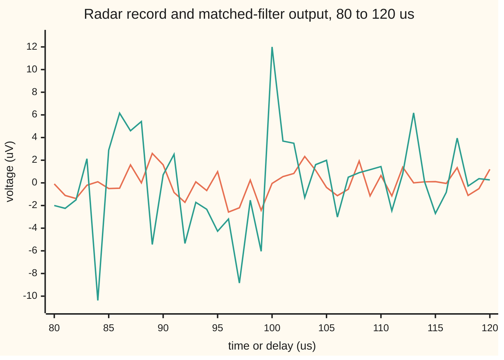
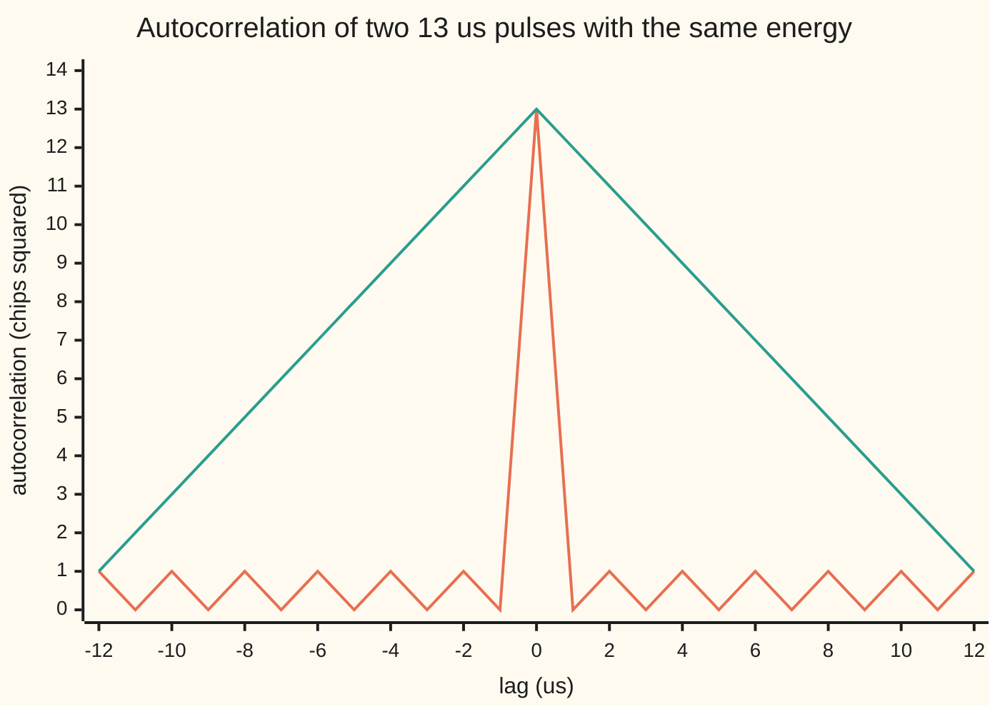

# Correlation: sliding one signal against another to find a known shape in noise

[Syllabus](../../../SYLLABUS.md) → [Harmonic analysis](../README.md) → [Convolution and Approximate Identities](../README.md#s03) → Correlation

---

## General Overview

A radar sends out a short pulse and listens for its echo. The pulse here is 13 microseconds (µs) long. It is cut into 13 chips of 1 µs, each sent either upright (+1) or upside down (−1) in a fixed pattern called the Barker code. Radio waves travel out and back, so each microsecond of delay is 150 m of range.

A target 15,000 m away returns the echo 100 µs later. The echo is weak: 1.0 microvolt (µV), buried in receiver static (random electrical noise) of standard deviation 1.0 µV. In the 200 recorded samples, the largest one, 2.60 µV, is at sample 89, where there is no echo. Looking at the record finds nothing.

Correlation finds it. Slide a copy of the known pulse along the record. At each position, multiply the copy by the record sample by sample and add the products. Where the copy sits on the echo, all 13 products lean the same way and add up. Elsewhere the products have random signs and mostly cancel. On this record the sum peaks at 12.00 µV at a delay of exactly 100 µs. The largest positive sum anywhere away from the echo is 9.12 µV. The detector looks for the known sign: at its own lag an echo adds +13 times its height, so the dip to −10.38 µV at 84 µs is only noise.

**Correlation slides a known shape along a signal and adds up the products at each shift; it peaks where the shape sits, and when the noise is independent from sample to sample, no other linear detector gives a larger signal-to-noise ratio: that best detector is called the matched filter.**

**What kind of fact this is:** definitions (cross-correlation and autocorrelation), and two theorems proved on this card in Why it works: correlation is convolution with a flipped copy, and the matched filter maximizes the signal-to-noise ratio. A simulation of 1,000 records checks the theorem's numbers; it does not prove them.

### The picture: the record, and the record correlated with the pulse



First line (orange): the record, sample by sample. The echo occupies samples 100 to 112 and cannot be seen. Second line (green): the correlation, plotted at the delay where the pulse copy starts. It spikes to 12.00 µV at 100 µs. The record is synthetic, drawn from a seeded generator, and illustrative.

---

## The formula

Notation from earlier cards, in one line each. Time $`t`$ is in seconds and frequency $`\xi`$ (xi) in hertz. The transform of a signal $`f`$ is $`\hat f(\xi) = \int f(t)\, e^{-2\pi i \xi t}\, dt`$. Convolution is $`(f * g)(t) = \int f(u)\, g(t - u)\, du`$: slide a flipped copy of $`g`$ along $`f`$ and add up the overlap ([Convolution](01-convolution-and-youngs-inequality.md)). A bar is the complex conjugate; for real signals, such as this radar's, it changes nothing.

The **cross-correlation** of two signals $`f`$ and $`g`$ at lag $`\tau`$ (tau) is

```math
R_{fg}(\tau) = \int_{-\infty}^{\infty} f(t)\,\overline{g(t - \tau)}\,dt .
```

**Read it aloud:** shift $`g`$ later by $`\tau`$, multiply it by $`f`$ point by point, and add up everything.

For sampled signals the integral becomes a sum over samples $`k`$, one per microsecond. The radar computes, for the record $`r_k`$ and the pulse $`s_k`$,

```math
R_{rs}[m] = \sum_{k} r_{k+m}\, s_k .
```

**Read it aloud:** lay the pulse on the record starting at sample $`m`$, multiply each chip by the sample under it, and add the 13 products. The **autocorrelation** $`R_{ff}`$ is a signal correlated with itself.

Correlation is convolution without the flip. Flip $`g`$ in time and conjugate it, writing $`\tilde g(t) = \overline{g(-t)}`$. On this card the tilde means flipped; on [Blurring and unblurring](05-smoothing-blurring-and-deconvolution.md) it marks an estimate. Then

```math
R_{fg} = f * \tilde g, \qquad \widehat{R_{fg}}(\xi) = \hat f(\xi)\,\overline{\hat g(\xi)} .
```

**Read it aloud:** correlating with $`g`$ is convolving with $`g`$ flipped and conjugated, so its transform multiplies by the conjugate of $`g`$'s transform.

The record is $`r_k = A\,s_{k-d} + n_k`$: the pulse at height $`A`$, delayed by $`d`$ samples, plus noise $`n_k`$ with standard deviation $`\sigma`$. Any linear detector reports a weighted sum $`\sum_k w_k\, r_{d+k}`$. Its **signal-to-noise ratio** (SNR) is the square of the echo's contribution over the variance of the noise's contribution:

```math
\mathrm{SNR}(w) = \frac{A^2 \big(\sum_k w_k s_k\big)^2}{\sigma^2 \sum_k w_k^2} \;\le\; \frac{A^2 E}{\sigma^2}, \qquad E = \sum_k s_k^2 .
```

**Read it aloud:** for independent noise, no choice of weights beats the pulse's energy times the echo's power over the noise's power, and the weights that reach it are the pulse itself.

| Symbol | Plain meaning | In our example | Push it up and the answer… |
| --- | --- | --- | --- |
| $`f`$, $`g`$ | any two signals being compared | $`f`$ the record, $`g`$ the pulse | — |
| $`\tau`$, $`m`$ | the lag: how far $`g`$ is shifted later; $`m`$ in samples | the peak sits at 100 µs | compares $`g`$ with a later stretch of $`f`$ |
| $`R_{fg}(\tau)`$ | cross-correlation; $`R_{ff}`$ is autocorrelation | 12.00 µV at lag 100 | the shapes agree more at that lag |
| $`\tilde g`$ | $`g`$ flipped in time and conjugated | the Barker code read backwards | — |
| $`\hat f`$, $`\hat g`$ | transforms at frequency $`\xi`$ | the pulse's, on a 256-point grid | — |
| $`r_k`$, $`k`$ | the recorded voltage at sample $`k`$, 1 µs apart | 200 samples, sd 1.03 µV | — |
| $`s_k`$ | the pulse's chip $`k`$, +1 or −1 | the 13-chip Barker code | — |
| $`d`$ | the echo's true delay, in samples | 100 µs, so 15,000 m | the target is further away |
| $`A`$ | the echo's height | 1.0 µV | SNR grows as its square |
| $`n_k`$, $`\sigma`$, $`\epsilon_k`$ | noise at sample $`k`$, and its standard deviation; $`\epsilon_k`$ the independent kicks behind the colored noise of Step 4 | 1.0 µV | SNR falls as $`1/\sigma^2`$ |
| $`w_k`$, $`c`$ | a detector's weights; $`c`$ any scale factor, in the proof | best: $`w_k = s_k`$ | — |
| $`E`$, SNR | the pulse's energy; signal-to-noise ratio | 13 and 13.0000 | a longer pulse raises the best SNR |

### When it holds

- **The shape is known.** The matched filter needs the echo's exact shape. A moving target shifts the echo's frequency (the Doppler effect). The echo's phase then drifts along the pulse, so the 13 products no longer all add in step, and the peak shrinks. Real radars run a bank of shifted copies.
- **The noise is independent from sample to sample.** This is what makes the noise variance $`\sigma^2 \sum w_k^2`$. With noise that carries 0.9 of the previous random kick (Step 4), the plain copy still gives SNR 13.0000, but undoing that memory across the whole record and then matching reaches 182.1263.
- **The answer is a ratio at one instant.** The theorem says the right lag gets the best SNR. It does not say the peak always lands there: with every lag of the record to search, a noise peak sometimes wins. In 1,000 records the peak landed on 100 µs 774 times.
- **Linear detectors only.** The bound compares weighted sums. When the noise is also Gaussian (bell-shaped), the matched filter followed by a threshold is the best detector of any kind; that stronger statement is in Turin's paper in Sources.

---

## Why it works

### Step 0: agreement adds up, disagreement cancels

At the true lag, each chip multiplies an echo sample of the same sign, so all 13 products are positive. Their sum is $`A E`$ = 13 µV. The noise contributes 13 products with random signs. Their sum has variance $`13\sigma^2`$, so it typically reaches only about the square root of 13. Correlation turns a per-sample ratio of 1.0 µV to 1.0 µV into a power ratio of 13.

### Step 1: correlation is convolution with a flipped copy

Substitute $`\tilde g(t) = \overline{g(-t)}`$ into the convolution:

```math
(f * \tilde g)(\tau) = \int f(t)\, \tilde g(\tau - t)\, dt = \int f(t)\, \overline{g(t - \tau)}\, dt = R_{fg}(\tau).
```

So every fact about convolution carries over. In particular, [The convolution theorem](02-convolution-theorem-and-impulse-response.md) turns convolution into multiplication of transforms, and the transform of $`\tilde g`$ is $`\overline{\hat g(\xi)}`$. That gives $`\widehat{R_{fg}} = \hat f\,\overline{\hat g}`$, which is how long records are correlated in practice: transform, multiply, transform back.

The code takes three roads to the radar's output: the sliding sum, a transform of length 256 (long enough that nothing wraps round), and convolution with the code read backwards. They agree to $`10^{-9}`$.

The flip is also why order matters. Convolution does not care which signal comes first; correlation does. Swapping the two signals reverses the lag: $`R_{gf}(\tau) = \overline{R_{fg}(-\tau)}`$. On the radar record, $`R_{rs}`$ peaks at lag +100 and $`R_{sr}`$ at lag −100, both at 12.00 µV.

### Step 2: autocorrelation peaks at zero lag, and its width sets the resolution

A clean echo correlated with the pulse gives $`A`$ times the pulse's autocorrelation $`R_{ss}`$. So $`R_{ss}`$ is the shape the radar sees around every target. Three facts about it:

- **The peak is the energy.** $`R_{ss}(0) = \sum s_k^2 = E`$ = 13.
- **Nothing beats the peak.** $`|R_{ss}(\tau)| \le R_{ss}(0)`$, by the Cauchy–Schwarz inequality, proved in the fold in Step 3.
- **Its transform is the energy spectrum.** By Step 1, $`\widehat{R_{ss}} = |\hat s|^2`$, never negative. Averaged over the 256 frequencies of the grid, $`|\hat s|^2`$ gives 13.0000, matching the peak: Parseval's identity.



Orange: the Barker code, a spike of 13 with side values of 0 or 1. Green: a plain pulse of 13 upright chips, a triangle falling by 1 per microsecond. Both have energy 13, so both give the same best SNR. Only the coded pulse gives a sharp spike.

That matters for two targets close together. Put echoes at 100 µs and 104 µs, 600 m apart, with no noise. The Barker output reads 14 at both, with 2 or 0 between them. The plain pulse's output is a flat plateau of 22 from 100 to 104: one blurred target. This is **pulse compression**: a long pulse carries the energy, and a code makes its correlation as sharp as one chip.

The time-series card computes the same object for random series. Its sample autocorrelation at each lag is $`R_{ff}`$ at that lag for the series with its mean removed, divided by $`R_{ff}(0)`$ ([Stationarity and autocorrelation](../../09-Probability%20and%20statistics/12-Time%20Series/01-stationarity-and-autocorrelation.md)). This card spends its effort on cross-correlation instead.

### Step 3: the matched filter is the best linear detector

A detector at lag $`d`$ reports $`\sum_k w_k r_{d+k}`$. Its echo part is $`A \sum_k w_k s_k`$, a fixed number. Its noise part is $`\sum_k w_k n_k`$. For independent noise, the variance of a sum is the sum of the variances, so the noise variance is $`\sigma^2 \sum_k w_k^2`$.

The Cauchy–Schwarz inequality says $`(\sum_k w_k s_k)^2 \le \sum_k w_k^2 \sum_k s_k^2`$, with equality only when $`w`$ is a multiple of $`s`$. Put it into the SNR and the $`\sum_k w_k^2`$ cancels, leaving $`A^2 E / \sigma^2`$. The best weights are a copy of the pulse. Using them at every lag is exactly correlation with the pulse.

As a filter, a weighting is a convolution, and convolution flips its kernel. So the filter's impulse response (its output for a single spike) is the pulse reversed in time and conjugated: it is "matched" to the pulse.

The numbers on the radar:

- **Matched:** SNR 13.0000, equal to $`A^2 E/\sigma^2`$ = 13.
- **Convolving with the pulse as sent (which flips it):** at its own best lag, SNR 1.9231.
- **2,000 random weightings:** the best of them reaches 7.8312, still under 13.
- **1,000 simulated records:** the output at lag 100 has mean 12.852 (theory 13, standard error 0.116) and variance 13.455 (theory 13, standard error 0.602), so SNR 12.277.

<details>
<summary>Detailed proof: Cauchy–Schwarz, and why equality needs w to copy s</summary>

For any number $`c`$, a sum of squares is never negative:

$`\displaystyle 0 \le \sum_k (w_k - c\, s_k)^2 = \sum_k w_k^2 - 2c \sum_k w_k s_k + c^2 \sum_k s_k^2 .`$

The right side is a quadratic in $`c`$ that never dips below zero. So it has at most one real root, and its discriminant is at most zero:

$`\displaystyle 4\Big(\sum_k w_k s_k\Big)^2 - 4 \sum_k w_k^2 \sum_k s_k^2 \le 0 .`$

That is the inequality. Equality means the quadratic touches zero at some $`c`$, so every term $`w_k - c\, s_k`$ is zero: $`w`$ is a multiple of $`s`$. Dividing the SNR's top and bottom by $`\sum_k w_k^2`$ gives the bound $`A^2 E / \sigma^2`$, reached only by $`w = c\, s`$; the factor $`c`$ scales signal and noise alike.

The same argument with $`w_k = s_{k+\tau}`$ gives $`R_{ss}(\tau)^2 \le E^2`$, the bound on the autocorrelation in Step 2. For complex signals, replace $`w_k s_k`$ by $`w_k \overline{s_k}`$ and squares by squared sizes; the best weights become $`\overline{s_k}`$, which is where the bar in $`R_{fg}`$ comes from.

</details>

### Step 4: when the noise has memory, undo it first

The bound used independence: the noise variance was $`\sigma^2 \sum w_k^2`$. Suppose instead each noise sample carries 0.9 of the previous random kick:

```math
n_k = \frac{\epsilon_k + 0.9\,\epsilon_{k-1}}{\sqrt{1.81}} ,
```

where the kicks $`\epsilon_k`$ (epsilon) are independent, with standard deviation 1.0 µV. Dividing by $`\sqrt{1.81}`$ keeps each $`n_k`$ at 1.0 µV. Neighbors share a kick, so they move together; samples two or more apart share none. The noise variance of a weighting now includes cross terms between neighbors.

The plain copy of the pulse still gives SNR 13.0000 here, because the Barker code's autocorrelation at lag 1 is 0, so the cross terms cancel. But it is no longer the best. The best weights solve the linear equations "noise covariance times weights equals pulse", where the covariance is the table of how much each pair of noise samples moves together, and their SNR is the sum of each chip times its weight. Using only the 13 samples under the echo, they reach 56.0648. The samples beside the echo hold no echo, but their noise is tied to the noise at its edges, so they help too. Over the whole 200-sample record the best weights reach 182.1263. That is what undoing the noise's memory across the record, an operation called **whitening**, and then matching the whitened pulse achieves. A second road agrees: the pulse's energy at each frequency divided by the noise's power there, averaged over the 256 frequencies of Step 2's grid, also gives 182.1263.

The idea survives; the recipe changes. Matched filtering is optimal after the noise has been made independent.

---

## Worked numbers, by hand

A clean echo, then the noise, at the true lag of 100 µs.

| Step | Arithmetic | Value |
| --- | --- | --- |
| pulse energy | 13 chips, each $`(\pm 1)^2 = 1`$ | 13 |
| echo part of the output | $`A \times E = 1.0 \times 13`$ | 13 µV |
| noise variance of the output | $`\sigma^2 \times E = 1.0^2 \times 13`$ | 13 |
| SNR of one raw sample | $`A^2/\sigma^2 = 1.0^2 / 1.0^2`$ | 1.0 |
| SNR after correlation | $`13^2 / 13`$ | **13** |
| range | $`100 \times 150`$ m per µs of delay | 15,000 m |

Correlating with the 13-chip pulse multiplies the signal-to-noise ratio by its energy, 13, which lifts an echo no larger than the static to a peak that won 774 of 1,000 simulated records.

### What breaks if you drop a piece

| Mistake | Comes out at | What went wrong |
| --- | --- | --- |
| Convolve with the pulse instead of correlating | clean peak 5 (not 13) at lags 92 and 108; output 1 at lag 100; right lag in 3 of 1,000 records | Convolution flips the pulse, so the copy never lines up with the echo |
| Send a plain pulse instead of a coded one | same SNR 13, but two targets 600 m apart give one plateau of 22; right lag in 397 of 1,000 records | The autocorrelation is a wide triangle, so the peak is blunt |
| Use the plain copy when the noise has memory | SNR 13.0000, against 182.1263 after whitening the whole record (56.0648 using only the 13 echo samples) | The bound assumed independent noise |
| Swap the order, $`R_{sr}`$ for $`R_{rs}`$ | peak at lag −100 | Swapping the signals reverses the lag |

---

## Code, from first principles, and it actually runs

Only `math` is imported. The code builds the Barker pulse, its autocorrelation and a 200-sample record with seeded noise. It reaches the matched-filter output by three independent roads: sliding sums, a written-out discrete Fourier transform, and convolution with the reversed pulse. A second check pits the bound against 2,000 random weightings and 1,000 simulated records. For colored noise, the best weights come from a short elimination for equations that link only neighbors, run on the 13 echo samples and on the whole record, and the record's answer is checked against a sum over frequencies. Noise comes from SplitMix64, a short recipe for pseudo-random whole numbers, turned into bell-shaped values by the Box–Muller formula; both languages draw the same values and print the same lines. Asserts compare the roads, the energy against Parseval's sum, the simulated mean and variance against 13 within four standard errors, the random weightings against the bound, the convolution mistake's peak against the self-convolution of the code, and the record's colored-noise SNR against the frequency sum.

### Python

```python
# Correlation and the matched filter -- the check behind the card. Standard library only.
# A 13-chip radar pulse (the Barker code, 1 microsecond per chip) buried in static, found by sliding.
# Roads: sliding sums, a written-out DFT, convolution with the flipped pulse, and 1,000 seeded records.
import math
S = [1, 1, 1, 1, 1, -1, -1, 1, 1, -1, 1, -1, 1]   # the template s_k: chips of +1 and -1
RECT = [1] * 13                                    # a plain pulse with the same energy, 13
NREC, D, A, SIG = 200, 100, 1.0, 1.0               # record length (1 us samples), true delay, echo, noise sd (uV)
TRIALS, SEED, M64, NFFT = 1000, 20261115, 0xFFFFFFFFFFFFFFFF, 256
E = sum(x * x for x in S)

def corr(f, g, m):                                 # R_fg[m] = sum over k of f[k + m] g[k]
    return sum(f[k + m] * g[k] for k in range(len(g)) if 0 <= k + m < len(f))
def slide(r, s): return [corr(r, s, m) for m in range(len(r) - len(s) + 1)]
def conv(a, b):                                    # (a * b)[n] = sum over j of a[n - j] b[j]
    out = [0.0] * (len(a) + len(b) - 1)
    for i, x in enumerate(a):
        for j, y in enumerate(b): out[i + j] += x * y
    return out
TW = [(math.cos(2 * math.pi * k / NFFT), math.sin(2 * math.pi * k / NFFT)) for k in range(NFFT)]
def dft(x, sign):                                  # sum_n x[n] e^(sign 2 pi i k n / N), x complex pairs
    out = []
    for k in range(NFFT):
        re = im = 0.0
        for n, (a, b) in enumerate(x):
            c, s = TW[(k * n) % NFFT]; s *= sign
            re += a * c - b * s; im += a * s + b * c
        out.append((re, im))
    return out
def padded(x): return [(float(v), 0.0) for v in x] + [(0.0, 0.0)] * (NFFT - len(x))

state = [SEED]
def gauss():                                       # SplitMix64, then Box-Muller (cosine half)
    u = []
    for _ in range(2):
        state[0] = (state[0] + 0x9E3779B97F4A7C15) & M64
        z = state[0]
        z = ((z ^ (z >> 30)) * 0xBF58476D1CE4E5B9) & M64
        z = ((z ^ (z >> 27)) * 0x94D049BB133111EB) & M64
        u.append(((z ^ (z >> 31)) >> 11) / 2.0 ** 53)
    return math.sqrt(-2 * math.log(1 - u[0])) * math.cos(2 * math.pi * u[1])
def record(pulse, delays, noise):
    r = list(noise)
    for d in delays:
        for k, c in enumerate(pulse): r[d + k] += A * c
    return r
def line(label, vals, f="{:.2f}"): print(label, " ".join(f.format(v) for v in vals))

print(f"pulse: 13 chips of 1 us ({3.0e8 * 1e-6 / 2:.0f} m of range each), energy E = {E}; echo {A:.1f} uV in static of sd {SIG:.1f} uV")
print(f"echo delay {D} us = range {3.0e8 * D * 1e-6 / 2:.0f} m; record of {NREC} samples")
# ---- autocorrelation: the pulse slid against itself ----
acb = [corr(S, S, h) for h in range(-12, 13)]
acr = [corr(RECT, RECT, h) for h in range(-12, 13)]
line("chart, autocorrelation, Barker, lags -12..12:", acb, "{:.0f}")
line("chart, autocorrelation, plain pulse, lags -12..12:", acr, "{:.0f}")
assert max(abs(v) for i, v in enumerate(acb) if i != 12) == 1 and acb == acb[::-1]
SH = dft(padded(S), -1)                            # energy spectrum |S^|^2 and its inverse transform
spec = [a * a + b * b for a, b in SH]
back = dft([(v, 0.0) for v in spec], 1)
assert all(abs(back[h % NFFT][0] / NFFT - acb[h + 12]) < 1e-9 for h in range(-12, 13))
print(f"Parseval: R_ss(0) = {acb[12]:.0f}, mean of |S^|^2 over {NFFT} frequencies = {sum(spec) / NFFT:.4f}")
assert abs(sum(spec) / NFFT - E) < 1e-9

# ---- one record: 200 samples of static with the echo at sample 100 ----
noise = [SIG * gauss() for _ in range(NREC)]
r = record(S, [D], noise)
print(f"record: sample sd {math.sqrt(sum(v * v for v in r) / NREC - (sum(r) / NREC) ** 2):.2f} uV, "
      f"largest |sample| {max(abs(v) for v in r):.2f} uV at k = {max(range(NREC), key=lambda k: abs(r[k]))}")
y = slide(r, S)
peak = max(range(len(y)), key=lambda m: y[m])
far = max(y[m] for m in range(len(y)) if abs(m - D) > 12)
print(f"matched output: peak {y[peak]:.2f} uV at lag {peak} us; largest away from the echo {far:.2f} uV")
line("chart, record r_k, k = 80..120:", r[80:121])
line("chart, matched output y_m, m = 80..120:", y[80:121])
assert peak == D
# three roads to the same output: sliding sums, the DFT, convolution with the flipped pulse
Y = [(a * c + b * d, b * c - a * d) for (a, b), (c, d) in zip(dft(padded(r), -1), SH)]
yd = [v[0] / NFFT for v in dft(Y, 1)]
yc = conv(r, S[::-1])
assert max(abs(yd[m] - y[m]) for m in range(len(y))) < 1e-9 and max(abs(yc[m + 12] - y[m]) for m in range(len(y))) < 1e-9
print("roads agree to 1e-9: sliding sums, DFT of length 256, convolution with the flipped pulse")
rsr = {m: corr(S, r, m) for m in range(-(NREC - 1), 13)}
msr = max(rsr, key=lambda m: rsr[m])
print(f"order matters: R_rs peaks at lag +{peak}, R_sr at lag {msr}, both {rsr[msr]:.2f} uV")
assert msr == -D and abs(rsr[msr] - y[peak]) < 1e-12

# ---- the mistake: convolve with the pulse instead of correlating ----
clean = slide(record(S, [D], [0.0] * NREC), S[::-1])
bad = max(abs(v) for v in clean)
print(f"convolve without flipping, no noise: peak {bad:.0f} (not {E}) at lags "
      f"{' and '.join(str(m) for m in range(len(clean)) if abs(clean[m]) == bad)}; at lag {D}: {clean[D]:.0f}")
assert bad == max(abs(v) for v in conv(S, S))
# ---- signal-to-noise ratio of a weighting w: A^2 (w . s)^2 / (sigma^2 w . w) ----
def snr(w, s=S, cov=None):
    cov = cov or [[float(i == j) for j in range(13)] for i in range(13)]
    return A * A * sum(a * b for a, b in zip(w, s)) ** 2 / (SIG ** 2 * sum(w[i] * cov[i][j] * w[j] for i in range(13) for j in range(13)))
best_random = max(snr([gauss() for _ in range(13)]) for _ in range(2000))
print(f"SNR: matched {snr(S):.4f} = A^2 E / sigma^2; convolution, at its own peak {A * A * bad * bad / (SIG ** 2 * E):.4f}; "
      f"best of 2000 random weightings {best_random:.4f}")
assert abs(snr(S) - E) < 1e-9 and best_random < E
# colored noise: each sample carries 0.9 of the previous kick, n_k = (e_k + 0.9 e_(k-1)) / sqrt(1.81)
rho = 0.9 / 1.81
cov = [[1.0 if i == j else (rho if abs(i - j) == 1 else 0.0) for j in range(13)] for i in range(13)]
def best(lo, hi):                                  # solve cov h = s on samples D-lo .. D+12+hi (tridiagonal sweep)
    s = [0.0] * lo + [float(v) for v in S] + [0.0] * hi
    c, h = [0.0] * len(s), [0.0] * len(s)
    for i in range(len(s)):
        m = 1 - rho * c[i - 1] * (i > 0); c[i] = rho / m; h[i] = (s[i] - rho * h[i - 1] * (i > 0)) / m
    for i in range(len(s) - 2, -1, -1): h[i] -= c[i] * h[i + 1]
    return h[lo:lo + 13], sum(a * b for a, b in zip(s, h))  # weights under the echo; best SNR = s . h
(h, b13), brec = best(0, 0), best(D, NREC - D - 13)[1]
bfreq = sum(v / (1 + 2 * rho * TW[k][0]) for k, v in enumerate(spec)) / NFFT  # mean of |S^|^2 / noise power
print(f"colored noise, 0.9 of the previous kick: plain matched SNR {snr(S, cov=cov):.4f}; best on the 13 echo samples {snr(h, cov=cov):.4f} = s . h {b13:.4f}")
print(f"  best on the whole record (whiten, then match) {brec:.4f}; frequency road, mean of |S^|^2 / noise power {bfreq:.4f}")
assert abs(snr(h, cov=cov) - b13) < 1e-9 and snr(h, cov=cov) > snr(S, cov=cov) and abs(brec - bfreq) < 1e-6 * bfreq

# ---- 1,000 records: does the peak land on the echo? ----
hits, at_d = {"Barker, matched": 0, "Barker, convolved": 0, "plain pulse, matched": 0}, []
for _ in range(TRIALS):
    nz = [SIG * gauss() for _ in range(NREC)]
    rb, rp = record(S, [D], nz), record(RECT, [D], nz)
    for name, out in (("Barker, matched", slide(rb, S)), ("Barker, convolved", slide(rb, S[::-1])), ("plain pulse, matched", slide(rp, RECT))):
        hits[name] += max(range(len(out)), key=lambda m: out[m]) == D
        if name == "Barker, matched": at_d.append(out[D])
mu = sum(at_d) / TRIALS
var = sum((v - mu) ** 2 for v in at_d) / (TRIALS - 1)
print(f"simulated output at lag {D}: mean {mu:.3f} (theory {A * E:.0f}, se {math.sqrt(var / TRIALS):.3f}), "
      f"variance {var:.3f} (theory {SIG ** 2 * E:.0f}, se {var * math.sqrt(2 / (TRIALS - 1)):.3f}), SNR {mu * mu / var:.3f}")
assert abs(mu - A * E) < 4 * math.sqrt(var / TRIALS) and abs(var - E) < 4 * var * math.sqrt(2 / (TRIALS - 1))
line("peak on the true lag, out of 1000:", [hits[k] for k in hits], "{:.0f}")
print("  (" + "; ".join(hits) + ")")
assert hits["Barker, matched"] > hits["plain pulse, matched"] > hits["Barker, convolved"]
# ---- two targets 4 us (600 m) apart, no noise ----
for name, p in (("Barker", S), ("plain pulse", RECT)):
    line(f"two echoes at 100 and 104 us ({3.0e8 * 4e-6 / 2:.0f} m apart), {name}, lags 96..108:", slide(record(p, [100, 104], [0.0] * NREC), p)[96:109], "{:.0f}")
print("ALL CHECKS PASS")
```

**Ran 2026-11-15 on macOS, Python 3.14.10, standard library only. All checks passed. Output, pasted from the run:**

```
pulse: 13 chips of 1 us (150 m of range each), energy E = 13; echo 1.0 uV in static of sd 1.0 uV
echo delay 100 us = range 15000 m; record of 200 samples
chart, autocorrelation, Barker, lags -12..12: 1 0 1 0 1 0 1 0 1 0 1 0 13 0 1 0 1 0 1 0 1 0 1 0 1
chart, autocorrelation, plain pulse, lags -12..12: 1 2 3 4 5 6 7 8 9 10 11 12 13 12 11 10 9 8 7 6 5 4 3 2 1
Parseval: R_ss(0) = 13, mean of |S^|^2 over 256 frequencies = 13.0000
record: sample sd 1.03 uV, largest |sample| 2.60 uV at k = 89
matched output: peak 12.00 uV at lag 100 us; largest away from the echo 9.12 uV
chart, record r_k, k = 80..120: -0.09 -1.11 -1.38 -0.21 0.10 -0.50 -0.47 1.59 0.00 2.60 1.59 -0.85 -1.72 0.09 -0.68 0.99 -2.58 -2.20 0.24 -2.42 -0.05 0.55 0.83 2.33 1.11 -0.40 -1.13 -0.56 1.93 -1.15 0.65 -1.15 1.39 0.00 0.09 0.11 -0.05 1.34 -1.11 -0.51 1.20
chart, matched output y_m, m = 80..120: -2.00 -2.25 -1.50 2.13 -10.38 2.89 6.15 4.60 5.42 -5.44 0.71 2.52 -5.35 -1.72 -2.33 -4.27 -3.19 -8.84 -1.53 -6.04 12.00 3.69 3.50 -1.30 1.61 1.99 -3.02 0.50 0.90 1.16 1.44 -2.46 0.81 6.18 0.12 -2.70 -0.83 3.95 -0.28 0.37 0.26
roads agree to 1e-9: sliding sums, DFT of length 256, convolution with the flipped pulse
order matters: R_rs peaks at lag +100, R_sr at lag -100, both 12.00 uV
convolve without flipping, no noise: peak 5 (not 13) at lags 92 and 108; at lag 100: 1
SNR: matched 13.0000 = A^2 E / sigma^2; convolution, at its own peak 1.9231; best of 2000 random weightings 7.8312
colored noise, 0.9 of the previous kick: plain matched SNR 13.0000; best on the 13 echo samples 56.0648 = s . h 56.0648
  best on the whole record (whiten, then match) 182.1263; frequency road, mean of |S^|^2 / noise power 182.1263
simulated output at lag 100: mean 12.852 (theory 13, se 0.116), variance 13.455 (theory 13, se 0.602), SNR 12.277
peak on the true lag, out of 1000: 774 3 397
  (Barker, matched; Barker, convolved; plain pulse, matched)
two echoes at 100 and 104 us (600 m apart), Barker, lags 96..108: 2 0 2 0 14 0 2 0 14 0 2 0 2
two echoes at 100 and 104 us (600 m apart), plain pulse, lags 96..108: 14 16 18 20 22 22 22 22 22 20 18 16 14
ALL CHECKS PASS
```

### Rust

```rust
// Correlation and the matched filter -- the check behind the card. Standard library only.
// A 13-chip radar pulse (the Barker code, 1 microsecond per chip) buried in static, found by sliding.
// Roads: sliding sums, a written-out DFT, convolution with the flipped pulse, and 1,000 seeded records.
const S: [f64; 13] = [1., 1., 1., 1., 1., -1., -1., 1., 1., -1., 1., -1., 1.];
const RECT: [f64; 13] = [1.; 13];
const NREC: usize = 200; const D: usize = 100; const TRIALS: usize = 1000; const NFFT: usize = 256; // 1 us samples, true delay
const A: f64 = 1.0; const SIG: f64 = 1.0;                         // echo and noise sd, in microvolts
type C = (f64, f64);

fn corr(f: &[f64], g: &[f64], m: i64) -> f64 {
    // R_fg[m] = sum over k of f[k + m] g[k]
    let mut t = 0.0;
    for k in 0..g.len() {
        let i = k as i64 + m;
        if i >= 0 && (i as usize) < f.len() { t += f[i as usize] * g[k]; }
    }
    t
}
fn slide(r: &[f64], s: &[f64]) -> Vec<f64> { (0..=(r.len() - s.len()) as i64).map(|m| corr(r, s, m)).collect() }
fn conv(a: &[f64], b: &[f64]) -> Vec<f64> {
    let mut out = vec![0.0; a.len() + b.len() - 1];
    for (i, x) in a.iter().enumerate() { for (j, y) in b.iter().enumerate() { out[i + j] += x * y; } }
    out
}
fn dft(x: &[C], sign: f64, tw: &[C]) -> Vec<C> {
    // sum_n x[n] e^(sign 2 pi i k n / N)
    (0..NFFT).map(|k| {
        let (mut re, mut im) = (0.0, 0.0);
        for (n, &(a, b)) in x.iter().enumerate() {
            let (c, mut s) = tw[(k * n) % NFFT];
            s *= sign;
            re += a * c - b * s; im += a * s + b * c;
        }
        (re, im)
    }).collect()
}
fn padded(x: &[f64]) -> Vec<C> { let mut v: Vec<C> = x.iter().map(|&a| (a, 0.0)).collect(); v.resize(NFFT, (0.0, 0.0)); v }
struct Rng(u64);
impl Rng {
    fn gauss(&mut self) -> f64 {
        // SplitMix64, then Box-Muller (cosine half)
        let mut u = [0.0; 2];
        for ui in u.iter_mut() {
            self.0 = self.0.wrapping_add(0x9E3779B97F4A7C15);
            let mut z = self.0;
            z = (z ^ (z >> 30)).wrapping_mul(0xBF58476D1CE4E5B9);
            z = (z ^ (z >> 27)).wrapping_mul(0x94D049BB133111EB);
            *ui = ((z ^ (z >> 31)) >> 11) as f64 / 2f64.powi(53);
        }
        (-2.0 * (1.0 - u[0]).ln()).sqrt() * (2.0 * std::f64::consts::PI * u[1]).cos()
    }
}
fn record(pulse: &[f64], delays: &[usize], noise: &[f64]) -> Vec<f64> {
    let mut r = noise.to_vec();
    for &d in delays { for (k, c) in pulse.iter().enumerate() { r[d + k] += A * c; } }
    r
}
fn argmax(v: &[f64]) -> usize { let mut b = 0; for i in 1..v.len() { if v[i] > v[b] { b = i; } } b }
fn line(label: &str, vals: &[f64], p: usize) { println!("{} {}", label, vals.iter().map(|v| format!("{:.*}", p, v)).collect::<Vec<_>>().join(" ")); }
fn snr(w: &[f64], cov: &[[f64; 13]; 13]) -> f64 {
    // A^2 (w . s)^2 / (sigma^2 w' cov w)
    let ws: f64 = w.iter().zip(S.iter()).map(|(a, b)| a * b).sum();
    let mut q = 0.0;
    for i in 0..13 { for j in 0..13 { q += w[i] * cov[i][j] * w[j]; } }
    A * A * ws * ws / (SIG * SIG * q)
}

fn main() {
    let e: f64 = S.iter().map(|x| x * x).sum();
    let tw: Vec<C> = (0..NFFT).map(|k| { let t = 2.0 * std::f64::consts::PI * k as f64 / NFFT as f64; (t.cos(), t.sin()) }).collect();
    let mut rng = Rng(20261115);
    println!("pulse: 13 chips of 1 us ({:.0} m of range each), energy E = {}; echo {:.1} uV in static of sd {:.1} uV", 3.0e8 * 1e-6 / 2.0, e, A, SIG);
    println!("echo delay {} us = range {:.0} m; record of {} samples", D, 3.0e8 * D as f64 * 1e-6 / 2.0, NREC);
    // ---- autocorrelation: the pulse slid against itself ----
    let acb: Vec<f64> = (-12..13).map(|h| corr(&S, &S, h)).collect();
    let acr: Vec<f64> = (-12..13).map(|h| corr(&RECT, &RECT, h)).collect();
    line("chart, autocorrelation, Barker, lags -12..12:", &acb, 0);
    line("chart, autocorrelation, plain pulse, lags -12..12:", &acr, 0);
    let side = (0..25).filter(|&i| i != 12).map(|i| acb[i].abs()).fold(0.0, f64::max);
    assert!(side == 1.0 && (0..25).all(|i| acb[i] == acb[24 - i]));
    let sh = dft(&padded(&S), -1.0, &tw);
    let spec: Vec<f64> = sh.iter().map(|&(a, b)| a * a + b * b).collect();
    let back = dft(&spec.iter().map(|&v| (v, 0.0)).collect::<Vec<C>>(), 1.0, &tw);
    assert!((-12i64..13).all(|h| (back[h.rem_euclid(NFFT as i64) as usize].0 / NFFT as f64 - acb[(h + 12) as usize]).abs() < 1e-9));
    let ps = spec.iter().sum::<f64>() / NFFT as f64;
    println!("Parseval: R_ss(0) = {:.0}, mean of |S^|^2 over {} frequencies = {:.4}", acb[12], NFFT, ps);
    assert!((ps - e).abs() < 1e-9);

    // ---- one record: 200 samples of static with the echo at sample 100 ----
    let noise: Vec<f64> = (0..NREC).map(|_| SIG * rng.gauss()).collect();
    let r = record(&S, &[D], &noise);
    let mean = r.iter().sum::<f64>() / NREC as f64;
    let absr: Vec<f64> = r.iter().map(|v| v.abs()).collect();
    let ka = argmax(&absr);
    println!("record: sample sd {:.2} uV, largest |sample| {:.2} uV at k = {}",
        (r.iter().map(|v| v * v).sum::<f64>() / NREC as f64 - mean * mean).sqrt(), absr[ka], ka);
    let y = slide(&r, &S);
    let peak = argmax(&y);
    let far = (0..y.len()).filter(|&m| (m as i64 - D as i64).abs() > 12).map(|m| y[m]).fold(f64::NEG_INFINITY, f64::max);
    println!("matched output: peak {:.2} uV at lag {} us; largest away from the echo {:.2} uV", y[peak], peak, far);
    line("chart, record r_k, k = 80..120:", &r[80..121], 2);
    line("chart, matched output y_m, m = 80..120:", &y[80..121], 2);
    assert!(peak == D);
    let yh: Vec<C> = dft(&padded(&r), -1.0, &tw).iter().zip(sh.iter()).map(|(&(a, b), &(c, d))| (a * c + b * d, b * c - a * d)).collect();
    let yd: Vec<f64> = dft(&yh, 1.0, &tw).iter().map(|v| v.0 / NFFT as f64).collect();
    let mut sr = S; sr.reverse();
    let yc = conv(&r, &sr);
    assert!((0..y.len()).all(|m| (yd[m] - y[m]).abs() < 1e-9 && (yc[m + 12] - y[m]).abs() < 1e-9));
    println!("roads agree to 1e-9: sliding sums, DFT of length 256, convolution with the flipped pulse");
    let (mut msr, mut vsr) = (0i64, f64::NEG_INFINITY);
    for m in -(NREC as i64 - 1)..13 { let v = corr(&S, &r, m); if v > vsr { msr = m; vsr = v; } }
    println!("order matters: R_rs peaks at lag +{}, R_sr at lag {}, both {:.2} uV", peak, msr, vsr);
    assert!(msr == -(D as i64) && (vsr - y[peak]).abs() < 1e-12);

    // ---- the mistake: convolve with the pulse instead of correlating ----
    let clean = slide(&record(&S, &[D], &vec![0.0; NREC]), &sr);
    let bad = clean.iter().map(|v| v.abs()).fold(0.0, f64::max);
    let at: Vec<String> = (0..clean.len()).filter(|&m| clean[m].abs() == bad).map(|m| m.to_string()).collect();
    println!("convolve without flipping, no noise: peak {:.0} (not {}) at lags {}; at lag {}: {:.0}", bad, e, at.join(" and "), D, clean[D]);
    assert!(bad == conv(&S, &S).iter().map(|v| v.abs()).fold(0.0, f64::max));
    // ---- signal-to-noise ratio of a weighting w ----
    let mut id = [[0.0; 13]; 13];
    for i in 0..13 { id[i][i] = 1.0; }
    let mut best_random: f64 = 0.0;
    for _ in 0..2000 { let w: Vec<f64> = (0..13).map(|_| rng.gauss()).collect(); best_random = best_random.max(snr(&w, &id)); }
    println!("SNR: matched {:.4} = A^2 E / sigma^2; convolution, at its own peak {:.4}; best of 2000 random weightings {:.4}",
        snr(&S, &id), A * A * bad * bad / (SIG * SIG * e), best_random);
    assert!((snr(&S, &id) - e).abs() < 1e-9 && best_random < e);
    // colored noise: each sample carries 0.9 of the previous kick, n_k = (e_k + 0.9 e_(k-1)) / sqrt(1.81)
    let rho = 0.9 / 1.81;
    let mut cov = [[0.0; 13]; 13];
    for i in 0..13 { for j in 0..13 { cov[i][j] = if i == j { 1.0 } else if (i as i64 - j as i64).abs() == 1 { rho } else { 0.0 }; } }
    let best = |lo: usize, hi: usize| -> (Vec<f64>, f64) { // solve cov h = s on samples D-lo .. D+12+hi (tridiagonal sweep)
        let s: Vec<f64> = (0..lo + 13 + hi).map(|i| if i >= lo && i < lo + 13 { S[i - lo] } else { 0.0 }).collect();
        let (mut c, mut h) = (vec![0.0; s.len()], vec![0.0; s.len()]);
        for i in 0..s.len() { let (cp, hp) = if i > 0 { (c[i - 1], h[i - 1]) } else { (0.0, 0.0) }; let m = 1.0 - rho * cp; c[i] = rho / m; h[i] = (s[i] - rho * hp) / m; }
        for i in (0..s.len() - 1).rev() { h[i] -= c[i] * h[i + 1]; }
        (h[lo..lo + 13].to_vec(), s.iter().zip(h.iter()).map(|(a, b)| a * b).sum()) // weights under the echo; best SNR = s . h
    };
    let ((h, b13), brec) = (best(0, 0), best(D, NREC - D - 13).1);
    let bfreq = spec.iter().enumerate().map(|(k, v)| v / (1.0 + 2.0 * rho * tw[k].0)).sum::<f64>() / NFFT as f64; // mean of |S^|^2 / noise power
    println!("colored noise, 0.9 of the previous kick: plain matched SNR {:.4}; best on the 13 echo samples {:.4} = s . h {:.4}", snr(&S, &cov), snr(&h, &cov), b13);
    println!("  best on the whole record (whiten, then match) {:.4}; frequency road, mean of |S^|^2 / noise power {:.4}", brec, bfreq);
    assert!((snr(&h, &cov) - b13).abs() < 1e-9 && snr(&h, &cov) > snr(&S, &cov) && (brec - bfreq).abs() < 1e-6 * bfreq);

    // ---- 1,000 records: does the peak land on the echo? ----
    let (mut hits, mut at_d) = ([0usize; 3], Vec::new());
    for _ in 0..TRIALS {
        let nz: Vec<f64> = (0..NREC).map(|_| SIG * rng.gauss()).collect();
        let (rb, rp) = (record(&S, &[D], &nz), record(&RECT, &[D], &nz));
        let outs = [slide(&rb, &S), slide(&rb, &sr), slide(&rp, &RECT)];
        for (i, out) in outs.iter().enumerate() { if argmax(out) == D { hits[i] += 1; } }
        at_d.push(outs[0][D]);
    }
    let mu = at_d.iter().sum::<f64>() / TRIALS as f64;
    let var = at_d.iter().map(|v| (v - mu) * (v - mu)).sum::<f64>() / (TRIALS - 1) as f64;
    let (se_m, se_v) = ((var / TRIALS as f64).sqrt(), var * (2.0 / (TRIALS - 1) as f64).sqrt());
    println!("simulated output at lag {}: mean {:.3} (theory {:.0}, se {:.3}), variance {:.3} (theory {:.0}, se {:.3}), SNR {:.3}",
        D, mu, A * e, se_m, var, SIG * SIG * e, se_v, mu * mu / var);
    assert!((mu - A * e).abs() < 4.0 * se_m && (var - e).abs() < 4.0 * se_v);
    line("peak on the true lag, out of 1000:", &hits.iter().map(|&v| v as f64).collect::<Vec<_>>(), 0);
    println!("  (Barker, matched; Barker, convolved; plain pulse, matched)");
    assert!(hits[0] > hits[2] && hits[2] > hits[1]);
    // ---- two targets 4 us (600 m) apart, no noise ----
    for (name, p) in [("Barker", &S), ("plain pulse", &RECT)] {
        let out = slide(&record(p, &[100, 104], &vec![0.0; NREC]), p);
        line(&format!("two echoes at 100 and 104 us ({:.0} m apart), {}, lags 96..108:", 3.0e8 * 4e-6 / 2.0, name), &out[96..109], 0);
    }
    println!("ALL CHECKS PASS");
}
```

**Ran 2026-11-15 on macOS, rustc 1.98.1, no crates. All checks passed. Output, pasted from the run:**

```
pulse: 13 chips of 1 us (150 m of range each), energy E = 13; echo 1.0 uV in static of sd 1.0 uV
echo delay 100 us = range 15000 m; record of 200 samples
chart, autocorrelation, Barker, lags -12..12: 1 0 1 0 1 0 1 0 1 0 1 0 13 0 1 0 1 0 1 0 1 0 1 0 1
chart, autocorrelation, plain pulse, lags -12..12: 1 2 3 4 5 6 7 8 9 10 11 12 13 12 11 10 9 8 7 6 5 4 3 2 1
Parseval: R_ss(0) = 13, mean of |S^|^2 over 256 frequencies = 13.0000
record: sample sd 1.03 uV, largest |sample| 2.60 uV at k = 89
matched output: peak 12.00 uV at lag 100 us; largest away from the echo 9.12 uV
chart, record r_k, k = 80..120: -0.09 -1.11 -1.38 -0.21 0.10 -0.50 -0.47 1.59 0.00 2.60 1.59 -0.85 -1.72 0.09 -0.68 0.99 -2.58 -2.20 0.24 -2.42 -0.05 0.55 0.83 2.33 1.11 -0.40 -1.13 -0.56 1.93 -1.15 0.65 -1.15 1.39 0.00 0.09 0.11 -0.05 1.34 -1.11 -0.51 1.20
chart, matched output y_m, m = 80..120: -2.00 -2.25 -1.50 2.13 -10.38 2.89 6.15 4.60 5.42 -5.44 0.71 2.52 -5.35 -1.72 -2.33 -4.27 -3.19 -8.84 -1.53 -6.04 12.00 3.69 3.50 -1.30 1.61 1.99 -3.02 0.50 0.90 1.16 1.44 -2.46 0.81 6.18 0.12 -2.70 -0.83 3.95 -0.28 0.37 0.26
roads agree to 1e-9: sliding sums, DFT of length 256, convolution with the flipped pulse
order matters: R_rs peaks at lag +100, R_sr at lag -100, both 12.00 uV
convolve without flipping, no noise: peak 5 (not 13) at lags 92 and 108; at lag 100: 1
SNR: matched 13.0000 = A^2 E / sigma^2; convolution, at its own peak 1.9231; best of 2000 random weightings 7.8312
colored noise, 0.9 of the previous kick: plain matched SNR 13.0000; best on the 13 echo samples 56.0648 = s . h 56.0648
  best on the whole record (whiten, then match) 182.1263; frequency road, mean of |S^|^2 / noise power 182.1263
simulated output at lag 100: mean 12.852 (theory 13, se 0.116), variance 13.455 (theory 13, se 0.602), SNR 12.277
peak on the true lag, out of 1000: 774 3 397
  (Barker, matched; Barker, convolved; plain pulse, matched)
two echoes at 100 and 104 us (600 m apart), Barker, lags 96..108: 2 0 2 0 14 0 2 0 14 0 2 0 2
two echoes at 100 and 104 us (600 m apart), plain pulse, lags 96..108: 14 16 18 20 22 22 22 22 22 20 18 16 14
ALL CHECKS PASS
```

### Lean

Lean proves the matched-filter bound for every pulse, echo height and noise level, and that correlation is convolution with a flipped copy.

- Suppose the noise samples are independent, each with standard deviation $`\sigma`$. Then the noise part $`\sum_k w_k n_k`$ has variance $`\sigma^2 \sum_k w_k^2`$.
- Suppose also $`\sigma > 0`$. Then every weighting $`w \ne 0`$ has $`\mathrm{SNR}(w) \le A^2 E/\sigma^2`$, and the copy $`w = s`$ reaches it.
- Suppose also $`A \ne 0`$, the pulse is not all zeros, and $`w \ne 0`$. Then $`w`$ reaches the bound exactly when $`w = c\,s`$ for some number $`c`$.
- Take signals $`f`$ and $`g`$ with $`\int \lvert f\rvert\,dt`$ and $`\int \lvert g\rvert\,dt`$ finite. Then $`R_{fg} = f * \tilde g`$ at every lag $`\tau`$.
- Take the same $`f`$ and $`g`$. Then the transform of $`R_{fg}`$ is $`\hat f(\xi)\,\overline{\hat g(\xi)}`$ at every frequency $`\xi`$.
- The worked numbers check exactly: both autocorrelation charts, energy 13, SNR 13, and 150 m of range per microsecond.
- Convolving with the pulse as sent gives 1 at lag 100. Its largest value on lags 0 to 187 is 5, at lags 92 and 108.
- Two echoes 4 µs apart give 14 at both for the Barker code, and one plateau of 22 for the plain pulse.
- The "Try changing" numbers check too. Echoes 2 µs apart give 14, 0, 14 and a plateau of 24, and a 0.7 µV echo adds 9.1 µV.

The noisy records, the colored noise, whitening, Parseval and the swapped order are left to the Python and Rust checks.

```lean
-- Correlation: correlation is convolution with a flipped, conjugated copy, and with noise independent from sample to sample the matched filter gives the largest signal-to-noise ratio of any linear detector, reached only by copies of the pulse.
import Mathlib.Analysis.Fourier.Convolution
import Mathlib.Probability.Moments.Variance
import Mathlib.Probability.Independence.Basic
import Mathlib.Tactic.NormNum

/-! Signals are complex-valued functions of time `t : ℝ`. `𝓕 f ξ` is Mathlib's Fourier transform
in hertz, `∫ e^(−2πiξt) f(t) dt`, the card's `f̂(ξ)`. The card's convolution
`(f * g)(t) = ∫ f(u) g(t − u) du` is Mathlib's `f ⋆[ContinuousLinearMap.mul ℂ ℂ] g`, and the
cross-correlation is `R_fg(τ) = ∫ f(t) conj(g(t − τ)) dt`.

The radar: a pulse of `N` real chips `s k`, an echo of height `A`, and noise samples `n k`, random
variables on a probability space `(Ω, P)` with standard deviation `σ`, independent from sample to
sample. A linear detector with weights `w` reports `∑ w k r (d + k)`; its echo part is
`A ∑ w k s k` and its noise part is the random variable `∑ w k n k`. Its signal-to-noise ratio is
the echo part squared over the variance of the noise part. -/

open MeasureTheory ProbabilityTheory FourierTransform ComplexConjugate
open scoped Convolution

/-- The signal-to-noise ratio of the linear detector with weights `w`: the square of the echo's
contribution `A ∑ w k s k` over the variance of the noise's contribution `∑ w k n k`. -/
noncomputable def detectorSNR {Ω : Type*} [MeasurableSpace Ω] (P : Measure Ω) {N : ℕ}
    (A : ℝ) (s w : Fin N → ℝ) (n : Fin N → Ω → ℝ) : ℝ :=
  A ^ 2 * (∑ k, w k * s k) ^ 2 / Var[fun ω => ∑ k, w k * n k ω; P]

/-- The noise part of a linear detector has variance `σ² ∑ w k²` when the noise samples are
independent, each with variance `σ²`. -/
theorem detector_noise_variance {Ω : Type*} [MeasurableSpace Ω] {P : Measure Ω}
    [IsProbabilityMeasure P] {N : ℕ} (σ : ℝ) (w : Fin N → ℝ) (n : Fin N → Ω → ℝ)
    (hind : iIndepFun n P) (hmem : ∀ k, MemLp (n k) 2 P) (hvar : ∀ k, Var[n k; P] = σ ^ 2) :
    Var[fun ω => ∑ k, w k * n k ω; P] = σ ^ 2 * ∑ k, w k ^ 2 := by
  have hcomp : iIndepFun (fun k => (fun x => w k * x) ∘ n k) P :=
    hind.comp _ (fun k => measurable_const_mul (w k))
  have hfun : (fun ω => ∑ k, w k * n k ω) = ∑ k ∈ Finset.univ, (fun ω => w k * n k ω) := by
    ext ω; simp [Finset.sum_apply]
  rw [hfun, IndepFun.variance_sum (fun k _ => (hmem k).const_mul (w k))
    (fun i _ j _ hij => hcomp.indepFun hij)]
  simp only [variance_const_mul, hvar, Finset.mul_sum]
  exact Finset.sum_congr rfl fun k _ => by ring

#print axioms detector_noise_variance

/-- Equality in the Cauchy–Schwarz inequality forces proportional vectors. -/
theorem sum_mul_sq_eq_imp_smul {N : ℕ} (s w : Fin N → ℝ) (hs : s ≠ 0)
    (h : (∑ k, w k * s k) ^ 2 = (∑ k, w k ^ 2) * ∑ k, s k ^ 2) :
    ∃ c : ℝ, w = c • s := by
  have hS : 0 < ∑ k, s k ^ 2 := by
    obtain ⟨i, hi⟩ := Function.ne_iff.mp hs
    simp only [Pi.zero_apply] at hi
    exact lt_of_lt_of_le (by positivity) (Finset.single_le_sum
      (f := fun k => s k ^ 2) (fun k _ => sq_nonneg _) (Finset.mem_univ i))
  set c := (∑ k, w k * s k) / ∑ k, s k ^ 2 with hc
  refine ⟨c, ?_⟩
  have hsum : ∑ k, (w k - c * s k) ^ 2 = 0 := by
    have e : ∑ k, (w k - c * s k) ^ 2 =
        ∑ k, w k ^ 2 - 2 * c * ∑ k, w k * s k + c ^ 2 * ∑ k, s k ^ 2 := by
      simp only [sub_sq, Finset.sum_add_distrib, Finset.sum_sub_distrib, Finset.mul_sum]
      congr 1; congr 1
      all_goals exact Finset.sum_congr rfl fun k _ => by ring
    rw [e, hc]
    field_simp
    nlinarith [h]
  have hz := (Finset.sum_eq_zero_iff_of_nonneg (fun k _ => sq_nonneg (w k - c * s k))).1 hsum
  funext k
  have := hz k (Finset.mem_univ k)
  simp only [Pi.smul_apply, smul_eq_mul]
  nlinarith [sq_nonneg (w k - c * s k), pow_eq_zero_iff (n := 2) (two_ne_zero) |>.1 this]

#print axioms sum_mul_sq_eq_imp_smul

/-- The matched filter is the best linear detector. When the noise samples are independent from
sample to sample, each with standard deviation `σ`, no choice of weights `w` gives a larger
signal-to-noise ratio than `A² E / σ²`, where `E = ∑ s k²` is the pulse's energy; and the weights
that copy the pulse, `w = s`, reach it. -/
theorem matched_filter_maximizes_snr {Ω : Type*} [MeasurableSpace Ω] {P : Measure Ω}
    [IsProbabilityMeasure P] {N : ℕ} (A σ : ℝ) (s : Fin N → ℝ) (n : Fin N → Ω → ℝ)
    (hind : iIndepFun n P) (hmem : ∀ k, MemLp (n k) 2 P) (hvar : ∀ k, Var[n k; P] = σ ^ 2)
    (hσ : 0 < σ) :
    (∀ w : Fin N → ℝ, w ≠ 0 → detectorSNR P A s w n ≤ A ^ 2 * (∑ k, s k ^ 2) / σ ^ 2) ∧
      detectorSNR P A s s n = A ^ 2 * (∑ k, s k ^ 2) / σ ^ 2 := by
  constructor
  · intro w hw
    have hW : 0 < ∑ k, w k ^ 2 := by
      obtain ⟨i, hi⟩ := Function.ne_iff.mp hw
      simp only [Pi.zero_apply] at hi
      exact lt_of_lt_of_le (by positivity) (Finset.single_le_sum
        (f := fun k => w k ^ 2) (fun k _ => sq_nonneg _) (Finset.mem_univ i))
    unfold detectorSNR
    rw [detector_noise_variance σ w n hind hmem hvar]
    rw [div_le_div_iff₀ (by positivity) (by positivity)]
    have hcs := Finset.sum_mul_sq_le_sq_mul_sq Finset.univ w s
    have hA : 0 ≤ A ^ 2 * σ ^ 2 := by positivity
    nlinarith [mul_le_mul_of_nonneg_left hcs hA]
  · unfold detectorSNR
    rw [detector_noise_variance σ s n hind hmem hvar]
    by_cases hS : ∑ k, s k ^ 2 = 0
    · simp [hS]
    · have : ∑ k, s k * s k = ∑ k, s k ^ 2 := Finset.sum_congr rfl fun k _ => by ring
      rw [this]
      field_simp

/-- Only copies of the pulse are best. For a real echo (`A ≠ 0`) and a nonzero pulse, a detector
with weights `w ≠ 0` reaches the bound `A² E / σ²` exactly when `w` is a multiple `c s` of the
pulse. -/
theorem matched_filter_snr_eq_bound_iff {Ω : Type*} [MeasurableSpace Ω] {P : Measure Ω}
    [IsProbabilityMeasure P] {N : ℕ} (A σ : ℝ) (s : Fin N → ℝ) (n : Fin N → Ω → ℝ)
    (hind : iIndepFun n P) (hmem : ∀ k, MemLp (n k) 2 P) (hvar : ∀ k, Var[n k; P] = σ ^ 2)
    (hσ : 0 < σ) (hA : A ≠ 0) (hs : s ≠ 0) (w : Fin N → ℝ) (hw : w ≠ 0) :
    detectorSNR P A s w n = A ^ 2 * (∑ k, s k ^ 2) / σ ^ 2 ↔ ∃ c : ℝ, w = c • s := by
  have hW : 0 < ∑ k, w k ^ 2 := by
    obtain ⟨i, hi⟩ := Function.ne_iff.mp hw
    simp only [Pi.zero_apply] at hi
    exact lt_of_lt_of_le (by positivity) (Finset.single_le_sum
      (f := fun k => w k ^ 2) (fun k _ => sq_nonneg _) (Finset.mem_univ i))
  unfold detectorSNR
  rw [detector_noise_variance σ w n hind hmem hvar]
  have hA2 : 0 < A ^ 2 := by positivity
  constructor
  · intro h
    apply sum_mul_sq_eq_imp_smul s w hs
    rw [div_eq_div_iff (by positivity) (by positivity)] at h
    have h' : A ^ 2 * σ ^ 2 * ((∑ k, w k * s k) ^ 2) =
        A ^ 2 * σ ^ 2 * ((∑ k, w k ^ 2) * ∑ k, s k ^ 2) := by linarith
    exact mul_left_cancel₀ (by positivity) h'
  · rintro ⟨c, rfl⟩
    have hc : c ≠ 0 := by rintro rfl; exact hw (by simp)
    simp only [Pi.smul_apply, smul_eq_mul]
    have e1 : ∑ k, c * s k * s k = c * ∑ k, s k ^ 2 := by
      rw [Finset.mul_sum]; exact Finset.sum_congr rfl fun k _ => by ring
    have e2 : ∑ k, (c * s k) ^ 2 = c ^ 2 * ∑ k, s k ^ 2 := by
      rw [Finset.mul_sum]; exact Finset.sum_congr rfl fun k _ => by ring
    have hS : ∑ k, s k ^ 2 ≠ 0 := by
      intro h0; apply hc
      simp only [Pi.smul_apply, smul_eq_mul] at hW
      rw [e2, h0] at hW; simp at hW
    rw [e1, e2]
    field_simp

/-- Correlation is convolution with a flipped copy. Writing `g̃(t) = conj (g (−t))`, the
cross-correlation `R_fg(τ) = ∫ f(t) conj(g(t − τ)) dt` equals `(f * g̃)(τ)` at every lag `τ`; and
for signals of finite area its transform is `f̂(ξ) conj(ĝ(ξ))` at every frequency `ξ`. -/
theorem correlation_eq_convolution_with_flip {f g : ℝ → ℂ} (hf : Integrable f)
    (hg : Integrable g) :
    (∀ τ : ℝ, (f ⋆[ContinuousLinearMap.mul ℂ ℂ] fun t => conj (g (-t))) τ =
        ∫ t, f t * conj (g (t - τ))) ∧
      ∀ ξ : ℝ, 𝓕 (fun τ => ∫ t, f t * conj (g (t - τ))) ξ = 𝓕 f ξ * conj (𝓕 g ξ) := by
  have h1 : ∀ τ : ℝ, (f ⋆[ContinuousLinearMap.mul ℂ ℂ] fun t => conj (g (-t))) τ =
        ∫ t, f t * conj (g (t - τ)) := by
    intro τ
    rw [convolution_def]
    congr 1
    ext t
    simp only [ContinuousLinearMap.mul_apply', neg_sub]
  refine ⟨h1, fun ξ => ?_⟩
  have hfun : (fun τ => ∫ t, f t * conj (g (t - τ))) =
      (f ⋆[ContinuousLinearMap.mul ℂ ℂ] fun t => conj (g (-t))) := by
    funext τ; exact (h1 τ).symm
  have hg' : Integrable (fun t => conj (g (-t))) := by
    exact (Complex.conjCLE.toContinuousLinearMap.integrable_comp hg.comp_neg :)
  rw [hfun, Real.fourier_mul_convolution_eq hf hg' ξ]
  congr 1
  rw [Real.fourier_real_eq, Real.fourier_real_eq, ← integral_conj]
  rw [← integral_neg_eq_self]
  congr 1
  ext v
  simp [Circle.smul_def, Real.fourierChar_apply]
  left
  rw [← Complex.exp_conj]
  congr 1
  simp [map_mul, Complex.conj_ofReal]
  left
  exact (Complex.conj_ofNat 2).symm

/-! The card's worked numbers. A pulse is a whole-number signal on the samples `k`, zero outside
`0 ≤ k < 13`, one sample per microsecond. The sampled correlation is
`R_rs[m] = ∑ k, r (k + m) s k`. -/

/-- The 13-chip Barker code, chips 0 to 12, zero elsewhere. -/
def barker (k : ℤ) : ℤ :=
  if 0 ≤ k ∧ k < 13 then [1, 1, 1, 1, 1, -1, -1, 1, 1, -1, 1, -1, 1].getD k.toNat 0 else 0

/-- The plain pulse: 13 upright chips. -/
def plainPulse (k : ℤ) : ℤ := if 0 ≤ k ∧ k < 13 then 1 else 0

/-- The Barker code read backwards, the kernel that convolution would slide. -/
def barkerReversed (k : ℤ) : ℤ := barker (12 - k)

/-- `R_rs[m] = ∑ k r (k + m) s k` for a 13-sample pulse `s`. -/
def sampledCorr (r s : ℤ → ℤ) (m : ℤ) : ℤ := ∑ k ∈ Finset.range 13, r (k + m) * s k

/-- A clean record: unit echoes of the pulse `p` at the given delays, no noise. -/
def cleanRecord (p : ℤ → ℤ) (delays : List ℤ) (k : ℤ) : ℤ := (delays.map fun d => p (k - d)).sum

-- The Barker autocorrelation at lags −12 to 12: a spike of 13 with side values 0 or 1.
example : (List.range 25).map (fun i => sampledCorr barker barker ((i : ℤ) - 12)) =
    [1, 0, 1, 0, 1, 0, 1, 0, 1, 0, 1, 0, 13, 0, 1, 0, 1, 0, 1, 0, 1, 0, 1, 0, 1] := by decide
-- The plain pulse's autocorrelation at lags −12 to 12: a triangle falling by 1 per microsecond.
example : (List.range 25).map (fun i => sampledCorr plainPulse plainPulse ((i : ℤ) - 12)) =
    [1, 2, 3, 4, 5, 6, 7, 8, 9, 10, 11, 12, 13, 12, 11, 10, 9, 8, 7, 6, 5, 4, 3, 2, 1] := by decide
-- Both pulses have energy E = 13.
example : ∑ k ∈ Finset.range 13, barker k ^ 2 = 13 ∧
    ∑ k ∈ Finset.range 13, plainPulse k ^ 2 = 13 := by decide
-- Range: 3e8 m/s × 1 µs / 2 = 150 m per microsecond; 100 µs is 15,000 m; 4 µs is 600 m.
example : (300000000 : ℚ) * (1 / 1000000) / 2 = 150 ∧ (100 : ℚ) * 150 = 15000 ∧
    (4 : ℚ) * 150 = 600 := by norm_num
-- Worked numbers: echo part A E = 13 µV, noise variance σ² E = 13, SNR 13² / 13 = 13.
example : (1 : ℚ) * 13 = 13 ∧ (1 : ℚ) ^ 2 * 13 = 13 ∧ (13 : ℚ) ^ 2 / 13 = 13 := by norm_num
-- Convolving with the pulse as sent (sliding the reversed code) on a clean echo at 100 µs:
-- output 1 at lag 100, peak 5 at lags 92 and 108, and nothing above 5 on lags 0 to 187.
example : sampledCorr (cleanRecord barker [100]) barkerReversed 100 = 1 ∧
    sampledCorr (cleanRecord barker [100]) barkerReversed 92 = 5 ∧
    sampledCorr (cleanRecord barker [100]) barkerReversed 108 = 5 ∧
    ∀ m ∈ Finset.range 188, sampledCorr (cleanRecord barker [100]) barkerReversed m ≤ 5 := by
  decide +kernel
-- Two echoes at 100 and 104 µs, no noise, lags 96 to 108: the Barker output reads 14 at both.
example : (List.range 13).map (fun i => sampledCorr (cleanRecord barker [100, 104]) barker
      ((i : ℤ) + 96)) = [2, 0, 2, 0, 14, 0, 2, 0, 14, 0, 2, 0, 2] := by decide
-- The plain pulse's output is one plateau of 22 from 100 to 104.
example : (List.range 13).map (fun i => sampledCorr (cleanRecord plainPulse [100, 104]) plainPulse
      ((i : ℤ) + 96)) = [14, 16, 18, 20, 22, 22, 22, 22, 22, 20, 18, 16, 14] := by decide
-- Try changing: echoes 2 µs apart. Barker reads 14, 0, 14 at lags 100 to 102; plain reads 24.
example : (List.range 3).map (fun i => sampledCorr (cleanRecord barker [100, 102]) barker
      ((i : ℤ) + 100)) = [14, 0, 14] ∧
    (List.range 3).map (fun i => sampledCorr (cleanRecord plainPulse [100, 102]) plainPulse
      ((i : ℤ) + 100)) = [24, 24, 24] := by decide
-- Try changing: an echo of 0.7 µV adds 0.7 × 13 = 9.1 µV at its own lag.
example : (7 / 10 : ℚ) * 13 = 91 / 10 := by norm_num

#print axioms matched_filter_maximizes_snr
#print axioms matched_filter_snr_eq_bound_iff
#print axioms correlation_eq_convolution_with_flip
```

**Checked 2026-11-15 on macOS, Lean 4.36.0-rc2, Mathlib v4.36.0-rc2. Every proof is complete and uses only Lean's standard axioms. Output, pasted from the run:**

```
'detector_noise_variance' depends on axioms: [propext, Classical.choice, Quot.sound]
'sum_mul_sq_eq_imp_smul' depends on axioms: [propext, Classical.choice, Quot.sound]
'matched_filter_maximizes_snr' depends on axioms: [propext, Classical.choice, Quot.sound]
'matched_filter_snr_eq_bound_iff' depends on axioms: [propext, Classical.choice, Quot.sound]
'correlation_eq_convolution_with_flip' depends on axioms: [propext, Classical.choice, Quot.sound]
```

> [!TIP]
> **Try changing**
>
> - **Weaken the echo.** Guess first: does the peak still land on 100 µs? Set `A` to `0.7` in the line of constants. At its own lag the echo now adds only 9.1 µV, so the output there falls from 12.00 to 8.10 µV, below the 9.12 µV that noise alone reaches at lag 166. The matched-output line reports a false target at 166 µs, and the assert `peak == D` stops the run.
> - **Forget the flip.** Guess first: where does the peak go? Replace `slide(r, S)` by `slide(r, S[::-1])` for the one record. The peak leaves 100 µs and the assert `peak == D` stops the run. Without noise, the flipped pulse peaks at only 5, at lags 92 and 108.
> - **Remove the noise's memory.** Guess first: does whitening still help? Set `rho = 0.0`. Every SNR on the two colored-noise lines prints as 13.0000, and the assert that whitening helps stops the run: with independent noise, the plain copy is already best.
> - **Bring the targets closer.** Guess first: can the Barker code still separate two echoes 2 µs (300 m) apart? In the two-target loop, change `[100, 104]` to `[100, 102]`; the line labels are fixed text and still say 104 and 600 m. The Barker line reads 14, 0, 14 at lags 100 to 102: two targets. The plain pulse's line rises to a plateau of 24 across the same lags: one.

---

## The usual mistake

> [!warning]
> **Convolving with the pulse instead of correlating with it.** Convolution flips its kernel, so `conv(r, s)` slides the pulse backwards along the record. The flipped Barker code never lines up with the echo. With no noise at all, the output at the true lag is 1, and the largest output is 5, at lags 92 and 108, not at 100. To build a matched filter as a convolution, the kernel must be the pulse reversed in time and conjugated.
>
> - **Swapping the order.** $`R_{sr}`$ is not $`R_{rs}`$: it peaks at lag −100 instead of +100. Correlation is not symmetric in its two signals, unlike convolution.
> - **Judging a pulse by its SNR alone.** The plain pulse and the Barker code both give SNR 13. The plain pulse merges two targets 600 m apart into one plateau of 22.
> - **Assuming the best detector never misses.** The matched filter maximizes the SNR at the true lag. Across the 200-sample record, a noise peak still beats the echo in some records: the right lag won 774 of 1,000 at this echo strength.
> - **Matching to the raw pulse in colored noise.** With noise that carries 0.9 of the previous kick, the plain copy gives 13.0000, where whitening the whole record and then matching gives 182.1263. Whitening only the 13 samples under the echo stops at 56.0648.

---

## Where you meet it in real life

- **Radar pulse compression.** Radars send long coded or frequency-swept pulses for energy and correlate the echo with a stored copy for sharp range. The Barker codes were designed for exactly this.
- **Satellite navigation.** A GPS receiver correlates the incoming signal with each satellite's known code. The lag of the peak gives the signal's travel time, and so the distance to the satellite.
- **Sonar and seismic surveys.** A ship or a vibrating truck sends a known sweep into water or rock. Correlating the recording with the sweep turns a long, quiet signal into sharp reflections from each layer.
- **Gravitational-wave detectors.** The detectors correlate their data against large banks of predicted waveforms from merging black holes and neutron stars. The matched filter is how a signal far below the noise is found.
- **Finding a shape in a picture.** Template matching slides a small image patch over a photograph and records the correlation at each position: the two-dimensional version of the radar.

> **Say it back**
> Cross-correlation slides one signal along another, multiplies point by point and adds, giving one number per lag. It equals convolution with the second signal flipped and conjugated, so its transform is $`\hat f\,\overline{\hat g}`$, and the order of the two signals matters. The autocorrelation peaks at zero lag with the signal's energy, and its width sets how close two targets can be and still be told apart. For noise that is independent from sample to sample, the Cauchy–Schwarz inequality shows that correlating with the known shape gives the highest signal-to-noise ratio of any linear detector, equal to energy times echo power over noise power. That matched filter turns the radar's 1.0 µV echo in 1.0 µV static into a peak with SNR 13 at the true range of 15,000 m.

---

## What this builds on

- [The convolution theorem](02-convolution-theorem-and-impulse-response.md): convolution in time is multiplication of transforms, which gives correlation's transform $`\hat f\,\overline{\hat g}`$ and the fast way to compute it.
- [Stationarity and autocorrelation](../../09-Probability%20and%20statistics/12-Time%20Series/01-stationarity-and-autocorrelation.md): the sample autocorrelation of a random series, which is this card's $`R_{ff}`$ with the mean removed and scaled to 1 at lag 0.

## Where this goes next

- [Wiener-Khinchin](07-wiener-khinchin-and-the-power-spectrum.md): for a random signal, the autocorrelation and the power spectrum are a transform pair, the random version of $`\widehat{R_{ss}} = |\hat s|^2`$ from Step 2.

The matched filter needs the noise's memory, which Step 4 took as known. How that memory, measured by the noise's autocorrelation, shows up as the noise's power at each frequency, and so how to whiten it, is the question [Wiener-Khinchin](07-wiener-khinchin-and-the-power-spectrum.md) answers.

---

## Sources

Verified 2026-11-15: every link below resolves to the publisher's page.

- North, D. O. "An Analysis of the Factors Which Determine Signal/Noise Discrimination in Pulsed-Carrier Systems." *Proceedings of the IEEE* 51, no. 7 (1963): 1016–1027. A reprint of a 1943 report. [doi:10.1109/PROC.1963.2383](https://doi.org/10.1109/PROC.1963.2383). The original derivation of the matched filter as the filter of greatest signal-to-noise ratio.
- Turin, G. L. "An Introduction to Matched Filters." *IRE Transactions on Information Theory* 6, no. 3 (1960): 311–329. [doi:10.1109/TIT.1960.1057571](https://doi.org/10.1109/TIT.1960.1057571). The matched filter as correlation, its form for colored noise, and its link to the best detector for Gaussian noise.
- Golomb, Solomon W., and Guang Gong. *Signal Design for Good Correlation: For Wireless Communication, Cryptography, and Radar.* Cambridge University Press, 2005. [doi:10.1017/CBO9780511546907](https://doi.org/10.1017/CBO9780511546907). Barker codes and other sequences with small side values in their autocorrelation.
