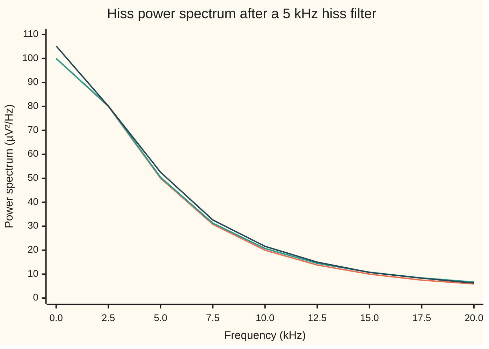

# Wiener-Khinchin: the power spectrum is the transform of the autocorrelation

[Syllabus](../../../SYLLABUS.md) → [Harmonic analysis](../README.md) → [Convolution and Approximate Identities](../README.md#s03) → Wiener-Khinchin

---

## General Overview

A cassette tape hisses. The hiss is random: no two playbacks give the same wave. But its strength at each frequency is steady. Here it is modelled as **white noise**: equal power at every frequency, 100 µV²/Hz (square microvolts per hertz). Across the audible band, −20 kHz to +20 kHz, that is a hiss of 2000.00 µV rms (root mean square). The numbers are illustrative.

Older amplifiers have a **hiss filter**: a switch that adds a simple low-pass filter, one resistor and one capacitor. Ours has its corner at 5 kHz, where it passes half the power. The engineer asks two things. How much hiss is left at 10 kHz? How loud is the filtered hiss in total?

The answers are 20 µV²/Hz at 10 kHz, a fifth of the input, and 1253.31 µV rms in total (1151.44 µV within the audible band). This card shows where they come from.

A random signal has no single Fourier transform. Each recording gives a different one. What is steady is the **power spectrum**: the average power per hertz at each frequency. The **Wiener-Khinchin theorem** gets it from the autocorrelation instead: how the signal correlates with itself a time τ later, on average. Take the Fourier transform of that. The autocorrelation often comes from a model, as it does for the filtered hiss, or from averaging products of the signal at two times, so no squared transforms need averaging. A filter then multiplies the spectrum by its gain squared (the gain is how much the filter scales each frequency).

**The power spectrum of a stationary random signal, its average power per hertz, is the Fourier transform of its autocorrelation, and a filter multiplies it by the squared size of its gain.**

**What kind of fact this is:** a theorem, proved on this card in Why it works, for stationary signals whose autocorrelation is continuous and absolutely integrable. White noise breaks that condition; it is an idealisation, handled here as a limit of independent samples, and the answer is shown settling.

### The picture: the hiss after the filter



Orange: the theorem's answer, 100 µV²/Hz times the gain squared. Teal: the same filter run on samples taken 100,000 times a second. It sits a little higher away from 0 Hz: sampling folds in power from above 50 kHz, and the sampled filter's slightly lower gain takes back only part of it. Dark blue: the average of 1000 simulated 10 ms recordings. At every point it lies within four standard errors of the exact expected value for 10 ms recordings; the check asserts this. That expected value sits just above teal from 5 kHz up, and a little below it at 0 and 2.5 kHz, where the short window's blur lowers the peak. The simulation's scatter is too wide to tell these curves apart. The input hiss is flat at 100 on this scale.

---

## The formula

**Stationary, in one line.** A random signal $`X(t)`$, in microvolts (µV) at time $`t`$ in seconds, is (weakly) stationary when its mean never changes and the average of $`X(t+\tau)\,X(t)`$ depends only on the gap $`\tau`$. [Stationarity and autocorrelation](../../09-Probability%20and%20statistics/12-Time%20Series/01-stationarity-and-autocorrelation.md) defines this for series in whole steps. Here time is continuous, the mean is zero, and the signal is real.

**The autocorrelation** is that average, as a function of the gap:

```math
R_X(\tau) = \mathbb{E}\big[X(t+\tau)\,X(t)\big].
```

Here $`\mathbb{E}`$ is the expected value, the average over every possible run of the signal. $`R_X(0)`$ is the variance, the mean square. It is the time series card's autocovariance $`\gamma(h)`$ with continuous $`\tau`$ in place of the whole-number lag $`h`$. [Correlation](06-correlation-and-the-matched-filter.md) defines $`R_{fg}(\tau)`$ for two fixed signals; $`R_X`$ is the same idea averaged over the randomness.

**The power spectrum** is new on this card. Cut a window of length $`T`$ seconds and take its transform, $`\hat X_T(\xi) = \int_{-T/2}^{T/2} X(t)\, e^{-2\pi i \xi t}\, dt`$, with $`\xi`$ in hertz and $`i`$ the imaginary unit. The power per hertz is the square of its size, averaged and divided by the window's length:

```math
S_X(\xi) = \lim_{T\to\infty} \frac{1}{T}\, \mathbb{E}\,\big\lvert \hat X_T(\xi)\big\rvert^2 .
```

**The Wiener-Khinchin theorem.** If $`R_X`$ is continuous and $`\int \lvert R_X(\tau)\rvert\, d\tau < \infty`$, then

```math
S_X(\xi) = \int_{-\infty}^{\infty} R_X(\tau)\, e^{-2\pi i \xi \tau}\, d\tau , \qquad S_X(\xi) \ge 0, \qquad \int_{-\infty}^{\infty} S_X(\xi)\, d\xi = R_X(0) \;\text{ when } S_X \text{ is integrable}.
```

**The filter rule.** Pass $`X`$ through a filter with impulse response $`h(t)`$, absolutely integrable, so the output is $`Y = h * X`$. Then

```math
S_Y(\xi) = \lvert \hat h(\xi)\rvert^2\, S_X(\xi).
```

**Read it aloud:** "The power per hertz is the Fourier transform of how the signal correlates with itself; it is never negative; its total area is the variance; and a filter multiplies it by the square of its gain."

The hiss filter has impulse response $`h(t) = 2\pi\xi_c\, e^{-2\pi\xi_c t}`$ for $`t \ge 0`$, zero before, with corner $`\xi_c`$ = 5 kHz. Its frequency response is $`\hat h(\xi) = 1/(1 + i\xi/\xi_c)`$, so $`\lvert\hat h(\xi)\rvert^2 = 1/(1 + (\xi/\xi_c)^2)`$.

| Symbol | Plain meaning | In our example | Push it up and the answer… |
| --- | --- | --- | --- |
| $`X(t)`$, $`Y(t)`$ | the random input and output, in µV | tape hiss; filtered hiss | — |
| $`t`$, $`\tau`$ | time; the gap between two times, in seconds | — | — |
| $`\xi`$, $`\xi_c`$ | frequency in hertz; the filter's corner | 10 kHz; 5 kHz | higher $`\xi`$: less output; higher $`\xi_c`$: more |
| $`\mathbb{E}`$, $`i`$ | average over all runs of the signal; the imaginary unit | — | — |
| $`R_X(\tau)`$, $`R_Y(\tau)`$ | autocorrelation: average of the signal times itself $`\tau`$ later | $`R_Y(0)`$ = 1,570,796.33 µV² | — |
| $`S_X(\xi)`$, $`S_Y(\xi)`$ | power spectrum: average power per hertz, both signs of $`\xi`$ | $`S_X`$ = 100; $`S_Y`$(10 kHz) = 20 µV²/Hz | — |
| $`N_0`$ | the white-noise level, a flat $`S_X`$ | 100 µV²/Hz | every output power scales with it |
| $`h(t)`$, $`h_-(t)`$, $`\hat h(\xi)`$ | the filter's impulse response; the same reversed in time, $`h(-t)`$; its frequency response (gain) | $`\lvert\hat h\rvert^2`$ = 0.2 at 10 kHz | — |
| $`T`$, $`\hat X_T(\xi)`$ | window length; the transform of one windowed run | 10 ms in the simulation | the windowed value settles on $`S_X`$ |
| $`\delta`$ | the delta: a spike of area 1 at zero | white noise has $`R_X = N_0\,\delta`$ | — |
| $`f_s`$, $`\sigma^2`$ | samples per second; the variance of one sample | 100 kHz; $`N_0 f_s`$ = 10,000,000 µV² | $`\sigma^2`$ grows without limit |
| $`x[n]`$, $`y[n]`$, $`C`$, $`H_d`$ | in the code: input and output samples; the sampled filter's memory factor $`e^{-2\pi\xi_c/f_s}`$; its gain | $`N_0\lvert H_d\rvert^2`$ = 20.667772 at 10 kHz | — |

$`S_X`$ here is two-sided: it counts negative and positive frequencies, and for a real signal it is even. Engineers often quote the one-sided spectrum, $`2S_X(\xi)`$ for $`\xi > 0`$, as [Spectral estimation](../../13-Engineering%20mathematics/05-Signals/06-spectral-estimation-and-periodograms.md) does. Both give the same variance.

### When it holds

- **The signal is stationary.** Its statistics must not drift. Brownian motion fails: its variance grows with time, so the average of $`X(t+\tau)X(t)`$ depends on $`t`$ and there is no single $`R_X(\tau)`$ to transform.
- **The autocorrelation is absolutely integrable.** A 50 Hz mains hum of amplitude 1 mV with random phase fails. Its windowed value at 50 Hz is 25,000, then 250,000, then 2,500,000 µV²/Hz for windows of 0.1 s, 1 s and 10 s. It grows without limit: the hum has power but no width, so it has no density.
- **The filter is linear, time-invariant and stable**, with $`\int\lvert h\rvert\,dt < \infty`$. A filter that changes over time does not act by one gain per frequency.
- **White noise is an idealisation.** Its $`R_X = N_0\,\delta`$ is not a function, and it has no finite variance. Sampled white noise has variance $`N_0 f_s`$: 5,000,000 µV² at 50 kHz, 40,000,000 µV² at 400 kHz. The filtered output settles: 1,521,080.96, then 1,569,989.37, towards 1,570,796.33 µV².

---

## Why it works

### Step 0: square the transform, then group the pairs of times by their gap

$`\lvert\hat X_T\rvert^2`$ is a double integral over pairs of times $`(t, s)`$ in the window. Average it, and each pair contributes $`R_X(t - s)`$, because the signal is stationary. Only the gap matters. So group the pairs by gap.

Pairs with gap $`\tau`$ fill a stretch of length $`T - \lvert\tau\rvert`$ inside the window. The result is the transform of $`R_X`$ with a triangle weight $`1 - \lvert\tau\rvert/T`$. As $`T`$ grows, the triangle flattens to 1, and the transform of $`R_X`$ is left.

### Step 1: expand the square and take the average

Write the squared size as the transform times its conjugate (the bar):

```math
\big\lvert \hat X_T(\xi)\big\rvert^2 = \int_{-T/2}^{T/2}\!\int_{-T/2}^{T/2} X(t)\, X(s)\, e^{-2\pi i \xi (t - s)}\, ds\, dt .
```

The average of $`X(t)X(s)`$ is $`R_X(t - s)`$. Moving $`\mathbb{E}`$ inside the integrals is allowed because $`\mathbb{E}\lvert X(t)X(s)\rvert \le R_X(0)`$ and the window is finite.

### Step 2: the triangle weight

Change variables to the gap $`\tau = t - s`$. For each $`\tau`$ between $`-T`$ and $`T`$, the times $`s`$ that keep both $`t`$ and $`s`$ in the window fill a length $`T - \lvert\tau\rvert`$. Divide by $`T`$:

```math
\frac{1}{T}\,\mathbb{E}\,\big\lvert \hat X_T(\xi)\big\rvert^2 = \int_{-T}^{T} \Big(1 - \frac{\lvert\tau\rvert}{T}\Big)\, R_X(\tau)\, e^{-2\pi i \xi \tau}\, d\tau .
```

This line is exact for every $`T`$. On the frequency side, the triangle is a Fejér kernel: the windowed value is the true spectrum convolved with $`T\,\mathrm{sinc}^2(T\xi)`$, a narrow bump of area 1. That is an approximate identity in the sense of [Approximate identities](03-approximate-identities.md), so the blur vanishes as $`T`$ grows.

For the filtered hiss at 10 kHz, the windowed value is:

| Window $`T`$ | $`\frac{1}{T}\mathbb{E}\lvert\hat Y_T\rvert^2`$, µV²/Hz |
| --- | --- |
| 0.1 ms | 23.654654 |
| 1 ms | 20.381972 |
| 10 ms | 20.038197 |
| 100 ms | 20.003820 |

### Step 3: let the window grow

At each $`\tau`$, the weight $`1 - \lvert\tau\rvert/T`$ rises to 1. The integrand is never larger than $`\lvert R_X(\tau)\rvert`$, which is integrable by assumption. So the dominated convergence theorem lets the limit pass inside the integral (when every integrand stays below one fixed integrable function, the limit of the integrals is the integral of the limit), and the windowed value tends to $`\int R_X(\tau)\, e^{-2\pi i\xi\tau}\, d\tau`$. That is the theorem.

Once $`R_X`$ has died away inside the window, the gap (windowed value minus the limit) is $`-\frac{1}{T}\int \lvert\tau\rvert\, R_X(\tau)\, e^{-2\pi i\xi\tau}\, d\tau`$, so it shrinks like $`1/T`$ whenever $`\lvert\tau\rvert R_X`$ is integrable. For the hiss at 10 kHz, $`T`$ times the gap at 100 ms is 0.000381972 µV², equal to the closed form of that integral, 0.000381972, to every printed digit.

### Step 4: what follows at once

- **Never negative.** $`S_X`$ is a limit of averages of squared sizes, so $`S_X(\xi) \ge 0`$. Not every function is an autocorrelation; this is the first test.
- **The variance is the area.** If $`S_X`$ is integrable, [Fourier inversion](../02-The%20Fourier%20Transform/04-fourier-inversion-theorem.md) gives $`R_X(\tau) = \int S_X(\xi)\,e^{2\pi i\xi\tau}\,d\xi`$ at every $`\tau`$, because $`R_X`$ is continuous. At $`\tau = 0`$ this says the variance is the total area under the spectrum. For the filtered hiss, the area by sums to 200 kHz is 1,545,801.53 µV²; adding the tail beyond 200 kHz in closed form gives 1,570,796.33, which is $`R_Y(0)`$.

### Step 5: a filter multiplies the spectrum by its gain squared

The output is $`Y(t) = \int h(u)\, X(t - u)\, du`$. Multiply two outputs and average:

```math
R_Y(\tau) = \int\!\!\int h(u)\, h(v)\, R_X(\tau - u + v)\, du\, dv = \big(h * h_- * R_X\big)(\tau), \qquad h_-(t) = h(-t).
```

[The convolution theorem](02-convolution-theorem-and-impulse-response.md) turns each convolution into a product. The transform of $`h`$ is $`\hat h`$. The transform of the reversed $`h_-`$ is $`\overline{\hat h}`$, the conjugate, because $`h`$ is real. Their product is $`\hat h\,\overline{\hat h} = \lvert\hat h\rvert^2`$. So $`S_Y = \lvert\hat h\rvert^2 S_X`$.

The gain's phase drops out. Only its size matters, and it enters squared because power is amplitude squared.

<details>
<summary>Detailed proof: the exchanges of limits, and why R_Y is integrable</summary>

**Step 1.** By Cauchy–Schwarz, $`\mathbb{E}\lvert X(t)X(s)\rvert \le \sqrt{\mathbb{E}X(t)^2\,\mathbb{E}X(s)^2} = R_X(0)`$. The window has area $`T^2`$, so the double integral of $`\mathbb{E}\lvert X(t)X(s)\rvert`$ is at most $`T^2 R_X(0)`$, and Fubini's theorem (the order of two integrations may be swapped when the absolute values have a finite total) lets $`\mathbb{E}`$ pass inside. This assumes $`X`$ is measurable in time and chance together, which holds for a suitable version of any signal with continuous $`R_X`$.

**Step 2.** Substitute $`\tau = t - s`$ for fixed $`s`$. The region $`\lvert t\rvert, \lvert s\rvert \le T/2`$ becomes $`\lvert\tau\rvert \le T`$ with $`s`$ in an interval of length $`T - \lvert\tau\rvert`$, and the integrand depends on $`\tau`$ alone.

**Step 3.** Set $`g_T(\tau) = (1 - \lvert\tau\rvert/T)_+\, R_X(\tau)\, e^{-2\pi i\xi\tau}`$, where $`(\cdot)_+`$ keeps only the positive part. Then $`\lvert g_T\rvert \le \lvert R_X\rvert`$ and $`g_T \to R_X\, e^{-2\pi i\xi\tau}`$ at each $`\tau`$. Dominated convergence gives the limit. The gap, windowed value minus limit as in the body, is $`-\int \min(1, \lvert\tau\rvert/T)\, R_X(\tau)\, e^{-2\pi i \xi\tau}\, d\tau`$, whose size is at most $`\frac{1}{T}\int\lvert\tau\rvert\,\lvert R_X(\tau)\rvert\, d\tau`$.

**Step 5.** $`\mathbb{E}\lvert X(t-u)X(t+\tau-v)\rvert \le R_X(0)`$ and $`\int\!\!\int \lvert h(u)\rvert\,\lvert h(v)\rvert\, du\, dv = \lVert h\rVert_1^2`$ is finite, so Fubini again moves $`\mathbb{E}`$ inside, giving the double integral. Young's inequality ([Convolution](01-convolution-and-youngs-inequality.md)) gives

$`\displaystyle \lVert R_Y\rVert_1 \le \lVert h\rVert_1^2\, \lVert R_X\rVert_1 ,`$

so $`R_Y`$ is integrable and Steps 1 to 3 apply to $`Y`$ too. The transform of an $`L^1`$ convolution is the product of transforms, which gives $`S_Y = \lvert\hat h\rvert^2 S_X`$.

</details>

### Step 6: white noise through the hiss filter

White noise has a flat spectrum, $`S_X = N_0`$. Its autocorrelation would be $`N_0\,\delta(\tau)`$: no memory at all, even an instant later. That is not an integrable function, so the theorem does not apply directly. The filter rule still gives an honest answer for the output, because the output's $`R_Y`$ is a true function:

```math
R_Y(\tau) = N_0\,(h * h_-)(\tau) = N_0\,\pi\xi_c\, e^{-2\pi\xi_c \lvert\tau\rvert}.
```

Transform it: $`\int N_0\pi\xi_c\, e^{-2\pi\xi_c\lvert\tau\rvert}\, e^{-2\pi i\xi\tau}\, d\tau = N_0/(1 + (\xi/\xi_c)^2)`$. That is $`N_0\lvert\hat h\rvert^2`$, as the filter rule says. The filter gives the hiss a short memory, and the memory's length sets the corner.

To make white noise concrete, use [Brownian motion](../../11-Stochastic%20processes%20and%20calculus/05-Brownian%20Motion/01-brownian-motion.md). White noise of level $`N_0`$ is its formal slope: a Brownian path whose variance grows by $`N_0`$ each second. Its moves over separate steps of length $`1/f_s`$ are independent with variance $`N_0/f_s`$. Divide each move by the step and the sample has variance $`\sigma^2 = N_0 f_s`$, with spectrum flat at $`N_0`$ up to $`f_s/2`$.

That variance has no limit as $`f_s`$ grows. The filtered output's does:

```
sampling rate     input variance, uV^2     output variance, uV^2     S_Y(10 kHz), uV^2/Hz
 50 kHz                5,000,000               1,521,080.96              22.791321
100 kHz               10,000,000               1,558,003.29              20.667772
200 kHz               20,000,000               1,567,574.46              20.165103
400 kHz               40,000,000               1,569,989.37              20.041161
limit                    none                  1,570,796.33              20.000000
```

Each doubling of $`f_s`$ shrinks the gap at 10 kHz. The theorem's answers are the limits.

---

## Worked numbers, by hand

The hiss filter on white noise of level $`N_0`$ = 100 µV²/Hz, corner $`\xi_c`$ = 5 kHz.

| Step | Arithmetic | Value |
| --- | --- | --- |
| frequency over corner at 10 kHz | 10,000 / 5,000 | 2 |
| gain squared at 10 kHz | $`1/(1 + 2^2)`$ | 0.2 |
| spectrum at 10 kHz | 100 × 0.2 | 20 µV²/Hz |
| gain squared at 5 kHz | $`1/(1 + 1^2)`$ | 0.5 |
| spectrum at 5 kHz | 100 × 0.5 | 50 µV²/Hz |
| output variance $`R_Y(0)`$ | $`100 \times \pi \times 5000`$ | 1,570,796.33 µV² |
| output rms | $`\sqrt{1{,}570{,}796.33}`$ | 1253.31 µV |
| input rms in the audible band | $`\sqrt{100 \times 40{,}000}`$ | 2000.00 µV |
| **output rms in the audible band** | $`\sqrt{2 \times 100 \times 5000 \times \arctan 4}`$ | **1151.44 µV** |

The hiss filter leaves a fifth of the hiss power at 10 kHz and cuts the audible hiss from 2.00 mV to 1.15 mV rms. The last line is the area of $`S_Y`$ between −20 kHz and +20 kHz, which is $`2N_0\xi_c\arctan(20/5)`$.

### What breaks if you drop a piece

| Mistake | Comes out at | What went wrong |
| --- | --- | --- |
| Multiply the spectrum by the gain, not the gain squared, at 10 kHz | 44.721360 µV²/Hz, not 20 | Power is amplitude squared; the gain must be squared too |
| Integrate the two-sided spectrum over positive frequencies only | 785,398.16 µV², rms 886.23 µV, not 1253.31 | Half the power sits at negative frequencies |
| Apply the theorem to a 50 Hz hum, whose $`R_X`$ is not integrable (hypothesis fails) | 25,000, 250,000, 2,500,000 µV²/Hz at $`T`$ = 0.1, 1, 10 s | A line has power but no width; the windowed value grows like $`T`$ |
| Ask for the variance of the white noise itself | 5,000,000 µV² sampled at 50 kHz, 40,000,000 at 400 kHz | Ideal white noise has no finite variance; only filtered noise does |

---

## Code, from first principles, and it actually runs

The script finds the filtered hiss's spectrum at 5 kHz and 10 kHz by four independent roads. The first is the gain-squared rule. The second computes the transform of $`R_Y`$ from its defining integral by Simpson's rule (thin slices weighted 1, 4, 2, 4, …) at two step counts. The third evaluates the proof's triangle-weighted line for windows from 0.1 ms to 100 ms and compares the gap with its closed form.

The fourth simulates. A SplitMix64 generator, seed 2026, written out in both languages, makes independent uniform samples 100,000 times a second. They pass through the sampled hiss filter $`y[n] = C\,y[n-1] + (1 - C)\,x[n]`$ with $`C = e^{-2\pi\xi_c/f_s}`$. The script averages the squared transform of 1000 recordings of 10 ms each and compares the average with the exact expected value, allowing four standard errors.

The sampled filter's own spectrum, $`N_0\lvert H_d\rvert^2`$, differs from the continuous one in two ways. Aliasing folds power from above 50 kHz back down, which raises it but cannot change the total. And the sampled filter's gain is slightly lower: its output variance is 1,558,003.29 µV², not 1,570,796.33. The script prints the gap rather than hiding it. It also checks that the area under $`S_Y`$ is the variance, and computes every number in What breaks.

### Python

```python
# Wiener-Khinchin -- the check behind the card.  Standard library only.
# Tape hiss, modelled as white noise of level N0 = 100 uV^2/Hz (two-sided),
# goes through a first-order hiss filter with corner 5 kHz.  Its power spectrum
# is found four ways: gain squared, the transform of the autocorrelation, the
# windowed definition E|X_T^|^2 / T, and a simulation.  All integrals written out.
from math import exp, cos, sin, pi, sqrt, atan

N0, XC = 100.0, 5000.0          # hiss level, uV^2/Hz; filter corner, Hz
A = 2 * pi * XC                 # filter h(t) = A e^(-A t), t >= 0; gain h^(xi) = 1/(1 + i xi/XC)
R0 = N0 * pi * XC               # R_Y(0), the output variance, uV^2
R_Y = lambda tau: R0 * exp(-A * abs(tau))
gain2 = lambda xi: 1 / (1 + (xi / XC) * (xi / XC))
out = []
def show(label, v, fmt="14.6f"):
    out.append(f"{label:<46}{v:{fmt}}")

def simpson(f, a, b, n):
    h = (b - a) / n
    s = 0.0                     # plain loops, not sum(): Python's sum() rounds differently from Rust
    for k in range(1, n):
        s += (4 if k % 2 else 2) * f(a + k * h)
    return (f(a) + f(b) + s) * h / 3

def transform_R(xi, cut, n):    # S_Y(xi) = int R_Y(tau) e^(-2 pi i xi tau) dtau; R_Y even, so a cosine integral
    return 2 * simpson(lambda t: R_Y(t) * cos(2 * pi * xi * t), 0.0, cut, n)

def windowed(xi, T, n=40000):   # the proof's middle line: E|X_T^(xi)|^2 / T = int (1 - |tau|/T) R_Y(tau) e^(...) dtau
    cut = min(T, 2e-3)          # beyond 2 ms, R_Y < e^(-62) of its peak
    return 2 * simpson(lambda t: (1 - t / T) * R_Y(t) * cos(2 * pi * xi * t), 0.0, cut, n)

for xi in (5000.0, 10000.0):
    show(f"gain squared at {xi / 1000:.0f} kHz", gain2(xi))
    show(f"S_Y({xi / 1000:.0f} kHz) = N0 x gain squared, uV^2/Hz", N0 * gain2(xi))
    show(f"  transform of R_Y, 2000 steps to 2 ms", transform_R(xi, 2e-3, 2000))
    show(f"  transform of R_Y, 4000 steps to 2 ms", transform_R(xi, 2e-3, 4000))
show("R_Y(0) = N0 pi xi_c, output variance, uV^2", R0, "14.2f")
X = 200000.0                    # area under S_Y: sums to 200 kHz plus the closed-form tail beyond
area = 2 * simpson(lambda x: N0 * gain2(x), 0.0, X, 20000)
tail = 2 * N0 * XC * (pi / 2 - atan(X / XC))
show("  area of S_Y by sums to 200 kHz", area, "14.2f")
show("  plus the closed-form tail beyond 200 kHz", area + tail, "14.2f")
show("output rms, uV", sqrt(R0), "14.2f")
show("hiss rms in the audible band +-20 kHz, uV", sqrt(N0 * 40000), "14.2f")
show("output rms in the audible band, uV", sqrt(2 * N0 * XC * atan(4)), "14.2f")
S10 = N0 * gain2(10000.0)
for T in (1e-4, 1e-3, 1e-2, 1e-1):
    show(f"windowed E|X_T^|^2/T at 10 kHz, T = {T * 1000:g} ms", windowed(10000.0, T))
w2 = 2 * pi * 10000.0
lead = -2 * R0 * (A * A - w2 * w2) / ((A * A + w2 * w2) * (A * A + w2 * w2))   # T x (windowed - S) as T grows
show("T x gap at T = 100 ms, uV^2", 0.1 * (windowed(10000.0, 0.1) - S10), "14.9f")
show("  closed form -2 R0 (a^2-w^2)/(a^2+w^2)^2", lead, "14.9f")

# ---- simulation: independent samples at fs stand in for white noise ----
def splitmix(state):
    state = (state + 0x9E3779B97F4A7C15) & 0xFFFFFFFFFFFFFFFF
    z = state
    z = ((z ^ (z >> 30)) * 0xBF58476D1CE4E5B9) & 0xFFFFFFFFFFFFFFFF
    z = ((z ^ (z >> 27)) * 0x94D049BB133111EB) & 0xFFFFFFFFFFFFFFFF
    return state, (z ^ (z >> 31)) >> 11

FS, N, K = 100000.0, 1000, 1000   # 100 kHz sampling; records of 10 ms; 1000 records
C = exp(-A / FS)                  # y[n] = C y[n-1] + (1 - C) x[n]: the hiss filter, sampled
amp = sqrt(12 * N0 * FS)          # uniform samples of variance N0 fs: flat spectrum N0 up to fs/2
TAB = [(cos(2 * pi * k / 40), sin(2 * pi * k / 40)) for k in range(40)]
FREQS = list(range(0, 9))         # bins at 2.5 kHz steps: 0, 2.5, ..., 20 kHz
state, y = 2026, 0.0
for _ in range(500):              # burn-in, so the filter starts in its steady state
    state, u = splitmix(state)
    y = C * y + (1 - C) * amp * (u * 2.0 ** -53 - 0.5)
sumP, sumP2, sumvar = [0.0] * 9, [0.0] * 9, 0.0
for r in range(K):
    rec = []
    for n in range(N):
        state, u = splitmix(state)
        y = C * y + (1 - C) * amp * (u * 2.0 ** -53 - 0.5)
        rec.append(y)
    for m in FREQS:
        re = im = 0.0
        for n, v in enumerate(rec):
            re += v * TAB[(m * n) % 40][0]
            im += v * TAB[(m * n) % 40][1]
            if m == 0:
                sumvar += v * v
        P = (re * re + im * im) / (N * FS)
        sumP[m] += P
        sumP2[m] += P * P
mean = [sumP[m] / K for m in FREQS]
se = [sqrt((sumP2[m] / K - mean[m] * mean[m]) / K) for m in FREQS]
g = lambda h: N0 * FS * (1 - C) * (1 - C) / (1 - C * C) * C ** abs(h)   # autocovariance of the sampled output
def expect(xi):                   # exact E P for a 1000-sample record: the triangle-weighted sum
    s = 0.0
    for h in range(-N + 1, N):
        s += (1 - abs(h) / N) * g(h) * cos(2 * pi * xi * h / FS)
    return s / FS
def sampled_S(xi, fs):            # N0 |H_d|^2: the sampled filter's spectrum, record length infinite
    c = exp(-A / fs)
    return N0 * (1 - c) * (1 - c) / (1 - 2 * c * cos(2 * pi * xi / fs) + c * c)
for m in (2, 4):
    xi = 2500.0 * m
    show(f"sim {xi / 1000:.0f} kHz: mean of 1000 periodograms", mean[m])
    show("  its standard error", se[m])
    show("  exact expectation, 10 ms records", expect(xi))
    show("  sampled spectrum N0 |H_d|^2", sampled_S(xi, FS))
    show("  continuous S_Y", N0 * gain2(xi))
show("sim output variance, uV^2", sumvar / (N * K), "14.2f")
show("  sampled output variance g(0), uV^2", g(0), "14.2f")
for fs in (50e3, 100e3, 200e3, 400e3):
    c = exp(-A / fs)
    out.append(f"settle fs {fs / 1000:3.0f} kHz: input var {N0 * fs:11.0f}  output var {N0 * fs * (1 - c) / (1 + c):11.2f}"
               f"  S(10k) {sampled_S(1e4, fs):9.6f}")
# ---- what breaks ----
show("mistake: gain not squared at 10 kHz", N0 / sqrt(1 + 4))
show("mistake: S_Y over positive frequencies only", R0 / 2, "14.2f")
show("  its rms, uV", sqrt(R0 / 2), "14.2f")
HUM = 1000.0                      # 50 Hz hum, amplitude 1 mV, random phase: R = (HUM^2/2) cos(2 pi 50 tau)
hum = lambda T: 2 * simpson(lambda t: (1 - t / T) * HUM * HUM / 2 * cos(2 * pi * 50 * t) * cos(2 * pi * 50 * t), 0.0, T, 20000)
for T in (0.1, 1.0, 10.0):
    show(f"hum: windowed value at 50 Hz, T = {T:g} s", HUM * HUM * T / 4, "14.2f")
for T in (0.1, 1.0):
    show(f"  T = {T:g} s by sums", hum(T), "14.2f")
# ---- try changing ----
show("try: corner 2.5 kHz, S_Y(10 kHz)", N0 / (1 + 16))
show("try: corner 2.5 kHz, output rms, uV", sqrt(N0 * pi * 2500), "14.2f")
show("try: N0 = 400, output rms, uV", sqrt(400 * pi * XC), "14.2f")
out.append("chart, frequency (kHz) " + " ".join(f"{2.5 * m:5.1f}" for m in FREQS))
out.append("chart, S_Y closed      " + " ".join(f"{N0 * gain2(2500.0 * m):5.1f}" for m in FREQS))
out.append("chart, sampled filter  " + " ".join(f"{sampled_S(2500.0 * m, FS):5.1f}" for m in FREQS))
out.append("chart, S_Y simulated   " + " ".join(f"{mean[m]:5.1f}" for m in FREQS))
print("\n".join(out))

assert abs(transform_R(10000.0, 2e-3, 4000) - S10) < 1e-6        # transform of R_Y meets N0 |h^|^2
assert abs(transform_R(5000.0, 2e-3, 4000) - 50.0) < 1e-6
assert abs(area + tail - R0) < 1e-3                                  # variance = area under S_Y
assert abs(windowed(10000.0, 0.01) - S10) < abs(windowed(10000.0, 0.001) - S10) / 5   # the window settles
assert abs(0.1 * (windowed(10000.0, 0.1) - S10) - lead) < 1e-8      # with the proof's 1/T gap
for m in FREQS:
    assert abs(mean[m] - expect(2500.0 * m)) < 4 * se[m]               # simulation meets the formula
assert abs(sumvar / (N * K) - g(0)) < 0.02 * g(0)
assert all(abs(hum(T) - HUM * HUM * T / 4) < 1e-3 for T in (0.1, 1.0))  # sums confirm the growth: no density
print("ALL CHECKS PASS")
```

**Ran 2026-11-15 on macOS, Python 3.14.10, standard library only. All checks passed. Output, pasted from the run:**

```
gain squared at 5 kHz                               0.500000
S_Y(5 kHz) = N0 x gain squared, uV^2/Hz            50.000000
  transform of R_Y, 2000 steps to 2 ms             49.999999
  transform of R_Y, 4000 steps to 2 ms             50.000000
gain squared at 10 kHz                              0.200000
S_Y(10 kHz) = N0 x gain squared, uV^2/Hz           20.000000
  transform of R_Y, 2000 steps to 2 ms             19.999994
  transform of R_Y, 4000 steps to 2 ms             20.000000
R_Y(0) = N0 pi xi_c, output variance, uV^2        1570796.33
  area of S_Y by sums to 200 kHz                  1545801.53
  plus the closed-form tail beyond 200 kHz        1570796.33
output rms, uV                                       1253.31
hiss rms in the audible band +-20 kHz, uV            2000.00
output rms in the audible band, uV                   1151.44
windowed E|X_T^|^2/T at 10 kHz, T = 0.1 ms         23.654654
windowed E|X_T^|^2/T at 10 kHz, T = 1 ms           20.381972
windowed E|X_T^|^2/T at 10 kHz, T = 10 ms          20.038197
windowed E|X_T^|^2/T at 10 kHz, T = 100 ms         20.003820
T x gap at T = 100 ms, uV^2                      0.000381972
  closed form -2 R0 (a^2-w^2)/(a^2+w^2)^2        0.000381972
sim 5 kHz: mean of 1000 periodograms               52.493572
  its standard error                                1.644546
  exact expectation, 10 ms records                 50.413821
  sampled spectrum N0 |H_d|^2                      50.411225
  continuous S_Y                                   50.000000
sim 10 kHz: mean of 1000 periodograms              21.586321
  its standard error                                0.662326
  exact expectation, 10 ms records                 20.708293
  sampled spectrum N0 |H_d|^2                      20.667772
  continuous S_Y                                   20.000000
sim output variance, uV^2                         1561440.86
  sampled output variance g(0), uV^2              1558003.29
settle fs  50 kHz: input var     5000000  output var  1521080.96  S(10k) 22.791321
settle fs 100 kHz: input var    10000000  output var  1558003.29  S(10k) 20.667772
settle fs 200 kHz: input var    20000000  output var  1567574.46  S(10k) 20.165103
settle fs 400 kHz: input var    40000000  output var  1569989.37  S(10k) 20.041161
mistake: gain not squared at 10 kHz                44.721360
mistake: S_Y over positive frequencies only        785398.16
  its rms, uV                                         886.23
hum: windowed value at 50 Hz, T = 0.1 s             25000.00
hum: windowed value at 50 Hz, T = 1 s              250000.00
hum: windowed value at 50 Hz, T = 10 s            2500000.00
  T = 0.1 s by sums                                 25000.00
  T = 1 s by sums                                  250000.00
try: corner 2.5 kHz, S_Y(10 kHz)                    5.882353
try: corner 2.5 kHz, output rms, uV                   886.23
try: N0 = 400, output rms, uV                        2506.63
chart, frequency (kHz)   0.0   2.5   5.0   7.5  10.0  12.5  15.0  17.5  20.0
chart, S_Y closed      100.0  80.0  50.0  30.8  20.0  13.8  10.0   7.5   5.9
chart, sampled filter  100.0  80.2  50.4  31.3  20.7  14.5  10.8   8.4   6.7
chart, S_Y simulated   105.2  80.1  52.5  32.6  21.6  15.0  10.7   8.3   6.3
ALL CHECKS PASS
```

### Rust

```rust
// Wiener-Khinchin -- the check behind the card.  Rust std only, no crates.
// Tape hiss, modelled as white noise of level N0 = 100 uV^2/Hz (two-sided),
// goes through a first-order hiss filter with corner 5 kHz.  Its power spectrum
// is found four ways: gain squared, the transform of the autocorrelation, the
// windowed definition E|X_T^|^2 / T, and a simulation.  All integrals written out.
use std::f64::consts::PI;

const N0: f64 = 100.0; // hiss level, uV^2/Hz
const XC: f64 = 5000.0; // filter corner, Hz
const A: f64 = 2.0 * PI * XC; // filter h(t) = A e^(-A t), t >= 0; gain h^(xi) = 1/(1 + i xi/XC)
const R0: f64 = N0 * PI * XC; // R_Y(0), the output variance, uV^2
const FS: f64 = 100000.0; // 100 kHz sampling
const N: usize = 1000; // records of 10 ms
const K: usize = 1000; // 1000 records
const HUM: f64 = 1000.0; // 50 Hz hum, amplitude 1 mV, random phase

fn r_y(tau: f64) -> f64 { R0 * (-A * tau.abs()).exp() }
fn gain2(xi: f64) -> f64 { 1.0 / (1.0 + (xi / XC) * (xi / XC)) }

fn show(out: &mut Vec<String>, label: &str, v: f64, dec: usize) {
    out.push(format!("{:<46}{:14.*}", label, dec, v));
}

fn simpson<F: Fn(f64) -> f64>(f: F, a: f64, b: f64, n: usize) -> f64 {
    let h = (b - a) / n as f64;
    let mut s = 0.0;
    for k in 1..n {
        s += (if k % 2 == 1 { 4.0 } else { 2.0 }) * f(a + k as f64 * h);
    }
    (f(a) + f(b) + s) * h / 3.0
}

fn transform_r(xi: f64, cut: f64, n: usize) -> f64 {
    2.0 * simpson(|t| r_y(t) * (2.0 * PI * xi * t).cos(), 0.0, cut, n)
}

fn windowed(xi: f64, t_rec: f64) -> f64 {
    let cut = t_rec.min(2e-3); // beyond 2 ms, R_Y < e^(-62) of its peak
    2.0 * simpson(|t| (1.0 - t / t_rec) * r_y(t) * (2.0 * PI * xi * t).cos(), 0.0, cut, 40000)
}

fn splitmix(state: &mut u64) -> u64 {
    *state = state.wrapping_add(0x9E3779B97F4A7C15);
    let mut z = *state;
    z = (z ^ (z >> 30)).wrapping_mul(0xBF58476D1CE4E5B9);
    z = (z ^ (z >> 27)).wrapping_mul(0x94D049BB133111EB);
    (z ^ (z >> 31)) >> 11
}

fn sampled_s(xi: f64, fs: f64) -> f64 {
    let c = (-A / fs).exp();
    N0 * (1.0 - c) * (1.0 - c) / (1.0 - 2.0 * c * (2.0 * PI * xi / fs).cos() + c * c)
}

fn main() {
    let mut out: Vec<String> = Vec::new();
    for xi in [5000.0f64, 10000.0] {
        let kz = xi / 1000.0;
        show(&mut out, &format!("gain squared at {:.0} kHz", kz), gain2(xi), 6);
        show(&mut out, &format!("S_Y({:.0} kHz) = N0 x gain squared, uV^2/Hz", kz), N0 * gain2(xi), 6);
        show(&mut out, "  transform of R_Y, 2000 steps to 2 ms", transform_r(xi, 2e-3, 2000), 6);
        show(&mut out, "  transform of R_Y, 4000 steps to 2 ms", transform_r(xi, 2e-3, 4000), 6);
    }
    show(&mut out, "R_Y(0) = N0 pi xi_c, output variance, uV^2", R0, 2);
    let x = 200000.0; // area under S_Y: sums to 200 kHz plus the closed-form tail beyond
    let area = 2.0 * simpson(|v| N0 * gain2(v), 0.0, x, 20000);
    let tail = 2.0 * N0 * XC * (PI / 2.0 - (x / XC).atan());
    show(&mut out, "  area of S_Y by sums to 200 kHz", area, 2);
    show(&mut out, "  plus the closed-form tail beyond 200 kHz", area + tail, 2);
    show(&mut out, "output rms, uV", R0.sqrt(), 2);
    show(&mut out, "hiss rms in the audible band +-20 kHz, uV", (N0 * 40000.0).sqrt(), 2);
    show(&mut out, "output rms in the audible band, uV", (2.0 * N0 * XC * 4.0f64.atan()).sqrt(), 2);
    let s10 = N0 * gain2(10000.0);
    for (t, lab) in [(1e-4, "0.1"), (1e-3, "1"), (1e-2, "10"), (1e-1, "100")] {
        show(&mut out, &format!("windowed E|X_T^|^2/T at 10 kHz, T = {} ms", lab), windowed(10000.0, t), 6);
    }
    let w2 = 2.0 * PI * 10000.0;
    let lead = -2.0 * R0 * (A * A - w2 * w2) / ((A * A + w2 * w2) * (A * A + w2 * w2));
    show(&mut out, "T x gap at T = 100 ms, uV^2", 0.1 * (windowed(10000.0, 0.1) - s10), 9);
    show(&mut out, "  closed form -2 R0 (a^2-w^2)/(a^2+w^2)^2", lead, 9);

    // ---- simulation: independent samples at fs stand in for white noise ----
    let c = (-A / FS).exp(); // y[n] = C y[n-1] + (1 - C) x[n]: the hiss filter, sampled
    let amp = (12.0 * N0 * FS).sqrt(); // uniform samples of variance N0 fs
    let tab: Vec<(f64, f64)> = (0..40).map(|k| ((2.0 * PI * k as f64 / 40.0).cos(), (2.0 * PI * k as f64 / 40.0).sin())).collect();
    let unit = 2.0f64.powi(-53);
    let mut state: u64 = 2026;
    let mut y = 0.0;
    for _ in 0..500 {
        let u = splitmix(&mut state) as f64;
        y = c * y + (1.0 - c) * amp * (u * unit - 0.5);
    }
    let (mut sum_p, mut sum_p2, mut sumvar) = ([0.0f64; 9], [0.0f64; 9], 0.0f64);
    let mut rec = vec![0.0f64; N];
    for _ in 0..K {
        for n in 0..N {
            let u = splitmix(&mut state) as f64;
            y = c * y + (1.0 - c) * amp * (u * unit - 0.5);
            rec[n] = y;
        }
        for m in 0..9 {
            let (mut re, mut im) = (0.0, 0.0);
            for (n, &v) in rec.iter().enumerate() {
                re += v * tab[(m * n) % 40].0;
                im += v * tab[(m * n) % 40].1;
                if m == 0 { sumvar += v * v; }
            }
            let p = (re * re + im * im) / (N as f64 * FS);
            sum_p[m] += p;
            sum_p2[m] += p * p;
        }
    }
    let mean: Vec<f64> = (0..9).map(|m| sum_p[m] / K as f64).collect();
    let se: Vec<f64> = (0..9).map(|m| ((sum_p2[m] / K as f64 - mean[m] * mean[m]) / K as f64).sqrt()).collect();
    let g = |h: i64| N0 * FS * (1.0 - c) * (1.0 - c) / (1.0 - c * c) * c.powf(h.abs() as f64);
    let expect = |xi: f64| {
        let mut s = 0.0;
        for h in -(N as i64) + 1..N as i64 {
            s += (1.0 - h.abs() as f64 / N as f64) * g(h) * (2.0 * PI * xi * h as f64 / FS).cos();
        }
        s / FS
    };
    for m in [2usize, 4] {
        let xi = 2500.0 * m as f64;
        show(&mut out, &format!("sim {:.0} kHz: mean of 1000 periodograms", xi / 1000.0), mean[m], 6);
        show(&mut out, "  its standard error", se[m], 6);
        show(&mut out, "  exact expectation, 10 ms records", expect(xi), 6);
        show(&mut out, "  sampled spectrum N0 |H_d|^2", sampled_s(xi, FS), 6);
        show(&mut out, "  continuous S_Y", N0 * gain2(xi), 6);
    }
    let simvar = sumvar / (N * K) as f64;
    show(&mut out, "sim output variance, uV^2", simvar, 2);
    show(&mut out, "  sampled output variance g(0), uV^2", g(0), 2);
    for fs in [50e3f64, 100e3, 200e3, 400e3] {
        let cc = (-A / fs).exp();
        out.push(format!("settle fs {:3.0} kHz: input var {:11.0}  output var {:11.2}  S(10k) {:9.6}",
            fs / 1000.0, N0 * fs, N0 * fs * (1.0 - cc) / (1.0 + cc), sampled_s(1e4, fs)));
    }
    // ---- what breaks ----
    show(&mut out, "mistake: gain not squared at 10 kHz", N0 / (1.0f64 + 4.0).sqrt(), 6);
    show(&mut out, "mistake: S_Y over positive frequencies only", R0 / 2.0, 2);
    show(&mut out, "  its rms, uV", (R0 / 2.0).sqrt(), 2);
    let hum = |t_rec: f64| 2.0 * simpson(|t| (1.0 - t / t_rec) * HUM * HUM / 2.0 * (2.0 * PI * 50.0 * t).cos() * (2.0 * PI * 50.0 * t).cos(), 0.0, t_rec, 20000);
    for (t, lab) in [(0.1, "0.1"), (1.0, "1"), (10.0, "10")] {
        show(&mut out, &format!("hum: windowed value at 50 Hz, T = {} s", lab), HUM * HUM * t / 4.0, 2);
    }
    for (t, lab) in [(0.1, "0.1"), (1.0, "1")] { show(&mut out, &format!("  T = {} s by sums", lab), hum(t), 2); }
    // ---- try changing ----
    show(&mut out, "try: corner 2.5 kHz, S_Y(10 kHz)", N0 / (1.0 + 16.0), 6);
    show(&mut out, "try: corner 2.5 kHz, output rms, uV", (N0 * PI * 2500.0).sqrt(), 2);
    show(&mut out, "try: N0 = 400, output rms, uV", (400.0 * PI * XC).sqrt(), 2);
    let row = |f: &dyn Fn(usize) -> f64| (0..9).map(|m| format!("{:5.1}", f(m))).collect::<Vec<_>>().join(" ");
    out.push(format!("chart, frequency (kHz) {}", row(&|m| 2.5 * m as f64)));
    out.push(format!("chart, S_Y closed      {}", row(&|m| N0 * gain2(2500.0 * m as f64))));
    out.push(format!("chart, sampled filter  {}", row(&|m| sampled_s(2500.0 * m as f64, FS))));
    out.push(format!("chart, S_Y simulated   {}", row(&|m| mean[m])));
    println!("{}", out.join("\n"));

    assert!((transform_r(10000.0, 2e-3, 4000) - s10).abs() < 1e-6); // transform of R_Y meets N0 |h^|^2
    assert!((transform_r(5000.0, 2e-3, 4000) - 50.0).abs() < 1e-6);
    assert!((area + tail - R0).abs() < 1e-3); // variance = area under S_Y
    assert!((windowed(10000.0, 0.01) - s10).abs() < (windowed(10000.0, 0.001) - s10).abs() / 5.0); // the window settles
    assert!((0.1 * (windowed(10000.0, 0.1) - s10) - lead).abs() < 1e-8); // with the proof's 1/T gap
    for m in 0..9 {
        assert!((mean[m] - expect(2500.0 * m as f64)).abs() < 4.0 * se[m]); // simulation meets the formula
    }
    assert!((simvar - g(0)).abs() < 0.02 * g(0));
    for t in [0.1, 1.0] { assert!((hum(t) - HUM * HUM * t / 4.0).abs() < 1e-3); } // sums confirm the growth: no density
    println!("ALL CHECKS PASS");
}
```

**Ran 2026-11-15 on macOS, rustc 1.98.1, no crates. All checks passed. Output, pasted from the run:**

```
gain squared at 5 kHz                               0.500000
S_Y(5 kHz) = N0 x gain squared, uV^2/Hz            50.000000
  transform of R_Y, 2000 steps to 2 ms             49.999999
  transform of R_Y, 4000 steps to 2 ms             50.000000
gain squared at 10 kHz                              0.200000
S_Y(10 kHz) = N0 x gain squared, uV^2/Hz           20.000000
  transform of R_Y, 2000 steps to 2 ms             19.999994
  transform of R_Y, 4000 steps to 2 ms             20.000000
R_Y(0) = N0 pi xi_c, output variance, uV^2        1570796.33
  area of S_Y by sums to 200 kHz                  1545801.53
  plus the closed-form tail beyond 200 kHz        1570796.33
output rms, uV                                       1253.31
hiss rms in the audible band +-20 kHz, uV            2000.00
output rms in the audible band, uV                   1151.44
windowed E|X_T^|^2/T at 10 kHz, T = 0.1 ms         23.654654
windowed E|X_T^|^2/T at 10 kHz, T = 1 ms           20.381972
windowed E|X_T^|^2/T at 10 kHz, T = 10 ms          20.038197
windowed E|X_T^|^2/T at 10 kHz, T = 100 ms         20.003820
T x gap at T = 100 ms, uV^2                      0.000381972
  closed form -2 R0 (a^2-w^2)/(a^2+w^2)^2        0.000381972
sim 5 kHz: mean of 1000 periodograms               52.493572
  its standard error                                1.644546
  exact expectation, 10 ms records                 50.413821
  sampled spectrum N0 |H_d|^2                      50.411225
  continuous S_Y                                   50.000000
sim 10 kHz: mean of 1000 periodograms              21.586321
  its standard error                                0.662326
  exact expectation, 10 ms records                 20.708293
  sampled spectrum N0 |H_d|^2                      20.667772
  continuous S_Y                                   20.000000
sim output variance, uV^2                         1561440.86
  sampled output variance g(0), uV^2              1558003.29
settle fs  50 kHz: input var     5000000  output var  1521080.96  S(10k) 22.791321
settle fs 100 kHz: input var    10000000  output var  1558003.29  S(10k) 20.667772
settle fs 200 kHz: input var    20000000  output var  1567574.46  S(10k) 20.165103
settle fs 400 kHz: input var    40000000  output var  1569989.37  S(10k) 20.041161
mistake: gain not squared at 10 kHz                44.721360
mistake: S_Y over positive frequencies only        785398.16
  its rms, uV                                         886.23
hum: windowed value at 50 Hz, T = 0.1 s             25000.00
hum: windowed value at 50 Hz, T = 1 s              250000.00
hum: windowed value at 50 Hz, T = 10 s            2500000.00
  T = 0.1 s by sums                                 25000.00
  T = 1 s by sums                                  250000.00
try: corner 2.5 kHz, S_Y(10 kHz)                    5.882353
try: corner 2.5 kHz, output rms, uV                   886.23
try: N0 = 400, output rms, uV                        2506.63
chart, frequency (kHz)   0.0   2.5   5.0   7.5  10.0  12.5  15.0  17.5  20.0
chart, S_Y closed      100.0  80.0  50.0  30.8  20.0  13.8  10.0   7.5   5.9
chart, sampled filter  100.0  80.2  50.4  31.3  20.7  14.5  10.8   8.4   6.7
chart, S_Y simulated   105.2  80.1  52.5  32.6  21.6  15.0  10.7   8.3   6.3
ALL CHECKS PASS
```

The roads agree. The simulated average at 10 kHz is 21.586321, standard error 0.662326, against an exact expectation of 20.708293 for 10 ms recordings. The simulated output variance is 1,561,440.86 µV², against the sampled filter's 1,558,003.29.

### Lean

Lean proves the theorem, the two facts that follow, and the filter rule, for every stationary signal whose autocorrelation is continuous and absolutely integrable.

- Take a stationary signal $`X`$ whose $`R_X`$ is continuous and absolutely integrable. Then $`S_X(\xi)`$, the limit of the windowed value, exists and equals the transform of $`R_X`$ at every $`\xi`$.
- Take the same signal. Then $`S_X(\xi)`$ is real and never negative at every frequency $`\xi`$.
- Suppose also that $`S_X`$ is integrable. Then its total area is $`R_X(0)`$, the mean square of $`X(t)`$ at every time $`t`$.
- Take a filter $`h`$ with $`\int\lvert h\rvert\,dt < \infty`$ and the output $`Y = h * X`$. Then $`S_Y(\xi) = \lvert\hat h(\xi)\rvert^2\,S_X(\xi)`$ at every frequency $`\xi`$.
- Lean also checks the hiss numbers exactly: gain squared 1/2 and 1/5, and spectrum 50 and 20 µV²/Hz at 5 and 10 kHz.
- It checks the audible-band hiss of 2000 µV rms, the sampled variances, the hum's growing values and the 2.5 kHz corner.

The filter's closed forms, white noise, the simulation and every decimal are left to the Python and Rust checks.

```lean
-- Wiener-Khinchin: for a stationary random signal with a continuous, absolutely integrable autocorrelation, the power spectrum (the limit of the averaged windowed transform squared, over the window length) is the Fourier transform of the autocorrelation, it is never negative with area equal to the mean square, and a stable filter multiplies it by its gain squared.
import Mathlib.Analysis.Fourier.FourierTransform
import Mathlib.MeasureTheory.Integral.IntervalIntegral.Basic
import Mathlib.MeasureTheory.Function.LpSeminorm.Basic
import Mathlib.Analysis.SpecialFunctions.Complex.Circle
import Mathlib.Tactic.NormNum
import Mathlib.Analysis.Fourier.Inversion
import Mathlib.MeasureTheory.Integral.Prod
import Mathlib.MeasureTheory.Function.L2Space
import Mathlib.MeasureTheory.Integral.DominatedConvergence
import Mathlib.MeasureTheory.Group.Integral

/-! A random signal is `X : ℝ → Ω → ℝ`: its value in µV at time `t` (seconds) on the run `ω` of
the chance space `Ω`, which carries a probability measure `P`; `∫ ω, · ∂P` is the average `𝔼`.
"Stationary with autocorrelation `R`" is `𝔼[X(t + τ) X(t)] = R(τ)` for all `t` and `τ`, with
finite mean squares (`MemLp (X t) 2 P`), and `X` measurable in time and chance together.
`𝓕 f ξ` is Mathlib's Fourier transform in hertz, `∫ e^(−2πiξτ) f(τ) dτ`, the card's `f̂(ξ)`.
The windowed transform of one run is `X̂_T(ξ) = ∫_{−T/2}^{T/2} X(t) e^(−2πiξt) dt`, and the
card's power spectrum `S_X(ξ)` is the limit of `(1/T) 𝔼 |X̂_T(ξ)|²` as `T → ∞`. -/

open MeasureTheory Filter Topology FourierTransform Real

variable {Ω : Type*} [MeasurableSpace Ω]

/-- The windowed power `(1/T) 𝔼 |X̂_T(ξ)|²` of a random signal `X` at frequency `ξ`, for a window
of length `T` seconds centred at time 0. Its limit as `T → ∞` is the power spectrum `S_X(ξ)`. -/
noncomputable def windowedPower (P : Measure Ω) (X : ℝ → Ω → ℝ) (T ξ : ℝ) : ℝ :=
  (1 / T) * ∫ ω, ‖∫ t in (-(T / 2))..(T / 2),
    Complex.exp (-((2 * π * ξ * t : ℝ) : ℂ) * Complex.I) * (X t ω : ℂ)‖ ^ 2 ∂P


/-- The phase factor of a Fourier transform in hertz. -/
lemma wk_norm_exp_neg (r : ℝ) : ‖Complex.exp (-((r : ℝ) : ℂ) * Complex.I)‖ = 1 := by
  rw [← Complex.ofReal_neg, Complex.norm_exp_ofReal_mul_I]

lemma wk_exp_mul_conj (ξ t s : ℝ) :
    Complex.exp (-((2 * π * ξ * t : ℝ) : ℂ) * Complex.I) *
      (starRingEnd ℂ) (Complex.exp (-((2 * π * ξ * s : ℝ) : ℂ) * Complex.I)) =
    Complex.exp (↑(-2 * π * (t - s) * ξ) * Complex.I) := by
  rw [← Complex.exp_conj, ← Complex.exp_add]
  congr 1
  simp only [map_mul, map_neg, Complex.conj_ofReal, Complex.conj_I]
  push_cast; ring

lemma wk_abs_mul_le (x y : ℝ) : |x * y| ≤ (x ^ 2 + y ^ 2) / 2 := by
  rw [abs_mul]; nlinarith [sq_nonneg (|x| - |y|), sq_abs x, sq_abs y]

/-- The triangle weight: `T - 2|τ| ≤ ∫_{s ∈ I} 1_I(τ + s) ds ≤ T` for the window `I`. -/
lemma wk_weight_bounds (T τ : ℝ) (hT : 0 < T) :
    T - 2 * |τ| ≤ ∫ s in Set.Ioc (-(T / 2)) (T / 2),
        (Set.Ioc (-(T / 2)) (T / 2)).indicator (fun _ => (1 : ℝ)) (τ + s) ∧
    0 ≤ ∫ s in Set.Ioc (-(T / 2)) (T / 2),
        (Set.Ioc (-(T / 2)) (T / 2)).indicator (fun _ => (1 : ℝ)) (τ + s) ∧
    ∫ s in Set.Ioc (-(T / 2)) (T / 2),
        (Set.Ioc (-(T / 2)) (T / 2)).indicator (fun _ => (1 : ℝ)) (τ + s) ≤ T := by
  set I := Set.Ioc (-(T / 2)) (T / 2)
  have hind_nn : ∀ x, 0 ≤ I.indicator (fun _ => (1 : ℝ)) x :=
    fun x => Set.indicator_nonneg (fun _ _ => zero_le_one) x
  have hind_le : ∀ x, I.indicator (fun _ => (1 : ℝ)) x ≤ 1 := by
    intro x; by_cases hx : x ∈ I <;> simp [Set.indicator_of_mem, Set.indicator_of_notMem, hx]
  have hmeas : Measurable (fun s => I.indicator (fun _ => (1 : ℝ)) (τ + s)) :=
    (measurable_const.indicator measurableSet_Ioc).comp (measurable_const.add measurable_id)
  have hint : IntegrableOn (fun s => I.indicator (fun _ => (1 : ℝ)) (τ + s)) I := by
    refine Integrable.of_bound hmeas.aestronglyMeasurable 1 (ae_of_all _ fun s => ?_)
    rw [Real.norm_eq_abs, abs_of_nonneg (hind_nn _)]; exact hind_le _
  refine ⟨?_, setIntegral_nonneg measurableSet_Ioc (fun s _ => hind_nn _), ?_⟩
  · set J := Set.Ioc (-(T / 2) + |τ|) (T / 2 - |τ|)
    have hJI : J ⊆ I := by
      intro s hs; simp only [J, I, Set.mem_Ioc] at hs ⊢
      constructor <;> linarith [abs_nonneg τ]
    have h1 : ∫ s in J, I.indicator (fun _ => (1 : ℝ)) (τ + s) = ∫ s in J, (1 : ℝ) := by
      refine setIntegral_congr_fun measurableSet_Ioc (fun s hs => ?_)
      simp only [J, Set.mem_Ioc] at hs
      have : τ + s ∈ I := by
        simp only [I, Set.mem_Ioc]
        constructor <;> linarith [neg_abs_le τ, le_abs_self τ]
      simp [Set.indicator_of_mem this]
    have h2 : ∫ s in J, (1 : ℝ) = max (T - 2 * |τ|) 0 := by
      rw [setIntegral_const, smul_eq_mul, mul_one, Real.volume_real_Ioc]; congr 1; ring
    calc T - 2 * |τ| ≤ max (T - 2 * |τ|) 0 := le_max_left _ _
      _ = ∫ s in J, I.indicator (fun _ => (1 : ℝ)) (τ + s) := by rw [h1, h2]
      _ ≤ _ := setIntegral_mono_set hint (ae_of_all _ fun s => hind_nn _)
          (Eventually.of_forall hJI)
  · calc ∫ s in I, I.indicator (fun _ => (1 : ℝ)) (τ + s) ≤ ∫ s in I, (1 : ℝ) :=
          setIntegral_mono hint (integrableOn_const (by simp [I])) (fun s => hind_le _)
      _ = T := by
          rw [setIntegral_const, smul_eq_mul, mul_one, Real.volume_real_Ioc]
          rw [max_eq_left (by linarith)]; ring

lemma wk_integral_ofReal {α : Type*} [MeasurableSpace α] {μ : Measure α} (f : α → ℝ) :
    ∫ x, (f x : ℂ) ∂μ = ((∫ x, f x ∂μ : ℝ) : ℂ) :=
  integral_ofReal

lemma wk_meas_comp {X : ℝ → Ω → ℝ} (hX : Measurable (fun p : ℝ × Ω => X p.1 p.2))
    {β : Type*} [MeasurableSpace β] {f : β → ℝ} {g : β → Ω} (hf : Measurable f)
    (hg : Measurable g) : Measurable (fun b => X (f b) (g b)) :=
  hX.comp (hf.prodMk hg)

/-- The windowed power as a weighted integral of the transformed autocorrelation. -/
lemma wk_windowed_eq (P : Measure Ω) [IsProbabilityMeasure P]
    (X : ℝ → Ω → ℝ) (R : ℝ → ℝ)
    (hX : Measurable (fun p : ℝ × Ω => X p.1 p.2))
    (hL2 : ∀ t, MemLp (X t) 2 P)
    (hstat : ∀ t τ, ∫ ω, X (t + τ) ω * X t ω ∂P = R τ)
    (hRi : Integrable R) (ξ T : ℝ) (hT : 0 < T) :
    (windowedPower P X T ξ : ℂ) = ∫ τ,
      (((∫ s in Set.Ioc (-(T / 2)) (T / 2),
        (Set.Ioc (-(T / 2)) (T / 2)).indicator (fun _ => (1 : ℝ)) (τ + s)) / T : ℝ) : ℂ) *
      (Complex.exp (↑(-2 * π * τ * ξ) * Complex.I) * (R τ : ℂ)) := by
  set I := Set.Ioc (-(T / 2)) (T / 2) with hI
  set μ : Measure ℝ := volume.restrict I with hμ
  set k : ℝ → ℂ := fun τ => Complex.exp (↑(-2 * π * τ * ξ) * Complex.I) * (R τ : ℂ) with hk_def
  set e : ℝ → ℂ := fun t => Complex.exp (-((2 * π * ξ * t : ℝ) : ℂ) * Complex.I) with he_def
  have he : Continuous e := by rw [he_def]; fun_prop
  have hk : Integrable k := by
    refine hRi.norm.mono' ?_ (ae_of_all _ fun τ => ?_)
    · exact (Continuous.aestronglyMeasurable (by fun_prop)).mul hRi.ofReal.aestronglyMeasurable
    · simp only [hk_def]
      rw [norm_mul, Complex.norm_exp_ofReal_mul_I, one_mul, Complex.norm_real]
  have hsq : ∀ t, ∫ ω, X t ω ^ 2 ∂P = R 0 := by
    intro t; have := hstat t 0; simp only [add_zero] at this; rw [← this]
    congr 1; ext ω; ring
  -- Step A: the mean squared windowed transform as a double integral.
  have hsqint : ∀ (j : ℝ × ℝ → ℝ), Measurable j →
      Integrable (fun z : Ω × (ℝ × ℝ) => X (j z.2) z.1 ^ 2) (P.prod (μ.prod μ)) := by
    intro j hj
    refine (integrable_prod_iff'
      ((wk_meas_comp hX (hj.comp measurable_snd) measurable_fst).pow_const 2).aestronglyMeasurable).mpr
      ⟨ae_of_all _ fun p => (hL2 (j p)).integrable_sq, ?_⟩
    refine (integrable_const (R 0)).congr (ae_of_all _ fun p => ?_)
    dsimp only [Function.comp_apply]
    rw [← hsq (j p)]; congr 1; ext ω
    rw [Real.norm_eq_abs, abs_of_nonneg (sq_nonneg _)]
  have hΦ : Integrable (fun z : Ω × (ℝ × ℝ) =>
      (e z.2.1 * (X z.2.1 z.1 : ℂ)) * ((starRingEnd ℂ) (e z.2.2) * (X z.2.2 z.1 : ℂ)))
      (P.prod (μ.prod μ)) := by
    refine (((hsqint (fun p => p.1) measurable_fst).add
      (hsqint (fun p => p.2) measurable_snd)).div_const 2).mono' ?_ (ae_of_all _ fun z => ?_)
    · refine Measurable.aestronglyMeasurable ?_
      exact ((he.measurable.comp measurable_snd.fst).mul (Complex.measurable_ofReal.comp
        (wk_meas_comp hX measurable_snd.fst measurable_fst))).mul
        ((Complex.continuous_conj.measurable.comp (he.measurable.comp measurable_snd.snd)).mul
        (Complex.measurable_ofReal.comp (wk_meas_comp hX measurable_snd.snd measurable_fst)))
    · simp only [he_def, norm_mul, wk_norm_exp_neg, Complex.norm_conj, Complex.norm_real,
        Real.norm_eq_abs, one_mul]
      rw [← abs_mul]; exact wk_abs_mul_le _ _
  have hinner : ∀ p : ℝ × ℝ, ∫ ω, (e p.1 * (X p.1 ω : ℂ)) *
      ((starRingEnd ℂ) (e p.2) * (X p.2 ω : ℂ)) ∂P = k (p.1 - p.2) := by
    rintro ⟨t, s⟩
    have h1 : ∀ ω, (e t * (X t ω : ℂ)) * ((starRingEnd ℂ) (e s) * (X s ω : ℂ)) =
        (e t * (starRingEnd ℂ) (e s)) * ((X t ω * X s ω : ℝ) : ℂ) := by
      intro ω; push_cast; ring
    simp only [h1]
    rw [integral_const_mul, wk_integral_ofReal]
    have := hstat s (t - s); rw [add_sub_cancel] at this; rw [this]
    simp only [he_def, hk_def]; rw [wk_exp_mul_conj]
  have hkint : Integrable (fun p : ℝ × ℝ => k (p.1 - p.2)) (μ.prod μ) :=
    hΦ.integral_prod_right.congr (ae_of_all _ hinner)
  have hA : (windowedPower P X T ξ : ℂ) = (1 / T : ℂ) * ∫ s in I, ∫ t in I, k (t - s) := by
    have hF : ∀ ω, ((‖∫ t in (-(T / 2))..(T / 2), e t * (X t ω : ℂ)‖ ^ 2 : ℝ) : ℂ) =
        ∫ p, (e p.1 * (X p.1 ω : ℂ)) * ((starRingEnd ℂ) (e p.2) * (X p.2 ω : ℂ))
          ∂(μ.prod μ) := by
      intro ω
      rw [intervalIntegral.integral_of_le (by linarith), integral_prod_mul
        (fun t => e t * (X t ω : ℂ)) (fun s => (starRingEnd ℂ) (e s) * (X s ω : ℂ))]
      have hc : ∫ s in I, (starRingEnd ℂ) (e s) * (X s ω : ℂ) =
          (starRingEnd ℂ) (∫ s in I, e s * (X s ω : ℂ)) := by
        rw [← integral_conj]; congr 1; ext s; simp [map_mul]
      rw [hc, Complex.mul_conj, Complex.normSq_eq_norm_sq]
    show ((1 / T * ∫ ω, ‖∫ t in (-(T / 2))..(T / 2), e t * (X t ω : ℂ)‖ ^ 2 ∂P : ℝ) : ℂ) = _
    rw [Complex.ofReal_mul, ← wk_integral_ofReal]
    simp only [hF]
    rw [integral_integral_swap hΦ, ← integral_prod_symm _ hkint]
    push_cast
    congr 1
    exact integral_congr_ae (ae_of_all _ hinner)
  -- Step B: change the order of integration.
  set g : ℝ → ℝ → ℂ := fun s τ => ((I.indicator (fun _ => (1 : ℝ)) (τ + s) : ℝ) : ℂ) * k τ
    with hg_def
  have hgint : Integrable (Function.uncurry g) (μ.prod volume) := by
    refine ((integrable_const (1 : ℝ)).mul_prod hk.norm).mono' ?_ (ae_of_all _ fun z => ?_)
    · exact (Complex.measurable_ofReal.comp ((measurable_const.indicator measurableSet_Ioc).comp
        (measurable_snd.add measurable_fst))).aestronglyMeasurable.mul hk.aestronglyMeasurable.comp_snd
    · simp only [Function.uncurry, hg_def, norm_mul, Complex.norm_real, one_mul]
      refine mul_le_of_le_one_left (norm_nonneg _) ?_
      by_cases h : z.2 + z.1 ∈ I <;> simp [h]
  have hB1 : ∀ s, ∫ t in I, k (t - s) = ∫ τ, g s τ := by
    intro s
    rw [← integral_indicator measurableSet_Ioc,
      ← integral_add_right_eq_self (fun t => I.indicator (fun t => k (t - s)) t) s]
    congr 1; ext τ
    by_cases h : τ + s ∈ I <;> simp [hg_def, h]
  have hB2 : ∀ τ, ∫ s in I, g s τ = ((∫ s in I, I.indicator (fun _ => (1 : ℝ)) (τ + s) : ℝ) : ℂ)
      * k τ := by
    intro τ; simp only [hg_def]; rw [integral_mul_const, wk_integral_ofReal]
  rw [hA]
  simp only [hB1]
  rw [integral_integral_swap hgint, ← integral_const_mul]
  congr 1; ext τ
  rw [hB2, Complex.ofReal_div]; ring

/-- The core limit: the windowed power tends to the Fourier transform of the autocorrelation. -/
lemma wk_core (P : Measure Ω) [IsProbabilityMeasure P]
    (X : ℝ → Ω → ℝ) (R : ℝ → ℝ)
    (hX : Measurable (fun p : ℝ × Ω => X p.1 p.2))
    (hL2 : ∀ t, MemLp (X t) 2 P)
    (hstat : ∀ t τ, ∫ ω, X (t + τ) ω * X t ω ∂P = R τ)
    (hRi : Integrable R) (ξ : ℝ) :
    Tendsto (fun T => (windowedPower P X T ξ : ℂ)) atTop
      (𝓝 (𝓕 (fun τ => (R τ : ℂ)) ξ)) := by
  set k : ℝ → ℂ := fun τ => Complex.exp (↑(-2 * π * τ * ξ) * Complex.I) * (R τ : ℂ) with hk_def
  have hk : Integrable k := by
    refine hRi.norm.mono' ?_ (ae_of_all _ fun τ => ?_)
    · exact (Continuous.aestronglyMeasurable (by fun_prop)).mul hRi.ofReal.aestronglyMeasurable
    · simp only [hk_def]
      rw [norm_mul, Complex.norm_exp_ofReal_mul_I, one_mul, Complex.norm_real]
  set c : ℝ → ℝ → ℝ := fun T τ => ∫ s in Set.Ioc (-(T / 2)) (T / 2),
        (Set.Ioc (-(T / 2)) (T / 2)).indicator (fun _ => (1 : ℝ)) (τ + s) with hc_def
  have hcm : ∀ T, Measurable (c T) := by
    intro T
    refine (StronglyMeasurable.integral_prod_right
      (f := fun τ s => (Set.Ioc (-(T / 2)) (T / 2)).indicator (fun _ => (1 : ℝ)) (τ + s))
      ?_).measurable
    exact ((measurable_const.indicator measurableSet_Ioc).comp
      (measurable_fst.add measurable_snd)).stronglyMeasurable
  have hlim : Tendsto (fun T => ∫ τ, ((c T τ / T : ℝ) : ℂ) * k τ) atTop (𝓝 (∫ τ, k τ)) := by
    refine tendsto_integral_filter_of_dominated_convergence (fun τ => ‖k τ‖)
      (Eventually.of_forall fun T => ?_) ?_ hk.norm (ae_of_all _ fun τ => ?_)
    · exact (Complex.measurable_ofReal.comp ((hcm T).div_const T)).aestronglyMeasurable.mul
        hk.aestronglyMeasurable
    · filter_upwards [eventually_gt_atTop 0] with T hT
      refine ae_of_all _ fun τ => ?_
      obtain ⟨_, h0, h1⟩ := wk_weight_bounds T τ hT
      rw [norm_mul, Complex.norm_real, Real.norm_eq_abs, abs_of_nonneg (div_nonneg h0 hT.le)]
      refine mul_le_of_le_one_left (norm_nonneg _) ?_
      rw [div_le_one hT]; exact h1
    · have hr : Tendsto (fun T => c T τ / T) atTop (𝓝 1) := by
        have hlo : Tendsto (fun T : ℝ => 1 - 2 * |τ| / T) atTop (𝓝 1) := by
          simpa using tendsto_const_nhds.sub ((tendsto_const_nhds (x := 2 * |τ|)).div_atTop tendsto_id)
        refine tendsto_of_tendsto_of_tendsto_of_le_of_le' hlo tendsto_const_nhds ?_ ?_
        · filter_upwards [eventually_gt_atTop 0] with T hT
          obtain ⟨h, _, _⟩ := wk_weight_bounds T τ hT
          rw [le_div_iff₀ hT, sub_mul, one_mul, div_mul_cancel₀ _ hT.ne']; exact h
        · filter_upwards [eventually_gt_atTop 0] with T hT
          obtain ⟨_, _, h⟩ := wk_weight_bounds T τ hT
          rw [div_le_one hT]; exact h
      simpa using ((Complex.continuous_ofReal.tendsto 1).comp hr).mul_const (k τ)
  have hF : 𝓕 (fun τ => (R τ : ℂ)) ξ = ∫ τ, k τ := by
    rw [Real.fourier_real_eq_integral_exp_smul]; rfl
  rw [hF]
  refine hlim.congr' ?_
  filter_upwards [eventually_gt_atTop 0] with T hT
  exact (wk_windowed_eq P X R hX hL2 hstat hRi ξ T hT).symm

/-- The filter rule for a measurable impulse response. -/
lemma wk_filter_meas (P : Measure Ω) [IsProbabilityMeasure P] (X : ℝ → Ω → ℝ) (R : ℝ → ℝ)
    (hX : Measurable (fun p : ℝ × Ω => X p.1 p.2))
    (hL2 : ∀ t, MemLp (X t) 2 P)
    (hstat : ∀ t τ, ∫ ω, X (t + τ) ω * X t ω ∂P = R τ)
    (hRc : Continuous R) (hRi : Integrable R)
    (h : ℝ → ℝ) (hhm : Measurable h) (hh : Integrable h) (ξ : ℝ) :
    Tendsto (fun T => (windowedPower P (fun t ω => ∫ u, h u * X (t - u) ω) T ξ : ℂ)) atTop
      (𝓝 ((‖𝓕 (fun t => (h t : ℂ)) ξ‖ ^ 2 : ℝ) * 𝓕 (fun τ => (R τ : ℂ)) ξ)) := by
  set Y : ℝ → Ω → ℝ := fun t ω => ∫ u, h u * X (t - u) ω with hY_def
  set RY : ℝ → ℝ := fun τ => ∫ p : ℝ × ℝ, h p.1 * h p.2 * R (τ - p.1 + p.2) with hRY_def
  have hsq : ∀ t, ∫ ω, X t ω ^ 2 ∂P = R 0 := by
    intro t; have := hstat t 0; simp only [add_zero] at this; rw [← this]
    congr 1; ext ω; ring
  have hA : ∀ (j : ℝ × ℝ → ℝ), Measurable j → Integrable (fun z : Ω × (ℝ × ℝ) =>
      |h z.2.1| * |h z.2.2| * X (j z.2) z.1 ^ 2) (P.prod (volume.prod volume)) := by
    intro j hj
    refine (integrable_prod_iff' (Measurable.aestronglyMeasurable ?_)).mpr
      ⟨ae_of_all _ fun p => ((hL2 (j p)).integrable_sq.const_mul (|h p.1| * |h p.2|)), ?_⟩
    · exact ((continuous_abs.measurable.comp (hhm.comp measurable_snd.fst)).mul
        (continuous_abs.measurable.comp (hhm.comp measurable_snd.snd))).mul
        ((wk_meas_comp hX (hj.comp measurable_snd) measurable_fst).pow_const 2)
    · refine ((hh.norm.mul_prod hh.norm).mul_const (R 0)).congr (ae_of_all _ fun p => ?_)
      dsimp only
      rw [← hsq (j p), ← integral_const_mul]; congr 1; ext ω
      simp only [norm_mul, norm_pow, Real.norm_eq_abs, abs_abs, sq_abs]
  have hΨ : ∀ a b : ℝ, Integrable (fun z : Ω × (ℝ × ℝ) =>
      (h z.2.1 * X (a - z.2.1) z.1) * (h z.2.2 * X (b - z.2.2) z.1))
      (P.prod (volume.prod volume)) := by
    intro a b
    refine (((hA (fun p => a - p.1) (measurable_const.sub measurable_fst)).add
      (hA (fun p => b - p.2) (measurable_const.sub measurable_snd))).div_const 2).mono'
      (Measurable.aestronglyMeasurable ?_) (ae_of_all _ fun z => ?_)
    · exact ((hhm.comp measurable_snd.fst).mul
        (wk_meas_comp hX (measurable_const.sub measurable_snd.fst) measurable_fst)).mul
        ((hhm.comp measurable_snd.snd).mul
        (wk_meas_comp hX (measurable_const.sub measurable_snd.snd) measurable_fst))
    · have h1 := wk_abs_mul_le (X (a - z.2.1) z.1) (X (b - z.2.2) z.1)
      have h2 : 0 ≤ |h z.2.1| * |h z.2.2| := by positivity
      rw [abs_mul] at h1
      simp only [Pi.add_apply]
      calc ‖h z.2.1 * X (a - z.2.1) z.1 * (h z.2.2 * X (b - z.2.2) z.1)‖
          = (|h z.2.1| * |h z.2.2|) * (|X (a - z.2.1) z.1| * |X (b - z.2.2) z.1|) := by
            simp only [norm_mul, Real.norm_eq_abs]; ring
        _ ≤ (|h z.2.1| * |h z.2.2|) * ((X (a - z.2.1) z.1 ^ 2 + X (b - z.2.2) z.1 ^ 2) / 2) :=
            mul_le_mul_of_nonneg_left h1 h2
        _ = _ := by ring
  have hYmeas : Measurable (fun p : ℝ × Ω => Y p.1 p.2) :=
    (StronglyMeasurable.integral_prod_right
      (f := fun (q : ℝ × Ω) (u : ℝ) => h u * X (q.1 - u) q.2)
      (Measurable.stronglyMeasurable ((hhm.comp measurable_snd).mul
        (wk_meas_comp hX (measurable_fst.fst.sub measurable_snd) measurable_fst.snd)))).measurable
  have hYY : ∀ a b ω, Y a ω * Y b ω = ∫ p, (h p.1 * X (a - p.1) ω) * (h p.2 * X (b - p.2) ω)
      ∂(volume.prod volume) := by
    intro a b ω
    rw [integral_prod_mul (fun u => h u * X (a - u) ω) (fun v => h v * X (b - v) ω)]
  have hYL2 : ∀ t, MemLp (Y t) 2 P := by
    intro t
    have hm : Measurable (Y t) := hYmeas.comp (measurable_const.prodMk measurable_id)
    rw [memLp_two_iff_integrable_sq hm.aestronglyMeasurable]
    refine (hΨ t t).integral_prod_left.congr (ae_of_all _ fun ω => ?_)
    dsimp only
    rw [sq, hYY]
  have hYstat : ∀ t τ, ∫ ω, Y (t + τ) ω * Y t ω ∂P = RY τ := by
    intro t τ
    simp only [hYY]
    rw [integral_integral_swap (hΨ (t + τ) t)]
    simp only [hRY_def]
    congr 1; ext p
    obtain ⟨u, v⟩ := p
    have h1 : ∀ ω, (h u * X (t + τ - u) ω) * (h v * X (t - v) ω) =
        (h u * h v) * (X (t + τ - u) ω * X (t - v) ω) := fun ω => by ring
    simp only [h1]; rw [integral_const_mul]
    have := hstat (t - v) (τ - u + v); rw [show t - v + (τ - u + v) = t + τ - u by ring] at this
    rw [this]
  have hΦR : Integrable (fun z : ℝ × (ℝ × ℝ) => h z.2.1 * h z.2.2 * R (z.1 - z.2.1 + z.2.2))
      (volume.prod (volume.prod volume)) := by
    refine (integrable_prod_iff' (Measurable.aestronglyMeasurable ?_)).mpr
      ⟨ae_of_all _ fun p => ?_, ?_⟩
    · exact ((hhm.comp measurable_snd.fst).mul (hhm.comp measurable_snd.snd)).mul
        (hRc.measurable.comp ((measurable_fst.sub measurable_snd.fst).add measurable_snd.snd))
    · have : Integrable (fun τ => R (τ + (p.2 - p.1))) := hRi.comp_add_right _
      refine (this.const_mul (h p.1 * h p.2)).congr (ae_of_all _ fun τ => ?_)
      dsimp only; rw [show τ - p.1 + p.2 = τ + (p.2 - p.1) by ring]
    · refine ((hh.norm.mul_prod hh.norm).mul_const (∫ τ, ‖R τ‖)).congr (ae_of_all _ fun p => ?_)
      dsimp only
      rw [← integral_add_right_eq_self (fun τ => ‖R τ‖) (p.2 - p.1), ← integral_const_mul]
      congr 1; ext x
      rw [norm_mul, norm_mul, show x - p.1 + p.2 = x + (p.2 - p.1) by ring]
  have hRYi : Integrable RY := hΦR.integral_prod_left
  -- The Fourier transform of the output autocorrelation.
  set E : ℝ → ℂ := fun x => Complex.exp (↑(-2 * π * x * ξ) * Complex.I) with hE_def
  have hEc : Continuous E := by rw [hE_def]; fun_prop
  have hEn : ∀ x, ‖E x‖ = 1 := fun x => Complex.norm_exp_ofReal_mul_I _
  have hEadd : ∀ s u v, E (s + (u - v)) = E s * (E u * (starRingEnd ℂ) (E v)) := by
    intro s u v
    simp only [hE_def]
    rw [← Complex.exp_conj, ← Complex.exp_add, ← Complex.exp_add]
    congr 1
    simp only [map_mul, Complex.conj_ofReal, Complex.conj_I]
    push_cast; ring
  have hFRY : 𝓕 (fun τ => (RY τ : ℂ)) ξ =
      ((‖𝓕 (fun t => (h t : ℂ)) ξ‖ ^ 2 : ℝ) : ℂ) * 𝓕 (fun τ => (R τ : ℂ)) ξ := by
    simp only [Real.fourier_real_eq_integral_exp_smul, smul_eq_mul]
    change ∫ τ, E τ * (RY τ : ℂ) = ((‖∫ t, E t * (h t : ℂ)‖ ^ 2 : ℝ) : ℂ) *
      ∫ τ, E τ * (R τ : ℂ)
    have h1 : ∀ τ, E τ * (RY τ : ℂ) =
        ∫ p : ℝ × ℝ, E τ * ((h p.1 * h p.2 * R (τ - p.1 + p.2) : ℝ) : ℂ) := by
      intro τ; simp only [hRY_def]; rw [← wk_integral_ofReal, ← integral_const_mul]
    have hint : Integrable (Function.uncurry fun (τ : ℝ) (p : ℝ × ℝ) =>
        E τ * ((h p.1 * h p.2 * R (τ - p.1 + p.2) : ℝ) : ℂ))
        (volume.prod (volume : Measure (ℝ × ℝ))) := by
      refine hΦR.norm.mono' ((hEc.aestronglyMeasurable.comp_fst).mul
        (Complex.measurable_ofReal.comp_aemeasurable hΦR.aestronglyMeasurable.aemeasurable
          ).aestronglyMeasurable) (ae_of_all _ fun z => ?_)
      simp only [Function.uncurry, norm_mul, hEn, Complex.norm_real, one_mul, le_refl]
    have h2 : ∀ p : ℝ × ℝ, ∫ τ, E τ * ((h p.1 * h p.2 * R (τ - p.1 + p.2) : ℝ) : ℂ) =
        (E p.1 * (h p.1 : ℂ)) * ((starRingEnd ℂ) (E p.2) * (h p.2 : ℂ)) *
          ∫ s, E s * (R s : ℂ) := by
      rintro ⟨u, v⟩
      dsimp only
      rw [← integral_const_mul]
      calc ∫ τ, E τ * ((h u * h v * R (τ - u + v) : ℝ) : ℂ)
          = ∫ x, (fun s => E (s + (u - v)) * ((h u * h v * R s : ℝ) : ℂ)) (x - (u - v)) := by
            congr 1; ext x; dsimp only
            rw [sub_add_cancel, show x - (u - v) = x - u + v by ring]
        _ = ∫ x, (fun s => E (s + (u - v)) * ((h u * h v * R s : ℝ) : ℂ)) x :=
            integral_sub_right_eq_self
              (fun s => E (s + (u - v)) * ((h u * h v * R s : ℝ) : ℂ)) (u - v)
        _ = _ := by
            congr 1; ext x; dsimp only
            rw [hEadd]; simp only [Complex.ofReal_mul]; ring
    have h3 : ∫ v, (starRingEnd ℂ) (E v) * (h v : ℂ) =
        (starRingEnd ℂ) (∫ v, E v * (h v : ℂ)) := by
      rw [← integral_conj]; congr 1; ext v; simp [map_mul]
    simp only [h1]
    rw [integral_integral_swap hint]
    simp only [h2]
    rw [integral_mul_const, Measure.volume_eq_prod, integral_prod_mul (fun u => E u * (h u : ℂ))
      (fun v => (starRingEnd ℂ) (E v) * (h v : ℂ)), h3, Complex.mul_conj,
      Complex.normSq_eq_norm_sq]
  have := wk_core P Y RY hYmeas hYL2 hYstat hRYi ξ
  rw [hFRY] at this
  exact this

/-- The filter rule for any integrable impulse response: pass to a measurable version. -/
lemma wk_filter (P : Measure Ω) [IsProbabilityMeasure P] (X : ℝ → Ω → ℝ) (R : ℝ → ℝ)
    (hX : Measurable (fun p : ℝ × Ω => X p.1 p.2))
    (hL2 : ∀ t, MemLp (X t) 2 P)
    (hstat : ∀ t τ, ∫ ω, X (t + τ) ω * X t ω ∂P = R τ)
    (hRc : Continuous R) (hRi : Integrable R)
    (h : ℝ → ℝ) (hh : Integrable h) (ξ : ℝ) :
    Tendsto (fun T => (windowedPower P (fun t ω => ∫ u, h u * X (t - u) ω) T ξ : ℂ)) atTop
      (𝓝 ((‖𝓕 (fun t => (h t : ℂ)) ξ‖ ^ 2 : ℝ) * 𝓕 (fun τ => (R τ : ℂ)) ξ)) := by
  obtain ⟨h', hh's, hae⟩ := hh.1
  have hY : (fun t ω => ∫ u, h u * X (t - u) ω) = (fun t ω => ∫ u, h' u * X (t - u) ω) := by
    funext t ω; exact integral_congr_ae (hae.mono fun u hu => by simp only [hu])
  have hF : 𝓕 (fun t => (h t : ℂ)) ξ = 𝓕 (fun t => (h' t : ℂ)) ξ :=
    Real.fourier_congr_ae (hae.mono fun u hu => by simp only [hu]) ξ
  rw [hY, hF]
  exact wk_filter_meas P X R hX hL2 hstat hRc hRi h' hh's.measurable (hh.congr hae) ξ

#print axioms wk_norm_exp_neg
#print axioms wk_exp_mul_conj
#print axioms wk_abs_mul_le
#print axioms wk_weight_bounds
#print axioms wk_integral_ofReal
#print axioms wk_meas_comp
#print axioms wk_windowed_eq
#print axioms wk_core
#print axioms wk_filter_meas
#print axioms wk_filter

/-- The Wiener-Khinchin theorem. Let `X` be a stationary random signal whose autocorrelation
`R(τ) = 𝔼[X(t + τ) X(t)]` is continuous and absolutely integrable. Then at every frequency `ξ`
the windowed power `(1/T) 𝔼 |X̂_T(ξ)|²` tends, as the window grows, to the Fourier transform of
the autocorrelation: the power spectrum is `S_X(ξ) = ∫ R(τ) e^(−2πiξτ) dτ`. -/
theorem power_spectrum_eq_fourier_of_autocorrelation (P : Measure Ω) [IsProbabilityMeasure P]
    (X : ℝ → Ω → ℝ) (R : ℝ → ℝ)
    (hX : Measurable (fun p : ℝ × Ω => X p.1 p.2))
    (hL2 : ∀ t, MemLp (X t) 2 P)
    (hstat : ∀ t τ, ∫ ω, X (t + τ) ω * X t ω ∂P = R τ)
    (hRc : Continuous R) (hRi : Integrable R) (ξ : ℝ) :
    Tendsto (fun T => (windowedPower P X T ξ : ℂ)) atTop
      (𝓝 (𝓕 (fun τ => (R τ : ℂ)) ξ)) := by
  exact wk_core P X R hX hL2 hstat hRi ξ

/-- What follows at once. Under the same conditions the power spectrum `S_X(ξ) = R̂(ξ)` is real
and never negative at every frequency, and when it is integrable its total area is the mean
square: `∫ S_X(ξ) dξ = R(0) = 𝔼[X(t)²]` at every time `t`. -/
theorem power_spectrum_nonneg_and_area_eq_mean_square (P : Measure Ω) [IsProbabilityMeasure P]
    (X : ℝ → Ω → ℝ) (R : ℝ → ℝ)
    (hX : Measurable (fun p : ℝ × Ω => X p.1 p.2))
    (hL2 : ∀ t, MemLp (X t) 2 P)
    (hstat : ∀ t τ, ∫ ω, X (t + τ) ω * X t ω ∂P = R τ)
    (hRc : Continuous R) (hRi : Integrable R) :
    (∀ ξ, (𝓕 (fun τ => (R τ : ℂ)) ξ).im = 0 ∧ 0 ≤ (𝓕 (fun τ => (R τ : ℂ)) ξ).re) ∧
    (Integrable (𝓕 (fun τ => (R τ : ℂ))) →
      ∀ t, ∫ ξ, 𝓕 (fun τ => (R τ : ℂ)) ξ = ((∫ ω, X t ω ^ 2 ∂P : ℝ) : ℂ)) := by
  refine ⟨fun ξ => ?_, fun hint t => ?_⟩
  · have hS : IsClosed {z : ℂ | z.im = 0 ∧ 0 ≤ z.re} :=
      (isClosed_eq Complex.continuous_im continuous_const).inter
        (isClosed_le continuous_const Complex.continuous_re)
    refine hS.mem_of_tendsto (wk_core P X R hX hL2 hstat hRi ξ) ?_
    filter_upwards [eventually_gt_atTop 0] with T hT
    refine ⟨Complex.ofReal_im _, ?_⟩
    rw [Complex.ofReal_re]
    unfold windowedPower
    exact mul_nonneg (by positivity) (integral_nonneg fun ω => by positivity)
  · have hinv := Continuous.fourierInv_fourier_eq (f := fun τ => (R τ : ℂ))
      (Complex.continuous_ofReal.comp hRc) hRi.ofReal hint
    have h0 := congrFun hinv 0
    rw [Real.fourierInv_eq'] at h0
    simp only [inner_zero_right, mul_zero, Complex.ofReal_zero, zero_mul, Complex.exp_zero,
      one_smul] at h0
    rw [h0]
    have := hstat t 0
    simp only [add_zero] at this
    rw [← this]
    congr 2; ext ω; ring

/-- The filter rule. Pass the stationary signal `X` (continuous, absolutely integrable
autocorrelation `R`) through a linear, time-invariant, stable filter: a real impulse response `h`
with `∫ |h| < ∞`, so the output is `Y(t) = (h * X)(t) = ∫ h(u) X(t − u) du`. Then the output's
windowed power tends to `|ĥ(ξ)|² S_X(ξ)`: the output's power spectrum is
`S_Y(ξ) = |ĥ(ξ)|² S_X(ξ)`, the input's multiplied by the filter's gain squared. -/
theorem filter_multiplies_power_spectrum_by_gain_squared (P : Measure Ω)
    [IsProbabilityMeasure P] (X : ℝ → Ω → ℝ) (R : ℝ → ℝ)
    (hX : Measurable (fun p : ℝ × Ω => X p.1 p.2))
    (hL2 : ∀ t, MemLp (X t) 2 P)
    (hstat : ∀ t τ, ∫ ω, X (t + τ) ω * X t ω ∂P = R τ)
    (hRc : Continuous R) (hRi : Integrable R)
    (h : ℝ → ℝ) (hh : Integrable h) (ξ : ℝ) :
    Tendsto (fun T => (windowedPower P (fun t ω => ∫ u, h u * X (t - u) ω) T ξ : ℂ)) atTop
      (𝓝 ((‖𝓕 (fun t => (h t : ℂ)) ξ‖ ^ 2 : ℝ) * 𝓕 (fun τ => (R τ : ℂ)) ξ)) := by
  exact wk_filter P X R hX hL2 hstat hRc hRi h hh ξ

-- The hiss filter, corner ξ_c = 5 kHz, gain squared 1/(1 + (ξ/ξ_c)²), white hiss N₀ = 100 µV²/Hz.
-- At 5 kHz the gain squared is 1/2 and S_Y = 50 µV²/Hz; at 10 kHz it is 1/5 and S_Y = 20 µV²/Hz.
example : 1 / (1 + ((5000 : ℚ) / 5000) ^ 2) = 1 / 2 ∧
    100 * (1 / (1 + ((5000 : ℚ) / 5000) ^ 2)) = 50 := by norm_num
example : 1 / (1 + ((10000 : ℚ) / 5000) ^ 2) = 1 / 5 ∧
    100 * (1 / (1 + ((10000 : ℚ) / 5000) ^ 2)) = 20 := by norm_num
-- The gain at 10 kHz is ĥ = 1/(1 + 2i), whose size squared is 1/5.
example : Complex.normSq (1 / (1 + 2 * Complex.I)) = 1 / 5 := by
  rw [one_div, map_inv₀]
  norm_num [Complex.normSq_apply]
-- The hiss in the audible band, −20 kHz to +20 kHz: 100 × 40,000 = 4,000,000 µV², rms 2000 µV.
example : (100 : ℚ) * (20000 - (-20000)) = 2000 ^ 2 := by norm_num
-- Sampled white noise has variance N₀ f_s: 5,000,000; 10,000,000; 20,000,000; 40,000,000 µV²
-- at 50, 100, 200 and 400 kHz.
example : 100 * 50000 = 5000000 ∧ 100 * 100000 = 10000000 ∧ 100 * 200000 = 20000000 ∧
    100 * 400000 = 40000000 := by norm_num
-- The 50 Hz hum, amplitude 1000 µV: windowed value 1000² T/4 is 25,000, 250,000 and
-- 2,500,000 µV²/Hz for T = 0.1 s, 1 s and 10 s.
example : (1000 : ℚ) ^ 2 * (1 / 10) / 4 = 25000 ∧ (1000 : ℚ) ^ 2 * 1 / 4 = 250000 ∧
    (1000 : ℚ) ^ 2 * 10 / 4 = 2500000 := by norm_num
-- Try changing: corner 2.5 kHz gives S_Y(10 kHz) = 100/(1 + 4²) = 100/17 µV²/Hz.
example : 100 / (1 + ((10000 : ℚ) / 2500) ^ 2) = 100 / 17 := by norm_num

#print axioms power_spectrum_eq_fourier_of_autocorrelation
#print axioms power_spectrum_nonneg_and_area_eq_mean_square
#print axioms filter_multiplies_power_spectrum_by_gain_squared
```

**Checked 2026-11-15 on macOS, Lean 4.36.0-rc2, Mathlib v4.36.0-rc2. Every proof is complete and uses only Lean's standard axioms. Output, pasted from the run:**

```
'wk_norm_exp_neg' depends on axioms: [propext, Classical.choice, Quot.sound]
'wk_exp_mul_conj' depends on axioms: [propext, Classical.choice, Quot.sound]
'wk_abs_mul_le' depends on axioms: [propext, Classical.choice, Quot.sound]
'wk_weight_bounds' depends on axioms: [propext, Classical.choice, Quot.sound]
'wk_integral_ofReal' depends on axioms: [propext, Classical.choice, Quot.sound]
'wk_meas_comp' depends on axioms: [propext, Classical.choice, Quot.sound]
'wk_windowed_eq' depends on axioms: [propext, Classical.choice, Quot.sound]
'wk_core' depends on axioms: [propext, Classical.choice, Quot.sound]
'wk_filter_meas' depends on axioms: [propext, Classical.choice, Quot.sound]
'wk_filter' depends on axioms: [propext, Classical.choice, Quot.sound]
'power_spectrum_eq_fourier_of_autocorrelation' depends on axioms: [propext, Classical.choice, Quot.sound]
'power_spectrum_nonneg_and_area_eq_mean_square' depends on axioms: [propext, Classical.choice, Quot.sound]
'filter_multiplies_power_spectrum_by_gain_squared' depends on axioms: [propext, Classical.choice, Quot.sound]
```

> [!TIP]
> **Try changing**
> - Guess first: move the corner down to `XC = 2500.0`. The spectrum at 10 kHz falls from 20 to 5.88 µV²/Hz, and the output rms from 1253.31 to 886.23 µV.
> - Guess first: four times the hiss, `N0 = 400.0`. Every power is four times larger, so the rms doubles, to 2506.63 µV.
> - Guess first: forget to square the gain. Replace `gain2` by `1 / sqrt(1 + (xi / XC) * (xi / XC))`. The closed form now says 44.72 at 10 kHz, the transform of $`R_Y`$ still says 20, and the first assert fails.
> - Guess first: drop the triangle. Replace `(1 - t / T)` in `windowed` by 1. The 100 ms value no longer has the proof's $`1/T`$ gap, and an assert fails.

---

## The usual mistake

> [!warning]
> **Squaring the transform of one recording and calling it the spectrum.** The theorem is about the average, $`\mathbb{E}\lvert\hat X_T\rvert^2/T`$. One recording's value scatters by about its own size, however long the recording; [Spectral estimation](../../13-Engineering%20mathematics/05-Signals/06-spectral-estimation-and-periodograms.md) proves this and shows how to average. The simulation here needs 1000 recordings to bring the 10 kHz value within 0.662326 µV²/Hz.
>
> Smaller traps, each with the wrong number it gives:
> - **Multiplying by the gain instead of the gain squared.** At 10 kHz the filtered hiss reads 44.72 µV²/Hz instead of 20.
> - **Mixing one-sided and two-sided spectra.** Integrating a two-sided spectrum over positive frequencies gives 886.23 µV rms instead of 1253.31.
> - **Treating a line as a density.** The 50 Hz hum's windowed value goes 25,000, 250,000, 2,500,000 µV²/Hz as the window grows. Quote a line's power, not its height.
> - **Asking for the variance of white noise.** It depends on the sampling rate: 10,000,000 µV² at 100 kHz, twice that at 200 kHz. Only filtered noise has a variance.

---

## Where you meet it in real life

- **Audio hiss filters and tape noise reduction.** Each filter's effect on hiss is its gain squared times the hiss level, integrated over the band. This card's 5 kHz filter cuts audible hiss from 2.00 mV to 1.15 mV rms.
- **Thermal noise in electronics.** A resistor's thermal noise is white, with a level proportional to temperature and resistance (Johnson and Nyquist, 1928). Through a resistor-capacitor low-pass, the same calculation as Step 6 gives an output variance equal to Boltzmann's constant times temperature divided by the capacitance. The resistor cancels out.
- **Radio receivers.** Noise power at the output is the white-noise level times the area under the receiver's gain squared. That area divided by the peak gain squared is the receiver's noise bandwidth.
- **Random vibration testing.** Test specifications for satellites and car parts are power spectra in g²/Hz. The fixture's response is the input spectrum times the structure's gain squared ([Spectral estimation](../../13-Engineering%20mathematics/05-Signals/06-spectral-estimation-and-periodograms.md)).
- **Time series.** An autoregressive model is white noise through a feedback filter, so its spectrum is the noise level times that filter's gain squared ([Autoregression](../../09-Probability%20and%20statistics/12-Time%20Series/02-ar-models.md)).

> **Say it back**
> A random signal has no one transform, but a stationary one has a steady power spectrum: the average of its windowed transform's squared size, per second of window. Squaring the transform and averaging turns every pair of times into its autocorrelation at their gap, with a triangle weight that flattens to 1 as the window grows. So the power spectrum is the Fourier transform of the autocorrelation, never negative, with area equal to the variance. A filter multiplies it by its gain squared. White noise at 100 µV²/Hz through a 5 kHz hiss filter keeps 20 µV²/Hz at 10 kHz and 1253.31 µV rms in total.

---

## What this builds on

- [The convolution theorem](02-convolution-theorem-and-impulse-response.md): a filter's output is a convolution, and its transform is the product with the frequency response $`\hat h(\xi)`$. Step 5 uses it twice.
- [Correlation](06-correlation-and-the-matched-filter.md): correlation of two fixed signals, $`R_{fg}(\tau)`$. This card averages the same idea over randomness.
- [Stationarity and autocorrelation](../../09-Probability%20and%20statistics/12-Time%20Series/01-stationarity-and-autocorrelation.md): defines weak stationarity and the autocovariance $`\gamma(h)`$, used here in continuous time.
- [Brownian motion](../../11-Stochastic%20processes%20and%20calculus/05-Brownian%20Motion/01-brownian-motion.md): independent moves of variance equal to elapsed time. Their scaled steps are the sampled white noise of Step 6.
- [Spectral estimation](../../13-Engineering%20mathematics/05-Signals/06-spectral-estimation-and-periodograms.md): estimates a spectrum from one finite record and proves the sample version of this theorem. This card proves the theorem for the true process.

## Where this goes next

- [Bochner's theorem](../06-Maximal%20Functions%20and%20Beyond/05-bochner-and-positive-definite-functions.md): exactly which functions can be autocorrelations. They are the positive definite ones, and their transforms are positive measures, which may include lines like the hum.
- [Densities add by convolution](08-convolution-of-densities.md): the next card turns from signals to probability. The density of a sum of independent random numbers is the convolution of their densities.

The question this card leaves open: when the autocorrelation is not integrable, as for the hum, what object takes the place of the power spectrum?

---

## Sources

Verified 2026-11-15: every link below resolves to the publisher's page.

- Wiener, N. "Generalized harmonic analysis." *Acta Mathematica* 55 (1930): 117–258. [doi:10.1007/BF02546511](https://doi.org/10.1007/BF02546511). The spectrum of a signal defined by time averages, and its transform relation with the autocorrelation.
- Khintchine, A. "Korrelationstheorie der stationären stochastischen Prozesse." *Mathematische Annalen* 109 (1934): 604–615. [doi:10.1007/BF01449156](https://doi.org/10.1007/BF01449156). The theorem for stationary random processes: the autocorrelation is the transform of a spectral distribution.
- Rice, S. O. "Mathematical analysis of random noise." *Bell System Technical Journal* 23 (1944): 282–332. [doi:10.1002/j.1538-7305.1944.tb00874.x](https://doi.org/10.1002/j.1538-7305.1944.tb00874.x). The power spectrum of noise, and the rule that a filter multiplies it by the gain squared.
- Johnson, J. B. "Thermal agitation of electricity in conductors." *Physical Review* 32 (1928): 97–109. [doi:10.1103/PhysRev.32.97](https://doi.org/10.1103/PhysRev.32.97). Thermal noise measured through an amplifier: its mean square is proportional to temperature times resistance, integrated against the amplifier's gain squared.
- Nyquist, H. "Thermal agitation of electric charge in conductors." *Physical Review* 32 (1928): 110–113. [doi:10.1103/PhysRev.32.110](https://doi.org/10.1103/PhysRev.32.110). Thermal noise as white noise with a level set by temperature and resistance.
