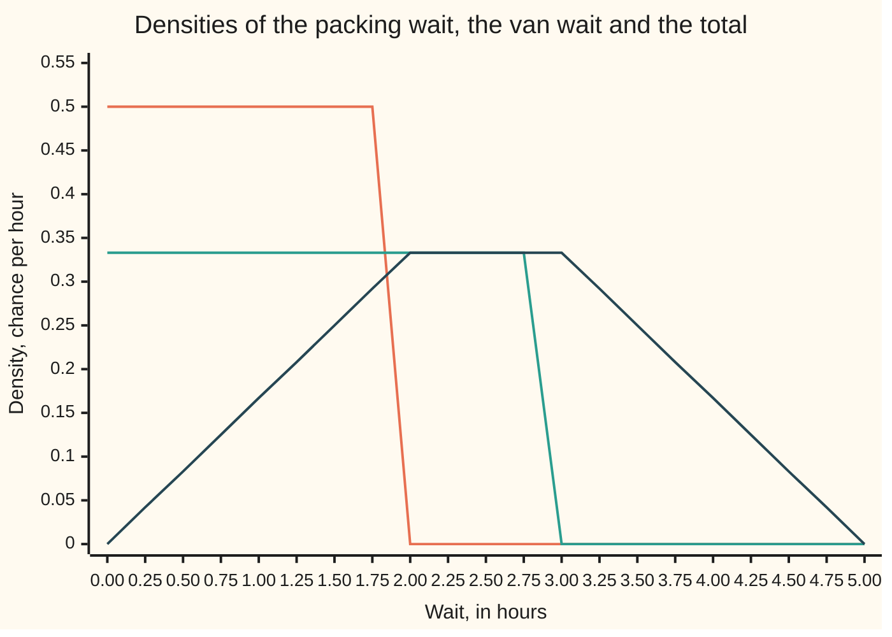
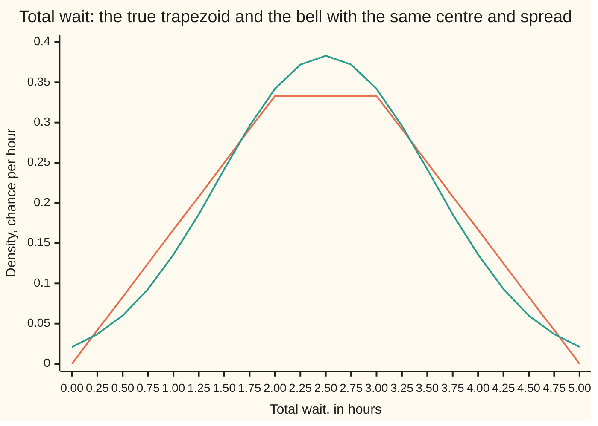

# Densities add by convolution: the law of a sum of independent quantities

[Syllabus](../../../SYLLABUS.md) → [Harmonic analysis](../README.md) → [Convolution and Approximate Identities](../README.md#s03) → Densities add by convolution

---

## General Overview

A shop promises delivery within 4 hours of an order. Two waits stand in the way. The packing team runs a batch every 2 hours, so an order waits between 0 and 2 hours to be packed, with every moment equally likely. The courier van calls every 3 hours, so a packed parcel waits between 0 and 3 hours more.

The van's timetable has nothing to do with the packing rota. So the two waits are **independent**: knowing one says nothing about the other. The average total is 1 + 1.5 = 2.5 hours, well inside the promise. But an average says nothing about the late orders. That needs the whole law of the total: how its chance spreads over the 5 hours it can take.

A total of 4 hours can be split many ways: 1 hour of packing and 3 of van, 1.5 and 2.5, 2 and 2. Each split has a chance, and because the waits are independent, that chance is a product. Adding the products over every split gives the total's density (chance per hour). This slide-multiply-add operation is **convolution**. Here it turns two flat blocks into a trapezoid, and the promise holds for 11 orders in 12: a chance of 0.916667.

Convolution has a second face, in frequency. The Fourier transform of a density lists how strongly each frequency is present in it. It turns convolution into plain multiplication. So the transform of the total is the product of the two transforms, and the card checks the trapezoid that way too. It does the same for two bell curves.

**The density of a sum of two independent quantities is the convolution of their densities, and its Fourier transform is the product of theirs, a check that exists for every law.**

**What kind of fact this is:** a theorem, proved on this card in Why it works. The flat waits are a model of the rota and the timetable, not a law of nature.

### The picture: two flat waits and their total



Orange: the packing wait, 0.5 per hour from 0 to 2 hours. Teal: the van wait, 1/3 per hour from 0 to 3 hours. Dark blue: the total, a trapezoid that rises to 1/3 at 2 hours, stays flat to 3 hours, and falls to 0 at 5 hours. Points every 0.25 hours; the chart joins them with straight lines, so the two jumps look like steep slopes. The area under the dark blue line beyond 4 hours, 1/12, is the late orders.

---

## The formula

Two earlier cards already hold the core fact. [Convolution](../../10-Measure%20and%20integration/06-Product%20Measures%20and%20Fubini/05-convolution-and-sums.md) in the measure wing proves that the law of an independent sum is the convolution of the laws, for any laws. [Adding continuous variables](../../09-Probability%20and%20statistics/05-Transformations%20and%20Joint%20Laws/04-sums-and-convolution.md) derives the density formula and proves that normal plus normal is normal, using moment generating functions. This card restates the formula, checks it in frequency, and reads it as smoothing.

Notation first, in words.

- $`X`$ is the packing wait and $`Y`$ the van wait, in hours. $`S = X + Y`$ is the total.
- A **density** gives chance per hour; the area under it over a range of hours is the chance of landing there. $`f`$ is the density of $`X`$, $`g`$ that of $`Y`$, and $`h`$ that of $`S`$. On the rest of this wing $`f`$ is a signal; here the signal is a density.
- $`A`$ = 2 hours and $`B`$ = 3 hours are the widths of the two waits, so $`f = 1/A`$ on $`[0, A)`$ and $`g = 1/B`$ on $`[0, B)`$. $`D`$ = 4 hours is the promise.
- $`\xi`$ (xi) is a frequency in cycles per hour. The transform uses the wing's one convention, with $`i`$ the imaginary unit:

```math
\hat f(\xi) = \int_{-\infty}^{\infty} f(t)\, e^{-2\pi i \xi t}\, dt .
```

**Read it aloud:** f hat at xi multiplies the density by a wave turning xi times an hour, and adds up over all hours.

In probability the same object is the **characteristic function**, $`\varphi_X(t) = E[e^{itX}] = \hat f(-t/2\pi)`$: the average of $`e^{itX}`$, where the dial $`t`$ is an angular frequency, not a time. $`E`$ means average over all outcomes.

**The theorem.** If $`X`$ and $`Y`$ are independent with densities $`f`$ and $`g`$, then $`S`$ has density $`h`$, and

```math
h(s) = (f * g)(s) = \int_{-\infty}^{\infty} f(x)\, g(s - x)\, dx, \qquad \hat h(\xi) = \hat f(\xi)\, \hat g(\xi) .
```

**Read it aloud:** the density of the total at s lets the packing wait take each value x, asks the van to supply the rest, s minus x, multiplies the two densities and adds over every x; in frequency, the total's transform is the packing transform times the van transform.

**For the two flat waits.** Here $`\mathrm{sinc}(u) = \sin(\pi u)/(\pi u)`$, with $`\mathrm{sinc}(0) = 1`$:

```math
h(s) = \frac{\text{length of } [0, A] \cap [s - B,\, s]}{A B}, \qquad \hat f(\xi) = e^{-\pi i A \xi}\, \mathrm{sinc}(A \xi), \qquad \hat g(\xi) = e^{-\pi i B \xi}\, \mathrm{sinc}(B \xi) .
```

**Read it aloud:** the total's density at s is the length of the packing hours that leave a possible van wait, divided by A times B; each flat wait transforms to a sinc times a turning phase.

**For two bell curves.** A normal law with centre $`\mu`$ (mu) and spread $`\sigma`$ (sigma, the standard deviation) has transform $`e^{-2\pi i \mu \xi - 2\pi^2 \sigma^2 \xi^2}`$ ([Two pairs worth memorising](../02-The%20Fourier%20Transform/03-gaussian-and-sinc-transform-pairs.md)). Multiply two of them and the exponents add: the centres add, and the squared spreads add.

**The size bound.** [Convolution](01-convolution-and-youngs-inequality.md) proves Young's inequality, $`\lVert f * g\rVert_r \le \lVert f\rVert_p\, \lVert g\rVert_q`$ when $`1/p + 1/q = 1 + 1/r`$. Here $`\lVert g\rVert_q`$ is the q-size: the q-th root of the area under $`\lvert g\rvert^q`$, and $`\lVert g\rVert_\infty`$ is the largest value. A density has $`\lVert f\rVert_1 = 1`$, so with $`p = 1`$:

```math
\lVert h\rVert_q \le \lVert g\rVert_q \quad \text{for every } q \text{ from 1 to } \infty .
```

**Read it aloud:** adding an independent wait never makes the total's density taller or more concentrated than the other wait's, in any size.

| Symbol | Plain meaning | In our example | Push it up and the answer… |
| --- | --- | --- | --- |
| $`X`$, $`Y`$, $`S`$ | packing wait, van wait, total, in hours | averages 1, 1.5 and 2.5 hours | — |
| $`x`$, $`y`$, $`s`$, $`t`$, $`v`$ | a value of $`X`$; a value of $`Y`$; a value of $`S`$; a time inside an integral; a second value of $`S`$ in the proof | $`s`$ = 4 hours | — |
| $`A`$, $`B`$ | widths of the two flat waits | 2 and 3 hours | wider, later and flatter total |
| $`D`$ | the promised time | 4 hours | more orders on time |
| $`f`$, $`g`$, $`G`$ | densities of $`X`$ and $`Y`$; in the proof, $`G`$ is $`Y`$'s chance of being at most a value | 0.5 and 1/3 per hour | — |
| $`h`$ | density of the total, $`f * g`$ | 1/3 per hour from 2 to 3 hours | — |
| $`\xi`$, $`\Xi`$, $`i`$ | frequency in cycles per hour; a cut-off frequency; the imaginary unit | $`\xi`$ = 0.25 per hour | the transform's envelope shrinks like $`1/\xi^2`$ |
| $`\hat f`$, $`\hat g`$, $`\hat h`$, $`\mathrm{sinc}(u)`$ | the Fourier transforms; $`\sin(\pi u)/(\pi u)`$ for any number $`u`$ | $`\lvert \hat h(0.25)\rvert`$ = 0.191053 | — |
| $`\varphi_X(t)`$, $`E`$, $`P`$ | characteristic function at dial $`t`$; average; chance | $`\varphi_X(t) = \hat f(-t/2\pi)`$ | — |
| $`\mu`$, $`\sigma`$, $`\Phi`$ | centre and spread of a bell; the standard bell's area to the left of a point | 2.5 and 1.040833 hours for the total | — |
| $`\lVert\cdot\rVert_q`$; $`p`$, $`q`$, $`r`$ | sizes; Young's exponents | $`\lVert h\rVert_2`$ = 0.509175 | — |
| $`\delta`$ | a small shift in hours, in the smoothing step | — | larger change in $`h`$ |

### When it holds

- **The waits are independent.** The formula multiplies the two densities at each split. If a storm slows both teams at once, the product is the wrong weight. Tie them fully, van wait = 1.5 × packing wait, and the on-time chance drops to 0.800000.
- **Both waits have densities.** A van that always takes exactly 3 hours has no density: the total is the packing law slid 3 hours later. The integral then collapses to that slide.
- **The transform product needs independence too.** It rests on the average of a product of independent quantities being the product of their averages. Independence is enough but not necessary: some dependent pairs also pass this test, so a matching product does not prove the waits are independent.
- **The flat waits are a model.** Real batches run late and vans get stuck. The theorem stays exact; the 0.916667 is only as good as the model.

---

## Why it works

### Step 0: split the total by its first part

A total near $`s`$ happens when the packing wait is some $`x`$ and the van wait is near $`s - x`$. Independence makes the chance of that pair a product, $`f(x)\, g(s - x)`$. Every $`x`$ is a different way to reach the same total, so the chances add, and adding over a continuous range is an integral.

### Step 1: the density of a sum

Write $`G(y)`$ for the chance that $`Y \le y`$, the area under $`g`$ to the left of $`y`$. Fix the packing wait at $`x`$. The total is at most $`s`$ exactly when the van wait is at most $`s - x`$, which has chance $`G(s - x)`$. Average over $`x`$, weighted by $`f`$:

```math
P(S \le s) = \int_{-\infty}^{\infty} f(x)\, G(s - x)\, dx = \int_{-\infty}^{s} \Big( \int_{-\infty}^{\infty} f(x)\, g(v - x)\, dx \Big)\, dv .
```

The second form writes $`G(s - x)`$ as an area, $`\int_{-\infty}^{s} g(v - x)\, dv`$, and swaps the order of the two integrals. The swap is allowed because everything inside is non-negative ([Tonelli and Fubini](../../10-Measure%20and%20integration/06-Product%20Measures%20and%20Fubini/03-tonelli-and-fubini.md)). The chance of being at most $`s`$ is the area to the left of $`s`$ under the inner integral. So the inner integral, $`f * g`$, is the density of $`S`$.

<details>
<summary>Detailed proof: the first equality and the swap</summary>

Independence means the pair $`(X, Y)`$ has the joint density $`f(x)\, g(y)`$ on the plane. The event $`S \le s`$ is the half-plane $`x + y \le s`$. Its chance is the integral of the joint density over that half-plane:

$`\displaystyle P(S \le s) = \int_{-\infty}^{\infty} \Big( \int_{-\infty}^{s - x} g(y)\, dy \Big) f(x)\, dx = \int_{-\infty}^{\infty} f(x)\, G(s - x)\, dx .`$

Now put $`y = v - x`$ in the inner integral. As $`y`$ runs up to $`s - x`$, $`v`$ runs up to $`s`$:

$`\displaystyle P(S \le s) = \int_{-\infty}^{\infty} \int_{-\infty}^{s} f(x)\, g(v - x)\, dv\, dx = \int_{-\infty}^{s} \int_{-\infty}^{\infty} f(x)\, g(v - x)\, dx\, dv .`$

The integrand is non-negative and measurable on the plane, so Tonelli's theorem allows the swap with no further condition. Letting $`s`$ grow without bound shows the inner integral has total area 1, so it is a genuine density, finite at almost every $`v`$.

</details>

### Step 2: the two flat waits give a trapezoid

With $`f = 1/2`$ on $`[0, 2)`$ and $`g = 1/3`$ on $`[0, 3)`$, the product $`f(x)\, g(s - x)`$ is $`1/6`$ exactly when both waits are possible: $`0 \le x < 2`$ and $`s - 3 < x \le s`$. So $`h(s)`$ is $`1/6`$ times the length of the overlap of $`[0, 2]`$ and $`[s - 3, s]`$.

- At $`s`$ = 1: the overlap is $`[0, 1]`$, length 1, so $`h(1) = 1/6`$ = 0.166667 per hour.
- At $`s`$ = 2.5: the overlap is all of $`[0, 2]`$, so $`h(2.5) = 2/6`$ = 0.333333.
- At $`s`$ = 4: the overlap is $`[1, 2]`$, so $`h(4) = 1/6`$ again.

The late orders sit under the falling edge from 4 to 5 hours, a triangle of base 1 hour and height 1/6. Its area is $`1 \times (1/6) / 2 = 1/12`$. So the promise holds with chance $`11/12`$ = 0.916667.

### Step 3: in frequency, convolution becomes multiplication

The transform of a density is an average: $`\hat h(\xi) = E[e^{-2\pi i \xi S}]`$. Split the total:

```math
\hat h(\xi) = E\big[e^{-2\pi i \xi X}\, e^{-2\pi i \xi Y}\big] = E\big[e^{-2\pi i \xi X}\big]\, E\big[e^{-2\pi i \xi Y}\big] = \hat f(\xi)\, \hat g(\xi) .
```

The middle step is independence: the average of a product of independent quantities is the product of their averages. [The convolution theorem](02-convolution-theorem-and-impulse-response.md) proves the same identity for any two signals of finite area; for densities, this two-line form is enough.

Three points make this the check of choice.

- **It always exists.** The wave $`e^{-2\pi i \xi X}`$ has size 1, so its average is finite for every law and every frequency. A moment generating function, the tool of [Adding continuous variables](../../09-Probability%20and%20statistics/05-Transformations%20and%20Joint%20Laws/04-sums-and-convolution.md), averages $`e^{tX}`$, which grows without bound; for a heavy-tailed law such as the Cauchy it is infinite at every $`t \ne 0`$.
- **It pins down the law.** [Fourier inversion](../02-The%20Fourier%20Transform/04-fourier-inversion-theorem.md) rebuilds a density from its transform, so a product that matches identifies the sum's law.
- **It is easy to compute.** Two transforms multiply; no integral over splits is needed.

On the waits at $`\xi`$ = 0.25 per hour: $`\mathrm{sinc}(0.5)`$ = 0.636620 and $`\mathrm{sinc}(0.75)`$ = 0.300105, product 0.191053. The phase is $`e^{-\pi i \times 5 \times 0.25}`$, so $`\hat h(0.25) = -0.135095 + 0.135095\,i`$. Integrating the trapezoid against the wave gives the same to six places.

The product also predicts zeros. $`\mathrm{sinc}(3\xi)`$ vanishes at $`\xi`$ = 1/3 and 2/3 per hour, and $`\mathrm{sinc}(2\xi)`$ at 1/2. The trapezoid's own transform is 0.000000 at all three.

Inversion goes the other way. At the centre, $`s`$ = 2.5 hours, the phases cancel and $`h(2.5) = \int \mathrm{sinc}(2\xi)\, \mathrm{sinc}(3\xi)\, d\xi`$. The integral runs over all frequencies, so the code stops at a cut-off $`\Xi`$. Each factor is at most $`1/(\pi \lvert u\rvert)`$ in size, so the part beyond $`\Xi`$ is at most $`2/(\pi^2 A B\, \Xi)`$. At $`\Xi`$ = 25 per hour the integral gives 0.333333543, inside its tail bound of 0.001351; at 100 per hour, 0.333333330.

### Step 4: two bell curves

Replace each flat wait by a bell with the same centre and spread. A flat wait of width $`A`$ has variance $`A^2/12`$, so the packing bell has centre 1 and variance 1/3, and the van bell has centre 1.5 and variance 3/4. The check confirms that the trapezoid's own variance is their sum, 1.083333 square hours. Multiply their transforms:

```math
e^{-2\pi i (1)\xi - 2\pi^2 (1/3)\xi^2} \times e^{-2\pi i (1.5)\xi - 2\pi^2 (3/4)\xi^2} = e^{-2\pi i (2.5)\xi - 2\pi^2 (13/12)\xi^2} .
```

That is the transform of one bell, centre 2.5 hours and spread $`\sqrt{13/12}`$ = 1.040833 hours. The squared spreads add; the spreads do not. The convolution integral, done numerically, agrees at 2.5 and 4 hours.



Orange: the true density of the total, the trapezoid. Teal: the bell with the same centre and spread. The bell is taller in the middle (0.383291 against 0.333333) and thinner at 4 hours, so it promises 0.925229 on time instead of 0.916667. It also puts chance 0.008155 on a negative wait.

### Step 5: convolution smooths, and never sharpens

Each flat wait jumps from its height to 0. The total does not jump: shift $`s`$ by $`\delta`$ hours and

```math
\lvert h(s + \delta) - h(s)\rvert \le \int f(x)\, \lvert g(s + \delta - x) - g(s - x)\rvert\, dx \le \lVert f\rVert_\infty \times \frac{2\delta}{B} .
```

The window of $`g`$ and its shifted copy differ on two strips of width $`\delta`$, each of height $`1/B`$. So a shift of $`\delta`$ hours changes the total's density by at most $`\delta/3`$, a slope of at most 1/3 per hour per hour: no jump is possible. The true steepest slope is 1/6 per hour per hour, half the bound. A third independent wait would smooth the corners too.

Young's bound with $`p = 1`$ caps the result. The peak of $`h`$ is at most the peak of $`g`$, 1/3, and here it equals it. The 2-size of $`h`$ is $`\sqrt{7/27}`$ = 0.509175, below $`\lVert g\rVert_2`$ = 0.577350, a ratio of 0.881917. An independent wait can only spread the total out.

The same reading explains [Approximate identities](03-approximate-identities.md). If the van wait shrank to a few seconds, convolving with its narrow density would hand back the packing law almost unchanged.

---

## Worked numbers, by hand

The two flat waits, the promise of 4 hours, and the check at 0.25 cycles per hour.

| Step | Arithmetic | Value |
| --- | --- | --- |
| density of the total at 2.5 hours | overlap 2 hours, divided by $`A B`$ = 6 | 0.333333 per hour |
| density at 4 hours | overlap of $`[0, 2]`$ and $`[1, 4]`$ is 1 hour; 1/6 | 0.166667 per hour |
| late corner | triangle, base 1 hour, height 1/6: $`1 \times (1/6)/2`$ | 1/12 = 0.083333 |
| on time | $`1 - 1/12`$ | 11/12 = 0.916667 |
| transform factors at 0.25 per hour | $`\mathrm{sinc}(0.5) = 2/\pi`$; $`\mathrm{sinc}(0.75)`$ | 0.636620; 0.300105 |
| product, with phase $`e^{-1.25\pi i}`$ | $`0.191053 \times (-0.707107 + 0.707107\, i)`$ | $`-0.135095 + 0.135095\,i`$ |
| bell model spread | $`\sqrt{4/12 + 9/12}`$ | 1.040833 hours |
| bell model on time | $`\Phi\big((4 - 2.5)/1.040833\big)`$ | 0.925229 |
| **promise kept, true model** | the trapezoid's area up to 4 hours | **0.916667, 11 orders in 12** |

One order in 12 arrives late. The bell model, with the right centre and spread, says 0.925229 on time, so it understates the late orders: it gets the shape wrong where the promise bites.

### What breaks if you drop a piece

Same shop, same promise, correct answer 0.916667.

| Mistake | Comes out at | What went wrong |
| --- | --- | --- |
| Add the two densities and halve | 1.000000 on time | That is the law of "one wait or the other". The total of both is never computed. |
| Multiply the densities hour by hour | area 0.333333 | Not a law at all. Multiplication belongs in frequency, not in hours. |
| Tie the waits: van wait = 1.5 × packing wait | 0.800000 on time (0.8023 simulated) | Independence fails. The total is flat on 0 to 5 hours, not a trapezoid. |
| Replace the total by a bell with the same centre and spread | 0.925229 on time | The shape is wrong in the tail, and 0.008155 of the chance sits on negative waits. |

---

## Code, from first principles, and it actually runs

The code builds the two flat waits and reaches the on-time chance by three independent roads: the trapezoid's area, the step laws of minute and 10-second grids convolved by counting, and a simulation of 200,000 orders. The grids add the chance on grid points below 4 hours; their small gap is half the chance on the point at exactly 4 hours, and it shrinks as the grid gets finer. The inverse transform at the centre, with a printed cut-off and tail bound, checks the density there. The code also checks the trapezoid against the convolution integral, the transform product against the trapezoid's own transform and against the simulated average of the wave, the bell product against a numerical convolution, the bells' variances against the trapezoid's own, and the two Young bounds. The simulation uses a small generator (SplitMix64, seed 2026), written out in both languages, so both print the same digits. The standard bell's area $`\Phi`$ is a power series, checked against Simpson's rule.

### Python

```python
# Densities add by convolution -- the check behind the card.  Standard library only.
# Packing delay X uniform on [0, 2] h, courier delay Y uniform on [0, 3] h, independent.
# Roads to the total S = X + Y: the trapezoid by hand, the convolution integral,
# step laws convolved on a grid, the transform product inverted, and simulation.
import math
from fractions import Fraction as Fr

A, B, D = 2.0, 3.0, 4.0     # widths of the two delays and the promise, hours: whole, A <= B <= D <= A + B
M = (A + B) / 2             # centre of the total
def f(x): return 1 / A if 0 <= x < A else 0.0
def g(y): return 1 / B if 0 <= y < B else 0.0
def trap(s): return max(0.0, min(A, s) - max(0.0, s - B)) / (A * B)   # overlap length / (A B)
def conv(s, n=6000):                          # midpoint sum of the integral of f(x) g(s - x) dx
    dx = A / n
    return sum(f((k + 0.5) * dx) * g(s - (k + 0.5) * dx) for k in range(n)) * dx
def simpson(fn, a, b, n):
    hh = (b - a) / n
    return hh / 3 * sum((1 if k in (0, n) else 4 if k % 2 else 2) * fn(a + k * hh) for k in range(n + 1))
def sinc(u): return 1.0 if u == 0 else math.sin(math.pi * u) / (math.pi * u)
def Phi(z):                                   # standard bell's area left of z, by its power series
    t, s, n = z, z, 0
    while abs(t) > 1e-17:
        n += 1
        t *= -z * z / (2 * n)
        s += t / (2 * n + 1)
    return 0.5 + s / math.sqrt(2 * math.pi)
M64 = (1 << 64) - 1
state = 2026
def unif():                                   # SplitMix64, seed 2026, top 53 bits
    global state
    state = (state + 0x9E3779B97F4A7C15) & M64
    z = state
    z = ((z ^ (z >> 30)) * 0xBF58476D1CE4E5B9) & M64
    z = ((z ^ (z >> 27)) * 0x94D049BB133111EB) & M64
    return ((z ^ (z >> 31)) >> 11) / 2.0 ** 53

print(f"X uniform on [0, {A:.1f}] h, Y uniform on [0, {B:.1f}] h, independent; S = X + Y; promise D = {D:.1f} h")
for s in (1.0, M, 4.0):
    print(f"h({s:.1f}) trapezoid {trap(s):.6f}  convolution integral {conv(s):.6f}")
    assert abs(trap(s) - conv(s)) < 1e-9
exact = 1 - Fr(int(A + B - D)) ** 2 / (2 * int(A * B))   # late corner: a triangle of side A + B - D
area = simpson(trap, 0, A, 200) + simpson(trap, A, B, 100) + simpson(trap, B, D, 100)
print(f"P(S <= D): exact {exact} = {float(exact):.6f}  late {1 - exact} = {float(1 - exact):.6f}  area under trapezoid {area:.6f}")
assert abs(area - float(exact)) < 1e-12
for step in (60, 360):                        # step laws: minutes, then 10-second steps
    nx, ny = int(A * step), int(B * step)
    pmf = [0] * (nx + ny - 1)
    for i in range(nx):
        for j in range(ny):
            pmf[i + j] += 1                   # X = (i + 1/2)/step, Y = (j + 1/2)/step
    on = Fr(sum(pmf[: int(D * step) - 1]), nx * ny)   # atoms below D; the atom at S = D is left out
    print(f"grid of 1/{step} h: P(S < D) {float(on):.6f}  gap {float(on - exact):.6f}  peak h {max(pmf) * step / (nx * ny):.6f}")
assert abs(float(on - exact)) < 1e-3
N, hit, tied, cs, sn = 200000, 0, 0, 0.0, 0.0
for _ in range(N):
    x, y = A * unif(), B * unif()
    hit += x + y <= D
    tied += x + B / A * x <= D                # what breaks: Y = (B/A) X, the same storm hits both
    cs += math.cos(2 * math.pi * 0.25 * (x + y)); sn -= math.sin(2 * math.pi * 0.25 * (x + y))
se = math.sqrt(float(exact) * (1 - float(exact)) / N)
print(f"simulated {N} orders: P(S <= D) {hit / N:.4f}  standard error {se:.4f}")
assert abs(hit / N - float(exact)) <= 4 * se
print("frequency: hat f(xi) = e^(-i pi A xi) sinc(A xi), xi in cycles per hour")
xi = 0.25
mag = sinc(A * xi) * sinc(B * xi)
pr, pi_ = mag * math.cos(math.pi * (A + B) * xi), -mag * math.sin(math.pi * (A + B) * xi)
dr = simpson(lambda s: trap(s) * math.cos(2 * math.pi * xi * s), 0, A + B, 3000)
di = simpson(lambda s: -trap(s) * math.sin(2 * math.pi * xi * s), 0, A + B, 3000)
print(f"xi = 0.25: sinc(A xi) {sinc(A * xi):.6f}  sinc(B xi) {sinc(B * xi):.6f}  |product| {mag:.6f}"
      f"  phase {math.cos(math.pi * (A + B) * xi):.6f} {-math.sin(math.pi * (A + B) * xi):+.6f}i")
print(f"  product {pr:.6f} {pi_:+.6f}i  transform of h {dr:.6f} {di:+.6f}i  simulated {cs / N:.4f} {sn / N:+.4f}i")
assert abs(pr - dr) < 1e-9 and abs(pi_ - di) < 1e-9
assert abs(cs / N - pr) < 4 * math.sqrt(0.5 / N) and abs(sn / N - pi_) < 4 * math.sqrt(0.5 / N)
for z in (1 / B, 1 / A, 2 / B):
    dz = abs(complex(simpson(lambda s: trap(s) * math.cos(2 * math.pi * z * s), 0, A + B, 3000),
                     simpson(lambda s: trap(s) * math.sin(2 * math.pi * z * s), 0, A + B, 3000)))
    print(f"  zero of a factor at xi = {z:.6f}: |transform of h| {dz:.6f}")
    assert dz < 1e-9
for cut in (25, 100):                         # invert at the centre: h(M) = integral of sinc(A xi) sinc(B xi)
    inv = 2 * simpson(lambda u: sinc(A * u) * sinc(B * u), 0, cut, 400 * cut)
    tail = 2 / (math.pi ** 2 * A * B * cut)
    print(f"inverse at s = {M:.1f}, cut-off {cut}/h: {inv:.9f}  gap {abs(inv - trap(M)):.9f}  tail bound {tail:.6f}")
    assert abs(inv - trap(M)) <= tail
v1, v2 = A * A / 12, B * B / 12               # the same delays as bell curves, same centres and spreads
sd = math.sqrt(v1 + v2)
bell = lambda s, m, v: math.exp(-(s - m) ** 2 / (2 * v)) / math.sqrt(2 * math.pi * v)
for s in (M, 4.0):
    num = simpson(lambda x: bell(x, A / 2, v1) * bell(s - x, B / 2, v2), -9, 11, 4000)
    print(f"bells: h({s:.1f}) convolution integral {num:.6f}  one bell, variances added {bell(s, M, v1 + v2):.6f}")
    assert abs(num - bell(s, M, v1 + v2)) < 1e-9
pb = Phi((D - M) / sd)
print(f"bells: sd {sd:.6f} h  P(S <= D) {pb:.6f}  P(S < 0) {Phi(-M / sd):.6f}  peak {bell(M, M, v1 + v2):.6f}")
print(f"centres {A / 2:.6f} + {B / 2:.6f} = {M:.6f} h; spreads added {math.sqrt(v1):.6f} + {math.sqrt(v2):.6f}"
      f" = {math.sqrt(v1) + math.sqrt(v2):.6f} h, true spread {sd:.6f} h")
vt = sum(simpson(lambda s: (s - M) ** 2 * trap(s), a, b, 300) for a, b in ((0, A), (A, B), (B, A + B)))
print(f"bells: variances {v1:.6f} + {v2:.6f} = {v1 + v2:.6f} h^2; the trapezoid's own variance {vt:.6f} h^2")
assert abs(vt - (v1 + v2)) < 1e-12                       # the bells get the true total's spread
assert abs(pb - 0.5 - simpson(lambda z: bell(z, 0, 1), 0, (D - M) / sd, 2000)) < 1e-12   # series against area
l2 = math.sqrt(sum(simpson(lambda s: trap(s) ** 2, a, b, 300) for a, b in ((0, A), (A, B), (B, A + B))))
peak = max(trap(k / 100) for k in range(int(100 * (A + B)) + 1))
print(f"Young: peak h {peak:.6f} <= |f|_1 |g|_inf {1 / B:.6f} and |f|_inf |g|_1 {1 / A:.6f}")
print(f"Young: |h|_2 {l2:.6f} (exact {math.sqrt((B - A / 3) / B ** 2):.6f}) <= |g|_2 {math.sqrt(1 / B):.6f}  ratio {l2 / math.sqrt(1 / B):.6f}")
assert abs(l2 - math.sqrt((B - A / 3) / B ** 2)) < 1e-12 and l2 <= math.sqrt(1 / B) and peak <= 1 / B
slope = max(abs(trap(k / 100 + 0.01) - trap(k / 100)) / 0.01 for k in range(-100, 600))
print(f"smoothing: steepest slope of h {slope:.6f} per h^2, bound |f|_inf * 2/B {2 / (A * B):.6f}")
assert abs(slope - 1 / (A * B)) < 1e-9
mids = [(k + 0.5) / 100 for k in range(int(100 * D))]   # midpoint sums up to the promise
mix = sum(0.5 * (f(x) + g(x)) for x in mids) / 100
prod = sum(f(x) * g(x) for x in mids) / 100
print(f"what breaks: mixture P {mix:.6f}  product area {prod:.6f}"
      f"  tied delays exact {D / (A + B):.6f} simulated {tied / N:.4f}")
assert abs(tied / N - D / (A + B)) <= 4 * math.sqrt(0.25 / N)
print("chart s: " + " ".join(f"{k / 4:.2f}" for k in range(21)))
print("chart f: " + " ".join(f"{f(k / 4):.3f}" for k in range(21)))
print("chart g: " + " ".join(f"{g(k / 4):.3f}" for k in range(21)))
print("chart h: " + " ".join(f"{trap(k / 4):.3f}" for k in range(21)))
print("chart bell: " + " ".join(f"{bell(k / 4, M, v1 + v2):.3f}" for k in range(21)))
print("ALL CHECKS PASS")
```

**Ran 2026-11-15 on macOS, Python 3.14.10, standard library only. All checks passed. Output, pasted from the run:**

```text
X uniform on [0, 2.0] h, Y uniform on [0, 3.0] h, independent; S = X + Y; promise D = 4.0 h
h(1.0) trapezoid 0.166667  convolution integral 0.166667
h(2.5) trapezoid 0.333333  convolution integral 0.333333
h(4.0) trapezoid 0.166667  convolution integral 0.166667
P(S <= D): exact 11/12 = 0.916667  late 1/12 = 0.083333  area under trapezoid 0.916667
grid of 1/60 h: P(S < D) 0.915278  gap -0.001389  peak h 0.333333
grid of 1/360 h: P(S < D) 0.916435  gap -0.000231  peak h 0.333333
simulated 200000 orders: P(S <= D) 0.9174  standard error 0.0006
frequency: hat f(xi) = e^(-i pi A xi) sinc(A xi), xi in cycles per hour
xi = 0.25: sinc(A xi) 0.636620  sinc(B xi) 0.300105  |product| 0.191053  phase -0.707107 +0.707107i
  product -0.135095 +0.135095i  transform of h -0.135095 +0.135095i  simulated -0.1360 +0.1352i
  zero of a factor at xi = 0.333333: |transform of h| 0.000000
  zero of a factor at xi = 0.500000: |transform of h| 0.000000
  zero of a factor at xi = 0.666667: |transform of h| 0.000000
inverse at s = 2.5, cut-off 25/h: 0.333333543  gap 0.000000210  tail bound 0.001351
inverse at s = 2.5, cut-off 100/h: 0.333333330  gap 0.000000003  tail bound 0.000338
bells: h(2.5) convolution integral 0.383291  one bell, variances added 0.383291
bells: h(4.0) convolution integral 0.135685  one bell, variances added 0.135685
bells: sd 1.040833 h  P(S <= D) 0.925229  P(S < 0) 0.008155  peak 0.383291
centres 1.000000 + 1.500000 = 2.500000 h; spreads added 0.577350 + 0.866025 = 1.443376 h, true spread 1.040833 h
bells: variances 0.333333 + 0.750000 = 1.083333 h^2; the trapezoid's own variance 1.083333 h^2
Young: peak h 0.333333 <= |f|_1 |g|_inf 0.333333 and |f|_inf |g|_1 0.500000
Young: |h|_2 0.509175 (exact 0.509175) <= |g|_2 0.577350  ratio 0.881917
smoothing: steepest slope of h 0.166667 per h^2, bound |f|_inf * 2/B 0.333333
what breaks: mixture P 1.000000  product area 0.333333  tied delays exact 0.800000 simulated 0.8023
chart s: 0.00 0.25 0.50 0.75 1.00 1.25 1.50 1.75 2.00 2.25 2.50 2.75 3.00 3.25 3.50 3.75 4.00 4.25 4.50 4.75 5.00
chart f: 0.500 0.500 0.500 0.500 0.500 0.500 0.500 0.500 0.000 0.000 0.000 0.000 0.000 0.000 0.000 0.000 0.000 0.000 0.000 0.000 0.000
chart g: 0.333 0.333 0.333 0.333 0.333 0.333 0.333 0.333 0.333 0.333 0.333 0.333 0.000 0.000 0.000 0.000 0.000 0.000 0.000 0.000 0.000
chart h: 0.000 0.042 0.083 0.125 0.167 0.208 0.250 0.292 0.333 0.333 0.333 0.333 0.333 0.292 0.250 0.208 0.167 0.125 0.083 0.042 0.000
chart bell: 0.021 0.037 0.060 0.093 0.136 0.186 0.242 0.296 0.342 0.372 0.383 0.372 0.342 0.296 0.242 0.186 0.136 0.093 0.060 0.037 0.021
ALL CHECKS PASS
```

### Rust

```rust
// Densities add by convolution -- the check behind the card.  std only, no crates.
// Packing delay X uniform on [0, 2] h, courier delay Y uniform on [0, 3] h, independent.
// Roads to the total S = X + Y: the trapezoid by hand, the convolution integral,
// step laws convolved on a grid, the transform product inverted, and simulation.
use std::f64::consts::PI;

const A: f64 = 2.0; // width of the packing delay, hours
const B: f64 = 3.0; // width of the courier delay, hours
const D: f64 = 4.0; // the promise, hours; widths whole, A <= B <= D <= A + B
const M: f64 = (A + B) / 2.0; // centre of the total

fn f(x: f64) -> f64 { if (0.0..A).contains(&x) { 1.0 / A } else { 0.0 } }
fn g(y: f64) -> f64 { if (0.0..B).contains(&y) { 1.0 / B } else { 0.0 } }
fn trap(s: f64) -> f64 { (A.min(s) - (s - B).max(0.0)).max(0.0) / (A * B) } // overlap / (A B)
fn conv(s: f64) -> f64 {
    // midpoint sum of the integral of f(x) g(s - x) dx
    let n = 6000;
    let dx = A / n as f64;
    (0..n).map(|k| { let x = (k as f64 + 0.5) * dx; f(x) * g(s - x) }).sum::<f64>() * dx
}
fn simpson(fun: &dyn Fn(f64) -> f64, a: f64, b: f64, n: usize) -> f64 {
    let hh = (b - a) / n as f64;
    let mut tot = 0.0;
    for k in 0..=n {
        let w = if k == 0 || k == n { 1.0 } else if k % 2 == 1 { 4.0 } else { 2.0 };
        tot += w * fun(a + k as f64 * hh);
    }
    hh / 3.0 * tot
}
fn gcd(a: i64, b: i64) -> i64 { if b == 0 { a } else { gcd(b, a % b) } }
fn sinc(u: f64) -> f64 { if u == 0.0 { 1.0 } else { (PI * u).sin() / (PI * u) } }
fn phi(z: f64) -> f64 {
    // standard bell's area left of z, by its power series
    let (mut t, mut s, mut n) = (z, z, 0.0);
    while t.abs() > 1e-17 {
        n += 1.0;
        t *= -z * z / (2.0 * n);
        s += t / (2.0 * n + 1.0);
    }
    0.5 + s / (2.0 * PI).sqrt()
}
fn bell(s: f64, m: f64, v: f64) -> f64 { (-(s - m).powi(2) / (2.0 * v)).exp() / (2.0 * PI * v).sqrt() }
struct Rng(u64); // SplitMix64, seed 2026, top 53 bits
impl Rng {
    fn unif(&mut self) -> f64 {
        self.0 = self.0.wrapping_add(0x9E3779B97F4A7C15);
        let mut z = self.0;
        z = (z ^ (z >> 30)).wrapping_mul(0xBF58476D1CE4E5B9);
        z = (z ^ (z >> 27)).wrapping_mul(0x94D049BB133111EB);
        ((z ^ (z >> 31)) >> 11) as f64 / 2f64.powi(53)
    }
}
fn row(name: &str, fun: &dyn Fn(f64) -> f64, dp: usize) {
    let v: Vec<String> = (0..21).map(|k| format!("{:.*}", dp, fun(k as f64 / 4.0))).collect();
    println!("chart {}: {}", name, v.join(" "));
}

fn main() {
    println!("X uniform on [0, {:.1}] h, Y uniform on [0, {:.1}] h, independent; S = X + Y; promise D = {:.1} h", A, B, D);
    for s in [1.0, M, 4.0] {
        println!("h({:.1}) trapezoid {:.6}  convolution integral {:.6}", s, trap(s), conv(s));
        assert!((trap(s) - conv(s)).abs() < 1e-9);
    }
    let (late, den) = (((A + B - D) as i64).pow(2), 2 * (A * B) as i64); // late corner: triangle of side A + B - D
    let (g0, num) = (gcd(den - late, den), den - late);
    let (num, den) = (num / g0, den / g0);
    let exact = num as f64 / den as f64;
    let area = simpson(&trap, 0.0, A, 200) + simpson(&trap, A, B, 100) + simpson(&trap, B, D, 100);
    let shown = if den == 1 { format!("{}", num) } else { format!("{}/{}", num, den) };
    let lg = gcd(late, 2 * (A * B) as i64);
    let lshown = if late == 0 { "0".to_string() } else { format!("{}/{}", late / lg, 2 * (A * B) as i64 / lg) };
    println!("P(S <= D): exact {} = {:.6}  late {} = {:.6}  area under trapezoid {:.6}", shown, exact, lshown, 1.0 - exact, area);
    assert!((area - exact).abs() < 1e-12);
    let mut gap = 1.0;
    for step in [60i64, 360] {
        // step laws: X = (i + 1/2)/step, Y = (j + 1/2)/step
        let (nx, ny) = ((A * step as f64) as i64, (B * step as f64) as i64);
        let mut pmf = vec![0i64; (nx + ny - 1) as usize];
        for i in 0..nx { for j in 0..ny { pmf[(i + j) as usize] += 1; } }
        let on: i64 = pmf[..((D * step as f64) as i64 - 1) as usize].iter().sum(); // atoms below D; the atom at S = D is left out
        let tot = nx * ny;
        gap = (on * den - num * tot) as f64 / (tot * den) as f64;
        println!("grid of 1/{} h: P(S < D) {:.6}  gap {:.6}  peak h {:.6}", step, on as f64 / tot as f64, gap,
                 (pmf.iter().max().unwrap() * step) as f64 / tot as f64);
    }
    assert!(gap.abs() < 1e-3);
    let n = 200000;
    let mut rng = Rng(2026);
    let (mut hit, mut tied, mut cs, mut sn) = (0, 0, 0.0, 0.0);
    for _ in 0..n {
        let x = A * rng.unif();
        let y = B * rng.unif();
        if x + y <= D { hit += 1; }
        if x + B / A * x <= D { tied += 1; } // what breaks: Y = (B/A) X, the same storm hits both
        cs += (2.0 * PI * 0.25 * (x + y)).cos();
        sn -= (2.0 * PI * 0.25 * (x + y)).sin();
    }
    let nf = n as f64;
    let se = (exact * (1.0 - exact) / nf).sqrt();
    let ph = hit as f64 / nf;
    println!("simulated {} orders: P(S <= D) {:.4}  standard error {:.4}", n, ph, se);
    assert!((ph - exact).abs() <= 4.0 * se);
    println!("frequency: hat f(xi) = e^(-i pi A xi) sinc(A xi), xi in cycles per hour");
    let xi = 0.25;
    let mag = sinc(A * xi) * sinc(B * xi);
    let (pr, pim) = (mag * (PI * (A + B) * xi).cos(), -mag * (PI * (A + B) * xi).sin());
    let dr = simpson(&|s| trap(s) * (2.0 * PI * xi * s).cos(), 0.0, A + B, 3000);
    let di = simpson(&|s| -trap(s) * (2.0 * PI * xi * s).sin(), 0.0, A + B, 3000);
    println!("xi = 0.25: sinc(A xi) {:.6}  sinc(B xi) {:.6}  |product| {:.6}  phase {:.6} {:+.6}i", sinc(A * xi), sinc(B * xi), mag,
             (PI * (A + B) * xi).cos(), -(PI * (A + B) * xi).sin());
    println!("  product {:.6} {:+.6}i  transform of h {:.6} {:+.6}i  simulated {:.4} {:+.4}i", pr, pim, dr, di, cs / nf, sn / nf);
    assert!((pr - dr).abs() < 1e-9 && (pim - di).abs() < 1e-9);
    assert!((cs / nf - pr).abs() < 4.0 * (0.5 / nf).sqrt() && (sn / nf - pim).abs() < 4.0 * (0.5 / nf).sqrt());
    for z in [1.0 / B, 1.0 / A, 2.0 / B] {
        let re = simpson(&|s| trap(s) * (2.0 * PI * z * s).cos(), 0.0, A + B, 3000);
        let im = simpson(&|s| trap(s) * (2.0 * PI * z * s).sin(), 0.0, A + B, 3000);
        let dz = re.hypot(im);
        println!("  zero of a factor at xi = {:.6}: |transform of h| {:.6}", z, dz);
        assert!(dz < 1e-9);
    }
    for cut in [25usize, 100] {
        // invert at the centre: h(M) = integral of sinc(A xi) sinc(B xi)
        let inv = 2.0 * simpson(&|u| sinc(A * u) * sinc(B * u), 0.0, cut as f64, 400 * cut);
        let tail = 2.0 / (PI * PI * A * B * cut as f64);
        println!("inverse at s = {:.1}, cut-off {}/h: {:.9}  gap {:.9}  tail bound {:.6}", M, cut, inv, (inv - trap(M)).abs(), tail);
        assert!((inv - trap(M)).abs() <= tail);
    }
    let (v1, v2) = (A * A / 12.0, B * B / 12.0); // the same delays as bell curves, same centres and spreads
    let sd = (v1 + v2).sqrt();
    for s in [M, 4.0] {
        let num = simpson(&|x| bell(x, A / 2.0, v1) * bell(s - x, B / 2.0, v2), -9.0, 11.0, 4000);
        println!("bells: h({:.1}) convolution integral {:.6}  one bell, variances added {:.6}", s, num, bell(s, M, v1 + v2));
        assert!((num - bell(s, M, v1 + v2)).abs() < 1e-9);
    }
    let pb = phi((D - M) / sd);
    println!("bells: sd {:.6} h  P(S <= D) {:.6}  P(S < 0) {:.6}  peak {:.6}", sd, pb, phi(-M / sd), bell(M, M, v1 + v2));
    println!("centres {:.6} + {:.6} = {:.6} h; spreads added {:.6} + {:.6} = {:.6} h, true spread {:.6} h",
             A / 2.0, B / 2.0, M, v1.sqrt(), v2.sqrt(), v1.sqrt() + v2.sqrt(), sd);
    let vt: f64 = [(0.0, A), (A, B), (B, A + B)].iter().map(|&(a, b)| simpson(&|s| (s - M).powi(2) * trap(s), a, b, 300)).sum();
    println!("bells: variances {:.6} + {:.6} = {:.6} h^2; the trapezoid's own variance {:.6} h^2", v1, v2, v1 + v2, vt);
    assert!((vt - (v1 + v2)).abs() < 1e-12); // the bells get the true total's spread
    assert!((pb - 0.5 - simpson(&|z| bell(z, 0.0, 1.0), 0.0, (D - M) / sd, 2000)).abs() < 1e-12); // series against area
    let l2 = [(0.0, A), (A, B), (B, A + B)].iter().map(|&(a, b)| simpson(&|s| trap(s).powi(2), a, b, 300)).sum::<f64>().sqrt();
    let peak = (0..=(100.0 * (A + B)) as i64).map(|k| trap(k as f64 / 100.0)).fold(0.0, f64::max);
    let l2x = ((B - A / 3.0) / (B * B)).sqrt();
    println!("Young: peak h {:.6} <= |f|_1 |g|_inf {:.6} and |f|_inf |g|_1 {:.6}", peak, 1.0 / B, 1.0 / A);
    println!("Young: |h|_2 {:.6} (exact {:.6}) <= |g|_2 {:.6}  ratio {:.6}", l2, l2x, (1.0 / B).sqrt(), l2 / (1.0 / B).sqrt());
    assert!((l2 - l2x).abs() < 1e-12 && l2 <= (1.0 / B).sqrt() && peak <= 1.0 / B);
    let slope = (-100..600).map(|k| ((trap(k as f64 / 100.0 + 0.01) - trap(k as f64 / 100.0)) / 0.01).abs()).fold(0.0, f64::max);
    println!("smoothing: steepest slope of h {:.6} per h^2, bound |f|_inf * 2/B {:.6}", slope, 2.0 / (A * B));
    assert!((slope - 1.0 / (A * B)).abs() < 1e-9);
    let mids: Vec<f64> = (0..(100.0 * D) as i64).map(|k| (k as f64 + 0.5) / 100.0).collect(); // midpoint sums up to the promise
    let mix = mids.iter().map(|&x| 0.5 * (f(x) + g(x))).sum::<f64>() / 100.0;
    let prod = mids.iter().map(|&x| f(x) * g(x)).sum::<f64>() / 100.0;
    let pt = tied as f64 / nf;
    println!("what breaks: mixture P {:.6}  product area {:.6}  tied delays exact {:.6} simulated {:.4}", mix, prod, D / (A + B), pt);
    assert!((pt - D / (A + B)).abs() <= 4.0 * (0.25 / nf).sqrt());
    println!("chart s: {}", (0..21).map(|k| format!("{:.2}", k as f64 / 4.0)).collect::<Vec<_>>().join(" "));
    row("f", &f, 3);
    row("g", &g, 3);
    row("h", &trap, 3);
    row("bell", &|s| bell(s, M, v1 + v2), 3);
    println!("ALL CHECKS PASS");
}
```

**Ran 2026-11-15 on macOS, rustc 1.98.1, no crates. All checks passed. Output, pasted from the run:**

```text
X uniform on [0, 2.0] h, Y uniform on [0, 3.0] h, independent; S = X + Y; promise D = 4.0 h
h(1.0) trapezoid 0.166667  convolution integral 0.166667
h(2.5) trapezoid 0.333333  convolution integral 0.333333
h(4.0) trapezoid 0.166667  convolution integral 0.166667
P(S <= D): exact 11/12 = 0.916667  late 1/12 = 0.083333  area under trapezoid 0.916667
grid of 1/60 h: P(S < D) 0.915278  gap -0.001389  peak h 0.333333
grid of 1/360 h: P(S < D) 0.916435  gap -0.000231  peak h 0.333333
simulated 200000 orders: P(S <= D) 0.9174  standard error 0.0006
frequency: hat f(xi) = e^(-i pi A xi) sinc(A xi), xi in cycles per hour
xi = 0.25: sinc(A xi) 0.636620  sinc(B xi) 0.300105  |product| 0.191053  phase -0.707107 +0.707107i
  product -0.135095 +0.135095i  transform of h -0.135095 +0.135095i  simulated -0.1360 +0.1352i
  zero of a factor at xi = 0.333333: |transform of h| 0.000000
  zero of a factor at xi = 0.500000: |transform of h| 0.000000
  zero of a factor at xi = 0.666667: |transform of h| 0.000000
inverse at s = 2.5, cut-off 25/h: 0.333333543  gap 0.000000210  tail bound 0.001351
inverse at s = 2.5, cut-off 100/h: 0.333333330  gap 0.000000003  tail bound 0.000338
bells: h(2.5) convolution integral 0.383291  one bell, variances added 0.383291
bells: h(4.0) convolution integral 0.135685  one bell, variances added 0.135685
bells: sd 1.040833 h  P(S <= D) 0.925229  P(S < 0) 0.008155  peak 0.383291
centres 1.000000 + 1.500000 = 2.500000 h; spreads added 0.577350 + 0.866025 = 1.443376 h, true spread 1.040833 h
bells: variances 0.333333 + 0.750000 = 1.083333 h^2; the trapezoid's own variance 1.083333 h^2
Young: peak h 0.333333 <= |f|_1 |g|_inf 0.333333 and |f|_inf |g|_1 0.500000
Young: |h|_2 0.509175 (exact 0.509175) <= |g|_2 0.577350  ratio 0.881917
smoothing: steepest slope of h 0.166667 per h^2, bound |f|_inf * 2/B 0.333333
what breaks: mixture P 1.000000  product area 0.333333  tied delays exact 0.800000 simulated 0.8023
chart s: 0.00 0.25 0.50 0.75 1.00 1.25 1.50 1.75 2.00 2.25 2.50 2.75 3.00 3.25 3.50 3.75 4.00 4.25 4.50 4.75 5.00
chart f: 0.500 0.500 0.500 0.500 0.500 0.500 0.500 0.500 0.000 0.000 0.000 0.000 0.000 0.000 0.000 0.000 0.000 0.000 0.000 0.000 0.000
chart g: 0.333 0.333 0.333 0.333 0.333 0.333 0.333 0.333 0.333 0.333 0.333 0.333 0.000 0.000 0.000 0.000 0.000 0.000 0.000 0.000 0.000
chart h: 0.000 0.042 0.083 0.125 0.167 0.208 0.250 0.292 0.333 0.333 0.333 0.333 0.333 0.292 0.250 0.208 0.167 0.125 0.083 0.042 0.000
chart bell: 0.021 0.037 0.060 0.093 0.136 0.186 0.242 0.296 0.342 0.372 0.383 0.372 0.342 0.296 0.242 0.186 0.136 0.093 0.060 0.037 0.021
ALL CHECKS PASS
```

### Lean

Lean proves the density formula and the frequency product for any two independent quantities, and the on-time chance for the flat waits.

- Suppose $`X`$ and $`Y`$ are independent, with densities $`f`$ and $`g`$. Then $`S`$ has density $`h = f * g`$.
- Suppose $`X`$ and $`Y`$ are independent, with any laws, densities or not. Then at every frequency $`\xi`$, the transform of $`S`$ is the transform of $`X`$ times that of $`Y`$.
- Take the packing wait flat on $`[0, 2)`$ hours and the van wait flat on $`[0, 3)`$ hours, independent. Then the 4-hour promise holds with chance 11/12.
- Lean also checks the arithmetic of the worked numbers, such as $`h(4) = 1/6`$ and the late corner of 1/12.

The trapezoid's shape, the bell curves, the Young and smoothing bounds, and every decimal are left to the Python and Rust checks.

```lean
-- Densities add by convolution: this file states that the sum of two independent quantities with densities f and g has density f * g and Fourier transform equal to the product of theirs.
import Mathlib.Probability.HasLaw
import Mathlib.Probability.Independence.Basic
import Mathlib.MeasureTheory.Measure.WithDensity
import Mathlib.MeasureTheory.Measure.Lebesgue.Basic
import Mathlib.Analysis.SpecialFunctions.Exp
import Mathlib.Analysis.SpecialFunctions.Pow.Real
import Mathlib.Probability.Independence.CharacteristicFunction
import Mathlib.MeasureTheory.Group.LIntegral
import Mathlib.MeasureTheory.Integral.IntervalIntegral.Basic
import Mathlib.MeasureTheory.Integral.IntervalIntegral.FundThmCalculus

open MeasureTheory ProbabilityTheory
open scoped ENNReal

theorem conv_withDensity_eq {f g : ℝ → ℝ≥0∞} (hf : Measurable f) (hg : Measurable g) :
    (volume.withDensity f) ∗ (volume.withDensity g) =
      volume.withDensity (fun s => ∫⁻ x, f x * g (s - x)) := by
  ext s hs
  have hind : Measurable (s.indicator (1 : ℝ → ℝ≥0∞)) := measurable_one.indicator hs
  rw [← lintegral_indicator_one hs, Measure.lintegral_conv hind, withDensity_apply _ hs]
  rw [lintegral_withDensity_eq_lintegral_mul _ hf (by fun_prop)]
  have inner : ∀ x, ∫⁻ y, s.indicator 1 (x + y) ∂(volume.withDensity g)
      = ∫⁻ t, g (t - x) * s.indicator 1 t := by
    intro x
    rw [lintegral_withDensity_eq_lintegral_mul _ hg (by fun_prop)]
    rw [← lintegral_add_right_eq_self (fun t => g (t - x) * s.indicator 1 t) x]
    simp only [Pi.mul_apply, add_sub_cancel_right, add_comm x]
  simp only [Pi.mul_apply, inner]
  rw [← lintegral_indicator hs]
  have hm : Measurable (Function.uncurry fun x t => f x * (g (t - x) * s.indicator 1 t)) := by
    apply Measurable.mul (hf.comp measurable_fst)
    apply Measurable.mul (hg.comp (measurable_snd.sub measurable_fst))
    exact hind.comp measurable_snd
  calc ∫⁻ x, f x * ∫⁻ t, g (t - x) * s.indicator 1 t
      = ∫⁻ x, ∫⁻ t, f x * (g (t - x) * s.indicator 1 t) := by
        congr 1; ext x
        rw [lintegral_const_mul _ (by
          exact (hg.comp (measurable_id.sub_const x)).mul hind)]
    _ = ∫⁻ t, ∫⁻ x, f x * (g (t - x) * s.indicator 1 t) :=
        lintegral_lintegral_swap hm.aemeasurable
    _ = _ := by
        congr 1; ext t
        by_cases ht : t ∈ s <;> simp [ht]

#print axioms conv_withDensity_eq

theorem vol_Iic_inter_Ico (a : ℝ) (_ha : 0 ≤ a) :
    volume (Set.Iic a ∩ Set.Ico (0 : ℝ) 3) = ENNReal.ofReal (min a 3) := by
  rcases lt_or_ge a 3 with h | h
  · have : Set.Iic a ∩ Set.Ico (0 : ℝ) 3 = Set.Icc 0 a := by
      ext t; simp only [Set.mem_inter_iff, Set.mem_Iic, Set.mem_Ico, Set.mem_Icc]
      constructor
      · rintro ⟨h1, h2, _⟩; exact ⟨h2, h1⟩
      · rintro ⟨h1, h2⟩; exact ⟨h2, h1, by linarith⟩
    rw [this, Real.volume_Icc, min_eq_left h.le, sub_zero]
  · have : Set.Iic a ∩ Set.Ico (0 : ℝ) 3 = Set.Ico 0 3 := by
      ext t; simp only [Set.mem_inter_iff, Set.mem_Iic, Set.mem_Ico]
      constructor
      · rintro ⟨_, h2⟩; exact h2
      · rintro ⟨h1, h2⟩; exact ⟨by linarith, h1, h2⟩
    rw [this, Real.volume_Ico, min_eq_right h, sub_zero]

#print axioms vol_Iic_inter_Ico

theorem integral_min_four_sub :
    ∫ x in (0 : ℝ)..2, min (4 - x) 3 = 11 / 2 := by
  have hc : Continuous fun x : ℝ => min (4 - x) 3 := by fun_prop
  rw [← intervalIntegral.integral_add_adjacent_intervals (b := 1)
    (hc.intervalIntegrable _ _) (hc.intervalIntegrable _ _)]
  have h1 : ∫ x in (0 : ℝ)..1, min (4 - x) 3 = ∫ x in (0 : ℝ)..1, (3 : ℝ) := by
    apply intervalIntegral.integral_congr
    intro x hx
    rw [Set.uIcc_of_le (by norm_num)] at hx
    simp only
    rw [min_eq_right (by linarith [hx.2])]
  have h2 : ∫ x in (1 : ℝ)..2, min (4 - x) 3 = ∫ x in (1 : ℝ)..2, (4 - x) := by
    apply intervalIntegral.integral_congr
    intro x hx
    rw [Set.uIcc_of_le (by norm_num)] at hx
    simp only
    rw [min_eq_left (by linarith [hx.1])]
  rw [h1, h2, intervalIntegral.integral_sub (by simp) (by simp)]
  simp
  norm_num

#print axioms integral_min_four_sub

/-- If `X` and `Y` are independent and have densities `f` and `g` (chance per unit,
with respect to length on the line), then their sum `S = X + Y` has the density
`h(s) = ∫ f(x) g(s - x) dx`, the convolution `f * g`. -/
theorem density_of_independent_sum_eq_convolution
    {Ω : Type*} [MeasurableSpace Ω] {P : Measure Ω} [IsProbabilityMeasure P]
    {X Y : Ω → ℝ} {f g : ℝ → ℝ≥0∞} (hf : Measurable f) (hg : Measurable g)
    (hX : HasLaw X (volume.withDensity f) P) (hY : HasLaw Y (volume.withDensity g) P)
    (hXY : IndepFun X Y P) :
    HasLaw (X + Y) (volume.withDensity (fun s => ∫⁻ x, f x * g (s - x))) P := by
  refine ⟨hX.aemeasurable.add hY.aemeasurable, ?_⟩
  rw [hXY.map_add_eq_map_conv_map₀ hX.aemeasurable hY.aemeasurable, hX.map_eq, hY.map_eq,
    conv_withDensity_eq hf hg]

/-- In frequency, convolution becomes multiplication: for independent `X` and `Y`
(any laws, so the check exists for every law), the transform of the sum,
`E[e^(-2πiξ(X+Y))]`, is the product of the transforms `E[e^(-2πiξX)]` and
`E[e^(-2πiξY)]`, at every frequency `ξ`. -/
theorem fourier_transform_of_independent_sum_eq_product
    {Ω : Type*} [MeasurableSpace Ω] {P : Measure Ω} [IsProbabilityMeasure P]
    {X Y : Ω → ℝ} (hX : AEMeasurable X P) (hY : AEMeasurable Y P)
    (hXY : IndepFun X Y P) (ξ : ℝ) :
    ∫ ω, Complex.exp (-2 * Real.pi * Complex.I * ξ * ((X ω + Y ω : ℝ) : ℂ)) ∂P =
      (∫ ω, Complex.exp (-2 * Real.pi * Complex.I * ξ * (X ω : ℂ)) ∂P) *
        ∫ ω, Complex.exp (-2 * Real.pi * Complex.I * ξ * (Y ω : ℂ)) ∂P := by
  have h := congrFun (hXY.charFun_map_add_eq_mul hX hY) (-2 * Real.pi * ξ)
  have key : ∀ (Z : Ω → ℝ), AEMeasurable Z P →
      charFun (P.map Z) (-2 * Real.pi * ξ) =
        ∫ ω, Complex.exp (-2 * Real.pi * Complex.I * ξ * (Z ω : ℂ)) ∂P := by
    intro Z hZ
    rw [charFun_apply_real, integral_map hZ (by fun_prop)]
    congr 1; ext ω; congr 1; push_cast; ring
  rw [Pi.mul_apply, key _ (hX.add hY), key _ hX, key _ hY] at h
  simpa using h

/-- The delivery example: a packing wait flat on `[0, 2)` hours (density 1/2) and an
independent van wait flat on `[0, 3)` hours (density 1/3) give a total that is at most
the promised 4 hours with chance 11/12. -/
theorem delivery_within_four_hours_eq_eleven_twelfths
    {Ω : Type*} [MeasurableSpace Ω] {P : Measure Ω} [IsProbabilityMeasure P]
    {X Y : Ω → ℝ}
    (hX : HasLaw X (volume.withDensity ((Set.Ico (0 : ℝ) 2).indicator fun _ => (1 / 2 : ℝ≥0∞))) P)
    (hY : HasLaw Y (volume.withDensity ((Set.Ico (0 : ℝ) 3).indicator fun _ => (1 / 3 : ℝ≥0∞))) P)
    (hXY : IndepFun X Y P) :
    P {ω | X ω + Y ω ≤ 4} = 11 / 12 := by
  have hmap := hXY.map_add_eq_map_conv_map₀ hX.aemeasurable hY.aemeasurable
  rw [hX.map_eq, hY.map_eq, withDensity_indicator measurableSet_Ico,
    withDensity_indicator measurableSet_Ico, withDensity_const, withDensity_const] at hmap
  have hS : MeasurableSet (Set.Iic (4 : ℝ)) := measurableSet_Iic
  have hset : {ω | X ω + Y ω ≤ 4} = (X + Y) ⁻¹' Set.Iic 4 := rfl
  rw [hset, ← Measure.map_apply₀ (hX.aemeasurable.add hY.aemeasurable) hS.nullMeasurableSet,
    hmap, ← lintegral_indicator_one hS,
    Measure.lintegral_conv (measurable_one.indicator hS), lintegral_smul_measure]
  have inner : ∀ x ∈ Set.Ico (0 : ℝ) 2,
      ∫⁻ y, (Set.Iic (4 : ℝ)).indicator 1 (x + y) ∂((1 / 3 : ℝ≥0∞) • volume.restrict (Set.Ico 0 3))
        = (1 / 3 : ℝ≥0∞) * ENNReal.ofReal (min (4 - x) 3) := by
    intro x hx
    have hpre : (fun y => (Set.Iic (4 : ℝ)).indicator (1 : ℝ → ℝ≥0∞) (x + y))
        = (Set.Iic (4 - x)).indicator 1 := by
      ext y
      simp only [Set.indicator, Set.mem_Iic]
      congr 1
      exact propext ⟨fun h => by linarith, fun h => by linarith⟩
    rw [lintegral_smul_measure, hpre, lintegral_indicator_one measurableSet_Iic,
      Measure.restrict_apply measurableSet_Iic, vol_Iic_inter_Ico _ (by linarith [hx.2]),
      smul_eq_mul]
  rw [setLIntegral_congr_fun measurableSet_Ico inner, lintegral_const_mul _ (by fun_prop),
    ← ofReal_integral_eq_lintegral_ofReal, integral_Ico_eq_integral_Ioc,
    ← intervalIntegral.integral_of_le (by norm_num), integral_min_four_sub]
  · rw [smul_eq_mul, ← mul_assoc]
    have e1 : (1 / 2 : ℝ≥0∞) = ENNReal.ofReal (1 / 2) := by
      rw [ENNReal.ofReal_div_of_pos (by norm_num)]; simp
    have e2 : (1 / 3 : ℝ≥0∞) = ENNReal.ofReal (1 / 3) := by
      rw [ENNReal.ofReal_div_of_pos (by norm_num)]; simp
    have e3 : (11 / 12 : ℝ≥0∞) = ENNReal.ofReal (11 / 12) := by
      rw [ENNReal.ofReal_div_of_pos (by norm_num)]; simp
    rw [e1, e2, e3, ← ENNReal.ofReal_mul (by norm_num), ← ENNReal.ofReal_mul (by norm_num)]
    norm_num
  · exact ((by fun_prop : Continuous fun x : ℝ => min (4 - x) 3).integrableOn_Icc).mono_set
      Set.Ico_subset_Icc_self
  · exact (ae_restrict_iff' measurableSet_Ico).2
      (Filter.Eventually.of_forall fun x hx => show (0 : ℝ) ≤ min (4 - x) 3 from
        le_min (by linarith [hx.2]) (by norm_num))

-- Step 2: the density of the total at 2.5 hours is the overlap 2 hours over A B = 6.
example : (2 : ℚ) / (2 * 3) = 1 / 3 := by norm_num
-- At 4 hours the overlap of [0, 2] and [1, 4] is 1 hour, so h(4) = 1/6.
example : (1 : ℚ) / (2 * 3) = 1 / 6 := by norm_num
-- The late corner: a triangle of base 1 hour and height 1/6 has area 1/12.
example : (1 : ℚ) * (1 / 6) / 2 = 1 / 12 := by norm_num
-- The promise is kept with chance 1 - 1/12 = 11/12.
example : (1 : ℚ) - 1 / 12 = 11 / 12 := by norm_num
-- Average total 1 + 1.5 = 2.5 hours.
example : (1 : ℚ) + 3 / 2 = 5 / 2 := by norm_num
-- Bell model: variances A^2/12 + B^2/12 = 4/12 + 9/12 = 13/12 square hours.
example : (2 : ℚ) ^ 2 / 12 + 3 ^ 2 / 12 = 13 / 12 := by norm_num
-- Young: the squared 2-size of h is (B - A/3)/B^2 = 7/27, below the squared 2-size of g, 1/3.
example : ((3 : ℚ) - 2 / 3) / 3 ^ 2 = 7 / 27 ∧ (7 : ℚ) / 27 < 1 / 3 := by norm_num
-- Smoothing: the bound 2/(A B) = 1/3 on the slope is twice the true steepest slope 1/6.
example : (2 : ℚ) / (2 * 3) = 2 * (1 / 6) := by norm_num
-- Tied delays (van wait = 1.5 x packing wait): total flat on [0, 5], on time D/(A+B) = 4/5.
example : (4 : ℚ) / (2 + 3) = 4 / 5 := by norm_num

#print axioms density_of_independent_sum_eq_convolution
#print axioms fourier_transform_of_independent_sum_eq_product
#print axioms delivery_within_four_hours_eq_eleven_twelfths
```

**Checked 2026-11-15 on macOS, Lean 4.36.0-rc2, Mathlib v4.36.0-rc2. Every proof is complete and uses only Lean's standard axioms. Output, pasted from the run:**

```
'conv_withDensity_eq' depends on axioms: [propext, Classical.choice, Quot.sound]
'vol_Iic_inter_Ico' depends on axioms: [propext, Classical.choice, Quot.sound]
'integral_min_four_sub' depends on axioms: [propext, Classical.choice, Quot.sound]
'density_of_independent_sum_eq_convolution' depends on axioms: [propext, Classical.choice, Quot.sound]
'fourier_transform_of_independent_sum_eq_product' depends on axioms: [propext, Classical.choice, Quot.sound]
'delivery_within_four_hours_eq_eleven_twelfths' depends on axioms: [propext, Classical.choice, Quot.sound]
```

> [!TIP]
> **Try changing**
> - Guess first: what if the promise is 3 hours? Set `D = 3.0`. The late region is now a triangle of side 2, and the on-time chance falls to 2/3 = 0.666667. The bell model says 0.684523.
> - Guess first: what if the van also calls every 2 hours? Set `B = 2.0`. The trapezoid becomes a triangle with peak 0.500000, the full Young bound, and every order arrives within 4 hours: 1.000000.
> - Guess first: packing every hour with a 3-hour promise? Set `A = 1.0` and `D = 3.0`. The on-time chance is 5/6 = 0.833333.

---

## The usual mistake

> [!warning]
> **Adding the densities instead of convolving them.** Averaging two density curves gives the law of a wait that is either the packing wait or the van wait, chosen by a coin. It reaches at most 3 hours, so it claims every order arrives within 4 hours: 1.000000, against the true 0.916667.
>
> Smaller traps:
> - **Multiplying the densities hour by hour.** The product has area 0.333333, so it is not a law. The product rule holds for transforms.
> - **Adding the spreads.** 0.577350 + 0.866025 = 1.443376 hours, against the true 1.040833. The squared spreads add.
> - **Assuming the total is a bell.** Right centre, right spread, wrong tail: 0.925229 on time against 0.916667.
> - **Ignoring a shared cause.** If one storm slows both teams, the waits are tied and the on-time chance falls to 0.800000.

---

## Where you meet it in real life

- **Delivery and logistics.** Promise times are set from the law of a total of independent stages: picking, packing, line haul, last mile. Each stage convolves the running total.
- **Project schedules.** The finish date of tasks done one after another is a sum of durations. Its law is the convolution of the tasks' laws. A plan that adds single best guesses gives one date and no chance of lateness; the convolution gives both.
- **Measurement.** An instrument reading is the true value plus independent errors. The error laws convolve, and the total error has the squared spreads added.
- **Photography.** In this shelf's house example, a lens spreads every point of light, and camera shake spreads it again. The two spreads are independent, so the blur shapes convolve and their transforms multiply ([Blurring and unblurring](05-smoothing-blurring-and-deconvolution.md)).
- **Insurance.** The total claim in a year adds many independent losses. Insurers compute its law by multiplying transforms and inverting.

> **Say it back**
> When two independent quantities are added, the density of the total is the convolution of their densities: let the first take each value, let the second supply the rest, multiply and add. In frequency the same fact is a product: the total's transform is the product of the two transforms, and that transform exists for every law. Two flat waits of 2 and 3 hours give a trapezoid, and a 4-hour promise holds for 11 orders in 12. Two bells give a bell whose squared spread is the sum of the squared spreads. Convolution only smooths and spreads: the total is never more peaked than either part.

---

## What this builds on

- [Convolution](01-convolution-and-youngs-inequality.md): the slide-multiply-add operation and Young's inequality, which caps the total's peak.
- [The convolution theorem](02-convolution-theorem-and-impulse-response.md): convolution in time is multiplication in frequency, for any two signals of finite area.
- [Convolution](../../10-Measure%20and%20integration/06-Product%20Measures%20and%20Fubini/05-convolution-and-sums.md): the measure-wing proof that the law of an independent sum is the convolution of the laws, for any laws.
- [Adding continuous variables](../../09-Probability%20and%20statistics/05-Transformations%20and%20Joint%20Laws/04-sums-and-convolution.md): the density formula on a commute, with normal plus normal proved by moment generating functions.

## Where this goes next

- [Characteristic functions](../04-Characteristic%20Functions%20and%20Probability/01-characteristic-functions-in-depth.md): the transform of a probability law in its own right, why it always exists, and what it records.
- [The central limit theorem in four lines, once you have fingerprints](../04-Characteristic%20Functions%20and%20Probability/05-central-limit-theorem-by-characteristic-functions.md): convolve many independent waits, multiply their transforms, and watch the product become a bell's.
- [Central limit theorem](../../09-Probability%20and%20statistics/06-Limit%20Theorems%20in%20Practice/02-central-limit-theorem.md): the practical statement, for averages of any ingredients.

The question this card leaves open: the bell misjudged the late tail of just two waits, so how fast does a sum of many independent waits approach a bell, and how large is the error in the tail?

---

## Sources

Verified 2026-11-15: every link below resolves to the publisher's page.

- Feller, William. *An Introduction to Probability Theory and Its Applications*, Volume 2, 2nd ed. Wiley, 1971. [Publisher page](https://www.wiley.com/en-us/An+Introduction+to+Probability+Theory+and+Its+Applications%2C+Volume+2%2C+2nd+Edition-p-9780471257097). Convolutions of densities, sums of uniform laws, and characteristic functions of sums.
- Durrett, Rick. *Probability: Theory and Examples*, 5th ed. Cambridge University Press, 2019. [doi:10.1017/9781108591034](https://doi.org/10.1017/9781108591034). The characteristic function of an independent sum is the product, and inversion recovers the law.
- Stein, Elias M., and Rami Shakarchi. *Fourier Analysis: An Introduction*. Princeton University Press, 2003. [Publisher page](https://press.princeton.edu/books/hardcover/9780691113845/fourier-analysis). The transform on the line and the convolution theorem.
- Grafakos, Loukas. *Classical Fourier Analysis*, 3rd ed. Springer, 2014. [doi:10.1007/978-1-4939-1194-3](https://doi.org/10.1007/978-1-4939-1194-3). Young's inequality for convolution, and convolution as smoothing.
