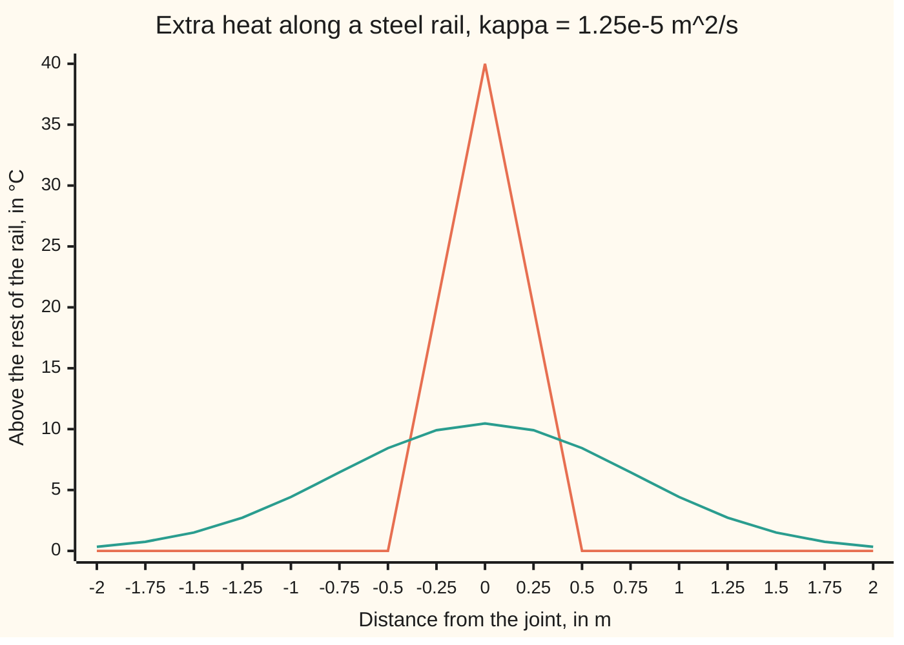

# Solving differential equations by transform: derivatives become multiplication

[Syllabus](../../../SYLLABUS.md) → [Harmonic analysis](../README.md) → [Convolution and Approximate Identities](../README.md#s03) → Solving differential equations by transform

---

## General Overview

A track crew finishes a weld in a steel rail during the night. At dawn, 06:00, the joint still stands 40 °C above the rest of the rail. The extra heat falls off evenly to nothing 0.5 m each side, so the dawn profile is a tent. What is the joint's temperature at noon?

Heat flows along the rail from hot to cold. The model here keeps only that flow and leaves out heat lost to the air. That loss takes extra heat away in proportion to how much there is, so it would multiply every frequency by one more shrinking factor: the shape stays, the height drops. Even a gentle loss rate of 2 × 10⁻⁵ per s gives the factor $`e^{-0.432}`$ by noon (see Try changing). A bare rail in open air loses heat several times faster, and over six hours that loss would outweigh the flow along the rail. So the numbers are illustrative: they show what flow along the rail does on its own.

In this model the answer is 10.46 °C above the rest of the rail. The route to it is the point of this card. Split the dawn profile into ripples of different fineness. Under the heat equation each ripple keeps its shape and only fades, and a ripple twice as fine fades four times as fast in the exponent. So the method is: break the start into ripples, fade each one, and add them back.

The trick works because a derivative does not change a ripple's shape. It only multiplies the ripple by a number. A differential equation then becomes one multiplication or division per frequency. The same three moves give the steady swing of a bench-model shock absorber, a 1 kg test mass, under a back-and-forth push: 2.48 m, from one division.

**Transform the equation, so every derivative becomes multiplication by 2πi times the frequency; solve the simple equation left at each frequency, usually one division by the symbol; transform back.**

**What kind of fact this is:** a method. Why it works proves that its answer solves the equation, under the conditions in When it holds. The rail and its numbers are a model, not measurements.

### The picture: the weld's extra heat at dawn and at noon



Orange: the tent at dawn, 40 °C at the joint. Teal: noon, 10.46 °C at the joint. Points every 0.25 m. Both curves enclose the same 20 °C·m of extra heat.

---

## The formula

Notation first, in words. The **Fourier transform** of a profile $`f(x)`$, with $`x`$ in metres, is $`\hat f(\xi) = \int f(x)\, e^{-2\pi i \xi x}\, dx`$: how much of the ripple $`e^{2\pi i \xi x}`$ the profile holds. Here $`\xi`$ (xi) is the frequency in ripples per metre, and $`i`$ is the imaginary unit. This is the convention fixed on [The transform rulebook](../02-The%20Fourier%20Transform/02-shift-scale-and-derivative-rules.md), whose derivative rule is the engine of this card:

```math
\widehat{f'}(\xi) = 2\pi i \xi\, \hat f(\xi)
```

**Read it aloud:** the transform of the slope is 2 pi i xi times the transform of the profile.

Take any linear equation with constant coefficients, $`p_n u^{(n)} + \dots + p_1 u' + p_0 u = g`$, where $`u^{(j)}`$ is the $`j`$-th derivative and $`g`$ the push. Replace each derivative by its factor. The **symbol** $`P(\xi)`$ is what the equation does to one ripple:

```math
P(\xi) = \sum_{j=0}^{n} p_j\, (2\pi i \xi)^j, \qquad P(\xi)\, \hat u(\xi) = \hat g(\xi), \qquad u(x) = \int \frac{\hat g(\xi)}{P(\xi)}\, e^{2\pi i \xi x}\, d\xi
```

**Read it aloud:** the symbol is the sum of each coefficient times 2 pi i xi to the power of its derivative; the equation becomes symbol times transform equals the push's transform; divide, and transform back.

For heat on a line, $`u_t = \kappa u_{xx}`$, only $`x`$ is transformed. Then $`u_{xx}`$ becomes $`-4\pi^2\xi^2 \hat u`$, and each frequency obeys its own decay law:

```math
\frac{d\hat u}{dt} = -4\pi^2 \kappa \xi^2\, \hat u, \qquad \hat u(\xi, t) = \hat f(\xi)\, e^{-4\pi^2\kappa\xi^2 t}
```

**Read it aloud:** each frequency's amount shrinks at a rate of 4 pi squared kappa xi squared, so at time t it is the dawn amount times e to the minus 4 pi squared kappa xi squared t.

| Symbol | Plain meaning | In our example | Push it up and the answer… |
| --- | --- | --- | --- |
| $`u(x, t)`$, $`f(x)`$, $`z`$ | temperature above the rest of the rail, in °C, at place $`x`$ (m) and time $`t`$ (s); $`f`$ is dawn; $`z`$ a second place, inside integrals | $`u`$ = 10.457555 at the joint at noon | — |
| $`\kappa`$ | diffusivity: how fast heat spreads in the steel, in m²/s | 1.25 × 10⁻⁵ | lower, wider noon hump |
| $`t`$ | time since dawn, in s | 21,600 (six hours) | lower, wider noon hump |
| $`\xi`$, $`\omega`$ | frequency, in ripples per metre (in hertz for the oscillator); $`\omega = 2\pi\xi`$, the angular form | 0 to 3 per m | that ripple fades faster |
| $`\hat f`$, $`\hat u`$, $`\hat g`$, $`i`$ | the transforms, in °C·m: how much of each ripple; $`i`$ the imaginary unit | $`\hat f(0)`$ = 20 | — |
| $`A`$, $`a`$ | the tent's height and half-width | 40 °C, 0.5 m | hotter noon joint |
| $`\mathrm{sinc}(v)`$ | $`\sin(\pi v)/(\pi v)`$, and 1 at $`v = 0`$ | $`\hat f(\xi) = Aa\, \mathrm{sinc}^2(a\xi)`$ | — |
| $`C`$ | the fade exponent per squared frequency, $`4\pi^2\kappa t`$, in m² | 10.659173 | every ripple fades more |
| $`\sigma`$, $`G`$ | spread (standard deviation) of the heat kernel $`G`$, the bell $`\sqrt{2\kappa t}`$ wide, in m | 0.734847 | wider hump |
| $`d`$, $`F_s`$ | the joint's distance from the rail's end, in m; the sine transform | 0.6 | the end matters less |
| $`P(\xi)`$, $`p_j`$, $`n`$ | the symbol; the coefficient of the $`j`$-th derivative; $`n`$ the highest derivative | $`P(0.3) = 1.446942 + 3.769911i`$ | smaller swing |
| $`y`$, $`g`$, $`b`$, $`k`$, $`c_1`$, $`c_2`$ | the test mass's travel (m); the push per kg (m/s²); damping per kg (per s); stiffness per kg (per s²); the transient's sizes | $`b`$ = 2, $`k`$ = 5, $`g`$ = 10 cos(2π·0.3 t) | $`b`$: smaller swing near resonance |

### When it holds

- **Linear, with constant coefficients.** Then every term turns into a number times $`\hat u`$. A diffusivity that varies along the rail makes $`\kappa(x) u_{xx}`$, whose transform is a convolution, not a product, and the equations for different frequencies stay coupled.
- **The start and the push have transforms.** A profile with finite total size does. A push that grows without bound, such as $`g = e^{t}`$, has none on the line, and the Laplace transform must take over.
- **The symbol is never zero on the real frequencies.** Division needs it. The undamped test mass has $`P(\xi) = 5 - 4\pi^2\xi^2`$, which is zero at 0.355881 Hz. Pushed there, the swing grows without limit and no steady answer exists.
- **The whole line, or a half line with a simple end.** On a half line the sine or cosine transform replaces the full one (Step 4). A finite rod takes a Fourier series ([The heat equation](../../08-Differential%20equations%20and%20dynamics/10-The%20Classical%20PDEs/03-the-heat-equation.md)).
- **Forward in time, for heat.** Backwards, every factor $`e^{-C\xi^2}`$ turns into $`e^{+C\xi^2}`$. A ripple of 1 per metre grows 42,581.4 times in six hours, so the slightest error in the noon profile ruins the dawn profile.

---

## Why it works

### Step 0: a ripple is the one shape a derivative only rescales

The slope of $`e^{2\pi i \xi x}`$ is $`2\pi i \xi\, e^{2\pi i \xi x}`$: the same ripple, multiplied by a number. So any linear equation with constant coefficients acts on one ripple by multiplying it by one number, the symbol $`P(\xi)`$. Different frequencies never mix.

Fourier inversion writes every reasonable profile as a blend of ripples ([Fourier inversion](../02-The%20Fourier%20Transform/04-fourier-inversion-theorem.md)). So the equation splits into one scalar problem per frequency. That is the whole method. The rest is bookkeeping.

### Step 1: the derivative rule, by one integration by parts

For a profile $`f`$ with no jumps, whose slope $`f'`$ has finite total size:

```math
\int f'(x)\, e^{-2\pi i \xi x}\, dx = \Big[f(x)\, e^{-2\pi i \xi x}\Big]_{-\infty}^{\infty} + 2\pi i \xi \int f(x)\, e^{-2\pi i \xi x}\, dx = 2\pi i \xi\, \hat f(\xi)
```

The bracket is 0 because $`f`$ dies away far out. Twice gives $`\widehat{f''} = (2\pi i\xi)^2 \hat f = -4\pi^2\xi^2 \hat f`$. The rulebook card proves the rule in full and shows it failing at a jump.

### Step 2: heat becomes one decay law per frequency

Transform $`u_t = \kappa u_{xx}`$ in $`x`$ only, with $`t`$ held fixed. The left side becomes $`d\hat u/dt`$. The right side becomes $`-4\pi^2\kappa\xi^2\hat u`$. Each frequency now obeys the decay law of a cooling cup, at its own rate, so $`\hat u(\xi, t) = \hat f(\xi)\, e^{-4\pi^2\kappa\xi^2 t}`$.

The dawn tent's transform is $`\hat f(\xi) = Aa\, \mathrm{sinc}^2(a\xi)`$ ([Two pairs worth memorising](../02-The%20Fourier%20Transform/03-gaussian-and-sinc-transform-pairs.md) gives the gate's sinc; the tent is a scaled copy of the gate convolved with itself). For the rail, $`C = 4\pi^2\kappa t = 10.659173`$ m² at noon:

| Frequency, per m | Dawn amount, °C·m | Fade $`e^{-C\xi^2}`$ | Noon amount, °C·m |
| ---: | ---: | ---: | ---: |
| 0 | 20.000000 | 1 | 20.000000 |
| 0.25 | 18.992824 | 0.5136576 | 9.755809 |
| 0.5 | 16.211389 | 0.06961375 | 1.128536 |
| 1 | 8.105695 | 2.348443 × 10⁻⁵ | 1.903576 × 10⁻⁴ |
| 1.5 | 1.801265 | 3.839328 × 10⁻¹¹ | 6.915649 × 10⁻¹¹ |

Zero frequency never fades: $`\hat u(0, t) = \int u\, dx`$ is the total extra heat, 20 °C·m, so heat is kept. By noon almost nothing finer than half a ripple per metre is left. The tent's sharp peak lived in those fine ripples, which is why the noon hump is round.

### Step 3: back to the rail, and the heat kernel appears

Transform back:

```math
u(x, t) = \int \hat f(\xi)\, e^{-4\pi^2\kappa\xi^2 t}\, e^{2\pi i \xi x}\, d\xi
```

At the joint, $`x = 0`$, the integrand is even, so the code integrates from 0 to a cut-off of 3 per m and doubles. The tail beyond the cut-off is below $`1.4 \times 10^{-42}`$ °C, and a cut-off of 2 per m gives the same 10.457555 °C.

The fade factor is itself a transform: $`e^{-4\pi^2\kappa\xi^2 t}`$ is the transform of the bell $`G(x, t) = e^{-x^2/(4\kappa t)}/\sqrt{4\pi\kappa t}`$ of spread $`\sigma = \sqrt{2\kappa t}`$. A product of transforms is the transform of a convolution ([The convolution theorem](02-convolution-theorem-and-impulse-response.md)). So

```math
u(x, t) = \int G(x - z, t)\, f(z)\, dz
```

This is exactly the answer of [The heat kernel](../../08-Differential%20equations%20and%20dynamics/10-The%20Classical%20PDEs/10-the-heat-kernel.md), which found the bell by scaling. The transform route reaches it by multiplication instead. Both give 10.457555 °C at the joint.

<details>
<summary>Detailed proof: the transform route solves the heat equation and starts at the dawn profile</summary>

Let $`f`$ have finite total size, so $`\lvert \hat f(\xi)\rvert \le \int \lvert f\rvert`$ for every $`\xi`$. For $`t > 0`$ define $`u`$ by the inverse integral above.

The integrand is bounded by $`\int\lvert f\rvert`$ times $`e^{-4\pi^2\kappa\xi^2 t}`$, which has finite area. Its derivatives in $`t`$ and $`x`$ bring down factors $`-4\pi^2\kappa\xi^2`$ and $`2\pi i\xi`$, and a bell times any power of $`\xi`$ still has finite area. So derivatives pass under the integral, and

$`\displaystyle u_t - \kappa u_{xx} = \int \hat f(\xi)\, e^{-4\pi^2\kappa\xi^2 t} \big(-4\pi^2\kappa\xi^2 + 4\pi^2\kappa\xi^2\big)\, e^{2\pi i\xi x}\, d\xi = 0.`$

The bell's transform: $`G(\cdot, t)`$ is a normal density of variance $`\sigma^2 = 2\kappa t`$, and the bell transforms to a bell, $`\hat G(\xi) = e^{-2\pi^2\sigma^2\xi^2} = e^{-4\pi^2\kappa\xi^2 t}`$. Swapping the order of integration (Fubini: everything has finite size) turns the inverse integral into $`G * f`$.

The start: $`G(\cdot, t)`$ has area 1 and gathers at 0 as $`t \to 0`$, so it is an approximate identity ([Approximate identities](03-approximate-identities.md)). Hence $`u(\cdot, t) \to f`$ in the mean, and at every point where $`f`$ is continuous.

</details>

A hand check follows from the same product. The spread of a convolution adds: variances add. The tent's variance is $`a^2/6`$ = 0.041667 m², and the bell adds $`2\kappa t`$ = 0.54 m². A bell of variance 0.581667 m² holding 20 °C·m peaks at 10.461717 °C, only 0.004162 °C above the exact 10.457555.

### Step 4: a rail end, by sine and cosine transforms

Say the joint is $`d`$ = 0.6 m from the rail's end. Two kinds of end change the answer.

- **End held at the base temperature,** for example clamped to a large steel block: the extra heat there stays 0. Extend the profile to negative $`x`$ as an **odd** copy, $`f(-x) = -f(x)`$, which is 0 at the end. The odd extension's transform is built from sines only. This is the **sine transform**, $`F_s(\xi) = 2\int_0^\infty f(x) \sin(2\pi\xi x)\, dx`$, with inverse $`f(x) = 2\int_0^\infty F_s(\xi)\sin(2\pi\xi x)\, d\xi`$.
- **Insulated end:** no heat crosses it, so the slope there is 0. Extend the profile as an **even** copy, $`f(-x) = f(x)`$. This gives the **cosine transform**, the same formulas with cosines.

Each sine or cosine fades by the same $`e^{-C\xi^2}`$ as before, because $`\sin`$ and $`\cos`$ are sums of two ripples of the same $`\lvert\xi\rvert`$. Transforming back gives the line answer plus or minus a mirror image of the weld, $`2d`$ = 1.2 m away:

| End | Transform road | Image road | Noon at the joint |
| --- | ---: | ---: | ---: |
| Endless rail | full transform | — | 10.457555 °C |
| Held at the base | sine: 7.421219 | $`u(0) - u(1.2)`$ = 7.421219 | 7.42 °C |
| Insulated | cosine: 13.493892 | $`u(0) + u(1.2)`$ = 13.493892 | 13.49 °C |

The mirror image adds or removes $`u(1.2)`$ = 3.036336 °C. The held end drains heat, so the joint is that much cooler. The insulated end traps heat, so the joint is that much warmer.

### Step 5: the forced oscillator, steady state by one division

Now transform in time, with $`\xi`$ in hertz. The bench mass of [The round trip](../../08-Differential%20equations%20and%20dynamics/08-Laplace%20Transforms%20for%20Initial-Value%20Problems/04-solving-an-initial-value-problem-by-transform.md) obeys $`y'' + 2y' + 5y = g(t)`$: $`y`$ is the travel in m, and $`g`$ the push per kg. Its symbol is

```math
P(\xi) = 5 - 4\pi^2\xi^2 + 2\pi i \xi \cdot 2
```

A push $`g = 10\cos(2\pi \cdot 0.3\, t)`$ holds only the frequencies ±0.3 Hz. Divide at 0.3 Hz: $`P(0.3) = 1.446942 + 3.769911i`$, of size 4.038053. The steady swing is $`10/4.038053`$ = 2.476441 m, lagging the push by 69.0025°.

The Laplace route on the round-trip card starts from rest. Its answer is this steady swing plus a transient, a start-up part that dies away, $`e^{-t}(c_1\cos 2t + c_2\sin 2t)`$, with $`c_1, c_2`$ fixed by the starting values. The Fourier route has no starting values to use, so it returns the steady part alone:

| Time | From rest: Laplace, and 0.001 s steps | Fourier steady swing | Gap |
| ---: | ---: | ---: | ---: |
| 1 s | 1.183153 m | 1.924625 m | −0.741472 m |
| 3 s | −0.646991 m | −0.641056 m | −0.005935 m |
| 10 s | 0.887250 m | 0.887375 m | −0.000125 m |

The gap shrinks like $`e^{-t}`$. Fourier answers "how does it swing once it has settled"; Laplace answers "how does it get there".

For a push that is not a single tone, the full recipe runs. A pulse $`g = 10\, e^{-t^2/(2 \times 0.25^2)}`$ has a bell for its transform. Divide by $`P`$ and transform back numerically, over −6 to 6 Hz; at the cut-off the pulse's transform is down to $`3.2 \times 10^{-19}`$, and it falls faster beyond. A cut-off of 4 Hz gives the same 1.001344 m at 1 s. The result matches a step-by-step run from rest at −3 s: 0.431243 m at 0 s and 1.001344 m at 1 s. At −1 s it is only 0.000010 m. The Fourier route picks the solution that was at rest long before the push. That holds because both roots of the symbol, $`-1 \pm 2i`$ in Laplace's variable, lie on the decaying side.

### Step 6: where the method fails

- **A zero of the symbol.** Without damping, $`P(\xi) = 5 - 4\pi^2\xi^2`$ is zero at $`\sqrt5/(2\pi)`$ = 0.355881 Hz. Pushed at that frequency from rest, the swing reaches 42.4233 m by 20 s and keeps growing. Division by zero is the transform's way of saying no steady state exists. The Laplace route still works.
- **Heat backwards.** Recovering dawn from noon multiplies by $`e^{+C\xi^2}`$. Any noise at fine frequencies is magnified without bound. This is the same instability that makes [Blurring and unblurring](05-smoothing-blurring-and-deconvolution.md) hard.
- **Coefficients that vary, or terms like $`u^2`$.** Ripples then mix, and there is no single number per frequency to divide by.

---

## Worked numbers, by hand

The rail at noon, joint at $`x`$ = 0, by the spreads-add estimate, then the frequency picture.

| Step | Arithmetic | Value |
| --- | --- | --- |
| time since dawn | 6 × 3,600 | 21,600 s |
| $`2\kappa t`$, the bell's variance | 2 × 1.25 × 10⁻⁵ × 21,600 | 0.54 m² |
| fade exponent $`C`$ | $`4\pi^2 \kappa t = 4\pi^2 \times 0.27`$ | 10.659173 m² |
| total extra heat, $`\hat f(0)`$ | tent area, $`40 \times 0.5`$ | 20 °C·m |
| one ripple per 4 m | $`20\, \mathrm{sinc}^2(0.125)`$ × $`e^{-10.659 / 16}`$ = 18.992824 × 0.513658 | 9.755809 °C·m |
| one ripple per metre | 8.105695 × $`e^{-10.659}`$ = 8.105695 × 0.0000234844 | 0.000190 °C·m |
| tent's variance | $`0.5^2/6`$ | 0.041667 m² |
| noon variance | 0.041667 + 0.54 | 0.581667 m² |
| bell estimate at the joint | $`20/\sqrt{2\pi \times 0.581667}`$ | 10.461717 °C |
| **exact, transform road** | inverse integral, cut-off 3 per m | **10.457555 °C** |

At noon the joint is about 10.5 °C above the rest of the rail, down from 40 °C at dawn. The total heat has not changed; it has spread over a few metres.

### What breaks if you drop a piece

Same rail, same noon, correct answer 10.457555 °C at the joint; same test mass.

| Mistake | Comes out at | What went wrong |
| --- | --- | --- |
| Fade $`e^{-\kappa t\xi^2}`$, the angular form's factor with $`\xi`$ in ripples per metre | 32.534742 °C | The $`4\pi^2`$ belongs to $`\xi`$ in ripples per metre; dropping it divides every fade exponent by $`4\pi^2`$. |
| Running heat backwards | a ripple of 1 per m grows 42,581.4 times | The factor $`e^{+C\xi^2}`$ explodes; the problem has no stable answer. |
| Ignoring a held rail end 0.6 m away | 10.457555 °C instead of 7.421219 | The endless-line transform cannot see the end; the sine transform can. |
| Steady swing read as the answer from rest, at 1 s | 1.924625 m instead of 1.183153 | Fourier drops the starting values; the transient is still large at 1 s. |
| Dividing by an undamped symbol at 0.355881 Hz | $`\lvert P\rvert`$ = 0; the swing reaches 42.4233 m by 20 s | No steady state exists; the swing grows without limit. |

---

## Code, from first principles, and it actually runs

The code writes out every integral as Simpson's rule (parabolas fitted through each three neighbouring points), the normal curve's area by Simpson's rule on the bell, the DFT (discrete Fourier transform) as a double loop, and the oscillator as a fourth-order Runge–Kutta stepper (four slope samples per 0.001 s step, averaged). It reaches the noon joint by four roads: the transform round trip, convolution with the heat kernel, a closed form for a tent blurred by a bell, and a 128-point DFT on a 16 m loop. The DFT gap, 0.023 °C, falls about fourfold when the step halves, as a sampled sum should. The rail end is solved by the sine and cosine transforms and checked against mirror images. The oscillator is solved by Fourier division, by the Laplace closed form and by stepping.

### Python

```python
# Fourier methods for differential equations: transform, divide by the symbol, transform back.
# Standard library only: every transform, integral, series and step is written out here.
import math
PI = math.pi
KAPPA, T = 1.25e-5, 6 * 3600.0      # steel rail diffusivity, m^2/s; dawn (06:00) to noon, s
A, HALF = 40.0, 0.5                 # weld excess at the joint, C; tent half-width, m
C = 4 * PI * PI * KAPPA * T         # each frequency xi (per m) fades by exp(-C xi^2)
SIG = math.sqrt(2 * KAPPA * T)      # spread of the heat kernel by noon, m

def simpson(g, lo, hi, n):
    h = (hi - lo) / n
    s = g(lo) + g(hi) + sum((4 if k % 2 else 2) * g(lo + k * h) for k in range(1, n))
    return s * h / 3

def tent(x): return max(0.0, A * (1 - abs(x) / HALF))
def sinc(u): return 1.0 if u == 0 else math.sin(PI * u) / (PI * u)
def fhat(xi): return A * HALF * sinc(HALF * xi) ** 2       # transform of the tent, C*m

def Phi(z):                                                  # normal CDF: Simpson on the bell
    return 0.5 + simpson(lambda s: math.exp(-s * s / 2) / math.sqrt(2 * PI), 0, z, 400)

def sci(v, d):                                               # scientific notation, same in Rust
    if v == 0: return "0"
    e = math.floor(math.log10(abs(v))); m = f"{v / 10.0 ** e:.{d}f}"
    if m.lstrip("-").startswith("10"): e += 1; m = f"{v / 10.0 ** e:.{d}f}"
    return f"{m}e{e}"

def closed(x, half=HALF, sig=SIG):  # tent * bell = (A/a)[R(x+a) - 2R(x) + R(x-a)]
    R = lambda z: z * Phi(z / sig) + sig * math.exp(-z * z / (2 * sig * sig)) / math.sqrt(2 * PI)
    return A / half * (R(x + half) - 2 * R(x) + R(x - half))

def by_transform(x, c=C, cut=3.0, n=600):   # invert exp(-c xi^2) fhat(xi); the integrand is even
    return 2 * simpson(lambda xi: fhat(xi) * math.exp(-c * xi * xi) * math.cos(2 * PI * xi * x), 0, cut, n)

def by_kernel(x):                   # road two: the tent convolved with the heat kernel
    g = lambda y: tent(y) * math.exp(-(x - y) ** 2 / (4 * KAPPA * T)) / math.sqrt(4 * PI * KAPPA * T)
    return simpson(g, -HALF, 0, 200) + simpson(g, 0, HALF, 200)

def by_dft(L=16.0, N=128):          # road three: the finite twin, a length-N DFT on a 16 m loop
    dx = L / N
    f = [tent(-L / 2 + j * dx) for j in range(N)]
    F = [sum(f[j] * complex(math.cos(2 * PI * k * j / N), -math.sin(2 * PI * k * j / N)) for j in range(N)) for k in range(N)]
    xi = lambda k: (k if k < N // 2 else k - N) / L
    G = [F[k] * math.exp(-C * xi(k) ** 2) for k in range(N)]
    j0 = N // 2                     # the sample at x = 0
    return sum(G[k] * complex(math.cos(2 * PI * k * j0 / N), math.sin(2 * PI * k * j0 / N)) for k in range(N)).real / N

print(f"rail: kappa {sci(KAPPA, 2)} m^2/s, t {T:.0f} s, kappa t {KAPPA * T:.6f} m^2, C = 4 pi^2 kappa t {C:.6f}, kernel spread {SIG:.6f} m")
u_tr, u_k, u_c, u_d, u_d2 = by_transform(0), by_kernel(0), closed(0), by_dft(), by_dft(N=256)
tail = 2 * 20 * math.exp(-C * 9) / (2 * C * 3)
print(f"noon at the joint: transform {u_tr:.6f}  kernel {u_k:.6f}  closed {u_c:.6f}  dft {u_d:.6f} C")
print(f"  cut-off 3 per m, tail bound {sci(tail, 1)}; cut-off 2 per m gives {by_transform(0, cut=2.0, n=400):.6f}")
print(f"  dft gap, 128 points {u_d - u_c:.6f}, 256 points {u_d2 - u_c:.6f}, ratio {(u_d - u_c) / (u_d2 - u_c):.4f}")
var = HALF ** 2 / 6 + SIG ** 2
bell = 20 / math.sqrt(2 * PI * var)
print(f"by hand, spreads add: tent variance {HALF**2/6:.6f} + 2 kappa t {SIG**2:.6f} = {var:.6f} m^2; bell peak {bell:.6f} C")
heat = simpson(lambda x: closed(x), -6, 6, 600)
print(f"heat content dawn {fhat(0):.6f}  noon {heat:.6f} C*m")
print("per frequency: xi per m | dawn fhat C*m | fade exp(-C xi^2) | noon C*m")
for xi in (0, 0.25, 0.5, 1, 1.5):
    print(f"  {xi:.2f} | {fhat(xi):.6f} | {sci(math.exp(-C * xi * xi), 6)} | {sci(fhat(xi) * math.exp(-C * xi * xi), 6)}")
xs = [-2 + 0.25 * j for j in range(17)]
print("chart x m: " + " ".join(f"{x:.2f}" for x in xs))
print("chart dawn: " + " ".join(f"{tent(x):.2f}" for x in xs))
print("chart noon: " + " ".join(f"{closed(x):.2f}" for x in xs))
# half line: the joint d = 0.6 m from the rail end; sine transform (end held) and cosine transform (end insulated)
D = 0.6
def half_line(trig, x):
    Fs = lambda xi: 2 * (simpson(lambda y: tent(y - D) * trig(2 * PI * xi * y), D - HALF, D, 60)
                         + simpson(lambda y: tent(y - D) * trig(2 * PI * xi * y), D, D + HALF, 60))
    return 2 * simpson(lambda xi: Fs(xi) * math.exp(-C * xi * xi) * trig(2 * PI * xi * x), 0, 3, 300)
held, ins = half_line(math.sin, D), half_line(math.cos, D)
print(f"mirror image 1.2 m away: u(1.2) {closed(2 * D):.6f} C; bell estimate minus exact {bell - u_c:.6f} C")
print(f"end held at base: sine transform {held:.6f}  image u(0) - u(1.2) {closed(0) - closed(2 * D):.6f} C")
print(f"end insulated: cosine transform {ins:.6f}  image u(0) + u(1.2) {closed(0) + closed(2 * D):.6f} C")
# the forced oscillator y'' + 2y' + 5y = 10 cos(2 pi 0.3 t): divide by the symbol P(xi)
B, K, F0, XI0 = 2.0, 5.0, 10.0, 0.3
P = lambda xi, b=B: complex(K - (2 * PI * xi) ** 2, b * 2 * PI * xi)
amp = F0 / P(XI0)
yss = lambda t: (amp * complex(math.cos(2 * PI * XI0 * t), math.sin(2 * PI * XI0 * t))).real
dyss = lambda t: (amp * 2j * PI * XI0 * complex(math.cos(2 * PI * XI0 * t), math.sin(2 * PI * XI0 * t))).real
print(f"symbol P(0.3 Hz) = {P(XI0).real:.6f} + {P(XI0).imag:.6f}i, size {abs(P(XI0)):.6f}; amplitude {abs(amp):.6f} m, lag {-math.degrees(math.atan2(amp.imag, amp.real)):.4f} deg")
c1 = -yss(0); c2 = (c1 - dyss(0)) / 2      # Laplace road: steady state plus a fading transient
full = lambda t: yss(t) + math.exp(-t) * (c1 * math.cos(2 * t) + c2 * math.sin(2 * t))

def rk4(force, b, t0, t1, h=0.001):          # from rest at t0; returns {rounded t: y}
    y, v, t, out = 0.0, 0.0, t0, {}
    acc = lambda t, y, v: force(t) - b * v - K * y
    for _ in range(round((t1 - t0) / h)):
        k1 = (v, acc(t, y, v)); k2 = (v + h / 2 * k1[1], acc(t + h / 2, y + h / 2 * k1[0], v + h / 2 * k1[1]))
        k3 = (v + h / 2 * k2[1], acc(t + h / 2, y + h / 2 * k2[0], v + h / 2 * k2[1]))
        k4 = (v + h * k3[1], acc(t + h, y + h * k3[0], v + h * k3[1]))
        y += h / 6 * (k1[0] + 2 * k2[0] + 2 * k3[0] + k4[0]); v += h / 6 * (k1[1] + 2 * k2[1] + 2 * k3[1] + k4[1]); t += h
        out[round(t, 3)] = y
    return out
push = lambda t: F0 * math.cos(2 * PI * XI0 * t)
run = rk4(push, B, 0, 10)
for t in (1, 3, 10):
    print(f"  t {t:2} s: from rest, Laplace {full(t):.6f}  steps {run[t]:.6f} | Fourier steady {yss(t):.6f} | gap {full(t) - yss(t):.6f} m")
# a pulse push 10 exp(-t^2/(2 * 0.25^2)): transform, divide by P, invert; against stepping from rest at -3 s
fp = lambda xi: F0 * math.sqrt(2 * PI) * 0.25 * math.exp(-2 * PI * PI * 0.0625 * xi * xi)
inv = lambda t, cut=6: simpson(lambda xi: (fp(xi) / P(xi) * complex(math.cos(2 * PI * xi * t), math.sin(2 * PI * xi * t))).real, -cut, cut, 400 * cut)
pr = rk4(lambda t: F0 * math.exp(-t * t / 0.125), B, -3, 2)
print("pulse: t s | transform-divide-invert | steps from rest at -3 s")
print(f"  frequency cut-off 6 Hz, pulse transform there {sci(fp(6), 1)}; cut-off 4 Hz gives {inv(1, 4):.6f} at 1 s")
print(f"  roots of s^2 + 2s + 5, s Laplace's variable: {-B / 2:.6f} +- {math.sqrt(K - B * B / 4):.6f}i")
for t in (-1, 0, 1, 2):
    print(f"  {t:2} | {inv(t):.6f} | {pr[t]:.6f}")
# what breaks
xr = math.sqrt(K) / (2 * PI)
res = rk4(lambda t: F0 * math.cos(2 * PI * xr * t), 0.0, 0, 20)
KW = KAPPA * T                      # the wrong fade exp(-KW xi^2) is slow, so its cut-off is 20 per m, not 3
wrong, wrong12, wbell = by_transform(0, c=KW, cut=20.0, n=4000), by_transform(0, c=KW, cut=12.0, n=2400), closed(0, sig=math.sqrt(KW / (2 * PI * PI)))
print("what breaks")
print(f"  omega form with xi per metre, exp(-kappa t xi^2): joint at noon {wrong:.6f} C")
print(f"    cut-off 20 per m; 12 per m gives {wrong12:.6f}; closed form, a bell of variance kappa t/(2 pi^2), {wbell:.6f}")
print(f"  time run backwards: the 1 per m ripple grows by exp(+C) = {math.exp(C):.1f}")
print(f"  held end ignored: {closed(0):.6f} C instead of {held:.6f}")
print(f"  steady state read as the from-rest answer at 1 s: {yss(1):.6f} m instead of {full(1):.6f}")
print(f"  no damping at resonance {xr:.6f} Hz: |P| = {abs(P(xr, 0.0)):.6f}; from rest |y| reaches {max(abs(v) for v in res.values()):.4f} m by 20 s")
print("try changing")
print(f"  09:00 instead of noon: joint {closed(0, sig=math.sqrt(2 * KAPPA * T / 2)):.6f} C")
print(f"  narrower weld, half-width 0.25 m: noon joint {closed(0, half=0.25):.6f} C")
print(f"  air loss rate 2e-5 per s: every frequency times exp(-0.432), joint {closed(0) * math.exp(-2e-5 * T):.6f} C")
print(f"  push at 0.5 Hz: amplitude {F0 / abs(P(0.5)):.6f} m")
assert abs(u_tr - u_c) < 1e-9 and abs(u_k - u_c) < 1e-6, "transform and kernel must give the closed form"
assert abs(u_d - u_c) < 0.05 and 3.5 < (u_d - u_c) / (u_d2 - u_c) < 4.5, "DFT twin: gap shrinks like step^2"
assert abs(by_transform(1.0) - closed(1.0)) < 1e-9, "transform road away from the joint"
assert abs(heat - 20) < 1e-6, "heat content is the transform at zero frequency, and it is kept"
assert abs(held - (closed(0) - closed(2 * D))) < 1e-6 and abs(ins - (closed(0) + closed(2 * D))) < 1e-6, "images"
assert abs(full(10) - run[10]) < 1e-8 and abs(full(1) - run[1]) < 1e-8, "Laplace road against stepping"
assert abs(full(10) - yss(10)) < 1e-3 < abs(full(1) - yss(1)), "the transient fades; Fourier keeps only the steady state"
assert all(abs(inv(t) - pr[t]) < 1e-6 for t in (-1, 0, 1, 2)), "transform-divide-invert against stepping"
assert abs(bell - u_c) < 0.1, "spreads add: the bell estimate is close"
assert abs(wrong - wbell) < 1e-9, "the wrong fade blurs by a narrower bell"
print("ALL CHECKS PASS")
```

**Ran 2026-11-15 on macOS, Python 3.14.10, standard library only. All checks passed. Output, pasted from the run:**

```text
rail: kappa 1.25e-5 m^2/s, t 21600 s, kappa t 0.270000 m^2, C = 4 pi^2 kappa t 10.659173, kernel spread 0.734847 m
noon at the joint: transform 10.457555  kernel 10.457555  closed 10.457555  dft 10.481022 C
  cut-off 3 per m, tail bound 1.4e-42; cut-off 2 per m gives 10.457555
  dft gap, 128 points 0.023466, 256 points 0.005849, ratio 4.0121
by hand, spreads add: tent variance 0.041667 + 2 kappa t 0.540000 = 0.581667 m^2; bell peak 10.461717 C
heat content dawn 20.000000  noon 20.000000 C*m
per frequency: xi per m | dawn fhat C*m | fade exp(-C xi^2) | noon C*m
  0.00 | 20.000000 | 1.000000e0 | 2.000000e1
  0.25 | 18.992824 | 5.136576e-1 | 9.755809e0
  0.50 | 16.211389 | 6.961375e-2 | 1.128536e0
  1.00 | 8.105695 | 2.348443e-5 | 1.903576e-4
  1.50 | 1.801265 | 3.839328e-11 | 6.915649e-11
chart x m: -2.00 -1.75 -1.50 -1.25 -1.00 -0.75 -0.50 -0.25 0.00 0.25 0.50 0.75 1.00 1.25 1.50 1.75 2.00
chart dawn: 0.00 0.00 0.00 0.00 0.00 0.00 0.00 20.00 40.00 20.00 0.00 0.00 0.00 0.00 0.00 0.00 0.00
chart noon: 0.34 0.75 1.51 2.73 4.43 6.45 8.44 9.91 10.46 9.91 8.44 6.45 4.43 2.73 1.51 0.75 0.34
mirror image 1.2 m away: u(1.2) 3.036336 C; bell estimate minus exact 0.004162 C
end held at base: sine transform 7.421219  image u(0) - u(1.2) 7.421219 C
end insulated: cosine transform 13.493892  image u(0) + u(1.2) 13.493892 C
symbol P(0.3 Hz) = 1.446942 + 3.769911i, size 4.038053; amplitude 2.476441 m, lag 69.0025 deg
  t  1 s: from rest, Laplace 1.183153  steps 1.183153 | Fourier steady 1.924625 | gap -0.741472 m
  t  3 s: from rest, Laplace -0.646991  steps -0.646991 | Fourier steady -0.641056 | gap -0.005935 m
  t 10 s: from rest, Laplace 0.887250  steps 0.887250 | Fourier steady 0.887375 | gap -0.000125 m
pulse: t s | transform-divide-invert | steps from rest at -3 s
  frequency cut-off 6 Hz, pulse transform there 3.2e-19; cut-off 4 Hz gives 1.001344 at 1 s
  roots of s^2 + 2s + 5, s Laplace's variable: -1.000000 +- 2.000000i
  -1 | 0.000010 | 0.000010
   0 | 0.431243 | 0.431243
   1 | 1.001344 | 1.001344
   2 | -0.258455 | -0.258455
what breaks
  omega form with xi per metre, exp(-kappa t xi^2): joint at noon 32.534742 C
    cut-off 20 per m; 12 per m gives 32.534742; closed form, a bell of variance kappa t/(2 pi^2), 32.534742
  time run backwards: the 1 per m ripple grows by exp(+C) = 42581.4
  held end ignored: 10.457555 C instead of 7.421219
  steady state read as the from-rest answer at 1 s: 1.924625 m instead of 1.183153
  no damping at resonance 0.355881 Hz: |P| = 0.000000; from rest |y| reaches 42.4233 m by 20 s
try changing
  09:00 instead of noon: joint 14.271724 C
  narrower weld, half-width 0.25 m: noon joint 5.377154 C
  air loss rate 2e-5 per s: every frequency times exp(-0.432), joint 6.789143 C
  push at 0.5 Hz: amplitude 1.257971 m
ALL CHECKS PASS
```

### Rust

```rust
// Fourier methods for differential equations: transform, divide by the symbol, transform back.
// Standard library only: every transform, integral, series and step is written out here.
use std::f64::consts::PI;
const KAPPA: f64 = 1.25e-5; // steel rail diffusivity, m^2/s
const T: f64 = 6.0 * 3600.0; // dawn (06:00) to noon, s
const A: f64 = 40.0; // weld excess at the joint, C
const HALF: f64 = 0.5; // tent half-width, m
const D: f64 = 0.6; // joint's distance from the rail end, m

#[derive(Clone, Copy)]
struct Cx { re: f64, im: f64 }
impl Cx {
    fn new(re: f64, im: f64) -> Cx { Cx { re, im } }
    fn mul(self, o: Cx) -> Cx { Cx::new(self.re * o.re - self.im * o.im, self.re * o.im + self.im * o.re) }
    fn div(self, o: Cx) -> Cx { let d = o.re * o.re + o.im * o.im; Cx::new((self.re * o.re + self.im * o.im) / d, (self.im * o.re - self.re * o.im) / d) }
    fn abs(self) -> f64 { (self.re * self.re + self.im * self.im).sqrt() }
    fn cis(a: f64) -> Cx { Cx::new(a.cos(), a.sin()) }
}

fn c() -> f64 { 4.0 * PI * PI * KAPPA * T } // each frequency xi (per m) fades by exp(-C xi^2)
fn sig() -> f64 { (2.0 * KAPPA * T).sqrt() } // spread of the heat kernel by noon, m
fn simpson(g: &dyn Fn(f64) -> f64, lo: f64, hi: f64, n: usize) -> f64 {
    let h = (hi - lo) / n as f64;
    let mut s = g(lo) + g(hi);
    for k in 1..n { s += if k % 2 == 1 { 4.0 } else { 2.0 } * g(lo + k as f64 * h); }
    s * h / 3.0
}
fn tent(x: f64) -> f64 { (A * (1.0 - x.abs() / HALF)).max(0.0) }
fn sinc(u: f64) -> f64 { if u == 0.0 { 1.0 } else { (PI * u).sin() / (PI * u) } }
fn fhat(xi: f64) -> f64 { A * HALF * sinc(HALF * xi).powi(2) } // transform of the tent, C*m
fn phi(z: f64) -> f64 { 0.5 + simpson(&|s: f64| (-s * s / 2.0).exp() / (2.0 * PI).sqrt(), 0.0, z, 400) }
fn sci(v: f64, d: usize) -> String {
    if v == 0.0 { return "0".to_string(); }
    let mut e = v.abs().log10().floor() as i32;
    let mut m = format!("{:.*}", d, v / 10f64.powf(e as f64));
    if m.trim_start_matches('-').starts_with("10") { e += 1; m = format!("{:.*}", d, v / 10f64.powf(e as f64)); }
    format!("{}e{}", m, e)
}
fn closed(x: f64, half: f64, sg: f64) -> f64 { // tent * bell = (A/a)[R(x+a) - 2R(x) + R(x-a)]
    let r = |z: f64| z * phi(z / sg) + sg * (-z * z / (2.0 * sg * sg)).exp() / (2.0 * PI).sqrt();
    A / half * (r(x + half) - 2.0 * r(x) + r(x - half))
}
fn cl(x: f64) -> f64 { closed(x, HALF, sig()) }
fn by_transform(x: f64, cc: f64, cut: f64, n: usize) -> f64 {
    2.0 * simpson(&|xi: f64| fhat(xi) * (-cc * xi * xi).exp() * (2.0 * PI * xi * x).cos(), 0.0, cut, n)
}
fn by_kernel(x: f64) -> f64 {
    let g = |y: f64| tent(y) * (-(x - y).powi(2) / (4.0 * KAPPA * T)).exp() / (4.0 * PI * KAPPA * T).sqrt();
    simpson(&g, -HALF, 0.0, 200) + simpson(&g, 0.0, HALF, 200)
}
fn by_dft(l: f64, n: usize) -> f64 {
    let dx = l / n as f64;
    let f: Vec<f64> = (0..n).map(|j| tent(-l / 2.0 + j as f64 * dx)).collect();
    let j0 = n / 2;
    let mut s = 0.0;
    for k in 0..n {
        let mut fk = Cx::new(0.0, 0.0);
        for j in 0..n { let w = Cx::new((2.0 * PI * (k * j) as f64 / n as f64).cos(), -(2.0 * PI * (k * j) as f64 / n as f64).sin()); fk = Cx::new(fk.re + f[j] * w.re, fk.im + f[j] * w.im); }
        let xi = (if k < n / 2 { k as f64 } else { k as f64 - n as f64 }) / l;
        let g = Cx::new(fk.re * (-c() * xi * xi).exp(), fk.im * (-c() * xi * xi).exp());
        s += g.mul(Cx::new((2.0 * PI * (k * j0) as f64 / n as f64).cos(), (2.0 * PI * (k * j0) as f64 / n as f64).sin())).re;
    }
    s / n as f64
}
fn half_line(tr: fn(f64) -> f64, x: f64) -> f64 {
    let fs = |xi: f64| 2.0 * (simpson(&|y: f64| tent(y - D) * tr(2.0 * PI * xi * y), D - HALF, D, 60)
        + simpson(&|y: f64| tent(y - D) * tr(2.0 * PI * xi * y), D, D + HALF, 60));
    2.0 * simpson(&|xi: f64| fs(xi) * (-c() * xi * xi).exp() * tr(2.0 * PI * xi * x), 0.0, 3.0, 300)
}
fn p(xi: f64, b: f64) -> Cx { Cx::new(5.0 - (2.0 * PI * xi).powi(2), b * 2.0 * PI * xi) }
fn rk4(force: &dyn Fn(f64) -> f64, b: f64, t0: f64, t1: f64) -> Vec<f64> { // from rest at t0; y after each step
    let h = 0.001;
    let (mut y, mut v, mut t, mut out) = (0.0, 0.0, t0, vec![0.0]);
    let acc = |t: f64, y: f64, v: f64| force(t) - b * v - 5.0 * y;
    for _ in 0..((t1 - t0) / h).round() as usize {
        let k1 = (v, acc(t, y, v));
        let k2 = (v + h / 2.0 * k1.1, acc(t + h / 2.0, y + h / 2.0 * k1.0, v + h / 2.0 * k1.1));
        let k3 = (v + h / 2.0 * k2.1, acc(t + h / 2.0, y + h / 2.0 * k2.0, v + h / 2.0 * k2.1));
        let k4 = (v + h * k3.1, acc(t + h, y + h * k3.0, v + h * k3.1));
        y += h / 6.0 * (k1.0 + 2.0 * k2.0 + 2.0 * k3.0 + k4.0); v += h / 6.0 * (k1.1 + 2.0 * k2.1 + 2.0 * k3.1 + k4.1); t += h;
        out.push(y);
    }
    out
}

fn main() {
    let (cc, sg) = (c(), sig());
    println!("rail: kappa {} m^2/s, t {:.0} s, kappa t {:.6} m^2, C = 4 pi^2 kappa t {:.6}, kernel spread {:.6} m", sci(KAPPA, 2), T, KAPPA * T, cc, sg);
    let (u_tr, u_k, u_c, u_d, u_d2) = (by_transform(0.0, cc, 3.0, 600), by_kernel(0.0), cl(0.0), by_dft(16.0, 128), by_dft(16.0, 256));
    let tail = 2.0 * 20.0 * (-cc * 9.0).exp() / (2.0 * cc * 3.0);
    println!("noon at the joint: transform {:.6}  kernel {:.6}  closed {:.6}  dft {:.6} C", u_tr, u_k, u_c, u_d);
    println!("  cut-off 3 per m, tail bound {}; cut-off 2 per m gives {:.6}", sci(tail, 1), by_transform(0.0, cc, 2.0, 400));
    println!("  dft gap, 128 points {:.6}, 256 points {:.6}, ratio {:.4}", u_d - u_c, u_d2 - u_c, (u_d - u_c) / (u_d2 - u_c));
    let var = HALF * HALF / 6.0 + sg * sg;
    let bell = 20.0 / (2.0 * PI * var).sqrt();
    println!("by hand, spreads add: tent variance {:.6} + 2 kappa t {:.6} = {:.6} m^2; bell peak {:.6} C", HALF * HALF / 6.0, sg * sg, var, bell);
    let heat = simpson(&|x: f64| cl(x), -6.0, 6.0, 600);
    println!("heat content dawn {:.6}  noon {:.6} C*m", fhat(0.0), heat);
    println!("per frequency: xi per m | dawn fhat C*m | fade exp(-C xi^2) | noon C*m");
    for xi in [0.0, 0.25, 0.5, 1.0, 1.5] {
        let fade = (-cc * xi * xi).exp();
        println!("  {:.2} | {:.6} | {} | {}", xi, fhat(xi), sci(fade, 6), sci(fhat(xi) * fade, 6));
    }
    let xs: Vec<f64> = (0..17).map(|j| -2.0 + 0.25 * j as f64).collect();
    let row = |g: &dyn Fn(f64) -> f64| xs.iter().map(|&x| format!("{:.2}", g(x))).collect::<Vec<_>>().join(" ");
    println!("chart x m: {}", row(&|x| x));
    println!("chart dawn: {}", row(&tent));
    println!("chart noon: {}", row(&cl));
    let (held, ins) = (half_line(f64::sin, D), half_line(f64::cos, D));
    println!("mirror image 1.2 m away: u(1.2) {:.6} C; bell estimate minus exact {:.6} C", cl(2.0 * D), bell - u_c);
    println!("end held at base: sine transform {:.6}  image u(0) - u(1.2) {:.6} C", held, cl(0.0) - cl(2.0 * D));
    println!("end insulated: cosine transform {:.6}  image u(0) + u(1.2) {:.6} C", ins, cl(0.0) + cl(2.0 * D));
    // the forced oscillator y'' + 2y' + 5y = 10 cos(2 pi 0.3 t): divide by the symbol P(xi)
    let (b, f0, xi0) = (2.0, 10.0, 0.3);
    let amp = Cx::new(f0, 0.0).div(p(xi0, b));
    let yss = |t: f64| amp.mul(Cx::cis(2.0 * PI * xi0 * t)).re;
    let dyss = |t: f64| amp.mul(Cx::new(0.0, 2.0 * PI * xi0)).mul(Cx::cis(2.0 * PI * xi0 * t)).re;
    println!("symbol P(0.3 Hz) = {:.6} + {:.6}i, size {:.6}; amplitude {:.6} m, lag {:.4} deg", p(xi0, b).re, p(xi0, b).im, p(xi0, b).abs(), amp.abs(), -amp.im.atan2(amp.re).to_degrees());
    let c1 = -yss(0.0);
    let c2 = (c1 - dyss(0.0)) / 2.0; // Laplace road: steady state plus a fading transient
    let full = |t: f64| yss(t) + (-t).exp() * (c1 * (2.0 * t).cos() + c2 * (2.0 * t).sin());
    let run = rk4(&|t: f64| f0 * (2.0 * PI * xi0 * t).cos(), b, 0.0, 10.0);
    for t in [1usize, 3, 10] {
        let tf = t as f64;
        println!("  t {:2} s: from rest, Laplace {:.6}  steps {:.6} | Fourier steady {:.6} | gap {:.6} m", t, full(tf), run[t * 1000], yss(tf), full(tf) - yss(tf));
    }
    // a pulse push 10 exp(-t^2/(2 * 0.25^2)): transform, divide by P, invert; against stepping from rest at -3 s
    let fp = |xi: f64| f0 * (2.0 * PI).sqrt() * 0.25 * (-2.0 * PI * PI * 0.0625 * xi * xi).exp();
    let inv = |t: f64, cut: f64| simpson(&|xi: f64| Cx::new(fp(xi), 0.0).div(p(xi, b)).mul(Cx::cis(2.0 * PI * xi * t)).re, -cut, cut, (400.0 * cut) as usize);
    let pr = rk4(&|t: f64| f0 * (-t * t / 0.125).exp(), b, -3.0, 2.0);
    println!("pulse: t s | transform-divide-invert | steps from rest at -3 s");
    println!("  frequency cut-off 6 Hz, pulse transform there {}; cut-off 4 Hz gives {:.6} at 1 s", sci(fp(6.0), 1), inv(1.0, 4.0));
    println!("  roots of s^2 + 2s + 5, s Laplace's variable: {:.6} +- {:.6}i", -b / 2.0, (5.0 - b * b / 4.0).sqrt());
    for t in [-1i32, 0, 1, 2] { println!("  {:2} | {:.6} | {:.6}", t, inv(t as f64, 6.0), pr[((t + 3) * 1000) as usize]); }
    let xr = 5f64.sqrt() / (2.0 * PI);
    let res = rk4(&|t: f64| f0 * (2.0 * PI * xr * t).cos(), 0.0, 0.0, 20.0);
    let kw = KAPPA * T; // the wrong fade exp(-kw xi^2) is slow, so its cut-off is 20 per m, not 3
    let (wrong, wrong12, wbell) = (by_transform(0.0, kw, 20.0, 4000), by_transform(0.0, kw, 12.0, 2400), closed(0.0, HALF, (kw / (2.0 * PI * PI)).sqrt()));
    println!("what breaks");
    println!("  omega form with xi per metre, exp(-kappa t xi^2): joint at noon {:.6} C", wrong);
    println!("    cut-off 20 per m; 12 per m gives {:.6}; closed form, a bell of variance kappa t/(2 pi^2), {:.6}", wrong12, wbell);
    println!("  time run backwards: the 1 per m ripple grows by exp(+C) = {:.1}", cc.exp());
    println!("  held end ignored: {:.6} C instead of {:.6}", cl(0.0), held);
    println!("  steady state read as the from-rest answer at 1 s: {:.6} m instead of {:.6}", yss(1.0), full(1.0));
    println!("  no damping at resonance {:.6} Hz: |P| = {:.6}; from rest |y| reaches {:.4} m by 20 s", xr, p(xr, 0.0).abs(), res.iter().fold(0.0f64, |m, v| m.max(v.abs())));
    println!("try changing");
    println!("  09:00 instead of noon: joint {:.6} C", closed(0.0, HALF, (2.0 * KAPPA * T / 2.0).sqrt()));
    println!("  narrower weld, half-width 0.25 m: noon joint {:.6} C", closed(0.0, 0.25, sg));
    println!("  air loss rate 2e-5 per s: every frequency times exp(-0.432), joint {:.6} C", cl(0.0) * (-2e-5 * T).exp());
    println!("  push at 0.5 Hz: amplitude {:.6} m", f0 / p(0.5, b).abs());
    assert!((u_tr - u_c).abs() < 1e-9 && (u_k - u_c).abs() < 1e-6, "transform and kernel must give the closed form");
    assert!((u_d - u_c).abs() < 0.05 && 3.5 < (u_d - u_c) / (u_d2 - u_c) && (u_d - u_c) / (u_d2 - u_c) < 4.5, "DFT twin");
    assert!((by_transform(1.0, cc, 3.0, 600) - cl(1.0)).abs() < 1e-9, "transform road away from the joint");
    assert!((heat - 20.0).abs() < 1e-6, "heat content is kept");
    assert!((held - (cl(0.0) - cl(2.0 * D))).abs() < 1e-6 && (ins - (cl(0.0) + cl(2.0 * D))).abs() < 1e-6, "images");
    assert!((full(10.0) - run[10000]).abs() < 1e-8 && (full(1.0) - run[1000]).abs() < 1e-8, "Laplace road against stepping");
    assert!((full(10.0) - yss(10.0)).abs() < 1e-3 && 1e-3 < (full(1.0) - yss(1.0)).abs(), "the transient fades");
    for t in [-1i32, 0, 1, 2] { assert!((inv(t as f64, 6.0) - pr[((t + 3) * 1000) as usize]).abs() < 1e-6, "transform-divide-invert"); }
    assert!((bell - u_c).abs() < 0.1, "spreads add: the bell estimate is close");
    assert!((wrong - wbell).abs() < 1e-9, "the wrong fade blurs by a narrower bell");
    println!("ALL CHECKS PASS");
}
```

**Ran 2026-11-15 on macOS, rustc 1.98.1, no crates. All checks passed. Output, pasted from the run:**

```text
rail: kappa 1.25e-5 m^2/s, t 21600 s, kappa t 0.270000 m^2, C = 4 pi^2 kappa t 10.659173, kernel spread 0.734847 m
noon at the joint: transform 10.457555  kernel 10.457555  closed 10.457555  dft 10.481022 C
  cut-off 3 per m, tail bound 1.4e-42; cut-off 2 per m gives 10.457555
  dft gap, 128 points 0.023466, 256 points 0.005849, ratio 4.0121
by hand, spreads add: tent variance 0.041667 + 2 kappa t 0.540000 = 0.581667 m^2; bell peak 10.461717 C
heat content dawn 20.000000  noon 20.000000 C*m
per frequency: xi per m | dawn fhat C*m | fade exp(-C xi^2) | noon C*m
  0.00 | 20.000000 | 1.000000e0 | 2.000000e1
  0.25 | 18.992824 | 5.136576e-1 | 9.755809e0
  0.50 | 16.211389 | 6.961375e-2 | 1.128536e0
  1.00 | 8.105695 | 2.348443e-5 | 1.903576e-4
  1.50 | 1.801265 | 3.839328e-11 | 6.915649e-11
chart x m: -2.00 -1.75 -1.50 -1.25 -1.00 -0.75 -0.50 -0.25 0.00 0.25 0.50 0.75 1.00 1.25 1.50 1.75 2.00
chart dawn: 0.00 0.00 0.00 0.00 0.00 0.00 0.00 20.00 40.00 20.00 0.00 0.00 0.00 0.00 0.00 0.00 0.00
chart noon: 0.34 0.75 1.51 2.73 4.43 6.45 8.44 9.91 10.46 9.91 8.44 6.45 4.43 2.73 1.51 0.75 0.34
mirror image 1.2 m away: u(1.2) 3.036336 C; bell estimate minus exact 0.004162 C
end held at base: sine transform 7.421219  image u(0) - u(1.2) 7.421219 C
end insulated: cosine transform 13.493892  image u(0) + u(1.2) 13.493892 C
symbol P(0.3 Hz) = 1.446942 + 3.769911i, size 4.038053; amplitude 2.476441 m, lag 69.0025 deg
  t  1 s: from rest, Laplace 1.183153  steps 1.183153 | Fourier steady 1.924625 | gap -0.741472 m
  t  3 s: from rest, Laplace -0.646991  steps -0.646991 | Fourier steady -0.641056 | gap -0.005935 m
  t 10 s: from rest, Laplace 0.887250  steps 0.887250 | Fourier steady 0.887375 | gap -0.000125 m
pulse: t s | transform-divide-invert | steps from rest at -3 s
  frequency cut-off 6 Hz, pulse transform there 3.2e-19; cut-off 4 Hz gives 1.001344 at 1 s
  roots of s^2 + 2s + 5, s Laplace's variable: -1.000000 +- 2.000000i
  -1 | 0.000010 | 0.000010
   0 | 0.431243 | 0.431243
   1 | 1.001344 | 1.001344
   2 | -0.258455 | -0.258455
what breaks
  omega form with xi per metre, exp(-kappa t xi^2): joint at noon 32.534742 C
    cut-off 20 per m; 12 per m gives 32.534742; closed form, a bell of variance kappa t/(2 pi^2), 32.534742
  time run backwards: the 1 per m ripple grows by exp(+C) = 42581.4
  held end ignored: 10.457555 C instead of 7.421219
  steady state read as the from-rest answer at 1 s: 1.924625 m instead of 1.183153
  no damping at resonance 0.355881 Hz: |P| = 0.000000; from rest |y| reaches 42.4233 m by 20 s
try changing
  09:00 instead of noon: joint 14.271724 C
  narrower weld, half-width 0.25 m: noon joint 5.377154 C
  air loss rate 2e-5 per s: every frequency times exp(-0.432), joint 6.789143 C
  push at 0.5 Hz: amplitude 1.257971 m
ALL CHECKS PASS
```

### Lean

Lean proves the division step, heat on a line by transform, and the oscillator's steady swing, in general, and checks the worked numbers.

- Take a solution $`u`$ whose first $`n`$ derivatives are continuous, with $`u`$, those derivatives and $`g`$ of finite total size, and $`P`$ never zero. Then $`P(\xi) \hat u(\xi) = \hat g(\xi)`$ and $`\hat u(\xi) = \hat g(\xi) / P(\xi)`$ at every frequency.
- Take a starting profile $`f`$ of finite total size, $`\kappa > 0`$ and $`t > 0`$. Then the transform route's $`u(x, t)`$ has two derivatives in $`x`$ and solves $`u_t = \kappa u_{xx}`$.
- Take the same $`f`$, $`\kappa`$ and $`t`$. Then $`u(x, t) = \int G(x - z, t) f(z) dz`$, the profile blurred by the heat kernel.
- Take a point $`x`$ where $`f`$ is continuous. Then $`u(x, t)`$ tends to $`f(x)`$ as $`t`$ falls to 0.
- Take any $`b`$ and $`k`$, and a push $`g`$ that is a cosine at a frequency where $`P`$ is not zero. Then the steady swing from one division solves the equation, and its largest size is the push's size over $`\lvert P\rvert`$.
- The rail's worked numbers check exactly: $`2\kappa t`$ = 0.54 m², 20 °C·m of extra heat, the noon variance 349/600 m² and the 1.2 m image.
- Take the test mass's symbol in Laplace's variable. Then its roots are exactly $`-1 \pm 2i`$.

The decimal answers, the sine and cosine transforms, the pulse and the step-by-step runs are left to the Python and Rust checks.

```lean
-- Solving differential equations by transform: the Fourier transform turns a linear equation with constant coefficients into division by its symbol, turns heat flow on a line into one fading factor per frequency whose transform back solves the heat equation, equals blurring by the heat kernel and starts at the given profile, and gives a pushed oscillator's steady swing by one division.
import Mathlib.Analysis.Fourier.FourierTransformDeriv
import Mathlib.Analysis.SpecialFunctions.Gaussian.FourierTransform
import Mathlib.Analysis.SpecialFunctions.ExpDeriv
import Mathlib.Analysis.SpecialFunctions.Trigonometric.Basic
import Mathlib.Tactic.NormNum
import Mathlib.Analysis.Fourier.Inversion
import Mathlib.Analysis.SpecialFunctions.Complex.Arg

open Real Complex MeasureTheory Filter Topology
open scoped FourierTransform

/-! Mathlib's `𝓕 f ξ = ∫ f(x) e^(−2πiξx) dx` is exactly the card's transform, with `ξ` in
ripples per unit length (or hertz) and no factor in front. -/

/-- The symbol of `p_n u^(n) + ... + p_1 u' + p_0 u`: what the equation does to one ripple,
`P(ξ) = ∑_{j=0}^{n} p_j (2πiξ)^j`. -/
noncomputable def symbol (n : ℕ) (p : ℕ → ℂ) (ξ : ℝ) : ℂ :=
  ∑ j ∈ Finset.range (n + 1), p j * (2 * π * I * ξ) ^ j

/-- The heat kernel on the line: `G(x, t) = e^(−x²/(4κt)) / √(4πκt)`. -/
noncomputable def heatKernel (κ t x : ℝ) : ℝ :=
  Real.exp (-x ^ 2 / (4 * κ * t)) / Real.sqrt (4 * π * κ * t)

/-- The transform route for heat on a line: fade each frequency of the start `f` by
`e^(−4π²κξ²t)` and transform back,
`u(x, t) = ∫ f̂(ξ) e^(−4π²κξ²t) e^(2πiξx) dξ`. -/
noncomputable def heatByTransform (κ : ℝ) (f : ℝ → ℂ) (x t : ℝ) : ℂ :=
  ∫ ξ : ℝ, 𝓕 f ξ * cexp (((-4 * π ^ 2 * κ * ξ ^ 2 * t : ℝ)) : ℂ) * cexp (2 * π * I * ξ * x)

/-- The oscillator's symbol for `y'' + b y' + k y`: `P(ξ) = k + b (2πiξ) + (2πiξ)²`,
that is `k − 4π²ξ² + 2πiξ b`. -/
noncomputable def oscSymbol (b k ξ : ℝ) : ℂ :=
  k + b * (2 * π * I * ξ) + (2 * π * I * ξ) ^ 2

set_option backward.isDefEq.respectTransparency false in
lemma gauss_fubini_raw {f : ℝ → ℂ} (hf : Integrable f) (v : ℝ) {c : ℝ} (hc : 0 < c) :
    ∫ w : ℝ, cexp (- c⁻¹ * ‖w‖ ^ 2 + 2 * π * I * (inner ℝ v w)) • 𝓕 f w
      = ∫ w : ℝ, ((π * c : ℂ) ^ (Module.finrank ℝ ℝ / 2 : ℂ)
          * cexp (-π ^ 2 * c * ‖v - w‖ ^ 2)) • f w := by
  have J : Integrable (fun w : ℝ ↦ cexp (- c⁻¹ * ‖w‖ ^ 2 + 2 * π * I * (inner ℝ v w))) :=
    GaussianFourier.integrable_cexp_neg_mul_sq_norm_add (by simpa) _ _
  have B : ∫ w : ℝ, cexp (- c⁻¹ * ‖w‖ ^ 2 + 2 * π * I * (inner ℝ v w)) • 𝓕 f w
      = ∫ w : ℝ, 𝓕 (fun w ↦ cexp (- c⁻¹ * ‖w‖ ^ 2 + 2 * π * I * (inner ℝ v w))) w • f w := by
    simpa using! (VectorFourier.integral_fourierIntegral_smul_eq_flip (L := innerₗ ℝ)
      Real.continuous_fourierChar continuous_inner J hf).symm
  rw [B]
  congr with w
  rw [fourier_gaussian_innerProductSpace' (by simpa)]
  congr
  · simp
  · simp; ring

lemma gauss_fubini {f : ℝ → ℂ} (hf : Integrable f) (v : ℝ) {c : ℝ} (hc : 0 < c) :
    ∫ w : ℝ, 𝓕 f w * cexp (((-c⁻¹ * w ^ 2 : ℝ)) : ℂ) * cexp (2 * π * I * w * v)
      = ∫ w : ℝ, ((π * c : ℂ) ^ (Module.finrank ℝ ℝ / 2 : ℂ)
          * cexp (-π ^ 2 * c * ‖v - w‖ ^ 2)) • f w := by
  rw [← gauss_fubini_raw hf v hc]
  congr 1
  funext w
  rw [smul_eq_mul, mul_assoc, ← Complex.exp_add, mul_comm]
  congr 2
  have hi : inner ℝ v w = v * w := by simp [RCLike.inner_apply, mul_comm]
  rw [Real.norm_eq_abs, hi, ← ofReal_pow, sq_abs]
  push_cast
  ring


lemma heat_c_pos {κ t : ℝ} (hκ : 0 < κ) (ht : 0 < t) : 0 < (4 * π ^ 2 * κ * t)⁻¹ := by
  have := Real.pi_pos
  positivity

lemma hbt_eq {κ : ℝ} (hκ : 0 < κ) {f : ℝ → ℂ} (hf : Integrable f) (x t : ℝ) (ht : 0 < t)
    (c : ℝ) (hc : c = (4 * π ^ 2 * κ * t)⁻¹) :
    heatByTransform κ f x t = ∫ w : ℝ, ((π * c : ℂ) ^ (Module.finrank ℝ ℝ / 2 : ℂ)
          * cexp (-π ^ 2 * c * ‖x - w‖ ^ 2)) • f w := by
  have h := gauss_fubini hf x (c := c) (by rw [hc]; exact heat_c_pos hκ ht)
  rw [← h, heatByTransform]
  congr 1
  funext ξ
  congr 3
  rw [hc, inv_inv]
  ring_nf

lemma kernel_eq {κ t : ℝ} (hκ : 0 < κ) (ht : 0 < t) (c : ℝ) (hc : c = (4 * π ^ 2 * κ * t)⁻¹)
    (u : ℝ) :
    ((π * c : ℂ) ^ (Module.finrank ℝ ℝ / 2 : ℂ)
          * cexp (-π ^ 2 * c * ‖u‖ ^ 2)) = (heatKernel κ t u : ℂ) := by
  have hπ := Real.pi_pos
  have h1 : (π * c : ℂ) = (((4 * π * κ * t)⁻¹ : ℝ) : ℂ) := by
    rw [← ofReal_mul, hc]
    congr 1
    field_simp
  have h2 : (Module.finrank ℝ ℝ / 2 : ℂ) = ((1 / 2 : ℝ) : ℂ) := by
    simp
  rw [h1, h2, ← ofReal_cpow (by positivity), ← Real.sqrt_eq_rpow, Real.sqrt_inv, heatKernel]
  have h3 : (-π ^ 2 * c * ‖u‖ ^ 2 : ℂ) = ((-u ^ 2 / (4 * κ * t) : ℝ) : ℂ) := by
    have hu2 : ((|u| : ℝ) : ℂ) ^ 2 = ((u ^ 2 : ℝ) : ℂ) := by rw [← ofReal_pow, sq_abs]
    rw [Real.norm_eq_abs, hu2]
    have : (-π ^ 2 * c * u ^ 2 : ℝ) = -u ^ 2 / (4 * κ * t) := by
      rw [hc]; field_simp
    rw [← this]
    push_cast
    ring
  rw [h3, ← ofReal_exp]
  push_cast
  ring

lemma heat_part2 {κ : ℝ} (hκ : 0 < κ) {f : ℝ → ℂ} (hf : Integrable f) :
    ∀ x t : ℝ, 0 < t →
      heatByTransform κ f x t = ∫ z : ℝ, (heatKernel κ t (x - z) : ℂ) * f z := by
  intro x t ht
  rw [hbt_eq hκ hf x t ht _ rfl]
  congr 1
  funext z
  rw [smul_eq_mul, kernel_eq hκ ht _ rfl]

lemma heat_part3 {κ : ℝ} (hκ : 0 < κ) {f : ℝ → ℂ} (hf : Integrable f) :
    ∀ x : ℝ, ContinuousAt f x →
      Tendsto (fun t => heatByTransform κ f x t) (𝓝[>] 0) (𝓝 (f x)) := by
  intro x hx
  have hπ := Real.pi_pos
  have hct : Tendsto (fun t : ℝ => (4 * π ^ 2 * κ * t)⁻¹) (𝓝[>] 0) atTop := by
    have : Tendsto (fun t : ℝ => (4 * π ^ 2 * κ)⁻¹ * t⁻¹) (𝓝[>] 0) atTop :=
      Tendsto.const_mul_atTop (by positivity) tendsto_inv_nhdsGT_zero
    refine this.congr (fun t => ?_)
    simp only [mul_inv]
  have hT := (Real.tendsto_integral_gaussian_smul' (V := ℝ) hf hx).comp hct
  refine hT.congr' ?_
  filter_upwards [self_mem_nhdsWithin] with t ht
  rw [hbt_eq hκ hf x t ht _ rfl]
  rfl

lemma integrable_abs_pow_mul_gauss {b : ℝ} (hb : 0 < b) (n : ℕ) :
    Integrable (fun x : ℝ => |x| ^ n * Real.exp (-b * x ^ 2)) := by
  have h := (integrable_rpow_mul_exp_neg_mul_sq hb (s := (n : ℝ))
    (by have := n.cast_nonneg (α := ℝ); linarith)).norm
  refine h.congr (ae_of_all _ (fun x => ?_))
  simp only [Real.rpow_natCast, Real.norm_eq_abs, abs_mul, abs_pow,
    abs_of_pos (Real.exp_pos _)]

lemma int_of_gauss_bound {G : ℝ → ℂ} (hG : Continuous G) {C b : ℝ} (hb : 0 < b) (n : ℕ)
    (hbd : ∀ ξ, ‖G ξ‖ ≤ C * (|ξ| ^ n * Real.exp (-b * ξ ^ 2))) : Integrable G :=
  Integrable.mono' ((integrable_abs_pow_mul_gauss hb n).const_mul C) hG.aestronglyMeasurable
    (ae_of_all _ hbd)

lemma fourier_cont {f : ℝ → ℂ} (hf : Integrable f) : Continuous (𝓕 f) :=
  VectorFourier.fourierIntegral_continuous Real.continuous_fourierChar
    (innerSL ℝ).continuous₂ hf

lemma norm_osc (ξ x : ℝ) : ‖cexp (2 * π * I * ξ * x)‖ = 1 := by
  rw [Complex.norm_exp]; simp

lemma heat_part1 {κ : ℝ} (hκ : 0 < κ) {f : ℝ → ℂ} (hf : Integrable f) :
    ∀ x t : ℝ, 0 < t →
      ContDiff ℝ 2 (fun y => heatByTransform κ f y t) ∧
      HasDerivAt (fun s => heatByTransform κ f x s)
        (κ * deriv (deriv (fun y => heatByTransform κ f y t)) x) t := by
  intro x t ht
  have hπ := Real.pi_pos
  set M := ∫ z, ‖f z‖ with hMdef
  have hM : ∀ ξ, ‖𝓕 f ξ‖ ≤ M := fun ξ => norm_fourier_le_integral_norm f ξ
  have hM0 : 0 ≤ M := integral_nonneg (fun _ => norm_nonneg _)
  have hcont := fourier_cont hf
  set g : ℝ → ℂ := fun ξ => 𝓕 f ξ * cexp (((-4 * π ^ 2 * κ * ξ ^ 2 * t : ℝ)) : ℂ) with hg
  have hb : 0 < 4 * π ^ 2 * κ * t := by positivity
  have hgn : ∀ ξ : ℝ, ‖g ξ‖ ≤ M * Real.exp (-(4 * π ^ 2 * κ * t) * ξ ^ 2) := by
    intro ξ
    rw [hg]
    simp only
    rw [norm_mul, Complex.norm_exp_ofReal]
    have : -4 * π ^ 2 * κ * ξ ^ 2 * t = -(4 * π ^ 2 * κ * t) * ξ ^ 2 := by ring
    rw [this]
    exact mul_le_mul_of_nonneg_right (hM ξ) (Real.exp_pos _).le
  have hgc : Continuous g := by rw [hg]; fun_prop
  have hmom : ∀ n : ℕ, Integrable (fun ξ : ℝ => ξ ^ n • g ξ) := fun n =>
    int_of_gauss_bound (by fun_prop) hb n (fun ξ => by
      rw [norm_smul, norm_pow, Real.norm_eq_abs]
      calc |ξ| ^ n * ‖g ξ‖ ≤ |ξ| ^ n * (M * Real.exp (-(4 * π ^ 2 * κ * t) * ξ ^ 2)) :=
            mul_le_mul_of_nonneg_left (hgn ξ) (by positivity)
        _ = M * (|ξ| ^ n * Real.exp (-(4 * π ^ 2 * κ * t) * ξ ^ 2)) := by ring)
  have hmom' : ∀ n : ℕ, Integrable (fun ξ : ℝ => ‖ξ‖ ^ n * ‖g ξ‖) := fun n => by
    refine (hmom n).norm.congr (ae_of_all _ (fun ξ => ?_))
    simp only [norm_smul, norm_pow]
  have hrepr : (fun y => heatByTransform κ f y t) = fun y => 𝓕 g (-y) := by
    funext y
    rw [heatByTransform, Real.fourier_real_eq_integral_exp_smul]
    congr 1
    funext ξ
    rw [smul_eq_mul, hg]
    have : cexp (2 * π * I * ξ * y) = cexp (((-2 * π * ξ * -y : ℝ) : ℂ) * I) := by
      congr 1; push_cast; ring
    rw [this]
    ring
  constructor
  · rw [hrepr]
    have := (contDiff_fourier (N := 2) (fun n _ => hmom' n)).comp contDiff_neg
    exact this
  · have hdd : deriv (deriv (fun y => heatByTransform κ f y t)) x
        = ∫ ξ : ℝ, cexp (((-2 * π * ξ * -x : ℝ) : ℂ) * I) • ((-2 * π * I * ξ) ^ 2 • g ξ) := by
      have h2 : deriv (deriv (fun y => heatByTransform κ f y t))
          = iteratedDeriv 2 (fun y => heatByTransform κ f y t) := by
        rw [iteratedDeriv_succ, iteratedDeriv_one]
      rw [h2, hrepr, iteratedDeriv_comp_neg,
        iteratedDeriv_fourier (N := 2) (fun n _ => hmom n) (by norm_num),
        Real.fourier_real_eq_integral_exp_smul]
      simp
    have hb2 : 0 < 2 * π ^ 2 * κ * t := by positivity
    let F : ℝ → ℝ → ℂ := fun s ξ =>
      𝓕 f ξ * cexp (((-4 * π ^ 2 * κ * ξ ^ 2 * s : ℝ)) : ℂ) * cexp (2 * π * I * ξ * x)
    let F' : ℝ → ℝ → ℂ := fun s ξ =>
      𝓕 f ξ * (cexp (((-4 * π ^ 2 * κ * ξ ^ 2 * s : ℝ)) : ℂ)
        * ((-4 * π ^ 2 * κ * ξ ^ 2 : ℝ) : ℂ)) * cexp (2 * π * I * ξ * x)
    let bound : ℝ → ℝ := fun ξ =>
      M * (4 * π ^ 2 * κ) * (|ξ| ^ 2 * Real.exp (-(2 * π ^ 2 * κ * t) * ξ ^ 2))
    have hF_meas : ∀ᶠ s in 𝓝 t, AEStronglyMeasurable (F s) volume :=
      Filter.Eventually.of_forall (fun s => (by fun_prop : Continuous (F s)).aestronglyMeasurable)
    have hF_int : Integrable (F t) := by
      refine int_of_gauss_bound (by fun_prop) hb 0 (C := M) (fun ξ => ?_)
      simp only [F]
      rw [norm_mul, norm_mul, Complex.norm_exp_ofReal, norm_osc, mul_one, pow_zero, one_mul]
      have : -4 * π ^ 2 * κ * ξ ^ 2 * t = -(4 * π ^ 2 * κ * t) * ξ ^ 2 := by ring
      rw [this]
      exact mul_le_mul_of_nonneg_right (hM ξ) (Real.exp_pos _).le
    have hF'_meas : AEStronglyMeasurable (F' t) volume :=
      (by fun_prop : Continuous (F' t)).aestronglyMeasurable
    have h_bound : ∀ᵐ ξ ∂volume, ∀ s ∈ Set.Ioi (t / 2), ‖F' s ξ‖ ≤ bound ξ := by
      refine ae_of_all _ (fun ξ s hs => ?_)
      have hs' : t / 2 < s := hs
      simp only [F', bound]
      rw [norm_mul, norm_mul, norm_mul, Complex.norm_exp_ofReal, norm_osc, mul_one,
        Complex.norm_real, Real.norm_eq_abs]
      have habs : |(-4 * π ^ 2 * κ * ξ ^ 2 : ℝ)| = 4 * π ^ 2 * κ * ξ ^ 2 := by
        rw [show (-4 * π ^ 2 * κ * ξ ^ 2 : ℝ) = -(4 * π ^ 2 * κ * ξ ^ 2) by ring, abs_neg,
          abs_of_nonneg (by positivity)]
      rw [habs, sq_abs]
      have hexp : Real.exp (-4 * π ^ 2 * κ * ξ ^ 2 * s)
          ≤ Real.exp (-(2 * π ^ 2 * κ * t) * ξ ^ 2) := by
        apply Real.exp_le_exp.mpr
        have : 0 ≤ π ^ 2 * κ * ξ ^ 2 * (4 * s - 2 * t) :=
          mul_nonneg (by positivity) (by linarith)
        nlinarith [this]
      calc ‖𝓕 f ξ‖ * (Real.exp (-4 * π ^ 2 * κ * ξ ^ 2 * s) * (4 * π ^ 2 * κ * ξ ^ 2))
          ≤ M * (Real.exp (-(2 * π ^ 2 * κ * t) * ξ ^ 2) * (4 * π ^ 2 * κ * ξ ^ 2)) :=
            mul_le_mul (hM ξ) (mul_le_mul_of_nonneg_right hexp (by positivity))
              (by positivity) hM0
        _ = M * (4 * π ^ 2 * κ) * (ξ ^ 2 * Real.exp (-(2 * π ^ 2 * κ * t) * ξ ^ 2)) := by ring
    have bound_int : Integrable bound :=
      (integrable_abs_pow_mul_gauss hb2 2).const_mul (M * (4 * π ^ 2 * κ))
    have h_diff : ∀ᵐ ξ ∂volume, ∀ s ∈ Set.Ioi (t / 2), HasDerivAt (F · ξ) (F' s ξ) s := by
      refine ae_of_all _ (fun ξ s _ => ?_)
      have h0 : HasDerivAt (fun s : ℝ => (-4 * π ^ 2 * κ * ξ ^ 2) * s)
          (-4 * π ^ 2 * κ * ξ ^ 2) s := by
        have := (hasDerivAt_id s).const_mul (-4 * π ^ 2 * κ * ξ ^ 2)
        simp only [id, mul_one] at this
        exact this
      exact ((h0.ofReal_comp.cexp).const_mul (𝓕 f ξ)).mul_const (cexp (2 * π * I * ξ * x))
    have h := hasDerivAt_integral_of_dominated_loc_of_deriv_le (x₀ := t) (s := Set.Ioi (t / 2))
      (F := F) (F' := F') (bound := bound) (Ioi_mem_nhds (by linarith)) hF_meas hF_int
      hF'_meas h_bound bound_int h_diff
    have h3 : HasDerivAt (fun s => heatByTransform κ f x s) (∫ ξ, F' t ξ) t := h.2
    refine h3.congr_deriv ?_
    symm
    rw [hdd, ← integral_const_mul]
    congr 1
    funext ξ
    simp only [F', hg, smul_eq_mul]
    have hW : cexp (((-2 * π * ξ * -x : ℝ) : ℂ) * I) = cexp (2 * π * I * ξ * x) := by
      congr 1; push_cast; ring
    rw [hW]
    push_cast
    linear_combination (4 * π ^ 2 * κ * ξ ^ 2 * 𝓕 f ξ
      * cexp (-4 * π ^ 2 * κ * ξ ^ 2 * t) * cexp (2 * π * I * ξ * x)) * I_sq

lemma hasDerivAt_re_mul_cexp (A c : ℂ) (t : ℝ) :
    HasDerivAt (fun s : ℝ => (A * cexp (c * s)).re) ((A * c * cexp (c * t)).re) t := by
  have h1 : HasDerivAt (fun s : ℝ => c * (s : ℂ)) c t := by
    simpa using ((hasDerivAt_id t).ofReal_comp).const_mul c
  have h2 : HasDerivAt (fun s : ℝ => A * cexp (c * s)) (A * (cexp (c * t) * c)) t :=
    (h1.cexp).const_mul A
  have h3 := Complex.reCLM.hasFDerivAt.comp_hasDerivAt t h2
  simp only [Function.comp_def, Complex.reCLM_apply] at h3
  rw [show A * c * cexp (c * t) = A * (cexp (c * t) * c) by ring]
  exact h3

/-- The method: transform the equation, divide by the symbol. Take a linear equation with
constant coefficients, `p_n u^(n) + ... + p_1 u' + p_0 u = g`. If the solution `u` has `n`
continuous derivatives, each with finite total size, the push `g` has finite total size, and the
symbol `P(ξ) = ∑ p_j (2πiξ)^j` is never zero on the real frequencies, then at every frequency the
equation becomes `P(ξ) û(ξ) = ĝ(ξ)`, so `û(ξ) = ĝ(ξ) / P(ξ)`. -/
theorem transform_turns_equation_into_division_by_symbol
    (n : ℕ) (p : ℕ → ℂ) (u g : ℝ → ℂ)
    (hu : ContDiff ℝ n u)
    (hu_int : ∀ j ≤ n, Integrable (iteratedDeriv j u))
    (hg : Integrable g)
    (hsol : ∀ x, ∑ j ∈ Finset.range (n + 1), p j * iteratedDeriv j u x = g x)
    (hP : ∀ ξ : ℝ, symbol n p ξ ≠ 0) :
    ∀ ξ : ℝ, symbol n p ξ * 𝓕 u ξ = 𝓕 g ξ ∧ 𝓕 u ξ = 𝓕 g ξ / symbol n p ξ := by
  intro ξ
  have key : symbol n p ξ * 𝓕 u ξ = 𝓕 g ξ := by
    have hg' : g = fun x => ∑ j ∈ Finset.range (n + 1), p j * iteratedDeriv j u x :=
      funext (fun x => (hsol x).symm)
    have hT : ∀ j ∈ Finset.range (n + 1),
        𝓕 (iteratedDeriv j u) ξ = (2 * π * I * ξ) ^ j * 𝓕 u ξ := by
      intro j hj
      have hj' : j ≤ n := Nat.lt_succ_iff.mp (Finset.mem_range.mp hj)
      have := fourier_iteratedDeriv (N := (n : ℕ∞)) hu
        (fun k hk => hu_int k (by exact_mod_cast hk)) (by exact_mod_cast hj')
      rw [this]
      simp [smul_eq_mul]
    have hlin : 𝓕 g ξ = ∑ j ∈ Finset.range (n + 1), p j * 𝓕 (iteratedDeriv j u) ξ := by
      rw [hg', Real.fourier_eq]
      simp_rw [Finset.smul_sum]
      rw [integral_finsetSum]
      · refine Finset.sum_congr rfl (fun j hj => ?_)
        rw [Real.fourier_eq, ← integral_const_mul]
        congr 1
        funext v
        simp only [Circle.smul_def, smul_eq_mul]
        ring
      · intro j hj
        have hj' : j ≤ n := Nat.lt_succ_iff.mp (Finset.mem_range.mp hj)
        have := (Real.fourierIntegral_convergent_iff (μ := volume) ξ).2
          ((hu_int j hj').const_mul (p j))
        simpa using this
    rw [hlin, symbol, Finset.sum_mul]
    refine Finset.sum_congr rfl (fun j hj => ?_)
    rw [hT j hj]
    ring
  refine ⟨key, ?_⟩
  rw [← key]
  field_simp [hP ξ]

/-- Heat on a line by transform. For a start `f` of finite total size and diffusivity `κ > 0`,
the transform route `u(x, t) = ∫ f̂(ξ) e^(−4π²κξ²t) e^(2πiξx) dξ`, forward in time `t > 0`,
is twice differentiable in `x` and solves `u_t = κ u_xx`; it equals the start blurred by the
heat kernel, `u(x, t) = ∫ G(x − z, t) f(z) dz`; and as `t` falls to 0 it tends to `f(x)` at
every point where `f` is continuous. -/
theorem heat_by_transform_solves_heat_equation
    (κ : ℝ) (hκ : 0 < κ) (f : ℝ → ℂ) (hf : Integrable f) :
    (∀ x t : ℝ, 0 < t →
      ContDiff ℝ 2 (fun y => heatByTransform κ f y t) ∧
      HasDerivAt (fun s => heatByTransform κ f x s)
        (κ * deriv (deriv (fun y => heatByTransform κ f y t)) x) t) ∧
    (∀ x t : ℝ, 0 < t →
      heatByTransform κ f x t = ∫ z : ℝ, (heatKernel κ t (x - z) : ℂ) * f z) ∧
    (∀ x : ℝ, ContinuousAt f x →
      Tendsto (fun t => heatByTransform κ f x t) (𝓝[>] 0) (𝓝 (f x))) := by
  exact ⟨heat_part1 hκ hf, heat_part2 hκ hf, heat_part3 hκ hf⟩

/-- The steady swing from one division: `y(t) = Re((F₀ / P(ξ₀)) e^(2πiξ₀t))`. -/
noncomputable def steadySwing (b k F₀ ξ₀ t : ℝ) : ℝ :=
  ((F₀ : ℂ) / oscSymbol b k ξ₀ * cexp (2 * π * I * ξ₀ * t)).re

/-- The forced oscillator's steady swing by one division. For `y'' + b y' + k y = F₀ cos(2πξ₀t)`
with the symbol `P(ξ₀) = k − 4π²ξ₀² + 2πiξ₀ b` not zero at the push's frequency, the steady swing
`y(t) = Re((F₀ / P(ξ₀)) e^(2πiξ₀t))` solves the equation, and its size never exceeds
`|F₀| / |P(ξ₀)|` and reaches it. -/
theorem steady_swing_by_one_division (b k F₀ ξ₀ : ℝ) (hP : oscSymbol b k ξ₀ ≠ 0) :
    (∀ t : ℝ,
      deriv (deriv (steadySwing b k F₀ ξ₀)) t + b * deriv (steadySwing b k F₀ ξ₀) t
        + k * steadySwing b k F₀ ξ₀ t = F₀ * Real.cos (2 * π * ξ₀ * t)) ∧
    (∀ t : ℝ, |steadySwing b k F₀ ξ₀ t| ≤ |F₀| / ‖oscSymbol b k ξ₀‖) ∧
    (∃ t : ℝ, |steadySwing b k F₀ ξ₀ t| = |F₀| / ‖oscSymbol b k ξ₀‖) := by
  set A : ℂ := (F₀ : ℂ) / oscSymbol b k ξ₀ with hA
  set c : ℂ := 2 * π * I * ξ₀ with hc
  have hfun : steadySwing b k F₀ ξ₀ = fun s : ℝ => (A * cexp (c * s)).re := rfl
  have hd1 : deriv (steadySwing b k F₀ ξ₀) = fun s : ℝ => (A * c * cexp (c * s)).re := by
    rw [hfun]; funext s; exact (hasDerivAt_re_mul_cexp A c s).deriv
  have hd2 : deriv (deriv (steadySwing b k F₀ ξ₀)) =
      fun s : ℝ => (A * c * c * cexp (c * s)).re := by
    rw [hd1]; funext s; exact (hasDerivAt_re_mul_cexp (A * c) c s).deriv
  have hnormA : ‖A‖ = |F₀| / ‖oscSymbol b k ξ₀‖ := by
    rw [hA, norm_div, Complex.norm_real, Real.norm_eq_abs]
  have hnorme : ∀ s : ℝ, ‖cexp (c * s)‖ = 1 := by
    intro s
    rw [Complex.norm_exp]
    simp [hc]
  refine ⟨?_, ?_, ?_⟩
  · intro t
    rw [hd2, hd1, hfun]
    simp only
    have hAP : A * (c * c + b * c + k) = F₀ := by
      rw [hA]
      have : c * c + b * c + k = oscSymbol b k ξ₀ := by
        rw [oscSymbol, hc]; ring
      rw [this]
      field_simp
    calc (A * c * c * cexp (c * t)).re + b * (A * c * cexp (c * t)).re + k * (A * cexp (c * t)).re
        = (A * (c * c + b * c + k) * cexp (c * t)).re := by
          rw [← Complex.re_ofReal_mul, ← Complex.re_ofReal_mul, ← Complex.add_re,
            ← Complex.add_re]
          congr 1; ring
      _ = F₀ * Real.cos (2 * π * ξ₀ * t) := by
          rw [hAP, Complex.re_ofReal_mul, Complex.exp_re]
          congr 1
          have hre : (c * t).re = 0 := by simp [hc]
          have him : (c * t).im = 2 * π * ξ₀ * t := by simp [hc]
          rw [hre, him, Real.exp_zero, one_mul]
  · intro t
    rw [hfun, ← hnormA]
    calc |(A * cexp (c * t)).re| ≤ ‖A * cexp (c * t)‖ := Complex.abs_re_le_norm _
      _ = ‖A‖ := by rw [norm_mul, hnorme, mul_one]
  · rw [← hnormA, hfun]
    by_cases hξ : ξ₀ = 0
    · refine ⟨0, ?_⟩
      have hAr : A = ((F₀ / k : ℝ) : ℂ) := by
        rw [hA, oscSymbol, hξ]; push_cast; ring
      rw [hAr]
      simp [Complex.norm_real, abs_div]
    · refine ⟨-(arg A) / (2 * π * ξ₀), ?_⟩
      have hξc : (ξ₀ : ℂ) ≠ 0 := by exact_mod_cast hξ
      have hπc : (π : ℂ) ≠ 0 := by exact_mod_cast Real.pi_ne_zero
      have hct : c * ((-(arg A) / (2 * π * ξ₀) : ℝ) : ℂ) = -(arg A : ℂ) * I := by
        rw [hc]; push_cast
        field_simp
      show |(A * cexp (c * ((-(arg A) / (2 * π * ξ₀) : ℝ) : ℂ))).re| = ‖A‖
      rw [hct]
      have : A * cexp (-(arg A : ℂ) * I) = (‖A‖ : ℂ) := by
        conv_lhs => rw [← Complex.norm_mul_exp_arg_mul_I A]
        rw [mul_assoc, ← Complex.exp_add]
        simp
      rw [this, Complex.ofReal_re, abs_of_nonneg (norm_nonneg _)]

/-! The card's exact worked numbers. -/

-- Six hours from dawn to noon, in seconds.
example : (6 : ℕ) * 3600 = 21600 := by norm_num

-- The bell's variance at noon: 2κt with κ = 1/80000 m²/s and t = 21600 s is 27/50 m² (0.54).
example : (2 : ℚ) * (1 / 80000) * 21600 = 27 / 50 := by norm_num

-- The tent's area, the total extra heat: 40 °C × 1/2 m = 20 °C·m.
example : (40 : ℚ) * (1 / 2) = 20 := by norm_num

-- Spreads add: the tent's variance a²/6 = 1/24 plus 27/50 gives 349/600 m² (0.581667).
example : ((1 : ℚ) / 2) ^ 2 / 6 + 27 / 50 = 349 / 600 := by norm_num

-- The mirror image sits 2d = 2 × 3/5 = 6/5 m away (1.2 m).
example : (2 : ℚ) * (3 / 5) = 6 / 5 := by norm_num

-- The roots of s² + 2s + 5 are −1 ± 2i.
example : ((-1 + 2 * I : ℂ)) ^ 2 + 2 * (-1 + 2 * I) + 5 = 0 := by
  ring_nf; rw [I_sq]; ring
example : ((-1 - 2 * I : ℂ)) ^ 2 + 2 * (-1 - 2 * I) + 5 = 0 := by
  ring_nf; rw [I_sq]; ring

#print axioms gauss_fubini_raw
#print axioms gauss_fubini
#print axioms heat_c_pos
#print axioms hbt_eq
#print axioms kernel_eq
#print axioms heat_part2
#print axioms heat_part3
#print axioms integrable_abs_pow_mul_gauss
#print axioms int_of_gauss_bound
#print axioms fourier_cont
#print axioms norm_osc
#print axioms heat_part1
#print axioms hasDerivAt_re_mul_cexp
#print axioms transform_turns_equation_into_division_by_symbol
#print axioms heat_by_transform_solves_heat_equation
#print axioms steady_swing_by_one_division
```

**Checked 2026-11-15 on macOS, Lean 4.36.0-rc2, Mathlib v4.36.0-rc2. Every proof is complete and uses only Lean's standard axioms. Output, pasted from the run:**

```
'gauss_fubini_raw' depends on axioms: [propext, Classical.choice, Quot.sound]
'gauss_fubini' depends on axioms: [propext, Classical.choice, Quot.sound]
'heat_c_pos' depends on axioms: [propext, Classical.choice, Quot.sound]
'hbt_eq' depends on axioms: [propext, Classical.choice, Quot.sound]
'kernel_eq' depends on axioms: [propext, Classical.choice, Quot.sound]
'heat_part2' depends on axioms: [propext, Classical.choice, Quot.sound]
'heat_part3' depends on axioms: [propext, Classical.choice, Quot.sound]
'integrable_abs_pow_mul_gauss' depends on axioms: [propext, Classical.choice, Quot.sound]
'int_of_gauss_bound' depends on axioms: [propext, Classical.choice, Quot.sound]
'fourier_cont' depends on axioms: [propext, Classical.choice, Quot.sound]
'norm_osc' depends on axioms: [propext, Classical.choice, Quot.sound]
'heat_part1' depends on axioms: [propext, Classical.choice, Quot.sound]
'hasDerivAt_re_mul_cexp' depends on axioms: [propext, Classical.choice, Quot.sound]
'transform_turns_equation_into_division_by_symbol' depends on axioms: [propext, Classical.choice, Quot.sound]
'heat_by_transform_solves_heat_equation' depends on axioms: [propext, Classical.choice, Quot.sound]
'steady_swing_by_one_division' depends on axioms: [propext, Classical.choice, Quot.sound]
```

> [!TIP]
> **Try changing**
> - Guess first: is the joint half as hot at 09:00 as at dawn? Set the time to 3 hours. It reads 14.271724 °C, already down by about two thirds, because the sharp peak fades first.
> - Guess first: a weld half as wide, same 40 °C peak? Set the half-width to 0.25 m. Noon reads 5.377154 °C: half the heat, spread over nearly the same bell.
> - Guess first: what does heat loss to the air do? Add a loss rate of 2 × 10⁻⁵ per s. Every frequency gains the same factor $`e^{-0.432}`$, so the joint reads 6.789143 °C.
> - Guess first: push the test mass at 0.5 Hz instead of 0.3 Hz. The symbol is larger there, and the swing falls to 1.257971 m.

---

## The usual mistake

> [!warning]
> **Mixing the two transform conventions.** With $`\xi`$ in ripples per metre the derivative brings $`2\pi i\xi`$, so heat fades by $`e^{-4\pi^2\kappa\xi^2 t}`$. The angular form uses $`\omega = 2\pi\xi`$ and fades by $`e^{-\kappa\omega^2 t}`$. Putting $`\xi`$ into the angular formula drops the $`4\pi^2`$, and the noon joint comes out at 32.534742 °C instead of 10.457555 °C.
>
> Smaller traps:
> - **Reading the steady swing as the whole motion.** The Fourier route has no starting values. At 1 s it gives 1.924625 m, while the mass started from rest is at 1.183153 m.
> - **Forgetting the rail end.** The line formula gives 10.457555 °C; a held end 0.6 m away gives 7.421219 °C.
> - **Dividing by a symbol that vanishes.** Undamped, the symbol is 0 at 0.355881 Hz. The formula returns infinity; the real mass's swing reaches 42.4233 m by 20 s and keeps growing.
> - **Running heat backwards.** Each frequency is multiplied by $`e^{+C\xi^2}`$: a ripple of 1 per m by 42,581.4 in six hours.

---

## Where you meet it in real life

- **Rail and pipeline welding.** Heat flow along a long bar after welding or heat treatment is the heat equation on a line. Crews wait for a joint to cool before loading it.
- **Suspension and machine vibration.** Engineers read the steady swing at each frequency straight from $`1/\lvert P(\xi)\rvert`$, the frequency response, without solving for the start.
- **Ground temperature.** Daily and yearly temperature waves at the surface fade with depth, each at its own rate. Soil is a half line whose surface temperature is set. The sine transform still works there, with one extra term carrying the surface temperature; Step 4 covers only the simpler case of an end held at the base.
- **Photographs.** A Gaussian blur, the lens spreading every point of light in the shelf's house example, is heat flow run for a short time. Sharpening is heat run backwards, with the same explosion of fine detail ([Blurring and unblurring](05-smoothing-blurring-and-deconvolution.md)).
- **Option pricing.** A change of variables turns the equation behind the [Black–Scholes call](../../12-Financial%20mathematics/08-The%20Black-Scholes%20call%20and%20put/01-black-scholes-call.md) into the heat equation, and transform methods price options one frequency at a time.

> **Say it back**
> A ripple's slope is the same ripple times $`2\pi i\xi`$, so a linear equation with constant coefficients multiplies each ripple by one number, the symbol. Transform the equation, divide or solve one simple law per frequency, and transform back. For heat on a rail each frequency fades by $`e^{-4\pi^2\kappa\xi^2 t}`$; the weld's 40 °C peak at dawn is 10.46 °C at noon, the same answer as blurring by the heat kernel. A held or insulated end swaps in the sine or cosine transform. For a pushed oscillator the division gives the steady swing, 2.48 m, but no transient, and it fails where the symbol is zero.

---

## What this builds on

- [The convolution theorem](02-convolution-theorem-and-impulse-response.md): a product of transforms is a convolution, which turns the fade factor into blurring by the heat kernel.
- [The Gaussian and Poisson kernels](04-gaussian-and-poisson-kernels.md): the bell as the heat kernel, and its transform, another bell.
- [The heat equation](../../08-Differential%20equations%20and%20dynamics/10-The%20Classical%20PDEs/03-the-heat-equation.md): where $`u_t = \kappa u_{xx}`$ comes from, and why each sine on a finite rod fades at its own rate.
- [Green's function](../../08-Differential%20equations%20and%20dynamics/07-Series%20Solutions%20and%20Boundary%20Problems/10-greens-function-for-a-boundary-problem.md): the response to a point load; the inverse transform of $`1/P`$ is that response on an endless line.
- [The heat kernel](../../08-Differential%20equations%20and%20dynamics/10-The%20Classical%20PDEs/10-the-heat-kernel.md): the line's answer as a blend of bells, found by scaling; this card's transform route must reproduce it, and does.
- [The round trip](../../08-Differential%20equations%20and%20dynamics/08-Laplace%20Transforms%20for%20Initial-Value%20Problems/04-solving-an-initial-value-problem-by-transform.md): the Laplace route for the same test mass, starting values included.
- [The complex form](../../08-Differential%20equations%20and%20dynamics/09-Fourier%20Series/05-complex-fourier-series-and-the-transform-in-outline.md): a first pass at heat on an endless rod by transform, from a hot stretch.

## Where this goes next

- [Wiener-Khinchin](07-wiener-khinchin-and-the-power-spectrum.md): a random push through the same symbol; the output's power spectrum is the input's times $`1/\lvert P\rvert^2`$.
- [Densities add by convolution](08-convolution-of-densities.md): the same product rule for sums of random amounts, where variances add as the rail's did.

The question this card leaves open: when the coefficients vary along the rail, so ripples mix, what replaces the single division per frequency?

---

## Sources

Verified 2026-11-15: every link below resolves to the publisher's page.

- Fourier, Joseph. *Théorie analytique de la chaleur*. Paris, 1822; reissued by Cambridge University Press, 2009. [doi:10.1017/CBO9780511693229](https://doi.org/10.1017/CBO9780511693229). The heat equation and its solution by splitting a temperature profile into sines and cosines.
- Debnath, Lokenath, and Dambaru Bhatta. *Integral Transforms and Their Applications*, 3rd ed. Chapman and Hall/CRC, 2014. [doi:10.1201/b17670](https://doi.org/10.1201/b17670). Fourier, sine and cosine transforms applied to heat flow on the line and the half line, and to forced oscillators.
- Stein, Elias M., and Rami Shakarchi. *Fourier Analysis: An Introduction*. Princeton University Press, 2003. [Publisher page](https://press.princeton.edu/books/hardcover/9780691113845/fourier-analysis). The heat equation on the real line solved by the Fourier transform, and the heat kernel as an approximate identity.
- Evans, Lawrence C. *Partial Differential Equations*, 2nd ed. American Mathematical Society, 2010. [doi:10.1090/gsm/019](https://doi.org/10.1090/gsm/019). The Fourier transform as a tool for linear equations with constant coefficients, and the heat equation's solution formula.
