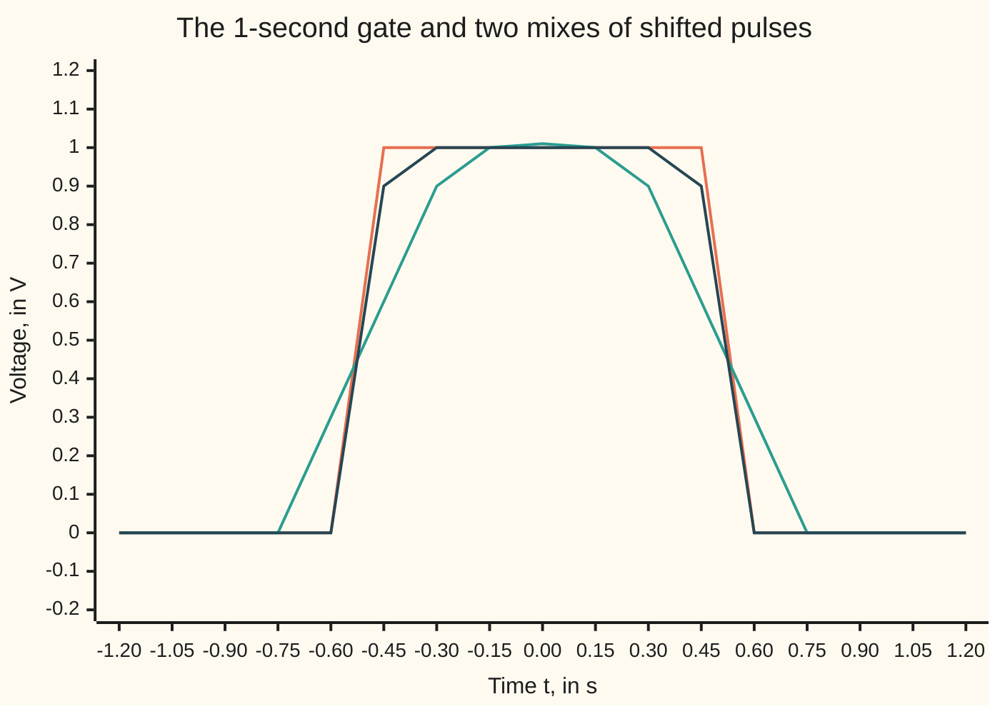
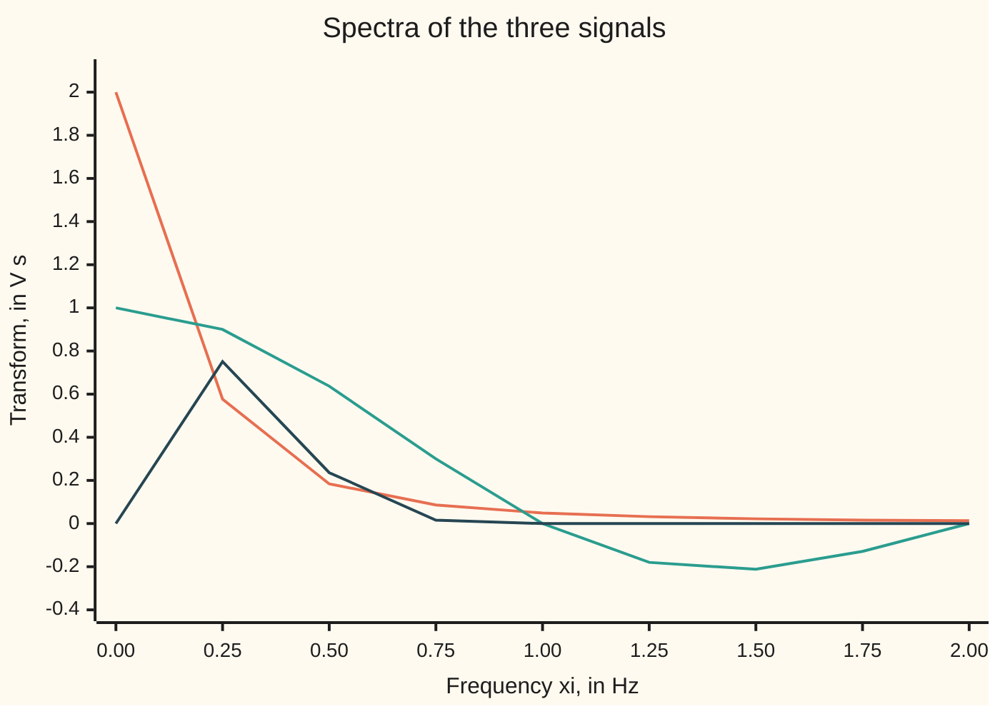

# Wiener's Tauberian theorem: shifts of one signal fill L¹ exactly when its spectrum never vanishes

[Syllabus](../../../SYLLABUS.md) → [Harmonic analysis](../README.md) → [Convolution and Approximate Identities](../README.md#s03) → Wiener's Tauberian theorem

---

## General Overview

A lab pulse generator fires one fixed shape, $`f(t) = e^{-\lvert t\rvert}`$ volts, with $`t`$ the time in seconds from the pulse's centre. It can fire at any moment and any gain, positive or negative, and add the firings. The task is to imitate a **1-second gate**: 1 V while $`\lvert t\rvert < 0.5`$ s, and 0 V otherwise.

The error is the area between the two curves, in volt-seconds (V·s). Firing nothing leaves an error of 1 V·s, the gate's own area. Five firings spaced 0.5 s apart, with gains −0.5, 0.125, 1.25, 0.125 and −0.5, cut the error to 0.501707 V·s. Sixty-seven firings spaced 1/64 s apart cut it to 0.015650 V·s. Halving the spacing halves the error, with no floor.

Now swap in the odd pulse $`p(t) = t\,e^{-t^2}`$. No mix of its firings ever comes closer than 1 V·s, because every firing has area 0, so every mix has area 0, and the gate has area 1.

What separates the two pulses is their **spectrum**, the transform $`\hat f(\xi)`$ that says how much of each frequency $`\xi`$ (in hertz) a signal holds. The first pulse's spectrum is positive everywhere; the second's is zero at 0 Hz. In 1932 Norbert Wiener proved that this is the whole story.

**The shifted copies of an integrable signal can be mixed to come as close as wanted, in area, to every integrable signal exactly when the signal's transform is zero at no frequency; and then a long-run average taken with that signal as the weight fixes the long-run average taken with every other weight.**

**What kind of fact this is:** a theorem, proved on this card in Why it works. The general step that divides by the spectrum on one band of frequencies rests on [Wiener's lemma](../../18-Functional%20analysis/06-Banach%20Algebras%20and%20Fixed%20Points/02-wieners-lemma-and-invertible-filters.md), with the details in a fold. The code's finite computations confirm it; they do not prove it.

### The picture: mixes of shifted pulses closing in on the gate



Orange: the gate. Green: 7 pulses spaced 0.25 s apart, error 0.253122 V·s. Dark blue: 19 pulses spaced 1/16 s apart, error 0.062852 V·s. Points every 0.15 s, joined by straight lines, so the jumps look like slopes.

---

## The formula

Notation from earlier cards. The transform is $`\hat f(\xi) = \int f(t)\, e^{-2\pi i \xi t}\, dt`$, with $`\xi`$ (xi) in hertz and $`i`$ the imaginary unit ([The Fourier transform of an absolutely integrable signal, and why it fades at infinity](../02-The%20Fourier%20Transform/01-fourier-transform-on-l1-and-riemann-lebesgue.md)). $`L^1(\mathbb{R})`$ is the set of **integrable** signals, those whose absolute value has finite area, and $`\lVert g\rVert_1 = \int \lvert g(t)\rvert\, dt`$ is that area. The star is convolution, $`(f * y)(x) = \int f(s)\, y(x - s)\, ds`$: the average of $`y`$ around time $`x`$, weighted by $`f`$ ([Convolution](01-convolution-and-youngs-inequality.md)).

A **shift** of $`f`$ is the same pulse delayed by $`s`$ seconds, $`f(t - s)`$. A **mix of shifts** is a finite sum of them with gains $`w_k`$:

```math
h(t) = \sum_{k=1}^{K} w_k\, f(t - s_k)
```

**Wiener's theorem** (the density form). For $`f`$ in $`L^1(\mathbb{R})`$:

```math
\text{for every } g \in L^1(\mathbb{R}) \text{ and every } \tau > 0 \text{ some mix of shifts } h \text{ has } \lVert g - h\rVert_1 < \tau \quad \Longleftrightarrow \quad \hat f(\xi) \neq 0 \ \text{ for every } \xi
```

**Read it aloud:** every integrable target can be matched, to within any tolerance tau in area, by a finite mix of delayed copies of f, exactly when the transform of f is never zero.

**The Tauberian form.** A **Tauberian theorem** recovers the long-run behaviour of a quantity from that of an average of it, given a side condition (after Alfred Tauber, 1897). Let $`\hat f`$ be zero at no frequency, and let $`y`$ be a bounded recording. Then, as $`x \to \infty`$:

```math
(f * y)(x) \to a\, \hat f(0) \quad \Longrightarrow \quad (g * y)(x) \to a\, \hat g(0) \ \text{ for every } g \in L^1(\mathbb{R})
```

**Read it aloud:** if the recording, averaged with weight f, settles at a times the area of f, then averaged with any integrable weight g it settles at a times the area of g. Here $`\hat g(0) = \int g`$ is the weight's area.

The example's three transforms. The first comes from $`2\int_0^\infty e^{-t}\cos(2\pi\xi t)\, dt`$; the gate's is on [Two pairs worth memorising](../02-The%20Fourier%20Transform/03-gaussian-and-sinc-transform-pairs.md); the odd pulse's follows from the bell curve's by the derivative rule ([The transform rulebook](../02-The%20Fourier%20Transform/02-shift-scale-and-derivative-rules.md)):

```math
f(t) = e^{-\lvert t\rvert}: \ \hat f(\xi) = \frac{2}{1 + 4\pi^2\xi^2}, \qquad \text{gate}: \ \hat g(\xi) = \frac{\sin \pi\xi}{\pi\xi}, \qquad p(t) = t\,e^{-t^2}: \ \hat p(\xi) = -i\,\pi^{3/2}\,\xi\, e^{-\pi^2\xi^2}
```

At 0.5 Hz, $`\hat f = 0.183999`$ V·s. The gate's transform is zero at 1, 2, 3, … Hz; the odd pulse's only at 0 Hz, and at 0.25 Hz it is $`-0.751225\,i`$ V·s.



Orange: $`\hat f`$, small but never zero. Green: the gate's transform, zero at 1 Hz and 2 Hz. Dark blue: the size of the odd pulse's transform, zero at 0 Hz, and below 0.0005 beyond 1 Hz.

| Symbol | Plain meaning | In our example | Push it up and the answer… |
| --- | --- | --- | --- |
| $`t`$, $`s`$, $`x`$ | time; a delay; the time a reading is taken; all in s | gate edges at ±0.5 s | — |
| $`\xi`$ | frequency, in Hz | 0.5 Hz | the pulse's transform fades |
| $`f`$, $`\hat f`$ | the pulse $`e^{-\lvert t\rvert}`$, in V; its transform, in V·s | $`\hat f(0.5)`$ = 0.183999 | — |
| $`g`$, $`\hat g`$ | the target (here the gate); its transform | $`\hat g(0)`$ = 1 V·s, $`\hat g(1)`$ = 0 | — |
| $`p`$, $`\hat p`$ | the odd pulse $`t\,e^{-t^2}`$; its transform | $`\hat p(0)`$ = 0 | — |
| $`L^1(\mathbb{R})`$, $`\lVert\cdot\rVert_1`$, $`\tau`$ | integrable signals; area of the absolute value, in V·s; a tolerance | gap 0.501707 V·s for 5 firings | a looser $`\tau`$: fewer firings |
| $`h`$, $`w_k`$, $`s_k`$, $`K`$ | a mix of shifts; its gains; its delays; the number of firings | 5 firings at −1, −0.5, 0, 0.5, 1 s | more firings, smaller gap |
| $`\varepsilon`$, $`N`$, $`j`$, $`g_j`$, $`M_N`$, $`v`$ | spacing $`1/N`$ s; a grid index; gate samples (half at an edge); the mix built from them; $`f * g`$ (Step 2) | $`\varepsilon`$ = 0.5 s, $`N`$ = 2 | gap about $`1/N`$ V·s |
| $`y`$, $`a`$, $`B`$ | a bounded recording, in V; its long-run level; a bound on its size | $`y = 1 + \cos(t^2)`$, $`a`$ = 1, $`B`$ = 2 | — |
| $`q_\varepsilon`$, $`F_R`$, $`R`$, $`k`$ | the kernel inside $`M_N`$; the Fejér kernel; a band edge, in Hz; a local inverse (Steps 2 to 5) | $`q_\varepsilon`$ has area 1 | a wider band, a larger local inverse |
| $`I`$, $`J`$, $`\xi_0`$, $`u`$, $`b`$ | signals that mixes approach; weights whose readings settle; a zero of the spectrum; any integrable signal (in the fold, a helper); a bounded measurement (Steps 1 to 7) | $`\xi_0`$ = 0 Hz for $`p`$ | — |
| $`f^*`$, $`\chi`$, $`\check\chi`$, $`m`$, $`\Phi`$, $`L`$, $`r`$, $`n`$, $`c_n`$, $`d_n`$, $`k_0`$ | fold only: reflection; bump and its inverse transform; floor; blend of period $`L`$ Hz; dummy time; index; coefficients of $`\Phi`$ and $`1/\Phi`$; local inverse of $`\lvert\hat f\rvert^2`$ | — | — |

### When it holds

- **The pulse is integrable.** Otherwise the mixes are not in $`L^1`$, and the transform need not exist.
- **The transform is zero at no frequency, 0 Hz included.** The odd pulse has $`\hat p(0) = 0`$, and its mixes stay at least 1 V·s from the gate. A zero at any frequency blocks every target not zero there.
- **The distance is measured in area.** In the largest gap at one instant the mixes never close in: each is continuous, so beside a jump of the gate it is at least half the jump off on one side. The 67-pulse mix is still 0.500014 V off at 0.5 s.
- **For the Tauberian form, the recording is bounded.** One bound $`\lvert y\rvert \le B`$ controls every average at once.
- **For the Tauberian form, the starting weight has no spectral zero.** The gate has $`\hat g(1) = 0`$, so on a recording with a 1 Hz hum it reads a steady 1 V while $`e^{-\lvert t\rvert}/2`$ swings forever (What breaks, below).

---

## Why it works

### Step 0: mixing shifts multiplies the spectrum, so matching a target means dividing

Delaying a signal by $`s`$ multiplies its transform by $`e^{-2\pi i \xi s}`$ ([The transform rulebook](../02-The%20Fourier%20Transform/02-shift-scale-and-derivative-rules.md)). So a mix of shifts has transform

```math
\hat h(\xi) = \hat f(\xi) \sum_{k=1}^{K} w_k\, e^{-2\pi i \xi s_k}
```

The gains only choose the multiplier. To match a target $`g`$, the multiplier must come close to $`\hat g / \hat f`$. Where $`\hat f`$ is zero, no multiplier helps. So the proof has two halves: a zero blocks (Step 1), and with no zero the division can be done one band of frequencies at a time (Steps 2 to 5).

### Step 1: a zero of the spectrum blocks every target

A transform is never larger than the signal's area: $`\lvert \hat u(\xi)\rvert \le \lVert u\rVert_1`$ for every frequency. Apply it to $`u = g - h`$:

```math
\lVert g - h\rVert_1 \ \ge\ \lvert \hat g(\xi_0) - \hat h(\xi_0)\rvert = \lvert \hat g(\xi_0)\rvert \quad \text{whenever } \hat f(\xi_0) = 0
```

The equality holds because Step 0 makes $`\hat h(\xi_0) = 0`$ for every mix. For the odd pulse, $`\xi_0 = 0`$ and $`\hat g(0) = 1`$, so every mix stays at least 1 V·s from the gate. The code fits mixes of 5, 9, 17 and 33 odd pulses by least squares (the gains that minimise the squared error). Their gaps are 1.195956, 1.164348, 1.190826 and 1.245290 V·s.

The bound works at any frequency. The gate's transform is zero at 1 Hz, so no mix of shifted gates comes closer to $`e^{-\lvert t\rvert}`$ than $`\hat f(1)`$ = 0.049409 V·s.

### Step 2: for this pulse the division can be written down

For $`e^{-\lvert t\rvert}`$ the reciprocal of the spectrum is a polynomial:

```math
\frac{1}{\hat f(\xi)} = \frac{1 + 4\pi^2\xi^2}{2}
```

Multiplying a transform by $`4\pi^2\xi^2`$ is the same as taking minus the second derivative of the signal (the derivative rule). So the target is half the blurred target minus half its bend: with $`v = f * g`$,

```math
g = \frac{v - v''}{2}
```

The pulse shows why. Away from 0, $`f'' = f`$. At 0 the slope jumps from +1 to −1, a spike of area −2. So $`(f - f'')/2`$ is a spike of area 1, and averaging with a spike changes nothing.

Now make each piece finite. The integral in $`v`$ becomes a sum over the grid $`j\varepsilon`$, with $`\varepsilon = 1/N`$ s. The second derivative becomes the second difference $`(v(t + \varepsilon) - 2v(t) + v(t - \varepsilon))/\varepsilon^2`$. Collecting terms gives a mix of shifts with explicit gains:

```math
M_N(t) = \sum_j w_j\, f(t - j\varepsilon), \qquad w_j = \frac{\varepsilon}{2}\left(g_j - \frac{g_{j+1} - 2g_j + g_{j-1}}{\varepsilon^2}\right)
```

**Read it aloud:** each gain is half the spacing times the gate's sample there, minus the bend of the samples there.

The gains always add to 0.500000, so $`M_N`$ always has area 1.000000 V·s, the gate's. Rearranged, $`M_N(t) = \sum_j \varepsilon\, g_j\, q_\varepsilon(t - j\varepsilon)`$, where $`q_\varepsilon = (f - \text{second difference of } f)/2`$ is a narrow kernel of area 1. For small $`\varepsilon`$ it is close to a tent of height $`1/\varepsilon`$ and half-width $`\varepsilon`$, a kernel narrowed as on [Approximate identities](03-approximate-identities.md). So $`M_N`$ is close to the straight-line join of the gate samples: at $`N`$ = 4 it reads 0.90, 0.60 and 0.30 V at 0.30, 0.45 and 0.60 s, on that line to two decimals. The join misses the gate only by two thin triangles at each edge, of total area $`\varepsilon`$, which is why the gap is about $`1/N`$.

| $`N`$ | Firings | Sum of the gains' sizes | Gap to the gate, V·s | Gap × $`N`$ |
| ---: | ---: | ---: | ---: | ---: |
| 2 | 5 | 2.5 | 0.501707 | 1.0034 |
| 4 | 7 | 4.5 | 0.253122 | 1.0125 |
| 8 | 11 | 8.5 | 0.126186 | 1.0095 |
| 16 | 19 | 16.5 | 0.062852 | 1.0056 |
| 32 | 35 | 32.5 | 0.031345 | 1.0031 |
| 64 | 67 | 64.5 | 0.015650 | 1.0016 |

The gap is about $`1/N`$ V·s. The price is in the gains, whose sizes add to $`N + 1/2`$. They grow because $`1/\hat f`$ grows with frequency, and a finer grid reaches higher frequencies.

### Step 3: any pulse: what mixes can reach is closed under averaging

A general pulse has no polynomial to read off. Let $`I`$ be the set of signals that mixes of shifts of $`f`$ approach in area. Three facts about $`I`$:

1. **It is closed.** A limit of reachable signals is reachable.
2. **It is shift-proof.** A shift of a reachable signal is reachable.
3. **It absorbs averaging.** For every integrable $`k`$, the signal $`f * k = \int k(s)\, f(\cdot - s)\, ds`$ is reachable. For $`k`$ continuous and zero outside a bounded interval, it is a limit in area of finite sums $`\sum_j k(s_j)\, f(\cdot - s_j)\,(s_{j+1} - s_j)`$ on finer and finer grids, because shifts of an integrable signal move continuously in area (continuity of shifts, Step 4 of [Approximate identities](03-approximate-identities.md)). Every integrable $`k`$ is a limit in area of such signals (Step 5 there), and $`\lVert f * k - f * k'\rVert_1 \le \lVert f\rVert_1 \lVert k - k'\rVert_1`$, so item 1 covers it.

With convolution as its product, $`L^1(\mathbb{R})`$ is a commutative Banach algebra without a unit: a complete space whose product's size is at most the product of the sizes, with no element that leaves every signal unchanged ([Banach algebras](../../18-Functional%20analysis/06-Banach%20Algebras%20and%20Fixed%20Points/01-banach-algebras-and-the-gelfand-transform.md)). In that language $`I`$ is a closed **ideal**: a closed subspace that absorbs products. Item 3 covers products with $`f`$, and the rest follow: a mix of shifts of $`f`$, convolved with $`k`$, is a mix of shifts of $`f * k`$, in $`I`$ by items 2 and 3, and the size rule carries limits through. The theorem says this ideal is everything.

### Step 4: targets with a bounded band of frequencies are enough

The **Fejér kernel on the line** is $`F_R(t) = R\, (\sin \pi R t / \pi R t)^2`$, the line's version of the circle kernel on [Dirichlet and Fejer kernels](../01-Fourier%20Series%20in%20Depth/03-dirichlet-and-fejer-kernels.md). It has area 1, it is never negative, and its transform is the triangle $`\max(0,\, 1 - \lvert\xi\rvert/R)`$, which is zero beyond $`R`$ Hz. It is one kernel narrowed as $`R`$ grows, so it is an approximate identity: $`F_R * g \to g`$ in area.

The transform of $`F_R * g`$ is the triangle times $`\hat g`$, zero outside $`[-R, R]`$. So signals whose transform vanishes outside a bounded band come within any tolerance of every integrable signal. As $`I`$ is closed, it is enough to put each of them in $`I`$.

### Step 5: divide on one band, by Wiener's lemma

Take $`g`$ with $`\hat g`$ zero outside $`[-R, R]`$. Suppose some integrable $`k`$ has $`\hat k = 1/\hat f`$ on that band: a **local inverse**. Then

```math
\widehat{f * (k * g)} = \hat f\, \hat k\, \hat g = \hat g \ \text{ at every frequency}
```

On the band $`\hat f \hat k = 1`$; outside it both sides are 0. Two integrable signals with the same transform are equal ([Fourier inversion](../02-The%20Fourier%20Transform/04-fourier-inversion-theorem.md)), so $`g = f * (k * g)`$. By Step 3, $`g`$ is in $`I`$. By Step 4, $`I`$ is all of $`L^1(\mathbb{R})`$.

A global inverse never exists: $`\hat f \to 0`$ at high frequency, so $`1/\hat f`$ is unbounded. A local inverse does. On a bounded band $`\hat f`$ is continuous with no zero. Wrap the band onto a circle, and [Wiener's lemma](../../18-Functional%20analysis/06-Banach%20Algebras%20and%20Fixed%20Points/02-wieners-lemma-and-invertible-filters.md) inverts it there: a function on a circle with absolutely summable Fourier coefficients and no zero has a reciprocal of the same kind.

<details>
<summary>Detailed proof: building the local inverse from Wiener's lemma</summary>

Write $`f^*(t) = \overline{f(-t)}`$, read "f-star", so $`f * f^*`$ has transform $`\lvert \hat f\rvert^2 > 0`$. Let $`m > 0`$ be the smallest value of $`\lvert \hat f\rvert^2`$ on $`[-2R, 2R]`$, which exists because $`\hat f`$ is continuous with no zero there.

Take a smooth bump $`\chi`$ with values from 0 to 1: equal to 1 on $`[-R, R]`$ and 0 outside $`[-2R, 2R]`$. Its inverse transform $`\check\chi`$ falls faster than every power of $`1/t`$ ([Schwartz space and tempered distributions](../02-The%20Fourier%20Transform/06-schwartz-space-and-tempered-distributions.md)).

Let $`L = 6R`$. On the window $`[-L/2, L/2]`$ define

$`\displaystyle \Phi(\xi) = \chi(\xi)\, \lvert \hat f(\xi)\rvert^2 + \big(1 - \chi(\xi)\big)\, m,`$

repeated with period $`L`$. It blends two numbers that are both at least $`m`$, so $`\Phi \ge m > 0`$ everywhere.

**Its Fourier coefficients are summable.** Write the blend as $`\Phi = m + \chi\,(\lvert\hat f\rvert^2 - m)`$. The constant $`m`$ adds only to $`c_0`$. The bump part, zero outside the window, is the transform of $`u - m\,\check\chi`$, where $`u = \check\chi * f * f^*`$. By Fourier inversion its coefficient of index $`n`$ is

$`\displaystyle \frac{1}{L}\int \chi(\xi)\,\big(\lvert\hat f(\xi)\rvert^2 - m\big)\, e^{-2\pi i n \xi / L}\, d\xi = \frac{1}{L}\, \big(u - m\,\check\chi\big)\!\left(-\frac{n}{L}\right).`$

The samples of $`u`$ are summable:

$`\displaystyle \sum_n \Big\lvert u\!\left(\frac{n}{L}\right)\Big\rvert \le \int \lvert (f * f^*)(r)\rvert \sum_n \Big\lvert \check\chi\!\left(\frac{n}{L} - r\right)\Big\rvert\, dr \le \lVert f\rVert_1^2\, \sup_r \sum_n \Big\lvert \check\chi\!\left(\frac{n}{L} - r\right)\Big\rvert,`$

and the last sum is bounded because $`\check\chi`$ falls fast; so is $`\sum_n \lvert\check\chi(n/L)\rvert`$. So $`\sum_n \lvert c_n\rvert < \infty`$.

**Invert on the circle.** $`\Phi`$ has summable coefficients and no zero, so by Wiener's lemma $`1/\Phi(\xi) = \sum_n d_n\, e^{2\pi i n \xi / L}`$ with $`\sum_n \lvert d_n\rvert < \infty`$.

**Come back to the line.** Put $`k_0(t) = \sum_n d_n\, \check\chi(t + n/L)`$. It is integrable, with $`\lVert k_0\rVert_1 \le \lVert\check\chi\rVert_1 \sum_n \lvert d_n\rvert`$. By the shift rule its transform is $`\chi(\xi)\sum_n d_n e^{2\pi i n\xi/L} = \chi(\xi)/\Phi(\xi)`$. On $`[-R, R]`$, $`\chi = 1`$ and $`\Phi = \lvert \hat f\rvert^2`$, so $`\hat k_0 = 1/\lvert\hat f\rvert^2`$ there.

Finally $`k = f^* * k_0`$ has $`\hat k = \overline{\hat f}/\lvert\hat f\rvert^2 = 1/\hat f`$ on $`[-R, R]`$. That is the local inverse.

</details>

### Step 6: the same theorem read through measurements

[Separation](../../18-Functional%20analysis/01-Normed%20and%20Banach%20Spaces/07-hahn-banach-separation-and-supporting-walls.md) gives a dual test: the shifts of $`f`$ fill $`L^1`$ when no nonzero bounded $`b`$ has $`\int f(t - s)\, b(t)\, dt = 0`$ for every $`s`$ ([Dual spaces](../../18-Functional%20analysis/01-Normed%20and%20Banach%20Spaces/09-dual-spaces-and-lp-duality.md)), and the wave $`b(t) = e^{-2\pi i \xi_0 t}`$ is such a $`b`$ exactly when $`\hat f(\xi_0) = 0`$. In Banach-algebra language, the **characters** of $`L^1(\mathbb{R})`$ (nonzero linear maps to the complex numbers that respect products) are the readings $`u \mapsto \hat u(\xi)`$, and the theorem says a closed ideal of $`L^1(\mathbb{R})`$ is everything when no character gives 0 on all of it; in an algebra with a unit, such as the summable lists of Wiener's lemma, the same test decides which elements are invertible.

### Step 7: transferring a limit from one weight to every weight

Let $`\lvert y\rvert \le B`$, and suppose $`(f * y)(x) \to a\, \hat f(0)`$. Let $`J`$ be the set of integrable weights $`g`$ with $`(g * y)(x) \to a\, \hat g(0)`$. Then:

1. $`J`$ contains $`f`$, and every mix of two members.
2. $`J`$ is shift-proof: delaying $`g`$ delays the reading and leaves the area alone.
3. $`J`$ is closed: swapping $`g`$ for $`h`$ moves every reading by at most $`B\lVert g - h\rVert_1`$, and the area by at most $`\lVert g - h\rVert_1`$.

So $`J`$ holds every mix of shifts of $`f`$ and every limit of mixes, which by Wiener's theorem is all of $`L^1(\mathbb{R})`$.

The code reads $`y(t) = 1 + \cos(t^2)`$ V, a steady 1 V plus a whistle rising in pitch (illustrative), through weights of area 1.

| Reading time $`x`$, s | Weight $`e^{-\lvert t\rvert}/2`$, V | 1-second gate, V | Odd pulse, size, V |
| ---: | ---: | ---: | ---: |
| 5 | 1.012730 | 0.807073 | 0.000018 |
| 10 | 1.002151 | 0.946454 | 0.000000 |
| 20 | 0.999670 | 0.986800 | 0.000000 |
| 40 | 0.999906 | 0.992694 | 0.000000 |

The exponential weight settles at 1 V, so the theorem guarantees the gate's reading settles at 1 V too, more slowly. The odd pulse reads about 0 whatever the level, because its area is 0.

This recording only illustrates: its rising whistle averages out against every integrable weight directly. The theorem earns its keep when only one weight's reading is known, as in the Wiener-Ikehara theorem below.

---

## Worked numbers, by hand

Five firings, $`N = 2`$, spacing $`\varepsilon = 0.5`$ s, so $`1/\varepsilon^2 = 4`$ and $`1 + 2/\varepsilon^2 = 9`$.

| Step | Arithmetic | Value |
| --- | --- | --- |
| gate samples at −1, −0.5, 0, 0.5, 1 s | edges count half | 0, 0.5, 1, 0.5, 0 |
| gain at 0 s | $`0.25 \times (9 \times 1 - 4 \times (0.5 + 0.5))`$ | 1.250000 |
| gains at ±0.5 s | $`0.25 \times (9 \times 0.5 - 4 \times (1 + 0))`$ | 0.125000 |
| gains at ±1 s | $`0.25 \times (9 \times 0 - 4 \times (0.5 + 0))`$ | −0.500000 |
| sum of gains | $`1.25 + 2 \times 0.125 - 2 \times 0.5`$ | 0.500000 |
| area of the mix | sum of gains × area of one pulse, 2 V·s | 1.000000 V·s |
| mix at 0 s | $`1.25 + 2 \times 0.125 \times 0.606531 - 2 \times 0.5 \times 0.367879`$ | 1.033753 V |
| mix at 1 s | $`1.25 \times 0.367879 + 0.125 \times (0.606531 + 0.223130) - 0.5 \times (1 + 0.135335)`$ | −0.004111 V |
| area between mix and gate | Simpson's rule in the code | **0.501707 V·s** |

Five firings already halve the error of firing nothing, and the error sits at the two edges, where any mix of these pulses must ramp.

### What breaks if you drop a piece

Same target, the 1-second gate.

| Mistake | Comes out at | What went wrong |
| --- | --- | --- |
| Use the odd pulse $`t\,e^{-t^2}`$ | gaps 1.164348 to 1.245290 V·s, never below 1 | $`\hat p(0) = 0`$: every mix has area 0, the gate has area 1. |
| Skip the second difference: gains $`\varepsilon g_j / 2`$ only, $`N`$ = 64 | gap 1.264267 V·s, tending to $`2(1 - 1/e)`$ = 1.264241 | No division by $`\hat f`$: a blurred gate, worse than firing nothing. |
| Start the transfer from the gate, on $`y = 1 + \cos(2\pi t)`$ | gate reads 1.000000 V; $`e^{-\lvert t\rvert}/2`$ reads 1.024705, 1.000000, 0.975295 V at 10, 10.25, 10.5 s | $`\hat g(1) = 0`$: the gate cannot see the 1 Hz hum. |
| Start the transfer from the odd pulse | reads 0.000000 V from 10 s on, on $`y = 1 + \cos(t^2)`$, whose level is 1 V | $`\hat p(0) = 0`$: blind to the level itself. |

---

## Code, from first principles, and it actually runs

The code builds every mix and measures its distance from the gate by Simpson's rule (the area under parabolas through equally spaced samples), cut wherever the curves cross. Its independent roads: closed-form transforms against Simpson integrals; each mix's area as a sum of gains and as an integral; each gap at two Simpson steps; the odd-pulse floor from the area bound and from least-squares fits solved by elimination, checked by their normal equations, their squared errors and the zero area of a fit's one-sided half; the readings at two steps, and the hum against its closed form. Every cut-off prints a bound on the tail it drops, and the largest gap at one instant is printed beside the gap in area.

### Python

```python
# Wiener's Tauberian theorem -- the check behind the card.  Standard library only;
# math gives exp, cos, sin, sqrt and pi.  The pulse f(t) = exp(-|t|), t in s, has
# transform 2/(1 + 4 pi^2 xi^2), xi in Hz, never 0, so sums of its shifts reach the
# 1-second gate.  The odd pulse p(t) = t exp(-t^2) has transform 0 at 0 Hz, so its sums
# never come closer than 1 V*s.  Roads: closed forms against Simpson's rule at two steps,
# exact weight sums against areas, least-squares fits checked by their normal equations
# and squared errors, and the Tauberian readings.  Every cut-off prints its tail bound.
from math import exp, cos, sin, sqrt, pi

def f(t):    return exp(-abs(t))
def p(t):    return t * exp(-t * t)
def gate(t): return 1.0 if abs(t) < 0.5 else (0.5 if abs(t) == 0.5 else 0.0)
def total(xs):                       # plain left-to-right sum, as in the Rust twin
    s = 0.0
    for x in xs: s += x
    return s
def simpson(g, a, b, n):
    h = (b - a) / n
    return (g(a) + g(b) + total((4 if i % 2 else 2) * g(a + i * h) for i in range(1, n))) * h / 3
def pieces(g, cuts, n):              # Simpson on each piece between sorted cut points
    return total(simpson(g, a, b, n) for a, b in zip(cuts, cuts[1:]))
def sq(v): return v * v

print("transforms, closed form against Simpson on [-40, 40] s (tail below 2e-17):")
for xi in [0.0, 0.5, 1.0]:
    num = 2 * simpson(lambda t: f(t) * cos(2 * pi * xi * t), 0, 40, 40000)
    print(f"  f-hat({xi:.2f} Hz) closed {2 / (1 + 4 * pi * pi * xi * xi):.6f}  Simpson {num:.6f}  1/f-hat {(1 + 4 * pi * pi * xi * xi) / 2:.6f}")
    assert abs(num - 2 / (1 + 4 * pi * pi * xi * xi)) < 1e-9
pn = -simpson(lambda t: p(t) * sin(2 * pi * 0.25 * t), -10, 10, 20000)   # imaginary part
print(f"  p-hat(0.25 Hz) closed -i {pi ** 1.5 * 0.25 * exp(-pi * pi / 16):.6f}  Simpson -i {-pn:.6f} on [-10, 10] s, tail <= e^-100 = {exp(-100):.1e}")
assert abs(-pn - pi ** 1.5 * 0.25 * exp(-pi * pi / 16)) < 1e-9
xs = [0.25 * k for k in range(9)]
print("chart xi:", " ".join(f"{x:.2f}" for x in xs))
print("chart f-hat:", " ".join(f"{2 / (1 + 4 * pi * pi * x * x):.3f}" for x in xs))
print("chart gate-hat:", " ".join(f"{round(sin(pi * x) / (pi * x) if x else 1.0, 3) + 0.0:.3f}" for x in xs))
print("chart |p-hat|:", " ".join(f"{pi ** 1.5 * x * exp(-pi * pi * x * x):.3f}" for x in xs))

def weights(N):                      # shifts at s = j h, h = 1/N: (h/2)(g_j - second difference)
    h = 1 / N
    g = lambda j: gate(j * h)
    return [(j * h, h / 2 * ((1 + 2 / h / h) * g(j) - (g(j - 1) + g(j + 1)) / h / h))
            for j in range(-N // 2 - 1, N // 2 + 2)]
def S(t, W): return total(w * f(t - s) for s, w in W)
def l1(F, cuts, n):                  # area between F and the gate; extra cuts where they cross
    out = 0.0
    for a, b in zip(cuts, cuts[1:]):
        c = gate((a + b) / 2); d = lambda t: F(t) - c
        pts = [a]
        for k in range(1, 41):
            u, v = a + (b - a) * (k - 1) / 40, a + (b - a) * k / 40
            if d(u) * d(v) < 0:
                for _ in range(60):
                    m = (u + v) / 2
                    if d(u) * d(m) <= 0: v = m
                    else: u = m
                pts.append((u + v) / 2)
        pts.append(b)
        for x0, x1 in zip(pts, pts[1:]): out += simpson(lambda t: abs(d(t)), x0, x1, n)
    return out
def cuts_of(W): return [-30.0, -10.0, -3.0] + [s for s, _ in W] + [3.0, 10.0, 30.0]    # cut off at +-30 s
def l1_gap(W, n): return l1(lambda t: S(t, W), cuts_of(W), n)

W = weights(2)
print("N = 2, h = 0.5 s: weights", " ".join(f"{s:+.1f}:{w:.6f}" for s, w in W))
print(f"  sum at 0 s {S(0, W):.6f}  at 1 s {S(1, W):.6f}  using", " ".join(f"e^-{u:.1f} {exp(-u):.6f}" for u in [0.5, 1, 1.5, 2]))
print("N | shifts | sum of weights | sum of |weights| | L1 gap to gate V*s | gap x N | area of sum | largest gap at 0.5 s -+ 1e-9 s | tail beyond +-30 s")
prev = 9.0
for N in [2, 4, 8, 16, 32, 64]:
    W = weights(N)
    e1, e2 = l1_gap(W, 200), l1_gap(W, 400)
    area = pieces(lambda t: S(t, W), cuts_of(W), 400)
    sw, sa = total(w for _, w in W), total(abs(w) for _, w in W)
    peak = max(abs(S(t, W) - gate(t)) for t in [0.5 - 1e-9, 0.5 + 1e-9])   # one instant each side
    tail = 2 * sa * exp(-(29.5 - 1 / N))                             # |S| <= sa e^-(|t| - 0.5 - 1/N)
    print(f"  {N:2d} | {len(W):2d} | {sw:.6f} | {sa:.6f} | {e2:.6f} | {e2 * N:.4f} | {area:.6f} | {peak:.6f} | {tail:.1e}")
    assert abs(e1 - e2) < 1e-7 and e2 < prev / 1.9 and 0.9 < e2 * N < 1.1 and peak >= 0.5
    assert abs(area - 2 * sw) < 1e-8 and abs(area - 1) < 1e-8     # S-hat(0) = f-hat(0) x sum
    assert tail < 1e-10
    prev = e2
ts = [round(-1.2 + 0.15 * k, 2) for k in range(17)]
print("chart t:", " ".join(f"{t:.2f}" for t in ts))
print("chart gate:", " ".join(f"{gate(t):.2f}" for t in ts))
for N in [4, 16]:
    print(f"chart sum N={N}:", " ".join(f"{round(S(t, weights(N)), 2) + 0.0:.2f}" for t in ts))

def solve(A, b):                     # Gaussian elimination with partial pivoting
    n = len(b); M = [A[i][:] + [b[i]] for i in range(n)]
    for c in range(n):
        r = max(range(c, n), key=lambda r: abs(M[r][c])); M[c], M[r] = M[r], M[c]
        for r in range(c + 1, n):
            m = M[r][c] / M[c][c]
            for k in range(c, n + 1): M[r][k] -= m * M[c][k]
    x = [0.0] * n
    for c in range(n - 1, -1, -1):
        x[c] = (M[c][n] - total(M[c][k] * x[k] for k in range(c + 1, n))) / M[c][c]
    return x
floor = 1.0                          # |gate-hat(0) - mix-hat(0)| = 1 for every mix of odd pulses
print(f"odd pulse t exp(-t^2): least-squares sums of shifts at spacing 0.5 s on [-R, R], cut at +-(R + 6) s, floor {floor:.6f} V*s")
print("R s | shifts | max |G c - rhs| | squared error: closed, Simpson | area of right half | L1 gap to gate V*s | gap / floor | tail")
for R in [1, 2, 4, 8]:
    ss = [0.5 * j for j in range(-2 * R, 2 * R + 1)]
    G = [[exp(-(a - b) * (a - b) / 2) * sqrt(pi / 2) * (1 - (a - b) * (a - b)) / 4 for b in ss] for a in ss]
    rhs = [(exp(-(0.5 + a) * (0.5 + a)) - exp(-(0.5 - a) * (0.5 - a))) / 2 for a in ss]   # area of gate x p(t - a)
    c = solve(G, rhs)
    res = max(abs(total(G[i][k] * c[k] for k in range(len(ss))) - rhs[i]) for i in range(len(ss)))
    H = lambda t: total(ci * p(t - a) for ci, a in zip(c, ss))
    half = lambda t: total(ci * p(t - a) for ci, a in zip(c, ss) if a > 0)   # one-sided: gains do not cancel
    cuts = [0.5 * k for k in range(-2 * R - 12, 2 * R + 13)]
    e2c = 1 - total(ci * r for ci, r in zip(c, rhs))                # ||gate||^2 - c.rhs, once G c = rhs
    e2s = total(simpson(lambda t: sq(H(t) - gate((a + b) / 2)), a, b, 200) for a, b in zip(cuts, cuts[1:]))
    g1, g2, ah = l1(H, cuts, 200), l1(H, cuts, 400), pieces(half, cuts, 200)
    tail = total(abs(ci) for ci in c) * exp(-36)                    # area of |H| beyond the cut
    print(f"  {R} | {len(ss):2d} | {res:.1e} | {e2c:.6f} {e2s:.6f} | {abs(ah):.6f} | {g2:.6f} | {g2 / floor:.4f} | {tail:.1e}")
    assert res < 1e-12 and abs(e2c - e2s) < 1e-9 and abs(ah) < 1e-9 and abs(g1 - g2) < 1e-7 and g2 >= floor
B = [(s, gate(s) / 128) for s, _ in weights(64)]                    # weights h g_j / 2
blur = l1_gap(B, 400)
print(f"what breaks: plain blur, no second difference, N = 64: L1 gap {blur:.6f}  limit 2(1 - 1/e) {2 * (1 - exp(-1)):.6f}  tail beyond +-30 s <= {2 * total(w for _, w in B) * exp(-(29.5 - 1 / 64)):.1e}")
assert abs(blur - 2 * (1 - exp(-1))) < 1e-3 and abs(blur - l1_gap(B, 200)) < 1e-7

y = lambda t: 1 + cos(t * t)         # steady 1 V plus a whistle rising in pitch
def read_exp(x, yy, n): return simpson(lambda s: f(s) / 2 * yy(x - s), -30, 0, n) + simpson(lambda s: f(s) / 2 * yy(x - s), 0, 30, n)
print(f"cut-offs, |y| <= 2: exp kernel at +-30 s, tail <= 2 e^-30 = {2 * exp(-30):.1e}; odd pulse at +-8 s, tail <= 2 e^-64 = {2 * exp(-64):.1e}")
print("Tauberian readings of y(t) = 1 + cos(t^2) V, each at two steps: x s | exp kernel | 1-s gate | odd pulse")
last = [1.0, 1.0]
for x in [5, 10, 20, 40]:
    r1, r2 = read_exp(x, y, 30000), read_exp(x, y, 60000)
    rg, rg2 = simpson(lambda s: y(x - s), -0.5, 0.5, 4000), simpson(lambda s: y(x - s), -0.5, 0.5, 8000)
    ro, ro2 = simpson(lambda s: p(s) * y(x - s), -8, 8, 16000), simpson(lambda s: p(s) * y(x - s), -8, 8, 32000)
    print(f"  {x:2d} | {r2:.6f} | {rg2:.6f} | {abs(ro2):.6f}")
    assert abs(r1 - r2) < 1e-8 and abs(rg - rg2) < 1e-9 and abs(ro - ro2) < 1e-9 and abs(ro2) < 1e-4
    last = [abs(r2 - 1), abs(rg2 - 1)]
assert last[0] < 1e-3 and last[1] < 0.01
hum = lambda t: 1 + cos(2 * pi * t)  # 1 V plus a 1 Hz hum: the gate's transform is 0 at 1 Hz
print("what breaks: gate as the starting kernel, y(t) = 1 + cos(2 pi t) V")
for x in [10, 10.25, 10.5]:
    rg, re = simpson(lambda s: hum(x - s), -0.5, 0.5, 4000), read_exp(x, hum, 30000)
    print(f"  x {x:5.2f} s: gate {rg:.6f}  exp kernel {re:.6f}  formula 1 + cos(2 pi x)/(1 + 4 pi^2) {1 + cos(2 * pi * x) / (1 + 4 * pi * pi):.6f}")
    assert abs(rg - 1) < 1e-9 and abs(re - 1 - cos(2 * pi * x) / (1 + 4 * pi * pi)) < 1e-9
print("ALL CHECKS PASS")
```

**Ran 2026-11-24 on macOS, Python 3.14.10, standard library only. All checks passed. Output, pasted from the run:**

```text
transforms, closed form against Simpson on [-40, 40] s (tail below 2e-17):
  f-hat(0.00 Hz) closed 2.000000  Simpson 2.000000  1/f-hat 0.500000
  f-hat(0.50 Hz) closed 0.183999  Simpson 0.183999  1/f-hat 5.434802
  f-hat(1.00 Hz) closed 0.049409  Simpson 0.049409  1/f-hat 20.239209
  p-hat(0.25 Hz) closed -i 0.751225  Simpson -i 0.751225 on [-10, 10] s, tail <= e^-100 = 3.7e-44
chart xi: 0.00 0.25 0.50 0.75 1.00 1.25 1.50 1.75 2.00
chart f-hat: 2.000 0.577 0.184 0.086 0.049 0.032 0.022 0.016 0.013
chart gate-hat: 1.000 0.900 0.637 0.300 0.000 -0.180 -0.212 -0.129 0.000
chart |p-hat|: 0.000 0.751 0.236 0.016 0.000 0.000 0.000 0.000 0.000
N = 2, h = 0.5 s: weights -1.0:-0.500000 -0.5:0.125000 +0.0:1.250000 +0.5:0.125000 +1.0:-0.500000
  sum at 0 s 1.033753  at 1 s -0.004111  using e^-0.5 0.606531 e^-1.0 0.367879 e^-1.5 0.223130 e^-2.0 0.135335
N | shifts | sum of weights | sum of |weights| | L1 gap to gate V*s | gap x N | area of sum | largest gap at 0.5 s -+ 1e-9 s | tail beyond +-30 s
   2 |  5 | 0.500000 | 2.500000 | 0.501707 | 1.0034 | 1.000000 | 0.514318 | 1.3e-12
   4 |  7 | 0.500000 | 4.500000 | 0.253122 | 1.0125 | 1.000000 | 0.503566 | 1.8e-12
   8 | 11 | 0.500000 | 8.500000 | 0.126186 | 1.0095 | 1.000000 | 0.500891 | 3.0e-12
  16 | 19 | 0.500000 | 16.500000 | 0.062852 | 1.0056 | 1.000000 | 0.500223 | 5.4e-12
  32 | 35 | 0.500000 | 32.500000 | 0.031345 | 1.0031 | 1.000000 | 0.500056 | 1.0e-11
  64 | 67 | 0.500000 | 64.500000 | 0.015650 | 1.0016 | 1.000000 | 0.500014 | 2.0e-11
chart t: -1.20 -1.05 -0.90 -0.75 -0.60 -0.45 -0.30 -0.15 0.00 0.15 0.30 0.45 0.60 0.75 0.90 1.05 1.20
chart gate: 0.00 0.00 0.00 0.00 0.00 1.00 1.00 1.00 1.00 1.00 1.00 1.00 0.00 0.00 0.00 0.00 0.00
chart sum N=4: 0.00 0.00 0.00 0.00 0.30 0.60 0.90 1.00 1.01 1.00 0.90 0.60 0.30 0.00 0.00 0.00 0.00
chart sum N=16: 0.00 0.00 0.00 0.00 0.00 0.90 1.00 1.00 1.00 1.00 1.00 0.90 0.00 0.00 0.00 0.00 0.00
odd pulse t exp(-t^2): least-squares sums of shifts at spacing 0.5 s on [-R, R], cut at +-(R + 6) s, floor 1.000000 V*s
R s | shifts | max |G c - rhs| | squared error: closed, Simpson | area of right half | L1 gap to gate V*s | gap / floor | tail
  1 |  5 | 5.6e-17 | 0.362355 0.362355 | 0.000000 | 1.195956 | 1.1960 | 4.8e-16
  2 |  9 | 1.4e-16 | 0.249427 0.249427 | 0.000000 | 1.164348 | 1.1643 | 2.1e-15
  4 | 17 | 6.1e-16 | 0.185477 0.185477 | 0.000000 | 1.190826 | 1.1908 | 7.9e-15
  8 | 33 | 1.1e-15 | 0.148112 0.148112 | 0.000000 | 1.245290 | 1.2453 | 2.0e-14
what breaks: plain blur, no second difference, N = 64: L1 gap 1.264267  limit 2(1 - 1/e) 1.264241  tail beyond +-30 s <= 1.6e-13
cut-offs, |y| <= 2: exp kernel at +-30 s, tail <= 2 e^-30 = 1.9e-13; odd pulse at +-8 s, tail <= 2 e^-64 = 3.2e-28
Tauberian readings of y(t) = 1 + cos(t^2) V, each at two steps: x s | exp kernel | 1-s gate | odd pulse
   5 | 1.012730 | 0.807073 | 0.000018
  10 | 1.002151 | 0.946454 | 0.000000
  20 | 0.999670 | 0.986800 | 0.000000
  40 | 0.999906 | 0.992694 | 0.000000
what breaks: gate as the starting kernel, y(t) = 1 + cos(2 pi t) V
  x 10.00 s: gate 1.000000  exp kernel 1.024705  formula 1 + cos(2 pi x)/(1 + 4 pi^2) 1.024705
  x 10.25 s: gate 1.000000  exp kernel 1.000000  formula 1 + cos(2 pi x)/(1 + 4 pi^2) 1.000000
  x 10.50 s: gate 1.000000  exp kernel 0.975295  formula 1 + cos(2 pi x)/(1 + 4 pi^2) 0.975295
ALL CHECKS PASS
```

### Rust

```rust
// Wiener's Tauberian theorem -- the check behind the card.  Rust std only, no crates.
// The pulse f(t) = exp(-|t|), t in s, has transform 2/(1 + 4 pi^2 xi^2), xi in Hz,
// never 0, so sums of its shifts reach the 1-second gate.  The odd pulse
// p(t) = t exp(-t^2) has transform 0 at 0 Hz, so its sums never come closer than
// 1 V*s.  Roads: closed forms against Simpson's rule at two steps, exact weight sums
// against areas, least-squares fits checked by their normal equations and squared
// errors, and the Tauberian readings.  Every cut-off prints its tail bound.
use std::f64::consts::PI;

fn f(t: f64) -> f64 { (-t.abs()).exp() }
fn p(t: f64) -> f64 { t * (-t * t).exp() }
fn gate(t: f64) -> f64 { if t.abs() < 0.5 { 1.0 } else if t.abs() == 0.5 { 0.5 } else { 0.0 } }
fn simpson(g: &dyn Fn(f64) -> f64, a: f64, b: f64, n: usize) -> f64 {
    let h = (b - a) / n as f64;
    let mut s = 0.0;
    for i in 1..n { s += (if i % 2 == 1 { 4.0 } else { 2.0 }) * g(a + i as f64 * h); }
    (g(a) + g(b) + s) * h / 3.0
}
fn pieces(g: &dyn Fn(f64) -> f64, cuts: &[f64], n: usize) -> f64 { let mut s = 0.0; for w in cuts.windows(2) { s += simpson(g, w[0], w[1], n); } s }
fn z(v: f64, d: usize) -> String {         // fixed decimals, never "-0.00"
    let s = format!("{:.*}", d, v);
    if s.trim_start_matches('-').chars().all(|c| c == '0' || c == '.') { s.trim_start_matches('-').to_string() } else { s }
}
fn l1(fun: &dyn Fn(f64) -> f64, cuts: &[f64], n: usize) -> f64 {   // area between F and the gate
    let mut out = 0.0;
    for w in cuts.windows(2) {
        let (a, b) = (w[0], w[1]);
        let c = gate((a + b) / 2.0);
        let d = |t: f64| fun(t) - c;
        let mut pts = vec![a];
        for k in 1..41 {
            let (mut u, mut v) = (a + (b - a) * (k - 1) as f64 / 40.0, a + (b - a) * k as f64 / 40.0);
            if d(u) * d(v) < 0.0 {
                for _ in 0..60 {
                    let m = (u + v) / 2.0;
                    if d(u) * d(m) <= 0.0 { v = m } else { u = m }
                }
                pts.push((u + v) / 2.0);
            }
        }
        pts.push(b);
        for q in pts.windows(2) { out += simpson(&|t| d(t).abs(), q[0], q[1], n); }
    }
    out
}
fn weights(n: i64) -> Vec<(f64, f64)> {   // shifts at s = j h, h = 1/N: (h/2)(g_j - second difference)
    let h = 1.0 / n as f64;
    let g = |j: i64| gate(j as f64 * h);
    (-n / 2 - 1..n / 2 + 2).map(|j| (j as f64 * h, h / 2.0 * ((1.0 + 2.0 / h / h) * g(j) - (g(j - 1) + g(j + 1)) / h / h))).collect()
}
fn sum_at(t: f64, w: &[(f64, f64)]) -> f64 { let mut s = 0.0; for &(a, c) in w { s += c * f(t - a); } s }
fn cuts_of(w: &[(f64, f64)]) -> Vec<f64> {   // cut off at +-30 s
    [-30.0, -10.0, -3.0].into_iter().chain(w.iter().map(|x| x.0)).chain([3.0, 10.0, 30.0]).collect()
}
fn l1_gap(w: &[(f64, f64)], n: usize) -> f64 { l1(&|t| sum_at(t, w), &cuts_of(w), n) }
fn solve(a: &[Vec<f64>], b: &[f64]) -> Vec<f64> {   // Gaussian elimination, partial pivoting
    let n = b.len();
    let mut m: Vec<Vec<f64>> = (0..n).map(|i| { let mut r = a[i].clone(); r.push(b[i]); r }).collect();
    for c in 0..n {
        let mut r = c; for k in c + 1..n { if m[k][c].abs() > m[r][c].abs() { r = k; } }
        m.swap(c, r);
        for r in c + 1..n { let q = m[r][c] / m[c][c]; for k in c..n + 1 { m[r][k] -= q * m[c][k]; } }
    }
    let mut x = vec![0.0; n];
    for c in (0..n).rev() {
        let mut s = 0.0; for k in c + 1..n { s += m[c][k] * x[k]; }
        x[c] = (m[c][n] - s) / m[c][c];
    }
    x
}
fn read_exp(x: f64, y: &dyn Fn(f64) -> f64, n: usize) -> f64 {   // exp kernel cut off at +-30 s
    simpson(&|s| f(s) / 2.0 * y(x - s), -30.0, 0.0, n) + simpson(&|s| f(s) / 2.0 * y(x - s), 0.0, 30.0, n) }
fn join(v: &[f64], d: usize) -> String { v.iter().map(|&x| z(x, d)).collect::<Vec<_>>().join(" ") }

fn main() {
    println!("transforms, closed form against Simpson on [-40, 40] s (tail below 2e-17):");
    for xi in [0.0, 0.5, 1.0] {
        let num = 2.0 * simpson(&|t| f(t) * (2.0 * PI * xi * t).cos(), 0.0, 40.0, 40000);
        let cl = 2.0 / (1.0 + 4.0 * PI * PI * xi * xi);
        println!("  f-hat({:.2} Hz) closed {:.6}  Simpson {:.6}  1/f-hat {:.6}", xi, cl, num, (1.0 + 4.0 * PI * PI * xi * xi) / 2.0);
        assert!((num - cl).abs() < 1e-9);
    }
    let pn = -simpson(&|t| p(t) * (2.0 * PI * 0.25 * t).sin(), -10.0, 10.0, 20000);
    let pc = PI.powf(1.5) * 0.25 * (-PI * PI / 16.0).exp();
    println!("  p-hat(0.25 Hz) closed -i {:.6}  Simpson -i {:.6} on [-10, 10] s, tail <= e^-100 = {:.1e}", pc, -pn, (-100.0f64).exp());
    assert!((-pn - pc).abs() < 1e-9);
    let xs: Vec<f64> = (0..9).map(|k| 0.25 * k as f64).collect();
    println!("chart xi: {}", join(&xs, 2));
    println!("chart f-hat: {}", join(&xs.iter().map(|&x| 2.0 / (1.0 + 4.0 * PI * PI * x * x)).collect::<Vec<_>>(), 3));
    println!("chart gate-hat: {}", join(&xs.iter().map(|&x| if x != 0.0 { (PI * x).sin() / (PI * x) } else { 1.0 }).collect::<Vec<_>>(), 3));
    println!("chart |p-hat|: {}", join(&xs.iter().map(|&x| PI.powf(1.5) * x * (-PI * PI * x * x).exp()).collect::<Vec<_>>(), 3));

    let w = weights(2);
    println!("N = 2, h = 0.5 s: weights {}", w.iter().map(|&(s, c)| format!("{:+.1}:{:.6}", s, c)).collect::<Vec<_>>().join(" "));
    println!("  sum at 0 s {:.6}  at 1 s {:.6}  using {}", sum_at(0.0, &w), sum_at(1.0, &w),
        [0.5f64, 1.0, 1.5, 2.0].iter().map(|&u| format!("e^-{:.1} {:.6}", u, (-u).exp())).collect::<Vec<_>>().join(" "));
    println!("N | shifts | sum of weights | sum of |weights| | L1 gap to gate V*s | gap x N | area of sum | largest gap at 0.5 s -+ 1e-9 s | tail beyond +-30 s");
    let mut prev = 9.0;
    for n in [2i64, 4, 8, 16, 32, 64] {
        let w = weights(n);
        let (e1, e2) = (l1_gap(&w, 200), l1_gap(&w, 400));
        let area = pieces(&|t| sum_at(t, &w), &cuts_of(&w), 400);
        let (mut sw, mut sa, en) = (0.0, 0.0, e2 * n as f64);
        for &(_, c) in &w { sw += c; sa += c.abs(); }
        let peak = [0.5 - 1e-9, 0.5 + 1e-9].iter().map(|&t| (sum_at(t, &w) - gate(t)).abs()).fold(0.0, f64::max);
        let tail = 2.0 * sa * (-(29.5 - 1.0 / n as f64)).exp();   // |sum| <= sa e^-(|t| - 0.5 - 1/N)
        println!("  {:2} | {:2} | {:.6} | {:.6} | {:.6} | {:.4} | {:.6} | {:.6} | {:.1e}", n, w.len(), sw, sa, e2, en, area, peak, tail);
        assert!((e1 - e2).abs() < 1e-7 && e2 < prev / 1.9 && 0.9 < en && en < 1.1 && peak >= 0.5);
        assert!((area - 2.0 * sw).abs() < 1e-8 && (area - 1.0).abs() < 1e-8);
        assert!(tail < 1e-10);
        prev = e2;
    }
    let ts: Vec<f64> = (0..17).map(|k| ((-1.2 + 0.15 * k as f64) * 100.0).round() / 100.0).collect();
    println!("chart t: {}", join(&ts, 2));
    println!("chart gate: {}", join(&ts.iter().map(|&t| gate(t)).collect::<Vec<_>>(), 2));
    for n in [4i64, 16] {
        let w = weights(n);
        println!("chart sum N={}: {}", n, join(&ts.iter().map(|&t| sum_at(t, &w)).collect::<Vec<_>>(), 2));
    }

    let floor = 1.0;   // |gate-hat(0) - mix-hat(0)| = 1 for every mix of odd pulses
    println!("odd pulse t exp(-t^2): least-squares sums of shifts at spacing 0.5 s on [-R, R], cut at +-(R + 6) s, floor {:.6} V*s", floor);
    println!("R s | shifts | max |G c - rhs| | squared error: closed, Simpson | area of right half | L1 gap to gate V*s | gap / floor | tail");
    for r in [1i64, 2, 4, 8] {
        let ss: Vec<f64> = (-2 * r..2 * r + 1).map(|j| 0.5 * j as f64).collect();
        let g: Vec<Vec<f64>> = ss.iter().map(|&a| ss.iter().map(|&b| (-(a - b) * (a - b) / 2.0).exp() * (PI / 2.0).sqrt() * (1.0 - (a - b) * (a - b)) / 4.0).collect()).collect();
        let rhs: Vec<f64> = ss.iter().map(|&a| ((-(0.5 + a) * (0.5 + a)).exp() - (-(0.5 - a) * (0.5 - a)).exp()) / 2.0).collect();
        let c = solve(&g, &rhs);
        let mut res: f64 = 0.0;
        for i in 0..ss.len() { let mut s = 0.0; for k in 0..ss.len() { s += g[i][k] * c[k]; } res = res.max((s - rhs[i]).abs()); }
        let hh = |t: f64| { let mut s = 0.0; for (ci, a) in c.iter().zip(ss.iter()) { s += ci * p(t - a); } s };
        let half = |t: f64| { let mut s = 0.0; for (ci, a) in c.iter().zip(ss.iter()) { if *a > 0.0 { s += ci * p(t - a); } } s };
        let cuts: Vec<f64> = (-2 * r - 12..2 * r + 13).map(|k| 0.5 * k as f64).collect();
        let (mut cr, mut sc, mut e2s) = (0.0, 0.0, 0.0);
        for (ci, ri) in c.iter().zip(rhs.iter()) { cr += ci * ri; sc += ci.abs(); }
        for w in cuts.windows(2) { let g0 = gate((w[0] + w[1]) / 2.0); e2s += simpson(&|t| { let d = hh(t) - g0; d * d }, w[0], w[1], 200); }
        let (e2c, g1, g2, ah, tail) = (1.0 - cr, l1(&hh, &cuts, 200), l1(&hh, &cuts, 400), pieces(&half, &cuts, 200), sc * (-36.0f64).exp());
        println!("  {} | {:2} | {:.1e} | {:.6} {:.6} | {:.6} | {:.6} | {:.4} | {:.1e}", r, ss.len(), res, e2c, e2s, ah.abs(), g2, g2 / floor, tail);
        assert!(res < 1e-12 && (e2c - e2s).abs() < 1e-9 && ah.abs() < 1e-9 && (g1 - g2).abs() < 1e-7 && g2 >= floor);
    }
    let b: Vec<(f64, f64)> = weights(64).iter().map(|&(s, _)| (s, gate(s) / 128.0)).collect();
    let blur = l1_gap(&b, 400);
    println!("what breaks: plain blur, no second difference, N = 64: L1 gap {:.6}  limit 2(1 - 1/e) {:.6}  tail beyond +-30 s <= {:.1e}", blur, 2.0 * (1.0 - (-1.0f64).exp()),
        2.0 * b.iter().fold(0.0, |s, x| s + x.1) * (-(29.5 - 1.0 / 64.0f64)).exp());
    assert!((blur - 2.0 * (1.0 - (-1.0f64).exp())).abs() < 1e-3 && (blur - l1_gap(&b, 200)).abs() < 1e-7);

    let y = |t: f64| 1.0 + (t * t).cos();
    println!("cut-offs, |y| <= 2: exp kernel at +-30 s, tail <= 2 e^-30 = {:.1e}; odd pulse at +-8 s, tail <= 2 e^-64 = {:.1e}", 2.0 * (-30.0f64).exp(), 2.0 * (-64.0f64).exp());
    println!("Tauberian readings of y(t) = 1 + cos(t^2) V, each at two steps: x s | exp kernel | 1-s gate | odd pulse");
    let mut last = [1.0, 1.0];
    for x in [5.0, 10.0, 20.0, 40.0] {
        let (r1, r2) = (read_exp(x, &y, 30000), read_exp(x, &y, 60000));
        let (rg, rg2) = (simpson(&|s| y(x - s), -0.5, 0.5, 4000), simpson(&|s| y(x - s), -0.5, 0.5, 8000));
        let (ro, ro2) = (simpson(&|s| p(s) * y(x - s), -8.0, 8.0, 16000), simpson(&|s| p(s) * y(x - s), -8.0, 8.0, 32000));
        println!("  {:2} | {:.6} | {:.6} | {:.6}", x as i64, r2, rg2, ro2.abs());
        assert!((r1 - r2).abs() < 1e-8 && (rg - rg2).abs() < 1e-9 && (ro - ro2).abs() < 1e-9 && ro2.abs() < 1e-4);
        last = [(r2 - 1.0).abs(), (rg2 - 1.0).abs()];
    }
    assert!(last[0] < 1e-3 && last[1] < 0.01);
    let hum = |t: f64| 1.0 + (2.0 * PI * t).cos();
    println!("what breaks: gate as the starting kernel, y(t) = 1 + cos(2 pi t) V");
    for x in [10.0, 10.25, 10.5] {
        let (rg, re) = (simpson(&|s| hum(x - s), -0.5, 0.5, 4000), read_exp(x, &hum, 30000));
        let fm = 1.0 + (2.0 * PI * x).cos() / (1.0 + 4.0 * PI * PI);
        println!("  x {:5.2} s: gate {:.6}  exp kernel {:.6}  formula 1 + cos(2 pi x)/(1 + 4 pi^2) {:.6}", x, rg, re, fm);
        assert!((rg - 1.0).abs() < 1e-9 && (re - fm).abs() < 1e-9);
    }
    println!("ALL CHECKS PASS");
}
```

**Ran 2026-11-24 on macOS, rustc 1.98.1, no crates. All checks passed. Output, pasted from the run:**

```text
transforms, closed form against Simpson on [-40, 40] s (tail below 2e-17):
  f-hat(0.00 Hz) closed 2.000000  Simpson 2.000000  1/f-hat 0.500000
  f-hat(0.50 Hz) closed 0.183999  Simpson 0.183999  1/f-hat 5.434802
  f-hat(1.00 Hz) closed 0.049409  Simpson 0.049409  1/f-hat 20.239209
  p-hat(0.25 Hz) closed -i 0.751225  Simpson -i 0.751225 on [-10, 10] s, tail <= e^-100 = 3.7e-44
chart xi: 0.00 0.25 0.50 0.75 1.00 1.25 1.50 1.75 2.00
chart f-hat: 2.000 0.577 0.184 0.086 0.049 0.032 0.022 0.016 0.013
chart gate-hat: 1.000 0.900 0.637 0.300 0.000 -0.180 -0.212 -0.129 0.000
chart |p-hat|: 0.000 0.751 0.236 0.016 0.000 0.000 0.000 0.000 0.000
N = 2, h = 0.5 s: weights -1.0:-0.500000 -0.5:0.125000 +0.0:1.250000 +0.5:0.125000 +1.0:-0.500000
  sum at 0 s 1.033753  at 1 s -0.004111  using e^-0.5 0.606531 e^-1.0 0.367879 e^-1.5 0.223130 e^-2.0 0.135335
N | shifts | sum of weights | sum of |weights| | L1 gap to gate V*s | gap x N | area of sum | largest gap at 0.5 s -+ 1e-9 s | tail beyond +-30 s
   2 |  5 | 0.500000 | 2.500000 | 0.501707 | 1.0034 | 1.000000 | 0.514318 | 1.3e-12
   4 |  7 | 0.500000 | 4.500000 | 0.253122 | 1.0125 | 1.000000 | 0.503566 | 1.8e-12
   8 | 11 | 0.500000 | 8.500000 | 0.126186 | 1.0095 | 1.000000 | 0.500891 | 3.0e-12
  16 | 19 | 0.500000 | 16.500000 | 0.062852 | 1.0056 | 1.000000 | 0.500223 | 5.4e-12
  32 | 35 | 0.500000 | 32.500000 | 0.031345 | 1.0031 | 1.000000 | 0.500056 | 1.0e-11
  64 | 67 | 0.500000 | 64.500000 | 0.015650 | 1.0016 | 1.000000 | 0.500014 | 2.0e-11
chart t: -1.20 -1.05 -0.90 -0.75 -0.60 -0.45 -0.30 -0.15 0.00 0.15 0.30 0.45 0.60 0.75 0.90 1.05 1.20
chart gate: 0.00 0.00 0.00 0.00 0.00 1.00 1.00 1.00 1.00 1.00 1.00 1.00 0.00 0.00 0.00 0.00 0.00
chart sum N=4: 0.00 0.00 0.00 0.00 0.30 0.60 0.90 1.00 1.01 1.00 0.90 0.60 0.30 0.00 0.00 0.00 0.00
chart sum N=16: 0.00 0.00 0.00 0.00 0.00 0.90 1.00 1.00 1.00 1.00 1.00 0.90 0.00 0.00 0.00 0.00 0.00
odd pulse t exp(-t^2): least-squares sums of shifts at spacing 0.5 s on [-R, R], cut at +-(R + 6) s, floor 1.000000 V*s
R s | shifts | max |G c - rhs| | squared error: closed, Simpson | area of right half | L1 gap to gate V*s | gap / floor | tail
  1 |  5 | 5.6e-17 | 0.362355 0.362355 | 0.000000 | 1.195956 | 1.1960 | 4.8e-16
  2 |  9 | 1.4e-16 | 0.249427 0.249427 | 0.000000 | 1.164348 | 1.1643 | 2.1e-15
  4 | 17 | 6.1e-16 | 0.185477 0.185477 | 0.000000 | 1.190826 | 1.1908 | 7.9e-15
  8 | 33 | 1.1e-15 | 0.148112 0.148112 | 0.000000 | 1.245290 | 1.2453 | 2.0e-14
what breaks: plain blur, no second difference, N = 64: L1 gap 1.264267  limit 2(1 - 1/e) 1.264241  tail beyond +-30 s <= 1.6e-13
cut-offs, |y| <= 2: exp kernel at +-30 s, tail <= 2 e^-30 = 1.9e-13; odd pulse at +-8 s, tail <= 2 e^-64 = 3.2e-28
Tauberian readings of y(t) = 1 + cos(t^2) V, each at two steps: x s | exp kernel | 1-s gate | odd pulse
   5 | 1.012730 | 0.807073 | 0.000018
  10 | 1.002151 | 0.946454 | 0.000000
  20 | 0.999670 | 0.986800 | 0.000000
  40 | 0.999906 | 0.992694 | 0.000000
what breaks: gate as the starting kernel, y(t) = 1 + cos(2 pi t) V
  x 10.00 s: gate 1.000000  exp kernel 1.024705  formula 1 + cos(2 pi x)/(1 + 4 pi^2) 1.024705
  x 10.25 s: gate 1.000000  exp kernel 1.000000  formula 1 + cos(2 pi x)/(1 + 4 pi^2) 1.000000
  x 10.50 s: gate 1.000000  exp kernel 0.975295  formula 1 + cos(2 pi x)/(1 + 4 pi^2) 0.975295
ALL CHECKS PASS
```

### Lean

Lean proves both forms of Wiener's theorem and the blocking bound of Step 1, for every integrable pulse.

- Take an integrable pulse $`f`$. Then mixes of its shifts come within every tolerance of every integrable target, in area, exactly when $`\hat f`$ has no zero.
- Suppose $`\hat f`$ has no zero, $`y`$ is a bounded recording, and $`(f * y)(x) \to a\, \hat f(0)`$ as $`x`$ grows. Then $`(g * y)(x) \to a\, \hat g(0)`$ for every integrable weight $`g`$.
- Suppose $`\hat f(\xi_0) = 0`$, and $`g`$ is any integrable target. Then every mix of shifts $`h`$ has $`\lVert g - h\rVert_1 \ge \lvert \hat g(\xi_0)\rvert`$.
- Lean also checks the worked numbers: the gains 1.25, 0.125 and −0.5, their sum 0.5, their sizes' sum 2.5, and the mix's area 1 V·s.

The gaps found by Simpson's rule, the least-squares fits, the readings of $`y`$ and every other decimal are left to the Python and Rust checks.

```lean
-- Wiener's Tauberian theorem: the shifts of an integrable signal can be mixed to approach every integrable signal in area exactly when its Fourier transform has no zero, and then a limit of averages taken with that signal as weight passes to every integrable weight.
import Mathlib.Analysis.Fourier.FourierTransform
import Mathlib.Tactic.NormNum
import Mathlib.Analysis.Fourier.Inversion
import Mathlib.Analysis.Fourier.Convolution
import Mathlib.MeasureTheory.Function.ContinuousMapDense
import Mathlib.Topology.UniformSpace.UniformApproximation

/-! Signals are complex-valued functions of time `t : ℝ` in seconds. `𝓕 f ξ` is Mathlib's Fourier
transform in hertz, `∫ e^(−2πiξt) f(t) dt`, the card's `f̂(ξ)`. "In `L¹(ℝ)`" is `Integrable`, and
the area distance `‖g − h‖₁` is `∫ t, ‖g t − h t‖`. A mix of shifts with `K` firings, gains `w k`
and delays `s k` is `∑ k, w k * f (t − s k)`. The average of `y` weighted by `g` at time `x`,
the card's `(g * y)(x)`, is written out as `∫ s, g s * y (x − s)`. A bounded recording is a
measurable `y` with `‖y t‖ ≤ B` for every `t`. -/

open MeasureTheory FourierTransform Filter Topology

/-! ### Helper lemmas for the proofs below -/

lemma wt_e_cont : Continuous (fun x : ℝ => ((𝐞 x : Circle) : ℂ)) := by
  have : (fun x : ℝ => ((𝐞 x : Circle) : ℂ)) = fun x => Complex.exp (↑(2 * Real.pi * x) * Complex.I) := by
    funext x; exact Real.fourierChar_apply x
  rw [this]; fun_prop

lemma wt_e_norm (x : ℝ) : ‖((𝐞 x : Circle) : ℂ)‖ = 1 := Circle.norm_coe _

/-- The bump on the frequency line: 1 on `[-1, 1]`, 0 outside `(-2, 2)`. -/
noncomputable def wtBump : ContDiffBump (0 : ℝ) := ⟨1, 2, one_pos, one_lt_two⟩

noncomputable def wtPhi : ℝ → ℂ := fun ξ => ((wtBump ξ : ℝ) : ℂ)

lemma wtPhi_contDiff : ContDiff ℝ (↑(⊤ : ℕ∞)) wtPhi :=
  Complex.ofRealCLM.contDiff.comp wtBump.contDiff

lemma wtPhi_hcs : HasCompactSupport wtPhi :=
  wtBump.hasCompactSupport.comp_left Complex.ofReal_zero

noncomputable def wtS : SchwartzMap ℝ ℂ := wtPhi_hcs.toSchwartzMap wtPhi_contDiff

/-- The plateau signal: its transform is the bump. -/
noncomputable def wtSi : SchwartzMap ℝ ℂ := 𝓕⁻ wtS

noncomputable def wtP : ℝ → ℂ := ⇑wtSi

lemma wtP_int : Integrable wtP := wtSi.integrable

lemma wtP_cont : Continuous wtP := wtSi.continuous

lemma wtP_bdd : ∃ C, 0 ≤ C ∧ ∀ t, ‖wtP t‖ ≤ C :=
  ⟨SchwartzMap.seminorm ℝ 0 0 wtSi, apply_nonneg _ _,
    fun t => SchwartzMap.norm_le_seminorm ℝ wtSi t⟩

lemma wtP_fourier (ξ : ℝ) : 𝓕 wtP ξ = ((wtBump ξ : ℝ) : ℂ) := by
  have h := congrArg (fun F : SchwartzMap ℝ ℂ => (F : ℝ → ℂ) ξ)
    (FourierTransform.fourier_fourierInv_eq (F := SchwartzMap ℝ ℂ) wtS)
  simp only [SchwartzMap.fourier_coe] at h
  rw [wtP, wtSi, h]
  simp [wtS, wtPhi]

lemma wtP_fourier_one {ξ : ℝ} (h : |ξ| ≤ 1) : 𝓕 wtP ξ = 1 := by
  rw [wtP_fourier, wtBump.one_of_mem_closedBall]
  · simp
  · simpa [Metric.mem_closedBall, Real.dist_eq, wtBump] using h

lemma wtP_fourier_zero {ξ : ℝ} (h : 2 ≤ |ξ|) : 𝓕 wtP ξ = 0 := by
  rw [wtP_fourier, wtBump.zero_of_le_dist]
  · simp
  · simpa [Real.dist_eq, wtBump] using h

/-- Modulated, dilated plateau: `e^(2πiξ₀t) · a · P(a t)`. -/
noncomputable def wtQ (a ξ₀ : ℝ) (t : ℝ) : ℂ := ((𝐞 (ξ₀ * t) : Circle) : ℂ) * ((a : ℂ) * wtP (a * t))

lemma wtQ_cont (a ξ₀ : ℝ) : Continuous (wtQ a ξ₀) := by
  unfold wtQ
  exact (wt_e_cont.comp (continuous_const.mul continuous_id)).mul
    (continuous_const.mul (wtP_cont.comp (continuous_const.mul continuous_id)))

lemma wtQ_int {a : ℝ} (ha : 0 < a) (ξ₀ : ℝ) : Integrable (wtQ a ξ₀) := by
  have h1 : Integrable (fun t => (a : ℂ) * wtP (a * t)) :=
    (wtP_int.comp_mul_left' ha.ne').const_mul _
  refine h1.bdd_mul (c := 1) ?_ (Eventually.of_forall fun t => (wt_e_norm _).le)
  exact (wt_e_cont.comp (continuous_const.mul continuous_id)).aestronglyMeasurable

lemma wtQ_bdd {a : ℝ} (ha : 0 < a) (ξ₀ : ℝ) : ∃ C, 0 ≤ C ∧ ∀ t, ‖wtQ a ξ₀ t‖ ≤ C := by
  obtain ⟨C, hC0, hC⟩ := wtP_bdd
  refine ⟨a * C, by positivity, fun t => ?_⟩
  simp only [wtQ, norm_mul, wt_e_norm, one_mul, Complex.norm_real, Real.norm_of_nonneg ha.le]
  exact mul_le_mul_of_nonneg_left (hC _) ha.le

lemma wtQ_fourier {a : ℝ} (ha : 0 < a) (ξ₀ η : ℝ) :
    𝓕 (wtQ a ξ₀) η = 𝓕 wtP ((η - ξ₀) / a) := by
  rw [Real.fourier_real_eq, Real.fourier_real_eq]
  have key : ∀ v : ℝ, 𝐞 (-(v * η)) • wtQ a ξ₀ v
      = (a : ℂ) • (𝐞 (-((a * v) * ((η - ξ₀) / a))) • wtP (a * v)) := by
    intro v
    simp only [wtQ, Circle.smul_def, smul_eq_mul]
    rw [show -((a * v) * ((η - ξ₀) / a)) = -(v * η) + ξ₀ * v by field_simp; ring,
      AddChar.map_add_eq_mul, Circle.coe_mul]
    ring
  simp_rw [key]
  rw [integral_smul, Measure.integral_comp_mul_left
    (fun u => 𝐞 (-(u * ((η - ξ₀) / a))) • wtP u) a, abs_inv, abs_of_pos ha,
    Complex.real_smul, smul_eq_mul, ← mul_assoc]
  push_cast
  rw [mul_inv_cancel₀ (by exact_mod_cast ha.ne'), one_mul]
  
lemma wtQ_fourier_one {a : ℝ} (ha : 0 < a) {ξ₀ η : ℝ} (h : |η - ξ₀| ≤ a) :
    𝓕 (wtQ a ξ₀) η = 1 := by
  rw [wtQ_fourier ha]
  apply wtP_fourier_one
  rw [abs_div, abs_of_pos ha, div_le_one ha]; exact h

lemma wtQ_fourier_zero {a : ℝ} (ha : 0 < a) {ξ₀ η : ℝ} (h : 2 * a ≤ |η - ξ₀|) :
    𝓕 (wtQ a ξ₀) η = 0 := by
  rw [wtQ_fourier ha]
  apply wtP_fourier_zero
  rw [abs_div, abs_of_pos ha, le_div_iff₀ ha]; exact h

/-! ### Fourier transform: simple rules -/

lemma wt_fint {a : ℝ → ℂ} (ha : Integrable a) (w : ℝ) :
    Integrable (fun v : ℝ => 𝐞 (-(v * w)) • a v) := by
  have := (Real.fourierIntegral_convergent_iff (μ := volume) (f := a) w).2 ha
  simpa [mul_comm] using this

lemma wt_fourier_sub {a b : ℝ → ℂ} (ha : Integrable a) (hb : Integrable b) (w : ℝ) :
    𝓕 (fun x => a x - b x) w = 𝓕 a w - 𝓕 b w := by
  simp only [Real.fourier_real_eq, smul_sub]
  exact integral_sub (wt_fint ha w) (wt_fint hb w)

lemma wt_fourier_add {a b : ℝ → ℂ} (ha : Integrable a) (hb : Integrable b) (w : ℝ) :
    𝓕 (fun x => a x + b x) w = 𝓕 a w + 𝓕 b w := by
  simp only [Real.fourier_real_eq, smul_add]
  exact integral_add (wt_fint ha w) (wt_fint hb w)

lemma wt_fourier_const_mul (a : ℝ → ℂ) (c : ℂ) (w : ℝ) :
    𝓕 (fun x => c * a x) w = c * 𝓕 a w := by
  simp only [Real.fourier_real_eq, Circle.smul_def, smul_eq_mul]
  rw [← integral_const_mul]
  congr 1 with v
  ring

lemma wt_fourier_sum {ι : Type*} (S : Finset ι) {a : ι → ℝ → ℂ} (ha : ∀ i ∈ S, Integrable (a i))
    (w : ℝ) : 𝓕 (fun x => ∑ i ∈ S, a i x) w = ∑ i ∈ S, 𝓕 (a i) w := by
  simp only [Real.fourier_real_eq, Finset.smul_sum]
  exact integral_finsetSum S fun i hi => wt_fint (ha i hi) w

lemma wt_fourier_shift (a : ℝ → ℂ) (s w : ℝ) :
    𝓕 (fun x => a (x - s)) w = ((𝐞 (-(s * w)) : Circle) : ℂ) * 𝓕 a w := by
  simp only [Real.fourier_real_eq, Circle.smul_def, smul_eq_mul]
  rw [← integral_const_mul, ← integral_sub_right_eq_self _ (-s)]
  congr 1 with v
  rw [show v - -s - s = v by ring, show -((v - -s) * w) = -(s * w) + -(v * w) by ring,
    AddChar.map_add_eq_mul, Circle.coe_mul]
  ring

lemma wt_fourier_zero_eq (a : ℝ → ℂ) : 𝓕 a 0 = ∫ x, a x := by
  simp [Real.fourier_real_eq]

/-! ### Convolution -/

/-- Convolution `(a ⋆ b)(x) = ∫ a(t) b(x − t) dt`. -/
noncomputable def wtC (a b : ℝ → ℂ) : ℝ → ℂ :=
  convolution a b (ContinuousLinearMap.mul ℂ ℂ) volume

lemma wtC_apply (a b : ℝ → ℂ) (x : ℝ) : wtC a b x = ∫ t, a t * b (x - t) := by
  simp [wtC, convolution_def]

lemma wtC_int {a b : ℝ → ℂ} (ha : Integrable a) (hb : Integrable b) : Integrable (wtC a b) :=
  ha.integrable_convolution _ hb

lemma wtC_fourier {a b : ℝ → ℂ} (ha : Integrable a) (hb : Integrable b) (w : ℝ) :
    𝓕 (wtC a b) w = 𝓕 a w * 𝓕 b w :=
  Real.fourier_mul_convolution_eq ha hb w

lemma wtC_cont_left {a b : ℝ → ℂ} (ha : Continuous a) (hab : ∃ C, ∀ t, ‖a t‖ ≤ C)
    (hb : Integrable b) : Continuous (wtC a b) := by
  obtain ⟨C, hC⟩ := hab
  exact BddAbove.continuous_convolution_left_of_integrable _
    ⟨C, by rintro _ ⟨t, rfl⟩; exact hC t⟩ ha hb

lemma wtC_norm_le {a b : ℝ → ℂ} (ha : Integrable a) (hb : Integrable b) :
    ∫ x, ‖wtC a b x‖ ≤ (∫ x, ‖a x‖) * ∫ x, ‖b x‖ := by
  have hn : Integrable (convolution (fun x => ‖a x‖) (fun x => ‖b x‖)
      (ContinuousLinearMap.mul ℝ ℝ) volume) :=
    ha.norm.integrable_convolution _ hb.norm
  calc ∫ x, ‖wtC a b x‖
      ≤ ∫ x, convolution (fun x => ‖a x‖) (fun x => ‖b x‖) (ContinuousLinearMap.mul ℝ ℝ) volume x := by
        refine integral_mono (wtC_int ha hb).norm hn fun x => ?_
        rw [wtC_apply, convolution_def]
        refine (norm_integral_le_integral_norm _).trans (le_of_eq ?_)
        simp
    _ = (∫ x, ‖a x‖) * ∫ x, ‖b x‖ := by
        rw [integral_convolution (ContinuousLinearMap.mul ℝ ℝ) ha.norm hb.norm]
        simp

lemma wtC_sub_left_ae {a a' b : ℝ → ℂ} (ha : Integrable a) (ha' : Integrable a')
    (hb : Integrable b) :
    (fun x => wtC a b x - wtC a' b x) =ᵐ[volume] wtC (fun t => a t - a' t) b := by
  filter_upwards [ha.ae_convolution_exists (ContinuousLinearMap.mul ℂ ℂ) hb,
    ha'.ae_convolution_exists (ContinuousLinearMap.mul ℂ ℂ) hb] with x h1 h2
  have i1 : Integrable (fun t => a t * b (x - t)) := by simpa [ConvolutionExistsAt] using h1
  have i2 : Integrable (fun t => a' t * b (x - t)) := by simpa [ConvolutionExistsAt] using h2
  rw [wtC_apply, wtC_apply, wtC_apply, ← integral_sub i1 i2]
  congr 1 with t
  ring

/-! ### The translation modulus `ω_F(u) = ∫ ‖F(t − u) − F(t)‖ dt` -/

lemma wt_omega_le (f : ℝ → ℂ) (hf : Integrable f) (u : ℝ) :
    ∫ t, ‖f (t - u) - f t‖ ≤ 2 * ∫ t, ‖f t‖ := by
  have h1 : Integrable (fun t ↦ f (t - u)) := hf.comp_sub_right u
  calc ∫ t, ‖f (t - u) - f t‖ ≤ ∫ t, (‖f (t - u)‖ + ‖f t‖) :=
        integral_mono (h1.sub hf).norm (h1.norm.add hf.norm) (fun t ↦ norm_sub_le _ _)
    _ = 2 * ∫ t, ‖f t‖ := by
        rw [integral_add h1.norm hf.norm, integral_sub_right_eq_self (fun t ↦ ‖f t‖) u]
        ring

lemma wt_omega_cc (g : ℝ → ℂ) (hg : Continuous g) (hs : HasCompactSupport g) :
    Continuous (fun u ↦ ∫ t, ‖g (t - u) - g t‖) := by
  obtain ⟨R, hR⟩ := hs.isCompact.isBounded.subset_closedBall 0
  obtain ⟨C, hC⟩ := hg.bounded_above_of_compact_support hs
  have hgi : Integrable g := hg.integrable_of_hasCompactSupport hs
  refine continuous_iff_continuousAt.2 fun u₀ ↦ ?_
  refine continuousAt_of_dominated (bound := fun t ↦
    (Set.Icc (u₀ - R - 1) (u₀ + R + 1)).indicator (fun _ ↦ C) t + ‖g t‖) ?_ ?_ ?_ ?_
  · exact Eventually.of_forall fun u ↦ by
      apply Continuous.aestronglyMeasurable; fun_prop
  · filter_upwards [Metric.ball_mem_nhds u₀ one_pos] with u hu
    refine Eventually.of_forall fun t ↦ ?_
    rw [norm_norm]
    refine (norm_sub_le _ _).trans ?_
    gcongr
    by_cases ht : t ∈ Set.Icc (u₀ - R - 1) (u₀ + R + 1)
    · rw [Set.indicator_of_mem ht]; exact hC _
    · rw [Set.indicator_of_notMem ht]
      have hu' : |u - u₀| < 1 := by simpa [Metric.mem_ball, Real.dist_eq] using hu
      have : t - u ∉ tsupport g := by
        intro hm
        have hm' := hR hm
        rw [Metric.mem_closedBall, dist_zero_right, Real.norm_eq_abs] at hm'
        apply ht
        rw [abs_le] at hm'
        rw [abs_lt] at hu'
        constructor <;> linarith [hm'.1, hm'.2, hu'.1, hu'.2]
      rw [image_eq_zero_of_notMem_tsupport this, norm_zero]
  · refine Integrable.add ?_ hgi.norm
    exact (continuous_const.integrableOn_Icc).integrable_indicator measurableSet_Icc
  · refine Eventually.of_forall fun t ↦ ?_
    apply Continuous.continuousAt
    fun_prop

lemma wt_omega_cont (f : ℝ → ℂ) (hf : Integrable f) :
    Continuous (fun u ↦ ∫ t, ‖f (t - u) - f t‖) := by
  refine continuous_of_uniform_approx_of_continuous fun V hV ↦ ?_
  obtain ⟨δ, δpos, hδ⟩ := Metric.mem_uniformity_dist.1 hV
  obtain ⟨g, hgs, hfg, hgc, hgi⟩ := hf.exists_hasCompactSupport_integral_sub_le (ε := δ / 3)
    (by positivity)
  refine ⟨_, wt_omega_cc g hgc hgs, fun u ↦ hδ ?_⟩
  have h1 : Integrable (fun t ↦ f (t - u)) := hf.comp_sub_right u
  have h2 : Integrable (fun t ↦ g (t - u)) := hgi.comp_sub_right u
  have h3 : Integrable (fun t ↦ f (t - u) - g (t - u)) := h1.sub h2
  have h4 : Integrable (fun t ↦ f t - g t) := hf.sub hgi
  have i1 : Integrable (fun t ↦ ‖f (t - u) - f t‖) := (h1.sub hf).norm
  have i2 : Integrable (fun t ↦ ‖g (t - u) - g t‖) := (h2.sub hgi).norm
  rw [Real.dist_eq, ← integral_sub i1 i2]
  calc |∫ t, (‖f (t - u) - f t‖ - ‖g (t - u) - g t‖)|
      ≤ ∫ t, |‖f (t - u) - f t‖ - ‖g (t - u) - g t‖| := by
        simpa only [Real.norm_eq_abs] using
          norm_integral_le_integral_norm (fun t ↦ ‖f (t - u) - f t‖ - ‖g (t - u) - g t‖)
    _ ≤ ∫ t, (‖f (t - u) - g (t - u)‖ + ‖f t - g t‖) := by
        refine integral_mono (i1.sub i2).abs (h3.norm.add h4.norm)
          fun t ↦ ?_
        refine (abs_norm_sub_norm_le _ _).trans ?_
        calc ‖f (t - u) - f t - (g (t - u) - g t)‖
            = ‖(f (t - u) - g (t - u)) - (f t - g t)‖ := by ring_nf
          _ ≤ _ := norm_sub_le _ _
    _ = 2 * ∫ t, ‖f t - g t‖ := by
        rw [integral_add h3.norm h4.norm,
          integral_sub_right_eq_self (fun t ↦ ‖f t - g t‖) u]
        ring
    _ < δ := by linarith

lemma wt_omega_zero (f : ℝ → ℂ) : (∫ t, ‖f (t - 0) - f t‖) = 0 := by simp

/-! ### Minkowski's inequality for the averaged difference -/

lemma wt_mink {K F : ℝ → ℂ} (hK : Integrable K) (hF : Integrable F) :
    ∫ x, ‖∫ s, K s * (F (x - s) - F x)‖ ≤ ∫ s, ‖K s‖ * ∫ x, ‖F (x - s) - F x‖ := by
  set ω : ℝ → ℝ := fun u ↦ ∫ t, ‖F (t - u) - F t‖ with hω
  have hωc : Continuous ω := wt_omega_cont F hF
  have hω0 : ∀ u, 0 ≤ ω u := fun u ↦ integral_nonneg fun t ↦ norm_nonneg _
  have hωb : ∀ u, ω u ≤ 2 * ∫ t, ‖F t‖ := wt_omega_le F hF
  set H : ℝ × ℝ → ℝ := fun p ↦ ‖K p.2‖ * ‖F (p.1 - p.2) - F p.1‖ with hH
  have hHm : AEStronglyMeasurable H (volume.prod volume) := by
    have a1 : AEStronglyMeasurable (fun p : ℝ × ℝ ↦ F (p.1 - p.2)) (volume.prod volume) :=
      hF.aestronglyMeasurable.comp_quasiMeasurePreserving
        (quasiMeasurePreserving_sub_of_right_invariant volume volume)
    have a2 : AEStronglyMeasurable (fun p : ℝ × ℝ ↦ F p.1) (volume.prod volume) :=
      hF.aestronglyMeasurable.comp_fst
    have a3 : AEStronglyMeasurable (fun p : ℝ × ℝ ↦ K p.2) (volume.prod volume) :=
      hK.aestronglyMeasurable.comp_snd
    exact a3.norm.mul (a1.sub a2).norm
  have hKω : Integrable (fun u ↦ ‖K u‖ * ω u) :=
    hK.norm.mul_bdd hωc.aestronglyMeasurable (Eventually.of_forall fun u ↦ by
      rw [Real.norm_of_nonneg (hω0 u)]; exact hωb u)
  have hHi : Integrable H (volume.prod volume) := by
    rw [integrable_prod_iff' hHm]
    refine ⟨Eventually.of_forall fun u ↦ ?_, ?_⟩
    · show Integrable (fun t ↦ ‖K u‖ * ‖F (t - u) - F t‖)
      exact ((hF.comp_sub_right u).sub hF).norm.const_mul _
    · refine hKω.congr (Eventually.of_forall fun u ↦ ?_)
      simp only [hH, hω]
      rw [← integral_const_mul]
      congr 1 with t
      rw [Real.norm_of_nonneg (mul_nonneg (norm_nonneg _) (norm_nonneg _))]
  have stepA : ∀ x, ‖∫ s, K s * (F (x - s) - F x)‖ ≤ ∫ s, H (x, s) := by
    intro x
    refine (norm_integral_le_integral_norm _).trans (le_of_eq ?_)
    congr 1 with s
    simp [hH]
  have stepB : ∫ x, ‖∫ s, K s * (F (x - s) - F x)‖ ≤ ∫ x, ∫ s, H (x, s) :=
    integral_mono_of_nonneg (Eventually.of_forall fun x ↦ norm_nonneg _)
      hHi.integral_prod_left (Eventually.of_forall stepA)
  have stepC : ∫ x, ∫ s, H (x, s) = ∫ s, ‖K s‖ * ω s := by
    rw [integral_integral_swap (f := fun x s ↦ H (x, s)) hHi]
    congr 1 with s
    simp only [hH, hω]
    rw [integral_const_mul]
  rw [stepC] at stepB
  exact stepB

/-! ### Approximate identity, the local estimate, and uniqueness -/

lemma wtQ_integral_zero {R : ℝ} (hR : 0 < R) : ∫ s, wtQ R 0 s = 1 := by
  rw [← wt_fourier_zero_eq, wtQ_fourier hR]
  exact wtP_fourier_one (by simp)

lemma wtQ_norm {R : ℝ} (hR : 0 < R) (ξ₀ s : ℝ) : ‖wtQ R ξ₀ s‖ = R * ‖wtP (R * s)‖ := by
  simp [wtQ, abs_of_pos hR]

lemma wt_approx {g : ℝ → ℂ} (hg : Integrable g) :
    Tendsto (fun R : ℝ => ∫ x, ‖wtC (wtQ R 0) g x - g x‖) atTop (𝓝 0) := by
  set ω : ℝ → ℝ := fun u ↦ ∫ t, ‖g (t - u) - g t‖ with hω
  have hωc : Continuous ω := wt_omega_cont g hg
  have hω0 : ∀ u, 0 ≤ ω u := fun u ↦ integral_nonneg fun t ↦ norm_nonneg _
  have hωb : ∀ u, ω u ≤ 2 * ∫ t, ‖g t‖ := wt_omega_le g hg
  have bound : ∀ R : ℝ, 0 < R →
      ∫ x, ‖wtC (wtQ R 0) g x - g x‖ ≤ ∫ u, ‖wtP u‖ * ω (u / R) := by
    intro R hR
    obtain ⟨C, -, hC⟩ := wtQ_bdd hR 0
    have eq : ∀ x, wtC (wtQ R 0) g x - g x = ∫ s, wtQ R 0 s * (g (x - s) - g x) := by
      intro x
      have i1 : Integrable (fun s => wtQ R 0 s * g (x - s)) :=
        (hg.comp_sub_left x).bdd_mul (wtQ_cont R 0).aestronglyMeasurable
          (Eventually.of_forall hC)
      have i2 : Integrable (fun s => wtQ R 0 s * g x) := (wtQ_int hR 0).mul_const _
      simp_rw [mul_sub]
      rw [integral_sub i1 i2, integral_mul_const, wtQ_integral_zero hR, one_mul, wtC_apply]
    simp_rw [eq]
    refine (wt_mink (wtQ_int hR 0) hg).trans (le_of_eq ?_)
    simp_rw [wtQ_norm hR]
    have h := Measure.integral_comp_mul_left (fun u => ‖wtP u‖ * ω (u / R)) R
    simp only [mul_div_cancel_left₀ _ hR.ne'] at h
    simp_rw [mul_assoc]
    rw [integral_const_mul, h, abs_inv, abs_of_pos hR, smul_eq_mul, ← mul_assoc,
      mul_inv_cancel₀ hR.ne', one_mul]
  have lim : Tendsto (fun R : ℝ => ∫ u, ‖wtP u‖ * ω (u / R)) atTop
      (𝓝 (∫ u, ‖wtP u‖ * ω 0)) := by
    refine tendsto_integral_filter_of_dominated_convergence
      (fun u => ‖wtP u‖ * (2 * ∫ t, ‖g t‖)) ?_ ?_ ?_ ?_
    · exact Eventually.of_forall fun R => by
        apply Continuous.aestronglyMeasurable
        exact wtP_cont.norm.mul (hωc.comp (continuous_id.div_const R))
    · refine Eventually.of_forall fun R => Eventually.of_forall fun u => ?_
      rw [Real.norm_of_nonneg (mul_nonneg (norm_nonneg _) (hω0 _))]
      exact mul_le_mul_of_nonneg_left (hωb _) (norm_nonneg _)
    · exact wtP_int.norm.mul_const _
    · refine Eventually.of_forall fun u => ?_
      have : Tendsto (fun R : ℝ => u / R) atTop (𝓝 0) := tendsto_const_nhds.div_atTop tendsto_id
      exact ((hωc.tendsto 0).comp this).const_mul _
  simp only [hω, wt_omega_zero, mul_zero, integral_zero] at lim
  refine tendsto_of_tendsto_of_tendsto_of_le_of_le' tendsto_const_nhds lim
    (Eventually.of_forall fun R ↦ integral_nonneg fun t ↦ norm_nonneg _) ?_
  filter_upwards [eventually_gt_atTop 0] with R hR
  exact bound R hR

lemma wt_local_est {f : ℝ → ℂ} (hf : Integrable f) (ξ₀ : ℝ) :
    Tendsto (fun a : ℝ => ∫ x, ‖wtC f (wtQ a ξ₀) x - 𝓕 f ξ₀ * wtQ a ξ₀ x‖) (𝓝[>] 0) (𝓝 0) := by
  set ω : ℝ → ℝ := fun u ↦ ∫ t, ‖wtP (t - u) - wtP t‖ with hω
  have hωc : Continuous ω := wt_omega_cont wtP wtP_int
  have hω0 : ∀ u, 0 ≤ ω u := fun u ↦ integral_nonneg fun t ↦ norm_nonneg _
  have hωb : ∀ u, ω u ≤ 2 * ∫ t, ‖wtP t‖ := wt_omega_le wtP wtP_int
  set f' : ℝ → ℂ := fun s => ((𝐞 (-(s * ξ₀)) : Circle) : ℂ) * f s with hf'
  have hf'i : Integrable f' :=
    hf.bdd_mul (wt_e_cont.comp (continuous_id.mul continuous_const).neg).aestronglyMeasurable
      (c := 1) (Eventually.of_forall fun s => (wt_e_norm _).le)
  have bound : ∀ a : ℝ, 0 < a →
      ∫ x, ‖wtC f (wtQ a ξ₀) x - 𝓕 f ξ₀ * wtQ a ξ₀ x‖ ≤ ∫ s, ‖f s‖ * ω (a * s) := by
    intro a ha
    obtain ⟨C, -, hC⟩ := wtQ_bdd ha ξ₀
    set Pa : ℝ → ℂ := fun y => (a : ℂ) * wtP (a * y) with hPa
    have hPai : Integrable Pa := (wtP_int.comp_mul_left' ha.ne').const_mul _
    have hc : 𝓕 f ξ₀ = ∫ s, f' s := by
      simp [Real.fourier_real_eq, Circle.smul_def, hf']
    have eq : ∀ x, wtC f (wtQ a ξ₀) x - 𝓕 f ξ₀ * wtQ a ξ₀ x
        = ((𝐞 (ξ₀ * x) : Circle) : ℂ) * ∫ s, f' s * (Pa (x - s) - Pa x) := by
      intro x
      have i1 : Integrable (fun s => f s * wtQ a ξ₀ (x - s)) :=
        hf.mul_bdd ((wtQ_cont a ξ₀).comp (continuous_const.sub continuous_id)).aestronglyMeasurable
          (Eventually.of_forall fun s => hC _)
      have i2 : Integrable (fun s => f' s * wtQ a ξ₀ x) := hf'i.mul_const _
      rw [hc, wtC_apply, ← integral_mul_const, ← integral_sub i1 i2, ← integral_const_mul]
      congr 1 with s
      simp only [wtQ, hf', hPa]
      rw [show ξ₀ * (x - s) = ξ₀ * x + -(s * ξ₀) by ring, AddChar.map_add_eq_mul, Circle.coe_mul]
      ring
    simp_rw [eq, norm_mul, wt_e_norm, one_mul]
    refine (wt_mink hf'i hPai).trans (le_of_eq ?_)
    congr 1 with s
    have hn : ‖f' s‖ = ‖f s‖ := by simp [hf']
    rw [hn]
    congr 1
    have h := Measure.integral_comp_mul_left (fun y => ‖wtP (y - a * s) - wtP y‖) a
    have e : ∀ x, ‖Pa (x - s) - Pa x‖ = a * ‖wtP (a * x - a * s) - wtP (a * x)‖ := by
      intro x
      simp only [hPa]
      rw [← mul_sub, norm_mul, Complex.norm_real, Real.norm_of_nonneg ha.le, mul_sub]
    simp_rw [e]
    rw [integral_const_mul, h, abs_inv, abs_of_pos ha, smul_eq_mul, ← mul_assoc,
      mul_inv_cancel₀ ha.ne', one_mul]
  have lim : Tendsto (fun a : ℝ => ∫ s, ‖f s‖ * ω (a * s)) (𝓝[>] 0)
      (𝓝 (∫ s, ‖f s‖ * ω (0 * s))) := by
    refine tendsto_integral_filter_of_dominated_convergence
      (fun s => ‖f s‖ * (2 * ∫ t, ‖wtP t‖)) ?_ ?_ ?_ ?_
    · exact Eventually.of_forall fun a => hf.norm.aestronglyMeasurable.mul
        (hωc.comp (continuous_const.mul continuous_id)).aestronglyMeasurable
    · refine Eventually.of_forall fun a => Eventually.of_forall fun s => ?_
      rw [Real.norm_of_nonneg (mul_nonneg (norm_nonneg _) (hω0 _))]
      exact mul_le_mul_of_nonneg_left (hωb _) (norm_nonneg _)
    · exact hf.norm.mul_const _
    · refine Eventually.of_forall fun s => ?_
      have : Tendsto (fun a : ℝ ↦ a * s) (𝓝[>] 0) (𝓝 (0 * s)) :=
        ((continuous_id.mul continuous_const).tendsto 0).mono_left nhdsWithin_le_nhds
      exact ((hωc.tendsto _).comp this).const_mul _
  simp only [zero_mul, hω, wt_omega_zero, mul_zero, integral_zero] at lim
  refine tendsto_of_tendsto_of_tendsto_of_le_of_le' tendsto_const_nhds lim
    (Eventually.of_forall fun a ↦ integral_nonneg fun t ↦ norm_nonneg _) ?_
  filter_upwards [self_mem_nhdsWithin] with a (ha : 0 < a)
  exact bound a ha

lemma wt_unique {F : ℝ → ℂ} (hF : Integrable F) (h0 : ∀ ξ, 𝓕 F ξ = 0) : F =ᵐ[volume] 0 := by
  have hz : ∀ R : ℝ, 0 < R → wtC (wtQ R 0) F = 0 := by
    intro R hR
    obtain ⟨C, -, hC⟩ := wtQ_bdd hR 0
    have hc := wtC_cont_left (wtQ_cont R 0) ⟨C, hC⟩ hF
    have hi := wtC_int (wtQ_int hR 0) hF
    have hfz : 𝓕 (wtC (wtQ R 0) F) = 0 := by
      funext ξ; rw [wtC_fourier (wtQ_int hR 0) hF, h0]; simp
    have h := hc.fourierInv_fourier_eq hi (by rw [hfz]; exact integrable_zero _ _ _)
    rw [← h, hfz]
    funext x
    simp [Real.fourierInv_eq]
  have hlim := wt_approx hF
  have hconst : ∀ᶠ R in atTop, ∫ x, ‖wtC (wtQ R 0) F x - F x‖ = ∫ x, ‖F x‖ := by
    filter_upwards [eventually_gt_atTop 0] with R hR
    rw [hz R hR]; simp
  have h1 : ∫ x, ‖F x‖ = 0 :=
    tendsto_nhds_unique (tendsto_const_nhds.congr' (hconst.mono fun R h => h.symm)) hlim
  rw [integral_eq_zero_iff_of_nonneg (fun x => norm_nonneg _) hF.norm] at h1
  filter_upwards [h1] with x hx
  simpa using hx

/-! ### Mixes of shifts -/

/-- `g` can be matched in area, to every tolerance, by finite mixes of shifts of `f`. -/
def wtAppr (f g : ℝ → ℂ) : Prop :=
  ∀ τ : ℝ, 0 < τ → ∃ (K : ℕ) (w : Fin K → ℂ) (s : Fin K → ℝ),
    ∫ t, ‖g t - ∑ k, w k * f (t - s k)‖ < τ

lemma wt_mix_int {f : ℝ → ℂ} (hf : Integrable f) {K : ℕ} (w : Fin K → ℂ) (s : Fin K → ℝ) :
    Integrable (fun t => ∑ k, w k * f (t - s k)) :=
  integrable_finsetSum _ fun k _ => (hf.comp_sub_right (s k)).const_mul (w k)

lemma wt_appr_zero {f F : ℝ → ℂ} (hF : F =ᵐ[volume] 0) : wtAppr f F := by
  intro τ hτ
  refine ⟨0, Fin.elim0, Fin.elim0, ?_⟩
  have : ∫ t, ‖F t - ∑ k : Fin 0, Fin.elim0 k * f (t - Fin.elim0 k)‖ = 0 := by
    apply integral_eq_zero_of_ae
    filter_upwards [hF] with t ht
    simp [ht]
  rw [this]; exact hτ

lemma wt_appr_add {f g₁ g₂ : ℝ → ℂ} (hf : Integrable f) (hg₁ : Integrable g₁)
    (hg₂ : Integrable g₂) (h₁ : wtAppr f g₁) (h₂ : wtAppr f g₂) :
    wtAppr f (fun t => g₁ t + g₂ t) := by
  intro τ hτ
  obtain ⟨K₁, w₁, s₁, e₁⟩ := h₁ (τ / 2) (half_pos hτ)
  obtain ⟨K₂, w₂, s₂, e₂⟩ := h₂ (τ / 2) (half_pos hτ)
  refine ⟨K₁ + K₂, Fin.append w₁ w₂, Fin.append s₁ s₂, ?_⟩
  have hsum : ∀ t, ∑ k, Fin.append w₁ w₂ k * f (t - Fin.append s₁ s₂ k)
      = (∑ k, w₁ k * f (t - s₁ k)) + ∑ k, w₂ k * f (t - s₂ k) := by
    intro t; rw [Fin.sum_univ_add]; simp [Fin.append_left, Fin.append_right]
  simp_rw [hsum]
  have m₁ := wt_mix_int hf w₁ s₁
  have m₂ := wt_mix_int hf w₂ s₂
  have i₁ := (hg₁.sub m₁).norm
  have i₂ := (hg₂.sub m₂).norm
  calc ∫ t, ‖g₁ t + g₂ t - ((∑ k, w₁ k * f (t - s₁ k)) + ∑ k, w₂ k * f (t - s₂ k))‖
      ≤ ∫ t, (‖g₁ t - ∑ k, w₁ k * f (t - s₁ k)‖ + ‖g₂ t - ∑ k, w₂ k * f (t - s₂ k)‖) := by
        refine integral_mono (((hg₁.add hg₂).sub (m₁.add m₂))).norm (i₁.add i₂) fun t => ?_
        refine le_trans (le_of_eq ?_) (norm_add_le _ _)
        congr 1; ring
    _ = _ := integral_add i₁ i₂
    _ < τ := by linarith

lemma wt_appr_closed {f g : ℝ → ℂ} (hf : Integrable f) (hg : Integrable g)
    (h : ∀ ε : ℝ, 0 < ε → ∃ g', Integrable g' ∧ wtAppr f g' ∧ ∫ t, ‖g t - g' t‖ < ε) :
    wtAppr f g := by
  intro τ hτ
  obtain ⟨g', hg', hA, e⟩ := h (τ / 2) (half_pos hτ)
  obtain ⟨K, w, s, e'⟩ := hA (τ / 2) (half_pos hτ)
  refine ⟨K, w, s, ?_⟩
  have m := wt_mix_int hf w s
  have i₁ := (hg.sub hg').norm
  have i₂ := (hg'.sub m).norm
  calc ∫ t, ‖g t - ∑ k, w k * f (t - s k)‖
      ≤ ∫ t, (‖g t - g' t‖ + ‖g' t - ∑ k, w k * f (t - s k)‖) := by
        refine integral_mono (hg.sub m).norm (i₁.add i₂) fun t => ?_
        refine le_trans (le_of_eq ?_) (norm_add_le _ _)
        congr 1; ring
    _ = _ := integral_add i₁ i₂
    _ < τ := by linarith

/-! ### Riemann sums: `X ⋆ f` is a limit of mixes of shifts of `f` -/

lemma wt_minkR {μ : Measure ℝ} [SFinite μ] {D : ℝ × ℝ → ℂ} (hD : Integrable D (volume.prod μ)) :
    ∫ x, ‖∫ s, D (x, s) ∂μ‖ ≤ ∫ s, (∫ x, ‖D (x, s)‖) ∂μ := by
  calc ∫ x, ‖∫ s, D (x, s) ∂μ‖ ≤ ∫ x, ∫ s, ‖D (x, s)‖ ∂μ :=
        integral_mono_of_nonneg (Eventually.of_forall fun x ↦ norm_nonneg _)
          hD.norm.integral_prod_left
          (Eventually.of_forall fun x => norm_integral_le_integral_norm _)
    _ = _ := integral_integral_swap (f := fun x s => ‖D (x, s)‖) hD.norm

lemma wt_riemann_cc {f X : ℝ → ℂ} (hf : Integrable f) (hX : Continuous X)
    (hXs : HasCompactSupport X) : wtAppr f (wtC X f) := by
  intro τ hτ
  obtain ⟨R₀, hR₀⟩ := hXs.isCompact.isBounded.subset_closedBall 0
  set R : ℝ := |R₀| + 1 with hRdef
  have hR : 0 < R := by positivity
  have hXz : ∀ s, R ≤ |s| → X s = 0 := by
    intro s hs
    apply image_eq_zero_of_notMem_tsupport
    intro hm
    have h1 := hR₀ hm
    rw [Metric.mem_closedBall, dist_zero_right, Real.norm_eq_abs] at h1
    have : R₀ ≤ |R₀| := le_abs_self R₀
    linarith
  obtain ⟨M, hM⟩ := hX.bounded_above_of_compact_support hXs
  have hM0 : 0 ≤ M := (norm_nonneg _).trans (hM 0)
  have hXint : Integrable X := hX.integrable_of_hasCompactSupport hXs
  set L : ℝ := ∫ t, ‖f t‖ with hL
  have hL0 : 0 ≤ L := integral_nonneg fun t => norm_nonneg _
  set ω : ℝ → ℝ := fun u ↦ ∫ t, ‖f (t - u) - f t‖ with hω
  have hωc : Continuous ω := wt_omega_cont f hf
  set η : ℝ := τ / (4 * R * (L + M + 1)) with hη
  have hη0 : 0 < η := by positivity
  have hηe : η * (4 * R * (L + M + 1)) = τ := by rw [hη]; field_simp
  obtain ⟨δ₁, hδ₁, hX'⟩ :=
    Metric.uniformContinuous_iff.1 (hXs.uniformContinuous_of_continuous hX) η hη0
  obtain ⟨δ₂, hδ₂, hω'⟩ := Metric.continuousAt_iff.1 (hωc.continuousAt (x := 0)) η hη0
  obtain ⟨N, hN⟩ := exists_nat_gt (2 * R / min δ₁ δ₂)
  have hδ : 0 < min δ₁ δ₂ := lt_min hδ₁ hδ₂
  have hNpos : (0 : ℝ) < N := lt_trans (by positivity) hN
  set h : ℝ := 2 * R / N with hh
  have hh0 : 0 < h := by positivity
  have hhδ : h < min δ₁ δ₂ := by
    rw [hh, div_lt_iff₀ hNpos]
    rw [div_lt_iff₀ hδ] at hN
    linarith
  set a : ℕ → ℝ := fun k => -R + k * h with ha
  have hak : ∀ k : ℕ, a (k + 1) = a k + h := by intro k; simp only [ha]; push_cast; ring
  have hak' : ∀ k : ℕ, a k ≤ a (k + 1) := by intro k; rw [hak]; linarith
  refine ⟨N, fun k => (h : ℂ) * X (a k), fun k => a k, ?_⟩
  set G : ℕ → ℝ → ℂ := fun k x =>
    ∫ s in Set.Ioc (a k) (a (k + 1)), (X s * f (x - s) - X (a k) * f (x - a k)) with hG
  -- the error is the sum of the pieces
  have claim1 : ∀ x, wtC X f x - ∑ k : Fin N, (h : ℂ) * X (a k) * f (x - a k)
      = ∑ k ∈ Finset.range N, G k x := by
    intro x
    rw [Fin.sum_univ_eq_sum_range (fun k => (h : ℂ) * X (a k) * f (x - a k)) N]
    have hint : Integrable (fun s => X s * f (x - s)) :=
      (hf.comp_sub_left x).bdd_mul hX.aestronglyMeasurable (Eventually.of_forall hM)
    have ha0 : a 0 = -R := by simp [ha]
    have haN : a N = R := by simp only [ha, hh]; field_simp; ring
    have e1 : wtC X f x = ∫ s in a 0..a N, X s * f (x - s) := by
      rw [wtC_apply, intervalIntegral.integral_of_le (by rw [ha0, haN]; linarith),
        setIntegral_eq_integral_of_forall_compl_eq_zero]
      intro s hs
      rw [ha0, haN, Set.mem_Ioc, not_and_or, not_lt, not_le] at hs
      rw [hXz s, zero_mul]
      rcases hs with hs | hs
      · rw [abs_of_nonpos (by linarith)]; linarith
      · rw [abs_of_pos (by linarith)]; linarith
    have e2 : ∫ s in a 0..a N, X s * f (x - s)
        = ∑ k ∈ Finset.range N, ∫ s in a k..a (k + 1), X s * f (x - s) :=
      (intervalIntegral.sum_integral_adjacent_intervals fun k _ => hint.intervalIntegrable).symm
    have e3 : ∀ k : ℕ, (h : ℂ) * X (a k) * f (x - a k)
        = ∫ s in a k..a (k + 1), X (a k) * f (x - a k) := by
      intro k
      rw [intervalIntegral.integral_const, hak, Complex.real_smul]
      push_cast; ring
    have e4 : ∀ k : ℕ, G k x = (∫ s in a k..a (k + 1), X s * f (x - s))
        - ∫ s in a k..a (k + 1), X (a k) * f (x - a k) := by
      intro k
      rw [← intervalIntegral.integral_sub hint.intervalIntegrable intervalIntegrable_const,
        intervalIntegral.integral_of_le (hak' k)]
    rw [e1, e2]
    simp_rw [e3, e4]
    rw [Finset.sum_sub_distrib]
  -- each piece is small
  have claim2 : ∀ k : ℕ, Integrable (G k) ∧ ∫ x, ‖G k x‖ ≤ h * (η * L + M * η) := by
    intro k
    set D : ℝ × ℝ → ℂ := fun p => X p.2 * f (p.1 - p.2) - X (a k) * f (p.1 - a k) with hD
    have t1 : Integrable (fun p : ℝ × ℝ => X p.2 * f (p.1 - p.2)) (volume.prod (volume.restrict (Set.Ioc (a k) (a (k + 1))))) := by
      have := (hXint.restrict (s := Set.Ioc (a k) (a (k + 1)))).convolution_integrand
        (ContinuousLinearMap.mul ℂ ℂ) hf (μ := volume)
      simpa using this
    have t2 : Integrable (fun p : ℝ × ℝ => X (a k) * f (p.1 - a k)) (volume.prod (volume.restrict (Set.Ioc (a k) (a (k + 1))))) := by
      exact ((hf.comp_sub_right (a k)).const_mul (X (a k))).comp_fst
        (volume.restrict (Set.Ioc (a k) (a (k + 1))))
    have hDi : Integrable D (volume.prod (volume.restrict (Set.Ioc (a k) (a (k + 1))))) := t1.sub t2
    have hGk : G k = fun x => ∫ s, D (x, s) ∂(volume.restrict (Set.Ioc (a k) (a (k + 1)))) := rfl
    refine ⟨hGk ▸ hDi.integral_prod_left, ?_⟩
    rw [hGk]
    refine (wt_minkR hDi).trans ?_
    have hpt : ∀ s ∈ Set.Ioc (a k) (a (k + 1)), ∫ x, ‖D (x, s)‖ ≤ η * L + M * η := by
      intro s hs
      have hs1 : dist s (a k) < min δ₁ δ₂ := by
        rw [Real.dist_eq, abs_of_pos (by linarith [hs.1])]
        have := hs.2; rw [hak] at this; linarith
      have b1 : ‖X s - X (a k)‖ < η := by
        rw [← dist_eq_norm]; exact hX' (lt_of_lt_of_le hs1 (min_le_left _ _))
      have b2 : ω (s - a k) < η := by
        have := hω' (x := s - a k) (by
          rw [Real.dist_eq, sub_zero, ← Real.dist_eq]; exact lt_of_lt_of_le hs1 (min_le_right _ _))
        rw [Real.dist_eq] at this
        simp only [hω, wt_omega_zero, sub_zero] at this
        exact lt_of_le_of_lt (le_abs_self _) this
      have j1 : Integrable (fun x => ‖X s - X (a k)‖ * ‖f (x - s)‖) :=
        (hf.comp_sub_right s).norm.const_mul _
      have j2 : Integrable (fun x => ‖X (a k)‖ * ‖f (x - s) - f (x - a k)‖) :=
        ((hf.comp_sub_right s).sub (hf.comp_sub_right (a k))).norm.const_mul _
      have tr1 : ∫ x, ‖f (x - s)‖ = L := integral_sub_right_eq_self (fun x => ‖f x‖) s
      have tr2 : ∫ x, ‖f (x - s) - f (x - a k)‖ = ω (s - a k) := by
        have := integral_sub_right_eq_self (μ := volume)
          (fun y => ‖f (y - (s - a k)) - f y‖) (a k)
        simp only [show ∀ x, x - a k - (s - a k) = x - s from fun x => by ring] at this
        exact this
      calc ∫ x, ‖D (x, s)‖
          ≤ ∫ x, (‖X s - X (a k)‖ * ‖f (x - s)‖ + ‖X (a k)‖ * ‖f (x - s) - f (x - a k)‖) := by
            refine integral_mono ?_ (j1.add j2) fun x => ?_
            · exact (((hf.comp_sub_right s).const_mul (X s)).sub
                ((hf.comp_sub_right (a k)).const_mul (X (a k)))).norm
            · simp only [hD]
              rw [show X s * f (x - s) - X (a k) * f (x - a k)
                  = (X s - X (a k)) * f (x - s) + X (a k) * (f (x - s) - f (x - a k)) by ring]
              refine (norm_add_le _ _).trans (le_of_eq ?_)
              rw [norm_mul, norm_mul]
        _ = ‖X s - X (a k)‖ * L + ‖X (a k)‖ * ω (s - a k) := by
            rw [integral_add j1 j2, integral_const_mul, integral_const_mul, tr1, tr2]
        _ ≤ η * L + M * η := by
            gcongr
            · exact hM _
    calc ∫ s, (∫ x, ‖D (x, s)‖) ∂(volume.restrict (Set.Ioc (a k) (a (k + 1)))) ≤ ∫ s in Set.Ioc (a k) (a (k + 1)), (η * L + M * η) :=
          setIntegral_mono_on hDi.norm.integral_prod_right
            (integrable_const (μ := volume.restrict (Set.Ioc (a k) (a (k + 1)))) _)
            measurableSet_Ioc hpt
      _ = h * (η * L + M * η) := by
          rw [setIntegral_const, Real.volume_real_Ioc_of_le (hak' k), hak, smul_eq_mul]
          ring
  have hGi : ∀ k, Integrable (G k) := fun k => (claim2 k).1
  calc ∫ x, ‖wtC X f x - ∑ k : Fin N, (h : ℂ) * X (a k) * f (x - a k)‖
      = ∫ x, ‖∑ k ∈ Finset.range N, G k x‖ := by
        congr 1 with x; rw [claim1]
    _ ≤ ∫ x, ∑ k ∈ Finset.range N, ‖G k x‖ :=
        integral_mono (integrable_finsetSum _ fun k _ => hGi k).norm
          (integrable_finsetSum _ fun k _ => (hGi k).norm) fun x => norm_sum_le _ _
    _ = ∑ k ∈ Finset.range N, ∫ x, ‖G k x‖ :=
        integral_finsetSum _ fun k _ => (hGi k).norm
    _ ≤ ∑ k ∈ Finset.range N, h * (η * L + M * η) :=
        Finset.sum_le_sum fun k _ => (claim2 k).2
    _ = (N * h) * (η * L + M * η) := by simp; ring
    _ < τ := by
        have hNh : (N : ℝ) * h = 2 * R := by simp only [hh]; field_simp
        rw [hNh]
        nlinarith [mul_nonneg (mul_nonneg hR.le hη0.le) hL0,
          mul_nonneg (mul_nonneg hR.le hη0.le) hM0, mul_pos hR hη0]

lemma wt_riemann {f X : ℝ → ℂ} (hf : Integrable f) (hX : Integrable X) :
    wtAppr f (wtC X f) := by
  set L : ℝ := ∫ t, ‖f t‖ with hL
  have hL0 : 0 ≤ L := integral_nonneg fun t => norm_nonneg _
  refine wt_appr_closed hf (wtC_int hX hf) fun ε hε => ?_
  have hc : 0 < ε / (2 * (L + 1)) := by positivity
  obtain ⟨X', hX's, hXX', hX'c, hX'i⟩ := hX.exists_hasCompactSupport_integral_sub_le hc
  refine ⟨wtC X' f, wtC_int hX'i hf, wt_riemann_cc hf hX'c hX's, ?_⟩
  calc ∫ t, ‖wtC X f t - wtC X' f t‖ = ∫ t, ‖wtC (fun t => X t - X' t) f t‖ := by
        apply integral_congr_ae
        filter_upwards [wtC_sub_left_ae hX hX'i hf] with t ht
        rw [← ht]
    _ ≤ (∫ t, ‖X t - X' t‖) * L := wtC_norm_le (hX.sub hX'i) hf
    _ ≤ ε / (2 * (L + 1)) * L := mul_le_mul_of_nonneg_right hXX' hL0
    _ < ε := by
        have e : ε / (2 * (L + 1)) * (2 * (L + 1)) = ε := by field_simp
        nlinarith

/-! ### Wiener's local inverse, by a Neumann series -/

/-- Repeated convolution: `F, F ⋆ u, (F ⋆ u) ⋆ u, …`. -/
noncomputable def wtPow (F u : ℝ → ℂ) : ℕ → ℝ → ℂ
  | 0 => F
  | n + 1 => wtC (wtPow F u n) u

lemma wt_local {f : ℝ → ℂ} (hf : Integrable f) {ξ₀ : ℝ} (hne : 𝓕 f ξ₀ ≠ 0) :
    ∃ δ > 0, ∀ F : ℝ → ℂ, Integrable F → (∀ η, 𝓕 F η ≠ 0 → |η - ξ₀| < δ) → wtAppr f F := by
  set c := 𝓕 f ξ₀ with hc
  have hc0 : 0 < ‖c‖ := norm_pos_iff.2 hne
  obtain ⟨a, ha, hsmall⟩ : ∃ a : ℝ, 0 < a ∧
      ∫ x, ‖wtC f (wtQ a ξ₀) x - c * wtQ a ξ₀ x‖ < ‖c‖ := by
    have h1 := (wt_local_est hf ξ₀).eventually (gt_mem_nhds hc0)
    obtain ⟨a, h2, h3⟩ := (h1.and self_mem_nhdsWithin).exists
    exact ⟨a, h3, h2⟩
  refine ⟨a, ha, fun F hF hsupp => ?_⟩
  have hm := wtQ_int ha ξ₀
  set u : ℝ → ℂ := fun x => wtC f (wtQ a ξ₀) x - c * wtQ a ξ₀ x with hu
  have hui : Integrable u := (wtC_int hf hm).sub (hm.const_mul c)
  set r := ∫ x, ‖u x‖ with hr
  have hr0 : 0 ≤ r := integral_nonneg fun _ => norm_nonneg _
  have hrc : r < ‖c‖ := hsmall
  have hFu : ∀ η, |η - ξ₀| < a → 𝓕 f η = c + 𝓕 u η := by
    intro η hη
    rw [hu, wt_fourier_sub (wtC_int hf hm) (hm.const_mul c), wtC_fourier hf hm,
      wt_fourier_const_mul, wtQ_fourier_one ha hη.le]
    ring
  have hPi : ∀ n, Integrable (wtPow F u n) := by
    intro n
    induction n with
    | zero => exact hF
    | succ n ih => exact wtC_int ih hui
  have hPf : ∀ n η, 𝓕 (wtPow F u n) η = 𝓕 F η * 𝓕 u η ^ n := by
    intro n
    induction n with
    | zero => intro η; simp [wtPow]
    | succ n ih =>
      intro η
      rw [wtPow, wtC_fourier (hPi n) hui, ih, pow_succ]
      ring
  have hPn : ∀ n, ∫ x, ‖wtPow F u n x‖ ≤ (∫ x, ‖F x‖) * r ^ n := by
    intro n
    induction n with
    | zero => simp [wtPow]
    | succ n ih =>
      calc ∫ x, ‖wtPow F u (n + 1) x‖ ≤ (∫ x, ‖wtPow F u n x‖) * r := wtC_norm_le (hPi n) hui
        _ ≤ (∫ x, ‖F x‖) * r ^ n * r := mul_le_mul_of_nonneg_right ih hr0
        _ = _ := by ring
  set Y : ℕ → ℝ → ℂ := fun N x =>
    ∑ n ∈ Finset.range N, (1 / c) * (-1 / c) ^ n * wtPow F u n x with hY
  have hYi : ∀ N, Integrable (Y N) := fun N =>
    integrable_finsetSum _ fun n _ => (hPi n).const_mul _
  have hYf : ∀ N η, 𝓕 (Y N) η
      = ∑ n ∈ Finset.range N, (1 / c) * (-1 / c) ^ n * (𝓕 F η * 𝓕 u η ^ n) := by
    intro N η
    rw [hY, wt_fourier_sum (Finset.range N)
      (a := fun n x => (1 / c) * (-1 / c) ^ n * wtPow F u n x)
      (fun n _ => (hPi n).const_mul _)]
    refine Finset.sum_congr rfl fun n _ => ?_
    rw [wt_fourier_const_mul, hPf]
  have key : ∀ N, (fun x => (wtC (Y N) f x - F x) + (-1 / c) ^ N * wtPow F u N x)
      =ᵐ[volume] 0 := by
    intro N
    have i1 := wtC_int (hYi N) hf
    have i2 : Integrable (fun x => wtC (Y N) f x - F x) := i1.sub hF
    have i3 : Integrable (fun x => (-1 / c) ^ N * wtPow F u N x) := (hPi N).const_mul _
    apply wt_unique (F := fun x => (wtC (Y N) f x - F x) + (-1 / c) ^ N * wtPow F u N x)
      (i2.add i3)
    intro η
    rw [wt_fourier_add i2 i3, wt_fourier_sub i1 hF,
      wtC_fourier (hYi N) hf, wt_fourier_const_mul, hYf, hPf]
    by_cases h0 : 𝓕 F η = 0
    · simp [h0]
    · rw [hFu η (hsupp η h0)]
      set v := 𝓕 u η
      have e1 : ∑ n ∈ Finset.range N, (1 / c) * (-1 / c) ^ n * (𝓕 F η * v ^ n)
          = 𝓕 F η / c * ∑ n ∈ Finset.range N, (-v / c) ^ n := by
        rw [Finset.mul_sum]
        refine Finset.sum_congr rfl fun n _ => ?_
        rw [show (-v / c) ^ n = (-1 / c) ^ n * v ^ n by rw [← mul_pow]; ring]
        ring
      have e2 : (-1 / c) ^ N * (𝓕 F η * v ^ N) = 𝓕 F η * (-v / c) ^ N := by
        rw [show (-v / c) ^ N = (-1 / c) ^ N * v ^ N by rw [← mul_pow]; ring]
        ring
      rw [e1, e2]
      have e3 : 𝓕 F η / c * (∑ n ∈ Finset.range N, (-v / c) ^ n) * (c + v)
          = 𝓕 F η * ((1 - (-v / c)) * ∑ n ∈ Finset.range N, (-v / c) ^ n) := by
        field_simp
        ring
      rw [e3, mul_neg_geom_sum]
      ring
  refine wt_appr_closed hf hF fun ε hε => ?_
  have hq : r / ‖c‖ < 1 := (div_lt_one hc0).2 hrc
  have hq0 : 0 ≤ r / ‖c‖ := div_nonneg hr0 hc0.le
  obtain ⟨N, hN⟩ : ∃ N : ℕ, (∫ x, ‖F x‖) * (r / ‖c‖) ^ N < ε := by
    have h1 := (tendsto_pow_atTop_nhds_zero_of_lt_one hq0 hq).const_mul (∫ x, ‖F x‖)
    rw [mul_zero] at h1
    exact (h1.eventually (gt_mem_nhds hε)).exists
  refine ⟨wtC (Y N) f, wtC_int (hYi N) hf, wt_riemann hf (hYi N), ?_⟩
  calc ∫ x, ‖F x - wtC (Y N) f x‖ = ∫ x, ‖(-1 / c) ^ N * wtPow F u N x‖ := by
        apply integral_congr_ae
        filter_upwards [key N] with x hx
        simp only [Pi.zero_apply] at hx
        rw [show F x - wtC (Y N) f x = (-1 / c) ^ N * wtPow F u N x by linear_combination -hx]
    _ = (1 / ‖c‖) ^ N * ∫ x, ‖wtPow F u N x‖ := by
        simp_rw [norm_mul, norm_pow, norm_div, norm_neg, norm_one]
        rw [integral_const_mul]
    _ ≤ (1 / ‖c‖) ^ N * ((∫ x, ‖F x‖) * r ^ N) :=
        mul_le_mul_of_nonneg_left (hPn N) (by positivity)
    _ = (∫ x, ‖F x‖) * (r / ‖c‖) ^ N := by rw [div_pow, div_pow]; ring
    _ < ε := hN

/-! ### Patching the local inverses together: the density theorem -/

lemma wt_density {f : ℝ → ℂ} (hf : Integrable f) (hne : ∀ ξ, 𝓕 f ξ ≠ 0) :
    ∀ g : ℝ → ℂ, Integrable g → wtAppr f g := by
  choose δ hδ hloc using fun ξ => wt_local hf (hne ξ)
  have patch : ∀ t : Finset ℝ, ∀ F : ℝ → ℂ, Integrable F →
      (∀ η, 𝓕 F η ≠ 0 → ∃ ξ ∈ t, |η - ξ| < δ ξ / 2) → wtAppr f F := by
    intro t
    induction t using Finset.induction_on with
    | empty =>
      intro F hF hcov
      apply wt_appr_zero
      apply wt_unique hF
      intro η
      by_contra h
      obtain ⟨ξ, hξ, -⟩ := hcov η h
      simp at hξ
    | insert ξ t hξt ih =>
      intro F hF hcov
      have hd : 0 < δ ξ / 2 := half_pos (hδ ξ)
      have hψ := wtQ_int hd ξ
      have hFψ := wtC_int hF hψ
      have h1 : wtAppr f (wtC F (wtQ (δ ξ / 2) ξ)) := by
        apply hloc ξ _ hFψ
        intro η hη
        rw [wtC_fourier hF hψ] at hη
        have hψη : 𝓕 (wtQ (δ ξ / 2) ξ) η ≠ 0 := right_ne_zero_of_mul hη
        by_contra hcon
        exact hψη (wtQ_fourier_zero hd (by linarith [not_lt.1 hcon]))
      have h2 : wtAppr f (fun x => F x - wtC F (wtQ (δ ξ / 2) ξ) x) := by
        apply ih (fun x => F x - wtC F (wtQ (δ ξ / 2) ξ) x) (hF.sub hFψ)
        intro η hη
        rw [wt_fourier_sub hF hFψ, wtC_fourier hF hψ] at hη
        have hFη : 𝓕 F η ≠ 0 := by intro h; apply hη; rw [h]; ring
        have hψ1 : 𝓕 (wtQ (δ ξ / 2) ξ) η ≠ 1 := by intro h; apply hη; rw [h]; ring
        obtain ⟨ξ', hξ', hlt⟩ := hcov η hFη
        rcases Finset.mem_insert.1 hξ' with rfl | hmem
        · exact absurd (wtQ_fourier_one hd hlt.le) hψ1
        · exact ⟨ξ', hmem, hlt⟩
      have h3 := wt_appr_add hf hFψ (hF.sub hFψ) h1 h2
      simpa using h3
  intro g hg
  refine wt_appr_closed hf hg fun ε hε => ?_
  obtain ⟨R, hR, hRε⟩ : ∃ R : ℝ, 0 < R ∧ ∫ x, ‖wtC (wtQ R 0) g x - g x‖ < ε := by
    obtain ⟨R, h1, h2⟩ :=
      (((wt_approx hg).eventually (gt_mem_nhds hε)).and (eventually_gt_atTop 0)).exists
    exact ⟨R, h2, h1⟩
  have hQ := wtQ_int hR 0
  refine ⟨wtC (wtQ R 0) g, wtC_int hQ hg, ?_, ?_⟩
  · obtain ⟨t, ht⟩ := (isCompact_Icc (a := -(2 * R)) (b := 2 * R)).elim_finite_subcover
      (fun ξ => Metric.ball ξ (δ ξ / 2)) (fun ξ => Metric.isOpen_ball)
      (fun η _ => Set.mem_iUnion.2 ⟨η, Metric.mem_ball_self (half_pos (hδ η))⟩)
    apply patch t _ (wtC_int hQ hg)
    intro η hη
    rw [wtC_fourier hQ hg] at hη
    have hQη : 𝓕 (wtQ R 0) η ≠ 0 := left_ne_zero_of_mul hη
    have hmem : η ∈ Set.Icc (-(2 * R)) (2 * R) := by
      by_contra hcon
      apply hQη
      apply wtQ_fourier_zero hR
      rw [sub_zero]
      rw [Set.mem_Icc, not_and_or, not_le, not_le] at hcon
      rcases hcon with hcon | hcon
      · rw [abs_of_neg (by linarith)]; linarith
      · rw [abs_of_pos (by linarith)]; linarith
    have h4 := ht hmem
    simp only [Set.mem_iUnion, Metric.mem_ball, Real.dist_eq] at h4
    obtain ⟨ξ, hξ, hlt⟩ := h4
    exact ⟨ξ, hξ, hlt⟩
  · calc ∫ x, ‖g x - wtC (wtQ R 0) g x‖ = ∫ x, ‖wtC (wtQ R 0) g x - g x‖ := by
          congr 1 with x; rw [norm_sub_rev]
      _ < ε := hRε

/-! ### A zero of the spectrum blocks every mix -/

lemma wt_blocks {f g : ℝ → ℂ} (hf : Integrable f) (hg : Integrable g)
    {ξ₀ : ℝ} (h0 : 𝓕 f ξ₀ = 0) (K : ℕ) (w : Fin K → ℂ) (s : Fin K → ℝ) :
    ‖𝓕 g ξ₀‖ ≤ ∫ t, ‖g t - ∑ k, w k * f (t - s k)‖ := by
  have hm := wt_mix_int hf w s
  have hmix : 𝓕 (fun t => ∑ k, w k * f (t - s k)) ξ₀ = 0 := by
    rw [wt_fourier_sum Finset.univ (a := fun k t => w k * f (t - s k))
      (fun k _ => (hf.comp_sub_right (s k)).const_mul (w k))]
    apply Finset.sum_eq_zero
    intro k _
    rw [wt_fourier_const_mul, wt_fourier_shift, h0]
    simp
  have h1 := Real.norm_fourier_le_integral_norm (fun t => g t - ∑ k, w k * f (t - s k)) ξ₀
  rwa [wt_fourier_sub hg hm, hmix, sub_zero] at h1

#print axioms wt_e_cont
#print axioms wt_e_norm
#print axioms wtPhi_contDiff
#print axioms wtPhi_hcs
#print axioms wtP_int
#print axioms wtP_cont
#print axioms wtP_bdd
#print axioms wtP_fourier
#print axioms wtP_fourier_one
#print axioms wtP_fourier_zero
#print axioms wtQ_cont
#print axioms wtQ_int
#print axioms wtQ_bdd
#print axioms wtQ_fourier
#print axioms wtQ_fourier_one
#print axioms wtQ_fourier_zero
#print axioms wt_fint
#print axioms wt_fourier_sub
#print axioms wt_fourier_add
#print axioms wt_fourier_const_mul
#print axioms wt_fourier_sum
#print axioms wt_fourier_shift
#print axioms wt_fourier_zero_eq
#print axioms wtC_apply
#print axioms wtC_int
#print axioms wtC_fourier
#print axioms wtC_cont_left
#print axioms wtC_norm_le
#print axioms wtC_sub_left_ae
#print axioms wt_omega_le
#print axioms wt_omega_cc
#print axioms wt_omega_cont
#print axioms wt_omega_zero
#print axioms wt_mink
#print axioms wtQ_integral_zero
#print axioms wtQ_norm
#print axioms wt_approx
#print axioms wt_local_est
#print axioms wt_unique
#print axioms wt_mix_int
#print axioms wt_appr_zero
#print axioms wt_appr_add
#print axioms wt_appr_closed
#print axioms wt_minkR
#print axioms wt_riemann_cc
#print axioms wt_riemann
#print axioms wt_local
#print axioms wt_density
#print axioms wt_blocks


/-- Wiener's theorem, density form: for an integrable signal `f`, every integrable target `g`
can be matched within every tolerance `τ > 0` in area by a finite mix of shifts of `f` exactly
when the transform of `f` is zero at no frequency. -/
theorem shifts_dense_iff_fourier_ne_zero {f : ℝ → ℂ} (hf : Integrable f) :
    (∀ g : ℝ → ℂ, Integrable g → ∀ τ : ℝ, 0 < τ →
      ∃ (K : ℕ) (w : Fin K → ℂ) (s : Fin K → ℝ),
        ∫ t, ‖g t - ∑ k, w k * f (t - s k)‖ < τ) ↔
    ∀ ξ : ℝ, 𝓕 f ξ ≠ 0 := by
  constructor
  · intro hd ξ h0
    have hQ := wtQ_int one_pos ξ
    obtain ⟨K, w, s, hlt⟩ := hd (wtQ 1 ξ) hQ 1 one_pos
    have hb := wt_blocks hf hQ h0 K w s
    rw [wtQ_fourier_one one_pos (by simp)] at hb
    simp only [norm_one] at hb
    linarith
  · intro hne g hg τ hτ
    exact wt_density hf hne g hg τ hτ

/-- Wiener's Tauberian theorem: if `f` is integrable with a transform that is zero at no
frequency, `y` is a bounded recording, and the `f`-weighted average of `y` tends to `a` times
the area `f̂(0)` of `f`, then for every integrable weight `g` the `g`-weighted average of `y`
tends to `a` times the area `ĝ(0)` of `g`. -/
theorem tauberian_limit_transfer {f y : ℝ → ℂ} (hf : Integrable f) (hfne : ∀ ξ : ℝ, 𝓕 f ξ ≠ 0)
    (hy : AEStronglyMeasurable y) (hbdd : ∃ B : ℝ, ∀ t, ‖y t‖ ≤ B) {a : ℂ}
    (hlim : Tendsto (fun x : ℝ => ∫ s, f s * y (x - s)) atTop (𝓝 (a * 𝓕 f 0))) :
    ∀ g : ℝ → ℂ, Integrable g →
      Tendsto (fun x : ℝ => ∫ s, g s * y (x - s)) atTop (𝓝 (a * 𝓕 g 0)) := by
  intro g hg
  obtain ⟨B, hB⟩ := hbdd
  have hB0 : 0 ≤ B := (norm_nonneg _).trans (hB 0)
  rw [Metric.tendsto_atTop]
  intro ε hε
  set τ := ε / (2 * (B + ‖a‖ + 1)) with hτ
  have hτ0 : 0 < τ := by positivity
  have hτe : τ * (2 * (B + ‖a‖ + 1)) = ε := by rw [hτ]; field_simp
  obtain ⟨K, w, s, hmix⟩ := wt_density hf hfne g hg τ hτ0
  have hm := wt_mix_int hf w s
  have hys : ∀ x, AEStronglyMeasurable (fun t => y (x - t)) volume := fun x =>
    hy.comp_quasiMeasurePreserving (quasiMeasurePreserving_sub_left volume x)
  have hyb : ∀ x, ∀ᵐ t ∂volume, ‖y (x - t)‖ ≤ B := fun x => Eventually.of_forall fun t => hB _
  have hmy : ∀ x, ∫ t, (∑ k, w k * f (t - s k)) * y (x - t)
      = ∑ k, w k * ∫ t, f t * y ((x - s k) - t) := by
    intro x
    simp only [Finset.sum_mul]
    rw [integral_finsetSum _ (fun k _ =>
      ((hf.comp_sub_right (s k)).const_mul (w k)).mul_bdd (hys x) (hyb x))]
    refine Finset.sum_congr rfl fun k _ => ?_
    simp_rw [mul_assoc]
    rw [integral_const_mul]
    congr 1
    have h1 := integral_sub_right_eq_self (μ := volume) (fun u => f u * y (x - s k - u)) (s k)
    simp only [show ∀ t, x - s k - (t - s k) = x - t from fun t => by ring] at h1
    exact h1
  have hm0 : 𝓕 (fun t => ∑ k, w k * f (t - s k)) 0 = ∑ k, w k * 𝓕 f 0 := by
    rw [wt_fourier_sum Finset.univ (a := fun k t => w k * f (t - s k))
      (fun k _ => (hf.comp_sub_right (s k)).const_mul (w k))]
    refine Finset.sum_congr rfl fun k _ => ?_
    rw [wt_fourier_const_mul, wt_fourier_shift]
    simp
  have hgm : ∀ x, ‖(∫ t, g t * y (x - t)) - ∫ t, (∑ k, w k * f (t - s k)) * y (x - t)‖
      ≤ B * τ := by
    intro x
    rw [← integral_sub (hg.mul_bdd (hys x) (hyb x)) (hm.mul_bdd (hys x) (hyb x))]
    calc _ ≤ ∫ t, ‖g t * y (x - t) - (∑ k, w k * f (t - s k)) * y (x - t)‖ :=
          norm_integral_le_integral_norm _
      _ ≤ ∫ t, B * ‖g t - ∑ k, w k * f (t - s k)‖ := by
          refine integral_mono ((hg.mul_bdd (hys x) (hyb x)).sub
            (hm.mul_bdd (hys x) (hyb x))).norm ((hg.sub hm).norm.const_mul B) fun t => ?_
          rw [← sub_mul, norm_mul, mul_comm]
          exact mul_le_mul_of_nonneg_right (hB _) (norm_nonneg _)
      _ = B * ∫ t, ‖g t - ∑ k, w k * f (t - s k)‖ := integral_const_mul _ _
      _ ≤ B * τ := mul_le_mul_of_nonneg_left hmix.le hB0
  have hFm : ‖a * 𝓕 (fun t => ∑ k, w k * f (t - s k)) 0 - a * 𝓕 g 0‖ ≤ ‖a‖ * τ := by
    rw [← mul_sub, norm_mul, norm_sub_rev, ← wt_fourier_sub hg hm]
    exact mul_le_mul_of_nonneg_left ((Real.norm_fourier_le_integral_norm _ 0).trans hmix.le)
      (norm_nonneg _)
  have hmlim : Tendsto (fun x : ℝ => ∫ t, (∑ k, w k * f (t - s k)) * y (x - t)) atTop
      (𝓝 (a * 𝓕 (fun t => ∑ k, w k * f (t - s k)) 0)) := by
    simp_rw [hmy, hm0, Finset.mul_sum]
    apply tendsto_finsetSum
    intro k _
    have hsh : Tendsto (fun x : ℝ => x - s k) atTop atTop :=
      (tendsto_atTop_add_const_right atTop (-(s k)) tendsto_id).congr fun x => by
        simp [sub_eq_add_neg]
    have h2 := (hlim.comp hsh).const_mul (w k)
    rw [show a * (w k * 𝓕 f 0) = w k * (a * 𝓕 f 0) by ring]
    exact h2.congr fun x => rfl
  obtain ⟨X, hX⟩ := Metric.tendsto_atTop.1 hmlim (ε / 2) (half_pos hε)
  refine ⟨X, fun x hx => ?_⟩
  have h3 := hX x hx
  rw [dist_eq_norm] at h3 ⊢
  have h4 := hgm x
  calc ‖(∫ t, g t * y (x - t)) - a * 𝓕 g 0‖
      ≤ ‖(∫ t, g t * y (x - t)) - ∫ t, (∑ k, w k * f (t - s k)) * y (x - t)‖
        + ‖(∫ t, (∑ k, w k * f (t - s k)) * y (x - t))
            - a * 𝓕 (fun t => ∑ k, w k * f (t - s k)) 0‖
        + ‖a * 𝓕 (fun t => ∑ k, w k * f (t - s k)) 0 - a * 𝓕 g 0‖ := by
        refine le_trans (le_of_eq ?_) (norm_add₃_le)
        congr 1; ring
    _ < B * τ + ε / 2 + ‖a‖ * τ := by linarith
    _ ≤ ε := by nlinarith [norm_nonneg a]

/-- A zero of the spectrum blocks (Step 1): if `f̂(ξ₀) = 0`, then every finite mix of shifts of
`f` stays at least `|ĝ(ξ₀)|` away from the integrable target `g` in area. -/
theorem fourier_zero_blocks_mixes {f g : ℝ → ℂ} (hf : Integrable f) (hg : Integrable g)
    {ξ₀ : ℝ} (h0 : 𝓕 f ξ₀ = 0) (K : ℕ) (w : Fin K → ℂ) (s : Fin K → ℝ) :
    ‖𝓕 g ξ₀‖ ≤ ∫ t, ‖g t - ∑ k, w k * f (t - s k)‖ := by
  exact wt_blocks hf hg h0 K w s

/-! Worked numbers, by hand: five firings, `N = 2`, spacing `ε = 1/2` s, gate samples
`0, 1/2, 1, 1/2, 0` at `−1, −1/2, 0, 1/2, 1` s (and `0` beyond). The gain at a grid point with
sample `g` and neighbour samples `gm`, `gp` is `ε/2 · (g − (gp − 2g + gm)/ε²)`. -/

/-- The card's gain formula at one grid point. -/
def gain (ε gm g gp : ℚ) : ℚ := ε / 2 * (g - (gp - 2 * g + gm) / ε ^ 2)

-- gain at 0 s is 5/4 (1.25)
example : gain (1/2) (1/2) 1 (1/2) = 5/4 := by norm_num [gain]
-- gains at ±1/2 s are 1/8 (0.125)
example : gain (1/2) 1 (1/2) 0 = 1/8 := by norm_num [gain]
-- gains at ±1 s are −1/2
example : gain (1/2) (1/2) 0 0 = -1/2 := by norm_num [gain]
-- the gains add to 1/2
example : (-1/2 : ℚ) + 1/8 + 5/4 + 1/8 + (-1/2) = 1/2 := by norm_num
-- the sizes of the gains add to N + 1/2 = 5/2
example : |(-1/2 : ℚ)| + |1/8| + |5/4| + |1/8| + |(-1/2)| = 2 + 1/2 := by norm_num [abs_of_neg, abs_of_pos]
-- area of the mix: sum of gains times the pulse's area 2 V·s is the gate's area 1 V·s
example : (1/2 : ℚ) * 2 = 1 := by norm_num

#print axioms shifts_dense_iff_fourier_ne_zero
#print axioms tauberian_limit_transfer
#print axioms fourier_zero_blocks_mixes
```

**Checked 2026-11-24 on macOS, Lean 4.36.0-rc2, Mathlib v4.36.0-rc2. Every proof is complete and uses only Lean's standard axioms. Output, pasted from the run:**

```
'wt_e_cont' depends on axioms: [propext, Classical.choice, Quot.sound]
'wt_e_norm' depends on axioms: [propext, Classical.choice, Quot.sound]
'wtPhi_contDiff' depends on axioms: [propext, Classical.choice, Quot.sound]
'wtPhi_hcs' depends on axioms: [propext, Classical.choice, Quot.sound]
'wtP_int' depends on axioms: [propext, Classical.choice, Quot.sound]
'wtP_cont' depends on axioms: [propext, Classical.choice, Quot.sound]
'wtP_bdd' depends on axioms: [propext, Classical.choice, Quot.sound]
'wtP_fourier' depends on axioms: [propext, Classical.choice, Quot.sound]
'wtP_fourier_one' depends on axioms: [propext, Classical.choice, Quot.sound]
'wtP_fourier_zero' depends on axioms: [propext, Classical.choice, Quot.sound]
'wtQ_cont' depends on axioms: [propext, Classical.choice, Quot.sound]
'wtQ_int' depends on axioms: [propext, Classical.choice, Quot.sound]
'wtQ_bdd' depends on axioms: [propext, Classical.choice, Quot.sound]
'wtQ_fourier' depends on axioms: [propext, Classical.choice, Quot.sound]
'wtQ_fourier_one' depends on axioms: [propext, Classical.choice, Quot.sound]
'wtQ_fourier_zero' depends on axioms: [propext, Classical.choice, Quot.sound]
'wt_fint' depends on axioms: [propext, Classical.choice, Quot.sound]
'wt_fourier_sub' depends on axioms: [propext, Classical.choice, Quot.sound]
'wt_fourier_add' depends on axioms: [propext, Classical.choice, Quot.sound]
'wt_fourier_const_mul' depends on axioms: [propext, Classical.choice, Quot.sound]
'wt_fourier_sum' depends on axioms: [propext, Classical.choice, Quot.sound]
'wt_fourier_shift' depends on axioms: [propext, Classical.choice, Quot.sound]
'wt_fourier_zero_eq' depends on axioms: [propext, Classical.choice, Quot.sound]
'wtC_apply' depends on axioms: [propext, Classical.choice, Quot.sound]
'wtC_int' depends on axioms: [propext, Classical.choice, Quot.sound]
'wtC_fourier' depends on axioms: [propext, Classical.choice, Quot.sound]
'wtC_cont_left' depends on axioms: [propext, Classical.choice, Quot.sound]
'wtC_norm_le' depends on axioms: [propext, Classical.choice, Quot.sound]
'wtC_sub_left_ae' depends on axioms: [propext, Classical.choice, Quot.sound]
'wt_omega_le' depends on axioms: [propext, Classical.choice, Quot.sound]
'wt_omega_cc' depends on axioms: [propext, Classical.choice, Quot.sound]
'wt_omega_cont' depends on axioms: [propext, Classical.choice, Quot.sound]
'wt_omega_zero' depends on axioms: [propext, Classical.choice, Quot.sound]
'wt_mink' depends on axioms: [propext, Classical.choice, Quot.sound]
'wtQ_integral_zero' depends on axioms: [propext, Classical.choice, Quot.sound]
'wtQ_norm' depends on axioms: [propext, Classical.choice, Quot.sound]
'wt_approx' depends on axioms: [propext, Classical.choice, Quot.sound]
'wt_local_est' depends on axioms: [propext, Classical.choice, Quot.sound]
'wt_unique' depends on axioms: [propext, Classical.choice, Quot.sound]
'wt_mix_int' depends on axioms: [propext, Classical.choice, Quot.sound]
'wt_appr_zero' depends on axioms: [propext, Classical.choice, Quot.sound]
'wt_appr_add' depends on axioms: [propext, Classical.choice, Quot.sound]
'wt_appr_closed' depends on axioms: [propext, Classical.choice, Quot.sound]
'wt_minkR' depends on axioms: [propext, Classical.choice, Quot.sound]
'wt_riemann_cc' depends on axioms: [propext, Classical.choice, Quot.sound]
'wt_riemann' depends on axioms: [propext, Classical.choice, Quot.sound]
'wt_local' depends on axioms: [propext, Classical.choice, Quot.sound]
'wt_density' depends on axioms: [propext, Classical.choice, Quot.sound]
'wt_blocks' depends on axioms: [propext, Classical.choice, Quot.sound]
'shifts_dense_iff_fourier_ne_zero' depends on axioms: [propext, Classical.choice, Quot.sound]
'tauberian_limit_transfer' depends on axioms: [propext, Classical.choice, Quot.sound]
'fourier_zero_blocks_mixes' depends on axioms: [propext, Classical.choice, Quot.sound]
```

> [!TIP]
> **Try changing**
> - Guess first: when the spacing halves from 1/32 s to 1/64 s, what happens to the gap and to the gains? Compare the rows $`N`$ = 32 and 64. The gap halves, 0.031345 to 0.015650 V·s, while the gains' sizes nearly double, 32.5 to 64.5.
> - Guess first: does a longer least-squares fit of the odd pulse beat 1 V·s? Change $`R`$ from 2 s to 8 s. The gap goes from 1.164348 up to 1.245290 V·s: the floor of 1 holds for every mix.
> - Guess first: how hard must the local inverse push at 1 Hz? Read $`1/\hat f(1)`$ in the first block. It is 20.239209, against 0.500000 at 0 Hz.

---

## The usual mistake

> [!warning]
> **Reading "no zero" as "one inverse filter undoes the pulse".** It cannot. Every integrable pulse has $`\hat f(\xi) \to 0`$ at high frequency, so $`1/\hat f`$ is unbounded and is the transform of no integrable signal. Wiener's theorem divides one band at a time and pays for it: the gains' sizes grow as $`N + 1/2`$, 64.5 for the 67-pulse mix. Undoing a blur in practice needs damping, the subject of [Blurring and unblurring](05-smoothing-blurring-and-deconvolution.md).
>
> Smaller traps:
> - **Checking only 0 Hz.** The gate has area 1, yet its zero at 1 Hz keeps its mixes at least 0.049409 V·s from $`e^{-\lvert t\rvert}`$.
> - **Averaging without dividing.** Firing at the gate's own samples only blurs it: gap 1.264267 V·s at 64 firings per second.
> - **Mixing up the Tauberian theorems.** The Hardy-Littlewood kind puts a condition on the size or sign of the terms averaged; Wiener's kind needs a bounded recording and puts its key condition on the spectrum of the weight.

---

## Where you meet it in real life

- **The prime number theorem.** The count of primes up to $`x`$ grows like $`x/\log x`$, which is equivalent to the Riemann zeta function having no zero on the line where the real part of its input is 1. The Wiener-Ikehara theorem, a Tauberian theorem of this kind, turns the missing zeros into the count ([The zero-free region](../../21-Algebraic%20and%20analytic%20number%20theory/02-The%20Zeta%20Function%20and%20the%20Prime%20Number%20Theorem/03-the-zero-free-region.md)).
- **Blurred photographs.** A lens spreads every point of light into a spot, the shelf's house example. If the spot's transform has no zero, sharp scenes are limits of mixes of shifted spots; a motion-blur streak's transform has zeros, and those frequencies are gone.
- **Fitting with shifted bumps.** A bell curve's transform is a bell curve, never zero, so mixes of shifted bell curves reach every integrable signal. Fitting methods that place one bump at many centres rest on this.

> **Say it back**
> Mixing delayed copies of one pulse multiplies its spectrum by a sum of waves, so matching a target means dividing by the pulse's spectrum. A zero in that spectrum blocks every target not zero there: the odd pulse $`t\,e^{-t^2}`$ has area 0, so its mixes stay at least 1 V·s from the gate. With no zero, Wiener's lemma divides one band at a time, and mixes reach every integrable signal. Read the other way, a long-run average through one weight with no spectral zero fixes it through every weight.

---

## What this builds on

- [Approximate identities](03-approximate-identities.md): narrowed kernels, continuity of shifts and dense smooth signals, used in Steps 2 to 4.
- [The convolution theorem](02-convolution-theorem-and-impulse-response.md): blending in time multiplies in frequency (Steps 0 and 5).
- [The Fourier transform of an absolutely integrable signal, and why it fades at infinity](../02-The%20Fourier%20Transform/01-fourier-transform-on-l1-and-riemann-lebesgue.md): the bound $`\lvert\hat u\rvert \le \lVert u\rVert_1`$ behind Step 1, and the fading that rules out a global inverse.
- [Wiener's lemma](../../18-Functional%20analysis/06-Banach%20Algebras%20and%20Fixed%20Points/02-wieners-lemma-and-invertible-filters.md): the circle version, applied on one band in Step 5.
- [Banach algebras](../../18-Functional%20analysis/06-Banach%20Algebras%20and%20Fixed%20Points/01-banach-algebras-and-the-gelfand-transform.md): ideals and characters, the language of Steps 3 and 6.
- [Separation](../../18-Functional%20analysis/01-Normed%20and%20Banach%20Spaces/07-hahn-banach-separation-and-supporting-walls.md): the dual test of Step 6.

## Where this goes next

- [The prime number theorem](../../21-Algebraic%20and%20analytic%20number%20theory/02-The%20Zeta%20Function%20and%20the%20Prime%20Number%20Theorem/05-prime-number-theorem-proved.md): the count of primes up to $`x`$, proved there by contour integrals; the Tauberian route reaches the same count from zeta having no zero on the edge line.
- [The zero-free region](../../21-Algebraic%20and%20analytic%20number%20theory/02-The%20Zeta%20Function%20and%20the%20Prime%20Number%20Theorem/03-the-zero-free-region.md): the "no zero on the line" fact that a Tauberian proof of the prime number theorem needs as its side condition.
- Harmonic synthesis in outline (planned): what the shifts of a pulse reach when its spectrum does have zeros.
- Summability and Tauberian theorems (planned): the Hardy-Littlewood theorems, where the side condition is on the terms rather than the weight.

The question this card leaves open: when $`\hat f`$ is zero on a set of frequencies, do the shifts of $`f`$ reach exactly the signals whose transforms are also zero on that set? For some sets the answer is no, and finding which sets behave is the problem of harmonic synthesis.

---

## Sources

Verified 2026-11-24: every link below resolves to the publisher's page.

- Wiener, Norbert. "Tauberian theorems." *Annals of Mathematics* 33 (1932), 1–100. [doi:10.2307/1968102](https://doi.org/10.2307/1968102). The original theorem, in both forms.
- Katznelson, Yitzhak. *An Introduction to Harmonic Analysis*, 3rd ed. Cambridge University Press, 2004. [doi:10.1017/CBO9781139165372](https://doi.org/10.1017/CBO9781139165372). Wiener's theorem on the line by the Banach-algebra route.
- Korevaar, Jacob. *Tauberian Theory: A Century of Developments*. Springer, 2004. [doi:10.1007/978-3-662-10225-1](https://doi.org/10.1007/978-3-662-10225-1). Wiener's theory beside the Hardy-Littlewood theorems, and the route to the prime number theorem.
- Kaniuth, Eberhard. *A Course in Commutative Banach Algebras*. Springer, 2009. [doi:10.1007/978-0-387-72476-8](https://doi.org/10.1007/978-0-387-72476-8). Characters of the group algebra, and the theorem as a statement about closed ideals.
- Rudin, Walter. *Fourier Analysis on Groups*. Wiley, 1962 (reissued 1990). [doi:10.1002/9781118165621](https://doi.org/10.1002/9781118165621). The theorem on general commutative groups, and the failure of harmonic synthesis.
