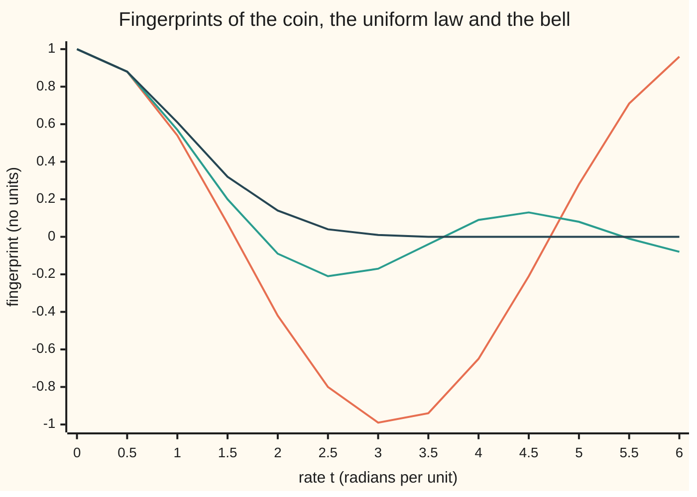

# Characteristic functions: the transform of a probability law, which always exists

[Syllabus](../../../SYLLABUS.md) → [Harmonic analysis](../README.md) → [Characteristic Functions and Probability](../README.md#s04) → Characteristic functions

---

## General Overview

A fair coin pays you $1 on heads and costs you $1 on tails. Pick a rate t, in radians of turn per dollar. Turn a pointer on a circle of radius 1 by t times your winnings, and average over the two faces. Heads turns it by t, tails by −t. The up-and-down parts cancel, and the average is $`\cos t`$: 0.540302 at a rate of 1.

That average, taken at every rate, is the coin's **fingerprint**: this shelf's short name for its **characteristic function**. A **law** is the list of a quantity's possible values with their chances. The pointer never leaves the circle, so the average exists for every law, however wild.

The wildest law here is a lighthouse 1 km off a straight shore. Its beam spins and stops at a random angle, and the spot where it meets the shore follows the **Cauchy law**. Half the spots land more than 1 km from the point nearest the lighthouse. The law has no mean, since its far spots are too far and too frequent. Yet its fingerprint is a plain $`e^{-|t|}`$: 0.367879 at a rate of 1.

Two earlier cards define the fingerprint and prove its first properties. This card adds what they leave out:

- the coin and the Cauchy laws, beside the uniform law and the bell;
- a test every fingerprint passes, called positive definiteness, and a smooth fake that fails it;
- why the coin's fingerprint never fades, while a law with a density (a smooth spread of chance, where no single value has chance of its own) always fades;
- why the mean of 100 lighthouse spots is as spread as one spot.

**A fingerprint is an average of points on the unit circle, so it exists for every law, and three facts follow from that: it is positive definite, it reaches size 1 away from rate 0 only for a law on evenly spaced points, and it fades to 0 at high rates when the law has a density.**

**What kind of fact this is:** a definition with theorems about it, each proved on this card in Why it works, except four results that other cards prove and this card cites: the bell's and the Cauchy's fingerprints, the uniqueness theorem and the Riemann–Lebesgue lemma. The converse of positive definiteness, Bochner's theorem, is stated here and proved on its own card.

### The picture: three laws with the same mean and spread



Orange: the coin, $`\cos t`$. Teal: the uniform law from −√3 to √3. Dark blue: the standard bell, $`e^{-t^2/2}`$. All three have mean 0 and standard deviation 1, so all three read 0.88 at t = 0.5. Farther out they part. The coin swings back to −1 and +1 forever. The uniform law ripples down. The bell's fingerprint is itself a bell and is gone by t = 3.5.

---

## The formula

Notation first. $`X`$ is a random quantity and $`x`$ one of its values. $`E`$ is the average, an integral against the law $`\mu_X`$ ([Expectation as an integral](../../10-Measure%20and%20integration/04-The%20Lebesgue%20Integral/06-expectation-as-an-integral.md)). $`i`$ is the imaginary unit, the number whose square is −1, and $`e^{i\theta} = \cos\theta + i\sin\theta`$ is the point at angle θ on the circle of radius 1. The rate $`t`$, which later cards on this shelf call the dial, is in radians per unit of X. This shelf calls $`\varphi_X`$ the **fingerprint** of X.

```math
\varphi_X(t) = E\big[e^{itX}\big] = \int e^{itx}\,d\mu_X(x) = E[\cos tX] + i\,E[\sin tX]
```

**Read it aloud:** turn the pointer by the rate times X, and average where it lands.

For a law with a density $`p`$, this is the wing's Fourier transform $`\hat p(\xi) = \int p(x)\,e^{-2\pi i \xi x}\,dx`$, read at $`\xi = -t/2\pi`$, so $`\varphi_X(t) = \hat p(-t/2\pi)`$. The four laws of this card:

```math
\varphi_{\text{coin}}(t) = \cos t, \quad \varphi_{\text{uniform}}(t) = \frac{\sin \sqrt3\,t}{\sqrt3\,t}, \quad \varphi_{\text{bell}}(t) = e^{-t^2/2}, \quad \varphi_{\text{Cauchy}}(t) = e^{-|t|}
```

The measure wing proves the first properties for every law ([Characteristic functions](../../10-Measure%20and%20integration/10-The%20Limit%20Theorems%2C%20Proved/06-characteristic-functions.md)): $`\varphi_X(0) = 1`$, $`|\varphi_X(t)| \le 1`$, the value at −t is the mirror image of the value at t, it is continuous, and independent sums multiply. This card proves the first three below and cites the fourth.

1. **Positive definite.** For any rates $`t_1, \dots, t_m`$ and any complex weights $`c_1, \dots, c_m`$, where a bar marks the complex conjugate, the mirror image across the horizontal axis:

```math
\sum_{j=1}^{m}\sum_{k=1}^{m} c_j\,\bar c_k\,\varphi_X(t_j - t_k) \;\ge\; 0
```

2. **Size 1 means a lattice.** If $`|\varphi_X(t_0)| = 1`$ at some $`t_0 \ne 0`$, then X lives on the evenly spaced points $`b + 2\pi k/t_0`$, for one number b and every whole number k.
3. **Point masses never fade.** If X takes the value $`x_k`$ with chance $`p_k`$, then

```math
\lim_{T\to\infty}\frac{1}{2T}\int_{-T}^{T}|\varphi_X(t)|^2\,dt = \sum_k p_k^2
```

4. **Densities fade.** If X has a density, $`\varphi_X(t) \to 0`$ as $`|t| \to \infty`$.

**Read them aloud:** a weighted sum of fingerprint values is a squared size, so never negative; the pointer stays exactly on the circle only if every value of X sits on one comb of evenly spaced teeth; on average the fingerprint's squared size keeps the sum of the squared point chances; and a smooth spread of values averages the pointer out to nothing.

| Symbol | Plain meaning | In our example | Push it up and the answer… |
| --- | --- | --- | --- |
| $`X`$, $`x`$, $`X'`$ | the random quantity; one of its values; an independent copy of X | coin winnings, ±$1; lighthouse spot, in km | — |
| $`t`$ | the rate: radians of turn per unit of X | 1 per dollar | the pointer turns faster |
| $`i`$, $`e^{i\theta}`$, $`\theta`$, $`u`$ | the imaginary unit; the point at angle θ on the unit circle; angles | the coin's pointers at angles 1 and −1 when t = 1 | — |
| $`\varphi_X(t)`$ | the fingerprint: the pointer's average | coin 0.540302, Cauchy 0.367879, at t = 1 | — |
| $`\mu_X`$, $`E`$, $`p`$ | X's law; the average against it; its density, when it has one | Cauchy density $`1/(\pi(1+x^2))`$ | — |
| $`\xi`$, $`\hat p`$, $`\omega`$ | the wing's frequency, in cycles per unit of x; the Fourier transform of p; wing 07's frequency, $`\omega = 2\pi\xi`$ | $`\xi = -t/2\pi`$ | — |
| $`t_j`$, $`c_j`$, $`\bar c_k`$, $`m`$, $`S`$ | rates and complex weights in the positive-definite test; a weight's conjugate; how many; the weighted sum of pointers | rates 0, 0.5, 1; m = 3 | — |
| $`g`$, $`a`$, $`b`$ | a function on trial as a fingerprint; its values at 0.5 and 1 | bell: a = 0.882497, b = 0.606531 | — |
| $`t_0`$, $`b`$, $`k`$ | a rate where the size is 1; the comb's offset; a whole number | coin: $`t_0 = \pi`$, points −1 and 1 | — |
| $`x_k`$, $`p_k`$, $`Y`$, $`y`$ | a value X takes with positive chance; that chance; the gap X − X′; a value of it | coin: 1 and −1, each 1/2 | the average of $`\lvert\varphi\rvert^2`$ rises |
| $`T`$ | half-width of the window of rates averaged over | 100 | the average settles on $`\sum p_k^2`$ |
| $`n`$, $`M_n`$ | number of lighthouse spots; their mean | 100 | no change at all for the Cauchy |

In the $`g`$ row, $`b`$ is a fingerprint value; in the lattice row it is the comb's offset. The two never meet in one formula.

### When it holds

- **Existence needs nothing.** The pointer has size 1, so every law has a fingerprint. The moment generating function $`E[e^{tX}]`$ has no such cap and is infinite for the Cauchy law at every t except 0.
- **Positive definiteness needs a real law behind the function.** A function that is 1 at 0, at most 1, smooth and even can still fail it. The fake $`e^{-t^4}`$ does, at the three rates 0, 0.5 and 1.
- **The lattice fact needs $`t_0 \ne 0`$.** At t = 0 every fingerprint has size 1, and that says nothing.
- **The fading guarantee needs a density.** Point masses block it. The coin and a die have them, and their fingerprints return to size 1 forever: the coin's at every multiple of π, the die's at every multiple of 2π.
- **Reading the mean off the slope at 0 needs a finite mean.** A finite mean gives one slope, $`i\,E[X]`$. The Cauchy law has no mean, and its fingerprint has a corner at 0: slope −1 from the right and +1 from the left. The converse fails: a few laws without a mean still have a slope at 0.

---

## Why it works

### Step 0: every fact here is a fact about points on a circle

A fingerprint is an average of points $`e^{itx}`$, each exactly on the unit circle. So any fact that holds for each single point, and survives averaging, holds for every fingerprint. Positive definiteness is one: a squared size is never negative, for one point or for an average of them. The lattice fact asks when an average of points on the circle can itself sit on the circle. Fading asks when the points spread round the circle so evenly that they cancel.

### Step 1: the four fingerprints

**Coin.** Two points, at angles t and −t, each with chance 1/2. Their up parts, $`\sin t`$ and $`-\sin t`$, cancel. Their across parts are both $`\cos t`$. So $`\varphi_{\text{coin}}(t) = \cos t`$, which is 0.540302 at t = 1.

**Uniform.** Spread evenly from −√3 to √3, with density $`1/(2\sqrt3)`$, the law has mean 0 and standard deviation 1. Integrating the pointer:

```math
\varphi_{\text{uniform}}(t) = \frac{1}{2\sqrt3}\int_{-\sqrt3}^{\sqrt3} e^{itx}\,dx = \frac{e^{i\sqrt3 t} - e^{-i\sqrt3 t}}{2\sqrt3\,it} = \frac{\sin \sqrt3\,t}{\sqrt3\,t}
```

At t = 1 it is sin(1.732051)/1.732051 = 0.569860.

**Bell.** The standard normal's fingerprint is $`e^{-t^2/2}`$, so the bell curve's fingerprint is bell-shaped. The measure wing proves it by showing $`\varphi' = -t\varphi`$ ([Characteristic functions](../../10-Measure%20and%20integration/10-The%20Limit%20Theorems%2C%20Proved/06-characteristic-functions.md)). At t = 1 it is 0.606531.

**Cauchy.** The lighthouse stands 1 km out, and its beam stops at an angle θ spread evenly between −90° and 90°. The spot on the shore is $`X = \tan\theta`$ km, with density $`1/(\pi(1+x^2))`$. The complex-analysis wing turns the Cauchy bell $`1/(1+x^2)`$ into $`\pi e^{-|\omega|}`$ by a residue ([The Fourier transform](../../07-Complex%20analysis/08-Transforms%20in%20Outline/03-fourier-transform.md)). Divide by π, and note the law is symmetric, so the turn's direction does not matter:

```math
\varphi_{\text{Cauchy}}(t) = \int \frac{e^{itx}}{\pi(1+x^2)}\,dx = e^{-|t|}
```

The code checks each closed form against the defining average: the two-point sum for the coin, and Simpson's rule (an area summed from evenly spaced samples) for the three densities. The Cauchy integral is cut at 2,000 km, with a tail of at most $`2/(\pi \cdot 2000) = 0.000318`$. It reads 0.367880 against 0.367879.

### Step 2: positive definite, because a squared size is never negative

Take rates $`t_1, \dots, t_m`$ and complex weights $`c_1, \dots, c_m`$. Form the random sum $`S = \sum_j c_j e^{it_jX}`$. Its squared size is $`S\bar S`$, and $`e^{it_jX}\,\overline{e^{it_kX}} = e^{i(t_j - t_k)X}`$. So

```math
0 \le E\big[|S|^2\big] = \sum_{j}\sum_{k} c_j\,\bar c_k\,E\big[e^{i(t_j - t_k)X}\big] = \sum_{j}\sum_{k} c_j\,\bar c_k\,\varphi_X(t_j - t_k)
```

In matrix terms: the table whose row j, column k holds $`\varphi_X(t_j - t_k)`$ never gives a negative weighted sum. For a symmetric table, that is the same as every **eigenvalue** being 0 or more. An eigenvalue is a number by which the table stretches some direction of weights.

At the rates 0, 0.5 and 1, a real, even g gives the table `[[1, a, b], [a, 1, a], [b, a, 1]]`, with a = g(0.5) and b = g(1). Its smallest eigenvalue has a closed form: the smaller of 1 − b and $`\big(2 + b - \sqrt{b^2 + 8a^2}\big)/2`$.

| Function | a = g(0.5) | b = g(1) | Smallest eigenvalue |
| --- | --- | --- | --- |
| coin, $`\cos t`$ | 0.877583 | 0.540302 | 0.000000 |
| uniform | 0.879605 | 0.569860 | 0.008766 |
| bell, $`e^{-t^2/2}`$ | 0.882497 | 0.606531 | 0.018909 |
| Cauchy, $`e^{-\lvert t\rvert}`$ | 0.606531 | 0.367879 | 0.306675 |
| fake, $`e^{-t^4}`$ | 0.939413 | 0.367879 | **−0.157264** |

The coin's eigenvalue is exactly 0. The coin has only two values, so three pointers $`e^{it_jX}`$ can be weighted to cancel on both faces at once.

The fake fails. A shorter test shows why. Since $`1 - \cos 2u = 2\sin^2 u \le 4(1 - \cos u)`$ for every angle u, averaging gives, for every symmetric law:

```math
1 - \varphi_X(2t) \;\le\; 4\,\big(1 - \varphi_X(t)\big)
```

A fingerprint's drop from 1 over 2t is at most four times its drop over t. Near 0 the fake falls like $`t^4`$, so over 2t it falls 2⁴ = 16 times as far as over t. At t = 0.5: 1 − g(1) = 0.632121, against the cap 4(1 − g(0.5)) = 0.242348.

[Bochner's theorem](../06-Maximal%20Functions%20and%20Beyond/05-bochner-and-positive-definite-functions.md) proves the converse: a continuous, positive-definite g with g(0) = 1 is always some law's fingerprint.

### Step 3: size 1 away from 0 means a comb of evenly spaced values

Suppose $`|\varphi_X(t_0)| = 1`$ with $`t_0 \ne 0`$. Write $`\varphi_X(t_0) = e^{i\theta}`$ and turn everything back by θ:

```math
0 = 1 - e^{-i\theta}\varphi_X(t_0) = E\big[1 - \cos(t_0X - \theta)\big] - i\,E\big[\sin(t_0X - \theta)\big]
```

The real part averages a quantity that is never negative, and the average is 0. So $`\cos(t_0X - \theta) = 1`$ with chance 1, which means $`t_0X - \theta`$ is a whole multiple of 2π. So X lives on the comb $`b + 2\pi k/t_0`$, with offset $`b = \theta/t_0`$. The converse is direct: on such a comb, every pointer at rate $`t_0`$ points the same way.

The coin sits on −1 and 1, a comb with spacing 2, so $`|\varphi(\pi)| = 1`$: indeed $`\cos\pi = -1`$. A die sits on 1 to 6, spacing 1, so its fingerprint has size 1 at 2π. The house example, the total of n dice, sits on whole numbers too. The uniform law sits on no comb. Its largest size for t between 1 and 21 is 0.569860, at t = 1.

### Step 4: point masses keep coming back

A law with point masses has a fingerprint that never settles to 0. The exact amount is the sum of the squared point chances. For the coin, the average of $`\cos^2 t`$ over [−100, 100] is 0.497817, closing on $`0.5^2 + 0.5^2 = 0.5`$. For one die it is 0.163446, closing on $`6 \times (1/6)^2 = 0.166667`$. For the uniform law it is 0.009052, under the bound $`\pi/(2\sqrt3\,T)`$ = 0.009069, which tends to 0. That bound is the whole area under $`|\varphi|^2`$, which Plancherel's identity puts at $`2\pi\int p^2\,dx = \pi/\sqrt3`$, spread over the window's width 2T.

<details>
<summary>Detailed proof: the average of the squared size is the sum of squared point chances</summary>

Let X′ be an independent copy of X, and Y = X − X′. Then $`|\varphi_X(t)|^2 = \varphi_X(t)\,\varphi_X(-t) = \varphi_Y(t)`$, since independent sums multiply and −X′ has fingerprint $`\varphi_X(-t)`$.

Average $`e^{itY}`$ over the rates from −T to T. For a fixed value y ≠ 0 of Y:

$`\displaystyle \frac{1}{2T}\int_{-T}^{T} e^{ity}\,dt = \frac{\sin Ty}{Ty},`$

and for y = 0 it is 1. This has size at most 1 and tends to 0 for y ≠ 0 as T grows. Swap the average over t with the average over Y. Fubini's theorem, which lets two integrals swap order, allows it, as the integrand has size 1. Dominated convergence, which passes a limit inside an average when everything stays under one fixed bound, then gives

$`\displaystyle \lim_{T\to\infty}\frac{1}{2T}\int_{-T}^{T}|\varphi_X(t)|^2\,dt = P(Y = 0) = P(X = X') = \sum_k p_k^2.`$

The last step: X and X′ agree only by both landing on the same point $`x_k`$, with chance $`p_k \cdot p_k`$. A law with a density has no point masses, so the limit is 0. For the coin, the integral is exact: $`\tfrac12 + \sin(2T)/(4T)`$. ∎

</details>

### Step 5: a density makes the fingerprint fade

If X has a density p, then $`\varphi_X(t) = \hat p(-t/2\pi)`$, the Fourier transform of a function with total area 1. The Riemann–Lebesgue lemma says every such transform fades to 0 at high frequency ([The Fourier transform of an absolutely integrable signal, and why it fades at infinity](../02-The%20Fourier%20Transform/01-fourier-transform-on-l1-and-riemann-lebesgue.md)). The idea: at a high rate the pointer spins many times across a short stretch of x, where the density barely changes, so the turns cancel.

How fast it fades tracks how smooth the density is. At t = 5:

- the uniform density jumps at its two ends, and its fingerprint still reads 0.079928, fading like 1/t;
- the Cauchy density has no jumps or corners, and its fingerprint reads 0.006738, fading like $`e^{-t}`$;
- the bell's reads 0.000004, fading like $`e^{-t^2/2}`$.

Fading carries no guaranteed speed. The lemma promises 0 in the limit and nothing more.

### Step 6: the Cauchy law has a corner and no mean

A finite mean would make the fingerprint smooth at 0, with slope $`i\,E[X]`$ there ([Characteristic functions](../../10-Measure%20and%20integration/10-The%20Limit%20Theorems%2C%20Proved/06-characteristic-functions.md)). The Cauchy's $`e^{-|t|}`$ has slope −0.99995 just right of 0 and +0.99995 just left of it. The bell's two slopes are −0.00005 and +0.00005: both near 0, matching its mean of 0.

Now average n independent lighthouse spots. Their mean, written $`M_n`$, has fingerprint

```math
\varphi_{M_n}(t) = \varphi_{\text{Cauchy}}(t/n)^n = \big(e^{-|t|/n}\big)^n = e^{-|t|}
```

That is the fingerprint of one spot. Two laws with the same fingerprint are the same law, by the uniqueness theorem. So the mean of 100 spots is spread exactly as one spot is. Each lands beyond 1 km with chance $`1 - (2/\pi)\arctan 1 = 0.5`$. A simulation of 20,000 sets of 100 flashes gives 0.5076 for one spot and 0.5070 for the mean. The standard error, the typical size of a simulation's chance wobble, is 0.0035.

---

## Worked numbers, by hand

| Step | Arithmetic | Value |
| --- | --- | --- |
| coin at t = 1 | (cos 1 + cos(−1))/2 | 0.540302 |
| uniform at t = 1 | sin(1.732051)/1.732051 | 0.569860 |
| bell at t = 1 | e^(−1/2) | 0.606531 |
| Cauchy at t = 1 | e^(−1) | 0.367879 |
| bell table, rates 0, 0.5, 1 | a = e^(−0.125), b = e^(−0.5) | 0.882497, 0.606531 |
| bell's smallest eigenvalue | (2.606531 − √(0.367879 + 6.230406))/2 | 0.018909 |
| fake table | a = e^(−0.0625), b = e^(−1) | 0.939413, 0.367879 |
| fake's smallest eigenvalue | (2.367879 − √(0.135335 + 7.059975))/2 | **−0.157264** |
| coin, average of cos² t on [−100, 100] | 1/2 + sin(200)/400 | 0.497817 |
| coin's squared point chances | 0.5² + 0.5² | 0.5 |
| mean of 100 Cauchy spots at t = 1 | (e^(−1/100))^100 | 0.367879 |

The fake looks like a fingerprint by every first test, yet one direction of weights gives the negative squared size −0.157264, which no law can produce.

### What breaks if you drop a piece

| Mistake | Comes out at | What went wrong |
| --- | --- | --- |
| Taking $`e^{-t^4}`$ as a fingerprint | smallest eigenvalue −0.157264; 1 − g(1) = 0.632121 against the cap 0.242348 | it fails positive definiteness: no law has it |
| Expecting the coin's fingerprint to fade | size 1.000000 at t = π; squared size averages 0.497817 over [−100, 100] | point masses keep $`\sum p_k^2`$ = 0.5 |
| Averaging lighthouse spots to shrink the spread | the mean of 100 lands beyond 1 km with chance 0.5070, simulated | $`(e^{-\lvert t\rvert/n})^n = e^{-\lvert t\rvert}`$: no mean, so no averaging out |
| Reading the Cauchy's slope at 0 as $`i\,E[X]`$ | −0.99995 from the right, +0.99995 from the left | a corner: a finite mean would give one slope, so the Cauchy has no mean |

---

## Code, from first principles, and it actually runs

Both programs print every number on this card, using `math` only for π, sine, cosine, exponential, tangent, arctangent, square root and hypot (a point's distance from the origin). They take three roads. Road one is each closed form. Road two is the defining average: the two-point sum for the coin, and Simpson's rule for the densities. Simpson's rule adds up an area from evenly spaced samples. For the eigenvalues, road two is bisection: it halves an interval again and again until it pins the first root of the table's determinant. Road three is simulation: 2,000,000 lighthouse flashes from SplitMix64, a small random-number generator, with seed 20261115, written out in both languages. Python and Rust print identical output.

### Python

```python
# Characteristic functions in depth -- the check behind the card.  Standard library
# only: math supplies sin, cos, exp, tan, atan, sqrt and hypot, none of which knows an answer.
# Four laws: a fair coin paying +1 or -1 dollar, the uniform law on [-sqrt 3, sqrt 3],
# the standard bell and the standard Cauchy (a lighthouse 1 km off a straight shore).
# The fingerprint is phi(t) = E[cos tX] + i E[sin tX]; all four laws are symmetric.
import math

R3, PI = math.sqrt(3.0), math.pi
def coin(t): return math.cos(t)
def unif(t): return 1.0 if t == 0 else math.sin(R3 * t) / (R3 * t)
def bell(t): return math.exp(-t * t / 2)
def cauchy(t): return math.exp(-abs(t))
def fake(t): return math.exp(-t * t * t * t)            # 1 at 0, at most 1, smooth, even: a fake
def z(x): return 0.0 if abs(x) < 5e-10 else x      # print a rounding-level number as 0

def simpson(f, a, b, n):                           # n even
    h = (b - a) / n
    return (f(a) + f(b) + sum((4 if k % 2 else 2) * f(a + k * h) for k in range(1, n))) * h / 3

# Road two: the defining average, a sum over the coin's two faces or an integral against a density.
def coin_sum(t): return (math.cos(t) + math.cos(-t)) / 2, (math.sin(t) + math.sin(-t)) / 2
def unif_int(t): return simpson(lambda x: math.cos(t * x) / (2 * R3), -R3, R3, 2000)
def bell_int(t): return simpson(lambda x: math.cos(t * x) * math.exp(-x * x / 2) / math.sqrt(2 * PI), -12, 12, 4000)
L = 2000.0                                         # Cauchy cut-off: the tail beyond is at most 2/(pi L)
def cauchy_int(t): return 2 * simpson(lambda x: math.cos(t * x) / (PI * (1 + x * x)), 0, L, 400000)

print("fingerprints at t = 1        closed form  defining average")
c_re, c_im = coin_sum(1.0)
rows = [("coin, cos t", coin(1), c_re), ("uniform, sin(r3 t)/(r3 t)", unif(1), unif_int(1)),
        ("bell, e^(-t^2/2)", bell(1), bell_int(1)), ("Cauchy, e^(-|t|)", cauchy(1), cauchy_int(1)),
        ("Cauchy again, at t = 2", cauchy(2), cauchy_int(2))]
for name, closed, avg in rows:
    print(f"  {name:27s}{closed:9.6f}  {avg:9.6f}")
    assert abs(closed - avg) < 2 / (PI * L)        # the Cauchy tail bound; the others are far closer
print(f"  sqrt 3 = {R3:.6f}; coin's sine part {z(c_im):.6f}; Cauchy cut-off {L:.0f}, tail bound {2 / (PI * L):.6f}")
for t in (PI, 5.0):
    print(f"at t = {t:.4f}: coin {coin(t):.6f}  uniform {unif(t):.6f}  bell {bell(t):.6f}  Cauchy {cauchy(t):.6f}")

# Positive definiteness at the rates 0, 0.5, 1: the matrix [g(tj - tk)] is [[1,a,b],[a,1,a],[b,a,1]].
def eig_closed(g):                                 # road one: the smallest eigenvalue in closed form
    a, b = g(0.5), g(1.0)
    return min(1 - b, (2 + b - math.sqrt(b * b + 8 * a * a)) / 2)
def eig_bisect(g):                                 # road two: first root of det(M - lam I), from below
    a, b = g(0.5), g(1.0)
    det = lambda l: (1 - l) * ((1 - l) * (1 - l) - a * a) - a * (a * (1 - l) - a * b) + b * (a * a - b * (1 - l))
    lo = -3.0
    while det(lo + 0.001) > 0: lo += 0.001
    hi = lo + 0.001
    for _ in range(60):
        mid = (lo + hi) / 2
        lo, hi = (mid, hi) if det(mid) > 0 else (lo, mid)
    return (lo + hi) / 2
print("rates 0, 0.5, 1: a = g(0.5), b = g(1), smallest eigenvalue by closed form / bisection")
for name, g in (("coin", coin), ("uniform", unif), ("bell", bell), ("Cauchy", cauchy), ("fake e^(-t^4)", fake)):
    e1, e2 = eig_closed(g), eig_bisect(g)
    print(f"  {name:14s}{g(0.5):9.6f}{g(1.0):9.6f}{z(e1):11.6f}{z(e2):11.6f}")
    assert abs(e1 - e2) < 1e-6 and (e1 > -1e-9) == (name != "fake e^(-t^4)")
for name, g in (("bell", bell), ("fake", fake)):
    a, b = g(0.5), g(1.0)
    print(f"  by hand, {name}: 2 + b = {2 + b:.6f}, b^2 = {b * b:.6f}, 8a^2 = {8 * a * a:.6f}")
print("four-times rule at t = 0.5: 1 - g(1)  against  4(1 - g(0.5))")
for name, g in (("coin", coin), ("bell", bell), ("fake e^(-t^4)", fake)):
    print(f"  {name:14s}{1 - g(1):9.6f}  {4 * (1 - g(0.5)):9.6f}")
assert 1 - fake(1) > 4 * (1 - fake(0.5)) and 1 - bell(1) <= 4 * (1 - bell(0.5))

# Lattice and fading.  |phi(t0)| = 1 at t0 != 0 exactly for laws on evenly spaced points.
die = lambda t: math.hypot(sum(math.cos(k * t) for k in range(1, 7)), sum(math.sin(k * t) for k in range(1, 7))) / 6
print(f"|phi| at the lattice rate: coin at pi {abs(coin(PI)):.6f}, die at 2 pi {die(2 * PI):.6f}")
peak = max(abs(unif(1 + k / 100)) for k in range(0, 2000))
print(f"largest |uniform phi| for t in [1, 21): {peak:.6f}; never 1 again")
T = 100.0
avg_coin = simpson(lambda t: coin(t) ** 2, -T, T, 20000) / (2 * T)
avg_die = simpson(lambda t: die(t) ** 2, -T, T, 20000) / (2 * T)
avg_unif = simpson(lambda t: unif(t) ** 2, -T, T, 20000) / (2 * T)
print(f"average of |phi|^2 over [-{T:.0f}, {T:.0f}] / sum of squared point chances")
print(f"  coin {avg_coin:.6f} / {0.5 ** 2 + 0.5 ** 2:.6f}; exact 1/2 + sin(2T)/(4T) = {0.5 + math.sin(2 * T) / (4 * T):.6f}")
die_exact = (6 + sum(math.sin((j - k) * T) / ((j - k) * T) for j in range(6) for k in range(6) if j != k)) / 36
print(f"  die {avg_die:.6f} / {6 / 36:.6f}; exact (6 + sum of sin(dT)/(dT))/36 = {die_exact:.6f}")
print(f"  uniform {avg_unif:.6f} / 0, bound pi/(2 r3 T) = {PI / (2 * R3 * T):.6f}")
assert abs(avg_coin - (0.5 + math.sin(2 * T) / (4 * T))) < 1e-6 and abs(avg_die - die_exact) < 1e-6
assert avg_unif < PI / (2 * R3 * T) and abs(die(2 * PI) - 1) < 1e-12 and peak < 0.6

# The Cauchy: a corner at 0, and the mean of n draws has the fingerprint of one draw.
h = 1e-4
print(f"slopes at 0 from the right / left: Cauchy {(cauchy(h) - 1) / h:.5f} / {(cauchy(-h) - 1) / -h:.5f};"
      f" bell {(bell(h) - 1) / h:.5f} / {(bell(-h) - 1) / -h:.5f}")
print(f"mean of 100 Cauchy draws: phi(1/100)^100 = {cauchy(1 / 100) ** 100:.6f}, one draw {cauchy(1):.6f}")
print(f"P(|one draw| > 1 km) = 1 - (2/pi) atan 1 = {1 - 2 / PI * math.atan(1):.6f}")

MASK = (1 << 64) - 1
state = 20261115                                   # SplitMix64, seed 20261115
def unit():
    global state
    state = (state + 0x9E3779B97F4A7C15) & MASK
    x = ((state ^ (state >> 30)) * 0xBF58476D1CE4E5B9) & MASK
    x = ((x ^ (x >> 27)) * 0x94D049BB133111EB) & MASK
    return (((x ^ (x >> 31)) >> 11) + 0.5) / 2.0 ** 53
M, N = 20000, 100
far_one = far_mean = 0
cos_sum = 0.0
for _ in range(M):
    total = 0.0
    for j in range(N):
        x = math.tan(PI * (unit() - 0.5))      # where the beam meets the shore, in km
        far_one += j == 0 and abs(x) > 1
        total += x
        cos_sum += math.cos(x)
    far_mean += abs(total / N) > 1
se = math.sqrt(0.25 / M)
print(f"simulated, {M} trials of {N} lighthouse flashes: P(|one| > 1) {far_one / M:.4f}, "
      f"P(|mean| > 1) {far_mean / M:.4f}, standard error {se:.4f}")
print(f"simulated phi(1) from {M * N} flashes: {cos_sum / (M * N):.4f}, against e^(-1) {cauchy(1):.4f}")
assert abs(far_one / M - 0.5) < 4 * se and abs(far_mean / M - 0.5) < 4 * se
assert abs(cos_sum / (M * N) - cauchy(1)) < 0.003

for name, g in (("coin", coin), ("uniform", unif), ("bell", bell)):
    print(f"figure, {name:8s}" + " ".join(f"{z(g(k / 2)):.2f}" for k in range(13)))
print("ALL CHECKS PASS")
```

**Ran 2026-11-15 on macOS, Python 3.14.10, standard library only. All checks passed. Output, pasted from the run:**

```
fingerprints at t = 1        closed form  defining average
  coin, cos t                 0.540302   0.540302
  uniform, sin(r3 t)/(r3 t)   0.569860   0.569860
  bell, e^(-t^2/2)            0.606531   0.606531
  Cauchy, e^(-|t|)            0.367879   0.367880
  Cauchy again, at t = 2      0.135335   0.135335
  sqrt 3 = 1.732051; coin's sine part 0.000000; Cauchy cut-off 2000, tail bound 0.000318
at t = 3.1416: coin -1.000000  uniform -0.137067  bell 0.007192  Cauchy 0.043214
at t = 5.0000: coin 0.283662  uniform 0.079928  bell 0.000004  Cauchy 0.006738
rates 0, 0.5, 1: a = g(0.5), b = g(1), smallest eigenvalue by closed form / bisection
  coin           0.877583 0.540302   0.000000   0.000000
  uniform        0.879605 0.569860   0.008766   0.008766
  bell           0.882497 0.606531   0.018909   0.018909
  Cauchy         0.606531 0.367879   0.306675   0.306675
  fake e^(-t^4)  0.939413 0.367879  -0.157264  -0.157264
  by hand, bell: 2 + b = 2.606531, b^2 = 0.367879, 8a^2 = 6.230406
  by hand, fake: 2 + b = 2.367879, b^2 = 0.135335, 8a^2 = 7.059975
four-times rule at t = 0.5: 1 - g(1)  against  4(1 - g(0.5))
  coin           0.459698   0.489670
  bell           0.393469   0.470012
  fake e^(-t^4)  0.632121   0.242348
|phi| at the lattice rate: coin at pi 1.000000, die at 2 pi 1.000000
largest |uniform phi| for t in [1, 21): 0.569860; never 1 again
average of |phi|^2 over [-100, 100] / sum of squared point chances
  coin 0.497817 / 0.500000; exact 1/2 + sin(2T)/(4T) = 0.497817
  die 0.163446 / 0.166667; exact (6 + sum of sin(dT)/(dT))/36 = 0.163446
  uniform 0.009052 / 0, bound pi/(2 r3 T) = 0.009069
slopes at 0 from the right / left: Cauchy -0.99995 / 0.99995; bell -0.00005 / 0.00005
mean of 100 Cauchy draws: phi(1/100)^100 = 0.367879, one draw 0.367879
P(|one draw| > 1 km) = 1 - (2/pi) atan 1 = 0.500000
simulated, 20000 trials of 100 lighthouse flashes: P(|one| > 1) 0.5076, P(|mean| > 1) 0.5070, standard error 0.0035
simulated phi(1) from 2000000 flashes: 0.3676, against e^(-1) 0.3679
figure, coin    1.00 0.88 0.54 0.07 -0.42 -0.80 -0.99 -0.94 -0.65 -0.21 0.28 0.71 0.96
figure, uniform 1.00 0.88 0.57 0.20 -0.09 -0.21 -0.17 -0.04 0.09 0.13 0.08 -0.01 -0.08
figure, bell    1.00 0.88 0.61 0.32 0.14 0.04 0.01 0.00 0.00 0.00 0.00 0.00 0.00
ALL CHECKS PASS
```

### Rust

Same numbers, same labels, built with `rustc --edition 2021 -O`.

```rust
// Characteristic functions in depth -- the same check as the Python, in Rust.  No crates.
// Four laws: a fair coin paying +1 or -1 dollar, the uniform law on [-sqrt 3, sqrt 3],
// the standard bell and the standard Cauchy (a lighthouse 1 km off a straight shore).
// The fingerprint is phi(t) = E[cos tX] + i E[sin tX]; all four laws are symmetric.
use std::f64::consts::PI;

fn r3() -> f64 { 3.0f64.sqrt() }
fn coin(t: f64) -> f64 { t.cos() }
fn unif(t: f64) -> f64 { if t == 0.0 { 1.0 } else { (r3() * t).sin() / (r3() * t) } }
fn bell(t: f64) -> f64 { (-t * t / 2.0).exp() }
fn cauchy(t: f64) -> f64 { (-t.abs()).exp() }
fn fake(t: f64) -> f64 { (-(t * t * t * t)).exp() }      // 1 at 0, at most 1, smooth, even: a fake
fn z(x: f64) -> f64 { if x.abs() < 5e-10 { 0.0 } else { x } }

fn simpson(f: &dyn Fn(f64) -> f64, a: f64, b: f64, n: usize) -> f64 {   // n even
    let h = (b - a) / n as f64;
    let mut s = 0.0;
    for k in 1..n { s += (if k % 2 == 1 { 4.0 } else { 2.0 }) * f(a + k as f64 * h) }
    (f(a) + f(b) + s) * h / 3.0
}

// Road two: the defining average, a sum over the coin's two faces or an integral against a density.
fn coin_sum(t: f64) -> (f64, f64) { ((t.cos() + (-t).cos()) / 2.0, (t.sin() + (-t).sin()) / 2.0) }
fn unif_int(t: f64) -> f64 { simpson(&|x: f64| (t * x).cos() / (2.0 * r3()), -r3(), r3(), 2000) }
fn bell_int(t: f64) -> f64 {
    simpson(&|x: f64| (t * x).cos() * (-x * x / 2.0).exp() / (2.0 * PI).sqrt(), -12.0, 12.0, 4000)
}
const L: f64 = 2000.0;                                     // Cauchy cut-off: the tail beyond is at most 2/(pi L)
fn cauchy_int(t: f64) -> f64 { 2.0 * simpson(&|x: f64| (t * x).cos() / (PI * (1.0 + x * x)), 0.0, L, 400000) }

// Positive definiteness at the rates 0, 0.5, 1: the matrix [g(tj - tk)] is [[1,a,b],[a,1,a],[b,a,1]].
fn eig_closed(g: fn(f64) -> f64) -> f64 {                 // road one: the smallest eigenvalue in closed form
    let (a, b) = (g(0.5), g(1.0));
    (1.0 - b).min((2.0 + b - (b * b + 8.0 * a * a).sqrt()) / 2.0)
}
fn eig_bisect(g: fn(f64) -> f64) -> f64 {                 // road two: first root of det(M - lam I), from below
    let (a, b) = (g(0.5), g(1.0));
    let det = |l: f64| (1.0 - l) * ((1.0 - l) * (1.0 - l) - a * a) - a * (a * (1.0 - l) - a * b) + b * (a * a - b * (1.0 - l));
    let mut lo = -3.0;
    while det(lo + 0.001) > 0.0 { lo += 0.001 }
    let mut hi = lo + 0.001;
    for _ in 0..60 {
        let mid = (lo + hi) / 2.0;
        if det(mid) > 0.0 { lo = mid } else { hi = mid }
    }
    (lo + hi) / 2.0
}

fn die(t: f64) -> f64 {
    let (mut c, mut s) = (0.0, 0.0);
    for k in 1..7 { c += (k as f64 * t).cos(); s += (k as f64 * t).sin() }
    c.hypot(s) / 6.0
}

struct SplitMix(u64);                                      // SplitMix64, seed 20261115
impl SplitMix {
    fn unit(&mut self) -> f64 {
        self.0 = self.0.wrapping_add(0x9E3779B97F4A7C15);
        let mut x = (self.0 ^ (self.0 >> 30)).wrapping_mul(0xBF58476D1CE4E5B9);
        x = (x ^ (x >> 27)).wrapping_mul(0x94D049BB133111EB);
        (((x ^ (x >> 31)) >> 11) as f64 + 0.5) / 2.0f64.powi(53)
    }
}

fn main() {
    println!("fingerprints at t = 1        closed form  defining average");
    let (c_re, c_im) = coin_sum(1.0);
    let rows = [("coin, cos t", coin(1.0), c_re), ("uniform, sin(r3 t)/(r3 t)", unif(1.0), unif_int(1.0)),
                ("bell, e^(-t^2/2)", bell(1.0), bell_int(1.0)), ("Cauchy, e^(-|t|)", cauchy(1.0), cauchy_int(1.0)),
                ("Cauchy again, at t = 2", cauchy(2.0), cauchy_int(2.0))];
    for (name, closed, avg) in rows {
        println!("  {:27}{:9.6}  {:9.6}", name, closed, avg);
        assert!((closed - avg).abs() < 2.0 / (PI * L));
    }
    println!("  sqrt 3 = {:.6}; coin's sine part {:.6}; Cauchy cut-off {:.0}, tail bound {:.6}", r3(), z(c_im), L, 2.0 / (PI * L));
    for t in [PI, 5.0] {
        println!("at t = {:.4}: coin {:.6}  uniform {:.6}  bell {:.6}  Cauchy {:.6}", t, coin(t), unif(t), bell(t), cauchy(t));
    }

    println!("rates 0, 0.5, 1: a = g(0.5), b = g(1), smallest eigenvalue by closed form / bisection");
    let laws: [(&str, fn(f64) -> f64); 5] =
        [("coin", coin), ("uniform", unif), ("bell", bell), ("Cauchy", cauchy), ("fake e^(-t^4)", fake)];
    for (name, g) in laws {
        let (e1, e2) = (eig_closed(g), eig_bisect(g));
        println!("  {:14}{:9.6}{:9.6}{:11.6}{:11.6}", name, g(0.5), g(1.0), z(e1), z(e2));
        assert!((e1 - e2).abs() < 1e-6 && (e1 > -1e-9) == (name != "fake e^(-t^4)"));
    }
    let two: [(&str, fn(f64) -> f64); 2] = [("bell", bell), ("fake", fake)];
    for (name, g) in two {
        let (a, b) = (g(0.5), g(1.0));
        println!("  by hand, {}: 2 + b = {:.6}, b^2 = {:.6}, 8a^2 = {:.6}", name, 2.0 + b, b * b, 8.0 * a * a);
    }
    println!("four-times rule at t = 0.5: 1 - g(1)  against  4(1 - g(0.5))");
    let three: [(&str, fn(f64) -> f64); 3] = [("coin", coin), ("bell", bell), ("fake e^(-t^4)", fake)];
    for (name, g) in three { println!("  {:14}{:9.6}  {:9.6}", name, 1.0 - g(1.0), 4.0 * (1.0 - g(0.5))) }
    assert!(1.0 - fake(1.0) > 4.0 * (1.0 - fake(0.5)) && 1.0 - bell(1.0) <= 4.0 * (1.0 - bell(0.5)));

    // Lattice and fading.  |phi(t0)| = 1 at t0 != 0 exactly for laws on evenly spaced points.
    println!("|phi| at the lattice rate: coin at pi {:.6}, die at 2 pi {:.6}", coin(PI).abs(), die(2.0 * PI));
    let peak = (0..2000).map(|k| unif(1.0 + k as f64 / 100.0).abs()).fold(0.0, f64::max);
    println!("largest |uniform phi| for t in [1, 21): {:.6}; never 1 again", peak);
    let t_big = 100.0;
    let avg_coin = simpson(&|t: f64| coin(t) * coin(t), -t_big, t_big, 20000) / (2.0 * t_big);
    let avg_die = simpson(&|t: f64| die(t) * die(t), -t_big, t_big, 20000) / (2.0 * t_big);
    let avg_unif = simpson(&|t: f64| unif(t) * unif(t), -t_big, t_big, 20000) / (2.0 * t_big);
    println!("average of |phi|^2 over [-{:.0}, {:.0}] / sum of squared point chances", t_big, t_big);
    let coin_exact = 0.5 + (2.0 * t_big).sin() / (4.0 * t_big);
    println!("  coin {:.6} / {:.6}; exact 1/2 + sin(2T)/(4T) = {:.6}", avg_coin, 0.25 + 0.25, coin_exact);
    let mut d = 0.0;
    for j in 0..6 { for k in 0..6 { if j != k { let u = (j - k) as f64 * t_big; d += u.sin() / u } } }
    let die_exact = (6.0 + d) / 36.0;
    println!("  die {:.6} / {:.6}; exact (6 + sum of sin(dT)/(dT))/36 = {:.6}", avg_die, 6.0 / 36.0, die_exact);
    println!("  uniform {:.6} / 0, bound pi/(2 r3 T) = {:.6}", avg_unif, PI / (2.0 * r3() * t_big));
    assert!((avg_coin - coin_exact).abs() < 1e-6 && (avg_die - die_exact).abs() < 1e-6);
    assert!(avg_unif < PI / (2.0 * r3() * t_big) && (die(2.0 * PI) - 1.0).abs() < 1e-12 && peak < 0.6);

    // The Cauchy: a corner at 0, and the mean of n draws has the fingerprint of one draw.
    let h = 1e-4;
    println!("slopes at 0 from the right / left: Cauchy {:.5} / {:.5}; bell {:.5} / {:.5}",
             (cauchy(h) - 1.0) / h, (cauchy(-h) - 1.0) / -h, (bell(h) - 1.0) / h, (bell(-h) - 1.0) / -h);
    println!("mean of 100 Cauchy draws: phi(1/100)^100 = {:.6}, one draw {:.6}", cauchy(0.01).powi(100), cauchy(1.0));
    println!("P(|one draw| > 1 km) = 1 - (2/pi) atan 1 = {:.6}", 1.0 - 2.0 / PI * 1.0f64.atan());

    let mut rng = SplitMix(20261115);
    let (m, n) = (20000usize, 100usize);
    let (mut far_one, mut far_mean, mut cos_sum) = (0usize, 0usize, 0.0f64);
    for _ in 0..m {
        let mut total = 0.0;
        for j in 0..n {
            let x = (PI * (rng.unit() - 0.5)).tan();          // where the beam meets the shore, in km
            if j == 0 && x.abs() > 1.0 { far_one += 1 }
            total += x;
            cos_sum += x.cos();
        }
        if (total / n as f64).abs() > 1.0 { far_mean += 1 }
    }
    let (p1, pm) = (far_one as f64 / m as f64, far_mean as f64 / m as f64);
    let se = (0.25 / m as f64).sqrt();
    println!("simulated, {} trials of {} lighthouse flashes: P(|one| > 1) {:.4}, P(|mean| > 1) {:.4}, standard error {:.4}",
             m, n, p1, pm, se);
    let sim_phi = cos_sum / (m * n) as f64;
    println!("simulated phi(1) from {} flashes: {:.4}, against e^(-1) {:.4}", m * n, sim_phi, cauchy(1.0));
    assert!((p1 - 0.5).abs() < 4.0 * se && (pm - 0.5).abs() < 4.0 * se && (sim_phi - cauchy(1.0)).abs() < 0.003);

    let figs: [(&str, fn(f64) -> f64); 3] = [("coin", coin), ("uniform", unif), ("bell", bell)];
    for (name, g) in figs {
        let pts: Vec<String> = (0..13).map(|k| format!("{:.2}", z(g(k as f64 / 2.0)))).collect();
        println!("figure, {:8}{}", name, pts.join(" "));
    }
    println!("ALL CHECKS PASS");
}
```

**Ran 2026-11-15 on macOS, rustc 1.98.1, no crates. All checks passed. Output, pasted from the run:**

```
fingerprints at t = 1        closed form  defining average
  coin, cos t                 0.540302   0.540302
  uniform, sin(r3 t)/(r3 t)   0.569860   0.569860
  bell, e^(-t^2/2)            0.606531   0.606531
  Cauchy, e^(-|t|)            0.367879   0.367880
  Cauchy again, at t = 2      0.135335   0.135335
  sqrt 3 = 1.732051; coin's sine part 0.000000; Cauchy cut-off 2000, tail bound 0.000318
at t = 3.1416: coin -1.000000  uniform -0.137067  bell 0.007192  Cauchy 0.043214
at t = 5.0000: coin 0.283662  uniform 0.079928  bell 0.000004  Cauchy 0.006738
rates 0, 0.5, 1: a = g(0.5), b = g(1), smallest eigenvalue by closed form / bisection
  coin           0.877583 0.540302   0.000000   0.000000
  uniform        0.879605 0.569860   0.008766   0.008766
  bell           0.882497 0.606531   0.018909   0.018909
  Cauchy         0.606531 0.367879   0.306675   0.306675
  fake e^(-t^4)  0.939413 0.367879  -0.157264  -0.157264
  by hand, bell: 2 + b = 2.606531, b^2 = 0.367879, 8a^2 = 6.230406
  by hand, fake: 2 + b = 2.367879, b^2 = 0.135335, 8a^2 = 7.059975
four-times rule at t = 0.5: 1 - g(1)  against  4(1 - g(0.5))
  coin           0.459698   0.489670
  bell           0.393469   0.470012
  fake e^(-t^4)  0.632121   0.242348
|phi| at the lattice rate: coin at pi 1.000000, die at 2 pi 1.000000
largest |uniform phi| for t in [1, 21): 0.569860; never 1 again
average of |phi|^2 over [-100, 100] / sum of squared point chances
  coin 0.497817 / 0.500000; exact 1/2 + sin(2T)/(4T) = 0.497817
  die 0.163446 / 0.166667; exact (6 + sum of sin(dT)/(dT))/36 = 0.163446
  uniform 0.009052 / 0, bound pi/(2 r3 T) = 0.009069
slopes at 0 from the right / left: Cauchy -0.99995 / 0.99995; bell -0.00005 / 0.00005
mean of 100 Cauchy draws: phi(1/100)^100 = 0.367879, one draw 0.367879
P(|one draw| > 1 km) = 1 - (2/pi) atan 1 = 0.500000
simulated, 20000 trials of 100 lighthouse flashes: P(|one| > 1) 0.5076, P(|mean| > 1) 0.5070, standard error 0.0035
simulated phi(1) from 2000000 flashes: 0.3676, against e^(-1) 0.3679
figure, coin    1.00 0.88 0.54 0.07 -0.42 -0.80 -0.99 -0.94 -0.65 -0.21 0.28 0.71 0.96
figure, uniform 1.00 0.88 0.57 0.20 -0.09 -0.21 -0.17 -0.04 0.09 0.13 0.08 -0.01 -0.08
figure, bell    1.00 0.88 0.61 0.32 0.14 0.04 0.01 0.00 0.00 0.00 0.00 0.00 0.00
ALL CHECKS PASS
```

The two outputs match line for line.

### Lean

Lean proves facts 1, 2 and 4 of The formula for every law, and checks three pieces of the card's arithmetic.

- Every fingerprint is positive definite. Take any law, rates $`t_1, \dots, t_m`$ and complex weights $`c_1, \dots, c_m`$. Then $`\sum_j \sum_k c_j\,\bar c_k\,\varphi_X(t_j - t_k)`$ is real and at least 0.
- Size 1 means a lattice. Suppose $`|\varphi_X(t_0)| = 1`$ at some $`t_0 \ne 0`$. Then X lives on the comb $`b + 2\pi k/t_0`$, for one offset b.
- Densities fade. Suppose X has a density. Then $`\varphi_X(t) \to 0`$ as $`|t| \to \infty`$.
- The coin's squared point chances add to $`0.5^2 + 0.5^2 = 0.5`$.
- One die's squared point chances add to $`6 \times (1/6)^2 = 1/6`$.
- The fake $`e^{-t^4}`$ falls 2⁴ = 16 times as far over 2t as over t, beyond the cap of 4.

Fact 3 on point masses, the four fingerprints, the eigenvalues and the lighthouse simulation are left to the Python and Rust checks.

```lean
-- Characteristic functions: every probability law's fingerprint is positive definite, has size 1 at a nonzero rate only for a law on evenly spaced points, and fades to 0 at high rates when the law has a density.
import Mathlib.MeasureTheory.Measure.CharacteristicFunction.Basic
import Mathlib.Analysis.Complex.Order
import Mathlib.Analysis.Fourier.RiemannLebesgueLemma
import Mathlib.Analysis.SpecialFunctions.Complex.Arg
import Mathlib.MeasureTheory.Measure.Decomposition.RadonNikodym

open MeasureTheory Complex Filter Topology
open scoped ComplexOrder

/-- Helper: `x ↦ exp(i s x)` is integrable against any probability law. -/
lemma integrable_exp_mul_I (μ : Measure ℝ) [IsProbabilityMeasure μ] (s : ℝ) :
    Integrable (fun x : ℝ => exp (s * x * I)) μ := by
  have h : (fun x : ℝ => exp (s * x * I)) = ⇑(BoundedContinuousFunction.innerProbChar s) := by
    ext x; simp [BoundedContinuousFunction.innerProbChar_apply, mul_comm]
  rw [h]; exact (BoundedContinuousFunction.innerProbChar s).integrable μ

/-- Helper: `x ↦ exp(i g(x))` is integrable against any probability law when `g` is continuous. -/
lemma integrable_exp_continuous_mul_I (μ : Measure ℝ) [IsProbabilityMeasure μ] {g : ℝ → ℝ}
    (hg : Continuous g) : Integrable (fun x : ℝ => exp (g x * I)) μ := by
  refine Integrable.mono' (integrable_const (1 : ℝ)) ?_ (ae_of_all _ fun x => ?_)
  · exact (by fun_prop : Continuous fun x : ℝ => exp (g x * I)).aestronglyMeasurable
  · rw [norm_exp_ofReal_mul_I]

/-- Every fingerprint is positive definite: for any probability law `μ` on the real line,
any rates `t₁, …, tₘ` and any complex weights `c₁, …, cₘ`, the weighted sum
`∑ⱼ ∑ₖ cⱼ · conj cₖ · φ(tⱼ − tₖ)` is a real number that is 0 or more. -/
theorem charFun_positive_definite (μ : Measure ℝ) [IsProbabilityMeasure μ]
    (m : ℕ) (t : Fin m → ℝ) (c : Fin m → ℂ) :
    0 ≤ ∑ j, ∑ k, c j * (starRingEnd ℂ) (c k) * charFun μ (t j - t k) := by
  have key : ∑ j, ∑ k, c j * (starRingEnd ℂ) (c k) * charFun μ (t j - t k)
      = ((∫ x, ‖∑ j, c j * exp (t j * x * I)‖ ^ 2 ∂μ : ℝ) : ℂ) := by
    rw [← integral_complex_ofReal]
    have hpt : ∀ x : ℝ, ((‖∑ j, c j * exp (t j * x * I)‖ ^ 2 : ℝ) : ℂ)
        = ∑ j, ∑ k, c j * (starRingEnd ℂ) (c k) * exp (((t j - t k : ℝ) : ℂ) * x * I) := by
      intro x
      push_cast
      rw [← mul_conj', map_sum, Finset.sum_mul_sum]
      refine Finset.sum_congr rfl fun j _ => Finset.sum_congr rfl fun k _ => ?_
      rw [map_mul, ← exp_conj]
      simp only [map_mul, conj_ofReal, conj_I]
      rw [show c j * exp (t j * x * I) * ((starRingEnd ℂ) (c k) * exp (t k * x * -I))
          = c j * (starRingEnd ℂ) (c k) * (exp (t j * x * I) * exp (t k * x * -I)) by ring,
        ← exp_add]
      congr 2
      ring
    simp_rw [hpt]
    rw [integral_finsetSum _ (fun j _ => integrable_finsetSum _ fun k _ =>
      (integrable_exp_mul_I μ _).const_mul _)]
    refine Finset.sum_congr rfl fun j _ => ?_
    rw [integral_finsetSum _ (fun k _ => (integrable_exp_mul_I μ _).const_mul _)]
    refine Finset.sum_congr rfl fun k _ => ?_
    rw [integral_const_mul, charFun_apply_real]
  rw [key]
  exact zero_le_real.mpr (integral_nonneg fun x => by positivity)

/-- Size 1 away from rate 0 means a comb: if a probability law's fingerprint has size 1
at some rate `t₀ ≠ 0`, then for one offset `b` the law lives on the evenly spaced points
`b + 2πk/t₀`, `k` a whole number. -/
theorem charFun_norm_eq_one_imp_lattice (μ : Measure ℝ) [IsProbabilityMeasure μ]
    {t₀ : ℝ} (ht₀ : t₀ ≠ 0) (h : ‖charFun μ t₀‖ = 1) :
    ∃ b : ℝ, ∀ᵐ x ∂μ, ∃ k : ℤ, x = b + 2 * Real.pi * k / t₀ := by
  set θ := arg (charFun μ t₀) with hθ
  have hz : exp (θ * I) = charFun μ t₀ := by
    have := norm_mul_exp_arg_mul_I (charFun μ t₀)
    rwa [h, ofReal_one, one_mul] at this
  have hcont : Continuous fun x : ℝ => t₀ * x - θ := by fun_prop
  have h1 : ∫ x, exp (((t₀ * x - θ : ℝ) : ℂ) * I) ∂μ = 1 := by
    have : ∀ x : ℝ, exp (((t₀ * x - θ : ℝ) : ℂ) * I) = exp (t₀ * x * I) * exp (-(θ * I)) := by
      intro x
      rw [← exp_add]
      congr 1
      push_cast
      ring
    simp_rw [this]
    rw [integral_mul_const, ← charFun_apply_real, ← hz, ← exp_add, add_neg_cancel, exp_zero]
  have h2 : ∫ x, Real.cos (t₀ * x - θ) ∂μ = 1 := by
    have h4 := integral_re (integrable_exp_continuous_mul_I μ hcont)
    simp only [RCLike.re_to_complex, exp_ofReal_mul_I_re, h1, one_re] at h4
    exact h4
  have hcosi : Integrable (fun x : ℝ => Real.cos (t₀ * x - θ)) μ := by
    refine Integrable.mono' (integrable_const (1 : ℝ)) ?_ (ae_of_all _ fun x => ?_)
    · exact (by fun_prop : Continuous fun x : ℝ => Real.cos (t₀ * x - θ)).aestronglyMeasurable
    · simpa using Real.abs_cos_le_one (t₀ * x - θ)
  have h3 : ∫ x, (1 - Real.cos (t₀ * x - θ)) ∂μ = 0 := by
    rw [integral_sub (integrable_const _) hcosi, h2]
    simp
  rw [integral_eq_zero_iff_of_nonneg (f := fun x => 1 - Real.cos (t₀ * x - θ)) (fun x => by simpa using Real.cos_le_one _)
    ((integrable_const _).sub hcosi)] at h3
  refine ⟨θ / t₀, ?_⟩
  filter_upwards [h3] with x hx
  have hc : Real.cos (t₀ * x - θ) = 1 := by
    simp only [Pi.zero_apply] at hx
    linarith
  obtain ⟨n, hn⟩ := (Real.cos_eq_one_iff _).mp hc
  refine ⟨n, ?_⟩
  field_simp
  linarith

/-- Densities fade: if a probability law has a density (it is absolutely continuous with
respect to length), its fingerprint tends to 0 as `|t| → ∞`. -/
theorem charFun_tendsto_zero_of_density (μ : Measure ℝ) [IsProbabilityMeasure μ]
    (hμ : μ ≪ volume) :
    Tendsto (charFun μ) (cocompact ℝ) (𝓝 0) := by
  set g : ℝ → ℂ := fun x => ((μ.rnDeriv volume x).toReal : ℂ) with hg
  have hc : -(2 * Real.pi)⁻¹ ≠ 0 := by
    simp [Real.pi_ne_zero]
  have hφ : charFun μ = fun t => ∫ v, Real.fourierChar (-(v * (-(2 * Real.pi)⁻¹ * t))) • g v := by
    funext t
    rw [charFun_apply_real, ← integral_rnDeriv_smul hμ]
    congr 1
    funext v
    rw [Circle.smul_def, Real.fourierChar_apply, hg]
    simp only [Complex.real_smul]
    rw [mul_comm]
    congr 2
    push_cast
    field_simp
  rw [hφ]
  exact (Real.tendsto_integral_exp_smul_cocompact g).comp
    (Homeomorph.mulLeft₀ _ hc).map_cocompact.le

-- The coin's squared point chances: 0.5² + 0.5² = 0.5.
example : (1 / 2 : ℚ) ^ 2 + (1 / 2) ^ 2 = 1 / 2 := by norm_num
-- One die's squared point chances: 6 × (1/6)² = 1/6.
example : 6 * (1 / 6 : ℚ) ^ 2 = 1 / 6 := by norm_num
-- The fake e^(-t^4) falls 2⁴ = 16 times as far over 2t as over t, beyond the cap of 4.
example : (2 : ℕ) ^ 4 = 16 ∧ 4 < 16 := by decide

#print axioms integrable_exp_mul_I
#print axioms integrable_exp_continuous_mul_I
#print axioms charFun_positive_definite
#print axioms charFun_norm_eq_one_imp_lattice
#print axioms charFun_tendsto_zero_of_density
```

**Checked 2026-11-15 on macOS, Lean 4.36.0-rc2, Mathlib v4.36.0-rc2. Every proof is complete and uses only Lean's standard axioms. Output, pasted from the run:**

```
'integrable_exp_mul_I' depends on axioms: [propext, Classical.choice, Quot.sound]
'integrable_exp_continuous_mul_I' depends on axioms: [propext, Classical.choice, Quot.sound]
'charFun_positive_definite' depends on axioms: [propext, Classical.choice, Quot.sound]
'charFun_norm_eq_one_imp_lattice' depends on axioms: [propext, Classical.choice, Quot.sound]
'charFun_tendsto_zero_of_density' depends on axioms: [propext, Classical.choice, Quot.sound]
```

> [!TIP]
> **Try changing**
> - **Rates closer together.** Guess first: at rates 0, 0.25 and 0.5, does the fake still fail? Change `g(0.5), g(1.0)` to `g(0.25), g(0.5)` in both eigenvalue functions. Yes: its smallest eigenvalue is −0.015238. Closer rates make the failure smaller, but it stays below 0.
> - **A real heavy tail.** Guess first: is $`e^{-|t|^{1.5}}`$ a fingerprint? Set `fake` to `math.exp(-abs(t) ** 1.5)`. Its eigenvalue turns positive, 0.174003, and the assert that expects a failure stops the run. It is a real law, from [Stable laws](08-stable-laws-and-heavy-tails.md).
> - **Fewer flashes per mean.** Guess first: with `N = 10`, does the mean land beyond 1 km less often? No: 0.4955, still close to 0.5. Every n gives the same law.
> - **A shorter Cauchy cut-off.** Set `L = 200.0`. Guess first: does the integral still match? Yes, 0.367865, inside the wider tail bound 0.003183.

---

## The usual mistake

> [!warning]
> **Treating any function that starts at 1 and stays below 1 as a fingerprint.** It must also be positive definite. The fake $`e^{-t^4}`$ is 1 at 0, at most 1, smooth, even and fading, and no law has it: at rates 0, 0.5 and 1 its table has eigenvalue −0.157264.
>
> - **Expecting every fingerprint to fade.** Only laws with a density are sure to. The coin's returns to size 1 at every multiple of π.
> - **Averaging Cauchy data.** The mean of 100 lighthouse spots is as spread as one: beyond 1 km with chance 0.5 either way.
> - **Reading a slope at 0 as a mean without checking.** The Cauchy's slopes are −1 and +1, so there is no single slope and no mean.
> - **Mixing conventions.** This wing's transform is $`\hat p(\xi)`$ with $`e^{-2\pi i\xi x}`$; the fingerprint is $`\hat p(-t/2\pi)`$, not $`\hat p(t)`$.

---

## Where you meet it in real life

- **Sums of independent pieces.** Insurance claims, measurement errors and dice totals add, and their fingerprints multiply. That is the road to the central limit theorem on this shelf.
- **Heavy-tailed noise.** Some radio and sensor noise has Cauchy-like tails. Averaging readings then does not shrink the error, and the fingerprint shows why in one line.
- **Checking a model.** A modeller who writes down a candidate fingerprint must check it is positive definite, or no law stands behind it. The same test applies to correlation functions, which must be positive definite too.
- **Option pricing.** Models of stock prices with jumps have simple fingerprints and no simple density. They are priced from the fingerprint ([Pricing by transform](09-carr-madan-and-fourier-pricing.md)).

> **Say it back**
> A fingerprint averages the pointer $`e^{itX}`$ on the unit circle, so every law has one, even the Cauchy, which has no mean. The coin's is $`\cos t`$, the uniform's $`\sin(\sqrt3 t)/(\sqrt3 t)`$, the bell's $`e^{-t^2/2}`$ and the Cauchy's $`e^{-|t|}`$. Every fingerprint is positive definite, because a weighted sum of its values is a squared size, so the smooth fake $`e^{-t^4}`$ belongs to no law. A fingerprint returns to size 1 only for a law on a comb of evenly spaced values, and it fades to 0 for a law with a density. The mean of n Cauchy spots has the fingerprint of one spot, so it is just as spread.

---

## What this builds on

- [Characteristic functions](../../09-Probability%20and%20statistics/06-Limit%20Theorems%20in%20Practice/04-characteristic-functions-and-inversion.md): the definition, the bell's bell-shaped fingerprint, and density inversion.
- [Characteristic functions](../../10-Measure%20and%20integration/10-The%20Limit%20Theorems%2C%20Proved/06-characteristic-functions.md): boundedness, continuity, the product rule, moments from derivatives, and uniqueness for every law.
- [Expectation as an integral](../../10-Measure%20and%20integration/04-The%20Lebesgue%20Integral/06-expectation-as-an-integral.md): the average as an integral against the law, which the fingerprint is.
- [The Fourier transform](../../07-Complex%20analysis/08-Transforms%20in%20Outline/03-fourier-transform.md): the Cauchy bell's transform by a residue, which gives $`e^{-|t|}`$.

## Where this goes next

- [Moments and cumulants](02-moments-and-cumulants-from-the-fingerprint.md): reads the mean, spread and skew off the fingerprint's shape at 0.
- [Levy's inversion formula](03-levy-inversion-and-uniqueness.md): gets the law back from the fingerprint, including a die's point masses, counted at half weight on the ends.
- [Infinitely divisible laws](07-infinitely-divisible-laws-and-levy-khintchine.md): the laws, like the Cauchy and the bell, that split into any number of independent equal pieces.
- [Pricing by transform](09-carr-madan-and-fourier-pricing.md): turns a fingerprint into option prices.
- [Bochner's theorem](../06-Maximal%20Functions%20and%20Beyond/05-bochner-and-positive-definite-functions.md): proves that positive definiteness and continuity are enough to make a fingerprint.

The shelf's other cards take it from there: [Levy's continuity theorem](04-levy-continuity-theorem.md), [The central limit theorem in four lines, once you have fingerprints](05-central-limit-theorem-by-characteristic-functions.md), [How big must n be](06-berry-esseen-and-the-rate.md) and [Stable laws](08-stable-laws-and-heavy-tails.md).

This card shows which functions can be fingerprints; it leaves open how to read the law back out of one, point masses and all.

---

## Sources

Verified 2026-11-15: every link below resolves to the publisher's page.

- Durrett, Rick. *Probability: Theory and Examples*, 5th ed. Cambridge University Press, 2019. [doi:10.1017/9781108591034](https://doi.org/10.1017/9781108591034). Section 3.3 works the coin, uniform, normal and Cauchy fingerprints; Section 3.5 gives the lattice fact.
- Feller, William. *An Introduction to Probability Theory and Its Applications*, Volume 2, 2nd ed. Wiley, 1971. [Publisher page](https://www.wiley.com/en-us/An+Introduction+to+Probability+Theory+and+Its+Applications%2C+Volume+2%2C+2nd+Edition-p-9780471257097). Chapters XV and XIX: fingerprints, lattice laws, positive definite functions and Bochner's theorem.
- Billingsley, Patrick. *Probability and Measure*, Anniversary ed. Wiley, 2012. [Publisher page](https://www.wiley.com/en-us/Probability+and+Measure%2C+Anniversary+Edition-p-9781118122372). Section 26: fingerprints in the measure setting, with the Riemann–Lebesgue lemma for laws with densities.
- Bochner, Salomon. "Monotone Funktionen, Stieltjessche Integrale und harmonische Analyse." *Mathematische Annalen* 108 (1933): 378–410. [doi:10.1007/BF01452844](https://doi.org/10.1007/BF01452844). The original theorem that positive definite functions are exactly fingerprints.
