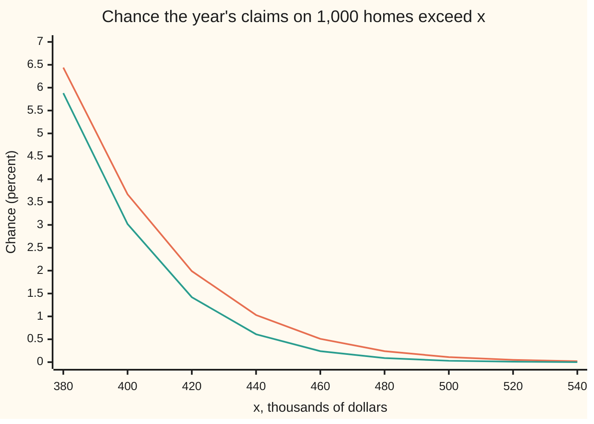

# Moments and cumulants: what differentiating the fingerprint at zero tells you

[Syllabus](../../../SYLLABUS.md) → [Harmonic analysis](../README.md) → [Characteristic Functions and Probability](../README.md#s04) → Moments and cumulants

---

## General Overview

A small insurer covers 1,000 homes for one year. Each home, independently of the others, has one of three outcomes in a year. With chance 0.95 it claims nothing. With chance 0.04 it claims $2,000 for a water leak. With chance 0.01 it claims $20,000 for a fire.

On average the insurer pays $280,000. The regulator asks for more than an average. It asks for enough money to cover the year's claims in all but 1 year in 200: the 99.5% level that Europe's insurance capital rules use. This card calls that amount the reserve.

A bell curve with the right mean and the right standard deviation ($63,887) says the reserve is $444,560. The exact law of the total, counted by computer, says $462,000. The bell curve falls $17,440 short. The total leans to the right: fires are rare and large, so the bad years are worse than a symmetric curve allows.

One number measures that lean: the **third cumulant** of the total. It comes from the total's fingerprint (its characteristic function): take the logarithm, differentiate three times at zero, and divide out the $`i^3`$ that differentiating brings in ($`i`$ is the imaginary unit, whose square is −1).

Cumulants add over independent homes, so 1,000 homes have 1,000 times one home's. Turned into a skewness of 0.295 (the lean as a pure number, free of units), the third cumulant adds one correction term to the bell curve. The reserve moves to $462,250, within $250 of the exact answer.

**The k-th derivative of the log-fingerprint at zero, divided by i to the power k, is the k-th cumulant; cumulants add over independent pieces, and after the mean and the variance they measure the lean and the tail weight that a bell curve misses.**

**What kind of fact this is:** a definition (the cumulants) with three theorems proved on this card in Why it works: they add, they shift and scale by fixed rules, and the first four are the mean, the variance, the third central moment and the fourth central moment less three times the variance squared. Moments from derivatives are proved in [Characteristic functions](../../10-Measure%20and%20integration/10-The%20Limit%20Theorems%2C%20Proved/06-characteristic-functions.md). The reserve correction is an approximation, sourced and checked against the exact law.

### The picture: the right tail, exact against the bell curve



Orange: the exact law of the total, from a convolution over all 1,000 homes. Green: the bell curve with the same mean and standard deviation. The two agree near the middle and part in the tail. Past $500,000 the exact chance is nearly four times the bell curve's: 0.11 percent against 0.03.

---

## The formula

Notation first, in words. Money is in thousands of dollars ($k) throughout. $`X`$ is one home's claims for the year: 0, 2 or 20. $`S = X_1 + \dots + X_n`$ is the total over $`n = 1{,}000`$ homes. $`E[\,\cdot\,]`$ is the long-run average and $`i`$ is the imaginary unit, the number whose square is −1.

The fingerprint of $`X`$ is $`\varphi_X(t) = E[e^{itX}]`$: turn a point round the unit circle by $`t`$ times $`X`$ and average where it lands ([Characteristic functions](01-characteristic-functions-in-depth.md)). The dial $`t`$ is in radians per $1,000. New on this card: the **log-fingerprint** $`K_X(t) = \log \varphi_X(t)`$, with log the natural logarithm, and the **cumulants** $`\kappa_1, \kappa_2, \kappa_3, \dots`$, read "kappa one, kappa two, …".

```math
\kappa_k \;=\; i^{-k}\,\frac{d^k}{dt^k}\,\log\varphi_X(t)\,\Big|_{t=0} \qquad\text{so that}\qquad \log\varphi_X(t) \;=\; \sum_{k=1}^{\infty} \kappa_k\,\frac{(it)^k}{k!}
```

**Read it aloud:** the k-th cumulant is the k-th derivative of the log-fingerprint at a dial of zero, divided by i to the power k; packed into a power series, the cumulants are the coefficients of the log-fingerprint.

The rules the card proves. For independent $`X`$ and $`Y`$, and for fixed numbers $`a`$ (a scale) and $`c`$ (a shift):

```math
\kappa_k(X + Y) = \kappa_k(X) + \kappa_k(Y), \qquad \kappa_1(aX + c) = a\,\kappa_1(X) + c, \qquad \kappa_k(aX + c) = a^k\,\kappa_k(X) \ \text{ for } k \ge 2
```

**Read it aloud:** cumulants of independent pieces add; a shift moves only the first; a scale multiplies the k-th by the scale to the power k.

The first four, in terms of the mean $`\mu = E[X]`$:

```math
\kappa_1 = \mu, \quad \kappa_2 = E[(X-\mu)^2], \quad \kappa_3 = E[(X-\mu)^3], \quad \kappa_4 = E[(X-\mu)^4] - 3\kappa_2^{\,2}
```

**Read it aloud:** the first cumulant is the mean, the second the variance, the third the third central moment, and the fourth is the fourth central moment less three times the variance squared.

Scaled by the standard deviation $`\sigma = \sqrt{\kappa_2}`$, the third and fourth become the two shape numbers:

```math
\mathrm{skew} = \frac{\kappa_3}{\kappa_2^{3/2}}, \qquad \mathrm{kurt} = \frac{\kappa_4}{\kappa_2^{\,2}}
```

**Read it aloud:** skewness is the third cumulant over the standard deviation cubed; excess kurtosis is the fourth over the variance squared.

| Symbol | Plain meaning | In our example | Push it up and the answer… |
| --- | --- | --- | --- |
| $`X`$, $`Y`$ | one home's claims for the year, $k; any second piece independent of it | 0, 2 or 20, chances 0.95, 0.04, 0.01 | a bigger fire raises κ3 fastest, as its cube |
| $`S`$, $`n`$, $`Z`$ | the year's total; the number of homes; the total standardised to mean 0, variance 1 | $`n`$ = 1,000; $`S`$ averages 280 | every cumulant of $`S`$ grows in proportion to $`n`$ |
| $`t`$ | the dial: radians of turn per $1,000 | read at 0; steps of 0.0005 in the code | — |
| $`i`$ | the imaginary unit, $`i^2 = -1`$ | $`i^{-2} = -1`$ turns the second derivative into the variance | — |
| $`\varphi_X(t)`$ | the fingerprint: the average of $`e^{itX}`$ | $`0.95 + 0.04e^{2it} + 0.01e^{20it}`$ | — |
| $`K_X(t)`$ | the log-fingerprint, $`\log\varphi_X(t)`$ | for $`S`$: 1,000 times that of one home | — |
| $`E[X^k]`$, $`m_k`$ | the k-th moment: the average k-th power | 0.28, 4.16, 80.32, 1,600.64 | — |
| $`\kappa_k`$ | the k-th cumulant | for $`S`$: 280, 4,081.6, 76,869.504, 1,462,641.6486 | — |
| $`\mu`$, $`\sigma`$, Var | the mean, the standard deviation and the variance $`\sigma^2`$ | for $`S`$: 280 and 63.8874 | — |
| skew, kurt | skewness and excess kurtosis: lean and tail weight | for $`S`$: 0.294787 and 0.087796 | both shrink as $`n`$ grows |
| $`a`$, $`c`$ | a fixed scale and a fixed shift | $`a`$ = −1, $`c`$ = 350 for the profit 350 − $`S`$ | — |
| $`z`$ | the bell curve's 99.5% point: $`\Phi(z) = 0.995`$, $`\Phi`$ the bell-curve area | 2.575829 | — |

### When it holds

- **The moments must exist.** The k-th cumulant needs a finite average k-th power. Take claims from $10k up with a Pareto law of index 2.5: the chance of a claim above a level falls like that level to the power −2.5. Their capped average cube, in $k cubed, climbs 45,000, 495,000, 4,995,000 as the cap rises from $1 million to $100 million to $10 billion. There is no $`\kappa_3`$ and no skewness, though the fingerprint exists.
- **Adding needs independence.** In a storm year every home claims more at once. Keep each home's own chances but share the storm years: the variance of $`S`$ jumps from 4,081.6 to 48,137.5, and the skewness from 0.29 to 2.52.
- **One unit throughout.** $`\kappa_k`$ carries the unit to the power $`k`$. In dollars, $`\kappa_3`$ is $`7.686950 \times 10^{13}`$ dollars cubed, not 1,000 times 76,869.504.
- **The reserve correction is an approximation.** It is the first term of a series in $`1/\sqrt{n}`$, good here because the skewness is small. Try changing, below, shows it slipping at 100 homes.

---

## Why it works

### Step 0: a logarithm turns a product into a sum

Independent pieces multiply fingerprints: $`\varphi_{X+Y} = \varphi_X\,\varphi_Y`$. Products are awkward to differentiate. Take logarithms and the product becomes a sum, $`\log\varphi_{X+Y} = \log\varphi_X + \log\varphi_Y`$. Derivatives pass straight through a sum. So every derivative of the log-fingerprint at zero adds over independent pieces. Those derivatives, with the factor of i fixed, are the cumulants.

### Step 1: moments come from the fingerprint itself

If $`E|X|^k`$ is finite, the fingerprint has $`k`$ derivatives and $`\varphi_X^{(k)}(0) = i^k E[X^k]`$. This is proved in [Characteristic functions](../../10-Measure%20and%20integration/10-The%20Limit%20Theorems%2C%20Proved/06-characteristic-functions.md). The same reading off at zero for the real-valued $`E[e^{tX}]`$ is in [Moment generating functions](../../09-Probability%20and%20statistics/02-Random%20Variables/07-moment-generating-functions.md).

For one home, $`\varphi_X(t) = 0.95 + 0.04e^{2it} + 0.01e^{20it}`$. Each derivative brings down $`i`$ times the claim:

- $`\varphi_X'(0) = i\,(0.04 \times 2 + 0.01 \times 20) = 0.28\,i`$, so $`E[X] = 0.28`$: $280 a home.
- $`\varphi_X''(0) = i^2\,(0.04 \times 4 + 0.01 \times 400) = -4.16`$, so $`E[X^2] = 4.16`$.
- The variance is $`4.16 - 0.28^2 = 4.0816`$.

So the fingerprint gives means and variances by differentiating. But it gives moments, and moments do not add over independent homes. The log fixes that.

### Step 2: the log turns moments into cumulants

Write $`K = \log\varphi`$. The chain rule gives $`K' = \varphi'/\varphi`$ and $`K'' = \varphi''/\varphi - (\varphi'/\varphi)^2`$. At zero, $`\varphi(0) = 1`$, so

```math
K'(0) = i\,E[X], \qquad K''(0) = -E[X^2] + E[X]^2 = -\mathrm{Var}(X)
```

Divide by $`i`$ and by $`i^2 = -1`$: the first cumulant is the mean and the second is the variance. One more derivative gives $`\kappa_3 = E[X^3] - 3E[X^2]E[X] + 2E[X]^3`$, which is the third central moment $`E[(X - \mu)^3]`$. The fourth gives $`E[(X-\mu)^4] - 3\kappa_2^{\,2}`$. The fold has the algebra.

For one home: $`\kappa_3 = 80.32 - 3 \times 4.16 \times 0.28 + 2 \times 0.28^3 = 76.869504`$.

<details>
<summary>Detailed proof: the third and fourth derivatives of the log</summary>

Write $`m_k = E[X^k]`$, so $`\varphi^{(k)}(0) = i^k m_k`$. Differentiate $`K' = \varphi'/\varphi`$ twice more with the quotient rule:

$`\displaystyle K''' = \frac{\varphi'''}{\varphi} - 3\frac{\varphi''\varphi'}{\varphi^2} + 2\Big(\frac{\varphi'}{\varphi}\Big)^3, \qquad K'''' = \frac{\varphi''''}{\varphi} - 4\frac{\varphi'''\varphi'}{\varphi^2} - 3\Big(\frac{\varphi''}{\varphi}\Big)^2 + 12\frac{\varphi''\varphi'^2}{\varphi^3} - 6\Big(\frac{\varphi'}{\varphi}\Big)^4.`$

At zero put $`\varphi = 1`$ and $`\varphi^{(k)} = i^k m_k`$. Every term in $`K^{(k)}(0)`$ carries $`i^k`$, so dividing by $`i^k`$ leaves

$`\displaystyle \kappa_3 = m_3 - 3m_2 m_1 + 2m_1^3, \qquad \kappa_4 = m_4 - 4m_3 m_1 - 3m_2^2 + 12m_2 m_1^2 - 6m_1^4.`$

Now take $`\mu = 0`$ first. Then $`\kappa_3 = m_3`$ and $`\kappa_4 = m_4 - 3m_2^2`$. A shift changes only $`\kappa_1`$ (Step 3), so for any mean, $`\kappa_3`$ and $`\kappa_4`$ equal these expressions for $`X - \mu`$: $`\kappa_3 = E[(X-\mu)^3]`$ and $`\kappa_4 = E[(X-\mu)^4] - 3\kappa_2^2`$.

The log needs $`\varphi \ne 0`$. Near $`t = 0`$ this always holds: $`\varphi(0) = 1`$ and $`\varphi`$ is continuous. So the principal logarithm is smooth on a small interval around zero, which is all the derivatives at zero use.

</details>

### Step 3: shifts and scales

Multiply by a scale $`a`$ and add a shift $`c`$. Then $`e^{it(aX + c)} = e^{ict}\,e^{i(at)X}`$, so

```math
\log\varphi_{aX+c}(t) = ict + \log\varphi_X(at)
```

The shift adds a straight line $`ict`$. A straight line has no second or higher derivative, so the shift touches $`\kappa_1`$ only. The scale stretches the dial, and each derivative of $`\log\varphi_X(at)`$ brings out one factor $`a`$. So $`\kappa_k`$ picks up $`a^k`$.

The insurer's profit, if it collects $350k in premiums, is $`350 - S`$: $`a = -1`$, $`c = 350`$. Its cumulants are 70, 4,081.6, −76,869.504 and 1,462,641.6486. The profit has the same spread and the same tail weight as the claims, but it leans left: the rare bad year is a large loss.

### Step 4: independent pieces add

The 1,000 homes are independent, so $`\varphi_S = \varphi_X^{1000}`$ and $`\log\varphi_S = 1000\,\log\varphi_X`$. Differentiate at zero: $`\kappa_k(S) = 1000\,\kappa_k(X)`$ for every $`k`$.

Central moments do not behave this way past the third. $`\kappa_4 = E[(X-\mu)^4] - 3\kappa_2^2`$, and the $`\kappa_2^2`$ part grows like $`n^2`$ when $`n`$ pieces are added. The subtraction removes exactly the part that does not add. That is why tail weight is measured with the fourth cumulant, which adds, rather than the fourth central moment, which does not.

### Step 5: skewness and tail weight shrink as pieces pile up

Standardise the total: $`Z = (S - n\kappa_1)/\sqrt{n\kappa_2}`$, a scale and a shift. By Steps 3 and 4,

```math
\kappa_k(Z) = \frac{n\,\kappa_k(X)}{(n\,\kappa_2(X))^{k/2}} = n^{1 - k/2}\,\frac{\kappa_k(X)}{\kappa_2(X)^{k/2}}
```

For $`k = 3`$ that is the skewness of $`S`$: one home's skewness over $`\sqrt{n}`$. For $`k = 4`$ it is the excess kurtosis of $`S`$: one home's over $`n`$.

```
homes   skewness of the total
    1   ████████████████████████████████████████  9.32
   10   █████████████                             2.95
  100   ████                                      0.93
 1000   █                                         0.29
```

The standard bell curve has log-fingerprint $`-t^2/2`$, a parabola, so every cumulant past the second is zero. Skewness and excess kurtosis therefore measure how far a law is from a bell curve.

Skewness is the lean. Excess kurtosis is the tail weight: positive means the tails carry more weight than a bell curve of the same spread. One home has excess kurtosis 87.80, since nearly all its variance comes from the 1-in-100 fire. A thousand homes have 0.0878.

### Step 6: putting the lean back into the reserve

The bell curve's 99.5% point is $`\mu + z\sigma`$, with $`z = 2.575829`$. The Cornish–Fisher expansion corrects $`z`$ term by term in the cumulants. Its first term uses the skewness alone:

```math
\text{reserve} \approx \mu + \sigma\Big(z + \frac{z^2 - 1}{6}\,\mathrm{skew}\Big)
```

**Read it aloud:** move the bell curve's point by the skewness times a factor that depends only on how far into the tail you look.

The next terms use the excess kurtosis and the skewness squared. They are stated in Cornish and Fisher's paper (Sources) and not derived here.

---

## Worked numbers, by hand

One home, then 1,000, in $k.

| Step | Arithmetic | Value |
| --- | --- | --- |
| $`E[X]`$ | 0.04 × 2 + 0.01 × 20 | 0.28 |
| $`E[X^2]`$ | 0.04 × 4 + 0.01 × 400 | 4.16 |
| $`E[X^3]`$ | 0.04 × 8 + 0.01 × 8,000 | 80.32 |
| $`\kappa_2`$, one home | 4.16 − 0.28² | 4.0816 |
| $`\kappa_3`$, one home | 80.32 − 3 × 4.16 × 0.28 + 2 × 0.28³ | 76.869504 |
| skewness, one home | 76.869504 / 4.0816^1.5 | 9.321985 |
| $`\kappa_1`$, $`\kappa_2`$, $`\kappa_3`$ for $`S`$ | 1,000 times each | 280, 4,081.6, 76,869.504 |
| $`\sigma`$ for $`S`$ | √4,081.6 | 63.8874 |
| skewness of $`S`$ | 9.321985 / √1,000 | 0.294787 |
| bell-curve reserve | 280 + 2.575829 × 63.8874 | 444.56 |
| **reserve with skew** | 280 + 63.8874 × (2.575829 + (2.575829² − 1) / 6 × 0.294787) | **462.25** |
| exact reserve, from the law | smallest total with chance ≥ 0.995 below it | 462.00 |

The third cumulant moves the reserve from $444,560 to $462,250, and the exact answer is $462,000. The bell curve alone leaves the insurer $17,440 short of the 1-in-200 level.

Adding the kurtosis terms as well gives $461,150. The total moves in $2,000 steps, so both corrected values sit next to the exact $462,000.

### What breaks if you drop a piece

| Mistake | Comes out at | What went wrong |
| --- | --- | --- |
| Adding fourth central moments over the homes | 1,512,620.02, against the true 51,441,017.33 | Fourth central moments do not add; only $`\kappa_4`$ does |
| Raw $`E[S^3]`$ over $`\sigma^3`$ as the skewness | 97.6267, not 0.2948 | The cube must be taken about the mean |
| Dropping the $`i^{-k}`$ | a variance of −4,081.6 | $`K''(0)`$ is minus the variance |
| Converting $`\kappa_3`$ to dollars by ×1,000 | 76,869,504.0 | A cube in thousands needs 1,000³ |
| Storm years shared by all homes (dependence) | variance 48,137.5, $`\kappa_3`$ 26,588,451.384, skewness 2.517490 | Each home's chances are unchanged, but the homes are no longer independent, so cumulants do not add |

The storm model: 9 years in 10 a home has chances 0.03 and 0.0075 of a leak and a fire; 1 year in 10, shared by all homes, 0.13 and 0.0325. Averaged over years, each home still has 0.04 and 0.01. The mean is still 280; nothing else survives.

---

## Code, from first principles, and it actually runs

The scripts reach the four cumulants of the total by three independent roads.

- **Add.** One home's moments, turned into cumulants by the formulas of Step 2, times 1,000.
- **Differentiate the fingerprint.** Evaluate $`\varphi_S(t) = \varphi_X(t)^{1000}`$ as a complex number at five dial settings near zero and take its logarithm. Then differentiate by central differences: differences of nearby values, divided by the step to the right power. No moment formula is used.
- **Count.** Build the exact law of $`S`$ by adding one home at a time (a convolution over 10,001 possible totals), then average the powers of $`S`$ about its mean.

The exact law also gives the 99.5% reserve and the tail chart. The bell-curve area $`\Phi`$ is one series written out, and $`z`$ is found by halving an interval. Python imports only `math`; its `math.erf` appears in one assert, as a library cross-check.

### Python

```python
# Moments and cumulants -- the check behind the card.  Standard library only.
# 1,000 insured homes, money in thousands of dollars ($k).  Each home, in a
# year: no claim (0.95), a $2k leak (0.04) or a $20k fire (0.01).  Three roads
# to the cumulants of the yearly total S: add the one-home cumulants; read
# derivatives of the log-fingerprint at zero; and the exact law by convolution.
import math
N, VALS, PROBS = 1000, (0.0, 2.0, 20.0), (0.95, 0.04, 0.01)

def cumulants_from_moments(m1, m2, m3, m4):
    return (m1, m2 - m1**2, m3 - 3*m2*m1 + 2*m1**3,
            m4 - 4*m3*m1 - 3*m2**2 + 12*m2*m1**2 - 6*m1**4)

def law_of_total(p_leak, p_fire, n):      # chances of S = 0, 2, 4, ... $k
    law, p0 = [1.0], 1.0 - p_leak - p_fire
    for _ in range(n):                    # add one home at a time
        new = [0.0] * (len(law) + 10)
        for j, a in enumerate(law):
            new[j] += p0 * a; new[j + 1] += p_leak * a; new[j + 10] += p_fire * a
        law = new
    return law

def central(law):                         # mean and central moments 2, 3, 4
    m = sum(p * 2.0 * j for j, p in enumerate(law))
    c = [sum(p * (2.0 * j - m)**k for j, p in enumerate(law)) for k in (2, 3, 4)]
    return m, c[0], c[1], c[2]

def cmul(a, b): return (a[0]*b[0] - a[1]*b[1], a[0]*b[1] + a[1]*b[0])
def fingerprint_total(t):                 # phi_S(t) = phi_X(t)^1000, by squaring
    base = (sum(p * math.cos(t * v) for p, v in zip(PROBS, VALS)),
            sum(p * math.sin(t * v) for p, v in zip(PROBS, VALS)))
    out, k = (1.0, 0.0), N
    while k:
        if k & 1: out = cmul(out, base)
        base, k = cmul(base, base), k >> 1
    return out
def log_fingerprint(t):
    re, im = fingerprint_total(t)
    return (0.5 * math.log(re*re + im*im), math.atan2(im, re))

def derivs(f, h):                         # 1st to 4th derivatives at 0, differences
    f2, f1, f0, g1, g2 = f(2*h), f(h), f(0.0), f(-h), f(-2*h)
    return [(8*(f1[i] - g1[i]) - (f2[i] - g2[i])) / (12*h) for i in (0, 1)], \
           [(-f2[i] + 16*f1[i] - 30*f0[i] + 16*g1[i] - g2[i]) / (12*h*h) for i in (0, 1)], \
           [(f2[i] - 2*f1[i] + 2*g1[i] - g2[i]) / (2*h**3) for i in (0, 1)], \
           [(f2[i] - 4*f1[i] + 6*f0[i] - 4*g1[i] + g2[i]) / h**4 for i in (0, 1)]

def Phi(z):                               # bell-curve area left of z, one series
    term, s, k = z, z, 0
    while abs(term) > 1e-17:
        k += 1; term *= z * z / (2*k + 1); s += term
    return 0.5 + s * math.exp(-z * z / 2) / math.sqrt(2 * math.pi)

# road 1: one home's moments -> cumulants, then add 1,000 of them
mom = [sum(p * v**k for p, v in zip(PROBS, VALS)) for k in (1, 2, 3, 4)]
k_home = cumulants_from_moments(*mom)
k_add = [N * k for k in k_home]
# road 2: the fingerprint, logged and differentiated at t = 0; kappa_k = i^-k K^(k)(0)
d1, d2, d3, d4 = derivs(log_fingerprint, 5e-4)
k_fp = [d1[1], -d2[0], -d3[1], d4[0]]
e1, e2, _, _ = derivs(fingerprint_total, 1e-5)       # moments: phi^(k)(0) = i^k E[S^k]
# road 3: the exact law of the total, by convolution
law = law_of_total(0.04, 0.01, N)
m, c2, c3, c4 = central(law)
k_law = [m, c2, c3, c4 - 3*c2**2]

print(f"one home: E[X^k], k = 1..4     " + "  ".join(f"{x:.2f}" for x in mom))
print(f"{'cumulant':<9}{'one home':>15}{'1,000 added':>17}{'fingerprint':>17}{'exact law':>17}")
for k in range(4):
    print(f"k{k+1:<8}{k_home[k]:>15.6f}{k_add[k]:>17.4f}{k_fp[k]:>17.4f}{k_law[k]:>17.4f}")
print(f"from phi_S: E[S] = -i phi'(0)          {e1[1]:.4f}")
print(f"from phi_S: E[S^2] = -phi''(0)         {-e2[0]:.4f}")
print(f"  variance E[S^2] - E[S]^2             {-e2[0] - e1[1]**2:.4f}")
sd = math.sqrt(k_add[1])
skew = lambda k: k[2] / k[1]**1.5
kurt = lambda k: k[3] / k[1]**2
print(f"standard deviation of S, $k            {sd:.4f}")
print(f"skewness: one home, 1,000 homes        {skew(k_home):.6f}  {skew(k_law):.6f}")
print(f"excess kurtosis: one home, 1,000 homes {kurt(k_home):.6f}  {kurt(k_law):.6f}")
print("skewness by homes n = 1, 10, 100, 1000 " + " ".join(f"{skew(k_home)/math.sqrt(n):.2f}" for n in (1, 10, 100, 1000)))
print("kurtosis by homes n = 1, 10, 100, 1000 " + " ".join(f"{kurt(k_home)/n:.4f}" for n in (1, 10, 100, 1000)))
print(f"in dollars: k2 / 1e9 $^2, k3 / 1e13 $^3 {k_add[1]*1e6/1e9:.6f}  {k_add[2]*1e9/1e13:.6f}")
prof = [sum(p * (350.0 - 2.0*j - (350.0 - m))**k for j, p in enumerate(law)) for k in (2, 3, 4)]
print(f"profit 350 - S: k1..k4 from the law    {350.0 - m:.4f} {prof[0]:.4f} {prof[1]:.4f} {prof[2] - 3*prof[0]**2:.4f}")
lo, hi = 0.0, 5.0                         # z with Phi(z) = 0.995, by bisection
for _ in range(80):
    mid = (lo + hi) / 2; lo, hi = (mid, hi) if Phi(mid) < 0.995 else (lo, mid)
z = lo
g1, g2 = skew(k_add), kurt(k_add)
w1 = z + (z*z - 1) / 6 * g1
w2 = w1 + (z**3 - 3*z) / 24 * g2 - (2*z**3 - 5*z) / 36 * g1**2
cum, j995 = 0.0, 0
while cum + law[j995] < 0.995: cum += law[j995]; j995 += 1
print(f"z for 99.5%, and Phi(z) by the series  {z:.6f}  {Phi(z):.6f}")
print(f"99.5% reserve, $k: bell curve          {m + z*sd:.2f}")
print(f"  plus the skewness term               {m + w1*sd:.2f}")
print(f"  plus the kurtosis terms              {m + w2*sd:.2f}")
print(f"  exact, from the law; P(S <= it)      {2*j995:.2f}  {cum + law[j995]:.6f}")
print(f"  exact minus bell curve, minus skew   {2*j995 - (m + z*sd):.2f}  {2*j995 - (m + w1*sd):.2f}")
xs = list(range(380, 541, 20))
print("chart, total above x $k     " + " ".join(f"{x:5d}" for x in xs))
print("chart, exact law, percent   " + " ".join(f"{100*sum(law[x//2 + 1:]):5.2f}" for x in xs))
print("chart, bell curve, percent  " + " ".join(f"{100*(1 - Phi((x - m)/sd)):5.2f}" for x in xs))
# what breaks
mu4_home = k_home[3] + 3 * k_home[1]**2
print(f"wrong: 4th central moments added       {N*mu4_home:.2f}  (true {c4:.2f})")
raw3 = sum(p * (2.0*j)**3 for j, p in enumerate(law))
print(f"wrong: raw E[S^3] / sd^3 as skewness   {raw3 / sd**3:.4f}")
print(f"wrong: drop i^-k, 'variance' Re K''(0) {d2[0]:.4f}")
print(f"wrong: k3 to dollars with x1,000       {k_add[2]*1e3:.1f}")
storm = [0.9*a + 0.1*b for a, b in zip(law_of_total(0.03, 0.0075, N), law_of_total(0.13, 0.0325, N))]
sm, s2, s3, s4 = central(storm)
print(f"wrong: storm year, k1 k2 k3 of S       {sm:.4f} {s2:.4f} {s3:.4f}")
print(f"  storm year skewness                  {s3 / s2**1.5:.6f}")
for L in (1e3, 1e5, 1e7):                 # Pareto claims, index 2.5, from $10k
    print(f"Pareto 2.5: E[Y^3; Y <= {L:>8.0f} $k]   {2.5 * 10**2.5 * (math.sqrt(L) - math.sqrt(10)) / 0.5:.1f}")
die = cumulants_from_moments(*[sum(f**k for f in range(1, 7)) / 6 for k in (1, 2, 3, 4)])
print("dice: standardised total, n = 1, 10, 100: k3, k4 " + f"{die[2]:.6f} " + " ".join(f"{kurt(die)/n:.6f}" for n in (1, 10, 100)))

for a, b in zip(k_add, k_law): assert abs(a - b) < 1e-9 * abs(b), "cumulants add, against the exact law"
for a, b in zip(k_fp, k_law): assert abs(a - b) < 1e-4 * abs(b), "log-fingerprint derivatives, against the law"
assert abs(e1[1] - m) < 1e-8 * m, "E[S] from phi_S'(0), against the law"
assert abs(-e2[0] - (c2 + m*m)) < 1e-7 * (c2 + m*m), "E[S^2] from phi_S''(0), against the law"
assert abs(prof[1] + c3) < 1e-6 * c3, "flipping the sign flips k3"
assert abs(skew(k_law) * math.sqrt(N) - skew(k_home)) < 1e-9, "skewness falls as 1/sqrt(n)"
assert abs(Phi(z) - 0.5*(1 + math.erf(z/math.sqrt(2)))) < 1e-12, "series against library erf"
assert abs(m + w1*sd - 2*j995) < 1.0, "the skewness term lands within $1k of the exact reserve"
assert 2*j995 - (m + z*sd) > 10.0, "the bell curve alone under-reserves by over $10k"
assert abs(sm - m) < 1e-9 and s3 > 1.5 * c3, "storm year: same mean, cumulants no longer add"
print("ALL CHECKS PASS")
```

**Ran 2026-11-15 on macOS, Python 3.14.10, standard library only. All checks passed. Output, pasted from the run:**

```
one home: E[X^k], k = 1..4     0.28  4.16  80.32  1600.64
cumulant        one home      1,000 added      fingerprint        exact law
k1              0.280000         280.0000         280.0000         280.0000
k2              4.081600        4081.6000        4081.6000        4081.6000
k3             76.869504       76869.5040       76867.8362       76869.5040
k4           1462.641649     1462641.6486     1462622.5680     1462641.6486
from phi_S: E[S] = -i phi'(0)          280.0000
from phi_S: E[S^2] = -phi''(0)         82481.6011
  variance E[S^2] - E[S]^2             4081.6011
standard deviation of S, $k            63.8874
skewness: one home, 1,000 homes        9.321985  0.294787
excess kurtosis: one home, 1,000 homes 87.796470  0.087796
skewness by homes n = 1, 10, 100, 1000 9.32 2.95 0.93 0.29
kurtosis by homes n = 1, 10, 100, 1000 87.7965 8.7796 0.8780 0.0878
in dollars: k2 / 1e9 $^2, k3 / 1e13 $^3 4.081600  7.686950
profit 350 - S: k1..k4 from the law    70.0000 4081.6000 -76869.5040 1462641.6486
z for 99.5%, and Phi(z) by the series  2.575829  0.995000
99.5% reserve, $k: bell curve          444.56
  plus the skewness term               462.25
  plus the kurtosis terms              461.15
  exact, from the law; P(S <= it)      462.00  0.995303
  exact minus bell curve, minus skew   17.44  -0.25
chart, total above x $k       380   400   420   440   460   480   500   520   540
chart, exact law, percent    6.44  3.67  1.99  1.03  0.51  0.24  0.11  0.05  0.02
chart, bell curve, percent   5.88  3.02  1.42  0.61  0.24  0.09  0.03  0.01  0.00
wrong: 4th central moments added       1512620.02  (true 51441017.33)
wrong: raw E[S^3] / sd^3 as skewness   97.6267
wrong: drop i^-k, 'variance' Re K''(0) -4081.6000
wrong: k3 to dollars with x1,000       76869504.0
wrong: storm year, k1 k2 k3 of S       280.0000 48137.5000 26588451.3840
  storm year skewness                  2.517490
Pareto 2.5: E[Y^3; Y <=     1000 $k]   45000.0
Pareto 2.5: E[Y^3; Y <=   100000 $k]   495000.0
Pareto 2.5: E[Y^3; Y <= 10000000 $k]   4995000.0
dice: standardised total, n = 1, 10, 100: k3, k4 0.000000 -1.268571 -0.126857 -0.012686
ALL CHECKS PASS
```

The fingerprint road misses $`\kappa_3`$ by 1.7 and $`\kappa_4`$ by 19, about 2 and 1 parts in 100,000. That is the step's own error, which shrinks as the step squared.

Differentiating $`\varphi_S`$ without the log needs a step 50 times smaller and still loses digits: its variance comes out 4,081.6011. The reason is the spin. $`\varphi_S`$ turns round the circle 280 radians per unit of dial, so its high derivatives are huge. Its log unwinds the spin into the straight line $`280\,t`$ plus a gentle curve, and differences handle a straight line exactly.

### Rust

Same numbers, same labels, same order of operations. The compensated sum copies the one inside Python's `sum`, so the outputs agree to the last digit.

```rust
// Moments and cumulants -- the same check as the Python file, in Rust, std only.
// 1,000 insured homes, money in thousands of dollars ($k).  Each home, in a
// year: no claim (0.95), a $2k leak (0.04) or a $20k fire (0.01).  Three roads
// to the cumulants of the yearly total S: add the one-home cumulants; read
// derivatives of the log-fingerprint at zero; and the exact law by convolution.
const N: usize = 1000;
const VALS: [f64; 3] = [0.0, 2.0, 20.0];
const PROBS: [f64; 3] = [0.95, 0.04, 0.01];

fn sum<I: Iterator<Item = f64>>(xs: I) -> f64 {   // compensated sum, as Python's sum()
    let (mut s, mut c) = (0.0_f64, 0.0_f64);
    for x in xs {
        let t = s + x;
        if s.abs() >= x.abs() { c += (s - t) + x; } else { c += (x - t) + s; }
        s = t;
    }
    if c != 0.0 && c.is_finite() { s + c } else { s }
}
fn pw(x: f64, k: f64) -> f64 { x.powf(k) }

fn cumulants_from_moments(m: [f64; 4]) -> [f64; 4] {
    let (m1, m2, m3, m4) = (m[0], m[1], m[2], m[3]);
    [m1, m2 - pw(m1, 2.0), m3 - 3.0 * m2 * m1 + 2.0 * pw(m1, 3.0),
     m4 - 4.0 * m3 * m1 - 3.0 * pw(m2, 2.0) + 12.0 * m2 * pw(m1, 2.0) - 6.0 * pw(m1, 4.0)]
}

fn law_of_total(p_leak: f64, p_fire: f64, n: usize) -> Vec<f64> {   // chances of S = 0, 2, 4, ... $k
    let p0 = 1.0 - p_leak - p_fire;
    let mut law = vec![1.0_f64];
    for _ in 0..n {                                                  // add one home at a time
        let mut new = vec![0.0_f64; law.len() + 10];
        for (j, &a) in law.iter().enumerate() {
            new[j] += p0 * a; new[j + 1] += p_leak * a; new[j + 10] += p_fire * a;
        }
        law = new;
    }
    law
}

fn central(law: &[f64]) -> (f64, f64, f64, f64) {                    // mean and central moments 2, 3, 4
    let m = sum(law.iter().enumerate().map(|(j, &p)| p * 2.0 * j as f64));
    let c = |k: f64| sum(law.iter().enumerate().map(|(j, &p)| p * pw(2.0 * j as f64 - m, k)));
    (m, c(2.0), c(3.0), c(4.0))
}

type C = (f64, f64);
fn cmul(a: C, b: C) -> C { (a.0 * b.0 - a.1 * b.1, a.0 * b.1 + a.1 * b.0) }
fn fingerprint_total(t: f64) -> C {                                  // phi_S(t) = phi_X(t)^1000, by squaring
    let mut base = (sum((0..3).map(|i| PROBS[i] * (t * VALS[i]).cos())),
                    sum((0..3).map(|i| PROBS[i] * (t * VALS[i]).sin())));
    let (mut out, mut k) = ((1.0, 0.0), N);
    while k > 0 {
        if k & 1 == 1 { out = cmul(out, base); }
        base = cmul(base, base); k >>= 1;
    }
    out
}
fn log_fingerprint(t: f64) -> C {
    let (re, im) = fingerprint_total(t);
    (0.5 * (re * re + im * im).ln(), im.atan2(re))
}

fn derivs(f: fn(f64) -> C, h: f64) -> [[f64; 2]; 4] {                // 1st to 4th derivatives at 0
    let (f2, f1, f0, g1, g2) = (f(2.0 * h), f(h), f(0.0), f(-h), f(-2.0 * h));
    let p = |c: C, i: usize| if i == 0 { c.0 } else { c.1 };
    let mut d = [[0.0; 2]; 4];
    for i in 0..2 {
        d[0][i] = (8.0 * (p(f1, i) - p(g1, i)) - (p(f2, i) - p(g2, i))) / (12.0 * h);
        d[1][i] = (-p(f2, i) + 16.0 * p(f1, i) - 30.0 * p(f0, i) + 16.0 * p(g1, i) - p(g2, i)) / (12.0 * h * h);
        d[2][i] = (p(f2, i) - 2.0 * p(f1, i) + 2.0 * p(g1, i) - p(g2, i)) / (2.0 * pw(h, 3.0));
        d[3][i] = (p(f2, i) - 4.0 * p(f1, i) + 6.0 * p(f0, i) - 4.0 * p(g1, i) + p(g2, i)) / pw(h, 4.0);
    }
    d
}

fn phi_cdf(z: f64) -> f64 {                                          // bell-curve area left of z, one series
    let (mut term, mut s, mut k) = (z, z, 0.0);
    while term.abs() > 1e-17 { k += 1.0; term *= z * z / (2.0 * k + 1.0); s += term; }
    0.5 + s * (-z * z / 2.0).exp() / (2.0 * std::f64::consts::PI).sqrt()
}

fn main() {
    let mom: Vec<f64> = (1..=4).map(|k| sum((0..3).map(|i| PROBS[i] * pw(VALS[i], k as f64)))).collect();
    let k_home = cumulants_from_moments([mom[0], mom[1], mom[2], mom[3]]);
    let k_add: Vec<f64> = k_home.iter().map(|k| N as f64 * k).collect();
    let d = derivs(log_fingerprint, 5e-4);
    let k_fp = [d[0][1], -d[1][0], -d[2][1], d[3][0]];
    let e = derivs(fingerprint_total, 1e-5);
    let law = law_of_total(0.04, 0.01, N);
    let (m, c2, c3, c4) = central(&law);
    let k_law = [m, c2, c3, c4 - 3.0 * pw(c2, 2.0)];

    println!("one home: E[X^k], k = 1..4     {}", mom.iter().map(|x| format!("{:.2}", x)).collect::<Vec<_>>().join("  "));
    println!("{:<9}{:>15}{:>17}{:>17}{:>17}", "cumulant", "one home", "1,000 added", "fingerprint", "exact law");
    for k in 0..4 {
        println!("k{:<8}{:>15.6}{:>17.4}{:>17.4}{:>17.4}", k + 1, k_home[k], k_add[k], k_fp[k], k_law[k]);
    }
    println!("from phi_S: E[S] = -i phi'(0)          {:.4}", e[0][1]);
    println!("from phi_S: E[S^2] = -phi''(0)         {:.4}", -e[1][0]);
    println!("  variance E[S^2] - E[S]^2             {:.4}", -e[1][0] - pw(e[0][1], 2.0));
    let sd = k_add[1].sqrt();
    let skew = |k: &[f64]| k[2] / pw(k[1], 1.5);
    let kurt = |k: &[f64]| k[3] / pw(k[1], 2.0);
    println!("standard deviation of S, $k            {:.4}", sd);
    println!("skewness: one home, 1,000 homes        {:.6}  {:.6}", skew(&k_home), skew(&k_law));
    println!("excess kurtosis: one home, 1,000 homes {:.6}  {:.6}", kurt(&k_home), kurt(&k_law));
    let ns = [1.0_f64, 10.0, 100.0, 1000.0];
    println!("skewness by homes n = 1, 10, 100, 1000 {}", ns.iter().map(|n| format!("{:.2}", skew(&k_home) / n.sqrt())).collect::<Vec<_>>().join(" "));
    println!("kurtosis by homes n = 1, 10, 100, 1000 {}", ns.iter().map(|n| format!("{:.4}", kurt(&k_home) / n)).collect::<Vec<_>>().join(" "));
    println!("in dollars: k2 / 1e9 $^2, k3 / 1e13 $^3 {:.6}  {:.6}", k_add[1] * 1e6 / 1e9, k_add[2] * 1e9 / 1e13);
    let prof: Vec<f64> = [2.0, 3.0, 4.0].iter().map(|&k| sum(law.iter().enumerate()
        .map(|(j, &p)| p * pw(350.0 - 2.0 * j as f64 - (350.0 - m), k)))).collect();
    println!("profit 350 - S: k1..k4 from the law    {:.4} {:.4} {:.4} {:.4}", 350.0 - m, prof[0], prof[1], prof[2] - 3.0 * pw(prof[0], 2.0));
    let (mut lo, mut hi) = (0.0_f64, 5.0_f64);                       // z with Phi(z) = 0.995, by bisection
    for _ in 0..80 { let mid = (lo + hi) / 2.0; if phi_cdf(mid) < 0.995 { lo = mid; } else { hi = mid; } }
    let z = lo;
    let (g1, g2) = (skew(&k_add), kurt(&k_add));
    let w1 = z + (z * z - 1.0) / 6.0 * g1;
    let w2 = w1 + (pw(z, 3.0) - 3.0 * z) / 24.0 * g2 - (2.0 * pw(z, 3.0) - 5.0 * z) / 36.0 * pw(g1, 2.0);
    let (mut cum, mut j995) = (0.0_f64, 0usize);
    while cum + law[j995] < 0.995 { cum += law[j995]; j995 += 1; }
    println!("z for 99.5%, and Phi(z) by the series  {:.6}  {:.6}", z, phi_cdf(z));
    println!("99.5% reserve, $k: bell curve          {:.2}", m + z * sd);
    println!("  plus the skewness term               {:.2}", m + w1 * sd);
    println!("  plus the kurtosis terms              {:.2}", m + w2 * sd);
    println!("  exact, from the law; P(S <= it)      {:.2}  {:.6}", 2.0 * j995 as f64, cum + law[j995]);
    println!("  exact minus bell curve, minus skew   {:.2}  {:.2}", 2.0 * j995 as f64 - (m + z * sd), 2.0 * j995 as f64 - (m + w1 * sd));
    let xs: Vec<usize> = (380..=540).step_by(20).collect();
    println!("chart, total above x $k     {}", xs.iter().map(|x| format!("{:5}", x)).collect::<Vec<_>>().join(" "));
    println!("chart, exact law, percent   {}", xs.iter().map(|x| format!("{:5.2}", 100.0 * sum(law[x / 2 + 1..].iter().copied()))).collect::<Vec<_>>().join(" "));
    println!("chart, bell curve, percent  {}", xs.iter().map(|&x| format!("{:5.2}", 100.0 * (1.0 - phi_cdf((x as f64 - m) / sd)))).collect::<Vec<_>>().join(" "));
    // what breaks
    let mu4_home = k_home[3] + 3.0 * pw(k_home[1], 2.0);
    println!("wrong: 4th central moments added       {:.2}  (true {:.2})", N as f64 * mu4_home, c4);
    let raw3 = sum(law.iter().enumerate().map(|(j, &p)| p * pw(2.0 * j as f64, 3.0)));
    println!("wrong: raw E[S^3] / sd^3 as skewness   {:.4}", raw3 / pw(sd, 3.0));
    println!("wrong: drop i^-k, 'variance' Re K''(0) {:.4}", d[1][0]);
    println!("wrong: k3 to dollars with x1,000       {:.1}", k_add[2] * 1e3);
    let (la, lb) = (law_of_total(0.03, 0.0075, N), law_of_total(0.13, 0.0325, N));
    let storm: Vec<f64> = la.iter().zip(lb.iter()).map(|(a, b)| 0.9 * a + 0.1 * b).collect();
    let (sm, s2, s3, _) = central(&storm);
    println!("wrong: storm year, k1 k2 k3 of S       {:.4} {:.4} {:.4}", sm, s2, s3);
    println!("  storm year skewness                  {:.6}", s3 / pw(s2, 1.5));
    for l in [1e3_f64, 1e5, 1e7] {                                   // Pareto claims, index 2.5, from $10k
        println!("Pareto 2.5: E[Y^3; Y <= {:>8.0} $k]   {:.1}", l, 2.5 * pw(10.0, 2.5) * (l.sqrt() - 10.0_f64.sqrt()) / 0.5);
    }
    let dm: Vec<f64> = (1..=4).map(|k| sum((1..=6).map(|f| pw(f as f64, k as f64))) / 6.0).collect();
    let die = cumulants_from_moments([dm[0], dm[1], dm[2], dm[3]]);
    println!("dice: standardised total, n = 1, 10, 100: k3, k4 {:.6} {}", die[2],
        [1.0_f64, 10.0, 100.0].iter().map(|n| format!("{:.6}", kurt(&die) / n)).collect::<Vec<_>>().join(" "));

    for k in 0..4 { assert!((k_add[k] - k_law[k]).abs() < 1e-9 * k_law[k].abs(), "cumulants add, against the exact law"); }
    for k in 0..4 { assert!((k_fp[k] - k_law[k]).abs() < 1e-4 * k_law[k].abs(), "log-fingerprint derivatives, against the law"); }
    assert!((e[0][1] - m).abs() < 1e-8 * m, "E[S] from phi_S'(0), against the law");
    assert!((-e[1][0] - (c2 + m * m)).abs() < 1e-7 * (c2 + m * m), "E[S^2] from phi_S''(0), against the law");
    assert!((prof[1] + c3).abs() < 1e-6 * c3, "flipping the sign flips k3");
    assert!((skew(&k_law) * (N as f64).sqrt() - skew(&k_home)).abs() < 1e-9, "skewness falls as 1/sqrt(n)");
    assert!((m + w1 * sd - 2.0 * j995 as f64).abs() < 1.0, "the skewness term lands within $1k of the exact reserve");
    assert!(2.0 * j995 as f64 - (m + z * sd) > 10.0, "the bell curve alone under-reserves by over $10k");
    assert!((sm - m).abs() < 1e-9 && s3 > 1.5 * c3, "storm year: same mean, cumulants no longer add");
    println!("ALL CHECKS PASS");
}
```

**Ran 2026-11-15 on macOS, rustc 1.98.1, no crates. All checks passed. Output, pasted from the run:**

```
one home: E[X^k], k = 1..4     0.28  4.16  80.32  1600.64
cumulant        one home      1,000 added      fingerprint        exact law
k1              0.280000         280.0000         280.0000         280.0000
k2              4.081600        4081.6000        4081.6000        4081.6000
k3             76.869504       76869.5040       76867.8362       76869.5040
k4           1462.641649     1462641.6486     1462622.5680     1462641.6486
from phi_S: E[S] = -i phi'(0)          280.0000
from phi_S: E[S^2] = -phi''(0)         82481.6011
  variance E[S^2] - E[S]^2             4081.6011
standard deviation of S, $k            63.8874
skewness: one home, 1,000 homes        9.321985  0.294787
excess kurtosis: one home, 1,000 homes 87.796470  0.087796
skewness by homes n = 1, 10, 100, 1000 9.32 2.95 0.93 0.29
kurtosis by homes n = 1, 10, 100, 1000 87.7965 8.7796 0.8780 0.0878
in dollars: k2 / 1e9 $^2, k3 / 1e13 $^3 4.081600  7.686950
profit 350 - S: k1..k4 from the law    70.0000 4081.6000 -76869.5040 1462641.6486
z for 99.5%, and Phi(z) by the series  2.575829  0.995000
99.5% reserve, $k: bell curve          444.56
  plus the skewness term               462.25
  plus the kurtosis terms              461.15
  exact, from the law; P(S <= it)      462.00  0.995303
  exact minus bell curve, minus skew   17.44  -0.25
chart, total above x $k       380   400   420   440   460   480   500   520   540
chart, exact law, percent    6.44  3.67  1.99  1.03  0.51  0.24  0.11  0.05  0.02
chart, bell curve, percent   5.88  3.02  1.42  0.61  0.24  0.09  0.03  0.01  0.00
wrong: 4th central moments added       1512620.02  (true 51441017.33)
wrong: raw E[S^3] / sd^3 as skewness   97.6267
wrong: drop i^-k, 'variance' Re K''(0) -4081.6000
wrong: k3 to dollars with x1,000       76869504.0
wrong: storm year, k1 k2 k3 of S       280.0000 48137.5000 26588451.3840
  storm year skewness                  2.517490
Pareto 2.5: E[Y^3; Y <=     1000 $k]   45000.0
Pareto 2.5: E[Y^3; Y <=   100000 $k]   495000.0
Pareto 2.5: E[Y^3; Y <= 10000000 $k]   4995000.0
dice: standardised total, n = 1, 10, 100: k3, k4 0.000000 -1.268571 -0.126857 -0.012686
ALL CHECKS PASS
```

The two outputs are identical.

### Lean

Lean proves the card's three cumulant rules, with $`\kappa_k`$ defined as on the card, for any law with the moments they need.

- Take independent $`X`$ and $`Y`$, each with a finite average k-th power. Then $`\kappa_k(X + Y) = \kappa_k(X) + \kappa_k(Y)`$.
- Take a fixed scale $`a`$, a fixed shift $`c`$ and a finite mean of $`X`$. Then $`\kappa_1(aX + c) = a\,\kappa_1(X) + c`$.
- Take $`k \ge 2`$ and a finite average k-th power. Then $`\kappa_k(aX + c) = a^k\,\kappa_k(X)`$.
- Take a finite mean of $`X`$. Then $`\kappa_1 = \mu`$, the mean.
- Take a finite average square. Then $`\kappa_2 = E[(X-\mu)^2]`$, the variance.
- Take a finite average cube. Then $`\kappa_3 = E[(X-\mu)^3]`$, the third central moment.
- Take a finite average fourth power. Then $`\kappa_4 = E[(X-\mu)^4] - 3\kappa_2^{\,2}`$.
- Take one home. Then $`E[X^k]`$ for $`k`$ = 1 to 4 is 0.28, 4.16, 80.32 and 1,600.64.
- Take one home. Then $`\kappa_2`$, $`\kappa_3`$ and $`\kappa_4`$ are 4.0816, 76.869504 and 1,462.64164864.
- Take 1,000 homes. Then 1,000 times one home's cumulants gives 280, 4,081.6, 76,869.504 and 1,462,641.64864.
- Take the profit $`350 - S`$. Then its first cumulant is 70 and its third is −76,869.504.
- Adding one home's fourth central moment over 1,000 homes gives 1,512,620.02432. The total's true fourth central moment is 51,441,017.32864.
- Take one fair die. Then $`\kappa_2 = 35/12`$, $`\kappa_3 = 0`$ and $`\kappa_4 = -259/24`$.
- Take the standardised total of $`n`$ dice. Then $`\kappa_4 = -(222/175)/n`$, about $`-1.268571/n`$.

The reserve, the exact law, the fingerprint by differences, the storm years and the Pareto claims are left to the Python and Rust checks.

```lean
-- Moments and cumulants: the cumulants read off the log-fingerprint at zero add over independent pieces, shift and scale by fixed rules, and the first four are the mean, the variance, the third central moment and the fourth central moment less three times the variance squared.
import Mathlib.MeasureTheory.Measure.CharacteristicFunction.TaylorExpansion
import Mathlib.Probability.Independence.CharacteristicFunction
import Mathlib.Analysis.SpecialFunctions.Complex.Log
import Mathlib.Analysis.Calculus.IteratedDeriv.Lemmas
import Mathlib.Analysis.SpecialFunctions.Complex.LogDeriv

open MeasureTheory ProbabilityTheory Complex

variable {Ω : Type*} {mΩ : MeasurableSpace Ω}

/-- The k-th cumulant of a real random variable `X` under the probability `P`: the k-th
derivative at `t = 0` of the log-fingerprint `t ↦ log φ_X(t)`, divided by `i ^ k`.
Here `φ_X = charFun (P.map X)` is the fingerprint `t ↦ E[e^{itX}]`. -/
noncomputable def cumulant (X : Ω → ℝ) (P : Measure Ω) (k : ℕ) : ℂ :=
  (I ^ k)⁻¹ * iteratedDeriv k (fun t : ℝ => Complex.log (charFun (P.map X) t)) 0

lemma cum_aux_ev_slit {φ : ℝ → ℂ} (hc : ContinuousAt φ 0) (h0 : φ 0 = 1) :
    ∀ᶠ t in nhds (0:ℝ), φ t ∈ slitPlane := by
  apply hc.eventually_mem
  rw [h0]; exact isOpen_slitPlane.mem_nhds one_mem_slitPlane

#print axioms cum_aux_ev_slit

lemma cum_aux_arg_ev {h : ℝ → ℂ} (hc : ContinuousAt h 0) (h0 : h 0 = 1) :
    ∀ᶠ t in nhds (0:ℝ), h t ≠ 0 ∧ arg (h t) ∈ Set.Ioo (-(Real.pi/2)) (Real.pi/2) := by
  have ha : ContinuousAt arg (h 0) := by rw [h0]; exact continuousAt_arg one_mem_slitPlane
  have hca : ContinuousAt (fun t => arg (h t)) 0 := ha.comp hc
  have h1 : ∀ᶠ t in nhds (0:ℝ), arg (h t) ∈ Set.Ioo (-(Real.pi/2)) (Real.pi/2) := by
    apply hca.eventually_mem
    simp only [h0, arg_one]
    exact Ioo_mem_nhds (by linarith [Real.pi_pos]) (by linarith [Real.pi_pos])
  filter_upwards [h1, cum_aux_ev_slit hc h0] with t ht1 ht2
  exact ⟨slitPlane_ne_zero ht2, ht1⟩

#print axioms cum_aux_arg_ev

lemma cum_aux_log_mul_ev {f g : ℝ → ℂ} (hf : ContinuousAt f 0) (hg : ContinuousAt g 0)
    (hf0 : f 0 = 1) (hg0 : g 0 = 1) :
    ∀ᶠ t in nhds (0:ℝ), log (f t * g t) = log (f t) + log (g t) := by
  filter_upwards [cum_aux_arg_ev hf hf0, cum_aux_arg_ev hg hg0] with t hft hgt
  apply log_mul hft.1 hgt.1
  constructor <;> linarith [hft.2.1, hft.2.2, hgt.2.1, hgt.2.2]

#print axioms cum_aux_log_mul_ev

lemma cum_aux_memLp_map {P : Measure Ω} {X : Ω → ℝ} {n : ℕ} (h : MemLp X n P) :
    MemLp id n (P.map X) :=
  (memLp_map_measure_iff aestronglyMeasurable_id h.aestronglyMeasurable.aemeasurable).2 h

#print axioms cum_aux_memLp_map

lemma cum_aux_contDiffAt_log {μ : Measure ℝ} [IsProbabilityMeasure μ] {n : ℕ}
    (h : MemLp id n μ) : ContDiffAt ℝ n (fun t => log (charFun μ t)) 0 := by
  have h1 : charFun μ 0 ∈ slitPlane := by simp
  exact ((contDiffAt_log h1).restrict_scalars ℝ).comp 0 (contDiff_charFun h).contDiffAt

#print axioms cum_aux_contDiffAt_log

lemma cum_aux_iteratedDeriv_comp_mul (f : ℝ → ℂ) (a : ℝ) (n : ℕ) :
    iteratedDeriv n (fun t => f (a * t)) = fun t => (a:ℂ) ^ n * iteratedDeriv n f (a * t) := by
  induction n generalizing f with
  | zero => simp
  | succ n ih =>
    rw [iteratedDeriv_succ']
    have : deriv (fun t => f (a * t)) = fun t => (a:ℂ) * deriv f (a * t) := by
      funext t; rw [deriv_comp_mul_left a f t]; simp [Complex.real_smul]
    rw [this]
    funext t
    rw [iteratedDeriv_const_mul_field, ih, iteratedDeriv_succ']; ring

#print axioms cum_aux_iteratedDeriv_comp_mul

lemma cum_aux_moment {P : Measure Ω} [IsProbabilityMeasure P] {Y : Ω → ℝ} {n : ℕ}
    (h : MemLp Y n P) :
    iteratedDeriv n (charFun (P.map Y)) 0 = I ^ n * ((∫ ω, Y ω ^ n ∂P : ℝ) : ℂ) := by
  rw [iteratedDeriv_charFun_zero (cum_aux_memLp_map h),
    integral_map h.aestronglyMeasurable.aemeasurable (by fun_prop)]

#print axioms cum_aux_moment

lemma cum_aux_charFun_affine {P : Measure Ω} {X : Ω → ℝ} (hX : AEMeasurable X P) (a c t : ℝ) :
    charFun (P.map (fun ω => a * X ω + c)) t
      = charFun (P.map X) (a * t) * cexp (((c * t : ℝ) : ℂ) * I) := by
  have h1 : (fun ω => a * X ω + c) = (fun x => x + c) ∘ (fun ω => a * X ω) := rfl
  rw [h1, ← AEMeasurable.map_map_of_aemeasurable (by fun_prop) (by fun_prop),
    charFun_map_add_const, charFun_map_mul_comp hX]
  simp [mul_comm]

#print axioms cum_aux_charFun_affine

lemma cum_aux_hasDerivAt_D1 {φ : ℝ → ℂ} {t : ℝ} (ht : φ t ≠ 0)
    (h0 : DifferentiableAt ℝ φ t) (h1 : DifferentiableAt ℝ (deriv φ) t) :
    HasDerivAt (fun s => deriv φ s / φ s)
      (deriv (deriv φ) t / φ t - (deriv φ t / φ t) ^ 2) t := by
  have := h1.hasDerivAt.div h0.hasDerivAt ht
  convert this using 1; field_simp

#print axioms cum_aux_hasDerivAt_D1

lemma cum_aux_hasDerivAt_D2 {φ : ℝ → ℂ} {t : ℝ} (ht : φ t ≠ 0)
    (h0 : DifferentiableAt ℝ φ t) (h1 : DifferentiableAt ℝ (deriv φ) t)
    (h2 : DifferentiableAt ℝ (deriv (deriv φ)) t) :
    HasDerivAt (fun s => deriv (deriv φ) s / φ s - (deriv φ s / φ s) ^ 2)
      (deriv (deriv (deriv φ)) t / φ t - 3 * (deriv φ t * deriv (deriv φ) t) / φ t ^ 2
        + 2 * (deriv φ t / φ t) ^ 3) t := by
  have := (h2.hasDerivAt.div h0.hasDerivAt ht).sub
    ((h1.hasDerivAt.div h0.hasDerivAt ht).pow 2)
  convert this using 1
  simp only [Pi.div_apply, Nat.cast_ofNat, show (2:ℕ) - 1 = 1 from rfl, pow_one]
  field_simp; ring

#print axioms cum_aux_hasDerivAt_D2

lemma cum_aux_hasDerivAt_D3 {φ : ℝ → ℂ} {t : ℝ} (ht : φ t ≠ 0)
    (h0 : DifferentiableAt ℝ φ t) (h1 : DifferentiableAt ℝ (deriv φ) t)
    (h2 : DifferentiableAt ℝ (deriv (deriv φ)) t)
    (h3 : DifferentiableAt ℝ (deriv (deriv (deriv φ))) t) :
    HasDerivAt (fun s => deriv (deriv (deriv φ)) s / φ s
        - 3 * (deriv φ s * deriv (deriv φ) s) / φ s ^ 2 + 2 * (deriv φ s / φ s) ^ 3)
      (deriv (deriv (deriv (deriv φ))) t / φ t
        - 4 * (deriv φ t * deriv (deriv (deriv φ)) t) / φ t ^ 2
        - 3 * deriv (deriv φ) t ^ 2 / φ t ^ 2
        + 12 * (deriv φ t ^ 2 * deriv (deriv φ) t) / φ t ^ 3
        - 6 * deriv φ t ^ 4 / φ t ^ 4) t := by
  have := ((h3.hasDerivAt.div h0.hasDerivAt ht).sub
    (((h1.hasDerivAt.mul h2.hasDerivAt).const_mul 3).div (h0.hasDerivAt.pow 2)
      (pow_ne_zero 2 ht))).add (((h1.hasDerivAt.div h0.hasDerivAt ht).pow 3).const_mul 2)
  convert this using 1
  simp only [Pi.div_apply, Pi.pow_apply, Pi.mul_apply, Nat.cast_ofNat,
    show (2:ℕ) - 1 = 1 from rfl, show (3:ℕ) - 1 = 2 from rfl, pow_one]
  field_simp; ring

#print axioms cum_aux_hasDerivAt_D3

/-- The log-fingerprint's derivatives at zero, for a centred fingerprint. -/
lemma cum_aux_log_derivs {φ : ℝ → ℂ} (n : ℕ) (hφ : ContDiff ℝ n φ) (hn : 2 ≤ n)
    (h0 : φ 0 = 1) (h1 : deriv φ 0 = 0) :
    iteratedDeriv 2 (fun t => log (φ t)) 0 = iteratedDeriv 2 φ 0 ∧
    (3 ≤ n → iteratedDeriv 3 (fun t => log (φ t)) 0 = iteratedDeriv 3 φ 0) ∧
    (4 ≤ n → iteratedDeriv 4 (fun t => log (φ t)) 0
      = iteratedDeriv 4 φ 0 - 3 * (iteratedDeriv 2 φ 0) ^ 2) := by
  have hd0 : Differentiable ℝ φ := by
    simpa using hφ.differentiable_iteratedDeriv 0 (by exact_mod_cast (by omega : 0 < n))
  have hd1 : Differentiable ℝ (deriv φ) := by
    simpa using hφ.differentiable_iteratedDeriv 1 (by exact_mod_cast (by omega : 1 < n))
  have hslit := cum_aux_ev_slit hd0.continuous.continuousAt h0
  have e1 : deriv (fun t => log (φ t)) =ᶠ[nhds 0] fun t => deriv φ t / φ t := by
    filter_upwards [hslit] with t ht
    exact ((hd0 t).hasDerivAt.clog_real ht).deriv
  have e2 : deriv (deriv (fun t => log (φ t))) =ᶠ[nhds 0]
      fun t => deriv (deriv φ) t / φ t - (deriv φ t / φ t) ^ 2 := by
    filter_upwards [e1.deriv, hslit] with t ht hs
    rw [ht]; exact (cum_aux_hasDerivAt_D1 (slitPlane_ne_zero hs) (hd0 t) (hd1 t)).deriv
  refine ⟨?_, fun h3 => ?_, fun h4 => ?_⟩
  · simp only [iteratedDeriv_succ, iteratedDeriv_zero]
    rw [e2.eq_of_nhds]; simp [h0, h1]
  · have hd2 : Differentiable ℝ (deriv (deriv φ)) := by
      have := hφ.differentiable_iteratedDeriv 2 (by exact_mod_cast (by omega : 2 < n))
      simpa [iteratedDeriv_succ] using this
    simp only [iteratedDeriv_succ, iteratedDeriv_zero]
    rw [e2.deriv_eq, (cum_aux_hasDerivAt_D2 (by simp [h0]) (hd0 0) (hd1 0) (hd2 0)).deriv]
    simp [h0, h1]
  · have hd2 : Differentiable ℝ (deriv (deriv φ)) := by
      have := hφ.differentiable_iteratedDeriv 2 (by exact_mod_cast (by omega : 2 < n))
      simpa [iteratedDeriv_succ] using this
    have hd3 : Differentiable ℝ (deriv (deriv (deriv φ))) := by
      have := hφ.differentiable_iteratedDeriv 3 (by exact_mod_cast (by omega : 3 < n))
      simpa [iteratedDeriv_succ] using this
    have e3 : deriv (deriv (deriv (fun t => log (φ t)))) =ᶠ[nhds 0]
        fun t => deriv (deriv (deriv φ)) t / φ t
          - 3 * (deriv φ t * deriv (deriv φ) t) / φ t ^ 2 + 2 * (deriv φ t / φ t) ^ 3 := by
      filter_upwards [e2.deriv, hslit] with t ht hs
      rw [ht]
      exact (cum_aux_hasDerivAt_D2 (slitPlane_ne_zero hs) (hd0 t) (hd1 t) (hd2 t)).deriv
    simp only [iteratedDeriv_succ, iteratedDeriv_zero]
    rw [e3.deriv_eq,
      (cum_aux_hasDerivAt_D3 (by simp [h0]) (hd0 0) (hd1 0) (hd2 0) (hd3 0)).deriv]
    simp [h0, h1]

#print axioms cum_aux_log_derivs

/-- Cumulants add over independent pieces: if `X` and `Y` are independent and both have a
finite k-th moment, the k-th cumulant of `X + Y` is the k-th cumulant of `X` plus the
k-th cumulant of `Y`. -/
theorem cumulant_add_of_indepFun (P : Measure Ω) [IsProbabilityMeasure P]
    (X Y : Ω → ℝ) (k : ℕ) (hXY : IndepFun X Y P)
    (hX : MemLp X k P) (hY : MemLp Y k P) :
    cumulant (fun ω => X ω + Y ω) P k = cumulant X P k + cumulant Y P k := by
  have mX := hX.aestronglyMeasurable.aemeasurable
  have mY := hY.aestronglyMeasurable.aemeasurable
  have hmul := hXY.charFun_map_fun_add_eq_mul mX mY
  have hev : (fun t : ℝ => log (charFun (P.map fun ω => X ω + Y ω) t)) =ᶠ[nhds 0]
      (fun t => log (charFun (P.map X) t)) + (fun t => log (charFun (P.map Y) t)) := by
    rw [hmul]
    exact cum_aux_log_mul_ev continuous_charFun.continuousAt continuous_charFun.continuousAt
      (by simp) (by simp)
  unfold cumulant
  rw [(hev.iteratedDeriv k).eq_of_nhds,
    iteratedDeriv_add (cum_aux_contDiffAt_log (cum_aux_memLp_map hX))
      (cum_aux_contDiffAt_log (cum_aux_memLp_map hY)), mul_add]

/-- Shifts and scales: for fixed numbers `a` (a scale) and `c` (a shift), the first cumulant
of `a X + c` is `a κ₁(X) + c`, and for `k ≥ 2` the k-th cumulant of `a X + c` is
`a ^ k κ_k(X)`, whenever the moment the cumulant needs is finite. -/
theorem cumulant_affine (P : Measure Ω) [IsProbabilityMeasure P] (X : Ω → ℝ) (a c : ℝ) :
    (MemLp X 1 P →
      cumulant (fun ω => a * X ω + c) P 1 = a * cumulant X P 1 + c) ∧
    (∀ k : ℕ, 2 ≤ k → MemLp X k P →
      cumulant (fun ω => a * X ω + c) P k = (a : ℂ) ^ k * cumulant X P k) := by
  -- the log-fingerprint of `a X + c` near zero
  have key : ∀ k : ℕ, MemLp X k P →
      iteratedDeriv k (fun t : ℝ => log (charFun (P.map fun ω => a * X ω + c) t)) 0
        = (a : ℂ) ^ k * iteratedDeriv k (fun t : ℝ => log (charFun (P.map X) t)) 0
          + iteratedDeriv k (fun t : ℝ => ((c * t : ℝ) : ℂ) * I) 0 := by
    intro k hX
    have mX := hX.aestronglyMeasurable.aemeasurable
    set ψ : ℝ → ℂ := fun t => log (charFun (P.map X) t) with hψ
    have hc1 : ContinuousAt (fun t : ℝ => charFun (P.map X) (a * t)) 0 :=
      (continuous_charFun.comp (continuous_const.mul continuous_id)).continuousAt
    have hc2 : ContinuousAt (fun t : ℝ => cexp (((c * t : ℝ) : ℂ) * I)) 0 := by
      fun_prop
    have hlogexp : ∀ᶠ t in nhds (0:ℝ), log (cexp (((c * t : ℝ) : ℂ) * I)) = ((c * t : ℝ) : ℂ) * I := by
      have hct : ContinuousAt (fun t : ℝ => c * t) 0 := by fun_prop
      have : ∀ᶠ t in nhds (0:ℝ), c * t ∈ Set.Ioo (-Real.pi) Real.pi := by
        apply hct.eventually_mem
        simp only [mul_zero]
        exact Ioo_mem_nhds (by linarith [Real.pi_pos]) Real.pi_pos
      filter_upwards [this] with t ht
      apply log_exp <;> simp [ht.1, ht.2.le]
    have hev : (fun t : ℝ => log (charFun (P.map fun ω => a * X ω + c) t)) =ᶠ[nhds 0]
        (fun t => ψ (a * t)) + (fun t : ℝ => ((c * t : ℝ) : ℂ) * I) := by
      filter_upwards [cum_aux_log_mul_ev hc1 hc2 (by simp) (by simp), hlogexp] with t h1 h2
      simp only [Pi.add_apply, hψ]
      rw [cum_aux_charFun_affine mX, h1, h2]
    have hF : ContDiffAt ℝ k (fun t => ψ (a * t)) 0 := by
      have h0 : ContDiffAt ℝ k ψ (a * 0) := by
        rw [mul_zero]; exact cum_aux_contDiffAt_log (cum_aux_memLp_map hX)
      exact h0.comp (f := fun t : ℝ => a * t) 0 (by fun_prop)
    have hL : ContDiffAt ℝ k (fun t : ℝ => ((c * t : ℝ) : ℂ) * I) 0 := by
      have : ContDiff ℝ k (fun t : ℝ => ((c * t : ℝ) : ℂ) * I) :=
        (ofRealCLM.contDiff.comp (contDiff_const.mul contDiff_id)).mul contDiff_const
      exact this.contDiffAt
    rw [(hev.iteratedDeriv k).eq_of_nhds, iteratedDeriv_add hF hL,
      cum_aux_iteratedDeriv_comp_mul]
    simp only [mul_zero]
  have hdL : deriv (fun t : ℝ => ((c * t : ℝ) : ℂ) * I) = fun _ => (c : ℂ) * I := by
    funext t
    have := (((hasDerivAt_id t).const_mul c).ofReal_comp).mul_const I
    simpa using this.deriv
  refine ⟨fun hX => ?_, fun k hk hX => ?_⟩
  · unfold cumulant
    rw [key 1 (by exact_mod_cast hX)]
    simp only [iteratedDeriv_one, hdL]
    field_simp
  · unfold cumulant
    rw [key k hX]
    obtain ⟨j, rfl⟩ : ∃ j, k = j + 1 := ⟨k - 1, by omega⟩
    have hL0 : iteratedDeriv (j + 1) (fun t : ℝ => ((c * t : ℝ) : ℂ) * I) 0 = 0 := by
      rw [iteratedDeriv_succ', hdL, iteratedDeriv_const]
      simp [show j ≠ 0 by omega]
    rw [hL0]
    ring

/-- The first four cumulants, with `μ = E[X]`: `κ₁` is the mean, `κ₂ = E[(X - μ)²]` the
variance, `κ₃ = E[(X - μ)³]` the third central moment, and `κ₄ = E[(X - μ)⁴] - 3 κ₂²`,
each whenever the moment it needs is finite. -/
theorem cumulant_one_to_four (P : Measure Ω) [IsProbabilityMeasure P] (X : Ω → ℝ) :
    (MemLp X 1 P → cumulant X P 1 = ((∫ ω, X ω ∂P : ℝ) : ℂ)) ∧
    (MemLp X 2 P → cumulant X P 2 =
      ((∫ ω, (X ω - ∫ ω', X ω' ∂P) ^ 2 ∂P : ℝ) : ℂ)) ∧
    (MemLp X 3 P → cumulant X P 3 =
      ((∫ ω, (X ω - ∫ ω', X ω' ∂P) ^ 3 ∂P : ℝ) : ℂ)) ∧
    (MemLp X 4 P → cumulant X P 4 =
      ((∫ ω, (X ω - ∫ ω', X ω' ∂P) ^ 4 ∂P
        - 3 * (∫ ω, (X ω - ∫ ω', X ω' ∂P) ^ 2 ∂P) ^ 2 : ℝ) : ℂ)) := by
  set m : ℝ := ∫ ω, X ω ∂P with hm
  -- the first cumulant
  have part1 : MemLp X 1 P → cumulant X P 1 = (m : ℂ) := by
    intro hX
    have hd : DifferentiableAt ℝ (charFun (P.map X)) 0 :=
      (contDiff_charFun (cum_aux_memLp_map (n := 1) (by exact_mod_cast hX))).differentiable
        (by norm_num) 0
    have h1 := cum_aux_moment (n := 1) (by exact_mod_cast hX)
    simp only [iteratedDeriv_one, pow_one] at h1
    unfold cumulant
    rw [iteratedDeriv_one, (hd.hasDerivAt.clog_real (by simp)).deriv, h1]
    simp [hm, ← mul_assoc]
  -- centring: the cumulants of order at least two are those of `X - m`
  set Y : Ω → ℝ := fun ω => X ω - m with hY
  have hshift : ∀ k : ℕ, 2 ≤ k → MemLp X k P → cumulant X P k = cumulant Y P k := by
    intro k hk hX
    have := (cumulant_affine P X 1 (-m)).2 k hk hX
    have hfun : (fun ω => (1:ℝ) * X ω + -m) = Y := by funext ω; simp [hY]; ring
    rw [hfun] at this
    rw [this]; simp
  have core : ∀ k : ℕ, 2 ≤ k → MemLp X k P →
      cumulant X P k = (I ^ k)⁻¹ * iteratedDeriv k (fun t => log (charFun (P.map Y) t)) 0 ∧
      ContDiff ℝ k (charFun (P.map Y)) ∧ charFun (P.map Y) 0 = 1 ∧
      deriv (charFun (P.map Y)) 0 = 0 ∧ MemLp Y k P := by
    intro k hk hX
    have hYk : MemLp Y k P := hX.sub (memLp_const m)
    have hX1 : MemLp X 1 P := hX.mono_exponent (by exact_mod_cast (by omega : 1 ≤ k))
    have hY1 : MemLp Y 1 P := hX1.sub (memLp_const m)
    refine ⟨hshift k hk hX, contDiff_charFun (cum_aux_memLp_map hYk), by simp, ?_, hYk⟩
    have h1 := cum_aux_moment (n := 1) (by exact_mod_cast hY1)
    simp only [iteratedDeriv_one, pow_one] at h1
    rw [h1, hY]
    simp only
    rw [integral_sub (hX1.integrable le_rfl) (integrable_const m)]
    simp [hm]
  refine ⟨part1, fun hX => ?_, fun hX => ?_, fun hX => ?_⟩
  · obtain ⟨e, hc, h0, h1, hYk⟩ := core 2 le_rfl hX
    rw [e, ((cum_aux_log_derivs 2 hc le_rfl h0 h1).1), cum_aux_moment hYk]
    field_simp
    rfl
  · obtain ⟨e, hc, h0, h1, hYk⟩ := core 3 (by norm_num) hX
    rw [e, ((cum_aux_log_derivs 3 hc (by norm_num) h0 h1).2.1 le_rfl), cum_aux_moment hYk]
    field_simp
    rfl
  · obtain ⟨e, hc, h0, h1, hYk⟩ := core 4 (by norm_num) hX
    have hY2 : MemLp Y 2 P := hYk.mono_exponent (by norm_num)
    rw [e, ((cum_aux_log_derivs 4 hc (by norm_num) h0 h1).2.2 le_rfl), cum_aux_moment hYk,
      cum_aux_moment hY2]
    have hI4 : I ^ 4 = 1 := by rw [show (4:ℕ) = 2 * 2 from rfl, pow_mul, I_sq]; norm_num
    rw [hI4]
    push_cast
    rw [I_sq]
    ring

/-! Worked numbers from the card, in thousands of dollars, as exact fractions.
One home claims 0, 2 or 20 with chances 95/100, 4/100, 1/100. -/

-- One home's moments E[X^k], k = 1..4: 0.28, 4.16, 80.32, 1600.64.
example : (4/100 : ℚ) * 2 + 1/100 * 20 = 28/100 := by norm_num
example : (4/100 : ℚ) * 2^2 + 1/100 * 20^2 = 416/100 := by norm_num
example : (4/100 : ℚ) * 2^3 + 1/100 * 20^3 = 8032/100 := by norm_num
example : (4/100 : ℚ) * 2^4 + 1/100 * 20^4 = 160064/100 := by norm_num

-- One home's cumulants from its moments: 4.0816, 76.869504, 1462.64164864.
example : (416/100 : ℚ) - (28/100)^2 = 40816/10000 := by norm_num
example : (8032/100 : ℚ) - 3 * (416/100) * (28/100) + 2 * (28/100)^3
    = 76869504/1000000 := by norm_num
example : (160064/100 : ℚ) - 4 * (8032/100) * (28/100) - 3 * (416/100)^2
    + 12 * (416/100) * (28/100)^2 - 6 * (28/100)^4 = 146264164864/100000000 := by norm_num

-- 1,000 homes: 1,000 times each, 280, 4,081.6, 76,869.504, 1,462,641.64864.
example : (1000 : ℚ) * (28/100) = 280 := by norm_num
example : (1000 : ℚ) * (40816/10000) = 40816/10 := by norm_num
example : (1000 : ℚ) * (76869504/1000000) = 76869504/1000 := by norm_num
example : (1000 : ℚ) * (146264164864/100000000) = 146264164864/100000 := by norm_num

-- The profit 350 - S: first cumulant 350 - 280 = 70, third flips sign.
example : (-1 : ℚ) * 280 + 350 = 70 := by norm_num
example : (-1 : ℚ) ^ 3 * (76869504/1000) = -(76869504/1000) := by norm_num

-- Adding fourth central moments over the homes gives 1,512,620.02432, not the true
-- fourth central moment of the total, 51,441,017.32864.
example : (1000 : ℚ) * (146264164864/100000000 + 3 * (40816/10000)^2)
    = 151262002432/100000 := by norm_num
example : (146264164864/100000 : ℚ) + 3 * (40816/10)^2 = 5144101732864/100000 := by norm_num

-- One fair die: kappa_2 = 35/12, kappa_4 = -259/24, so the standardised total of n dice
-- has fourth cumulant (-222/175)/n, that is -1.268571.../n.
example : ((1 + 4 + 9 + 16 + 25 + 36) / 6 : ℚ) - (21/6)^2 = 35/12 := by norm_num
example : (((1 - 7/2)^4 + (2 - 7/2)^4 + (3 - 7/2)^4 + (4 - 7/2)^4 + (5 - 7/2)^4
    + (6 - 7/2)^4) / 6 : ℚ) - 3 * (35/12)^2 = -259/24 := by norm_num
example : (-259/24 : ℚ) / (35/12)^2 = -222/175 := by norm_num
example : (((1 - 7/2)^3 + (2 - 7/2)^3 + (3 - 7/2)^3 + (4 - 7/2)^3 + (5 - 7/2)^3
    + (6 - 7/2)^3) / 6 : ℚ) = 0 := by norm_num

#print axioms cumulant_add_of_indepFun
#print axioms cumulant_affine
#print axioms cumulant_one_to_four
```

**Checked 2026-11-15 on macOS, Lean 4.36.0-rc2, Mathlib v4.36.0-rc2. Every proof is complete and uses only Lean's standard axioms. Output, pasted from the run:**

```
'cum_aux_ev_slit' depends on axioms: [propext, Classical.choice, Quot.sound]
'cum_aux_arg_ev' depends on axioms: [propext, Classical.choice, Quot.sound]
'cum_aux_log_mul_ev' depends on axioms: [propext, Classical.choice, Quot.sound]
'cum_aux_memLp_map' depends on axioms: [propext, Classical.choice, Quot.sound]
'cum_aux_contDiffAt_log' depends on axioms: [propext, Classical.choice, Quot.sound]
'cum_aux_iteratedDeriv_comp_mul' depends on axioms: [propext, Classical.choice, Quot.sound]
'cum_aux_moment' depends on axioms: [propext, Classical.choice, Quot.sound]
'cum_aux_charFun_affine' depends on axioms: [propext, Classical.choice, Quot.sound]
'cum_aux_hasDerivAt_D1' depends on axioms: [propext, Classical.choice, Quot.sound]
'cum_aux_hasDerivAt_D2' depends on axioms: [propext, Classical.choice, Quot.sound]
'cum_aux_hasDerivAt_D3' depends on axioms: [propext, Classical.choice, Quot.sound]
'cum_aux_log_derivs' depends on axioms: [propext, Classical.choice, Quot.sound]
'cumulant_add_of_indepFun' depends on axioms: [propext, Classical.choice, Quot.sound]
'cumulant_affine' depends on axioms: [propext, Classical.choice, Quot.sound]
'cumulant_one_to_four' depends on axioms: [propext, Classical.choice, Quot.sound]
```

> [!TIP]
> **Try changing**
> - **Shrink the book to 100 homes.** Set `N = 100`. Guess the skewness first: 9.32 over √100, the 0.93 in the bars row. The one-term correction gives $97,730 against an exact $92,000, $5,730 too high, and the assert stops the run. The kurtosis terms bring it to $94,260: at this skewness one term is not enough.
> - **Coarsen the fingerprint's step.** Change `5e-4` to `5e-3` in the `log_fingerprint` line. Guess: the error grows as the step squared, so 100 times. The $`\kappa_3`$ miss grows from 1.7 to well over 100, and the fingerprint assert stops the run.
> - **Drop the log.** Give `fingerprint_total` the same step `5e-4` as the log road. Guess whether the mean survives. Only roughly: it comes out 279.9943 and the second moment 82,480.9361, as the spin of 280 radians per unit dial swamps the differences, and the first moment assert stops the run.
> - **Make the storm years ordinary.** Set both storm laws to `0.04, 0.01`. Guess: the homes become independent again. The storm rows fall back to 4,081.6 and 76,869.504, and the storm assert stops the run, since there is no longer anything to break.

---

## The usual mistake

> [!warning]
> **Adding central moments instead of cumulants.** Variances and third central moments of independent pieces add, so it is tempting to add the fourth too. It does not add: for the 1,000 homes, adding gives 1,512,620.02, and the truth is 51,441,017.33. Only the fourth cumulant, $`E[(X-\mu)^4] - 3\kappa_2^2`$, adds.
>
> - **Taking the skewness from raw moments.** $`E[S^3]/\sigma^3`$ is 97.6267. The skewness is 0.2948. The third cumulant is a cube about the mean.
> - **Losing the factor of i.** The second derivative of the log-fingerprint at zero is minus the variance: −4,081.6. Read without $`i^{-2}`$, the variance comes out negative.
> - **Scaling a cumulant like a mean.** $`\kappa_3`$ in thousands of dollars cubed becomes dollars cubed by 1,000³, not 1,000: $`7.686950 \times 10^{13}`$, not 76,869,504.

---

## Where you meet it in real life

- **Insurance reserves.** Actuaries correct the bell curve with the skewness of the total claims. The normal power approximation is the same Cornish–Fisher term used on this card. The 1,000 homes need $462,250 with it, $444,560 without.
- **Random numbers of claims.** For a Poisson stream of claims, the k-th cumulant is the expected number of claims times the average k-th power of one claim: [Compound Poisson](../../11-Stochastic%20processes%20and%20calculus/04-Poisson%20and%20Jump%20Processes/04-compound-poisson.md).
- **Tail bounds.** The Chernoff bound chooses the dial that minimises the log of the moment generating function minus the dial times the level. That log is the real-dial twin of the log-fingerprint: [Concentration](../../09-Probability%20and%20statistics/06-Limit%20Theorems%20in%20Practice/06-concentration-inequalities-hoeffding-and-chernoff.md).
- **Dice totals and the central limit theorem.** The standardised total of $`n`$ fair dice has third cumulant 0 and fourth cumulant −1.268571 / $`n`$: −0.126857 at 10 dice and −0.012686 at 100. Every cumulant past the second dies away, which points toward the central limit theorem.
- **Jump laws and option prices.** The Lévy–Khintchine formula writes out the log-fingerprint of every law that splits into independent equal pieces ([Infinitely divisible laws](07-infinitely-divisible-laws-and-levy-khintchine.md)). Option pricing by transform starts from that same log ([Pricing by transform](09-carr-madan-and-fourier-pricing.md)).

> **Say it back**
> The fingerprint of a law, differentiated at zero, gives its moments: $`i^k`$ times the k-th. Its logarithm, differentiated at zero and divided by $`i^k`$, gives the cumulants. Because independent fingerprints multiply, their logs add, and so do the cumulants: 1,000 homes have 1,000 times one home's. The first two cumulants are the mean and the variance; the third over the standard deviation cubed is the skewness, the lean; the fourth over the variance squared is the excess kurtosis, the tail weight. For the insurer, the skewness of 0.295 moves the 1-in-200 reserve from $444,560 to $462,250, next to the exact $462,000.

---

## What this builds on

- [Characteristic functions](01-characteristic-functions-in-depth.md): the fingerprint itself, $`\varphi_X(t) = E[e^{itX}]`$, and why independent pieces multiply it.
- [Moment generating functions](../../09-Probability%20and%20statistics/02-Random%20Variables/07-moment-generating-functions.md): moments by differentiating at zero with a real dial, and a first look at cumulants as derivatives of the log.
- [Concentration](../../09-Probability%20and%20statistics/06-Limit%20Theorems%20in%20Practice/06-concentration-inequalities-hoeffding-and-chernoff.md): the log of the generating function at work as a tail bound.
- [Characteristic functions](../../10-Measure%20and%20integration/10-The%20Limit%20Theorems%2C%20Proved/06-characteristic-functions.md): the proof that $`\varphi_X^{(k)}(0) = i^k E[X^k]`$ whenever the k-th moment is finite.
- [Compound Poisson](../../11-Stochastic%20processes%20and%20calculus/04-Poisson%20and%20Jump%20Processes/04-compound-poisson.md): every cumulant of a Poisson stream of insurance claims, the case this card generalises to any sum of independent pieces.

## Where this goes next

- [The central limit theorem in four lines, once you have fingerprints](05-central-limit-theorem-by-characteristic-functions.md): finishes Step 5. The log-fingerprint of the standardised total tends to $`-t^2/2`$, and [Levy's continuity theorem](04-levy-continuity-theorem.md) turns that into convergence of the laws.

Two sibling cards pick up the threads left here. [How big must n be](06-berry-esseen-and-the-rate.md) turns the skewness into a bound on the bell curve's error and into the Edgeworth term. [Stable laws](08-stable-laws-and-heavy-tails.md) handles laws like the Pareto above, with no variance at all.

The question this card leaves open: the cumulants shrink as $`n`$ grows, but does a law whose cumulants match the bell curve's in the limit actually become a bell curve?

---

## Sources

Verified 2026-11-15: every link below resolves to the publisher's page.

- Hald, Anders. "The Early History of the Cumulants and the Gram-Charlier Series." *International Statistical Review* 68, no. 2 (2000): 137–153. [doi:10.1111/j.1751-5823.2000.tb00318.x](https://doi.org/10.1111/j.1751-5823.2000.tb00318.x). Where cumulants came from: Thiele's half-invariants, their additivity, and their use to correct the bell curve.
- Cornish, E. A., and R. A. Fisher. "Moments and Cumulants in the Specification of Distributions." *Revue de l'Institut International de Statistique* 5, no. 4 (1938): 307–320. [doi:10.2307/1400905](https://doi.org/10.2307/1400905). The expansion of a quantile in the cumulants used in Step 6.
- Kaas, Rob, Marc Goovaerts, Jan Dhaene, and Michel Denuit. *Modern Actuarial Risk Theory*, 2nd ed. Springer, 2008. [doi:10.1007/978-3-540-70998-5](https://doi.org/10.1007/978-3-540-70998-5). The individual risk model behind the 1,000 homes, and the normal power approximation to its quantiles.
- Durrett, Rick. *Probability: Theory and Examples*, 5th ed. Cambridge University Press, 2019. [doi:10.1017/9781108591034](https://doi.org/10.1017/9781108591034). Characteristic functions, and moments from their derivatives at zero, proved in full.
