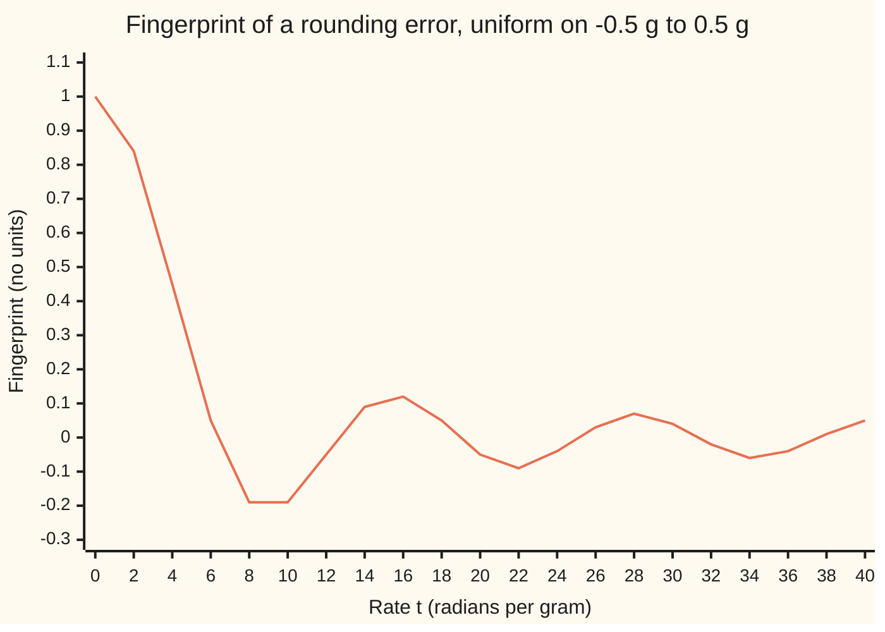
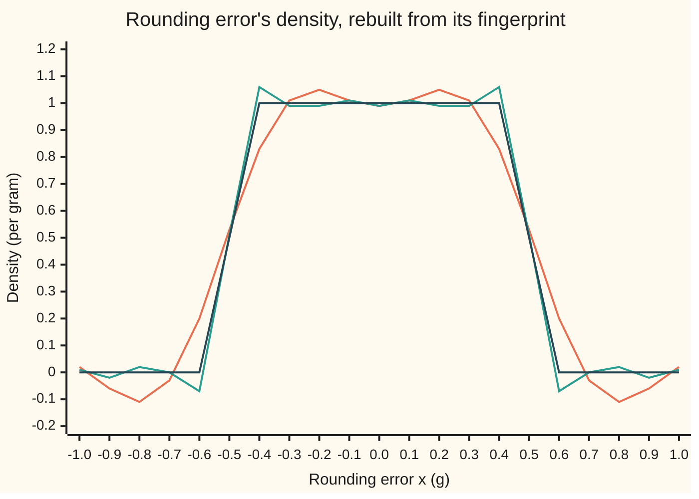

# Levy's inversion formula: getting the law back out of its fingerprint

[Syllabus](../../../SYLLABUS.md) → [Harmonic analysis](../README.md) → [Characteristic Functions and Probability](../README.md#s04) → Levy's inversion formula

---

## General Overview

A kitchen scale shows whole grams. A bag that really weighs a little under 500 g still reads 500 g. The gap between the true weight and the shown weight is the **rounding error**. For a scale like this it is spread evenly from −0.5 g to 0.5 g: a uniform law.

Its fingerprint (the characteristic function, from [Characteristic functions](01-characteristic-functions-in-depth.md)) turns the error $`U`$ into the point $`e^{itU}`$ on the unit circle, at the angle $`t`$ times $`U`$, and averages those points. Here $`t`$ is a rate in radians per gram. As $`t`$ varies, the average traces a ringing curve. It starts at 1, crosses zero at 6.283185 radians per gram, and then swings above and below zero, with swings that shrink only slowly.

Now forget the scale and keep only the curve. Can the curve alone answer a real question, such as the chance that the error is less than a quarter gram either way? The true answer is 0.5. **Lévy's inversion formula** reads it straight off the curve. With the curve cut off at 10, 40 and 160 radians per gram, the formula gives 0.511307, 0.499946 and 0.500058.

The formula works for every law: smooth, lumpy or mixed. On a fair die it still works, with one twist. A face that sits exactly on an end of the interval is counted at half its chance.

**Lévy's formula weighs the fingerprint against the interval's own fingerprint and lets the cut-off grow; the answer is the chance of the open interval plus half the chance on each end, so the fingerprint fixes the whole law.**

**What kind of fact this is:** a theorem, proved for every law on this card in Why it works. Uniqueness and the density formula follow from it in Steps 4 and 5.

### The picture: the rounding error's ringing fingerprint



The one line is the fingerprint $`\varphi_U(t) = \sin(t/2)/(t/2)`$. It is 0.454649 at 4 radians per gram. Its swings shrink only like $`2/t`$, so the area under its size never settles: the plain density formula cannot be used on it (Step 6).

---

## The formula

Notation first, in words.

- $`X`$ is any random quantity. $`U`$ is the scale's rounding error, uniform on −0.5 g to 0.5 g.
- $`\varphi_X(t) = E[e^{itX}]`$ is its fingerprint at the rate $`t`$, in radians per gram. $`E`$ is the average, and $`i`$ is the imaginary unit, whose square is −1.
- $`a < b`$ are the ends of an interval of values. $`T`$ is the cut-off: the largest rate used.
- $`F(x) = P(X \le x)`$ is the distribution function. $`F(x^-) = P(X < x)`$ is its value just to the left of $`x`$.

```math
\lim_{T\to\infty}\frac{1}{2\pi}\int_{-T}^{T}\frac{e^{-ita}-e^{-itb}}{it}\,\varphi_X(t)\,dt \;=\; P(a<X<b)+\tfrac12 P(X=a)+\tfrac12 P(X=b)
```

**Read it aloud:** weigh each rate's fingerprint by the interval's own spin-back (the factor $`(e^{-ita}-e^{-itb})/(it)`$, which turns each point of the interval back by the angle $`tx`$ and adds the results), add over rates up to the cut-off, divide by 2π, and let the cut-off grow; out comes the chance inside the interval, plus half of whatever sits on each end.

The same right side, in terms of the distribution function:

```math
\tfrac12\big[F(b)+F(b^-)\big]-\tfrac12\big[F(a)+F(a^-)\big],\qquad\text{which is } F(b)-F(a) \text{ when no probability sits on } a \text{ or } b.
```

The proof turns on one function. The **sine integral** is $`\mathrm{Si}(u) = \int_0^u \sin v / v\,dv`$, the area under $`\sin v / v`$ from 0 to $`u`$ ([The Gibbs overshoot and the cure](../01-Fourier%20Series%20in%20Depth/08-gibbs-and-summability.md) introduced it). Swapping the two integrals turns the left side, at cut-off $`T`$, into an average over the law:

```math
\frac{1}{2\pi}\int_{-T}^{T}\frac{e^{-ita}-e^{-itb}}{it}\,\varphi_X(t)\,dt = E\big[w_T(X)\big],\qquad w_T(x)=\frac{\mathrm{Si}\big(T(x-a)\big)-\mathrm{Si}\big(T(x-b)\big)}{\pi}.
```

**Read it aloud:** at each cut-off, the formula gives each possible value $`x`$ a weight $`w_T(x)`$ and averages the weights over the law.

For the rounding error and the quarter-gram interval, that average has a closed form. Write $`G(u) = \lvert u\rvert\,\mathrm{Si}(\lvert u\rvert) + \cos u - 1`$ for the area under Si from 0 to $`\lvert u\rvert`$. Then

```math
E\big[w_T(U)\big] = \frac{2\big[G(0.75\,T) - G(0.25\,T)\big]}{\pi T}.
```

| Symbol | Plain meaning | In our example | Push it up and the answer… |
| --- | --- | --- | --- |
| $`X`$, $`Y`$, $`U`$, $`U_1`$, $`U_2`$ | random quantities ($`Y`$ is a second one in Step 4); the rounding error; the errors of two separate weighings | $`U`$ uniform on −0.5 g to 0.5 g | — |
| $`x`$ | one possible value of $`X`$ | 0 g, 0.25 g, 0.5 g | — |
| $`t`$ | the rate: radians of turn per gram | 4 | the swings shrink, like $`2/t`$ |
| $`i`$, $`E`$, $`P`$ | the imaginary unit, square −1; the average; the chance of an event | $`P(-0.25 < U < 0.25) = 0.500000`$ | — |
| $`\varphi_X(t)`$ | the fingerprint: the average of $`e^{itX}`$ | $`\varphi_U(4) = 0.454649`$ | — |
| $`a`$, $`b`$ | the ends of the interval | −0.25 g and 0.25 g | wider interval, larger chance |
| $`T`$ | the cut-off: the largest rate used | 10, 40, 160 | the answer settles on the chance |
| $`\mathrm{Si}(u)`$; $`u`$, $`v`$, $`s`$, $`c`$, $`n`$ | the sine integral; spare variables inside integrals, and a whole number in Step 4 | $`\mathrm{Si}(10) = 1.658348`$ | Si settles on $`\pi/2`$ = 1.570796 |
| $`w_T(x)`$ | the weight the cut-off formula gives the value $`x`$ | $`w_{40}(0) = 1.055737`$ | tends to 1 inside, ½ on an end, 0 outside |
| $`G(u)`$ | the area under Si from 0 to $`\lvert u\rvert`$ | $`G(10) = 14.744404`$ | — |
| $`F(x)`$, $`F(x^-)`$ | the chance of a value at most $`x`$; of a value below $`x`$ | $`F(0.25) - F(-0.25) = 0.500000`$ for $`U`$ | — |
| $`f(x)`$ | a density: chance per gram near $`x`$ | 1 per gram inside, for $`U`$ | — |

### When it holds

- **Any law at all.** No density, mean or variance is needed. The die, with all its chance on six points, obeys the same formula.
- **The cut-off grows evenly, from −T to T.** For the die, the weighted fingerprint shrinks only like $`1/t`$ and has no finite area. The cosine parts cancel only between $`-t`$ and $`t`$ (Step 2), so only the even limit is promised.
- **Ends with no probability give the plain chance.** On the die with ends 2 and 5, the formula gives 0.5, not $`P(2 < X < 5)`$ = 0.333333 or $`P(2 \le X \le 5)`$ = 0.666667.
- **Uniqueness needs the fingerprint at every rate.** The formula integrates over all $`t`$. Two fingerprints that agree on a few rates prove nothing.
- **The density formula needs a fingerprint of finite area.** Without it, the cut-off integral can still converge, but it lands on the middle of every jump and rings near it (Step 6).

---

## Why it works

### Step 0: let every value cast its own vote

The fingerprint is an average over the law. The formula then integrates it over the rates. Two averages, one inside the other.

Swap their order. Then each possible value $`x`$ of $`X`$ gets one number, $`w_T(x)`$, and the formula is the average of those numbers. So the whole proof reduces to one question: what does $`w_T(x)`$ do as $`T`$ grows?

The answer comes from one curve, the sine integral. It climbs from 0 to settle at $`\pi/2`$. A difference of two such climbs gives about 1 between the ends, about ½ on each end, and about 0 outside. That is the interval's indicator (1 inside, 0 outside), with halves on the ends.

### Step 1: the interval's weight is the fingerprint of a block

The weight in the formula is an integral over the interval itself:

```math
\frac{e^{-ita}-e^{-itb}}{it} = \int_a^b e^{-itx}\,dx .
```

Each point $`e^{-itx}`$ has size 1, so the weight has size at most $`b - a`$, at every rate. At $`t = 0`$ it equals $`b - a`$: 0.5 for the quarter-gram interval.

That bound matters. On the strip of rates from −T to T, the double integral over rates and values has a finite total of at most $`2T(b-a)`$. So [Tonelli and Fubini](../../10-Measure%20and%20integration/06-Product%20Measures%20and%20Fubini/03-tonelli-and-fubini.md) allows the two integrals to swap.

### Step 2: swap, and the sine integral appears

Write the fingerprint as the average $`E[e^{itX}]`$ and move the average outside. For one value $`x`$, the inner integral is

```math
\frac{1}{2\pi}\int_{-T}^{T}\frac{e^{it(x-a)}-e^{it(x-b)}}{it}\,dt .
```

Split each point into cosine and sine. The difference of the cosine parts, divided by $`it`$, is odd in $`t`$ and bounded, so it cancels between $`-t`$ and $`t`$. The sine part is even, so it doubles on $`0`$ to $`T`$. For any real number $`c`$, the substitution $`v = tc`$ gives $`\int_0^T \sin(tc)/t\,dt = \mathrm{Si}(Tc)`$. So the inner integral is

```math
w_T(x) = \frac{\mathrm{Si}\big(T(x-a)\big)-\mathrm{Si}\big(T(x-b)\big)}{\pi},
```

and the formula at cut-off $`T`$ equals $`E[w_T(X)]`$. For the rounding error this is one ordinary integral over $`x`$ from −0.5 to 0.5. Integrating Si by parts gives the closed form with $`G`$ in The formula. The code computes both sides: 0.499946 at $`T = 40`$, either way.

### Step 3: the weights become the indicator, and stay bounded

Three facts about Si do the rest.

- **It is odd:** $`\mathrm{Si}(-u) = -\mathrm{Si}(u)`$, because $`\sin v / v`$ is even.
- **It settles on $`\pi/2`$:** $`\mathrm{Si}(200)`$ is 1.568382, and $`\pi/2`$ is 1.570796.
- **It is never larger than $`\mathrm{Si}(\pi)`$ = 1.851937,** its first peak. Each later hump of $`\sin v/v`$ is smaller than the one before, so Si stays positive for positive $`u`$ and never climbs that high again.

Now follow $`w_T(x)`$ as $`T`$ grows.

| Where $`x`$ is | First term, $`\mathrm{Si}(T(x-a))`$ | Second term, $`\mathrm{Si}(T(x-b))`$ | $`w_T(x)`$ tends to |
| --- | --- | --- | --- |
| inside, $`a < x < b`$ | $`\pi/2`$ | $`-\pi/2`$ | 1 |
| on an end, $`x = a`$ | 0 | $`-\pi/2`$ | ½ |
| on an end, $`x = b`$ | $`\pi/2`$ | 0 | ½ |
| outside | both $`\pi/2`$ or both $`-\pi/2`$ | (same) | 0 |

At $`T = 40`$ for the quarter-gram interval, $`w_{40}`$ is 1.055737 at the centre, 0.492821 on the end at 0.25 g and 0.038255 at 0.4 g, already close to 1, ½ and 0.

The weights are also bounded for every $`T`$. Si never leaves the range from $`-\mathrm{Si}(\pi)`$ to $`\mathrm{Si}(\pi)`$, so the size of $`w_T(x)`$ is never above $`2\,\mathrm{Si}(\pi)/\pi`$ = 1.178980. A constant has a finite average over any law. So dominated convergence (the rule that lets a limit pass inside an average when one integrable bound holds for every $`T`$) moves the limit inside:

```math
\lim_{T\to\infty} E\big[w_T(X)\big] = E\big[\lim_{T\to\infty} w_T(X)\big] = P(a<X<b) + \tfrac12 P(X=a) + \tfrac12 P(X=b).
```

That is Lévy's formula, for every law.

<details>
<summary>Detailed proof: why the sine integral settles on π/2</summary>

For $`v > 0`$, $`1/v = \int_0^\infty e^{-sv}\,ds`$. So

$`\displaystyle \mathrm{Si}(u) = \int_0^u \sin v\int_0^\infty e^{-sv}\,ds\,dv = \int_0^\infty\int_0^u e^{-sv}\sin v\,dv\,ds .`$

The swap is allowed: on $`0 \le v \le u`$ the integrand's size is at most $`\lvert\sin v\rvert e^{-sv}`$, whose double integral is at most $`\int_0^u \lvert\sin v\rvert/v\,dv \le u`$.

The inner integral is done by parts twice:

$`\displaystyle \int_0^u e^{-sv}\sin v\,dv = \frac{1 - e^{-su}(s\sin u + \cos u)}{1 + s^2}.`$

As $`u`$ grows, the second term on top goes to 0 for each $`s > 0`$. Its size is at most $`(1+s)e^{-su}`$, whose integral over $`s`$ is at most $`1/u + 1/u^2`$. So $`\mathrm{Si}(u)`$ tends to $`\int_0^\infty ds/(1+s^2) = \pi/2`$, with an error at most $`1/u + 1/u^2`$. The code checks the looser bound $`2/u`$ at $`u = 200`$.

</details>

### Step 4: the fingerprint fixes the law

Suppose $`X`$ and $`Y`$ have the same fingerprint. Step 3 gives them the same value of the right side for every pair of ends.

Only countably many points carry probability, meaning they can be listed one by one: at most $`n`$ points can each carry a chance of $`1/n`$ or more. Take ends $`a`$ and $`b`$ from the other points. There the right side is $`F(b) - F(a)`$, so the two distribution functions rise by the same amount between any two such points. Let $`a`$ run down to −∞: they agree at every such $`b`$. Those points are dense (some lie in every interval, however short), and a distribution function is continuous from the right, so they agree everywhere. A distribution function fixes the law.

This is the argument of Step 5 in the probability wing's [Characteristic functions](../../09-Probability%20and%20statistics/06-Limit%20Theorems%20in%20Practice/04-characteristic-functions-and-inversion.md). The measure wing's [Characteristic functions](../../10-Measure%20and%20integration/10-The%20Limit%20Theorems%2C%20Proved/06-characteristic-functions.md) proves uniqueness a second way, by blurring with a narrow normal and removing the blur.

### Step 5: a density, when the fingerprint has finite area

If $`\int \lvert\varphi_X(t)\rvert\,dt`$ is finite, then

```math
f(x) = \frac{1}{2\pi}\int_{-\infty}^{\infty} e^{-itx}\,\varphi_X(t)\,dt
```

is a continuous density of $`X`$. The probability wing proved this by a narrow normal blur. From Lévy's formula it takes two lines.

<details>
<summary>Detailed proof: the density from Lévy's formula</summary>

The integrand in Lévy's formula has size at most $`(b-a)\lvert\varphi_X(t)\rvert`$, which has finite area. So the limit in $`T`$ is just the integral over all rates, and Fubini's theorem on rates times the interval from $`a`$ to $`b`$ gives

$`\displaystyle P(a<X<b)+\tfrac12 P(X=a)+\tfrac12 P(X=b) = \frac{1}{2\pi}\int_{-\infty}^{\infty}\varphi_X(t)\int_a^b e^{-itx}\,dx\,dt = \int_a^b f(x)\,dx .`$

The function $`f`$ is continuous, by dominated convergence with the bound $`\lvert\varphi_X\rvert`$, so it is bounded on any interval. Let $`b`$ fall to $`a`$ through points that carry no probability. The right side goes to 0 and the left side goes to $`\tfrac12 P(X=a)`$. So no point carries probability, and $`F(b) - F(a) = \int_a^b f(x)\,dx`$ for all $`a < b`$: $`f`$ is a density.

</details>

The example is the error of a weight found by subtraction. A cook weighs a full bowl, then the empty bowl, and subtracts. Each reading carries its own rounding error, so the result is off by $`U_1 - U_2`$. That error has a triangle law on −1 g to 1 g, with density 1 per gram at 0 and 0.5 per gram at 0.5 g.

Its fingerprint is $`\varphi_U(t)^2`$, since the rounding fingerprint is real and even. Its size is at most $`4/t^2`$, so its area is finite. The integral beyond the cut-off is at most $`4/(\pi T)`$.

| Cut-off $`T`$ | Density at 0 g | Density at 0.5 g | Tail bound $`4/(\pi T)`$ |
| --- | --- | --- | --- |
| 50 | 0.987344 | 0.499982 | 0.025465 |
| 200 | 0.996831 | 0.499997 | 0.006366 |

Each value sits within its bound of the truth.

### Step 6: the ringing fingerprint rings back

The rounding error itself fails Step 5's test: the area under $`\lvert\varphi_U\rvert`$ from −T to T keeps growing, like the logarithm of $`T`$. The cut-off density integral still converges at each point $`x`$, though not evenly over $`x`$. Swap the integrals as in Step 2: at the value $`x`$ it equals $`(\mathrm{Si}(T(x+0.5)) - \mathrm{Si}(T(x-0.5)))/\pi`$. That is Step 2's weight for the interval from −0.5 g to 0.5 g, read at $`x`$.

So the reconstruction tends to 1 inside, 0 outside and ½ on the two edges. Near each edge it overshoots. The peak sits near $`x = 0.5 - \pi/T`$, where the second sine integral is at its own peak, and its height heads to $`\tfrac12 + \mathrm{Si}(\pi)/\pi`$ = 1.089490, not to 1: the Gibbs overshoot.

| Cut-off $`T`$ | At 0 g | At 0.25 g | At the edge, 0.5 g | Peak near the edge | Area under $`\lvert\varphi_U\rvert`$ from $`-T`$ to $`T`$, divided by 2π |
| --- | --- | --- | --- | --- | --- |
| 10 | 0.986717 | 1.046985 | 0.527868 | 1.048591 | 1.371243 |
| 40 | 0.985641 | 1.026583 | 0.505153 | 1.083912 | 1.918056 |
| 160 | 1.000977 | 1.002981 | 0.501938 | 1.087513 | 2.484150 |



Orange: cut-off 10. Green: cut-off 40. Dark: the true density, drawn at ½ on the two edges, where the reconstruction lands. A higher cut-off sharpens the edges but keeps the ripples. The ripples are the ringing of the fingerprint, sent back.

---

## Worked numbers, by hand

The rounding error $`U`$, ends $`a = -0.25`$ g and $`b = 0.25`$ g, cut-off $`T = 40`$. The closed form needs $`G`$ at $`0.75 \times 40 = 30`$ and $`0.25 \times 40 = 10`$.

| Step | Arithmetic | Value |
| --- | --- | --- |
| $`\mathrm{Si}(10)`$ | area under $`\sin v / v`$ from 0 to 10 | 1.658348 |
| $`\mathrm{Si}(30)`$ | area under $`\sin v / v`$ from 0 to 30 | 1.566757 |
| $`G(10)`$ | $`10 \times 1.658348 + \cos 10 - 1`$ | 14.744404 |
| $`G(30)`$ | $`30 \times 1.566757 + \cos 30 - 1`$ | 46.156948 |
| Lévy's integral at $`T = 40`$ | $`2 \times (46.156948 - 14.744404) / (40\pi)`$ | **0.499946** |
| the chance itself | length of the interval, $`0.25 - (-0.25)`$, times density 1 | 0.500000 |

From the fingerprint alone, the chance that the scale's rounding error is under a quarter gram either way comes out as 0.499946 at cut-off 40. The truth is one half, and the gap shrinks as the cut-off grows.

The die, with ends 2 and 5 on two faces:

| Step | Arithmetic | Value |
| --- | --- | --- |
| chance strictly inside | faces 3 and 4, $`2 \times 1/6`$ | 0.333333 |
| half the ends | $`\tfrac12 \times (1/6 + 1/6)`$ | 0.166667 |
| Lévy's limit | $`0.333333 + 0.166667`$ | **0.5** |
| Lévy's integral at $`T`$ = 10, 40, 160, 640 | from the die's fingerprint | 0.498896, 0.500085, 0.499770, 0.500104 |

### What breaks if you drop a piece

| Mistake | Comes out at | What went wrong |
| --- | --- | --- |
| Ends placed on faces of the die, 2 and 5 | 0.499770 at $`T = 160`$, read as $`P(2 < X < 5)`$ = 0.333333 | Each end carries 1/6, and the formula counts half of it |
| Density formula used on the rounding error's own fingerprint | 0.501938 at the edge and a peak of 1.087513 near it, at $`T = 160`$ | The fingerprint has no finite area: the integral lands on mid-jump and rings |
| The $`1/(2\pi)`$ dropped | 3.141959 for a chance of 0.5 | Every answer is 2π times too big |
| Sign of the spin-back flipped, die, ends 2.5 and 4.5 | −0.000003 instead of 0.333333 | It recovers the law of $`-X`$, which never lands between 2.5 and 4.5 |

---

## Code, from first principles, and it actually runs

The scripts import only sine, cosine and π. Every integral is Simpson's rule written out (thin strips topped by parabolas), and so is the sine integral. Lévy's integral is reached by **two independent roads** at every cut-off: the integral over rates, and the weight $`w_T`$ averaged over the law, which is the closed form with $`G`$ for the rounding error and a six-term sum for the die. Both are checked against the **chance counted directly**: the interval's length, or the faces inside it. The sine integral itself is computed twice, by Simpson's rule and by its power series, and so is $`G`$: by its closed form and as Simpson's area under Si. The density recovery is checked against the triangle law with a printed tail bound.

### Python

```python
# Levy's inversion formula -- the check behind the card.
# Standard library only: math supplies sin, cos and pi, nothing more.  Every
# integral is Simpson's rule written out, and so is the sine integral Si.
from math import sin, cos, pi

def simpson(f, a, b, n):           # n even: weights 1, 4, 2, 4, ..., 4, 1
    h = (b - a) / n
    s = f(a) + f(b)
    for k in range(1, n):
        s += (4 if k % 2 else 2) * f(a + k * h)
    return s * h / 3

def sinc(v):
    return 1.0 if v == 0 else sin(v) / v

def Si(u):                         # sine integral: area under sin(v)/v, 0 to u
    return simpson(sinc, 0.0, u, 2 * int(20 * abs(u) + 50))

def Si_series(u):                  # second road: u - u^3/(3*3!) + u^5/(5*5!) - ...
    term, s = u, 0.0
    for k in range(40):
        s += term / (2 * k + 1)
        term *= -u * u / ((2 * k + 2) * (2 * k + 3))
    return s

def G(u):                          # area under Si from 0 to |u|
    u = abs(u)
    return u * Si(u) + cos(u) - 1

def phi_U(t):                      # rounding error, uniform on [-0.5, 0.5] g
    return (sinc(t / 2), 0.0)

def phi_die(t):                    # one fair die: (1/6)(e^{it} + ... + e^{6it})
    return (sum(cos(k * t) for k in range(1, 7)) / 6,
            sum(sin(k * t) for k in range(1, 7)) / 6)

def levy(phi, a, b, T, flip=1.0):  # road 1: (1/2pi) int_{-T}^{T} weight * phi dt
    def g(t):
        if t == 0:
            return b - a
        re, im = phi(t)
        wr = (sin(t * b) - sin(t * a)) / t
        wi = (cos(t * b) - cos(t * a)) / t
        return wr * re - wi * flip * im
    return simpson(g, 0.0, T, 2 * int(50 * T + 100)) / pi

def kernel(x, a, b, T):            # what the cut-off formula does to one value x
    return (Si(T * (x - a)) - Si(T * (x - b))) / pi

def fubini_U(a, b, T):             # road 2: average of the kernel over U, exact
    return (G(T * (0.5 - a)) - G(T * (-0.5 - a))
            - G(T * (0.5 - b)) + G(T * (-0.5 - b))) / (pi * T)

def fubini_die(a, b, T):           # road 2 for the die: six faces, 1/6 each
    return sum(kernel(k, a, b, T) for k in range(1, 7)) / 6

def dens(phi, x, T):               # (1/2pi) int_{-T}^{T} e^{-itx} phi(t) dt
    return simpson(lambda t: phi(t)[0] * cos(t * x) + phi(t)[1] * sin(t * x),
                   0.0, T, 2 * int(50 * T + 100)) / pi

def f6(v):
    return f"{v:.6f}"

print("fingerprint of U: phi_U(4) =", f6(phi_U(4)[0]), " first zero at 2 pi =", f6(2 * pi))
print("chart, t     ", " ".join(f"{t:5d}" for t in range(0, 41, 2)))
print("chart, phi_U ", " ".join(f"{phi_U(t)[0]:5.2f}" for t in range(0, 41, 2)))
print("Si(pi) by Simpson", f6(Si(pi)), "by series", f6(Si_series(pi)), " Si(200) =", f6(Si(200)), " pi/2 =", f6(pi / 2))
assert abs(Si(pi) - Si_series(pi)) < 1e-9          # two roads to Si
assert abs(Si(200) - pi / 2) < 2 / 200              # Si settles on pi/2

a, b = -0.25, 0.25                                  # the error under a quarter gram
exact = b - a                                       # uniform: chance = length
print(f"U, a = {a} g, b = {b} g, exact chance by length {f6(exact)}")
print("    T   integral over t   kernel averaged over U")
for T in (10, 40, 160):
    r1, r2 = levy(phi_U, a, b, T), fubini_U(a, b, T)
    print(f"{T:5d}   {f6(r1)}          {f6(r2)}")
    assert abs(r1 - r2) < 1e-8                      # Fubini: both orders agree
assert abs(levy(phi_U, a, b, 160) - exact) < 1e-3   # the limit is the chance
print("hand: Si(10) =", f6(Si(10)), " Si(30) =", f6(Si(30)), " G(10) =", f6(G(10)),
      " G(30) =", f6(G(30)), " 2(G(30) - G(10))/(40 pi) =", f6(2 * (G(30) - G(10)) / (40 * pi)))
for u in (10, 30):                                  # G against its definition: area under Si
    assert abs(G(u) - simpson(Si, 0.0, u, 20 * u)) < 1e-6
print("kernel at T = 40: x = 0:", f6(kernel(0, a, b, 40)), " x = 0.25:", f6(kernel(0.25, a, b, 40)),
      " x = 0.4:", f6(kernel(0.4, a, b, 40)), " ceiling 2 Si(pi)/pi =", f6(2 * Si(pi) / pi))
assert max(abs(kernel(k / 100, a, b, 40)) for k in range(-100, 101)) <= 2 * Si(pi) / pi

pf = [1 / 6] * 6                                    # the die, counted
for (a, b) in ((2, 5), (2.5, 4.5)):
    inside = sum(p for k, p in zip(range(1, 7), pf) if a < k < b)
    ends = sum(p for k, p in zip(range(1, 7), pf) if k in (a, b))
    vals = [levy(phi_die, a, b, T) for T in (10, 40, 160, 640)]
    print(f"die, a = {a}, b = {b}: T = 10, 40, 160, 640:", " ".join(f6(v) for v in vals),
          f" counted: inside {f6(inside)}, half the ends {f6(ends / 2)}")
    for T, v in zip((10, 40, 160, 640), vals):      # Fubini at every cut-off
        assert abs(v - fubini_die(a, b, T)) < 1e-8
    assert abs(vals[-1] - (inside + ends / 2)) < 1e-3
print("die, a = 2, b = 5: chance with both ends", f6(4 / 6))

print("density of U by the cut-off integral (true: 1 inside, 0 outside)")
print("  peak: at x = 0.5 - pi/T;  abs area: (1/2pi) int_{-T}^{T} |phi_U(t)| dt")
print("    T     x = 0  x = 0.25  edge 0.5      peak  abs area")
for T in (10, 40, 160):
    row = [dens(phi_U, x, T) for x in (0, 0.25, 0.5, 0.5 - pi / T)]
    row.append(simpson(lambda t: abs(phi_U(t)[0]), 0, T, 20000) / pi)
    print(f"{T:5d}  " + "  ".join(f6(v) for v in row))
assert abs(dens(phi_U, 0.5, 160) - kernel(0.5, -0.5, 0.5, 160)) < 1e-8
print("peak limit 1/2 + Si(pi)/pi =", f6(0.5 + Si(pi) / pi))
xs = [k / 10 - 1 for k in range(21)]
print("chart, x      ", " ".join(f"{x:5.1f}" for x in xs))
print("chart, gate   ", " ".join(f"{(1.0 if abs(x) < 0.5 else 0.5 if abs(x) == 0.5 else 0.0):5.2f}" for x in xs))
for T in (10, 40):
    print(f"chart, T = {T:2d}", " ".join(f"{dens(phi_U, x, T):5.2f}" for x in xs))

sq = lambda t: (phi_U(t)[0] ** 2, 0.0)              # error of gross minus tare
print("U1 - U2, triangle on [-1, 1] g: true density 1 at 0, 0.5 at 0.5")
for T in (50, 200):
    d0, d5, tail = dens(sq, 0, T), dens(sq, 0.5, T), 4 / (pi * T)
    print(f"  T = {T:3d}: x = 0: {f6(d0)}  x = 0.5: {f6(d5)}  tail bound 4/(pi T) = {f6(tail)}")
    assert abs(d0 - 1) <= tail                      # inside the tail bound
    assert abs(d5 - 0.5) <= tail

print("mistake, no 1/(2 pi), U, T = 160:", f6(2 * pi * levy(phi_U, -0.25, 0.25, 160)))
fl = levy(phi_die, 2.5, 4.5, 160, flip=-1.0)
print("mistake, spin-back sign flipped, die, a = 2.5, b = 4.5, T = 160:", f6(fl))
assert abs(fl) < 1e-3                               # recovers -X: chance 0
print("ALL CHECKS PASS")
```

**Ran 2026-11-15 on macOS, Python 3.14.10, standard library only. All checks passed. Output, pasted from the run:**

```text
fingerprint of U: phi_U(4) = 0.454649  first zero at 2 pi = 6.283185
chart, t          0     2     4     6     8    10    12    14    16    18    20    22    24    26    28    30    32    34    36    38    40
chart, phi_U   1.00  0.84  0.45  0.05 -0.19 -0.19 -0.05  0.09  0.12  0.05 -0.05 -0.09 -0.04  0.03  0.07  0.04 -0.02 -0.06 -0.04  0.01  0.05
Si(pi) by Simpson 1.851937 by series 1.851937  Si(200) = 1.568382  pi/2 = 1.570796
U, a = -0.25 g, b = 0.25 g, exact chance by length 0.500000
    T   integral over t   kernel averaged over U
   10   0.511307          0.511307
   40   0.499946          0.499946
  160   0.500058          0.500058
hand: Si(10) = 1.658348  Si(30) = 1.566757  G(10) = 14.744404  G(30) = 46.156948  2(G(30) - G(10))/(40 pi) = 0.499946
kernel at T = 40: x = 0: 1.055737  x = 0.25: 0.492821  x = 0.4: 0.038255  ceiling 2 Si(pi)/pi = 1.178980
die, a = 2, b = 5: T = 10, 40, 160, 640: 0.498896 0.500085 0.499770 0.500104  counted: inside 0.333333, half the ends 0.166667
die, a = 2.5, b = 4.5: T = 10, 40, 160, 640: 0.331934 0.332569 0.333341 0.333420  counted: inside 0.333333, half the ends 0.000000
die, a = 2, b = 5: chance with both ends 0.666667
density of U by the cut-off integral (true: 1 inside, 0 outside)
  peak: at x = 0.5 - pi/T;  abs area: (1/2pi) int_{-T}^{T} |phi_U(t)| dt
    T     x = 0  x = 0.25  edge 0.5      peak  abs area
   10  0.986717  1.046985  0.527868  1.048591  1.371243
   40  0.985641  1.026583  0.505153  1.083912  1.918056
  160  1.000977  1.002981  0.501938  1.087513  2.484150
peak limit 1/2 + Si(pi)/pi = 1.089490
chart, x        -1.0  -0.9  -0.8  -0.7  -0.6  -0.5  -0.4  -0.3  -0.2  -0.1   0.0   0.1   0.2   0.3   0.4   0.5   0.6   0.7   0.8   0.9   1.0
chart, gate     0.00  0.00  0.00  0.00  0.00  0.50  1.00  1.00  1.00  1.00  1.00  1.00  1.00  1.00  1.00  0.50  0.00  0.00  0.00  0.00  0.00
chart, T = 10  0.02 -0.06 -0.11 -0.03  0.20  0.53  0.83  1.01  1.05  1.01  0.99  1.01  1.05  1.01  0.83  0.53  0.20 -0.03 -0.11 -0.06  0.02
chart, T = 40  0.01 -0.02  0.02  0.00 -0.07  0.51  1.06  0.99  0.99  1.01  0.99  1.01  0.99  0.99  1.06  0.51 -0.07  0.00  0.02 -0.02  0.01
U1 - U2, triangle on [-1, 1] g: true density 1 at 0, 0.5 at 0.5
  T =  50: x = 0: 0.987344  x = 0.5: 0.499982  tail bound 4/(pi T) = 0.025465
  T = 200: x = 0: 0.996831  x = 0.5: 0.499997  tail bound 4/(pi T) = 0.006366
mistake, no 1/(2 pi), U, T = 160: 3.141959
mistake, spin-back sign flipped, die, a = 2.5, b = 4.5, T = 160: -0.000003
ALL CHECKS PASS
```

### Rust

The same checks with the same inputs. The fingerprint is a small struct with real and imaginary parts.

```rust
// Levy's inversion formula -- the same check as levy_inversion_and_uniqueness_check.py.
// Standard library only, no crates.  Every integral is Simpson's rule written
// out, and so is the sine integral Si.  A complex number is a small struct.
use std::f64::consts::PI;

#[derive(Clone, Copy)]
struct C { re: f64, im: f64 }

fn simpson(f: &dyn Fn(f64) -> f64, a: f64, b: f64, n: i64) -> f64 {
    let h = (b - a) / n as f64;
    let mut s = f(a) + f(b);
    for k in 1..n {
        s += (if k % 2 == 1 { 4.0 } else { 2.0 }) * f(a + k as f64 * h);
    }
    s * h / 3.0
}

fn sinc(v: f64) -> f64 { if v == 0.0 { 1.0 } else { v.sin() / v } }

fn si(u: f64) -> f64 { simpson(&sinc, 0.0, u, 2 * (20.0 * u.abs() + 50.0) as i64) }

fn si_series(u: f64) -> f64 {
    let (mut term, mut s) = (u, 0.0);
    for k in 0..40 {
        s += term / (2 * k + 1) as f64;
        term *= -u * u / ((2 * k + 2) * (2 * k + 3)) as f64;
    }
    s
}

fn gg(u: f64) -> f64 { let u = u.abs(); u * si(u) + u.cos() - 1.0 }   // G: area under Si, 0 to |u|

fn phi_u(t: f64) -> C { C { re: sinc(t / 2.0), im: 0.0 } }

fn phi_die(t: f64) -> C {
    let (mut re, mut im) = (0.0, 0.0);
    for k in 1..7 { re += (k as f64 * t).cos(); im += (k as f64 * t).sin(); }
    C { re: re / 6.0, im: im / 6.0 }
}

fn levy(phi: &dyn Fn(f64) -> C, a: f64, b: f64, t_cut: f64, flip: f64) -> f64 {
    let g = |t: f64| -> f64 {
        if t == 0.0 { return b - a; }
        let p = phi(t);
        let wr = ((t * b).sin() - (t * a).sin()) / t;
        let wi = ((t * b).cos() - (t * a).cos()) / t;
        wr * p.re - wi * flip * p.im
    };
    simpson(&g, 0.0, t_cut, 2 * (50.0 * t_cut + 100.0) as i64) / PI
}

fn kernel(x: f64, a: f64, b: f64, t: f64) -> f64 { (si(t * (x - a)) - si(t * (x - b))) / PI }

fn fubini_u(a: f64, b: f64, t: f64) -> f64 {
    (gg(t * (0.5 - a)) - gg(t * (-0.5 - a)) - gg(t * (0.5 - b)) + gg(t * (-0.5 - b))) / (PI * t)
}

fn fubini_die(a: f64, b: f64, t: f64) -> f64 {
    let mut s = 0.0;
    for k in 1..7 { s += kernel(k as f64, a, b, t); }
    s / 6.0
}

fn dens(phi: &dyn Fn(f64) -> C, x: f64, t_cut: f64) -> f64 {
    let g = |t: f64| phi(t).re * (t * x).cos() + phi(t).im * (t * x).sin();
    simpson(&g, 0.0, t_cut, 2 * (50.0 * t_cut + 100.0) as i64) / PI
}

fn f6(v: f64) -> String { format!("{:.6}", v) }

fn main() {
    let ts: Vec<i64> = (0..21).map(|k| 2 * k).collect();
    println!("fingerprint of U: phi_U(4) = {}  first zero at 2 pi = {}", f6(phi_u(4.0).re), f6(2.0 * PI));
    println!("chart, t      {}", ts.iter().map(|t| format!("{:5}", t)).collect::<Vec<_>>().join(" "));
    println!("chart, phi_U  {}", ts.iter().map(|&t| format!("{:5.2}", phi_u(t as f64).re)).collect::<Vec<_>>().join(" "));
    println!("Si(pi) by Simpson {} by series {}  Si(200) = {}  pi/2 = {}", f6(si(PI)), f6(si_series(PI)), f6(si(200.0)), f6(PI / 2.0));
    assert!((si(PI) - si_series(PI)).abs() < 1e-9);
    assert!((si(200.0) - PI / 2.0).abs() < 2.0 / 200.0);

    let (a, b) = (-0.25, 0.25);
    let exact = b - a;
    println!("U, a = {} g, b = {} g, exact chance by length {}", a, b, f6(exact));
    println!("    T   integral over t   kernel averaged over U");
    for t in [10.0, 40.0, 160.0] {
        let (r1, r2) = (levy(&phi_u, a, b, t, 1.0), fubini_u(a, b, t));
        println!("{:5}   {}          {}", t as i64, f6(r1), f6(r2));
        assert!((r1 - r2).abs() < 1e-8);
    }
    assert!((levy(&phi_u, a, b, 160.0, 1.0) - exact).abs() < 1e-3);
    println!("hand: Si(10) = {}  Si(30) = {}  G(10) = {}  G(30) = {}  2(G(30) - G(10))/(40 pi) = {}",
             f6(si(10.0)), f6(si(30.0)), f6(gg(10.0)), f6(gg(30.0)), f6(2.0 * (gg(30.0) - gg(10.0)) / (40.0 * PI)));
    for u in [10.0, 30.0] { assert!((gg(u) - simpson(&si, 0.0, u, (20.0 * u) as i64)).abs() < 1e-6); }
    println!("kernel at T = 40: x = 0: {}  x = 0.25: {}  x = 0.4: {}  ceiling 2 Si(pi)/pi = {}",
             f6(kernel(0.0, a, b, 40.0)), f6(kernel(0.25, a, b, 40.0)), f6(kernel(0.4, a, b, 40.0)), f6(2.0 * si(PI) / PI));
    let kmax = (-100..101).map(|k| kernel(k as f64 / 100.0, a, b, 40.0).abs()).fold(0.0, f64::max);
    assert!(kmax <= 2.0 * si(PI) / PI);

    let pf = [1.0 / 6.0; 6];
    for (a, b) in [(2.0, 5.0), (2.5, 4.5)] {
        let (mut inside, mut ends) = (0.0, 0.0);
        for k in 1..7 {
            let x = k as f64;
            if a < x && x < b { inside += pf[k - 1]; }
            if x == a || x == b { ends += pf[k - 1]; }
        }
        let vals: Vec<f64> = [10.0, 40.0, 160.0, 640.0].iter().map(|&t| levy(&phi_die, a, b, t, 1.0)).collect();
        println!("die, a = {}, b = {}: T = 10, 40, 160, 640: {}  counted: inside {}, half the ends {}", a, b,
                 vals.iter().map(|&v| f6(v)).collect::<Vec<_>>().join(" "), f6(inside), f6(ends / 2.0));
        for (i, t) in [10.0, 40.0, 160.0, 640.0].into_iter().enumerate() {
            assert!((vals[i] - fubini_die(a, b, t)).abs() < 1e-8);
        }
        assert!((vals[3] - (inside + ends / 2.0)).abs() < 1e-3);
    }
    println!("die, a = 2, b = 5: chance with both ends {}", f6(4.0 / 6.0));

    println!("density of U by the cut-off integral (true: 1 inside, 0 outside)");
    println!("  peak: at x = 0.5 - pi/T;  abs area: (1/2pi) int_{{-T}}^{{T}} |phi_U(t)| dt");
    println!("    T     x = 0  x = 0.25  edge 0.5      peak  abs area");
    for t in [10.0, 40.0, 160.0] {
        let mut row: Vec<f64> = [0.0, 0.25, 0.5, 0.5 - PI / t].iter().map(|&x| dens(&phi_u, x, t)).collect();
        row.push(simpson(&|s: f64| phi_u(s).re.abs(), 0.0, t, 20000) / PI);
        println!("{:5}  {}", t as i64, row.iter().map(|&v| f6(v)).collect::<Vec<_>>().join("  "));
    }
    assert!((dens(&phi_u, 0.5, 160.0) - kernel(0.5, -0.5, 0.5, 160.0)).abs() < 1e-8);
    println!("peak limit 1/2 + Si(pi)/pi = {}", f6(0.5 + si(PI) / PI));
    let xs: Vec<f64> = (0..21).map(|k| k as f64 / 10.0 - 1.0).collect();
    println!("chart, x       {}", xs.iter().map(|x| format!("{:5.1}", x)).collect::<Vec<_>>().join(" "));
    let gate = |x: f64| if x.abs() < 0.5 { 1.0 } else if x.abs() == 0.5 { 0.5 } else { 0.0 };
    println!("chart, gate    {}", xs.iter().map(|&x| format!("{:5.2}", gate(x))).collect::<Vec<_>>().join(" "));
    for t in [10.0, 40.0] {
        println!("chart, T = {:2} {}", t as i64, xs.iter().map(|&x| format!("{:5.2}", dens(&phi_u, x, t))).collect::<Vec<_>>().join(" "));
    }

    let sq = |t: f64| { let p = phi_u(t).re; C { re: p * p, im: 0.0 } };
    println!("U1 - U2, triangle on [-1, 1] g: true density 1 at 0, 0.5 at 0.5");
    for t in [50.0, 200.0] {
        let (d0, d5, tail) = (dens(&sq, 0.0, t), dens(&sq, 0.5, t), 4.0 / (PI * t));
        println!("  T = {:3}: x = 0: {}  x = 0.5: {}  tail bound 4/(pi T) = {}", t as i64, f6(d0), f6(d5), f6(tail));
        assert!((d0 - 1.0).abs() <= tail);
        assert!((d5 - 0.5).abs() <= tail);
    }

    println!("mistake, no 1/(2 pi), U, T = 160: {}", f6(2.0 * PI * levy(&phi_u, -0.25, 0.25, 160.0, 1.0)));
    let fl = levy(&phi_die, 2.5, 4.5, 160.0, -1.0);
    println!("mistake, spin-back sign flipped, die, a = 2.5, b = 4.5, T = 160: {}", f6(fl));
    assert!(fl.abs() < 1e-3);
    println!("ALL CHECKS PASS");
}
```

**Ran 2026-11-15 on macOS, rustc 1.98.1, no crates. All checks passed. Output, pasted from the run:**

```text
fingerprint of U: phi_U(4) = 0.454649  first zero at 2 pi = 6.283185
chart, t          0     2     4     6     8    10    12    14    16    18    20    22    24    26    28    30    32    34    36    38    40
chart, phi_U   1.00  0.84  0.45  0.05 -0.19 -0.19 -0.05  0.09  0.12  0.05 -0.05 -0.09 -0.04  0.03  0.07  0.04 -0.02 -0.06 -0.04  0.01  0.05
Si(pi) by Simpson 1.851937 by series 1.851937  Si(200) = 1.568382  pi/2 = 1.570796
U, a = -0.25 g, b = 0.25 g, exact chance by length 0.500000
    T   integral over t   kernel averaged over U
   10   0.511307          0.511307
   40   0.499946          0.499946
  160   0.500058          0.500058
hand: Si(10) = 1.658348  Si(30) = 1.566757  G(10) = 14.744404  G(30) = 46.156948  2(G(30) - G(10))/(40 pi) = 0.499946
kernel at T = 40: x = 0: 1.055737  x = 0.25: 0.492821  x = 0.4: 0.038255  ceiling 2 Si(pi)/pi = 1.178980
die, a = 2, b = 5: T = 10, 40, 160, 640: 0.498896 0.500085 0.499770 0.500104  counted: inside 0.333333, half the ends 0.166667
die, a = 2.5, b = 4.5: T = 10, 40, 160, 640: 0.331934 0.332569 0.333341 0.333420  counted: inside 0.333333, half the ends 0.000000
die, a = 2, b = 5: chance with both ends 0.666667
density of U by the cut-off integral (true: 1 inside, 0 outside)
  peak: at x = 0.5 - pi/T;  abs area: (1/2pi) int_{-T}^{T} |phi_U(t)| dt
    T     x = 0  x = 0.25  edge 0.5      peak  abs area
   10  0.986717  1.046985  0.527868  1.048591  1.371243
   40  0.985641  1.026583  0.505153  1.083912  1.918056
  160  1.000977  1.002981  0.501938  1.087513  2.484150
peak limit 1/2 + Si(pi)/pi = 1.089490
chart, x        -1.0  -0.9  -0.8  -0.7  -0.6  -0.5  -0.4  -0.3  -0.2  -0.1   0.0   0.1   0.2   0.3   0.4   0.5   0.6   0.7   0.8   0.9   1.0
chart, gate     0.00  0.00  0.00  0.00  0.00  0.50  1.00  1.00  1.00  1.00  1.00  1.00  1.00  1.00  1.00  0.50  0.00  0.00  0.00  0.00  0.00
chart, T = 10  0.02 -0.06 -0.11 -0.03  0.20  0.53  0.83  1.01  1.05  1.01  0.99  1.01  1.05  1.01  0.83  0.53  0.20 -0.03 -0.11 -0.06  0.02
chart, T = 40  0.01 -0.02  0.02  0.00 -0.07  0.51  1.06  0.99  0.99  1.01  0.99  1.01  0.99  0.99  1.06  0.51 -0.07  0.00  0.02 -0.02  0.01
U1 - U2, triangle on [-1, 1] g: true density 1 at 0, 0.5 at 0.5
  T =  50: x = 0: 0.987344  x = 0.5: 0.499982  tail bound 4/(pi T) = 0.025465
  T = 200: x = 0: 0.996831  x = 0.5: 0.499997  tail bound 4/(pi T) = 0.006366
mistake, no 1/(2 pi), U, T = 160: 3.141959
mistake, spin-back sign flipped, die, a = 2.5, b = 4.5, T = 160: -0.000003
ALL CHECKS PASS
```

### Lean

Lean proves the card's three theorems for every law: Lévy's formula, uniqueness and the density formula.

- Take any law and ends $`a < b`$. Then the cut-off integral tends to the chance of the open interval, plus half the chance on each end, as $`T`$ grows.
- Suppose two laws have the same fingerprint at every rate $`t`$. Then they are the same law.
- Suppose the fingerprint has finite area. Then Step 5's $`f`$ is continuous, and $`F(b) - F(a)`$ is the area under $`f`$ from $`a`$ to $`b`$.
- Lean also checks the worked arithmetic, such as the die's limit of 0.5 with ends 2 and 5.

The cut-off values, the Si numbers, the ringing near the edges and every decimal are left to the Python and Rust checks.

```lean
-- Levy's inversion formula: for every probability law on the real line, the cut-off integral of the fingerprint against the interval's spin-back tends to the chance of the open interval plus half the chance on each end, so the fingerprint fixes the law, and a fingerprint of finite area gives a continuous density.
import Mathlib.MeasureTheory.Measure.CharacteristicFunction.Basic
import Mathlib.MeasureTheory.Integral.IntervalIntegral.Basic
import Mathlib.Analysis.SpecialFunctions.ImproperIntegrals
import Mathlib.Analysis.SpecialFunctions.Trigonometric.Sinc
import Mathlib.MeasureTheory.Integral.Prod
import Mathlib.MeasureTheory.Integral.IntervalIntegral.FundThmCalculus
import Mathlib.Analysis.SpecialFunctions.Integrals.Basic
import Mathlib.MeasureTheory.Integral.ExpDecay
import Mathlib.MeasureTheory.Integral.IntegralEqImproper

open MeasureTheory Filter Topology Complex Set

lemma levyInv_dir_inner_exp (x : ℝ) (hx : 0 < x) :
    (∫ t in Set.Ioi (0 : ℝ), Real.exp (-x * t)) = 1 / x := by
  rw [integral_exp_mul_Ioi (by linarith) 0]
  simp


#print axioms levyInv_dir_inner_exp

lemma levyInv_dir_inner_sin (R t : ℝ) :
    (∫ x in (0 : ℝ)..R, Real.sin x * Real.exp (-x * t)) =
      (1 - Real.exp (-R * t) * (t * Real.sin R + Real.cos R)) / (1 + t ^ 2) := by
  have ht : (1 + t ^ 2) ≠ 0 := by positivity
  rw [intervalIntegral.integral_eq_sub_of_hasDerivAt
    (f := fun x : ℝ => -(Real.exp (-x * t) * (t * Real.sin x + Real.cos x)) / (1 + t ^ 2))]
  · simp only [neg_zero, zero_mul, Real.exp_zero, Real.sin_zero, Real.cos_zero, mul_zero,
      zero_add, one_mul]
    field_simp
    ring
  · intro x _
    have h1 := (((hasDerivAt_id' x).neg.mul_const t).exp)
    have h2 := ((Real.hasDerivAt_sin x).const_mul t).add (Real.hasDerivAt_cos x)
    have hd := ((h1.mul h2).neg).div_const (1 + t ^ 2)
    convert hd using 1
    simp only [Pi.neg_apply, Pi.add_apply]
    field_simp
    ring
  · exact (by fun_prop : Continuous fun x : ℝ => Real.sin x * Real.exp (-x * t)).intervalIntegrable _ _


#print axioms levyInv_dir_inner_sin

lemma levyInv_dir_integrable (R : ℝ) :
    Integrable (Function.uncurry fun x t : ℝ => Real.sin x * Real.exp (-x * t))
      ((volume.restrict (Set.Ioc (0 : ℝ) R)).prod (volume.restrict (Set.Ioi (0 : ℝ)))) := by
  have hc : Continuous (Function.uncurry fun x t : ℝ => Real.sin x * Real.exp (-x * t)) := by
    show Continuous (fun p : ℝ × ℝ => Real.sin p.1 * Real.exp (-p.1 * p.2))
    fun_prop
  refine (integrable_prod_iff hc.aestronglyMeasurable).mpr ⟨?_, ?_⟩
  · filter_upwards [ae_restrict_mem measurableSet_Ioc] with x hx
    exact (exp_neg_integrableOn_Ioi 0 hx.1).const_mul (Real.sin x)
  · have hint : Integrable (fun x : ℝ => |Real.sinc x|) (volume.restrict (Set.Ioc (0 : ℝ) R)) :=
      Continuous.integrableOn_Ioc (by fun_prop)
    refine hint.congr ?_
    filter_upwards [ae_restrict_mem measurableSet_Ioc] with x hx
    have hx0 : 0 < x := hx.1
    show |Real.sinc x| = ∫ t in Set.Ioi (0 : ℝ), ‖Real.sin x * Real.exp (-x * t)‖
    simp_rw [norm_mul, Real.norm_eq_abs, Real.abs_exp]
    rw [integral_const_mul, levyInv_dir_inner_exp x hx0, Real.sinc_of_ne_zero hx0.ne', abs_div,
      abs_of_pos hx0]
    ring


#print axioms levyInv_dir_integrable

lemma levyInv_dir_bound (R t : ℝ) :
    ‖Real.exp (-R * t) * (t * Real.sin R + Real.cos R) / (1 + t ^ 2)‖ ≤ 2 * Real.exp (-R * t) := by
  have ht : 0 < 1 + t ^ 2 := by positivity
  have he := Real.exp_pos (-R * t)
  rw [Real.norm_eq_abs, abs_div, abs_mul, Real.abs_exp, abs_of_pos ht, div_le_iff₀ ht]
  have h1 : |t * Real.sin R + Real.cos R| ≤ |t| + 1 := by
    calc |t * Real.sin R + Real.cos R| ≤ |t * Real.sin R| + |Real.cos R| := abs_add_le _ _
      _ ≤ |t| * 1 + 1 := by
        rw [abs_mul]
        gcongr
        · exact Real.abs_sin_le_one R
        · exact Real.abs_cos_le_one R
      _ = |t| + 1 := by ring
  have h2 : |t| ≤ 1 + t ^ 2 := by nlinarith [abs_nonneg t, sq_abs t]
  calc Real.exp (-R * t) * |t * Real.sin R + Real.cos R|
      ≤ Real.exp (-R * t) * (2 * (1 + t ^ 2)) := by
        apply mul_le_mul_of_nonneg_left _ he.le
        nlinarith [sq_nonneg t]
    _ = 2 * Real.exp (-R * t) * (1 + t ^ 2) := by ring


#print axioms levyInv_dir_bound

lemma levyInv_dir_partial (R : ℝ) (hR : 0 < R) :
    (∫ x in (0 : ℝ)..R, Real.sinc x) = Real.pi / 2 -
      ∫ t in Set.Ioi (0 : ℝ), Real.exp (-R * t) * (t * Real.sin R + Real.cos R) / (1 + t ^ 2) := by
  have hk : IntegrableOn (fun t : ℝ =>
      Real.exp (-R * t) * (t * Real.sin R + Real.cos R) / (1 + t ^ 2)) (Set.Ioi 0) := by
    refine Integrable.mono' ((exp_neg_integrableOn_Ioi 0 hR).const_mul 2) ?_
      (Eventually.of_forall fun t => levyInv_dir_bound R t)
    exact (Continuous.div (by fun_prop) (by fun_prop) (fun t => by positivity) : Continuous fun t : ℝ =>
      Real.exp (-R * t) * (t * Real.sin R + Real.cos R) / (1 + t ^ 2)).aestronglyMeasurable
  rw [intervalIntegral.integral_of_le hR.le]
  calc (∫ x in Set.Ioc 0 R, Real.sinc x)
      = ∫ x in Set.Ioc 0 R, ∫ t in Set.Ioi (0 : ℝ), Real.sin x * Real.exp (-x * t) := by
        refine setIntegral_congr_fun measurableSet_Ioc (fun x hx => ?_)
        have hx0 : 0 < x := hx.1
        rw [integral_const_mul, levyInv_dir_inner_exp x hx0, Real.sinc_of_ne_zero hx0.ne']
        ring
    _ = ∫ t in Set.Ioi (0 : ℝ), ∫ x in Set.Ioc 0 R, Real.sin x * Real.exp (-x * t) :=
        integral_integral_swap (levyInv_dir_integrable R)
    _ = ∫ t in Set.Ioi (0 : ℝ), ((1 + t ^ 2)⁻¹ -
          Real.exp (-R * t) * (t * Real.sin R + Real.cos R) / (1 + t ^ 2)) := by
        refine integral_congr_ae (Eventually.of_forall fun t => ?_)
        simp only
        rw [← intervalIntegral.integral_of_le hR.le, levyInv_dir_inner_sin]
        ring
    _ = Real.pi / 2 - ∫ t in Set.Ioi (0 : ℝ),
          Real.exp (-R * t) * (t * Real.sin R + Real.cos R) / (1 + t ^ 2) := by
        rw [integral_sub integrable_inv_one_add_sq.integrableOn hk, integral_Ioi_inv_one_add_sq,
          Real.arctan_zero, sub_zero]


#print axioms levyInv_dir_partial

lemma levyInv_dir_half : Tendsto (fun R : ℝ => ∫ x in (0 : ℝ)..R, Real.sinc x) atTop
    (𝓝 (Real.pi / 2)) := by
  have hE : Tendsto (fun R : ℝ => ∫ t in Set.Ioi (0 : ℝ),
      Real.exp (-R * t) * (t * Real.sin R + Real.cos R) / (1 + t ^ 2)) atTop (𝓝 0) := by
    have h2 : Tendsto (fun R : ℝ => 2 * R⁻¹) atTop (𝓝 0) := by
      simpa using tendsto_inv_atTop_zero.const_mul (2 : ℝ)
    refine squeeze_zero_norm' ?_ h2
    filter_upwards [eventually_gt_atTop 0] with R hR
    calc _ ≤ ∫ t in Set.Ioi (0 : ℝ), 2 * Real.exp (-R * t) :=
          norm_integral_le_of_norm_le ((exp_neg_integrableOn_Ioi 0 hR).const_mul 2)
            (Eventually.of_forall fun t => levyInv_dir_bound R t)
      _ = 2 * R⁻¹ := by rw [integral_const_mul, levyInv_dir_inner_exp R hR, one_div]
  have := hE.const_sub (Real.pi / 2)
  rw [sub_zero] at this
  refine this.congr' ?_
  filter_upwards [eventually_gt_atTop 0] with R hR
  rw [levyInv_dir_partial R hR]


#print axioms levyInv_dir_half

lemma levyInv_S_odd (y : ℝ) :
    ∫ u in (0:ℝ)..(-y), Real.sinc u = -∫ u in (0:ℝ)..y, Real.sinc u := by
  have h := intervalIntegral.integral_comp_neg (a := (0:ℝ)) (b := y) (f := Real.sinc)
  simp only [Real.sinc_neg, neg_zero] at h
  rw [intervalIntegral.integral_symm (-y) 0, ← h]

#print axioms levyInv_S_odd

lemma levyInv_S_abs_le (y : ℝ) : |∫ u in (0:ℝ)..y, Real.sinc u| ≤ |y| := by
  have := intervalIntegral.norm_integral_le_of_norm_le_const (a := 0) (b := y) (C := 1)
    (f := Real.sinc) (fun x _ => by rw [Real.norm_eq_abs]; exact Real.abs_sinc_le_one x)
  simpa [Real.norm_eq_abs] using this

#print axioms levyInv_S_abs_le

lemma levyInv_S_bound_ge_one (y : ℝ) (hy : 1 ≤ y) : |∫ u in (0:ℝ)..y, Real.sinc u| ≤ 4 := by
  have hy0 : 0 < y := by linarith
  rw [levyInv_dir_partial y hy0]
  have hE : ‖∫ t in Set.Ioi (0 : ℝ),
      Real.exp (-y * t) * (t * Real.sin y + Real.cos y) / (1 + t ^ 2)‖ ≤ 2 * y⁻¹ := by
    calc _ ≤ ∫ t in Set.Ioi (0 : ℝ), 2 * Real.exp (-y * t) :=
          norm_integral_le_of_norm_le ((exp_neg_integrableOn_Ioi 0 hy0).const_mul 2)
            (Eventually.of_forall fun t => levyInv_dir_bound y t)
      _ = 2 * y⁻¹ := by rw [integral_const_mul, levyInv_dir_inner_exp y hy0, one_div]
  have h2 : 2 * y⁻¹ ≤ 2 := by have := inv_le_one_of_one_le₀ hy; linarith
  rw [Real.norm_eq_abs] at hE
  obtain ⟨h3, h4⟩ := abs_le.mp (hE.trans h2)
  have hpi := Real.pi_le_four
  have hpi0 := Real.pi_pos
  rw [abs_le]
  constructor <;> linarith

#print axioms levyInv_S_bound_ge_one

lemma levyInv_S_bound (y : ℝ) : |∫ u in (0:ℝ)..y, Real.sinc u| ≤ 4 := by
  rcases le_or_gt 1 y with h | h
  · exact levyInv_S_bound_ge_one y h
  rcases le_or_gt y (-1) with h' | h'
  · have := levyInv_S_bound_ge_one (-y) (by linarith)
    rwa [levyInv_S_odd, abs_neg] at this
  · have := levyInv_S_abs_le y
    have : |y| ≤ 1 := abs_le.mpr ⟨by linarith, by linarith⟩
    linarith

#print axioms levyInv_S_bound

lemma levyInv_S_cont : Continuous (fun y : ℝ => ∫ u in (0:ℝ)..y, Real.sinc u) :=
  intervalIntegral.continuous_primitive (fun a b => Real.continuous_sinc.intervalIntegrable a b) 0

#print axioms levyInv_S_cont

lemma levyInv_S_tendsto_pos (c : ℝ) (hc : 0 < c) :
    Tendsto (fun T : ℝ => ∫ u in (0:ℝ)..(c * T), Real.sinc u) atTop (𝓝 (Real.pi / 2)) :=
  levyInv_dir_half.comp (tendsto_id.const_mul_atTop hc)

#print axioms levyInv_S_tendsto_pos

lemma levyInv_S_tendsto_neg (c : ℝ) (hc : c < 0) :
    Tendsto (fun T : ℝ => ∫ u in (0:ℝ)..(c * T), Real.sinc u) atTop (𝓝 (-(Real.pi / 2))) := by
  refine (levyInv_S_tendsto_pos (-c) (by linarith)).neg.congr (fun T => ?_)
  rw [← levyInv_S_odd]
  congr 1
  ring

#print axioms levyInv_S_tendsto_neg

lemma levyInv_S_tendsto_zero (c : ℝ) (hc : c = 0) :
    Tendsto (fun T : ℝ => ∫ u in (0:ℝ)..(c * T), Real.sinc u) atTop (𝓝 0) := by
  subst hc
  simp

#print axioms levyInv_S_tendsto_zero

lemma levyInv_S_sym (y : ℝ) :
    ∫ u in (-y)..y, Real.sinc u = 2 * ∫ u in (0:ℝ)..y, Real.sinc u := by
  rw [← intervalIntegral.integral_add_adjacent_intervals (b := 0)
    (Real.continuous_sinc.intervalIntegrable _ _) (Real.continuous_sinc.intervalIntegrable _ _)]
  have h := intervalIntegral.integral_comp_neg (a := (0:ℝ)) (b := y) (f := Real.sinc)
  simp only [Real.sinc_neg, neg_zero] at h
  rw [← h]
  ring

#print axioms levyInv_S_sym

lemma levyInv_K_eq (a b t : ℝ) (ht : t ≠ 0) :
    (cexp (-((t : ℂ) * a) * I) - cexp (-((t : ℂ) * b) * I)) / ((t : ℂ) * I) =
      ∫ y in a..b, cexp (-((t : ℂ) * y) * I) := by
  have hc : (-(t:ℂ) * I) ≠ 0 := by simp [ht]
  have h := integral_exp_mul_complex (a := a) (b := b) hc
  have e : ∀ y : ℝ, cexp (-((t : ℂ) * y) * I) = cexp ((-(t:ℂ) * I) * y) := fun y => by ring_nf
  simp_rw [e, h]
  have ht' : (t : ℂ) ≠ 0 := by exact_mod_cast ht
  field_simp
  ring

#print axioms levyInv_K_eq

lemma levyInv_norm_exp (u : ℝ) : ‖cexp ((u : ℂ) * I)‖ = 1 := norm_exp_ofReal_mul_I u

#print axioms levyInv_norm_exp

lemma levyInv_K_norm (a b t : ℝ) (hab : a ≤ b) :
    ‖(cexp (-((t : ℂ) * a) * I) - cexp (-((t : ℂ) * b) * I)) / ((t : ℂ) * I)‖ ≤ b - a := by
  by_cases ht : t = 0
  · simp [ht]; linarith
  · rw [levyInv_K_eq a b t ht]
    have := intervalIntegral.norm_integral_le_of_norm_le_const (a := a) (b := b) (C := 1)
      (f := fun y : ℝ => cexp (-((t : ℂ) * y) * I)) (fun y _ => by
        have e : -((t:ℂ) * y) = ((-(t*y) : ℝ) : ℂ) := by push_cast; ring
        rw [e, levyInv_norm_exp])
    rw [abs_of_nonneg (by linarith)] at this
    linarith

#print axioms levyInv_K_norm

lemma levyInv_K_meas (a b : ℝ) : Measurable (fun t : ℝ =>
    (cexp (-((t : ℂ) * a) * I) - cexp (-((t : ℂ) * b) * I)) / ((t : ℂ) * I)) := by
  fun_prop

#print axioms levyInv_K_meas

lemma levyInv_sin_div (c t : ℝ) (ht : t ≠ 0) : Real.sin (c * t) / t = c * Real.sinc (c * t) := by
  by_cases hc : c = 0
  · simp [hc]
  rw [Real.sinc_of_ne_zero (mul_ne_zero hc ht)]
  field_simp

#print axioms levyInv_sin_div

lemma levyInv_pair (a b x t : ℝ) (ht : t ≠ 0) :
    (cexp (-((t : ℂ) * a) * I) - cexp (-((t : ℂ) * b) * I)) / ((t : ℂ) * I) * cexp (t * x * I) +
    (cexp (-(((-t : ℝ) : ℂ) * a) * I) - cexp (-(((-t : ℝ) : ℂ) * b) * I)) / (((-t : ℝ) : ℂ) * I)
      * cexp (((-t : ℝ) : ℂ) * x * I) =
    ((2 * (Real.sin ((x - a) * t) - Real.sin ((x - b) * t)) / t : ℝ) : ℂ) := by
  have e : ∀ u v : ℝ, cexp (-((u:ℂ) * v) * I) * cexp (u * x * I) =
      (Real.cos ((x - v) * u) : ℂ) + (Real.sin ((x - v) * u) : ℂ) * I := by
    intro u v
    rw [← Complex.exp_add, ofReal_cos, ofReal_sin, ← Complex.exp_mul_I]
    congr 1; push_cast; ring
  rw [div_mul_eq_mul_div, div_mul_eq_mul_div, sub_mul, sub_mul, e, e, e, e]
  have n1 : (x - a) * -t = -((x - a) * t) := by ring
  have n2 : (x - b) * -t = -((x - b) * t) := by ring
  rw [n1, n2, Real.cos_neg, Real.cos_neg, Real.sin_neg, Real.sin_neg]
  have ht' : (t : ℂ) ≠ 0 := by exact_mod_cast ht
  push_cast
  field_simp
  ring_nf

#print axioms levyInv_pair

lemma levyInv_inner (a b x T : ℝ) (hab : a ≤ b) :
    ∫ t in -T..T, (cexp (-((t : ℂ) * a) * I) - cexp (-((t : ℂ) * b) * I)) / ((t : ℂ) * I)
      * cexp (t * x * I) =
    ((2 * ((∫ u in (0:ℝ)..((x - a) * T), Real.sinc u) -
      ∫ u in (0:ℝ)..((x - b) * T), Real.sinc u) : ℝ) : ℂ) := by
  set h : ℝ → ℂ := fun t => (cexp (-((t : ℂ) * a) * I) - cexp (-((t : ℂ) * b) * I)) /
    ((t : ℂ) * I) * cexp (t * x * I) with hh
  have hmeas : Measurable h := by
    simp only [hh]
    exact (levyInv_K_meas a b).mul (by fun_prop)
  have hbound : ∀ t, ‖h t‖ ≤ b - a := by
    intro t
    simp only [hh]
    rw [norm_mul, show ‖cexp (↑t * ↑x * I)‖ = 1 by rw [← ofReal_mul]; exact levyInv_norm_exp _,
      mul_one]
    exact levyInv_K_norm a b t hab
  have hint : IntervalIntegrable h volume (-T) T :=
    (intervalIntegrable_const (c := b - a)).mono_fun' hmeas.aestronglyMeasurable
      (Eventually.of_forall hbound)
  have hint' : IntervalIntegrable (fun t => h (-t)) volume (-T) T :=
    (intervalIntegrable_const (c := b - a)).mono_fun'
      (hmeas.comp measurable_neg).aestronglyMeasurable
      (Eventually.of_forall fun t => hbound (-t))
  have hsym : ∫ t in -T..T, h (-t) = ∫ t in -T..T, h t := by
    rw [intervalIntegral.integral_comp_neg, neg_neg]
  have hae : ∀ᵐ t : ℝ, t ≠ 0 := by
    rw [ae_iff]; simp
  have hsum : ∫ t in -T..T, (h t + h (-t)) =
      ∫ t in -T..T, ((2 * ((x - a) * Real.sinc ((x - a) * t) - (x - b) * Real.sinc ((x - b) * t))
        : ℝ) : ℂ) := by
    refine intervalIntegral.integral_congr_ae ?_
    filter_upwards [hae] with t ht _
    simp only [hh]
    rw [levyInv_pair a b x t ht, mul_sub, sub_div, mul_div_assoc, mul_div_assoc,
      levyInv_sin_div _ _ ht, levyInv_sin_div _ _ ht, mul_sub]
  have hc : ∀ c : ℝ, ∫ t in -T..T, c * Real.sinc (c * t) = 2 * ∫ u in (0:ℝ)..(c * T), Real.sinc u := by
    intro c
    rw [intervalIntegral.integral_const_mul, ← smul_eq_mul,
      intervalIntegral.smul_integral_comp_mul_left, mul_neg, levyInv_S_sym]
  have hreal : ∫ t in -T..T,
      (2 * ((x - a) * Real.sinc ((x - a) * t) - (x - b) * Real.sinc ((x - b) * t))) =
      2 * ((2 * ∫ u in (0:ℝ)..((x - a) * T), Real.sinc u) -
        (2 * ∫ u in (0:ℝ)..((x - b) * T), Real.sinc u)) := by
    rw [intervalIntegral.integral_const_mul, intervalIntegral.integral_sub, hc, hc]
    · exact (by fun_prop : Continuous fun t => (x - a) * Real.sinc ((x - a) * t)).intervalIntegrable _ _
    · exact (by fun_prop : Continuous fun t => (x - b) * Real.sinc ((x - b) * t)).intervalIntegrable _ _
  have h2 : 2 * ∫ t in -T..T, h t = ((2 * (2 * ((∫ u in (0:ℝ)..((x - a) * T), Real.sinc u) -
      ∫ u in (0:ℝ)..((x - b) * T), Real.sinc u)) : ℝ) : ℂ) := by
    rw [two_mul]
    nth_rewrite 2 [← hsym]
    rw [← intervalIntegral.integral_add hint hint', hsum, intervalIntegral.integral_ofReal, hreal]
    congr 1
    ring
  have h2' : (2 : ℂ) ≠ 0 := two_ne_zero
  calc ∫ t in -T..T, h t = (2 * ∫ t in -T..T, h t) / 2 := by field_simp
    _ = _ := by rw [h2]; push_cast; ring

#print axioms levyInv_inner

lemma levyInv_pointwise (a b x : ℝ) (hab : a < b) :
    Tendsto (fun T : ℝ => 2 * ((∫ u in (0:ℝ)..((x - a) * T), Real.sinc u) -
      ∫ u in (0:ℝ)..((x - b) * T), Real.sinc u)) atTop
      (𝓝 (2 * Real.pi * (Ioo a b).indicator 1 x + Real.pi * ({a} : Set ℝ).indicator 1 x +
        Real.pi * ({b} : Set ℝ).indicator 1 x)) := by
  rcases lt_trichotomy x a with hxa | rfl | hxa
  · have h1 := levyInv_S_tendsto_neg (x - a) (by linarith)
    have h2 := levyInv_S_tendsto_neg (x - b) (by linarith)
    convert (h1.sub h2).const_mul 2 using 2
    have n1 : x ∉ Ioo a b := fun h => by linarith [h.1]
    have n2 : x ∉ ({a} : Set ℝ) := by simp; linarith
    have n3 : x ∉ ({b} : Set ℝ) := by simp; linarith
    simp [indicator_of_notMem n1, indicator_of_notMem n2, indicator_of_notMem n3]
  · have h1 := levyInv_S_tendsto_zero (x - x) (by ring)
    have h2 := levyInv_S_tendsto_neg (x - b) (by linarith)
    convert (h1.sub h2).const_mul 2 using 2
    have n3 : x ∉ ({b} : Set ℝ) := by simp; linarith
    simp [indicator_of_notMem n3]
    ring
  rcases lt_trichotomy x b with hxb | rfl | hxb
  · have h1 := levyInv_S_tendsto_pos (x - a) (by linarith)
    have h2 := levyInv_S_tendsto_neg (x - b) (by linarith)
    convert (h1.sub h2).const_mul 2 using 2
    have n1 : x ∈ Ioo a b := ⟨hxa, hxb⟩
    have n2 : x ∉ ({a} : Set ℝ) := by simp; linarith
    have n3 : x ∉ ({b} : Set ℝ) := by simp; linarith
    simp [indicator_of_mem n1, indicator_of_notMem n2, indicator_of_notMem n3]
  · have h1 := levyInv_S_tendsto_pos (x - a) (by linarith)
    have h2 := levyInv_S_tendsto_zero (x - x) (by ring)
    convert (h1.sub h2).const_mul 2 using 2
    have n2 : x ∉ ({a} : Set ℝ) := by simp; linarith
    simp [indicator_of_notMem n2]
    ring
  · have h1 := levyInv_S_tendsto_pos (x - a) (by linarith)
    have h2 := levyInv_S_tendsto_pos (x - b) (by linarith)
    convert (h1.sub h2).const_mul 2 using 2
    have n1 : x ∉ Ioo a b := fun h => by linarith [h.2]
    have n2 : x ∉ ({a} : Set ℝ) := by simp; linarith
    have n3 : x ∉ ({b} : Set ℝ) := by simp; linarith
    simp [indicator_of_notMem n1, indicator_of_notMem n2, indicator_of_notMem n3]

#print axioms levyInv_pointwise

lemma levyInv_norm_exp_neg (t x : ℝ) : ‖cexp (-((t : ℂ) * x) * I)‖ = 1 := by
  have e : -((t:ℂ) * x) = ((-(t*x) : ℝ) : ℂ) := by push_cast; ring
  rw [e, levyInv_norm_exp]

#print axioms levyInv_norm_exp_neg

/-- Levy's inversion formula, for any law at all: for ends `a < b`,
`(1/2π) ∫_{-T}^{T} (e^{-ita} - e^{-itb})/(it) φ_X(t) dt` tends, as the even cut-off `T`
grows, to `P(a < X < b) + ½ P(X = a) + ½ P(X = b)`. Here `φ_X = charFun μ` is the
fingerprint `t ↦ E[e^{itX}]` of the law `μ`. -/
theorem levy_inversion_formula (μ : Measure ℝ) [IsProbabilityMeasure μ] {a b : ℝ}
    (hab : a < b) :
    Tendsto
      (fun T : ℝ => (1 / (2 * Real.pi) : ℂ) *
        ∫ t in -T..T,
          (cexp (-((t : ℂ) * a) * I) - cexp (-((t : ℂ) * b) * I)) / ((t : ℂ) * I) * charFun μ t)
      atTop
      (𝓝 ((μ.real (Ioo a b) + μ.real {a} / 2 + μ.real {b} / 2 : ℝ) : ℂ)) := by
  set F : ℝ → ℝ → ℝ := fun T x => 2 * ((∫ u in (0:ℝ)..((x - a) * T), Real.sinc u) -
      ∫ u in (0:ℝ)..((x - b) * T), Real.sinc u) with hF
  set g : ℝ → ℝ := fun x => 2 * Real.pi * (Ioo a b).indicator 1 x +
    Real.pi * ({a} : Set ℝ).indicator 1 x + Real.pi * ({b} : Set ℝ).indicator 1 x with hg
  have hfub : ∀ T, 0 ≤ T → ∫ t in -T..T,
      (cexp (-((t : ℂ) * a) * I) - cexp (-((t : ℂ) * b) * I)) / ((t : ℂ) * I) * charFun μ t =
      ((∫ x, F T x ∂μ : ℝ) : ℂ) := by
    intro T hT
    simp_rw [charFun_apply_real, ← integral_const_mul]
    rw [intervalIntegral_integral_swap]
    · rw [show ((∫ x, F T x ∂μ : ℝ) : ℂ) = ∫ x, ((F T x : ℝ) : ℂ) ∂μ from integral_ofReal.symm]
      congr 1
      ext x
      exact levyInv_inner a b x T hab.le
    · rw [uIoc_of_le (by linarith)]
      refine Integrable.mono' (integrable_const (b - a)) ?_ (Eventually.of_forall ?_)
      · exact (((levyInv_K_meas a b).comp measurable_fst).mul
          (by fun_prop)).aestronglyMeasurable
      · intro p
        simp only [Function.uncurry]
        rw [norm_mul, show ‖cexp (↑p.1 * ↑p.2 * I)‖ = 1 by
          rw [← ofReal_mul]; exact levyInv_norm_exp _, mul_one]
        exact levyInv_K_norm a b p.1 hab.le
  have hlim : Tendsto (fun T => ∫ x, F T x ∂μ) atTop (𝓝 (∫ x, g x ∂μ)) := by
    refine tendsto_integral_filter_of_dominated_convergence (fun _ => 16) ?_ ?_
      (integrable_const _) (Eventually.of_forall fun x => levyInv_pointwise a b x hab)
    · refine Eventually.of_forall fun T => Continuous.aestronglyMeasurable ?_
      simp only [hF]
      have := levyInv_S_cont
      fun_prop
    · refine Eventually.of_forall fun T => Eventually.of_forall fun x => ?_
      simp only [hF, Real.norm_eq_abs, abs_mul]
      have h1 := levyInv_S_bound ((x - a) * T)
      have h2 := levyInv_S_bound ((x - b) * T)
      have h3 := abs_sub (∫ u in (0:ℝ)..((x - a) * T), Real.sinc u)
        (∫ u in (0:ℝ)..((x - b) * T), Real.sinc u)
      rw [abs_two]
      linarith
  have hgint : ∫ x, g x ∂μ = 2 * Real.pi * μ.real (Ioo a b) + Real.pi * μ.real {a} +
      Real.pi * μ.real {b} := by
    have i1 : Integrable (fun x => (Ioo a b).indicator (1 : ℝ → ℝ) x) μ :=
      (integrable_const (1 : ℝ)).indicator measurableSet_Ioo
    have i2 : Integrable (fun x => ({a} : Set ℝ).indicator (1 : ℝ → ℝ) x) μ :=
      (integrable_const (1 : ℝ)).indicator (measurableSet_singleton a)
    have i3 : Integrable (fun x => ({b} : Set ℝ).indicator (1 : ℝ → ℝ) x) μ :=
      (integrable_const (1 : ℝ)).indicator (measurableSet_singleton b)
    simp only [hg]
    rw [integral_add ?_ (i3.const_mul _),
      integral_add (i1.const_mul _) (i2.const_mul _), integral_const_mul, integral_const_mul,
      integral_const_mul, integral_indicator_one measurableSet_Ioo,
      integral_indicator_one (measurableSet_singleton a),
      integral_indicator_one (measurableSet_singleton b)]
    exact (i1.const_mul _).add (i2.const_mul _)
  have hfin := ((continuous_ofReal.tendsto _).comp hlim).const_mul (1 / (2 * Real.pi) : ℂ)
  have hpi : (Real.pi : ℂ) ≠ 0 := by exact_mod_cast Real.pi_ne_zero
  convert hfin.congr' ?_ using 2
  · rw [hgint]
    push_cast
    field_simp
  · filter_upwards [eventually_ge_atTop 0] with T hT
    simp only [Function.comp_apply]
    rw [hfub T hT]

/-- Uniqueness: two laws whose fingerprints agree at every rate `t` are the same law. -/
theorem charFun_determines_law (μ ν : Measure ℝ) [IsProbabilityMeasure μ]
    [IsProbabilityMeasure ν] (h : ∀ t : ℝ, charFun μ t = charFun ν t) : μ = ν := by
  exact Measure.ext_of_charFun (funext h)

/-- The density formula: if the fingerprint has finite area, `∫ |φ_X(t)| dt < ∞`, then
`f(x) = (1/2π) ∫ e^{-itx} φ_X(t) dt` is continuous and is a density of the law:
`F(b) - F(a) = P(a < X ≤ b) = ∫_a^b f(x) dx` for all `a ≤ b`. -/
theorem density_of_integrable_charFun (μ : Measure ℝ) [IsProbabilityMeasure μ]
    (hint : Integrable (charFun μ)) :
    Continuous (fun x : ℝ => (1 / (2 * Real.pi) : ℂ) *
        ∫ t : ℝ, cexp (-((t : ℂ) * x) * I) * charFun μ t) ∧
    ∀ a b : ℝ, a ≤ b →
      ((μ.real (Ioc a b) : ℝ) : ℂ) =
        ∫ x in a..b, (1 / (2 * Real.pi) : ℂ) *
          ∫ t : ℝ, cexp (-((t : ℂ) * x) * I) * charFun μ t := by
  have hmφ : Measurable (charFun μ) := measurable_charFun
  have hae : ∀ᵐ t : ℝ, t ≠ 0 := by
    rw [ae_iff]; simp
  have hcont : Continuous (fun x : ℝ => ∫ t : ℝ, cexp (-((t : ℂ) * x) * I) * charFun μ t) := by
    refine continuous_of_dominated (bound := fun t => ‖charFun μ t‖)
      (fun x => ((by fun_prop : Measurable fun t : ℝ => cexp (-((t : ℂ) * x) * I)).mul
        hmφ).aestronglyMeasurable) (fun x => ae_of_all _ fun t => ?_) hint.norm
      (ae_of_all _ fun t => by fun_prop)
    rw [norm_mul, levyInv_norm_exp_neg, one_mul]
  refine ⟨continuous_const.mul hcont, ?_⟩
  set C : ℝ := (1 / (2 * Real.pi)) * ∫ t, ‖charFun μ t‖ with hCdef
  have hC0 : 0 ≤ C := by
    have := Real.pi_pos
    exact mul_nonneg (by positivity) (integral_nonneg fun t => norm_nonneg _)
  have hfb : ∀ x : ℝ, ‖(1 / (2 * Real.pi) : ℂ) *
      ∫ t : ℝ, cexp (-((t : ℂ) * x) * I) * charFun μ t‖ ≤ C := by
    intro x
    have := Real.pi_pos
    rw [norm_mul, hCdef]
    have e : ‖(1 / (2 * Real.pi) : ℂ)‖ = 1 / (2 * Real.pi) := by
      rw [show (1 / (2 * Real.pi) : ℂ) = ((1 / (2 * Real.pi) : ℝ) : ℂ) by push_cast; ring,
        Complex.norm_real, Real.norm_eq_abs, abs_of_pos (by positivity)]
    rw [e]
    refine mul_le_mul_of_nonneg_left ?_ (by positivity)
    refine (norm_integral_le_integral_norm _).trans (le_of_eq ?_)
    congr 1
    ext t
    rw [norm_mul, levyInv_norm_exp_neg, one_mul]
  have hkey : ∀ a b : ℝ, a < b →
      ∫ x in a..b, (1 / (2 * Real.pi) : ℂ) * ∫ t : ℝ, cexp (-((t : ℂ) * x) * I) * charFun μ t =
      ((μ.real (Ioo a b) + μ.real {a} / 2 + μ.real {b} / 2 : ℝ) : ℂ) := by
    intro a b hab
    have hKm : Measurable (fun t : ℝ =>
        (cexp (-((t : ℂ) * a) * I) - cexp (-((t : ℂ) * b) * I)) / ((t : ℂ) * I) * charFun μ t) :=
      (levyInv_K_meas a b).mul hmφ
    have hKint : Integrable (fun t : ℝ =>
        (cexp (-((t : ℂ) * a) * I) - cexp (-((t : ℂ) * b) * I)) / ((t : ℂ) * I) * charFun μ t) := by
      refine (hint.norm.const_mul (b - a)).mono' hKm.aestronglyMeasurable
        (ae_of_all _ fun t => ?_)
      rw [norm_mul]
      exact mul_le_mul_of_nonneg_right (levyInv_K_norm a b t hab.le) (norm_nonneg _)
    have h1 : ∫ x in a..b, (1 / (2 * Real.pi) : ℂ) *
        ∫ t : ℝ, cexp (-((t : ℂ) * x) * I) * charFun μ t =
        (1 / (2 * Real.pi) : ℂ) * ∫ t : ℝ,
          (cexp (-((t : ℂ) * a) * I) - cexp (-((t : ℂ) * b) * I)) / ((t : ℂ) * I) * charFun μ t := by
      rw [intervalIntegral.integral_const_mul, intervalIntegral_integral_swap]
      · congr 1
        refine integral_congr_ae ?_
        filter_upwards [hae] with t ht
        rw [intervalIntegral.integral_mul_const, ← levyInv_K_eq a b t ht]
      · rw [uIoc_of_le hab.le]
        refine Integrable.mono' ((integrable_const (1 : ℝ)).mul_prod hint.norm) ?_
          (ae_of_all _ fun p => ?_)
        · exact (((by fun_prop : Measurable fun p : ℝ × ℝ => cexp (-((p.2 : ℂ) * p.1) * I))).mul
            (hmφ.comp measurable_snd)).aestronglyMeasurable
        · simp only [Function.uncurry]
          rw [norm_mul, levyInv_norm_exp_neg, one_mul]
    have h2 := (intervalIntegral_tendsto_integral hKint tendsto_neg_atTop_atBot
      tendsto_id).const_mul (1 / (2 * Real.pi) : ℂ)
    rw [h1]
    exact tendsto_nhds_unique h2 (levy_inversion_formula μ hab)
  have hatom : ∀ a : ℝ, μ.real {a} = 0 := by
    intro a
    have hle : ∀ ε > 0, μ.real {a} / 2 ≤ C * ε := by
      intro ε hε
      have hn := intervalIntegral.norm_integral_le_of_norm_le_const (a := a) (b := a + ε)
        (fun x _ => hfb x)
      rw [hkey a (a + ε) (by linarith), Complex.norm_real, Real.norm_eq_abs,
        abs_of_nonneg (by positivity), show a + ε - a = ε by ring, abs_of_pos hε] at hn
      have : 0 ≤ μ.real (Ioo a (a + ε)) := measureReal_nonneg
      have : 0 ≤ μ.real {a + ε} := measureReal_nonneg
      linarith
    refine le_antisymm ?_ measureReal_nonneg
    by_contra hpos
    rw [not_le] at hpos
    have h := hle (μ.real {a} / (4 * (C + 1))) (by positivity)
    have h4 : C * (μ.real {a} / (4 * (C + 1))) < μ.real {a} / 2 := by
      rw [mul_div_assoc', div_lt_div_iff₀ (by positivity) (by norm_num)]
      nlinarith
    linarith
  intro a b hab
  rcases hab.lt_or_eq with hab | rfl
  · rw [hkey a b hab, hatom a, hatom b]
    have hb0 : μ {b} = 0 := (measureReal_eq_zero_iff).mp (hatom b)
    rw [measureReal_congr (Ioo_ae_eq_Ioc' hb0).symm]
    simp
  · simp

-- The die with ends 2 and 5: faces 3 and 4 lie strictly inside.
example : ((Finset.Icc 1 6).filter (fun k => 2 < k ∧ k < 5)).card = 2 := by decide

-- Levy's limit on the die, ends 2 and 5: inside 2/6, plus half of 1/6 on each end, is 1/2.
example : (2 : ℚ) / 6 + (1 / 2) * (1 / 6) + (1 / 2) * (1 / 6) = 1 / 2 := by norm_num

-- The die, ends 2 and 5, both ends counted: P(2 ≤ X ≤ 5) = 4/6 = 2/3.
example : ((Finset.Icc 1 6).filter (fun k => 2 ≤ k ∧ k ≤ 5)).card = 4 := by decide
example : (4 : ℚ) / 6 = 2 / 3 := by norm_num

-- The rounding error, uniform with density 1 on [-1/2, 1/2], ends -1/4 and 1/4:
-- the chance is the length, 1/4 - (-1/4) = 1/2.
example : (1 : ℚ) / 4 - (-(1 / 4)) = 1 / 2 := by norm_num

#print axioms levy_inversion_formula
#print axioms charFun_determines_law
#print axioms density_of_integrable_charFun
```

**Checked 2026-11-15 on macOS, Lean 4.36.0-rc2, Mathlib v4.36.0-rc2. Every proof is complete and uses only Lean's standard axioms. Output, pasted from the run:**

```
'levyInv_dir_inner_exp' depends on axioms: [propext, Classical.choice, Quot.sound]
'levyInv_dir_inner_sin' depends on axioms: [propext, Classical.choice, Quot.sound]
'levyInv_dir_integrable' depends on axioms: [propext, Classical.choice, Quot.sound]
'levyInv_dir_bound' depends on axioms: [propext, Classical.choice, Quot.sound]
'levyInv_dir_partial' depends on axioms: [propext, Classical.choice, Quot.sound]
'levyInv_dir_half' depends on axioms: [propext, Classical.choice, Quot.sound]
'levyInv_S_odd' depends on axioms: [propext, Classical.choice, Quot.sound]
'levyInv_S_abs_le' depends on axioms: [propext, Classical.choice, Quot.sound]
'levyInv_S_bound_ge_one' depends on axioms: [propext, Classical.choice, Quot.sound]
'levyInv_S_bound' depends on axioms: [propext, Classical.choice, Quot.sound]
'levyInv_S_cont' depends on axioms: [propext, Classical.choice, Quot.sound]
'levyInv_S_tendsto_pos' depends on axioms: [propext, Classical.choice, Quot.sound]
'levyInv_S_tendsto_neg' depends on axioms: [propext, Classical.choice, Quot.sound]
'levyInv_S_tendsto_zero' depends on axioms: [propext, Classical.choice, Quot.sound]
'levyInv_S_sym' depends on axioms: [propext, Classical.choice, Quot.sound]
'levyInv_K_eq' depends on axioms: [propext, Classical.choice, Quot.sound]
'levyInv_norm_exp' depends on axioms: [propext, Classical.choice, Quot.sound]
'levyInv_K_norm' depends on axioms: [propext, Classical.choice, Quot.sound]
'levyInv_K_meas' depends on axioms: [propext, Classical.choice, Quot.sound]
'levyInv_sin_div' depends on axioms: [propext, Classical.choice, Quot.sound]
'levyInv_pair' depends on axioms: [propext, Classical.choice, Quot.sound]
'levyInv_inner' depends on axioms: [propext, Classical.choice, Quot.sound]
'levyInv_pointwise' depends on axioms: [propext, Classical.choice, Quot.sound]
'levyInv_norm_exp_neg' depends on axioms: [propext, Classical.choice, Quot.sound]
'levy_inversion_formula' depends on axioms: [propext, Classical.choice, Quot.sound]
'charFun_determines_law' depends on axioms: [propext, Classical.choice, Quot.sound]
'density_of_integrable_charFun' depends on axioms: [propext, Classical.choice, Quot.sound]
```

> [!TIP]
> **Try changing**
> - **Ends on the end faces.** Guess first: with the die's ends moved out to faces 1 and 6, what does the formula settle on? Change `(2, 5)` to `(1, 6)` in the die loop. It reads 0.839484, 0.834880, 0.833808 and 0.833341 at the four cut-offs, closing on 0.833333: faces 2 to 5 count in full, 0.666667, and faces 1 and 6 count at half, 0.166667.
> - **Ends on the density's jumps.** Guess first: the rounding error's density jumps at −0.5 g and 0.5 g, so do those ends get half weight? Change `a, b = -0.25, 0.25` to `a, b = -0.5, 0.5`. No: no single value carries chance, so the answer heads to 1, reading 0.938658, 0.983776 and 0.996015 at cut-offs 10, 40 and 160. The gap shrinks only about fourfold for each fourfold cut-off, and the assert that wants the chance within 0.001 at cut-off 160 stops the run.
> - **A fingerprint with finite area.** Guess first: do the ripples in the density chart survive if the rounding error is swapped for the subtraction error? In the two `chart, T =` rows, replace `phi_U` with `lambda t: (phi_U(t)[0] ** 2, 0.0)`. They vanish. The cut-off 40 row climbs 0.10, 0.20, 0.30 and on to 0.98 at 0 g, then back down: the triangle $`1 - \lvert x\rvert`$, never below 0, with only its peak rounded off.

---

## The usual mistake

> [!warning]
> **Reading Lévy's formula as the plain chance of the interval.** It is the chance inside plus half the chance on each end. For a law with a density the two agree. For a die, a count or any law with lumps, they do not: ends on the faces 2 and 5 give 0.5, while the open interval holds only 0.333333.
>
> Smaller traps:
> - **Using the density formula on any fingerprint.** It needs a fingerprint of finite area. The rounding error's does not have one, and its edges come back at 0.501938 with a peak of 1.087513.
> - **Forgetting the $`1/(2\pi)`$.** A chance of 0.5 comes out as 3.141959.
> - **Flipping the sign of the spin-back.** The formula then returns the law of $`-X`$. For the die between 2.5 and 4.5 it gives −0.000003 instead of 0.333333.
> - **Treating a cut-off answer as exact.** At cut-off 10 the quarter-gram chance is 0.511307. Report the cut-off, and check that a larger one barely moves the answer.

---

## Where you meet it in real life

- **Option pricing.** Many stock models, such as Heston's, give the fingerprint of the log price in closed form but no simple density. The chance of ending above a strike comes from the half-line form of Lévy's formula, due to Gil-Pelaez (Sources). [Pricing by transform](09-carr-madan-and-fourier-pricing.md) does a related inversion that turns the fingerprint straight into option prices.
- **Insurance losses.** A year's total claims is a random number of random claims. Its fingerprint is easy to write down from the claim size's fingerprint; its distribution comes from inverting it.
- **Statistics of quadratic forms.** Tests that add up squared errors have a known fingerprint but no tidy distribution. Imhof's method finds their tail chances by inverting it numerically.
- **Measurement error.** Errors from rounding, quantising and sensor noise add up. Their fingerprints multiply, and inversion turns the product back into a law, as for the cook's subtraction error.
- **Every limit theorem on this shelf.** Uniqueness is what makes a fingerprint argument conclusive. [The central limit theorem in four lines, once you have fingerprints](05-central-limit-theorem-by-characteristic-functions.md) and [Stable laws](08-stable-laws-and-heavy-tails.md) name a law by its fingerprint and rely on this card to say that the name is unique.

> **Say it back**
> Lévy's formula weighs a law's fingerprint against the fingerprint of an interval and lets the cut-off grow. Swapping the two integrals gives each value a weight built from two sine integrals: about 1 inside the interval, ½ on each end, 0 outside, and never larger in size than 1.178980. So the limit is the chance inside plus half the chance on each end, for every law. Since that fixes the distribution function, the fingerprint fixes the law. If the fingerprint has finite area, a density comes straight out; if not, as for the uniform rounding error, the rebuilt density rings near its edges.

---

## What this builds on

- [Characteristic functions](01-characteristic-functions-in-depth.md): the fingerprint itself, why it always exists, and the uniform law's ringing fingerprint.
- [Characteristic functions](../../09-Probability%20and%20statistics/06-Limit%20Theorems%20in%20Practice/04-characteristic-functions-and-inversion.md): states Lévy's formula and proves density inversion with a normal blur; this card supplies the proof for laws without a density.
- [Tonelli and Fubini](../../10-Measure%20and%20integration/06-Product%20Measures%20and%20Fubini/03-tonelli-and-fubini.md): the swap of rates and values in Step 2, and of rates and interval in Step 5.
- [Characteristic functions](../../10-Measure%20and%20integration/10-The%20Limit%20Theorems%2C%20Proved/06-characteristic-functions.md): uniqueness for every law by blurring and unblurring, and the lattice inversion for the die.

## Where this goes next

- [Levy's continuity theorem](04-levy-continuity-theorem.md): the next card. Uniqueness says one fingerprint means one law; continuity says fingerprints that converge mean laws that converge.
- [Pricing by transform](09-carr-madan-and-fourier-pricing.md): inversion done at scale, turning a fingerprint into a ladder of option prices.

Neighbours on this shelf: [Moments and cumulants](02-moments-and-cumulants-from-the-fingerprint.md) reads the fingerprint near zero, [How big must n be](06-berry-esseen-and-the-rate.md) measures how far a law is from its limit, and [Infinitely divisible laws](07-infinitely-divisible-laws-and-levy-khintchine.md) builds laws from their fingerprints.

The question this card leaves open: if the fingerprints of a sequence of laws settle down, must the laws settle down too, and to what?

---

## Sources

Verified 2026-11-15: every link below resolves to the publisher's page.

- Durrett, Rick. *Probability: Theory and Examples*, 5th ed. Cambridge University Press, 2019. [doi:10.1017/9781108591034](https://doi.org/10.1017/9781108591034). Section 3.3: the inversion formula, proved with the sine integral as in Steps 2 and 3, and uniqueness.
- Williams, David. *Probability with Martingales*. Cambridge University Press, 1991. [doi:10.1017/CBO9780511813658](https://doi.org/10.1017/CBO9780511813658). Chapter 16: Lévy's inversion formula with the half-weights on the ends.
- Billingsley, Patrick. *Probability and Measure*, Anniversary Edition. Wiley, 2012. [Publisher page](https://www.wiley.com/en-us/Probability+and+Measure%2C+Anniversary+Edition-p-9781118122372). Section 26: the inversion theorem and the density corollary of Step 5.
- Gil-Pelaez, J. "Note on the inversion theorem." *Biometrika* 38, no. 3–4 (1951): 481–482. [doi:10.1093/biomet/38.3-4.481](https://doi.org/10.1093/biomet/38.3-4.481). The half-line form used for option prices and tail chances.
