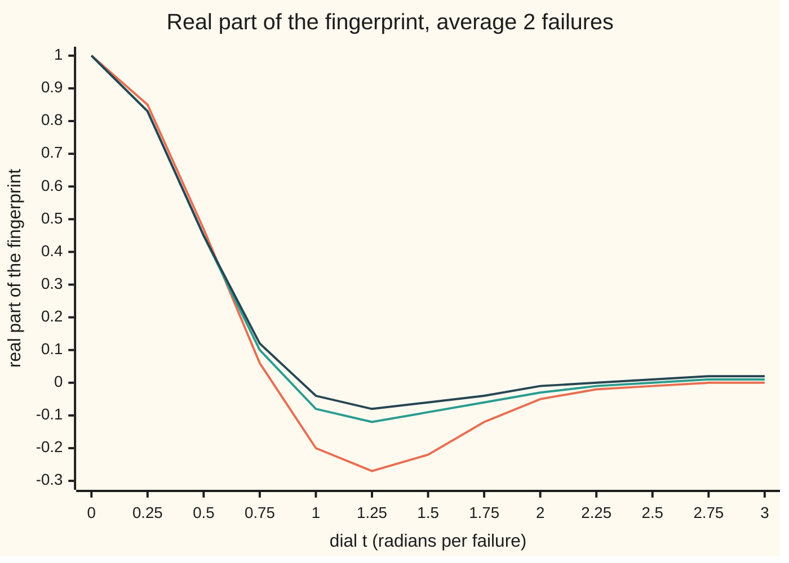

# Levy's continuity theorem: when fingerprints converge, the laws converge too

[Syllabus](../../../SYLLABUS.md) → [Harmonic analysis](../README.md) → [Characteristic Functions and Probability](../README.md#s04) → Levy's continuity theorem

---

## General Overview

A web service answers 1,000 requests a minute. Each request fails with chance 0.002, independently of the others. So a minute brings 2 failures on average. The on-call engineer gets paged when a minute brings 6 or more. How often does that happen?

The exact count of failures is **binomial**: 1,000 tries, each with chance 0.002. Its answer is 0.016455, about one page an hour. The **Poisson** law with average 2, the law of rare events, gives 0.016564. They differ by 0.000108. The [Poisson](../../09-Probability%20and%20statistics/03-Discrete%20Distributions/04-poisson.md) card proves this by taking the limit of each binomial chance, one count at a time.

This card takes a shorter road. Every law has a **fingerprint**: its characteristic function $`\varphi_X(t) = E[e^{itX}]`$, the average of a point turned round the unit circle by the dial $`t`$ times the outcome ([Characteristic functions](01-characteristic-functions-in-depth.md)). The binomial's fingerprint is one short formula, and as the requests grow and the failure chance shrinks, it converges to the Poisson's at every dial $`t`$. Lévy's continuity theorem turns that one limit into the limit of every chance at once.

The catch is a leak. Fingerprints can converge while probability runs off to infinity, and then no law is left at the end. The theorem says exactly when that cannot happen: when the limit of the fingerprints is continuous at $`t = 0`$.

**Laws converge in distribution (their chances of landing at or below each value converge) exactly when their fingerprints converge at every dial to a limit that is continuous at zero; that limit is then the fingerprint of the limit law.**

**What kind of fact this is:** a theorem, proved in both directions on this card in Why it works. The Poisson model of a real service is a model: it fits when failures are rare and independent.

### The picture: three fingerprints settling onto one



Orange: 5 requests, chance 0.4 each. Teal: 20 requests, chance 0.1 each. Dark blue: the Poisson law with average 2. All three have average 2. Twenty requests already sit close to the limit; 1,000 requests would lie on top of it. The imaginary part, not drawn, settles the same way.

---

## The formula

Notation first, in words. $`X_1, X_2, \dots`$ is a sequence of random numbers. $`X_n \Rightarrow X`$ reads "$`X_n`$ converges in distribution to $`X`$": the chance that $`X_n \le x`$ tends to the chance that $`X \le x`$ at every $`x`$ where the second does not jump ([Convergence in distribution](../../10-Measure%20and%20integration/10-The%20Limit%20Theorems%2C%20Proved/05-convergence-in-distribution.md)).

**Theorem (Lévy, 1922).**

```math
\text{(a)}\quad X_n \Rightarrow X \quad\Longrightarrow\quad \varphi_{X_n}(t) \to \varphi_X(t) \ \text{ for every } t
```

```math
\text{(b)}\quad \varphi_{X_n}(t) \to g(t) \text{ for every } t, \ g \text{ continuous at } 0 \quad\Longrightarrow\quad g = \varphi_X \text{ for some } X, \text{ and } X_n \Rightarrow X
```

**Read it aloud:** (a) if the laws converge, so do the fingerprints, at every dial; (b) if the fingerprints converge at every dial, and the limit is continuous at zero, then the limit is a fingerprint and the laws converge to its law.

In the example, $`B_n`$ counts the failures among $`n`$ requests, each failing with chance $`p = \lambda/n`$, where $`\lambda = 2`$ is the average. $`N`$ is the Poisson count with average $`\lambda`$. Their fingerprints are:

```math
\varphi_{B_n}(t) = \Big(1 + \frac{\lambda\,(e^{it} - 1)}{n}\Big)^{n} \ \longrightarrow\ e^{\lambda (e^{it} - 1)} = \varphi_N(t)
```

**Read it aloud:** the binomial fingerprint is one plus lambda times e to the i t minus one, over n, all to the power n; it tends to e to the lambda times e to the i t minus one, the Poisson fingerprint.

| Symbol | Plain meaning | In our example | Push it up and the answer… |
| --- | --- | --- | --- |
| $`\varphi_X(t)`$, $`t`$ | the fingerprint $`E[e^{itX}]`$; the dial, in radians per failure | $`\varphi_N(1) = -0.044626 + 0.396255i`$ | — |
| $`B_n`$, $`n`$, $`p`$ | the binomial count of failures; the requests a minute; each one's chance to fail | $`n = 1000`$, $`p = 0.002`$ | larger $`n`$: closer to the Poisson |
| $`N`$, $`\lambda`$ | the Poisson count; its average, in failures a minute | $`\lambda = 2`$ | more pages |
| $`X_n`$, $`X`$, $`\Rightarrow`$ | a sequence of random numbers; its limit; converges in distribution | $`B_n \Rightarrow N`$ | — |
| $`g`$ | the limit of the fingerprints, dial by dial | $`\varphi_N`$ | — |
| $`F_n`$, $`F`$, $`\mu`$ | distribution functions (chance of at most $`x`$); the limit law | $`F_{1000}(5) = 0.983545`$ | — |
| $`u`$, $`R`$, $`\varepsilon`$ | the width in the tail bound; a cut-off; a tolerance | $`u = 0.3`$, $`R = 2/u = 6.67`$ | wider $`u`$: looser bound |
| $`k`$, $`M`$ | a count of failures; the points in the inversion sum | $`k = 0, \dots, 6`$; $`M = 1024`$ | — |
| $`w`$ | the exponent $`\lambda(e^{it} - 1)`$ in the Poisson fingerprint | $`-0.919395 + 1.682942i`$ at $`t = 1`$ | — |
| $`E`$, $`f`$, $`s`$, $`x`$, $`y`$ | the average over outcomes; a bounded continuous test function; a second dial value; a threshold; an angle | $`x = 5`$ failures for paging | — |
| $`q`$, $`G`$, $`n_j`$, $`j`$, $`m`$, $`a`$, $`b`$, $`r_1`$, $`r_2`$, $`r_3`$ | Helly's helpers: a rational number; the limit on the rationals; the diagonal subsequence and its counters; continuity points and rationals around a threshold | — | — |

**Tight** is the new word on this card. A sequence of laws is **tight** when no probability leaks to infinity: for every tolerance $`\varepsilon`$ there is one cut-off $`R`$ with $`P(\lvert X_n\rvert > R) < \varepsilon`$ for every $`n`$ at once.

### When it holds

- **Every dial, not some.** Part (b) needs the fingerprints to converge at every $`t`$. Convergence on a short interval of the dial does not pin down a limit law.
- **The limit is continuous at 0.** Normal laws with variance $`n`$ have fingerprints $`e^{-nt^2/2}`$. They tend to 1 at $`t = 0`$ and to 0 everywhere else. The chance of landing within 5 of zero falls to 0.039878 at $`n = 10000`$: the probability leaks away.
- **The scaling is right.** Hold each request's chance at 0.002 while $`n`$ grows, instead of the average. The fingerprints tend to 0 off the multiples of $`2\pi`$, and the chance of 5 or fewer failures falls to 0.000071 at $`n = 10000`$.
- **"Converges" means in distribution.** The theorem says nothing about the counts on one particular minute. It compares laws only.

---

## Why it works

### Step 0: fingerprints see everything except a leak

A fingerprint near $`t = 0`$ measures how far out the probability sits. A law with mass far from zero spins its points quickly, so its fingerprint drops away from 1 almost at once. If the limit $`g`$ is continuous at 0, no mass can be far out, uniformly in $`n`$: the laws are tight.

Tight laws always have a convergent subsequence: that is Helly's selection theorem, a compactness fact. Any limit law along a subsequence has fingerprint $`g`$, by part (a). A fingerprint fixes its law. So every subsequence points to one law, and the whole sequence converges to it.

The proof below has those four moves: forward direction, tightness, Helly, assembly.

### Step 1: forward, convergent laws have convergent fingerprints

[Convergence in distribution](../../10-Measure%20and%20integration/10-The%20Limit%20Theorems%2C%20Proved/05-convergence-in-distribution.md) proves that $`X_n \Rightarrow X`$ makes $`E f(X_n) \to E f(X)`$ for every bounded continuous $`f`$. Take $`f(x) = \cos tx`$ and $`f(x) = \sin tx`$. Both parts of $`\varphi_{X_n}(t)`$ converge. That is (a).

Tightness upgrades this to uniform convergence on every bounded range of the dial. A convergent sequence is tight. Pick $`R`$ with $`P(\lvert X\rvert > R) < \varepsilon`$, where $`\pm R`$ are not jump points of the limit. Then $`P(\lvert X_n\rvert > R) < 2\varepsilon`$ for all large $`n`$. For dial values $`s`$ and $`t`$:

```math
\lvert \varphi_{X_n}(t) - \varphi_{X_n}(s)\rvert \le E\,\lvert e^{i(t - s)X_n} - 1\rvert \le \lvert t - s\rvert R + 2\,P(\lvert X_n\rvert > R)
```

The first term uses $`\lvert e^{iy} - 1\rvert \le \lvert y\rvert`$ where $`\lvert X_n\rvert \le R`$; the second uses $`\lvert e^{iy} - 1\rvert \le 2`$ elsewhere. So, for all large $`n`$ at once, the fingerprints move by less than $`5\varepsilon`$ when the dial moves by less than $`\varepsilon/R`$. Convergence on a fine grid of dial values then spreads to every value in the range at once. A whole-number count's fingerprint repeats every $`2\pi`$, so dial values from $`-\pi`$ to $`\pi`$ cover them all. In the example the worst gap over all dial values, 0.000737 at $`n = 1000`$, is barely above the gap at $`t = 1`$, 0.000734.

### Step 2: continuity at zero makes the laws tight

The **tail bound** holds for any law and any width $`u > 0`$ ([Characteristic functions](../../10-Measure%20and%20integration/10-The%20Limit%20Theorems%2C%20Proved/06-characteristic-functions.md) proves it with Fubini):

```math
P\big(\lvert X\rvert > 2/u\big) \le \frac{1}{u}\int_{-u}^{u} \big(1 - \varphi_X(t)\big)\, dt
```

Fix a tolerance $`\varepsilon`$. Because $`g(0) = 1`$ and $`g`$ is continuous at 0, the bound for $`g`$ is below $`\varepsilon/2`$ once $`u`$ is small. Each $`\lvert 1 - \varphi_{X_n}\rvert`$ is at most 2, so dominated convergence sends the bound for $`X_n`$ to the bound for $`g`$ ([Dominated convergence](../../10-Measure%20and%20integration/05-Swapping%20Limits%20and%20Integrals/02-dominated-convergence-theorem.md)). So the bound is below $`\varepsilon`$ for every $`n`$ past some $`n_0`$. The finitely many laws before $`n_0`$ each get their own cut-off; take $`R`$ as the largest. The laws are tight.

For the failure counts at $`u = 0.3`$, the bound is 0.167894 at $`n = 1000`$. The true chance of more than $`2/u = 6.67`$ failures is 0.004486: the bound is 37.4 times too big, and still enough.

### Step 3: Helly's selection theorem

**Every sequence of distribution functions has a subsequence that converges at every continuity point of some function $`F`$, where $`F`$ never decreases, is continuous from the right and takes values from 0 to 1.**

The idea is a diagonal choice. Values in $`[0, 1]`$ always have a convergent subsequence. Do this at the first rational number, then thin the result at the second, and so on. The diagonal of this list converges at every rational. Fill in the gaps between rationals from the right.

<details>
<summary>Detailed proof: Helly's selection theorem, and why tightness makes the limit a law</summary>

**The diagonal.** List the rational numbers $`q_1, q_2, \dots`$. The numbers $`F_n(q_1)`$ lie in $`[0, 1]`$, so some subsequence converges. Thin it so that it converges at $`q_2`$ as well, then at $`q_3`$, and so on. Let $`n_j`$ be the $`j`$-th term of the $`j`$-th thinned list. From its $`m`$-th term on, it lies inside the $`m`$-th list, so $`F_{n_j}(q)`$ converges for every rational $`q`$. Call the limit $`G(q)`$. It never decreases, since each $`F_n`$ never decreases.

**The function.** Set

$`\displaystyle F(x) = \inf\{\,G(q) : q \text{ rational},\ q > x\,\}.`$

It never decreases. It is continuous from the right: given $`\varepsilon`$, pick a rational $`q > x`$ with $`G(q) < F(x) + \varepsilon`$; every $`y`$ between $`x`$ and $`q`$ has $`F(x) \le F(y) \le G(q)`$.

**Convergence at continuity points.** Let $`F`$ be continuous at $`x`$ and fix $`\varepsilon`$. Pick rationals $`r_1 < r_2 < x < r_3`$ with $`F(r_1) > F(x) - \varepsilon`$ (continuity from the left) and $`G(r_3) < F(x) + \varepsilon`$ (the definition of $`F`$). Then $`F(r_1) \le G(r_2)`$, and each $`F_{n_j}`$ never decreases, so

$`\displaystyle F(x) - \varepsilon < G(r_2) = \lim_j F_{n_j}(r_2) \le \liminf_j F_{n_j}(x) \le \limsup_j F_{n_j}(x) \le \lim_j F_{n_j}(r_3) = G(r_3) < F(x) + \varepsilon.`$

The tolerance was any, so $`F_{n_j}(x) \to F(x)`$.

**Tightness makes it a law.** Without tightness, $`F`$ may climb from above 0 or stop below 1: mass has leaked. With tightness, fix $`\varepsilon`$ and its cut-off $`R`$. The points where $`F`$ jumps can be listed one by one, so pick continuity points $`a < -R`$ and $`b > R`$. Every $`n`$ has $`F_n(a) \le \varepsilon`$ and $`F_n(b) \ge 1 - \varepsilon`$, and the limits keep these bounds. So $`F`$ tends to 0 on the left and 1 on the right. It is the distribution function of a law $`\mu`$, and the subsequence converges in distribution to $`\mu`$.

</details>

### Step 4: assembly, every subsequence points to one law

Take any subsequence of the $`X_n`$. It is still tight, so by Step 3 a further subsequence converges in distribution to some law. By Step 1 that law's fingerprint is $`g`$. A fingerprint fixes its law ([Levy's inversion formula](03-levy-inversion-and-uniqueness.md)). So every such limit is the same law $`\mu`$, with fingerprint $`g`$.

Suppose the whole sequence did not converge to $`\mu`$. Then at some continuity point $`x`$ of $`\mu`$'s distribution function, a subsequence stays at least $`\varepsilon`$ away from it. A further subsequence of that one converges to $`\mu`$, which is impossible. So $`X_n \Rightarrow \mu`$, and $`g`$ is a fingerprint. That is (b).

### Step 5: the fingerprint road to the Poisson law

Write $`w = \lambda(e^{it} - 1)`$, a fixed complex number for each dial value. Then $`\varphi_{B_n}(t) = (1 + w/n)^n`$. For $`\lvert w/n\rvert \le 1/2`$ the logarithm of $`1 + w/n`$ is $`w/n`$ plus an error at most $`\lvert w/n\rvert^2`$. Multiply by $`n`$: the error is at most $`\lvert w\rvert^2/n`$, which tends to 0. So $`\varphi_{B_n}(t) \to e^{w} = \varphi_N(t)`$ at every dial.

The limit is continuous everywhere, and at 0 in particular. Lévy's theorem gives $`B_n \Rightarrow N`$. Both counts take whole values, so $`x = k + 1/2`$ is a continuity point. Each chance $`P(B_n = k)`$ converges to $`P(N = k)`$, and so does the chance of 6 or more failures.

The next term of the logarithm gives the speed. The gap is about $`\lvert \varphi_N(t)\rvert\, \lambda^2\, \lvert e^{it} - 1\rvert^2 / (2n)`$: it shrinks like $`1/n`$.

---

## Worked numbers, by hand

Take $`t = 1`$ radian per failure, $`\lambda = 2`$ and $`n = 1000`$.

| Step | Arithmetic | Value |
| --- | --- | --- |
| Turn by one radian | $`e^{i} = \cos 1 + i \sin 1`$ | $`0.540302 + 0.841471i`$ |
| The exponent $`w`$ | $`2 \times (0.540302 - 1 + 0.841471i)`$ | $`-0.919395 + 1.682942i`$ |
| Poisson fingerprint | $`e^{-0.919395}\,(\cos 1.682942 + i \sin 1.682942)`$ | $`-0.044626 + 0.396255i`$ |
| Its size | $`e^{-0.919395}`$ | $`0.398760`$ |
| Binomial base | $`1 + 0.002 \times (e^{i} - 1)`$ | $`0.999081 + 0.001683i`$ |
| Binomial fingerprint | base to the power 1000 | $`-0.045284 + 0.396580i`$ |
| Gap | distance between the two | $`0.000734`$ |
| Predicted gap | $`0.398760 \times 4 \times (2 - 2\cos 1) / (2 \times 1000)`$ | $`0.000733`$ |
| Paging chance, binomial | $`1 - P(B_{1000} \le 5)`$, by counting | $`0.016455`$ |
| Paging chance, Poisson | $`1 - e^{-2}(1 + 2 + 2 + \tfrac{4}{3} + \tfrac{2}{3} + \tfrac{4}{15})`$ | **0.016564** |

The pager fires in one minute in 60.8 under the binomial and one in 60.4 under the Poisson. The fingerprint gap of 0.000734 at $`n = 1000`$ shows up as a gap of 0.000108 in the paging chance.

The fingerprint also gives each chance back. For a whole-number count, $`P(B = k)`$ is $`\frac{1}{2\pi}\int_{-\pi}^{\pi} \varphi_B(t)\, e^{-itk}\, dt`$. The checks evaluate this as an average over $`M = 1024`$ equally spaced dial values. That average is exact here: the binomial fingerprint is a sum of only 1,001 turning terms.

| Failures $`k`$ | Counting, $`n = 1000`$ | Inverted fingerprint, $`n = 1000`$ | Poisson |
| --- | --- | --- | --- |
| 0 | 0.135065 | 0.135065 | 0.135335 |
| 1 | 0.270670 | 0.270670 | 0.270671 |
| 2 | 0.270942 | 0.270942 | 0.270671 |
| 3 | 0.180628 | 0.180628 | 0.180447 |
| 4 | 0.090223 | 0.090223 | 0.090224 |
| 5 | 0.036017 | 0.036017 | 0.036089 |
| 6 | 0.011970 | 0.011970 | 0.012030 |

### What breaks if you drop a piece

| Mistake | Comes out at | What went wrong |
| --- | --- | --- |
| Holding each request's chance at 0.002 while $`n`$ grows | chance of 5 or fewer: 0.983545, 0.000071, 0.000000 at $`n`$ = 1,000, 10,000, 100,000 | the average grows with $`n`$; the fingerprints tend to 1 at multiples of $`2\pi`$ and 0 elsewhere, not continuous at 0, and the mass runs off to the right |
| Ignoring continuity at 0: normal laws of variance $`n`$ | chance within 5 of zero: 0.999999, 0.382925, 0.039878 at $`n`$ = 1, 100, 10,000; tail bound at $`u = 0.3`$ climbs to 1.916446 | the limit is 1 at $`t = 0`$ and 0 elsewhere; no law has that fingerprint, so there is nothing to converge to |
| Using Helly without tightness: Poisson with chance 0.9, else the value $`n`$ | $`F_n(10)`$ stays 0.899993; $`F_{2000}(1000)`$ = 0.900000 | the subsequence limit carries only 0.9 of the probability; the fingerprints at $`t = 1`$ wander: $`0.000645 + 0.447924i`$, $`0.008556 + 0.269300i`$, $`-0.076909 + 0.449634i`$ at $`n`$ = 20, 200, 2,000 |

---

## Code, from first principles, and it actually runs

The code builds every fingerprint from scratch: a complex power by repeated squaring, and $`e^{w}`$ from cosine and sine. It reaches the failure chances by three independent roads: counting with the binomial recurrence, inverting the fingerprint as an average over 1,024 dial values, and simulating 200,000 minutes with a small generator (SplitMix64, seed 20261115) written out in both languages. It checks the $`1/n`$ speed against the predicted gap, the tail bound against the true tail and against a moment expansion, and prints the three traps.

### Python

```python
# Levy's continuity theorem -- the check behind the card.  Standard library only.
# Binomial(n, 2/n) fingerprints against the Poisson(2)'s; three roads to the masses
# (counting, inversion of the fingerprint, simulation); tightness; three traps.
import math

LAM, P_REQ, N_REQ, SEED = 2.0, 0.002, 1000, 20261115   # 1,000 requests a minute, 0.2% fail each

def cmul(a, b): return (a[0] * b[0] - a[1] * b[1], a[0] * b[1] + a[1] * b[0])
def cexp(x, y): r = math.exp(x); return (r * math.cos(y), r * math.sin(y))
def cpow(z, n):                                 # z^n by repeated squaring
    out = (1.0, 0.0)
    while n > 0:
        if n & 1: out = cmul(out, z)
        z = cmul(z, z); n >>= 1
    return out
def fp_binom(n, p, t): return cpow((1.0 - p + p * math.cos(t), p * math.sin(t)), n)
def fp_pois(lam, t): return cexp(lam * (math.cos(t) - 1.0), lam * math.sin(t))
def gap(a, b): return math.hypot(a[0] - b[0], a[1] - b[1])
def binom_pmf(n, p, kmax):                     # counting road: the ratio recurrence
    out = [(1.0 - p) ** n]
    for k in range(kmax): out.append(out[-1] * (n - k) / (k + 1) * p / (1.0 - p))
    return out
def pois_pmf(lam, kmax): return [math.exp(-lam) * lam ** k / math.factorial(k) for k in range(kmax + 1)]
def invert(fp, M, k):                          # (1/2pi) int_{-pi}^{pi} fp(t) e^{-itk} dt, M points
    s = 0.0
    for j in range(M):
        t = -math.pi + 2.0 * math.pi * j / M; f = fp[j]
        s += f[0] * math.cos(t * k) + f[1] * math.sin(t * k)
    return s / M
def simpson(f, a, b, m=2000):
    h = (b - a) / m; s = f(a) + f(b)
    for i in range(1, m): s += (4 if i % 2 else 2) * f(a + i * h)
    return s * h / 3.0
def tail_bound(re_fp, u): return simpson(lambda t: 1.0 - re_fp(t), -u, u) / u
def erf(x):                                    # 2/sqrt(pi) e^{-x^2} sum 2^k x^{2k+1}/(1*3*...*(2k+1))
    term = x; s = x; k = 0
    while term > 1e-17 * s: k += 1; term *= 2.0 * x * x / (2 * k + 1); s += term
    return 2.0 / math.sqrt(math.pi) * math.exp(-x * x) * s
STATE = [SEED]
def splitmix():
    STATE[0] = (STATE[0] + 0x9E3779B97F4A7C15) & 0xFFFFFFFFFFFFFFFF
    z = STATE[0]; z = ((z ^ (z >> 30)) * 0xBF58476D1CE4E5B9) & 0xFFFFFFFFFFFFFFFF
    z = ((z ^ (z >> 27)) * 0x94D049BB133111EB) & 0xFFFFFFFFFFFFFFFF
    return z ^ (z >> 31)
def uniform(): return ((splitmix() >> 11) + 1) / 9007199254740992.0   # in (0, 1]
def c6(z): return f"{z[0]:+.6f} {z[1]:+.6f}i"

print("Levy continuity check: Binomial(n, 2/n) fingerprints against the Poisson(2)'s")
print("fingerprint at t = 1:")
lim1 = fp_pois(LAM, 1.0)
for n in (10, 100, 1000, 10000):
    z = fp_binom(n, LAM / n, 1.0)
    print(f"  n={n:<6d} {c6(z)}   gap {gap(z, lim1):.6f}   n x gap {n * gap(z, lim1):.4f}")
print(f"  Poisson  {c6(lim1)}")
w = (math.cos(1.0) - 1.0, math.sin(1.0))
pred = math.hypot(*lim1) * LAM ** 2 * (2.0 - 2.0 * math.cos(1.0)) / 2.0
print(f"by hand: e^i {c6((math.cos(1.0), math.sin(1.0)))}  lam(e^i - 1) {c6((LAM * w[0], LAM * w[1]))}  |fp| {math.exp(LAM * w[0]):.6f}")
print(f"by hand: base n=1000 {c6((1.0 + P_REQ * w[0], P_REQ * w[1]))}  predicted n x gap {pred:.4f}  at n=1000 {pred / 1000:.6f}")
assert abs(10000 * gap(fp_binom(10000, LAM / 10000, 1.0), lim1) - pred) < 0.001
ts = [-math.pi + 2.0 * math.pi * j / 2000 for j in range(2001)]
worst = {}
for n in (10, 100, 1000):
    worst[n] = max(gap(fp_binom(n, LAM / n, t), fp_pois(LAM, t)) for t in ts)
    print(f"worst gap over all t, n={n:<5d} {worst[n]:.6f}   n x gap {n * worst[n]:.4f}")
assert worst[1000] < worst[100] < worst[10] and abs(1000 * worst[1000] / (100 * worst[100]) - 1) < 0.02

M = 1024
fpb = [fp_binom(N_REQ, P_REQ, -math.pi + 2.0 * math.pi * j / M) for j in range(M)]
fpp = [fp_pois(LAM, -math.pi + 2.0 * math.pi * j / 64) for j in range(64)]
cnt, pois = binom_pmf(N_REQ, P_REQ, 6), pois_pmf(LAM, 6)
print("k  counting n=1000  inverted n=1000  Poisson   inverted Poisson (64 points)")
for k in range(7):
    ib, ip = invert(fpb, M, k), invert(fpp, 64, k)
    print(f"{k}  {cnt[k]:.6f}        {ib:.6f}         {pois[k]:.6f}  {ip:.6f}")
    assert abs(ib - cnt[k]) < 1e-12 and abs(ip - pois[k]) < 1e-12
print(f"aliasing bound for 64 points: P(N >= 64) = {sum(pois_pmf(LAM, 100)[64:]):.1e}")

tails = {}
for n in (10, 100, 1000):
    tails[n] = 1.0 - sum(binom_pmf(n, LAM / n, 5))
tails[0] = 1.0 - sum(pois[:6])
print(f"P(6 or more failures): n=10 {tails[10]:.6f}  n=100 {tails[100]:.6f}  n=1000 {tails[1000]:.6f}  Poisson {tails[0]:.6f}")
print(f"paging gap, Poisson minus n=1000: {tails[0] - tails[1000]:.6f}   one minute in {1 / tails[1000]:.1f} (n=1000), {1 / tails[0]:.1f} (Poisson)")
MIN, hits, total = 200000, 0, 0
log_q = math.log(1.0 - P_REQ)
for _ in range(MIN):                           # simulation road: jump from failure to failure
    pos, c = -1, 0
    while True:
        pos += 1 + int(math.log(uniform()) / log_q)
        if pos >= N_REQ: break
        c += 1
    hits += c >= 6; total += c
se = math.sqrt(tails[1000] * (1 - tails[1000]) / MIN)
print(f"simulation, {MIN} minutes, seed {SEED}: mean {total / MIN:.4f}  P(6 or more) {hits / MIN:.6f}  (s.e. {se:.6f})")
assert abs(hits / MIN - tails[1000]) < 4 * se and abs(total / MIN - 2.0) < 0.02

U = 0.3
print(f"tightness, u = {U}: tail bound (1/u) int (1 - Re fp) dt, against P(count > 2/u = {2 / U:.2f})")
for n in (10, 100, 1000):
    b = tail_bound(lambda t: fp_binom(n, LAM / n, t)[0], U)
    true = 1.0 - sum(binom_pmf(n, LAM / n, int(2 / U)))
    print(f"  n={n:<5d} bound {b:.6f}   true {true:.6f}   ratio {b / true:.1f}")
    assert true <= b < 0.2
bp = tail_bound(lambda t: fp_pois(LAM, t)[0], U)
tpp = 1.0 - sum(pois_pmf(LAM, int(2 / U)))
print(f"  Poisson  bound {bp:.6f}   true {tpp:.6f}   ratio {bp / tpp:.1f}")
assert abs(bp - (2 * U ** 2 - 94 / 60 * U ** 4)) < 0.0015   # moments: E[N^2] = 6, E[N^4] = 94

print("trap 1, chance fixed at 0.002 while n grows:")
for n in (1000, 10000, 100000):
    z = fp_binom(n, P_REQ, 1.0)
    print(f"  n={n:<6d} |fp(1)| {math.hypot(*z):.6f}   P(5 or fewer) {sum(binom_pmf(n, P_REQ, 5)):.6f}")
assert math.hypot(*fp_binom(100000, P_REQ, 1.0)) < 1e-30 and abs(fp_binom(100000, P_REQ, 2 * math.pi)[0] - 1) < 1e-9
print("trap 2, normal laws of variance n:")
for n in (1, 100, 10000):
    pin = erf(5.0 / math.sqrt(2.0 * n))
    b = tail_bound(lambda t: math.exp(-n * t * t / 2.0), U)
    print(f"  n={n:<6d} fp(0.1) {math.exp(-n * 0.005):.6f}   P(|X| <= 5) {pin:.6f}   tail bound {b:.6f}")
    assert abs(pin - math.erf(5.0 / math.sqrt(2.0 * n))) < 1e-12   # library cross-check
print("trap 3, Poisson(2) with chance 0.9, else the value n:")
fps = []
for n in (20, 200, 2000):
    z = (0.9 * lim1[0] + 0.1 * math.cos(n), 0.9 * lim1[1] + 0.1 * math.sin(n))
    zk = [sum(0.9 * q * f(k) for k, q in enumerate(pois_pmf(LAM, 60))) + 0.1 * f(n) for f in (math.cos, math.sin)]
    F = lambda x: 0.9 * sum(pois_pmf(LAM, min(x, 60))) + 0.1 * (n <= x)
    print(f"  n={n:<5d} fp(1) {c6(z)}   F_n(10) {F(10):.6f}   F_n(1000) {F(1000):.6f}")
    assert gap(z, zk) < 1e-12 and abs(F(1000) - (1.0 if n <= 1000 else 0.9)) < 1e-12   # fingerprint = sum over masses
    assert abs(F(10) - 0.9 + 0.9 * sum(pois_pmf(LAM, 60)[11:])) < 1e-12
    fps.append(z)
assert gap(fps[0], fps[1]) > 0.05 and gap(fps[0], fps[2]) > 0.05   # the fingerprints wander: no limit

print("chart, real part of the fingerprint at t = 0, 0.25, ..., 3:")
for name, f in (("n=5 ", lambda t: fp_binom(5, 0.4, t)), ("n=20", lambda t: fp_binom(20, 0.1, t)),
                ("Pois", lambda t: fp_pois(LAM, t))):
    print("  " + name + " " + ", ".join(f"{f(0.25 * j)[0]:.2f}" for j in range(13)))
print("ALL CHECKS PASS")
```

**Ran 2026-11-15 on macOS, Python 3.14.10, standard library only. All checks passed. Output, pasted from the run:**

```
Levy continuity check: Binomial(n, 2/n) fingerprints against the Poisson(2)'s
fingerprint at t = 1:
  n=10     -0.116787 +0.435945i   gap 0.082357   n x gap 0.8236
  n=100    -0.051262 +0.399562i   gap 0.007415   n x gap 0.7415
  n=1000   -0.045284 +0.396580i   gap 0.000734   n x gap 0.7341
  n=10000  -0.044691 +0.396288i   gap 0.000073   n x gap 0.7333
  Poisson  -0.044626 +0.396255i
by hand: e^i +0.540302 +0.841471i  lam(e^i - 1) -0.919395 +1.682942i  |fp| 0.398760
by hand: base n=1000 +0.999081 +0.001683i  predicted n x gap 0.7332  at n=1000 0.000733
worst gap over all t, n=10    0.083524   n x gap 0.8352
worst gap over all t, n=100   0.007445   n x gap 0.7445
worst gap over all t, n=1000  0.000737   n x gap 0.7366
k  counting n=1000  inverted n=1000  Poisson   inverted Poisson (64 points)
0  0.135065        0.135065         0.135335  0.135335
1  0.270670        0.270670         0.270671  0.270671
2  0.270942        0.270942         0.270671  0.270671
3  0.180628        0.180628         0.180447  0.180447
4  0.090223        0.090223         0.090224  0.090224
5  0.036017        0.036017         0.036089  0.036089
6  0.011970        0.011970         0.012030  0.012030
aliasing bound for 64 points: P(N >= 64) = 2.0e-71
P(6 or more failures): n=10 0.006369  n=100 0.015484  n=1000 0.016455  Poisson 0.016564
paging gap, Poisson minus n=1000: 0.000108   one minute in 60.8 (n=1000), 60.4 (Poisson)
simulation, 200000 minutes, seed 20261115: mean 1.9981  P(6 or more) 0.016345  (s.e. 0.000284)
tightness, u = 0.3: tail bound (1/u) int (1 - Re fp) dt, against P(count > 2/u = 6.67)
  n=10    bound 0.158941   true 0.000864   ratio 183.9
  n=100   bound 0.167102   true 0.004062   ratio 41.1
  n=1000  bound 0.167894   true 0.004486   ratio 37.4
  Poisson  bound 0.167982   true 0.004534   ratio 37.1
trap 1, chance fixed at 0.002 while n grows:
  n=1000   |fp(1)| 0.399157   P(5 or fewer) 0.983545
  n=10000  |fp(1)| 0.000103   P(5 or fewer) 0.000071
  n=100000 |fp(1)| 0.000000   P(5 or fewer) 0.000000
trap 2, normal laws of variance n:
  n=1      fp(0.1) 0.995012   P(|X| <= 5) 0.999999   tail bound 0.029599
  n=100    fp(0.1) 0.606531   P(|X| <= 5) 0.382925   tail bound 1.166713
  n=10000  fp(0.1) 0.000000   P(|X| <= 5) 0.039878   tail bound 1.916446
trap 3, Poisson(2) with chance 0.9, else the value n:
  n=20    fp(1) +0.000645 +0.447924i   F_n(10) 0.899993   F_n(1000) 1.000000
  n=200   fp(1) +0.008556 +0.269300i   F_n(10) 0.899993   F_n(1000) 1.000000
  n=2000  fp(1) -0.076909 +0.449634i   F_n(10) 0.899993   F_n(1000) 0.900000
chart, real part of the fingerprint at t = 0, 0.25, ..., 3:
  n=5  1.00, 0.85, 0.47, 0.06, -0.20, -0.27, -0.22, -0.12, -0.05, -0.02, -0.01, -0.00, 0.00
  n=20 1.00, 0.83, 0.45, 0.10, -0.08, -0.12, -0.09, -0.06, -0.03, -0.01, 0.00, 0.01, 0.01
  Pois 1.00, 0.83, 0.45, 0.12, -0.04, -0.08, -0.06, -0.04, -0.01, 0.00, 0.01, 0.02, 0.02
ALL CHECKS PASS
```

### Rust

```rust
// Levy's continuity theorem -- the check behind the card.  std only, no crates.
// Binomial(n, 2/n) fingerprints against the Poisson(2)'s; three roads to the masses
// (counting, inversion of the fingerprint, simulation); tightness; three traps.
use std::f64::consts::PI;

const LAM: f64 = 2.0; const P_REQ: f64 = 0.002; const N_REQ: i64 = 1000; const SEED: u64 = 20261115; // 1,000 requests a minute, 0.2% fail each

#[derive(Clone, Copy)] struct C { re: f64, im: f64 }
fn cmul(a: C, b: C) -> C { C { re: a.re * b.re - a.im * b.im, im: a.re * b.im + a.im * b.re } }
fn cexp(x: f64, y: f64) -> C { let r = x.exp(); C { re: r * y.cos(), im: r * y.sin() } }
fn cpow(mut z: C, mut n: u64) -> C { // z^n by repeated squaring
    let mut out = C { re: 1.0, im: 0.0 };
    while n > 0 {
        if n & 1 == 1 { out = cmul(out, z); }
        z = cmul(z, z); n >>= 1;
    }
    out
}
fn fp_binom(n: u64, p: f64, t: f64) -> C { cpow(C { re: 1.0 - p + p * t.cos(), im: p * t.sin() }, n) }
fn fp_pois(lam: f64, t: f64) -> C { cexp(lam * (t.cos() - 1.0), lam * t.sin()) }
fn gap(a: C, b: C) -> f64 { (a.re - b.re).hypot(a.im - b.im) }
fn binom_pmf(n: u64, p: f64, kmax: u64) -> Vec<f64> { // counting road: the ratio recurrence
    let mut out = vec![(1.0 - p).powf(n as f64)];
    for k in 0..kmax { let last = out[out.len() - 1]; out.push(last * (n - k) as f64 / (k + 1) as f64 * p / (1.0 - p)); }
    out
}
fn pois_pmf(lam: f64, kmax: u64) -> Vec<f64> {
    let mut v = Vec::new(); let mut fact = 1.0;
    for k in 0..=kmax { if k > 0 { fact *= k as f64; } v.push((-lam).exp() * lam.powf(k as f64) / fact); }
    v
}
fn invert(fp: &[C], m: usize, k: f64) -> f64 { // (1/2pi) int_{-pi}^{pi} fp(t) e^{-itk} dt, m points
    let mut s = 0.0;
    for j in 0..m {
        let t = -PI + 2.0 * PI * j as f64 / m as f64; let f = fp[j];
        s += f.re * (t * k).cos() + f.im * (t * k).sin();
    }
    s / m as f64
}
fn simpson<F: Fn(f64) -> f64>(f: F, a: f64, b: f64, m: usize) -> f64 {
    let h = (b - a) / m as f64; let mut s = f(a) + f(b);
    for i in 1..m { s += (if i % 2 == 1 { 4.0 } else { 2.0 }) * f(a + i as f64 * h); }
    s * h / 3.0
}
fn tail_bound<F: Fn(f64) -> f64>(re_fp: F, u: f64) -> f64 { simpson(|t| 1.0 - re_fp(t), -u, u, 2000) / u }
fn erf(x: f64) -> f64 { // 2/sqrt(pi) e^{-x^2} sum 2^k x^{2k+1}/(1*3*...*(2k+1))
    let (mut term, mut s, mut k) = (x, x, 0.0);
    while term > 1e-17 * s { k += 1.0; term *= 2.0 * x * x / (2.0 * k + 1.0); s += term; }
    2.0 / PI.sqrt() * (-x * x).exp() * s
}
struct Rng(u64);
impl Rng {
    fn next(&mut self) -> u64 {
        self.0 = self.0.wrapping_add(0x9E3779B97F4A7C15);
        let mut z = self.0;
        z = (z ^ (z >> 30)).wrapping_mul(0xBF58476D1CE4E5B9);
        z = (z ^ (z >> 27)).wrapping_mul(0x94D049BB133111EB);
        z ^ (z >> 31)
    }
    fn uniform(&mut self) -> f64 { ((self.next() >> 11) + 1) as f64 / 9007199254740992.0 } // in (0, 1]
}
fn c6(z: C) -> String { format!("{:+.6} {:+.6}i", z.re, z.im) }
fn sum(v: &[f64]) -> f64 { v.iter().sum() }

fn main() {
    println!("Levy continuity check: Binomial(n, 2/n) fingerprints against the Poisson(2)'s");
    println!("fingerprint at t = 1:");
    let lim1 = fp_pois(LAM, 1.0);
    for n in [10u64, 100, 1000, 10000] {
        let z = fp_binom(n, LAM / n as f64, 1.0);
        println!("  n={:<6} {}   gap {:.6}   n x gap {:.4}", n, c6(z), gap(z, lim1), n as f64 * gap(z, lim1));
    }
    println!("  Poisson  {}", c6(lim1));
    let w = C { re: 1f64.cos() - 1.0, im: 1f64.sin() };
    let pred = lim1.re.hypot(lim1.im) * LAM.powf(2.0) * (2.0 - 2.0 * 1f64.cos()) / 2.0;
    println!("by hand: e^i {}  lam(e^i - 1) {}  |fp| {:.6}", c6(C { re: 1f64.cos(), im: 1f64.sin() }), c6(C { re: LAM * w.re, im: LAM * w.im }), (LAM * w.re).exp());
    println!("by hand: base n=1000 {}  predicted n x gap {:.4}  at n=1000 {:.6}", c6(C { re: 1.0 + P_REQ * w.re, im: P_REQ * w.im }), pred, pred / 1000.0);
    assert!((10000.0 * gap(fp_binom(10000, LAM / 10000.0, 1.0), lim1) - pred).abs() < 0.001);
    let ts: Vec<f64> = (0..=2000).map(|j| -PI + 2.0 * PI * j as f64 / 2000.0).collect();
    let mut worst = Vec::new();
    for n in [10u64, 100, 1000] {
        let w = ts.iter().map(|&t| gap(fp_binom(n, LAM / n as f64, t), fp_pois(LAM, t))).fold(0.0f64, f64::max);
        println!("worst gap over all t, n={:<5} {:.6}   n x gap {:.4}", n, w, n as f64 * w);
        worst.push(w);
    }
    assert!(worst[2] < worst[1] && worst[1] < worst[0] && (1000.0 * worst[2] / (100.0 * worst[1]) - 1.0).abs() < 0.02);

    let m = 1024;
    let fpb: Vec<C> = (0..m).map(|j| fp_binom(N_REQ as u64, P_REQ, -PI + 2.0 * PI * j as f64 / m as f64)).collect();
    let fpp: Vec<C> = (0..64).map(|j| fp_pois(LAM, -PI + 2.0 * PI * j as f64 / 64.0)).collect();
    let (cnt, pois) = (binom_pmf(N_REQ as u64, P_REQ, 6), pois_pmf(LAM, 6));
    println!("k  counting n=1000  inverted n=1000  Poisson   inverted Poisson (64 points)");
    for k in 0..7 {
        let (ib, ip) = (invert(&fpb, m, k as f64), invert(&fpp, 64, k as f64));
        println!("{}  {:.6}        {:.6}         {:.6}  {:.6}", k, cnt[k], ib, pois[k], ip);
        assert!((ib - cnt[k]).abs() < 1e-12 && (ip - pois[k]).abs() < 1e-12);
    }
    println!("aliasing bound for 64 points: P(N >= 64) = {:.1e}", sum(&pois_pmf(LAM, 100)[64..]));

    let t10 = 1.0 - sum(&binom_pmf(10, LAM / 10.0, 5));
    let t100 = 1.0 - sum(&binom_pmf(100, LAM / 100.0, 5));
    let t1000 = 1.0 - sum(&binom_pmf(1000, LAM / 1000.0, 5));
    let tp = 1.0 - sum(&pois[..6]);
    println!("P(6 or more failures): n=10 {:.6}  n=100 {:.6}  n=1000 {:.6}  Poisson {:.6}", t10, t100, t1000, tp);
    println!("paging gap, Poisson minus n=1000: {:.6}   one minute in {:.1} (n=1000), {:.1} (Poisson)", tp - t1000, 1.0 / t1000, 1.0 / tp);
    let (min, mut hits, mut total) = (200000i64, 0i64, 0i64);
    let log_q = (1.0 - P_REQ).ln();
    let mut rng = Rng(SEED);
    for _ in 0..min { // simulation road: jump from failure to failure
        let (mut pos, mut c) = (-1i64, 0i64);
        loop {
            pos += 1 + (rng.uniform().ln() / log_q) as i64;
            if pos >= N_REQ { break; }
            c += 1;
        }
        if c >= 6 { hits += 1; }
        total += c;
    }
    let se = (t1000 * (1.0 - t1000) / min as f64).sqrt();
    let (fh, mean) = (hits as f64 / min as f64, total as f64 / min as f64);
    println!("simulation, {} minutes, seed {}: mean {:.4}  P(6 or more) {:.6}  (s.e. {:.6})", min, SEED, mean, fh, se);
    assert!((fh - t1000).abs() < 4.0 * se && (mean - 2.0).abs() < 0.02);

    let u = 0.3;
    println!("tightness, u = {}: tail bound (1/u) int (1 - Re fp) dt, against P(count > 2/u = {:.2})", u, 2.0 / u);
    for n in [10u64, 100, 1000] {
        let b = tail_bound(|t| fp_binom(n, LAM / n as f64, t).re, u);
        let tr = 1.0 - sum(&binom_pmf(n, LAM / n as f64, (2.0 / u) as u64));
        println!("  n={:<5} bound {:.6}   true {:.6}   ratio {:.1}", n, b, tr, b / tr);
        assert!(tr <= b && b < 0.2);
    }
    let bp = tail_bound(|t| fp_pois(LAM, t).re, u);
    let tpp = 1.0 - sum(&pois_pmf(LAM, (2.0 / u) as u64));
    println!("  Poisson  bound {:.6}   true {:.6}   ratio {:.1}", bp, tpp, bp / tpp);
    assert!((bp - (2.0 * u * u - 94.0 / 60.0 * u.powi(4))).abs() < 0.0015); // moments: E[N^2] = 6, E[N^4] = 94

    println!("trap 1, chance fixed at 0.002 while n grows:");
    for n in [1000u64, 10000, 100000] {
        let z = fp_binom(n, P_REQ, 1.0);
        println!("  n={:<6} |fp(1)| {:.6}   P(5 or fewer) {:.6}", n, z.re.hypot(z.im), sum(&binom_pmf(n, P_REQ, 5)));
    }
    assert!(fp_binom(100000, P_REQ, 1.0).re.hypot(fp_binom(100000, P_REQ, 1.0).im) < 1e-30 && (fp_binom(100000, P_REQ, 2.0 * PI).re - 1.0).abs() < 1e-9);
    println!("trap 2, normal laws of variance n:");
    for n in [1.0f64, 100.0, 10000.0] {
        let pin = erf(5.0 / (2.0 * n).sqrt());
        let b = tail_bound(|t| (-n * t * t / 2.0).exp(), u);
        println!("  n={:<6} fp(0.1) {:.6}   P(|X| <= 5) {:.6}   tail bound {:.6}", n as i64, (-n * 0.005).exp(), pin, b);
        assert!(pin > 0.0 && pin <= 1.0);
    }
    assert!((erf(5.0 / 200f64.sqrt()) - 0.3829249225480261).abs() < 1e-12); // value printed by the Python library cross-check
    println!("trap 3, Poisson(2) with chance 0.9, else the value n:");
    let mut fps = Vec::new();
    for n in [20u64, 200, 2000] {
        let z = C { re: 0.9 * lim1.re + 0.1 * (n as f64).cos(), im: 0.9 * lim1.im + 0.1 * (n as f64).sin() };
        let zk = pois_pmf(LAM, 60).iter().enumerate().fold(C { re: 0.1 * (n as f64).cos(), im: 0.1 * (n as f64).sin() }, |a, (k, q)| C { re: a.re + 0.9 * q * (k as f64).cos(), im: a.im + 0.9 * q * (k as f64).sin() });
        let f = |x: u64| 0.9 * sum(&pois_pmf(LAM, x.min(60))) + 0.1 * (if n <= x { 1.0 } else { 0.0 });
        println!("  n={:<5} fp(1) {}   F_n(10) {:.6}   F_n(1000) {:.6}", n, c6(z), f(10), f(1000));
        assert!(gap(z, zk) < 1e-12 && (f(1000) - if n <= 1000 { 1.0 } else { 0.9 }).abs() < 1e-12 && (f(10) - 0.9 + 0.9 * sum(&pois_pmf(LAM, 60)[11..])).abs() < 1e-12); fps.push(z);
    }
    assert!(gap(fps[0], fps[1]) > 0.05 && gap(fps[0], fps[2]) > 0.05); // the fingerprints wander: no limit

    println!("chart, real part of the fingerprint at t = 0, 0.25, ..., 3:");
    let rows: [(&str, Box<dyn Fn(f64) -> C>); 3] = [("n=5 ", Box::new(|t| fp_binom(5, 0.4, t))),
        ("n=20", Box::new(|t| fp_binom(20, 0.1, t))), ("Pois", Box::new(|t| fp_pois(LAM, t)))];
    for (name, f) in rows.iter() {
        let pts: Vec<String> = (0..13).map(|j| format!("{:.2}", f(0.25 * j as f64).re)).collect();
        println!("  {} {}", name, pts.join(", "));
    }
    println!("ALL CHECKS PASS");
}
```

**Ran 2026-11-15 on macOS, rustc 1.98.1, no crates. All checks passed. Output, pasted from the run:**

```
Levy continuity check: Binomial(n, 2/n) fingerprints against the Poisson(2)'s
fingerprint at t = 1:
  n=10     -0.116787 +0.435945i   gap 0.082357   n x gap 0.8236
  n=100    -0.051262 +0.399562i   gap 0.007415   n x gap 0.7415
  n=1000   -0.045284 +0.396580i   gap 0.000734   n x gap 0.7341
  n=10000  -0.044691 +0.396288i   gap 0.000073   n x gap 0.7333
  Poisson  -0.044626 +0.396255i
by hand: e^i +0.540302 +0.841471i  lam(e^i - 1) -0.919395 +1.682942i  |fp| 0.398760
by hand: base n=1000 +0.999081 +0.001683i  predicted n x gap 0.7332  at n=1000 0.000733
worst gap over all t, n=10    0.083524   n x gap 0.8352
worst gap over all t, n=100   0.007445   n x gap 0.7445
worst gap over all t, n=1000  0.000737   n x gap 0.7366
k  counting n=1000  inverted n=1000  Poisson   inverted Poisson (64 points)
0  0.135065        0.135065         0.135335  0.135335
1  0.270670        0.270670         0.270671  0.270671
2  0.270942        0.270942         0.270671  0.270671
3  0.180628        0.180628         0.180447  0.180447
4  0.090223        0.090223         0.090224  0.090224
5  0.036017        0.036017         0.036089  0.036089
6  0.011970        0.011970         0.012030  0.012030
aliasing bound for 64 points: P(N >= 64) = 2.0e-71
P(6 or more failures): n=10 0.006369  n=100 0.015484  n=1000 0.016455  Poisson 0.016564
paging gap, Poisson minus n=1000: 0.000108   one minute in 60.8 (n=1000), 60.4 (Poisson)
simulation, 200000 minutes, seed 20261115: mean 1.9981  P(6 or more) 0.016345  (s.e. 0.000284)
tightness, u = 0.3: tail bound (1/u) int (1 - Re fp) dt, against P(count > 2/u = 6.67)
  n=10    bound 0.158941   true 0.000864   ratio 183.9
  n=100   bound 0.167102   true 0.004062   ratio 41.1
  n=1000  bound 0.167894   true 0.004486   ratio 37.4
  Poisson  bound 0.167982   true 0.004534   ratio 37.1
trap 1, chance fixed at 0.002 while n grows:
  n=1000   |fp(1)| 0.399157   P(5 or fewer) 0.983545
  n=10000  |fp(1)| 0.000103   P(5 or fewer) 0.000071
  n=100000 |fp(1)| 0.000000   P(5 or fewer) 0.000000
trap 2, normal laws of variance n:
  n=1      fp(0.1) 0.995012   P(|X| <= 5) 0.999999   tail bound 0.029599
  n=100    fp(0.1) 0.606531   P(|X| <= 5) 0.382925   tail bound 1.166713
  n=10000  fp(0.1) 0.000000   P(|X| <= 5) 0.039878   tail bound 1.916446
trap 3, Poisson(2) with chance 0.9, else the value n:
  n=20    fp(1) +0.000645 +0.447924i   F_n(10) 0.899993   F_n(1000) 1.000000
  n=200   fp(1) +0.008556 +0.269300i   F_n(10) 0.899993   F_n(1000) 1.000000
  n=2000  fp(1) -0.076909 +0.449634i   F_n(10) 0.899993   F_n(1000) 0.900000
chart, real part of the fingerprint at t = 0, 0.25, ..., 3:
  n=5  1.00, 0.85, 0.47, 0.06, -0.20, -0.27, -0.22, -0.12, -0.05, -0.02, -0.01, -0.00, 0.00
  n=20 1.00, 0.83, 0.45, 0.10, -0.08, -0.12, -0.09, -0.06, -0.03, -0.01, 0.00, 0.01, 0.01
  Pois 1.00, 0.83, 0.45, 0.12, -0.04, -0.08, -0.06, -0.04, -0.01, 0.00, 0.01, 0.02, 0.02
ALL CHECKS PASS
```

### Lean

Lean proves both halves of the theorem for any sequence of laws on the line, and the binomial road to the Poisson law.

- If laws converge in distribution, their fingerprints converge at every dial to the limit law's fingerprint.
- Suppose the fingerprints converge at every dial to a limit $`g`$ that is continuous at 0. Then $`g`$ is the fingerprint of a law, and the laws converge in distribution to it.
- Take $`n`$ requests, each failing with chance $`p`$. Then the binomial fingerprint is $`(1 + p(e^{it} - 1))^n`$.
- Suppose $`n`$ requests each fail with chance $`\lambda/n`$, for all large $`n`$. Then the binomial failure counts converge in distribution to the Poisson count with average $`\lambda`$.
- Take the Poisson terms $`2^k/k!`$ for $`k = 0, \dots, 5`$. Then they add up to $`109/15`$, the sum in the paging chance.
- 1,000 requests, each failing with chance 0.002, average 2 failures.

Every decimal on the card, from the paging chances to the three traps, is left to the Python and Rust checks.

```lean
-- Levy's continuity theorem: if the fingerprints of probability laws on the line converge at every dial to a limit continuous at zero, that limit is the fingerprint of a law and the laws converge to it, and conversely convergent laws have convergent fingerprints.
import Mathlib.MeasureTheory.Measure.LevyConvergence
import Mathlib.Probability.Distributions.Poisson.PoissonLimitThm

open MeasureTheory ProbabilityTheory Filter Topology Complex
open scoped NNReal unitInterval

/-- Helper: the fingerprint of the binomial law `Bin(n, q)` on the line is
`(1 + q (e^{it} - 1))^n`, by the binomial theorem. -/
lemma charFun_map_cast_binomial_aux (n : ℕ) (q : I) (t : ℝ) :
    charFun Bin(ℝ, n, q) t = (1 + (q : ℂ) * (cexp (t * Complex.I) - 1)) ^ n := by
  rw [charFun_apply, integral_map_cast_binomial]
  rw [show (1 + (q : ℂ) * (cexp (t * Complex.I) - 1))
      = (q : ℂ) * cexp (t * Complex.I) + (1 - (q : ℂ)) by ring,
    add_pow, ← Nat.range_succ_eq_Iic]
  refine Finset.sum_congr rfl fun k _ ↦ ?_
  simp_rw [Real.inner_apply]
  rw [mul_pow, ← Complex.exp_nat_mul]
  push_cast
  rw [Complex.real_smul]
  push_cast
  ring_nf

#print axioms charFun_map_cast_binomial_aux

/-- **Lévy's continuity theorem, part (b).** If the fingerprints (characteristic functions)
of a sequence of probability laws on the real line converge at every dial `t` to a limit `g`,
and `g` is continuous at `0`, then `g` is the fingerprint of some probability law `μ₀`, and the
laws converge in distribution (weakly) to `μ₀`. -/
theorem levy_continuity_theorem (μ : ℕ → ProbabilityMeasure ℝ) (g : ℝ → ℂ)
    (hconv : ∀ t : ℝ, Tendsto (fun n ↦ charFun (μ n : Measure ℝ) t) atTop (𝓝 (g t)))
    (hg : ContinuousAt g 0) :
    ∃ μ₀ : ProbabilityMeasure ℝ,
      charFun (μ₀ : Measure ℝ) = g ∧ Tendsto μ atTop (𝓝 μ₀) := by
  have h_tight : IsTightMeasureSet (Set.range fun n ↦ (μ n : Measure ℝ)) :=
    isTightMeasureSet_of_tendsto_charFun hg hconv
  have h_compact : IsCompact (closure (Set.range μ)) := by
    apply isCompact_closure_of_isTightMeasureSet
    convert h_tight using 1
    ext ν; simp
  obtain ⟨μ₀, -, hμ₀⟩ := h_compact.exists_clusterPt (f := map μ atTop)
    (le_principal_iff.2 (mem_of_superset (range_mem_map) subset_closure))
  have hchar : charFun (μ₀ : Measure ℝ) = g := by
    obtain ⟨U, hU, hUμ⟩ := mapClusterPt_iff_ultrafilter.1 hμ₀
    funext t
    have h1 := (ProbabilityMeasure.tendsto_iff_forall_integral_rclike_tendsto ℂ).1 hUμ
      (BoundedContinuousFunction.innerProbChar t)
    have h2 := (hconv t).mono_left hU
    simp_rw [← charFun_eq_integral_innerProbChar] at h1
    exact tendsto_nhds_unique h1 h2
  refine ⟨μ₀, hchar, ProbabilityMeasure.tendsto_of_tendsto_charFun fun t ↦ ?_⟩
  rw [hchar]; exact hconv t

/-- **Lévy's continuity theorem, part (a).** If probability laws on the real line converge in
distribution (weakly) to a law `μ₀`, then their fingerprints converge to the fingerprint of
`μ₀` at every dial `t`. -/
theorem tendsto_charFun_of_tendsto_in_distribution (μ : ℕ → ProbabilityMeasure ℝ)
    (μ₀ : ProbabilityMeasure ℝ) (h : Tendsto μ atTop (𝓝 μ₀)) (t : ℝ) :
    Tendsto (fun n ↦ charFun (μ n : Measure ℝ) t) atTop
      (𝓝 (charFun (μ₀ : Measure ℝ) t)) := by
  exact ProbabilityMeasure.tendsto_iff_tendsto_charFun.1 h t

/-- **The fingerprint road to the Poisson law.** Let `B_n` count the failures among `n`
requests, each failing with chance `p n = λ / n` (for all large `n`). Then the binomial laws
`Bin(n, λ / n)`, viewed on the real line, converge in distribution to the Poisson law with
average `λ`. -/
theorem binomial_tendsto_poisson (lam : ℝ≥0) (p : ℕ → I)
    (hp : ∀ᶠ n : ℕ in atTop, (p n : ℝ) = (lam : ℝ) / n) :
    Tendsto (β := ProbabilityMeasure ℝ) (fun n ↦ ⟨Bin(ℝ, n, p n), inferInstance⟩) atTop
      (𝓝 ⟨Po(ℝ, lam), inferInstance⟩) := by
  refine ProbabilityMeasure.tendsto_of_tendsto_charFun fun t ↦ ?_
  simp only [ProbabilityMeasure.coe_mk, charFun_map_cast_binomial_aux,
    charFun_map_cast_poissonMeasure]
  refine Complex.tendsto_one_add_pow_exp_of_tendsto (tendsto_nhds_of_eventually_eq ?_)
  filter_upwards [hp, eventually_ge_atTop 1] with n hn h1
  have : (n : ℂ) ≠ 0 := by exact_mod_cast (by omega : n ≠ 0)
  have hc : ((p n : ℝ) : ℂ) = (lam : ℂ) / n := by rw [hn]; push_cast; rfl
  rw [hc]; field_simp

-- The card's paging sum: the Poisson chance of 5 or fewer failures with average 2 is
-- e^(-2) times 1 + 2 + 2 + 4/3 + 2/3 + 4/15 = 109/15.
example : (1 : ℚ) + 2 + 2 + 4 / 3 + 2 / 3 + 4 / 15 = 109 / 15 := by norm_num

-- The same sum written as the Poisson terms 2^k / k! for k = 0, ..., 5.
example : (∑ k ∈ Finset.range 6, (2 : ℚ) ^ k / (Nat.factorial k)) = 109 / 15 := by
  simp [Finset.sum_range_succ, Nat.factorial]
  norm_num

-- The worked example's scaling: 1,000 requests at chance 2/1000 each average 2 failures.
example : (1000 : ℚ) * (2 / 1000) = 2 := by norm_num

#print axioms levy_continuity_theorem
#print axioms tendsto_charFun_of_tendsto_in_distribution
#print axioms binomial_tendsto_poisson
```

**Checked 2026-11-15 on macOS, Lean 4.36.0-rc2, Mathlib v4.36.0-rc2. Every proof is complete and uses only Lean's standard axioms. Output, pasted from the run:**

```
'charFun_map_cast_binomial_aux' depends on axioms: [propext, Classical.choice, Quot.sound]
'levy_continuity_theorem' depends on axioms: [propext, Classical.choice, Quot.sound]
'tendsto_charFun_of_tendsto_in_distribution' depends on axioms: [propext, Classical.choice, Quot.sound]
'binomial_tendsto_poisson' depends on axioms: [propext, Classical.choice, Quot.sound]
```

> [!TIP]
> **Try changing**
> - Guess first: does inversion still work with 64 dial values instead of 1,024 for the 1,000-request count? Set `M = 64`. The asserts still pass: each answer picks up $`P(B = k + 64)`$ and its further copies, and those chances are far below $`10^{-12}`$.
> - Guess first: is the tail bound still useful at a wider width? Set `U = 1`. The cut-off drops to 2 failures, the bound passes 0.2, and the first tightness assert fails: a wide width makes the bound loose.
> - Guess first: does the simulation depend on the seed? Change `SEED`. The output names the new seed, the paging chance moves by about one standard error, 0.000284, and the asserts still pass.

---

## The usual mistake

> [!warning]
> **Forgetting to check the limit at zero.** Fingerprints that converge at every dial are not enough. If the limit jumps at $`t = 0`$, probability is leaking to infinity and no limit law exists. Normal laws of variance $`n`$ are the plain case: their chance of landing within 5 of zero falls to 0.039878 at $`n = 10000`$, while their fingerprints converge at every single dial value.
>
> Three smaller traps:
> - **Holding the wrong number fixed.** Fix each request's chance and let the requests grow, and the count runs off: the chance of 5 or fewer failures falls to 0.000071 at 10,000 requests. Hold the average fixed instead.
> - **Taking the tail bound for the tail.** At $`u = 0.3`$ the bound is 0.167894 and the true chance 0.004486, 37.4 times smaller. The bound proves tightness. It does not estimate the tail.
> - **Trusting a subsequence without tightness.** Helly always hands back a limit, but it may be missing mass: the mixture in the table above keeps only 0.9 of its probability.

---

## Where you meet it in real life

- **Reliability and paging.** Counts of rare, independent failures, from dropped requests to faulty chips on a wafer, are modelled as Poisson. This theorem is one clean proof that the model is the right limit.
- **The central limit theorem.** Its shortest proof shows that the standardised sum's fingerprint tends to $`e^{-t^2/2}`$, then calls on this theorem. That is [The central limit theorem in four lines, once you have fingerprints](05-central-limit-theorem-by-characteristic-functions.md).
- **Radioactive counting.** A small sample holds a vast number of atoms, each with a tiny chance of decaying in a given second. The Geiger counter's counts follow the Poisson limit for the same reason the failures do.
- **Pricing by transform.** Option prices computed from fingerprints, as in [Pricing by transform](09-carr-madan-and-fourier-pricing.md), converge as a model is refined because their fingerprints do.
- **Statistics.** Proofs that an estimator is close to normal for large samples usually run through fingerprints and this theorem.

> **Say it back**
> A fingerprint is the average of a point turned round the circle by the outcome. If laws converge, their fingerprints converge at every dial. The converse needs one more check: the limit must be continuous at zero, which stops probability leaking to infinity and makes the laws tight. Tight laws have convergent subsequences by Helly's diagonal argument, and every limit has the same fingerprint, so the whole sequence converges. The binomial count of 1,000 requests, each failing with chance 0.002, has a fingerprint that tends to the Poisson's, so its paging chance, 0.016455, tends to the Poisson's 0.016564.

---

## What this builds on

- [Levy's inversion formula](03-levy-inversion-and-uniqueness.md): a fingerprint fixes its law. Step 4 uses this to show every subsequence limit is the same law.
- [Convergence in distribution](../../10-Measure%20and%20integration/10-The%20Limit%20Theorems%2C%20Proved/05-convergence-in-distribution.md): the meaning of $`\Rightarrow`$, and the bounded continuous test functions behind the forward direction.
- [Characteristic functions](../../09-Probability%20and%20statistics/06-Limit%20Theorems%20in%20Practice/04-characteristic-functions-and-inversion.md): the fingerprint as a Fourier transform of a law, and its inversion integral for densities.
- [Characteristic functions](../../10-Measure%20and%20integration/10-The%20Limit%20Theorems%2C%20Proved/06-characteristic-functions.md): the tail bound used in Step 2, the forward direction, and an outline of the converse with unscaled die totals as its trap; this card gives Helly and the assembly in full.
- [Poisson](../../09-Probability%20and%20statistics/03-Discrete%20Distributions/04-poisson.md): the Poisson law as the limit of binomials, taken one chance at a time; this card reaches it through fingerprints.

## Where this goes next

- [The central limit theorem in four lines, once you have fingerprints](05-central-limit-theorem-by-characteristic-functions.md): the next card. The standardised monthly return's fingerprint tends to $`e^{-t^2/2}`$, and this theorem finishes the proof.
- [Infinitely divisible laws](07-infinitely-divisible-laws-and-levy-khintchine.md): every limit of sums of many small independent pieces, the Poisson included, and the fingerprint formula they all share.

The question this card leaves open: the theorem says the laws converge, but how far apart are they at a given $`n`$? [How big must n be](06-berry-esseen-and-the-rate.md) answers it for sums.

---

## Sources

Verified 2026-11-15: every link below resolves to the publisher's page.

- Durrett, Rick. *Probability: Theory and Examples*, 5th ed. Cambridge University Press, 2019. [doi:10.1017/9781108591034](https://doi.org/10.1017/9781108591034). Section 3.2: Helly's selection theorem and tightness; Section 3.3: the continuity theorem with the tail bound; Section 3.6: the Poisson limit of binomials.
- Billingsley, Patrick. *Probability and Measure*, Anniversary ed. Wiley, 2012. [Publisher page](https://www.wiley.com/en-us/Probability+and+Measure%2C+Anniversary+Edition-p-9781118122372). Sections 25 and 26: tightness, Helly's theorem, and the continuity theorem in the measure-theoretic setting.
- Williams, David. *Probability with Martingales*. Cambridge University Press, 1991. [doi:10.1017/CBO9780511813658](https://doi.org/10.1017/CBO9780511813658). Chapters 17 and 18: Helly's lemma and tightness, then a short, complete proof of Lévy's convergence theorem.
- Kallenberg, Olav. *Foundations of Modern Probability*, 3rd ed. Springer, 2021. [doi:10.1007/978-3-030-61871-1](https://doi.org/10.1007/978-3-030-61871-1). The continuity theorem in full generality, including the uniform convergence on bounded ranges of the dial.
