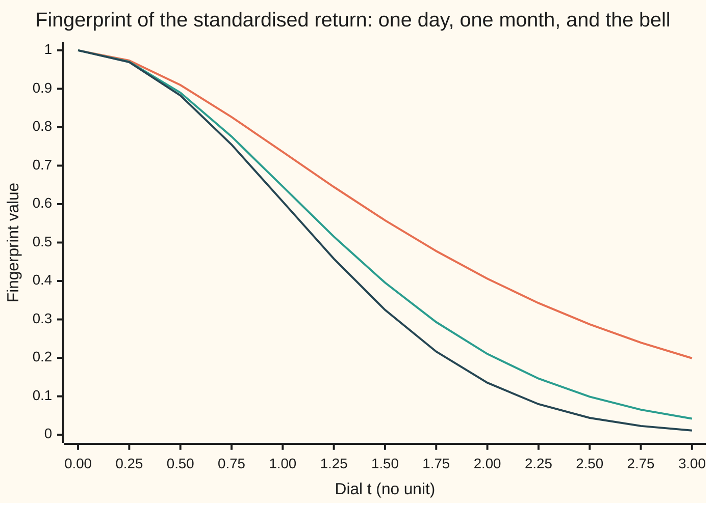

# The central limit theorem in four lines, once you have fingerprints

[Syllabus](../../../SYLLABUS.md) → [Harmonic analysis](../README.md) → [Characteristic Functions and Probability](../README.md#s04) → The central limit theorem in four lines, once you have fingerprints

---

## General Overview

A stock moves a little every trading day. Its daily log return (the natural log of today's closing price over yesterday's) has a standard deviation of 1.5 % in this card's model. Log returns add, so a month of 21 trading days has a total return that is the sum of 21 daily returns.

Daily returns are not bell-shaped. Big days come far too often for a bell curve. The model here is the Student t law with 3 degrees of freedom (a bell-like law with much heavier tails), scaled to the right spread: a standard choice for fat-tailed returns, used here as an illustration, not fitted to a real stock. Under it, a fall of three standard deviations or more happens on 0.006923 of days. The bell curve says 0.001350, about five times rarer.

A risk manager asks a monthly question: how often is the month's log return −10 % or worse, a price fall of 9.52 % or more? Call that a 10 % monthly loss, measured in log return. The month's standard deviation is 6.873864 %, so the loss is 1.454786 month standard deviations below zero. The bell curve answers 0.072864. The true chance, computed on this card, is 0.061429. The bell is roughly right for the month, though it was badly wrong for the day.

The central limit theorem explains why the month is near the bell. This card proves it with the **fingerprint** of a law, its characteristic function: the average of $`e^{itX}`$ over the law, where X is the random quantity and t is a dial, the real number at which the fingerprint is read ([Characteristic functions](01-characteristic-functions-in-depth.md)). Fingerprints turn sums of independent quantities into products, and products are easy to take to the limit.

**Expand one day's fingerprint to second order, raise it to the 21st power (the n-th power for n days), let n grow and the result is $`e^{-t^2/2}`$, the bell curve's fingerprint; Lévy's continuity theorem then turns converging fingerprints into converging chances.**

**What kind of fact this is:** a theorem, proved in full on this card in Why it works. The Student t model for daily returns is a model: an assumption that fits real returns well enough to illustrate, not a law of markets.

### The picture: one day's fingerprint, a month's, and the bell's



Orange is one standardised day, $`(1 + \lvert t\rvert)e^{-\lvert t\rvert}`$. Green is the standardised month of 21 days. Dark blue is the bell's fingerprint, $`e^{-t^2/2}`$. The month already hugs the bell; at t = 1 it reads 0.6457 against 0.6065. Both checks print every point.

---

## The formula

Two earlier cards already run these steps. [Central limit theorem](../../09-Probability%20and%20statistics/06-Limit%20Theorems%20in%20Practice/02-central-limit-theorem.md) does it with moment generating functions, $`E[e^{sX}]`$, on dice. That average can be infinite: for this card's daily return it is infinite at every s other than 0, because $`e^{sy}`$ outgrows a density that falls like $`y^{-4}`$. The fingerprint never fails, since $`\lvert e^{itX}\rvert = 1`$, so it needs no bounded readings and no generating function.

[The central limit theorem, proved](../../10-Measure%20and%20integration/10-The%20Limit%20Theorems%2C%20Proved/07-central-limit-theorem.md) proves the theorem by swapping one summand at a time and sketches the fingerprint road in a fold. This card lays that road out in full.

Notation, in words first:

- $`X_1, X_2, \dots`$ are the daily returns: independent, one law, mean $`\mu`$ = 0, standard deviation $`\sigma`$ = 1.5 %.
- $`Y_k = (X_k - \mu)/\sigma`$ is day k standardised: mean 0, variance 1.
- $`S_n = X_1 + \dots + X_n`$ is the total over n days, and $`Z_n = (S_n - n\mu)/(\sigma\sqrt{n})`$ is the standardised total.
- $`\varphi_Y(s) = E[e^{isY}]`$ is one day's fingerprint at dial s, with i the imaginary unit; $`\varphi_{Z_n}(t)`$ is the total's.
- $`\Phi(x)`$ is the bell curve's chance of landing at or below x ([Normal](../../09-Probability%20and%20statistics/04-Continuous%20Distributions/04-normal-distribution.md)).

The four lines:

```math
\varphi_{Z_n}(t) \;=\; \varphi_Y\!\big(t/\sqrt{n}\big)^{n} \;=\; \Big(1 - \frac{t^2}{2n} + r\big(t/\sqrt{n}\big)\Big)^{n} \;\longrightarrow\; e^{-t^2/2} \quad\Longrightarrow\quad P(Z_n \le x) \to \Phi(x)
```

**Read it aloud:** the month's fingerprint is one day's fingerprint at a shrunken dial, raised to the number of days; to second order that is one minus t squared over 2n, plus a small remainder r; raised to the n-th power it tends to the bell's fingerprint, so the month's chances tend to the bell's.

In the example, at t = 1 and n = 21: one day's fingerprint at $`1/\sqrt{21}`$ is 0.979386577, its 21st power is 0.645709, and the limit is $`e^{-1/2}`$ = 0.606531.

| Symbol | Plain meaning | In our example | Push it up and the answer… |
| --- | --- | --- | --- |
| $`n`$ | number of independent days added | 21, a trading month | the fingerprint moves toward the bell |
| $`\mu`$, $`\sigma`$ | mean and standard deviation of one day | 0 and 1.5 % | the month's spread grows with it; $`Z_n`$ does not change |
| $`Y`$, $`Y_k`$ | one day, standardised: mean 0, variance 1 | Student t, 3 degrees, scaled | — |
| $`X_k`$, $`S_n`$, $`Z_n`$ | day k's return; total return; total standardised by $`\sigma\sqrt{n}`$ | one day's return; month's return; return / 6.873864 % | — |
| $`t`$, $`s`$ | the dial of the total's fingerprint; one day's dial, $`s = t/\sqrt{n}`$ | t = 1, s = 0.218218 | a higher dial probes finer detail of the law |
| $`\varphi_Y`$, $`\varphi_{Z_n}`$ | fingerprints, $`E[e^{isY}]`$ and $`E[e^{itZ_n}]`$ | 0.979386577 and 0.645709 | — |
| $`r(s)`$ | what is left of $`\varphi_Y(s)`$ after $`1 - s^2/2`$ | 0.003196 | shrinks faster than $`s^2`$ |
| $`a`$, $`b`$ | two complex numbers of size at most 1, in the product lemma | 0.979386577 and 1 − 1/42 | — |
| $`x`$, $`\Phi(x)`$ | a level; the bell's chance of being at or below it | −1.454786; 0.072864 | rises from 0 to 1 |
| $`e^{-t^2/2}`$ | the fingerprint of the standard bell curve | 0.606531 at t = 1 | — |

### When it holds

- **Independent days.** Line 1 needs the fingerprint of a sum to be the product of fingerprints. Copy one day 21 times and the month is one day made 21 times larger. Standardised by its own spread, 21σ rather than σ√21, it is one day again: its fingerprint stays 0.735759 at t = 1 for every n.
- **Finite variance.** Line 2 needs the second-order term. Cauchy days have none, and their fingerprints head to 1 at t = 0 and 0 everywhere else, which is no fingerprint at all.
- **The square root of n.** Divide the total by n instead and the fingerprint tends to 1: the law of large numbers, a spike at 0, not a bell.
- **One law for every day.** The four lines need identical copies. Different laws still work under Lindeberg's condition, proved on [The central limit theorem, proved](../../10-Measure%20and%20integration/10-The%20Limit%20Theorems%2C%20Proved/07-central-limit-theorem.md).
- **A limit, not a number at a given n.** The theorem fixes x and lets n grow. At n = 21 the far tail is still 35.4 times the bell's (Step 6).

---

## Why it works

### Step 0: the idea, in words

Adding independent quantities is hard on laws: it takes a convolution, a running sum over every way to split the total. On fingerprints it is easy: the fingerprint of a sum is the product of the fingerprints. Rescaling the total just shrinks the dial.

So the month's fingerprint is one day's fingerprint, evaluated near zero, raised to a high power. Near zero, every law with mean 0 and variance 1 looks the same to second order: $`1 - s^2/2`$. Raise that to the n-th power and you get the bell's fingerprint, whatever the day looked like. The rest of the proof is bookkeeping on the small remainder.

### Step 1: line 1, sums become products

For independent Y and W, $`E[e^{it(Y + W)}] = E[e^{itY}]\,E[e^{itW}]`$: the average of a product of independent quantities is the product of the averages. With n days, $`Z_n = (Y_1 + \dots + Y_n)/\sqrt{n}`$, so

```math
\varphi_{Z_n}(t) = E\big[e^{i(t/\sqrt{n})Y_1}\big] \cdots E\big[e^{i(t/\sqrt{n})Y_n}\big] = \varphi_Y\big(t/\sqrt{n}\big)^{n}
```

For the scaled Student t day, $`\varphi_Y(s) = (1 + \lvert s\rvert)e^{-\lvert s\rvert}`$. The code confirms this closed form against the defining integral, $`\int \cos(sy)\, \frac{2}{\pi(1 + y^2)^2}\, dy`$, cut at $`\lvert y\rvert`$ = 400 with a tail of at most 0.000000007: both give 0.979386577 at $`s = 1/\sqrt{21}`$. The law is symmetric, so the fingerprint is real.

### Step 2: line 2, the second-order expansion

[Moments and cumulants](02-moments-and-cumulants-from-the-fingerprint.md) shows that a law with a finite variance has a fingerprint with two derivatives at 0, given by its moments. With mean 0 and variance 1:

```math
\varphi_Y(s) = 1 - \frac{s^2}{2} + r(s), \qquad \lvert r(s)\rvert \le s^2\, E\Big[\min\Big(\frac{\lvert s\rvert\,\lvert Y\rvert^3}{6},\; Y^2\Big)\Big]
```

**Read it aloud:** one day's fingerprint is one minus half the dial squared, plus a remainder that is a vanishing fraction of the dial squared.

The bound comes from a sharp Taylor estimate for $`e^{iy}`$, proved in the fold below. The average on the right tends to 0 as s shrinks, because the minimum is at most $`Y^2`$, which has a finite average, and tends to 0 at every outcome. Only the variance is used: no third moment, no generating function.

Our day has no third moment: $`E\lvert Y\rvert^3`$ is infinite, since $`\lvert y\rvert^3`$ times a density falling like $`y^{-4}`$ does not have a finite integral. The remainder still shrinks. Here $`r(s) = s^3/3 - s^4/8 + \dots`$ for s > 0. At $`s = 1/\sqrt{21}`$, $`1 - s^2/2`$ = 0.976190 and r = 0.003196, near the leading term $`s^3/3`$ = 0.003464.

### Step 3: line 3, the product lemma

Powers of numbers of size at most 1 cannot drift apart faster than n times their gap:

```math
\lvert a^n - b^n\rvert \le n\,\lvert a - b\rvert \qquad \text{whenever } \lvert a\rvert \le 1,\ \lvert b\rvert \le 1
```

The reason is a telescoping sum, $`a^n - b^n = \sum_{k=1}^{n} a^{k-1}(a - b)\,b^{n-k}`$: n terms, each of size at most $`\lvert a - b\rvert`$.

A fingerprint has size at most 1, since it averages numbers of size 1. Take $`a = \varphi_Y(t/\sqrt{n})`$ and $`b = 1 - t^2/(2n)`$, which lies between 0 and 1 once $`n \ge t^2/2`$. Then

```math
\Big\lvert \varphi_{Z_n}(t) - \Big(1 - \frac{t^2}{2n}\Big)^{n} \Big\rvert \le n\,\big\lvert r\big(t/\sqrt{n}\big)\big\rvert \le t^2\, E\Big[\min\Big(\frac{\lvert t\rvert\,\lvert Y\rvert^3}{6\sqrt{n}},\; Y^2\Big)\Big] \to 0
```

In the example at t = 1: the gap between 0.645709 and $`(1 - 1/42)^{21}`$ = 0.602873 is 0.042836, inside the allowance $`21\lvert r\rvert`$ = 0.067118.

The table follows the allowance as n grows. For this day it falls like $`1/(3\sqrt{n})`$, because $`r(s)`$ is close to $`s^3/3`$.

| n | $`\varphi_{Z_n}(1)`$ | minus $`e^{-1/2}`$ | allowance $`n\lvert r(1/\sqrt{n})\rvert`$ |
| ---: | ---: | ---: | ---: |
| 1 | 0.735759 | 0.129228 | 0.235759 |
| 2 | 0.708494 | 0.101963 | 0.183442 |
| 5 | 0.678502 | 0.071971 | 0.126795 |
| 21 | 0.645709 | 0.039179 | 0.067118 |
| 100 | 0.625639 | 0.019108 | 0.032116 |
| 1000 | 0.612808 | 0.006278 | 0.010417 |

### Step 4: line 4, the limit is the bell's fingerprint

$`(1 - t^2/(2n))^n \to e^{-t^2/2}`$: this is the limit behind continuous compounding, $`(1 + x/n)^n \to e^x`$, run with $`x = -t^2/2`$ ([Compounding more often, and the number e](../../01-Foundations/04-Compound%20Growth%20and%20Discounting/04-compounding-frequency-and-e.md)). With Step 3, $`\varphi_{Z_n}(t) \to e^{-t^2/2}`$ at every dial t. That is pointwise convergence of fingerprints.

$`e^{-t^2/2}`$ is the fingerprint of the standard bell curve. The code checks it at t = 1 by integrating $`\cos(y)\,e^{-y^2/2}/\sqrt{2\pi}`$ from −10 to 10: 0.606531, the same as $`e^{-1/2}`$.

### Step 5: recognise the bell, and hand over to Lévy

[Levy's continuity theorem](04-levy-continuity-theorem.md): if the fingerprints of a sequence of laws converge at every dial to the fingerprint of a law, the laws converge in distribution to it. Convergence in distribution means $`P(Z_n \le x) \to \Phi(x)`$ at every level x where the limit is continuous; for the bell, that is every x.

Which modes of convergence hold, and which fail:

- **What converges:** the fingerprints, at every t; and the chances $`P(Z_n \le x)`$, at every x.
- **What does not:** $`Z_n`$ itself never settles on a value. $`Z_{4n} - Z_n`$ has an average square of exactly 1 for every n, by adding variances. In 20,000 simulated quarters, $`Z_{84} - Z_{21}`$ has mean square 0.978091, and it moves by more than 1 in 0.290850 of them. That difference is the last 63 days minus the first 21, over $`\sqrt{84}`$. The day's law is symmetric, so flipping the sign of 21 days changes nothing: $`Z_{84} - Z_{21}`$ has exactly the law of $`Z_{84}`$, and inversion gives 0.295144. As n grows that chance tends to the bell's 0.317311, not to 0. Convergence in probability fails.

For the 10 % monthly loss, the code turns the month's fingerprint back into a chance by Gil-Pelaez inversion, one integral that recovers $`P(Z_n \le x)`$ from the fingerprint ([Levy's inversion formula](03-levy-inversion-and-uniqueness.md)), cut at dial 40 with a tail below $`10^{-12}`$. It gives 0.061429. Simulating 80,000 months gives 0.060750, with a standard error (the typical size of the simulation's random error) of 0.000849. The bell gives 0.072864.

<details>
<summary>Detailed proof: the Taylor bound, the remainder, the product lemma and the limit</summary>

**1. The bound for $`e^{iy}`$.** For real y, integrate by parts: $`e^{iy} - (1 + iy - y^2/2) = \frac{i^3}{2}\int_0^y (y - u)^2 e^{iu}\, du`$. The integrand has size at most $`(y - u)^2`$, so the left side has size at most $`\lvert y\rvert^3/6`$. Also $`e^{iy} - (1 + iy) = i^2\int_0^y (y - u)e^{iu}\, du`$ has size at most $`y^2/2`$, so the left side has size at most $`y^2/2 + y^2/2 = y^2`$. Hence

$`\displaystyle \big\lvert e^{iy} - (1 + iy - y^2/2)\big\rvert \le \min\big(\lvert y\rvert^3/6,\; y^2\big).`$

**2. The remainder.** Put $`y = sY`$ and average. With $`E[Y] = 0`$ and $`E[Y^2] = 1`$, $`E[1 + isY - s^2Y^2/2] = 1 - s^2/2`$, so

$`\displaystyle \lvert r(s)\rvert = \big\lvert \varphi_Y(s) - (1 - s^2/2)\big\rvert \le E\big[\min(\lvert s\rvert^3\lvert Y\rvert^3/6,\; s^2Y^2)\big] = s^2\,E\big[\min(\lvert s\rvert\,\lvert Y\rvert^3/6,\; Y^2)\big].`$

As $`s \to 0`$, the minimum tends to 0 at every outcome and is at most $`Y^2`$, whose average is 1. By dominated convergence (a limit passes inside an average when one function with a finite average bounds every term, [Dominated convergence](../../10-Measure%20and%20integration/05-Swapping%20Limits%20and%20Integrals/02-dominated-convergence-theorem.md)), the average tends to 0.

**3. The product lemma.** For complex a, b with $`\lvert a\rvert, \lvert b\rvert \le 1`$:

$`\displaystyle a^n - b^n = \sum_{k=1}^{n} a^{k-1}(a - b)\,b^{n-k},`$

because the sum telescopes: term k is $`a^k b^{n-k} - a^{k-1}b^{n-k+1}`$. Each term has size at most $`\lvert a - b\rvert`$, so $`\lvert a^n - b^n\rvert \le n\lvert a - b\rvert`$.

**4. Applying it.** Fix t. $`\lvert\varphi_Y(s)\rvert \le E\lvert e^{isY}\rvert = 1`$. For $`n \ge t^2/2`$, $`b = 1 - t^2/(2n)`$ lies in $`[0, 1]`$. Then $`\lvert\varphi_{Z_n}(t) - b^n\rvert \le n\,\lvert r(t/\sqrt{n})\rvert \le t^2\,E[\min(\lvert t\rvert\lvert Y\rvert^3/(6\sqrt{n}),\, Y^2)]`$, which tends to 0 by part 2.

**5. The limit of $`b^n`$.** For $`n \ge t^2`$ and $`0 \le u \le 1/2`$, $`-u - u^2 \le \log(1 - u) \le -u`$. With $`u = t^2/(2n)`$, $`n\log(1 - u)`$ lies between $`-t^2/2 - t^4/(4n)`$ and $`-t^2/2`$, so $`b^n \to e^{-t^2/2}`$.

**6. The bell's fingerprint.** For a standard normal quantity G, $`\varphi_G(t) = \int \cos(ty)\,e^{-y^2/2}\,dy/\sqrt{2\pi}`$ (the sine part cancels by symmetry). Differentiating under the integral and integrating by parts gives $`\varphi_G'(t) = -t\,\varphi_G(t)`$ with $`\varphi_G(0) = 1`$, so $`\varphi_G(t) = e^{-t^2/2}`$.

**7. Conclusion.** The fingerprints of $`Z_n`$ converge at every t to the fingerprint of the standard normal law. By Lévy's continuity theorem, $`Z_n`$ converges in distribution to it: $`P(Z_n \le x) \to \Phi(x)`$ for every x, since $`\Phi`$ is continuous.

</details>

### Step 6: what the four lines do not say

The theorem fixes the level x and lets n grow. It says nothing about how far out the bell is trustworthy at a given n. Fat tails fade slowly, because a sum's far tail is mostly one huge day.

| n | chance at or below −3 | chance at or below −4 |
| ---: | ---: | ---: |
| 1 | 0.006923 | 0.003083 |
| 5 | 0.005305 | 0.001933 |
| 21 | 0.003833 | 0.001122 |
| 100 | 0.002679 | 0.000579 |
| 1000 | 0.001814 | 0.000214 |
| bell | 0.001350 | 0.000032 |

```
Chance of a standardised total at or below -3 (one # per 0.0002)
  n = 1    |###################################| 0.006923
  n = 5    |###########################        | 0.005305
  n = 21   |###################                | 0.003833
  n = 100  |#############                      | 0.002679
  n = 1000 |#########                          | 0.001814
  bell     |#######                            | 0.001350
```

At n = 21, a month four standard deviations down is 35.4 times as likely as the bell says. A simulation of 80,000 months puts the chance at or below −3 at 0.003700, beside the inverted 0.003833. How fast the gap closes is the subject of [How big must n be](06-berry-esseen-and-the-rate.md); its Berry–Esseen bound needs a finite third moment, which this day lacks.

---

## Worked numbers, by hand

The question: the chance of a monthly log return of −10 % or worse (a price fall of 9.52 % or more), for a stock with 1.5 % daily standard deviation and Student t days.

| Step | Arithmetic | Value |
| --- | --- | --- |
| month's standard deviation | 1.5 × √21 | 6.873864 % |
| standardised cut | −10 / 6.873864 | −1.454786 |
| one day's dial at t = 1 | s = 1/√21 | 0.218218 |
| one day's fingerprint | (1 + 0.218218) × e^(−0.218218) | 0.979386577 |
| second-order part | 1 − s²/2 = 1 − 1/42 | 0.976190 |
| remainder r | 0.979386577 − 0.976190 | 0.003196 |
| line 3: month's fingerprint | 0.979386577^21 | 0.645709 |
| second-order part, to the 21st | (1 − 1/42)^21 | 0.602873 |
| product lemma allowance | 21 × 0.003196, against the actual gap 0.042836 | 0.067118 |
| line 4: the limit | e^(−1/2) | 0.606531 |
| bell's chance of the loss | Φ(−1.454786) | 0.072864 |
| one day's law at the same cut | closed form of the scaled t law | 0.043097 |
| true chance for the month | inversion of the month's fingerprint | **0.061429** |

Under this model, a log return of −10 % or worse comes in 0.061429 of months. The bell says 0.072864, a little too high. One day's own law at the same cut, 0.043097, is further off in the other direction: the month sits between the day and the bell, nearer the bell.

### What breaks if you drop a piece

| Mistake | Comes out at | What went wrong |
| --- | --- | --- |
| Divide the total by n, not √n | fingerprint at t = 1: 0.977185 at n = 21, 0.999500 at n = 1000, heading to 1 | That is the law of large numbers: the fingerprint of the constant 0, a spike, not a bell |
| One day copied 21 times: no independence | standardised by its own spread nσ: fingerprint 0.735759 and chance 0.043097, the same at every n | Line 1 fails: the fingerprint of a sum is a product only for independent parts |
| Cauchy days: no variance | fingerprint of the total over √n at t = 1: 0.010229 at n = 21, 0.000000 at n = 1000 | The limit is 1 at t = 0 and 0 elsewhere, not continuous at 0, so no law; the mean of n Cauchy days has fingerprint $`e^{-\lvert t\rvert}`$, 0.367879 at t = 1 for every n, as spread as one day ([Heavy tails](../../09-Probability%20and%20statistics/04-Continuous%20Distributions/08-heavy-tails-pareto-and-cauchy.md)) |
| Expect $`Z_n`$ itself to settle | $`Z_{84} - Z_{21}`$: mean square 0.978091, beyond 1 in 0.290850 of quarters | Only the law converges; the values never do |

---

## Code, from first principles, and it actually runs

Both programs write out every fingerprint, the bell's chance as one series, Simpson's rule for integrals, Gil-Pelaez inversion and SplitMix64, a small random number generator, with seed 20261115. They take three roads to the month's law: the closed-form fingerprint against its defining integral and a simulated average; inversion of the fingerprint against the closed-form one-day law; and inversion against 80,000 simulated months. The `math.erf` line is a library cross-check only, and only in Python.

### Python

```python
# The central limit theorem by fingerprints -- the check behind the card.
# Model (illustrative): a stock's daily log return is 1.5 % times Y, where Y is
# a Student t law with 3 degrees of freedom scaled to variance 1: density
# 2/(pi (1 + y^2)^2), fingerprint (1 + |s|) exp(-|s|).  A month is 21 days.
# Roads: closed-form fingerprint against its defining integral and simulation;
# inversion of the fingerprint against the closed-form law and simulation.
import math
SIGMA, N, LOSS, CUT = 1.5, 21, 10.0, 40.0
def phi_y(s):                            # fingerprint of one standardised day
    s = abs(s)
    return (1 + s) * math.exp(-s)
def phi_z(t, n):                         # line 1: sums -> products, scale -> argument
    return phi_y(t / math.sqrt(n)) ** n
def big_phi(x):                          # normal law, one series written out
    term, total, k = x, x, 0
    while abs(term) > 1e-17:
        k += 1
        term *= -x * x / (2 * k)
        total += term / (2 * k + 1)
    return 0.5 + total / math.sqrt(2 * math.pi)
def add(xs):                             # plain left-to-right sum, as in Rust
    total = 0.0
    for x in xs:
        total += x
    return total
def simpson(f, a, b, m):                 # m even
    h = (b - a) / m
    s = f(a) + f(b) + add((4 if k % 2 else 2) * f(a + k * h) for k in range(1, m))
    return s * h / 3
def cdf(x, n, cut=CUT):                  # Gil-Pelaez inversion of a real, even fingerprint
    g = lambda t: x if t == 0 else math.sin(t * x) / t * phi_z(t, n)
    return 0.5 + simpson(g, 0.0, cut, 40000) / math.pi
def tail_bound(n, cut=CUT):              # |integral beyond cut| / pi, phi_y falling on s > 0
    a = cut / math.sqrt(n)
    return phi_y(a) ** (n - 1) * math.sqrt(n) * (a + 2) * math.exp(-a) / cut / math.pi
def cdf_one_day(x):                      # closed form of the scaled t law, 3 degrees
    return 0.5 + (math.atan(x) + x / (1 + x * x)) / math.pi
state = 20261115                         # SplitMix64, seed 20261115
def unif():
    global state
    state = (state + 0x9E3779B97F4A7C15) & 0xFFFFFFFFFFFFFFFF
    z = state
    z = ((z ^ (z >> 30)) * 0xBF58476D1CE4E5B9) & 0xFFFFFFFFFFFFFFFF
    z = ((z ^ (z >> 27)) * 0x94D049BB133111EB) & 0xFFFFFFFFFFFFFFFF
    return ((z ^ (z >> 31)) >> 11) / 9007199254740992.0
def normals():                           # Box-Muller: two standard normals
    r = math.sqrt(-2 * math.log(1 - unif()))
    a = 2 * math.pi * unif()
    return r * math.cos(a), r * math.sin(a)
def day():                               # t law, 3 degrees, scaled to variance 1
    g0, g1 = normals()
    g2, g3 = normals()
    return g0 / math.sqrt(g1 * g1 + g2 * g2 + g3 * g3)
z_loss = -LOSS / (SIGMA * math.sqrt(N))
s = 1 / math.sqrt(N)
dens = lambda y: 2 / (math.pi * (1 + y * y) * (1 + y * y))
by_integral = 2 * simpson(lambda y: math.cos(s * y) * dens(y), 0.0, 400.0, 80000)
print(f"one day: sd {SIGMA:.1f} %; month: {N} days, sd {SIGMA * math.sqrt(N):.6f} %")
print(f"a monthly log return of -{LOSS:.0f} % (a price fall of {100 * (1 - math.exp(-LOSS / 100)):.2f} %) is z = "
      f"{z_loss:.6f} month standard deviations")
print(f"fingerprint of one day at s = 1/sqrt(21) = {s:.6f}: closed form {phi_y(s):.9f}")
print(f"  by its defining integral to |y| = 400 (tail at most 0.000000007): {by_integral:.9f}")
r = phi_y(s) - (1 - s * s / 2)
print(f"line 2: 1 - s^2/2 = {1 - s * s / 2:.6f}; remainder r = {r:.6f}; |s|^3/3 = {s ** 3 / 3:.6f}")
a21, b21 = phi_z(1, N), (1 - 1 / (2 * N)) ** N
print(f"line 3 at t = 1: fingerprint^21 {a21:.6f}; (1 - 1/42)^21 {b21:.6f}; gap {abs(a21 - b21):.6f}"
      f" <= 21|r| = {N * abs(r):.6f}")
print(f"line 4: exp(-1/2) = {math.exp(-0.5):.6f}; bell fingerprint by integral "
      f"{simpson(lambda y: math.cos(y) * math.exp(-y * y / 2), -10, 10, 4000) / math.sqrt(2 * math.pi):.6f}")
print("n, fingerprint of Z_n at t = 1, minus exp(-1/2), n|r(1/sqrt n)|")
for n in [1, 2, 5, 21, 100, 1000]:
    rn = phi_y(1 / math.sqrt(n)) - 1 + 1 / (2 * n)
    print(f"  {n:4d}  {phi_z(1, n):.6f}  {phi_z(1, n) - math.exp(-0.5):.6f}  {n * abs(rn):.6f}")
print("chart t, fingerprint n = 1, n = 21, exp(-t^2/2)")
for k in range(13):
    t = k / 4
    print(f"  {t:.2f}  {phi_z(t, 1):.4f}  {phi_z(t, N):.4f}  {math.exp(-t * t / 2):.4f}")
p1, p21, pn = cdf(z_loss, 1), cdf(z_loss, N), big_phi(z_loss)
print(f"chance of a month at or below z, by inversion (cut-off t = {CUT:.0f}, tail below 1e-12: "
      f"{'yes' if max(tail_bound(1), tail_bound(N)) < 1e-12 else 'no'}):")
print(f"  one day's law {p1:.6f} (closed form {cdf_one_day(z_loss):.6f}); month {p21:.6f}; bell {pn:.6f}")
print("far tail: chance at or below -3 and -4 standard deviations")
tails = {}
for n in [1, 5, 21, 100, 1000]:
    tails[n] = (cdf(-3, n), cdf(-4, n))
    print(f"  n = {n:4d}  {tails[n][0]:.6f}  {tails[n][1]:.6f}")
print(f"  bell      {big_phi(-3):.6f}  {big_phi(-4):.6f};  ratio at -4, n = 21: {tails[21][1] / big_phi(-4):.1f}")
print("bars: chance at or below -3, one # per 0.0002")
for n in [1, 5, 21, 100, 1000]:
    print(f"  n = {n:<5d}|{'#' * round(tails[n][0] / 0.0002):<35}| {tails[n][0]:.6f}")
print(f"  bell     |{'#' * round(big_phi(-3) / 0.0002):<35}| {big_phi(-3):.6f}")
M = 20000                                # quarters of 84 days = 80,000 months
hits = hits3 = moved = 0
cos_sum = sq_sum = 0.0
for q in range(M):
    days = [day() for _ in range(84)]
    for m in range(4):
        zm = add(days[21 * m: 21 * m + 21]) / math.sqrt(N)
        hits += zm <= z_loss
        hits3 += zm <= -3
        cos_sum += math.cos(zm)
    z21, z84 = add(days[:21]) / math.sqrt(21), add(days) / math.sqrt(84)
    moved += abs(z84 - z21) > 1
    sq_sum += (z84 - z21) * (z84 - z21)
p_sim, se = hits / (4 * M), math.sqrt(p21 * (1 - p21) / (4 * M))
print(f"simulation, {4 * M} months, seed 20261115: at or below z {p_sim:.6f} (se {se:.6f}); "
      f"below -3 {hits3 / (4 * M):.6f}")
print(f"  fingerprint at t = 1 by averaging cos: {cos_sum / (4 * M):.6f}")
p84 = 2 * cdf(-1, 84)                    # Z_84 - Z_21 has the law of Z_84: the days are symmetric
print(f"  Z_84 - Z_21: mean square {sq_sum / M:.6f} (expected 1 at every n); beyond 1 in {moved / M:.6f}"
      f" of quarters, exact {p84:.6f}, bell {2 * (1 - big_phi(1)):.6f}")
print(f"break 1, divide by n, not sqrt n: fingerprint at t = 1 is {phi_y(1 / N) ** N:.6f}, n = 1000:"
      f" {phi_y(1 / 1000) ** 1000:.6f}")
print(f"break 2, one day copied 21 times: fingerprint {phi_y(1):.6f}, chance at or below z {p1:.6f}")
print(f"break 3, Cauchy days: fingerprint of sum/sqrt n at t = 1: n = 21 {math.exp(-math.sqrt(21)):.6f},"
      f" n = 1000 {math.exp(-math.sqrt(1000)):.6f}; mean of n: {math.exp(-1):.6f} for every n")
assert abs(by_integral - phi_y(s)) < 1e-8                      # closed form = defining integral
assert abs(cdf(z_loss, 1) - cdf_one_day(z_loss)) < 1e-10       # inversion = closed-form law
assert abs(cdf(-3, 1) - cdf_one_day(-3)) < 1e-10
assert abs(a21 - b21) <= N * abs(r)                            # the product lemma
assert abs(p_sim - p21) < 4 * se                               # inversion = simulation
assert abs(cos_sum / (4 * M) - a21) < 0.006                    # fingerprint = simulation
assert abs(moved / M - p84) < 4 * math.sqrt(p84 * (1 - p84) / M)  # law of Z_84 = simulation
assert abs(phi_z(1, 10 ** 6) - math.exp(-0.5)) < 0.001         # the limit is the bell's
assert abs(big_phi(z_loss) - 0.5 * (1 + math.erf(z_loss / math.sqrt(2)))) < 1e-12  # library
print("ALL CHECKS PASS")
```

**Ran 2026-11-15 on macOS, Python 3.14.10, standard library only. All checks passed. Output, pasted from the run:**

```
one day: sd 1.5 %; month: 21 days, sd 6.873864 %
a monthly log return of -10 % (a price fall of 9.52 %) is z = -1.454786 month standard deviations
fingerprint of one day at s = 1/sqrt(21) = 0.218218: closed form 0.979386577
  by its defining integral to |y| = 400 (tail at most 0.000000007): 0.979386577
line 2: 1 - s^2/2 = 0.976190; remainder r = 0.003196; |s|^3/3 = 0.003464
line 3 at t = 1: fingerprint^21 0.645709; (1 - 1/42)^21 0.602873; gap 0.042836 <= 21|r| = 0.067118
line 4: exp(-1/2) = 0.606531; bell fingerprint by integral 0.606531
n, fingerprint of Z_n at t = 1, minus exp(-1/2), n|r(1/sqrt n)|
     1  0.735759  0.129228  0.235759
     2  0.708494  0.101963  0.183442
     5  0.678502  0.071971  0.126795
    21  0.645709  0.039179  0.067118
   100  0.625639  0.019108  0.032116
  1000  0.612808  0.006278  0.010417
chart t, fingerprint n = 1, n = 21, exp(-t^2/2)
  0.00  1.0000  1.0000  1.0000
  0.25  0.9735  0.9703  0.9692
  0.50  0.9098  0.8899  0.8825
  0.75  0.8266  0.7758  0.7548
  1.00  0.7358  0.6457  0.6065
  1.25  0.6446  0.5153  0.4578
  1.50  0.5578  0.3956  0.3247
  1.75  0.4779  0.2931  0.2163
  2.00  0.4060  0.2102  0.1353
  2.25  0.3425  0.1462  0.0796
  2.50  0.2873  0.0989  0.0439
  2.75  0.2397  0.0652  0.0228
  3.00  0.1991  0.0419  0.0111
chance of a month at or below z, by inversion (cut-off t = 40, tail below 1e-12: yes):
  one day's law 0.043097 (closed form 0.043097); month 0.061429; bell 0.072864
far tail: chance at or below -3 and -4 standard deviations
  n =    1  0.006923  0.003083
  n =    5  0.005305  0.001933
  n =   21  0.003833  0.001122
  n =  100  0.002679  0.000579
  n = 1000  0.001814  0.000214
  bell      0.001350  0.000032;  ratio at -4, n = 21: 35.4
bars: chance at or below -3, one # per 0.0002
  n = 1    |###################################| 0.006923
  n = 5    |###########################        | 0.005305
  n = 21   |###################                | 0.003833
  n = 100  |#############                      | 0.002679
  n = 1000 |#########                          | 0.001814
  bell     |#######                            | 0.001350
simulation, 80000 months, seed 20261115: at or below z 0.060750 (se 0.000849); below -3 0.003700
  fingerprint at t = 1 by averaging cos: 0.645166
  Z_84 - Z_21: mean square 0.978091 (expected 1 at every n); beyond 1 in 0.290850 of quarters, exact 0.295144, bell 0.317311
break 1, divide by n, not sqrt n: fingerprint at t = 1 is 0.977185, n = 1000: 0.999500
break 2, one day copied 21 times: fingerprint 0.735759, chance at or below z 0.043097
break 3, Cauchy days: fingerprint of sum/sqrt n at t = 1: n = 21 0.010229, n = 1000 0.000000; mean of n: 0.367879 for every n
ALL CHECKS PASS
```

### Rust

```rust
// The central limit theorem by fingerprints -- the check behind the card.
// Model (illustrative): a stock's daily log return is 1.5 % times Y, where Y is
// a Student t law with 3 degrees of freedom scaled to variance 1: density
// 2/(pi (1 + y^2)^2), fingerprint (1 + |s|) exp(-|s|).  A month is 21 days.
// Roads: closed-form fingerprint against its defining integral and simulation;
// inversion of the fingerprint against the closed-form law and simulation.
use std::f64::consts::PI;
const SIGMA: f64 = 1.5;
const N: usize = 21;
const LOSS: f64 = 10.0;
const CUT: f64 = 40.0;
fn phi_y(s: f64) -> f64 { // fingerprint of one standardised day
    let s = s.abs();
    (1.0 + s) * (-s).exp()
}
fn phi_z(t: f64, n: usize) -> f64 { // line 1: sums -> products, scale -> argument
    phi_y(t / (n as f64).sqrt()).powf(n as f64)
}
fn big_phi(x: f64) -> f64 { // normal law, one series written out
    let (mut term, mut total, mut k) = (x, x, 0.0);
    while term.abs() > 1e-17 {
        k += 1.0;
        term *= -x * x / (2.0 * k);
        total += term / (2.0 * k + 1.0);
    }
    0.5 + total / (2.0 * PI).sqrt()
}
fn simpson(f: &dyn Fn(f64) -> f64, a: f64, b: f64, m: usize) -> f64 { // m even
    let h = (b - a) / m as f64;
    let mut acc = 0.0;
    for k in 1..m {
        acc += (if k % 2 == 1 { 4.0 } else { 2.0 }) * f(a + k as f64 * h);
    }
    (f(a) + f(b) + acc) * h / 3.0
}
fn cdf(x: f64, n: usize) -> f64 { // Gil-Pelaez inversion of a real, even fingerprint
    let g = |t: f64| if t == 0.0 { x } else { (t * x).sin() / t * phi_z(t, n) };
    0.5 + simpson(&g, 0.0, CUT, 40000) / PI
}
fn tail_bound(n: usize) -> f64 { // |integral beyond cut| / pi, phi_y falling on s > 0
    let (cut, rn) = (CUT, (n as f64).sqrt());
    let a = cut / rn;
    phi_y(a).powf((n - 1) as f64) * rn * (a + 2.0) * (-a).exp() / cut / PI
}
fn cdf_one_day(x: f64) -> f64 { // closed form of the scaled t law, 3 degrees
    0.5 + (x.atan() + x / (1.0 + x * x)) / PI
}
struct Rng(u64); // SplitMix64, seed 20261115
impl Rng {
    fn unif(&mut self) -> f64 {
        self.0 = self.0.wrapping_add(0x9E3779B97F4A7C15);
        let mut z = self.0;
        z = (z ^ (z >> 30)).wrapping_mul(0xBF58476D1CE4E5B9);
        z = (z ^ (z >> 27)).wrapping_mul(0x94D049BB133111EB);
        ((z ^ (z >> 31)) >> 11) as f64 / 9007199254740992.0
    }
    fn normals(&mut self) -> (f64, f64) { // Box-Muller: two standard normals
        let r = (-2.0 * (1.0 - self.unif()).ln()).sqrt();
        let a = 2.0 * PI * self.unif();
        (r * a.cos(), r * a.sin())
    }
    fn day(&mut self) -> f64 { // t law, 3 degrees, scaled to variance 1
        let (g0, g1) = self.normals();
        let (g2, g3) = self.normals();
        g0 / (g1 * g1 + g2 * g2 + g3 * g3).sqrt()
    }
}
fn add(xs: &[f64]) -> f64 { // plain left-to-right sum
    let mut total = 0.0;
    for x in xs { total += x; }
    total
}
fn main() {
    let nf = N as f64;
    let z_loss = -LOSS / (SIGMA * nf.sqrt());
    let s = 1.0 / nf.sqrt();
    let dens = |y: f64| 2.0 / (PI * (1.0 + y * y) * (1.0 + y * y));
    let by_integral = 2.0 * simpson(&|y: f64| (s * y).cos() * dens(y), 0.0, 400.0, 80000);
    println!("one day: sd {:.1} %; month: {} days, sd {:.6} %", SIGMA, N, SIGMA * nf.sqrt());
    println!("a monthly log return of -{:.0} % (a price fall of {:.2} %) is z = {:.6} month standard deviations",
             LOSS, 100.0 * (1.0 - (-LOSS / 100.0).exp()), z_loss);
    println!("fingerprint of one day at s = 1/sqrt(21) = {:.6}: closed form {:.9}", s, phi_y(s));
    println!("  by its defining integral to |y| = 400 (tail at most 0.000000007): {:.9}", by_integral);
    let r = phi_y(s) - (1.0 - s * s / 2.0);
    println!("line 2: 1 - s^2/2 = {:.6}; remainder r = {:.6}; |s|^3/3 = {:.6}", 1.0 - s * s / 2.0, r, s.powf(3.0) / 3.0);
    let (a21, b21) = (phi_z(1.0, N), (1.0 - 1.0 / (2.0 * nf)).powf(nf));
    println!("line 3 at t = 1: fingerprint^21 {:.6}; (1 - 1/42)^21 {:.6}; gap {:.6} <= 21|r| = {:.6}",
             a21, b21, (a21 - b21).abs(), nf * r.abs());
    let bell = simpson(&|y: f64| y.cos() * (-y * y / 2.0).exp(), -10.0, 10.0, 4000) / (2.0 * PI).sqrt();
    println!("line 4: exp(-1/2) = {:.6}; bell fingerprint by integral {:.6}", (-0.5f64).exp(), bell);
    println!("n, fingerprint of Z_n at t = 1, minus exp(-1/2), n|r(1/sqrt n)|");
    for n in [1usize, 2, 5, 21, 100, 1000] {
        let rn = phi_y(1.0 / (n as f64).sqrt()) - 1.0 + 1.0 / (2.0 * n as f64);
        println!("  {:4}  {:.6}  {:.6}  {:.6}", n, phi_z(1.0, n), phi_z(1.0, n) - (-0.5f64).exp(), n as f64 * rn.abs());
    }
    println!("chart t, fingerprint n = 1, n = 21, exp(-t^2/2)");
    for k in 0..13 {
        let t = k as f64 / 4.0;
        println!("  {:.2}  {:.4}  {:.4}  {:.4}", t, phi_z(t, 1), phi_z(t, N), (-t * t / 2.0).exp());
    }
    let (p1, p21, pn) = (cdf(z_loss, 1), cdf(z_loss, N), big_phi(z_loss));
    println!("chance of a month at or below z, by inversion (cut-off t = {:.0}, tail below 1e-12: {}):", CUT,
             if tail_bound(1).max(tail_bound(N)) < 1e-12 { "yes" } else { "no" });
    println!("  one day's law {:.6} (closed form {:.6}); month {:.6}; bell {:.6}", p1, cdf_one_day(z_loss), p21, pn);
    println!("far tail: chance at or below -3 and -4 standard deviations");
    let ns = [1usize, 5, 21, 100, 1000];
    let mut tails = Vec::new();
    for &n in ns.iter() {
        tails.push((cdf(-3.0, n), cdf(-4.0, n)));
        println!("  n = {:4}  {:.6}  {:.6}", n, tails.last().unwrap().0, tails.last().unwrap().1);
    }
    println!("  bell      {:.6}  {:.6};  ratio at -4, n = 21: {:.1}", big_phi(-3.0), big_phi(-4.0), tails[2].1 / big_phi(-4.0));
    println!("bars: chance at or below -3, one # per 0.0002");
    for (i, &n) in ns.iter().enumerate() {
        let bar = "#".repeat((tails[i].0 / 0.0002).round() as usize);
        println!("  n = {:<5}|{:<35}| {:.6}", n, bar, tails[i].0);
    }
    println!("  bell     |{:<35}| {:.6}", "#".repeat((big_phi(-3.0) / 0.0002).round() as usize), big_phi(-3.0));
    let m = 20000; // quarters of 84 days = 80,000 months
    let mut rng = Rng(20261115);
    let (mut hits, mut hits3, mut moved) = (0usize, 0usize, 0usize);
    let (mut cos_sum, mut sq_sum) = (0.0f64, 0.0f64);
    for _ in 0..m {
        let days: Vec<f64> = (0..84).map(|_| rng.day()).collect();
        for q in 0..4 {
            let zm = add(&days[21 * q..21 * q + 21]) / nf.sqrt();
            if zm <= z_loss { hits += 1; }
            if zm <= -3.0 { hits3 += 1; }
            cos_sum += zm.cos();
        }
        let (z21, z84) = (add(&days[..21]) / 21f64.sqrt(), add(&days) / 84f64.sqrt());
        if (z84 - z21).abs() > 1.0 { moved += 1; }
        sq_sum += (z84 - z21) * (z84 - z21);
    }
    let months = (4 * m) as f64;
    let (p_sim, se) = (hits as f64 / months, (p21 * (1.0 - p21) / months).sqrt());
    println!("simulation, {} months, seed 20261115: at or below z {:.6} (se {:.6}); below -3 {:.6}",
             4 * m, p_sim, se, hits3 as f64 / months);
    println!("  fingerprint at t = 1 by averaging cos: {:.6}", cos_sum / months);
    let p84 = 2.0 * cdf(-1.0, 84); // Z_84 - Z_21 has the law of Z_84: the days are symmetric
    println!("  Z_84 - Z_21: mean square {:.6} (expected 1 at every n); beyond 1 in {:.6} of quarters, exact {:.6}, bell {:.6}",
             sq_sum / m as f64, moved as f64 / m as f64, p84, 2.0 * (1.0 - big_phi(1.0)));
    println!("break 1, divide by n, not sqrt n: fingerprint at t = 1 is {:.6}, n = 1000: {:.6}",
             phi_y(1.0 / nf).powf(nf), phi_y(1.0 / 1000.0).powf(1000.0));
    println!("break 2, one day copied 21 times: fingerprint {:.6}, chance at or below z {:.6}", phi_y(1.0), p1);
    println!("break 3, Cauchy days: fingerprint of sum/sqrt n at t = 1: n = 21 {:.6}, n = 1000 {:.6}; mean of n: {:.6} for every n",
             (-(21f64).sqrt()).exp(), (-(1000f64).sqrt()).exp(), (-1.0f64).exp());
    assert!((by_integral - phi_y(s)).abs() < 1e-8); // closed form = defining integral
    assert!((cdf(z_loss, 1) - cdf_one_day(z_loss)).abs() < 1e-10); // inversion = closed-form law
    assert!((cdf(-3.0, 1) - cdf_one_day(-3.0)).abs() < 1e-10);
    assert!((a21 - b21).abs() <= nf * r.abs()); // the product lemma
    assert!((p_sim - p21).abs() < 4.0 * se); // inversion = simulation
    assert!((cos_sum / months - a21).abs() < 0.006); // fingerprint = simulation
    assert!((moved as f64 / m as f64 - p84).abs() < 4.0 * (p84 * (1.0 - p84) / m as f64).sqrt()); // law of Z_84 = simulation
    assert!((phi_z(1.0, 1000000) - (-0.5f64).exp()).abs() < 0.001); // the limit is the bell's
    println!("ALL CHECKS PASS");
}
```

**Ran 2026-11-15 on macOS, rustc 1.98.1, no crates. All checks passed. Output, pasted from the run:**

```
one day: sd 1.5 %; month: 21 days, sd 6.873864 %
a monthly log return of -10 % (a price fall of 9.52 %) is z = -1.454786 month standard deviations
fingerprint of one day at s = 1/sqrt(21) = 0.218218: closed form 0.979386577
  by its defining integral to |y| = 400 (tail at most 0.000000007): 0.979386577
line 2: 1 - s^2/2 = 0.976190; remainder r = 0.003196; |s|^3/3 = 0.003464
line 3 at t = 1: fingerprint^21 0.645709; (1 - 1/42)^21 0.602873; gap 0.042836 <= 21|r| = 0.067118
line 4: exp(-1/2) = 0.606531; bell fingerprint by integral 0.606531
n, fingerprint of Z_n at t = 1, minus exp(-1/2), n|r(1/sqrt n)|
     1  0.735759  0.129228  0.235759
     2  0.708494  0.101963  0.183442
     5  0.678502  0.071971  0.126795
    21  0.645709  0.039179  0.067118
   100  0.625639  0.019108  0.032116
  1000  0.612808  0.006278  0.010417
chart t, fingerprint n = 1, n = 21, exp(-t^2/2)
  0.00  1.0000  1.0000  1.0000
  0.25  0.9735  0.9703  0.9692
  0.50  0.9098  0.8899  0.8825
  0.75  0.8266  0.7758  0.7548
  1.00  0.7358  0.6457  0.6065
  1.25  0.6446  0.5153  0.4578
  1.50  0.5578  0.3956  0.3247
  1.75  0.4779  0.2931  0.2163
  2.00  0.4060  0.2102  0.1353
  2.25  0.3425  0.1462  0.0796
  2.50  0.2873  0.0989  0.0439
  2.75  0.2397  0.0652  0.0228
  3.00  0.1991  0.0419  0.0111
chance of a month at or below z, by inversion (cut-off t = 40, tail below 1e-12: yes):
  one day's law 0.043097 (closed form 0.043097); month 0.061429; bell 0.072864
far tail: chance at or below -3 and -4 standard deviations
  n =    1  0.006923  0.003083
  n =    5  0.005305  0.001933
  n =   21  0.003833  0.001122
  n =  100  0.002679  0.000579
  n = 1000  0.001814  0.000214
  bell      0.001350  0.000032;  ratio at -4, n = 21: 35.4
bars: chance at or below -3, one # per 0.0002
  n = 1    |###################################| 0.006923
  n = 5    |###########################        | 0.005305
  n = 21   |###################                | 0.003833
  n = 100  |#############                      | 0.002679
  n = 1000 |#########                          | 0.001814
  bell     |#######                            | 0.001350
simulation, 80000 months, seed 20261115: at or below z 0.060750 (se 0.000849); below -3 0.003700
  fingerprint at t = 1 by averaging cos: 0.645166
  Z_84 - Z_21: mean square 0.978091 (expected 1 at every n); beyond 1 in 0.290850 of quarters, exact 0.295144, bell 0.317311
break 1, divide by n, not sqrt n: fingerprint at t = 1 is 0.977185, n = 1000: 0.999500
break 2, one day copied 21 times: fingerprint 0.735759, chance at or below z 0.043097
break 3, Cauchy days: fingerprint of sum/sqrt n at t = 1: n = 21 0.010229, n = 1000 0.000000; mean of n: 0.367879 for every n
ALL CHECKS PASS
```

### Lean

Lean proves both conclusions of the theorem for independent days of one law with finite, nonzero variance.

- Take independent days $`X_1, X_2, \dots`$ with one law and a finite, nonzero variance. Then the fingerprint of $`Z_n`$ tends to $`e^{-t^2/2}`$ at every dial t.
- Take the same days and any level x. Then $`P(Z_n \le x)`$ tends to $`\Phi(x)`$, the bell curve's chance.
- Take complex numbers a and b of size at most 1. Then $`\lvert a^n - b^n\rvert \le n\,\lvert a - b\rvert`$ for every n.
- Lean also checks the hand arithmetic at t = 1 and n = 21: $`1 - 1/42 = 41/42`$, which lies between 0 and 1.
- It also checks that a quarter of 84 trading days is four months of 21.

The Student t model, its fingerprint formula, the inversion and every decimal are left to the Python and Rust checks.

```lean
-- The central limit theorem in four lines, once you have fingerprints: for independent, identically distributed real readings with finite nonzero variance, the fingerprint of the standardised total tends to exp(-t^2/2) and its chance of being at most x tends to the bell curve's Phi(x).
import Mathlib.Probability.CentralLimitTheorem
import Mathlib.Probability.CDF

open MeasureTheory ProbabilityTheory Filter Finset
open scoped Real Topology

/-- Helper: the fingerprint limit, proved here so the CDF theorem can use it. -/
theorem charFun_standardised_sum_tendsto_exp_aux
    {Ω : Type*} [MeasurableSpace Ω] {P : Measure Ω} [IsProbabilityMeasure P]
    {X : ℕ → Ω → ℝ}
    (hindep : iIndepFun X P)
    (hident : ∀ i, IdentDistrib (X i) (X 0) P P)
    (hvar : MemLp (X 0) 2 P)
    (hσ : Var[X 0; P] ≠ 0)
    (t : ℝ) :
    Tendsto
      (fun n : ℕ ↦ charFun (P.map (fun ω ↦ (∑ k ∈ range n, X k ω - n * P[X 0]) /
        (√(Var[X 0; P]) * √n))) t)
      atTop (𝓝 (Complex.exp (-(t : ℂ) ^ 2 / 2))) := by
  set Y : ℕ → Ω → ℝ := fun k ω ↦ (X k ω - P[X 0]) / √Var[X 0; P] with hYdef
  have mX0 := (hident 0).aemeasurable_fst
  have intX0 : Integrable (X 0) P := memLp_one_iff_integrable.1 <|
    hvar.mono_exponent (by simp)
  have hfun : ∀ n : ℕ, (fun ω ↦ (∑ k ∈ range n, X k ω - n * P[X 0]) /
      (√(Var[X 0; P]) * √n)) = fun ω ↦ (√n)⁻¹ * ∑ k ∈ range n, Y k ω := by
    intro n
    ext ω
    simp only [hYdef]
    rw [← Finset.sum_div, Finset.sum_sub_distrib]
    simp only [Finset.sum_const, Finset.card_range, nsmul_eq_mul]
    ring
  simp_rw [hfun]
  have hindepY : iIndepFun Y P :=
    hindep.comp (fun (_ : ℕ) (y : ℝ) ↦ (y - ∫ ω, X 0 ω ∂P) / √Var[X 0; P]) (by fun_prop)
  have hidentY : ∀ i, IdentDistrib (Y i) (Y 0) P P := fun i ↦
    (hident i).comp (u := fun (y : ℝ) ↦ (y - ∫ ω, X 0 ω ∂P) / √Var[X 0; P]) (by fun_prop)
  simp_rw [charFun_inv_sqrt_mul_sum hindepY hidentY]
  have h0 : P[Y 0] = 0 := by
    simp only [hYdef]
    rw [integral_div, integral_sub intX0 (by simp)]
    simp
  have h1 : P[Y 0 ^ 2] = 1 := by
    simp only [hYdef, Pi.pow_apply, div_pow]
    rw [integral_div, ← variance_eq_integral mX0, Real.sq_sqrt (variance_nonneg _ _), div_self hσ]
  have := tendsto_charFun_inv_sqrt_mul_pow (hidentY 0).aemeasurable_fst h0 h1 t
  convert this using 2

#print axioms charFun_standardised_sum_tendsto_exp_aux

/-- **The central limit theorem.** Let `X 0, X 1, ...` be independent real random quantities
with one common law, finite variance, mean `μ = E[X 0]` and standard deviation
`σ = √Var[X 0] ≠ 0`. Standardise the total over `n` days,
`Z n = (X 0 + ... + X (n-1) - n μ) / (σ √n)`. Then for every level `x`, the chance
`P(Z n ≤ x)` tends to `Φ(x)`, the standard bell curve's chance of being at most `x`. -/
theorem central_limit_theorem_cdf
    {Ω : Type*} [MeasurableSpace Ω] {P : Measure Ω} [IsProbabilityMeasure P]
    {X : ℕ → Ω → ℝ}
    (hindep : iIndepFun X P)
    (hident : ∀ i, IdentDistrib (X i) (X 0) P P)
    (hvar : MemLp (X 0) 2 P)
    (hσ : Var[X 0; P] ≠ 0)
    (x : ℝ) :
    Tendsto
      (fun n : ℕ ↦ P.real {ω | (∑ k ∈ range n, X k ω - n * P[X 0]) /
        (√(Var[X 0; P]) * √n) ≤ x})
      atTop (𝓝 (cdf (gaussianReal 0 1) x)) := by
  set Z : ℕ → Ω → ℝ := fun n ω ↦ (∑ k ∈ range n, X k ω - n * P[X 0]) /
        (√(Var[X 0; P]) * √n) with hZ
  have mZ : ∀ n, AEMeasurable (Z n) P := fun n ↦ by
    have := fun k ↦ (hident k).aemeasurable_fst
    simp only [hZ]
    fun_prop
  let μs : ℕ → ProbabilityMeasure ℝ := fun n ↦
    ⟨P.map (Z n), inferInstance⟩
  let μ : ProbabilityMeasure ℝ := ⟨gaussianReal 0 1, inferInstance⟩
  have hlim : Tendsto μs atTop (𝓝 μ) := by
    rw [ProbabilityMeasure.tendsto_iff_tendsto_charFun]
    intro t
    simp only [μs, μ, ProbabilityMeasure.coe_mk, charFun_gaussianReal]
    convert charFun_standardised_sum_tendsto_exp_aux hindep hident hvar hσ t using 2
    push_cast
    ring_nf
  have : NullSingletonClass (gaussianReal 0 1) := nullSingletonClass_gaussianReal one_ne_zero
  have hfr : (μ : Measure ℝ) (frontier (Set.Iic x)) = 0 := by
    rw [frontier_Iic]
    simp [μ]
  have key := ProbabilityMeasure.tendsto_measure_of_null_frontier_of_tendsto' hlim hfr
  have key2 := (ENNReal.tendsto_toReal (measure_ne_top _ _)).comp key
  rw [cdf_eq_real]
  convert key2 using 2
  · rename_i n
    simp only [Function.comp_apply, μs, ProbabilityMeasure.coe_mk, measureReal_def]
    rw [Measure.map_apply_of_aemeasurable (mZ n) measurableSet_Iic]
    rfl
  · simp [μ, measureReal_def]

/-- **The four lines, on fingerprints.** Under the same hypotheses, the fingerprint
(characteristic function) of the standardised total `Z n` converges, at every dial `t`,
to `exp(-t^2/2)`, the fingerprint of the standard bell curve. -/
theorem charFun_standardised_sum_tendsto_exp
    {Ω : Type*} [MeasurableSpace Ω] {P : Measure Ω} [IsProbabilityMeasure P]
    {X : ℕ → Ω → ℝ}
    (hindep : iIndepFun X P)
    (hident : ∀ i, IdentDistrib (X i) (X 0) P P)
    (hvar : MemLp (X 0) 2 P)
    (hσ : Var[X 0; P] ≠ 0)
    (t : ℝ) :
    Tendsto
      (fun n : ℕ ↦ charFun (P.map (fun ω ↦ (∑ k ∈ range n, X k ω - n * P[X 0]) /
        (√(Var[X 0; P]) * √n))) t)
      atTop (𝓝 (Complex.exp (-(t : ℂ) ^ 2 / 2))) := by
  exact charFun_standardised_sum_tendsto_exp_aux hindep hident hvar hσ t

/-- **The product lemma.** Powers of complex numbers of size at most 1 cannot drift apart
faster than `n` times their gap: `|a^n - b^n| ≤ n |a - b|` whenever `|a| ≤ 1` and `|b| ≤ 1`. -/
theorem norm_pow_sub_pow_le_of_norm_le_one (a b : ℂ) (ha : ‖a‖ ≤ 1) (hb : ‖b‖ ≤ 1) (n : ℕ) :
    ‖a ^ n - b ^ n‖ ≤ n * ‖a - b‖ := by
  induction n with
  | zero => simp
  | succ n ih =>
    have key : a ^ (n + 1) - b ^ (n + 1) = a * (a ^ n - b ^ n) + (a - b) * b ^ n := by ring
    rw [key]
    calc ‖a * (a ^ n - b ^ n) + (a - b) * b ^ n‖
        ≤ ‖a * (a ^ n - b ^ n)‖ + ‖(a - b) * b ^ n‖ := norm_add_le _ _
      _ = ‖a‖ * ‖a ^ n - b ^ n‖ + ‖a - b‖ * ‖b‖ ^ n := by rw [norm_mul, norm_mul, norm_pow]
      _ ≤ 1 * (n * ‖a - b‖) + ‖a - b‖ * 1 := by
          gcongr
          · exact pow_le_one₀ (norm_nonneg _) hb
      _ = (↑(n + 1) : ℝ) * ‖a - b‖ := by push_cast; ring

-- Worked numbers: at t = 1 and n = 21 the dial is s with s^2 = 1/21, so 1 - s^2/2 = 1 - 1/42 = 41/42.
example : (1 : ℚ) - (1 / 21) / 2 = 41 / 42 := by norm_num
-- b = 1 - t^2/(2n) lies in [0, 1] once n ≥ t^2/2: true at t = 1, n = 21.
example : (0 : ℚ) ≤ 1 - 1 / (2 * 21) ∧ (1 : ℚ) - 1 / (2 * 21) ≤ 1 := by norm_num
-- A quarter of 84 trading days is four months of 21; 20,000 quarters make 80,000 months.
example : 4 * 21 = 84 ∧ 4 * 20000 = 80000 := by decide

#print axioms central_limit_theorem_cdf
#print axioms charFun_standardised_sum_tendsto_exp
#print axioms norm_pow_sub_pow_le_of_norm_le_one
```

**Checked 2026-11-15 on macOS, Lean 4.36.0-rc2, Mathlib v4.36.0-rc2. Every proof is complete and uses only Lean's standard axioms. Output, pasted from the run:**

```
'charFun_standardised_sum_tendsto_exp_aux' depends on axioms: [propext, Classical.choice, Quot.sound]
'central_limit_theorem_cdf' depends on axioms: [propext, Classical.choice, Quot.sound]
'charFun_standardised_sum_tendsto_exp' depends on axioms: [propext, Classical.choice, Quot.sound]
'norm_pow_sub_pow_le_of_norm_le_one' depends on axioms: [propext, Classical.choice, Quot.sound]
```

> [!TIP]
> **Try changing**
> Guess first, then run the Python. Some asserts are pinned to the card's settings, so expect one to stop the program.
> - **A 20 % monthly loss.** Set `LOSS` to `20.0`: a log return of −20 %, a price fall of 18.13 %. Guess first: the cut moves to −2.909572, out where the tails are fat. The month's true chance is 0.004396 against the bell's 0.001810, more than twice as large, and the simulation gives 0.004250.
> - **A short cut-off.** Set `CUT` to `10.0`. Guess first: the label reads `cut-off t = 10` and the tail flag `no`, one day's inverted chance reads 0.043099 against the closed form's 0.043097, and the inversion assert stops the run.
> - **A tenth of the simulation.** Set `M = 2000`. Guess first: the month's chance reads 0.057500 with a standard error of 0.002685, still inside four errors, but the simulated fingerprint, 0.651791, misses 0.645709 by more than 0.006 and its assert stops the run.

---

## The usual mistake

> [!warning]
> **Trusting the bell in the far tail because n is "large".** The theorem fixes the level and lets n grow. It promises nothing about a four-standard-deviation month at n = 21: the true chance is 0.001122, the bell says 0.000032, and the bell is 35.4 times too small. Even at n = 1000 days the true chance, 0.000214, is several times the bell's.
>
> - **Dividing by n instead of √n.** The fingerprint tends to 1, a spike at 0: 0.999500 at t = 1 for n = 1000. The bell needs the square root.
> - **Forgetting independence.** Line 1 is a product only for independent days. One day copied 21 times, standardised by its own spread, is one day again: fingerprint 0.735759 at t = 1 and chance 0.043097 of the 10 % cut, at every n.
> - **Using a moment generating function for fat tails.** For the Student t day, $`E[e^{sY}]`$ is infinite at every s other than 0, so that proof never starts. The fingerprint always exists.
> - **Reading "converges" as "settles".** $`Z_{84}`$ and $`Z_{21}`$ differ by more than 1 in 0.290850 of quarters, and that does not shrink. Only chances converge.

---

## Where you meet it in real life

- **Risk management.** Monthly and quarterly losses are closer to bell-shaped than daily ones, an observed property of asset returns called aggregational Gaussianity. Tail limits still need the fat-tailed daily model, as Step 6 shows.
- **Measurement.** An instrument that averages many independent readings reports a bell-shaped error, whatever the single reading's error looked like, provided its variance is finite.
- **Polling and split tests.** A poll, or a test comparing two versions of a web page, reports a sample proportion. A sample proportion is a standardised sum of yes-or-no answers. Its confidence interval is the bell's.
- **Option pricing.** The fingerprint of a sum is a product: the same step lets [Pricing by transform](09-carr-madan-and-fourier-pricing.md) handle a whole path of independent returns at once.

> **Say it back**
> The fingerprint of a law is the average of $`e^{itX}`$. Independence turns the fingerprint of a sum into a product, and standardising shrinks the dial to $`t/\sqrt{n}`$. Near zero any law with mean 0 and variance 1 has fingerprint $`1 - s^2/2`$ plus a remainder that is a vanishing fraction of $`s^2`$, and the product lemma shows the remainders add up to nothing after n factors. The n-th power of $`1 - t^2/(2n)`$ tends to $`e^{-t^2/2}`$, the bell's fingerprint, and Lévy's continuity theorem turns that into converging chances. For fat-tailed daily returns, the 10 % monthly loss has chance 0.061429 against the bell's 0.072864, and the far tail stays far heavier than the bell.

---

## What this builds on

- [Moments and cumulants](02-moments-and-cumulants-from-the-fingerprint.md): a finite variance gives the fingerprint two derivatives at 0, the second-order expansion of line 2.
- [Levy's continuity theorem](04-levy-continuity-theorem.md): converging fingerprints with a limit continuous at 0 mean converging laws, the last step.
- [The central limit theorem, proved](../../10-Measure%20and%20integration/10-The%20Limit%20Theorems%2C%20Proved/07-central-limit-theorem.md): the swap proof, Lindeberg's condition and the fingerprint road in outline, checked on dice.
- [Central limit theorem](../../09-Probability%20and%20statistics/06-Limit%20Theorems%20in%20Practice/02-central-limit-theorem.md): the statement, the same four steps with moment generating functions for bounded readings, and the practice of using the bell.

## Where this goes next

- [How big must n be](06-berry-esseen-and-the-rate.md): the next card measures the gap at a given n with the Berry–Esseen bound and the skewness correction.
- [Stable laws](08-stable-laws-and-heavy-tails.md): when the variance is infinite, as for Cauchy days, line 2 fails and sums settle on other limits.

The rest of the shelf: [Characteristic functions](01-characteristic-functions-in-depth.md), [Levy's inversion formula](03-levy-inversion-and-uniqueness.md), [Infinitely divisible laws](07-infinitely-divisible-laws-and-levy-khintchine.md) and [Pricing by transform](09-carr-madan-and-fourier-pricing.md).

The four lines say the month's law approaches the bell, but not how close it is after 21 days: how big must n be before the bell can be trusted, and at which levels?

---

## Sources

Verified 2026-11-15: every link below resolves to the publisher's page.

- Durrett, Rick. *Probability: Theory and Examples*, 5th ed. Cambridge University Press, 2019. [DOI 10.1017/9781108591034](https://doi.org/10.1017/9781108591034). Sections 3.3 and 3.4: the bound on $`e^{iy}`$ (Lemma 3.3.19), the product lemma (Lemma 3.4.3) and the central limit theorem proved by characteristic functions.
- Billingsley, Patrick. *Probability and Measure*, Anniversary ed. Wiley, 2012. [Publisher page](https://www.wiley.com/en-us/Probability+and+Measure%2C+Anniversary+Edition-p-9781118122372). Sections 26 and 27: characteristic functions, the continuity theorem and the central limit theorem.
- Gil-Pelaez, J. "Note on the inversion theorem." *Biometrika* 38 (1951), 481–482. [DOI 10.1093/biomet/38.3-4.481](https://doi.org/10.1093/biomet/38.3-4.481). The one-sided inversion formula the code uses to turn a fingerprint into a chance.
- Cont, Rama. "Empirical properties of asset returns: stylized facts and statistical issues." *Quantitative Finance* 1 (2001), 223–236. [DOI 10.1080/713665670](https://doi.org/10.1080/713665670). Fat tails in daily returns, and aggregational Gaussianity: longer-horizon returns look more bell-shaped.
