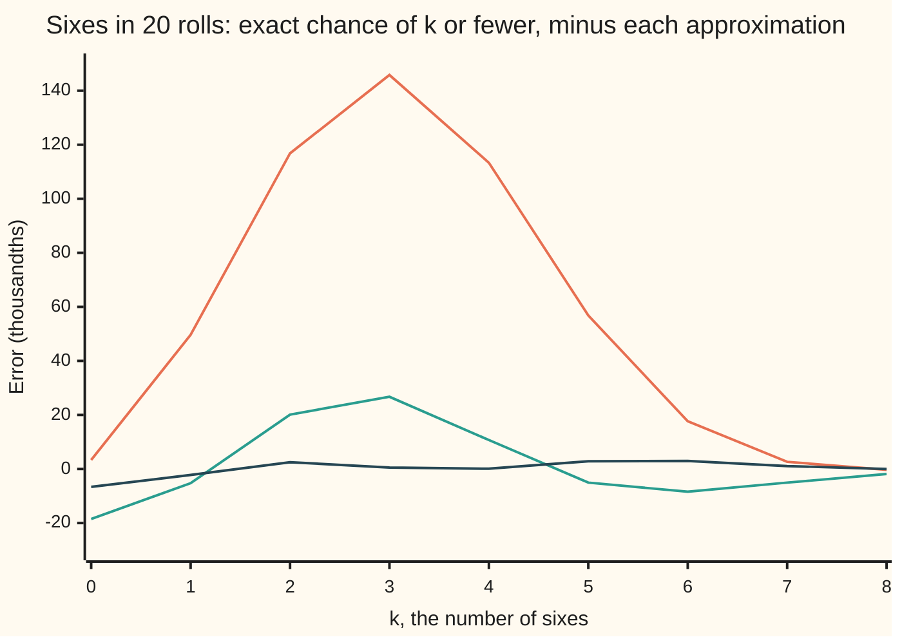
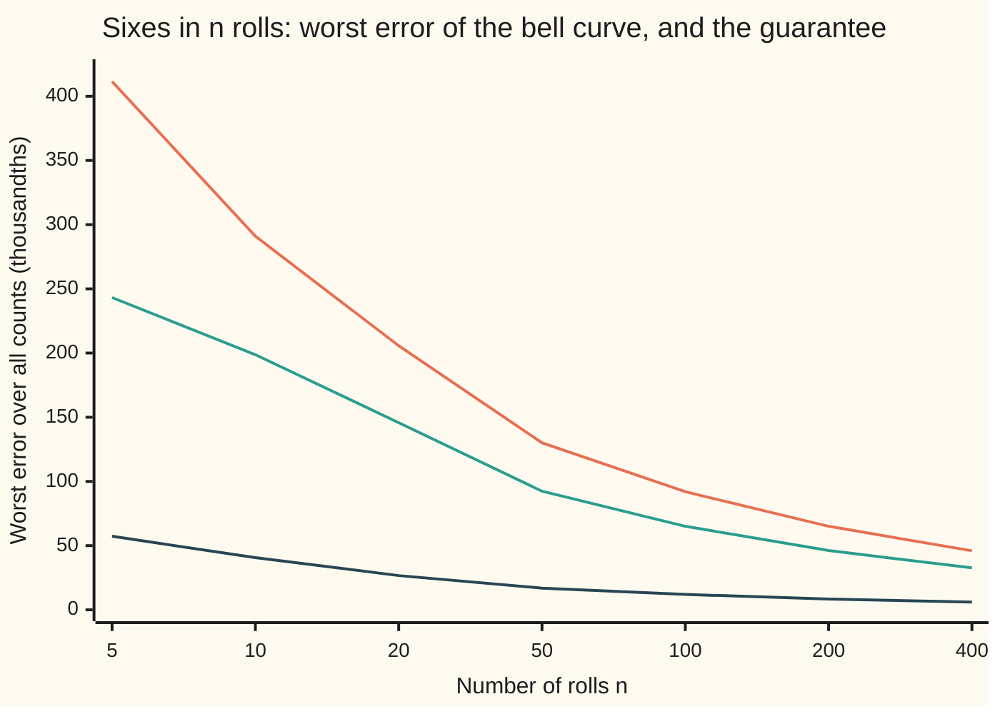

# How big must n be: the Berry-Esseen bound and the skewness correction

[Syllabus](../../../SYLLABUS.md) → [Harmonic analysis](../README.md) → [Characteristic Functions and Probability](../README.md#s04) → How big must n be

---

## General Overview

A board-game designer rolls a fair die 20 times and counts the sixes. On average that is 3.33 sixes, with a standard deviation (the typical distance from the average) of 1.67. The designer wants the chance of 3 sixes or fewer, because a game rule turns on it.

Counting every one of the $`6^{20}`$ roll sequences gives 0.5665. The bell curve with the same centre and spread gives 0.4207. That is off by 0.1458, almost three times the designer's tolerance of one twentieth (0.05). The central limit theorem says the bell curve wins in the end. It does not say when.

This card answers "how big must n be" three ways for this count:

- **The Berry–Esseen bound** promises an error under 1/20 for every count of sixes from n = 339 rolls on. It is a guarantee that needs only one number from a single roll.
- **The truth**, by exact count, is that the plain bell gap falls under 1/20 from n = 171 on.
- **Two corrections** do far better. Cutting at the half step (3.5 instead of 3) brings the gap under 1/20 from n = 6 on. Adding the **Edgeworth term**, a small correction for lopsidedness, brings it under 1/20 at every n from 1 to 400, the range the code counts. At n = 20 it is 0.0066.

**The bell curve's worst error for n independent rolls is at most 0.4748 × ρ/(σ³√n), where σ is one roll's standard deviation and ρ its average cubed distance from the mean; adding the skewness term read off the fingerprint (the characteristic function), at the half step, cuts the actual error at 20 rolls, measured at the counts, from 0.1458 to 0.0066.**

**What kind of fact this is:** two results of different kinds. The Berry–Esseen bound is a theorem. It is stated here with its sourced constant, and Why it works gives the shape of the proof, not every estimate. The Edgeworth term is the first term of an expansion: an approximation with no guarantee at a given n. It is derived here from the fingerprint, and its gain is measured by exact count.

### The picture: the error at each count, three ways



Orange: the plain bell curve, cut at the count itself. Its worst miss is 145.81 thousandths, at 3 sixes. Teal: the bell cut at the half step. Dark blue: the half step plus the Edgeworth term. Its worst miss is 6.63 thousandths, at 0 sixes.

---

## The formula

Each roll gives a count X: 1 if it shows a six, 0 if not. The rolls are independent and share one law. Write μ and σ for one roll's mean and standard deviation, and $`S_n = X_1 + \dots + X_n`$ for the number of sixes in n rolls. The **standardised total** is $`Z_n = (S_n - n\mu)/(\sigma\sqrt{n})`$: the total, centred and measured in its own standard deviations. Φ(x) is the bell curve's area to the left of x, and Φ'(x) is its height there.

This card introduces the **Kolmogorov distance**: the largest vertical gap between two distribution functions, over every level x. A distribution function gives, at each level x, the chance of landing at or below x.

```math
D_n = \sup_x \big\lvert P(Z_n \le x) - \Phi(x) \big\rvert \;\le\; \frac{C\,\rho}{\sigma^3\sqrt{n}}, \qquad C = 0.4748, \qquad \rho = E\lvert X - \mu\rvert^3
```

**Read it aloud:** at every level at once, the bell curve misses the true chance by at most a fixed constant, times one roll's third-moment ratio, over the square root of n.

This card also introduces the **Edgeworth term**: the first correction to the bell curve, driven by the skewness γ (a measure of lopsidedness, defined in the table). For a whole-number count k it reads

```math
P(S_n \le k) \;\approx\; \Phi(z) \;-\; \frac{\gamma}{6\sqrt{n}}\,(z^2 - 1)\,\Phi'(z), \qquad z = \frac{k + \tfrac12 - n\mu}{\sigma\sqrt{n}}.
```

**Read it aloud:** take the bell curve at the half step, then subtract the skewness over six root n, times z squared minus one, times the bell's height.

The statement of Berry–Esseen, and its use on 100 die totals, is already on [The central limit theorem, proved](../../10-Measure%20and%20integration/10-The%20Limit%20Theorems%2C%20Proved/07-central-limit-theorem.md). This card spends its space on the correction and on measuring what it gains.

| Symbol | Plain meaning | In our example | Push it up and the answer… |
| --- | --- | --- | --- |
| $`n`$ | number of independent rolls | 20 | every gap shrinks; the bound like $`1/\sqrt{n}`$ |
| $`X`$ | one roll's count: 1 for a six, 0 otherwise | chance 1/6 of a 1 | — |
| $`\mu,\ \sigma`$ | one roll's mean and standard deviation | 1/6 and 0.3727 | — |
| $`\rho`$ | one roll's third absolute central moment, $`E\lvert X - \mu\rvert^3`$, where E means the average over outcomes | 65/648 = 0.1003 | a heavier tail raises the bound |
| $`\gamma`$ | skewness, $`E(X - \mu)^3/\sigma^3`$, which is $`\kappa_3/\sigma^3`$ in cumulants | 1.7889 | a bigger Edgeworth term |
| $`S_n,\ k`$ | the number of sixes in n rolls, and a whole-number count | $`S_{20}`$; k = 3 | — |
| $`Z_n,\ x,\ z`$ | the standardised total, a level on its scale, and the half-step level | mean 0, standard deviation 1; z = 0.1 at k = 3 | — |
| $`\Phi,\ \Phi'`$ | bell-curve area to the left, and bell-curve height | Φ(0.1) = 0.5398; Φ'(0.1) = 0.3970 | — |
| $`D_n`$ | Kolmogorov distance between $`Z_n`$ and the bell | 0.1458 | — |
| $`C`$ | the Berry–Esseen constant | 0.4748 | a looser guarantee |
| $`\varphi_{Z_n}(t),\ t,\ T`$ | the fingerprint $`E\,e^{itZ_n}`$, its dial, and a cut-off on the dial | at t = 1: within 0.0410 of the bell's | — |
| $`F,\ G,\ m,\ K`$ | in the proof fold: two distribution functions, the steepest slope of G, and a fixed number | G = Φ, so m = Φ'(0) | — |

### When it holds

- **Independent rolls with one shared law.** Dependence changes the spread itself. The bound and the term then use the wrong σ.
- **A finite third moment ρ.** Without it the bound is empty. With no finite variance there is no bell limit at all: see [Stable laws](08-stable-laws-and-heavy-tails.md).
- **The bound is for every law with the same ratio ρ/σ³.** It cannot know this law is a count. For one law it is often loose: here 0.2057 against a true 0.1458.
- **The Edgeworth term is an expansion, not a bound.** At a given n it can be worse than the plain bell. In the far tails it can even dip below 0. Nothing on this card guarantees its 0.0066; the exact count measures it.
- **A whole-number count needs the half step.** Read the Edgeworth term at k instead of k + ½ and the worst gap is 0.1208, barely better than no correction.

---

## Why it works

### Step 0: the error is the fingerprint's next term

The bell curve's fingerprint is $`e^{-t^2/2}`$. The fingerprint of $`Z_n`$ differs from it first in a term proportional to the skewness over $`\sqrt{n}`$. Everything on this card follows from that one fact.

- **The size of that term** sets how fast the gap closes: like $`1/\sqrt{n}`$. Berry–Esseen turns this into a guarantee.
- **The shape of that term** can be turned back into a curve and subtracted. That is the Edgeworth term. What is left falls like $`1/n`$.

### Step 1: the fingerprint of the standardised total

Cumulants of independent rolls add ([Moments and cumulants](02-moments-and-cumulants-from-the-fingerprint.md)). The log of a fingerprint lists them: $`\log \varphi_X(t) = i\kappa_1 t - \kappa_2 t^2/2 + \kappa_3 (it)^3/6 + \dots`$. Standardising divides the k-th cumulant of the total by $`(\sigma\sqrt{n})^k`$. The total has n times one roll's cumulants, so

```math
\log \varphi_{Z_n}(t) = -\frac{t^2}{2} + \frac{\gamma\,(it)^3}{6\sqrt{n}} + O\!\left(\frac{1}{n}\right).
```

Take the exponential and keep the first two terms:

```math
\varphi_{Z_n}(t) \approx e^{-t^2/2}\left(1 + \frac{\gamma\,(it)^3}{6\sqrt{n}}\right).
```

For 20 rolls at t = 1, the fingerprint is 0.040996 away from the bell's. With the skewness term it is 0.000606 away. At 80 rolls the two numbers are 0.020287 and 0.000083. Four times the rolls halves the first, as $`1/\sqrt{n}`$ says. It cuts the second by more than four times: what is left falls at least as fast as $`1/n`$.

### Step 2: turn the correction back into a curve

Integration by parts moves a derivative onto the exponential. For a smooth density g that dies off at both ends,

```math
\int e^{itx}\, g'(x)\, dx = -it \int e^{itx}\, g(x)\, dx.
```

So each derivative of the bell's height Φ' multiplies its fingerprint by $`-it`$, and the third derivative has fingerprint $`(-it)^3 e^{-t^2/2}`$. The correction $`\gamma (it)^3 e^{-t^2/2}/(6\sqrt{n})`$ is therefore the fingerprint of $`-\tfrac{\gamma}{6\sqrt{n}}\,(\Phi')'''`$. By uniqueness ([Levy's inversion formula](03-levy-inversion-and-uniqueness.md)), the corrected density is

```math
\Phi'(z) - \frac{\gamma}{6\sqrt{n}}\,(\Phi')'''(z).
```

Integrate once to get chances. Differentiating $`\Phi'(z) = e^{-z^2/2}/\sqrt{2\pi}`$ twice gives $`(\Phi')''(z) = (z^2 - 1)\,\Phi'(z)`$. So

```math
P(Z_n \le z) \approx \Phi(z) - \frac{\gamma}{6\sqrt{n}}\,(z^2 - 1)\,\Phi'(z).
```

The sign makes sense. A six-count has a long right tail (γ > 0), so its mass piles up on the left of the mean. Near the centre, $`z^2 - 1 < 0`$, and the correction raises the chance of a low count.

### Step 3: a count jumps, so read it at the half step

The distribution function of a count is a staircase. It jumps at each whole number and is flat between. A smooth curve must miss each jump by about half its height, whatever terms it carries. That is why the plain gap stays large.

Esseen's expansion for counts adds a sawtooth term to Step 2 ([Esseen 1945](https://doi.org/10.1007/BF02392223)). That term is zero exactly at the half steps k + ½. So reading the curve at the half step is the lattice part of the first-order correction. [Normal approximation](../../09-Probability%20and%20statistics/06-Limit%20Theorems%20in%20Practice/03-normal-approximation-to-binomial.md) uses the same half step for binomial tails and says when it is safe.

So the half-step and Edgeworth gaps on this card are measured at the counts: P(S ≤ k) against the curve at k + ½, for every k. Over every level x, no smooth curve can beat half the tallest jump.

### Step 4: Berry–Esseen, from the fingerprint to a guarantee

Close fingerprints near t = 0 mean close laws. But a count's fingerprint never dies away: it returns to size 1 at regular intervals of t. So the comparison must stop at a cut-off T, and the proof pays a price of order 1/T for stopping there.

Choose T in proportion to $`\sigma^3\sqrt{n}/\rho`$. Then both the comparison and the price are multiples of $`\rho/(\sigma^3\sqrt{n})`$. That is the bound. The fold gives the two inequalities.

<details>
<summary>The shape of the Berry–Esseen proof: smoothing, then a fingerprint estimate</summary>

**Smoothing inequality** (Esseen, 1945). Let F be any distribution function and G one with derivative at most m. For every cut-off T > 0,

$`\displaystyle \sup_x \lvert F(x) - G(x) \rvert \le \frac{1}{\pi}\int_{-T}^{T} \frac{\lvert \varphi_F(t) - \varphi_G(t) \rvert}{\lvert t \rvert}\, dt + \frac{24\, m}{\pi T}.`$

The proof smooths both functions with a kernel whose transform vanishes beyond T. The integral measures the smoothed gap. The last term measures what smoothing can hide. For the bell, $`m = \Phi'(0) = 1/\sqrt{2\pi}`$.

**Fingerprint estimate.** Expand one roll's fingerprint to third order with Taylor's theorem. For $`\lvert t \rvert`$ up to a fixed multiple of $`\sigma^3\sqrt{n}/\rho`$, this gives

$`\displaystyle \lvert \varphi_{Z_n}(t) - e^{-t^2/2} \rvert \le K\,\frac{\rho}{\sigma^3\sqrt{n}}\,\lvert t\rvert^3 e^{-t^2/4}`$

for a fixed number K.

**Put together.** Take T at the top of that range. Divided by $`\lvert t \rvert`$, the right side integrates to a multiple of $`\rho/(\sigma^3\sqrt{n})`$. The term $`24m/(\pi T)`$ is also such a multiple. The sum is $`C\rho/(\sigma^3\sqrt{n})`$.

**The constant.** This route, done with care, gives a C of a few units. Shevtsova (2011) brought it down to 0.4748 by a much finer analysis. Esseen (1956) showed that no C below 0.409732 can work for every law.

</details>

### Step 5: why the bound is loose here

The bound has to hold for every law with ρ/σ³ = 1.9379, at every level and every n. The six-count is one law, so its gap of 0.1458 is 0.709 of the bound 0.2057. Shevtsova's sharper form, 0.33554 × (ρ/σ³ + 0.415)/√n, gives 0.1765. Even Esseen's floor constant, 0.409732, the smallest any guarantee could use, gives 0.1776.

---

## Worked numbers, by hand

| Step | Arithmetic | Value |
| --- | --- | --- |
| one roll: variance | (1/6)(5/6) | 5/36 = 0.1389 |
| one roll: σ | √(5/36) | 0.3727 |
| one roll: ρ | (1/6)(5/6)[(5/6)² + (1/6)²] | 65/648 = 0.1003 |
| ratio ρ/σ³ | 0.1003 / 0.3727³ | 1.9379 |
| **Berry–Esseen bound** | 0.4748 × 1.9379 / √20 | **0.2057** |
| total: mean and standard deviation | 20 × 1/6; 0.3727 × √20 | 3.3333; 1.6667 |
| exact P(S ≤ 3) | 2,071,380,615,234,375 / 6^20 | 0.5665 |
| plain bell | z = (3 − 3.3333)/1.6667 = −0.2; Φ(−0.2) | 0.4207 |
| half step | z = (3.5 − 3.3333)/1.6667 = 0.1; Φ(0.1) | 0.5398 |
| skewness γ | (1 − 2/6) / 0.3727 | 1.7889 |
| Edgeworth term at k = 3 | −0.3970 × 1.7889 × (0.01 − 1) / (6 × √20) | +0.0262 |
| corrected | 0.5398 + 0.0262 | 0.5660 |
| **worst gaps over every k** | plain; half step; half step + Edgeworth | **0.1458; 0.0267; 0.0066** |

At 3 sixes or fewer the corrected bell is 0.5660 against the exact 0.5665. Over every count the worst miss falls from 0.1458 to 0.0066, 4.03 times smaller than the half step alone, and well under the designer's 1/20.

### What breaks if you drop a piece

| Mistake | Comes out at | What went wrong |
| --- | --- | --- |
| Use a fair coin instead (20 flips) | gap 0.0881, bound 0.1062, half step 0.0014, with Edgeworth 0.0014 | The coin has zero skewness, so the Edgeworth term is zero. No gain: the half step does all the work. |
| Read the Edgeworth term at k, not k + ½ | worst gap 0.1208 | The staircase's half-jump error is untouched. |
| Flip the sign of the Edgeworth term | worst gap 0.0529 | The correction pushes mass the wrong way, doubling the half-step error. |
| Use the skewness of the total, 1.7889/√20, then divide by √n again | worst gap 0.0209 | The term is shrunk twice. Most of the gain is lost. |
| Forget σ³ in the bound | 0.4748 × 0.1003 / √20 = 0.0106 | A "bound" below the true gap 0.1458. It promises what is false. |

---

## How the gaps shrink as n grows

The puzzle: the guarantee says 339 rolls, the truth says 171, and the corrected curve is fine from the start. Here are all four numbers as n grows, in thousandths.

| n | plain bell | half step | half step + Edgeworth | Berry–Esseen bound |
| --- | --- | --- | --- | --- |
| 5 | 243.2 | 57.3 | 16.1 | 411.5 |
| 10 | 198.7 | 40.7 | 6.1 | 291.0 |
| 20 | 145.8 | 26.7 | 6.6 | 205.7 |
| 50 | 92.4 | 16.9 | 2.1 | 130.1 |
| 100 | 65.1 | 12.0 | 1.0 | 92.0 |
| 200 | 46.2 | 8.4 | 0.5 | 65.1 |
| 400 | 32.7 | 6.0 | 0.2 | 46.0 |

At n = 20, one at a time, in thousandths:

```
bars at n = 20, one # per 5 thousandths:
  Berry-Esseen bound    #########################################  205.7
  plain bell            #############################              145.8
  half step             #####                                       26.7
  half step + Edgeworth #                                            6.6
```



Orange: the Berry–Esseen bound. Teal: the plain bell's worst gap. Dark blue: the half-step worst gap. All three fall like $`1/\sqrt{n}`$. The half step plus Edgeworth, in the table only, falls like $`1/n`$: 6.6 at n = 20, 0.2 at n = 400.

The bound and the plain gap fall at the same rate. So the bound gets the order right and the constant wrong for this law. Adding the Edgeworth term changes the order.

The code counts every n up to 400. Past that, Berry–Esseen alone keeps two of the gaps under 1/20 from n = 339 on: the plain gap is $`D_n`$ itself, and the half-step gap, read at the counts, is never more than $`D_n`$. For the Edgeworth curve, the count up to 400 is the only evidence.

---

## Code, from first principles, and it actually runs

The code builds the law of the six-count four independent ways. It convolves one roll at a time in whole numbers, compares with the binomial formula exactly, inverts the fingerprint at 21 frequencies, and simulates 100,000 sessions of 20 rolls with a written-out generator (SplitMix64, seed 2026). Φ is its own series. Then it measures the three gaps against the bound at every n up to 400, checks Step 1's orders on the fingerprint, and prints every wrong answer from What breaks.

### Python

```python
# How big must n be: Berry-Esseen and the skewness correction -- the check.
# Standard library only.  S = number of sixes in n fair-die rolls.  Roads to
# the law of S: convolution in whole numbers, the binomial formula, inversion
# of the fingerprint, and a seeded simulation.  Phi is its own series.
from math import comb, sqrt, exp, pi, cos, sin, ceil

C_BE, C_LOW, EPS = 0.4748, 0.409732, 1 / 20       # upper constant, Esseen's floor
def Phi(x):                                        # bell-curve area left of x
    if abs(x) > 8: return 1.0 if x > 0 else 0.0
    s = t = x; k = 0
    while abs(t) > 1e-17 * abs(s):
        k += 1; t *= x * x / (2 * k + 1); s += t
    return 0.5 + exp(-x * x / 2) / sqrt(2 * pi) * s
def dens(x): return exp(-x * x / 2) / sqrt(2 * pi)   # bell-curve height, Phi'(x)
def law(n, p):                                     # float law of S, by recursion
    q = 1 - p; pm = [q ** n]
    for k in range(1, n + 1): pm.append(pm[-1] * (n - k + 1) / k * p / q)
    return pm
def gaps(n, p, sign=1.0, half=0.5, skew_scale=1.0):
    # largest gaps: plain bell (both sides of each jump), half-step, half-step + Edgeworth
    q = 1 - p; mu, sd = n * p, sqrt(n * p * q)
    g = skew_scale * (1 - 2 * p) / sqrt(p * q)
    F = 0.0; D = Dh = De = 0.0; rows = []
    for k, pk in enumerate(law(n, p)):
        Fl, F = F, F + pk
        z = (k - mu) / sd; zh = (k + half - mu) / sd
        edg = Phi(zh) - sign * dens(zh) * g * (zh * zh - 1) / (6 * sqrt(n))
        D = max(D, abs(F - Phi(z)), abs(Fl - Phi(z)))
        Dh, De = max(Dh, abs(F - Phi(zh))), max(De, abs(F - edg))
        rows.append((k, F, Phi(z), Phi(zh), edg))
    return D, Dh, De, rows
def ratio(p): return (p * (1 - p)) * ((1 - p) ** 2 + p ** 2) / (p * (1 - p)) ** 1.5

n, p = 20, 1 / 6
gam, r = (1 - 2 * p) / sqrt(p * (1 - p)), ratio(p)
print(f"one roll: variance 5/36 = {5/36:.6f}, sigma = {sqrt(5/36):.6f}, rho = 65/648 = {65/648:.6f}")
print(f"rho/sigma^3 = {r:.6f}, skewness gamma = {gam:.6f}")
assert abs(r - sum(w * abs(x - p) ** 3 for x, w in ((1, p), (0, 1 - p))) / (5 / 36) ** 1.5) < 1e-12, "rho/sigma^3 by definition"

# ---- road 1 and 2: exact counts of the 6^20 roll sequences ----
cnt = [1]                                          # weights: 5 ways not six, 1 way six
for _ in range(n):
    cnt = [5 * (cnt[k] if k < len(cnt) else 0) + (cnt[k - 1] if k else 0) for k in range(len(cnt) + 1)]
assert cnt == [comb(n, k) * 5 ** (n - k) for k in range(n + 1)], "convolution = binomial"
exact = [c / 6 ** n for c in cnt]
# ---- road 3: inversion of the fingerprint (q + p e^{it})^n at 21 frequencies ----
def cpow(z, m):
    w = complex(1, 0)
    for _ in range(m): w *= z
    return w
inv = []
for k in range(n + 1):
    tot = 0j
    for j in range(n + 1):
        t = 2 * pi * j / (n + 1)
        tot += cpow(complex(1 - p + p * cos(t), p * sin(t)), n) * complex(cos(t * k), -sin(t * k))
    inv.append(tot.real / (n + 1))
err_inv = max(abs(a - b) for a, b in zip(inv, exact))
print(f"P(S <= 3) exact = {sum(cnt[:4])}/6^20 = {sum(exact[:4]):.6f}")
print(f"inversion vs count, largest difference below 1e-12: {err_inv < 1e-12}")
assert err_inv < 1e-12, "inversion of the fingerprint recovers the law"
# ---- road 4: simulation, SplitMix64, seed 2026 ----
M64 = (1 << 64) - 1; state = 2026
def nxt():
    global state
    state = (state + 0x9E3779B97F4A7C15) & M64
    z = state
    z = ((z ^ (z >> 30)) * 0xBF58476D1CE4E5B9) & M64
    z = ((z ^ (z >> 27)) * 0x94D049BB133111EB) & M64
    return z ^ (z >> 31)
SIMS, hits = 100000, 0
for _ in range(SIMS):
    sixes = sum(1 for _ in range(n) if (nxt() >> 32) % 6 == 5)
    hits += sixes <= 3
f3 = sum(exact[:4]); se = sqrt(f3 * (1 - f3) / SIMS)
print(f"simulated P(S <= 3), {SIMS} sessions = {hits / SIMS:.5f}, {abs(hits / SIMS - f3) / se:.2f} SE off")
assert abs(hits / SIMS - f3) < 4 * se, "simulation within 4 standard errors"

# ---- the gaps at n = 20 ----
D, Dh, De, rows = gaps(n, p)
print("k  F(k) exact  bell  half-step  +Edgeworth   errors x1000: bell half edge")
for k, F, b, h, e in rows[:9]:
    print(f"{k} {F:.4f} {b:.4f} {h:.4f} {e:.4f}   {1000*(F-b):7.2f} {1000*(F-h):6.2f} {1000*(F-e):6.2f}")
assert abs(sum(exact[:4]) - rows[3][1]) < 1e-12, "float law agrees with the count"
be = C_BE * r / sqrt(n)
print(f"Berry-Esseen bound {C_BE} x {r:.4f} / sqrt(20) = {be:.4f}")
print(f"largest gap, plain bell = {D:.4f}, gap / bound = {D / be:.3f}")
print(f"largest gap, half-step = {Dh:.4f}; half-step + Edgeworth = {De:.4f}")
print(f"Edgeworth gain: {Dh / De:.2f} times smaller")
print("bars at n = 20, one # per 5 thousandths:")
for name, v in (("Berry-Esseen bound", be), ("plain bell", D), ("half step", Dh), ("half step + Edgeworth", De)):
    print(f"  {name:<22}{'#' * round(200 * v):<42}{1000 * v:6.1f}")
mu, sd = n * p, sqrt(n * p * (1 - p)); z3, zh3 = (3 - mu) / sd, (3.5 - mu) / sd
print(f"total: mean {mu:.6f}, sd {sd:.6f}; k = 3: z = {z3:.4f}, half-step z = {zh3:.4f}")
print(f"  Phi'(z) = {dens(zh3):.6f}, Edgeworth term = {-dens(zh3) * gam * (zh3 * zh3 - 1) / (6 * sqrt(n)):+.6f}")
print(f"sharper Shevtsova form 0.33554 x ({r:.4f} + 0.415) / sqrt(20) = {0.33554 * (r + 0.415) / sqrt(n):.4f}")
assert D <= be and D > EPS > Dh > De, "bound holds; only the corrections beat 1/20"

# ---- how big must n be for a gap under 1/20? ----
print(f"Berry-Esseen promises 1/20 from n = {ceil((C_BE * r / EPS) ** 2)}")
NMAX = 400; tab = {m: gaps(m, p)[:3] for m in range(1, NMAX + 1)}
for w, name in enumerate(["plain bell", "half-step", "half-step + Edgeworth"]):
    first = 1 + max([m for m in tab if tab[m][w] >= EPS], default=0)
    print(f"actual gap under 1/20 for every n from {first} to {NMAX}: {name}")
print("n  plain  half-step  +Edgeworth  bound   (x1000)")
for m in [5, 10, 20, 50, 100, 200, 400]:
    a, b, c = tab[m]
    print(f"{m} {1000*a:.1f} {1000*b:.1f} {1000*c:.1f} {1000*C_BE*r/sqrt(m):.1f}")
    assert a <= C_BE * r / sqrt(m), "Berry-Esseen holds at every n"
assert tab[400][2] * 400 < tab[20][2] * 20 and tab[400][1] * 20 > tab[20][1], "1/n against 1/sqrt(n)"

# ---- the fingerprint: why the Edgeworth term is the next order ----
for m in (20, 80):
    t, mu, sd = 1.0, m * p, sqrt(m * p * (1 - p))
    u = t / sd
    phiZ = cpow(complex(1 - p + p * cos(u), p * sin(u)), m) * complex(cos(t * mu / sd), -sin(t * mu / sd))
    g0 = exp(-t * t / 2)
    edg = complex(g0, 0) * complex(1, -gam * t ** 3 / (6 * sqrt(m)))   # (it)^3 = -i t^3
    e1, e2 = abs(phiZ - g0), abs(phiZ - edg)
    print(f"fingerprint at t = 1, n = {m}: gap to bell {e1:.6f}, after Edgeworth {e2:.6f}")
    if m == 20: e1_20, e2_20 = e1, e2
assert 1.8 < e1_20 / e1 < 2.2 and e2_20 / e2 > 3.5, "orders 1/sqrt(n) and 1/n"

# ---- what breaks ----
Dc, Dhc, Dec, _ = gaps(20, 0.5)
print(f"fair coin: gap {Dc:.4f}, bound {C_BE / sqrt(20):.4f}, half-step {Dhc:.4f}, +Edgeworth {Dec:.4f}")
assert abs(Dhc - Dec) < 1e-15 and Dc < C_BE / sqrt(20), "zero skewness, zero gain"
print(f"Edgeworth without the half-step: {gaps(n, p, half=0.0)[2]:.4f}")
print(f"Edgeworth with the wrong sign: {gaps(n, p, sign=-1.0)[2]:.4f}")
print(f"skewness of the total, divided by sqrt(n) again: {gaps(n, p, skew_scale=1/sqrt(n))[2]:.4f}")
print(f"bound without sigma^3: {C_BE} x {65/648:.4f} / sqrt(20) = {C_BE * 65 / 648 / sqrt(n):.4f}")

# ---- try changing ----
D80, Dh80, De80, _ = gaps(80, p)
print(f"try n = 80: bound {C_BE * r / sqrt(80):.4f}, gaps {D80:.4f} {Dh80:.4f} {De80:.4f}")
Dd, Dhd, Ded, _ = gaps(20, 1 / 36)
print(f"try double sixes, p = 1/36: bound {C_BE * ratio(1/36) / sqrt(20):.4f}, gaps {Dd:.4f} {Dhd:.4f} {Ded:.4f}")
print(f"try floor constant {C_LOW}: {C_LOW * r / sqrt(20):.4f}")
print(f"try target 1/100: Berry-Esseen needs n = {ceil((C_BE * r / 0.01) ** 2)}")
print("ALL CHECKS PASS")
```

**Ran 2026-11-15 on macOS, Python 3.14.10, standard library only. All checks passed. Output, pasted from the run:**

```
one roll: variance 5/36 = 0.138889, sigma = 0.372678, rho = 65/648 = 0.100309
rho/sigma^3 = 1.937926, skewness gamma = 1.788854
P(S <= 3) exact = 2071380615234375/6^20 = 0.566546
inversion vs count, largest difference below 1e-12: True
simulated P(S <= 3), 100000 sessions = 0.56609, 0.29 SE off
k  F(k) exact  bell  half-step  +Edgeworth   errors x1000: bell half edge
0 0.0261 0.0228 0.0446 0.0327      3.33 -18.48  -6.63
1 0.1304 0.0808 0.1357 0.1326     49.66  -5.25  -2.20
2 0.3287 0.2119 0.3085 0.3261    116.80  20.12   2.52
3 0.5665 0.4207 0.5398 0.5660    145.81  26.72   0.52
4 0.7687 0.6554 0.7580 0.7687    113.33  10.71   0.10
5 0.8982 0.8413 0.9032 0.8953     56.81  -5.04   2.84
6 0.9629 0.9452 0.9713 0.9599     17.66  -8.42   3.00
7 0.9887 0.9861 0.9938 0.9877      2.65  -5.04   1.09
8 0.9972 0.9974 0.9990 0.9972     -0.29  -1.87   0.00
Berry-Esseen bound 0.4748 x 1.9379 / sqrt(20) = 0.2057
largest gap, plain bell = 0.1458, gap / bound = 0.709
largest gap, half-step = 0.0267; half-step + Edgeworth = 0.0066
Edgeworth gain: 4.03 times smaller
bars at n = 20, one # per 5 thousandths:
  Berry-Esseen bound    #########################################  205.7
  plain bell            #############################              145.8
  half step             #####                                       26.7
  half step + Edgeworth #                                            6.6
total: mean 3.333333, sd 1.666667; k = 3: z = -0.2000, half-step z = 0.1000
  Phi'(z) = 0.396953, Edgeworth term = +0.026199
sharper Shevtsova form 0.33554 x (1.9379 + 0.415) / sqrt(20) = 0.1765
Berry-Esseen promises 1/20 from n = 339
actual gap under 1/20 for every n from 171 to 400: plain bell
actual gap under 1/20 for every n from 6 to 400: half-step
actual gap under 1/20 for every n from 1 to 400: half-step + Edgeworth
n  plain  half-step  +Edgeworth  bound   (x1000)
5 243.2 57.3 16.1 411.5
10 198.7 40.7 6.1 291.0
20 145.8 26.7 6.6 205.7
50 92.4 16.9 2.1 130.1
100 65.1 12.0 1.0 92.0
200 46.2 8.4 0.5 65.1
400 32.7 6.0 0.2 46.0
fingerprint at t = 1, n = 20: gap to bell 0.040996, after Edgeworth 0.000606
fingerprint at t = 1, n = 80: gap to bell 0.020287, after Edgeworth 0.000083
fair coin: gap 0.0881, bound 0.1062, half-step 0.0014, +Edgeworth 0.0014
Edgeworth without the half-step: 0.1208
Edgeworth with the wrong sign: 0.0529
skewness of the total, divided by sqrt(n) again: 0.0209
bound without sigma^3: 0.4748 x 0.1003 / sqrt(20) = 0.0106
try n = 80: bound 0.1029, gaps 0.0731 0.0133 0.0013
try double sixes, p = 1/36: bound 0.6112, gaps 0.3444 0.0994 0.0183
try floor constant 0.409732: 0.1776
try target 1/100: Berry-Esseen needs n = 8467
ALL CHECKS PASS
```

### Rust

```rust
// How big must n be: Berry-Esseen and the skewness correction -- the check.
// Rust std only.  S = number of sixes in n fair-die rolls.  Roads to the law
// of S: convolution in whole numbers, the binomial formula, inversion of the
// fingerprint, and a seeded simulation.  Phi is its own series.
use std::f64::consts::PI;

const C_BE: f64 = 0.4748;
const C_LOW: f64 = 0.409732; // Esseen's floor
const EPS: f64 = 1.0 / 20.0;

#[derive(Clone, Copy)]
struct Cx { re: f64, im: f64 }
impl Cx {
    fn mul(self, o: Cx) -> Cx { Cx { re: self.re * o.re - self.im * o.im, im: self.re * o.im + self.im * o.re } }
    fn sub(self, o: Cx) -> Cx { Cx { re: self.re - o.re, im: self.im - o.im } }
    fn abs(self) -> f64 { self.re.hypot(self.im) }
}
fn cpow(z: Cx, m: usize) -> Cx { let mut w = Cx { re: 1.0, im: 0.0 }; for _ in 0..m { w = w.mul(z); } w }

fn phi_cdf(x: f64) -> f64 { // bell-curve area left of x
    if x.abs() > 8.0 { return if x > 0.0 { 1.0 } else { 0.0 }; }
    let (mut s, mut t, mut k) = (x, x, 0.0);
    while t.abs() > 1e-17 * s.abs() { k += 1.0; t *= x * x / (2.0 * k + 1.0); s += t; }
    0.5 + (-x * x / 2.0).exp() / (2.0 * PI).sqrt() * s
}
fn dens(x: f64) -> f64 { (-x * x / 2.0).exp() / (2.0 * PI).sqrt() } // Phi'(x)
fn law(n: usize, p: f64) -> Vec<f64> {
    let q = 1.0 - p;
    let mut pm = vec![q.powf(n as f64)];
    for k in 1..=n { let last = pm[k - 1]; pm.push(last * (n - k + 1) as f64 / k as f64 * p / q); }
    pm
}
// largest gaps: plain bell (both sides of each jump), half-step, half-step + Edgeworth
fn gaps(n: usize, p: f64, sign: f64, half: f64, skew_scale: f64) -> (f64, f64, f64, Vec<(usize, f64, f64, f64, f64)>) {
    let q = 1.0 - p;
    let (mu, sd) = (n as f64 * p, (n as f64 * p * q).sqrt());
    let g = skew_scale * (1.0 - 2.0 * p) / (p * q).sqrt();
    let (mut f, mut d, mut dh, mut de) = (0.0, 0.0f64, 0.0f64, 0.0f64);
    let mut rows = Vec::new();
    for (k, pk) in law(n, p).into_iter().enumerate() {
        let fl = f; f += pk;
        let z = (k as f64 - mu) / sd; let zh = (k as f64 + half - mu) / sd;
        let edg = phi_cdf(zh) - sign * dens(zh) * g * (zh * zh - 1.0) / (6.0 * (n as f64).sqrt());
        d = d.max((f - phi_cdf(z)).abs()).max((fl - phi_cdf(z)).abs());
        dh = dh.max((f - phi_cdf(zh)).abs()); de = de.max((f - edg).abs());
        rows.push((k, f, phi_cdf(z), phi_cdf(zh), edg));
    }
    (d, dh, de, rows)
}
fn g3(n: usize, p: f64) -> (f64, f64, f64) { let (a, b, c, _) = gaps(n, p, 1.0, 0.5, 1.0); (a, b, c) }
fn ratio(p: f64) -> f64 { (p * (1.0 - p)) * ((1.0 - p).powf(2.0) + p.powf(2.0)) / (p * (1.0 - p)).powf(1.5) }

fn main() {
    let (n, p) = (20usize, 1.0f64 / 6.0);
    let (gam, r) = ((1.0 - 2.0 * p) / (p * (1.0 - p)).sqrt(), ratio(p));
    println!("one roll: variance 5/36 = {:.6}, sigma = {:.6}, rho = 65/648 = {:.6}", 5.0 / 36.0, (5.0f64 / 36.0).sqrt(), 65.0 / 648.0);
    println!("rho/sigma^3 = {:.6}, skewness gamma = {:.6}", r, gam);
    assert!((r - [(1.0, p), (0.0, 1.0 - p)].iter().map(|&(x, w): &(f64, f64)| w * (x - p).abs().powi(3)).sum::<f64>() / (5.0f64 / 36.0).powf(1.5)).abs() < 1e-12, "rho/sigma^3 by definition");

    // ---- road 1 and 2: exact counts of the 6^20 roll sequences ----
    let mut cnt: Vec<u64> = vec![1]; // weights: 5 ways not six, 1 way six
    for _ in 0..n {
        let mut nw = vec![0u64; cnt.len() + 1];
        for k in 0..nw.len() { nw[k] = 5 * if k < cnt.len() { cnt[k] } else { 0 } + if k > 0 { cnt[k - 1] } else { 0 }; }
        cnt = nw;
    }
    let mut binom: Vec<u64> = vec![1];
    for k in 1..=n { let b = binom[k - 1] * (n - k + 1) as u64 / k as u64; binom.push(b); }
    for k in 0..=n { assert!(cnt[k] == binom[k] * 5u64.pow((n - k) as u32), "convolution = binomial"); }
    let six20 = 6f64.powf(n as f64);
    let exact: Vec<f64> = cnt.iter().map(|&c| c as f64 / six20).collect();
    // ---- road 3: inversion of the fingerprint (q + p e^{it})^n at 21 frequencies ----
    let mut err_inv = 0.0f64;
    for k in 0..=n {
        let mut tot = Cx { re: 0.0, im: 0.0 };
        for j in 0..=n {
            let t = 2.0 * PI * j as f64 / (n + 1) as f64;
            let term = cpow(Cx { re: 1.0 - p + p * t.cos(), im: p * t.sin() }, n).mul(Cx { re: (t * k as f64).cos(), im: -(t * k as f64).sin() });
            tot = Cx { re: tot.re + term.re, im: tot.im + term.im };
        }
        err_inv = err_inv.max((tot.re / (n + 1) as f64 - exact[k]).abs());
    }
    let f3: f64 = exact[..4].iter().sum();
    println!("P(S <= 3) exact = {}/6^20 = {:.6}", cnt[..4].iter().sum::<u64>(), f3);
    println!("inversion vs count, largest difference below 1e-12: {}", if err_inv < 1e-12 { "True" } else { "False" });
    assert!(err_inv < 1e-12, "inversion of the fingerprint recovers the law");
    // ---- road 4: simulation, SplitMix64, seed 2026 ----
    let mut state: u64 = 2026;
    let mut nxt = || { state = state.wrapping_add(0x9E3779B97F4A7C15); let mut z = state;
        z = (z ^ (z >> 30)).wrapping_mul(0xBF58476D1CE4E5B9); z = (z ^ (z >> 27)).wrapping_mul(0x94D049BB133111EB); z ^ (z >> 31) };
    let (sims, mut hits) = (100000usize, 0usize);
    for _ in 0..sims {
        let mut sixes = 0; for _ in 0..n { if (nxt() >> 32) % 6 == 5 { sixes += 1; } }
        if sixes <= 3 { hits += 1; }
    }
    let freq = hits as f64 / sims as f64; let se = (f3 * (1.0 - f3) / sims as f64).sqrt();
    println!("simulated P(S <= 3), {} sessions = {:.5}, {:.2} SE off", sims, freq, (freq - f3).abs() / se);
    assert!((freq - f3).abs() < 4.0 * se, "simulation within 4 standard errors");

    // ---- the gaps at n = 20 ----
    let (d, dh, de, rows) = gaps(n, p, 1.0, 0.5, 1.0);
    println!("k  F(k) exact  bell  half-step  +Edgeworth   errors x1000: bell half edge");
    for &(k, f, b, h, e) in rows.iter().take(9) {
        println!("{} {:.4} {:.4} {:.4} {:.4}   {:7.2} {:6.2} {:6.2}", k, f, b, h, e, 1000.0 * (f - b), 1000.0 * (f - h), 1000.0 * (f - e));
    }
    assert!((f3 - rows[3].1).abs() < 1e-12, "float law agrees with the count");
    let be = C_BE * r / (n as f64).sqrt();
    println!("Berry-Esseen bound {} x {:.4} / sqrt(20) = {:.4}", C_BE, r, be);
    println!("largest gap, plain bell = {:.4}, gap / bound = {:.3}", d, d / be);
    println!("largest gap, half-step = {:.4}; half-step + Edgeworth = {:.4}", dh, de);
    println!("Edgeworth gain: {:.2} times smaller", dh / de);
    println!("bars at n = 20, one # per 5 thousandths:");
    for (name, v) in [("Berry-Esseen bound", be), ("plain bell", d), ("half step", dh), ("half step + Edgeworth", de)] {
        println!("  {:<22}{:<42}{:6.1}", name, "#".repeat((200.0 * v).round() as usize), 1000.0 * v);
    }
    let (mu, sd) = (n as f64 * p, (n as f64 * p * (1.0 - p)).sqrt()); let (z3, zh3) = ((3.0 - mu) / sd, (3.5 - mu) / sd);
    println!("total: mean {:.6}, sd {:.6}; k = 3: z = {:.4}, half-step z = {:.4}", mu, sd, z3, zh3);
    println!("  Phi'(z) = {:.6}, Edgeworth term = {:+.6}", dens(zh3), -dens(zh3) * gam * (zh3 * zh3 - 1.0) / (6.0 * (n as f64).sqrt()));
    println!("sharper Shevtsova form 0.33554 x ({:.4} + 0.415) / sqrt(20) = {:.4}", r, 0.33554 * (r + 0.415) / (n as f64).sqrt());
    assert!(d <= be && d > EPS && EPS > dh && dh > de, "bound holds; only the corrections beat 1/20");

    // ---- how big must n be for a gap under 1/20? ----
    println!("Berry-Esseen promises 1/20 from n = {}", ((C_BE * r / EPS).powf(2.0)).ceil());
    let nmax = 400usize;
    let tab: Vec<(f64, f64, f64)> = (0..=nmax).map(|m| if m == 0 { (0.0, 0.0, 0.0) } else { g3(m, p) }).collect();
    for (w, name) in ["plain bell", "half-step", "half-step + Edgeworth"].iter().enumerate() {
        let mut last = 0;
        for m in 1..=nmax { let v = [tab[m].0, tab[m].1, tab[m].2][w]; if v >= EPS { last = m; } }
        println!("actual gap under 1/20 for every n from {} to {}: {}", last + 1, nmax, name);
    }
    println!("n  plain  half-step  +Edgeworth  bound   (x1000)");
    for &m in [5usize, 10, 20, 50, 100, 200, 400].iter() {
        let (a, b, c) = tab[m]; let bm = C_BE * r / (m as f64).sqrt();
        println!("{} {:.1} {:.1} {:.1} {:.1}", m, 1000.0 * a, 1000.0 * b, 1000.0 * c, 1000.0 * bm);
        assert!(a <= bm, "Berry-Esseen holds at every n");
    }
    assert!(tab[400].2 * 400.0 < tab[20].2 * 20.0 && tab[400].1 * 20.0 > tab[20].1, "1/n against 1/sqrt(n)");

    // ---- the fingerprint: why the Edgeworth term is the next order ----
    let (mut e1_20, mut e2_20, mut e1, mut e2) = (0.0, 0.0, 0.0, 0.0);
    for &m in [20usize, 80].iter() {
        let (t, mu, sd) = (1.0f64, m as f64 * p, (m as f64 * p * (1.0 - p)).sqrt());
        let u = t / sd;
        let phiz = cpow(Cx { re: 1.0 - p + p * u.cos(), im: p * u.sin() }, m).mul(Cx { re: (t * mu / sd).cos(), im: -(t * mu / sd).sin() });
        let g0 = (-t * t / 2.0).exp();
        let edg = Cx { re: g0, im: 0.0 }.mul(Cx { re: 1.0, im: -gam * t.powf(3.0) / (6.0 * (m as f64).sqrt()) }); // (it)^3 = -i t^3
        e1 = phiz.sub(Cx { re: g0, im: 0.0 }).abs(); e2 = phiz.sub(edg).abs();
        println!("fingerprint at t = 1, n = {}: gap to bell {:.6}, after Edgeworth {:.6}", m, e1, e2);
        if m == 20 { e1_20 = e1; e2_20 = e2; }
    }
    assert!(1.8 < e1_20 / e1 && e1_20 / e1 < 2.2 && e2_20 / e2 > 3.5, "orders 1/sqrt(n) and 1/n");

    // ---- what breaks ----
    let (dc, dhc, dec) = g3(20, 0.5);
    println!("fair coin: gap {:.4}, bound {:.4}, half-step {:.4}, +Edgeworth {:.4}", dc, C_BE / 20f64.sqrt(), dhc, dec);
    assert!((dhc - dec).abs() < 1e-15 && dc < C_BE / 20f64.sqrt(), "zero skewness, zero gain");
    println!("Edgeworth without the half-step: {:.4}", gaps(n, p, 1.0, 0.0, 1.0).2);
    println!("Edgeworth with the wrong sign: {:.4}", gaps(n, p, -1.0, 0.5, 1.0).2);
    println!("skewness of the total, divided by sqrt(n) again: {:.4}", gaps(n, p, 1.0, 0.5, 1.0 / (n as f64).sqrt()).2);
    println!("bound without sigma^3: {} x {:.4} / sqrt(20) = {:.4}", C_BE, 65.0 / 648.0, C_BE * 65.0 / 648.0 / (n as f64).sqrt());

    // ---- try changing ----
    let (d80, dh80, de80) = g3(80, p);
    println!("try n = 80: bound {:.4}, gaps {:.4} {:.4} {:.4}", C_BE * r / 80f64.sqrt(), d80, dh80, de80);
    let (dd, dhd, ded) = g3(20, 1.0 / 36.0);
    println!("try double sixes, p = 1/36: bound {:.4}, gaps {:.4} {:.4} {:.4}", C_BE * ratio(1.0 / 36.0) / 20f64.sqrt(), dd, dhd, ded);
    println!("try floor constant {}: {:.4}", C_LOW, C_LOW * r / 20f64.sqrt());
    println!("try target 1/100: Berry-Esseen needs n = {}", ((C_BE * r / 0.01).powf(2.0)).ceil());
    println!("ALL CHECKS PASS");
}
```

**Ran 2026-11-15 on macOS, rustc 1.98.1, no crates. All checks passed. Output, pasted from the run:**

```
one roll: variance 5/36 = 0.138889, sigma = 0.372678, rho = 65/648 = 0.100309
rho/sigma^3 = 1.937926, skewness gamma = 1.788854
P(S <= 3) exact = 2071380615234375/6^20 = 0.566546
inversion vs count, largest difference below 1e-12: True
simulated P(S <= 3), 100000 sessions = 0.56609, 0.29 SE off
k  F(k) exact  bell  half-step  +Edgeworth   errors x1000: bell half edge
0 0.0261 0.0228 0.0446 0.0327      3.33 -18.48  -6.63
1 0.1304 0.0808 0.1357 0.1326     49.66  -5.25  -2.20
2 0.3287 0.2119 0.3085 0.3261    116.80  20.12   2.52
3 0.5665 0.4207 0.5398 0.5660    145.81  26.72   0.52
4 0.7687 0.6554 0.7580 0.7687    113.33  10.71   0.10
5 0.8982 0.8413 0.9032 0.8953     56.81  -5.04   2.84
6 0.9629 0.9452 0.9713 0.9599     17.66  -8.42   3.00
7 0.9887 0.9861 0.9938 0.9877      2.65  -5.04   1.09
8 0.9972 0.9974 0.9990 0.9972     -0.29  -1.87   0.00
Berry-Esseen bound 0.4748 x 1.9379 / sqrt(20) = 0.2057
largest gap, plain bell = 0.1458, gap / bound = 0.709
largest gap, half-step = 0.0267; half-step + Edgeworth = 0.0066
Edgeworth gain: 4.03 times smaller
bars at n = 20, one # per 5 thousandths:
  Berry-Esseen bound    #########################################  205.7
  plain bell            #############################              145.8
  half step             #####                                       26.7
  half step + Edgeworth #                                            6.6
total: mean 3.333333, sd 1.666667; k = 3: z = -0.2000, half-step z = 0.1000
  Phi'(z) = 0.396953, Edgeworth term = +0.026199
sharper Shevtsova form 0.33554 x (1.9379 + 0.415) / sqrt(20) = 0.1765
Berry-Esseen promises 1/20 from n = 339
actual gap under 1/20 for every n from 171 to 400: plain bell
actual gap under 1/20 for every n from 6 to 400: half-step
actual gap under 1/20 for every n from 1 to 400: half-step + Edgeworth
n  plain  half-step  +Edgeworth  bound   (x1000)
5 243.2 57.3 16.1 411.5
10 198.7 40.7 6.1 291.0
20 145.8 26.7 6.6 205.7
50 92.4 16.9 2.1 130.1
100 65.1 12.0 1.0 92.0
200 46.2 8.4 0.5 65.1
400 32.7 6.0 0.2 46.0
fingerprint at t = 1, n = 20: gap to bell 0.040996, after Edgeworth 0.000606
fingerprint at t = 1, n = 80: gap to bell 0.020287, after Edgeworth 0.000083
fair coin: gap 0.0881, bound 0.1062, half-step 0.0014, +Edgeworth 0.0014
Edgeworth without the half-step: 0.1208
Edgeworth with the wrong sign: 0.0529
skewness of the total, divided by sqrt(n) again: 0.0209
bound without sigma^3: 0.4748 x 0.1003 / sqrt(20) = 0.0106
try n = 80: bound 0.1029, gaps 0.0731 0.0133 0.0013
try double sixes, p = 1/36: bound 0.6112, gaps 0.3444 0.0994 0.0183
try floor constant 0.409732: 0.1776
try target 1/100: Berry-Esseen needs n = 8467
ALL CHECKS PASS
```

### Lean

Lean proves the exact numbers behind the bound and the Edgeworth term, for a roll's count with any chance of a 1.

- Take a count $`X`$ that is 1 with chance $`p`$ and 0 otherwise, where $`0 < p < 1`$. Then $`\mu = p`$ and $`\sigma^2 = p(1-p)`$.
- Take the same count. Then $`\rho = p(1-p)(p^2 + (1-p)^2)`$ and $`E(X-\mu)^3 = p(1-p)(1-2p)`$.
- Take the same count. Then $`\rho/\sigma^3 = (p^2 + (1-p)^2)/\sqrt{p(1-p)}`$.
- Take the same count. Then $`\gamma = (1-2p)/\sqrt{p(1-p)}`$.
- Take a six, $`p = 1/6`$. Then $`\sigma^2 = 5/36`$, $`\rho = 65/648`$, $`(\rho/\sigma^3)^2 = 169/45`$ and $`\gamma^2 = 16/5`$.
- Take the bell's height $`\Phi'(z)`$. Then $`(\Phi')''(z) = (z^2 - 1)\,\Phi'(z)`$, the factor in the Edgeworth term.
- Take one more derivative. Then $`(\Phi')'''(z) = -(z^3 - 3z)\,\Phi'(z)`$, the piece Step 2 subtracts.
- Take $`n \ge 1`$ rolls and $`C = 0.4748`$. Then $`C\rho/(\sigma^3\sqrt{n}) \le 1/20`$ exactly when $`n \ge 339`$.
- Take a target of 1/100 instead. Then $`(C\rho/\sigma^3)^2 \times 100^2`$ lies between 8466 and 8467, so the bound needs $`n = 8467`$.
- Take 20 rolls. Then the total has mean 10/3 and standard deviation 5/3.
- Take $`k = 3`$ in 20 rolls. Then $`z = -1/5`$, and the half-step $`z`$ is 1/10.
- Take all $`6^{20}`$ sequences of 20 rolls. Then 2,071,380,615,234,375 of them have 3 sixes or fewer.
- Take a fair coin. Then its third central moment is 0, so $`\gamma = 0`$ and the Edgeworth term vanishes.
- Take a fair coin again. Then its ratio $`\rho/\sigma^3`$ is 1.

Lean takes the Berry–Esseen theorem as given; the measured gaps, fingerprints and simulation are left to the Python and Rust checks.

```lean
-- How big must n be: the exact facts behind the Berry-Esseen bound and the Edgeworth term for a six-or-not count, namely one roll's mean, variance, third moments and skewness, the bell height's second and third derivatives that shape the Edgeworth term, and the whole-number threshold n = 339 at which the bound 0.4748 ρ/(σ³√n) for sixes first drops to one twentieth.
import Mathlib.Probability.Distributions.Gaussian.Real
import Mathlib.MeasureTheory.Integral.Bochner.Basic
import Mathlib.Analysis.Calculus.IteratedDeriv.Lemmas
import Mathlib.Analysis.SpecialFunctions.Sqrt
import Mathlib.Tactic.NormNum

open MeasureTheory ProbabilityTheory Finset
open scoped Real NNReal

theorem two_point_integral (p : ℝ) (hp0 : 0 < p) (hp1 : p < 1) (f : ℝ → ℝ) :
    ∫ x, f x ∂(ENNReal.ofReal p • Measure.dirac (1:ℝ) + ENNReal.ofReal (1 - p) • Measure.dirac (0:ℝ))
      = p * f 1 + (1 - p) * f 0 := by
  have h1 : Integrable f (ENNReal.ofReal p • Measure.dirac (1:ℝ)) :=
    (integrable_dirac (by simp)).smul_measure ENNReal.ofReal_ne_top
  have h0 : Integrable f (ENNReal.ofReal (1 - p) • Measure.dirac (0:ℝ)) :=
    (integrable_dirac (by simp)).smul_measure ENNReal.ofReal_ne_top
  rw [integral_add_measure h1 h0, integral_smul_measure, integral_smul_measure,
    integral_dirac, integral_dirac, ENNReal.toReal_ofReal hp0.le,
    ENNReal.toReal_ofReal (by linarith), smul_eq_mul, smul_eq_mul]

#print axioms two_point_integral

theorem bell_hasDerivAt (x : ℝ) :
    HasDerivAt (gaussianPDFReal 0 1) (-x * gaussianPDFReal 0 1 x) x := by
  have h : HasDerivAt (fun y : ℝ => -(y - 0) ^ 2 / (2 * ((1 : ℝ≥0) : ℝ))) (-x) x := by
    have := (((hasDerivAt_id' x).sub_const (0:ℝ)).pow 2).neg.div_const (2 * ((1 : ℝ≥0) : ℝ))
    convert this using 1
    simp only [NNReal.coe_one]; ring
  have := (h.exp).const_mul (√(2 * π * ((1 : ℝ≥0) : ℝ)))⁻¹
  rw [gaussianPDFReal_def]
  convert this using 1
  ring

#print axioms bell_hasDerivAt


/-- **One roll's numbers for the bound and the term.** A roll's count `X` is 1 with chance `p`
and 0 otherwise, for a chance `p` strictly between 0 and 1 (for a six, `p = 1/6`). Its law is
`p • δ₁ + (1 - p) • δ₀`. Then its mean is `μ = p`, its variance is `σ² = p(1 - p)`, its third
absolute central moment is `ρ = E|X - μ|³ = p(1 - p)(p² + (1 - p)²)`, and its third central
moment is `E(X - μ)³ = p(1 - p)(1 - 2p)`. So the Berry-Esseen ratio is
`ρ/σ³ = (p² + (1 - p)²)/√(p(1 - p))` and the skewness is `γ = (1 - 2p)/√(p(1 - p))`. -/
theorem six_count_moments_and_ratio (p : ℝ) (hp0 : 0 < p) (hp1 : p < 1) :
    let law : Measure ℝ :=
      ENNReal.ofReal p • Measure.dirac 1 + ENNReal.ofReal (1 - p) • Measure.dirac 0
    let σ : ℝ := √(∫ x, (x - p) ^ 2 ∂law)
    (∫ x, x ∂law = p) ∧
    (∫ x, (x - p) ^ 2 ∂law = p * (1 - p)) ∧
    (∫ x, |x - p| ^ 3 ∂law = p * (1 - p) * (p ^ 2 + (1 - p) ^ 2)) ∧
    (∫ x, (x - p) ^ 3 ∂law = p * (1 - p) * (1 - 2 * p)) ∧
    ((∫ x, |x - p| ^ 3 ∂law) / σ ^ 3 = (p ^ 2 + (1 - p) ^ 2) / √(p * (1 - p))) ∧
    ((∫ x, (x - p) ^ 3 ∂law) / σ ^ 3 = (1 - 2 * p) / √(p * (1 - p))) := by
  intro law σ
  have hq : 0 < 1 - p := by linarith
  have hI := two_point_integral p hp0 hp1
  have e1 : ∫ x, x ∂law = p := by rw [hI]; ring
  have e2 : ∫ x, (x - p) ^ 2 ∂law = p * (1 - p) := by rw [hI]; ring
  have e3 : ∫ x, |x - p| ^ 3 ∂law = p * (1 - p) * (p ^ 2 + (1 - p) ^ 2) := by
    rw [hI, abs_of_pos (by linarith : (0:ℝ) < 1 - p), abs_of_neg (by linarith : (0:ℝ) - p < 0)]
    ring
  have e4 : ∫ x, (x - p) ^ 3 ∂law = p * (1 - p) * (1 - 2 * p) := by rw [hI]; ring
  have hv : 0 < p * (1 - p) := mul_pos hp0 hq
  have hs : 0 < √(p * (1 - p)) := Real.sqrt_pos.mpr hv
  have hσ : σ ^ 3 = p * (1 - p) * √(p * (1 - p)) := by
    show (√(∫ x, (x - p) ^ 2 ∂law)) ^ 3 = _
    rw [e2, pow_succ, pow_two, Real.mul_self_sqrt hv.le]
  refine ⟨e1, e2, e3, e4, ?_, ?_⟩
  · rw [e3, hσ]; field_simp
  · rw [e4, hσ]; field_simp

/-- **The shape of the Edgeworth term.** Write `Φ'(z) = e^(-z²/2)/√(2π)` for the bell's
height. Differentiating it twice gives `(Φ')''(z) = (z² - 1) Φ'(z)`, the factor in the
Edgeworth term `-γ (z² - 1) Φ'(z)/(6√n)`, and differentiating once more gives
`(Φ')'''(z) = -(z³ - 3z) Φ'(z)`, the corrected density's extra piece. -/
theorem bell_height_derivatives (z : ℝ) :
    iteratedDeriv 2 (gaussianPDFReal 0 1) z = (z ^ 2 - 1) * gaussianPDFReal 0 1 z ∧
    iteratedDeriv 3 (gaussianPDFReal 0 1) z = -(z ^ 3 - 3 * z) * gaussianPDFReal 0 1 z := by
  have d1 : deriv (gaussianPDFReal 0 1) = fun x => -x * gaussianPDFReal 0 1 x := funext fun x => (bell_hasDerivAt x).deriv
  have h2 : ∀ x, HasDerivAt (fun y => -y * gaussianPDFReal 0 1 y) ((x ^ 2 - 1) * gaussianPDFReal 0 1 x) x := by
    intro x
    have := (hasDerivAt_neg x).mul (bell_hasDerivAt x)
    exact this.congr_deriv (by ring)
  have d2 : deriv (fun y => -y * gaussianPDFReal 0 1 y) = fun x => (x ^ 2 - 1) * gaussianPDFReal 0 1 x :=
    funext fun x => (h2 x).deriv
  have h3 : ∀ x, HasDerivAt (fun y => (y ^ 2 - 1) * gaussianPDFReal 0 1 y) (-(x ^ 3 - 3 * x) * gaussianPDFReal 0 1 x) x := by
    intro x
    have := (((hasDerivAt_id' x).pow 2).sub_const (1:ℝ)).mul (bell_hasDerivAt x)
    exact this.congr_deriv (by simp; ring)
  have d3 : deriv (fun y => (y ^ 2 - 1) * gaussianPDFReal 0 1 y) = fun x => -(x ^ 3 - 3 * x) * gaussianPDFReal 0 1 x :=
    funext fun x => (h3 x).deriv
  have i2 : iteratedDeriv 2 (gaussianPDFReal 0 1) = fun x => (x ^ 2 - 1) * gaussianPDFReal 0 1 x := by
    rw [iteratedDeriv_succ, iteratedDeriv_one, d1, d2]
  refine ⟨by rw [i2], ?_⟩
  rw [iteratedDeriv_succ, i2, d3]

/-- **Berry-Esseen promises one twentieth from n = 339.** For the six-or-not count,
`ρ = 65/648` and `σ = √(5/36)`. With the constant `C = 0.4748`, the bound
`C ρ/(σ³√n)` on the worst gap for `n` rolls is at most `1/20` exactly when `n ≥ 339`. -/
theorem berry_esseen_sixes_threshold (n : ℕ) (hn : 0 < n) :
    (4748 / 10000 : ℝ) * ((65 / 648) / (√(5 / 36)) ^ 3) / √(n : ℝ) ≤ 1 / 20 ↔ 339 ≤ n := by
  set K : ℝ := (4748 / 10000 : ℝ) * ((65 / 648) / (√(5 / 36)) ^ 3) with hK
  have hs : 0 < √(5 / 36 : ℝ) := by positivity
  have hs2 : (√(5 / 36 : ℝ)) ^ 2 = 5 / 36 := Real.sq_sqrt (by norm_num)
  have hKpos : 0 < K := by positivity
  have hK2 : (20 * K) ^ 2 = (4748 / 10000) ^ 2 * (169 / 45) * 20 ^ 2 := by
    rw [hK]
    have : (√(5 / 36 : ℝ)) ^ 6 = (5/36) ^ 3 := by
      rw [show (6:ℕ) = 2 * 3 from rfl, pow_mul, hs2]
    field_simp
    rw [show (√(5 / 36 : ℝ)) ^ (3 * 2) = (√(5 / 36 : ℝ)) ^ 6 from rfl, this]
    norm_num
  have hnpos : (0:ℝ) < n := by exact_mod_cast hn
  have hsn : 0 < √(n : ℝ) := Real.sqrt_pos.mpr hnpos
  rw [div_le_iff₀ hsn]
  constructor
  · intro h
    have h' : 20 * K ≤ √(n:ℝ) := by linarith
    have : (20 * K) ^ 2 ≤ (n:ℝ) := by
      calc (20 * K) ^ 2 ≤ (√(n:ℝ)) ^ 2 := pow_le_pow_left₀ (by positivity) h' 2
        _ = n := Real.sq_sqrt hnpos.le
    rw [hK2] at this
    by_contra hc
    have h338 : (n:ℝ) ≤ 338 := by exact_mod_cast (by omega : n ≤ 338)
    norm_num at this
    linarith
  · intro h
    have hn' : (339:ℝ) ≤ n := by exact_mod_cast h
    have : (20 * K) ^ 2 ≤ (√(n:ℝ)) ^ 2 := by
      rw [Real.sq_sqrt hnpos.le, hK2]; norm_num; linarith
    have := (pow_le_pow_iff_left₀ (by positivity) hsn.le (by norm_num : (2:ℕ) ≠ 0)).mp this
    linarith

-- One roll, p = 1/6: variance (1/6)(5/6) = 5/36.
example : (1 / 6 : ℚ) * (5 / 6) = 5 / 36 := by norm_num
-- One roll: ρ = (1/6)(5/6)[(5/6)² + (1/6)²] = 65/648.
example : (1 / 6 : ℚ) * (5 / 6) * ((5 / 6) ^ 2 + (1 / 6) ^ 2) = 65 / 648 := by norm_num
-- The ratio squared: (ρ/σ³)² = (65/648)²/(5/36)³ = 169/45.
example : (65 / 648 : ℚ) ^ 2 / (5 / 36) ^ 3 = 169 / 45 := by norm_num
-- Third central moment (1/6)(5/6)(1 - 2/6) = 5/54, and skewness squared γ² = (2/3)²/(5/36) = 16/5.
example : (1 / 6 : ℚ) * (5 / 6) * (1 - 2 * (1 / 6)) = 5 / 54 := by norm_num
example : (5 / 54 : ℚ) ^ 2 / (5 / 36) ^ 3 = 16 / 5 := by norm_num
-- Twenty rolls: mean 20/6 = 10/3, variance 20 × 5/36 = 25/9, so standard deviation 5/3.
example : (20 : ℚ) * (1 / 6) = 10 / 3 ∧ (20 : ℚ) * (5 / 36) = (5 / 3) ^ 2 := by norm_num
-- k = 3: z = (3 - 10/3)/(5/3) = -1/5; half step z = (3.5 - 10/3)/(5/3) = 1/10.
example : ((3 : ℚ) - 10 / 3) / (5 / 3) = -1 / 5 := by norm_num
example : ((7 / 2 : ℚ) - 10 / 3) / (5 / 3) = 1 / 10 := by norm_num
-- Exact count: the sequences with 3 sixes or fewer in 20 rolls number 2,071,380,615,234,375 of 6^20.
example : (∑ k ∈ range 4, Nat.choose 20 k * 5 ^ (20 - k)) = 2071380615234375 := by decide
example : (6 : ℕ) ^ 20 = 3656158440062976 := by norm_num
-- Berry-Esseen for 1/20: (C ρ/σ³)² × 20² lies between 338 and 339, with C = 4748/10000.
example : (338 : ℚ) < (4748 / 10000) ^ 2 * (169 / 45) * 20 ^ 2 ∧
    (4748 / 10000 : ℚ) ^ 2 * (169 / 45) * 20 ^ 2 ≤ 339 := by norm_num
-- Target 1/100: (C ρ/σ³)² × 100² lies between 8466 and 8467.
example : (8466 : ℚ) < (4748 / 10000) ^ 2 * (169 / 45) * 100 ^ 2 ∧
    (4748 / 10000 : ℚ) ^ 2 * (169 / 45) * 100 ^ 2 ≤ 8467 := by norm_num
-- What breaks: a fair coin has third central moment (1/2)(1/2)(1 - 2 × 1/2) = 0, so zero skewness
-- and no Edgeworth gain; its ρ = 1/8 and σ² = 1/4 give ρ² = (σ²)³, so its ratio ρ/σ³ is 1.
example : (1 / 2 : ℚ) * (1 / 2) * (1 - 2 * (1 / 2)) = 0 := by norm_num
example : ((1 / 2 : ℚ) * (1 / 2) * ((1 / 2) ^ 2 + (1 / 2) ^ 2)) ^ 2 = ((1 / 2) * (1 / 2)) ^ 3 := by
  norm_num

#print axioms six_count_moments_and_ratio
#print axioms bell_height_derivatives
#print axioms berry_esseen_sixes_threshold
```

**Checked 2026-11-15 on macOS, Lean 4.36.0-rc2, Mathlib v4.36.0-rc2. Every proof is complete and uses only Lean's standard axioms. Output, pasted from the run:**

```
'two_point_integral' depends on axioms: [propext, Classical.choice, Quot.sound]
'bell_hasDerivAt' depends on axioms: [propext, Classical.choice, Quot.sound]
'six_count_moments_and_ratio' depends on axioms: [propext, Classical.choice, Quot.sound]
'bell_height_derivatives' depends on axioms: [propext, Classical.choice, Quot.sound]
'berry_esseen_sixes_threshold' depends on axioms: [propext, Classical.choice, Quot.sound]
```

> [!TIP]
> **Try changing**
> - Guess first: at n = 80, does the half-step gap fall below 0.02? Call `gaps(80, p)`. Bound 0.1029; gaps 0.0731, 0.0133 and 0.0013. Four times the rolls halves the bound and the plain gap; the Edgeworth gap falls about five times.
> - Guess first: is the bell good for double sixes, chance 1/36 per throw of two dice? Call `gaps(20, 1 / 36)`. At n = 20 the bound is 0.6112 and the plain gap 0.3444. The half step leaves 0.0994; the Edgeworth term brings it to 0.0183. Rare events are badly skewed.
> - Guess first: would the best possible constant rescue the bound at n = 20? Use Esseen's floor, `C_LOW` = 0.409732, in place of `C_BE`. The bound is still 0.1776: above the true 0.1458, and far above the corrected 0.0066.
> - Guess first: how many rolls does Berry–Esseen need for an error of 1/100? Set `EPS` to 0.01. It needs n = 8467.

---

## The usual mistake

> [!warning]
> **Reading the Berry–Esseen bound as the size of the error.** It is a ceiling for every law with the same ρ/σ³, at every level. For the six-count it says 339 rolls; the plain bell is within 1/20 from 171, and with the half step from 6. Use the bound to guarantee, and the exact count or a correction to estimate.
>
> Smaller traps:
> - **Dropping σ³.** The "bound" becomes 0.0106, below the true gap of 0.1458.
> - **Edgeworth without the half step.** On a count the worst gap stays at 0.1208.
> - **The wrong sign.** A right-skewed count needs the term subtracted as written. Flipped, the gap is 0.0529.
> - **Treating the Edgeworth answer as guaranteed.** It is an expansion. Its 0.0066 at n = 20 is measured, not promised. It does not even fall steadily: 0.0061 at n = 10, then 0.0066 at n = 20.

---

## Where you meet it in real life

- **Sample-size rules.** "Use the normal approximation when n is large enough" is a Berry–Esseen question. Rules of thumb such as "n of 30 or more" ignore skewness, and rare events are highly skewed.
- **Insurance.** Claim counts and totals are right-skewed. Actuaries' normal-power method adds a skewness correction of the Edgeworth kind to the bell curve.
- **Value at risk.** The Cornish–Fisher adjustment shifts a bell-curve loss quantile by a skewness term, the same first correction run backwards.
- **The bootstrap.** Edgeworth expansions explain why some resampling confidence intervals are accurate to order 1/n, not $`1/\sqrt{n}`$ ([Hall 1992](https://doi.org/10.1007/978-1-4612-4384-7)).
- **Games and dice testing.** Counting sixes, as here, to decide whether a die or a game rule behaves as designed.

> **Say it back**
> The central limit theorem says the bell curve wins eventually; Berry–Esseen says how soon, with a guarantee of 0.4748 × ρ/(σ³√n). For 20 rolls that guarantee is 0.2057, and the true worst gap is 0.1458. The gap comes from the fingerprint's skewness term, which can be turned back into a curve: the Edgeworth term. On a count it must be read at the half step. Then the worst gap falls to 0.0066, and the remaining error shrinks like 1/n.

---

## What this builds on

- [The central limit theorem in four lines, once you have fingerprints](05-central-limit-theorem-by-characteristic-functions.md): the fingerprint of the standardised total and its limit $`e^{-t^2/2}`$. This card keeps the next term.
- [Normal approximation](../../09-Probability%20and%20statistics/06-Limit%20Theorems%20in%20Practice/03-normal-approximation-to-binomial.md): the half-step correction for counts, and when the bell is safe in practice.
- [The central limit theorem, proved](../../10-Measure%20and%20integration/10-The%20Limit%20Theorems%2C%20Proved/07-central-limit-theorem.md): the statement of Berry–Esseen and its use on 100 die totals.
- [Moments and cumulants](02-moments-and-cumulants-from-the-fingerprint.md): cumulants and why they add, which gives Step 1.
- [Levy's inversion formula](03-levy-inversion-and-uniqueness.md): a fingerprint fixes its law, which Step 2 uses to read the correction back.

## Where this goes next

- [Stable laws](08-stable-laws-and-heavy-tails.md): what happens when ρ or even σ is infinite, and the limit is not the bell.
- [Infinitely divisible laws](07-infinitely-divisible-laws-and-levy-khintchine.md): every law that can be a limit of sums of small independent pieces.
- [Pricing by transform](09-carr-madan-and-fourier-pricing.md): fingerprints used directly to price, where skewed returns matter as they do here.

The question this card leaves open: for a given law, how much closer can the constant get to the true gap than 0.4748, and can a guarantee be stated for the corrected curve too?

---

## Sources

Verified 2026-11-15: every link below resolves to the publisher's page.

- Berry, Andrew C. "The accuracy of the Gaussian approximation to the sum of independent variates." *Transactions of the American Mathematical Society* 49 (1941): 122–136. [doi:10.1090/S0002-9947-1941-0003498-3](https://doi.org/10.1090/S0002-9947-1941-0003498-3). The first proof that the gap falls like one over the square root of n.
- Esseen, Carl-Gustav. "Fourier analysis of distribution functions. A mathematical study of the Laplace-Gaussian law." *Acta Mathematica* 77 (1945): 1–125. [doi:10.1007/BF02392223](https://doi.org/10.1007/BF02392223). The smoothing inequality, and the Edgeworth expansion with its sawtooth term for counts.
- Esseen, C. G. "A moment inequality with an application to the central limit theorem." *Scandinavian Actuarial Journal* 1956: 160–170. [doi:10.1080/03461238.1956.10414946](https://doi.org/10.1080/03461238.1956.10414946). The floor: no constant below 0.4097 works for every law.
- Shevtsova, Irina. "On the absolute constants in the Berry–Esseen type inequalities for identically distributed summands." 2011. [arXiv:1111.6554](https://arxiv.org/abs/1111.6554). The constant 0.4748, and the sharper form 0.33554 (ρ/σ³ + 0.415)/√n.
- Hall, Peter. *The Bootstrap and Edgeworth Expansion*. Springer, 1992. [doi:10.1007/978-1-4612-4384-7](https://doi.org/10.1007/978-1-4612-4384-7). Edgeworth expansions in statistics, and their role in the bootstrap.
