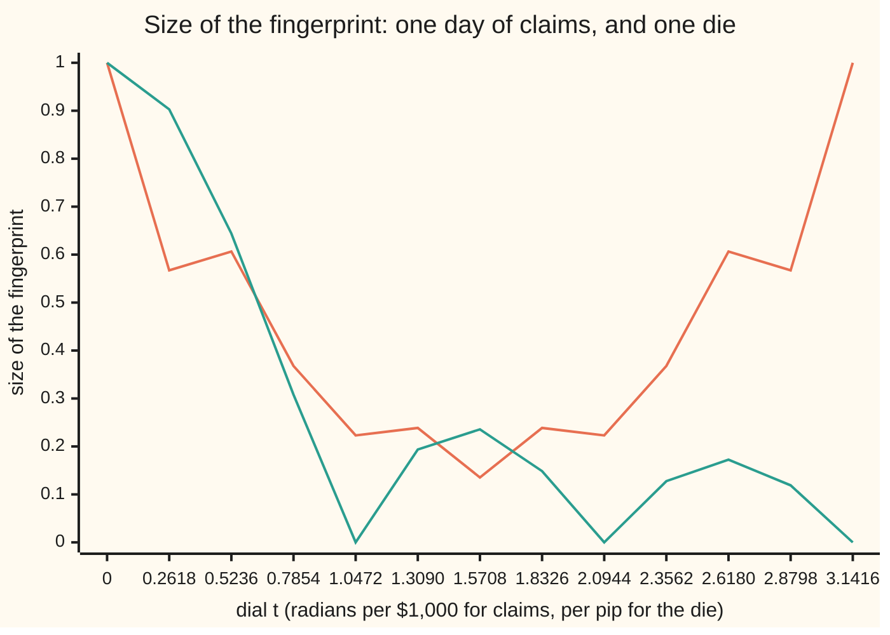

# Infinitely divisible laws: the Levy-Khintchine recipe of drift, wobble and jumps

[Syllabus](../../../SYLLABUS.md) → [Harmonic analysis](../README.md) → [Characteristic Functions and Probability](../README.md#s04) → Infinitely divisible laws

---

## General Overview

A home insurer collects premiums of $1.5 million a year, flowing in at a steady rate. Claims arrive about once a day, at random moments. Three claims in four are $2,000, a broken window. One in four is $10,000, a flooded kitchen. On top of that, expenses, small refunds and investment income push the result up and down a little every day. Over a year that everyday noise has a standard deviation of $30,000.

The insurer's net result for the year averages a profit of $40,000, with a standard deviation of $105,451. The chance of a losing year is 0.348046.

Now cut the year into its 365 days. Each day's result has the same law (probability distribution) as every other day's, and the days do not influence each other. So the year's result is a sum of 365 independent, identical pieces. Cut it into 8,760 hours instead and the same holds. A law that splits like this for every number of pieces is called **infinitely divisible**.

Many laws cannot split. One roll of a die does not split for every n: its fingerprint touches zero (Step 3). The claims total of a year with exactly one claim every day splits into 365 days, but not into 487 pieces (Step 7). This card gives the tests that tell the two kinds apart.

It also gives the **Lévy–Khintchine recipe**, which lists every infinitely divisible law. Each one is built from three ingredients: a steady **drift**, a bell-curve **wobble**, and **jumps** arriving at given rates. For the insurer the recipe reads: drift $1.5 million a year, wobble variance 900 (in thousands of dollars, squared), and claims of $2,000 at 273.75 a year and of $10,000 at 91.25 a year.

**A law splits into n identical independent pieces for every n exactly when its fingerprint is e raised to one exponent built from a drift, a bell-curve wobble and a rate of jumps of each size; each piece then follows the same recipe divided by n.**

**What kind of fact this is:** a theorem. On this card, Why it works proves that every recipe gives an infinitely divisible law, and that every infinitely divisible fingerprint has no zero and is a limit of compound Poisson fingerprints. The last step, that such a limit has exactly the recipe's shape with one set of ingredients, is outlined with its key idea and named sources. The insurer's figures are illustrative, chosen to show the method.

### The picture: a fingerprint that can be split, and one that cannot



Orange: the size of the fingerprint of one day's claims. It never falls below 0.1353, which is $`e^{-2}`$. Teal: one fair die. It touches zero at $`t = \pi/3`$, $`2\pi/3`$ and $`\pi`$. Step 3 below proves that an infinitely divisible fingerprint is never zero. So the die cannot be split, and the claims can.

---

## The formula

Notation first, in words. All money is in thousands of dollars, written $k. The year's net result is $`X`$. Its **fingerprint** is the characteristic function $`\varphi_X(t) = E[e^{itX}]`$: the average of a point on the unit circle turned by $`t`$ times the outcome ([Characteristic functions](01-characteristic-functions-in-depth.md)). Here $`E`$ is the average over outcomes, $`i`$ is the imaginary unit, and the dial $`t`$ is in radians per $k. The [Levy processes](../../11-Stochastic%20processes%20and%20calculus/09-Beyond%20Brownian/01-levy-processes.md) card calls the dial $`u`$, because there $`t`$ is time.

**Definition.** A law is **infinitely divisible** when, for every whole number $`n`$, a random number $`X`$ with that law has the same law as a sum of $`n`$ independent, identically distributed pieces. In fingerprints: for every $`n`$ there is a fingerprint $`\varphi_n`$, the fingerprint of one piece, with $`\varphi_n^{\,n} = \varphi_X`$.

**Theorem (Lévy–Khintchine).** A law is infinitely divisible exactly when its fingerprint is $`e^{\psi(t)}`$ with

```math
\psi(t) = i\,b\,t \;-\; \tfrac12\,\sigma^2 t^2 \;+\; \int_{x \ne 0} \Big(e^{itx} - 1 - itx\,\mathbf{1}_{\{|x|<1\}}\Big)\,\nu(dx),
```

where $`b`$ is any real number, $`\sigma^2 \ge 0`$, and $`\nu`$ is a measure on the nonzero numbers (a rule that gives each set of jump sizes a size of zero or more, here the expected number of such jumps a year) with $`\int \min(1, x^2)\,\nu(dx) < \infty`$. The **triplet** $`(b, \sigma^2, \nu)`$ is unique. One piece out of $`n`$ has the triplet $`(b/n, \sigma^2/n, \nu/n)`$.

**Read it aloud:** the exponent is i times the drift times t, minus half the wobble variance times t squared, plus, for every jump size x, the rate of such jumps times what one jump does to the turning point, with the small jumps' average pull taken out.

For the insurer, the drift is the premium flow, the wobble is the everyday noise, and the jumps are the claims, which lower the result by $2k or $10k:

```math
\psi(t) = 1500\,i\,t \;-\; 450\,t^2 \;+\; 273.75\,\big(e^{-2it} - 1\big) \;+\; 91.25\,\big(e^{-10it} - 1\big).
```

| Symbol | Plain meaning | In our example | Push it up and the answer… |
| --- | --- | --- | --- |
| $`X`$, $`E`$ | the year's net result in $k; the average over outcomes | mean 40, standard deviation 105.4514 | — |
| $`t`$, $`i`$ | the dial, radians per $k; the imaginary unit | $`t = 0.01`$ | the fingerprint of $`X`$ shrinks toward 0: size 0.573718 at $`t = 0.01`$ |
| $`\varphi_X(t)`$, $`\varphi_n`$ | the fingerprint of $`X`$; the fingerprint of one piece out of $`n`$ | $`\varphi_X(0.01) = 0.524887 + 0.231614i`$ | — |
| $`n`$, $`\mu_n`$ | the number of pieces; the law of one piece | 365 days, or 8,760 hours | pieces get smaller |
| $`\psi(t)`$ | the **Lévy exponent**: the logarithm of the fingerprint, chosen continuous with $`\psi(0) = 0`$ | $`-0.555618 + 0.415566i`$ at $`t = 0.01`$ | a more negative real part: a smaller fingerprint, of size $`e^{\mathrm{Re}\,\psi}`$ |
| $`b`$ | the drift in $k a year | 1500 | the mean rises one for one |
| $`\sigma^2`$, $`Z`$ | the wobble variance in $k squared; a standard bell-curve draw | 900, so the wobble is $`30Z`$ | the bell part widens |
| $`\nu`$, $`x`$ | the **Lévy measure**: expected jumps a year of each size $`x`$ | 273.75 at −2, 91.25 at −10 | more or bigger claims: mean falls, spread grows |
| $`\mathbf{1}_{\{\lvert x\rvert<1\}}`$ | 1 for a jump smaller than 1, else 0 | 0 for both claim sizes | — |
| $`\kappa_k`$ | the $`k`$-th cumulant ([Moments and cumulants](02-moments-and-cumulants-from-the-fingerprint.md)); this $`k`$ is a counter, while the k in $k means thousands | $`\kappa_4 = 916880`$ | larger $`\kappa_4`$: fatter tails than a bell of the same variance |
| $`\varepsilon`$, $`G_n`$, $`G`$, $`h`$, $`y`$, $`g`$ | inside the proofs: a size cut-off; a weighted copy of $`n\mu_n`$ and its limit; a shift of the dial; a real number in a bound; the limit of the root sizes | — | — |
| $`R`$, $`\mathrm{Var}`$ | the width of a law's range; the variance | fixed-count year: $`R = 2920`$ | wider range: more pieces allowed |

### When it holds

- **The pieces are independent.** If one day's claims make the next day's likelier, as when a storm lasts a week, the year is not a sum of independent days. The fingerprint no longer factors into 365 equal parts.
- **Every n, not one n.** The claims total of a year with exactly one claim a day is a sum of 365 independent days. It still cannot split into 487 or more pieces, as Step 7 shows. Divisible by 365 is not infinitely divisible.
- **The condition on ν.** The rates must satisfy $`\int \min(1, x^2)\,\nu(dx) < \infty`$. If jumps come so fast that this integral is infinite, the exponent is not finite and no law exists.
- **The drift depends on the cut at size 1.** The term $`-itx\,\mathbf{1}_{\{|x|<1\}}`$ moves the small jumps' average into $`b`$. So the mean, when it exists, is $`b + \int_{|x| \ge 1} x\,\nu(dx)`$, not $`b`$. Here every claim is 2 or larger, and the mean is 1500 − 1460 = 40, not 1500.

---

## Why it works

### Step 0: splitting a law is taking a root of its fingerprint

The fingerprint of a sum of independent pieces is the product of their fingerprints. So $`X`$ splits into $`n`$ identical independent pieces exactly when $`\varphi_X`$ has an $`n`$-th root that is itself a fingerprint.

An exponential makes every root easy: the $`n`$-th root of $`e^{\psi}`$ is $`e^{\psi/n}`$. The theorem says the converse. If every root exists, the fingerprint must be $`e^{\psi}`$, with $`\psi`$ of the recipe's shape.

The proof has four moves. The three building blocks split. Every recipe gives a law that splits. A law that splits has a fingerprint with no zero, so it has a logarithm $`\psi`$. And $`\psi`$ is a limit of compound Poisson exponents, which forces the recipe's shape.

### Step 1: the three building blocks split

- **Drift.** A fixed number $`b`$ has fingerprint $`e^{ibt}`$. Its $`n`$-th piece is the fixed number $`b/n`$.
- **Wobble.** A bell curve with mean 0 and variance $`\sigma^2`$ has fingerprint $`e^{-\sigma^2t^2/2}`$. Its $`n`$-th piece is a bell curve with variance $`\sigma^2/n`$.
- **Jumps.** Jumps arriving at a finite total rate, each drawn from one law, add up to a compound Poisson total ([Compound Poisson](../../11-Stochastic%20processes%20and%20calculus/04-Poisson%20and%20Jump%20Processes/04-compound-poisson.md)). That card finds its generating function with a real dial; the same steps with the dial $`it`$ give the fingerprint $`e^{\int (e^{itx} - 1)\,\nu(dx)}`$, where $`\nu`$ is the total rate times the jump law. Its $`n`$-th piece has rates $`\nu/n`$.

For the insurer, one day has drift 4.109589, wobble variance 2.465753, and claims at 0.75 a day of $2k and 0.25 a day of $10k. A day with no claim has chance 0.367879, which is $`e^{-1}`$.

### Step 2: every recipe gives a law that splits

When $`\nu`$ has finite total mass, as for the insurer, the recipe is a product of the three blocks, and the drift absorbs the term $`-itx\,\mathbf{1}_{\{|x|<1\}}`$. So $`e^{\psi}`$ is the fingerprint of drift plus wobble plus a compound Poisson total.

When $`\nu`$ has infinite mass, cut away the jumps smaller than $`\varepsilon`$. What remains is again a product of blocks. As $`\varepsilon`$ shrinks, these fingerprints converge at every $`t`$ to $`e^{\psi}`$, and $`\psi`$ is continuous at 0. [Levy's continuity theorem](04-levy-continuity-theorem.md) then says $`e^{\psi}`$ is a fingerprint.

The triplet $`(b/n, \sigma^2/n, \nu/n)`$ meets the same conditions. So $`e^{\psi/n}`$ is a fingerprint too, and its $`n`$-th power is $`e^{\psi}`$. The law splits.

<details>
<summary>Detailed proof: the cut-off recipes converge to a fingerprint</summary>

Fix $`0 < \varepsilon < 1`$. The jumps of size at least $`\varepsilon`$ have finite total rate, because $`\min(1, x^2) \ge \varepsilon^2`$ there:

$`\displaystyle \nu(\{|x| \ge \varepsilon\}) \le \varepsilon^{-2}\int \min(1, x^2)\,\nu(dx) < \infty.`$

So the cut exponent

$`\displaystyle \psi_\varepsilon(t) = ibt - \tfrac12\sigma^2t^2 + \int_{|x| \ge \varepsilon}\big(e^{itx} - 1 - itx\,\mathbf{1}_{\{|x|<1\}}\big)\,\nu(dx)`$

is a fixed shift by $`b - \int_{\varepsilon \le |x| < 1} x\,\nu(dx)`$, plus a bell curve, plus a compound Poisson total with that finite rate. The three are taken independent, so $`e^{\psi_\varepsilon}`$ is a fingerprint.

**Convergence.** For $`|x| < 1`$ the integrand is at most $`t^2x^2/2`$ in size, because $`|e^{iy} - 1 - iy| \le y^2/2`$. For $`|x| \ge 1`$ it is at most 2. Both bounds are integrable against $`\nu`$. Dominated convergence (pointwise limits pass inside an integral when one integrable bound covers them all) gives $`\psi_\varepsilon(t) \to \psi(t)`$ at every $`t`$.

**Continuity at 0.** The same bounds give

$`\displaystyle \big|\psi(t) - ibt + \tfrac12\sigma^2t^2\big| \le \tfrac{t^2}{2}\int_{|x|<1} x^2\,\nu(dx) + \int_{|x| \ge 1} |e^{itx} - 1|\,\nu(dx),`$

and both terms tend to 0 with $`t`$, the second by dominated convergence. So $`e^{\psi}`$ is continuous at 0, and Lévy's continuity theorem makes it a fingerprint. ∎

</details>

### Step 3: a fingerprint that splits is never zero

This is the sharpest test. **If a fingerprint is zero at any dial, the law does not split.**

The idea: the size of one piece's fingerprint is $`|\varphi_X|^{1/n}`$. As $`n`$ grows, this tends to 1 where $`\varphi_X \ne 0`$ and stays 0 where $`\varphi_X = 0`$. The limit jumps, but the continuity theorem forbids a limit fingerprint that jumps, unless it never reaches zero.

A die's fingerprint is $`\tfrac16(e^{it} + e^{2it} + \dots + e^{6it})`$. At $`t = \pi/3`$ its six terms are the six sixth roots of 1, and they cancel: the size is 0.000000. So one roll of a die does not split. The house example follows: the standardised total of 10 dice has a fingerprint with a zero at $`t = 5.655513`$, so it does not split either. Only the limit, the bell curve, does.

<details>
<summary>Detailed proof: no zeros, and a unique root</summary>

Let $`\varphi_n^{\,n} = \varphi_X`$. Then $`|\varphi_n|^2`$ is a fingerprint: it belongs to the difference of two independent copies of one piece. It equals $`|\varphi_X|^{2/n}`$.

As $`n`$ grows, $`|\varphi_X(t)|^{2/n}`$ tends to $`g(t)`$, where $`g(t) = 1`$ if $`\varphi_X(t) \ne 0`$ and $`g(t) = 0`$ if $`\varphi_X(t) = 0`$. The fingerprint $`\varphi_X`$ is continuous with $`\varphi_X(0) = 1`$, so it is nonzero near 0, and $`g = 1`$ near 0. So $`g`$ is continuous at 0.

By Lévy's continuity theorem, $`g`$ is a fingerprint, so it is continuous everywhere. A continuous function on the line that takes only the values 0 and 1, and is 1 at 0, is 1 everywhere. So $`\varphi_X`$ is never zero.

**The logarithm.** A continuous function on the line that is never zero has a continuous logarithm: lift the angle continuously from $`t = 0`$, and take the ordinary logarithm of the size. Call it $`\psi`$, with $`\psi(0) = 0`$.

**The root is unique.** Any continuous $`n`$-th root of $`e^{\psi}`$ equal to 1 at 0 is $`e^{\psi/n}`$ times a continuous function whose values are $`n`$-th roots of 1. That function is 1 at 0 and can only take finitely many values, so it is 1 everywhere. So $`\varphi_n = e^{\psi/n}`$: the law of one piece is fixed. ∎

</details>

### Step 4: a law that splits is a limit of compound Poisson laws

From Step 3, $`\varphi_n = e^{\psi/n}`$. Expand the exponential:

```math
n\big(\varphi_n(t) - 1\big) = n\big(e^{\psi(t)/n} - 1\big) \;\longrightarrow\; \psi(t).
```

The left side has a meaning. Write $`\mu_n`$ for the law of one piece. Then

```math
n\big(\varphi_n(t) - 1\big) = \int \big(e^{itx} - 1\big)\; n\,\mu_n(dx),
```

which is the exponent of a compound Poisson total with jumps at rate $`n`$, each drawn from $`\mu_n`$. So: **run $`n`$ pieces a year as random jumps instead of on a fixed schedule, and as $`n`$ grows you get the law back.**

For the insurer at $`t = 0.01`$, days give $`-0.555432 + 0.414934i`$, a gap of 0.000659 to $`\psi`$. Hours give $`-0.555610 + 0.415539i`$, a gap of 0.000027. The gap falls 24 times as the pieces become 24 times as many. It is about $`|\psi|^2/(2n)`$, the next term of the exponential series.

### Step 5: the limit has the recipe's shape (outline)

Every compound Poisson exponent has the recipe's shape, with rates $`n\mu_n`$. The task is to show the shape survives the limit.

The key idea is to weigh each jump by $`x^2/(1 + x^2)`$. Define the finite measure $`G_n(dx) = \frac{x^2}{1 + x^2}\,n\,\mu_n(dx)`$. Small jumps then count like their variance, and big jumps count about once each.

1. The continuity of $`\psi`$ at 0 keeps the total mass of $`G_n`$ bounded and stops it leaking to infinity. This is the tightness argument of [Levy's continuity theorem](04-levy-continuity-theorem.md).
2. Helly's selection theorem (a bounded family of measures that keeps its mass in a bounded range has a convergent subsequence) gives a subsequence with $`G_n \to G`$, a finite measure.
3. Mass of $`G`$ away from 0 becomes the jump rates: $`\nu(dx) = \frac{1 + x^2}{x^2}\,G(dx)`$.
4. Mass of $`G`$ piling up at 0 is many tiny jumps that cancel on average. It becomes the wobble: $`\sigma^2 = G(\{0\})`$. This is the central limit theorem hiding inside the proof.
5. Whatever is left over in the linear term converges, because everything else does. It becomes the drift $`b`$.

Steutel and van Harn, Chapter IV, give the full proof. Applebaum reaches the same theorem by another road: Chapter 1 builds the law from any triplet, and Chapter 2 completes the converse as a corollary of the Lévy–Itô decomposition (the split of a Lévy process's path into drift, Brownian motion and jumps). Durrett, Section 3.9, gives the theorem and the compound Poisson limit.

**Uniqueness.** The exponent fixes the triplet. Average $`\psi(t) - \psi(t + h)`$ over $`h`$ from −1 to 1. The drift cancels, and what is left is the fingerprint of a finite measure:

$`\displaystyle \tfrac{\sigma^2}{6}\ \text{at } 0, \qquad \Big(1 - \frac{\sin x}{x}\Big)\,\nu(dx)\ \text{elsewhere}.`$

[Levy's inversion formula](03-levy-inversion-and-uniqueness.md) recovers that measure, so it recovers $`\sigma^2`$ and $`\nu`$, and then $`b`$.

### Step 6: reading drift, wobble and jumps off the exponent

This is the card's job done on the insurer, from one day's fingerprint.

1. **Take the continuous logarithm.** Compute the day's fingerprint along a fine grid of dials from 0 to $`\pi`$. Unwrap its angle, so it does not jump by $`2\pi`$. That gives $`\psi_{\text{day}}`$.
2. **Read drift and wobble at $`t = \pi`$.** Both claim sizes are even numbers of $k. At $`t = \pi`$ each claim turns the point a whole number of turns, so the jump part is zero. What remains is $`ib_{\text{day}}\pi - \tfrac12\sigma^2_{\text{day}}\pi^2`$. Times 365, the angle gives $`b = 1500.0000`$ and the size gives $`\sigma^2 = 900.0000`$.
3. **Read the jumps by inversion.** Subtract drift and wobble. What remains is $`\sum \nu(\{x\})(e^{itx} - 1)`$, a short Fourier series in $`t`$. Its coefficients are the jump rates: 273.7500 at −2, 0.0000 at −4, 91.2500 at −10.

For any infinitely divisible law, lattice jumps or not, $`\sigma^2`$ is the limit of $`-2\psi(t)/t^2`$ as $`t`$ grows, because the jump part grows more slowly than $`t^2`$. The jump rates come from the averaging in Step 5.

### Step 7: two more tests that rule a law out

- **Bounded laws do not split.** Say $`X`$ always lies in a range of width $`R`$. If $`X`$ is a sum of $`n`$ identical independent pieces, each piece lies in a range of width $`R/n`$. So its variance is at most $`(R/n)^2/4`$, and $`\mathrm{Var}\,X \le R^2/(4n)`$. Only a fixed number passes this for every $`n`$.
  - A year with exactly one claim a day lies between 730 and 3650 $k of claims, so $`R = 2920`$. Its variance is 4380.0. The bound fails from $`n = 487`$ on: such a year splits into 365 days, but never into 487 pieces.
- **The fourth cumulant cannot be negative.** Differentiating the recipe gives $`\kappa_k = \int x^k\,\nu(dx)`$ for $`k \ge 3`$, and $`\kappa_2 = \sigma^2 + \int x^2\,\nu(dx)`$. So every even cumulant from the fourth on is at least 0.
  - The insurer: $`\kappa_4 = 916880.0`$, as it must be.
  - The one-claim-a-day year: $`\kappa_4 = -35040.0`$. Ruled out again.

---

## Worked numbers, by hand

The insurer's year, at the dial $`t = 0.01`$ per $k. A $2k claim turns the point by −0.02 radians, a $10k claim by −0.1.

| Step | Arithmetic | Value |
| --- | --- | --- |
| mean | 1500 + 273.75 × (−2) + 91.25 × (−10) = 1500 − 1460 | 40.0000 |
| variance | 900 + 273.75 × 4 + 91.25 × 100 | 11120.0000 |
| standard deviation | √11120 | 105.4514 |
| drift term | i × 1500 × 0.01 | +15.000000 i |
| wobble term | −½ × 900 × 0.0001 | −0.045000 |
| $2k claims | 273.75 × (cos 0.02 − 1), and 273.75 × sin(−0.02) | −0.054748 − 5.474635 i |
| $10k claims | 91.25 × (cos 0.1 − 1), and 91.25 × sin(−0.1) | −0.455870 − 9.109799 i |
| **exponent $`\psi(0.01)`$** | add the four rows | **−0.555618 + 0.415566 i** |
| **fingerprint $`\varphi_X(0.01)`$** | $`e^{-0.555618}`$ × (cos 0.415566 + i sin 0.415566) | **0.524887 + 0.231614 i** |
| one day's triplet | divide each ingredient by 365 | 4.109589; 2.465753; 0.75 at −2, 0.25 at −10 |
| one day's mean and variance | 40 / 365, and 11120 / 365 | 0.109589 and 30.465753 |

The exponent is small at this dial: the fingerprint's size is $`e^{-0.555618}`$ = 0.573718. One day earns 0.109589 $k on average, with variance 30.465753 $k squared. The exact law of the year, counted claim by claim, gives the same fingerprint. Its chance of a losing year is 0.348046, close to the bell curve's 0.352225: 365 pieces are already many.

### What breaks if you drop a piece

| Mistake | Comes out at | What went wrong |
| --- | --- | --- |
| Read the drift $`b`$ as the mean | 1500.0000, not 40.0000 | The big claims sit outside the cut at size 1, so their average pull is not in $`b`$ |
| Read the wobble $`\sigma^2`$ as the whole variance | 11120.0000, not 900.0000 | Only 900 of the 11120 is bell-curve wobble; the claims supply the rest |
| Take one day as $`X/365`$ | variance 0.083468, not 30.465753 | Scaling divides the variance by 365 squared; splitting divides the exponent by 365 |
| Take the square root of a 0-or-1 claim count, chance 0.2 | a "chance" of −0.006988 at 2 claims | The fingerprint $`0.8 + 0.2e^{it}`$ has no zero, yet its root is no fingerprint: the count is bounded |

The code prints every row.

---

## Code, from first principles, and it actually runs

The code reaches the insurer's law by four independent roads. The first is the Lévy–Khintchine exponent. The second counts the year exactly: the $2k and $10k claims are two independent Poisson counts, so their joint chances give the law of the claims total, cut at $2,600k with the kept mass printed. The third convolves 365 exact one-day laws and compares them with the year, chance by chance. The fourth reads the triplet back off the one-day fingerprint by its continuous logarithm and a 2,048-point inversion. The chance of a losing year comes two ways: summed over the counted law, and by Gil-Pelaez inversion of the exponent (one integral that turns a fingerprint into a chance, [Levy's inversion formula](03-levy-inversion-and-uniqueness.md)), cut at $`t = 0.4`$ with its tail bound printed. The normal distribution function is a positive-term series written out, with `math.erf` only as a labelled library cross-check in Python. Then come the tests: the die's zero, the bounded year, the negative cumulant, and the negative "chance" in a square root.

### Python

```python
# Infinitely divisible laws -- the check behind the card.  Only math is imported.
# An insurer's net result for one year, in $k (thousands of dollars):
#   X = 1500 (premiums) + 30 Z (wobble) - claims; claims arrive 365 a year,
#   each $2k (chance 0.75) or $10k (chance 0.25).  Dial t in radians per $k.
# Roads: the Levy-Khintchine exponent; the exact law of the year by counting
# the two kinds of claim; 365 exact one-day laws convolved; triplet read back
# off the one-day fingerprint.  Then tests that rule laws in or out.
import math
PI, DAYS, B, S2 = math.pi, 365, 1500.0, 900.0
NU = {-2.0: 273.75, -10.0: 91.25}                 # Levy measure: claims per year of each size
def z(v): return 0.0 if abs(v) < 5e-7 else v      # print tiny values as 0, the same in both languages
def psi(t, b, s2, nu):                            # Levy-Khintchine exponent; no jump is smaller than 1
    re = -0.5 * s2 * t * t + sum(r * (math.cos(t * x) - 1) for x, r in nu.items())
    return complex(re, b * t + sum(r * math.sin(t * x) for x, r in nu.items()))
def cexp(w): return math.exp(w.real) * complex(math.cos(w.imag), math.sin(w.imag))
LF = [0.0]                                        # log n!, summed
for n in range(1, 1400): LF.append(LF[-1] + math.log(n))
def pois(lam, n): return math.exp(-lam + n * math.log(lam) - LF[n])
def claims_law(l2, l10, cap):                     # exact law of the claims total, in units of $2k
    f = [0.0] * (cap + 1)
    for n10 in range(cap // 5 + 1):
        p10 = pois(l10, n10)
        for n2 in range(cap - 5 * n10 + 1):
            f[n2 + 5 * n10] += p10 * pois(l2, n2)
    return f
def fp(f, b, s2, t):                              # fingerprint of b + sqrt(s2) Z - 2 S from the law of S
    w = sum(p * complex(math.cos(2 * s * t), -math.sin(2 * s * t)) for s, p in enumerate(f))
    return cexp(complex(-0.5 * s2 * t * t, b * t)) * w
def Phi(x):                                       # normal CDF: positive-term series, no cancellation
    if abs(x) > 8: return 0.0 if x < 0 else 1.0
    term, tot, k = x, x, 0
    while abs(term) > 1e-17 * abs(tot) + 1e-300:
        k += 1; term *= x * x / (2 * k + 1); tot += term
    return 0.5 + math.exp(-0.5 * x * x) / math.sqrt(2 * PI) * tot
# ---- 1. the triplet and what it says ----
mean = B + sum(x * r for x, r in NU.items())
var = S2 + sum(x * x * r for x, r in NU.items())
k3, k4 = (sum(x ** k * r for x, r in NU.items()) for k in (3, 4))
print(f"year triplet: b {B:.2f}, sigma^2 {S2:.2f}, nu {NU[-2.0]:.2f} at -2, {NU[-10.0]:.2f} at -10")
print(f"mean {mean:.4f}, variance {var:.4f}, sd {math.sqrt(var):.4f}, kappa3 {k3:.1f}, kappa4 {k4:.1f}")
w = psi(0.01, B, S2, NU); ph = cexp(w)
print(f"psi(0.01) {w.real:.6f} {w.imag:+.6f} i; phi(0.01) {ph.real:.6f} {ph.imag:+.6f} i")
j2, j10 = (complex(r * (math.cos(0.01 * x) - 1), r * math.sin(0.01 * x)) for x, r in NU.items())
print(f"pieces at t = 0.01: drift +{B * 0.01:.6f} i, wobble {-0.5 * S2 * 1e-4:.6f}, $2k claims {j2.real:.6f} {j2.imag:+.6f} i, $10k claims {j10.real:.6f} {j10.imag:+.6f} i")
print(f"claims a year 365, average claim {(-mean + B) / 365:.4f}, claims total mean {B - mean:.4f}; |phi(0.01)| {abs(ph):.6f}")
# ---- 2. the exact law of the year, by counting both kinds of claim ----
year = claims_law(273.75, 91.25, 1300)
ey = sum(s * p for s, p in enumerate(year)); vy = sum(s * s * p for s, p in enumerate(year)) - ey ** 2
ex_mean, ex_var = B - 2 * ey, S2 + 4 * vy
ph2 = fp(year, B, S2, 0.01)
print(f"exact law: mass kept {sum(year):.10f}, mean {ex_mean:.4f}, variance {ex_var:.4f}")
print(f"exact law: phi(0.01) {ph2.real:.6f} {ph2.imag:+.6f} i, gap to formula below 1e-9: {'yes' if abs(ph2 - ph) < 1e-9 else 'no'}")
assert abs(ex_mean - mean) < 1e-6 and abs(ex_var - var) < 1e-4 and abs(ph2 - ph) < 1e-9
# ---- 3. split into days: 365 one-day laws convolved give the year ----
day = claims_law(0.75, 0.25, 60)
print(f"one day: b {B / DAYS:.6f}, sigma^2 {S2 / DAYS:.6f}, nu 0.75 at -2, 0.25 at -10; mean {mean / DAYS:.6f}, variance {var / DAYS:.6f}")
print(f"one day: no claim {day[0]:.6f}, one $2k claim {day[1]:.6f}, mass kept up to $120k {sum(day):.10f}")
conv = [1.0] + [0.0] * 1300
for _ in range(DAYS):
    new = [0.0] * 1301
    for j, dj in enumerate(day):
        if dj > 1e-300:
            for s in range(1301 - j): new[s + j] += dj * conv[s]
    conv = new
gap = max(abs(a - c) for a, c in zip(year, conv))
print(f"365 days convolved against the year counted: largest gap in a chance below 1e-12: {'yes' if gap < 1e-12 else 'no'}")
assert gap < 1e-12
# ---- 4. read drift, wobble and jumps back off the one-day fingerprint ----
M = 2048; ts = [PI * m / M for m in range(M + 1)]
lg, prev = [], None
for t in ts:                                      # continuous logarithm: unwrap the angle along t
    v = fp(day, B / DAYS, S2 / DAYS, t); a = math.atan2(v.imag, v.real)
    if prev is not None: a += 2 * PI * round((prev - a) / (2 * PI))
    lg.append(complex(math.log(abs(v)), a)); prev = a
b_read, s2_read = lg[M].imag / PI * DAYS, -2 * lg[M].real / PI ** 2 * DAYS
jump = [lg[m] - complex(-0.5 * s2_read / DAYS * t * t, b_read / DAYS * t) for m, t in enumerate(ts)]
nu_read = {2 * k: DAYS * sum(jump[m] * complex(math.cos(2 * k * ts[m]), math.sin(2 * k * ts[m])) for m in range(M)).real / M for k in (1, 2, 5)}
print(f"read back at t = pi: b {b_read:.4f}, sigma^2 {s2_read:.4f}")
print(f"read back by inversion: nu at -2 {z(nu_read[2]):.4f}, at -4 {z(nu_read[4]):.4f}, at -10 {z(nu_read[10]):.4f}")
assert abs(b_read - B) < 1e-6 and abs(s2_read - S2) < 1e-6 and abs(nu_read[2] - 273.75) < 1e-4 and abs(nu_read[10] - 91.25) < 1e-4
gaps = []
for n in (365, 8760):                             # n (phi_n - 1): a compound Poisson exponent, tending to psi
    cp = n * (cexp(w / n) - 1); gaps.append(abs(cp - w))
    print(f"n = {n}: n(phi_n - 1) at 0.01 {cp.real:.6f} {cp.imag:+.6f} i, gap to psi {abs(cp - w):.6f}")
assert abs(gaps[0] / gaps[1] - 8760 / 365) < 0.1 and abs(gaps[0] - abs(w) ** 2 / (2 * 365)) < 1e-6   # gap about |psi|^2 / 2n
# ---- 5. what the insurer reads off: chance of a losing year ----
p_loss = sum(p * Phi((2 * s - B) / math.sqrt(S2)) for s, p in enumerate(year))
p_norm = Phi(-mean / math.sqrt(var))
print(f"chance of a losing year: exact {p_loss:.6f}, bell curve with the same mean and sd {p_norm:.6f}")
TC, MI = 0.4, 4000                                # second road: Gil-Pelaez inversion of the exponent, cut at t = TC
gp = lambda t: mean if t == 0 else cexp(psi(t, B, S2, NU)).imag / t   # Im phi(t) / t, which tends to the mean
simp = sum((1 if m in (0, MI) else 4 if m % 2 else 2) * gp(TC * m / MI) for m in range(MI + 1))
p_inv = 0.5 - TC / MI / 3 * simp / PI             # |phi(t)| <= exp(-450 t^2) bounds the tail past TC
print(f"chance of a losing year by inverting the exponent: {p_inv:.6f} (t up to {TC}, tail below {math.exp(-0.5 * S2 * TC * TC) / (S2 * TC * TC):.1e})")
assert abs(p_inv - p_loss) < 1e-8
# ---- 6. tests that rule a law out ----
die = lambda t: abs(sum(complex(math.cos(k * t), math.sin(k * t)) for k in range(1, 7))) / 6
print(f"one die: |phi| at pi/3 {z(die(PI / 3)):.6f}, at 2pi/3 {z(die(2 * PI / 3)):.6f}; ten dice standardised, zero at t = {PI / 3 * math.sqrt(10 * 35 / 12):.6f}")
lo, hi, vf = 365 * 2, 365 * 10, 365 * (0.75 * 4 + 0.25 * 100 - 16)
print(f"exactly one claim a day: range {lo} to {hi}, variance {vf:.1f}, kappa4 {365 * 8 ** 4 * 0.1875 * (1 - 6 * 0.1875):.1f}")
print(f"  n pieces need variance <= {hi - lo}^2/(4n): impossible from n = {math.floor((hi - lo) ** 2 / (4 * vf)) + 1}")
f = [0.8, 0.2, 0.0, 0.0]; g = [math.sqrt(f[0])]   # square root of a 0-or-1 claim count, as a power series
for k in range(1, 4): g.append((f[k] - sum(g[j] * g[k - j] for j in range(1, k))) / (2 * g[0]))
closed = math.sqrt(f[0]) * (0.5 * -0.5 / 2) * (f[1] / f[0]) ** 2   # binomial series of sqrt(f0 + f1 s)
print(f"half of a 0-or-1 count (chance {f[1]:.1f}): 'chances' {g[0]:.6f} {g[1]:.6f} {g[2]:.6f} {g[3]:.6f}; closed form at 2: {closed:.6f}")
assert abs(g[2] - closed) < 1e-12 and g[2] < 0
assert die(PI / 3) < 1e-12 and abs(Phi(-0.4) - 0.5 * (1 + math.erf(-0.4 / math.sqrt(2)))) < 1e-14   # library cross-check
# ---- 7. what breaks ----
print(f"breaks: mean read as b {B:.4f} (right {mean:.4f}); wobble read as all the variance {var:.4f} (right {S2:.4f})")
print(f"breaks: day as X/365, variance {var / DAYS ** 2:.6f} (right {var / DAYS:.6f})")
# ---- 8. the picture: |fingerprint| of one day's claims and of one die ----
print("chart: t, |phi| one day of claims, |phi| one die")
for k in range(13):
    t = PI * k / 12
    print(f"{t:.4f} {math.exp(0.75 * (math.cos(2 * t) - 1) + 0.25 * (math.cos(10 * t) - 1)):.4f} {z(die(t)):.4f}")
print("ALL CHECKS PASS")
```

**Ran 2026-11-15 on macOS, Python 3.14.10, standard library only. All checks passed. Output, pasted from the run:**

```
year triplet: b 1500.00, sigma^2 900.00, nu 273.75 at -2, 91.25 at -10
mean 40.0000, variance 11120.0000, sd 105.4514, kappa3 -93440.0, kappa4 916880.0
psi(0.01) -0.555618 +0.415566 i; phi(0.01) 0.524887 +0.231614 i
pieces at t = 0.01: drift +15.000000 i, wobble -0.045000, $2k claims -0.054748 -5.474635 i, $10k claims -0.455870 -9.109799 i
claims a year 365, average claim 4.0000, claims total mean 1460.0000; |phi(0.01)| 0.573718
exact law: mass kept 1.0000000000, mean 40.0000, variance 11120.0000
exact law: phi(0.01) 0.524887 +0.231614 i, gap to formula below 1e-9: yes
one day: b 4.109589, sigma^2 2.465753, nu 0.75 at -2, 0.25 at -10; mean 0.109589, variance 30.465753
one day: no claim 0.367879, one $2k claim 0.275910, mass kept up to $120k 1.0000000000
365 days convolved against the year counted: largest gap in a chance below 1e-12: yes
read back at t = pi: b 1500.0000, sigma^2 900.0000
read back by inversion: nu at -2 273.7500, at -4 0.0000, at -10 91.2500
n = 365: n(phi_n - 1) at 0.01 -0.555432 +0.414934 i, gap to psi 0.000659
n = 8760: n(phi_n - 1) at 0.01 -0.555610 +0.415539 i, gap to psi 0.000027
chance of a losing year: exact 0.348046, bell curve with the same mean and sd 0.352225
chance of a losing year by inverting the exponent: 0.348046 (t up to 0.4, tail below 3.7e-34)
one die: |phi| at pi/3 0.000000, at 2pi/3 0.000000; ten dice standardised, zero at t = 5.655513
exactly one claim a day: range 730 to 3650, variance 4380.0, kappa4 -35040.0
  n pieces need variance <= 2920^2/(4n): impossible from n = 487
half of a 0-or-1 count (chance 0.2): 'chances' 0.894427 0.111803 -0.006988 0.000873; closed form at 2: -0.006988
breaks: mean read as b 1500.0000 (right 40.0000); wobble read as all the variance 11120.0000 (right 900.0000)
breaks: day as X/365, variance 0.083468 (right 30.465753)
chart: t, |phi| one day of claims, |phi| one die
0.0000 1.0000 1.0000
0.2618 0.5672 0.9029
0.5236 0.6065 0.6440
0.7854 0.3679 0.3080
1.0472 0.2231 0.0000
1.3090 0.2386 0.1936
1.5708 0.1353 0.2357
1.8326 0.2386 0.1485
2.0944 0.2231 0.0000
2.3562 0.3679 0.1276
2.6180 0.6065 0.1725
2.8798 0.5672 0.1189
3.1416 1.0000 0.0000
ALL CHECKS PASS
```

### Rust

```rust
// Infinitely divisible laws -- the check behind the card.  std only, no crates.
// An insurer's net result for one year, in $k (thousands of dollars):
//   X = 1500 (premiums) + 30 Z (wobble) - claims; claims arrive 365 a year,
//   each $2k (chance 0.75) or $10k (chance 0.25).  Dial t in radians per $k.
// Roads: the Levy-Khintchine exponent; the exact law of the year by counting
// the two kinds of claim; 365 exact one-day laws convolved; triplet read back
// off the one-day fingerprint.  Then tests that rule laws in or out.
use std::f64::consts::PI;
use std::ops::{Add, Mul, Sub};

#[derive(Clone, Copy)]
struct C { re: f64, im: f64 }
impl Add for C { type Output = C; fn add(self, o: C) -> C { C { re: self.re + o.re, im: self.im + o.im } } }
impl Sub for C { type Output = C; fn sub(self, o: C) -> C { C { re: self.re - o.re, im: self.im - o.im } } }
impl Mul for C { type Output = C; fn mul(self, o: C) -> C { C { re: self.re * o.re - self.im * o.im, im: self.re * o.im + self.im * o.re } } }
impl C { fn abs(self) -> f64 { self.re.hypot(self.im) } fn sc(self, k: f64) -> C { C { re: self.re * k, im: self.im * k } } }

const DAYS: f64 = 365.0;
const B: f64 = 1500.0;
const S2: f64 = 900.0;
const NU: [(f64, f64); 2] = [(-2.0, 273.75), (-10.0, 91.25)]; // Levy measure: claims per year of each size

fn z(v: f64) -> f64 { if v.abs() < 5e-7 { 0.0 } else { v } } // print tiny values as 0
fn psi(t: f64, b: f64, s2: f64) -> C { // Levy-Khintchine exponent; no jump is smaller than 1
    let mut re = -0.5 * s2 * t * t;
    let mut im = b * t;
    for &(x, r) in NU.iter() { re += r * ((t * x).cos() - 1.0); im += r * (t * x).sin(); }
    C { re, im }
}
fn cexp(w: C) -> C { C { re: w.re.exp() * w.im.cos(), im: w.re.exp() * w.im.sin() } }
fn claims_law(l2: f64, l10: f64, cap: usize, lf: &[f64]) -> Vec<f64> { // exact law, units of $2k
    let pois = |lam: f64, n: usize| (-lam + n as f64 * lam.ln() - lf[n]).exp();
    let mut f = vec![0.0; cap + 1];
    for n10 in 0..=cap / 5 {
        let p10 = pois(l10, n10);
        for n2 in 0..=cap - 5 * n10 { f[n2 + 5 * n10] += p10 * pois(l2, n2); }
    }
    f
}
fn fp(f: &[f64], b: f64, s2: f64, t: f64) -> C { // fingerprint of b + sqrt(s2) Z - 2 S
    let mut w = C { re: 0.0, im: 0.0 };
    for (s, &p) in f.iter().enumerate() {
        let a = 2.0 * s as f64 * t;
        w = w + C { re: p * a.cos(), im: -p * a.sin() };
    }
    cexp(C { re: -0.5 * s2 * t * t, im: b * t }) * w
}
fn phi_cdf(x: f64) -> f64 { // normal CDF: positive-term series, no cancellation
    if x.abs() > 8.0 { return if x < 0.0 { 0.0 } else { 1.0 }; }
    let (mut term, mut tot, mut k) = (x, x, 0.0);
    while term.abs() > 1e-17 * tot.abs() + 1e-300 { k += 1.0; term *= x * x / (2.0 * k + 1.0); tot += term; }
    0.5 + (-0.5 * x * x).exp() / (2.0 * PI).sqrt() * tot
}
fn die(t: f64) -> f64 {
    let (mut re, mut im) = (0.0, 0.0);
    for k in 1..=6 { re += (k as f64 * t).cos(); im += (k as f64 * t).sin(); }
    C { re, im }.abs() / 6.0
}
fn sgn(v: f64, d: usize) -> String { format!("{:+.*}", d, v) }
fn yes(b: bool) -> &'static str { if b { "yes" } else { "no" } }

fn main() {
    let mut lf = vec![0.0f64]; // log n!, summed
    for n in 1..1400 { let last = lf[n - 1]; lf.push(last + (n as f64).ln()); }
    // ---- 1. the triplet and what it says ----
    let mean = B + NU.iter().map(|&(x, r)| x * r).sum::<f64>();
    let var = S2 + NU.iter().map(|&(x, r)| x * x * r).sum::<f64>();
    let k3: f64 = NU.iter().map(|&(x, r)| x.powi(3) * r).sum();
    let k4: f64 = NU.iter().map(|&(x, r)| x.powi(4) * r).sum();
    println!("year triplet: b {:.2}, sigma^2 {:.2}, nu {:.2} at -2, {:.2} at -10", B, S2, NU[0].1, NU[1].1);
    println!("mean {:.4}, variance {:.4}, sd {:.4}, kappa3 {:.1}, kappa4 {:.1}", mean, var, var.sqrt(), k3, k4);
    let w = psi(0.01, B, S2);
    let ph = cexp(w);
    println!("psi(0.01) {:.6} {} i; phi(0.01) {:.6} {} i", w.re, sgn(w.im, 6), ph.re, sgn(ph.im, 6));
    let jp = |x: f64, r: f64| C { re: r * ((0.01 * x).cos() - 1.0), im: r * (0.01 * x).sin() };
    let (j2, j10) = (jp(NU[0].0, NU[0].1), jp(NU[1].0, NU[1].1));
    println!("pieces at t = 0.01: drift +{:.6} i, wobble {:.6}, $2k claims {:.6} {} i, $10k claims {:.6} {} i", B * 0.01, -0.5 * S2 * 1e-4, j2.re, sgn(j2.im, 6), j10.re, sgn(j10.im, 6));
    println!("claims a year 365, average claim {:.4}, claims total mean {:.4}; |phi(0.01)| {:.6}", (-mean + B) / 365.0, B - mean, ph.abs());
    // ---- 2. the exact law of the year, by counting both kinds of claim ----
    let year = claims_law(273.75, 91.25, 1300, &lf);
    let ey: f64 = year.iter().enumerate().map(|(s, p)| s as f64 * p).sum();
    let vy: f64 = year.iter().enumerate().map(|(s, p)| (s * s) as f64 * p).sum::<f64>() - ey * ey;
    let (ex_mean, ex_var) = (B - 2.0 * ey, S2 + 4.0 * vy);
    let ph2 = fp(&year, B, S2, 0.01);
    println!("exact law: mass kept {:.10}, mean {:.4}, variance {:.4}", year.iter().sum::<f64>(), ex_mean, ex_var);
    println!("exact law: phi(0.01) {:.6} {} i, gap to formula below 1e-9: {}", ph2.re, sgn(ph2.im, 6), yes((ph2 - ph).abs() < 1e-9));
    assert!((ex_mean - mean).abs() < 1e-6 && (ex_var - var).abs() < 1e-4 && (ph2 - ph).abs() < 1e-9);
    // ---- 3. split into days: 365 one-day laws convolved give the year ----
    let day = claims_law(0.75, 0.25, 60, &lf);
    println!("one day: b {:.6}, sigma^2 {:.6}, nu 0.75 at -2, 0.25 at -10; mean {:.6}, variance {:.6}", B / DAYS, S2 / DAYS, mean / DAYS, var / DAYS);
    println!("one day: no claim {:.6}, one $2k claim {:.6}, mass kept up to $120k {:.10}", day[0], day[1], day.iter().sum::<f64>());
    let mut conv = vec![0.0; 1301];
    conv[0] = 1.0;
    for _ in 0..365 {
        let mut new = vec![0.0; 1301];
        for (j, &dj) in day.iter().enumerate() {
            if dj > 1e-300 { for s in 0..1301 - j { new[s + j] += dj * conv[s]; } }
        }
        conv = new;
    }
    let gap = year.iter().zip(conv.iter()).map(|(a, c)| (a - c).abs()).fold(0.0, f64::max);
    println!("365 days convolved against the year counted: largest gap in a chance below 1e-12: {}", yes(gap < 1e-12));
    assert!(gap < 1e-12);
    // ---- 4. read drift, wobble and jumps back off the one-day fingerprint ----
    let m_n = 2048usize;
    let ts: Vec<f64> = (0..=m_n).map(|m| PI * m as f64 / m_n as f64).collect();
    let mut lg: Vec<C> = Vec::new();
    let mut prev: Option<f64> = None;
    for &t in ts.iter() { // continuous logarithm: unwrap the angle along t
        let v = fp(&day, B / DAYS, S2 / DAYS, t);
        let mut a = v.im.atan2(v.re);
        if let Some(p) = prev { a += 2.0 * PI * ((p - a) / (2.0 * PI)).round(); }
        lg.push(C { re: v.abs().ln(), im: a });
        prev = Some(a);
    }
    let b_read = lg[m_n].im / PI * DAYS;
    let s2_read = -2.0 * lg[m_n].re / (PI * PI) * DAYS;
    let jump: Vec<C> = ts.iter().enumerate().map(|(m, &t)| lg[m] - C { re: -0.5 * s2_read / DAYS * t * t, im: b_read / DAYS * t }).collect();
    let nu_read = |k: f64| -> f64 {
        let mut acc = C { re: 0.0, im: 0.0 };
        for m in 0..m_n { acc = acc + jump[m] * C { re: (2.0 * k * ts[m]).cos(), im: (2.0 * k * ts[m]).sin() }; }
        DAYS * acc.re / m_n as f64
    };
    let (n2, n4, n10) = (nu_read(1.0), nu_read(2.0), nu_read(5.0));
    println!("read back at t = pi: b {:.4}, sigma^2 {:.4}", b_read, s2_read);
    println!("read back by inversion: nu at -2 {:.4}, at -4 {:.4}, at -10 {:.4}", z(n2), z(n4), z(n10));
    assert!((b_read - B).abs() < 1e-6 && (s2_read - S2).abs() < 1e-6 && (n2 - 273.75).abs() < 1e-4 && (n10 - 91.25).abs() < 1e-4);
    let mut gaps = Vec::new();
    for &n in [365.0f64, 8760.0].iter() { // n (phi_n - 1): a compound Poisson exponent, tending to psi
        let cp = (cexp(w.sc(1.0 / n)) - C { re: 1.0, im: 0.0 }).sc(n);
        gaps.push((cp - w).abs());
        println!("n = {}: n(phi_n - 1) at 0.01 {:.6} {} i, gap to psi {:.6}", n as i64, cp.re, sgn(cp.im, 6), (cp - w).abs());
    }
    assert!((gaps[0] / gaps[1] - 8760.0 / 365.0).abs() < 0.1 && (gaps[0] - w.abs().powi(2) / 730.0).abs() < 1e-6);
    // ---- 5. what the insurer reads off: chance of a losing year ----
    let p_loss: f64 = year.iter().enumerate().map(|(s, p)| p * phi_cdf((2.0 * s as f64 - B) / S2.sqrt())).sum();
    let p_norm = phi_cdf(-mean / var.sqrt());
    println!("chance of a losing year: exact {:.6}, bell curve with the same mean and sd {:.6}", p_loss, p_norm);
    let (tc, mi) = (0.4f64, 4000usize); // second road: Gil-Pelaez inversion of the exponent, cut at t = tc
    let gp = |t: f64| if t == 0.0 { mean } else { cexp(psi(t, B, S2)).im / t }; // Im phi(t) / t, tending to the mean
    let simp: f64 = (0..=mi).map(|m| (if m == 0 || m == mi { 1.0 } else if m % 2 == 1 { 4.0 } else { 2.0 }) * gp(tc * m as f64 / mi as f64)).sum();
    let p_inv = 0.5 - tc / mi as f64 / 3.0 * simp / PI; // |phi(t)| <= exp(-450 t^2) bounds the tail past tc
    println!("chance of a losing year by inverting the exponent: {:.6} (t up to {}, tail below {:.1e})", p_inv, tc, (-0.5 * S2 * tc * tc).exp() / (S2 * tc * tc));
    assert!((p_inv - p_loss).abs() < 1e-8);
    // ---- 6. tests that rule a law out ----
    println!("one die: |phi| at pi/3 {:.6}, at 2pi/3 {:.6}; ten dice standardised, zero at t = {:.6}", z(die(PI / 3.0)), z(die(2.0 * PI / 3.0)), PI / 3.0 * (10.0f64 * 35.0 / 12.0).sqrt());
    let (lo, hi) = (365i64 * 2, 365i64 * 10);
    let vf = 365.0 * (0.75 * 4.0 + 0.25 * 100.0 - 16.0);
    println!("exactly one claim a day: range {} to {}, variance {:.1}, kappa4 {:.1}", lo, hi, vf, 365.0 * 4096.0 * 0.1875 * (1.0 - 6.0 * 0.1875));
    let r = (hi - lo) as f64;
    println!("  n pieces need variance <= {}^2/(4n): impossible from n = {}", hi - lo, (r * r / (4.0 * vf)).floor() as i64 + 1);
    let f: [f64; 4] = [0.8, 0.2, 0.0, 0.0];
    let mut g = vec![f[0].sqrt()]; // square root of a 0-or-1 claim count, as a power series
    for k in 1..4 { let s: f64 = (1..k).map(|j| g[j] * g[k - j]).sum(); g.push((f[k] - s) / (2.0 * g[0])); }
    let closed = f[0].sqrt() * (0.5 * -0.5 / 2.0) * (f[1] / f[0]).powi(2); // binomial series of sqrt(f0 + f1 s)
    println!("half of a 0-or-1 count (chance {:.1}): 'chances' {:.6} {:.6} {:.6} {:.6}; closed form at 2: {:.6}", f[1], g[0], g[1], g[2], g[3], closed);
    assert!((g[2] - closed).abs() < 1e-12 && g[2] < 0.0);
    assert!(die(PI / 3.0) < 1e-12);
    // ---- 7. what breaks ----
    println!("breaks: mean read as b {:.4} (right {:.4}); wobble read as all the variance {:.4} (right {:.4})", B, mean, var, S2);
    println!("breaks: day as X/365, variance {:.6} (right {:.6})", var / (DAYS * DAYS), var / DAYS);
    // ---- 8. the picture: |fingerprint| of one day's claims and of one die ----
    println!("chart: t, |phi| one day of claims, |phi| one die");
    for k in 0..13 {
        let t = PI * k as f64 / 12.0;
        println!("{:.4} {:.4} {:.4}", t, (0.75 * ((2.0 * t).cos() - 1.0) + 0.25 * ((10.0 * t).cos() - 1.0)).exp(), z(die(t)));
    }
    println!("ALL CHECKS PASS");
}
```

**Ran 2026-11-15 on macOS, rustc 1.98.1, no crates. All checks passed. Output, pasted from the run:**

```
year triplet: b 1500.00, sigma^2 900.00, nu 273.75 at -2, 91.25 at -10
mean 40.0000, variance 11120.0000, sd 105.4514, kappa3 -93440.0, kappa4 916880.0
psi(0.01) -0.555618 +0.415566 i; phi(0.01) 0.524887 +0.231614 i
pieces at t = 0.01: drift +15.000000 i, wobble -0.045000, $2k claims -0.054748 -5.474635 i, $10k claims -0.455870 -9.109799 i
claims a year 365, average claim 4.0000, claims total mean 1460.0000; |phi(0.01)| 0.573718
exact law: mass kept 1.0000000000, mean 40.0000, variance 11120.0000
exact law: phi(0.01) 0.524887 +0.231614 i, gap to formula below 1e-9: yes
one day: b 4.109589, sigma^2 2.465753, nu 0.75 at -2, 0.25 at -10; mean 0.109589, variance 30.465753
one day: no claim 0.367879, one $2k claim 0.275910, mass kept up to $120k 1.0000000000
365 days convolved against the year counted: largest gap in a chance below 1e-12: yes
read back at t = pi: b 1500.0000, sigma^2 900.0000
read back by inversion: nu at -2 273.7500, at -4 0.0000, at -10 91.2500
n = 365: n(phi_n - 1) at 0.01 -0.555432 +0.414934 i, gap to psi 0.000659
n = 8760: n(phi_n - 1) at 0.01 -0.555610 +0.415539 i, gap to psi 0.000027
chance of a losing year: exact 0.348046, bell curve with the same mean and sd 0.352225
chance of a losing year by inverting the exponent: 0.348046 (t up to 0.4, tail below 3.7e-34)
one die: |phi| at pi/3 0.000000, at 2pi/3 0.000000; ten dice standardised, zero at t = 5.655513
exactly one claim a day: range 730 to 3650, variance 4380.0, kappa4 -35040.0
  n pieces need variance <= 2920^2/(4n): impossible from n = 487
half of a 0-or-1 count (chance 0.2): 'chances' 0.894427 0.111803 -0.006988 0.000873; closed form at 2: -0.006988
breaks: mean read as b 1500.0000 (right 40.0000); wobble read as all the variance 11120.0000 (right 900.0000)
breaks: day as X/365, variance 0.083468 (right 30.465753)
chart: t, |phi| one day of claims, |phi| one die
0.0000 1.0000 1.0000
0.2618 0.5672 0.9029
0.5236 0.6065 0.6440
0.7854 0.3679 0.3080
1.0472 0.2231 0.0000
1.3090 0.2386 0.1936
1.5708 0.1353 0.2357
1.8326 0.2386 0.1485
2.0944 0.2231 0.0000
2.3562 0.3679 0.1276
2.6180 0.6065 0.1725
2.8798 0.5672 0.1189
3.1416 1.0000 0.0000
ALL CHECKS PASS
```

### Lean

Lean proves the full Lévy–Khintchine theorem for every law on the line, Step 5 included, and checks the card's exact sums.

- Suppose $`\sigma^2 \ge 0`$, $`\nu`$ lives on the nonzero numbers, and $`\int \min(1, x^2)\,\nu(dx) < \infty`$. Then a law is infinitely divisible exactly when its fingerprint is $`e^{\psi}`$ for exactly one such triplet $`(b, \sigma^2, \nu)`$.
- Suppose two such triplets give the same fingerprint at every $`t`$. Then they are the same triplet.
- Suppose a law is infinitely divisible. Then its fingerprint is never zero, at any dial $`t`$.
- Suppose a law has triplet $`(b, \sigma^2, \nu)`$ and is the sum of $`n`$ independent pieces with one law. Then each piece has triplet $`(b/n, \sigma^2/n, \nu/n)`$.
- Take the insurer's triplet. Then the year has mean 40, variance 11120 and $`\kappa_4 = 916880`$.
- Divide the claim rates 273.75 and 91.25 by 365. Then one day's rates are 0.75 and 0.25.
- Take the year with exactly one claim a day. Then its claims lie between 730 and 3650, its variance is 4380 and $`\kappa_4 = -35040`$.
- Take that year's $`R = 2920`$. Then $`\mathrm{Var} \le R^2/(4n)`$ holds at $`n = 486`$ and fails at $`n = 487`$.
- A year has 8,760 hours, 24 for each of its 365 days.

Decimal values, the counted year, the 365-day convolution, the read-back and the die's zero are left to the Python and Rust checks.

```lean
-- Infinitely divisible laws: a law on the real line splits into n identical independent pieces for every n exactly when its fingerprint is e to a Levy-Khintchine exponent with one unique triplet, such a fingerprint is never zero, and each piece has the triplet divided by n.
import Mathlib.MeasureTheory.Measure.CharacteristicFunction.Basic
import Mathlib.MeasureTheory.Group.Convolution
import Mathlib.MeasureTheory.Measure.CharacteristicFunction.TaylorExpansion
import Mathlib.MeasureTheory.Measure.LevyConvergence
import Mathlib.MeasureTheory.Measure.Prokhorov
import Mathlib.Analysis.Complex.CoveringMap
import Mathlib.Topology.Homotopy.Lifting
import Mathlib.Analysis.Convex.Contractible
import Mathlib.AlgebraicTopology.FundamentalGroupoid.SimplyConnected
import Mathlib.Analysis.SpecialFunctions.Trigonometric.Sinc
import Mathlib.Analysis.SpecialFunctions.Trigonometric.Bounds
import Mathlib.Analysis.SpecialFunctions.Complex.LogBounds
import Mathlib.Probability.Distributions.Gaussian.Real

open MeasureTheory Complex
open scoped ENNReal

namespace LevyKhintchine

/-- The law of a sum of `n` independent pieces, each with law `p`: the `n`-fold convolution
of `p` with itself (the point mass at 0 when `n = 0`). -/
noncomputable def convPow (p : Measure ℝ) : ℕ → Measure ℝ
  | 0 => Measure.dirac 0
  | n + 1 => (convPow p n).conv p

/-- A law `μ` is infinitely divisible when, for every whole number `n ≥ 1`, it is the law of a
sum of `n` independent pieces that all have one law `p`. -/
def IsInfinitelyDivisible (μ : Measure ℝ) : Prop :=
  ∀ n : ℕ, 0 < n → ∃ p : Measure ℝ, IsProbabilityMeasure p ∧ convPow p n = μ

/-- A Levy triplet `(b, σ², ν)`: any real drift `b`, a wobble variance `σ² ≥ 0`, and a jump
measure `ν` on the nonzero numbers with `∫ min(1, x²) dν < ∞`. -/
def IsLevyTriplet (b σ2 : ℝ) (ν : Measure ℝ) : Prop :=
  0 ≤ σ2 ∧ ν {0} = 0 ∧ ∫⁻ x, ENNReal.ofReal (min 1 (x ^ 2)) ∂ν < ∞

/-- The Levy-Khintchine exponent
`ψ(t) = i b t - σ² t² / 2 + ∫_{x ≠ 0} (e^{itx} - 1 - i t x 1_{|x| < 1}) ν(dx)`. -/
noncomputable def levyExponent (b σ2 : ℝ) (ν : Measure ℝ) (t : ℝ) : ℂ :=
  I * b * t - σ2 * t ^ 2 / 2 +
    ∫ x in {x : ℝ | x ≠ 0},
      (exp (I * t * x) - 1 - I * t * x * ({y : ℝ | |y| < 1}.indicator (fun _ => (1 : ℂ)) x)) ∂ν

/-! Helper lemmas. -/

theorem isProbabilityMeasure_convPow (p : Measure ℝ) [IsProbabilityMeasure p] (n : ℕ) :
    IsProbabilityMeasure (convPow p n) := by
  induction n with
  | zero => simp only [convPow]; infer_instance
  | succ k ih => simp only [convPow]; infer_instance

theorem charFun_convPow (p : Measure ℝ) [IsProbabilityMeasure p] (n : ℕ) (t : ℝ) :
    charFun (convPow p n) t = charFun p t ^ n := by
  induction n with
  | zero => simp [convPow, charFun_dirac]
  | succ k ih =>
    have := isProbabilityMeasure_convPow p k
    simp only [convPow]
    rw [charFun_conv, ih, pow_succ]

theorem eq_one_of_continuous_pow_eq_one (ω : ℝ → ℂ) (hω : Continuous ω) (n : ℕ) (hn : 0 < n)
    (hpow : ∀ t, ω t ^ n = 1) (h0 : ω 0 = 1) (t : ℝ) : ω t = 1 := by
  set S : Set ℂ := {z | z ^ n = 1}
  have hS : S.Finite := by
    refine (Polynomial.nthRoots n (1 : ℂ)).toFinset.finite_toSet.subset ?_
    intro z hz
    simp only [Multiset.mem_toFinset, Finset.mem_coe]
    exact (Polynomial.mem_nthRoots hn).2 hz
  have : Finite S := hS.to_subtype
  let f : ℝ → S := fun t => ⟨ω t, hpow t⟩
  have hf : Continuous f := hω.subtype_mk _
  have := PreconnectedSpace.constant (inferInstance : PreconnectedSpace ℝ) hf (x := t) (y := 0)
  have h := congrArg Subtype.val this
  simpa [f, h0] using h

theorem re_charFun_eq_integral_cos (q : Measure ℝ) [IsProbabilityMeasure q] (s : ℝ) :
    (charFun q s).re = ∫ x, Real.cos (s * x) ∂q := by
  have hn : ∀ x : ℝ, ‖exp (s * x * I)‖ = 1 := fun x => by
    rw [show (s : ℂ) * x * I = ((s * x : ℝ) : ℂ) * I by push_cast; ring]
    exact norm_exp_ofReal_mul_I _
  have hint : Integrable (fun x : ℝ => exp (s * x * I)) q :=
    (integrable_const (1 : ℝ)).mono (by fun_prop) (ae_of_all _ fun x => by simp [hn])
  rw [charFun_apply_real, ← RCLike.re_to_complex, ← integral_re hint]
  congr 1 with x
  rw [show (s : ℂ) * x * I = ((s * x : ℝ) : ℂ) * I by push_cast; ring, RCLike.re_to_complex, exp_ofReal_mul_I_re]

theorem one_sub_re_charFun_two_mul_le (q : Measure ℝ) [IsProbabilityMeasure q] (s : ℝ) :
    1 - (charFun q (2 * s)).re ≤ 4 * (1 - (charFun q s).re) := by
  rw [re_charFun_eq_integral_cos, re_charFun_eq_integral_cos]
  have hc : ∀ a : ℝ, Integrable (fun x : ℝ => Real.cos (a * x)) q := fun a =>
    (integrable_const (1 : ℝ)).mono (by fun_prop) (ae_of_all _ fun x => by
      simpa using Real.abs_cos_le_one (a * x))
  have key : 0 ≤ ∫ x, (4 * (1 - Real.cos (s * x)) - (1 - Real.cos (2 * s * x))) ∂q := by
    refine integral_nonneg fun x => ?_
    simp only [Pi.zero_apply]
    have h2 : Real.cos (2 * s * x) = 2 * Real.cos (s * x) ^ 2 - 1 := by
      rw [show 2 * s * x = 2 * (s * x) by ring, Real.cos_two_mul]
    rw [h2]
    nlinarith [sq_nonneg (Real.cos (s * x) - 1)]
  rw [integral_sub, integral_const_mul, integral_sub, integral_sub] at key
  · simp only [integral_const, probReal_univ, smul_eq_mul, one_mul] at key
    linarith
  all_goals first
    | exact integrable_const _
    | exact hc _
    | exact ((integrable_const _).sub (hc _)).const_mul _
    | exact (integrable_const _).sub (hc _)

theorem norm_sq_charFun_two_mul (p : Measure ℝ) [IsProbabilityMeasure p] (s : ℝ) :
    1 - ‖charFun p (2 * s)‖ ^ 2 ≤ 4 * (1 - ‖charFun p s‖ ^ 2) := by
  set q := p.map (fun x => (-1 : ℝ) * x)
  have hq : IsProbabilityMeasure q := inferInstance
  have hcq : ∀ u, charFun (p ∗ q) u = ((‖charFun p u‖ ^ 2 : ℝ) : ℂ) := by
    intro u
    rw [charFun_conv, charFun_map_mul, neg_one_mul, charFun_neg, mul_conj,
      Complex.normSq_eq_norm_sq]
  have := one_sub_re_charFun_two_mul_le (p ∗ q) s
  rwa [hcq, hcq, ofReal_re, ofReal_re] at this

theorem norm_sq_charFun_two_pow_mul (p : Measure ℝ) [IsProbabilityMeasure p] (s : ℝ) (k : ℕ) :
    1 - ‖charFun p (2 ^ k * s)‖ ^ 2 ≤ 4 ^ k * (1 - ‖charFun p s‖ ^ 2) := by
  induction k with
  | zero => simp
  | succ k ih =>
    have h := norm_sq_charFun_two_mul p (2 ^ k * s)
    rw [show (2 : ℝ) ^ (k + 1) * s = 2 * (2 ^ k * s) by ring, pow_succ (4 : ℝ) k]
    nlinarith

theorem integrable_min_one_sq (ν : Measure ℝ)
    (h : ∫⁻ x, ENNReal.ofReal (min 1 (x ^ 2)) ∂ν < ∞) :
    Integrable (fun x : ℝ => min 1 (x ^ 2)) ν := by
  refine ⟨by fun_prop, ?_⟩
  rw [hasFiniteIntegral_iff_ofReal (ae_of_all _ fun x => by positivity)]
  exact h

theorem norm_exp_I_mul_sub_one_sub_le (y : ℝ) : ‖exp (I * y) - 1 - I * y‖ ≤ 3 * y ^ 2 := by
  have hI : ‖I * (y : ℂ)‖ = |y| := by simp
  by_cases hy : |y| ≤ 1
  · have := Complex.norm_exp_sub_one_sub_id_le (x := I * y) (by rw [hI]; exact hy)
    rw [hI, sq_abs] at this
    nlinarith [sq_nonneg y]
  · rw [not_le] at hy
    have he : ‖exp (I * y)‖ = 1 := by rw [mul_comm]; exact norm_exp_ofReal_mul_I _
    have h1 : ‖exp (I * y) - 1 - I * y‖ ≤ ‖exp (I * y)‖ + ‖(1 : ℂ)‖ + ‖I * (y : ℂ)‖ :=
      (norm_sub_le _ _).trans (add_le_add (norm_sub_le _ _) le_rfl)
    rw [he, hI, norm_one] at h1
    have : y ^ 2 = |y| ^ 2 := (sq_abs y).symm
    nlinarith

theorem norm_exp_I_mul_sub_one_le (y : ℝ) : ‖exp (I * y) - 1‖ ≤ 2 := by
  have he : ‖exp (I * y)‖ = 1 := by rw [mul_comm]; exact norm_exp_ofReal_mul_I _
  calc ‖exp (I * y) - 1‖ ≤ ‖exp (I * y)‖ + ‖(1 : ℂ)‖ := norm_sub_le _ _
    _ = 2 := by rw [he, norm_one]; norm_num

theorem levy_integrand_bound (t x T : ℝ) (ht : |t| ≤ T) :
    ‖exp (I * t * x) - 1 - I * t * x * ({y : ℝ | |y| < 1}.indicator (fun _ => (1 : ℂ)) x)‖
      ≤ (3 * T ^ 2 + 3) * min 1 (x ^ 2) := by
  have hT : 0 ≤ T := (abs_nonneg t).trans ht
  have htT : t ^ 2 ≤ T ^ 2 := by
    rw [← sq_abs t]; exact pow_le_pow_left₀ (abs_nonneg t) ht 2
  by_cases hx : |x| < 1
  · rw [Set.indicator_of_mem (by simpa using hx), mul_one,
      show I * (t : ℂ) * x = I * ((t * x : ℝ) : ℂ) by push_cast; ring]
    have hx2 : x ^ 2 ≤ 1 := by
      rw [← sq_abs]; nlinarith [abs_nonneg x]
    rw [min_eq_right hx2]
    refine (norm_exp_I_mul_sub_one_sub_le (t * x)).trans ?_
    have : (t * x) ^ 2 = t ^ 2 * x ^ 2 := by ring
    rw [this]
    nlinarith [sq_nonneg x, sq_nonneg T]
  · rw [Set.indicator_of_notMem (by simpa using hx), mul_zero, sub_zero,
      show I * (t : ℂ) * x = I * ((t * x : ℝ) : ℂ) by push_cast; ring]
    have hx2 : 1 ≤ x ^ 2 := by
      rw [not_lt] at hx
      rw [← sq_abs]; nlinarith
    rw [min_eq_left hx2]
    refine (norm_exp_I_mul_sub_one_le (t * x)).trans ?_
    nlinarith [sq_nonneg T]

theorem continuous_levyExponent (b σ2 : ℝ) (ν : Measure ℝ) (hT : IsLevyTriplet b σ2 ν) :
    Continuous (levyExponent b σ2 ν) := by
  have hind : Measurable ({y : ℝ | |y| < 1}.indicator (fun _ => (1 : ℂ))) :=
    measurable_const.indicator (measurableSet_lt continuous_abs.measurable measurable_const)
  have hJ : Continuous (fun t : ℝ => ∫ x in {x : ℝ | x ≠ 0},
      (exp (I * t * x) - 1 - I * t * x * ({y : ℝ | |y| < 1}.indicator (fun _ => (1 : ℂ)) x)) ∂ν) := by
    rw [continuous_iff_continuousAt]
    intro t0
    refine continuousAt_of_dominated
      (bound := fun x => (3 * (|t0| + 1) ^ 2 + 3) * min 1 (x ^ 2)) ?_ ?_ ?_ ?_
    · refine Filter.Eventually.of_forall fun t => ?_
      refine Measurable.aestronglyMeasurable ?_
      exact ((by fun_prop : Measurable fun x : ℝ => exp (I * t * x)).sub measurable_const).sub
        ((by fun_prop : Measurable fun x : ℝ => I * t * x).mul hind)
    · rw [Metric.eventually_nhds_iff]
      refine ⟨1, one_pos, fun t ht => ae_of_all _ fun x => ?_⟩
      refine levy_integrand_bound t x _ ?_
      rw [Real.dist_eq] at ht
      have := abs_sub_abs_le_abs_sub t t0
      linarith
    · exact ((integrable_min_one_sq ν hT.2.2).mono_measure Measure.restrict_le_self).const_mul _
    · exact ae_of_all _ fun x => by fun_prop
  unfold levyExponent
  exact (by fun_prop : Continuous fun t : ℝ => I * b * t - σ2 * t ^ 2 / 2).add hJ

theorem levyExponent_zero (b σ2 : ℝ) (ν : Measure ℝ) : levyExponent b σ2 ν 0 = 0 := by
  simp [levyExponent]

theorem levyExponent_div (b σ2 : ℝ) (ν : Measure ℝ) (n : ℕ) (hn : 0 < n) (t : ℝ) :
    levyExponent (b / n) (σ2 / n) ((n : ℝ≥0∞)⁻¹ • ν) t = levyExponent b σ2 ν t / n := by
  have hn' : (n : ℂ) ≠ 0 := by exact_mod_cast hn.ne'
  unfold levyExponent
  rw [Measure.restrict_smul, integral_smul_measure]
  simp only [ENNReal.toReal_inv, ENNReal.toReal_natCast]
  rw [Complex.real_smul]
  push_cast
  field_simp


theorem charFun_ne_zero_aux (μ : Measure ℝ) [IsProbabilityMeasure μ]
    (hμ : IsInfinitelyDivisible μ) (t : ℝ) : charFun μ t ≠ 0 := by
  intro h0
  have hc : ContinuousAt (charFun μ) 0 := continuous_charFun.continuousAt
  obtain ⟨δ, hδ, hδ'⟩ := Metric.continuousAt_iff.1 hc (1 / 2) (by norm_num)
  have hnear : ∀ s, |s| < δ → 1 / 2 ≤ ‖charFun μ s‖ := by
    intro s hs
    have h1 := hδ' (x := s) (by simpa [Real.dist_eq] using hs)
    rw [dist_eq_norm, charFun_zero, probReal_univ, ofReal_one] at h1
    have := norm_sub_norm_le (1 : ℂ) (charFun μ s)
    rw [norm_sub_rev] at h1
    simp only [norm_one] at this
    linarith
  obtain ⟨k, hk⟩ := pow_unbounded_of_one_lt (|t| / δ) (one_lt_two : (1 : ℝ) < 2)
  set s := t / 2 ^ k with hs_def
  have hpos : (0 : ℝ) < 2 ^ k := by positivity
  have hs : |s| < δ := by
    rw [hs_def, abs_div, abs_of_pos hpos, div_lt_iff₀ hpos]
    rw [div_lt_iff₀ hδ] at hk
    linarith
  have hts : t = 2 ^ k * s := by rw [hs_def]; field_simp
  set A : ℝ := 4 ^ k with hA
  have hA1 : 1 ≤ A := one_le_pow₀ (by norm_num)
  have hlt : 1 - 1 / A < 1 := by
    have : 0 < 1 / A := by positivity
    linarith
  obtain ⟨n, hn⟩ := exists_pow_lt_of_lt_one (by norm_num : (0 : ℝ) < 1 / 4) hlt
  have hn0 : n ≠ 0 := by
    rintro rfl
    norm_num at hn
  obtain ⟨p, hp, hpμ⟩ := hμ n (Nat.pos_of_ne_zero hn0)
  have hnorm : ∀ u, ‖charFun μ u‖ = ‖charFun p u‖ ^ n := by
    intro u
    rw [← hpμ, charFun_convPow, norm_pow]
  have ht0 : ‖charFun p t‖ = 0 := by
    have := hnorm t
    rw [h0, norm_zero] at this
    exact (pow_eq_zero_iff hn0).1 this.symm
  have hsn : 1 / 2 ≤ ‖charFun p s‖ ^ n := by rw [← hnorm]; exact hnear s hs
  have hit := norm_sq_charFun_two_pow_mul p s k
  rw [← hts, ht0] at hit
  set a := ‖charFun p s‖
  have ha2 : a ^ 2 ≤ 1 - 1 / A := by
    have hApos : 0 < A := by linarith
    have h1 : 1 / A ≤ 1 - a ^ 2 := by
      rw [div_le_iff₀ hApos]
      simp only [ne_eq, OfNat.ofNat_ne_zero, not_false_eq_true, zero_pow, sub_zero] at hit
      linarith
    linarith
  have hle : (a ^ 2) ^ n ≤ (1 - 1 / A) ^ n := pow_le_pow_left₀ (sq_nonneg a) ha2 n
  have hge : 1 / 4 ≤ (a ^ 2) ^ n := by
    rw [← pow_mul, mul_comm, pow_mul]
    nlinarith
  linarith


section
open Filter Topology

/-- Lévy existence: pointwise convergence of characteristic functions to a function continuous
at `0` gives a weak limit. -/
theorem levy_exists_limit (π : ℕ → ProbabilityMeasure ℝ) (g : ℝ → ℂ) (hg : ContinuousAt g 0)
    (h : ∀ t, Tendsto (fun n => charFun (π n : Measure ℝ) t) atTop (𝓝 (g t))) :
    ∃ π₀ : ProbabilityMeasure ℝ, Tendsto π atTop (𝓝 π₀) ∧ ∀ t, charFun (π₀ : Measure ℝ) t = g t := by
  have htight : IsTightMeasureSet (Set.range fun n => (π n : Measure ℝ)) :=
    isTightMeasureSet_of_tendsto_charFun hg h
  have hS : IsTightMeasureSet {((μ : ProbabilityMeasure ℝ) : Measure ℝ) | μ ∈ Set.range π} := by
    convert htight using 1
    ext μ; simp
  have hc := isCompact_closure_of_isTightMeasureSet hS
  obtain ⟨π₀, -, hπ₀⟩ := hc.exists_mapClusterPt (f := atTop) (u := π)
    (tendsto_principal.2 (Eventually.of_forall fun n => subset_closure ⟨n, rfl⟩))
  have hcf : ∀ t, charFun (π₀ : Measure ℝ) t = g t := by
    intro t
    have hcont : Continuous fun μ : ProbabilityMeasure ℝ => charFun (μ : Measure ℝ) t := by
      rw [continuous_iff_continuousAt]
      intro μ
      have := (ProbabilityMeasure.tendsto_iff_forall_integral_rclike_tendsto ℂ
        (F := 𝓝 μ) (μs := id) (μ := μ)).1 tendsto_id (BoundedContinuousFunction.innerProbChar t)
      simpa [ContinuousAt, ← charFun_eq_integral_innerProbChar] using this
    have h1 := hπ₀.continuousAt_comp hcont.continuousAt
    have h2 : ClusterPt (charFun (π₀ : Measure ℝ) t) (𝓝 (g t)) :=
      ClusterPt.mono h1 (h t)
    exact eq_of_nhds_neBot h2
  refine ⟨π₀, ProbabilityMeasure.tendsto_of_tendsto_charFun fun t => ?_, hcf⟩
  rw [hcf]; exact h t

end


theorem exists_continuous_log (f : ℝ → ℂ) (hf : Continuous f) (hne : ∀ t, f t ≠ 0)
    (h0 : f 0 = 1) : ∃ ψ : ℝ → ℂ, Continuous ψ ∧ ψ 0 = 0 ∧ ∀ t, exp (ψ t) = f t := by
  obtain ⟨F, ⟨hF0, hF⟩, -⟩ := isCoveringMapOn_exp.existsUnique_continuousMap_lifts
    (A := ℝ) ⟨f, hf⟩ (a₀ := 0) (e₀ := 0) (by simp [h0]) (fun a => hne a)
  exact ⟨F, F.continuous, hF0, fun t => congrFun hF t⟩

theorem continuous_log_unique (f : ℝ → ℂ) (hne : ∀ t, f t ≠ 0) (ψ₁ ψ₂ : ℝ → ℂ)
    (h₁ : Continuous ψ₁) (h₂ : Continuous ψ₂) (h₁0 : ψ₁ 0 = 0) (h₂0 : ψ₂ 0 = 0)
    (e₁ : ∀ t, exp (ψ₁ t) = f t) (e₂ : ∀ t, exp (ψ₂ t) = f t) : ψ₁ = ψ₂ := by
  have hf : Continuous f := by
    have : f = fun t => exp (ψ₁ t) := funext fun t => (e₁ t).symm
    rw [this]; fun_prop
  obtain ⟨F, -, hu⟩ := isCoveringMapOn_exp.existsUnique_continuousMap_lifts
    (A := ℝ) ⟨f, hf⟩ (a₀ := 0) (e₀ := 0) (by simp [← e₁ 0, h₁0]) (fun a => hne a)
  have a := hu ⟨ψ₁, h₁⟩ ⟨h₁0, funext e₁⟩
  have b := hu ⟨ψ₂, h₂⟩ ⟨h₂0, funext e₂⟩
  have := a.trans b.symm
  exact congrArg (fun g : C(ℝ, ℂ) => (g : ℝ → ℂ)) this


section
open Real

theorem sin_sub_self_bound {x : ℝ} (hx : |x| ≤ 1) : |Real.sin x - x| ≤ x ^ 2 := by
  have h := Real.sin_bound hx
  have h3 : |x| ^ 3 ≤ |x| ^ 2 := pow_le_pow_of_le_one (abs_nonneg x) hx (by norm_num)
  have h5 : |x| ^ 5 ≤ |x| ^ 2 := pow_le_pow_of_le_one (abs_nonneg x) hx (by norm_num)
  have e : Real.sin x - x = (Real.sin x - (x - x ^ 3 / 6)) - x ^ 3 / 6 := by ring
  rw [e]
  calc |(Real.sin x - (x - x ^ 3 / 6)) - x ^ 3 / 6| ≤ |Real.sin x - (x - x ^ 3 / 6)| + |x ^ 3 / 6| :=
        abs_sub _ _
    _ ≤ |x| ^ 5 / 100 + |x| ^ 3 / 6 := by
        gcongr; rw [abs_div, abs_pow]; norm_num
    _ ≤ x ^ 2 := by rw [← sq_abs x]; nlinarith

theorem one_sub_sinc_nonneg (x : ℝ) : 0 ≤ 1 - sinc x := by linarith [sinc_le_one x]

theorem one_sub_sinc_ge_pos {x : ℝ} (hx : 0 < x) : min 1 (x ^ 2) / 10 ≤ 1 - sinc x := by
  rw [sinc_of_ne_zero hx.ne']
  suffices h : Real.sin x / x ≤ 1 - min 1 (x ^ 2) / 10 by linarith
  rw [div_le_iff₀ hx]
  rcases le_or_gt x 1 with h1 | h1
  · have hb := Real.sin_bound (x := x) (by rw [abs_of_pos hx]; exact h1)
    rw [abs_of_pos hx] at hb
    have hs : Real.sin x ≤ x - x ^ 3 / 6 + x ^ 5 / 100 := by linarith [(abs_le.1 hb).2]
    have hm : min 1 (x ^ 2) = x ^ 2 := min_eq_right (by nlinarith)
    rw [hm]
    have : x ^ 5 ≤ x ^ 3 := pow_le_pow_of_le_one hx.le h1 (by norm_num)
    nlinarith
  · have hm : min 1 (x ^ 2) = 1 := min_eq_left (by nlinarith)
    rw [hm]
    rcases le_or_gt x 2 with h2 | h2
    · have e : Real.sin x = 2 * Real.sin (x / 2) * Real.cos (x / 2) := by
        rw [← Real.sin_two_mul]; ring_nf
      have hs : Real.sin (x / 2) ≤ x / 2 := Real.sin_le (by linarith)
      have hpi : (1 : ℝ) ≤ π / 2 := by linarith [Real.two_le_pi]
      have hc0 : 0 ≤ Real.cos (x / 2) :=
        Real.cos_nonneg_of_neg_pi_div_two_le_of_le (by linarith) (by linarith)
      have hc1 : Real.cos (x / 2) ≤ Real.cos (1 / 2) :=
        Real.cos_le_cos_of_nonneg_of_le_pi (by norm_num) (by linarith) (by linarith)
      have hcb := Real.cos_bound (x := 1 / 2) (by rw [abs_of_pos (by norm_num)]; norm_num)
      rw [abs_of_pos (by norm_num : (0:ℝ) < 1 / 2)] at hcb
      have hc2 : Real.cos (1 / 2) ≤ 9 / 10 := by linarith [(abs_le.1 hcb).2]
      have hs0 : 0 ≤ Real.sin (x / 2) := Real.sin_nonneg_of_nonneg_of_le_pi (by linarith)
        (by linarith [Real.two_le_pi])
      rw [e]
      nlinarith [mul_le_mul hs (hc1.trans hc2) hc0 (by linarith)]
    · nlinarith [Real.sin_le_one x]

theorem one_sub_sinc_ge (x : ℝ) : min 1 (x ^ 2) / 10 ≤ 1 - sinc x := by
  rcases lt_trichotomy x 0 with h | h | h
  · have := one_sub_sinc_ge_pos (neg_pos.2 h)
    rwa [sinc_neg, neg_sq] at this
  · subst h; simp
  · exact one_sub_sinc_ge_pos h

theorem one_sub_sinc_pos {x : ℝ} (hx : x ≠ 0) : 0 < 1 - sinc x := by
  refine lt_of_lt_of_le ?_ (one_sub_sinc_ge x)
  have : 0 < x ^ 2 := by positivity
  positivity

theorem one_sub_sinc_le_pos {x : ℝ} (hx : 0 < x) : 1 - sinc x ≤ 2 * min 1 (x ^ 2) := by
  rcases le_or_gt x 1 with h1 | h1
  · rw [sinc_of_ne_zero hx.ne', min_eq_right (by nlinarith)]
    have hs := (Real.sin_gt_sub_cube hx).le
    have : x - x ^ 3 / 6 ≤ x * (Real.sin x / x) := by rw [mul_div_cancel₀ _ hx.ne']; exact hs
    nlinarith
  · rw [min_eq_left (by nlinarith)]; linarith [neg_one_le_sinc x]

theorem one_sub_sinc_le (x : ℝ) : 1 - sinc x ≤ 2 * min 1 (x ^ 2) := by
  rcases lt_trichotomy x 0 with h | h | h
  · have := one_sub_sinc_le_pos (neg_pos.2 h)
    rwa [sinc_neg, neg_sq] at this
  · subst h; simp
  · exact one_sub_sinc_le_pos h

theorem one_sub_sinc_approx {x : ℝ} (hx : |x| ≤ 1) :
    |1 - sinc x - x ^ 2 / 6| ≤ |x| ^ 3 := by
  rcases eq_or_ne x 0 with h | h
  · subst h; simp
  rw [sinc_of_ne_zero h]
  have hb := Real.sin_bound hx
  have e : 1 - Real.sin x / x - x ^ 2 / 6 = -(Real.sin x - (x - x ^ 3 / 6)) / x := by
    field_simp; ring
  rw [e, abs_div, abs_neg, div_le_iff₀ (abs_pos.2 h)]
  have hpos : 0 < |x| := abs_pos.2 h
  have : |x| ^ 5 / 100 ≤ |x| ^ 3 * |x| := by
    have : |x| ^ 5 ≤ |x| ^ 4 := pow_le_pow_of_le_one (abs_nonneg x) hx (by norm_num)
    nlinarith [pow_pos hpos 4]
  linarith

end

section
open Filter Topology

/-- The kernel `(e^{itx} - 1 - i t sin x) / (1 - sinc x)`, extended by `-3 t²` at `x = 0`. -/
noncomputable def kap (t x : ℝ) : ℂ :=
  if x = 0 then -3 * (t : ℂ) ^ 2
  else (exp (I * t * x) - 1 - I * t * Real.sin x) / ((1 - Real.sinc x : ℝ) : ℂ)

theorem kap_spec (t x : ℝ) :
    exp (I * t * x) - 1 = I * t * Real.sin x + kap t x * ((1 - Real.sinc x : ℝ) : ℂ) := by
  rcases eq_or_ne x 0 with h | h
  · subst h; simp
  · have hne : ((1 - Real.sinc x : ℝ) : ℂ) ≠ 0 := by
      exact_mod_cast (one_sub_sinc_pos h).ne'
    rw [kap, if_neg h, div_mul_cancel₀ _ hne]; ring

theorem norm_kap_num_le (t x : ℝ) :
    ‖exp (I * t * x) - 1 - I * t * Real.sin x‖ ≤ (3 * t ^ 2 + |t| + 2) * min 1 (x ^ 2) := by
  have e1 : I * (t : ℂ) * x = I * ((t * x : ℝ) : ℂ) := by push_cast; ring
  rcases le_or_gt |x| 1 with hx | hx
  · have hm : min 1 (x ^ 2) = x ^ 2 := min_eq_right (by rw [← sq_abs]; nlinarith [abs_nonneg x])
    rw [hm]
    have e : exp (I * t * x) - 1 - I * t * Real.sin x
        = (exp (I * ((t * x : ℝ) : ℂ)) - 1 - I * ((t * x : ℝ) : ℂ))
          - I * t * ((Real.sin x - x : ℝ) : ℂ) := by rw [e1]; push_cast; ring
    rw [e]
    have h1 := norm_exp_I_mul_sub_one_sub_le (t * x)
    have h2 : ‖I * (t : ℂ) * ((Real.sin x - x : ℝ) : ℂ)‖ ≤ |t| * x ^ 2 := by
      rw [norm_mul, norm_mul, norm_I, one_mul, Complex.norm_real, Complex.norm_real,
        Real.norm_eq_abs, Real.norm_eq_abs]
      exact mul_le_mul_of_nonneg_left (sin_sub_self_bound hx) (abs_nonneg t)
    calc _ ≤ ‖exp (I * ((t * x : ℝ) : ℂ)) - 1 - I * ((t * x : ℝ) : ℂ)‖
          + ‖I * (t : ℂ) * ((Real.sin x - x : ℝ) : ℂ)‖ := norm_sub_le _ _
      _ ≤ 3 * (t * x) ^ 2 + |t| * x ^ 2 := add_le_add h1 h2
      _ ≤ (3 * t ^ 2 + |t| + 2) * x ^ 2 := by nlinarith [sq_nonneg x]
  · have hm : min 1 (x ^ 2) = 1 := min_eq_left (by rw [← sq_abs]; nlinarith)
    rw [hm, mul_one]
    have h1 : ‖exp (I * t * x) - 1‖ ≤ 2 := by rw [e1]; exact norm_exp_I_mul_sub_one_le _
    have h2 : ‖I * (t : ℂ) * Real.sin x‖ ≤ |t| := by
      rw [norm_mul, norm_mul, norm_I, one_mul, Complex.norm_real, Complex.norm_real,
        Real.norm_eq_abs, Real.norm_eq_abs]
      exact mul_le_of_le_one_right (abs_nonneg t) (Real.abs_sin_le_one x)
    calc _ ≤ ‖exp (I * t * x) - 1‖ + ‖I * (t : ℂ) * Real.sin x‖ := norm_sub_le _ _
      _ ≤ 2 + |t| := add_le_add h1 h2
      _ ≤ 3 * t ^ 2 + |t| + 2 := by nlinarith [sq_nonneg t]

theorem norm_kap_le (t x : ℝ) : ‖kap t x‖ ≤ 10 * (3 * t ^ 2 + |t| + 2) := by
  rcases eq_or_ne x 0 with h | h
  · subst h; simp [kap]; nlinarith [abs_nonneg t, sq_nonneg t]
  · rw [kap, if_neg h, norm_div, Complex.norm_real, Real.norm_eq_abs,
      abs_of_pos (one_sub_sinc_pos h), div_le_iff₀ (one_sub_sinc_pos h)]
    have h1 := norm_kap_num_le t x
    have h2 := one_sub_sinc_ge x
    have h3 : 0 ≤ 3 * t ^ 2 + |t| + 2 := by positivity
    nlinarith

theorem kap_continuousAt_zero (t : ℝ) : ContinuousAt (kap t) 0 := by
  set K : ℝ := 10 * (|t| ^ 3 + |t| + 3 * t ^ 2)
  set r : ℝ := min 1 (1 / (|t| + 1))
  have hr : 0 < r := lt_min one_pos (by positivity)
  refine continuousAt_of_locally_lipschitz hr K fun x hx => ?_
  rw [dist_zero_right, Real.norm_eq_abs] at hx
  rw [dist_zero_right, Real.norm_eq_abs, dist_eq_norm]
  rcases eq_or_ne x 0 with h | h
  · subst h; simp
  have hx1 : |x| ≤ 1 := hx.le.trans (min_le_left _ _)
  have htx : |t * x| ≤ 1 := by
    rw [abs_mul]
    have : |x| ≤ 1 / (|t| + 1) := hx.le.trans (min_le_right _ _)
    rw [le_div_iff₀ (by positivity)] at this
    nlinarith [abs_nonneg t, abs_nonneg x]
  have hpos := one_sub_sinc_pos h
  have hne : ((1 - Real.sinc x : ℝ) : ℂ) ≠ 0 := by exact_mod_cast hpos.ne'
  have hsq : x ^ 2 / 10 ≤ 1 - Real.sinc x := by
    have := one_sub_sinc_ge x
    rwa [min_eq_right (by rw [← sq_abs]; nlinarith [abs_nonneg x])] at this
  -- numerator estimate
  set y : ℝ := t * x
  have hexp : ‖exp (I * y) - 1 - I * y - (I * y) ^ 2 / 2‖ ≤ |y| ^ 3 := by
    have hb := Complex.exp_bound (x := I * y) (n := 3) (by simpa using htx) (by norm_num)
    simp only [Finset.sum_range_succ, Finset.sum_range_zero, Nat.factorial] at hb
    norm_num at hb
    calc _ = ‖exp (I * ↑y) - (1 + I * ↑y + (I * ↑y) ^ 2 / 2)‖ := by ring_nf
      _ ≤ |y| ^ 3 * (2 / 9) := by convert hb using 2
      _ ≤ |y| ^ 3 := by nlinarith [pow_nonneg (abs_nonneg y) 3]
  have hsin : |Real.sin x - x| ≤ |x| ^ 3 := by
    have hb := Real.sin_bound hx1
    have h5 : |x| ^ 5 ≤ |x| ^ 3 := pow_le_pow_of_le_one (abs_nonneg x) hx1 (by norm_num)
    have : |x ^ 3 / 6| = |x| ^ 3 / 6 := by rw [abs_div, abs_pow]; norm_num
    calc |Real.sin x - x| = |(Real.sin x - (x - x ^ 3 / 6)) - x ^ 3 / 6| := by ring_nf
      _ ≤ |Real.sin x - (x - x ^ 3 / 6)| + |x ^ 3 / 6| := abs_sub _ _
      _ ≤ |x| ^ 3 := by linarith [pow_nonneg (abs_nonneg x) 3]
  have happ := one_sub_sinc_approx hx1
  have key : kap t x - kap t 0 =
      ((exp (I * y) - 1 - I * y - (I * y) ^ 2 / 2) - I * t * ((Real.sin x - x : ℝ) : ℂ)
        + 3 * (t : ℂ) ^ 2 * ((1 - Real.sinc x - x ^ 2 / 6 : ℝ) : ℂ))
        / ((1 - Real.sinc x : ℝ) : ℂ) := by
    rw [kap, kap, if_neg h, if_pos rfl, eq_div_iff hne, sub_mul, div_mul_cancel₀ _ hne]
    have ey : exp (I * (y : ℂ)) = exp (I * t * x) := by
      congr 1; simp only [y]; push_cast; ring
    rw [ey]; simp only [y]; push_cast; linear_combination ((t : ℂ) ^ 2 * (x : ℂ) ^ 2 / 2) * I_sq
  rw [key, norm_div, Complex.norm_real, Real.norm_eq_abs, abs_of_pos hpos,
    div_le_iff₀ hpos]
  have n1 : ‖I * (t : ℂ) * ((Real.sin x - x : ℝ) : ℂ)‖ ≤ |t| * |x| ^ 3 := by
    rw [norm_mul, norm_mul, norm_I, one_mul, Complex.norm_real, Complex.norm_real,
      Real.norm_eq_abs, Real.norm_eq_abs]
    exact mul_le_mul_of_nonneg_left hsin (abs_nonneg t)
  have n2 : ‖3 * (t : ℂ) ^ 2 * ((1 - Real.sinc x - x ^ 2 / 6 : ℝ) : ℂ)‖ ≤ 3 * t ^ 2 * |x| ^ 3 := by
    rw [norm_mul, norm_mul, norm_pow, Complex.norm_real, Complex.norm_real,
      Real.norm_eq_abs, Real.norm_eq_abs, sq_abs]
    norm_num
    exact mul_le_mul_of_nonneg_left happ (by positivity)
  have hy3 : |y| ^ 3 = |t| ^ 3 * |x| ^ 3 := by simp only [y]; rw [abs_mul, mul_pow]
  have tot : ‖(exp (I * y) - 1 - I * y - (I * y) ^ 2 / 2) - I * t * ((Real.sin x - x : ℝ) : ℂ)
        + 3 * (t : ℂ) ^ 2 * ((1 - Real.sinc x - x ^ 2 / 6 : ℝ) : ℂ)‖
      ≤ (|t| ^ 3 + |t| + 3 * t ^ 2) * |x| ^ 3 := by
    calc _ ≤ ‖(exp (I * y) - 1 - I * y - (I * y) ^ 2 / 2) - I * t * ((Real.sin x - x : ℝ) : ℂ)‖
          + ‖3 * (t : ℂ) ^ 2 * ((1 - Real.sinc x - x ^ 2 / 6 : ℝ) : ℂ)‖ := norm_add_le _ _
      _ ≤ (‖exp (I * y) - 1 - I * y - (I * y) ^ 2 / 2‖
          + ‖I * (t : ℂ) * ((Real.sin x - x : ℝ) : ℂ)‖)
          + ‖3 * (t : ℂ) ^ 2 * ((1 - Real.sinc x - x ^ 2 / 6 : ℝ) : ℂ)‖ := by
            gcongr; exact norm_sub_le _ _
      _ ≤ (|y| ^ 3 + |t| * |x| ^ 3) + 3 * t ^ 2 * |x| ^ 3 := by gcongr
      _ = _ := by rw [hy3]; ring
  have hK0 : 0 ≤ |t| ^ 3 + |t| + 3 * t ^ 2 := by positivity
  have hx3 : |x| ^ 3 = |x| * x ^ 2 := by rw [← sq_abs x]; ring
  calc _ ≤ (|t| ^ 3 + |t| + 3 * t ^ 2) * |x| ^ 3 := tot
    _ = 10 * (|t| ^ 3 + |t| + 3 * t ^ 2) * |x| * (x ^ 2 / 10) := by rw [hx3]; ring
    _ ≤ K * |x| * (1 - Real.sinc x) := by
        apply mul_le_mul_of_nonneg_left hsq; positivity

theorem kap_continuous (t : ℝ) : Continuous (kap t) := by
  rw [continuous_iff_continuousAt]
  intro x
  rcases eq_or_ne x 0 with h | h
  · subst h; exact kap_continuousAt_zero t
  · have hev : (fun y : ℝ => (exp (I * t * y) - 1 - I * t * Real.sin y) /
        ((1 - Real.sinc y : ℝ) : ℂ)) =ᶠ[𝓝 x] kap t := by
      filter_upwards [isOpen_ne.mem_nhds h] with y hy
      rw [kap, if_neg hy]
    refine ContinuousAt.congr ?_ hev
    have hne : ((1 - Real.sinc x : ℝ) : ℂ) ≠ 0 := by exact_mod_cast (one_sub_sinc_pos h).ne'
    have hs : Continuous fun y : ℝ => ((1 - Real.sinc y : ℝ) : ℂ) := by
      have := Real.continuous_sinc; fun_prop
    exact ContinuousAt.div (by fun_prop) hs.continuousAt hne

/-- `kap t` as a bounded continuous function. -/
noncomputable def kapBCF (t : ℝ) : BoundedContinuousFunction ℝ ℂ :=
  BoundedContinuousFunction.ofNormedAddCommGroup (kap t) (kap_continuous t)
    (10 * (3 * t ^ 2 + |t| + 2)) (norm_kap_le t)

theorem kapBCF_apply (t x : ℝ) : kapBCF t x = kap t x := rfl

end

section
open Filter Topology

theorem integral_exp_avg (t x : ℝ) :
    ∫ s in (-1 : ℝ)..1, exp (I * ((t + s : ℝ) : ℂ) * x) = 2 * Real.sinc x * exp (I * t * x) := by
  have e : ∀ s : ℝ, exp (I * ((t + s : ℝ) : ℂ) * x) = exp (I * t * x) * exp ((I * x) * s) := by
    intro s; rw [← exp_add]; congr 1; push_cast; ring
  simp_rw [e]
  rw [intervalIntegral.integral_const_mul]
  rcases eq_or_ne x 0 with h | h
  · subst h; simp; ring
  · have hc : I * (x : ℂ) ≠ 0 := mul_ne_zero I_ne_zero (by exact_mod_cast h)
    rw [integral_exp_mul_complex hc, Real.sinc_of_ne_zero h]
    have hx : (x : ℂ) ≠ 0 := by exact_mod_cast h
    rw [show ((Real.sin x / x : ℝ) : ℂ) = Complex.sin x / x by push_cast; rfl, Complex.sin]
    field_simp
    push_cast
    ring_nf
    rw [I_sq]
    ring_nf

/-- Swapping an average over `s ∈ [-1, 1]` with an integral against an s-finite measure. -/
theorem avg_swap (m : Measure ℝ) [SFinite m] (F : ℝ → ℝ → ℂ)
    (hF : Measurable (Function.uncurry F)) (B : ℝ → ℝ) (hB : Integrable B m)
    (hbound : ∀ s ∈ Set.Icc (-1 : ℝ) 1, ∀ x, ‖F s x‖ ≤ B x) :
    ∫ s in (-1 : ℝ)..1, ∫ x, F s x ∂m = ∫ x, (∫ s in (-1 : ℝ)..1, F s x) ∂m := by
  refine intervalIntegral_integral_swap (f := F) (μ := m) (a := -1) (b := 1) ?_
  have hg : Integrable (fun z : ℝ × ℝ => (1 : ℝ) * B z.2)
      ((volume.restrict (Set.uIoc (-1 : ℝ) 1)).prod m) := by
    refine Integrable.mul_prod (f := fun _ : ℝ => (1 : ℝ)) ?_ hB
    haveI : IsFiniteMeasure (volume.restrict (Set.uIoc (-1 : ℝ) 1)) := by
      rw [Set.uIoc_of_le (by norm_num)]; infer_instance
    exact integrable_const _
  refine hg.mono' hF.aestronglyMeasurable ?_
  have h1 : ∀ᵐ s ∂(volume.restrict (Set.uIoc (-1 : ℝ) 1)), s ∈ Set.uIoc (-1 : ℝ) 1 :=
    ae_restrict_mem measurableSet_uIoc
  filter_upwards [Measure.quasiMeasurePreserving_fst.ae h1] with z hz
  rw [Set.uIoc_of_le (by norm_num)] at hz
  rw [one_mul]
  exact hbound z.1 ⟨hz.1.le, hz.2⟩ z.2

end

section
open Filter Topology

theorem int_lin (t : ℝ) : ∫ s in (-1 : ℝ)..1, (t + s) = 2 * t := by
  rw [intervalIntegral.integral_comp_add_left (fun x => x) t, integral_id]; ring

theorem int_sq (t : ℝ) : ∫ s in (-1 : ℝ)..1, (t + s) ^ 2 = 2 * t ^ 2 + 2 / 3 := by
  rw [intervalIntegral.integral_comp_add_left (fun x => x ^ 2) t, integral_pow]; ring

theorem measurable_ind : Measurable ({y : ℝ | |y| < 1}.indicator (fun _ => (1 : ℂ))) :=
  measurable_const.indicator (measurableSet_lt continuous_abs.measurable measurable_const)

theorem withDensity_inv_cancel (m : Measure ℝ) (g : ℝ → ℝ≥0∞) (hg : Measurable g)
    (hpos : ∀ᵐ x ∂m, g x ≠ 0) (hfin : ∀ᵐ x ∂m, g x ≠ ∞) :
    (m.withDensity g).withDensity (fun x => (g x)⁻¹) = m := by
  have e := withDensity_mul m hg hg.inv
  simp only [Pi.inv_def] at e
  rw [← e]
  conv_rhs => rw [← withDensity_one (μ := m)]
  apply withDensity_congr_ae
  filter_upwards [hpos, hfin] with x h1 h2
  simp [ENNReal.mul_inv_cancel h1 h2]

theorem ae_ne_zero_restrict (ν : Measure ℝ) : ∀ᵐ x ∂(ν.restrict {x : ℝ | x ≠ 0}), x ≠ 0 :=
  ae_restrict_mem (measurableSet_singleton (0 : ℝ)).compl

theorem measurable_minsq : Measurable fun x : ℝ => ENNReal.ofReal (min 1 (x ^ 2)) :=
  ENNReal.measurable_ofReal.comp (by fun_prop)

theorem sfinite_levy (ν : Measure ℝ) (h : ∫⁻ x, ENNReal.ofReal (min 1 (x ^ 2)) ∂ν < ∞) :
    SFinite (ν.restrict {x : ℝ | x ≠ 0}) := by
  set g : ℝ → ℝ≥0∞ := fun x => ENNReal.ofReal (min 1 (x ^ 2))
  haveI : IsFiniteMeasure ((ν.restrict {x : ℝ | x ≠ 0}).withDensity g) :=
    isFiniteMeasure_withDensity (lt_of_le_of_lt (setLIntegral_le_lintegral _ _) h).ne
  have hpos : ∀ᵐ x ∂(ν.restrict {x : ℝ | x ≠ 0}), g x ≠ 0 := by
    filter_upwards [ae_ne_zero_restrict ν] with x hx
    simp only [g, ne_eq, ENNReal.ofReal_eq_zero, not_le]
    have : 0 < x ^ 2 := by positivity
    exact lt_min one_pos this
  rw [← withDensity_inv_cancel _ g measurable_minsq hpos
    (ae_of_all _ fun x => ENNReal.ofReal_ne_top)]
  infer_instance

/-- The finite measure `(σ²/6) δ₀ + (1 - sinc x) ν(dx)` attached to a triplet. -/
noncomputable def rhoT (σ2 : ℝ) (ν : Measure ℝ) : Measure ℝ :=
  ENNReal.ofReal (σ2 / 6) • Measure.dirac 0 +
    (ν.restrict {x : ℝ | x ≠ 0}).withDensity (fun x => ((1 - Real.sinc x).toNNReal : ℝ≥0∞))

theorem measurable_w : Measurable fun x : ℝ => (1 - Real.sinc x).toNNReal :=
  (measurable_const.sub Real.continuous_sinc.measurable).real_toNNReal

theorem isFiniteMeasure_rhoT (σ2 : ℝ) (ν : Measure ℝ)
    (h : ∫⁻ x, ENNReal.ofReal (min 1 (x ^ 2)) ∂ν < ∞) : IsFiniteMeasure (rhoT σ2 ν) := by
  haveI : IsFiniteMeasure (ENNReal.ofReal (σ2 / 6) • Measure.dirac (0 : ℝ)) :=
    ⟨by simp [Measure.smul_apply]⟩
  haveI : IsFiniteMeasure ((ν.restrict {x : ℝ | x ≠ 0}).withDensity
      (fun x => ((1 - Real.sinc x).toNNReal : ℝ≥0∞))) := by
    refine isFiniteMeasure_withDensity ?_
    refine (lt_of_le_of_lt ?_ (ENNReal.mul_lt_top (ENNReal.ofReal_lt_top (r := 2))
      (lt_of_le_of_lt (setLIntegral_le_lintegral {x : ℝ | x ≠ 0} _) h))).ne
    rw [← lintegral_const_mul _ measurable_minsq]
    refine lintegral_mono fun x => ?_
    rw [← ENNReal.ofReal_mul (by norm_num)]
    exact ENNReal.ofReal_le_ofReal (one_sub_sinc_le x)
  unfold rhoT; infer_instance

theorem integrable_exp_finite (m : Measure ℝ) [IsFiniteMeasure m] (t : ℝ) :
    Integrable (fun x : ℝ => exp (t * x * I)) m := by
  refine (integrable_const (1 : ℝ)).mono (by fun_prop) (ae_of_all _ fun x => ?_)
  rw [show (t : ℂ) * x * I = ((t * x : ℝ) : ℂ) * I by push_cast; ring,
    Complex.norm_exp_ofReal_mul_I]
  simp

theorem charFun_rhoT (σ2 : ℝ) (hσ : 0 ≤ σ2) (ν : Measure ℝ)
    (h : ∫⁻ x, ENNReal.ofReal (min 1 (x ^ 2)) ∂ν < ∞) (t : ℝ) :
    charFun (rhoT σ2 ν) t = ((σ2 / 6 : ℝ) : ℂ) +
      ∫ x in {x : ℝ | x ≠ 0}, exp (I * t * x) * ((1 - Real.sinc x : ℝ) : ℂ) ∂ν := by
  haveI := isFiniteMeasure_rhoT σ2 ν h
  set D : Measure ℝ := ENNReal.ofReal (σ2 / 6) • Measure.dirac (0 : ℝ) with hD
  set W : Measure ℝ := (ν.restrict {x : ℝ | x ≠ 0}).withDensity
      (fun x => ((1 - Real.sinc x).toNNReal : ℝ≥0∞)) with hWdef
  haveI : IsFiniteMeasure D := ⟨by simp [D, Measure.smul_apply]⟩
  haveI : IsFiniteMeasure W := isFiniteMeasure_of_le (rhoT σ2 ν) (Measure.le_add_left le_rfl : W ≤ D + W)
  have hr : rhoT σ2 ν = D + W := rfl
  rw [charFun_apply_real, hr, integral_add_measure (integrable_exp_finite D t)
    (integrable_exp_finite W t), hD, integral_smul_measure, integral_dirac, hWdef,
    integral_withDensity_eq_integral_smul measurable_w]
  rw [ENNReal.toReal_ofReal (by positivity)]
  congr 1
  · simp
  · refine integral_congr_ae (ae_of_all _ fun x => ?_)
    simp only
    rw [NNReal.smul_def, Real.coe_toNNReal _ (one_sub_sinc_nonneg x), Complex.real_smul]
    rw [mul_comm]; congr 2; ring

end

section
open Filter Topology

theorem integrable_levy_integrand (ν : Measure ℝ)
    (h : ∫⁻ x, ENNReal.ofReal (min 1 (x ^ 2)) ∂ν < ∞) (u : ℝ) :
    Integrable (fun x : ℝ => exp (I * u * x) - 1 - I * u * x *
      ({y : ℝ | |y| < 1}.indicator (fun _ => (1 : ℂ)) x)) (ν.restrict {x : ℝ | x ≠ 0}) := by
  refine (((integrable_min_one_sq ν h).mono_measure Measure.restrict_le_self).const_mul
    (3 * |u| ^ 2 + 3)).mono' ?_ (ae_of_all _ fun x => levy_integrand_bound u x |u| le_rfl)
  exact (((by fun_prop : Measurable fun x : ℝ => exp (I * u * x)).sub measurable_const).sub
    ((by fun_prop : Measurable fun x : ℝ => I * u * x).mul measurable_ind)).aestronglyMeasurable

theorem integrable_exp_w (ν : Measure ℝ)
    (h : ∫⁻ x, ENNReal.ofReal (min 1 (x ^ 2)) ∂ν < ∞) (t : ℝ) :
    Integrable (fun x : ℝ => exp (I * t * x) * ((1 - Real.sinc x : ℝ) : ℂ))
      (ν.restrict {x : ℝ | x ≠ 0}) := by
  refine (((integrable_min_one_sq ν h).mono_measure Measure.restrict_le_self).const_mul
    2).mono' ?_ (ae_of_all _ fun x => ?_)
  · have : Measurable fun x : ℝ => ((1 - Real.sinc x : ℝ) : ℂ) :=
      Complex.measurable_ofReal.comp (measurable_const.sub Real.continuous_sinc.measurable)
    exact ((by fun_prop : Measurable fun x : ℝ => exp (I * t * x)).mul this).aestronglyMeasurable
  · rw [norm_mul, Complex.norm_real, Real.norm_eq_abs, abs_of_nonneg (one_sub_sinc_nonneg x),
      show I * (t : ℂ) * x = ((t * x : ℝ) : ℂ) * I by push_cast; ring,
      Complex.norm_exp_ofReal_mul_I, one_mul]
    exact one_sub_sinc_le x

theorem levyExponent_sub_avg (b σ2 : ℝ) (ν : Measure ℝ) (hT : IsLevyTriplet b σ2 ν) (t : ℝ) :
    levyExponent b σ2 ν t - (1 / 2 : ℂ) * ∫ s in (-1 : ℝ)..1, levyExponent b σ2 ν (t + s) =
      ((σ2 / 6 : ℝ) : ℂ) +
        ∫ x in {x : ℝ | x ≠ 0}, exp (I * t * x) * ((1 - Real.sinc x : ℝ) : ℂ) ∂ν := by
  haveI := sfinite_levy ν hT.2.2
  set ν' := ν.restrict {x : ℝ | x ≠ 0} with hν'
  set F : ℝ → ℝ → ℂ := fun u x => exp (I * u * x) - 1 - I * u * x *
      ({y : ℝ | |y| < 1}.indicator (fun _ => (1 : ℂ)) x) with hF
  set J : ℝ → ℂ := fun u => ∫ x, F u x ∂ν' with hJ
  have hψ : ∀ u, levyExponent b σ2 ν u = I * b * u - σ2 * u ^ 2 / 2 + J u := fun u => rfl
  have hJc : Continuous J := by
    have hc := continuous_levyExponent b σ2 ν hT
    have : J = fun u => levyExponent b σ2 ν u - (I * b * u - σ2 * u ^ 2 / 2) := by
      funext u; rw [hψ]; ring
    rw [this]; fun_prop
  -- the polynomial part
  have hP : ∫ s in (-1 : ℝ)..1, (I * b * ((t + s : ℝ) : ℂ) - σ2 * ((t + s : ℝ) : ℂ) ^ 2 / 2)
      = 2 * (I * b * t) - σ2 * (2 * t ^ 2 + 2 / 3) / 2 := by
    have e : ∀ s : ℝ, (I * b * ((t + s : ℝ) : ℂ) - σ2 * ((t + s : ℝ) : ℂ) ^ 2 / 2)
        = I * b * ((t + s : ℝ) : ℂ) - ((σ2 / 2 * (t + s) ^ 2 : ℝ) : ℂ) := by
      intro s; push_cast; ring
    simp_rw [e]
    rw [intervalIntegral.integral_sub (by apply Continuous.intervalIntegrable; fun_prop)
      (by apply Continuous.intervalIntegrable; fun_prop),
      intervalIntegral.integral_const_mul, intervalIntegral.integral_ofReal,
      intervalIntegral.integral_ofReal, intervalIntegral.integral_const_mul, int_lin, int_sq]
    push_cast; ring
  -- the jump part
  have hswap : ∫ s in (-1 : ℝ)..1, J (t + s) = ∫ x, (∫ s in (-1 : ℝ)..1, F (t + s) x) ∂ν' := by
    simp only [hJ]
    refine avg_swap ν' (fun s x => F (t + s) x) ?_ (fun x => (3 * (|t| + 1) ^ 2 + 3) * min 1 (x ^ 2))
      (((integrable_min_one_sq ν hT.2.2).mono_measure Measure.restrict_le_self).const_mul _) ?_
    · simp only [hF]
      refine ((Measurable.sub ?_ measurable_const).sub (Measurable.mul ?_
        (measurable_ind.comp measurable_snd)))
      · fun_prop
      · fun_prop
    · intro s hs x
      refine levy_integrand_bound (t + s) x (|t| + 1) ?_
      have : |s| ≤ 1 := abs_le.2 ⟨hs.1, hs.2⟩
      linarith [abs_add_le t s]
  have hpt : ∀ x : ℝ, ∫ s in (-1 : ℝ)..1, F (t + s) x
      = 2 * (F t x - exp (I * t * x) * ((1 - Real.sinc x : ℝ) : ℂ)) := by
    intro x
    simp only [hF]
    set c := ({y : ℝ | |y| < 1}.indicator (fun _ => (1 : ℂ)) x)
    have e : ∀ s : ℝ, exp (I * ((t + s : ℝ) : ℂ) * x) - 1 - I * ((t + s : ℝ) : ℂ) * x * c
        = exp (I * ((t + s : ℝ) : ℂ) * x) - 1 - (I * x * c) * ((t + s : ℝ) : ℂ) := by
      intro s; ring
    simp_rw [e]
    rw [intervalIntegral.integral_sub (by apply Continuous.intervalIntegrable; fun_prop)
        (by apply Continuous.intervalIntegrable; fun_prop),
      intervalIntegral.integral_sub (by apply Continuous.intervalIntegrable; fun_prop)
        (by apply Continuous.intervalIntegrable; fun_prop),
      integral_exp_avg, intervalIntegral.integral_const_mul, intervalIntegral.integral_ofReal,
      int_lin]
    simp
    push_cast
    ring
  have hG := integrable_exp_w ν hT.2.2 t
  have hFi := integrable_levy_integrand ν hT.2.2 t
  have hsum : ∫ s in (-1 : ℝ)..1, levyExponent b σ2 ν (t + s)
      = (2 * (I * b * t) - σ2 * (2 * t ^ 2 + 2 / 3) / 2) + ∫ s in (-1 : ℝ)..1, J (t + s) := by
    simp_rw [hψ]
    rw [intervalIntegral.integral_add (by apply Continuous.intervalIntegrable; fun_prop)
      (by apply Continuous.intervalIntegrable; exact hJc.comp (by fun_prop)), hP]
  rw [hsum, hswap, hψ t]
  simp_rw [hpt]
  rw [integral_const_mul, integral_sub hFi hG]
  simp only [hJ, hF]
  push_cast
  ring

end

section
open Filter Topology

theorem measurableSet_ne_zero : MeasurableSet {x : ℝ | x ≠ 0} :=
  (measurableSet_singleton (0 : ℝ)).compl

theorem restrict_ne_zero_singleton (ν : Measure ℝ) : (ν.restrict {x : ℝ | x ≠ 0}) {0} = 0 := by
  rw [Measure.restrict_apply (measurableSet_singleton 0)]
  have : ({0} : Set ℝ) ∩ {x : ℝ | x ≠ 0} = ∅ := by ext x; simp
  rw [this, measure_empty]

theorem rhoT_zero (σ2 : ℝ) (ν : Measure ℝ) : rhoT σ2 ν {0} = ENNReal.ofReal (σ2 / 6) := by
  rw [rhoT, Measure.add_apply, Measure.smul_apply, Measure.dirac_apply_of_mem rfl, smul_eq_mul,
    mul_one]
  have : ((ν.restrict {x : ℝ | x ≠ 0}).withDensity
      (fun x => ((1 - Real.sinc x).toNNReal : ℝ≥0∞))) {0} = 0 :=
    withDensity_absolutelyContinuous _ _ (restrict_ne_zero_singleton ν)
  rw [this, add_zero]

theorem rhoT_restrict (σ2 : ℝ) (ν : Measure ℝ) : (rhoT σ2 ν).restrict {x : ℝ | x ≠ 0} =
    (ν.restrict {x : ℝ | x ≠ 0}).withDensity (fun x => ((1 - Real.sinc x).toNNReal : ℝ≥0∞)) := by
  classical
  rw [rhoT, Measure.restrict_add, Measure.restrict_smul, restrict_dirac' measurableSet_ne_zero,
    if_neg (by simp), smul_zero, zero_add, restrict_withDensity measurableSet_ne_zero,
    Measure.restrict_restrict measurableSet_ne_zero, Set.inter_self]

theorem eq_restrict_of_levy (ν : Measure ℝ) (h0 : ν {0} = 0) : ν.restrict {x : ℝ | x ≠ 0} = ν := by
  refine Measure.restrict_eq_self_of_ae_mem ?_
  rw [ae_iff]
  have : {a : ℝ | ¬ a ∈ {x : ℝ | x ≠ 0}} = {0} := by ext x; simp
  rw [this]; exact h0

theorem levy_triplet_unique (b1 s1 : ℝ) (ν1 : Measure ℝ) (b2 s2 : ℝ) (ν2 : Measure ℝ)
    (h1 : IsLevyTriplet b1 s1 ν1) (h2 : IsLevyTriplet b2 s2 ν2)
    (heq : ∀ t, exp (levyExponent b1 s1 ν1 t) = exp (levyExponent b2 s2 ν2 t)) :
    b1 = b2 ∧ s1 = s2 ∧ ν1 = ν2 := by
  have hψ : levyExponent b1 s1 ν1 = levyExponent b2 s2 ν2 :=
    continuous_log_unique (fun t => exp (levyExponent b2 s2 ν2 t)) (fun t => exp_ne_zero _) _ _
      (continuous_levyExponent b1 s1 ν1 h1) (continuous_levyExponent b2 s2 ν2 h2)
      (levyExponent_zero _ _ _) (levyExponent_zero _ _ _) heq (fun t => rfl)
  have hρ : rhoT s1 ν1 = rhoT s2 ν2 := by
    haveI := isFiniteMeasure_rhoT s1 ν1 h1.2.2
    haveI := isFiniteMeasure_rhoT s2 ν2 h2.2.2
    apply Measure.ext_of_charFun
    funext t
    rw [charFun_rhoT s1 h1.1 ν1 h1.2.2, charFun_rhoT s2 h2.1 ν2 h2.2.2,
      ← levyExponent_sub_avg b1 s1 ν1 h1 t, ← levyExponent_sub_avg b2 s2 ν2 h2 t, hψ]
  have hs : s1 = s2 := by
    have := congrArg (fun m : Measure ℝ => m {0}) hρ
    simp only [rhoT_zero] at this
    rw [ENNReal.ofReal_eq_ofReal_iff (by linarith [h1.1]) (by linarith [h2.1])] at this
    linarith
  have hν : ν1 = ν2 := by
    have hW := congrArg (fun m : Measure ℝ => m.restrict {x : ℝ | x ≠ 0}) hρ
    simp only [rhoT_restrict] at hW
    set w : ℝ → ℝ≥0∞ := fun x => ((1 - Real.sinc x).toNNReal : ℝ≥0∞)
    have hwm : Measurable w := measurable_w.coe_nnreal_ennreal
    have hpos : ∀ ν : Measure ℝ, ∀ᵐ x ∂(ν.restrict {x : ℝ | x ≠ 0}), w x ≠ 0 := by
      intro ν
      filter_upwards [ae_ne_zero_restrict ν] with x hx
      simp only [w, ne_eq, ENNReal.coe_eq_zero, Real.toNNReal_eq_zero, not_le]
      exact one_sub_sinc_pos hx
    have hfin : ∀ ν : Measure ℝ, ∀ᵐ x ∂(ν.restrict {x : ℝ | x ≠ 0}), w x ≠ ∞ :=
      fun ν => ae_of_all _ fun x => ENNReal.coe_ne_top
    rw [← eq_restrict_of_levy ν1 h1.2.1, ← eq_restrict_of_levy ν2 h2.2.1,
      ← withDensity_inv_cancel (ν1.restrict {x : ℝ | x ≠ 0}) w hwm (hpos ν1) (hfin ν1),
      ← withDensity_inv_cancel (ν2.restrict {x : ℝ | x ≠ 0}) w hwm (hpos ν2) (hfin ν2), hW]
  subst hs hν
  refine ⟨?_, rfl, rfl⟩
  have h := congrFun hψ 1
  simp only [levyExponent, ofReal_one] at h
  have : (I * b1 : ℂ) = I * b2 := by linear_combination h
  exact_mod_cast mul_left_cancel₀ I_ne_zero this

end

section
open Filter Topology

theorem exists_compound_poisson (lam : Measure ℝ) [IsFiniteMeasure lam] :
    ∃ q : Measure ℝ, IsProbabilityMeasure q ∧
      ∀ t, charFun q t = exp (charFun lam t - lam.real Set.univ) := by
  set M : ℝ := lam.real Set.univ with hM
  have hM0 : 0 ≤ M := measureReal_nonneg
  set K : ℕ := ⌈M⌉₊ + 1 with hK
  have hKM : M < K := by
    have := Nat.le_ceil M
    simp only [hK, Nat.cast_add, Nat.cast_one]; linarith
  -- the one-step law
  let q : ℕ → Measure ℝ := fun n =>
    ENNReal.ofReal (1 - M / n) • Measure.dirac 0 + ENNReal.ofReal (1 / n) • lam
  have hq : ∀ n : ℕ, K ≤ n → IsProbabilityMeasure (q n) := by
    intro n hn
    have hn' : M < n := lt_of_lt_of_le hKM (by exact_mod_cast hn)
    have hnpos : (0 : ℝ) < n := lt_of_le_of_lt hM0 hn'
    constructor
    simp only [q, Measure.add_apply, Measure.smul_apply, Measure.dirac_apply_of_mem
      (Set.mem_univ (0 : ℝ)), smul_eq_mul, mul_one]
    rw [← ofReal_measureReal (μ := lam) (s := Set.univ), ← hM,
      ← ENNReal.ofReal_mul (by positivity),
      ← ENNReal.ofReal_add (by rw [sub_nonneg, div_le_one hnpos]; exact hn'.le) (by positivity)]
    rw [show 1 - M / n + 1 / n * M = 1 by field_simp; ring, ENNReal.ofReal_one]
  have hcq : ∀ n : ℕ, K ≤ n → ∀ t,
      charFun (q n) t = 1 + (charFun lam t - M) / n := by
    intro n hn t
    have hn' : M < n := lt_of_lt_of_le hKM (by exact_mod_cast hn)
    have hnpos : (0 : ℝ) < n := lt_of_le_of_lt hM0 hn'
    haveI : IsFiniteMeasure (ENNReal.ofReal (1 - M / n) • Measure.dirac (0 : ℝ)) :=
      ⟨by simp [Measure.smul_apply]⟩
    haveI : IsFiniteMeasure (ENNReal.ofReal (1 / n) • lam) :=
      ⟨by simp [Measure.smul_apply, ENNReal.mul_lt_top, measure_lt_top]⟩
    simp only [q]
    rw [charFun_apply_real, integral_add_measure (integrable_exp_finite _ t)
      (integrable_exp_finite _ t), integral_smul_measure, integral_smul_measure, integral_dirac,
      ENNReal.toReal_ofReal (by rw [sub_nonneg, div_le_one hnpos]; exact hn'.le),
      ENNReal.toReal_ofReal (by positivity), ← charFun_apply_real]
    have hn0 : (n : ℂ) ≠ 0 := by exact_mod_cast hnpos.ne'
    simp only [ofReal_zero, mul_zero, zero_mul, exp_zero, Complex.real_smul]
    push_cast
    field_simp
    ring
  -- the sequence of n-fold sums
  have hprob : ∀ k : ℕ, IsProbabilityMeasure (convPow (q (k + K)) (k + K)) := by
    intro k
    haveI := hq (k + K) (by omega)
    exact isProbabilityMeasure_convPow _ _
  let π : ℕ → ProbabilityMeasure ℝ := fun k => ⟨convPow (q (k + K)) (k + K), hprob k⟩
  have hlim : ∀ t, Tendsto (fun k => charFun (π k : Measure ℝ) t) atTop
      (𝓝 (exp (charFun lam t - M))) := by
    intro t
    have h := (tendsto_one_add_div_pow_exp (charFun lam t - M)).comp (tendsto_add_atTop_nat K)
    refine h.congr fun k => ?_
    haveI := hq (k + K) (by omega)
    simp only [Function.comp_apply, π, ProbabilityMeasure.coe_mk]
    rw [charFun_convPow, hcq (k + K) (by omega)]
  obtain ⟨π₀, -, hπ₀⟩ := levy_exists_limit π _ (by fun_prop) hlim
  exact ⟨π₀, inferInstance, hπ₀⟩

end

section
open Filter Topology

theorem levy_finite_away (ν : Measure ℝ) (h : ∫⁻ x, ENNReal.ofReal (min 1 (x ^ 2)) ∂ν < ∞)
    (k : ℕ) : ν {x : ℝ | 1 / ((k : ℝ) + 1) < |x|} < ∞ := by
  set A := {x : ℝ | 1 / ((k : ℝ) + 1) < |x|}
  set ε : ℝ := (1 / ((k : ℝ) + 1)) ^ 2
  have hε : 0 < ε := by positivity
  have hε1 : ε ≤ 1 := by
    have : 1 / ((k : ℝ) + 1) ≤ 1 := by
      rw [div_le_one (by positivity)]; linarith [(Nat.cast_nonneg k : (0 : ℝ) ≤ k)]
    have h0 : 0 ≤ 1 / ((k : ℝ) + 1) := by positivity
    simp only [ε]; nlinarith
  have hle : ENNReal.ofReal ε * ν A ≤ ∫⁻ x, ENNReal.ofReal (min 1 (x ^ 2)) ∂ν := by
    rw [← setLIntegral_const]
    refine (setLIntegral_mono measurable_minsq fun x hx => ?_).trans
      (setLIntegral_le_lintegral _ _)
    apply ENNReal.ofReal_le_ofReal
    refine le_min hε1 ?_
    have hx : 1 / ((k : ℝ) + 1) < |x| := hx
    have h0 : 0 ≤ 1 / ((k : ℝ) + 1) := by positivity
    rw [← sq_abs x]; simp only [ε]; nlinarith
  exact ENNReal.lt_top_of_mul_ne_top_right (lt_of_le_of_lt hle h).ne
    (by simp [ENNReal.ofReal_eq_zero, not_le.2 hε])

theorem measurableSet_away (k : ℕ) : MeasurableSet {x : ℝ | 1 / ((k : ℝ) + 1) < |x|} :=
  measurableSet_lt measurable_const continuous_abs.measurable

theorem exists_levy_law (b σ2 : ℝ) (ν : Measure ℝ) (hT : IsLevyTriplet b σ2 ν) :
    ∃ μ : Measure ℝ, IsProbabilityMeasure μ ∧ ∀ t, charFun μ t = exp (levyExponent b σ2 ν t) := by
  set A : ℕ → Set ℝ := fun k => {x : ℝ | 1 / ((k : ℝ) + 1) < |x|} with hA
  set lam : ℕ → Measure ℝ := fun k => ν.restrict (A k) with hlam
  have hfin : ∀ k, IsFiniteMeasure (lam k) := fun k =>
    ⟨by simp only [lam, Measure.restrict_apply_univ]; exact levy_finite_away ν hT.2.2 k⟩
  have hcp : ∀ k, ∃ q : Measure ℝ, IsProbabilityMeasure q ∧
      ∀ t, charFun q t = exp (charFun (lam k) t - (lam k).real Set.univ) := fun k => by
    haveI := hfin k; exact exists_compound_poisson (lam k)
  choose Q hQp hQc using hcp
  set hcut : ℝ → ℝ := fun x => x * ({y : ℝ | |y| < 1}.indicator (fun _ => (1 : ℝ)) x) with hhcut
  have hcutC : ∀ x : ℝ, ((hcut x : ℝ) : ℂ) = x * ({y : ℝ | |y| < 1}.indicator (fun _ => (1 : ℂ)) x) := by
    intro x
    simp only [hcut, Set.indicator_apply]
    split_ifs <;> simp
  have hcut_meas : Measurable hcut :=
    measurable_id.mul (measurable_const.indicator
      (measurableSet_lt continuous_abs.measurable measurable_const))
  have hcut_le : ∀ x, ‖hcut x‖ ≤ 1 := by
    intro x
    simp only [hcut, Set.indicator_apply, Real.norm_eq_abs]
    split_ifs with h
    · simp only [mul_one]; exact (show |x| < 1 from h).le
    · simp
  set c : ℕ → ℝ := fun k => ∫ x, hcut x ∂(lam k) with hc
  set σ' : NNReal := σ2.toNNReal
  have hσ' : (σ' : ℝ) = σ2 := Real.coe_toNNReal _ hT.1
  set μk : ℕ → Measure ℝ := fun k =>
    (Measure.dirac (b - c k) ∗ ProbabilityTheory.gaussianReal 0 σ') ∗ Q k with hμk
  have hμkp : ∀ k, IsProbabilityMeasure (μk k) := fun k => by
    haveI := hQp k; simp only [μk]; infer_instance
  set F : ℝ → ℝ → ℂ := fun t x => exp (I * t * x) - 1 - I * t * x *
      ({y : ℝ | |y| < 1}.indicator (fun _ => (1 : ℂ)) x) with hF
  -- characteristic function of the approximants
  have hchar : ∀ k t, charFun (μk k) t =
      exp (I * b * t - σ2 * t ^ 2 / 2 + ∫ x, F t x ∂(lam k)) := by
    intro k t
    haveI := hfin k
    haveI := hQp k
    have hint1 : Integrable (fun x : ℝ => exp (I * t * x)) (lam k) := by
      have := integrable_exp_finite (lam k) t
      refine this.congr (ae_of_all _ fun x => ?_)
      simp only; congr 1; ring
    have hint2 : Integrable (fun x : ℝ => I * t * ((hcut x : ℝ) : ℂ)) (lam k) := by
      refine Integrable.const_mul ?_ _
      refine (integrable_const (1 : ℝ)).mono (Complex.measurable_ofReal.comp
        hcut_meas).aestronglyMeasurable (ae_of_all _ fun x => ?_)
      rw [Complex.norm_real]; simpa using hcut_le x
    have hF' : ∀ x, F t x = (exp (I * t * x) - 1) - I * t * ((hcut x : ℝ) : ℂ) := by
      intro x; simp only [hF, hcutC]; ring
    simp_rw [hF']
    have hint3 : Integrable (fun x : ℝ => exp (I * t * x) - 1) (lam k) :=
      hint1.sub (integrable_const 1)
    rw [integral_sub hint3 hint2, integral_sub hint1 (integrable_const 1),
      integral_const_mul, integral_complex_ofReal, integral_const]
    have hcf : ∫ x, exp (I * t * x) ∂(lam k) = charFun (lam k) t := by
      rw [charFun_apply_real]; congr 1; funext x; congr 1; ring
    rw [hcf]
    simp only [μk]
    rw [charFun_conv, charFun_conv, charFun_dirac, ProbabilityTheory.charFun_gaussianReal, hQc k t,
      hσ', ← exp_add, ← exp_add]
    congr 1
    simp only [RCLike.inner_apply, conj_trivial, c]
    push_cast
    simp only [Complex.real_smul, mul_one, Measure.real]
    ring
  -- convergence of the jump integrals
  have hconv : ∀ t, Tendsto (fun k => ∫ x, F t x ∂(lam k)) atTop
      (𝓝 (∫ x in {x : ℝ | x ≠ 0}, F t x ∂ν)) := by
    intro t
    have e : ∀ k, ∫ x, F t x ∂(lam k) =
        ∫ x in {x : ℝ | x ≠ 0}, (A k).indicator (F t) x ∂ν := by
      intro k
      rw [integral_indicator (measurableSet_away k), Measure.restrict_restrict (measurableSet_away k)]
      have hsub : A k ∩ {x : ℝ | x ≠ 0} = A k := by
        refine Set.inter_eq_left.2 fun x hx => ?_
        intro h0
        have hx' : 1 / ((k : ℝ) + 1) < |x| := hx
        rw [h0, abs_zero] at hx'
        have : (0 : ℝ) < 1 / ((k : ℝ) + 1) := by positivity
        linarith
      rw [hsub]
    simp_rw [e]
    refine tendsto_integral_of_dominated_convergence
      (fun x => (3 * |t| ^ 2 + 3) * min 1 (x ^ 2)) (fun k => ?_)
      (((integrable_min_one_sq ν hT.2.2).mono_measure Measure.restrict_le_self).const_mul _)
      (fun k => ae_of_all _ fun x => ?_) ?_
    · exact ((integrable_levy_integrand ν hT.2.2 t).indicator
        (measurableSet_away k)).aestronglyMeasurable
    · exact (norm_indicator_le_norm_self _ _).trans (levy_integrand_bound t x |t| le_rfl)
    · filter_upwards [ae_ne_zero_restrict ν] with x hx
      have hxpos : 0 < |x| := abs_pos.2 hx
      have hev : ∀ᶠ k : ℕ in atTop, 1 / ((k : ℝ) + 1) < |x| :=
        (tendsto_one_div_add_atTop_nhds_zero_nat.eventually (gt_mem_nhds hxpos))
      refine tendsto_const_nhds.congr' ?_
      filter_upwards [hev] with k hk
      rw [Set.indicator_of_mem (show x ∈ A k from hk)]
  let π : ℕ → ProbabilityMeasure ℝ := fun k => ⟨μk k, hμkp k⟩
  have hlim : ∀ t, Tendsto (fun k => charFun (π k : Measure ℝ) t) atTop
      (𝓝 (exp (levyExponent b σ2 ν t))) := by
    intro t
    simp only [π, ProbabilityMeasure.coe_mk, hchar]
    exact ((tendsto_const_nhds.add (hconv t)).cexp)
  have hcont : Continuous fun t => exp (levyExponent b σ2 ν t) :=
    (continuous_levyExponent b σ2 ν hT).cexp
  obtain ⟨π₀, -, hπ₀⟩ := levy_exists_limit π _ hcont.continuousAt hlim
  exact ⟨π₀, inferInstance, hπ₀⟩

end

section
open Filter Topology

theorem root_charFun (p : Measure ℝ) [IsProbabilityMeasure p] (N : ℕ) (hN : 0 < N)
    (ψ : ℝ → ℂ) (hψ : Continuous ψ) (hψ0 : ψ 0 = 0) (h : ∀ t, charFun p t ^ N = exp (ψ t)) :
    ∀ t, charFun p t = exp (ψ t / N) := by
  intro t
  have hn' : (N : ℂ) ≠ 0 := by exact_mod_cast hN.ne'
  set ω : ℝ → ℂ := fun s => charFun p s * exp (-(ψ s / N)) with hω
  have hωc : Continuous ω := continuous_charFun.mul (by fun_prop)
  have hωpow : ∀ s, ω s ^ N = 1 := by
    intro s
    simp only [hω]
    rw [mul_pow, h, ← exp_nat_mul, ← exp_add]
    rw [show ψ s + (N : ℂ) * -(ψ s / N) = 0 by field_simp; ring, exp_zero]
  have hω0 : ω 0 = 1 := by simp [hω, hψ0]
  have h1 := eq_one_of_continuous_pow_eq_one ω hωc N hN hωpow hω0 t
  simp only [hω] at h1
  calc charFun p t = charFun p t * exp (-(ψ t / N)) * exp (ψ t / N) := by
        rw [mul_assoc, ← exp_add, neg_add_cancel, exp_zero, mul_one]
    _ = exp (ψ t / N) := by rw [h1, one_mul]

theorem norm_mul_exp_div_sub_one_le (z : ℂ) (N : ℝ) (hN : 0 < N) (hz : ‖z‖ ≤ N) :
    ‖(N : ℂ) * (exp (z / N) - 1)‖ ≤ 2 * ‖z‖ := by
  have hw : ‖z / N‖ ≤ 1 := by
    rw [norm_div, Complex.norm_real, Real.norm_eq_abs, abs_of_pos hN, div_le_one hN]; exact hz
  rw [norm_mul, Complex.norm_real, Real.norm_eq_abs, abs_of_pos hN]
  calc N * ‖exp (z / N) - 1‖ ≤ N * (2 * ‖z / N‖) :=
        mul_le_mul_of_nonneg_left (norm_exp_sub_one_le hw) hN.le
    _ = 2 * ‖z‖ := by
        rw [norm_div, Complex.norm_real, Real.norm_eq_abs, abs_of_pos hN]; field_simp

theorem tendsto_mul_exp_div (z : ℂ) :
    Tendsto (fun n : ℕ => (((n + 1 : ℕ) : ℝ) : ℂ) * (exp (z / (((n + 1 : ℕ) : ℝ) : ℂ)) - 1))
      atTop (𝓝 z) := by
  rw [tendsto_iff_norm_sub_tendsto_zero]
  have h00 := (tendsto_one_div_add_atTop_nhds_zero_nat (𝕜 := ℝ)).const_mul (‖z‖ ^ 2)
  rw [mul_zero] at h00
  refine squeeze_zero_norm' ?_ h00
  have hev : ∀ᶠ n : ℕ in atTop, ‖z‖ ≤ ((n + 1 : ℕ) : ℝ) := by
    obtain ⟨m, hm⟩ := exists_nat_ge ‖z‖
    filter_upwards [eventually_ge_atTop m] with n hn
    have : (m : ℝ) ≤ n := by exact_mod_cast hn
    push_cast; linarith
  filter_upwards [hev] with n hn
  set N : ℝ := ((n + 1 : ℕ) : ℝ)
  have hN : 0 < N := by positivity
  have hw : ‖z / N‖ ≤ 1 := by
    rw [norm_div, Complex.norm_real, Real.norm_eq_abs, abs_of_pos hN, div_le_one hN]; exact hn
  have e : (N : ℂ) * (exp (z / N) - 1) - z = (N : ℂ) * (exp (z / N) - 1 - z / N) := by
    have : (N : ℂ) ≠ 0 := by exact_mod_cast hN.ne'
    field_simp
  rw [norm_norm, e, norm_mul, Complex.norm_real, Real.norm_eq_abs, abs_of_pos hN]
  calc N * ‖exp (z / N) - 1 - z / N‖ ≤ N * ‖z / N‖ ^ 2 :=
        mul_le_mul_of_nonneg_left (norm_exp_sub_one_sub_id_le hw) hN.le
    _ = ‖z‖ ^ 2 * (1 / ((n : ℝ) + 1)) := by
        rw [norm_div, Complex.norm_real, Real.norm_eq_abs, abs_of_pos hN]
        simp only [N]; push_cast; field_simp

/-- Lévy's theorem for finite measures, in the form needed here. -/
theorem finite_levy (ρ : ℕ → Measure ℝ) (hfin : ∀ n, IsFiniteMeasure (ρ n)) (θ : ℝ → ℂ)
    (hθ : ContinuousAt θ 0) (h : ∀ s, Tendsto (fun n => charFun (ρ n) s) atTop (𝓝 (θ s))) :
    ∃ ρ₀ : Measure ℝ, IsFiniteMeasure ρ₀ ∧ ∀ f : BoundedContinuousFunction ℝ ℂ,
      Tendsto (fun n => ∫ x, f x ∂(ρ n)) atTop (𝓝 (∫ x, f x ∂ρ₀)) := by
  set c : ℕ → ℝ := fun n => (ρ n).real Set.univ with hc
  have hc0 : ∀ n, 0 ≤ c n := fun n => measureReal_nonneg
  have hcθ : Tendsto (fun n => ((c n : ℝ) : ℂ)) atTop (𝓝 (θ 0)) := by
    have := h 0; simpa [charFun_zero] using this
  set cR : ℝ := (θ 0).re
  have hcR : Tendsto c atTop (𝓝 cR) := by
    have := (Complex.continuous_re.tendsto _).comp hcθ
    simpa [Function.comp_def] using this
  have hcR0 : 0 ≤ cR := ge_of_tendsto' hcR hc0
  rcases hcR0.eq_or_lt with h0 | hpos
  · refine ⟨0, inferInstance, fun f => ?_⟩
    rw [integral_zero_measure]
    have hc' : Tendsto c atTop (𝓝 0) := h0 ▸ hcR
    have h00 := hc'.const_mul ‖f‖
    rw [mul_zero] at h00
    refine squeeze_zero_norm (fun n => ?_) h00
    haveI := hfin n
    exact norm_integral_le_of_norm_le_const (ae_of_all _ fun x => f.norm_coe_le_norm x)
  · have hevc : ∀ᶠ n in atTop, c n ≠ 0 :=
      (hcR.eventually (lt_mem_nhds hpos)).mono fun n hn => hn.ne'
    have hprob : ∀ n, c n ≠ 0 → IsProbabilityMeasure (ENNReal.ofReal (c n)⁻¹ • ρ n) := by
      intro n hn
      haveI := hfin n
      constructor
      rw [Measure.smul_apply, smul_eq_mul, ← ofReal_measureReal (μ := ρ n) (s := Set.univ),
        ← ENNReal.ofReal_mul (inv_nonneg.2 (hc0 n))]
      simp only [c] at hn ⊢
      rw [inv_mul_cancel₀ hn, ENNReal.ofReal_one]
    let π : ℕ → ProbabilityMeasure ℝ := fun n =>
      if hn : c n = 0 then ⟨Measure.dirac 0, inferInstance⟩
      else ⟨ENNReal.ofReal (c n)⁻¹ • ρ n, hprob n hn⟩
    have hπint : ∀ n, c n ≠ 0 → ∀ g : ℝ → ℂ,
        ∫ x, g x ∂(π n : Measure ℝ) = ((c n)⁻¹ : ℝ) • ∫ x, g x ∂(ρ n) := by
      intro n hn g
      have hπn : π n = ⟨ENNReal.ofReal (c n)⁻¹ • ρ n, hprob n hn⟩ := dif_neg hn
      rw [hπn, ProbabilityMeasure.coe_mk, integral_smul_measure, ENNReal.toReal_ofReal (inv_nonneg.2 (hc0 n))]
    have hlim : ∀ s, Tendsto (fun n => charFun (π n : Measure ℝ) s) atTop
        (𝓝 (θ s / (cR : ℂ))) := by
      intro s
      have hcC : Tendsto (fun n => ((c n : ℝ) : ℂ)) atTop (𝓝 (cR : ℂ)) :=
        (Complex.continuous_ofReal.tendsto _).comp hcR
      have hcR' : (cR : ℂ) ≠ 0 := by exact_mod_cast hpos.ne'
      refine ((h s).div hcC hcR').congr' ?_
      filter_upwards [hevc] with n hn
      have hn' : ((c n : ℝ) : ℂ) ≠ 0 := by exact_mod_cast hn
      simp only [Pi.div_apply]
      rw [charFun_apply_real (μ := (π n : Measure ℝ)), hπint n hn, ← charFun_apply_real,
        Complex.real_smul]
      push_cast
      field_simp
    obtain ⟨π₀, hπ₀, -⟩ := levy_exists_limit π _ (hθ.div continuousAt_const
      (by exact_mod_cast hpos.ne')) hlim
    refine ⟨ENNReal.ofReal cR • (π₀ : Measure ℝ), ⟨by simp [Measure.smul_apply]⟩, fun f => ?_⟩
    have h1 := (ProbabilityMeasure.tendsto_iff_forall_integral_rclike_tendsto ℂ).1 hπ₀ f
    rw [integral_smul_measure, ENNReal.toReal_ofReal hcR0]
    refine (hcR.smul h1).congr' ?_
    filter_upwards [hevc] with n hn
    rw [hπint n hn, smul_smul, mul_inv_cancel₀ hn, one_smul]

/-- `(N : ℝ≥0∞) • p.withDensity (1 - sinc)`. -/
noncomputable def rhoN (N : ℕ) (p : Measure ℝ) : Measure ℝ :=
  (N : ℝ≥0∞) • p.withDensity (fun x => ((1 - Real.sinc x).toNNReal : ℝ≥0∞))

theorem isFiniteMeasure_rhoN (N : ℕ) (p : Measure ℝ) [IsProbabilityMeasure p] :
    IsFiniteMeasure (rhoN N p) := by
  haveI : IsFiniteMeasure (p.withDensity (fun x => ((1 - Real.sinc x).toNNReal : ℝ≥0∞))) := by
    refine isFiniteMeasure_withDensity ?_
    refine (lt_of_le_of_lt (lintegral_mono (g := fun _ => (2 : ℝ≥0∞)) fun x => ?_) ?_).ne
    · show ENNReal.ofReal (1 - Real.sinc x) ≤ 2
      rw [show (2 : ℝ≥0∞) = ENNReal.ofReal 2 by simp]
      exact ENNReal.ofReal_le_ofReal (by linarith [Real.neg_one_le_sinc x])
    · simp
  unfold rhoN
  exact ⟨by rw [Measure.smul_apply, smul_eq_mul]
            exact ENNReal.mul_lt_top (ENNReal.natCast_lt_top N) (measure_lt_top _ _)⟩

theorem integral_rhoN (N : ℕ) (p : Measure ℝ) (g : ℝ → ℂ) :
    ∫ x, g x ∂(rhoN N p) = (N : ℂ) * ∫ x, ((1 - Real.sinc x : ℝ) : ℂ) * g x ∂p := by
  rw [rhoN, integral_smul_measure, integral_withDensity_eq_integral_smul measurable_w]
  simp only [ENNReal.toReal_natCast, Complex.real_smul]
  push_cast
  congr 1
  refine integral_congr_ae (ae_of_all _ fun x => ?_)
  simp only
  rw [NNReal.smul_def, Real.coe_toNNReal _ (one_sub_sinc_nonneg x), Complex.real_smul]
  push_cast; ring

theorem charFun_rhoN (N : ℕ) (p : Measure ℝ) [IsProbabilityMeasure p] (s : ℝ) :
    charFun (rhoN N p) s =
      (N : ℂ) * (charFun p s - (1 / 2 : ℂ) * ∫ u in (-1 : ℝ)..1, charFun p (s + u)) := by
  rw [charFun_apply_real, integral_rhoN]
  congr 1
  have hswap := avg_swap p (fun u x => exp (I * ((s + u : ℝ) : ℂ) * x)) (by fun_prop)
    (fun _ => 1) (integrable_const 1) (fun u _ x => by
      rw [show I * ((s + u : ℝ) : ℂ) * x = (((s + u) * x : ℝ) : ℂ) * I by push_cast; ring,
        Complex.norm_exp_ofReal_mul_I])
  have e1 : ∀ u, charFun p (s + u) = ∫ x, exp (I * ((s + u : ℝ) : ℂ) * x) ∂p := by
    intro u; rw [charFun_apply_real]; congr 1; funext x; congr 1; push_cast; ring
  simp_rw [e1, hswap, integral_exp_avg]
  have hi1 : Integrable (fun x : ℝ => exp (I * s * x)) p := by
    refine (integrable_exp_finite p s).congr (ae_of_all _ fun x => ?_)
    simp only; congr 1; ring
  have hi2 : Integrable (fun x : ℝ => 2 * (Real.sinc x : ℂ) * exp (I * s * x)) p := by
    refine (integrable_const (2 : ℝ)).mono (by
      have := Real.continuous_sinc.measurable
      fun_prop) (ae_of_all _ fun x => ?_)
    rw [norm_mul, norm_mul, show I * (s : ℂ) * x = ((s * x : ℝ) : ℂ) * I by push_cast; ring,
      Complex.norm_exp_ofReal_mul_I, Complex.norm_real, Real.norm_eq_abs]
    simp only [norm_ofNat, mul_one, Real.norm_ofNat]
    nlinarith [Real.abs_sinc_le_one x]
  have hcf : charFun p s = ∫ x, exp (I * s * x) ∂p := by
    rw [charFun_apply_real]; congr 1; funext x; congr 1; ring
  rw [← integral_const_mul, hcf, ← integral_sub hi1 (hi2.const_mul _)]
  refine integral_congr_ae (ae_of_all _ fun x => ?_)
  simp only
  push_cast
  ring_nf

theorem decomp_rhoN (N : ℕ) (p : Measure ℝ) [IsProbabilityMeasure p] (t : ℝ) :
    (N : ℂ) * (charFun p t - 1) =
      I * t * (((N : ℝ) * ∫ x, Real.sin x ∂p : ℝ) : ℂ) + ∫ x, kap t x ∂(rhoN N p) := by
  rw [integral_rhoN]
  have hi1 : Integrable (fun x : ℝ => exp (I * t * x)) p := by
    refine (integrable_exp_finite p t).congr (ae_of_all _ fun x => ?_)
    simp only; congr 1; ring
  have hsin : Integrable (fun x : ℝ => Real.sin x) p :=
    (integrable_const (1 : ℝ)).mono Real.continuous_sin.aestronglyMeasurable
      (ae_of_all _ fun x => by simpa using Real.abs_sin_le_one x)
  have hk : Integrable (fun x : ℝ => ((1 - Real.sinc x : ℝ) : ℂ) * kap t x) p := by
    refine (integrable_const (2 * (10 * (3 * t ^ 2 + |t| + 2)))).mono ?_ (ae_of_all _ fun x => ?_)
    · have := Real.continuous_sinc
      have := kap_continuous t
      exact (by fun_prop : Continuous fun x : ℝ => ((1 - Real.sinc x : ℝ) : ℂ) * kap t x)
        |>.aestronglyMeasurable
    · rw [norm_mul, Complex.norm_real, Real.norm_eq_abs, abs_of_nonneg (one_sub_sinc_nonneg x)]
      simp only [Real.norm_eq_abs]
      have h1 : 1 - Real.sinc x ≤ 2 := by linarith [Real.neg_one_le_sinc x]
      have h2 := norm_kap_le t x
      have h3 : 0 ≤ 3 * t ^ 2 + |t| + 2 := by positivity
      rw [abs_of_nonneg (by positivity)]
      exact mul_le_mul h1 h2 (norm_nonneg _) (by norm_num)
  have e : charFun p t - 1 = ∫ x, (exp (I * t * x) - 1) ∂p := by
    rw [integral_sub hi1 (integrable_const 1), charFun_apply_real]
    simp only [integral_const, probReal_univ, one_smul]
    congr 2; funext x; congr 1; ring
  rw [e]
  simp_rw [kap_spec t]
  have hk' : Integrable (fun x : ℝ => kap t x * ((1 - Real.sinc x : ℝ) : ℂ)) p :=
    hk.congr (ae_of_all _ fun x => by simp only; ring)
  have hcomm : ∫ x, ((1 - Real.sinc x : ℝ) : ℂ) * kap t x ∂p
      = ∫ x, kap t x * ((1 - Real.sinc x : ℝ) : ℂ) ∂p := by
    congr 1; funext x; ring
  have hsinC : Integrable (fun x : ℝ => I * t * ((Real.sin x : ℝ) : ℂ)) p := by
    refine Integrable.const_mul ?_ _
    refine (integrable_const (1 : ℝ)).mono (by fun_prop) (ae_of_all _ fun x => ?_)
    rw [Complex.norm_real]; simpa using Real.abs_sin_le_one x
  rw [hcomm, integral_add hsinC hk', integral_const_mul, integral_complex_ofReal]
  push_cast
  ring

end

section
open Filter Topology

theorem triplet_of_rho (ρ₀ : Measure ℝ) [IsFiniteMeasure ρ₀] (β : ℝ) :
    ∃ b σ2 : ℝ, ∃ ν : Measure ℝ, IsLevyTriplet b σ2 ν ∧
      ∀ t : ℝ, I * β * t + ∫ x, kap t x ∂ρ₀ = levyExponent b σ2 ν t := by
  set ρ' := ρ₀.restrict {x : ℝ | x ≠ 0} with hρ'
  set v : ℝ → NNReal := fun x => ((1 - Real.sinc x)⁻¹).toNNReal with hv
  have hvm : Measurable v :=
    ((measurable_const.sub Real.continuous_sinc.measurable).inv).real_toNNReal
  set ν : Measure ℝ := ρ'.withDensity (fun x => (v x : ℝ≥0∞)) with hν
  have hν0 : ν {0} = 0 :=
    withDensity_absolutelyContinuous _ _ (restrict_ne_zero_singleton ρ₀)
  have hνfin : ∫⁻ x, ENNReal.ofReal (min 1 (x ^ 2)) ∂ν < ∞ := by
    rw [hν, lintegral_withDensity_eq_lintegral_mul _ hvm.coe_nnreal_ennreal measurable_minsq]
    refine lt_of_le_of_lt (lintegral_mono_ae (g := fun _ => ENNReal.ofReal 10) ?_) ?_
    · filter_upwards [ae_ne_zero_restrict ρ₀] with x hx
      simp only [Pi.mul_apply, v]
      rw [show ((((1 - Real.sinc x)⁻¹).toNNReal : NNReal) : ℝ≥0∞)
          = ENNReal.ofReal ((1 - Real.sinc x)⁻¹) from rfl,
        ← ENNReal.ofReal_mul (inv_nonneg.2 (one_sub_sinc_nonneg x))]
      apply ENNReal.ofReal_le_ofReal
      have hp := one_sub_sinc_pos hx
      rw [inv_mul_le_iff₀ hp]
      linarith [one_sub_sinc_ge x]
    · rw [lintegral_const]
      exact ENNReal.mul_lt_top ENNReal.ofReal_lt_top (measure_lt_top (ρ₀.restrict {x : ℝ | x ≠ 0}) _)
  set hcut : ℝ → ℝ := fun x => x * ({y : ℝ | |y| < 1}.indicator (fun _ => (1 : ℝ)) x)
  have hcutC : ∀ x : ℝ, ((hcut x : ℝ) : ℂ) =
      x * ({y : ℝ | |y| < 1}.indicator (fun _ => (1 : ℂ)) x) := by
    intro x
    simp only [hcut, Set.indicator_apply]
    split_ifs <;> simp
  set g : ℝ → ℝ := fun x => hcut x - Real.sin x with hg
  have hgm : Measurable g :=
    (measurable_id.mul (measurable_const.indicator
      (measurableSet_lt continuous_abs.measurable measurable_const))).sub
      Real.continuous_sin.measurable
  have hgle : ∀ x, ‖g x‖ ≤ min 1 (x ^ 2) := by
    intro x
    simp only [g, hcut, Set.indicator_apply, Set.mem_setOf_eq, Real.norm_eq_abs]
    split_ifs with h
    · rw [mul_one, abs_sub_comm, min_eq_right (by rw [← sq_abs]; nlinarith [abs_nonneg x])]
      exact sin_sub_self_bound h.le
    · rw [mul_zero, zero_sub, abs_neg, min_eq_left (by
        rw [← sq_abs]; push_neg at h; nlinarith)]
      exact Real.abs_sin_le_one x
  have hgi : Integrable g ν :=
    (integrable_min_one_sq ν hνfin).mono' hgm.aestronglyMeasurable (ae_of_all _ hgle)
  have hres : ν.restrict {x : ℝ | x ≠ 0} = ν := eq_restrict_of_levy ν hν0
  refine ⟨β + ∫ x, g x ∂ν, 6 * ρ₀.real {0}, ν, ⟨by positivity, hν0, hνfin⟩, fun t => ?_⟩
  have hFi : Integrable (fun x : ℝ => exp (I * t * x) - 1 - I * t * x *
      ({y : ℝ | |y| < 1}.indicator (fun _ => (1 : ℂ)) x)) ν := by
    have := integrable_levy_integrand ν hνfin t
    rwa [hres] at this
  have hgC : Integrable (fun x : ℝ => I * t * ((g x : ℝ) : ℂ)) ν :=
    (hgi.ofReal (𝕜 := ℂ)).const_mul _ |>.congr (ae_of_all _ fun x => rfl)
  -- split the kernel integral at `0`
  have hki : Integrable (kap t) ρ₀ := by
    refine (integrable_const (10 * (3 * t ^ 2 + |t| + 2))).mono
      (kap_continuous t).aestronglyMeasurable (ae_of_all _ fun x => ?_)
    rw [Real.norm_eq_abs, abs_of_nonneg (by positivity)]
    exact norm_kap_le t x
  have hsplit := integral_add_compl (measurableSet_singleton (0 : ℝ)) hki
  have hcompl : ({0}ᶜ : Set ℝ) = {x : ℝ | x ≠ 0} := by ext; simp
  rw [hcompl, integral_singleton] at hsplit
  have hjump : ∫ x in {x : ℝ | x ≠ 0}, kap t x ∂ρ₀ =
      ∫ x, (exp (I * t * x) - 1 - I * t * Real.sin x) ∂ν := by
    rw [hν, integral_withDensity_eq_integral_smul hvm]
    refine integral_congr_ae ?_
    filter_upwards [ae_ne_zero_restrict ρ₀] with x hx
    rw [kap, if_neg hx, NNReal.smul_def, Real.coe_toNNReal _ (inv_nonneg.2 (one_sub_sinc_nonneg x)),
      Complex.real_smul, div_eq_inv_mul]
    push_cast; ring
  have hN : ∫ x, (exp (I * t * x) - 1 - I * t * Real.sin x) ∂ν =
      ∫ x, (exp (I * t * x) - 1 - I * t * x *
        ({y : ℝ | |y| < 1}.indicator (fun _ => (1 : ℂ)) x)) ∂ν + ∫ x, I * t * ((g x : ℝ) : ℂ) ∂ν := by
    rw [← integral_add hFi hgC]
    congr 1; funext x
    simp only [g]; push_cast; rw [hcutC]; ring
  rw [← hsplit, hjump, hN, levyExponent, hres, integral_const_mul, integral_complex_ofReal]
  simp only [kap, if_pos rfl, Complex.real_smul]
  push_cast
  ring

end

section
open Filter Topology

theorem levy_of_infinitelyDivisible (μ : Measure ℝ) [IsProbabilityMeasure μ]
    (hμ : IsInfinitelyDivisible μ) :
    ∃ b σ2 : ℝ, ∃ ν : Measure ℝ, IsLevyTriplet b σ2 ν ∧
      ∀ t, charFun μ t = exp (levyExponent b σ2 ν t) := by
  obtain ⟨ψ, hψc, hψ0, hψe⟩ := exists_continuous_log (charFun μ) continuous_charFun
    (charFun_ne_zero_aux μ hμ) (by simp [charFun_zero])
  have hp : ∀ n : ℕ, ∃ p : Measure ℝ, IsProbabilityMeasure p ∧ convPow p (n + 1) = μ :=
    fun n => hμ (n + 1) n.succ_pos
  choose p hpp hpμ using hp
  have hroot : ∀ n t, charFun (p n) t = exp (ψ t / (((n + 1 : ℕ) : ℝ) : ℂ)) := by
    intro n t
    haveI := hpp n
    have := root_charFun (p n) (n + 1) n.succ_pos ψ hψc hψ0
      (fun s => by rw [← charFun_convPow, hpμ, hψe]) t
    rw [this]; norm_cast
  set a : ℕ → ℝ → ℂ := fun n t => (((n + 1 : ℕ) : ℝ) : ℂ) * (charFun (p n) t - 1) with ha
  have ha_lim : ∀ t, Tendsto (fun n => a n t) atTop (𝓝 (ψ t)) := by
    intro t
    refine (tendsto_mul_exp_div (ψ t)).congr fun n => ?_
    simp only [ha, hroot]
  have ha_cont : ∀ n, Continuous (a n) := fun n => by
    haveI := hpp n
    have := continuous_charFun (μ := p n)
    simp only [ha]; fun_prop
  set ρ : ℕ → Measure ℝ := fun n => rhoN (n + 1) (p n) with hρ
  have hρfin : ∀ n, IsFiniteMeasure (ρ n) := fun n => by
    haveI := hpp n; exact isFiniteMeasure_rhoN _ _
  have hρchar : ∀ n s, charFun (ρ n) s = a n s - (1 / 2 : ℂ) * ∫ u in (-1 : ℝ)..1, a n (s + u) := by
    intro n s
    haveI := hpp n
    have hc : Continuous (charFun (p n)) := continuous_charFun
    simp only [hρ, ha]
    rw [charFun_rhoN, intervalIntegral.integral_const_mul,
      intervalIntegral.integral_sub (by apply Continuous.intervalIntegrable; fun_prop)
        intervalIntegrable_const, intervalIntegral.integral_const, Complex.real_smul]
    push_cast
    ring
  set θ : ℝ → ℂ := fun s => ψ s - (1 / 2 : ℂ) * ∫ u in (-1 : ℝ)..1, ψ (s + u) with hθ
  have hθc : Continuous θ := by
    have : Continuous fun s => ∫ u in (-1 : ℝ)..1, ψ (s + u) :=
      intervalIntegral.continuous_parametric_intervalIntegral_of_continuous'
        (f := fun s u => ψ (s + u)) (hψc.comp (by fun_prop)) (-1) 1
    simp only [hθ]; fun_prop
  have hθlim : ∀ s, Tendsto (fun n => charFun (ρ n) s) atTop (𝓝 (θ s)) := by
    intro s
    simp only [hρchar, hθ]
    refine (ha_lim s).sub (Tendsto.const_mul _ ?_)
    obtain ⟨M, hM⟩ := isCompact_Icc.exists_bound_of_continuousOn
      ((hψc.comp (continuous_const.add continuous_id)).continuousOn (s := Set.Icc (-1 : ℝ) 1)
        (f := fun u => ψ (s + u)) |>.mono le_rfl)
    have hev : ∀ᶠ n : ℕ in atTop, M ≤ ((n + 1 : ℕ) : ℝ) := by
      obtain ⟨m, hm⟩ := exists_nat_ge M
      filter_upwards [eventually_ge_atTop m] with n hn
      have : (m : ℝ) ≤ n := by exact_mod_cast hn
      push_cast; linarith
    refine intervalIntegral.tendsto_integral_filter_of_dominated_convergence (fun _ => 2 * M)
      (Eventually.of_forall fun n => ((ha_cont n).comp (by fun_prop)).aestronglyMeasurable)
      ?_ intervalIntegrable_const (ae_of_all _ fun u _ => ha_lim (s + u))
    filter_upwards [hev] with n hn
    refine ae_of_all _ fun u hu => ?_
    have hu' : u ∈ Set.Icc (-1 : ℝ) 1 := by
      rw [Set.uIoc_of_le (by norm_num)] at hu; exact ⟨hu.1.le, hu.2⟩
    have hb := hM u hu'
    simp only [ha, hroot]
    exact (norm_mul_exp_div_sub_one_le (ψ (s + u)) _ (by positivity) (hb.trans hn)).trans
      (by linarith)
  obtain ⟨ρ₀, hρ₀, hconv⟩ := finite_levy ρ hρfin θ hθc.continuousAt hθlim
  set K : ℝ → ℂ := fun t => ∫ x, kap t x ∂ρ₀ with hK
  set β' : ℕ → ℝ := fun n => ((n + 1 : ℕ) : ℝ) * ∫ x, Real.sin x ∂(p n) with hβ'
  have hdec : ∀ (n : ℕ) (t : ℝ), a n t = I * t * (β' n : ℂ) + ∫ x, kap t x ∂(ρ n) := by
    intro n t
    haveI := hpp n
    simp only [ha, hβ', hρ]
    exact decomp_rhoN (n + 1) (p n) t
  have hlimt : ∀ t : ℝ, Tendsto (fun n => I * t * (β' n : ℂ)) atTop (𝓝 (ψ t - K t)) := by
    intro t
    have h2 := hconv (kapBCF t)
    simp only [kapBCF_apply] at h2
    refine ((ha_lim t).sub h2).congr fun n => ?_
    rw [hdec]; ring
  set L : ℂ := ψ 1 - K 1
  have hL : Tendsto (fun n => I * (β' n : ℂ)) atTop (𝓝 L) := by
    have := hlimt 1
    simpa using this
  have hLre : L.re = 0 := by
    have := (Complex.continuous_re.tendsto _).comp hL
    simp only [Function.comp_def, mul_re, I_re, ofReal_re, zero_mul, I_im, ofReal_im,
      mul_zero, sub_zero] at this
    exact (tendsto_nhds_unique tendsto_const_nhds this).symm
  have hrep : ∀ t : ℝ, ψ t = I * L.im * t + K t := by
    intro t
    have h1 := hlimt t
    have h2 : Tendsto (fun n => I * t * (β' n : ℂ)) atTop (𝓝 ((t : ℂ) * L)) := by
      refine (hL.const_mul (t : ℂ)).congr fun n => ?_
      ring
    have := tendsto_nhds_unique h1 h2
    have hLI : L = I * L.im := by
      apply Complex.ext <;> simp [hLre]
    rw [hLI] at this
    linear_combination this
  obtain ⟨b, σ2, ν, hT, hbr⟩ := triplet_of_rho ρ₀ L.im
  refine ⟨b, σ2, ν, hT, fun t => ?_⟩
  rw [← hψe t, hrep t, ← hbr t]

end

/-- Levy-Khintchine: a law splits into `n` identical independent pieces for every `n` exactly
when its fingerprint (characteristic function) is `e^{ψ(t)}` for a Levy exponent `ψ` built from a
drift `b`, a wobble variance `σ² ≥ 0` and a jump measure `ν` with `∫ min(1, x²) dν < ∞`; and then
the triplet `(b, σ², ν)` is unique. -/
theorem infinitelyDivisible_iff_levy_khintchine (μ : Measure ℝ) [IsProbabilityMeasure μ] :
    IsInfinitelyDivisible μ ↔
      ∃! T : ℝ × ℝ × Measure ℝ, IsLevyTriplet T.1 T.2.1 T.2.2 ∧
        ∀ t : ℝ, charFun μ t = exp (levyExponent T.1 T.2.1 T.2.2 t) := by
  constructor
  · intro hμ
    obtain ⟨b, σ2, ν, hT, hc⟩ := levy_of_infinitelyDivisible μ hμ
    refine ⟨(b, σ2, ν), ⟨hT, hc⟩, ?_⟩
    rintro ⟨b', σ2', ν'⟩ ⟨hT', hc'⟩
    obtain ⟨h1, h2, h3⟩ := levy_triplet_unique b' σ2' ν' b σ2 ν hT' hT
      (fun t => by rw [← hc' t, ← hc t])
    subst h1 h2 h3
    rfl
  · rintro ⟨⟨b, σ2, ν⟩, ⟨hT, hc⟩, -⟩
    intro n hn
    have hn0 : (n : ℝ≥0∞) ≠ 0 := by exact_mod_cast hn.ne'
    have hTn : IsLevyTriplet (b / n) (σ2 / n) ((n : ℝ≥0∞)⁻¹ • ν) := by
      refine ⟨div_nonneg hT.1 (Nat.cast_nonneg n), ?_, ?_⟩
      · rw [Measure.smul_apply, hT.2.1, smul_zero]
      · rw [lintegral_smul_measure]
        exact ENNReal.mul_lt_top (ENNReal.inv_lt_top.2 (by positivity)) hT.2.2
    obtain ⟨p, hp, hpc⟩ := exists_levy_law _ _ _ hTn
    refine ⟨p, hp, ?_⟩
    haveI := hp
    haveI := isProbabilityMeasure_convPow p n
    apply Measure.ext_of_charFun
    funext t
    rw [charFun_convPow, hpc, levyExponent_div b σ2 ν n hn t, ← exp_nat_mul, hc t]
    congr 1
    have : (n : ℂ) ≠ 0 := by exact_mod_cast hn.ne'
    field_simp

/-- The zero test: the fingerprint of an infinitely divisible law is never zero. -/
theorem charFun_ne_zero_of_infinitelyDivisible (μ : Measure ℝ) [IsProbabilityMeasure μ]
    (hμ : IsInfinitelyDivisible μ) (t : ℝ) : charFun μ t ≠ 0 := by
  exact charFun_ne_zero_aux μ hμ t

/-- Each piece follows the recipe divided by `n`: if a law has Levy triplet `(b, σ², ν)`, then
any law `p` whose `n`-fold sum gives it has the triplet `(b/n, σ²/n, ν/n)`. -/
theorem piece_has_triplet_div_n (μ : Measure ℝ) [IsProbabilityMeasure μ] (b σ2 : ℝ)
    (ν : Measure ℝ) (hT : IsLevyTriplet b σ2 ν)
    (hμ : ∀ t : ℝ, charFun μ t = exp (levyExponent b σ2 ν t))
    (n : ℕ) (hn : 0 < n) (p : Measure ℝ) [IsProbabilityMeasure p] (hp : convPow p n = μ) :
    ∀ t : ℝ, charFun p t = exp (levyExponent (b / n) (σ2 / n) ((n : ℝ≥0∞)⁻¹ • ν) t) := by
  intro t
  have hn' : (n : ℂ) ≠ 0 := by exact_mod_cast hn.ne'
  have hpow : ∀ s, charFun p s ^ n = exp (levyExponent b σ2 ν s) := by
    intro s; rw [← charFun_convPow, hp, hμ]
  set ψ := levyExponent b σ2 ν with hψ
  have hψc : Continuous ψ := continuous_levyExponent b σ2 ν hT
  set ω : ℝ → ℂ := fun s => charFun p s * exp (-(ψ s / n)) with hω
  have hωc : Continuous ω := continuous_charFun.mul (by fun_prop)
  have hωpow : ∀ s, ω s ^ n = 1 := by
    intro s
    simp only [hω]
    rw [mul_pow, hpow, ← exp_nat_mul, ← exp_add]
    rw [show ψ s + (n : ℂ) * -(ψ s / n) = 0 by field_simp; ring, exp_zero]
  have hω0 : ω 0 = 1 := by
    simp [hω, hψ, levyExponent_zero]
  have h1 := eq_one_of_continuous_pow_eq_one ω hωc n hn hωpow hω0 t
  rw [levyExponent_div b σ2 ν n hn t]
  simp only [hω] at h1
  calc charFun p t = charFun p t * exp (-(ψ t / n)) * exp (ψ t / n) := by
        rw [mul_assoc, ← exp_add, neg_add_cancel, exp_zero, mul_one]
    _ = exp (ψ t / n) := by rw [h1, one_mul]

/-! The card's whole-number worked examples (claim rates 273.75 = 1095/4 and 91.25 = 365/4). -/

-- The insurer's mean: 1500 + 273.75 × (−2) + 91.25 × (−10) = 40.
example : (1500 : ℚ) + (1095 / 4) * (-2) + (365 / 4) * (-10) = 40 := by norm_num
-- The insurer's variance: 900 + 273.75 × 4 + 91.25 × 100 = 11120.
example : (900 : ℚ) + (1095 / 4) * 4 + (365 / 4) * 100 = 11120 := by norm_num
-- The insurer's fourth cumulant: κ₄ = ∫ x⁴ ν(dx) = 916880.
example : (1095 / 4 : ℚ) * (-2) ^ 4 + (365 / 4) * (-10) ^ 4 = 916880 := by norm_num
-- One day's claim rates: 273.75 / 365 = 0.75 and 91.25 / 365 = 0.25.
example : (1095 / 4 : ℚ) / 365 = 3 / 4 ∧ (365 / 4 : ℚ) / 365 = 1 / 4 := by norm_num
-- One claim a day: claims between 730 and 3650, so R = 2920; variance 365 × 12 = 4380.
example : 365 * 2 = 730 ∧ 365 * 10 = 3650 ∧ 3650 - 730 = 2920 := by norm_num
example : (365 : ℚ) * ((3 / 4) * (2 - 4) ^ 2 + (1 / 4) * (10 - 4) ^ 2) = 4380 := by norm_num
-- The bound Var ≤ R² / (4n) holds at n = 486 and fails at n = 487.
example : (4380 : ℚ) ≤ 2920 ^ 2 / (4 * 486) ∧ (2920 : ℚ) ^ 2 / (4 * 487) < 4380 := by norm_num
-- The one-claim-a-day year has κ₄ = 365 × (μ₄ − 3 Var²) = −35040 < 0.
example : (365 : ℚ) * ((3 / 4) * (2 - 4) ^ 4 + (1 / 4) * (10 - 4) ^ 4
    - 3 * ((3 / 4) * (2 - 4) ^ 2 + (1 / 4) * (10 - 4) ^ 2) ^ 2) = -35040 := by norm_num
-- Hours against days: 8760 / 365 = 24.
example : 8760 = 24 * 365 := by norm_num

#print axioms isProbabilityMeasure_convPow
#print axioms charFun_convPow
#print axioms eq_one_of_continuous_pow_eq_one
#print axioms re_charFun_eq_integral_cos
#print axioms one_sub_re_charFun_two_mul_le
#print axioms norm_sq_charFun_two_mul
#print axioms norm_sq_charFun_two_pow_mul
#print axioms integrable_min_one_sq
#print axioms norm_exp_I_mul_sub_one_sub_le
#print axioms norm_exp_I_mul_sub_one_le
#print axioms levy_integrand_bound
#print axioms continuous_levyExponent
#print axioms levyExponent_zero
#print axioms levyExponent_div
#print axioms charFun_ne_zero_aux
#print axioms levy_exists_limit
#print axioms exists_continuous_log
#print axioms continuous_log_unique
#print axioms sin_sub_self_bound
#print axioms one_sub_sinc_nonneg
#print axioms one_sub_sinc_ge_pos
#print axioms one_sub_sinc_ge
#print axioms one_sub_sinc_pos
#print axioms one_sub_sinc_le_pos
#print axioms one_sub_sinc_le
#print axioms one_sub_sinc_approx
#print axioms kap_spec
#print axioms norm_kap_num_le
#print axioms norm_kap_le
#print axioms kap_continuousAt_zero
#print axioms kap_continuous
#print axioms kapBCF_apply
#print axioms integral_exp_avg
#print axioms avg_swap
#print axioms int_lin
#print axioms int_sq
#print axioms measurable_ind
#print axioms withDensity_inv_cancel
#print axioms ae_ne_zero_restrict
#print axioms measurable_minsq
#print axioms sfinite_levy
#print axioms measurable_w
#print axioms isFiniteMeasure_rhoT
#print axioms integrable_exp_finite
#print axioms charFun_rhoT
#print axioms integrable_levy_integrand
#print axioms integrable_exp_w
#print axioms levyExponent_sub_avg
#print axioms measurableSet_ne_zero
#print axioms restrict_ne_zero_singleton
#print axioms rhoT_zero
#print axioms rhoT_restrict
#print axioms eq_restrict_of_levy
#print axioms levy_triplet_unique
#print axioms exists_compound_poisson
#print axioms levy_finite_away
#print axioms measurableSet_away
#print axioms exists_levy_law
#print axioms root_charFun
#print axioms norm_mul_exp_div_sub_one_le
#print axioms tendsto_mul_exp_div
#print axioms finite_levy
#print axioms isFiniteMeasure_rhoN
#print axioms integral_rhoN
#print axioms charFun_rhoN
#print axioms decomp_rhoN
#print axioms triplet_of_rho
#print axioms levy_of_infinitelyDivisible
#print axioms infinitelyDivisible_iff_levy_khintchine
#print axioms charFun_ne_zero_of_infinitelyDivisible
#print axioms piece_has_triplet_div_n

end LevyKhintchine
```

**Checked 2026-11-15 on macOS, Lean 4.36.0-rc2, Mathlib v4.36.0-rc2. Every proof is complete and uses only Lean's standard axioms. Output, pasted from the run:**

```
'LevyKhintchine.isProbabilityMeasure_convPow' depends on axioms: [propext, Classical.choice, Quot.sound]
'LevyKhintchine.charFun_convPow' depends on axioms: [propext, Classical.choice, Quot.sound]
'LevyKhintchine.eq_one_of_continuous_pow_eq_one' depends on axioms: [propext, Classical.choice, Quot.sound]
'LevyKhintchine.re_charFun_eq_integral_cos' depends on axioms: [propext, Classical.choice, Quot.sound]
'LevyKhintchine.one_sub_re_charFun_two_mul_le' depends on axioms: [propext, Classical.choice, Quot.sound]
'LevyKhintchine.norm_sq_charFun_two_mul' depends on axioms: [propext, Classical.choice, Quot.sound]
'LevyKhintchine.norm_sq_charFun_two_pow_mul' depends on axioms: [propext, Classical.choice, Quot.sound]
'LevyKhintchine.integrable_min_one_sq' depends on axioms: [propext, Classical.choice, Quot.sound]
'LevyKhintchine.norm_exp_I_mul_sub_one_sub_le' depends on axioms: [propext, Classical.choice, Quot.sound]
'LevyKhintchine.norm_exp_I_mul_sub_one_le' depends on axioms: [propext, Classical.choice, Quot.sound]
'LevyKhintchine.levy_integrand_bound' depends on axioms: [propext, Classical.choice, Quot.sound]
'LevyKhintchine.continuous_levyExponent' depends on axioms: [propext, Classical.choice, Quot.sound]
'LevyKhintchine.levyExponent_zero' depends on axioms: [propext, Classical.choice, Quot.sound]
'LevyKhintchine.levyExponent_div' depends on axioms: [propext, Classical.choice, Quot.sound]
'LevyKhintchine.charFun_ne_zero_aux' depends on axioms: [propext, Classical.choice, Quot.sound]
'LevyKhintchine.levy_exists_limit' depends on axioms: [propext, Classical.choice, Quot.sound]
'LevyKhintchine.exists_continuous_log' depends on axioms: [propext, Classical.choice, Quot.sound]
'LevyKhintchine.continuous_log_unique' depends on axioms: [propext, Classical.choice, Quot.sound]
'LevyKhintchine.sin_sub_self_bound' depends on axioms: [propext, Classical.choice, Quot.sound]
'LevyKhintchine.one_sub_sinc_nonneg' depends on axioms: [propext, Classical.choice, Quot.sound]
'LevyKhintchine.one_sub_sinc_ge_pos' depends on axioms: [propext, Classical.choice, Quot.sound]
'LevyKhintchine.one_sub_sinc_ge' depends on axioms: [propext, Classical.choice, Quot.sound]
'LevyKhintchine.one_sub_sinc_pos' depends on axioms: [propext, Classical.choice, Quot.sound]
'LevyKhintchine.one_sub_sinc_le_pos' depends on axioms: [propext, Classical.choice, Quot.sound]
'LevyKhintchine.one_sub_sinc_le' depends on axioms: [propext, Classical.choice, Quot.sound]
'LevyKhintchine.one_sub_sinc_approx' depends on axioms: [propext, Classical.choice, Quot.sound]
'LevyKhintchine.kap_spec' depends on axioms: [propext, Classical.choice, Quot.sound]
'LevyKhintchine.norm_kap_num_le' depends on axioms: [propext, Classical.choice, Quot.sound]
'LevyKhintchine.norm_kap_le' depends on axioms: [propext, Classical.choice, Quot.sound]
'LevyKhintchine.kap_continuousAt_zero' depends on axioms: [propext, Classical.choice, Quot.sound]
'LevyKhintchine.kap_continuous' depends on axioms: [propext, Classical.choice, Quot.sound]
'LevyKhintchine.kapBCF_apply' depends on axioms: [propext, Classical.choice, Quot.sound]
'LevyKhintchine.integral_exp_avg' depends on axioms: [propext, Classical.choice, Quot.sound]
'LevyKhintchine.avg_swap' depends on axioms: [propext, Classical.choice, Quot.sound]
'LevyKhintchine.int_lin' depends on axioms: [propext, Classical.choice, Quot.sound]
'LevyKhintchine.int_sq' depends on axioms: [propext, Classical.choice, Quot.sound]
'LevyKhintchine.measurable_ind' depends on axioms: [propext, Classical.choice, Quot.sound]
'LevyKhintchine.withDensity_inv_cancel' depends on axioms: [propext, Classical.choice, Quot.sound]
'LevyKhintchine.ae_ne_zero_restrict' depends on axioms: [propext, Classical.choice, Quot.sound]
'LevyKhintchine.measurable_minsq' depends on axioms: [propext, Classical.choice, Quot.sound]
'LevyKhintchine.sfinite_levy' depends on axioms: [propext, Classical.choice, Quot.sound]
'LevyKhintchine.measurable_w' depends on axioms: [propext, Classical.choice, Quot.sound]
'LevyKhintchine.isFiniteMeasure_rhoT' depends on axioms: [propext, Classical.choice, Quot.sound]
'LevyKhintchine.integrable_exp_finite' depends on axioms: [propext, Classical.choice, Quot.sound]
'LevyKhintchine.charFun_rhoT' depends on axioms: [propext, Classical.choice, Quot.sound]
'LevyKhintchine.integrable_levy_integrand' depends on axioms: [propext, Classical.choice, Quot.sound]
'LevyKhintchine.integrable_exp_w' depends on axioms: [propext, Classical.choice, Quot.sound]
'LevyKhintchine.levyExponent_sub_avg' depends on axioms: [propext, Classical.choice, Quot.sound]
'LevyKhintchine.measurableSet_ne_zero' depends on axioms: [propext, Classical.choice, Quot.sound]
'LevyKhintchine.restrict_ne_zero_singleton' depends on axioms: [propext, Classical.choice, Quot.sound]
'LevyKhintchine.rhoT_zero' depends on axioms: [propext, Classical.choice, Quot.sound]
'LevyKhintchine.rhoT_restrict' depends on axioms: [propext, Classical.choice, Quot.sound]
'LevyKhintchine.eq_restrict_of_levy' depends on axioms: [propext, Classical.choice, Quot.sound]
'LevyKhintchine.levy_triplet_unique' depends on axioms: [propext, Classical.choice, Quot.sound]
'LevyKhintchine.exists_compound_poisson' depends on axioms: [propext, Classical.choice, Quot.sound]
'LevyKhintchine.levy_finite_away' depends on axioms: [propext, Classical.choice, Quot.sound]
'LevyKhintchine.measurableSet_away' depends on axioms: [propext, Classical.choice, Quot.sound]
'LevyKhintchine.exists_levy_law' depends on axioms: [propext, Classical.choice, Quot.sound]
'LevyKhintchine.root_charFun' depends on axioms: [propext, Classical.choice, Quot.sound]
'LevyKhintchine.norm_mul_exp_div_sub_one_le' depends on axioms: [propext, Classical.choice, Quot.sound]
'LevyKhintchine.tendsto_mul_exp_div' depends on axioms: [propext, Classical.choice, Quot.sound]
'LevyKhintchine.finite_levy' depends on axioms: [propext, Classical.choice, Quot.sound]
'LevyKhintchine.isFiniteMeasure_rhoN' depends on axioms: [propext, Classical.choice, Quot.sound]
'LevyKhintchine.integral_rhoN' depends on axioms: [propext, Classical.choice, Quot.sound]
'LevyKhintchine.charFun_rhoN' depends on axioms: [propext, Classical.choice, Quot.sound]
'LevyKhintchine.decomp_rhoN' depends on axioms: [propext, Classical.choice, Quot.sound]
'LevyKhintchine.triplet_of_rho' depends on axioms: [propext, Classical.choice, Quot.sound]
'LevyKhintchine.levy_of_infinitelyDivisible' depends on axioms: [propext, Classical.choice, Quot.sound]
'LevyKhintchine.infinitelyDivisible_iff_levy_khintchine' depends on axioms: [propext, Classical.choice, Quot.sound]
'LevyKhintchine.charFun_ne_zero_of_infinitelyDivisible' depends on axioms: [propext, Classical.choice, Quot.sound]
'LevyKhintchine.piece_has_triplet_div_n' depends on axioms: [propext, Classical.choice, Quot.sound]
```

> [!TIP]
> **Try changing**
> - Guess first: if the pieces are hours instead of days, how much closer is the compound Poisson exponent $`n(\varphi_n - 1)`$ to $`\psi`$? Answer: 24 times closer, from 0.000659 to 0.000027, because the gap is about $`|\psi|^2/(2n)`$.
> - Guess first: if the big claim were $9k instead of $10k, would the read-back at $`t = \pi`$ still work? Answer: no. A $9k claim turns the point by an odd number of half turns at $`\pi`$, so the jump part is no longer zero there. It is a real number, so the drift read-back stays right, but part of the claims would be read as wobble. The even claim sizes are what made $`\pi`$ special.
> - Guess first: raise the 0-or-1 claim chance from 0.2 to 0.5, by setting `f` to `[0.5, 0.5, 0.0, 0.0]`. Answer: the fingerprint $`0.5 + 0.5e^{it}`$ now has a zero at $`t = \pi`$, and the negative entry in the square root grows from −0.006988 to −0.088388. Both tests now rule the law out.
> - Guess first: set the wobble `S2` to 400 instead of 900. What does the read-back give? Answer: $`\sigma^2 = 400`$, while $`b`$ stays 1500 and the jump rates stay 273.75 and 91.25. The three ingredients are read separately.

---

## The usual mistake

> [!warning]
> **Thinking "no zero in the fingerprint" means "infinitely divisible".** The zero test only rules laws out. A 0-or-1 claim count with chance 0.2 has fingerprint $`0.8 + 0.2e^{it}`$, which is never zero. Yet its only continuous square root gives a "chance" of −0.006988 to 2 claims, so no half-count exists. A bounded law never splits, zeros or not, unless it is a fixed number.
>
> Three smaller traps:
> - **Reading $`b`$ as the mean.** For the insurer, $`b`$ = 1500 and the mean is 40. The mean is $`b + \int_{|x| \ge 1} x\,\nu(dx)`$: here 1500 − 1460.
> - **Reading $`\sigma^2`$ as the variance.** The whole variance is 11120.0000. The wobble is only 900.0000. The rest comes from the claims.
> - **Shrinking the law instead of splitting it.** One day is not $`X/365`$, whose variance is 0.083468. It is the law with exponent $`\psi/365`$, whose variance is 30.465753.

---

## Where you meet it in real life

- **Insurance.** Actuaries model a surplus as premiums in, a diffusion wobble, and compound Poisson claims out. That is the insurer's recipe here, studied by Dufresne and Gerber. Splitting into days or hours is what lets the model run on any time scale.
- **Financial returns.** Jump models of share prices, such as the variance gamma model, choose a law for one day's log return. It must be infinitely divisible, so that minutes, hours and days fit together. [Pricing by transform](09-carr-madan-and-fourier-pricing.md) prices options straight from the exponent $`\psi`$.
- **Limit theorems.** Every limit of row sums of many small independent pieces is infinitely divisible. The bell curve of [The central limit theorem in four lines, once you have fingerprints](05-central-limit-theorem-by-characteristic-functions.md) and the Poisson law are the two simplest cases.
- **Counting claims per policy.** The negative binomial law, used for the number of claims per driver, is infinitely divisible. It is a compound Poisson total whose jumps follow the logarithmic law.

> **Say it back**
> A law is infinitely divisible when it is a sum of n identical independent pieces for every n. In fingerprints, that means every n-th root of the fingerprint is again a fingerprint. Lévy and Khintchine showed that this happens exactly when the fingerprint is e to an exponent built from a drift, a bell-curve wobble and a rate of jumps of each size; each piece has the same recipe divided by n. A fingerprint with a zero, a bounded law, or a negative fourth cumulant rules a law out. The insurer's year has drift 1500, wobble 900 and claims at 273.75 and 91.25 a year, so each day has those divided by 365.

---

## What this builds on

- [Characteristic functions](01-characteristic-functions-in-depth.md): the fingerprint, and the rule that independent pieces multiply their fingerprints, which turns splitting into taking roots.
- [Levy's continuity theorem](04-levy-continuity-theorem.md): limits of fingerprints that are continuous at zero are fingerprints. Steps 2, 3 and 5 all rest on it.
- [Levy processes](../../11-Stochastic%20processes%20and%20calculus/09-Beyond%20Brownian/01-levy-processes.md): states the recipe for processes, reads a share's drift, wobble and jumps off its exponent, and leaves the proof for this card.
- [Poisson](../../09-Probability%20and%20statistics/03-Discrete%20Distributions/04-poisson.md): the Poisson law of the number of claims, the simplest law that splits into pieces of every size.
- [Compound Poisson](../../11-Stochastic%20processes%20and%20calculus/04-Poisson%20and%20Jump%20Processes/04-compound-poisson.md): random arrivals with random sizes, here the claims, and the generating function that becomes the jump part of the recipe.

## Where this goes next

- [Stable laws](08-stable-laws-and-heavy-tails.md): the next card. Among infinitely divisible laws, the stable ones keep their shape when pieces are added, up to a rescaling. Their Lévy measure is a power of the jump size, set by one number, the stable index, and their tails can be so heavy that the mean does not exist.

The question this card leaves open: which infinitely divisible laws arise as limits of scaled sums of identical pieces, like the bell curve does? [Stable laws](08-stable-laws-and-heavy-tails.md) answers it.

---

## Sources

Verified 2026-11-15: every link below resolves to the publisher's page.

- Durrett, Rick. *Probability: Theory and Examples*, 5th ed. Cambridge University Press, 2019. [doi:10.1017/9781108591034](https://doi.org/10.1017/9781108591034). Section 3.9: infinitely divisible distributions, the Lévy–Khintchine theorem, and the limit of compound Poisson laws.
- Steutel, Fred W., and Klaas van Harn. *Infinite Divisibility of Probability Distributions on the Real Line*. CRC Press, 2003. [doi:10.1201/9780203014127](https://doi.org/10.1201/9780203014127). The full theory, with the tests used here: no zeros, bounded laws, and the canonical representation.
- Applebaum, David. *Lévy Processes and Stochastic Calculus*, 2nd ed. Cambridge University Press, 2009. [doi:10.1017/CBO9780511809781](https://doi.org/10.1017/CBO9780511809781). Chapters 1 and 2: the law built from any triplet (Chapter 1), and the converse as a corollary of the Lévy–Itô decomposition (Chapter 2).
- Dufresne, François, and Hans U. Gerber. "Risk theory for the compound Poisson process that is perturbed by diffusion." *Insurance: Mathematics and Economics* 10 (1991): 51–59. [doi:10.1016/0167-6687(91)90023-Q](https://doi.org/10.1016/0167-6687(91)90023-Q). The insurer's model: premiums, a diffusion wobble and compound Poisson claims.
