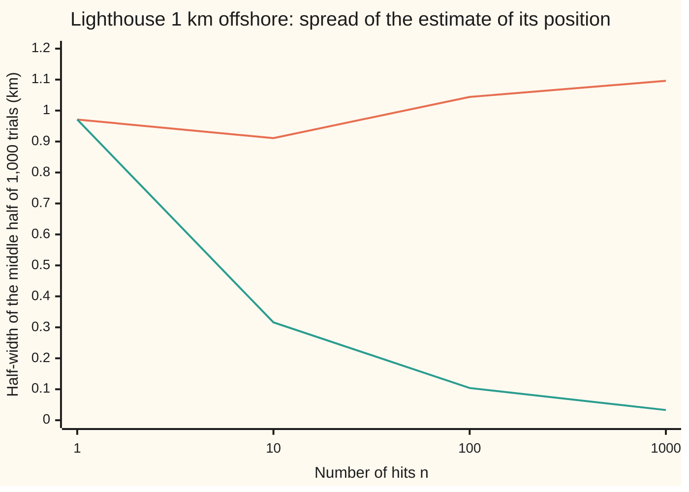

# Stable laws: the limits you reach when the variance is infinite

[Syllabus](../../../SYLLABUS.md) → [Harmonic analysis](../README.md) → [Characteristic Functions and Probability](../README.md#s04) → Stable laws

---

## General Overview

A lighthouse stands 1 km off a straight shore. Its position along the shore, $`x_0`$, is unknown. The lamp sends short flashes in random directions, every direction toward the shore equally likely. A line of detectors on the shore records where each flash lands. The task is to find $`x_0`$ from the hits.

The obvious method is to average the hits. It fails. The average of 100 hits misses $`x_0`$ by more than 1 km half the time, exactly as often as a single hit does. It misses by more than 3 km in 0.204833 of trials. Taking 1,000 hits does not help. The median of 100 hits (the middle value), by contrast, lands within about 0.104254 km of $`x_0`$ in half of all trials.

The hits follow the **Cauchy law**: a bell-like hump whose tails thin so slowly that it has no mean and no variance. [Heavy tails](../../09-Probability%20and%20statistics/04-Continuous%20Distributions/08-heavy-tails-pareto-and-cauchy.md) showed this and simulated the averages that never settle. This card proves why, using the **fingerprint** of a law, its characteristic function $`\varphi_X(t) = E[e^{itX}]`$ ([Characteristic functions](01-characteristic-functions-in-depth.md)).

The average of Cauchy hits has the same law as one hit. Laws that keep their shape under adding are called **stable**. They form one family, indexed by the **stable index** $`\alpha`$ between 0 and 2: the bell curve is $`\alpha = 2`$, the Cauchy law $`\alpha = 1`$. They are also the only possible limits of scaled sums. When the chance of a value beyond x thins like the power $`x^{-\alpha}`$ with $`\alpha < 2`$, so that the variance is infinite, sums settle on the stable law of that index.

**A law is stable when the sum of n independent copies is one copy stretched by $`n^{1/\alpha}`$ (and shifted); on fingerprints this reads $`\varphi(t)^n = \varphi(n^{1/\alpha}t)`$ up to a shift, its solutions form one family with $`0 < \alpha \le 2`$ that contains the bell and the Cauchy law, and these laws are the only limits, other than a single point, that scaled sums of independent copies can reach.**

**What kind of fact this is:** a theorem. Stability of the bell, Cauchy and one-sided Lévy laws, the bound $`\alpha \le 2`$ for the symmetric family, and the limit theorem for Pareto tails are proved on this card in Why it works; the general limit theorem is stated with its source. The lighthouse, flashes in uniformly random directions, is a model: a standard textbook setting, not data from a real lighthouse.

### The picture: averages that never settle, medians that do



Orange: the average of n hits, whose middle half stays about 1 km either side of $`x_0`$ at every n. Green: the median of n hits, which shrinks like $`1/\sqrt{n}`$. Each point comes from 1,000 simulated trials; both checks print every point.

---

## The formula

Notation, in words first:

- $`X`$ is one random quantity: here one hit's position minus $`x_0`$, in km. $`X_1, X_2, \dots`$ are independent copies of it, and $`S_n = X_1 + \dots + X_n`$ is their sum.
- $`\varphi_X(t) = E[e^{itX}]`$ is the fingerprint at dial t, with i the imaginary unit. For hits in km, t is in radians per km.
- "Has the same law" is written $`\overset{d}{=}`$.

A law is **stable** when, for every n, there are a stretch $`c_n > 0`$ and a shift $`d_n`$ with

```math
S_n \overset{d}{=} c_n X + d_n \qquad\Longleftrightarrow\qquad \varphi_X(t)^{n} = e^{i d_n t}\,\varphi_X(c_n t), \qquad c_n = n^{1/\alpha},\ 0 < \alpha \le 2
```

**Read it aloud:** the sum of n copies has the law of one copy stretched by $`c_n`$ and shifted by $`d_n`$; on fingerprints, the n-th power equals the fingerprint at a stretched dial, times a phase; and the stretch is always n to the power one over alpha.

Every stable law has a fingerprint of one form. For $`\alpha \ne 1`$:

```math
\varphi(t) = \exp\!\Big( i\mu t - \gamma^{\alpha}\lvert t\rvert^{\alpha}\big(1 - i\beta\,\mathrm{sgn}(t)\tan\tfrac{\pi\alpha}{2}\big) \Big)
```

**Read it aloud:** the fingerprint is e to the power: i times a centre times the dial, minus a scale to the power alpha times the size of the dial to the power alpha, corrected by a skew term.

Here $`\mathrm{sgn}(t)`$ is the sign of t: +1, 0 or −1. At $`\alpha = 1`$ the bracket is $`1 + i\beta\,(2/\pi)\,\mathrm{sgn}(t)\log\lvert t\rvert`$ instead, which is 1 for symmetric laws. The four members on this card:

| Law | $`\alpha`$ | $`\beta`$ | Fingerprint | Sum of n spreads like | Where it appears here |
| --- | ---: | ---: | --- | --- | --- |
| Bell | 2 | any | $`e^{-\sigma^2 t^2/2}`$ | $`\sqrt{n}`$ | standardised totals of n dice |
| Cauchy | 1 | 0 | $`e^{i x_0 t - d\lvert t\rvert}`$ | $`n`$ | lighthouse hits |
| Lévy | 1/2 | 1 | $`e^{-\sqrt{c\lvert t\rvert}\,(1 - i\,\mathrm{sgn}(t))}`$ | $`n^2`$ | first time a price climbs to a level |
| Pareto limit | 3/2 | 1 | $`e^{-\sqrt{2\pi}\,\lvert t\rvert^{3/2}(1 + i\,\mathrm{sgn}(t))}`$ | $`n^{2/3}`$ | error of an average of Pareto fortunes |

For the bell, $`\tan\pi = 0`$, so $`\beta`$ does nothing and $`\gamma = \sigma/\sqrt{2}`$, with $`\sigma`$ the standard deviation.

| Symbol | Plain meaning | In our example | Push it up and the answer… |
| --- | --- | --- | --- |
| $`x_0`$, $`d`$, $`\theta`$ | the lighthouse's position along the shore; its distance from the shore, the Cauchy scale; a flash's angle | $`x_0`$ unknown, d = 1 km, $`\theta`$ uniform | every error grows in proportion to d |
| $`X`$, $`X_k`$, $`n`$, $`S_n`$ | one random quantity; its k-th independent copy; how many copies; their sum | one hit's error in km; n = 100 | — |
| $`\varphi_X(t)`$, $`\psi`$ | the fingerprint, $`E[e^{itX}]`$; its log | $`e^{-1}`$ = 0.367879 at t = 1 per km | — |
| $`t`$, $`\mathrm{sgn}(t)`$, $`s`$ | the dial; its sign; a shrunken dial, $`s = t\,n^{-1/\alpha}`$ | t = 1 per km | probes finer detail of the law |
| $`c_n`$, $`d_n`$ | stretch and shift that turn one copy into the sum of n (not the Fourier coefficient $`c_n`$) | $`c_n = n`$, $`d_n = 0`$ for the hits | — |
| $`\alpha`$ | the stable index: how heavy the tails are | 1 for the hits | lighter tails; 2 is the bell |
| $`\gamma`$, $`\mu`$, $`\sigma`$ | scale and centre of a stable law; the bell's standard deviation, $`\sigma = \sqrt{2}\,\gamma`$ | $`\gamma = d`$ = 1 km, $`\mu = x_0`$ for the hits | the law spreads or shifts |
| $`\beta`$ | the skew, from −1 to 1 | 0 for the hits; 1 for fortunes and waits | more weight in the right tail |
| $`T`$, $`c`$, $`G`$ | a Lévy waiting time; its scale; a standard bell variable, $`T = c/G^2`$ | c = 0.25 years | waits grow in proportion to c |
| $`a_n`$, $`b_n`$, $`Z_n`$ | scale, centre and scaled sum $`(S_n - b_n)/a_n`$ in the limit theorem (not the Fourier $`a_n`$, $`b_n`$) | fortunes: $`n^{2/3}`$, $`3n`$ | — |
| $`K`$, $`p`$, $`q`$, $`C`$ | tail size; shares of it on the right and left; the limit constant in the proof | fortunes: K = 1, p = 1, q = 0, $`C = -\sqrt{2\pi}(1 + i)`$ | larger K, wider limit |
| $`h`$, $`u`$, $`k`$, $`\Gamma`$ | a shrinking step (Step 3); integration variable, series counter and gamma function (proof) | — | — |

### When it holds

- **Independent copies.** The fingerprint of a sum is a product only for independent parts. Take $`X_2 = -X_1`$: the sum is 0, not a stretched hit.
- **The index lies in (0, 2].** Try $`\alpha = 3`$: $`e^{-\lvert t\rvert^3}`$ is no fingerprint. Inverting it gives a "density" of −0.016149 at x = 4.5.
- **The right stretch.** Cauchy sums need $`c_n = n`$. Divide the sum of 100 hits by $`\sqrt{100}`$, the bell's habit, and the fingerprint at t = 1 falls to 0.000045: the scaled sums spread without limit.
- **Power tails for the limit theorem.** A law with finite variance, such as a die (variance 35/12 = 2.916667), always lands on the bell. Other stable limits need tails thinning like $`x^{-\alpha}`$ with $`\alpha < 2`$.
- **A limit in law, not a value.** The theorem says the chances converge. It does not say the average of hits settles anywhere; it does not.

---

## Why it works

### Step 0: the idea, in words

Adding independent quantities multiplies their fingerprints. Stretching a quantity by c stretches the dial by c. So "the sum of n copies is one copy, stretched" becomes an equation for the fingerprint alone: its n-th power equals itself at a stretched dial.

Take logs. With $`\psi = \log\varphi`$ the equation says $`n\,\psi(t) = \psi(c_n t)`$: multiplying by n is the same as stretching the dial. Powers of $`\lvert t\rvert`$ do exactly that: $`n\lvert t\rvert^{\alpha} = \lvert n^{1/\alpha}t\rvert^{\alpha}`$. That is why every stable fingerprint is $`e^{-\text{const}\cdot\lvert t\rvert^{\alpha}}`$, up to a shift and a skew.

### Step 1: the Cauchy fingerprint is $`e^{-d\lvert t\rvert}`$

A hit lands at $`x_0 + d\tan\theta`$, with $`\theta`$ uniform between $`-\pi/2`$ and $`\pi/2`$. With $`d = 1`$ and $`x_0 = 0`$ its density is $`1/(\pi(1 + x^2))`$, as [Heavy tails](../../09-Probability%20and%20statistics/04-Continuous%20Distributions/08-heavy-tails-pareto-and-cauchy.md) derives.

The fingerprint comes from a duality. The Laplace law, with density $`\tfrac12 e^{-\lvert x\rvert}`$, has fingerprint $`1/(1 + t^2)`$: integrate $`e^{itx - x}`$ over $`x > 0`$ and add the mirror half. That fingerprint has a finite area, so [Levy's inversion formula](03-levy-inversion-and-uniqueness.md) recovers the density from it:

```math
\frac{1}{2\pi}\int_{-\infty}^{\infty} e^{-itx}\,\frac{1}{1 + t^2}\,dt = \tfrac12 e^{-\lvert x\rvert} \quad\Longrightarrow\quad \int_{-\infty}^{\infty} e^{itx}\,\frac{1}{\pi(1 + x^2)}\,dx = e^{-\lvert t\rvert}
```

The second form is the first with the letters x and t swapped, both sides doubled, and the sign of i flipped, which changes nothing because the Cauchy density is even. Stretching by d and shifting by $`x_0`$ gives $`e^{ix_0 t - d\lvert t\rvert}`$.

The code checks it three ways at t = 1. The closed form is 0.367879. The defining integral, cut at $`\lvert x\rvert`$ = 1000 with a tail of at most 0.0000013, gives 0.367880. The Laplace fingerprint comes out 0.500000 = 1/(1 + 1).

### Step 2: the average of Cauchy hits is one hit

The average $`S_n/n`$ has fingerprint $`\varphi(t/n)^n`$. For the hits:

```math
\varphi_{S_n/n}(t) = \big(e^{-d\lvert t\rvert/n}\big)^{n} = e^{-d\lvert t\rvert}
```

**Read it aloud:** the average's fingerprint is one hit's fingerprint at a dial n times smaller, raised to the n-th power, which gives back one hit's fingerprint.

At t = 1 and n = 100: $`e^{-0.01}`$ = 0.990050, and its 100th power is 0.367879, one hit's value. Fingerprints fix the law ([Levy's inversion formula](03-levy-inversion-and-uniqueness.md)), so the average of 100 hits has exactly one hit's law. The Cauchy law is stable with $`c_n = n`$, $`d_n = 0`$, and $`\alpha = 1`$.

Which modes of convergence hold, and which fail:

- **What fails:** the average does not converge to $`x_0`$ in any mode. Its law is the same Cauchy law for every n, so it converges in distribution only to that spread-out law, never to the point $`x_0`$. For every n, $`P(\lvert S_n/n - x_0\rvert > 1\text{ km}) = 1 - (2/\pi)\arctan 1`$ = 0.500000. The simulation finds the fraction beyond 1 km at 0.494, 0.472, 0.515 and 0.524 for n = 1, 10, 100 and 1000.
- **What works:** the median of n hits converges in probability to $`x_0`$. For large n its error is close to a bell with standard deviation $`\pi d/(2\sqrt{n})`$, so its middle half has half-width $`0.674490 \times \pi d/(2\sqrt{n})`$, which is $`1.059486/\sqrt{n}`$ km for d = 1 km. Here 0.674490 is the bell's upper quartile.

| n | middle-half half-width of the average (km) | of the median (km) | median, large-n formula (km) |
| ---: | ---: | ---: | ---: |
| 1 | 0.971471 | 0.971471 | 1.059486 |
| 10 | 0.911129 | 0.315790 | 0.335039 |
| 100 | 1.044268 | 0.104254 | 0.105949 |
| 1000 | 1.096255 | 0.032753 | 0.033504 |

The average's column does not shrink; the median's follows the formula.

### Step 3: the symmetric family, and why the index stops at 2

For any $`\alpha`$, $`\varphi(t) = e^{-\gamma^{\alpha}\lvert t\rvert^{\alpha}}`$ solves the stability equation:

```math
\varphi(t)^n = e^{-n\gamma^{\alpha}\lvert t\rvert^{\alpha}} = e^{-\gamma^{\alpha}\lvert n^{1/\alpha} t\rvert^{\alpha}} = \varphi(n^{1/\alpha} t)
```

At $`\alpha = 2`$ this is the bell ([The central limit theorem in four lines, once you have fingerprints](05-central-limit-theorem-by-characteristic-functions.md)). At $`\alpha = 1`$ it is the Cauchy law. For every $`\alpha`$ between 0 and 2 it is a fingerprint too: by the Lévy–Khintchine formula of [Infinitely divisible laws](07-infinitely-divisible-laws-and-levy-khintchine.md), it is the law built from jumps whose sizes have density proportional to $`\lvert x\rvert^{-1-\alpha}`$.

Above 2 it is not a fingerprint. Suppose $`e^{-\lvert t\rvert^{3}}`$ were the fingerprint of some X. Because $`2(1 - \cos(hx))/h^2 \to x^2`$ as h shrinks, Fatou's lemma (the average of a limit is at most the limit of the averages, for quantities that are never negative) gives the bound below, where liminf is the smallest value the expression keeps coming back to as h shrinks:

```math
E[X^2] \le \liminf_{h \to 0} \frac{2\,\big(1 - \varphi(h)\big)}{h^2} = \liminf_{h \to 0} \frac{2\,\big(1 - e^{-h^3}\big)}{h^2} = 0
```

So X is 0 for sure, and its fingerprint is 1, not $`e^{-\lvert t\rvert^3}`$. The same argument rules out every $`\alpha > 2`$. The code inverts $`e^{-\lvert t\rvert^{\alpha}}`$ at x = 4.5:

| Index | Inverted value at x = 4.5 | What it is |
| ---: | ---: | --- |
| 3 | −0.016149 | negative: no density, no law |
| 2 | 0.001786 | the bell with variance 2 |
| 1 | 0.014979 | the Cauchy density, $`1/(\pi(1 + 4.5^2))`$ |

### Step 4: why the stretch is always $`n^{1/\alpha}`$

Group mn copies into m blocks of n. Each block is a copy stretched by $`c_n`$, and m copies give a further stretch $`c_m`$. So $`c_{mn} = c_m c_n`$. The only increasing solutions are powers, $`c_n = n^{1/\alpha}`$. The full argument, including why $`c_n`$ grows and why $`\alpha \le 2`$ for every stable law, skewed or not, is in Feller, Volume II, Section VI.1 (Sources).

### Step 5: a skewed member, the Lévy law of waiting times

Cauchy errors can be negative. A waiting time cannot. The stable law for waiting times has $`\alpha = 1/2`$ and $`\beta = 1`$: the **Lévy law**.

The example: a share's log price moves as a Brownian path with volatility 20 % a year and no drift. Wait for the first time it climbs by 0.1 in log terms. That wait T is Lévy with scale $`c = (0.1/0.2)^2`$ = 0.25 years. Equivalently $`T = c/G^2`$ with G a standard bell variable, which is how the code simulates it.

- **The median wait** is $`c/0.674490^2`$ = 0.5495 years (simulated 0.5426). The mean wait is infinite: $`P(T > x)`$ thins like $`x^{-1/2}`$.
- **The fingerprint** is $`\exp(-\sqrt{c\lvert t\rvert}\,(1 - i\,\mathrm{sgn}(t)))`$. At t = 1 per year it is 0.5323 + 0.2908i; 40,000 simulated waits give 0.5370 + 0.2879i.
- **Stability:** $`\varphi(t/n)^n = \exp(-\sqrt{nc\lvert t\rvert}(1 - i\,\mathrm{sgn}(t)))`$, the same law with scale nc. The average of n waits is spread n times as wide as one wait. For 10 shares, the median of the average wait is 10 × 0.5495 = 5.4953 years (simulated 5.2584).

Averaging more waits makes the average larger and wider, not steadier. One very long wait dominates the sum.

### Step 6: the generalised limit theorem

The central limit theorem says scaled sums with a finite variance reach the bell. With tails that thin like a power $`x^{-\alpha}`$, $`\alpha < 2`$, they reach another stable law. An infinite variance alone is not enough: with tails like $`x^{-2}`$ the variance is infinite, yet sums divided by $`\sqrt{n\log n}`$ still reach the bell (Durrett, Example 3.4.13).

> **Generalised central limit theorem.** Let $`X_1, X_2, \dots`$ be independent copies of X and $`0 < \alpha < 2`$. Suppose the tails thin like a power: $`x^{\alpha}P(X > x) \to pK`$ and $`x^{\alpha}P(X < -x) \to qK`$ as $`x \to \infty`$, with $`K > 0`$ and $`p + q = 1`$. Then $`Z_n = (S_n - b_n)/n^{1/\alpha}`$ converges in distribution to a stable law with index $`\alpha`$ and skew $`\beta = p - q`$, where $`b_n = nE[X]`$ for $`1 < \alpha < 2`$ and $`b_n = 0`$ for $`\alpha < 1`$. Conversely, if $`(S_n - b_n)/a_n`$ converges in distribution to a law that is not a single point, that law is stable; with a finite variance it is the bell.

Durrett (Section 3.8) proves it in a more general form; $`\alpha = 1`$ needs a log correction in $`b_n`$.

The worked case is the Pareto fortunes of [Heavy tails](../../09-Probability%20and%20statistics/04-Continuous%20Distributions/08-heavy-tails-pareto-and-cauchy.md): fortunes of at least $1 million with $`P(X > x) = x^{-1.5}`$, mean $3 million, infinite variance. So $`\alpha = 1.5`$, $`p = 1`$, $`\beta = 1`$. The theorem says

```math
\frac{S_n - 3n}{n^{2/3}} \longrightarrow Z, \qquad \varphi_Z(t) = \exp\!\big(-\sqrt{2\pi}\,\lvert t\rvert^{3/2}(1 + i\,\mathrm{sgn}(t))\big)
```

**Read it aloud:** the total of n fortunes, minus 3 per fortune, divided by n to the two-thirds, settles on a stable law of index three-halves, skewed right, with scale $`\gamma = (2\pi)^{1/3}`$ = 1.845270.

So the average of n fortunes is $`3 + Z\,n^{-1/3}`$. At n = 1000 it is 3 + Z/10. Its error shrinks like $`n^{-1/3}`$, not like the bell's $`n^{-1/2}`$.

The code finds each chance three ways: by Gil-Pelaez inversion (one integral that turns a fingerprint into a chance, [Levy's inversion formula](03-levy-inversion-and-uniqueness.md)) of the limit's fingerprint and of the exact fingerprint for 1000 fortunes, and from 4,000 simulated samples. The exact fingerprint is itself computed twice, by the series in the proof below and by quadrature with its own centring, and the two exact columns agree to within 0.000001.

| Z at most | average at most ($ millions) | limit law | exact, n = 1000 | simulated |
| ---: | ---: | ---: | ---: | ---: |
| −1 | 2.9 | 0.5449 | 0.5591 | 0.5555 |
| 0 | 3.0 | 0.6667 | 0.6844 | 0.6853 |
| 2 | 3.2 | 0.8245 | 0.8362 | 0.8385 |
| 5 | 3.5 | 0.9228 | 0.9266 | 0.9257 |

The limit gives exactly 2/3 at Z = 0, a known property of this law (Nolan). So in about two samples out of three, the average of a thousand fortunes falls below the true mean: most samples miss the rare huge fortunes that hold the mean up. The exact column matches the simulation. Both sit above the limit and close on it slowly, because the leftover term in the proof below shrinks only like $`n^{-1/3}`$.

<details>
<summary>Detailed proof: the limit theorem for Pareto fortunes</summary>

Write $`\alpha = 1.5`$; the mean is 3. The density is $`\alpha x^{-\alpha-1}`$ for $`x \ge 1`$. Fix t > 0 (t < 0 follows by taking complex conjugates) and put $`s = t\,n^{-1/\alpha}`$.

**1. The fingerprint near 0.** Substitute u = sx:

$`\displaystyle E[e^{isX} - 1 - isX] = \int_1^{\infty} (e^{isx} - 1 - isx)\,\alpha x^{-\alpha-1}\,dx = s^{\alpha}\int_s^{\infty} (e^{iu} - 1 - iu)\,\alpha u^{-\alpha-1}\,du.`$

Near u = 0 the bracket is at most $`u^2/2`$, so the integrand is at most $`(\alpha/2)u^{1-\alpha}`$, which has a finite integral near 0. Far out the integrand is at most $`(2 + u)\,\alpha u^{-\alpha-1}`$, finite at infinity since $`\alpha > 1`$. So the integral tends to a finite constant as $`s \to 0`$. Below, $`\Gamma`$ is the gamma function, which extends the factorial: $`\Gamma(k + 1) = k!`$.

$`\displaystyle C = \int_0^{\infty} (e^{iu} - 1 - iu)\,\alpha u^{-\alpha-1}\,du = \alpha\,\Gamma(-\alpha)\,e^{-i\pi\alpha/2} = -\sqrt{2\pi}\,(1 + i).`$

The code checks C by integration: −2.506627 −2.506628i against −2.506628 −2.506628i. Expanding the part of the integral between 0 and s gives the exact series the code uses: $`\varphi_X(s) = 1 + 3is + Cs^{\alpha} - \alpha\sum_{k \ge 2} (is)^k/(k!\,(k - \alpha))`$.

**2. One centred fortune.** Let $`a = E[e^{is(X - 3)}] = e^{-3is}\big(1 + 3is + E[e^{isX} - 1 - isX]\big)`$. Since $`e^{-3is}(1 + 3is) = 1 + O(s^2)`$,

$`\displaystyle n(a - 1) = n\,s^{\alpha}\!\int_s^{\infty}\!\cdots + O(n s^2) = t^{\alpha}\!\int_s^{\infty}\!\cdots + O(t^2 n^{1 - 2/\alpha}) \longrightarrow C\,t^{\alpha},`$

because $`n s^{\alpha} = t^{\alpha}`$ and $`1 - 2/\alpha < 0`$.

**3. The n-th power.** The fingerprint of $`Z_n`$ is $`a^n`$. Let $`b = 1 + Ct^{\alpha}/n`$. The real part of C is negative, so $`\lvert b\rvert \le 1`$ once n is large, and $`\lvert a\rvert \le 1`$ as for every fingerprint. The product lemma of [The central limit theorem in four lines, once you have fingerprints](05-central-limit-theorem-by-characteristic-functions.md) gives

$`\displaystyle \lvert a^n - b^n\rvert \le n\,\lvert a - b\rvert = \lvert n(a - 1) - Ct^{\alpha}\rvert \longrightarrow 0,`$

and $`b^n = (1 + Ct^{\alpha}/n)^n \to e^{Ct^{\alpha}}`$.

**4. Conclusion.** The fingerprints of $`Z_n`$ converge at every t to $`\exp(-\sqrt{2\pi}\,\lvert t\rvert^{3/2}(1 + i\,\mathrm{sgn}(t)))`$, which is continuous at 0 and is the stable fingerprint with $`\alpha = 3/2`$, $`\beta = 1`$ and $`\gamma^{3/2} = \sqrt{2\pi}`$ (here $`\tan(3\pi/4) = -1`$). By [Levy's continuity theorem](04-levy-continuity-theorem.md), $`Z_n`$ converges in distribution to that law.

</details>

---

## Worked numbers, by hand

The question: how far from the lighthouse is the average of 100 hits, with the lighthouse 1 km offshore?

| Step | Arithmetic | Value |
| --- | --- | --- |
| one hit's fingerprint at t = 1 per km | $`e^{-1 \times 1}`$ | 0.367879 |
| the average's dial | t / 100 | 0.01 |
| one hit at that dial | $`e^{-0.01}`$ | 0.990050 |
| fingerprint of the average | 0.990050 to the 100th | 0.367879 |
| so the average has one hit's law; chance of missing by more than 3 km | 1 − (2/π) arctan 3 | 0.204833 |
| chance of missing by more than 1 km | 1 − (2/π) arctan 1 | **0.500000** |

The average of 100 hits misses by more than 1 km half the time, just as one hit does. The median's middle half has half-width 0.105949 km by the large-n formula, and 0.104254 km in the simulation.

### What breaks if you drop a piece

| Mistake | Comes out at | What went wrong |
| --- | --- | --- |
| Divide the sum of 100 hits by √100, as for the bell | fingerprint at t = 1: $`e^{-10}`$ = 0.000045, heading to 0 | the Cauchy stretch is n, not √n; the scaled sums spread without limit, and the limit of the fingerprints is no fingerprint |
| Take index 3 in $`e^{-\lvert t\rvert^{\alpha}}`$ | inverted "density" −0.016149 at x = 4.5 | no law has this fingerprint; the index must be at most 2 |
| Expect the average of 10 Lévy waits to settle | median of the average 5.4953 years, against 0.5495 for one wait | the sum stretches like $`n^2`$, so the average spreads n times as wide |
| Expect the average of 1000 fortunes to miss high and low equally | at or below $3 million in 0.6844 of samples (simulated 0.6853; limit 0.6667) | the limit is skewed right, $`\beta = 1`$ |

---

## Code, from first principles, and it actually runs

Both programs write out Simpson's rule, complex arithmetic, Gil-Pelaez inversion, the bell's chance as one series, and SplitMix64, a small random number generator, with seed 20261115. Each claim gets at least two roads:

- **Cauchy fingerprint:** closed form, defining integral, Laplace duality.
- **Stability of hits and waits:** closed form against simulation.
- **Index bound:** inversion, checked against the bell and Cauchy closed forms.
- **Limit theorem:** the constant C by integration against its closed form; the Pareto series against the defining integral; the exact law of 1000 fortunes by the series and again by quadrature, against simulation, and the limit's exact 2/3.

### Python

```python
# Stable laws and heavy tails -- the check behind the card.
# Lighthouse: d = 1 km off a straight shore, flashes at a uniform random angle;
# a hit lands at x0 + d tan(angle): Cauchy errors, fingerprint exp(-d|t|).
# Roads: closed forms against defining integrals, series, inversion and simulation.
import math, cmath
D, N_HITS = 1.0, 100
def add(xs):                             # plain left-to-right sum, as in Rust
    total = 0.0
    for x in xs: total += x
    return total
def simpson(f, a, b, m):                 # m even; works for real or complex f
    h = (b - a) / m
    s = f(a) + f(b)
    for k in range(1, m):
        s += (4 if k % 2 else 2) * f(a + k * h)
    return s * h / 3
def big_phi(x):                          # normal law, one series written out
    term, total, k = x, x, 0
    while abs(term) > 1e-17:
        k += 1
        term *= -x * x / (2 * k)
        total += term / (2 * k + 1)
    return 0.5 + total / math.sqrt(2 * math.pi)
state = 20261115                         # SplitMix64, seed 20261115
def unif():
    global state
    state = (state + 0x9E3779B97F4A7C15) & 0xFFFFFFFFFFFFFFFF
    z = state
    z = ((z ^ (z >> 30)) * 0xBF58476D1CE4E5B9) & 0xFFFFFFFFFFFFFFFF
    z = ((z ^ (z >> 27)) * 0x94D049BB133111EB) & 0xFFFFFFFFFFFFFFFF
    return ((z ^ (z >> 31)) >> 11) / 9007199254740992.0
def hit():                               # one lighthouse hit, error from x0 in km
    return D * math.tan(math.pi * (unif() - 0.5))
def gauss():                             # Box-Muller, one standard normal
    r = math.sqrt(-2 * math.log(1 - unif()))
    return r * math.cos(2 * math.pi * unif())
def semi_iqr(v):                         # half the width of the middle half
    v = sorted(v)
    return (v[3 * len(v) // 4] - v[len(v) // 4]) / 2
def median(v):
    v, m = sorted(v), len(v) // 2
    return v[m] if len(v) % 2 else (v[m - 1] + v[m]) / 2
lo, hi = 0.0, 3.0
for _ in range(100):                     # upper quartile of the bell by bisection
    mid = (lo + hi) / 2
    lo, hi = (mid, hi) if big_phi(mid) < 0.75 else (lo, mid)
MED_K = lo * math.pi / 2                 # median of n hits: half-width about MED_K d / sqrt(n)
# 1. Cauchy: fingerprint, stability, chances
cut = 1000.0                             # tail beyond cut: at most 2 g(cut) / t
by_int = 2 * simpson(lambda x: math.cos(x) / (math.pi * (1 + x * x)), 0.0, cut, 400000)
print(f"Cauchy, d = {D:.0f} km: fingerprint at t = 1 per km: closed form exp(-1) = {math.exp(-1):.6f}")
print(f"  defining integral to |x| = 1000: {by_int:.6f} (tail at most {4 / (math.pi * (1 + cut * cut)):.7f})")
lap = 2 * simpson(lambda x: math.cos(x) * 0.5 * math.exp(-x), 0.0, 40.0, 40000)
print(f"  duality: Laplace law's fingerprint at t = 1 is {lap:.6f} = 1/(1 + 1) = 0.5")
one = math.exp(-D / N_HITS)
print(f"mean of {N_HITS} hits at t = 1: exp(-1/{N_HITS}) = {one:.6f}; to the {N_HITS}th = {one ** N_HITS:.6f}")
print(f"  sum of {N_HITS} over sqrt({N_HITS}) at t = 1: exp(-sqrt({N_HITS})) = {math.exp(-math.sqrt(N_HITS)):.6f}")
for a in [1, 3]:
    print(f"  P(|mean error| > {a} km) = 1 - (2/pi) atan({a}) = {1 - 2 * math.atan(a / D) / math.pi:.6f}")
print(f"n, middle-half half-width (km) of 1000 means, of 1000 medians, large-n median {lo:.6f} pi/2/sqrt(n) = {MED_K:.6f}/sqrt(n)")
widths = {}
for n in [1, 10, 100, 1000]:
    means, meds, far = [], [], 0
    for r in range(1000):
        xs = [hit() for _ in range(n)]
        means.append(add(xs) / n)
        meds.append(median(xs))
        far += abs(means[-1]) > 1
    widths[n] = (semi_iqr(means), semi_iqr(meds))
    print(f"  {n:4d}  {widths[n][0]:.6f}  {widths[n][1]:.6f}  {MED_K * D / math.sqrt(n):.6f}  beyond 1 km: {far / 1000:.3f}")
# 2. Index above 2 is no law: invert exp(-|t|^3)
neg = simpson(lambda t: math.cos(4.5 * t) * math.exp(-t ** 3), 0.0, 6.0, 6000) / math.pi
pos = [simpson(lambda t: math.cos(4.5 * t) * math.exp(-t ** a), 0.0, 60.0, 60000) / math.pi for a in [2, 1]]
print(f"inverse of exp(-|t|^a) at x = 4.5: a = 3 {neg:.6f}; a = 2 {pos[0]:.6f}; a = 1 {pos[1]:.6f}")
print(f"die: variance 35/12 = {35 / 12:.6f} (finite), so dice totals over sqrt(n) go to the bell, index 2")
# 3. Levy waits: first time a 20 %-a-year Brownian log price climbs 0.1; c = (0.1/0.2)^2 years
C_L = (0.1 / 0.2) ** 2
med1 = C_L / lo ** 2
waits = [C_L / gauss() ** 2 for _ in range(40000)]
avgs = [add(waits[10 * k: 10 * k + 10]) / 10 for k in range(4000)]
fp = complex(add(math.cos(w) for w in waits), add(math.sin(w) for w in waits)) / 40000
fp_cf = cmath.exp(-math.sqrt(C_L) * (1 - 1j))
print(f"Levy, c = {C_L:.2f} years: median wait c/0.674490^2 = {med1:.4f} (simulated {median(waits):.4f})")
print(f"  average of 10 waits: median 10 x {med1:.4f} = {10 * med1:.4f} (simulated {median(avgs):.4f})")
print(f"  fingerprint at t = 1 per year: closed form {fp_cf.real:.4f} + {fp_cf.imag:.4f}i; simulated {fp.real:.4f} + {fp.imag:.4f}i")
# 4. The generalised limit theorem: Pareto fortunes, shape 1.5, cutoff $1 million, mean 3
A, MU, NF = 1.5, 3.0, 1000
CA = -math.sqrt(2 * math.pi) * (1 + 1j)  # integral of (e^(iu) - 1 - iu) 1.5 u^(-2.5), closed form
V = 30.0                                 # u = v^2; past v = 30 the rest is -1/V^3 - 3i/V, error <= 1/V^3
f_v = lambda v: 3 * (cmath.exp(1j * v * v) - 1 - 1j * v * v) / v ** 4 if v > 0 else -1.5   # the integrand in v
num = simpson(f_v, 0.0, V, 60000) + complex(-1 / V ** 3, -3 / V)
print(f"limit constant: closed form {CA.real:.6f} {CA.imag:+.6f}i; by integral {num.real:.6f} {num.imag:+.6f}i")
def phi_pareto(s):                       # exact series, s > 0
    total, k, term = 1 + 1j * s * MU + CA * s ** A, 2, -s * s / 2
    while abs(term) > 1e-18:
        total -= A * term / (k - A)
        k += 1
        term *= 1j * s / k
    return total
s0 = 0.1
direct = simpson(lambda x: cmath.exp(1j * s0 * x) * A * x ** (-A - 1), 1.0, 1000.0, 200000)
print(f"Pareto fingerprint at s = 0.1: series {phi_pareto(s0).real:.6f} {phi_pareto(s0).imag:+.6f}i; "
      f"integral to 1000 {direct.real:.6f} {direct.imag:+.6f}i")
limit = lambda t: cmath.exp(CA * t ** A)
def exact(t):                            # [e^(-i 3 s) phi(s)]^n, s = t / n^(2/3), via the log
    w = cmath.exp(-1j * MU * t / NF ** (1 / A)) * phi_pareto(t / NF ** (1 / A))
    return cmath.exp(NF * complex(math.log(abs(w)), math.atan2(w.imag, w.real)))
def exact2(t):                           # road 2: quadrature from 0 to s in place of the series; own centre A/(A-1)
    s, m = t / NF ** (2 / 3), A / (A - 1)
    return cmath.exp(NF * cmath.log(cmath.exp(-1j * m * s) * (1 + 1j * m * s + s ** A * (CA - simpson(f_v, 0.0, math.sqrt(s), 40)))))
def cdf(phi, z):                         # Gil-Pelaez, t = s^2, cut at s = 4
    return 0.5 - simpson(lambda s: 0.0 if s == 0 else 2 * (cmath.exp(-1j * s * s * z) * phi(s * s)).imag / s,
                         0.0, 4.0, 4000) / math.pi
zs_sim = []
for r in range(4000):
    zs_sim.append((add((1 - unif()) ** (-1 / A) for _ in range(NF)) - MU * NF) / NF ** (1 / A))
print(f"average of {NF} fortunes = 3 + Z/{NF ** (1 - 1 / A):.0f}; gamma = (2 pi)^(1/3) = {(2 * math.pi) ** (1 / 3):.6f}")
print(f"Z at most, average at most, P limit, P exact n = {NF}, P simulated (4000 runs)")
rows = {}
for z in [-1, 0, 2, 5]:
    rows[z] = (cdf(limit, z), cdf(exact, z), sum(x <= z for x in zs_sim) / 4000, cdf(exact2, z))
    print(f"  {z:2d}  {MU + z / 10:.1f}  {rows[z][0]:.4f}  {rows[z][1]:.4f}  {rows[z][2]:.4f}")
print(f"exact column again, by quadrature in place of the series: every gap below 1e-6: {'yes' if all(abs(r[3] - r[1]) < 1e-6 for r in rows.values()) else 'no'}")
print("chart n, means, medians")
print("  " + ", ".join(f"{widths[n][0]:.3f}" for n in widths) + " | " + ", ".join(f"{widths[n][1]:.3f}" for n in widths))
assert abs(by_int - math.exp(-1)) < 1e-5                       # closed form = defining integral
assert abs(lap - 0.5) < 1e-9                                   # duality road
assert all(abs(widths[n][0] - D) < 0.2 for n in widths)        # means never settle
assert abs(widths[1000][1] - MED_K * D / math.sqrt(1000)) < 0.01  # medians do
assert neg < -0.01                                             # index 3 is no law
assert min(pos) > 0                                            # indices 2 and 1 are laws
assert abs(pos[1] - 1 / (math.pi * (1 + 4.5 * 4.5))) < 1e-6     # index 1 inverts to Cauchy
assert abs(median(avgs) - 10 * med1) < 0.6                     # Levy: average n times wider
assert abs(fp - fp_cf) < 0.02
assert abs(num - CA) < 1e-4                                    # limit constant
assert abs(direct - phi_pareto(s0)) < 1e-5                     # series = defining integral
assert abs(rows[0][0] - 2 / 3) < 1e-6                          # P(Z <= 0) = 2/3 exactly
assert all(abs(rows[z][3] - rows[z][1]) < 1e-6 for z in rows)  # exact column: series road = quadrature road
assert all(abs(rows[z][1] - rows[z][2]) < 4 * math.sqrt(rows[z][1] * (1 - rows[z][1]) / 4000) for z in rows)
print("ALL CHECKS PASS")
```

**Ran 2026-11-15 on macOS, Python 3.14.10, standard library only. All checks passed. Output, pasted from the run:**

```
Cauchy, d = 1 km: fingerprint at t = 1 per km: closed form exp(-1) = 0.367879
  defining integral to |x| = 1000: 0.367880 (tail at most 0.0000013)
  duality: Laplace law's fingerprint at t = 1 is 0.500000 = 1/(1 + 1) = 0.5
mean of 100 hits at t = 1: exp(-1/100) = 0.990050; to the 100th = 0.367879
  sum of 100 over sqrt(100) at t = 1: exp(-sqrt(100)) = 0.000045
  P(|mean error| > 1 km) = 1 - (2/pi) atan(1) = 0.500000
  P(|mean error| > 3 km) = 1 - (2/pi) atan(3) = 0.204833
n, middle-half half-width (km) of 1000 means, of 1000 medians, large-n median 0.674490 pi/2/sqrt(n) = 1.059486/sqrt(n)
     1  0.971471  0.971471  1.059486  beyond 1 km: 0.494
    10  0.911129  0.315790  0.335039  beyond 1 km: 0.472
   100  1.044268  0.104254  0.105949  beyond 1 km: 0.515
  1000  1.096255  0.032753  0.033504  beyond 1 km: 0.524
inverse of exp(-|t|^a) at x = 4.5: a = 3 -0.016149; a = 2 0.001786; a = 1 0.014979
die: variance 35/12 = 2.916667 (finite), so dice totals over sqrt(n) go to the bell, index 2
Levy, c = 0.25 years: median wait c/0.674490^2 = 0.5495 (simulated 0.5426)
  average of 10 waits: median 10 x 0.5495 = 5.4953 (simulated 5.2584)
  fingerprint at t = 1 per year: closed form 0.5323 + 0.2908i; simulated 0.5370 + 0.2879i
limit constant: closed form -2.506628 -2.506628i; by integral -2.506627 -2.506628i
Pareto fingerprint at s = 0.1: series 0.935731 +0.220900i; integral to 1000 0.935731 +0.220900i
average of 1000 fortunes = 3 + Z/10; gamma = (2 pi)^(1/3) = 1.845270
Z at most, average at most, P limit, P exact n = 1000, P simulated (4000 runs)
  -1  2.9  0.5449  0.5591  0.5555
   0  3.0  0.6667  0.6844  0.6853
   2  3.2  0.8245  0.8362  0.8385
   5  3.5  0.9228  0.9266  0.9257
exact column again, by quadrature in place of the series: every gap below 1e-6: yes
chart n, means, medians
  0.971, 0.911, 1.044, 1.096 | 0.971, 0.316, 0.104, 0.033
ALL CHECKS PASS
```

### Rust

```rust
// Stable laws and heavy tails -- the check behind the card.
// Lighthouse: d = 1 km off a straight shore, flashes at a uniform random angle;
// a hit lands at x0 + d tan(angle): Cauchy errors, fingerprint exp(-d|t|).
// Roads: closed forms against defining integrals, series, inversion and simulation.
use std::f64::consts::PI;
#[derive(Clone, Copy)]
struct C { re: f64, im: f64 }
fn c(re: f64, im: f64) -> C { C { re, im } }
fn add(a: C, b: C) -> C { c(a.re + b.re, a.im + b.im) }
fn sub(a: C, b: C) -> C { c(a.re - b.re, a.im - b.im) }
fn mul(a: C, b: C) -> C { c(a.re * b.re - a.im * b.im, a.re * b.im + a.im * b.re) }
fn scale(a: C, k: f64) -> C { c(a.re * k, a.im * k) }
fn cexp(a: C) -> C { let l = a.re.exp(); c(l * a.im.cos(), l * a.im.sin()) }
fn cabs(a: C) -> f64 { a.re.hypot(a.im) }
fn sum(xs: &[f64]) -> f64 { let mut t = 0.0; for x in xs { t += x; } t }
fn simpson_c(f: &dyn Fn(f64) -> C, a: f64, b: f64, m: usize) -> C {
    let h = (b - a) / m as f64;
    let mut s = add(f(a), f(b));
    for k in 1..m { s = add(s, scale(f(a + k as f64 * h), if k % 2 == 1 { 4.0 } else { 2.0 })); }
    scale(s, h / 3.0)
}
fn simpson(f: &dyn Fn(f64) -> f64, a: f64, b: f64, m: usize) -> f64 { simpson_c(&|x| c(f(x), 0.0), a, b, m).re }
fn big_phi(x: f64) -> f64 {
    let (mut term, mut total, mut k) = (x, x, 0.0);
    while term.abs() > 1e-17 { k += 1.0; term *= -x * x / (2.0 * k); total += term / (2.0 * k + 1.0); }
    0.5 + total / (2.0 * PI).sqrt()
}
struct Rng(u64);
impl Rng {
    fn unif(&mut self) -> f64 {
        self.0 = self.0.wrapping_add(0x9E3779B97F4A7C15);
        let mut z = self.0;
        z = (z ^ (z >> 30)).wrapping_mul(0xBF58476D1CE4E5B9);
        z = (z ^ (z >> 27)).wrapping_mul(0x94D049BB133111EB);
        ((z ^ (z >> 31)) >> 11) as f64 / 9007199254740992.0
    }
    fn hit(&mut self) -> f64 { D * (PI * (self.unif() - 0.5)).tan() }
    fn gauss(&mut self) -> f64 {
        let r = (-2.0 * (1.0 - self.unif()).ln()).sqrt();
        r * (2.0 * PI * self.unif()).cos()
    }
}
const D: f64 = 1.0; const N_HITS: usize = 100;
fn sorted(v: &[f64]) -> Vec<f64> { let mut w = v.to_vec(); w.sort_by(|a, b| a.partial_cmp(b).unwrap()); w }
fn semi_iqr(v: &[f64]) -> f64 { let w = sorted(v); (w[3 * w.len() / 4] - w[w.len() / 4]) / 2.0 }
fn median(v: &[f64]) -> f64 {
    let (w, m) = (sorted(v), v.len() / 2);
    if v.len() % 2 == 1 { w[m] } else { (w[m - 1] + w[m]) / 2.0 }
}
const A: f64 = 1.5; const MU: f64 = 3.0; const NF: usize = 1000;
fn ca() -> C { scale(c(1.0, 1.0), -(2.0 * PI).sqrt()) }
fn phi_pareto(s: f64) -> C {
    let mut total = add(c(1.0, s * MU), scale(ca(), s.powf(A)));
    let (mut k, mut term) = (2.0, c(-s * s / 2.0, 0.0));
    while cabs(term) > 1e-18 {
        total = sub(total, scale(term, A / (k - A)));
        k += 1.0;
        term = mul(term, c(0.0, s / k));
    }
    total
}
fn limit(t: f64) -> C { cexp(scale(ca(), t.powf(A))) }
fn exact(t: f64) -> C {
    let s = t / (NF as f64).powf(1.0 / A);
    let w = mul(cexp(c(0.0, -MU * s)), phi_pareto(s));
    cexp(scale(c(cabs(w).ln(), w.im.atan2(w.re)), NF as f64))
}
fn exact2(t: f64, fv: &dyn Fn(f64) -> C) -> C { // road 2: quadrature from 0 to s in place of the series; own centre A/(A-1)
    let (s, m) = (t / (NF as f64).powf(2.0 / 3.0), A / (A - 1.0));
    let w = mul(cexp(c(0.0, -m * s)), add(c(1.0, m * s), scale(sub(ca(), simpson_c(fv, 0.0, s.sqrt(), 40)), s.powf(A))));
    cexp(scale(c(cabs(w).ln(), w.im.atan2(w.re)), NF as f64))
}
fn cdf(phi: &dyn Fn(f64) -> C, z: f64) -> f64 {
    let g = |s: f64| if s == 0.0 { 0.0 } else { 2.0 * mul(cexp(c(0.0, -s * s * z)), phi(s * s)).im / s };
    0.5 - simpson(&g, 0.0, 4.0, 4000) / PI
}
fn main() {
    let mut rng = Rng(20261115);
    let (mut lo, mut hi) = (0.0f64, 3.0f64);
    for _ in 0..100 { let mid = (lo + hi) / 2.0; if big_phi(mid) < 0.75 { lo = mid } else { hi = mid } }
    let med_k = lo * PI / 2.0;
    // 1. Cauchy: fingerprint, stability, chances
    let cut = 1000.0;
    let by_int = 2.0 * simpson(&|x: f64| x.cos() / (PI * (1.0 + x * x)), 0.0, cut, 400000);
    println!("Cauchy, d = {:.0} km: fingerprint at t = 1 per km: closed form exp(-1) = {:.6}", D, (-1.0f64).exp());
    println!("  defining integral to |x| = 1000: {:.6} (tail at most {:.7})", by_int, 4.0 / (PI * (1.0 + cut * cut)));
    let lap = 2.0 * simpson(&|x: f64| x.cos() * 0.5 * (-x).exp(), 0.0, 40.0, 40000);
    println!("  duality: Laplace law's fingerprint at t = 1 is {:.6} = 1/(1 + 1) = 0.5", lap);
    let one = (-D / N_HITS as f64).exp();
    println!("mean of {} hits at t = 1: exp(-1/{}) = {:.6}; to the {}th = {:.6}", N_HITS, N_HITS, one, N_HITS, one.powf(N_HITS as f64));
    println!("  sum of {} over sqrt({}) at t = 1: exp(-sqrt({})) = {:.6}", N_HITS, N_HITS, N_HITS, (-(N_HITS as f64).sqrt()).exp());
    for a in [1.0f64, 3.0] {
        println!("  P(|mean error| > {} km) = 1 - (2/pi) atan({}) = {:.6}", a, a, 1.0 - 2.0 * (a / D).atan() / PI);
    }
    println!("n, middle-half half-width (km) of 1000 means, of 1000 medians, large-n median {:.6} pi/2/sqrt(n) = {:.6}/sqrt(n)", lo, med_k);
    let mut widths = vec![];
    for n in [1usize, 10, 100, 1000] {
        let (mut means, mut meds, mut far) = (vec![], vec![], 0);
        for _ in 0..1000 {
            let xs: Vec<f64> = (0..n).map(|_| rng.hit()).collect();
            means.push(sum(&xs) / n as f64);
            meds.push(median(&xs));
            if means[means.len() - 1].abs() > 1.0 { far += 1; }
        }
        widths.push((n, semi_iqr(&means), semi_iqr(&meds)));
        println!("  {:4}  {:.6}  {:.6}  {:.6}  beyond 1 km: {:.3}", n, semi_iqr(&means), semi_iqr(&meds),
                 med_k * D / (n as f64).sqrt(), far as f64 / 1000.0);
    }
    // 2. Index above 2 is no law: invert exp(-|t|^3)
    let neg = simpson(&|t: f64| (4.5 * t).cos() * (-t.powf(3.0)).exp(), 0.0, 6.0, 6000) / PI;
    let pos: Vec<f64> = [2.0, 1.0].iter().map(|&a| simpson(&|t: f64| (4.5 * t).cos() * (-t.powf(a)).exp(), 0.0, 60.0, 60000) / PI).collect();
    println!("inverse of exp(-|t|^a) at x = 4.5: a = 3 {:.6}; a = 2 {:.6}; a = 1 {:.6}", neg, pos[0], pos[1]);
    println!("die: variance 35/12 = {:.6} (finite), so dice totals over sqrt(n) go to the bell, index 2", 35.0 / 12.0);
    // 3. Levy waits: first time a 20 %-a-year Brownian log price climbs 0.1; c = (0.1/0.2)^2 years
    let c_l = (0.1f64 / 0.2).powf(2.0);
    let med1 = c_l / lo.powf(2.0);
    let waits: Vec<f64> = (0..40000).map(|_| c_l / rng.gauss().powf(2.0)).collect();
    let avgs: Vec<f64> = (0..4000).map(|k| sum(&waits[10 * k..10 * k + 10]) / 10.0).collect();
    let cs: Vec<f64> = waits.iter().map(|w| w.cos()).collect();
    let ss: Vec<f64> = waits.iter().map(|w| w.sin()).collect();
    let fp = c(sum(&cs) / 40000.0, sum(&ss) / 40000.0);
    let fp_cf = cexp(scale(c(1.0, -1.0), -c_l.sqrt()));
    println!("Levy, c = {:.2} years: median wait c/0.674490^2 = {:.4} (simulated {:.4})", c_l, med1, median(&waits));
    println!("  average of 10 waits: median 10 x {:.4} = {:.4} (simulated {:.4})", med1, 10.0 * med1, median(&avgs));
    println!("  fingerprint at t = 1 per year: closed form {:.4} + {:.4}i; simulated {:.4} + {:.4}i", fp_cf.re, fp_cf.im, fp.re, fp.im);
    // 4. The generalised limit theorem: Pareto fortunes, shape 1.5, cutoff $1 million, mean 3
    let v_cut = 30.0;
    let f = |v: f64| if v > 0.0 { scale(sub(sub(cexp(c(0.0, v * v)), c(1.0, 0.0)), c(0.0, v * v)), 3.0 / v.powf(4.0)) } else { c(-1.5, 0.0) };
    let num = add(simpson_c(&f, 0.0, v_cut, 60000), c(-1.0 / v_cut.powf(3.0), -3.0 / v_cut));
    println!("limit constant: closed form {:.6} {:+.6}i; by integral {:.6} {:+.6}i", ca().re, ca().im, num.re, num.im);
    let s0 = 0.1;
    let direct = simpson_c(&|x: f64| scale(cexp(c(0.0, s0 * x)), A * x.powf(-A - 1.0)), 1.0, 1000.0, 200000);
    let ps = phi_pareto(s0);
    println!("Pareto fingerprint at s = 0.1: series {:.6} {:+.6}i; integral to 1000 {:.6} {:+.6}i", ps.re, ps.im, direct.re, direct.im);
    let nf = NF as f64;
    let zs_sim: Vec<f64> = (0..4000).map(|_| {
        let xs: Vec<f64> = (0..NF).map(|_| (1.0 - rng.unif()).powf(-1.0 / A)).collect();
        (sum(&xs) - MU * nf) / nf.powf(1.0 / A)
    }).collect();
    println!("average of {} fortunes = 3 + Z/{:.0}; gamma = (2 pi)^(1/3) = {:.6}", NF, nf.powf(1.0 - 1.0 / A), (2.0 * PI).powf(1.0 / 3.0));
    println!("Z at most, average at most, P limit, P exact n = {}, P simulated (4000 runs)", NF);
    let mut rows = vec![];
    for z in [-1.0f64, 0.0, 2.0, 5.0] {
        let r = (cdf(&limit, z), cdf(&exact, z), zs_sim.iter().filter(|&&x| x <= z).count() as f64 / 4000.0, cdf(&|t: f64| exact2(t, &f), z));
        println!("  {:2}  {:.1}  {:.4}  {:.4}  {:.4}", z, MU + z / 10.0, r.0, r.1, r.2);
        rows.push((z, r));
    }
    println!("exact column again, by quadrature in place of the series: every gap below 1e-6: {}", if rows.iter().all(|(_, r)| (r.3 - r.1).abs() < 1e-6) { "yes" } else { "no" });
    println!("chart n, means, medians");
    let m: Vec<String> = widths.iter().map(|w| format!("{:.3}", w.1)).collect();
    let d: Vec<String> = widths.iter().map(|w| format!("{:.3}", w.2)).collect();
    println!("  {} | {}", m.join(", "), d.join(", "));
    assert!((by_int - (-1.0f64).exp()).abs() < 1e-5);
    assert!((lap - 0.5).abs() < 1e-9);
    assert!(widths.iter().all(|w| (w.1 - D).abs() < 0.2));
    assert!((widths[3].2 - med_k * D / 1000f64.sqrt()).abs() < 0.01);
    assert!(neg < -0.01);
    assert!(pos.iter().all(|&p| p > 0.0));
    assert!((pos[1] - 1.0 / (PI * (1.0 + 4.5 * 4.5))).abs() < 1e-6);
    assert!((median(&avgs) - 10.0 * med1).abs() < 0.6);
    assert!(cabs(sub(fp, fp_cf)) < 0.02);
    assert!(cabs(sub(num, ca())) < 1e-4);
    assert!(cabs(sub(direct, ps)) < 1e-5);
    assert!((rows[1].1 .0 - 2.0 / 3.0).abs() < 1e-6);
    assert!(rows.iter().all(|(_, r)| (r.3 - r.1).abs() < 1e-6));
    assert!(rows.iter().all(|(_, r)| (r.1 - r.2).abs() < 4.0 * (r.1 * (1.0 - r.1) / 4000.0).sqrt()));
    println!("ALL CHECKS PASS");
}
```

**Ran 2026-11-15 on macOS, rustc 1.98.1, no crates. All checks passed. Output, pasted from the run:**

```
Cauchy, d = 1 km: fingerprint at t = 1 per km: closed form exp(-1) = 0.367879
  defining integral to |x| = 1000: 0.367880 (tail at most 0.0000013)
  duality: Laplace law's fingerprint at t = 1 is 0.500000 = 1/(1 + 1) = 0.5
mean of 100 hits at t = 1: exp(-1/100) = 0.990050; to the 100th = 0.367879
  sum of 100 over sqrt(100) at t = 1: exp(-sqrt(100)) = 0.000045
  P(|mean error| > 1 km) = 1 - (2/pi) atan(1) = 0.500000
  P(|mean error| > 3 km) = 1 - (2/pi) atan(3) = 0.204833
n, middle-half half-width (km) of 1000 means, of 1000 medians, large-n median 0.674490 pi/2/sqrt(n) = 1.059486/sqrt(n)
     1  0.971471  0.971471  1.059486  beyond 1 km: 0.494
    10  0.911129  0.315790  0.335039  beyond 1 km: 0.472
   100  1.044268  0.104254  0.105949  beyond 1 km: 0.515
  1000  1.096255  0.032753  0.033504  beyond 1 km: 0.524
inverse of exp(-|t|^a) at x = 4.5: a = 3 -0.016149; a = 2 0.001786; a = 1 0.014979
die: variance 35/12 = 2.916667 (finite), so dice totals over sqrt(n) go to the bell, index 2
Levy, c = 0.25 years: median wait c/0.674490^2 = 0.5495 (simulated 0.5426)
  average of 10 waits: median 10 x 0.5495 = 5.4953 (simulated 5.2584)
  fingerprint at t = 1 per year: closed form 0.5323 + 0.2908i; simulated 0.5370 + 0.2879i
limit constant: closed form -2.506628 -2.506628i; by integral -2.506627 -2.506628i
Pareto fingerprint at s = 0.1: series 0.935731 +0.220900i; integral to 1000 0.935731 +0.220900i
average of 1000 fortunes = 3 + Z/10; gamma = (2 pi)^(1/3) = 1.845270
Z at most, average at most, P limit, P exact n = 1000, P simulated (4000 runs)
  -1  2.9  0.5449  0.5591  0.5555
   0  3.0  0.6667  0.6844  0.6853
   2  3.2  0.8245  0.8362  0.8385
   5  3.5  0.9228  0.9266  0.9257
exact column again, by quadrature in place of the series: every gap below 1e-6: yes
chart n, means, medians
  0.971, 0.911, 1.044, 1.096 | 0.971, 0.316, 0.104, 0.033
ALL CHECKS PASS
```

### Lean

Lean proves Steps 1 and 2, and the stability equation and index bound of Step 3, for every scale, centre and n.

- Take one hit with centre $`x_0`$ and scale $`d`$. Then its fingerprint is $`e^{i x_0 t - d\lvert t\rvert}`$.
- Take $`n \ge 1`$ independent hits, each Cauchy with centre $`x_0`$ and scale $`d`$. Then their average has exactly one hit's law.
- Take a law with fingerprint $`e^{-\gamma^{\alpha}\lvert t\rvert^{\alpha}}`$, where $`0 < \alpha \le 2`$, and independent copies of it. Then the sum of n copies has the law of one copy stretched by $`n^{1/\alpha}`$.
- Take $`\alpha > 2`$ and a scale $`\gamma > 0`$. Then $`e^{-\gamma^{\alpha}\lvert t\rvert^{\alpha}}`$ is the fingerprint of no law.
- Take the average of n hits. Then it misses $`x_0`$ by more than $`d`$ with chance exactly $`1 - (2/\pi)\arctan 1 = 1/2`$.
- The worked numbers check exactly: the die's variance 35/12 and the Pareto mean 3.
- Take $`\alpha = 3/2`$. Then $`1 - 2/\alpha < 0`$, so the leftover term in the Pareto proof shrinks.

The simulations, the inversions at x = 4.5, the Lévy waits and the generalised limit theorem are left to the Python and Rust checks.

```lean
-- Stable laws: the sum of n independent copies of a law with fingerprint exp(-γ^α |t|^α) is one copy stretched by n^(1/α), the average of n Cauchy hits has the law of one hit, and no law has such a fingerprint when α > 2.
import Mathlib.Probability.Distributions.Cauchy
import Mathlib.Probability.Independence.CharacteristicFunction
import Mathlib.Probability.IdentDistrib
import Mathlib.Analysis.SpecialFunctions.Trigonometric.Arctan
import Mathlib.Analysis.Fourier.Inversion

open MeasureTheory ProbabilityTheory
open scoped NNReal Real

open scoped FourierTransform

lemma re_charFun_eq_integral_cos (μ : Measure ℝ) [IsProbabilityMeasure μ] (t : ℝ) :
    (charFun μ t).re = ∫ x, Real.cos (t * x) ∂μ := by
  rw [charFun_apply_real]
  have hi : Integrable (fun x : ℝ => Complex.exp (t * x * Complex.I)) μ := by
    refine Integrable.of_bound (by fun_prop) 1 (ae_of_all _ fun x => ?_)
    rw [← Complex.ofReal_mul, Complex.norm_exp_ofReal_mul_I]
  rw [← RCLike.re_eq_complex_re, ← integral_re hi]
  congr with x
  rw [RCLike.re_eq_complex_re, ← Complex.ofReal_mul, Complex.exp_ofReal_mul_I_re]

#print axioms re_charFun_eq_integral_cos

lemma four_re_charFun_sub_three_le (μ : Measure ℝ) [IsProbabilityMeasure μ] (t : ℝ) :
    4 * (charFun μ t).re - 3 ≤ (charFun μ (2 * t)).re := by
  rw [re_charFun_eq_integral_cos, re_charFun_eq_integral_cos]
  have hint : ∀ a : ℝ, Integrable (fun x : ℝ => Real.cos (a * x)) μ := fun a =>
    Integrable.of_bound (by fun_prop) 1 (ae_of_all _ fun x => by
      rw [Real.norm_eq_abs]; exact Real.abs_cos_le_one _)
  have h1 : ∫ x, (4 * Real.cos (t * x) - 3) ∂μ = 4 * ∫ x, Real.cos (t * x) ∂μ - 3 := by
    rw [integral_sub ((hint t).const_mul 4) (integrable_const _), integral_const_mul]
    simp
  rw [← h1]
  refine integral_mono ((hint t).const_mul 4 |>.sub (integrable_const _)) (hint (2 * t)) ?_
  intro x
  simp only
  rw [mul_assoc, Real.cos_two_mul]
  nlinarith [sq_nonneg (Real.cos (t * x) - 1)]

#print axioms four_re_charFun_sub_three_le

lemma fourier_exp_neg_abs (w : ℝ) :
    𝓕 (fun x : ℝ => (Real.exp (-|x|) : ℂ)) w = ((2 / (1 + (2 * π * w) ^ 2) : ℝ) : ℂ) := by
  rw [Real.fourier_real_eq_integral_exp_smul]
  set a : ℂ := -1 - 2 * π * w * Complex.I with ha
  set b : ℂ := 1 - 2 * π * w * Complex.I with hb
  have ha_re : a.re < 0 := by simp [ha]
  have hb_re : 0 < b.re := by simp [hb]
  have hR : Set.EqOn (fun v : ℝ => Complex.exp (↑(-2 * π * v * w) * Complex.I) • (Real.exp (-|v|) : ℂ))
      (fun v : ℝ => Complex.exp (a * v)) (Set.Ioi 0) := by
    intro v hv
    simp only [smul_eq_mul]
    rw [abs_of_pos hv, Complex.ofReal_exp, ← Complex.exp_add]
    congr 1
    rw [ha]; push_cast; ring
  have hL : Set.EqOn (fun v : ℝ => Complex.exp (↑(-2 * π * v * w) * Complex.I) • (Real.exp (-|v|) : ℂ))
      (fun v : ℝ => Complex.exp (b * v)) (Set.Iic 0) := by
    intro v hv
    simp only [smul_eq_mul]
    rw [abs_of_nonpos hv, Complex.ofReal_exp, ← Complex.exp_add]
    congr 1
    rw [hb]; push_cast; ring
  rw [← intervalIntegral.integral_Iic_add_Ioi (b := 0)
      ((integrableOn_exp_mul_complex_Iic hb_re 0).congr_fun hL.symm measurableSet_Iic)
      ((integrableOn_exp_mul_complex_Ioi ha_re 0).congr_fun hR.symm measurableSet_Ioi),
    setIntegral_congr_fun measurableSet_Iic hL, setIntegral_congr_fun measurableSet_Ioi hR,
    integral_exp_mul_complex_Iic hb_re, integral_exp_mul_complex_Ioi ha_re]
  have ha0 : a ≠ 0 := fun h => by simp [h] at ha_re
  have hb0 : b ≠ 0 := fun h => by simp [h] at hb_re
  have hab : a * b = -((1 + (2 * π * w) ^ 2 : ℝ) : ℂ) := by
    rw [ha, hb]; push_cast; ring_nf; rw [Complex.I_sq]; ring
  have h1 : ((1 + (2 * π * w) ^ 2 : ℝ) : ℂ) ≠ 0 := by
    norm_cast; positivity
  have hdiff : a - b = -2 := by rw [ha, hb]; ring
  push_cast at h1 hab ⊢
  simp only [mul_zero, Complex.exp_zero]
  rw [div_add_div _ _ hb0 ha0, div_eq_div_iff (mul_ne_zero hb0 ha0) h1]
  linear_combination (-2) * hab + (1 + (2 * (π : ℂ) * w) ^ 2) * hdiff

#print axioms fourier_exp_neg_abs

lemma integrable_exp_neg_abs : Integrable (fun x : ℝ => Real.exp (-|x|)) := by
  have hR : IntegrableOn (fun x : ℝ => Real.exp (-|x|)) (Set.Ioi 0) :=
    (integrableOn_exp_mul_Ioi (by norm_num : (-1 : ℝ) < 0) 0).congr_fun
      (fun x hx => by simp [abs_of_pos (Set.mem_Ioi.mp hx)]) measurableSet_Ioi
  have hL : IntegrableOn (fun x : ℝ => Real.exp (-|x|)) (Set.Iic 0) :=
    (integrableOn_exp_mul_Iic (by norm_num : (0 : ℝ) < 1) 0).congr_fun
      (fun x hx => by simp [abs_of_nonpos (Set.mem_Iic.mp hx)]) measurableSet_Iic
  have := hL.union hR
  rwa [Set.Iic_union_Ioi, integrableOn_univ] at this

#print axioms integrable_exp_neg_abs

lemma integral_exp_mul_I_mul_cauchy_kernel (t : ℝ) :
    ∫ x : ℝ, Complex.exp (↑(t * x) * Complex.I) * ((π⁻¹ * (1 + x ^ 2)⁻¹ : ℝ) : ℂ) =
      (Real.exp (-|t|) : ℂ) := by
  have hcont : Continuous (fun x : ℝ => (Real.exp (-|x|) : ℂ)) := by fun_prop
  have hint : Integrable (fun x : ℝ => (Real.exp (-|x|) : ℂ)) := integrable_exp_neg_abs.ofReal
  have hF : 𝓕 (fun x : ℝ => (Real.exp (-|x|) : ℂ)) =
      fun w : ℝ => ((2 / (1 + (2 * π * w) ^ 2) : ℝ) : ℂ) := funext fourier_exp_neg_abs
  have hg2 : Integrable (fun w : ℝ => (2 / (1 + (2 * π * w) ^ 2) : ℝ)) := by
    have := (integrable_inv_one_add_sq.comp_mul_left' (by positivity : (2 * π : ℝ) ≠ 0)).const_mul 2
    refine this.congr (ae_of_all _ fun x => ?_)
    simp [div_eq_mul_inv]
  have hFint : Integrable (𝓕 (fun x : ℝ => (Real.exp (-|x|) : ℂ))) := by
    rw [hF]
    exact hg2.ofReal
  have hinv := congrFun (hcont.fourierInv_fourier_eq hint hFint) t
  rw [Real.fourierInv_eq_fourier_neg, Real.fourier_real_eq_integral_exp_smul, hF] at hinv
  rw [← hinv]
  have hsub := Measure.integral_comp_mul_left
    (fun x : ℝ => Complex.exp (↑(t * x) * Complex.I) * ((π⁻¹ * (1 + x ^ 2)⁻¹ : ℝ) : ℂ)) (2 * π)
  have h2pi : |(2 * π)⁻¹| = (2 * π)⁻¹ := abs_of_pos (by positivity)
  rw [h2pi] at hsub
  have : ∫ x : ℝ, Complex.exp (↑(t * x) * Complex.I) * ((π⁻¹ * (1 + x ^ 2)⁻¹ : ℝ) : ℂ) =
      (2 * π : ℝ) • ∫ v : ℝ, Complex.exp (↑(t * (2 * π * v)) * Complex.I) *
        ((π⁻¹ * (1 + (2 * π * v) ^ 2)⁻¹ : ℝ) : ℂ) := by
    rw [hsub, smul_smul, mul_inv_cancel₀ (by positivity), one_smul]
  rw [this, ← integral_smul]
  congr 1
  funext v
  rw [Complex.real_smul, smul_eq_mul]
  have hπ : (π : ℂ) ≠ 0 := by exact_mod_cast Real.pi_ne_zero
  rw [mul_left_comm]
  have hA : (↑(t * (2 * π * v)) : ℂ) = ↑(-2 * π * v * -t) := by push_cast; ring
  rw [hA]
  congr 1
  push_cast
  field_simp

#print axioms integral_exp_mul_I_mul_cauchy_kernel

lemma charFun_cauchyMeasure (x₀ : ℝ) (d : ℝ≥0) (t : ℝ) :
    charFun (cauchyMeasure x₀ d) t =
      Complex.exp (↑(t * x₀) * Complex.I - ↑((d : ℝ) * |t|)) := by
  by_cases hd : d = 0
  · subst hd
    rw [cauchyMeasure_zero_scale, charFun_dirac]
    simp [mul_comm]
  have hd0 : (0 : ℝ) < d := by positivity
  have hdne : (d : ℝ) ≠ 0 := hd0.ne'
  rw [cauchyMeasure_of_scale_ne_zero x₀ hd, charFun_apply_real,
    integral_withDensity_eq_integral_toReal_smul (measurable_cauchyPDF x₀ d)
      (ae_of_all _ fun x => ENNReal.ofReal_lt_top)]
  set H : ℝ → ℂ := fun u => Complex.exp (↑((t * d) * u) * Complex.I) *
    ((π⁻¹ * (1 + u ^ 2)⁻¹ : ℝ) : ℂ) with hH
  calc ∫ x, (cauchyPDF x₀ d x).toReal • Complex.exp (↑t * ↑x * Complex.I)
      = ∫ x, (fun y : ℝ => ((d : ℝ)⁻¹ : ℂ) *
          (Complex.exp (↑(t * x₀) * Complex.I) * H (y / d))) (x - x₀) := by
        congr 1
        funext x
        rw [cauchyPDF_def, ENNReal.toReal_ofReal (cauchyPDF_pos x₀ hd x).le,
          cauchyPDFReal_def', Complex.real_smul, hH]
        simp only
        have he : Complex.exp (↑t * ↑x * Complex.I) =
            Complex.exp (↑(t * x₀) * Complex.I) *
              Complex.exp (↑(t * d * ((x - x₀) / d)) * Complex.I) := by
          rw [← Complex.exp_add]
          congr 1
          have : t * d * ((x - x₀) / d) = t * x - t * x₀ := by field_simp
          rw [this]
          push_cast
          ring
        rw [he]
        push_cast
        ring
    _ = ∫ y : ℝ, ((d : ℝ)⁻¹ : ℂ) * (Complex.exp (↑(t * x₀) * Complex.I) * H (y / d)) :=
        integral_sub_right_eq_self (μ := volume) (fun y : ℝ => ((d : ℝ)⁻¹ : ℂ) *
          (Complex.exp (↑(t * x₀) * Complex.I) * H (y / d))) x₀
    _ = ((d : ℝ)⁻¹ : ℂ) * (Complex.exp (↑(t * x₀) * Complex.I) * ((d : ℝ) • ∫ u, H u)) := by
        rw [integral_const_mul, integral_const_mul, Measure.integral_comp_div,
          abs_of_pos hd0]
    _ = Complex.exp (↑(t * x₀) * Complex.I - ↑((d : ℝ) * |t|)) := by
        rw [hH, integral_exp_mul_I_mul_cauchy_kernel, Complex.real_smul, sub_eq_add_neg,
          Complex.exp_add, abs_mul, abs_of_pos hd0]
        have hdc : ((d : ℝ) : ℂ) ≠ 0 := by exact_mod_cast hdne
        push_cast
        field_simp

#print axioms charFun_cauchyMeasure

/-- Stability of the symmetric family: let X₁, X₂, ... be independent copies of a law whose
fingerprint is φ(t) = exp(-γ^α |t|^α), with index 0 < α ≤ 2. Then for every n the sum of n
copies has the same law as one copy stretched by n^(1/α). On fingerprints this is
φ(t)^n = φ(n^(1/α) t). -/
theorem sum_of_copies_has_law_of_stretched_copy
    {Ω : Type*} [MeasurableSpace Ω] {P : Measure Ω} [IsProbabilityMeasure P]
    {X : ℕ → Ω → ℝ} (hX : ∀ i, Measurable (X i)) (hindep : iIndepFun X P)
    (hident : ∀ i, IdentDistrib (X i) (X 0) P P)
    {α γ : ℝ} (hα0 : 0 < α) (hα2 : α ≤ 2)
    (hφ : ∀ t : ℝ, charFun (P.map (X 0)) t = Complex.exp (-(γ ^ α * |t| ^ α : ℝ)))
    (n : ℕ) :
    P.map (fun ω => ∑ i ∈ Finset.range n, X i ω) =
      P.map (fun ω => (n : ℝ) ^ (1 / α) * X 0 ω) := by
  apply Measure.ext_of_charFun
  funext t
  rw [iIndepFun.charFun_map_fun_finsetSum_eq_prod (fun i _ => (hX i).aemeasurable)
    (iIndepFun_iff_finset.mp hindep _), charFun_map_mul_comp (hX 0).aemeasurable]
  have h1 : ∀ i ∈ Finset.range n, charFun (P.map (X i)) t = charFun (P.map (X 0)) t := by
    intro i _
    rw [(hident i).map_eq]
  rw [Finset.prod_apply, Finset.prod_congr rfl h1, Finset.prod_const, Finset.card_range, hφ, hφ,
    ← Complex.exp_nat_mul]
  congr 1
  have hn : (0 : ℝ) ≤ n := Nat.cast_nonneg n
  rw [abs_mul, abs_of_nonneg (Real.rpow_nonneg hn _),
    Real.mul_rpow (Real.rpow_nonneg hn _) (abs_nonneg _), one_div,
    Real.rpow_inv_rpow hn hα0.ne']
  push_cast
  ring

/-- The lighthouse: if X₁, X₂, ... are independent hits, each with the Cauchy law of centre x₀
and scale d, then the average of n hits (n ≥ 1) has exactly the same Cauchy law as one hit. -/
theorem average_of_cauchy_hits_has_law_of_one_hit
    {Ω : Type*} [MeasurableSpace Ω] {P : Measure Ω} [IsProbabilityMeasure P]
    {X : ℕ → Ω → ℝ} (hX : ∀ i, Measurable (X i)) (hindep : iIndepFun X P)
    {x₀ : ℝ} {d : ℝ≥0} (hlaw : ∀ i, P.map (X i) = cauchyMeasure x₀ d)
    {n : ℕ} (hn : 0 < n) :
    P.map (fun ω => (∑ i ∈ Finset.range n, X i ω) / n) = cauchyMeasure x₀ d := by
  apply Measure.ext_of_charFun
  funext t
  have hfun : (fun ω => (∑ i ∈ Finset.range n, X i ω) / n) =
      fun ω => (n : ℝ)⁻¹ * ∑ i ∈ Finset.range n, X i ω := by
    funext ω
    rw [div_eq_inv_mul]
  rw [hfun, charFun_map_mul_comp (by fun_prop),
    iIndepFun.charFun_map_fun_finsetSum_eq_prod (fun i _ => (hX i).aemeasurable)
      (iIndepFun_iff_finset.mp hindep _), Finset.prod_apply]
  simp_rw [hlaw]
  rw [Finset.prod_const, Finset.card_range, charFun_cauchyMeasure, charFun_cauchyMeasure,
    ← Complex.exp_nat_mul]
  congr 1
  have hn' : (n : ℝ) ≠ 0 := Nat.cast_ne_zero.mpr hn.ne'
  have hn'' : (n : ℂ) ≠ 0 := Nat.cast_ne_zero.mpr hn.ne'
  rw [abs_mul, abs_inv, Nat.abs_cast]
  push_cast
  field_simp

/-- The index stops at 2: for α > 2 and any scale γ > 0, the function exp(-γ^α |t|^α) is the
fingerprint of no probability law on the real line. -/
theorem no_law_has_stable_fingerprint_of_index_above_two
    {α γ : ℝ} (hα : 2 < α) (hγ : 0 < γ) (μ : Measure ℝ) [IsProbabilityMeasure μ] :
    charFun μ ≠ fun t => Complex.exp (-(γ ^ α * |t| ^ α : ℝ)) := by
  intro h
  have hα0 : 0 < α := by linarith
  set c := γ ^ α with hc
  have hc0 : 0 < c := Real.rpow_pos_of_pos hγ α
  have hre : ∀ t, (charFun μ t).re = Real.exp (-(c * |t| ^ α)) := by
    intro t
    rw [h]
    simp only
    rw [← Complex.ofReal_neg, ← Complex.ofReal_exp, Complex.ofReal_re]
  set k : ℝ := (2 : ℝ) ^ α with hk_def
  have hk : 4 < k := by
    have : (2 : ℝ) ^ (2 : ℝ) < 2 ^ α := Real.rpow_lt_rpow_of_exponent_lt (by norm_num) hα
    rw [Real.rpow_two] at this
    norm_num at this
    exact this
  set s : ℝ := (k - 4) / (8 * k) with hs_def
  have hs : 0 < s := div_pos (by linarith) (by linarith)
  have hsc : 0 ≤ s / c := div_nonneg hs.le hc0.le
  set t : ℝ := (s / c) ^ (1 / α) with ht_def
  have ht0 : 0 ≤ t := Real.rpow_nonneg hsc _
  have hta : t ^ α = s / c := by
    rw [ht_def, one_div, Real.rpow_inv_rpow hsc hα0.ne']
  have h1 : c * |t| ^ α = s := by
    rw [abs_of_nonneg ht0, hta]
    field_simp
  have h2 : c * |2 * t| ^ α = k * s := by
    rw [abs_of_nonneg (by positivity), Real.mul_rpow (by norm_num) ht0, hta, ← hk_def]
    field_simp
  have key := four_re_charFun_sub_three_le μ t
  rw [hre, hre, h1, h2] at key
  have e1 : 1 - s ≤ Real.exp (-s) := by linarith [Real.add_one_le_exp (-s)]
  have e2 : Real.exp (-(k * s)) * (1 + k * s) ≤ 1 := by
    have h3 : 1 + k * s ≤ Real.exp (k * s) := by linarith [Real.add_one_le_exp (k * s)]
    calc Real.exp (-(k * s)) * (1 + k * s) ≤ Real.exp (-(k * s)) * Real.exp (k * s) :=
          mul_le_mul_of_nonneg_left h3 (Real.exp_pos _).le
      _ = 1 := by rw [← Real.exp_add, neg_add_cancel, Real.exp_zero]
  have hks : 0 ≤ k * s := by positivity
  have e3 : (1 - 4 * s) * (1 + k * s) ≤ 1 := by nlinarith
  have hk8 : k * s = (k - 4) / 8 := by rw [hs_def]; field_simp
  have : (1 - 4 * s) * (1 + k * s) - 1 = (k - 4) ^ 2 / (16 * k) := by
    rw [hs_def]; field_simp; ring
  have : 0 < (k - 4) ^ 2 / (16 * k) := by
    have : 0 < k - 4 := by linarith
    positivity
  linarith

-- A fair die has variance 35/12, which is finite, so dice totals reach the bell.
example : (∑ k ∈ Finset.Icc (1 : ℕ) 6, ((k : ℚ) ^ 2)) / 6
    - ((∑ k ∈ Finset.Icc (1 : ℕ) 6, (k : ℚ)) / 6) ^ 2 = 35 / 12 := by
  norm_num [Finset.sum_Icc_succ_top]

-- Pareto fortunes with shape 3/2 and cutoff 1 have mean α/(α - 1) = 3.
example : ((3 : ℚ) / 2) / ((3 : ℚ) / 2 - 1) = 3 := by norm_num

-- The leftover term in the Pareto proof shrinks: 1 - 2/α < 0 at α = 3/2.
example : (1 : ℚ) - 2 / (3 / 2) < 0 := by norm_num

-- The average of Cauchy hits misses by more than d half the time: 1 - (2/π) arctan 1 = 1/2.
example : 1 - (2 / π) * Real.arctan 1 = 1 / 2 := by
  rw [Real.arctan_one]
  field_simp
  norm_num

#print axioms sum_of_copies_has_law_of_stretched_copy
#print axioms average_of_cauchy_hits_has_law_of_one_hit
#print axioms no_law_has_stable_fingerprint_of_index_above_two
```

**Checked 2026-11-15 on macOS, Lean 4.36.0-rc2, Mathlib v4.36.0-rc2. Every proof is complete and uses only Lean's standard axioms. Output, pasted from the run:**

```
're_charFun_eq_integral_cos' depends on axioms: [propext, Classical.choice, Quot.sound]
'four_re_charFun_sub_three_le' depends on axioms: [propext, Classical.choice, Quot.sound]
'fourier_exp_neg_abs' depends on axioms: [propext, Classical.choice, Quot.sound]
'integrable_exp_neg_abs' depends on axioms: [propext, Classical.choice, Quot.sound]
'integral_exp_mul_I_mul_cauchy_kernel' depends on axioms: [propext, Classical.choice, Quot.sound]
'charFun_cauchyMeasure' depends on axioms: [propext, Classical.choice, Quot.sound]
'sum_of_copies_has_law_of_stretched_copy' depends on axioms: [propext, Classical.choice, Quot.sound]
'average_of_cauchy_hits_has_law_of_one_hit' depends on axioms: [propext, Classical.choice, Quot.sound]
'no_law_has_stable_fingerprint_of_index_above_two' depends on axioms: [propext, Classical.choice, Quot.sound]
```

> [!TIP]
> **Try changing**
> Guess first, then run the Python. Some asserts are pinned to the card's settings, so expect one to stop the program.
> - **Ten thousand hits.** Set `N_HITS` to `10000`. Guess first: one hit's fingerprint at the average's dial is 0.999900, and the 10,000th power is still 0.367879. Dividing by √10000 instead gives 0.000000.
> - **Fewer fortunes.** Set `NF` to `125`. Guess first: the average is 3 + Z/5. The exact chance of landing at or below $3 million rises to 0.7014 (simulated 0.7133), further from the limit's 0.6667, because the gap closes only like $`n^{-1/3}`$.
> - **A higher target for the share.** Change `C_L = (0.1 / 0.2) ** 2` to `(0.2 / 0.2) ** 2`. Guess first: the scale is 1.00 year and the median wait 2.1981 years, four times longer for twice the climb. The average of 10 waits has median 21.9811 (simulated 21.0335), and the Lévy assert, sized for the card's scale, stops the run.

---

## The usual mistake

> [!warning]
> **Averaging heavy-tailed measurements to beat down the noise.** It works only when the variance is finite. For lighthouse hits the average of 100 is exactly as spread as one hit: it misses by more than 1 km with chance 0.500000 and by more than 3 km with chance 0.204833, at every n. The middle half of the median of the same 100 hits reaches only 0.104254 km either side of $`x_0`$.
>
> - **Scaling by √n out of habit.** The right stretch is $`n^{1/\alpha}`$. For hits, dividing by √100 sends the fingerprint at t = 1 to 0.000045.
> - **Reading "infinite variance" as "no limit theorem".** Pareto averages do settle, because their mean exists. The error is Z/10 at n = 1000, with Z stable of scale 1.845270: it shrinks like $`n^{-1/3}`$, and the bell's error bar has nothing to stand on.
> - **Expecting a symmetric error.** The fortune average lands at or below the true mean in 0.6844 of samples of 1000. The limit is skewed.
> - **Trying any index.** $`e^{-\lvert t\rvert^{\alpha}}`$ is a fingerprint only for $`\alpha \le 2`$. At $`\alpha = 3`$ its inverse is −0.016149 at x = 4.5.

---

## Where you meet it in real life

- **Locating a source from a flat detector.** The lighthouse problem is a standard teaching case in Bayesian data analysis. A source emitting in random directions onto a flat detector gives Cauchy errors, so it is located by the median or by likelihood, never by the mean.
- **Spectral lines.** The natural shape of a spectral line or a resonance in physics is the Cauchy curve, there called a Lorentzian.
- **Markets.** In 1963 Mandelbrot fitted stable laws with index about 1.7 to cotton price changes. That paper started the study of heavy tails in finance.
- **Waiting for a level.** The first time a diffusing particle, or a price, reaches a level has the Lévy law; the longest wait rules the average.
- **Wealth and insurance.** Averages of Pareto-tailed fortunes or claims usually fall below the true mean, and their error shrinks like $`n^{1/\alpha - 1}`$, far more slowly than the bell's $`n^{-1/2}`$.

> **Say it back**
> A law is stable when the sum of n independent copies is one copy stretched and shifted. On fingerprints, the n-th power equals the fingerprint at a stretched dial, and the solutions are $`e^{-\gamma^{\alpha}\lvert t\rvert^{\alpha}}`$ with a shift and a skew, for $`0 < \alpha \le 2`$. The bell is $`\alpha = 2`$, the Cauchy law $`\alpha = 1`$, and the Lévy law of waiting times $`\alpha = 1/2`$. The average of n Cauchy lighthouse hits has exactly one hit's law, so it never settles, while the median does. Scaled sums of independent copies can only converge to stable laws: the bell when the variance is finite, and, when the tails thin like a power $`x^{-\alpha}`$ with $`\alpha < 2`$, the stable law of that index.

---

## What this builds on

- [The central limit theorem in four lines, once you have fingerprints](05-central-limit-theorem-by-characteristic-functions.md): the same machine, sums to products and the product lemma, run with a finite variance; this card replaces its $`t^2/2`$ with $`\lvert t\rvert^{\alpha}`$.
- [Infinitely divisible laws](07-infinitely-divisible-laws-and-levy-khintchine.md): every stable law is infinitely divisible, and its jump measure $`\lvert x\rvert^{-1-\alpha}`$ is what makes $`e^{-\lvert t\rvert^{\alpha}}`$ a fingerprint for $`\alpha < 2`$.
- [Heavy tails](../../09-Probability%20and%20statistics/04-Continuous%20Distributions/08-heavy-tails-pareto-and-cauchy.md): the Cauchy and Pareto laws, their missing moments and the simulated averages this card explains.
- [Jump diffusions](../../11-Stochastic%20processes%20and%20calculus/09-Beyond%20Brownian/02-jump-diffusions.md): Brownian paths with jumps; stable laws other than the bell are pure-jump laws whose jump rates fall like $`\lvert x\rvert^{-1-\alpha}`$.

## Where this goes next

- [Pricing by transform](09-carr-madan-and-fourier-pricing.md): option prices from a fingerprint. A stable law with $`\beta = -1`$ has a heavy left tail only, so its fingerprint can still be damped and fed to that method.
- [Extreme value theory](../../12-Financial%20mathematics/39-Value%20at%20Risk%20and%20Expected%20Shortfall/07-extreme-value-theory-and-tails.md): estimating the tail index $`\alpha`$ from the largest observations, the number this card takes as given.
- [Levy processes](../../11-Stochastic%20processes%20and%20calculus/09-Beyond%20Brownian/01-levy-processes.md): processes with independent stationary steps; a stable law at every time gives a stable process, whose paths jump.

The rest of the shelf: [Characteristic functions](01-characteristic-functions-in-depth.md), [Moments and cumulants](02-moments-and-cumulants-from-the-fingerprint.md), [Levy's inversion formula](03-levy-inversion-and-uniqueness.md), [Levy's continuity theorem](04-levy-continuity-theorem.md) and [How big must n be](06-berry-esseen-and-the-rate.md).

The limit theorem fixes the index from the tails, but real data never shows its tail exactly: how reliably can $`\alpha`$ be estimated from a finite sample?

---

## Sources

Verified 2026-11-15: every link below resolves to the publisher's page.

- Durrett, Rick. *Probability: Theory and Examples*, 5th ed. Cambridge University Press, 2019. [DOI 10.1017/9781108591034](https://doi.org/10.1017/9781108591034). Section 3.8: the generalised limit theorem with its proof (Theorem 3.8.2), and why its possible limits are exactly the stable laws (Theorem 3.8.8). Example 3.4.13: tails like $`x^{-2}`$, with infinite variance, still reach the bell.
- Nolan, John P. *Univariate Stable Distributions*. Springer, 2020. [DOI 10.1007/978-3-030-52915-4](https://doi.org/10.1007/978-3-030-52915-4). The parametrisation by $`\alpha`$, $`\beta`$, $`\gamma`$, $`\mu`$ used here, the Lévy law, and the chance that a stable law lies below its centre.
- Feller, William. *An Introduction to Probability Theory and Its Applications*, Volume II, 2nd ed. Wiley, 1971. [Publisher's page](https://www.wiley.com/en-us/An+Introduction+to+Probability+Theory+and+Its+Applications%2C+Volume+2%2C+2nd+Edition-p-9780471257097). Section VI.1: every stable law, skewed or not, has the stretch $`c_n = n^{1/\alpha}`$ with $`0 < \alpha \le 2`$, with the full proof.
- Mandelbrot, Benoit. "The variation of certain speculative prices." *The Journal of Business* 36 (1963), 394–419. [DOI 10.1086/294632](https://doi.org/10.1086/294632). Stable laws with index below 2 fitted to cotton prices.
- Gull, Stephen F. "Bayesian inductive inference and maximum entropy." In *Maximum-Entropy and Bayesian Methods in Science and Engineering*, Springer, 1988. [DOI 10.1007/978-94-009-3049-0_4](https://doi.org/10.1007/978-94-009-3049-0_4). The lighthouse problem: flashes at random angles give Cauchy hits, located without the mean.
