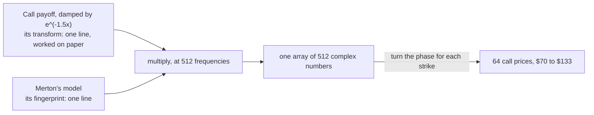
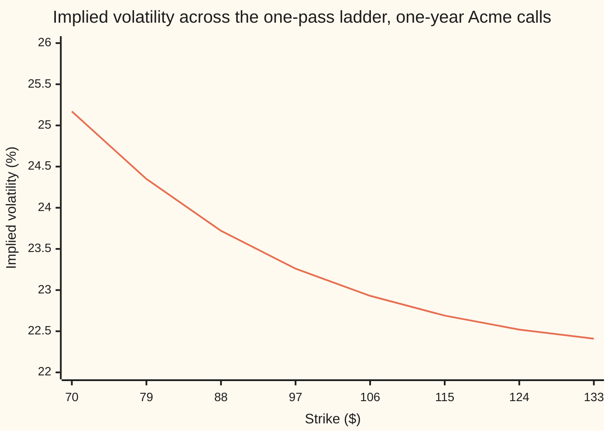

# Pricing by transform: Carr-Madan turns a fingerprint into a ladder of option prices

[Syllabus](../../../SYLLABUS.md) → [Harmonic analysis](../README.md) → [Characteristic Functions and Probability](../README.md#s04) → Pricing by transform

---

## General Overview

Acme shares trade at $100. A trading desk shows one-year calls on Acme at 64 strikes, every dollar from $70 to $133. A **call** struck at $`K`$ pays, in a year, the amount by which Acme's price beats $`K`$, or nothing if it does not.

The desk uses Merton's jump model ([Merton jump-diffusion](../../12-Financial%20mathematics/13-Local%20volatility%20and%20jumps/04-merton-jump-diffusion.md)): Acme's price wiggles at 20% a year and also gaps, half a jump a year on average. Each price is the payoff averaged over every way the year can end, discounted to today.

That average needs the **density**: the curve that says how likely each ending price is. Many models give no usable formula for it. They do give its Fourier transform, the **fingerprint** (the characteristic function, [Characteristic functions](01-characteristic-functions-in-depth.md)). Merton's fingerprint is one line.

An average of a payoff against a density is a **pairing**: the area under their product. Parseval's identity says a pairing equals the same pairing of the two transforms. So the price is the payoff's transform paired with the fingerprint.

Two facts make this fast:

- The payoff's transform is worked out once, on paper.
- A new strike only slides the payoff along, and a slide only turns the phase of its transform.

So the code builds one array: the payoff's transform times the fingerprint, at 512 frequencies. All 64 prices come off that array. The $100 call comes out at $10.416477, the same to nine decimals as Merton's own series and as a direct average over the density.

One snag: the call payoff grows without limit, so it has no transform. The fix is **damping** (Carr and Madan 1999, from the price side; Lewis 2001, from the payoff side, as here): multiply the payoff by a falling exponential and the density by the matching rising one. Their product, and so the price, does not change.

**A price is the payoff paired with the density; by Parseval it equals the damped payoff's transform paired with the fingerprint on a shifted line, and because a new strike only turns a phase, one array of fingerprint values prices every strike at once.**

**What kind of fact this is:** a theorem, the pricing identity, proved on this card in Why it works by Fourier inversion and one swap of integrals. It is used as a method, a finite sum whose two errors are measured. Merton's model is an assumption, not a law.

### The picture: one pass, sixty-four prices



The model enters only through its fingerprint. Swap in another model's fingerprint and nothing else changes.

---

## The formula

Notation first, in words.

- $`S`$ is Acme today, $100. $`S_T`$ is Acme at expiry, $`T = 1`$ year away. $`K`$ is the strike. Cash earns $`r = 5\%`$ a year and Acme pays a dividend yield $`q = 2\%`$, both continuously compounded.
- $`X = \ln(S_T/S)`$ is the **log return** to expiry, and $`x`$ is one value of it. $`k = \ln(K/S)`$ is the **log strike**: 0 at $100.
- $`p(x)`$ is the density of $`X`$ in the **pricing world**, the world where Acme grows on average at $`r - q`$ ([Black–Scholes call](../../12-Financial%20mathematics/08-The%20Black-Scholes%20call%20and%20put/01-black-scholes-call.md) explains why prices are averages there).
- $`M(z) = E[e^{zX}]`$ is the average of $`e^{zX}`$ for a complex number $`z`$, wherever that average is finite. On the imaginary axis it is the fingerprint: $`\varphi_X(u) = E[e^{iuX}] = M(iu)`$. This card writes the dial as $`u`$, as in wing 11, because $`T`$ already means time. $`i`$ is the imaginary unit.
- $`\xi`$ (xi) is a frequency in cycles per unit of log return. The transform is the wing's: $`\hat g(\xi) = \int g(x)\, e^{-2\pi i \xi x}\, dx`$, with $`x`$ in place of time.
- $`a > 1`$ is the **damping exponent**. The damped payoff is $`g_K(x) = e^{-ax}\,(S e^{x} - K)^{+}`$, where the superscript plus means "or zero, whichever is larger".

The pricing identity:

```math
C(K) \;=\; e^{-rT}\int_{-\infty}^{\infty} (S e^{x} - K)^{+}\, p(x)\, dx \;=\; e^{-rT}\int_{-\infty}^{\infty} \hat g_K(\xi)\, M(a + 2\pi i \xi)\, d\xi
```

**Read it aloud:** the call is the discounted payoff paired with the density, and that equals the discounted transform of the damped payoff paired with the fingerprint read on the line $`a`$ to the right of the imaginary axis.

$`M(a + 2\pi i\xi) = \varphi_X(2\pi\xi - ia)`$, so "the fingerprint on a shifted line" is literal: the dial $`u = 2\pi\xi`$ moved down by $`a`$.

The damped payoff's transform, worked once in Why it works:

```math
\hat g_K(\xi) = \frac{S\, e^{(1-a)k}\, e^{-2\pi i \xi k}}{(a - 1 + 2\pi i\xi)(a + 2\pi i\xi)}
```

The strike enters in two places only: the undamping factor $`e^{(1-a)k}`$ and the phase $`e^{-2\pi i\xi k}`$. Everything else goes into one strike-free product $`\Psi`$ (capital psi):

```math
\Psi(\xi) = \frac{S\, e^{-rT}\, M(a + 2\pi i\xi)}{(a - 1 + 2\pi i\xi)(a + 2\pi i\xi)}, \qquad C(K) = 2\, e^{(1-a)k}\; \mathrm{Re}\int_{0}^{\infty} \Psi(\xi)\, e^{-2\pi i\xi k}\, d\xi
```

**Read it aloud:** build Psi once from the fingerprint; for each strike, turn its phase by the log strike, add over the positive frequencies, keep twice the real part, and undo the damping.

On the card the integral is a midpoint sum: $`N = 512`$ samples $`\xi_j = (j + \tfrac12)h`$ with step $`h = 1/64`$, for $`j = 0, \dots, 511`$, so the cut-off is $`\Xi = Nh = 8`$.

This is Carr and Madan's formula. Their damping $`\alpha`$ is $`a - 1`$ and their frequency is $`2\pi\xi`$. [Transform pricing](../../12-Financial%20mathematics/06-Numerical%20Methods%20for%20Pricing/09-carr-madan-fft-and-cos-methods.md) reaches it from the call curve's side and runs it by fast Fourier transform. This card proves it from the pairing.

| Symbol | Plain meaning | In our example | Push it up and the answer… |
| --- | --- | --- | --- |
| $`S`$, $`S_T`$, $`K`$ | Acme today; Acme at expiry; the strike | $100; unknown; $70 to $133 | higher $`K`$: cheaper call |
| $`r`$, $`q`$, $`T`$ | riskless rate; dividend yield; years to expiry | 5%; 2%; 1 | higher $`q`$: cheaper call |
| $`X`$, $`x`$, $`k`$ | log return $`\ln(S_T/S)`$; one value of it; log strike $`\ln(K/S)`$ | —; —; 0 at $100 | — |
| $`p`$ | density of $`X`$ in the pricing world | a Poisson-weighted mix of bell curves | — |
| $`\sigma`$, $`\lambda`$, $`\mu_J`$, $`\delta`$ | wiggle volatility; jumps a year; mean and spread of one jump's log size | 20%; 0.5; −0.10; 0.15 | more jumps: dearer call, steeper skew (low strikes dearer) |
| $`m`$, $`\mu`$ | the average jump as a fraction of the price; the yearly drift of $`X`$ | −0.084926; 0.052463 | — |
| $`M(z)`$, $`z`$, $`\varphi_X(u)`$, $`u`$, $`i`$ | average of $`e^{zX}`$; a complex number; the fingerprint $`M(iu)`$; its dial; the imaginary unit | $`M(1.5) = 1.067245`$ | — |
| $`a`$ | damping exponent | 1.5 | no change while $`a > 1`$ |
| $`g_K`$, $`\hat g_K`$, $`\xi`$ | damped payoff; its transform; frequency, cycles per unit of log return | — | — |
| $`\Psi`$ | the strike-free product: payoff transform times fingerprint, discounted | $`\Psi(0) = 135.359322`$ | — |
| $`h`$, $`N`$, $`\Xi`$, $`\xi_j`$ | frequency step; number of samples; cut-off; sample points | 1/64; 512; 8; $`(j + \tfrac12)/64`$ | smaller $`h`$, larger $`\Xi`$: closer sum |
| $`C`$, $`P`$, $`\langle f, g\rangle`$ | call; put; the pairing $`\int f\,\overline{g}`$, the bar being the complex conjugate | $10.416477; $7.519552 | — |

### When it holds

- **The tilted law must have finite size: $`M(a) = E[e^{aX}]`$ finite**, which is the average of $`(S_T/S)^{a}`$. Merton's law has every such average. A law with a heavy right tail has none for any positive $`a`$, so no damping works ([Stable laws](08-stable-laws-and-heavy-tails.md)).
- **The damping must clear the payoff's growth: $`a > 1`$.** The payoff grows like $`e^{x}`$. At $`a = 1`$ the line runs through a pole and the sum returns −38.593457. Between 0 and 1 it returns the call minus $`S e^{-qT}`$, −87.603390.
- **The fingerprint must be the pricing-world one.** Its drift must make $`E[e^{X}] = e^{(r-q)T}`$. Leave out the jump correction and the $100 call drops to 8.071035.
- **The sum must cover the fingerprint and sample it finely.** A cut-off of 1 instead of 8 gives 10.663523. A step of 1/16 instead of 1/64 lets copies of the answer 16 log units away leak in: 10.383606.
- **The payoff must be European**, paid only at expiry and fixed by $`S_T`$ alone. A payoff that depends on the path needs more than the law of $`X`$.

---

## Why it works

### Step 0: three facts carry the whole method

1. **A price is a pairing.** It is the area under payoff times density, discounted.
2. **Parseval moves a pairing to frequencies.** The area under a product equals the area under the product of the transforms, one of them conjugated ([Plancherel](../02-The%20Fourier%20Transform/05-plancherel-and-l2.md)).
3. **A slide is a phase.** Sliding a function along by $`k`$ multiplies its transform by $`e^{-2\pi i\xi k}`$ ([The transform rulebook](../02-The%20Fourier%20Transform/02-shift-scale-and-derivative-rules.md)).

Fact 2 trades the unknown density for the known fingerprint. Fact 3 makes every further strike nearly free. Damping is the repair that lets fact 2 apply to a payoff that grows.

### Step 1: the price is a pairing

In the pricing world the call is its average payoff, discounted:

```math
C(K) = e^{-rT}\, E\big[(S e^{X} - K)^{+}\big] = e^{-rT}\int (S e^{x} - K)^{+}\, p(x)\, dx .
```

Only the law of $`X`$ matters. Its density is needed for the right-hand form, not for the method.

### Step 2: damp the payoff, tilt the law

The payoff grows like $`S e^{x}`$, so the area under it is infinite and its transform does not exist. Write the payoff as $`e^{-ax}`$ times itself, times $`e^{ax}`$:

```math
E\big[(S e^{X} - K)^{+}\big] = E\big[g_K(X)\, e^{aX}\big], \qquad g_K(x) = e^{-ax}(S e^{x} - K)^{+} .
```

For $`a > 1`$ the damped payoff dies away at both ends: it is zero below the log strike and falls like $`e^{(1-a)x}`$ above it. The tilted law, the density times $`e^{ax}`$, has total weight $`M(a)`$ (divided by that weight, it is what actuaries call the Esscher transform), finite by the first condition in When it holds. Why a damping must beat the growth, and why any damping that does gives the same answer, is [Where a transform lives](../../07-Complex%20analysis/08-Transforms%20in%20Outline/06-strips-of-convergence-and-shifting-the-line.md).

### Step 3: Parseval, in the form a price needs

Rebuild the damped payoff from its transform, $`g_K(x) = \int \hat g_K(\xi)\, e^{2\pi i\xi x}\, d\xi`$ ([Fourier inversion](../02-The%20Fourier%20Transform/04-fourier-inversion-theorem.md)). Put it inside the average and swap the average with the integral over $`\xi`$:

```math
E\big[g_K(X)\, e^{aX}\big] = \int \hat g_K(\xi)\, E\big[e^{(a + 2\pi i\xi)X}\big]\, d\xi = \int \hat g_K(\xi)\, M(a + 2\pi i\xi)\, d\xi .
```

That is the pricing identity. The fingerprint appears because $`e^{2\pi i\xi x}`$ from the inversion meets $`e^{ax}`$ from the tilt.

<details>
<summary>Detailed proof: why inversion and the swap are allowed, and why this is Parseval</summary>

**Inversion holds at every point.** The damped payoff $`g_K`$ is continuous: the kink at the strike is a corner, not a jump. Its transform, worked in Step 4, has size at most $`S e^{(1-a)k}`$ divided by $`(a-1)a`$ near zero and by $`4\pi^2\xi^2`$ far out, so the area under $`|\hat g_K|`$ is finite. A continuous integrable function with an integrable transform is rebuilt exactly, at every $`x`$, by the inverse integral.

**The swap is allowed.** The size of the integrand is

$`\displaystyle \big|\hat g_K(\xi)\, e^{2\pi i\xi X}\, e^{aX}\big| = |\hat g_K(\xi)|\; e^{aX},`$

and its total over $`\xi`$ and over the law of $`X`$ is $`\int |\hat g_K| \times M(a)`$, finite. Fubini's theorem then lets the average and the integral change places.

**This is Parseval.** When $`X`$ has a density $`p`$, write $`p_a(x) = e^{ax}p(x)`$ for the tilted density. Its transform is

$`\displaystyle \hat p_a(\xi) = \int e^{ax}\, p(x)\, e^{-2\pi i\xi x}\, dx = M(a - 2\pi i\xi),`$

and since $`X`$ is real, its conjugate is $`M(a + 2\pi i\xi)`$. So the identity reads $`\langle g_K, p_a\rangle = \langle \hat g_K, \hat p_a\rangle`$: Parseval's pairing form, with both functions real on the left. The proof above never used $`p`$, so the identity holds for every law with $`M(a)`$ finite, density or not.

</details>

### Step 4: the payoff's transform, by hand

The damped payoff is zero below $`k`$, so its transform is an integral from $`k`$ up of two exponentials. Each integrates in one line, because both exponents have negative real part, $`1 - a`$ and $`-a`$:

```math
\int_{k}^{\infty} \big(S e^{x} - K\big)\, e^{-(a + 2\pi i\xi)x}\, dx = \frac{S e^{(1-a-2\pi i\xi)k}}{a - 1 + 2\pi i\xi} - \frac{K e^{-(a+2\pi i\xi)k}}{a + 2\pi i\xi} .
```

Put $`K = S e^{k}`$ in the second term. Both terms then share $`S e^{(1-a)k}e^{-2\pi i\xi k}`$, and the two fractions combine, since their denominators differ by exactly 1:

```math
\frac{1}{a - 1 + 2\pi i\xi} - \frac{1}{a + 2\pi i\xi} = \frac{1}{(a - 1 + 2\pi i\xi)(a + 2\pi i\xi)} .
```

That gives the transform in The formula. At zero frequency the product $`\Psi(0) = S e^{-rT} M(a)/((a-1)a)`$ is a real number, a cheap first check.

### Step 5: every strike from one array

Write the payoff as a slide of one shape. With $`k = \ln(K/S)`$,

```math
(S e^{x} - K)^{+} = K\,\big(e^{x - k} - 1\big)^{+} .
```

Every strike's payoff is the strike-$100 shape slid right by $`k`$ and scaled. Sliding turns the transform's phase by $`e^{-2\pi i\xi k}`$ and changes nothing else, which is why only that phase and the factor $`e^{(1-a)k}`$ depend on the strike.

So the expensive part, the fingerprint, is computed once per frequency, not once per frequency per strike. Here that is 512 fingerprint values instead of 32,768. Each strike then costs one weighted sum of the 512 stored numbers.

Half the frequency line is enough. $`X`$ is real, so $`M(a - 2\pi i\xi)`$ is the conjugate of $`M(a + 2\pi i\xi)`$, and $`\Psi(-\xi) = \overline{\Psi(\xi)}`$. The negative frequencies mirror the positive ones, and the two halves add to twice the real part.

As a function of the log strike, $`e^{(a-1)k}C(k)`$ is the Fourier transform of $`\Psi`$. On evenly spaced log strikes one fast Fourier transform does all the sums together; [Transform pricing](../../12-Financial%20mathematics/06-Numerical%20Methods%20for%20Pricing/09-carr-madan-fft-and-cos-methods.md) has the grid rules. This card's strikes are a dollar apart, so the code sums directly.

### Step 6: sliding the line, and crossing a pole

Read $`z = a + 2\pi i\xi`$ as a point in the complex plane. The integrand, as a function of $`z`$, is smooth except at two **poles** (points where it blows up): $`z = 1`$ and $`z = 0`$, where the denominator vanishes. The integral runs up the vertical line through $`a`$.

Sliding that line sideways changes nothing until it meets a pole ([Where a transform lives](../../07-Complex%20analysis/08-Transforms%20in%20Outline/06-strips-of-convergence-and-shifting-the-line.md)). So $`a = 1.5`$ and $`a = 3`$ give the same $10.416477.

Crossing a pole subtracts its residue, the coefficient of the blow-up there:

- Crossing $`z = 1`$ removes $`S e^{-qT}`$, today's value of one share delivered at expiry: the line at $`a = 0.5`$ gives $`C - S e^{-qT}`$.
- Crossing $`z = 0`$ as well adds back $`K e^{-rT}`$: the line at $`a = -0.5`$ gives $`C - S e^{-qT} + K e^{-rT}`$, which is the put by [Put-call parity](../../12-Financial%20mathematics/08-The%20Black-Scholes%20call%20and%20put/03-put-call-parity.md).
- On the pole itself, $`a = 1`$, the sum lands halfway: $`C - \tfrac12 S e^{-qT}`$.

The code prints and checks all three.

---

## Worked numbers, by hand

Acme under Merton: $`S = 100`$, $`r = 5\%`$, $`q = 2\%`$, $`T = 1`$, $`\sigma = 20\%`$, $`\lambda = 0.5`$, $`\mu_J = -0.10`$, $`\delta = 0.15`$, damping $`a = 1.5`$. At the $100 strike $`k = 0`$, so the phase and the undamping are both 1.

| Step | Arithmetic | Value |
| --- | --- | --- |
| average jump $`m`$ | $`e^{-0.10 + \frac12 \times 0.15^2} - 1`$ | $`-0.084926`$ |
| drift of $`X`$, $`\mu = r - q - \tfrac12\sigma^2 - \lambda m`$ | $`0.05 - 0.02 - 0.02 + 0.5 \times 0.084926`$ | $`0.052463`$ |
| $`\ln M(1.5)`$ | $`1.5\mu + \tfrac12 \times 0.04 \times 1.5^2 + 0.5\,\big(e^{1.5 \times (-0.10) + \frac12 \times 0.0225 \times 1.5^2} - 1\big)`$ | $`0.065081`$ |
| $`M(1.5)`$ | $`e^{0.065081}`$ | $`1.067245`$ |
| $`\Psi(0)`$ | $`100 \times e^{-0.05} \times 1.067245 / (0.5 \times 1.5)`$ | $`135.359322`$ |
| sum to cut-off 0.5 | $`2h\sum \mathrm{Re}\,\Psi(\xi_j)`$, first 32 samples | $`12.617666`$ |
| sum to cut-off 1 | first 64 samples | $`10.663523`$ |
| sum to cut-off 2 | first 128 samples | $`10.415705`$ |
| sum to cut-off 4 | first 256 samples | $`10.416477`$ |
| **sum to cut-off 8** | **all 512 samples** | **$`\$10.416477`$** |
| Merton's series, a separate road | Poisson-weighted Black–Scholes prices | $`10.416477`$ |
| payoff paired with the density, a third road | Simpson's rule in $`x`$ | $`10.416477`$ |

The $100 call costs $10.42, against $9.23 with no jumps. The extra $1.19, the jump premium, pays for the fatter tails that jumps create. The sum settles by a cut-off of 4: the fingerprint has died away by then.

### The ladder, from the same 512 numbers

The other 63 strikes reuse the same array of $`\Psi`$ values; only the phase changes. Eight of them, with the **implied volatility** of each price: the single Black–Scholes volatility that reproduces it ([Implied volatility](../../12-Financial%20mathematics/11-Implied%20volatility%20and%20the%20vanilla%20inverses/01-implied-volatility.md)).

| Strike | Call, one pass | Implied volatility |
| --- | --- | --- |
| $70 | 31.9790 | 25.17% |
| $79 | 24.3245 | 24.35% |
| $88 | 17.5533 | 23.72% |
| $97 | 11.9787 | 23.26% |
| $106 | 7.7371 | 22.93% |
| $115 | 4.7501 | 22.69% |
| $124 | 2.7897 | 22.52% |
| $133 | 1.5789 | 22.41% |



The line slopes down: low strikes are dearer because the jumps are mostly downward. One fixed volatility would draw a flat line. Across all 64 strikes the transform agrees with Merton's series and with the direct pairing to nine decimals, and every butterfly, $`C(K-1) - 2C(K) + C(K+1)`$, is positive, the smallest 0.006415, as prices free of arbitrage (riskless profit) require.

### What breaks if you drop a piece

Same $100 call, correct answer 10.416477:

| Mistake | Comes out at | What went wrong |
| --- | --- | --- |
| Damp the payoff but read the fingerprint on the real axis, $`M(2\pi i\xi)`$ | 6.879087 | The $`e^{-ax}`$ was taken out and never put back: the pairing lost a factor |
| Damping $`a = 1`$ | −38.593457 | The line runs through the pole at $`z = 1`$; the sum returns $`C - \tfrac12 S e^{-qT}`$ |
| Damping $`a = 0.5`$ | −87.603390 | The line crossed the pole; the residue $`S e^{-qT}`$ is gone |
| Fingerprint without the jump correction in the drift | 8.071035 | Acme no longer grows at $`r - q`$ on average; this prices a different market |
| Cut-off 1 instead of 8 | 10.663523 | The fingerprint is not yet small at frequency 1; the tail was thrown away |

---

## Code, from first principles, and it actually runs

Both programs price the 64 strikes by three independent roads. Road 1 is this card: one array of payoff transform times fingerprint, then one phase sum per strike. Road 2 is Merton's series, a Poisson-weighted sum of Black–Scholes prices, with the bell-curve area written out as a series. Road 3 pairs the payoff with the density directly, by Simpson's rule in $`x`$, with no transform anywhere. The checks also price with no jumps against Black–Scholes, slide the damping line and cross both poles, and test that every butterfly is positive. The Rust program carries its own small complex-number type.

### Python

```python
# Pricing by transform: one fingerprint, sixty-four strikes, one pass.  Standard library only.
# Model: Merton's jump-diffusion for Acme.  Road 1 pairs the damped payoff's transform with the
# fingerprint (Parseval); road 2 is Merton's series of Black-Scholes prices; road 3 pairs the
# payoff with the density itself, by Simpson's rule.  Phi is a series written out.
from math import exp, log, sqrt, pi, factorial
from cmath import exp as cexp

S, r, q, T = 100.0, 0.05, 0.02, 1.0
SIG, LAM, MJ, DJ = 0.20, 0.5, -0.10, 0.15        # wiggle; jumps a year; jump log mean, log spread
AVGJ = exp(MJ + 0.5 * DJ * DJ) - 1.0               # the average jump, as a fraction of the price
STRIKES = [70.0 + i for i in range(64)]           # $70, $71, ..., $133
A, H, NF = 1.5, 1.0 / 64.0, 512                   # damping, frequency step, samples: cut-off 8

def mgf(z, lam=LAM, fix=True):                    # E[e^{zX}], X = ln(S_T/S); fingerprint is z = iu
    mu = r - q - 0.5 * SIG * SIG - (lam * AVGJ if fix else 0.0)
    jump = cexp(MJ * z + 0.5 * DJ * DJ * z * z) - 1.0
    return cexp(T * (mu * z + 0.5 * SIG * SIG * z * z + lam * jump))

calls = [0]
def products(a=A, h=H, n=NF, m=mgf):              # the one pass: payoff transform times fingerprint
    calls[0] += n
    return [S * exp(-r * T) * m(z) / ((z - 1.0) * z) for z in (a + 2j * pi * (j + 0.5) * h for j in range(n))]

def ladder(a=A, h=H, n=NF, strikes=STRIKES, m=mgf):
    psi = products(a, h, n, m)
    out = []
    for K in strikes:                             # each strike only turns the phase
        k = log(K / S)
        s = sum(p * cexp(-2j * pi * (j + 0.5) * h * k) for j, p in enumerate(psi))
        out.append(exp((1.0 - a) * k) * 2.0 * h * s.real)
    return out

def Phi(x):                                       # bell-curve area left of x, Taylor series
    if x < -9.0: return 0.0
    if x > 9.0: return 1.0
    term, s, n = x, x, 0
    while abs(term) > 1e-17 * abs(s):
        n += 1; term *= x * x / (2 * n + 1); s += term
    return 0.5 + s * exp(-0.5 * x * x) / sqrt(2.0 * pi)

def bs(K, qq, sig):
    d1 = (log(S / K) + (r - qq + 0.5 * sig * sig) * T) / (sig * sqrt(T))
    return S * exp(-qq * T) * Phi(d1) - K * exp(-r * T) * Phi(d1 - sig * sqrt(T))

def merton(K):                                    # road 2: Poisson-weighted Black-Scholes
    tot = 0.0
    for n in range(41):
        w = exp(-LAM * T) * (LAM * T) ** n / factorial(n)
        tot += w * bs(K, q + LAM * AVGJ - n * log(1.0 + AVGJ) / T, sqrt(SIG ** 2 + n * DJ ** 2 / T))
    return tot

def density(x):                                   # Poisson mixture of bell curves for X
    mu, tot = r - q - 0.5 * SIG * SIG - LAM * AVGJ, 0.0
    for n in range(21):
        w = exp(-LAM * T) * (LAM * T) ** n / factorial(n)
        m, v = mu * T + n * MJ, SIG * SIG * T + n * DJ * DJ
        tot += w * exp(-(x - m) ** 2 / (2.0 * v)) / sqrt(2.0 * pi * v)
    return tot

def pairing(K, n=2000, top=3.0):                  # road 3: <payoff, density> by Simpson
    lo = log(K / S); h = (top - lo) / n
    f = lambda x: (S * exp(x) - K) * density(x)
    s = f(lo) + f(top) + sum((4 if i % 2 else 2) * f(lo + i * h) for i in range(1, n))
    return exp(-r * T) * s * h / 3.0

def implied(C, K):                                # Black-Scholes volatility by bisection
    lo, hi = 0.01, 1.0
    for _ in range(60):
        mid = 0.5 * (lo + hi)
        lo, hi = (mid, hi) if bs(K, q, mid) < C else (lo, mid)
    return 0.5 * (lo + hi)

road1 = ladder(); one_pass = calls[0]
fine = ladder(h=H / 2, n=3 * NF)                  # second cut-off 12, half the step
road2 = [merton(K) for K in STRIKES]
road3 = [pairing(K) for K in STRIKES]
i100 = STRIKES.index(100.0)
MU = r - q - 0.5 * SIG * SIG - LAM * AVGJ
print(f"average jump m {AVGJ:.6f}   drift mu {MU:.6f}")
print(f"at a = 1.5: log E[e^(aX)] {log(mgf(A).real):.6f}   E[e^(aX)] {mgf(A).real:.6f}")
print(f"Psi(0) = S e^-rT E[e^(aX)] / ((a-1) a) {S * exp(-r * T) * mgf(A).real / ((A - 1.0) * A):.6f}")
print(f"fingerprint values: one pass {one_pass}; strike by strike {64 * NF}")
psi = products()
print("K = 100, sum cut off at Xi: " + "  ".join(f"{n * H:g}: {2 * H * sum(p.real for p in psi[:n]):.6f}" for n in (32, 64, 128, 256, 512)))
print("call prices, road 1 (transform), strikes across")
for row in range(8):
    print(f"K {70 + 8 * row:>3}-{77 + 8 * row:<3}" + "".join(f"{c:8.4f}" for c in road1[8 * row:8 * row + 8]))
g12 = max(abs(x - y) for x, y in zip(road1, road2))
g13 = max(abs(x - y) for x, y in zip(road1, road3))
gfine = max(abs(x - y) for x, y in zip(road1, fine))
print(f"K = 100: road 1 {road1[i100]:.6f}  road 2 {road2[i100]:.6f}  road 3 {road3[i100]:.6f}")
print(f"largest gap over 64 strikes: 1 vs 2 {g12:.9f}  1 vs 3 {g13:.9f}  cut-off 8 vs 12 {gfine:.9f}")
bs100 = bs(100.0, q, SIG)
ln100 = ladder(strikes=[100.0], m=lambda z: mgf(z, lam=0.0))[0]
print(f"no jumps, K = 100: transform {ln100:.6f}  Black-Scholes {bs100:.6f}  jump premium {road1[i100] - bs100:.6f}")
c_a3 = ladder(a=3.0, strikes=[100.0])[0]
fwd = S * exp(-q * T); put = road2[i100] - fwd + 100.0 * exp(-r * T)
print(f"damping a = 3.0: {c_a3:.6f}   (a = 1.5 gave {road1[i100]:.6f})")
c_a1 = ladder(a=1.0, strikes=[100.0])[0]
c_a05 = ladder(a=0.5, strikes=[100.0])[0]
c_am = ladder(a=-0.5, strikes=[100.0])[0]
print(f"wrong: a = 1.0, line through the pole {c_a1:.6f}   C - S e^-qT / 2 = {road2[i100] - fwd / 2:.6f}")
print(f"wrong: a = 0.5, line past the pole   {c_a05:.6f}   C - S e^-qT     = {road2[i100] - fwd:.6f}")
print(f"a = -0.5, past both poles            {c_am:.6f}   put P           = {put:.6f}")
c_ns = ladder(strikes=[100.0], m=lambda z: mgf(z - A))[0]
c_nf = ladder(strikes=[100.0], m=lambda z: mgf(z, fix=False))[0]
c_alias = ladder(h=1.0 / 16, n=128, strikes=[100.0])[0]
print(f"wrong: fingerprint not shifted to the damped line {c_ns:.6f}")
print(f"wrong: drift not corrected for the jumps          {c_nf:.6f}")
print(f"step 1/16 instead of 1/64 (copies 16 apart)       {c_alias:.6f}  gap {road1[i100] - c_alias:.6f}")
ivk = [70.0 + 9 * j for j in range(8)]
ivs = [implied(road1[STRIKES.index(K)], K) for K in ivk]
print("chart, strike    " + "".join(f"{K:7.0f}" for K in ivk))
print("chart, implied % " + "".join(f"{100 * v:7.2f}" for v in ivs))
fly = min(road1[i - 1] - 2 * road1[i] + road1[i + 1] for i in range(1, 63))
print(f"smallest butterfly C(K-1) - 2C(K) + C(K+1): {fly:.6f}")

assert g12 < 1e-8, "transform road must land on Merton's series"
assert g13 < 1e-7, "transform road must land on the payoff paired with the density"
assert abs(ln100 - bs100) < 1e-8, "no jumps: transform must give Black-Scholes"
assert abs(c_a3 - road1[i100]) < 1e-8, "the damping line slides without changing the price"
assert abs(c_a1 - (road2[i100] - fwd / 2)) < 1e-6, "on the pole at 1 the sum lands halfway"
assert abs(c_a05 - (road2[i100] - fwd)) < 1e-6, "crossing the pole at 1 subtracts S e^-qT"
assert abs(c_am - put) < 1e-6, "crossing both poles prices the put"
assert abs(road2[i100] - 10.42) < 0.005, "Merton card's $10.42"
assert fly > 0, "prices bend upward: no butterfly has a negative price"
print("ALL CHECKS PASS")
```

**Ran 2026-11-15 on macOS, Python 3.14.10, standard library only. All checks passed. Output, pasted from the run:**

```
average jump m -0.084926   drift mu 0.052463
at a = 1.5: log E[e^(aX)] 0.065081   E[e^(aX)] 1.067245
Psi(0) = S e^-rT E[e^(aX)] / ((a-1) a) 135.359322
fingerprint values: one pass 512; strike by strike 32768
K = 100, sum cut off at Xi: 0.5: 12.617666  1: 10.663523  2: 10.415705  4: 10.416477  8: 10.416477
call prices, road 1 (transform), strikes across
K  70-77  31.9790 31.0964 30.2206 29.3522 28.4916 27.6394 26.7961 25.9621
K  78-85  25.1381 24.3245 23.5218 22.7307 21.9514 21.1846 20.4308 19.6903
K  86-93  18.9636 18.2512 17.5533 16.8704 16.2029 15.5509 14.9148 14.2947
K  94-101 13.6909 13.1036 12.5328 11.9787 11.4413 10.9205 10.4165  9.9291
K 102-109  9.4582  9.0037  8.5655  8.1434  7.7371  7.3465  6.9713  6.6112
K 110-117  6.2659  5.9352  5.6185  5.3157  5.0264  4.7501  4.4866  4.2354
K 118-125  3.9962  3.7685  3.5520  3.3462  3.1509  2.9655  2.7897  2.6231
K 126-133  2.4654  2.3162  2.1751  2.0417  1.9157  1.7968  1.6847  1.5789
K = 100: road 1 10.416477  road 2 10.416477  road 3 10.416477
largest gap over 64 strikes: 1 vs 2 0.000000000  1 vs 3 0.000000000  cut-off 8 vs 12 0.000000000
no jumps, K = 100: transform 9.227006  Black-Scholes 9.227006  jump premium 1.189472
damping a = 3.0: 10.416477   (a = 1.5 gave 10.416477)
wrong: a = 1.0, line through the pole -38.593457   C - S e^-qT / 2 = -38.593457
wrong: a = 0.5, line past the pole   -87.603390   C - S e^-qT     = -87.603390
a = -0.5, past both poles            7.519552   put P           = 7.519552
wrong: fingerprint not shifted to the damped line 6.879087
wrong: drift not corrected for the jumps          8.071035
step 1/16 instead of 1/64 (copies 16 apart)       10.383606  gap 0.032871
chart, strike         70     79     88     97    106    115    124    133
chart, implied %   25.17  24.35  23.72  23.26  22.93  22.69  22.52  22.41
smallest butterfly C(K-1) - 2C(K) + C(K+1): 0.006415
ALL CHECKS PASS
```

### Rust

```rust
// Pricing by transform: one fingerprint, sixty-four strikes, one pass.  Standard library only.
// The same three roads as carr_madan_and_fourier_pricing_check.py; a complex number is a small struct.
// Compile: rustc --edition 2021 -O carr_madan_and_fourier_pricing_check.rs -o /tmp/cm_check
use std::f64::consts::PI;
use std::ops::{Add, Div, Mul, Sub};

#[derive(Clone, Copy)]
struct C { re: f64, im: f64 }
impl Add for C { type Output = C; fn add(self, o: C) -> C { C { re: self.re + o.re, im: self.im + o.im } } }
impl Sub for C { type Output = C; fn sub(self, o: C) -> C { C { re: self.re - o.re, im: self.im - o.im } } }
impl Mul for C { type Output = C; fn mul(self, o: C) -> C { C { re: self.re * o.re - self.im * o.im, im: self.re * o.im + self.im * o.re } } }
impl Div for C { type Output = C; fn div(self, o: C) -> C {
    let d = o.re * o.re + o.im * o.im;
    C { re: (self.re * o.re + self.im * o.im) / d, im: (self.im * o.re - self.re * o.im) / d } } }
fn c(re: f64, im: f64) -> C { C { re, im } }
fn cexp(z: C) -> C { let e = z.re.exp(); c(e * z.im.cos(), e * z.im.sin()) }

const S: f64 = 100.0; const R: f64 = 0.05; const Q: f64 = 0.02; const T: f64 = 1.0;
const SIG: f64 = 0.20; const LAM: f64 = 0.5; const MJ: f64 = -0.10; const DJ: f64 = 0.15;
const A: f64 = 1.5; const H: f64 = 1.0 / 64.0; const NF: usize = 512;
fn avgj() -> f64 { (MJ + 0.5 * DJ * DJ).exp() - 1.0 }

fn mgf(z: C, lam: f64, fix: bool) -> C {           // E[e^{zX}], X = ln(S_T/S)
    let mu = R - Q - 0.5 * SIG * SIG - if fix { lam * avgj() } else { 0.0 };
    let jump = cexp(c(MJ, 0.0) * z + c(0.5 * DJ * DJ, 0.0) * z * z) - c(1.0, 0.0);
    cexp(c(T, 0.0) * (c(mu, 0.0) * z + c(0.5 * SIG * SIG, 0.0) * z * z + c(lam, 0.0) * jump))
}
fn std_mgf(z: C) -> C { mgf(z, LAM, true) }

fn products(a: f64, h: f64, n: usize, m: &dyn Fn(C) -> C) -> Vec<C> {   // the one pass
    (0..n).map(|j| {
        let z = c(a, 2.0 * PI * (j as f64 + 0.5) * h);
        c(S * (-R * T).exp(), 0.0) * m(z) / ((z - c(1.0, 0.0)) * z)
    }).collect()
}
fn ladder(a: f64, h: f64, n: usize, strikes: &[f64], m: &dyn Fn(C) -> C) -> Vec<f64> {
    let psi = products(a, h, n, m);
    strikes.iter().map(|&kk| {                     // each strike only turns the phase
        let k = (kk / S).ln();
        let mut s = c(0.0, 0.0);
        for (j, p) in psi.iter().enumerate() { s = s + *p * cexp(c(0.0, -2.0 * PI * (j as f64 + 0.5) * h * k)); }
        ((1.0 - a) * k).exp() * 2.0 * h * s.re
    }).collect()
}

fn phi_cdf(x: f64) -> f64 {                         // bell-curve area left of x, Taylor series
    if x < -9.0 { return 0.0; }
    if x > 9.0 { return 1.0; }
    let (mut term, mut s, mut n) = (x, x, 0.0);
    while term.abs() > 1e-17 * s.abs() { n += 1.0; term *= x * x / (2.0 * n + 1.0); s += term; }
    0.5 + s * (-0.5 * x * x).exp() / (2.0 * PI).sqrt()
}
fn bs(k: f64, qq: f64, sig: f64) -> f64 {
    let d1 = ((S / k).ln() + (R - qq + 0.5 * sig * sig) * T) / (sig * T.sqrt());
    S * (-qq * T).exp() * phi_cdf(d1) - k * (-R * T).exp() * phi_cdf(d1 - sig * T.sqrt())
}
fn poisson(n: usize) -> f64 { let mut w = (-LAM * T).exp(); for i in 1..=n { w *= LAM * T / i as f64; } w }
fn merton(k: f64) -> f64 {                          // road 2: Poisson-weighted Black-Scholes
    (0..41).map(|n| poisson(n) * bs(k, Q + LAM * avgj() - n as f64 * (1.0 + avgj()).ln() / T,
        (SIG * SIG + n as f64 * DJ * DJ / T).sqrt())).sum()
}
fn density(x: f64) -> f64 {                         // Poisson mixture of bell curves for X
    let mu = R - Q - 0.5 * SIG * SIG - LAM * avgj();
    (0..21).map(|n| {
        let (m, v) = (mu * T + n as f64 * MJ, SIG * SIG * T + n as f64 * DJ * DJ);
        poisson(n) * (-(x - m) * (x - m) / (2.0 * v)).exp() / (2.0 * PI * v).sqrt()
    }).sum()
}
fn pairing(k: f64) -> f64 {                         // road 3: <payoff, density> by Simpson
    let (n, top, lo) = (2000, 3.0, (k / S).ln());
    let h = (top - lo) / n as f64;
    let f = |x: f64| (S * x.exp() - k) * density(x);
    let mut s = f(lo) + f(top);
    for i in 1..n { s += if i % 2 == 1 { 4.0 } else { 2.0 } * f(lo + i as f64 * h); }
    (-R * T).exp() * s * h / 3.0
}
fn implied(cc: f64, k: f64) -> f64 {                // Black-Scholes volatility by bisection
    let (mut lo, mut hi) = (0.01, 1.0);
    for _ in 0..60 { let mid = 0.5 * (lo + hi); if bs(k, Q, mid) < cc { lo = mid } else { hi = mid } }
    0.5 * (lo + hi)
}
fn maxgap(x: &[f64], y: &[f64]) -> f64 { x.iter().zip(y).map(|(a, b)| (a - b).abs()).fold(0.0, f64::max) }

fn main() {
    let strikes: Vec<f64> = (0..64).map(|i| 70.0 + i as f64).collect();
    let road1 = ladder(A, H, NF, &strikes, &std_mgf);
    let fine = ladder(A, H / 2.0, 3 * NF, &strikes, &std_mgf);
    let road2: Vec<f64> = strikes.iter().map(|&k| merton(k)).collect();
    let road3: Vec<f64> = strikes.iter().map(|&k| pairing(k)).collect();
    let i100 = 30;
    let m15 = std_mgf(c(A, 0.0)).re;
    println!("average jump m {:.6}   drift mu {:.6}", avgj(), R - Q - 0.5 * SIG * SIG - LAM * avgj());
    println!("at a = 1.5: log E[e^(aX)] {:.6}   E[e^(aX)] {:.6}", m15.ln(), m15);
    println!("Psi(0) = S e^-rT E[e^(aX)] / ((a-1) a) {:.6}", S * (-R * T).exp() * m15 / ((A - 1.0) * A));
    println!("fingerprint values: one pass {}; strike by strike {}", NF, 64 * NF);
    let psi = products(A, H, NF, &std_mgf);
    let parts: Vec<String> = [32usize, 64, 128, 256, 512].iter().map(|&n| format!("{}: {:.6}",
        n as f64 * H, 2.0 * H * psi[..n].iter().map(|p| p.re).sum::<f64>())).collect();
    println!("K = 100, sum cut off at Xi: {}", parts.join("  "));
    println!("call prices, road 1 (transform), strikes across");
    for row in 0..8 {
        let cells: String = road1[8 * row..8 * row + 8].iter().map(|v| format!("{:8.4}", v)).collect();
        println!("K {:>3}-{:<3}{}", 70 + 8 * row, 77 + 8 * row, cells);
    }
    let (g12, g13, gfine) = (maxgap(&road1, &road2), maxgap(&road1, &road3), maxgap(&road1, &fine));
    println!("K = 100: road 1 {:.6}  road 2 {:.6}  road 3 {:.6}", road1[i100], road2[i100], road3[i100]);
    println!("largest gap over 64 strikes: 1 vs 2 {:.9}  1 vs 3 {:.9}  cut-off 8 vs 12 {:.9}", g12, g13, gfine);
    let one = [100.0];
    let bs100 = bs(100.0, Q, SIG);
    let ln100 = ladder(A, H, NF, &one, &|z| mgf(z, 0.0, true))[0];
    println!("no jumps, K = 100: transform {:.6}  Black-Scholes {:.6}  jump premium {:.6}", ln100, bs100, road1[i100] - bs100);
    let c_a3 = ladder(3.0, H, NF, &one, &std_mgf)[0];
    let fwd = S * (-Q * T).exp();
    let put = road2[i100] - fwd + 100.0 * (-R * T).exp();
    println!("damping a = 3.0: {:.6}   (a = 1.5 gave {:.6})", c_a3, road1[i100]);
    let c_a1 = ladder(1.0, H, NF, &one, &std_mgf)[0];
    let c_a05 = ladder(0.5, H, NF, &one, &std_mgf)[0];
    let c_am = ladder(-0.5, H, NF, &one, &std_mgf)[0];
    println!("wrong: a = 1.0, line through the pole {:.6}   C - S e^-qT / 2 = {:.6}", c_a1, road2[i100] - fwd / 2.0);
    println!("wrong: a = 0.5, line past the pole   {:.6}   C - S e^-qT     = {:.6}", c_a05, road2[i100] - fwd);
    println!("a = -0.5, past both poles            {:.6}   put P           = {:.6}", c_am, put);
    let c_ns = ladder(A, H, NF, &one, &|z| std_mgf(z - c(A, 0.0)))[0];
    let c_nf = ladder(A, H, NF, &one, &|z| mgf(z, LAM, false))[0];
    let c_alias = ladder(A, 1.0 / 16.0, 128, &one, &std_mgf)[0];
    println!("wrong: fingerprint not shifted to the damped line {:.6}", c_ns);
    println!("wrong: drift not corrected for the jumps          {:.6}", c_nf);
    println!("step 1/16 instead of 1/64 (copies 16 apart)       {:.6}  gap {:.6}", c_alias, road1[i100] - c_alias);
    let ivk: Vec<usize> = (0..8).map(|j| 9 * j).collect();
    let ks: String = ivk.iter().map(|&i| format!("{:7.0}", strikes[i])).collect();
    let vs: String = ivk.iter().map(|&i| format!("{:7.2}", 100.0 * implied(road1[i], strikes[i]))).collect();
    println!("chart, strike    {}", ks);
    println!("chart, implied % {}", vs);
    let fly = (1..63).map(|i| road1[i - 1] - 2.0 * road1[i] + road1[i + 1]).fold(f64::INFINITY, f64::min);
    println!("smallest butterfly C(K-1) - 2C(K) + C(K+1): {:.6}", fly);

    assert!(g12 < 1e-8, "transform road must land on Merton's series");
    assert!(g13 < 1e-7, "transform road must land on the payoff paired with the density");
    assert!((ln100 - bs100).abs() < 1e-8, "no jumps: transform must give Black-Scholes");
    assert!((c_a3 - road1[i100]).abs() < 1e-8, "the damping line slides without changing the price");
    assert!((c_a1 - (road2[i100] - fwd / 2.0)).abs() < 1e-6, "on the pole at 1 the sum lands halfway");
    assert!((c_a05 - (road2[i100] - fwd)).abs() < 1e-6, "crossing the pole at 1 subtracts S e^-qT");
    assert!((c_am - put).abs() < 1e-6, "crossing both poles prices the put");
    assert!((road2[i100] - 10.42).abs() < 0.005, "Merton card's $10.42");
    assert!(fly > 0.0, "prices bend upward: no butterfly has a negative price");
    println!("ALL CHECKS PASS");
}
```

**Ran 2026-11-15 on macOS, rustc 1.98.1, no crates. All checks passed. Output, pasted from the run:**

```
average jump m -0.084926   drift mu 0.052463
at a = 1.5: log E[e^(aX)] 0.065081   E[e^(aX)] 1.067245
Psi(0) = S e^-rT E[e^(aX)] / ((a-1) a) 135.359322
fingerprint values: one pass 512; strike by strike 32768
K = 100, sum cut off at Xi: 0.5: 12.617666  1: 10.663523  2: 10.415705  4: 10.416477  8: 10.416477
call prices, road 1 (transform), strikes across
K  70-77  31.9790 31.0964 30.2206 29.3522 28.4916 27.6394 26.7961 25.9621
K  78-85  25.1381 24.3245 23.5218 22.7307 21.9514 21.1846 20.4308 19.6903
K  86-93  18.9636 18.2512 17.5533 16.8704 16.2029 15.5509 14.9148 14.2947
K  94-101 13.6909 13.1036 12.5328 11.9787 11.4413 10.9205 10.4165  9.9291
K 102-109  9.4582  9.0037  8.5655  8.1434  7.7371  7.3465  6.9713  6.6112
K 110-117  6.2659  5.9352  5.6185  5.3157  5.0264  4.7501  4.4866  4.2354
K 118-125  3.9962  3.7685  3.5520  3.3462  3.1509  2.9655  2.7897  2.6231
K 126-133  2.4654  2.3162  2.1751  2.0417  1.9157  1.7968  1.6847  1.5789
K = 100: road 1 10.416477  road 2 10.416477  road 3 10.416477
largest gap over 64 strikes: 1 vs 2 0.000000000  1 vs 3 0.000000000  cut-off 8 vs 12 0.000000000
no jumps, K = 100: transform 9.227006  Black-Scholes 9.227006  jump premium 1.189472
damping a = 3.0: 10.416477   (a = 1.5 gave 10.416477)
wrong: a = 1.0, line through the pole -38.593457   C - S e^-qT / 2 = -38.593457
wrong: a = 0.5, line past the pole   -87.603390   C - S e^-qT     = -87.603390
a = -0.5, past both poles            7.519552   put P           = 7.519552
wrong: fingerprint not shifted to the damped line 6.879087
wrong: drift not corrected for the jumps          8.071035
step 1/16 instead of 1/64 (copies 16 apart)       10.383606  gap 0.032871
chart, strike         70     79     88     97    106    115    124    133
chart, implied %   25.17  24.35  23.72  23.26  22.93  22.69  22.52  22.41
smallest butterfly C(K-1) - 2C(K) + C(K+1): 0.006415
ALL CHECKS PASS
```

The two outputs are identical, line for line.

### Lean

Lean proves the card's three formulas for every pricing-world law of the log return, density or not, with $`M(a)`$ finite.

- Suppose $`S > 0`$, $`K > 0`$, $`a > 1`$, $`M(a)`$ is finite, and the law is the pricing-world one. Then the pricing identity holds exactly.
- Suppose $`S > 0`$, $`K > 0`$ and $`a > 1`$. Then the damped payoff's transform $`\hat g_K(\xi)`$ is the closed form in The formula, at every frequency.
- Take the first bullet's conditions and the strike-free product $`\Psi`$. Then the call price is $`C(K)`$ as given beside $`\Psi`$, using half the frequency line.
- Lean also checks the whole-number facts: 64 strikes from $70 to $133, 512 against 32,768 fingerprint values, and the cut-off $`\Xi = 8`$.

The midpoint sum and its errors, the pole crossings, Merton's prices and every decimal are left to the Python and Rust checks.

```lean
-- Pricing by transform: a European call's price, the payoff paired with the law of the log return, equals the damped payoff's Fourier transform paired with the fingerprint on the shifted line a + 2πiξ, and the damped payoff's transform has a closed form.
import Mathlib.Analysis.Fourier.FourierTransform
import Mathlib.Analysis.Fourier.Inversion
import Mathlib.Analysis.SpecialFunctions.ImproperIntegrals
import Mathlib.MeasureTheory.Integral.Prod
import Mathlib.Analysis.SpecialFunctions.Log.Basic
import Mathlib.MeasureTheory.Integral.Bochner.Basic
import Mathlib.Data.Finset.Interval

open MeasureTheory Complex Real
open scoped FourierTransform

theorem cm_damped_payoff_eq_indicator (S K a : ℝ) (hS : 0 < S) (hK : 0 < K) :
    (fun x : ℝ => ((Real.exp (-a * x) * max (S * Real.exp x - K) 0 : ℝ) : ℂ)) =
      Set.indicator (Set.Ioi (Real.log (K / S)))
        (fun x : ℝ => (S : ℂ) * Complex.exp (((1 - a : ℝ) : ℂ) * x) -
          (K : ℂ) * Complex.exp (((-a : ℝ) : ℂ) * x)) := by
  funext x
  have hkey : S * Real.exp x - K > 0 ↔ Real.log (K / S) < x := by
    rw [Real.log_lt_iff_lt_exp (div_pos hK hS), div_lt_iff₀ hS]
    constructor <;> intro h <;> linarith
  by_cases hx : Real.log (K / S) < x
  · rw [Set.indicator_of_mem (Set.mem_Ioi.mpr hx), max_eq_left (hkey.mpr hx).le]
    push_cast
    simp only [sub_mul, one_mul, neg_mul, Complex.exp_sub, Complex.exp_neg]
    ring
  · rw [Set.indicator_of_notMem (by simpa using hx), max_eq_right (by
      by_contra h; exact hx (hkey.mp (lt_of_not_ge h)))]
    simp

theorem cm_damped_payoff_integrable (S K a : ℝ) (hS : 0 < S) (hK : 0 < K) (ha : 1 < a) :
    Integrable (fun x : ℝ => ((Real.exp (-a * x) * max (S * Real.exp x - K) 0 : ℝ) : ℂ)) := by
  rw [cm_damped_payoff_eq_indicator S K a hS hK, integrable_indicator_iff measurableSet_Ioi]
  refine Integrable.sub (Integrable.const_mul ?_ _) (Integrable.const_mul ?_ _)
  · exact integrableOn_exp_mul_complex_Ioi (by simp; linarith) _
  · exact integrableOn_exp_mul_complex_Ioi (by simp; linarith) _

theorem cm_damped_payoff_continuous (S K a : ℝ) :
    Continuous (fun x : ℝ => ((Real.exp (-a * x) * max (S * Real.exp x - K) 0 : ℝ) : ℂ)) := by
  fun_prop

theorem cm_fourier_closed_form (S K a : ℝ)
    (hS : 0 < S) (hK : 0 < K) (ha : 1 < a) (ξ : ℝ) :
    𝓕 (fun x : ℝ => ((Real.exp (-a * x) * max (S * Real.exp x - K) 0 : ℝ) : ℂ)) ξ =
      (S * Real.exp ((1 - a) * Real.log (K / S)) : ℂ) *
          Complex.exp (-(2 * π * I * ξ * Real.log (K / S))) /
        (((a - 1 : ℂ) + 2 * π * I * ξ) * ((a : ℂ) + 2 * π * I * ξ)) := by
  set k := Real.log (K / S) with hk
  have hKk : (K : ℂ) = (S : ℂ) * Complex.exp (k : ℂ) := by
    rw [← Complex.ofReal_exp, hk, Real.exp_log (div_pos hK hS)]
    have hS' : (S : ℂ) ≠ 0 := by exact_mod_cast hS.ne'
    push_cast; field_simp
  rw [cm_damped_payoff_eq_indicator S K a hS hK, fourier_real_eq_integral_exp_smul]
  have h1 : ∀ v : ℝ, Complex.exp (↑(-2 * π * v * ξ) * I) •
      Set.indicator (Set.Ioi k) (fun x : ℝ => (S : ℂ) * Complex.exp (((1 - a : ℝ) : ℂ) * x) -
          (K : ℂ) * Complex.exp (((-a : ℝ) : ℂ) * x)) v =
      Set.indicator (Set.Ioi k) (fun x : ℝ =>
        (S : ℂ) * Complex.exp (((1 - a : ℂ) - 2 * π * I * ξ) * x) -
          (K : ℂ) * Complex.exp ((-(a : ℂ) - 2 * π * I * ξ) * x)) v := by
    intro v
    by_cases hv : v ∈ Set.Ioi k
    · rw [Set.indicator_of_mem hv, Set.indicator_of_mem hv, smul_eq_mul, mul_sub, mul_left_comm,
        mul_left_comm (Complex.exp _) (K : ℂ), ← Complex.exp_add, ← Complex.exp_add]
      congr 3 <;> push_cast <;> ring
    · rw [Set.indicator_of_notMem hv, Set.indicator_of_notMem hv, smul_zero]
  rw [integral_congr_ae (Filter.Eventually.of_forall h1)]
  rw [integral_indicator measurableSet_Ioi, integral_sub, integral_const_mul, integral_const_mul,
    integral_exp_mul_complex_Ioi, integral_exp_mul_complex_Ioi]
  rotate_left
  · simp; linarith
  · simp; linarith
  · exact (integrableOn_exp_mul_complex_Ioi (by simp; linarith) _).const_mul _
  · exact (integrableOn_exp_mul_complex_Ioi (by simp; linarith) _).const_mul _
  have hd1 : ((a - 1 : ℂ) + 2 * π * I * ξ) ≠ 0 := by
    intro h; have := congrArg Complex.re h; simp at this; linarith
  have hd2 : ((a : ℂ) + 2 * π * I * ξ) ≠ 0 := by
    intro h; have := congrArg Complex.re h; simp at this; linarith
  have e1 : Complex.exp (((1 - a : ℂ) - 2 * π * I * ξ) * k) =
      (Real.exp ((1 - a) * k) : ℂ) * Complex.exp (-(2 * π * I * ξ * k)) := by
    rw [Complex.ofReal_exp, ← Complex.exp_add]; congr 1; push_cast; ring
  have e2 : (K : ℂ) * Complex.exp ((-(a : ℂ) - 2 * π * I * ξ) * k) =
      (S : ℂ) * ((Real.exp ((1 - a) * k) : ℂ) * Complex.exp (-(2 * π * I * ξ * k))) := by
    rw [hKk, Complex.ofReal_exp, mul_assoc, ← Complex.exp_add, ← Complex.exp_add]
    congr 2; push_cast; ring
  rw [neg_div, neg_div, mul_neg, mul_neg, mul_div_assoc', mul_div_assoc', e2, e1]
  have hd1' : ((1 - a : ℂ) - 2 * π * I * ξ) = -((a - 1 : ℂ) + 2 * π * I * ξ) := by ring
  have hd2' : (-(a : ℂ) - 2 * π * I * ξ) = -((a : ℂ) + 2 * π * I * ξ) := by ring
  rw [hd1', hd2']
  push_cast
  field_simp
  ring

theorem cm_closed_form_integrable (S K a : ℝ) (hS : 0 < S) (hK : 0 < K) (ha : 1 < a) :
    Integrable (fun ξ : ℝ => (S * Real.exp ((1 - a) * Real.log (K / S)) : ℂ) *
          Complex.exp (-(2 * π * I * ξ * Real.log (K / S))) /
        (((a - 1 : ℂ) + 2 * π * I * ξ) * ((a : ℂ) + 2 * π * I * ξ))) := by
  set k := Real.log (K / S)
  set C0 : ℝ := S * Real.exp ((1 - a) * k)
  have hC0 : 0 ≤ C0 := by positivity
  set m : ℝ := min ((a - 1) ^ 2) 1
  have hm : 0 < m := lt_min (by nlinarith) one_pos
  refine Integrable.mono' (integrable_inv_one_add_sq.const_mul (C0 / m)) ?_ ?_
  · apply Measurable.aestronglyMeasurable
    fun_prop
  · refine Filter.Eventually.of_forall (fun ξ => ?_)
    have hE : ‖Complex.exp (-(2 * π * I * ξ * k))‖ = 1 := by
      rw [Complex.norm_exp]; simp
    have hz1 : ‖((a - 1 : ℂ) + 2 * π * I * ξ)‖ ^ 2 = (a - 1) ^ 2 + (2 * π * ξ) ^ 2 := by
      rw [Complex.sq_norm, Complex.normSq_apply]; simp; ring
    have hz2 : ‖((a : ℂ) + 2 * π * I * ξ)‖ ^ 2 = a ^ 2 + (2 * π * ξ) ^ 2 := by
      rw [Complex.sq_norm, Complex.normSq_apply]; simp; ring
    have hD : (a - 1) ^ 2 + (2 * π * ξ) ^ 2 ≤
        ‖((a - 1 : ℂ) + 2 * π * I * ξ)‖ * ‖((a : ℂ) + 2 * π * I * ξ)‖ := by
      have hsq : ((a - 1) ^ 2 + (2 * π * ξ) ^ 2) ^ 2 ≤
          (‖((a - 1 : ℂ) + 2 * π * I * ξ)‖ * ‖((a : ℂ) + 2 * π * I * ξ)‖) ^ 2 := by
        rw [mul_pow (‖((a - 1 : ℂ) + 2 * π * I * ξ)‖) _ 2, hz1, hz2]
        have : (a - 1) ^ 2 ≤ a ^ 2 := by nlinarith
        have h0 : 0 ≤ (2 * π * ξ) ^ 2 := sq_nonneg _
        nlinarith
      exact (pow_le_pow_iff_left₀ (by positivity) (by positivity) two_ne_zero).mp hsq
    have hpi : 2 ≤ π := Real.two_le_pi
    have hm1 : m ≤ (a - 1) ^ 2 := min_le_left _ _
    have hm2 : m ≤ 1 := min_le_right _ _
    have hlow : m * (1 + ξ ^ 2) ≤ (a - 1) ^ 2 + (2 * π * ξ) ^ 2 := by
      have h0 : 0 ≤ ξ ^ 2 := sq_nonneg _
      have : 1 ≤ (2 * π) ^ 2 := by nlinarith
      nlinarith
    have hpos : 0 < m * (1 + ξ ^ 2) := by positivity
    rw [norm_div, norm_mul, norm_mul, hE, mul_one, norm_mul, Complex.norm_real,
      Complex.norm_real, Real.norm_of_nonneg hS.le, Real.norm_of_nonneg (Real.exp_pos _).le]
    calc C0 / (‖((a - 1 : ℂ) + 2 * π * I * ξ)‖ * ‖((a : ℂ) + 2 * π * I * ξ)‖)
        ≤ C0 / (m * (1 + ξ ^ 2)) := div_le_div_of_nonneg_left hC0 hpos (hlow.trans hD)
      _ = C0 / m * (1 + ξ ^ 2)⁻¹ := by rw [div_mul_eq_div_div, div_eq_mul_inv (C0 / m)]

theorem cm_pair_integrable (μ : Measure ℝ) [IsProbabilityMeasure μ] (a : ℝ) (G : ℝ → ℂ)
    (hG : Integrable G) (hM : Integrable (fun x : ℝ => Real.exp (a * x)) μ) :
    Integrable (Function.uncurry fun (x ξ : ℝ) => G ξ * Complex.exp ((a + 2 * π * I * ξ) * x))
      (μ.prod volume) := by
  have hM' : Integrable (fun x : ℝ => ((Real.exp (a * x) : ℝ) : ℂ)) μ := hM.ofReal
  refine (hM'.mul_prod hG).mono ?_ (Filter.Eventually.of_forall (fun z => le_of_eq ?_))
  · refine AEStronglyMeasurable.mul hG.aestronglyMeasurable.comp_snd ?_
    exact (by fun_prop : Continuous fun z : ℝ × ℝ =>
      Complex.exp ((a + 2 * π * I * z.2) * z.1)).aestronglyMeasurable
  · rcases z with ⟨x, ξ⟩
    simp only [Function.uncurry_apply_pair, norm_mul, Complex.norm_exp, Complex.norm_real,
      Real.norm_of_nonneg (Real.exp_pos _).le]
    rw [mul_comm]
    congr 2
    simp

theorem cm_transform_integrable (S K a : ℝ) (hS : 0 < S) (hK : 0 < K) (ha : 1 < a) :
    Integrable (𝓕 (fun x : ℝ => ((Real.exp (-a * x) * max (S * Real.exp x - K) 0 : ℝ) : ℂ))) := by
  rw [show 𝓕 (fun x : ℝ => ((Real.exp (-a * x) * max (S * Real.exp x - K) 0 : ℝ) : ℂ)) = _ from
    funext (cm_fourier_closed_form S K a hS hK ha)]
  exact cm_closed_form_integrable S K a hS hK ha

#print axioms cm_damped_payoff_eq_indicator
#print axioms cm_damped_payoff_integrable
#print axioms cm_damped_payoff_continuous
#print axioms cm_fourier_closed_form
#print axioms cm_closed_form_integrable
#print axioms cm_pair_integrable
#print axioms cm_transform_integrable

/-- **The pricing identity (Carr-Madan, Lewis).** Let `μ` be the pricing-world law of the log
return `X = ln(S_T/S)`, with today's price `S > 0`, strike `K > 0`, rate `r`, dividend yield `q`
and time to expiry `T`, so that `E[e^X] = e^((r-q)T)`. If the damping exponent satisfies `a > 1`
and the tilted law has finite size, `M(a) = E[e^(aX)] < ∞`, then the call price
`C(K) = e^(-rT) E[(S e^X - K)^+]` equals `e^(-rT)` times the integral over all frequencies `ξ`
of the Fourier transform of the damped payoff `g_K(x) = e^(-ax) (S e^x - K)^+` times the
fingerprint read on the shifted line, `M(a + 2πiξ) = E[e^((a + 2πiξ)X)]`. -/
theorem call_price_eq_damped_payoff_transform_paired_with_fingerprint
    (μ : Measure ℝ) [IsProbabilityMeasure μ] (S K r q T a : ℝ)
    (hS : 0 < S) (hK : 0 < K) (ha : 1 < a)
    (hM : Integrable (fun x : ℝ => Real.exp (a * x)) μ)
    (hpricing : ∫ x, Real.exp x ∂μ = Real.exp ((r - q) * T)) :
    (((Real.exp (-r * T) * ∫ x, max (S * Real.exp x - K) 0 ∂μ : ℝ)) : ℂ) =
      (Real.exp (-r * T) : ℂ) *
        ∫ ξ : ℝ, 𝓕 (fun x : ℝ => ((Real.exp (-a * x) * max (S * Real.exp x - K) 0 : ℝ) : ℂ)) ξ *
          ∫ x, Complex.exp ((a + 2 * π * I * ξ) * x) ∂μ := by
  set g : ℝ → ℂ := fun x : ℝ => ((Real.exp (-a * x) * max (S * Real.exp x - K) 0 : ℝ) : ℂ)
    with hg
  have hgi : Integrable g := cm_damped_payoff_integrable S K a hS hK ha
  have hgc : Continuous g := cm_damped_payoff_continuous S K a
  have hFi : Integrable (𝓕 g) := cm_transform_integrable S K a hS hK ha
  have hprod := cm_pair_integrable μ a (𝓕 g) hFi hM
  have hpt : ∀ x : ℝ, ((max (S * Real.exp x - K) 0 : ℝ) : ℂ) =
      ∫ ξ : ℝ, 𝓕 g ξ * Complex.exp ((a + 2 * π * I * ξ) * x) := by
    intro x
    have hinv := congrFun (hgc.fourierInv_fourier_eq hgi hFi) x
    rw [fourierInv_eq'] at hinv
    have hmx : ((max (S * Real.exp x - K) 0 : ℝ) : ℂ) = Complex.exp (a * x) * g x := by
      simp only [hg]
      push_cast
      rw [← mul_assoc, ← Complex.exp_add]
      simp
    rw [hmx, ← hinv, ← integral_const_mul]
    congr 1
    funext ξ
    rw [smul_eq_mul, ← mul_assoc, ← Complex.exp_add, mul_comm (𝓕 g ξ)]
    congr 2
    rw [Real.inner_apply]
    push_cast
    ring
  rw [Complex.ofReal_mul, ← integral_complex_ofReal]
  congr 1
  simp_rw [hpt]
  rw [integral_integral_swap hprod]
  congr 1
  funext ξ
  rw [integral_const_mul]

/-- **The damped payoff's transform, by hand.** For `S > 0`, `K > 0`, `a > 1` and log strike
`k = ln(K/S)`, the Fourier transform of `g_K(x) = e^(-ax) (S e^x - K)^+` at frequency `ξ` is
`S e^((1-a)k) e^(-2πiξk) / ((a - 1 + 2πiξ)(a + 2πiξ))`. -/
theorem damped_call_payoff_fourier_transform (S K a : ℝ)
    (hS : 0 < S) (hK : 0 < K) (ha : 1 < a) (ξ : ℝ) :
    𝓕 (fun x : ℝ => ((Real.exp (-a * x) * max (S * Real.exp x - K) 0 : ℝ) : ℂ)) ξ =
      (S * Real.exp ((1 - a) * Real.log (K / S)) : ℂ) *
          Complex.exp (-(2 * π * I * ξ * Real.log (K / S))) /
        (((a - 1 : ℂ) + 2 * π * I * ξ) * ((a : ℂ) + 2 * π * I * ξ)) := by
  exact cm_fourier_closed_form S K a hS hK ha ξ

/-- **Every strike from one strike-free array.** Under the same hypotheses, put
`Ψ(ξ) = S e^(-rT) M(a + 2πiξ) / ((a - 1 + 2πiξ)(a + 2πiξ))`, which does not depend on the strike.
Then with log strike `k = ln(K/S)` the call price is
`C(K) = 2 e^((1-a)k) Re ∫_0^∞ Ψ(ξ) e^(-2πiξk) dξ`: the strike only turns a phase and undoes the
damping, and half the frequency line suffices. -/
theorem call_price_eq_strike_free_half_line_formula
    (μ : Measure ℝ) [IsProbabilityMeasure μ] (S K r q T a : ℝ)
    (hS : 0 < S) (hK : 0 < K) (ha : 1 < a)
    (hM : Integrable (fun x : ℝ => Real.exp (a * x)) μ)
    (hpricing : ∫ x, Real.exp x ∂μ = Real.exp ((r - q) * T)) :
    Real.exp (-r * T) * ∫ x, max (S * Real.exp x - K) 0 ∂μ =
      2 * Real.exp ((1 - a) * Real.log (K / S)) *
        (∫ ξ in Set.Ioi (0 : ℝ),
          ((S * Real.exp (-r * T) : ℝ) : ℂ) *
              (∫ x, Complex.exp ((a + 2 * π * I * ξ) * x) ∂μ) /
              (((a - 1 : ℂ) + 2 * π * I * ξ) * ((a : ℂ) + 2 * π * I * ξ)) *
            Complex.exp (-(2 * π * I * ξ * Real.log (K / S)))).re := by
  have h1 := call_price_eq_damped_payoff_transform_paired_with_fingerprint μ S K r q T a hS hK ha
    hM hpricing
  set k := Real.log (K / S) with hk
  set g : ℝ → ℂ := fun x : ℝ => ((Real.exp (-a * x) * max (S * Real.exp x - K) 0 : ℝ) : ℂ)
    with hg
  have hFi : Integrable (𝓕 g) := cm_transform_integrable S K a hS hK ha
  have hprod := cm_pair_integrable μ a (𝓕 g) hFi hM
  set M : ℝ → ℂ := fun ξ : ℝ => ∫ x, Complex.exp ((a + 2 * π * I * ξ) * x) ∂μ with hMdef
  have hGM : Integrable (fun ξ : ℝ => 𝓕 g ξ * M ξ) := by
    refine hprod.integral_prod_right.congr (Filter.Eventually.of_forall fun ξ => ?_)
    simp only [Function.uncurry_apply_pair, hMdef]
    exact integral_const_mul _ _
  set F : ℝ → ℂ := fun ξ : ℝ => ((S * Real.exp (-r * T) : ℝ) : ℂ) * M ξ /
      (((a - 1 : ℂ) + 2 * π * I * ξ) * ((a : ℂ) + 2 * π * I * ξ)) *
      Complex.exp (-(2 * π * I * ξ * k)) with hFdef
  set P : ℂ := ((Real.exp ((1 - a) * k) : ℝ) : ℂ) with hPdef
  have hP : P ≠ 0 := by rw [hPdef]; exact Complex.ofReal_ne_zero.mpr (Real.exp_pos _).ne'
  have hpt : ∀ ξ : ℝ, (Real.exp (-r * T) : ℂ) * (𝓕 g ξ * M ξ) = P * F ξ := by
    intro ξ
    rw [cm_fourier_closed_form S K a hS hK ha ξ]
    simp only [hFdef, hPdef]
    push_cast
    ring
  have hFint : Integrable F := by
    refine (hGM.const_mul ((Real.exp (-r * T) : ℂ) / P)).congr
      (Filter.Eventually.of_forall fun ξ => ?_)
    simp only
    rw [div_mul_eq_mul_div, hpt ξ]
    field_simp
  have hMc : ∀ ξ : ℝ, M (-ξ) = (starRingEnd ℂ) (M ξ) := by
    intro ξ
    simp only [hMdef]
    rw [← integral_conj]
    congr 1
    funext x
    rw [← Complex.exp_conj]
    congr 1
    simp only [map_mul, map_add, Complex.conj_ofReal, Complex.conj_I, map_ofNat]
    push_cast
    ring
  have hsym : ∀ ξ : ℝ, F (-ξ) = (starRingEnd ℂ) (F ξ) := by
    intro ξ
    simp only [hFdef]
    rw [hMc ξ]
    simp only [map_mul, map_div₀, map_add, map_sub, map_neg, Complex.conj_ofReal, Complex.conj_I,
      ← Complex.exp_conj, map_ofNat, map_one]
    push_cast
    ring_nf
  have hsplit : ∫ ξ, F ξ =
      (∫ ξ in Set.Ioi (0 : ℝ), F ξ) + (starRingEnd ℂ) (∫ ξ in Set.Ioi (0 : ℝ), F ξ) := by
    rw [← integral_add_compl measurableSet_Ioi hFint, Set.compl_Ioi, ← integral_conj]
    congr 1
    have := integral_comp_neg_Ioi 0 F
    rw [neg_zero] at this
    rw [← this]
    congr 1
    funext ξ
    exact hsym ξ
  have hmain : ((Real.exp (-r * T) * ∫ x, max (S * Real.exp x - K) 0 ∂μ : ℝ) : ℂ) =
      P * ∫ ξ, F ξ := by
    rw [h1, ← integral_const_mul, ← integral_const_mul]
    congr 1
    funext ξ
    exact hpt ξ
  rw [hsplit, Complex.add_conj] at hmain
  apply Complex.ofReal_injective
  rw [hmain, hPdef]
  push_cast
  ring

-- The card's whole-number facts: strikes every dollar from $70 to $133 are 64 strikes.
example : (Finset.Icc (70 : ℕ) 133).card = 64 := by decide

-- One pass needs 512 fingerprint values; strike by strike would need 64 × 512 = 32,768.
example : (64 : ℕ) * 512 = 32768 := by norm_num

-- 512 samples at step 1/64 put the cut-off at Ξ = N h = 8.
example : (512 : ℚ) * (1 / 64) = 8 := by norm_num

#print axioms call_price_eq_damped_payoff_transform_paired_with_fingerprint
#print axioms damped_call_payoff_fourier_transform
#print axioms call_price_eq_strike_free_half_line_formula
```

**Checked 2026-11-15 on macOS, Lean 4.36.0-rc2, Mathlib v4.36.0-rc2. Every proof is complete and uses only Lean's standard axioms. Output, pasted from the run:**

```
'cm_damped_payoff_eq_indicator' depends on axioms: [propext, Classical.choice, Quot.sound]
'cm_damped_payoff_integrable' depends on axioms: [propext, Classical.choice, Quot.sound]
'cm_damped_payoff_continuous' depends on axioms: [propext, Classical.choice, Quot.sound]
'cm_fourier_closed_form' depends on axioms: [propext, Classical.choice, Quot.sound]
'cm_closed_form_integrable' depends on axioms: [propext, Classical.choice, Quot.sound]
'cm_pair_integrable' depends on axioms: [propext, Classical.choice, Quot.sound]
'cm_transform_integrable' depends on axioms: [propext, Classical.choice, Quot.sound]
'call_price_eq_damped_payoff_transform_paired_with_fingerprint' depends on axioms: [propext, Classical.choice, Quot.sound]
'damped_call_payoff_fourier_transform' depends on axioms: [propext, Classical.choice, Quot.sound]
'call_price_eq_strike_free_half_line_formula' depends on axioms: [propext, Classical.choice, Quot.sound]
```

> [!TIP]
> **Try changing**
> Each experiment edits one line of the Python; read the answer on the line `K = 100: road 1`. Some asserts then fail, as they should.
> - Guess first: does stronger damping change the price? Set `A = 3.0`. It prints **10.416477**: any line right of the pole gives the same answer.
> - Guess first: what does damping left of both poles price? Set `A = -0.5`. It prints **7.519552**, the put, by put-call parity.
> - Guess first: remove the jumps by setting `LAM` to `0.0`. The $100 call becomes **9.227006**, the Black–Scholes price.
> - Guess first: set `H, NF` to `1.0 / 16.0, 128`, a coarser step with the same cut-off. It prints **10.383606**: copies of the answer 16 log units away leak in, 3 cents' worth.

---

## The usual mistake

> [!warning]
> **Damping the payoff and forgetting to tilt the law.** The identity survives only because $`e^{-ax}`$ times $`e^{ax}`$ is 1. The damped payoff must be paired with the fingerprint on the shifted line, $`M(a + 2\pi i\xi)`$, not on the real axis. Pair it with $`M(2\pi i\xi)`$ and the $100 call comes out at 6.879087 instead of 10.416477, a number that still looks like a price.
>
> Smaller traps:
> - **Treating the damping as a tuning knob.** Any $`a`$ above 1 gives the same price. At $`a = 1`$ the result is −38.593457, and at $`a = 0.5`$ it is −87.603390: the line has crossed a pole.
> - **Using a real-world fingerprint.** The drift must make Acme grow at $`r - q`$ on average. Without the jump correction the call is 8.071035.
> - **Stopping the sum early.** A cut-off of 1 gives 10.663523. Print the sum at a second cut-off; here 8 and 12 agree to nine decimals.
> - **Sampling too coarsely.** A step of 1/16 gives 10.383606, because the sum rebuilds the answer plus copies 1/h log units apart.

---

## Where you meet it in real life

- **Option desks.** A row of strikes is repriced every time the share moves. One array of fingerprint values per expiry prices the whole row.
- **Calibration.** Fitting a model's numbers to dozens of quotes means pricing the ladder thousands of times, practical only when a ladder costs one pass ([Greeks under jumps](../../12-Financial%20mathematics/13-Local%20volatility%20and%20jumps/05-merton-greeks-hedge-error-and-calibration.md)).
- **Models known only by their fingerprint.** Heston's wandering volatility ([Pricing Heston exactly](../../12-Financial%20mathematics/14-Stochastic%20volatility%20-%20Heston%2C%20SABR%20and%20their%20mix/02-heston-pricing-by-characteristic-function.md)) and the jump laws of [Infinitely divisible laws](07-infinitely-divisible-laws-and-levy-khintchine.md) plug into the same code by changing one function.
- **Other payoffs.** Any European payoff whose damped transform is known can be priced the same way: the put by moving the line, digitals by a different one-line transform.

> **Say it back**
> An option price is the payoff paired with the density of the ending price. Parseval's identity says that pairing equals the pairing of the two Fourier transforms, and the density's transform is the model's fingerprint. The call payoff grows, so it is damped by $`e^{-ax}`$ and the fingerprint is read on the matching shifted line. A new strike only slides the payoff, which only turns a phase, so one array of fingerprint values prices every strike. For Acme under Merton's jumps the $100 call is $10.416477, and all 64 strikes match two independent roads to nine decimals.

---

## What this builds on

- [Characteristic functions](01-characteristic-functions-in-depth.md): the fingerprint itself, the transform of a law, which always exists on the real axis. This card reads it on a shifted line.
- [Levy's inversion formula](03-levy-inversion-and-uniqueness.md): a law can be rebuilt from its fingerprint. This card skips the law and goes straight from fingerprint to price.
- [Transform pricing](../../12-Financial%20mathematics/06-Numerical%20Methods%20for%20Pricing/09-carr-madan-fft-and-cos-methods.md): the same formula from the call curve's side, run by fast Fourier transform on locked grids, with its error terms.
- [Pricing Heston exactly](../../12-Financial%20mathematics/14-Stochastic%20volatility%20-%20Heston%2C%20SABR%20and%20their%20mix/02-heston-pricing-by-characteristic-function.md): a model whose fingerprint has a closed form and whose density does not, the case this method exists for.
- [Where a transform lives](../../07-Complex%20analysis/08-Transforms%20in%20Outline/06-strips-of-convergence-and-shifting-the-line.md): why damping makes a growing function's transform exist, and why the line slides without changing the answer.

## Where this goes next

- [Greeks under jumps](../../12-Financial%20mathematics/13-Local%20volatility%20and%20jumps/05-merton-greeks-hedge-error-and-calibration.md): fitting Merton's three jump numbers to a quoted smile, which needs fast ladders like this one.
- [The volatility smile and skew](../../12-Financial%20mathematics/12-The%20smile%20and%20the%20surface/01-volatility-smile-and-skew.md): the sloping line in the chart above, read as the market reads it.
- [The butterfly and the implied density](../../12-Financial%20mathematics/10-Digitals%20and%20the%20implied%20density/05-butterfly-and-the-implied-density.md): the reverse road, from a ladder of prices back to the density.
- [Stable laws](08-stable-laws-and-heavy-tails.md): stable laws with a heavy right tail, where no damping exists and the shifted line has nowhere to go. Those skewed fully to the left have a light right tail and can still be damped.

The question this card leaves open: when a law's right tail is too heavy for any damping, what replaces the shifted line?

---

## Sources

Verified 2026-11-15: every link below resolves to the publisher's page.

- Carr, Peter, and Dilip B. Madan. "Option Valuation Using the Fast Fourier Transform." *Journal of Computational Finance* 2, no. 4 (1999): 61–73. [doi:10.21314/JCF.1999.043](https://doi.org/10.21314/JCF.1999.043). The damped call and its one-line transform; this card's formula with $`\alpha = a - 1`$.
- Lewis, Alan L. "A Simple Option Formula for General Jump-Diffusion and Other Exponential Lévy Processes." SSRN working paper, 2001. [doi:10.2139/ssrn.282110](https://doi.org/10.2139/ssrn.282110). The payoff-side view: damp the payoff, pair its transform with the fingerprint, and move the line across poles.
- Lee, Roger W. "Option Pricing by Transform Methods: Extensions, Unification and Error Control." *Journal of Computational Finance* 7, no. 3 (2004): 51–86. [doi:10.21314/JCF.2004.121](https://doi.org/10.21314/JCF.2004.121). The residue terms when the line crosses a pole, and bounds on the cut-off and sampling errors.
- Merton, Robert C. "Option Pricing When Underlying Stock Returns Are Discontinuous." *Journal of Financial Economics* 3, no. 1–2 (1976): 125–144. [doi:10.1016/0304-405X(76)90022-2](https://doi.org/10.1016/0304-405X(76)90022-2). The jump model and its series of Black–Scholes prices, road 2 in the code.
