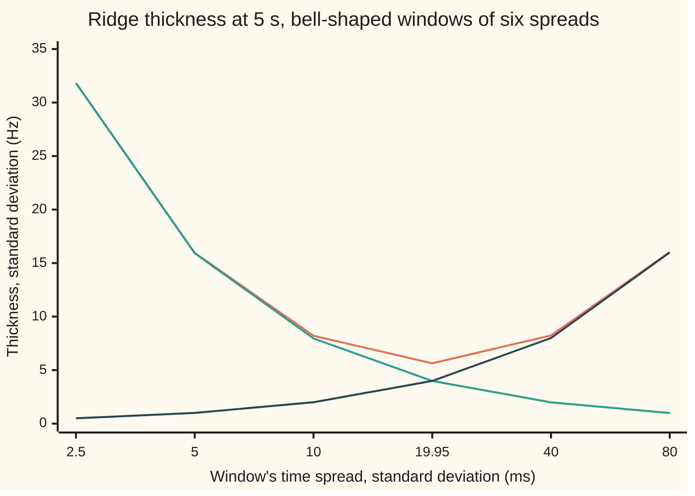

# Short-time Fourier transform: run the transform on sliding windows

[Syllabus](../../../SYLLABUS.md) → [Harmonic analysis](../README.md) → [Wavelets and Time-Frequency](../README.md#s05) → Short-time Fourier transform

---

## General Overview

A bird sings one long call for ten seconds. Its pitch climbs steadily from 2000 Hz (hertz, cycles per second) to 4000 Hz, 200 Hz every second. A microphone samples it 16,000 times a second, so the recording is a list of 160,000 numbers. The call here is drawn from a formula, so every answer can be checked against the truth. It is illustrative, not a field recording.

One Fourier transform of the whole call says it holds every pitch from 2000 to 4000 Hz. It cannot say that the low notes came first. The **short-time Fourier transform** can. Multiply the call by a **window**, a smooth bump that is large for a moment and near zero elsewhere, and transform the product. Slide the window along and repeat. Each position gives one column of a picture called the **spectrogram**: time across, frequency up, brightness for energy. The call shows as a rising line, the **ridge**.

[Spectrograms](../../13-Engineering%20mathematics/05-Signals/09-short-time-fourier-and-spectrograms.md) on the engineering wing builds this picture from FFT slices. This card proves three facts behind it:

1. **Nothing is lost.** The picture's total brightness is the call's energy times the window's energy: 5 × 0.05 = 0.25 V²·s².
2. **There is a sharpest picture.** No real window draws this call's ridge thinner than 5.64 Hz. A bell-shaped window with a time spread of 19.95 ms reaches that limit exactly.
3. **A grid is enough.** Windows placed every 20 ms in time and every 3.906 Hz in frequency hold the whole call, and the call comes back from them. A grid that is too coarse loses part of the call for good.

**The short-time Fourier transform compares a signal with one window moved to every time and every frequency; the picture keeps all the energy, each point of it is blurred over the window's spreads in time and in frequency, whose product is at least 1/(4π), and a fine enough grid of window positions still holds the whole signal.**

**What kind of fact this is:** three theorems, proved on this card in Why it works: the energy identity, the floor under the ridge with the window that reaches it, and the frame bounds for a window that fits inside one frequency step. Two more, the density theorem and the Balian–Low theorem, are stated with sources. The bird call is illustrative.

### The picture: how thick the ridge is, against the window's spread



Orange: the call's ridge, measured from the spectrum of one column. Green: the window's own smear in frequency, which halves each time the window doubles. Dark: how far the pitch climbs across the window's time spread, which doubles each time. The orange line is lowest at 19.95 ms, where the other two are equal at 3.99 Hz. The spreads on the axis double at each step, except for the best one.

---

## The formula

Notation first, in words.

- $`f(s)`$ is the call, in volts, at time $`s`$ seconds: $`f(s) = \cos\bigl(2\pi(2000\,s + 100\,s^2)\bigr)`$ for $`0 \le s < 10`$. Its pitch at time $`s`$ is $`2000 + 200\,s`$ Hz.
- $`\xi`$ (xi) is frequency in hertz, $`i`$ is the imaginary unit, and a bar is the complex conjugate. The engineering wing writes $`j`$ for $`i`$ and $`f`$ for a frequency; here $`f`$ is always the signal.
- $`\langle f, g\rangle = \int f(s)\,\overline{g(s)}\,ds`$ is the inner product, linear in $`f`$, and $`\lVert f\rVert^2 = \langle f, f\rangle`$ is the energy. For the call it is 5.000000 V²·s.
- A **window** $`w(s)`$ is a real bump centred at time 0. Its **spreads** $`\Delta t_w`$ and $`\Delta\xi_w`$ are the standard deviations of its energy $`w^2`$ over time and of $`\lvert\hat w\rvert^2`$ over frequency, as on [The uncertainty principle](../02-The%20Fourier%20Transform/07-uncertainty-principle.md).
- The **bell window** is $`w(s) = e^{-s^2/(4\sigma^2)}`$. Its energy $`w^2 = e^{-s^2/(2\sigma^2)}`$ is a bell curve with standard deviation $`\sigma`$, so $`\Delta t_w = \sigma`$. Its transform is again a bell ([Two pairs worth memorising](../02-The%20Fourier%20Transform/03-gaussian-and-sinc-transform-pairs.md)), with $`\Delta\xi_w = 1/(4\pi\sigma)`$. The short-time transform with this window is the **Gabor transform**.

This card introduces the short-time Fourier transform $`V_w f(t,\xi)`$ and the spectrogram $`\lvert V_w f\rvert^2`$:

```math
V_w f(t,\xi) = \int_{-\infty}^{\infty} f(s)\,\overline{w(s-t)}\,e^{-2\pi i \xi s}\,ds, \qquad \text{spectrogram} = \lvert V_w f(t,\xi)\rvert^2
```

**Read it aloud:** move the window so it is centred at time $`t`$, multiply the call by it, and take the Fourier transform at frequency $`\xi`$; the spectrogram is the size of the answer, squared.

The three facts, in symbols. First, the picture holds all the energy:

```math
\int_{-\infty}^{\infty}\!\int_{-\infty}^{\infty} \lvert V_w f(t,\xi)\rvert^2\,d\xi\,dt = \lVert f\rVert^2\,\lVert w\rVert^2
```

**Read it aloud:** the total brightness of the spectrogram is the signal's energy times the window's energy.

Second, a call whose pitch climbs at $`c`$ hertz per second draws a ridge of thickness $`R`$, the standard deviation of one column's power over frequency:

```math
R^2 = \Delta\xi_w^{\,2} + c^2\,\Delta t_w^{\,2} \;\ge\; \frac{c}{2\pi}, \qquad \text{with equality for the bell window at } \sigma^\ast = \frac{1}{\sqrt{4\pi c}}
```

**Read it aloud:** the ridge's squared thickness is the window's own squared smear plus the squared climb across the window, and it can never fall below $`c`$ over $`2\pi`$.

Third, a grid of windows. Put a copy of the window at every time $`ma`$ and every frequency $`nb`$, for whole numbers $`m`$ and $`n`$:

```math
g_{m,n}(s) = w(s - ma)\,e^{2\pi i\, n b\, s}, \qquad A\,\lVert f\rVert^2 \;\le\; \sum_{m,n} \lvert\langle f, g_{m,n}\rangle\rvert^2 \;\le\; B\,\lVert f\rVert^2
```

**Read it aloud:** the energy the grid of windows picks up is never less than $`A`$ times, and never more than $`B`$ times, the signal's energy. Grids with $`0 < A \le B`$ are called **frames** (defined in full on [Frames in outline](09-frames-in-outline.md)). When the window is zero outside an interval no longer than $`1/b`$,

```math
\sum_{m,n} \lvert\langle f, g_{m,n}\rangle\rvert^2 = \frac{1}{b}\int \lvert f(s)\rvert^2\, G(s)\,ds, \qquad G(s) = \sum_m w(s - ma)^2, \qquad A = \frac{\min G}{b},\quad B = \frac{\max G}{b}
```

| Symbol | Plain meaning | In our example | Push it up and the answer… |
| --- | --- | --- | --- |
| $`f`$, $`s`$, $`\lVert f\rVert^2`$; $`h`$, $`\tilde f`$ | the call in volts; running time in seconds; its energy; in the proof, any other signal and the rebuilt signal | 10 s of a rising tone; 5.000000 V²·s | — |
| $`t`$, $`\xi`$, $`i`$; $`\tau`$, $`\xi_t`$, $`g`$ | where the window is centred, in seconds; the frequency probed, in hertz; the imaginary unit. In the ridge proof: time measured from the window's centre, $`\tau = s - t`$; the call's pitch at time $`t`$; the windowed call, written as one complex wave | 5 s; 3000 Hz; $`\xi_t`$ = 3000 Hz at 5 s | — |
| $`w`$, $`\hat w`$, $`w_{t,\xi}`$, $`\sigma`$, $`\lVert w\rVert^2`$ | the window; its transform; the window moved to time $`t`$ and frequency $`\xi`$; for the bell, the standard deviation of $`w^2`$; the window's energy | bell, 19.95 ms; 0.050000 s | — |
| $`V_w f`$, $`\lvert V_w f\rvert^2`$ | the short-time Fourier transform, in V·s; the spectrogram | total brightness 0.250000 V²·s² | — |
| $`\Delta t_w`$, $`\Delta\xi_w`$ | the window's spreads in time and in frequency | 19.9471 ms; 3.9894 Hz | each one falls as the other rises |
| $`c`$ | how fast the pitch climbs | 200 Hz per second | thicker ridge, shorter best window |
| $`R`$, $`\sigma^\ast`$ | the ridge's thickness; the bell spread that makes it least | 5.6419 Hz at 19.9471 ms | — |
| $`a`$, $`b`$ | the grid's step in time and in frequency | 20 ms; 3.906250 Hz | larger: fewer numbers, worse frame |
| $`g_{m,n}`$, $`m`$, $`n`$ | the window moved to time $`ma`$ and frequency $`nb`$; whole-number labels | 500 times by 4096 frequencies | — |
| $`A`$, $`B`$ | frame bounds: the least and most energy picked up, per unit of energy | 0.640000 s each | larger $`B/A`$: less stable rebuild |
| $`G`$, $`q_k`$, $`k`$ | the overlap: the sum of all shifted copies of $`w^2`$; the terms of its Poisson series, numbered by $`k`$ | 2.500000 everywhere | sets $`A`$ and $`B`$ |
| $`x`$, $`X`$, $`f_s`$, $`M`$ | the samples; one column's FFT values; samples per second; points in each FFT | 160,000; 16,000; 4096 | — |

### When it holds

- **The window is real and smooth, with both spreads finite.** A window cut off with a jump has an infinite frequency spread, so its ridge has no finite standard deviation and this measure of thickness fails. Cutting the bell where it is still large adds its own smear, so the code cuts it at 6σ, where it has fallen to 0.000123 of its peak, $`e^{-9}`$.
- **The pitch climbs at a steady rate inside the window.** If the climb bends, $`c`$ is the local rate, and the ridge formula holds only near each time.
- **The floor is for real windows.** A complex window that itself climbs at $`c`$ follows the call and is not bound by $`\sqrt{c/2\pi}`$. The bell is the best real window.
- **The painless frame formula needs the window inside one frequency step: zero outside an interval no longer than $`1/b`$.** Here the cut bell lasts 239.4 ms and $`1/b = 4096/16000`$ s = 256 ms. Longer windows still give frames, but the bounds need other tools.
- **The energy identity is about integrals; samples match them up to sampling and cut-offs.** The code's sampled double sum gives 0.2499999995 V²·s², and $`\lVert f\rVert^2\lVert w\rVert^2`$ gives 0.250000: the gap, −0.0000000005, is below the ninth decimal.

---

## Why it works

### Step 0: each point of the picture is one comparison

Write $`w_{t,\xi}(s) = w(s-t)\,e^{2\pi i\xi s}`$: the window moved to time $`t`$ and slid to frequency $`\xi`$. Then the formula reads $`V_w f(t,\xi) = \langle f, w_{t,\xi}\rangle`$. Each point of the spectrogram compares the call with one moved copy of the window.

Two earlier theorems then do all the work. [Plancherel](../02-The%20Fourier%20Transform/05-plancherel-and-l2.md) counts energy the same in time and in frequency, which gives the energy identity and the frame bounds. [The uncertainty principle](../02-The%20Fourier%20Transform/07-uncertainty-principle.md) says no copy of the window is short in both time and frequency, which gives the floor.

### Step 1: each comparison sees a box, never a point

Moving a signal in time, or sliding it in frequency, does not change its spreads (Step 1 of the uncertainty card). So every copy $`w_{t,\xi}`$ has spreads $`\Delta t_w`$ around $`t`$ and $`\Delta\xi_w`$ around $`\xi`$. The value $`V_w f(t,\xi)`$ mixes the call over a box of about that size.

The box can be made thin in time or thin in frequency, but not both: $`\Delta t_w\,\Delta\xi_w \ge 1/(4\pi)`$, and only the bell reaches equality. For the bell at 19.9471 ms, the product is 19.9471 ms × 3.9894 Hz = 0.079577, which is $`1/(4\pi)`$ to six decimals. That is why Gabor chose the bell.

### Step 2: the picture keeps all the energy

Hold the time $`t`$ fixed. Then $`V_w f(t,\cdot)`$ is the Fourier transform of one product, $`f(s)\,\overline{w(s-t)}`$. Plancherel says its energy over frequency equals its energy over time:

```math
\int \lvert V_w f(t,\xi)\rvert^2\,d\xi = \int \lvert f(s)\rvert^2\,w(s-t)^2\,ds .
```

Now add over every $`t`$. Everything is positive, so the two integrals may be done in either order. Doing $`t`$ first gives $`\int w(s-t)^2\,dt = \lVert w\rVert^2`$ at every $`s`$, and what is left is $`\lVert f\rVert^2\,\lVert w\rVert^2`$.

For the call: $`\lVert f\rVert^2`$ = 5.000000 V²·s, half of 1 V² for 10 s. The bell's energy is $`\sqrt{2\pi}\,\sigma`$ = 0.050000 s. The spectrogram's total brightness is their product, 0.250000 V²·s². The code adds up every column of the sampled spectrogram and gets the same to nine decimals. Its columns wrap around, as if the call repeated end to end. That leaves the total unchanged: each sample still sits under the same overlap $`G`$ of windows as it would with windows that run on past the ends.

<details>
<summary>Detailed proof: the energy identity also rebuilds the signal</summary>

The same argument with two signals $`f`$ and $`h`$ in place of one gives

$`\displaystyle \int\!\!\int V_w f(t,\xi)\,\overline{V_w h(t,\xi)}\,d\xi\,dt = \langle f, h\rangle\,\lVert w\rVert^2 .`$

Plancherel keeps inner products as well as energies, so the first step is unchanged. The swap of integrals is allowed because $`\lvert f\rvert\,\lvert h\rvert\,w^2`$ has a finite double integral, by Cauchy–Schwarz.

Read the identity as a statement about $`f`$. It says that the signal

$`\displaystyle \tilde f(s) = \frac{1}{\lVert w\rVert^2}\int\!\!\int V_w f(t,\xi)\, w(s-t)\, e^{2\pi i \xi s}\,d\xi\,dt`$

has the same inner product with every finite-energy $`h`$ as $`f`$ itself. Two signals with the same inner product with everything are the same signal: their difference has inner product zero with itself, so it has zero energy. So the picture rebuilds the signal, in the sense of energy (the double integral converges in energy, not at every single point). Nothing in the picture was thrown away.

</details>

### Step 3: the ridge has a floor, and the bell reaches it

[Spectrograms](../../13-Engineering%20mathematics/05-Signals/09-short-time-fourier-and-spectrograms.md) found that a real symmetric window turns a pitch climbing at rate $`c`$ into a ridge centred on the pitch at time $`t`$, of thickness $`R^2 = \Delta\xi_w^{\,2} + c^2\Delta t_w^{\,2}`$. The first part is the window's own smear. The second part is how far the pitch climbs across the window. The fold below proves it exactly, from the slope.

<details>
<summary>Detailed proof: the ridge formula, from the slope</summary>

A real cosine is two complex waves, one at $`+\xi`$ and one at $`-\xi`$. At 5 s they sit at +3000 Hz and −3000 Hz, far further apart than the window's smear of a few hertz, so the column near 3000 Hz sees only the wave at $`+\xi`$. Measure time from the window's centre, $`\tau = s - t`$, and let $`\xi_t`$ be the pitch at time $`t`$. Up to a constant phase, the windowed wave is

$`\displaystyle g(\tau) = w(\tau)\, e^{2\pi i(\xi_t \tau + c\tau^2/2)} .`$

Step 2 of [The uncertainty principle](../02-The%20Fourier%20Transform/07-uncertainty-principle.md) measures frequency from the slope: the mean square frequency of $`g`$ is $`\lVert g'\rVert^2 / (4\pi^2 \lVert g\rVert^2)`$. Here

$`\displaystyle g'(\tau) = \bigl(w'(\tau) + 2\pi i(\xi_t + c\tau)\, w(\tau)\bigr)\, e^{2\pi i(\xi_t \tau + c\tau^2/2)} .`$

The window is real, so the two parts in the bracket are real and imaginary, and the squared size is $`w'^2 + 4\pi^2(\xi_t + c\tau)^2 w^2`$. Divide by $`4\pi^2\lVert w\rVert^2`$ and integrate. The window is symmetric, so $`\int \tau\, w^2 = 0`$ and the cross term vanishes:

$`\displaystyle \text{mean square frequency} = \Delta\xi_w^{\,2} + \xi_t^{\,2} + c^2\,\Delta t_w^{\,2} .`$

The same symmetry puts the ridge's centre at $`\xi_t`$. Subtracting the squared centre leaves the squared thickness, $`R^2 = \Delta\xi_w^{\,2} + c^2\Delta t_w^{\,2}`$.

</details>

A square is never negative, so $`(\Delta\xi_w - c\,\Delta t_w)^2 \ge 0`$, which rearranges to $`\Delta\xi_w^{\,2} + c^2\Delta t_w^{\,2} \ge 2c\,\Delta t_w\,\Delta\xi_w`$, with equality when the two parts are equal. So

```math
R^2 \;\ge\; 2c\,\Delta t_w\,\Delta\xi_w \;\ge\; \frac{2c}{4\pi} = \frac{c}{2\pi}.
```

Equality needs both steps to be equal signs. The second needs the bell. The first needs the smear to equal the climb, $`1/(4\pi\sigma) = c\,\sigma`$, so $`\sigma^\ast = 1/\sqrt{4\pi c}`$.

For the call, $`c`$ = 200 Hz per second gives $`\sigma^\ast`$ = 19.9471 ms. There, the smear and the climb are both 3.9894 Hz, and the ridge is 5.6419 Hz thick: exactly $`\sqrt{200/(2\pi)}`$. The code measures the ridge from the spectrum of the column at 5 s and gets 5.6419 Hz, centred on 3000.00 Hz.

### Step 4: a grid of windows is enough, if each window fits in one frequency step

The grid takes the picture only at the points $`(ma, nb)`$: indeed $`\langle f, g_{m,n}\rangle = V_w f(ma, nb)`$. Fix one time position $`m`$. The product $`f(s)\,w(s - ma)`$ is zero outside an interval no longer than $`1/b`$.

On such an interval, the waves $`\sqrt b\,e^{2\pi i n b s}`$ for all whole numbers $`n`$ are an orthonormal basis, by the theory of Fourier series ([Convergence in energy](../01-Fourier%20Series%20in%20Depth/05-l2-convergence-and-riesz-fischer.md)). So Parseval for Fourier series gives

```math
\sum_n \lvert\langle f, g_{m,n}\rangle\rvert^2 = \frac{1}{b}\int \lvert f(s)\rvert^2\, w(s - ma)^2\,ds .
```

Add over $`m`$: the sum is $`(1/b)\int \lvert f\rvert^2\,G`$. Since $`G`$ lies between its least and greatest values, $`A = \min G / b`$ and $`B = \max G / b`$. Daubechies, Grossmann and Meyer called this case "painless".

The sampled twin is exact too. With hop $`a f_s`$ = 320 samples ($`a`$ = 20 ms) and $`M`$ = 4096-point FFTs, so $`b = f_s/M = 16000/4096`$ = 3.906250 Hz, each column's FFT keeps its energy times $`M`$. The code adds $`\lvert X\rvert^2`$ over all 500 columns and 4096 frequencies and gets 819,199,998, the same as $`M \sum x^2 G`$ summed over the samples.

Rebuilding is just as direct. Run each column's FFT backwards to get $`x \cdot w`$ back. Multiply by $`w`$ once more, add the columns, and divide by $`G`$. The code rebuilds 320 samples near 5 s with an error below $`10^{-12}`$ V.

### Step 5: for the bell, Poisson summation gives the bounds

The overlap $`G`$ is a sum of evenly spaced bells. [Poisson summation and sampling](../02-The%20Fourier%20Transform/08-poisson-summation-and-sampling.md) turns such a sum into a cosine series:

```math
G(s) = \frac{\sqrt{2\pi}\,\sigma}{a}\Bigl(1 + 2\sum_{k\ge1} e^{-2\pi^2 k^2 \sigma^2/a^2}\cos\frac{2\pi k s}{a}\Bigr).
```

$`G`$ is greatest under each window's centre and least halfway between two. So

```math
\frac{B}{A} = \frac{1 + 2\sum_k q_k}{1 + 2\sum_k (-1)^k q_k}, \qquad q_k = e^{-2\pi^2 k^2 \sigma^2 / a^2}.
```

With $`\sigma`$ = 19.9471 ms and $`a`$ = 20 ms, every $`q_k`$ is negligible, so $`G`$ is flat at 2.500000 and $`B/A`$ = 1.000000: a **tight** frame to six decimals, $`A = B`$ = 0.640000 s, the same weight on every part of the call. The ratio grows fast as the hop passes the window's spread:

```
hop (ms)   B/A, the grid's worst-case unevenness
   10      ██████████                               1.000000
   20      ██████████                               1.000000
   40      ██████████                               1.029970
   60      ████████████████                         1.582760
   80      █████████████████████████████████████    3.736371
  250      no frame: 169 of every 4000 samples are never seen
```

Each bar is 10 characters per unit of $`B/A`$. The code computes each ratio twice: by adding the shifted copies of the cut window directly, and from the Poisson series. They agree to six decimals.

### Step 6: how coarse a grid can be, stated with sources

The grid has $`1/(ab)`$ windows per second per hertz. Three theorems say how small that may be.

- **The density theorem.** If the grid is a frame, then $`ab \le 1`$. A sampled grid has $`ab = a/M`$: with hop 160 and only 128 frequencies there are 128,000 numbers for 160,000 samples, too few to hold the call (proved in Gröchenig's book).
- **The bell's frames.** For the bell window the grid is a frame exactly when $`ab < 1`$, a theorem of Lyubarskii and of Seip and Wallstén from 1992, proved in Gröchenig's book.
- **The Balian–Low theorem.** At $`ab = 1`$ no window with both spreads finite gives a frame that is also a basis. Gabor's own 1946 plan was a bell at every point with $`ab = 1`$; this theorem says that plan cannot be stable (Benedetto, Heil and Walnut).

The density condition is necessary, not enough. With hop 250 ms (4000 samples) and $`M`$ = 4096 there are 1.024 numbers per sample, yet the cut window lasts only 239.4 ms. So 169 samples in every hop sit under no window, and $`A = 0`$.

---

## Worked numbers, by hand

The column at 5 s, where the call is at 3000 Hz, and the grid used by the code.

| Step | Arithmetic | Value |
| --- | --- | --- |
| climb rate $`c`$ | $`(4000 - 2000)/10`$ | 200 Hz per second |
| call's energy $`\lVert f\rVert^2`$ | half of 1 V², for 10 s | 5.000000 V²·s |
| best spread $`\sigma^\ast`$ | $`1/\sqrt{4\pi \times 200}`$ | 19.9471 ms |
| window's energy $`\lVert w\rVert^2`$ | $`\sqrt{2\pi} \times 0.0199471`$ | 0.050000 s |
| total brightness | $`5.000000 \times 0.050000`$ | 0.250000 V²·s² |
| overlap $`G`$, hop 20 ms | $`0.050000 / 0.020`$ | 2.500000 |
| frame bounds $`A = B`$ | $`2.5 / 3.90625`$ | 0.640000 s |
| window's smear $`\Delta\xi_w`$ | $`1/(4\pi \times 0.0199471)`$ | 3.9894 Hz |
| climb across the window $`c\,\Delta t_w`$ | $`200 \times 0.0199471`$ | 3.9894 Hz |
| ridge thickness $`R`$ | $`\sqrt{3.9894^2 + 3.9894^2}`$ | **5.6419 Hz** |

Read from this spectrogram, the call's pitch at any moment is pinned to within about 5.6 Hz, and no real window could pin it closer. The grid that gives it is tight: 0.64 s × 5.000000 V²·s = 3.200000 V²·s², exactly the energy the 500 × 4096 grid values pick up.

### What breaks if you drop a piece

| Mistake | Comes out at | What went wrong |
| --- | --- | --- |
| Window too short, σ = 2.5 ms, "for sharper timing" | ridge 31.8349 Hz | the window's own smear, 31.8310 Hz, is nearly all of it |
| Window too long, σ = 80 ms, "for sharper pitch" | ridge 16.0309 Hz | the pitch climbs 16 Hz across the window |
| Bell written $`e^{-s^2/(2\sigma^2)}`$ with σ = 19.95 ms | ridge 6.3078 Hz | σ became the spread of $`w`$, not of $`w^2`$: the window is $`\sqrt2`$ too short |
| Hop 250 ms, longer than the 239.4 ms window | $`A = 0`$; 169 samples per hop never seen | 1.024 numbers per sample is not enough when the windows leave gaps |
| 128 frequencies with a hop of 160 samples | 128,000 numbers for 160,000 samples | $`ab = 1.25 > 1`$: no frame, by the density theorem |

---

## Code, from first principles, and it actually runs

The script draws the call from its formula, writes its own FFT (fast Fourier transform), and builds columns of the spectrogram with bell windows. The ridge is reached **three independent ways**: the spread of one column's power spectrum, the window's spreads computed in time alone, and the closed forms $`\sigma`$ and $`1/(4\pi\sigma)`$. The energy identity is checked three ways too: a brute-force sum over all 500 FFT columns, the painless law $`M\sum x^2 G`$, and $`\lVert f\rVert^2\lVert w\rVert^2`$ from the closed forms; the rebuild checks that the grid loses nothing. The frame ratio $`B/A`$ comes from adding shifted windows and from the Poisson series.

### Python

```python
# Short-time Fourier transform and the Gabor transform -- the check behind the card.
# Standard library only.  An illustrative bird call, drawn from a formula: pitch
# 2000 + 200 t Hz for 10 s, sampled 16000 times a second.  Gaussian windows.
# The FFT, every sum and the Poisson series are written out; nothing imported knows the answer.
from math import cos, sin, pi, sqrt, exp, ceil

FS, F0, C = 16000, 2000.0, 200.0                 # samples per second, start pitch Hz, climb Hz/s
N = 10 * FS                                      # ten seconds
X = [cos(2 * pi * (F0 * n / FS + 0.5 * C * (n / FS) ** 2)) for n in range(N)]

def tot(vs):                                     # plain running sum, the same in both languages
    s = 0.0
    for v in vs:
        s += v
    return s

def fft(a, sign=-1):                             # radix-2 FFT; sign=+1 runs it backwards (no 1/M)
    a = list(a); n = len(a); j = 0
    for i in range(1, n):
        b = n >> 1
        while j & b:
            j ^= b; b >>= 1
        j |= b
        if i < j:
            a[i], a[j] = a[j], a[i]
    size = 2
    while size <= n:
        h = size // 2
        tw = [complex(cos(2 * pi * k / size), sign * sin(2 * pi * k / size)) for k in range(h)]
        for s in range(0, n, size):
            for k in range(h):
                u, v = a[s + k], a[s + k + h] * tw[k]
                a[s + k], a[s + k + h] = u + v, u - v
        size *= 2
    return a

def window(sig, cut=6.0):                        # Gaussian: |w|^2 has standard deviation sig s
    h = ceil(cut * sig * FS)                     # cut where w = e^-9 = 0.00012
    return h, [exp(-(k / FS) ** 2 / (4 * sig * sig)) for k in range(-h, h + 1)]

def column(n0, w, h, M):                         # one column: samples around n0, windowed, FFT
    buf = [0j] * M
    for k in range(-h, h + 1):
        buf[k % M] = X[(n0 + k) % N] * w[k + h]
    return fft(buf)

def ridge(sig, M=16384, t0=5.0):                 # road 1: centre and spread of one column's power
    h, w = window(sig)
    P = [v.real ** 2 + v.imag ** 2 for v in column(round(t0 * FS), w, h, M)[:M // 2]]
    f = [k * FS / M for k in range(M // 2)]
    pw = tot(P); mu = tot(p * x for p, x in zip(P, f)) / pw
    return mu, sqrt(tot(p * (x - mu) ** 2 for p, x in zip(P, f)) / pw)

def spreads(sig, w, h):                          # road 2: the window's two spreads, in time only
    e = tot(v * v for v in w)
    dt = sqrt(tot((k / FS) ** 2 * w[k + h] ** 2 for k in range(-h, h + 1)) / e)
    slope = [-(k / FS) / (2 * sig * sig) * w[k + h] for k in range(-h, h + 1)]  # w' for a bell
    return dt, sqrt(tot(s * s for s in slope) / e) / (2 * pi)

def G_range(w, h, a):                            # sum of the shifted |w|^2: lowest and highest
    g = [0.0] * a
    for k in range(-h, h + 1):
        g[k % a] += w[k + h] ** 2
    return min(g), max(g), g.count(0.0)

def poisson_ratio(s, a):                         # road 2 for B/A: Poisson summation of the bells
    q = [exp(-2 * pi * pi * k * k * (s / a) ** 2) for k in range(1, 30)]
    return (1 + 2 * tot(q)) / (1 + 2 * tot(x * (-1) ** k for k, x in enumerate(q, 1)))

def show(name, *vs, d=4):
    print(f"{name:<44}" + "".join(f" {v:>12.{d}f}" for v in vs))

# ---- choosing the window: the ridge at 5 s, where the call is at 3000 Hz ----
SST = 1 / sqrt(4 * pi * C)                       # best spread, 1/sqrt(4 pi c)
floor = sqrt(C / (2 * pi))
show("best window spread sigma* (ms)", 1000 * SST)
show("floor sqrt(c / 2 pi) (Hz)", floor)
print("sigma (ms) | dt_w (ms) | dxi_w (Hz) | c dt_w (Hz) | ridge: formula, measured | centre (Hz)")
R = {}
for sig in (0.0025, 0.005, 0.010, SST, 0.040, 0.080):
    h, w = window(sig)
    dt, dx = spreads(sig, w, h)
    mu, R[sig] = ridge(sig)
    form = sqrt(dx * dx + (C * dt) ** 2)
    print(f"chart, {1000 * sig:6.2f} {1000 * dt:9.4f} {dx:9.4f} {C * dt:9.4f} {form:9.4f} {R[sig]:9.4f} {mu:10.2f}")
    assert abs(dt - sig) < 1e-6 * sig and abs(dx - 1 / (4 * pi * sig)) < 1e-6 * dx   # closed form
    assert abs(R[sig] - form) < 1e-3 * form and abs(mu - 3000) < 0.01                # FFT vs time
assert min(R.values()) == R[SST] and abs(R[SST] - floor) < 1e-3 * floor
show("Gaussian at sigma*: dt_w * dxi_w", SST * (1 / (4 * pi * SST)), 1 / (4 * pi), d=6)
for name, s in (("too short, 2.5 ms", 0.0025), ("too long, 80 ms", 0.080)):
    show(f"breaks: {name}: ridge Hz, x best", R[s], R[s] / R[SST])
s2 = SST / sqrt(2)                               # mistake: e^(-t^2/2 sig^2) puts sig on w, not |w|^2
show("breaks: sigma put on w, not |w|^2 (Hz)", sqrt((1 / (4 * pi * s2)) ** 2 + (C * s2) ** 2))
show("try: climb x4: sigma* ms; ridge, pitch Hz", 1000 / sqrt(16 * pi * C), sqrt(4 * C / (2 * pi)), F0 + 4 * C * 5)

# ---- the energy identity, by brute force over every column of the call ----
H, W = window(SST)
M, A = 4096, 320                                 # FFT length (b = 3.90625 Hz), hop 20 ms
assert 2 * H + 1 <= M and N % A == 0             # the window fits: the painless case
gmin, gmax, _ = G_range(W, H, A)
E = tot(v * v for v in X)
total, target, rebuilt = 0.0, list(range(80000, 80320)), {}
for m in range(N // A):
    col = column(m * A, W, H, M)
    total += tot(v.real ** 2 + v.imag ** 2 for v in col)
    if abs(m * A - 80160) <= H + 160:            # rebuild 20 ms around 5 s from these columns
        back = fft(col, +1)
        for n in target:
            if abs(n - m * A) <= H:
                rebuilt[n] = rebuilt.get(n, 0) + W[n - m * A + H] * back[(n - m * A) % M].real / M
G = [0.0] * A
for k in range(-H, H + 1):
    G[k % A] += W[k + H] ** 2
law = M * tot(X[n] ** 2 * G[n % A] for n in range(N))
show("double sum of |X|^2 over 500 x 4096", total, d=0)
show("M * sum x^2 G (painless law)", law, d=0)
assert abs(total - law) < 1e-9 * law
err = max(abs(rebuilt[n] / G[n % A] - X[n]) for n in target)
show("rebuild error, 320 samples near 5 s", err, d=12)
assert err < 1e-9
fE, wE = E / FS, sqrt(2 * pi) * SST
show("||f||^2 (V^2 s), ||w||^2 (s), product", fE, wE, fE * wE, d=6)
show("double sum as an integral (V^2 s^2); gap", total * A / (FS * FS * M), total * A / (FS * FS * M) - fE * wE, d=10)
assert abs(total * A / (FS * FS * M) - fE * wE) < 1e-6
show("G: lowest, highest; b (Hz); ab", gmin, gmax, FS / M, A / M, d=6)
show("frame sum (V^2 s^2); A = B = G / b (s)", total / (FS * FS), gmin * M / FS, d=6)

# ---- frame bounds as the hop grows: direct sum against Poisson summation ----
print("hop (ms) | redundancy M/a | B/A direct | B/A Poisson | samples never seen per hop")
for hop in (160, 320, 640, 960, 1280, 4000):
    lo, hi, zeros = G_range(W, H, hop)
    if lo == 0:                                  # the window's support is shorter than the hop
        print(f"bars, {1000 * hop / FS:5.0f} {M / hop:8.3f} {'none':>12} {'-':>12} {zeros:6d}")
        continue
    pr = poisson_ratio(SST * FS, hop)
    print(f"bars, {1000 * hop / FS:5.0f} {M / hop:8.3f} {hi / lo:12.6f} {pr:12.6f} {zeros:6d}")
    assert abs(hi / lo - pr) < 1e-6 * pr
show("cut window: support (ms), samples; 1/b (ms)", 1000 * (2 * H + 1) / FS, 2 * H + 1, 1000 * M / FS, d=1)
show("cut window: height at the cut, e^-9", W[0], exp(-9), d=6)
show("breaks: M 128, hop 160: numbers, samples, ab", 128 * N // 160, N, 160 / 128, d=2); print("ALL CHECKS PASS")
```

**Ran 2026-11-15 on macOS, Python 3.14.10, standard library only. All checks passed. Output, pasted from the run:**

```
best window spread sigma* (ms)                    19.9471
floor sqrt(c / 2 pi) (Hz)                          5.6419
sigma (ms) | dt_w (ms) | dxi_w (Hz) | c dt_w (Hz) | ridge: formula, measured | centre (Hz)
chart,   2.50    2.5000   31.8310    0.5000   31.8349   31.8349    3000.00
chart,   5.00    5.0000   15.9155    1.0000   15.9469   15.9469    3000.00
chart,  10.00   10.0000    7.9577    2.0000    8.2052    8.2052    3000.00
chart,  19.95   19.9471    3.9894    3.9894    5.6419    5.6419    3000.00
chart,  40.00   40.0000    1.9894    8.0000    8.2437    8.2437    3000.00
chart,  80.00   80.0000    0.9947   16.0000   16.0309   16.0309    3000.00
Gaussian at sigma*: dt_w * dxi_w                 0.079577     0.079577
breaks: too short, 2.5 ms: ridge Hz, x best       31.8349       5.6426
breaks: too long, 80 ms: ridge Hz, x best         16.0309       2.8414
breaks: sigma put on w, not |w|^2 (Hz)             6.3078
try: climb x4: sigma* ms; ridge, pitch Hz          9.9736      11.2838    6000.0000
double sum of |X|^2 over 500 x 4096             819199998
M * sum x^2 G (painless law)                    819199998
rebuild error, 320 samples near 5 s          0.000000000000
||f||^2 (V^2 s), ||w||^2 (s), product            5.000000     0.050000     0.250000
double sum as an integral (V^2 s^2); gap     0.2499999995 -0.0000000005
G: lowest, highest; b (Hz); ab                   2.500000     2.500000     3.906250     0.078125
frame sum (V^2 s^2); A = B = G / b (s)           3.200000     0.640000
hop (ms) | redundancy M/a | B/A direct | B/A Poisson | samples never seen per hop
bars,    10   25.600     1.000000     1.000000      0
bars,    20   12.800     1.000000     1.000000      0
bars,    40    6.400     1.029970     1.029970      0
bars,    60    4.267     1.582760     1.582760      0
bars,    80    3.200     3.736371     3.736371      0
bars,   250    1.024         none            -    169
cut window: support (ms), samples; 1/b (ms)         239.4       3831.0        256.0
cut window: height at the cut, e^-9              0.000123     0.000123
breaks: M 128, hop 160: numbers, samples, ab    128000.00    160000.00         1.25
ALL CHECKS PASS
```

### Rust

```rust
// Short-time Fourier transform and the Gabor transform -- the check behind the card.  Rust std only.
// The same illustrative bird call, windows and roads as the Python; the output is identical.
use std::f64::consts::PI;

const FS: usize = 16000; const N: usize = 10 * FS;         // samples per second; ten seconds
const F0: f64 = 2000.0; const C: f64 = 200.0;                // start pitch Hz, climb Hz/s

#[derive(Clone, Copy)]
struct Cx { re: f64, im: f64 }
impl Cx {
    fn add(self, o: Cx) -> Cx { Cx { re: self.re + o.re, im: self.im + o.im } }
    fn sub(self, o: Cx) -> Cx { Cx { re: self.re - o.re, im: self.im - o.im } }
    fn mul(self, o: Cx) -> Cx { Cx { re: self.re * o.re - self.im * o.im, im: self.re * o.im + self.im * o.re } }
    fn pow2(self) -> f64 { self.re.powf(2.0) + self.im.powf(2.0) }
}

fn tot<I: Iterator<Item = f64>>(vs: I) -> f64 { let mut s = 0.0; for v in vs { s += v; } s }

fn fft(mut a: Vec<Cx>, sign: f64) -> Vec<Cx> {   // radix-2 FFT; sign=+1 runs it backwards (no 1/M)
    let (n, mut j) = (a.len(), 0usize);
    for i in 1..n {
        let mut b = n >> 1;
        while j & b != 0 { j ^= b; b >>= 1; }
        j |= b;
        if i < j { a.swap(i, j); }
    }
    let mut size = 2;
    while size <= n {
        let h = size / 2;
        let tw: Vec<Cx> = (0..h).map(|k| Cx { re: (2.0 * PI * k as f64 / size as f64).cos(),
            im: sign * (2.0 * PI * k as f64 / size as f64).sin() }).collect();
        for s in (0..n).step_by(size) {
            for k in 0..h {
                let (u, v) = (a[s + k], a[s + k + h].mul(tw[k]));
                a[s + k] = u.add(v); a[s + k + h] = u.sub(v);
            }
        }
        size *= 2;
    }
    a
}

fn window(sig: f64) -> (i64, Vec<f64>) {         // Gaussian: |w|^2 has standard deviation sig s
    let h = (6.0 * sig * FS as f64).ceil() as i64;   // cut where w = e^-9 = 0.00012
    (h, (-h..=h).map(|k| (-(k as f64 / FS as f64).powf(2.0) / (4.0 * sig * sig)).exp()).collect())
}

fn column(x: &[f64], n0: i64, w: &[f64], h: i64, m: usize) -> Vec<Cx> {
    let mut buf = vec![Cx { re: 0.0, im: 0.0 }; m];
    for k in -h..=h {
        let idx = (n0 + k).rem_euclid(N as i64) as usize;
        buf[k.rem_euclid(m as i64) as usize] = Cx { re: x[idx] * w[(k + h) as usize], im: 0.0 };
    }
    fft(buf, -1.0)
}

fn ridge(x: &[f64], sig: f64) -> (f64, f64) {    // road 1: centre and spread of one column's power
    let m = 16384usize;
    let (h, w) = window(sig); let col = column(x, (5.0 * FS as f64).round() as i64, &w, h, m);
    let p: Vec<f64> = col[..m / 2].iter().map(|v| v.pow2()).collect();
    let f: Vec<f64> = (0..m / 2).map(|k| (k * FS) as f64 / m as f64).collect();
    let pw = tot(p.iter().cloned());
    let mu = tot(p.iter().zip(&f).map(|(p, x)| p * x)) / pw;
    (mu, (tot(p.iter().zip(&f).map(|(p, x)| p * (x - mu).powf(2.0))) / pw).sqrt())
}

fn spreads(sig: f64, w: &[f64], h: i64) -> (f64, f64) {   // road 2: the window's spreads, in time only
    let e = tot(w.iter().map(|v| v * v));
    let dt = (tot((-h..=h).map(|k| (k as f64 / FS as f64).powf(2.0) * w[(k + h) as usize].powf(2.0))) / e).sqrt();
    let slope: Vec<f64> = (-h..=h).map(|k| -(k as f64 / FS as f64) / (2.0 * sig * sig) * w[(k + h) as usize]).collect();
    (dt, (tot(slope.iter().map(|s| s * s)) / e).sqrt() / (2.0 * PI))
}

fn g_range(w: &[f64], h: i64, a: usize) -> (f64, f64, usize) {   // shifted |w|^2: lowest, highest
    let mut g = vec![0.0f64; a]; for k in -h..=h { g[k.rem_euclid(a as i64) as usize] += w[(k + h) as usize].powf(2.0); }
    let (lo, hi) = (g.iter().cloned().fold(f64::INFINITY, f64::min), g.iter().cloned().fold(f64::NEG_INFINITY, f64::max));
    (lo, hi, g.iter().filter(|v| **v == 0.0).count())
}

fn poisson_ratio(s: f64, a: f64) -> f64 {        // road 2 for B/A: Poisson summation of the bells
    let q: Vec<f64> = (1..30).map(|k| (-2.0 * PI * PI * k as f64 * k as f64 * (s / a).powf(2.0)).exp()).collect();
    (1.0 + 2.0 * tot(q.iter().cloned()))
        / (1.0 + 2.0 * tot(q.iter().enumerate().map(|(i, x)| if i % 2 == 0 { -x } else { *x })))
}

fn show(name: &str, vs: &[f64], d: usize) {
    let mut s = format!("{:<44}", name);
    for v in vs { s += &format!(" {:>12.*}", d, v); } println!("{}", s);
}

fn main() {
    let fsf = FS as f64;
    let x: Vec<f64> = (0..N).map(|n| (2.0 * PI * (F0 * n as f64 / fsf + 0.5 * C * (n as f64 / fsf).powf(2.0))).cos()).collect();

    // ---- choosing the window: the ridge at 5 s, where the call is at 3000 Hz ----
    let (sst, floor) = (1.0 / (4.0 * PI * C).sqrt(), (C / (2.0 * PI)).sqrt());
    show("best window spread sigma* (ms)", &[1000.0 * sst], 4);
    show("floor sqrt(c / 2 pi) (Hz)", &[floor], 4);
    println!("sigma (ms) | dt_w (ms) | dxi_w (Hz) | c dt_w (Hz) | ridge: formula, measured | centre (Hz)");
    let sigs = [0.0025, 0.005, 0.010, sst, 0.040, 0.080];
    let mut r = vec![0.0; sigs.len()];
    for (i, &sig) in sigs.iter().enumerate() {
        let (h, w) = window(sig);
        let (dt, dx) = spreads(sig, &w, h);
        let (mu, rr) = ridge(&x, sig); r[i] = rr;
        let form = (dx * dx + (C * dt).powf(2.0)).sqrt();
        println!("chart, {:6.2} {:9.4} {:9.4} {:9.4} {:9.4} {:9.4} {:10.2}", 1000.0 * sig, 1000.0 * dt, dx, C * dt, form, rr, mu);
        assert!((dt - sig).abs() < 1e-6 * sig && (dx - 1.0 / (4.0 * PI * sig)).abs() < 1e-6 * dx);
        assert!((rr - form).abs() < 1e-3 * form && (mu - 3000.0).abs() < 0.01);
    }
    assert!(r.iter().all(|v| *v >= r[3]) && (r[3] - floor).abs() < 1e-3 * floor);
    show("Gaussian at sigma*: dt_w * dxi_w", &[sst * (1.0 / (4.0 * PI * sst)), 1.0 / (4.0 * PI)], 6);
    show("breaks: too short, 2.5 ms: ridge Hz, x best", &[r[0], r[0] / r[3]], 4); show("breaks: too long, 80 ms: ridge Hz, x best", &[r[5], r[5] / r[3]], 4);
    let s2 = sst / 2f64.sqrt();
    show("breaks: sigma put on w, not |w|^2 (Hz)", &[((1.0 / (4.0 * PI * s2)).powf(2.0) + (C * s2).powf(2.0)).sqrt()], 4);
    show("try: climb x4: sigma* ms; ridge, pitch Hz", &[1000.0 / (16.0 * PI * C).sqrt(), (4.0 * C / (2.0 * PI)).sqrt(), F0 + 4.0 * C * 5.0], 4);

    // ---- the energy identity, by brute force over every column of the call ----
    let (hh, ww) = window(sst);
    let (m, a) = (4096usize, 320usize);
    assert!(2 * hh as usize + 1 <= m && N % a == 0);
    let (gmin, gmax, _) = g_range(&ww, hh, a);
    let e = tot(x.iter().map(|v| v * v));
    let (mut total, mut rebuilt) = (0.0, vec![0.0f64; 320]);
    for mi in 0..N / a {
        let c0 = (mi * a) as i64;
        let col = column(&x, c0, &ww, hh, m);
        total += tot(col.iter().map(|v| v.pow2()));
        if (c0 - 80160).abs() <= hh + 160 {
            let back = fft(col, 1.0);
            for n in 80000i64..80320 {
                if (n - c0).abs() <= hh {
                    rebuilt[(n - 80000) as usize] += ww[(n - c0 + hh) as usize] * back[(n - c0).rem_euclid(m as i64) as usize].re / m as f64;
                }
            }
        }
    }
    let mut g = vec![0.0f64; a]; for k in -hh..=hh { g[k.rem_euclid(a as i64) as usize] += ww[(k + hh) as usize].powf(2.0); }
    let law = m as f64 * tot((0..N).map(|n| x[n].powf(2.0) * g[n % a]));
    show("double sum of |X|^2 over 500 x 4096", &[total], 0);
    show("M * sum x^2 G (painless law)", &[law], 0);
    assert!((total - law).abs() < 1e-9 * law);
    let err = (80000..80320usize).map(|n| (rebuilt[n - 80000] / g[n % a] - x[n]).abs()).fold(0.0, f64::max);
    show("rebuild error, 320 samples near 5 s", &[err], 12);
    assert!(err < 1e-9);
    let (fe, we) = (e / fsf, (2.0 * PI).sqrt() * sst);
    show("||f||^2 (V^2 s), ||w||^2 (s), product", &[fe, we, fe * we], 6);
    let integral = total * a as f64 / (FS * FS * m) as f64;
    show("double sum as an integral (V^2 s^2); gap", &[integral, integral - fe * we], 10);
    assert!((integral - fe * we).abs() < 1e-6);
    show("G: lowest, highest; b (Hz); ab", &[gmin, gmax, fsf / m as f64, a as f64 / m as f64], 6);
    show("frame sum (V^2 s^2); A = B = G / b (s)", &[total / (FS * FS) as f64, gmin * m as f64 / fsf], 6);

    // ---- frame bounds as the hop grows: direct sum against Poisson summation ----
    println!("hop (ms) | redundancy M/a | B/A direct | B/A Poisson | samples never seen per hop");
    for hop in [160usize, 320, 640, 960, 1280, 4000] {
        let (lo, hi, zeros) = g_range(&ww, hh, hop);
        let ms = 1000.0 * hop as f64 / fsf;
        if lo == 0.0 {
            println!("bars, {:5.0} {:8.3} {:>12} {:>12} {:6}", ms, m as f64 / hop as f64, "none", "-", zeros);
            continue;
        }
        let pr = poisson_ratio(sst * fsf, hop as f64);
        println!("bars, {:5.0} {:8.3} {:12.6} {:12.6} {:6}", ms, m as f64 / hop as f64, hi / lo, pr, zeros);
        assert!((hi / lo - pr).abs() < 1e-6 * pr);
    }
    show("cut window: support (ms), samples; 1/b (ms)", &[1000.0 * (2 * hh + 1) as f64 / fsf, (2 * hh + 1) as f64, 1000.0 * m as f64 / fsf], 1);
    show("cut window: height at the cut, e^-9", &[ww[0], (-9.0f64).exp()], 6);
    show("breaks: M 128, hop 160: numbers, samples, ab", &[(128 * N / 160) as f64, N as f64, 160.0 / 128.0], 2); println!("ALL CHECKS PASS");
}
```

**Ran 2026-11-15 on macOS, rustc 1.98.1, no crates. All checks passed. Output, pasted from the run:**

```
best window spread sigma* (ms)                    19.9471
floor sqrt(c / 2 pi) (Hz)                          5.6419
sigma (ms) | dt_w (ms) | dxi_w (Hz) | c dt_w (Hz) | ridge: formula, measured | centre (Hz)
chart,   2.50    2.5000   31.8310    0.5000   31.8349   31.8349    3000.00
chart,   5.00    5.0000   15.9155    1.0000   15.9469   15.9469    3000.00
chart,  10.00   10.0000    7.9577    2.0000    8.2052    8.2052    3000.00
chart,  19.95   19.9471    3.9894    3.9894    5.6419    5.6419    3000.00
chart,  40.00   40.0000    1.9894    8.0000    8.2437    8.2437    3000.00
chart,  80.00   80.0000    0.9947   16.0000   16.0309   16.0309    3000.00
Gaussian at sigma*: dt_w * dxi_w                 0.079577     0.079577
breaks: too short, 2.5 ms: ridge Hz, x best       31.8349       5.6426
breaks: too long, 80 ms: ridge Hz, x best         16.0309       2.8414
breaks: sigma put on w, not |w|^2 (Hz)             6.3078
try: climb x4: sigma* ms; ridge, pitch Hz          9.9736      11.2838    6000.0000
double sum of |X|^2 over 500 x 4096             819199998
M * sum x^2 G (painless law)                    819199998
rebuild error, 320 samples near 5 s          0.000000000000
||f||^2 (V^2 s), ||w||^2 (s), product            5.000000     0.050000     0.250000
double sum as an integral (V^2 s^2); gap     0.2499999995 -0.0000000005
G: lowest, highest; b (Hz); ab                   2.500000     2.500000     3.906250     0.078125
frame sum (V^2 s^2); A = B = G / b (s)           3.200000     0.640000
hop (ms) | redundancy M/a | B/A direct | B/A Poisson | samples never seen per hop
bars,    10   25.600     1.000000     1.000000      0
bars,    20   12.800     1.000000     1.000000      0
bars,    40    6.400     1.029970     1.029970      0
bars,    60    4.267     1.582760     1.582760      0
bars,    80    3.200     3.736371     3.736371      0
bars,   250    1.024         none            -    169
cut window: support (ms), samples; 1/b (ms)         239.4       3831.0        256.0
cut window: height at the cut, e^-9              0.000123     0.000123
breaks: M 128, hop 160: numbers, samples, ab    128000.00    160000.00         1.25
ALL CHECKS PASS
```

### Lean

Lean proves the energy identity, the painless frame bounds and the floor under the ridge, and checks the card's exact arithmetic.

- Take any finite-energy signal $`f`$ and real finite-energy window $`w`$. Then the spectrogram's total brightness is $`\lVert f\rVert^2\,\lVert w\rVert^2`$.
- Take steps $`a, b > 0`$ and a continuous real window, zero outside an interval no longer than $`1/b`$. Then the grid picks up exactly $`(1/b)\int \lvert f(s)\rvert^2\,G(s)\,ds`$ from every finite-energy signal $`f`$.
- Take the same grid and window. Then its frame bounds are $`A = \min G/b`$ and $`B = \max G/b`$.
- Suppose the window obeys the uncertainty principle, $`\Delta t_w\,\Delta\xi_w \ge 1/(4\pi)`$, and the pitch climbs at $`c > 0`$ hertz per second. Then $`R^2 = \Delta\xi_w^{\,2} + c^2\Delta t_w^{\,2}`$ is never below $`c/(2\pi)`$.
- Take the same window and climb. Then $`R^2 = c/(2\pi)`$ exactly when $`\Delta t_w\,\Delta\xi_w = 1/(4\pi)`$ and $`\Delta\xi_w = c\,\Delta t_w`$.
- Take the bell window with $`\Delta t_w = \sigma`$ and $`\Delta\xi_w = 1/(4\pi\sigma)`$. Then it reaches the floor exactly when $`\sigma = 1/\sqrt{4\pi c}`$.
- Lean also checks the hand arithmetic exactly, such as $`b`$ = 125/32 Hz, $`G`$ = 5/2 and $`A = B`$ = 16/25 s.
- It checks the 3831-sample window, the 169 unseen samples per hop, and $`ab`$ = 5/4 for the failing grid.

The ridge formula itself, the bell's two spreads and every decimal are left to the Python and Rust checks.

```lean
-- Short-time Fourier transform: the spectrogram of a finite-energy signal holds exactly the signal's energy times the window's energy, a window that fits inside one frequency step turns a grid of window positions into a frame with an exact energy formula, and a pitch climbing at c hertz per second draws a ridge whose squared thickness is never below c/(2π), reached by the bell window of spread 1/√(4πc).
import Mathlib.MeasureTheory.Integral.Bochner.Basic
import Mathlib.MeasureTheory.Function.LpSpace.Basic
import Mathlib.MeasureTheory.Measure.Lebesgue.Basic
import Mathlib.Analysis.SpecialFunctions.Exp
import Mathlib.Analysis.SpecialFunctions.Sqrt
import Mathlib.Analysis.Real.Pi.Bounds
import Mathlib.Topology.Algebra.InfiniteSum.ENNReal
import Mathlib.Tactic.NormNum
import Mathlib.Analysis.Fourier.LpSpace
import Mathlib.Analysis.Fourier.AddCircle
import Mathlib.Analysis.Distribution.AEEqOfIntegralContDiff

open MeasureTheory Complex Real
open scoped ENNReal

noncomputable section

namespace ShortTimeFourier

/-- The short-time Fourier transform of a signal `f` (volts, at time `s` seconds) with a real
window `w`: `V_w f(t, ξ) = ∫ f(s) · conj(w(s - t)) · e^(-2πiξs) ds`, the window centred at time
`t` and the frequency `ξ` in hertz (the card's convention, no factor in front).
The spectrogram is `|V_w f(t, ξ)|²`. -/
def stft (w : ℝ → ℝ) (f : ℝ → ℂ) (t ξ : ℝ) : ℂ :=
  ∫ s : ℝ, f s * starRingEnd ℂ ((w (s - t) : ℝ) : ℂ) * Complex.exp (-2 * π * I * ξ * s)

/-- The overlap `G(s) = ∑ₘ w(s - m a)²`: the sum of all copies of `w²` moved by whole
multiples of the time step `a`. -/
def overlap (w : ℝ → ℝ) (a s : ℝ) : ℝ≥0∞ :=
  ∑' m : ℤ, ‖w (s - m * a)‖ₑ ^ 2

/-! Helper lemmas. -/

section Helpers

open FourierTransform SchwartzMap

lemma fourier_continuous_of_integrable (F : ℝ → ℂ) (h1 : Integrable F) : Continuous (𝓕 F) :=
  VectorFourier.fourierIntegral_continuous Real.continuous_fourierChar
    (innerSL ℝ).continuous₂ h1

lemma l2_fourier_ae_eq (F : ℝ → ℂ) (h1 : Integrable F) (h2 : MemLp F 2) :
    ((𝓕 (h2.toLp F) : Lp ℂ 2 (volume : Measure ℝ)) : ℝ → ℂ) =ᵐ[volume] 𝓕 F := by
  set U := (𝓕 (h2.toLp F) : Lp ℂ 2 (volume : Measure ℝ))
  have key : ∀ g : 𝓢(ℝ, ℂ), ∫ x, g x • U x = ∫ x, g x • 𝓕 F x := by
    intro g
    have e1 : (U : 𝓢'(ℝ, ℂ)) g = ∫ x, g x • U x := Lp.toTemperedDistribution_apply _ _
    rw [← e1, ← Lp.fourier_toTemperedDistribution_eq, TemperedDistribution.fourier_apply,
      Lp.toTemperedDistribution_apply]
    rw [integral_congr_ae (h2.coeFn_toLp.mono fun x hx => by rw [hx])]
    have := VectorFourier.integral_fourierIntegral_smul_eq_flip (L := innerₗ ℝ) (μ := volume) (ν := volume)
      Real.continuous_fourierChar continuous_inner g.integrable h1
    rw [fourier_coe]
    have hflip : (innerₗ ℝ : ℝ →ₗ[ℝ] ℝ →ₗ[ℝ] ℝ).flip = innerₗ ℝ := by
      ext; simp
    rw [hflip] at this
    exact this
  have hUloc : LocallyIntegrable (U : ℝ → ℂ) volume :=
    (Lp.memLp U).locallyIntegrable (by norm_num)
  have hFc := fourier_continuous_of_integrable F h1
  have hloc : LocallyIntegrable (fun x => U x - 𝓕 F x) volume :=
    hUloc.sub hFc.locallyIntegrable
  have := ae_eq_zero_of_integral_contDiff_smul_eq_zero hloc ?_
  · filter_upwards [this] with x hx
    exact sub_eq_zero.mp hx
  intro g g_smooth g_cpt
  have hg₁ : HasCompactSupport (Complex.ofRealCLM ∘ g) := g_cpt.comp_left rfl
  have hg₂ := (Complex.ofRealCLM.contDiff).comp g_smooth
  have := key (hg₁.toSchwartzMap hg₂)
  simp at this
  simp_rw [smul_sub]
  rw [integral_sub (hUloc.integrable_smul_left_of_hasCompactSupport g_smooth.continuous g_cpt)
    (hFc.locallyIntegrable.integrable_smul_left_of_hasCompactSupport g_smooth.continuous g_cpt)]
  simp_rw [Complex.real_smul]
  rw [this, sub_self]

lemma lintegral_sq_eq_of_eLpNorm_eq {F G : ℝ → ℂ} (hF : AEStronglyMeasurable F volume)
    (hG : AEStronglyMeasurable G volume) (h : eLpNorm F 2 volume = eLpNorm G 2 volume) :
    ∫⁻ x, ‖F x‖ₑ ^ 2 = ∫⁻ x, ‖G x‖ₑ ^ 2 := by
  rw [eLpNorm_eq_lintegral_rpow_enorm_toReal (by norm_num) (by norm_num) hF,
    eLpNorm_eq_lintegral_rpow_enorm_toReal (by norm_num) (by norm_num) hG] at h
  have h' := ENNReal.rpow_left_injective (x := 1 / (2 : ℝ≥0∞).toReal) (by norm_num) h
  have e2 : (2 : ℝ≥0∞).toReal = ((2 : ℕ) : ℝ) := by norm_num
  simp only [e2, ENNReal.rpow_natCast] at h'
  exact h'

lemma plancherel_lintegral (F : ℝ → ℂ) (h1 : Integrable F) (h2 : MemLp F 2) :
    ∫⁻ ξ, ‖𝓕 F ξ‖ₑ ^ 2 = ∫⁻ x, ‖F x‖ₑ ^ 2 := by
  apply lintegral_sq_eq_of_eLpNorm_eq
    (fourier_continuous_of_integrable F h1).aestronglyMeasurable h2.aestronglyMeasurable
  have hn := Lp.norm_fourier_eq (h2.toLp F)
  rw [Lp.norm_def, Lp.norm_def] at hn
  rw [← eLpNorm_congr_ae (l2_fourier_ae_eq F h1 h2), ← eLpNorm_congr_ae h2.coeFn_toLp]
  exact (ENNReal.toReal_eq_toReal_iff' (Lp.eLpNorm_ne_top _) (Lp.eLpNorm_ne_top _)).mp hn

lemma memLp_two_iff_lintegral {E : Type*} [NormedAddCommGroup E] {F : ℝ → E}
    (hF : AEStronglyMeasurable F volume) :
    MemLp F 2 volume ↔ ∫⁻ x, ‖F x‖ₑ ^ 2 < ⊤ := by
  have e2 : (2 : ℝ≥0∞).toReal = ((2 : ℕ) : ℝ) := by norm_num
  have := eLpNorm_lt_top_iff_lintegral_rpow_enorm_lt_top (μ := volume) (p := 2) (by norm_num)
    (by norm_num) hF
  simp only [e2, ENNReal.rpow_natCast] at this
  constructor
  · intro h; exact this.mp h.eLpNorm_lt_top
  · intro h; exact this.mpr h

lemma enorm_ofReal_complex (r : ℝ) : ‖(r : ℂ)‖ₑ = ‖r‖ₑ := by
  rw [← ofReal_norm, ← ofReal_norm, Complex.norm_real]

lemma stft_eq_fourier (w : ℝ → ℝ) (f : ℝ → ℂ) (t ξ : ℝ) :
    stft w f t ξ = 𝓕 (fun s => f s * ((w (s - t) : ℝ) : ℂ)) ξ := by
  rw [fourier_real_eq_integral_exp_smul, stft]
  congr 1; ext s
  rw [Complex.conj_ofReal, smul_eq_mul, mul_comm]
  congr 1; push_cast; ring_nf

lemma stft_row_sum (w : ℝ → ℝ) (b α : ℝ) (hb : 0 < b)
    (hcont : Continuous w) (hsupp : ∀ s, s ∉ Set.Icc α (α + 1 / b) → w s = 0)
    (f : ℝ → ℂ) (hf : MemLp f 2 volume) (t : ℝ) :
    ∑' n : ℤ, ‖stft w f t (n * b)‖ₑ ^ 2
      = ENNReal.ofReal (1 / b) * ∫⁻ s : ℝ, ‖f s‖ₑ ^ 2 * ‖w (s - t)‖ₑ ^ 2 := by
  set T : ℝ := 1 / b with hT
  have hTpos : 0 < T := by positivity
  set c : ℝ := α + t with hc
  have hcT : c < c + T := by linarith
  set g : ℝ → ℂ := fun s => ((w (s - t) : ℝ) : ℂ) with hg
  set F : ℝ → ℂ := fun s => f s * g s with hF
  have hgz : ∀ s, s ∉ Set.Icc c (c + T) → g s = 0 := by
    intro s hs
    have : s - t ∉ Set.Icc α (α + 1 / b) := by
      intro h; apply hs; constructor <;> [linarith [h.1]; linarith [h.2]]
    simp [hg, hsupp _ this]
  have hFz : ∀ s, s ∉ Set.Icc c (c + T) → F s = 0 := by
    intro s hs; simp [hF, hgz s hs]
  have hgc : Continuous g := by fun_prop
  have hgcs : HasCompactSupport g :=
    HasCompactSupport.intro isCompact_Icc hgz
  have hgtop : MemLp g ⊤ volume := hgc.memLp_top_of_hasCompactSupport hgcs volume
  have hF2 : MemLp F 2 volume := hf.fun_mul hgtop
  -- each STFT value is T times a Fourier coefficient on [c, c + T]
  have hcoeff : ∀ n : ℤ, stft w f t (n * b) = (T : ℂ) * fourierCoeffOn hcT F n := by
    intro n
    rw [fourierCoeffOn_eq_integral, stft]
    simp_rw [fourier_coe_apply]
    have hcc : c + T - c = T := by ring
    rw [hcc, intervalIntegral.integral_of_le hcT.le]
    rw [← setIntegral_eq_integral_of_forall_compl_eq_zero (s := Set.Icc c (c + T)), 
      integral_Icc_eq_integral_Ioc, Complex.real_smul, ← mul_assoc, ← Complex.ofReal_mul,
      mul_one_div_cancel hTpos.ne', Complex.ofReal_one, one_mul]
    · refine setIntegral_congr_fun measurableSet_Ioc fun x _ => ?_
      simp only [hF, hg, Complex.conj_ofReal, smul_eq_mul]
      rw [mul_comm]
      congr 1
      rw [hT]; push_cast
      field_simp
    · intro x hx
      have h0 := hgz x hx
      simp only [hg, Complex.ofReal_eq_zero] at h0
      simp [h0]
  have hpar := hasSum_sq_fourierCoeffOn hcT (hF2.restrict (Set.Ioc c (c + T)))
  set J : ℝ := ∫ x, ‖F x‖ ^ 2 with hJ
  have hJ' : ∫ x in c..c + T, ‖F x‖ ^ 2 = J := by
    rw [intervalIntegral.integral_of_le hcT.le, ← integral_Icc_eq_integral_Ioc]
    apply setIntegral_eq_integral_of_forall_compl_eq_zero
    intro x hx; simp [hFz x hx]
  have hcc : c + T - c = T := by ring
  rw [hJ', hcc] at hpar
  have hsum : HasSum (fun n : ℤ => ‖stft w f t (n * b)‖ ^ 2) (T * J) := by
    have := hpar.mul_left (T ^ 2)
    convert this using 1
    · ext n; rw [hcoeff, norm_mul, Complex.norm_real, Real.norm_of_nonneg hTpos.le]; ring
    · rw [smul_eq_mul]; field_simp
  have henorm : ∀ z : ℂ, ‖z‖ₑ ^ 2 = ENNReal.ofReal (‖z‖ ^ 2) := fun z => by
    rw [ENNReal.ofReal_pow (norm_nonneg _), ofReal_norm]
  have hFint : Integrable (fun x => ‖F x‖ ^ 2) volume :=
    (memLp_two_iff_integrable_sq_norm hF2.aestronglyMeasurable).mp hF2
  simp_rw [henorm]
  rw [← ENNReal.ofReal_tsum_of_nonneg (fun n => by positivity) hsum.summable, hsum.tsum_eq,
    ENNReal.ofReal_mul hTpos.le, hJ,
    ofReal_integral_eq_lintegral_ofReal hFint (Filter.Eventually.of_forall fun x => by positivity)]
  congr 1
  apply lintegral_congr
  intro x
  rw [← henorm, ← henorm]
  simp only [hF, hg, enorm_mul, mul_pow, enorm_ofReal_complex]

lemma ridge_eq_iff_aux (c Δt Δξ : ℝ) (hc : 0 < c)
    (hU : 1 / (4 * π) ≤ Δt * Δξ) :
    c / (2 * π) ≤ Δξ ^ 2 + c ^ 2 * Δt ^ 2 ∧
    (Δξ ^ 2 + c ^ 2 * Δt ^ 2 = c / (2 * π) ↔ Δt * Δξ = 1 / (4 * π) ∧ Δξ = c * Δt) := by
  set k := 1 / (4 * π) with hk
  have hπ : 0 < π := pi_pos
  have hck : c / (2 * π) = 2 * c * k := by rw [hk]; field_simp; ring
  rw [hck]
  have hsq : 0 ≤ (Δξ - c * Δt) ^ 2 := sq_nonneg _
  have h2 : 2 * c * k ≤ 2 * c * (Δt * Δξ) := by nlinarith
  refine ⟨by nlinarith, ⟨fun h => ?_, fun ⟨h1, h2⟩ => ?_⟩⟩
  · have hz : (Δξ - c * Δt) ^ 2 = 0 := by nlinarith
    have hz' : Δξ - c * Δt = 0 := pow_eq_zero_iff (n := 2) (by norm_num) |>.mp hz
    refine ⟨?_, by linarith⟩
    have : c * (Δt * Δξ) = c * k := by nlinarith
    exact (mul_left_cancel₀ hc.ne' this)
  · rw [← h1, h2]; ring

end Helpers

#print axioms fourier_continuous_of_integrable
#print axioms l2_fourier_ae_eq
#print axioms lintegral_sq_eq_of_eLpNorm_eq
#print axioms plancherel_lintegral
#print axioms memLp_two_iff_lintegral
#print axioms enorm_ofReal_complex
#print axioms stft_eq_fourier
#print axioms stft_row_sum
#print axioms ridge_eq_iff_aux

/-- **Nothing is lost (the energy identity).** For every finite-energy signal `f` and every
real finite-energy window `w`, the spectrogram's total brightness, its integral over every time
`t` and every frequency `ξ`, equals the signal's energy times the window's energy:
`∫∫ |V_w f(t, ξ)|² dξ dt = ‖f‖² ‖w‖²`. -/
theorem stft_energy_identity (f : ℝ → ℂ) (w : ℝ → ℝ)
    (hf : MemLp f 2 volume) (hw : MemLp w 2 volume) :
    ∫⁻ t : ℝ, ∫⁻ ξ : ℝ, ‖stft w f t ξ‖ₑ ^ 2
      = (∫⁻ s : ℝ, ‖f s‖ₑ ^ 2) * ∫⁻ s : ℝ, ‖w s‖ₑ ^ 2 := by
  set Ft : ℝ → ℝ → ℂ := fun t s => f s * ((w (s - t) : ℝ) : ℂ) with hFt
  have hwt : ∀ t, MemLp (fun s => ((w (s - t) : ℝ) : ℂ)) 2 volume := fun t =>
    (hw.comp_measurePreserving (measurePreserving_sub_right volume t)).ofReal
  have hint : ∀ t, Integrable (Ft t) volume := fun t => hf.integrable_mul (hwt t)
  set g : ℝ → ℝ → ℝ≥0∞ := fun t s => ‖f s‖ₑ ^ 2 * ‖w (s - t)‖ₑ ^ 2 with hg
  have hq : QuasiMeasurePreserving (fun p : ℝ × ℝ => p.2 - p.1)
      (volume.prod volume) volume :=
    (quasiMeasurePreserving_sub volume volume).comp
      Measure.measurePreserving_swap.quasiMeasurePreserving
  have hgm : AEMeasurable (Function.uncurry g) (volume.prod volume) := by
    show AEMeasurable (fun p : ℝ × ℝ => ‖f p.2‖ₑ ^ 2 * ‖w (p.2 - p.1)‖ₑ ^ 2) _
    exact AEMeasurable.mul (f := fun p : ℝ × ℝ => ‖f p.2‖ₑ ^ 2)
      (g := fun p : ℝ × ℝ => ‖w (p.2 - p.1)‖ₑ ^ 2)
      ((hf.aestronglyMeasurable.enorm.pow_const 2).comp_snd)
      ((hw.aestronglyMeasurable.enorm.pow_const 2).comp_quasiMeasurePreserving hq)
  have hfF := (memLp_two_iff_lintegral hf.aestronglyMeasurable).mp hf
  have hwF := (memLp_two_iff_lintegral hw.aestronglyMeasurable).mp hw
  have htot : ∫⁻ t, ∫⁻ s, g t s = (∫⁻ s : ℝ, ‖f s‖ₑ ^ 2) * ∫⁻ s : ℝ, ‖w s‖ₑ ^ 2 := by
    rw [lintegral_lintegral_swap hgm, ← lintegral_mul_const' _ _ hwF.ne]
    congr 1; ext s
    simp only [hg]
    rw [lintegral_const_mul' _ _ (by simp)]
    congr 1
    exact lintegral_sub_left_eq_self (fun x => ‖w x‖ₑ ^ 2) s
  have hfin : (∫⁻ s : ℝ, ‖f s‖ₑ ^ 2) * ∫⁻ s : ℝ, ‖w s‖ₑ ^ 2 ≠ ⊤ :=
    ENNReal.mul_ne_top hfF.ne hwF.ne
  have hae : ∀ᵐ t, ∫⁻ s, g t s < ⊤ :=
    ae_lt_top' hgm.lintegral_prod_right' (htot ▸ hfin)
  rw [← htot]
  apply lintegral_congr_ae
  filter_upwards [hae] with t ht
  have hgt : ∀ s, ‖Ft t s‖ₑ ^ 2 = g t s := fun s => by
    simp only [hFt, hg, enorm_mul, mul_pow, enorm_ofReal_complex]
  have h2 : MemLp (Ft t) 2 volume := by
    rw [memLp_two_iff_lintegral (hint t).aestronglyMeasurable]
    simp_rw [hgt]; exact ht
  simp_rw [stft_eq_fourier]
  rw [plancherel_lintegral _ (hint t) h2]
  simp_rw [hgt]

/-- **A grid is enough when the window fits in one frequency step (the painless frame).**
Take time step `a > 0`, frequency step `b > 0`, and a real continuous window `w` that is zero
outside an interval `[α, α + 1/b]` of length `1/b`. The grid values
`⟨f, g_{m,n}⟩ = V_w f(m a, n b)`, with `g_{m,n}(s) = w(s - m a) e^(2πi n b s)`, pick up
exactly `∑_{m,n} |⟨f, g_{m,n}⟩|² = (1/b) ∫ |f(s)|² G(s) ds` from every finite-energy signal `f`.
So whenever `A ≤ G ≤ B` everywhere, the grid's energy lies between `A/b` and `B/b` times the
signal's energy: these are the frame bounds. -/
theorem painless_gabor_frame (w : ℝ → ℝ) (a b α : ℝ) (ha : 0 < a) (hb : 0 < b)
    (hcont : Continuous w) (hsupp : ∀ s, s ∉ Set.Icc α (α + 1 / b) → w s = 0)
    (f : ℝ → ℂ) (hf : MemLp f 2 volume) :
    (∑' p : ℤ × ℤ, ‖stft w f (p.1 * a) (p.2 * b)‖ₑ ^ 2
        = ENNReal.ofReal (1 / b) * ∫⁻ s : ℝ, ‖f s‖ₑ ^ 2 * overlap w a s) ∧
    (∀ A B : ℝ≥0∞, (∀ s, A ≤ overlap w a s ∧ overlap w a s ≤ B) →
        ENNReal.ofReal (1 / b) * A * ∫⁻ s : ℝ, ‖f s‖ₑ ^ 2
          ≤ ∑' p : ℤ × ℤ, ‖stft w f (p.1 * a) (p.2 * b)‖ₑ ^ 2 ∧
        ∑' p : ℤ × ℤ, ‖stft w f (p.1 * a) (p.2 * b)‖ₑ ^ 2
          ≤ ENNReal.ofReal (1 / b) * B * ∫⁻ s : ℝ, ‖f s‖ₑ ^ 2) := by
  have hrow : ∀ m : ℤ, ∑' n : ℤ, ‖stft w f (m * a) (n * b)‖ₑ ^ 2
      = ENNReal.ofReal (1 / b) * ∫⁻ s, ‖f s‖ₑ ^ 2 * ‖w (s - m * a)‖ₑ ^ 2 :=
    fun m => stft_row_sum w b α hb hcont hsupp f hf (m * a)
  have hfm : AEMeasurable (fun s => ‖f s‖ₑ ^ 2) volume :=
    hf.aestronglyMeasurable.enorm.pow_const 2
  have hmain : ∑' p : ℤ × ℤ, ‖stft w f (p.1 * a) (p.2 * b)‖ₑ ^ 2
      = ENNReal.ofReal (1 / b) * ∫⁻ s : ℝ, ‖f s‖ₑ ^ 2 * overlap w a s := by
    rw [tsum_prod (f := fun m n : ℤ => ‖stft w f (m * a) (n * b)‖ₑ ^ 2)]
    simp_rw [hrow]
    rw [ENNReal.tsum_mul_left, ← lintegral_tsum]
    · congr 1
      apply lintegral_congr
      intro s
      rw [overlap, ENNReal.tsum_mul_left]
    · intro m
      exact hfm.mul
        ((hcont.measurable.comp (measurable_sub_const _)).enorm.pow_const 2).aemeasurable
  refine ⟨hmain, fun A B hAB => ⟨?_, ?_⟩⟩
  · rw [hmain, mul_assoc]
    gcongr
    calc A * ∫⁻ s, ‖f s‖ₑ ^ 2 ≤ ∫⁻ s, A * ‖f s‖ₑ ^ 2 := lintegral_const_mul_le _ _
      _ ≤ ∫⁻ s, ‖f s‖ₑ ^ 2 * overlap w a s := by
        apply lintegral_mono
        intro s
        simp only
        rw [mul_comm]
        exact mul_le_mul_right (hAB s).1 _
  · rw [hmain, mul_assoc]
    gcongr
    calc ∫⁻ s, ‖f s‖ₑ ^ 2 * overlap w a s ≤ ∫⁻ s, ‖f s‖ₑ ^ 2 * B := by
          apply lintegral_mono
          intro s
          exact mul_le_mul_right (hAB s).2 _
      _ = B * ∫⁻ s, ‖f s‖ₑ ^ 2 := by rw [lintegral_mul_const'' _ hfm, mul_comm]

/-- **There is a sharpest picture (the ridge floor).** A pitch climbing at `c > 0` hertz per
second, seen through a window with time spread `Δt` and frequency spread `Δξ` obeying the
uncertainty principle `Δt · Δξ ≥ 1/(4π)`, draws a ridge of squared thickness
`R² = Δξ² + c² Δt²`, which is never below `c/(2π)`. Equality holds exactly when the product is
`1/(4π)` and the window's smear equals the climb across it, `Δξ = c Δt`. For the bell window of
spread `σ > 0`, where `Δt = σ` and `Δξ = 1/(4πσ)`, the floor is reached exactly at
`σ = 1/√(4πc)`. -/
theorem ridge_floor (c Δt Δξ : ℝ) (hc : 0 < c) (ht : 0 ≤ Δt) (hξ : 0 ≤ Δξ)
    (hU : 1 / (4 * π) ≤ Δt * Δξ) :
    c / (2 * π) ≤ Δξ ^ 2 + c ^ 2 * Δt ^ 2 ∧
    (Δξ ^ 2 + c ^ 2 * Δt ^ 2 = c / (2 * π) ↔ Δt * Δξ = 1 / (4 * π) ∧ Δξ = c * Δt) ∧
    (∀ σ : ℝ, 0 < σ →
      ((1 / (4 * π * σ)) ^ 2 + c ^ 2 * σ ^ 2 = c / (2 * π) ↔ σ = 1 / Real.sqrt (4 * π * c))) := by
  obtain ⟨h1, h2⟩ := ridge_eq_iff_aux c Δt Δξ hc hU
  refine ⟨h1, h2, fun σ hσ => ?_⟩
  have hπ : 0 < π := pi_pos
  have hprod : σ * (1 / (4 * π * σ)) = 1 / (4 * π) := by field_simp
  obtain ⟨-, h3⟩ := ridge_eq_iff_aux c σ (1 / (4 * π * σ)) hc hprod.ge
  rw [h3]
  have hpos : 0 < 4 * π * c := by positivity
  have hs : 0 < Real.sqrt (4 * π * c) := Real.sqrt_pos.mpr hpos
  have hss : Real.sqrt (4 * π * c) ^ 2 = 4 * π * c := Real.sq_sqrt hpos.le
  constructor
  · rintro ⟨-, h⟩
    -- 1 = 4 π c σ²
    have hE : 4 * π * c * σ ^ 2 = 1 := by
      field_simp at h; nlinarith
    have hE2 : (Real.sqrt (4 * π * c) * σ) ^ 2 = 1 := by rw [mul_pow, hss]; exact hE
    have hE3 : Real.sqrt (4 * π * c) * σ = 1 := by
      have hx : 0 ≤ Real.sqrt (4 * π * c) * σ := by positivity
      nlinarith
    field_simp; linarith
  · intro h
    refine ⟨hprod, ?_⟩
    rw [h]
    field_simp
    rw [hss]

/-! The card's whole-number and fraction checks. -/

/-- The climb rate: from 2000 Hz to 4000 Hz in 10 s is 200 Hz per second. -/
example : ((4000 : ℚ) - 2000) / 10 = 200 := by norm_num

/-- Ten seconds at 16,000 samples a second is 160,000 samples, which a hop of 320 samples
(20 ms) cuts into 500 columns. -/
example : 10 * 16000 = 160000 ∧ 500 * 320 = 160000 ∧ (320 : ℚ) / 16000 = 1 / 50 := by norm_num

/-- The frequency step `b = 16000/4096 = 125/32` Hz (3.906250 Hz), so `1/b = 4096/16000` s
is 256 ms, and the grid density is `ab = 320/4096 = 5/64` (0.078125). -/
example : (16000 : ℚ) / 4096 = 125 / 32 ∧ (4096 : ℚ) / 16000 * 1000 = 256 ∧
    ((320 : ℚ) / 16000) * (16000 / 4096) = 5 / 64 := by norm_num

/-- The cut bell spans 2 · 1915 + 1 = 3831 samples, which fits inside one 4096-point FFT
(the painless case); a hop of 4000 samples (250 ms) leaves 169 samples of every hop under
no window, although 4096/4000 = 128/125 (1.024) numbers per sample. -/
example : 2 * 1915 + 1 = 3831 ∧ 3831 ≤ 4096 ∧ 4000 - 3831 = 169 ∧
    (4096 : ℚ) / 4000 = 128 / 125 := by norm_num

/-- With the bell's energy `‖w‖² = 1/20` s and the hop `a = 1/50` s, the overlap is
`G = (1/20)/(1/50) = 5/2`, the frame bounds are `A = B = G/b = (5/2)/(125/32) = 16/25` s
(0.64 s), the grid picks up `16/25 · 5 = 16/5` V²·s² (3.2), and the total brightness is
`5 · 1/20 = 1/4` V²·s² (0.25). -/
example : ((1 : ℚ) / 20) / (1 / 50) = 5 / 2 ∧ ((5 : ℚ) / 2) / (125 / 32) = 16 / 25 ∧
    (16 : ℚ) / 25 * 5 = 16 / 5 ∧ (5 : ℚ) * (1 / 20) = 1 / 4 := by norm_num

/-- The density theorem's failing grid: 128 frequencies with a hop of 160 samples gives
128,000 numbers for 160,000 samples, and `ab = 160/128 = 5/4 > 1`. -/
example : 128 * (160000 / 160) = 128000 ∧ 128000 < 160000 ∧
    (160 : ℚ) / 128 = 5 / 4 ∧ (1 : ℚ) < 5 / 4 := by norm_num

#print axioms stft_energy_identity
#print axioms painless_gabor_frame
#print axioms ridge_floor

end ShortTimeFourier
```

**Checked 2026-11-15 on macOS, Lean 4.36.0-rc2, Mathlib v4.36.0-rc2. Every proof is complete and uses only Lean's standard axioms. Output, pasted from the run:**

```
'ShortTimeFourier.fourier_continuous_of_integrable' depends on axioms: [propext, Classical.choice, Quot.sound]
'ShortTimeFourier.l2_fourier_ae_eq' depends on axioms: [propext, Classical.choice, Quot.sound]
'ShortTimeFourier.lintegral_sq_eq_of_eLpNorm_eq' depends on axioms: [propext, Classical.choice, Quot.sound]
'ShortTimeFourier.plancherel_lintegral' depends on axioms: [propext, Classical.choice, Quot.sound]
'ShortTimeFourier.memLp_two_iff_lintegral' depends on axioms: [propext, Classical.choice, Quot.sound]
'ShortTimeFourier.enorm_ofReal_complex' depends on axioms: [propext, Classical.choice, Quot.sound]
'ShortTimeFourier.stft_eq_fourier' depends on axioms: [propext, Classical.choice, Quot.sound]
'ShortTimeFourier.stft_row_sum' depends on axioms: [propext, Classical.choice, Quot.sound]
'ShortTimeFourier.ridge_eq_iff_aux' depends on axioms: [propext, Classical.choice, Quot.sound]
'ShortTimeFourier.stft_energy_identity' depends on axioms: [propext, Classical.choice, Quot.sound]
'ShortTimeFourier.painless_gabor_frame' depends on axioms: [propext, Classical.choice, Quot.sound]
'ShortTimeFourier.ridge_floor' depends on axioms: [propext, Classical.choice, Quot.sound]
```

> [!TIP]
> **Try changing**
> - Guess first: if the call climbed four times as fast, 800 Hz per second, would the best window get longer or shorter? Shorter, by half: the `try` line gives 9.9736 ms, and the ridge doubles to 11.2838 Hz. Setting `C = 800.0` in the script makes an assert fail, because the column at 5 s is then centred on 6000 Hz, the `try` line's last number, not 3000 Hz.
> - Guess first: does a hop of 80 ms still rebuild the call? Set `M, A = 4096, 1280`. Yes: the rebuild error line still reads zero to twelve decimals. But the bars line gives $`B/A`$ = 3.736371, so noise added to the picture would come back unevenly.
> - Guess first: what happens with a hop of 250 ms? Set `M, A = 4096, 4000`. The lowest value of $`G`$ drops to zero, and so does $`A`$. The 320 rebuilt samples near 5 s still come back, because they sit under a window's centre; the 169 lost samples in each hop lie halfway between centres.
> - Guess first: can the FFT be shorter than the window? Set `M, A = 2048, 320`. The painless assert stops the script: the 3831-sample window no longer fits in one FFT, so one column's energy is no longer $`M`$ times its windowed energy.

---

## The usual mistake

> [!warning]
> **Choosing the longest window "for the best frequency resolution".** That is right only for a steady tone. For a pitch that moves, a long window averages over many pitches: at σ = 80 ms the ridge is 16.0309 Hz thick, 2.8414 times the 5.6419 Hz the best window gives. Choose $`\sigma^\ast = 1/\sqrt{4\pi c}`$ for the fastest climb that matters.
>
> Smaller traps:
> - **Treating $`1/(4\pi)`$ as the floor on the ridge.** It is the floor on the window's box. The floor on the ridge, $`\sqrt{c/2\pi}`$, depends on how fast the pitch climbs: 5.6419 Hz here, 11.2838 Hz at four times the climb.
> - **Putting σ on the window instead of its energy.** $`e^{-s^2/(2\sigma^2)}`$ has time spread $`\sigma/\sqrt2`$, and the ridge comes out at 6.3078 Hz, not 5.6419 Hz.
> - **Thinking $`ab \le 1`$ guarantees a frame.** It is necessary, not enough. Hop 250 ms with 4096 frequencies has 1.024 numbers per sample, and still misses 169 samples in every hop.
> - **Aiming for Gabor's grid, $`ab = 1`$, to save numbers.** Balian–Low rules out a stable basis there for any window with finite spreads. Practical spectrograms run at $`ab`$ well below 1: 0.078125 here.

---

## Where you meet it in real life

- **Birdsong research.** Bioacoustics reads calls as spectrograms, often called sonograms, and measures how fast a note climbs from the slope of its ridge.
- **Speech.** Speech recognisers start from spectrograms with windows of about 25 ms placed every 10 ms. Phoneticians read vowels from the bands of energy they show.
- **Audio editing.** A phase vocoder stretches a recording in time by editing its short-time transform and rebuilding, which works because the grid is a frame.
- **Audio coding.** Compressed music formats use a lapped cosine transform with exactly one number per sample. Real cosines and overlapping windows get round Balian–Low; [Filter banks](05-filter-banks-and-perfect-reconstruction.md) shows how such splits rebuild exactly.
- **Radar and sonar.** A spinning rotor adds a wobbling ridge to the echo, and the spectrogram shows it.
- **Gravitational waves.** Two black holes spiralling together send a chirp that climbs in pitch, and detectors look for its rising ridge in time–frequency maps.

> **Say it back**
> The short-time Fourier transform compares a signal with one window moved to every time and slid to every frequency, and the spectrogram is the size of each comparison, squared. By Plancherel the picture holds exactly the signal's energy times the window's energy, so the signal comes back from it. Each point is blurred over a box whose spreads multiply to at least 1/(4π), so a climbing pitch draws a ridge at least the square root of c over 2π thick, and the bell window of spread 1 over the square root of 4πc reaches that floor. A grid of windows is enough when each window fits inside one frequency step; then the frame bounds are the least and greatest overlap divided by the frequency step. For the ten-second call: total 0.25 V²·s², ridge 5.64 Hz, and a tight frame every 20 ms and 3.906 Hz.

---

## What this builds on

- [Plancherel](../02-The%20Fourier%20Transform/05-plancherel-and-l2.md): energy counted in time equals energy counted in frequency. Step 2 uses it on each column to get the energy identity and the rebuild.
- [The uncertainty principle](../02-The%20Fourier%20Transform/07-uncertainty-principle.md): defines the spreads and proves their product is at least 1/(4π), with equality only for the bell. Steps 1 and 3 use it for the floor.
- [Windows](../../13-Engineering%20mathematics/05-Signals/03-windows-and-spectral-leakage.md): why a slice must be tapered, and how a window's shape trades a wide centre for low leakage. This card's bell is the window that wins the time–frequency trade.
- [Spectrograms](../../13-Engineering%20mathematics/05-Signals/09-short-time-fourier-and-spectrograms.md): builds the spectrogram from FFT slices and proves the ridge formula used in Step 3. This card adds the energy identity, the bell's equality and the frames.

## Where this goes next

- [Continuous wavelet transform](02-continuous-wavelet-transform-and-the-scalogram.md): the next card. It stretches the window instead of only moving it, so high frequencies get short windows and low ones get long windows.
- [Frames in outline](09-frames-in-outline.md): frames in general, with their bounds and dual frames; the painless Gabor grid here is one example.
- [The Haar wavelet](03-haar-wavelet-and-multiresolution.md): a grid of stretched steps that is an orthonormal basis, with exactly one number per sample, which Balian–Low forbids for smooth Gabor windows.

The question this card leaves open: one window length serves every frequency, so a call with quick high trills and slow low notes has no single best window. Can the window's length follow the frequency?

---

## Sources

Verified 2026-11-15: every link below resolves to the publisher's page.

- Gabor, Dennis. "Theory of communication. Part 1: The analysis of information." *Journal of the Institution of Electrical Engineers, Part III* 93, no. 26 (1946): 429–441. [doi:10.1049/ji-3-2.1946.0074](https://doi.org/10.1049/ji-3-2.1946.0074). The bell window, the time–frequency box and the grid with $`ab = 1`$.
- Daubechies, Ingrid, Alex Grossmann, and Yves Meyer. "Painless nonorthogonal expansions." *Journal of Mathematical Physics* 27, no. 5 (1986): 1271–1283. [doi:10.1063/1.527388](https://doi.org/10.1063/1.527388). The frame bounds for a window that fits inside one frequency step, Step 4.
- Daubechies, Ingrid. "The wavelet transform, time-frequency localization and signal analysis." *IEEE Transactions on Information Theory* 36, no. 5 (1990): 961–1005. [doi:10.1109/18.57199](https://doi.org/10.1109/18.57199). Frame bounds for bell-window grids and the comparison with wavelets.
- Benedetto, John J., Christopher Heil, and David F. Walnut. "Differentiation and the Balian-Low theorem." *Journal of Fourier Analysis and Applications* 1, no. 4 (1994): 355–402. [doi:10.1007/s00041-001-4016-5](https://doi.org/10.1007/s00041-001-4016-5). The Balian–Low theorem and its proof.
- Gröchenig, Karlheinz. *Foundations of Time-Frequency Analysis*. Birkhäuser, 2001. [Publisher page](https://link.springer.com/book/10.1007/978-1-4612-0003-1). The energy identity and inversion, the density theorem, and the bell's frames exactly when $`ab < 1`$.
