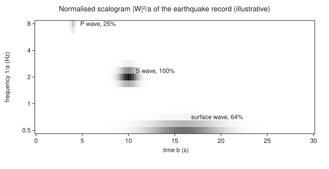

# Continuous wavelet transform: compare the signal with stretched and shifted wiggles

[Syllabus](../../../SYLLABUS.md) → [Harmonic analysis](../README.md) → [Wavelets and Time-Frequency](../README.md#s05) → Continuous wavelet transform

---

## General Overview

A seismometer 50 km from a small earthquake records 30 seconds of ground shaking. Three kinds of wave arrive in turn. The P wave (the first, compressional wave) comes at 4 s as a quick 8 Hz buzz that lasts a fraction of a second. The S wave (the slower, shearing wave) comes at 10 s and shakes at 2 Hz. The surface wave comes last, a slow 0.5 Hz roll centred on 16 s that lasts many seconds. The record on this card is synthetic and illustrative: three bursts built from a stated formula, with real-looking sizes in millimetres per second (mm/s).

A seismologist wants a map: which frequency arrives when. The [Short-time Fourier transform](01-short-time-fourier-and-gabor.md) gives such a map with one fixed window. One window cannot suit both waves. A window short enough to time the P wave is too short to tell 0.5 Hz from 0.71 Hz. A window long enough for the surface wave smears the P wave across seconds.

The continuous wavelet transform fixes this. It takes one short wiggle with zero average, the **mother wavelet**, and stretches it to every width. A wiggle squeezed to 0.125 s matches 8 Hz and times the P wave sharply. The same wiggle stretched to 2 s matches 0.5 Hz and measures the slow roll finely. At every width and every time, the transform records how well the record matches the wiggle there. The picture of those match strengths over time and width is the **scalogram**. On it the three waves appear as three dark spots, at (4 s, 8 Hz), (10 s, 2 Hz) and (16 s, 0.5 Hz). The 6.0 s gap between the P and S spots places the quake about 50.4 km away.

**The continuous wavelet transform measures, at every time and every scale, how much the signal looks like one zero-average wiggle stretched to that scale; if the wiggle passes the admissibility test, these numbers keep all the signal's energy and rebuild it exactly.**

**What kind of fact this is:** the transform and the scalogram are definitions. That an admissible wavelet keeps the energy and rebuilds the signal is a theorem, proved on this card in Why it works.

### The picture: the scalogram of the earthquake record

<p align="center"></p>

Time runs across, from 0 to 30 s. Frequency runs down, from 8 Hz to 0.5 Hz, in quarter-octave steps (each row is $`2^{1/4}`$ times lower than the one above). Darker means a stronger match. The P spot is short and tall, because a small scale times things sharply but measures frequency coarsely. The surface-wave band is long and thin, because a large scale does the reverse. The shading is the normalised scalogram, defined below; its three peaks are 25.0%, 100.0% and 64.0% of the largest value.

---

## The formula

The Fourier transform is the one fixed on [The Fourier transform of an absolutely integrable signal, and why it fades at infinity](../02-The%20Fourier%20Transform/01-fourier-transform-on-l1-and-riemann-lebesgue.md): $`\hat f(\xi) = \int f(t)\, e^{-2\pi i \xi t}\, dt`$, with $`t`$ in seconds and $`\xi`$ in hertz. A bar over a complex number is its conjugate (flip the sign of the imaginary part), never a mean.

This card introduces five things. The **mother wavelet** $`\psi`$ (say "psi") is a short wiggle with zero average. Its stretched and shifted copy is $`\psi_{a,b}`$. The transform is $`W_\psi f(a, b)`$. The admissibility constant is $`C_\psi`$. The scalogram is $`\lvert W_\psi f(a,b)\rvert^2`$.

```math
\psi_{a,b}(t) = \frac{1}{\sqrt{a}}\,\psi\!\left(\frac{t - b}{a}\right), \qquad W_\psi f(a, b) = \int_{-\infty}^{\infty} f(t)\, \overline{\psi_{a,b}(t)}\, dt .
```

**Read it aloud:** "Stretch the wiggle by the scale $`a`$, slide it to the time $`b`$, multiply it against the signal, and add up the product: the total is the wavelet coefficient at scale $`a`$ and time $`b`$."

The factor $`1/\sqrt{a}`$ keeps every copy at the same energy as the mother wavelet. The transform loses nothing when the **admissibility constant** is finite:

```math
C_\psi = \frac12 \int_{-\infty}^{\infty} \frac{\lvert \hat\psi(\xi)\rvert^2}{\lvert \xi\rvert}\, d\xi \;<\; \infty .
```

Then, for a real signal $`f`$, the transform keeps its energy and gives it back:

```math
\int_0^\infty \!\! \int_{-\infty}^{\infty} \lvert W_\psi f(a,b)\rvert^2 \, db\, \frac{da}{a^2} = C_\psi\, \lVert f\rVert^2, \qquad f(t) = \frac{1}{C_\psi}\, \mathrm{Re} \int_0^\infty \!\! \int_{-\infty}^{\infty} W_\psi f(a,b)\, \psi_{a,b}(t)\, db\, \frac{da}{a^2} .
```

**Read it aloud:** "Add up the scalogram over all times and all scales, each scale weighted by one over its square, and you get the signal's energy times $`C_\psi`$. Lay the wiggles back down, each weighted by its coefficient, and you get the signal back."

This card uses the **Morlet wavelet**: a complex tone at 1 Hz inside a bell curve, minus a tiny constant that makes its average exactly zero.

```math
\psi(t) = \pi^{-1/4}\left(e^{2\pi i t} - e^{-2\pi^2}\right) e^{-t^2/2}, \qquad \hat\psi(\xi) = K\left(e^{-2\pi^2 (\xi - 1)^2} - e^{-2\pi^2}\, e^{-2\pi^2 \xi^2}\right), \qquad K = \pi^{-1/4}\sqrt{2\pi} .
```

Its spectrum peaks at 1 Hz, so the copy at scale $`a`$ seconds matches the frequency $`1/a`$ hertz. For the record, $`C_\psi`$ = 0.506590 and $`K`$ = 1.882793.

| Symbol | Plain meaning | In our example | Push it up and the answer… |
| --- | --- | --- | --- |
| $`f(t)`$, $`\hat f(\xi)`$ | the signal: ground velocity at time $`t`$ seconds; its spectrum at frequency $`\xi`$ hertz | three bursts, in mm/s | the coefficients grow in proportion |
| $`\psi`$, $`\hat\psi`$ | the mother wavelet, a zero-average wiggle; its Fourier transform | Morlet, peak at 1 Hz | — |
| $`a`$ | scale: how far the wiggle is stretched, in seconds | 0.125 s, 0.5 s, 2 s | matches lower frequency $`1/a`$; sharper in frequency, blurrier in time |
| $`b`$ | time: where the wiggle is centred, in seconds | 4 s, 10 s, 16 s | the wiggle slides later |
| $`\psi_{a,b}`$ | the wiggle stretched by $`a`$ and slid to $`b`$, same energy as $`\psi`$ | — | — |
| $`W_\psi f(a,b)`$ | wavelet coefficient: the match between $`f`$ and $`\psi_{a,b}`$ | 0.5645 at the S wave | — |
| $`\lvert W_\psi f\rvert^2`$, $`\lvert W_\psi f\rvert^2/a`$ | the scalogram; the normalised scalogram, which gives equal steady tones equal height | peaks 25.0%, 100.0%, 64.0% (normalised) | — |
| $`C_\psi`$ | admissibility constant: the average of how many times the scales cover a positive frequency and a negative one | 0.506590, the average of 1.013180 and 0.000000 | — |
| $`\lVert f\rVert^2`$ | the signal's energy, $`\int f(t)^2\, dt`$ | 2.568286 mm²/s | the scalogram's total grows with it |
| $`A`$, $`\nu`$, $`c`$, $`s`$ | one burst: $`A\, e^{-(t-c)^2/(2s^2)} \cos(2\pi\nu t)`$; amplitude, frequency, centre, envelope spread (its standard deviation) | S wave: 1.0 mm/s, 2 Hz, 10 s, 0.8 s | larger $`s`$: amplitude reads closer to $`A`$ |
| $`K`$, $`\sigma_e`$ | the Morlet spectrum's peak height; the combined envelope width $`(1/s^2 + 1/a^2)^{-1/2}`$ | 1.882793; 0.4240 s at the S wave | — |
| $`i`$, $`\mathrm{Re}`$, $`\varepsilon`$; $`u`$, $`\eta`$, $`\theta`$, $`R`$, $`C_\pm`$ | the imaginary unit; the real part; a low-frequency cut-off for $`C_\psi`$. In the proofs: the stretched frequency $`a\xi`$; a second frequency; an angle; the rebuild before its real part; the scale integral on the positive or negative side | $`\varepsilon`$ = 0.01, 0.0001, 0.000001 Hz; $`C_+`$ = 1.013180, $`C_-`$ = 0.000000 | — |

### When it holds

- **The wavelet has zero average, so $`\hat\psi(0) = 0`$.** A plain bell-curve bump fails. Its $`C_\psi`$, cut off at $`\varepsilon`$, reads 8.793701, then 25.111615, then 41.436517 as $`\varepsilon`$ falls from 0.01 Hz to 0.000001 Hz. There is no finite constant, so no rebuild.
- **The wavelet's average is exactly zero, not just small.** The Morlet wiggle without its correction term has average $`\hat\psi(0)`$ = 0.000000005037. That is tiny, but $`C_\psi`$ is still infinite in theory. The term $`-e^{-2\pi^2}`$ makes the average exactly zero.
- **The signal is real, or the wavelet is real.** The ½ in $`C_\psi`$ and the $`\mathrm{Re}`$ in the rebuild use this. For a complex Morlet on a real record, dropping the ½ makes the scalogram's energy read 0.500000 of $`C_\psi`$ times the energy, and the rebuilt record comes out half size.
- **Scales run from 0 to infinity with weight $`da/a^2`$.** On a computer they run over a finite range. Here 40 Hz down to 0.1 Hz holds all but a negligible part of the energy: widening the range to 80 Hz down to 0.05 Hz changes the scalogram's total by 0.000000000, less than $`10^{-9}`$. Cut the range where the signal has energy and that part of the signal is lost.
- **The signal has finite energy.** A tone that never stops has none. Its scalogram is still a useful picture, but the energy identity does not apply.

---

## Why it works

### Step 0: each scale is a filter, and the filters cover each side of the spectrum evenly

Fix one scale $`a`$. Sliding the wiggle along the record and matching at each time $`b`$ is filtering (passing the record through a device that keeps some frequencies and damps others). The Morlet copy at scale $`a`$ keeps frequencies near $`1/a`$ and damps the rest. So each row of the scalogram is the record heard through one band-pass filter.

The filters for different scales overlap. Weight each scale by $`da/a^2`$ and add up the filters' energy gains. At every positive frequency the total is the same number, $`C_+`$, and at every negative frequency it is another fixed number, $`C_-`$. For the complex Morlet wiggle, $`C_+`$ = 1.013180 and $`C_-`$ = 0.000000: its filters pass positive frequencies only. A real record has the same energy at $`-\xi`$ as at $`+\xi`$, so only the average of the two totals counts, and that average is $`C_\psi`$. So no part of a real record is lost and none is counted more than any other. That is the energy identity. The rebuild follows from the same count. For a real wavelet the two totals are equal, $`C_+ = C_- = C_\psi`$.

The count is finite only if the wiggle has zero average. Otherwise every large-scale filter lets through some energy at 0 Hz, and there are infinitely many of them.

### Step 1: one scale is the record times a stretched spectrum

[The transform rulebook](../02-The%20Fourier%20Transform/02-shift-scale-and-derivative-rules.md) says stretching a signal by $`a`$ squeezes its spectrum by $`a`$, and sliding it by $`b`$ turns the phase. With the $`1/\sqrt{a}`$ factor:

```math
\widehat{\psi_{a,b}}(\xi) = \sqrt{a}\; \hat\psi(a\xi)\; e^{-2\pi i \xi b} .
```

[Plancherel](../02-The%20Fourier%20Transform/05-plancherel-and-l2.md) says a pairing of two signals equals the pairing of their spectra. So

```math
W_\psi f(a,b) = \int_{-\infty}^{\infty} \hat f(\xi)\, \sqrt{a}\; \overline{\hat\psi(a\xi)}\; e^{2\pi i \xi b}\, d\xi .
```

Read as a function of $`b`$, this is an inverse Fourier transform. Its spectrum is $`\hat f(\xi)`$ times the gain $`\sqrt{a}\,\overline{\hat\psi(a\xi)}`$. That is [The convolution theorem](../03-Convolution%20and%20Approximate%20Identities/02-convolution-theorem-and-impulse-response.md) at work: one scale of the transform is the record filtered by a stretched copy of $`\hat\psi`$.

### Step 2: the energy at one scale

Plancherel again, now in $`b`$, turns the energy of one row into an integral over frequency:

```math
\int_{-\infty}^{\infty} \lvert W_\psi f(a,b)\rvert^2\, db = a \int_{-\infty}^{\infty} \lvert \hat f(\xi)\rvert^2\, \lvert \hat\psi(a\xi)\rvert^2\, d\xi .
```

### Step 3: add up all the scales

Multiply by $`1/a^2`$ and integrate over $`a`$ from 0 to infinity. Swap the order of the two integrals. At each frequency $`\xi > 0`$, the scales contribute

```math
\int_0^\infty \lvert\hat\psi(a\xi)\rvert^2\, \frac{da}{a} = \int_0^\infty \frac{\lvert\hat\psi(u)\rvert^2}{u}\, du, \qquad u = a\xi .
```

The frequency $`\xi`$ has dropped out. The weight $`da/a`$ counts every doubling of scale equally, so stretching the filter bank by any factor leaves it unchanged. Negative frequencies give the matching integral over $`u < 0`$, again the same at every frequency. Call the two side totals $`C_+`$ and $`C_-`$. For the Morlet the check finds $`C_+`$ = 1.013180 and $`C_-`$ = 0.000000: almost all its cover sits on the positive side.

A real record has $`\lvert\hat f(-\xi)\rvert = \lvert\hat f(\xi)\rvert`$. So its energy splits evenly between the two sides, and the two side integrals average to $`C_\psi`$. Hence the scalogram's total is $`C_\psi \lVert f\rVert^2`$.

For the record, the check adds up the scalogram on a grid of 40 Hz to 0.1 Hz and gets 1.301068 on both a coarse and a fine grid. $`C_\psi`$ times the energy is 0.506590 × 2.568286 = 1.301068.

<details>
<summary>Detailed proof: the rebuild formula</summary>

Write $`R(t)`$ for the double integral in the rebuild formula, before taking the real part. Step 1 gives $`W_\psi f(a,b)`$ as an inverse transform in $`b`$. The wiggle $`\psi_{a,b}(t)`$ is also an inverse transform:

$`\displaystyle \psi_{a,b}(t) = \int \sqrt{a}\,\hat\psi(a\eta)\, e^{2\pi i \eta (t - b)}\, d\eta .`$

Integrate the product over $`b`$. Plancherel in $`b`$ pairs the two spectra at the same frequency, so

$`\displaystyle \int W_\psi f(a,b)\,\psi_{a,b}(t)\, db = a \int \hat f(\xi)\, \lvert\hat\psi(a\xi)\rvert^2\, e^{2\pi i \xi t}\, d\xi .`$

Divide by $`a^2`$ and integrate over $`a`$. By Step 3, at each frequency the scale integral is $`C_+`$ for $`\xi > 0`$ and $`C_-`$ for $`\xi < 0`$, the two side integrals, with $`C_+ + C_- = 2C_\psi`$. So $`R`$ has spectrum $`C_+\hat f(\xi)`$ on the positive side and $`C_-\hat f(\xi)`$ on the negative side.

For a real record, $`\hat f(-\xi) = \overline{\hat f(\xi)}`$. The real part of $`R`$ has spectrum $`\tfrac12\big(\hat R(\xi) + \overline{\hat R(-\xi)}\big)`$, which is $`\tfrac12 (C_+ + C_-)\hat f(\xi) = C_\psi \hat f(\xi)`$ on both sides. Fourier inversion, from [Fourier inversion](../02-The%20Fourier%20Transform/04-fourier-inversion-theorem.md), gives $`\mathrm{Re}\, R(t) = C_\psi f(t)`$.

For a real wavelet, $`C_+ = C_- = C_\psi`$ and the real part is not needed, for any signal. Swapping the integrals is allowed because the scalogram's total is finite, by Step 3. Grossmann and Morlet give the argument in full.

</details>

The check rebuilds the record at three times from its coefficients alone: −0.391323, 0.445647 and 0.468166 mm/s at 4.05 s, 10.10 s and 16.30 s, the same as the record to six decimals.

### Step 4: why the average must be zero

Near 0 Hz, the integrand of $`C_\psi`$ is about $`\lvert\hat\psi(0)\rvert^2/\lvert\xi\rvert`$. The integral of $`1/\lvert\xi\rvert`$ near zero grows like the natural log $`\ln(1/\varepsilon)`$ as the cut-off $`\varepsilon`$ shrinks: it never settles. So $`C_\psi`$ is finite only if $`\hat\psi(0) = \int \psi(t)\, dt = 0`$: the wiggle must have zero average.

The bell-curve bump shows the growth. Each hundredfold drop in the cut-off adds almost the same amount: its $`C_\psi`$ reads 8.793701, 25.111615 and 41.436517 at 0.01, 0.0001 and 0.000001 Hz. The Morlet wavelet reads 0.506590 at all three.

<details>
<summary>Detailed proof: zero average is enough, for a wiggle that fades fast</summary>

Suppose $`\int \psi(t)\, dt = 0`$ and $`\int \lvert t\rvert\, \lvert\psi(t)\rvert\, dt`$ is finite. Since $`\hat\psi(0) = 0`$,

$`\displaystyle \hat\psi(\xi) = \hat\psi(\xi) - \hat\psi(0) = \int \psi(t) \left(e^{-2\pi i \xi t} - 1\right) dt .`$

The size of $`e^{-i\theta} - 1`$ is at most $`\lvert\theta\rvert`$. So

$`\displaystyle \lvert\hat\psi(\xi)\rvert \le 2\pi \lvert\xi\rvert \int \lvert t\rvert\, \lvert\psi(t)\rvert\, dt .`$

Near zero, the integrand of $`C_\psi`$ is then at most a constant times $`\lvert\xi\rvert`$, which is finite. Away from zero, $`1/\lvert\xi\rvert`$ is at most 1 beyond 1 Hz, and $`\int \lvert\hat\psi\rvert^2`$ is the wavelet's energy, which is finite. So $`C_\psi`$ is finite. The Morlet wavelet fades like a bell curve, so it qualifies.

</details>

### Step 5: reading the scalogram

**Where.** For one burst $`A\, e^{-(t-c)^2/(2s^2)}\cos(2\pi\nu t)`$, the coefficient is a bell-curve integral. At $`b = c`$ and $`a = 1/\nu`$ the tones cancel, and

```math
\lvert W_\psi f(a, c)\rvert = \frac{A}{2}\, K\, \frac{\sigma_e}{\sqrt{a}}, \qquad \sigma_e = \left(\frac{1}{s^2} + \frac{1}{a^2}\right)^{-1/2},
```

up to the burst's negative-frequency half and Morlet's correction, each below $`e^{-30}`$ of the main term here, and the tails of the other bursts. Those tails are larger: at the S spot the surface wave's tail adds 0.000000411, so this one-burst formula matches the full transform to six decimals there, and to nine at the P and surface spots. The spot sits at the burst's time $`c`$ and at the scale $`a = 1/\nu`$. Read the scale back as the frequency $`1/a`$.

**How sharp.** The energy of $`\psi_{a,b}`$ spreads over time with standard deviation $`a/\sqrt2`$, and over frequency with standard deviation $`1/(2\sqrt2\,\pi a)`$. Their product is $`1/(4\pi)`$, the floor from [The uncertainty principle](../02-The%20Fourier%20Transform/07-uncertainty-principle.md): a bell curve meets it. The ratio of band to frequency is the same at every scale. That is the wavelet's advantage over a fixed window:

| Wave | Scale $`a`$ | Time spread $`a/\sqrt2`$ | Band $`1/(2\sqrt2\,\pi a)`$ |
| --- | --- | --- | --- |
| P, 8 Hz | 0.125 s | 0.0884 s | 0.9003 Hz |
| S, 2 Hz | 0.5 s | 0.3536 s | 0.2251 Hz |
| surface, 0.5 Hz | 2 s | 1.4142 s | 0.0563 Hz |

A fixed window tuned to the S wave has spread 0.3536 s and band 0.2251 Hz at every frequency. It cannot separate the 0.5 Hz row from the 0.71 Hz row, and it blurs the P wave far beyond the 0.0884 s the wavelet achieves.

**How strong.** A steady tone of amplitude $`A`$ gives $`\lvert W\rvert = (A/2)K\sqrt{a}`$, which grows with the scale. So the raw scalogram $`\lvert W\rvert^2`$ inflates low frequencies in proportion to $`a`$. Divide by $`a`$, the normalised scalogram, and equal steady tones show equal heights. The amplitude read off a spot is $`2\lvert W\rvert/(K\sqrt{a})`$. For a burst, it is $`A\,\sigma_e/a = A/\sqrt{1 + (a/s)^2}`$, below $`A`$ for every burst: the burst's envelope fades within the wiggle's span, so the wiggle's outer parts meet a weaker signal. The wiggle's own envelope, $`e^{-(t-b)^2/(2a^2)}`$, has standard deviation $`a`$. The reading comes close to $`A`$ only when the burst's envelope standard deviation $`s`$ is much longer than that. Here $`s = 1.6\,a`$ for all three bursts (an envelope standard deviation of 1.6 cycles of each tone, $`s\nu`$ = 1.6), so each reads 0.847998 of its true amplitude.

---

## Worked numbers, by hand

The S wave's spot: $`A`$ = 1.0 mm/s, $`\nu`$ = 2 Hz, centre $`c`$ = 10 s, envelope spread $`s`$ = 0.8 s.

| Step | Arithmetic | Value |
| --- | --- | --- |
| scale that matches 2 Hz | $`a = 1/2`$ | 0.5 s |
| square root of the scale | $`\sqrt{0.5}`$ | 0.7071 |
| combined envelope width | $`\sigma_e = (1/0.8^2 + 1/0.5^2)^{-1/2}`$ | 0.4240 s |
| Morlet peak height | $`K = \pi^{-1/4}\sqrt{2\pi}`$ | 1.882793 |
| coefficient at (0.5 s, 10 s) | $`\tfrac12 \times 1.0 \times 1.882793 \times 0.4240 / 0.7071`$ | 0.5645 |
| amplitude read off the spot | $`2 \times 0.5645 / (1.882793 \times 0.7071)`$ | 0.8480 mm/s |
| share of the true amplitude | $`\sigma_e / a = 0.4240 / 0.5`$ | 0.847998 |
| S minus P arrival | $`10 - 4`$ | 6.0 s |
| **distance to the quake** | $`6.0 \times 6.0 \times 3.5 / (6.0 - 3.5)`$, P at 6.0 km/s, S at 3.5 km/s | **50.4 km** |

So the S spot's coefficient is 0.5645. The sum over samples matches the full closed form to nine decimals, and this one-burst formula to six, because the surface wave's tail adds 0.000000411. The amplitude read off the spot is 0.8480 mm/s, 0.848 of the true 1.0 mm/s, because the burst's envelope, of standard deviation 0.8 s = 1.6a, fades within the wiggle's span. The time between the P and S spots, 6.0 s, puts the quake 50.4 km from the station.

### What breaks if you drop a piece

| Mistake | Comes out at | What went wrong |
| --- | --- | --- |
| Use a bell-curve bump, which has nonzero average, as the wavelet | $`C_\psi`$ = 8.793701, 25.111615, 41.436517 at cut-offs 0.01, 0.0001, 0.000001 Hz | The large-scale filters all pass 0 Hz; the constant never settles, so there is no rebuild |
| Drop the ½ from $`C_\psi`$ for a complex wavelet on a real record | energy ratio 0.500000 instead of 1; rebuilt record half size | Morlet sees only positive frequencies; a real record keeps half its energy on the negative side |
| Read the raw scalogram $`\lvert W\rvert^2`$ as strength across scales | P 2.4%, S 39.1%, surface 100.0%; normalised: 25.0%, 100.0%, 64.0% | The raw scalogram grows with the scale $`a`$; the P wave nearly vanishes |
| Read the scale $`a`$ = 0.5 s as a frequency, 0.5 Hz | the S wave lands in the surface wave's row | Scale is in seconds; the frequency is $`1/a`$ = 2 Hz |

---

## Code, from first principles, and it actually runs

The script builds the record from its three bursts and computes the transform by two independent roads. The first is the closed form: each coefficient is a sum of bell-curve integrals. The second is the defining integral, summed over the 1,501 samples of the record taken 50 times a second. They agree to nine decimals at all three spots.

It finds $`C_\psi`$ by Simpson's rule (thin slices weighted 1, 4, 2, 4, …) at two step sizes, and once more on a direct grid in $`\xi`$, then the two side totals $`C_+`$ and $`C_-`$. It checks the energy identity by adding up the scalogram over scales and times on two grids, against $`C_\psi`$ times the energy found in time, and once more over a wider range of scales. It rebuilds the record at three times from the coefficients alone. Then it prints the scalogram, reads the three spots, and works every row of What breaks.

### Python

```python
# Continuous wavelet transform -- the check behind the card.  Standard library only.
# A synthetic, illustrative earthquake record (ground velocity, mm/s): a P wave at
# 8 Hz near 4 s, an S wave at 2 Hz near 10 s, a surface wave at 0.5 Hz near 16 s.
# Morlet wavelet; scale a in seconds matches frequency 1/a in hertz.
# Every transform and integral is written out; cmath only supplies exp.
from math import exp, sqrt, pi, log, cos
import cmath

K = pi ** -0.25 * sqrt(2 * pi)               # peak height of the Morlet spectrum, at 1 Hz
KAP = exp(-2 * pi * pi)                      # the correction that makes the mean zero
WAVES = [(0.5, 8.0, 4.0, 0.2), (1.0, 2.0, 10.0, 0.8), (0.8, 0.5, 16.0, 3.2)]  # A, nu, c, s

def record(t):                               # sum of A e^(-(t-c)^2 / 2s^2) cos(2 pi nu t)
    return sum(A * exp(-(t - c) ** 2 / (2 * s * s)) * cos(2 * pi * nu * t) for A, nu, c, s in WAVES)

def psi(t):                                  # Morlet mother wavelet (complex)
    return pi ** -0.25 * (cmath.exp(2j * pi * t) - KAP) * exp(-t * t / 2)

def psi_hat(xi):                             # its transform, xi in hertz
    return K * (exp(-2 * pi * pi * (xi - 1) ** 2) - KAP * exp(-2 * pi * pi * xi * xi))

def bump_hat(xi):                            # a plain bell-curve bump: mean not zero
    return K * exp(-2 * pi * pi * xi * xi)

def W(a, b):                                 # road 1: closed form, Gaussian integrals in u = t - b
    tot = 0j
    for A, nu, c, s in WAVES:
        d, al = c - b, 1 / (2 * s * s) + 1 / (2 * a * a)
        for sg in (1, -1):                   # cos = (e^(+i..) + e^(-i..)) / 2
            for m, wt in ((1, 1.0), (0, -KAP)):   # conjugate wavelet = e^(-2 pi i u/a) - KAP
                be = d / (s * s) + 2j * pi * (sg * nu - m / a)
                ga = -d * d / (2 * s * s) + 2j * pi * sg * nu * b
                tot += A / 2 * wt * sqrt(pi / al) * cmath.exp(be * be / (4 * al) + ga)
    return tot * pi ** -0.25 / sqrt(a)

def W_sum(a, b, fs=50.0, T=30.0):            # road 2: the defining integral as a sum of samples
    return sum(record(k / fs) * psi((k / fs - b) / a).conjugate()
               for k in range(int(T * fs) + 1)) / (fs * sqrt(a))

def simpson(g, lo, hi, n):
    h = (hi - lo) / n
    return h / 3 * (g(lo) + g(hi) + sum((4 if i % 2 else 2) * g(lo + i * h) for i in range(1, n)))

def C_psi(hat, eps, n):                      # 1/2 integral over eps < |xi| < 4 of |hat|^2/|xi|, xi = e^u
    g = lambda u: 0.5 * (hat(exp(u)) ** 2 + hat(-exp(u)) ** 2)
    return simpson(g, log(eps), log(4.0), n)

def double(dv, r, ts, lo=40.0, hi=10.0):     # integral of |W|^2 db da/a^2, and the rebuild at times ts
    vlo, vhi, blo, bhi = log(1 / lo), log(hi), -10.0, 40.0   # lo Hz to 1/hi Hz; b step r * a
    E, R = 0.0, [0j] * len(ts)
    for i in range(round((vhi - vlo) / dv) + 1):
        a = exp(vlo + i * dv)                # da / a^2 = dv / a
        db = r * a
        for j in range(round((bhi - blo) / db) + 1):
            b = blo + j * db
            w = W(a, b)
            E += abs(w) ** 2 / a * dv * db
            for k, t in enumerate(ts):
                R[k] += w * psi((t - b) / a) * dv * db / (a * sqrt(a))
    return E, R

def show(name, *vs, d=6):
    print(f"{name:<42}" + "".join(f" {v:>12.{d}f}" for v in vs))

# ---- the admissibility constant, and the bump that fails it ----
C1, C2 = C_psi(psi_hat, 1e-6, 2000), C_psi(psi_hat, 1e-6, 4000)
show("C_psi Morlet, 2000 and 4000 steps", C1, C2, d=9)
for e in (1e-2, 1e-4, 1e-6):
    show(f"cut-off {e:.6f} Hz: C Morlet, C bump", C_psi(psi_hat, e, 4000), C_psi(bump_hat, e, 4000))
show("psi_hat(0): Morlet, uncorrected, bump", psi_hat(0.0), K * KAP, bump_hat(0.0), d=12)
assert abs(C1 - C2) < 1e-9 and abs(psi_hat(0.0)) < 1e-15 and abs(C2 - 0.5 * simpson(
    lambda x: psi_hat(x) ** 2 / x if x > 0 else 0.0, 0.0, 4.0, 40000)) < 1e-8
assert C_psi(bump_hat, 1e-6, 4000) - C_psi(bump_hat, 1e-4, 4000) > 16   # grows like ln(1/eps)
Cp, Cm = (simpson(lambda u: psi_hat(sg * exp(u)) ** 2, log(1e-6), log(4.0), 4000) for sg in (1, -1))
show("C_+, C_-: scale totals, xi > 0 and xi < 0", Cp, Cm)
assert Cm < 1e-12                            # the complex Morlet passes positive frequencies only

# ---- energy and rebuild: the transform loses nothing ----
E1 = simpson(lambda t: record(t) ** 2, -10, 40, 10000)
E2 = simpson(lambda t: record(t) ** 2, -10, 40, 20000)
show("energy of the record, 10000 and 20000 steps", E1, E2)
ts = (4.05, 10.1, 16.3)
Ec, Rc = double(0.04, 0.5, ts)
Ef, Rf = double(0.02, 0.25, ts)
show("scalogram energy: coarse, fine grid", Ec, Ef)
Ew = double(0.04, 0.5, (), 80.0, 20.0)[0]    # second cut-off: 80 Hz to 0.05 Hz
show("coarse, widened to 80 to 0.05 Hz; change", Ew, abs(Ew - Ec), d=9)
assert abs(Ew - Ec) < 1e-9
show("C_psi x energy", C2 * E2)
show("scalogram energy / energy; same, no 1/2", Ef / E2, Ef / E2 / (2 * C2))
for t, r in zip(ts, Rf):
    show(f"record at {t:.2f} s: true, rebuilt", record(t), r.real / C2)
    assert abs(r.real / C2 - record(t)) < 1e-5
assert abs(Ef - C2 * E2) < 1e-5 * E2 and abs(E1 - E2) < 1e-9

# ---- the scalogram, and reading it ----
freqs = [8 * 2 ** (-k / 2) for k in range(9)]
grid = [[abs(W(1 / f, b)) ** 2 * f for b in range(31)] for f in freqs]   # |W|^2 / a
top = max(max(r) for r in grid)
print("normalised scalogram |W|^2/a, percent of its peak; time 0 to 30 s across")
for f, r in zip(freqs, grid):
    print(f"{f:5.2f} Hz " + "".join(f"{int(v / top * 100 + 0.5):4d}" for v in r))
raw, nrm = [], []
for A, nu, c, s in WAVES:
    a = 1 / nu
    w, ws = W(a, c), W_sum(a, c)
    raw.append(abs(w) ** 2); nrm.append(abs(w) ** 2 / a)
    print(f"{nu:.1f} Hz wave at {c:.0f} s, scale a = {a:.3f} s")
    show("  |W|: closed form, sum of samples, gap", abs(w), abs(ws), abs(w - ws), d=9)
    assert abs(w - ws) < 1e-6
    se = (1 / s ** 2 + 1 / a ** 2) ** -0.5   # combined envelope width
    hand = A / 2 * K * se / sqrt(a)          # one-burst formula: the other bursts left out
    show("  by hand: sqrt a, envelope width, |W|", sqrt(a), se, hand, d=4)
    show("  s/a; one-burst |W|, gap to full |W|", s / a, hand, abs(abs(w) - hand), d=9)
    show("  amplitude read 2|W|/(K sqrt a), by hand", 2 * abs(w) / (K * sqrt(a)), A * se / a, d=4)
    assert abs(2 * abs(w) / (K * sqrt(a)) - A * se / a) < 1e-6
    show("  time spread a/sqrt2 s, band 1/(2 sqrt2 pi a) Hz", a / sqrt(2), 1 / (2 * sqrt(2) * pi * a), d=4)
show("raw |W|^2, percent of largest: P, S, surface", *[100 * x / max(raw) for x in raw], d=1)
show("|W|^2/a, percent of largest: P, S, surface", *[100 * x / max(nrm) for x in nrm], d=1)
show("K = pi^(-1/4) sqrt(2 pi); envelope factor", K, (1 + 1 / 1.6 ** 2) ** -0.5)
show("S - P time s; distance km at 6.0, 3.5 km/s", 6.0, 6.0 * 6.0 * 3.5 / 2.5, d=1)
fine = [[abs(W(1 / (8 * 2 ** (-k / 4)), j / 4)) ** 2 * 8 * 2 ** (-k / 4) for j in range(121)] for k in range(17)]
fmax = max(max(r) for r in fine)
pk = [(16, 0), (40, 8), (64, 16)]              # (time index, row index) of the three peaks
print("figure, 121 x 17 cells, 0 to 30 s by 8 to 0.5 Hz; peak shades "
      + ", ".join(f"{fine[k][j] / fmax * 100:.1f}% at ({j / 4:.2f} s, {8 * 2 ** (-k / 4):.2f} Hz)" for j, k in pk))
print("ALL CHECKS PASS")
```

**Ran 2026-11-15 on macOS, Python 3.14.10, standard library only. All checks passed. Output, pasted from the run:**

```
C_psi Morlet, 2000 and 4000 steps           0.506589950  0.506589950
cut-off 0.010000 Hz: C Morlet, C bump          0.506590     8.793701
cut-off 0.000100 Hz: C Morlet, C bump          0.506590    25.111615
cut-off 0.000001 Hz: C Morlet, C bump          0.506590    41.436517
psi_hat(0): Morlet, uncorrected, bump      0.000000000000 0.000000005037 1.882792527553
C_+, C_-: scale totals, xi > 0 and xi < 0      1.013180     0.000000
energy of the record, 10000 and 20000 steps     2.568286     2.568286
scalogram energy: coarse, fine grid            1.301068     1.301068
coarse, widened to 80 to 0.05 Hz; change    1.301067690  0.000000000
C_psi x energy                                 1.301068
scalogram energy / energy; same, no 1/2        0.506590     0.500000
record at 4.05 s: true, rebuilt               -0.391323    -0.391323
record at 10.10 s: true, rebuilt               0.445647     0.445647
record at 16.30 s: true, rebuilt               0.468166     0.468166
normalised scalogram |W|^2/a, percent of its peak; time 0 to 30 s across
 8.00 Hz    0   0   0   0  25   0   0   0   0   0   0   0   0   0   0   0   0   0   0   0   0   0   0   0   0   0   0   0   0   0   0
 5.66 Hz    0   0   0   0   0   0   0   0   0   0   0   0   0   0   0   0   0   0   0   0   0   0   0   0   0   0   0   0   0   0   0
 4.00 Hz    0   0   0   0   0   0   0   0   0   0   0   0   0   0   0   0   0   0   0   0   0   0   0   0   0   0   0   0   0   0   0
 2.83 Hz    0   0   0   0   0   0   0   0   0   2   7   2   0   0   0   0   0   0   0   0   0   0   0   0   0   0   0   0   0   0   0
 2.00 Hz    0   0   0   0   0   0   0   0   1  33 100  33   1   0   0   0   0   0   0   0   0   0   0   0   0   0   0   0   0   0   0
 1.41 Hz    0   0   0   0   0   0   0   0   0   1   2   1   0   0   0   0   0   0   0   0   0   0   0   0   0   0   0   0   0   0   0
 1.00 Hz    0   0   0   0   0   0   0   0   0   0   0   0   0   0   0   0   0   0   0   0   0   0   0   0   0   0   0   0   0   0   0
 0.71 Hz    0   0   0   0   0   0   0   0   0   0   0   1   1   2   3   4   4   4   3   2   1   1   0   0   0   0   0   0   0   0   0
 0.50 Hz    0   0   0   0   0   0   0   0   1   2   5  11  21  34  48  60  64  60  48  34  21  11   5   2   1   0   0   0   0   0   0
8.0 Hz wave at 4 s, scale a = 0.125 s
  |W|: closed form, sum of samples, gap     0.141121266  0.141121266  0.000000000
  by hand: sqrt a, envelope width, |W|           0.3536       0.1060       0.1411
  s/a; one-burst |W|, gap to full |W|       1.600000000  0.141121266  0.000000000
  amplitude read 2|W|/(K sqrt a), by hand        0.4240       0.4240
  time spread a/sqrt2 s, band 1/(2 sqrt2 pi a) Hz       0.0884       0.9003
2.0 Hz wave at 10 s, scale a = 0.500 s
  |W|: closed form, sum of samples, gap     0.564485476  0.564485476  0.000000000
  by hand: sqrt a, envelope width, |W|           0.7071       0.4240       0.5645
  s/a; one-burst |W|, gap to full |W|       1.600000000  0.564485065  0.000000411
  amplitude read 2|W|/(K sqrt a), by hand        0.8480       0.8480
  time spread a/sqrt2 s, band 1/(2 sqrt2 pi a) Hz       0.3536       0.2251
0.5 Hz wave at 16 s, scale a = 2.000 s
  |W|: closed form, sum of samples, gap     0.903176104  0.903176104  0.000000000
  by hand: sqrt a, envelope width, |W|           1.4142       1.6960       0.9032
  s/a; one-burst |W|, gap to full |W|       1.600000000  0.903176104  0.000000000
  amplitude read 2|W|/(K sqrt a), by hand        0.6784       0.6784
  time spread a/sqrt2 s, band 1/(2 sqrt2 pi a) Hz       1.4142       0.0563
raw |W|^2, percent of largest: P, S, surface          2.4         39.1        100.0
|W|^2/a, percent of largest: P, S, surface         25.0        100.0         64.0
K = pi^(-1/4) sqrt(2 pi); envelope factor      1.882793     0.847998
S - P time s; distance km at 6.0, 3.5 km/s          6.0         50.4
figure, 121 x 17 cells, 0 to 30 s by 8 to 0.5 Hz; peak shades 25.0% at (4.00 s, 8.00 Hz), 100.0% at (10.00 s, 2.00 Hz), 64.0% at (16.00 s, 0.50 Hz)
ALL CHECKS PASS
```

### Rust

The same checks, with a small complex-number struct. No crates.

```rust
// Continuous wavelet transform -- the same check as continuous_wavelet_transform_and_the_scalogram_check.py.
// Standard library only, no crates.  A synthetic, illustrative earthquake record
// (ground velocity, mm/s): P wave 8 Hz near 4 s, S wave 2 Hz near 10 s, surface
// wave 0.5 Hz near 16 s.  Morlet wavelet; scale a in seconds, frequency 1/a in hertz.
use std::f64::consts::PI;

#[derive(Clone, Copy)]
struct C { re: f64, im: f64 }
impl C {
    fn add(self, o: C) -> C { C { re: self.re + o.re, im: self.im + o.im } }
    fn sub(self, o: C) -> C { C { re: self.re - o.re, im: self.im - o.im } }
    fn mul(self, o: C) -> C { C { re: self.re * o.re - self.im * o.im, im: self.re * o.im + self.im * o.re } }
    fn sc(self, k: f64) -> C { C { re: self.re * k, im: self.im * k } }
    fn conj(self) -> C { C { re: self.re, im: -self.im } }
    fn abs(self) -> f64 { self.re.hypot(self.im) }
    fn exp(self) -> C { let m = self.re.exp(); C { re: m * self.im.cos(), im: m * self.im.sin() } }
}
const Z: C = C { re: 0.0, im: 0.0 };
fn kk() -> f64 { PI.powf(-0.25) * (2.0 * PI).sqrt() }    // peak height of the Morlet spectrum, at 1 Hz
fn kap() -> f64 { (-2.0 * PI * PI).exp() }                 // the correction that makes the mean zero
const WAVES: [(f64, f64, f64, f64); 3] = [(0.5, 8.0, 4.0, 0.2), (1.0, 2.0, 10.0, 0.8), (0.8, 0.5, 16.0, 3.2)];

fn record(t: f64) -> f64 {
    WAVES.iter().map(|&(a, nu, c, s)| a * (-(t - c).powi(2) / (2.0 * s * s)).exp() * (2.0 * PI * nu * t).cos()).sum()
}
fn psi(t: f64) -> C {                                      // Morlet mother wavelet (complex)
    C { re: (2.0 * PI * t).cos() - kap(), im: (2.0 * PI * t).sin() }.sc(PI.powf(-0.25) * (-t * t / 2.0).exp())
}
fn psi_hat(xi: f64) -> f64 { kk() * ((-2.0 * PI * PI * (xi - 1.0).powi(2)).exp() - kap() * (-2.0 * PI * PI * xi * xi).exp()) }
fn bump_hat(xi: f64) -> f64 { kk() * (-2.0 * PI * PI * xi * xi).exp() }

fn w(a: f64, b: f64) -> C {                                // road 1: closed form, Gaussian integrals in u = t - b
    let mut tot = Z;
    for &(amp, nu, c, s) in WAVES.iter() {
        let (d, al) = (c - b, 1.0 / (2.0 * s * s) + 1.0 / (2.0 * a * a));
        for sg in [1.0, -1.0] {
            for (m, wt) in [(1.0, 1.0), (0.0, -kap())] {
                let be = C { re: d / (s * s), im: 2.0 * PI * (sg * nu - m / a) };
                let ga = C { re: -d * d / (2.0 * s * s), im: 2.0 * PI * sg * nu * b };
                tot = tot.add(be.mul(be).sc(1.0 / (4.0 * al)).add(ga).exp().sc(amp / 2.0 * wt * (PI / al).sqrt()));
            }
        }
    }
    tot.sc(PI.powf(-0.25) / a.sqrt())
}
fn w_sum(a: f64, b: f64) -> C {                            // road 2: the defining integral as a sum of samples
    let fs = 50.0;
    let mut tot = Z;
    for k in 0..=1500 { let t = k as f64 / fs; tot = tot.add(psi((t - b) / a).conj().sc(record(t))); }
    tot.sc(1.0 / (fs * a.sqrt()))
}
fn simpson(g: &dyn Fn(f64) -> f64, lo: f64, hi: f64, n: usize) -> f64 {
    let h = (hi - lo) / n as f64;
    let mut s = g(lo) + g(hi);
    for i in 1..n { s += if i % 2 == 1 { 4.0 } else { 2.0 } * g(lo + i as f64 * h); }
    s * h / 3.0
}
fn c_psi(hat: &dyn Fn(f64) -> f64, eps: f64, n: usize) -> f64 {
    simpson(&|u: f64| 0.5 * (hat(u.exp()).powi(2) + hat(-u.exp()).powi(2)), eps.ln(), 4.0f64.ln(), n)
}
fn double(dv: f64, r: f64, ts: &[f64], lo: f64, hi: f64) -> (f64, Vec<C>) {   // lo Hz to 1/hi Hz
    let (vlo, vhi, blo, bhi) = ((1.0 / lo).ln(), hi.ln(), -10.0, 40.0);
    let (mut e, mut rr) = (0.0, vec![Z; ts.len()]);
    for i in 0..=((vhi - vlo) / dv).round() as usize {
        let a = (vlo + i as f64 * dv).exp();
        let db = r * a;
        for j in 0..=((bhi - blo) / db).round() as usize {
            let b = blo + j as f64 * db;
            let x = w(a, b);
            e += x.abs().powi(2) / a * dv * db;
            for (k, &t) in ts.iter().enumerate() { rr[k] = rr[k].add(x.mul(psi((t - b) / a)).sc(dv * db / (a * a.sqrt()))); }
        }
    }
    (e, rr)
}
fn show(name: &str, vs: &[f64], d: usize) {
    let mut s = format!("{:<42}", name);
    for v in vs { s += &format!(" {:>12.*}", d, v); }
    println!("{}", s);
}

fn main() {
    // ---- the admissibility constant, and the bump that fails it ----
    let (c1, c2) = (c_psi(&psi_hat, 1e-6, 2000), c_psi(&psi_hat, 1e-6, 4000));
    show("C_psi Morlet, 2000 and 4000 steps", &[c1, c2], 9);
    for e in [1e-2, 1e-4, 1e-6] {
        show(&format!("cut-off {:.6} Hz: C Morlet, C bump", e), &[c_psi(&psi_hat, e, 4000), c_psi(&bump_hat, e, 4000)], 6);
    }
    show("psi_hat(0): Morlet, uncorrected, bump", &[psi_hat(0.0), kk() * kap(), bump_hat(0.0)], 12);
    let direct = 0.5 * simpson(&|x: f64| if x > 0.0 { psi_hat(x).powi(2) / x } else { 0.0 }, 0.0, 4.0, 40000);
    assert!((c1 - c2).abs() < 1e-9 && psi_hat(0.0).abs() < 1e-15 && (c2 - direct).abs() < 1e-8);
    assert!(c_psi(&bump_hat, 1e-6, 4000) - c_psi(&bump_hat, 1e-4, 4000) > 16.0);
    let side = |sg: f64| simpson(&|u: f64| psi_hat(sg * u.exp()).powi(2), (1e-6f64).ln(), 4.0f64.ln(), 4000);
    let (cp, cm) = (side(1.0), side(-1.0));
    show("C_+, C_-: scale totals, xi > 0 and xi < 0", &[cp, cm], 6);
    assert!(cm < 1e-12);                                  // the complex Morlet passes positive frequencies only

    // ---- energy and rebuild: the transform loses nothing ----
    let e1 = simpson(&|t: f64| record(t).powi(2), -10.0, 40.0, 10000);
    let e2 = simpson(&|t: f64| record(t).powi(2), -10.0, 40.0, 20000);
    show("energy of the record, 10000 and 20000 steps", &[e1, e2], 6);
    let ts = [4.05, 10.1, 16.3];
    let (ec, _) = double(0.04, 0.5, &ts, 40.0, 10.0);
    let (ef, rf) = double(0.02, 0.25, &ts, 40.0, 10.0);
    show("scalogram energy: coarse, fine grid", &[ec, ef], 6);
    let (ew, _) = double(0.04, 0.5, &[], 80.0, 20.0);   // second cut-off: 80 Hz to 0.05 Hz
    show("coarse, widened to 80 to 0.05 Hz; change", &[ew, (ew - ec).abs()], 9);
    assert!((ew - ec).abs() < 1e-9);
    show("C_psi x energy", &[c2 * e2], 6);
    show("scalogram energy / energy; same, no 1/2", &[ef / e2, ef / e2 / (2.0 * c2)], 6);
    for (t, r) in ts.iter().zip(rf.iter()) {
        show(&format!("record at {:.2} s: true, rebuilt", t), &[record(*t), r.re / c2], 6);
        assert!((r.re / c2 - record(*t)).abs() < 1e-5);
    }
    assert!((ef - c2 * e2).abs() < 1e-5 * e2 && (e1 - e2).abs() < 1e-9);

    // ---- the scalogram, and reading it ----
    let freqs: Vec<f64> = (0..9).map(|k| 8.0 * 2f64.powf(-(k as f64) / 2.0)).collect();
    let grid: Vec<Vec<f64>> = freqs.iter().map(|&f| (0..31).map(|b| w(1.0 / f, b as f64).abs().powi(2) * f).collect()).collect();
    let top = grid.iter().flatten().cloned().fold(0.0, f64::max);
    println!("normalised scalogram |W|^2/a, percent of its peak; time 0 to 30 s across");
    for (f, r) in freqs.iter().zip(grid.iter()) {
        let cells: String = r.iter().map(|v| format!("{:4}", (v / top * 100.0 + 0.5).floor() as i64)).collect();
        println!("{:5.2} Hz {}", f, cells);
    }
    let (mut raw, mut nrm) = (vec![], vec![]);
    for &(amp, nu, c, s) in WAVES.iter() {
        let a = 1.0 / nu;
        let (x, xs) = (w(a, c), w_sum(a, c));
        raw.push(x.abs().powi(2)); nrm.push(x.abs().powi(2) / a);
        println!("{:.1} Hz wave at {:.0} s, scale a = {:.3} s", nu, c, a);
        show("  |W|: closed form, sum of samples, gap", &[x.abs(), xs.abs(), x.sub(xs).abs()], 9);
        assert!(x.sub(xs).abs() < 1e-6);
        let se = (1.0 / (s * s) + 1.0 / (a * a)).powf(-0.5);
        let read = 2.0 * x.abs() / (kk() * a.sqrt());
        let hand = amp / 2.0 * kk() * se / a.sqrt();      // one-burst formula: the other bursts left out
        show("  by hand: sqrt a, envelope width, |W|", &[a.sqrt(), se, hand], 4);
        show("  s/a; one-burst |W|, gap to full |W|", &[s / a, hand, (x.abs() - hand).abs()], 9);
        show("  amplitude read 2|W|/(K sqrt a), by hand", &[read, amp * se / a], 4);
        assert!((read - amp * se / a).abs() < 1e-6);
        show("  time spread a/sqrt2 s, band 1/(2 sqrt2 pi a) Hz", &[a / 2f64.sqrt(), 1.0 / (2.0 * 2f64.sqrt() * PI * a)], 4);
    }
    let (mr, mn) = (raw.iter().cloned().fold(0.0, f64::max), nrm.iter().cloned().fold(0.0, f64::max));
    show("raw |W|^2, percent of largest: P, S, surface", &raw.iter().map(|x| 100.0 * x / mr).collect::<Vec<_>>(), 1);
    show("|W|^2/a, percent of largest: P, S, surface", &nrm.iter().map(|x| 100.0 * x / mn).collect::<Vec<_>>(), 1);
    show("K = pi^(-1/4) sqrt(2 pi); envelope factor", &[kk(), (1.0 + 1.0 / (1.6f64 * 1.6)).powf(-0.5)], 6);
    show("S - P time s; distance km at 6.0, 3.5 km/s", &[6.0, 6.0 * 6.0 * 3.5 / 2.5], 1);
    let fine: Vec<Vec<f64>> = (0..17).map(|k| { let f = 8.0 * 2f64.powf(-(k as f64) / 4.0);
        (0..121).map(|j| w(1.0 / f, j as f64 / 4.0).abs().powi(2) * f).collect() }).collect();
    let fmax = fine.iter().flatten().cloned().fold(0.0, f64::max);
    let pk: Vec<String> = [(16usize, 0usize), (40, 8), (64, 16)].iter().map(|&(j, k)| format!("{:.1}% at ({:.2} s, {:.2} Hz)",
        fine[k][j] / fmax * 100.0, j as f64 / 4.0, 8.0 * 2f64.powf(-(k as f64) / 4.0))).collect();
    println!("figure, 121 x 17 cells, 0 to 30 s by 8 to 0.5 Hz; peak shades {}", pk.join(", "));
    println!("ALL CHECKS PASS");
}
```

**Ran 2026-11-15 on macOS, rustc 1.98.1, no crates. All checks passed. Output, pasted from the run:**

```
C_psi Morlet, 2000 and 4000 steps           0.506589950  0.506589950
cut-off 0.010000 Hz: C Morlet, C bump          0.506590     8.793701
cut-off 0.000100 Hz: C Morlet, C bump          0.506590    25.111615
cut-off 0.000001 Hz: C Morlet, C bump          0.506590    41.436517
psi_hat(0): Morlet, uncorrected, bump      0.000000000000 0.000000005037 1.882792527553
C_+, C_-: scale totals, xi > 0 and xi < 0      1.013180     0.000000
energy of the record, 10000 and 20000 steps     2.568286     2.568286
scalogram energy: coarse, fine grid            1.301068     1.301068
coarse, widened to 80 to 0.05 Hz; change    1.301067690  0.000000000
C_psi x energy                                 1.301068
scalogram energy / energy; same, no 1/2        0.506590     0.500000
record at 4.05 s: true, rebuilt               -0.391323    -0.391323
record at 10.10 s: true, rebuilt               0.445647     0.445647
record at 16.30 s: true, rebuilt               0.468166     0.468166
normalised scalogram |W|^2/a, percent of its peak; time 0 to 30 s across
 8.00 Hz    0   0   0   0  25   0   0   0   0   0   0   0   0   0   0   0   0   0   0   0   0   0   0   0   0   0   0   0   0   0   0
 5.66 Hz    0   0   0   0   0   0   0   0   0   0   0   0   0   0   0   0   0   0   0   0   0   0   0   0   0   0   0   0   0   0   0
 4.00 Hz    0   0   0   0   0   0   0   0   0   0   0   0   0   0   0   0   0   0   0   0   0   0   0   0   0   0   0   0   0   0   0
 2.83 Hz    0   0   0   0   0   0   0   0   0   2   7   2   0   0   0   0   0   0   0   0   0   0   0   0   0   0   0   0   0   0   0
 2.00 Hz    0   0   0   0   0   0   0   0   1  33 100  33   1   0   0   0   0   0   0   0   0   0   0   0   0   0   0   0   0   0   0
 1.41 Hz    0   0   0   0   0   0   0   0   0   1   2   1   0   0   0   0   0   0   0   0   0   0   0   0   0   0   0   0   0   0   0
 1.00 Hz    0   0   0   0   0   0   0   0   0   0   0   0   0   0   0   0   0   0   0   0   0   0   0   0   0   0   0   0   0   0   0
 0.71 Hz    0   0   0   0   0   0   0   0   0   0   0   1   1   2   3   4   4   4   3   2   1   1   0   0   0   0   0   0   0   0   0
 0.50 Hz    0   0   0   0   0   0   0   0   1   2   5  11  21  34  48  60  64  60  48  34  21  11   5   2   1   0   0   0   0   0   0
8.0 Hz wave at 4 s, scale a = 0.125 s
  |W|: closed form, sum of samples, gap     0.141121266  0.141121266  0.000000000
  by hand: sqrt a, envelope width, |W|           0.3536       0.1060       0.1411
  s/a; one-burst |W|, gap to full |W|       1.600000000  0.141121266  0.000000000
  amplitude read 2|W|/(K sqrt a), by hand        0.4240       0.4240
  time spread a/sqrt2 s, band 1/(2 sqrt2 pi a) Hz       0.0884       0.9003
2.0 Hz wave at 10 s, scale a = 0.500 s
  |W|: closed form, sum of samples, gap     0.564485476  0.564485476  0.000000000
  by hand: sqrt a, envelope width, |W|           0.7071       0.4240       0.5645
  s/a; one-burst |W|, gap to full |W|       1.600000000  0.564485065  0.000000411
  amplitude read 2|W|/(K sqrt a), by hand        0.8480       0.8480
  time spread a/sqrt2 s, band 1/(2 sqrt2 pi a) Hz       0.3536       0.2251
0.5 Hz wave at 16 s, scale a = 2.000 s
  |W|: closed form, sum of samples, gap     0.903176104  0.903176104  0.000000000
  by hand: sqrt a, envelope width, |W|           1.4142       1.6960       0.9032
  s/a; one-burst |W|, gap to full |W|       1.600000000  0.903176104  0.000000000
  amplitude read 2|W|/(K sqrt a), by hand        0.6784       0.6784
  time spread a/sqrt2 s, band 1/(2 sqrt2 pi a) Hz       1.4142       0.0563
raw |W|^2, percent of largest: P, S, surface          2.4         39.1        100.0
|W|^2/a, percent of largest: P, S, surface         25.0        100.0         64.0
K = pi^(-1/4) sqrt(2 pi); envelope factor      1.882793     0.847998
S - P time s; distance km at 6.0, 3.5 km/s          6.0         50.4
figure, 121 x 17 cells, 0 to 30 s by 8 to 0.5 Hz; peak shades 25.0% at (4.00 s, 8.00 Hz), 100.0% at (10.00 s, 2.00 Hz), 64.0% at (16.00 s, 0.50 Hz)
ALL CHECKS PASS
```

The two outputs are identical line for line.

### Lean

Lean proves the energy identity and the two zero-average facts, for every wavelet and signal meeting their conditions.

- Suppose $`\int \lvert\psi\rvert`$ and $`C_\psi`$ are finite, $`\psi`$ and $`f`$ have finite energy, $`\psi`$ has zero average, and $`\psi`$ or $`f`$ is real. Then the scalogram, summed over all times and scales with weight $`da/a^2`$, equals $`C_\psi \lVert f\rVert^2`$.
- Suppose $`\int \lvert\psi\rvert`$ and $`C_\psi`$ are finite. Then $`\int \psi(t)\, dt = \hat\psi(0) = 0`$: the wiggle has zero average.
- Suppose $`\int \lvert\psi\rvert`$ and $`\int \lvert t\rvert\, \lvert\psi(t)\rvert\, dt`$ are finite, $`\psi`$ has finite energy, and $`\int \psi(t)\, dt = 0`$. Then $`C_\psi`$ is finite.
- The S minus P time is $`10 - 4 = 6`$ s, and the distance is $`6 \times 6 \times 3.5 / (6 - 3.5) = 50.4`$ km exactly.

The rebuild formula, the Morlet numbers, the scalogram picture and every decimal are left to the Python and Rust checks.

```lean
-- Continuous wavelet transform: for a zero-average mother wavelet with a finite admissibility constant C_ψ, the scalogram summed over all times and scales (weight da/a²) equals C_ψ times the signal's energy when the signal or the wavelet is real; a finite C_ψ forces zero average, and zero average with a fast-fading wavelet gives a finite C_ψ.
import Mathlib.Analysis.Fourier.FourierTransform
import Mathlib.MeasureTheory.Function.LpSeminorm.Basic
import Mathlib.Analysis.SpecialFunctions.Pow.Real
import Mathlib.Analysis.Fourier.LpSpace
import Mathlib.Analysis.Distribution.AEEqOfIntegralContDiff
import Mathlib.Analysis.SpecialFunctions.Trigonometric.Bounds

open MeasureTheory Set
open scoped FourierTransform ENNReal

noncomputable section

namespace CWT

/-- The wiggle stretched by the scale `a` and slid to the time `b`:
`ψ_{a,b}(t) = (1/√a) ψ((t - b)/a)`. -/
def wiggle (ψ : ℝ → ℂ) (a b t : ℝ) : ℂ :=
  ((Real.sqrt a)⁻¹ : ℂ) * ψ ((t - b) / a)

/-- The wavelet coefficient `W_ψ f(a, b) = ∫ f(t) conj(ψ_{a,b}(t)) dt`. -/
def transform (ψ f : ℝ → ℂ) (a b : ℝ) : ℂ :=
  ∫ t, f t * starRingEnd ℂ (wiggle ψ a b t)

/-- The admissibility constant `C_ψ = ½ ∫ |ψ̂(ξ)|² / |ξ| dξ`, with Mathlib's hertz-form
transform `ψ̂(ξ) = ∫ ψ(t) e^(-2πiξt) dt`; a value in `[0, ∞]`, infinite when the integral is. -/
def admissibility (ψ : ℝ → ℂ) : ℝ≥0∞ :=
  2⁻¹ * ∫⁻ ξ, ‖𝓕 ψ ξ‖ₑ ^ 2 / ‖ξ‖ₑ

lemma fourier_continuous' {g : ℝ → ℂ} (h1 : Integrable g) : Continuous (𝓕 g) :=
  VectorFourier.fourierIntegral_continuous Real.continuous_fourierChar continuous_inner h1

#print axioms fourier_continuous'

lemma mult_formula {φ g : ℝ → ℂ} (hφ : Integrable φ) (hg : Integrable g) :
    ∫ x, 𝓕 φ x • g x = ∫ x, φ x • 𝓕 g x := by
  simpa using! VectorFourier.integral_fourierIntegral_smul_eq_flip (L := innerₗ ℝ)
    Real.continuous_fourierChar continuous_inner hφ hg

#print axioms mult_formula

lemma fourier_toLp_ae {g : ℝ → ℂ} (h1 : Integrable g) (h2 : MemLp g 2) :
    (𝓕 (h2.toLp g : Lp ℂ 2 (volume : Measure ℝ)) : Lp ℂ 2 (volume : Measure ℝ)) =ᵐ[volume] 𝓕 g := by
  apply ae_eq_of_integral_contDiff_smul_eq
  · exact (Lp.memLp _).locallyIntegrable (by norm_num)
  · exact (fourier_continuous' h1).locallyIntegrable
  intro g' g_smooth g_cpt
  have hg₁ : HasCompactSupport (Complex.ofRealCLM ∘ g') := g_cpt.comp_left rfl
  have hg₂ : ContDiff ℝ ((⊤ : ℕ∞) : WithTop ℕ∞) (Complex.ofRealCLM ∘ g') := Complex.ofRealCLM.contDiff.comp g_smooth
  set φ : SchwartzMap ℝ ℂ := hg₁.toSchwartzMap hg₂
  have hφ : ∀ x, φ x = (g' x : ℂ) := fun x => rfl
  calc ∫ x, g' x • (𝓕 (h2.toLp g : Lp ℂ 2 (volume : Measure ℝ)) : Lp ℂ 2 (volume : Measure ℝ)) x
      = Lp.toTemperedDistribution (𝓕 (h2.toLp g : Lp ℂ 2 (volume : Measure ℝ)) : Lp ℂ 2 (volume : Measure ℝ)) φ := by
        rw [Lp.toTemperedDistribution_apply]; simp [hφ]
    _ = 𝓕 (Lp.toTemperedDistribution (h2.toLp g)) φ := by
        rw [Lp.fourier_toTemperedDistribution_eq]
    _ = ∫ x, 𝓕 φ x • g x := by
        rw [TemperedDistribution.fourier_apply, Lp.toTemperedDistribution_apply]
        apply integral_congr_ae
        filter_upwards [h2.coeFn_toLp] with x hx
        rw [hx]
    _ = ∫ x, φ x • 𝓕 g x := by
        rw [SchwartzMap.fourier_coe]
        exact mult_formula φ.integrable h1
    _ = ∫ x, g' x • 𝓕 g x := by simp [hφ]

#print axioms fourier_toLp_ae

abbrev L2R := Lp ℂ 2 (volume : Measure ℝ)

lemma lintegral_sq_eq {f : ℝ → ℂ} (hf : AEStronglyMeasurable f) :
    ∫⁻ x, ‖f x‖ₑ ^ 2 = eLpNorm f 2 volume ^ 2 := by
  rw [eLpNorm_eq_lintegral_rpow_enorm_toReal (by norm_num) (by norm_num) hf]
  rw [← ENNReal.rpow_natCast, ← ENNReal.rpow_mul]
  simp

#print axioms lintegral_sq_eq

lemma plancherel_Lp (u : L2R) :
    ∫⁻ x, ‖(𝓕 u : L2R) x‖ₑ ^ 2 = ∫⁻ x, ‖u x‖ₑ ^ 2 := by
  rw [lintegral_sq_eq (Lp.aestronglyMeasurable _), lintegral_sq_eq (Lp.aestronglyMeasurable _)]
  have h := Lp.norm_fourier_eq u
  rw [Lp.norm_def, Lp.norm_def] at h
  rw [(ENNReal.toReal_eq_toReal_iff' (Lp.eLpNorm_ne_top _) (Lp.eLpNorm_ne_top _)).1 h]

#print axioms plancherel_Lp

lemma wiggle_integrable {ψ : ℝ → ℂ} (hψ : Integrable ψ) {a : ℝ} (ha : 0 < a) (b : ℝ) :
    Integrable (wiggle ψ a b) := by
  unfold wiggle
  exact (((hψ.comp_div ha.ne').comp_sub_right b)).const_mul _

#print axioms wiggle_integrable

lemma wiggle_memLp {ψ : ℝ → ℂ} (hψ : Integrable ψ) (hψ2 : MemLp ψ 2) {a : ℝ} (ha : 0 < a)
    (b : ℝ) : MemLp (wiggle ψ a b) 2 := by
  rw [memLp_two_iff_integrable_sq_norm (wiggle_integrable hψ ha b).aestronglyMeasurable]
  have h := (memLp_two_iff_integrable_sq_norm hψ.aestronglyMeasurable).1 hψ2
  have h2 := ((h.comp_div ha.ne').comp_sub_right b).const_mul (‖((Real.sqrt a)⁻¹ : ℂ)‖ ^ 2)
  refine h2.congr (Filter.Eventually.of_forall fun t => ?_)
  simp only [wiggle, norm_mul, mul_pow]

#print axioms wiggle_memLp

lemma wiggle_fourier (ψ : ℝ → ℂ) {a : ℝ} (ha : 0 < a) (b ξ : ℝ) :
    𝓕 (wiggle ψ a b) ξ =
      (Real.sqrt a : ℂ) * ((Real.fourierChar (-(b * ξ)) : Circle) : ℂ) * 𝓕 ψ (a * ξ) := by
  rw [Real.fourier_real_eq, Real.fourier_real_eq]
  set c : ℂ := ((Real.fourierChar (-(b * ξ)) : Circle) : ℂ) with hc
  set g : ℝ → ℂ := fun s => Real.fourierChar (-((s + b) * ξ)) • wiggle ψ a b (s + b) with hg
  set h : ℝ → ℂ := fun u => ((Real.sqrt a)⁻¹ : ℂ) * c *
        (Real.fourierChar (-(u * (a * ξ))) • ψ u) with hh
  have hs : (a : ℂ) * (Real.sqrt a : ℂ)⁻¹ = Real.sqrt a := by
    have h1 : (0:ℝ) < Real.sqrt a := Real.sqrt_pos.2 ha
    have h2 : ((Real.sqrt a : ℂ)) ≠ 0 := by exact_mod_cast h1.ne'
    field_simp
    norm_cast
    exact (Real.sq_sqrt ha.le).symm
  calc ∫ v : ℝ, Real.fourierChar (-(v * ξ)) • wiggle ψ a b v
      = ∫ v : ℝ, g (v - b) := by
        congr 1; funext v; simp only [hg, sub_add_cancel]
    _ = ∫ s : ℝ, g s := integral_sub_right_eq_self g b
    _ = ∫ s : ℝ, h (s / a) := by
        congr 1; funext s
        simp only [hg, hh, hc, wiggle, add_sub_cancel_right, Circle.smul_def, smul_eq_mul]
        have : -((s + b) * ξ) = -(b * ξ) + -(s / a * (a * ξ)) := by field_simp; ring
        rw [this, Real.fourierChar.map_add_eq_mul]
        push_cast; ring
    _ = |a| • ∫ u : ℝ, h u := Measure.integral_comp_div h a
    _ = _ := by
        rw [hh, integral_const_mul, abs_of_pos ha, Complex.real_smul, ← mul_assoc, ← mul_assoc, hs]

#print axioms wiggle_fourier

lemma inner_repr {w f : ℝ → ℂ} (hw : MemLp w 2) (hf : MemLp f 2) :
    ∫ t, f t * starRingEnd ℂ (w t) =
      ∫ ξ, (𝓕 (hf.toLp f) : L2R) ξ * starRingEnd ℂ ((𝓕 (hw.toLp w) : L2R) ξ) := by
  have h := Lp.inner_fourier_eq (hw.toLp w) (hf.toLp f)
  rw [L2.inner_def, L2.inner_def] at h
  simp only [RCLike.inner_apply] at h
  rw [h]
  apply integral_congr_ae
  filter_upwards [hw.coeFn_toLp, hf.coeFn_toLp] with t h1 h2
  rw [h1, h2]

#print axioms inner_repr

lemma plancherel_fun {g : ℝ → ℂ} (h1 : Integrable g) (h2 : MemLp g 2) :
    ∫⁻ ξ, ‖𝓕 g ξ‖ₑ ^ 2 = ∫⁻ x, ‖g x‖ₑ ^ 2 := by
  calc ∫⁻ ξ, ‖𝓕 g ξ‖ₑ ^ 2 = ∫⁻ ξ, ‖(𝓕 (h2.toLp g) : L2R) ξ‖ₑ ^ 2 := by
        apply lintegral_congr_ae
        filter_upwards [fourier_toLp_ae h1 h2] with ξ h
        rw [h]
    _ = ∫⁻ x, ‖(h2.toLp g : L2R) x‖ₑ ^ 2 := plancherel_Lp _
    _ = _ := by
        apply lintegral_congr_ae
        filter_upwards [h2.coeFn_toLp] with x h
        rw [h]

#print axioms plancherel_fun

lemma memLp_fourier {g : ℝ → ℂ} (h1 : Integrable g) (h2 : MemLp g 2) : MemLp (𝓕 g) 2 :=
  (Lp.memLp (𝓕 (h2.toLp g : L2R) : L2R)).ae_eq (fourier_toLp_ae h1 h2)

#print axioms memLp_fourier

/-- The Fourier-side integrand for scale `a`. -/
def Gfun (ψ F : ℝ → ℂ) (a ξ : ℝ) : ℂ := starRingEnd ℂ (𝓕 ψ (a * ξ)) * F ξ

lemma memLp_fourier_scale {ψ : ℝ → ℂ} (hψ : Integrable ψ) (hψ2 : MemLp ψ 2) {a : ℝ}
    (ha : 0 < a) : MemLp (fun ξ => 𝓕 ψ (a * ξ)) 2 := by
  have hc : Continuous fun ξ => 𝓕 ψ (a * ξ) :=
    (fourier_continuous' hψ).comp (continuous_const.mul continuous_id)
  rw [memLp_two_iff_integrable_sq_norm hc.aestronglyMeasurable]
  have h := (memLp_two_iff_integrable_sq_norm (fourier_continuous' hψ).aestronglyMeasurable).1
    (memLp_fourier hψ hψ2)
  exact h.comp_mul_left' ha.ne'

#print axioms memLp_fourier_scale

lemma Gfun_integrable {ψ F : ℝ → ℂ} (hψ : Integrable ψ) (hψ2 : MemLp ψ 2) (hF : MemLp F 2)
    {a : ℝ} (ha : 0 < a) : Integrable (Gfun ψ F a) := by
  have h1 : MemLp (fun ξ => starRingEnd ℂ (𝓕 ψ (a * ξ))) 2 := by
    refine (memLp_fourier_scale hψ hψ2 ha).of_le ?_ (Filter.Eventually.of_forall fun ξ => ?_)
    · exact (Complex.continuous_conj.comp ((fourier_continuous' hψ).comp
        (continuous_const.mul continuous_id))).aestronglyMeasurable
    · simp
  exact h1.integrable_mul hF

#print axioms Gfun_integrable

lemma Gfun_memLp {ψ F : ℝ → ℂ} (hψ : Integrable ψ) (hF : MemLp F 2) (a : ℝ) :
    MemLp (Gfun ψ F a) 2 := by
  refine (hF.const_mul (((∫ t, ‖ψ t‖ : ℝ)) : ℂ)).of_le ?_ (Filter.Eventually.of_forall fun ξ => ?_)
  · exact (Complex.continuous_conj.comp ((fourier_continuous' hψ).comp
        (continuous_const.mul continuous_id))).aestronglyMeasurable.mul hF.aestronglyMeasurable
  · simp only [Gfun, norm_mul, RCLike.norm_conj, Complex.norm_real, Real.norm_eq_abs]
    rw [abs_of_nonneg (integral_nonneg fun t => norm_nonneg _)]
    exact mul_le_mul_of_nonneg_right (Real.norm_fourier_le_integral_norm _ _) (norm_nonneg _)

#print axioms Gfun_memLp

/-- The `L²` Fourier transform of `f`, as a function. -/
def FL {f : ℝ → ℂ} (hf : MemLp f 2) : ℝ → ℂ := (𝓕 (hf.toLp f : L2R) : L2R)

lemma transform_eq {ψ f : ℝ → ℂ} (hψ : Integrable ψ) (hψ2 : MemLp ψ 2) (hf : MemLp f 2)
    {a : ℝ} (ha : 0 < a) (b : ℝ) :
    transform ψ f a b =
      (Real.sqrt a : ℂ) * 𝓕 (Gfun ψ (FL hf) a) (-b) := by
  unfold transform
  rw [inner_repr (wiggle_memLp hψ hψ2 ha b) hf, Real.fourier_real_eq, ← integral_const_mul]
  apply integral_congr_ae
  filter_upwards [fourier_toLp_ae (wiggle_integrable hψ ha b) (wiggle_memLp hψ hψ2 ha b)]
    with ξ hξ
  rw [hξ, wiggle_fourier ψ ha b ξ]
  simp only [Gfun, FL, map_mul, Complex.conj_ofReal, Circle.smul_def, smul_eq_mul]
  have : -(ξ * -b) = -(-(b * ξ)) := by ring
  rw [this, Circle.starRingEnd_addChar]
  ring

#print axioms transform_eq

lemma FL_memLp {f : ℝ → ℂ} (hf : MemLp f 2) : MemLp (FL hf) 2 := Lp.memLp _

#print axioms FL_memLp

lemma FL_aemeas {f : ℝ → ℂ} (hf : MemLp f 2) : AEMeasurable (fun ξ => ‖FL hf ξ‖ₑ ^ 2) :=
  ((FL_memLp hf).aestronglyMeasurable.enorm).pow_const 2

#print axioms FL_aemeas

lemma lintegral_FL {f : ℝ → ℂ} (hf : MemLp f 2) :
    ∫⁻ ξ, ‖FL hf ξ‖ₑ ^ 2 = ∫⁻ t, ‖f t‖ₑ ^ 2 := by
  rw [FL, plancherel_Lp]
  apply lintegral_congr_ae
  filter_upwards [hf.coeFn_toLp] with x h
  rw [h]

#print axioms lintegral_FL

lemma lintegral_transform_sq {ψ f : ℝ → ℂ} (hψ : Integrable ψ) (hψ2 : MemLp ψ 2)
    (hf : MemLp f 2) {a : ℝ} (ha : 0 < a) :
    ∫⁻ b, ‖transform ψ f a b‖ₑ ^ 2 =
      ENNReal.ofReal a * ∫⁻ ξ, ‖𝓕 ψ (a * ξ)‖ₑ ^ 2 * ‖FL hf ξ‖ₑ ^ 2 := by
  simp_rw [transform_eq hψ hψ2 hf ha, enorm_mul, mul_pow]
  rw [lintegral_const_mul' _ _ (by simp)]
  congr 1
  · rw [← ofReal_norm, Complex.norm_real, Real.norm_of_nonneg (Real.sqrt_nonneg a),
      ← ENNReal.ofReal_pow (Real.sqrt_nonneg a), Real.sq_sqrt ha.le]
  · rw [lintegral_neg_eq_self (fun b => ‖𝓕 (Gfun ψ (FL hf) a) b‖ₑ ^ 2)]
    rw [plancherel_fun (Gfun_integrable hψ hψ2 (FL_memLp hf) ha) (Gfun_memLp hψ (FL_memLp hf) a)]
    congr 1; funext ξ
    simp only [Gfun, enorm_mul, RCLike.enorm_conj, mul_pow]

#print axioms lintegral_transform_sq

lemma lintegral_Ioi_scale (g : ℝ → ℝ≥0∞) {c : ℝ} (hc : 0 < c) :
    ∫⁻ a in Ioi 0, g (a * c) / ENNReal.ofReal a = ∫⁻ u in Ioi 0, g u / ENNReal.ofReal u := by
  rw [← lintegral_indicator measurableSet_Ioi, ← lintegral_indicator measurableSet_Ioi]
  set h : ℝ → ℝ≥0∞ := fun u => (Ioi 0).indicator (fun u => g u / ENNReal.ofReal u) u *
    ENNReal.ofReal c with hh
  have key : (fun a => (Ioi 0).indicator (fun a => g (a * c) / ENNReal.ofReal a) a) =
      fun a => h (a * c) := by
    funext a
    by_cases ha : 0 < a
    · have hac : 0 < a * c := mul_pos ha hc
      rw [hh]
      simp only [indicator_of_mem (show a ∈ Ioi (0:ℝ) from ha),
        indicator_of_mem (show a * c ∈ Ioi (0:ℝ) from hac)]
      rw [ENNReal.ofReal_mul ha.le, ENNReal.div_eq_inv_mul, ENNReal.div_eq_inv_mul,
        ENNReal.mul_inv (Or.inl (by simpa using ha)) (Or.inl ENNReal.ofReal_ne_top)]
      have hc0 : ENNReal.ofReal c ≠ 0 := by simpa using hc
      calc (ENNReal.ofReal a)⁻¹ * g (a * c)
          = (ENNReal.ofReal a)⁻¹ * g (a * c) * ((ENNReal.ofReal c)⁻¹ * ENNReal.ofReal c) := by
            rw [ENNReal.inv_mul_cancel hc0 ENNReal.ofReal_ne_top, mul_one]
        _ = _ := by ring
    · have hac : ¬ 0 < a * c := fun h' => ha (pos_of_mul_pos_left h' hc.le)
      rw [hh]
      simp only [indicator_of_notMem (show a ∉ Ioi (0:ℝ) from ha),
        indicator_of_notMem (show a * c ∉ Ioi (0:ℝ) from hac), zero_mul]
  rw [key]
  have emb : MeasurableEmbedding (fun a : ℝ => a * c) :=
    (Homeomorph.mulRight₀ c hc.ne').measurableEmbedding
  rw [← emb.lintegral_map, Real.map_volume_mul_right hc.ne', lintegral_smul_measure, hh,
    lintegral_mul_const' _ _ ENNReal.ofReal_ne_top, abs_of_pos (inv_pos.2 hc)]
  rw [smul_eq_mul, mul_comm, mul_assoc, ← ENNReal.ofReal_mul hc.le, mul_inv_cancel₀ hc.ne', ENNReal.ofReal_one,
    mul_one]

#print axioms lintegral_Ioi_scale

lemma lintegral_Ioi_neg (k : ℝ → ℝ≥0∞) : ∫⁻ u in Ioi 0, k (-u) = ∫⁻ u in Iio 0, k u := by
  rw [← lintegral_indicator measurableSet_Ioi, ← lintegral_indicator measurableSet_Iio,
    ← lintegral_neg_eq_self ((Iio 0).indicator k)]
  congr 1; funext u
  by_cases hu : 0 < u
  · rw [indicator_of_mem (show u ∈ Ioi (0:ℝ) from hu),
      indicator_of_mem (show -u ∈ Iio (0:ℝ) by simpa using hu)]
  · rw [indicator_of_notMem (show u ∉ Ioi (0:ℝ) from hu),
      indicator_of_notMem (show -u ∉ Iio (0:ℝ) by simpa using hu)]

#print axioms lintegral_Ioi_neg

lemma lintegral_Iio_neg (k : ℝ → ℝ≥0∞) : ∫⁻ u in Iio 0, k (-u) = ∫⁻ u in Ioi 0, k u := by
  have := lintegral_Ioi_neg (fun u => k (-u))
  simp only [neg_neg] at this
  exact this.symm

#print axioms lintegral_Iio_neg

lemma lintegral_Ioi_scale_neg (g : ℝ → ℝ≥0∞) {c : ℝ} (hc : c < 0) :
    ∫⁻ a in Ioi 0, g (a * c) / ENNReal.ofReal a =
      ∫⁻ u in Iio 0, g u / ENNReal.ofReal (-u) := by
  have h1 := lintegral_Ioi_scale (fun u => g (-u)) (neg_pos.2 hc)
  simp only [mul_neg, neg_neg] at h1
  rw [h1, ← lintegral_Ioi_neg (fun u => g u / ENNReal.ofReal (-u))]
  simp only [neg_neg]

#print axioms lintegral_Ioi_scale_neg

lemma lintegral_split (k : ℝ → ℝ≥0∞) :
    ∫⁻ ξ, k ξ = (∫⁻ ξ in Ioi 0, k ξ) + ∫⁻ ξ in Iio 0, k ξ := by
  have h := lintegral_add_compl (μ := volume) k (measurableSet_Ioi (a := (0:ℝ)))
  rw [compl_Ioi] at h
  rw [← h, setLIntegral_congr (Iio_ae_eq_Iic (a := (0:ℝ))).symm]

#print axioms lintegral_split

/-- The positive-frequency half of the admissibility integral. -/
def Apos (ψ : ℝ → ℂ) : ℝ≥0∞ := ∫⁻ u in Ioi 0, ‖𝓕 ψ u‖ₑ ^ 2 / ENNReal.ofReal u

/-- The negative-frequency half of the admissibility integral. -/
def Aneg (ψ : ℝ → ℂ) : ℝ≥0∞ := ∫⁻ u in Iio 0, ‖𝓕 ψ u‖ₑ ^ 2 / ENNReal.ofReal (-u)

lemma admissibility_eq (ψ : ℝ → ℂ) : admissibility ψ = 2⁻¹ * (Apos ψ + Aneg ψ) := by
  have h1 : ∫⁻ ξ in Ioi 0, ‖𝓕 ψ ξ‖ₑ ^ 2 / ‖ξ‖ₑ = Apos ψ := by
    refine setLIntegral_congr_fun (measurableSet_Ioi (a := (0:ℝ))) (fun ξ hξ => ?_)
    rw [Real.enorm_eq_ofReal (le_of_lt hξ)]
  have h2 : ∫⁻ ξ in Iio 0, ‖𝓕 ψ ξ‖ₑ ^ 2 / ‖ξ‖ₑ = Aneg ψ := by
    refine setLIntegral_congr_fun (measurableSet_Iio (a := (0:ℝ))) (fun ξ hξ => ?_)
    rw [Real.enorm_eq_ofReal_abs, abs_of_neg hξ]
  rw [admissibility, lintegral_split, h1, h2]

#print axioms admissibility_eq

lemma scalogram_formula {ψ f : ℝ → ℂ} (hψ : Integrable ψ) (hψ2 : MemLp ψ 2) (hf : MemLp f 2) :
    ∫⁻ a in Ioi (0 : ℝ), (∫⁻ b, ‖transform ψ f a b‖ₑ ^ 2) / ENNReal.ofReal (a ^ 2) =
      Apos ψ * (∫⁻ ξ in Ioi 0, ‖FL hf ξ‖ₑ ^ 2) + Aneg ψ * ∫⁻ ξ in Iio 0, ‖FL hf ξ‖ₑ ^ 2 := by
  have step1 : ∀ a ∈ Ioi (0:ℝ), (∫⁻ b, ‖transform ψ f a b‖ₑ ^ 2) / ENNReal.ofReal (a ^ 2) =
      ∫⁻ ξ, ‖𝓕 ψ (a * ξ)‖ₑ ^ 2 * ‖FL hf ξ‖ₑ ^ 2 / ENNReal.ofReal a := by
    intro a ha
    have ha' : (0:ℝ) < a := ha
    have h0 : ENNReal.ofReal a ≠ 0 := by simpa using ha'
    rw [lintegral_transform_sq hψ hψ2 hf ha',
      show ENNReal.ofReal (a ^ 2) = ENNReal.ofReal a * ENNReal.ofReal a by
        rw [sq, ENNReal.ofReal_mul ha'.le],
      ENNReal.mul_div_mul_left _ _ h0 ENNReal.ofReal_ne_top]
    simp_rw [div_eq_mul_inv]
    rw [lintegral_mul_const' _ _ (ENNReal.inv_ne_top.2 h0)]
  rw [setLIntegral_congr_fun (measurableSet_Ioi (a := (0:ℝ))) step1]
  have hmeas : AEMeasurable (Function.uncurry fun (a ξ : ℝ) =>
      ‖𝓕 ψ (a * ξ)‖ₑ ^ 2 * ‖FL hf ξ‖ₑ ^ 2 / ENNReal.ofReal a)
      ((volume.restrict (Ioi (0:ℝ))).prod volume) := by
    have c1 : Measurable (fun p : ℝ × ℝ => ‖𝓕 ψ (p.1 * p.2)‖ₑ ^ 2) :=
      ((fourier_continuous' hψ).comp (continuous_fst.mul continuous_snd)).measurable.enorm.pow_const 2
    have c2 : AEMeasurable (fun p : ℝ × ℝ => ‖FL hf p.2‖ₑ ^ 2)
        ((volume.restrict (Ioi (0:ℝ))).prod volume) := (FL_aemeas hf).comp_snd
    have c3 : Measurable (fun p : ℝ × ℝ => ENNReal.ofReal p.1) :=
      ENNReal.measurable_ofReal.comp measurable_fst
    exact (c1.aemeasurable.mul c2).div c3.aemeasurable
  rw [lintegral_lintegral_swap hmeas]
  have step2 : ∀ ξ : ℝ, ∫⁻ a in Ioi (0:ℝ), ‖𝓕 ψ (a * ξ)‖ₑ ^ 2 * ‖FL hf ξ‖ₑ ^ 2 / ENNReal.ofReal a =
      ‖FL hf ξ‖ₑ ^ 2 * ∫⁻ a in Ioi (0:ℝ), ‖𝓕 ψ (a * ξ)‖ₑ ^ 2 / ENNReal.ofReal a := by
    intro ξ
    rw [← lintegral_const_mul' _ _ (by simp)]
    congr 1; funext a
    rw [mul_comm, mul_div_assoc]
  simp_rw [step2]
  rw [lintegral_split]
  have hpos : ∀ ξ ∈ Ioi (0:ℝ), ‖FL hf ξ‖ₑ ^ 2 * ∫⁻ a in Ioi (0:ℝ), ‖𝓕 ψ (a * ξ)‖ₑ ^ 2 /
      ENNReal.ofReal a = Apos ψ * ‖FL hf ξ‖ₑ ^ 2 := by
    intro ξ hξ
    rw [mul_comm, Apos, lintegral_Ioi_scale (fun u => ‖𝓕 ψ u‖ₑ ^ 2) hξ]
  have hneg : ∀ ξ ∈ Iio (0:ℝ), ‖FL hf ξ‖ₑ ^ 2 * ∫⁻ a in Ioi (0:ℝ), ‖𝓕 ψ (a * ξ)‖ₑ ^ 2 /
      ENNReal.ofReal a = Aneg ψ * ‖FL hf ξ‖ₑ ^ 2 := by
    intro ξ hξ
    rw [mul_comm, Aneg, lintegral_Ioi_scale_neg (fun u => ‖𝓕 ψ u‖ₑ ^ 2) hξ]
  rw [setLIntegral_congr_fun (measurableSet_Ioi (a := (0:ℝ))) hpos,
    setLIntegral_congr_fun (measurableSet_Iio (a := (0:ℝ))) hneg,
    lintegral_const_mul'' _ (FL_aemeas hf).restrict, lintegral_const_mul'' _ (FL_aemeas hf).restrict]

#print axioms scalogram_formula

lemma fourier_conj (ψ : ℝ → ℂ) (u : ℝ) :
    𝓕 (fun t => starRingEnd ℂ (ψ t)) u = starRingEnd ℂ (𝓕 ψ (-u)) := by
  rw [Real.fourier_real_eq, Real.fourier_real_eq, ← integral_conj]
  congr 1; funext v
  simp only [Circle.smul_def, smul_eq_mul, map_mul, Circle.starRingEnd_addChar]
  congr 3; ring

#print axioms fourier_conj

lemma Apos_conj (ψ : ℝ → ℂ) : Apos (fun t => starRingEnd ℂ (ψ t)) = Aneg ψ := by
  rw [Apos, Aneg]
  simp_rw [fourier_conj, RCLike.enorm_conj]
  have := lintegral_Ioi_neg (fun u => ‖𝓕 ψ u‖ₑ ^ 2 / ENNReal.ofReal (-u))
  simp only [neg_neg] at this
  exact this

#print axioms Apos_conj

lemma Aneg_conj (ψ : ℝ → ℂ) : Aneg (fun t => starRingEnd ℂ (ψ t)) = Apos ψ := by
  rw [Apos, Aneg]
  simp_rw [fourier_conj, RCLike.enorm_conj]
  exact lintegral_Iio_neg (fun u => ‖𝓕 ψ u‖ₑ ^ 2 / ENNReal.ofReal u)

#print axioms Aneg_conj

lemma transform_conj_enorm {ψ f : ℝ → ℂ}
    (hreal : (∀ t, (f t).im = 0) ∨ (∀ t, (ψ t).im = 0)) (a b : ℝ) :
    ‖transform (fun t => starRingEnd ℂ (ψ t)) f a b‖ₑ = ‖transform ψ f a b‖ₑ := by
  rcases hreal with hf | hψ
  · have : transform (fun t => starRingEnd ℂ (ψ t)) f a b = starRingEnd ℂ (transform ψ f a b) := by
      unfold transform
      rw [← integral_conj]
      congr 1; funext t
      simp only [wiggle, map_mul, map_inv₀, Complex.conj_ofReal, Complex.conj_conj,
        Complex.conj_eq_iff_im.2 (hf t)]
    rw [this, RCLike.enorm_conj]
  · have : (fun t => starRingEnd ℂ (ψ t)) = ψ := funext fun t => Complex.conj_eq_iff_im.2 (hψ t)
    rw [this]

#print axioms transform_conj_enorm

lemma fourier_zero (ψ : ℝ → ℂ) : 𝓕 ψ 0 = ∫ t, ψ t := by
  rw [Real.fourier_real_eq]; simp

#print axioms fourier_zero

lemma lintegral_inv_Ioo_eq_top {δ : ℝ} (hδ : 0 < δ) :
    ∫⁻ ξ in Ioo 0 δ, (ENNReal.ofReal ξ)⁻¹ = ∞ := by
  by_contra h
  have hfin : ∫⁻ ξ in Ioo 0 δ, ENNReal.ofReal (ξ⁻¹) < ∞ := by
    rw [setLIntegral_congr_fun (measurableSet_Ioo (a := (0:ℝ)) (b := δ))
      (fun ξ hξ => ENNReal.ofReal_inv_of_pos hξ.1)]
    exact lt_top_iff_ne_top.2 h
  have hint : IntegrableOn (fun x : ℝ => x⁻¹) (Ioo 0 δ) := by
    refine ⟨measurable_inv.aestronglyMeasurable, ?_⟩
    rw [hasFiniteIntegral_iff_ofReal (ae_restrict_of_forall_mem measurableSet_Ioo
      (fun x hx => (inv_pos.2 hx.1).le))]
    exact hfin
  have := (intervalIntegrable_iff_integrableOn_Ioo_of_le hδ.le).2 hint
  rw [intervalIntegrable_inv_iff] at this
  rcases this with h | h
  · linarith
  · exact h Set.left_mem_uIcc

#print axioms lintegral_inv_Ioo_eq_top

lemma enorm_sq_eq (z : ℂ) : ‖z‖ₑ ^ 2 = ENNReal.ofReal (‖z‖ ^ 2) := by
  rw [← ofReal_norm, ENNReal.ofReal_pow (norm_nonneg _)]

#print axioms enorm_sq_eq

lemma fourier_bound {ψ : ℝ → ℂ} (hψ : Integrable ψ)
    (hmoment : Integrable (fun t : ℝ => |t| * ‖ψ t‖)) (hmean : ∫ t, ψ t = 0) (ξ : ℝ) :
    ‖𝓕 ψ ξ‖ ≤ 2 * Real.pi * |ξ| * ∫ t, |t| * ‖ψ t‖ := by
  have hint : Integrable (fun t : ℝ => Real.fourierChar (-(t * ξ)) • ψ t) := by
    refine hψ.mono ?_ (Filter.Eventually.of_forall fun t => ?_)
    · exact ((Real.continuous_fourierChar.comp (continuous_id.mul continuous_const).neg).aestronglyMeasurable).smul
        hψ.aestronglyMeasurable
    · simp [Circle.smul_def]
  have e : 𝓕 ψ ξ = ∫ t, (Real.fourierChar (-(t * ξ)) • ψ t - ψ t) := by
    rw [integral_sub hint hψ, hmean, sub_zero, Real.fourier_real_eq]
  rw [e, ← integral_const_mul]
  refine norm_integral_le_of_norm_le (hmoment.const_mul _) (Filter.Eventually.of_forall fun t => ?_)
  rw [Circle.smul_def, smul_eq_mul, ← sub_one_mul, norm_mul, Real.fourierChar_apply]
  have h1 : ‖Complex.exp (↑(2 * Real.pi * -(t * ξ)) * Complex.I) - 1‖ ≤
      2 * Real.pi * (|t| * |ξ|) := by
    have := Real.norm_exp_I_mul_ofReal_sub_one_le (x := 2 * Real.pi * -(t * ξ))
    rw [mul_comm Complex.I] at this
    refine this.trans (le_of_eq ?_)
    rw [Real.norm_eq_abs, abs_mul, abs_mul, abs_neg, abs_mul, abs_of_pos Real.pi_pos, abs_two]
  calc ‖Complex.exp (↑(2 * Real.pi * -(t * ξ)) * Complex.I) - 1‖ * ‖ψ t‖
      ≤ 2 * Real.pi * (|t| * |ξ|) * ‖ψ t‖ := mul_le_mul_of_nonneg_right h1 (norm_nonneg _)
    _ = _ := by ring

#print axioms fourier_bound

/-- **The transform keeps the energy.** Let the mother wavelet `ψ` be an absolutely integrable,
finite-energy wiggle with zero average, `∫ ψ = 0`, whose admissibility constant `C_ψ` is finite.
Let `f` be a finite-energy signal, and let the signal or the wavelet be real. Then the scalogram
`|W_ψ f(a, b)|²`, added up over all times `b` and all scales `a > 0` with weight `da/a²`, equals
`C_ψ` times the signal's energy `∫ |f(t)|² dt`. -/
theorem scalogram_energy_eq_admissibility_mul_energy (ψ f : ℝ → ℂ)
    (hψ : Integrable ψ) (hψ2 : MemLp ψ 2) (hmean : ∫ t, ψ t = 0)
    (hC : admissibility ψ < ∞)
    (hreal : (∀ t, (f t).im = 0) ∨ (∀ t, (ψ t).im = 0))
    (hf : MemLp f 2) :
    ∫⁻ a in Ioi (0 : ℝ), (∫⁻ b, ‖transform ψ f a b‖ₑ ^ 2) / ENNReal.ofReal (a ^ 2) =
      admissibility ψ * ∫⁻ t, ‖f t‖ₑ ^ 2 := by
  have hψc : Integrable (fun t => starRingEnd ℂ (ψ t)) :=
    memLp_one_iff_integrable.1 (memLp_one_iff_integrable.2 hψ).star
  have hψc2 : MemLp (fun t => starRingEnd ℂ (ψ t)) 2 := hψ2.star
  have e1 := scalogram_formula hψ hψ2 hf
  have e2 := scalogram_formula hψc hψc2 hf
  simp_rw [transform_conj_enorm hreal] at e2
  rw [Apos_conj, Aneg_conj] at e2
  have hPN : (∫⁻ ξ in Ioi 0, ‖FL hf ξ‖ₑ ^ 2) + (∫⁻ ξ in Iio 0, ‖FL hf ξ‖ₑ ^ 2) =
      ∫⁻ t, ‖f t‖ₑ ^ 2 := by
    rw [← lintegral_FL hf, lintegral_split]
  rw [admissibility_eq, ← hPN]
  set L := ∫⁻ a in Ioi (0 : ℝ), (∫⁻ b, ‖transform ψ f a b‖ₑ ^ 2) / ENNReal.ofReal (a ^ 2)
  have hLL : L + L = (Apos ψ + Aneg ψ) *
      ((∫⁻ ξ in Ioi 0, ‖FL hf ξ‖ₑ ^ 2) + (∫⁻ ξ in Iio 0, ‖FL hf ξ‖ₑ ^ 2)) := by
    nth_rewrite 1 [e1]
    rw [e2]
    ring
  calc L = 2⁻¹ * (L + L) := by
        rw [← two_mul, ← mul_assoc, ENNReal.inv_mul_cancel two_ne_zero ENNReal.ofNat_ne_top,
          one_mul]
    _ = _ := by rw [hLL, mul_assoc]

/-- **A finite constant needs zero average.** If an absolutely integrable wavelet `ψ` has a
finite admissibility constant `C_ψ`, then its average is exactly zero: `∫ ψ = ψ̂(0) = 0`.
(So a plain bell-curve bump, whose average is not zero, has `C_ψ = ∞`.) -/
theorem integral_eq_zero_of_admissibility_lt_top (ψ : ℝ → ℂ)
    (hψ : Integrable ψ) (hC : admissibility ψ < ∞) :
    ∫ t, ψ t = 0 := by
  have hcont := fourier_continuous' hψ
  rw [← fourier_zero]
  by_contra hne
  have hc : 0 < ‖𝓕 ψ 0‖ := norm_pos_iff.2 hne
  have hev : ∀ᶠ ξ in nhds (0:ℝ), ‖𝓕 ψ 0‖ / 2 < ‖𝓕 ψ ξ‖ :=
    (hcont.norm.tendsto 0).eventually (lt_mem_nhds (half_lt_self hc))
  obtain ⟨δ, hδ, hball⟩ := Metric.eventually_nhds_iff.1 hev
  set m : ℝ≥0∞ := ENNReal.ofReal ((‖𝓕 ψ 0‖ / 2) ^ 2) with hm
  have hm0 : m ≠ 0 := by
    rw [hm]; simp only [ne_eq, ENNReal.ofReal_eq_zero, not_le]; positivity
  have htop : admissibility ψ = ∞ := by
    rw [admissibility, eq_top_iff]
    calc (∞ : ℝ≥0∞) = 2⁻¹ * (m * ∫⁻ ξ in Ioo 0 δ, (ENNReal.ofReal ξ)⁻¹) := by
          rw [lintegral_inv_Ioo_eq_top hδ, ENNReal.mul_top hm0, ENNReal.mul_top (by simp)]
      _ = 2⁻¹ * ∫⁻ ξ in Ioo 0 δ, m * (ENNReal.ofReal ξ)⁻¹ := by
          rw [lintegral_const_mul' _ _ ENNReal.ofReal_ne_top]
      _ ≤ 2⁻¹ * ∫⁻ ξ in Ioo 0 δ, ‖𝓕 ψ ξ‖ₑ ^ 2 / ‖ξ‖ₑ := by
          gcongr 2⁻¹ * ?_
          refine lintegral_mono_ae ((ae_restrict_iff' measurableSet_Ioo).2
            (Filter.Eventually.of_forall fun ξ hξ => ?_))
          rw [Real.enorm_eq_ofReal hξ.1.le, div_eq_mul_inv]
          gcongr
          rw [hm, enorm_sq_eq]
          apply ENNReal.ofReal_le_ofReal
          have h1 : ‖𝓕 ψ 0‖ / 2 < ‖𝓕 ψ ξ‖ := by
            apply hball
            rw [Real.dist_eq, sub_zero, abs_of_pos hξ.1]
            exact hξ.2
          have h2 : 0 ≤ ‖𝓕 ψ 0‖ / 2 := by positivity
          nlinarith
      _ ≤ 2⁻¹ * ∫⁻ ξ, ‖𝓕 ψ ξ‖ₑ ^ 2 / ‖ξ‖ₑ := by
          gcongr 2⁻¹ * ?_
          exact setLIntegral_le_lintegral _ _
  rw [htop] at hC
  exact lt_irrefl _ hC

/-- **Zero average is enough for a wiggle that fades fast.** If `ψ` is absolutely integrable,
has finite energy, has `∫ |t| |ψ(t)| dt` finite, and has zero average, then its admissibility
constant `C_ψ` is finite. -/
theorem admissibility_lt_top_of_integral_eq_zero (ψ : ℝ → ℂ)
    (hψ : Integrable ψ) (hψ2 : MemLp ψ 2)
    (hmoment : Integrable (fun t : ℝ => |t| * ‖ψ t‖))
    (hmean : ∫ t, ψ t = 0) :
    admissibility ψ < ∞ := by
  set M := ∫ t, |t| * ‖ψ t‖ with hM
  set K : ℝ := (2 * Real.pi * M) ^ 2 with hK
  have hbound : ∀ ξ : ℝ, ‖𝓕 ψ ξ‖ₑ ^ 2 / ‖ξ‖ₑ ≤
      (Icc (-1:ℝ) 1).indicator (fun _ => ENNReal.ofReal K) ξ + ‖𝓕 ψ ξ‖ₑ ^ 2 := by
    intro ξ
    by_cases hξ : ξ ∈ Icc (-1:ℝ) 1
    · rw [indicator_of_mem hξ]
      refine le_trans ?_ le_self_add
      by_cases h0 : ξ = 0
      · rw [h0, fourier_zero, hmean]; simp
      · have hpos : 0 < |ξ| := abs_pos.2 h0
        have hle : |ξ| ≤ 1 := abs_le.2 hξ
        rw [enorm_sq_eq, Real.enorm_eq_ofReal_abs, ← ENNReal.ofReal_div_of_pos hpos]
        apply ENNReal.ofReal_le_ofReal
        rw [div_le_iff₀ hpos]
        have hb := fourier_bound hψ hmoment hmean ξ
        have hn : 0 ≤ ‖𝓕 ψ ξ‖ := norm_nonneg _
        have hM0 : 0 ≤ M := integral_nonneg fun t => mul_nonneg (abs_nonneg _) (norm_nonneg _)
        have h3 : ‖𝓕 ψ ξ‖ ^ 2 ≤ (2 * Real.pi * |ξ| * M) ^ 2 := pow_le_pow_left₀ hn hb 2
        have h4 : (2 * Real.pi * |ξ| * M) ^ 2 = K * |ξ| ^ 2 := by rw [hK]; ring
        have hK0 : 0 ≤ K := by rw [hK]; positivity
        have h5 : K * |ξ| ^ 2 ≤ K * |ξ| := by
          apply mul_le_mul_of_nonneg_left _ hK0
          nlinarith
        linarith
    · rw [indicator_of_notMem hξ, zero_add]
      apply ENNReal.div_le_of_le_mul
      apply le_mul_of_one_le_right' 
      rw [Real.enorm_eq_ofReal_abs, ENNReal.one_le_ofReal]
      by_contra hlt
      push Not at hlt
      exact hξ (abs_le.1 hlt.le)
  have hfin : ∫⁻ ξ, ‖𝓕 ψ ξ‖ₑ ^ 2 < ∞ := by
    rw [plancherel_fun hψ hψ2, lintegral_sq_eq hψ2.aestronglyMeasurable]
    exact ENNReal.pow_lt_top hψ2.eLpNorm_lt_top
  rw [admissibility]
  refine ENNReal.mul_lt_top (by simp) ?_
  calc ∫⁻ ξ, ‖𝓕 ψ ξ‖ₑ ^ 2 / ‖ξ‖ₑ
      ≤ ∫⁻ ξ, ((Icc (-1:ℝ) 1).indicator (fun _ => ENNReal.ofReal K) ξ + ‖𝓕 ψ ξ‖ₑ ^ 2) :=
        lintegral_mono hbound
    _ = ENNReal.ofReal K * volume (Icc (-1:ℝ) 1) + ∫⁻ ξ, ‖𝓕 ψ ξ‖ₑ ^ 2 := by
        rw [lintegral_add_left (measurable_const.indicator measurableSet_Icc),
          lintegral_indicator_const measurableSet_Icc]
    _ < ∞ := by
        refine ENNReal.add_lt_top.2 ⟨ENNReal.mul_lt_top ENNReal.ofReal_lt_top ?_, hfin⟩
        rw [Real.volume_Icc]; exact ENNReal.ofReal_lt_top

/-- The card's distance to the quake: S minus P time 6 s, P at 6 km/s, S at 7/2 km/s,
`6 × 6 × 3.5 / (6 − 3.5) = 50.4 = 252/5` km. -/
example : (6 : ℚ) * 6 * (7 / 2) / (6 - 7 / 2) = 252 / 5 := by norm_num

/-- The S minus P arrival: `10 − 4 = 6` seconds. -/
example : (10 : ℕ) - 4 = 6 := by decide

end CWT

open CWT

#print axioms scalogram_energy_eq_admissibility_mul_energy
#print axioms integral_eq_zero_of_admissibility_lt_top
#print axioms admissibility_lt_top_of_integral_eq_zero
```

**Checked 2026-11-15 on macOS, Lean 4.36.0-rc2, Mathlib v4.36.0-rc2. Every proof is complete and uses only Lean's standard axioms. Output, pasted from the run:**

```
'CWT.fourier_continuous'' depends on axioms: [propext, Classical.choice, Quot.sound]
'CWT.mult_formula' depends on axioms: [propext, Classical.choice, Quot.sound]
'CWT.fourier_toLp_ae' depends on axioms: [propext, Classical.choice, Quot.sound]
'CWT.lintegral_sq_eq' depends on axioms: [propext, Classical.choice, Quot.sound]
'CWT.plancherel_Lp' depends on axioms: [propext, Classical.choice, Quot.sound]
'CWT.wiggle_integrable' depends on axioms: [propext, Classical.choice, Quot.sound]
'CWT.wiggle_memLp' depends on axioms: [propext, Classical.choice, Quot.sound]
'CWT.wiggle_fourier' depends on axioms: [propext, Classical.choice, Quot.sound]
'CWT.inner_repr' depends on axioms: [propext, Classical.choice, Quot.sound]
'CWT.plancherel_fun' depends on axioms: [propext, Classical.choice, Quot.sound]
'CWT.memLp_fourier' depends on axioms: [propext, Classical.choice, Quot.sound]
'CWT.memLp_fourier_scale' depends on axioms: [propext, Classical.choice, Quot.sound]
'CWT.Gfun_integrable' depends on axioms: [propext, Classical.choice, Quot.sound]
'CWT.Gfun_memLp' depends on axioms: [propext, Classical.choice, Quot.sound]
'CWT.transform_eq' depends on axioms: [propext, Classical.choice, Quot.sound]
'CWT.FL_memLp' depends on axioms: [propext, Classical.choice, Quot.sound]
'CWT.FL_aemeas' depends on axioms: [propext, Classical.choice, Quot.sound]
'CWT.lintegral_FL' depends on axioms: [propext, Classical.choice, Quot.sound]
'CWT.lintegral_transform_sq' depends on axioms: [propext, Classical.choice, Quot.sound]
'CWT.lintegral_Ioi_scale' depends on axioms: [propext, Classical.choice, Quot.sound]
'CWT.lintegral_Ioi_neg' depends on axioms: [propext, Classical.choice, Quot.sound]
'CWT.lintegral_Iio_neg' depends on axioms: [propext, Classical.choice, Quot.sound]
'CWT.lintegral_Ioi_scale_neg' depends on axioms: [propext, Classical.choice, Quot.sound]
'CWT.lintegral_split' depends on axioms: [propext, Classical.choice, Quot.sound]
'CWT.admissibility_eq' depends on axioms: [propext, Classical.choice, Quot.sound]
'CWT.scalogram_formula' depends on axioms: [propext, Classical.choice, Quot.sound]
'CWT.fourier_conj' depends on axioms: [propext, Classical.choice, Quot.sound]
'CWT.Apos_conj' depends on axioms: [propext, Classical.choice, Quot.sound]
'CWT.Aneg_conj' depends on axioms: [propext, Classical.choice, Quot.sound]
'CWT.transform_conj_enorm' depends on axioms: [propext, Classical.choice, Quot.sound]
'CWT.fourier_zero' depends on axioms: [propext, Classical.choice, Quot.sound]
'CWT.lintegral_inv_Ioo_eq_top' depends on axioms: [propext, Classical.choice, Quot.sound]
'CWT.enorm_sq_eq' depends on axioms: [propext, Classical.choice, Quot.sound]
'CWT.fourier_bound' depends on axioms: [propext, Classical.choice, Quot.sound]
'CWT.scalogram_energy_eq_admissibility_mul_energy' depends on axioms: [propext, Classical.choice, Quot.sound]
'CWT.integral_eq_zero_of_admissibility_lt_top' depends on axioms: [propext, Classical.choice, Quot.sound]
'CWT.admissibility_lt_top_of_integral_eq_zero' depends on axioms: [propext, Classical.choice, Quot.sound]
```

> [!TIP]
> **Try changing**
> - Guess first: make the P wave last twice as long. Set its envelope spread to 0.4 in `WAVES`, `(0.5, 8.0, 4.0, 0.4)`. Its amplitude reads 0.4772 instead of 0.4240, closer to the true 0.5, because the burst now holds more cycles.
> - Guess first: remove Morlet's correction term. Set `KAP = 0.0`. The average becomes 0.000000005037, not zero, and the assert on $`\hat\psi(0)`$ and $`C_\psi`$ fails.
> - Guess first: show the raw scalogram. Delete `* f` from the line that builds `grid`. The P cell drops from 25 to 2, the S cell from 100 to 39, and the surface wave's cell becomes the peak, 100.
> - Guess first: drop the ½ in `C_psi`, writing `1.0 *` for `0.5 *` in its `lambda`. The first assert fails: the constant is now double the direct-grid value, 1.013180 against 0.506590. Dividing by it would make the rebuilt record half size.

---

## The usual mistake

> [!warning]
> **Reading the raw scalogram's heights as the strength of each wave.** The raw scalogram $`\lvert W\rvert^2`$ grows with the scale $`a`$, so slow waves look bigger than they are. On the earthquake record the P wave shows at 2.4% of the peak and could be missed. Divide by $`a`$ first: the normalised scalogram shows the P wave at 25.0%, which is its true amplitude ratio squared, (0.5/1.0)². All three bursts have $`s = 1.6\,a`$, so they share the factor 0.847998 and it cancels.
>
> Smaller traps, each with the wrong number it gives:
> - **Reading a scale as a frequency.** The S spot sits at scale 0.5 s. Read as 0.5 Hz, it lands on the surface wave. The frequency is $`1/a`$ = 2 Hz for this Morlet; a wavelet built on another tone has another conversion.
> - **Reading a spot's height as the amplitude.** The S wave's spot reads 0.8480 mm/s for a 1.0 mm/s wave. A burst reads low by $`\sigma_e/a = 1/\sqrt{1+(a/s)^2}`$ unless its envelope is much longer than the wiggle's; here $`s = 1.6\,a`$, so 0.847998.
> - **Dropping the ½ for a complex wavelet.** The scalogram's energy then reads 0.500000 of the expected value, and the rebuilt record is half size.
> - **Trusting spots near the record's ends.** The wiggle at scale 2 s spreads over 1.4142 s each way. Within a few spreads of 0 s or 30 s it runs off the record, and the coefficients there are not reliable.

---

## Where you meet it in real life

- **Seismology.** The method was born here. Morlet built it to analyse seismic echoes in oil exploration, where high and low frequencies arrive at very different times. Earthquake scalograms are read the way this card reads one.
- **Climate records.** Scalograms of sea-surface temperature show El Niño's 2 to 7 year cycle strengthening and fading over decades, which a single spectrum cannot show.
- **Gravitational-wave detection.** A merging pair of black holes gives a chirp that rises in pitch in a fraction of a second. A constant-ratio time-frequency map, built like the scalogram, shows it as a rising streak.
- **Heart and brain signals.** Wavelet maps of electrocardiograms and electroencephalograms (heart and brain voltage records) separate brief spikes from slow rhythms in the same picture.
- **Machine monitoring.** A cracked bearing gives short high-frequency knocks on top of slow shaft vibration. Small scales find the knocks, large scales track the shaft.

> **Say it back**
> The continuous wavelet transform matches a signal against one zero-average wiggle, stretched by a scale $`a`$ and slid to a time $`b`$. Each scale acts as a band-pass filter at frequency $`1/a`$, sharp in time at small scales and sharp in frequency at large ones. If the admissibility constant $`C_\psi`$ is finite, which needs zero average, the filters give every positive frequency one fixed total and every negative frequency another. A real signal has equal energy on the two sides, so only their average, $`C_\psi`$, counts: the transform keeps all the energy and rebuilds the signal. The scalogram, $`\lvert W\rvert^2`$, is the picture of those matches: on the earthquake record it shows P, S and surface waves as three spots. Divide it by $`a`$ before comparing heights across scales.

---

## What this builds on

- [Short-time Fourier transform](01-short-time-fourier-and-gabor.md): the time-frequency map with one fixed window, $`V_w f(t, \xi)`$, and its spectrogram. This card replaces the fixed window by a stretched wiggle, so the window shrinks as the frequency rises.
- [The uncertainty principle](../02-The%20Fourier%20Transform/07-uncertainty-principle.md): no wiggle is both brief and narrow in frequency. Every Morlet copy sits exactly on that floor.
- [Plancherel](../02-The%20Fourier%20Transform/05-plancherel-and-l2.md): energy and pairings are the same in time and frequency. Steps 1 to 3 use it three times.
- [The convolution theorem](../03-Convolution%20and%20Approximate%20Identities/02-convolution-theorem-and-impulse-response.md): filtering is multiplying spectra. It makes each scale a band-pass filter.
- [Spectrograms](../../13-Engineering%20mathematics/05-Signals/09-short-time-fourier-and-spectrograms.md): the engineering practice of fixed-window maps that this transform improves on.

## Where this goes next

- [The Haar wavelet](03-haar-wavelet-and-multiresolution.md): keeps only scales that double and times on a matching grid. With the simplest wiggle, the box step, the coefficients become a basis with no redundancy.
- [Mallat's algorithm](04-mallats-fast-wavelet-transform.md): computes every doubling scale in a time proportional to the record's length, by filtering and halving.
- [Frames in outline](09-frames-in-outline.md): sampling $`a`$ and $`b`$ on a grid keeps a stable rebuild under the right conditions, with frame bounds in place of $`C_\psi`$.
- [Wavelet denoising](07-wavelet-denoising.md): keeps the large coefficients, which mark real events like the three waves here, and drops the small ones.

The question this card leaves open: the continuous transform uses every scale and every time, far more numbers than the record has samples, so how few of them can still rebuild the signal exactly?

---

## Sources

Verified 2026-11-15: every link below resolves to the publisher's page.

- Grossmann, A., and J. Morlet. "Decomposition of Hardy functions into square integrable wavelets of constant shape." *SIAM Journal on Mathematical Analysis* 15 (1984): 723–736. [doi:10.1137/0515056](https://doi.org/10.1137/0515056). The transform, the admissibility condition and the rebuild formula.
- Goupillaud, P., A. Grossmann, and J. Morlet. "Cycle-octave and related transforms in seismic signal analysis." *Geoexploration* 23 (1984): 85–102. [doi:10.1016/0016-7142(84)90025-5](https://doi.org/10.1016/0016-7142(84)90025-5). The Morlet wavelet and its use on seismic records.
- Daubechies, I. *Ten Lectures on Wavelets*. SIAM, 1992. [doi:10.1137/1.9781611970104](https://doi.org/10.1137/1.9781611970104). The resolution of the identity, the admissibility proof and its conditions.
- Torrence, C., and G. P. Compo. "A practical guide to wavelet analysis." *Bulletin of the American Meteorological Society* 79 (1998): 61–78. [doi:10.1175/1520-0477(1998)079<0061:APGTWA>2.0.CO;2](https://doi.org/10.1175/1520-0477(1998)079%3C0061:APGTWA%3E2.0.CO;2). Computing and reading a Morlet scalogram, including scale-to-frequency conversion and edge effects.
- Liu, Y., X. S. Liang, and R. H. Weisberg. "Rectification of the bias in the wavelet power spectrum." *Journal of Atmospheric and Oceanic Technology* 24 (2007): 2093–2102. [doi:10.1175/2007JTECHO511.1](https://doi.org/10.1175/2007JTECHO511.1). Why the raw scalogram inflates large scales, and dividing by the scale to correct it.
