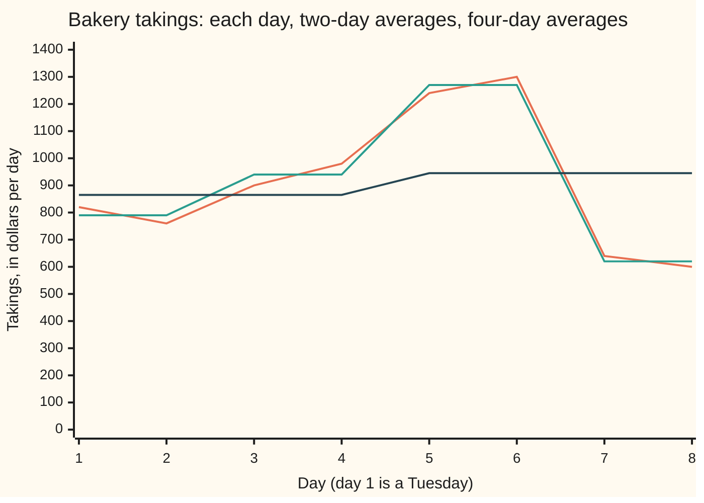

# The Haar wavelet: averages and differences, and the ladder of coarse-to-fine views

[Syllabus](../../../SYLLABUS.md) → [Harmonic analysis](../README.md) → [Wavelets and Time-Frequency](../README.md#s05) → The Haar wavelet

---

## General Overview

A small bakery writes down its takings for eight days, Tuesday to the following Tuesday: $820, $760, $900, $980, $1,240, $1,300, $640 and $600. The figures are illustrative. The owner wants to see the eight days at several zoom levels at once: the overall level, the weekend bump, and the day-to-day wobble. Each view should be kept apart, with nothing counted twice.

Averages and differences do this. The eight-day average is $905. The first four days averaged $865 and the last four $945, a half-difference of −$40. Inside the last four days, the weekend averaged $1,270 and the two days after it $620: a half-difference of $325, the largest piece of the week. The four pairs of neighbouring days differ by much less: half-differences of 30, −40, −30 and 20 dollars.

The [Wavelets](../../13-Engineering%20mathematics/05-Signals/08-wavelets-and-multiresolution.md) card in the engineering wing runs this ladder on a list of numbers. This card moves it onto the time line. The takings become a step function of time, and each average or difference becomes the overlap of that function with one fixed step shape. Those shapes are the **Haar functions**: an up-down step at every width 1, 2, 4, 8, … days, and also ½, ¼, … of a day, placed at every whole multiple of its width.

**The Haar functions are perpendicular to each other and of size 1 at every width and every position, and every signal of finite energy on the line is the sum of its pieces along them; this works because the step-function views at widths of 2 to the power j days sit inside each other, lose everything as the width grows and miss nothing as it shrinks.**

**What kind of fact this is:** a theorem, proved on this card in Why it works: the Haar functions form an orthonormal basis (a set of perpendicular pieces of energy 1 that builds every signal) of all finite-energy signals on the line. The ladder of nested views is a definition, the multiresolution axioms. That every such ladder yields a wavelet basis is a theorem of Mallat, stated here with its source. The bakery's numbers are illustrative.

### The picture: the same eight days at three widths



Orange: the takings, day by day. Teal: the two-day view, each pair replaced by its average. Dark blue: the four-day view. The eight-day view is a flat $905. The chart joins the daily points with straight lines; the true views are flat steps. Each coarser view is the finer one with its pair differences taken out, and those differences are kept as the detail at that width.

---

## The formula

Notation first, in words.

- Time $`t`$ is in days. Day 1 is $`0 \le t < 1`$, day 8 is $`7 \le t < 8`$.
- The signal $`f(t)`$ is the takings of the day that contains $`t`$, in dollars per day, and zero outside the eight days. So the area under $`f`$ over one day is that day's takings.
- The inner product of two real signals is $`\langle f, g\rangle = \int f(t)\,g(t)\,dt`$ over the whole line. With complex values the second one is conjugated, as across this wing. The **energy** is $`\lVert f\rVert_2^2 = \langle f, f\rangle`$. Signals with $`\langle f, g\rangle = 0`$ are **perpendicular**.
- $`L^2(\mathbb{R})`$ is the set of all signals on the line with finite energy, and $`\mathbb{Z}`$ is the set of whole numbers, negative ones included.
- The **level** $`j`$ is a whole number that sets the width $`2^j`$ days; the **shift** $`k`$ places a piece at $`k \cdot 2^j`$. Level 1 is the finest detail of the bakery's data, as in the engineering wing. Level 0 is one day; negative levels are half-days, quarter-days and finer.

The **scaling function** $`\varphi`$ (a box) and the **Haar wavelet** $`\psi`$ (an up-down step; the shelf's mother wavelet, from [Continuous wavelet transform](02-continuous-wavelet-transform-and-the-scalogram.md)), stretched and shifted:

```math
\varphi(t) = \begin{cases} 1 & 0 \le t < 1 \\ 0 & \text{otherwise} \end{cases} \qquad \psi(t) = \begin{cases} 1 & 0 \le t < \tfrac12 \\ -1 & \tfrac12 \le t < 1 \\ 0 & \text{otherwise} \end{cases}
```

```math
\varphi_{j,k}(t) = 2^{-j/2}\,\varphi\bigl(2^{-j}t - k\bigr), \qquad \psi_{j,k}(t) = 2^{-j/2}\,\psi\bigl(2^{-j}t - k\bigr)
```

The theorem, and the expansion it gives for any level $`J`$ chosen as the coarsest view:

```math
\langle \psi_{j,k}, \psi_{j',k'}\rangle = \begin{cases} 1 & (j,k) = (j',k') \\ 0 & \text{otherwise} \end{cases} \qquad f = \sum_{k \in \mathbb{Z}} \langle f, \varphi_{J,k}\rangle\, \varphi_{J,k} + \sum_{j \le J}\, \sum_{k \in \mathbb{Z}} \langle f, \psi_{j,k}\rangle\, \psi_{j,k}
```

**Read it aloud:** two different Haar steps are perpendicular and each has energy one, so any finite-energy signal is its coarse boxes at level $`J`$ plus its detail steps at every finer level, each piece being the signal's overlap with one box or one step.

The ladder behind it is the space $`V_j`$ of finite-energy signals that are constant on every interval from $`k \cdot 2^j`$ to $`(k+1) \cdot 2^j`$. The **multiresolution axioms** are the properties of these spaces that the proof uses:

1. **Nested:** $`V_j \subset V_{j-1}`$. A coarse view is also a fine view.
2. **Scaling:** $`f(t)`$ lies in $`V_j`$ exactly when $`f(2t)`$ lies in $`V_{j-1}`$.
3. **Shifts:** if $`f(t)`$ lies in $`V_0`$, so does $`f(t - k)`$ for every whole number $`k`$.
4. **Separation:** only the zero signal lies in every $`V_j`$.
5. **Density:** every signal in $`L^2(\mathbb{R})`$ is a limit in energy of signals from $`V_j`$ as $`j \to -\infty`$.
6. **A basis for one level:** the shifts $`\varphi(t - k)`$ form an orthonormal basis of $`V_0`$.

The detail space $`W_j`$ holds the level-$`j`$ steps, and each finer view splits into a coarser view plus a perpendicular detail:

```math
V_{j-1} = V_j \oplus W_j
```

| Symbol | Plain meaning | In our example | Push it up and the answer… |
| --- | --- | --- | --- |
| $`t`$, $`s`$ | time, in days; in Step 1, the rescaled time $`s = 2^{-j}t - k`$ | 0 to 8 | — |
| $`f(t)`$ | the signal: takings of the day containing $`t`$, dollars per day | 820, 760, …, 600 | energy grows as its square |
| $`\langle f, g\rangle,\ \lVert f\rVert_2^2`$; $`R`$, $`\varepsilon`$ | overlap of two signals; energy of one. In the proofs: $`g`$ is a helper signal, zero outside a bounded stretch (of length $`R`$ in Step 4, $`[-R, R]`$ in the fold) and close to $`f`$ in energy; $`\varepsilon`$ is a small tolerance | energy 7,017,600 dollars² per day | — |
| $`L^2(\mathbb{R})`$ | all signals on the line with finite energy | the takings are one | — |
| $`\varphi`$ | the scaling function: a box of height 1 on one day | — | — |
| $`\psi`$ | the Haar wavelet: +1 on the first half-day, −1 on the second | — | — |
| $`j,\ J`$ | level, width $`2^j`$ days; the coarsest level kept | levels 1, 2, 3; $`J`$ = 3 | wider pieces, slower changes |
| $`k,\ n,\ \mathbb{Z}`$ | the shift, a whole number; the shift of a half-width box in the refinement equation; all whole numbers | $`k`$ = 0 to 3 at level 1 | the piece moves later by $`2^j`$ days |
| $`\varphi_{j,k},\ \psi_{j,k}`$ | box and step of width $`2^j`$ starting at $`k \cdot 2^j`$, height $`2^{-j/2}`$ so energy is 1 | $`\psi_{2,1}`$ covers days 5 to 8 | lower and wider |
| $`V_j,\ P_j f`$ | signals constant on each width-$`2^j`$ interval: the view at width $`2^j`$; the view of $`f`$ there, its average on each interval (the perpendicular projection onto $`V_j`$) | $`V_2`$: four-day averages; $`P_2 f`$ is 865, then 945 | coarser view, less of the signal |
| $`W_j,\ \oplus,\ D_j f`$ | the level-$`j`$ details; a sum of two perpendicular spaces; the detail of $`f`$ at level $`j`$ (its projection onto $`W_j`$) | $`W_2`$ holds −150 and 650 | — |
| $`m,\ M`$ | how many halvings below one day: boxes $`2^{-m}`$ days wide, level $`-m`$ | $`m`$ = 12: boxes 0.000244 days | finer boxes, smaller error energy |

### When it holds

- **The signal has finite energy.** A bakery that took $905 every day forever is constant at every width, yet is not the zero signal. It has infinite energy, so it is outside $`L^2(\mathbb{R})`$ and in no $`V_j`$; separation does not apply, and its sum of pieces means nothing.
- **Shifts are whole widths.** Two level-0 steps half a day apart overlap, and their inner product is −0.5, not 0. Only shifts by whole multiples of the width give perpendicular pieces.
- **The height is $`2^{-j/2}`$.** A width-4 step of height 1 has energy 4, not 1. Without the factor, the squares of the pieces no longer add to the energy.
- **"Converges" means in energy.** A till that opens at 8 a.m., a third of the way through the day, makes a jump at a time that no dyadic grid (cut points at whole multiples of a width $`2^j`$) hits. The energy of the error halves with each finer level, but the worst gap stays at 0.666667 of the jump.
- **A finite stack keeps its coarse box.** The details at levels 1 to 3 alone hold 6.63% of the bakery's energy; the $905 level lives in $`V_3`$.

---

## Why it works

### Step 0: nested views, and the detail as what the finer view adds

A view at width 2 days keeps everything the view at width 4 days keeps, and more. The extra is the detail: the finer view minus the coarser one. If each detail is perpendicular to the coarser view, then energy splits cleanly between them. Stack these splits down the whole ladder and the details, plus one coarse view, rebuild the signal with no overlap. The Haar functions are a basis for each detail space; the rest of the proof shows that nothing leaks out at either end of the ladder.

### Step 1: every Haar function has energy 1

Change variable to $`s = 2^{-j}t - k`$, so $`dt = 2^j\,ds`$. The squared height is $`2^{-j}`$, and $`\psi(s)^2 = 1`$ on an interval of length 1. So $`\lVert\psi_{j,k}\rVert_2^2 = 2^{-j} \cdot 2^j \cdot 1 = 1`$. The same holds for every box $`\varphi_{j,k}`$. Stretching makes a piece wider by $`2^j`$, and the height $`2^{-j/2}`$ pays that back exactly.

### Step 2: any two different Haar functions are perpendicular

Two dyadic intervals (intervals from $`k \cdot 2^j`$ to $`(k+1)\cdot 2^j`$) are either nested or apart; they never half-overlap. Two cases follow.

- **Same level, different shifts.** The two pieces live on separate intervals. Their product is zero everywhere.
- **Different levels.** Take the finer step. Its interval sits inside one half of the coarser step's interval, or outside it. On that half the coarser step is a constant. So the inner product is that constant times the area under the finer step, and the area under any step is zero.

The same argument shows each box $`\varphi_{J,k}`$ is perpendicular to every step at a finer level. The check builds 62 Haar functions at levels −1 to 3 on 16 days, integrates every pair on the line, and finds the table of inner products equal to the identity table to 12 decimal places.

### Step 3: the two-scale relation, and the ladder

A box is two half-width boxes side by side, and a step is a half-width box minus its neighbour:

```math
\varphi(t) = \varphi(2t) + \varphi(2t-1), \qquad \psi(t) = \varphi(2t) - \varphi(2t-1)
```

Stretched and scaled, this reads $`\varphi_{j,k} = (\varphi_{j-1,2k} + \varphi_{j-1,2k+1})/\sqrt2`$ and $`\psi_{j,k} = (\varphi_{j-1,2k} - \varphi_{j-1,2k+1})/\sqrt2`$. On one interval of width $`2^j`$, a signal in $`V_{j-1}`$ has two values, one per half. A signal in $`V_j \oplus W_j`$ has two too: a level and a step size. Each pair fixes the other, so $`V_{j-1} = V_j \oplus W_j`$, and the two parts are perpendicular by Step 2.

The coefficients are the ladder's numbers, rescaled. A box of height $`2^{-j/2}`$ over $`2^j`$ days measures $`2^{-j/2} \cdot 2^j`$ times the average, so:

```math
\langle f, \varphi_{j,k}\rangle = 2^{j/2} \times \text{average over the interval}, \qquad \langle f, \psi_{j,k}\rangle = 2^{j/2} \times \text{half-difference of its two halves}
```

This is the engineering wing's ladder, with its $`\sqrt2`$ at every rung, seen as integrals on the line. The check computes each coefficient both ways, by the averages ladder and by integrating $`f`$ against $`\psi_{j,k}`$, and they agree.

### Step 4: at the coarse end, the boxes lose everything

For the bakery, the box $`\varphi_{J,0}`$ with $`J \ge 3`$ covers all eight days, and every other box at that level sees nothing. Its coefficient is $`2^{-J/2} \times 7240`$, so the energy left in $`V_J`$ is $`7240^2 / 2^J`$. That halves at each level: 6,552,200 at $`J`$ = 3, 51,189.062 at $`J`$ = 10, 49.989 at $`J`$ = 20. The weekly total spreads over ever wider, ever lower boxes, and its energy drains away.

For any finite-energy signal the argument is the same. A signal that is zero outside a stretch of length $`R`$ meets at most two boxes once $`2^J \ge R`$, and each holds at most (its total area)² divided by $`2^J`$. Every finite-energy signal is within any tolerance in energy of such a signal, and a projection (keeping only the part of a signal that lies in one space) never adds energy. So the coarse part tends to zero in energy. This is the separation axiom at work.

### Step 5: at the fine end, the boxes miss nothing

Take a continuous signal that is zero outside a bounded stretch. It is uniformly continuous: one width serves everywhere. On boxes that narrow, the box average is within any tolerance of the signal at every point inside, so the error energy is small too. Continuous signals of this kind come within any tolerance in energy of every finite-energy signal ([Riesz-Fischer](../../10-Measure%20and%20integration/07-Sizes%20of%20Functions/05-completeness-of-lp.md) proves it). This is the density axiom.

The mode matters. The till that opens at 8 a.m. jumps from 0 to 1 at $`t = 1/3`$. The box containing $`1/3`$ always has a third or two thirds of its width after the jump, so the worst gap is 0.666667 at every level. The error energy, by contrast, is $`(2/9) \cdot 2^{-m}`$ for boxes $`2^{-m}`$ days wide: 0.111111111 at half-days and 0.000054253 at $`m`$ = 12. The view converges in energy, not uniformly.

### Step 6: telescope the ladder into a basis

By Step 3, the view at a fine level $`-M`$ equals the view at level $`J`$ plus the details at every level from $`-M+1`$ up to $`J`$. Let $`M`$ grow: by Step 5 the left side tends to $`f`$ in energy. That gives the expansion in the formula. Now let $`J`$ grow too: by Step 4 the coarse part tends to zero. So the steps $`\psi_{j,k}`$ for all whole $`j`$ and $`k`$ form an orthonormal basis of $`L^2(\mathbb{R})`$ on their own, and their squared coefficients add to the energy (Parseval, from [Orthonormal bases](../../18-Functional%20analysis/02-Hilbert%20Spaces/03-orthonormal-bases-and-parseval.md)). For the bakery, the details up to level 12 already hold 99.8176% of the energy.

<details>
<summary>Detailed proof: the coarse part tends to zero, and the fine view tends to the signal</summary>

Write $`P_j f`$ for the view of $`f`$ at level $`j`$: on each interval of width $`2^j`$, the average of $`f`$ there. It is the perpendicular projection onto $`V_j`$, so its energy is at most that of $`f`$.

*Coarse end.* Suppose $`g`$ is zero outside $`[-R, R]`$ and $`2^J \ge R`$. Only the boxes $`[0, 2^J)`$ and $`[-2^J, 0)`$ meet $`g`$. On each, by Cauchy–Schwarz (an integral of a product is at most the product of the energies' square roots),

$`\displaystyle \bigl\lVert P_J g \text{ on one box} \bigr\rVert_2^2 = \frac{1}{2^J}\Bigl(\int_{\text{box}} g\Bigr)^2 \le \frac{1}{2^J}\Bigl(\int \lvert g\rvert\Bigr)^2 \le \frac{2R}{2^J}\,\lVert g\rVert_2^2`$

which tends to zero. For a general $`f`$ pick such a $`g`$ with $`\lVert f - g\rVert_2 < \varepsilon`$. Then $`\lVert P_J f\rVert_2 \le \lVert P_J (f - g)\rVert_2 + \lVert P_J g\rVert_2 < \varepsilon + \lVert P_J g\rVert_2`$, and the last term tends to zero.

*Fine end.* Let $`g`$ be continuous and zero outside $`[-R, R]`$. Given $`\varepsilon > 0`$, uniform continuity gives a level $`-M`$ such that $`g`$ varies by less than $`\varepsilon`$ on every box of width $`2^{-M} \le 1`$. Then $`\lvert P_{-M} g(t) - g(t)\rvert < \varepsilon`$ for every $`t`$, and both are zero outside $`[-R-1, R+1]`$, so

$`\displaystyle \lVert P_{-M} g - g\rVert_2^2 \le \varepsilon^2 \,(2R + 2)`$

For a general $`f`$, choose such a $`g`$ within $`\varepsilon`$ of $`f`$ in energy; then $`\lVert P_{-M} f - f\rVert_2 \le \lVert P_{-M}(f - g)\rVert_2 + \lVert P_{-M} g - g\rVert_2 + \lVert g - f\rVert_2`$, and each term is small.

*Basis.* By Step 3, $`P_{-M} f = P_J f + \sum_{j=-M+1}^{J} D_j f`$, where $`D_j f`$ is the projection onto $`W_j`$. The two limits give $`f = \lim_{M, J \to \infty} \sum_{j=-M+1}^{J} D_j f`$ in energy. A signal perpendicular to every $`\psi_{j,k}`$ has every $`D_j f = 0`$, so it is zero. By the completeness test on [Orthonormal bases](../../18-Functional%20analysis/02-Hilbert%20Spaces/03-orthonormal-bases-and-parseval.md), the steps form an orthonormal basis.

</details>

### Step 7: the axioms behind every wavelet family

Steps 4 and 5 proved separation and density for Haar's boxes. Step 6 then used only the axioms and the perpendicular split of Step 3. So any ladder of spaces with the six properties gives a wavelet basis, once each detail space $`W_j`$ has an orthonormal basis made of stretched, shifted copies of one $`\psi`$. Mallat proved in 1989 (second source below) that such a $`\psi`$ always exists: from the axioms alone one builds a single $`\psi`$ in $`W_0`$ whose copies $`\psi_{j,k}`$ form an orthonormal basis of $`L^2(\mathbb{R})`$.

The key is the nesting. The box $`\varphi`$ lies in $`V_0`$, which sits inside $`V_{-1}`$, so $`\varphi`$ is a weighted sum of its own half-width copies $`\varphi(2t - n)`$. This is the **refinement equation**. For Haar the weights are 1 and 1. The wavelet is then the same half-width copies with the weights reversed in order and alternated in sign; for Haar that gives $`\varphi(2t) - \varphi(2t-1)`$, Step 3's step. Those weights become the filters of [Mallat's algorithm](04-mallats-fast-wavelet-transform.md).

Haar's box is the simplest scaling function. Its jumps are their weakness: a smooth signal needs many middle-sized steps. [Daubechies wavelets](06-daubechies-and-vanishing-moments.md) keep all six axioms with smoother shapes.

---

## Worked numbers, by hand

The eight days: 820, 760, 900, 980, 1,240, 1,300, 640, 600 dollars. Pair neighbours, take averages and half-differences, and repeat on the averages. Then multiply by $`2^{j/2}`$: $`\sqrt2`$ at level 1, 2 at level 2, $`2\sqrt2`$ at level 3.

| Step | Arithmetic | Value |
| --- | --- | --- |
| level 1 averages | (820 + 760)/2, (900 + 980)/2, (1240 + 1300)/2, (640 + 600)/2 | 790, 940, 1270, 620 |
| level 1 half-differences | (820 − 760)/2, (900 − 980)/2, (1240 − 1300)/2, (640 − 600)/2 | 30, −40, −30, 20 |
| level 2 averages and half-differences | (790 ± 940)/2, (1270 ± 620)/2 | 865, 945; −75, 325 |
| level 3 average and half-difference | (865 ± 945)/2 | 905; −40 |
| coarse coefficient | $`2\sqrt2`$ × 905 | 2,559.726548 |
| level 3 coefficient | $`2\sqrt2`$ × (−40) | −113.137085 |
| level 2 coefficients | 2 × (−75), 2 × 325 | −150, 650 |
| level 1 coefficients | $`\sqrt2`$ × (30, −40, −30, 20) | 42.426407, −56.568542, −42.426407, 28.284271 |
| energy, by pieces | coarse 6,552,200 + level 3 12,800 + level 2 445,000 + level 1 7,600 | 7,017,600 |
| energy, by days | 820² + 760² + 900² + 980² + 1240² + 1300² + 640² + 600² | 7,017,600 |
| **energy ledger** | **pieces against days** | **7,017,600 = 7,017,600** |

Every dollar² of the week's energy is in exactly one piece. After the flat $905, most of the rest sits in one coefficient, 650: the weekend against the two days after it. The check finds the same coefficients by integrating $`f(t)\,\psi_{j,k}(t)`$ over the line, and rebuilds the eight days from them exactly.

```
detail energy by level, dollars² per day (40 marks = 445,000)
  level 1, two-day steps    ▏                                          7,600.0
  level 2, four-day steps   ████████████████████████████████████████  445,000.0
  level 3, eight-day step   █                                         12,800.0
```

The coarse box holds the other 6,552,200.0, off this scale.

### What breaks if you drop a piece

| Mistake | Comes out at | What went wrong |
| --- | --- | --- |
| Use the averages and half-differences themselves as the coordinates | sum of squares 935,675, not 7,017,600 | the factor $`2^{j/2}`$ is missing, so the pieces are not of energy 1 |
| Shift the step by half its width | $`\langle\psi(t), \psi(t - 1/2)\rangle`$ = −0.5, not 0 | the halves overlap; only whole-width shifts are perpendicular |
| Stretch the step without the height $`2^{-j/2}`$ | energy of $`\psi(t/4)`$ is 4, not 1 | a wider piece of the same height carries more energy |
| Keep levels 1 to 3 and drop the coarse box | day 1 rebuilds as −85.0, not 820; the details hold 6.63% of the energy | the $905 level lives in $`V_3`$, not in any detail |
| Expect a jump at 8 a.m. to be matched everywhere | worst gap 0.666667 at every width | convergence is in energy; the box that holds the jump always averages across it |

---

## Code, from first principles, and it actually runs

The code writes the box, the step and the bakery's signal as functions of time, and integrates their products on the line with a midpoint sum whose grid of 1/8 day falls between every jump, so each integral is exact. It reaches the coefficients by two independent roads, the averages ladder and the integrals, and checks a third, the energy ledger, against the sum of the squared takings. It also checks the 62-function table of inner products, the two-scale relation, the coarse energy $`7240^2 / 2^J`$ against the ladder on 4,096 days, and the 8 a.m. jump in exact fractions, by summing box energies and by the formula.

### Python

```python
# The Haar wavelet on the whole line: eight days of bakery sales as averages and differences.
# Standard library only.  Roads: the averages-and-differences ladder, integrals of f times
# each Haar function on the time line (midpoint sums, exact for these steps), and energy.
from fractions import Fraction as Fr
sales = [820, 760, 900, 980, 1240, 1300, 640, 600]  # dollars, day 1 = t in [0, 1) days
H = 1 / 8                                            # grid step in days for the integrals
def phi(x): return 1.0 if 0 <= x < 1 else 0.0
def psi(x): return 1.0 if 0 <= x < 0.5 else (-1.0 if 0.5 <= x < 1 else 0.0)
def unit(g, j, k): return lambda t: 2 ** (-j / 2) * g(2 ** (-j) * t - k)
def f(t): return float(sales[int(t)]) if 0 <= t < 8 else 0.0
def integral(u, a, b): return sum(u(a + (i + 0.5) * H) for i in range(int((b - a) / H))) * H
def inner(u, v, a=0, b=16): return integral(lambda t: u(t) * v(t), a, b)
def close(a, b, tol=1e-9): return abs(a - b) <= tol
def ladder(x, levels):  # averages and half-differences, as on a till roll
    s, out = list(x), []
    for _ in range(levels):
        h = len(s) // 2
        out.append([(s[2 * i] - s[2 * i + 1]) / 2 for i in range(h)])
        s = [(s[2 * i] + s[2 * i + 1]) / 2 for i in range(h)]
    return s, out  # coarsest averages, then half-differences from level 1 up
def row(xs, d=0): return " ".join(f"{x:.{d}f}" for x in xs)
print("sales, dollars, days 1..8:", row(sales))
energy = sum(x * x for x in sales)
print(f"total {sum(sales)}  energy sum f^2 {energy} dollars^2/day")
avg3, half = ladder(sales, 3)
for j in range(3):
    print(f"level {j + 1} averages: {row(ladder(sales, j + 1)[0])}   half-differences: {row(half[j])}")
# road 1: coefficient = 2^(j/2) * average or half-difference;  road 2: integral on the line
coarse = inner(f, unit(phi, 3, 0))
print(f"<f, phi_3,0> integral {coarse:.6f}  ladder {2 ** 1.5 * avg3[0]:.6f}")
assert close(coarse, 2 ** 1.5 * avg3[0])
level_energy = []
for j in (3, 2, 1):
    c = [inner(f, unit(psi, j, k)) for k in range(8 >> j)]
    print(f"<f, psi_{j},k> integral: {row(c, 6)}")
    for k in range(8 >> j):
        assert close(c[k], 2 ** (j / 2) * half[j - 1][k])
    level_energy.append(sum(x * x for x in c))
print(f"energy by part: coarse {coarse ** 2:.1f}  level 3 {level_energy[0]:.1f}  level 2 {level_energy[1]:.1f}"
      f"  level 1 {level_energy[2]:.1f}  sum {coarse ** 2 + sum(level_energy):.1f}")
assert close(coarse ** 2 + sum(level_energy), energy, 1e-6)
# rebuild day 1..8 from the coefficients: f = sum c phi + sum d psi
basis = [(coarse, unit(phi, 3, 0))] + [(inner(f, unit(psi, j, k)), unit(psi, j, k)) for j in (1, 2, 3) for k in range(8 >> j)]
rebuilt = [sum(c * u(d + 0.5) for c, u in basis) for d in range(8)]
print("rebuilt days:", row(rebuilt, 6))
assert max(abs(a - b) for a, b in zip(rebuilt, sales)) < 1e-9
dropped = [sum(c * u(d + 0.5) for c, u in basis[1:]) for d in range(8)]
print("details only, no coarse box:", row(dropped, 1), f" energy {sum(level_energy):.1f}"
      f" = {100 * sum(level_energy) / energy:.2f}%")
# orthonormality: every psi_{j,k} with support inside [0, 16), levels -1..3, by integration
fam = [(j, k) for j in (-1, 0, 1, 2, 3) for k in range(int(16 / 2 ** j))]
gap = max(abs(inner(unit(psi, *a), unit(psi, *b)) - (1.0 if a == b else 0.0)) for a in fam for b in fam)
print(f"Gram matrix of {len(fam)} Haar functions, levels -1..3 on [0,16): max |G - I| {gap:.12f}")
assert gap < 1e-12
cross = max(abs(inner(unit(phi, 3, 0), unit(psi, j, k))) for j in (1, 2, 3) for k in range(8 >> j))
print(f"coarse box against every finer detail: max |inner| {cross:.12f}")
assert cross < 1e-12
two_scale = max(max(abs(phi(t) - phi(2 * t) - phi(2 * t - 1)), abs(psi(t) - phi(2 * t) + phi(2 * t - 1)))
                for t in [(i + 0.5) / 64 - 1 for i in range(192)])
print(f"two-scale: phi(t) = phi(2t) + phi(2t-1), psi(t) = phi(2t) - phi(2t-1): max error {two_scale:.1f}")
assert two_scale == 0.0
# separation: the coarse part drains away, energy 7240^2 / 2^J, by formula and by the ladder
print("J | energy left in V_J: formula, ladder on [0, 4096) | share captured by details")
long_row = sales + [0] * (4096 - 8)
for J in (3, 4, 5, 6, 8, 10, 12):
    left = sum(sales) ** 2 / 2 ** J
    s, _ = ladder(long_row, J)
    by_ladder = sum((2 ** (J / 2) * a) ** 2 for a in s)
    assert close(left, by_ladder, 1e-6)
    print(f"{J:2d} | {left:.3f}  {by_ladder:.3f} | {100 * (1 - left / energy):.4f}%")
print(f"20 | {sum(sales) ** 2 / 2 ** 20:.3f}")
# what breaks
naive = sum(x * x for x in avg3) + sum(x * x for lv in half for x in lv)
print(f"averages and half-differences as coordinates: sum of squares {naive:.1f} (true {energy})")
assert not close(naive, energy, 1)
hs = inner(unit(psi, 0, 0), lambda t: psi(t - 0.5))  # a step against its half-day shift
print(f"half shift: <psi, psi(t - 1/2)> = {hs:.6f}")
assert close(hs, -0.5)
e4 = inner(lambda t: psi(t / 4), lambda t: psi(t / 4))  # width 4, height 1
print(f"no 2^(-j/2): energy of psi(t/4) = {e4:.6f}")
assert close(e4, 4.0)
shifted = [0] + sales + [0] * 7                      # the same week, one day later
for name, x in (("as recorded", sales + [0] * 8), ("one day later", shifted)):
    s, hd = ladder(x, 4)
    e = [sum((2 ** (j / 2) * v) ** 2 for v in hd[j - 1]) for j in (1, 2, 3, 4)]
    print(f"{name}: detail energy levels 1-4 {row(e, 1)}  coarse {(4 * s[0]) ** 2:.1f}")
    assert close(sum(e) + (4 * s[0]) ** 2, energy, 1e-6)
# converges in energy, not uniformly: a till opening at 8 a.m. (t = 1/3 day), boxes 2^-m wide
print("m | box days | worst gap | energy gap: by boxes, formula (2/9) 2^-m")
for m in (1, 2, 4, 8, 12):
    w = Fr(1, 2 ** m)
    kept = sum(w * (min(Fr(1), (i + 1) * w) - max(Fr(1, 3), i * w)) ** 2 / w ** 2
               for i in range(2 ** m) if (i + 1) * w > Fr(1, 3))
    worst = max(Fr(1, 3) % w / w, 1 - Fr(1, 3) % w / w)
    gap_e = Fr(2, 3) - kept                          # Pythagoras: |g|^2 - |projection|^2
    assert gap_e == Fr(2, 9) * w
    print(f"{m:2d} | {float(w):.6f} | {float(worst):.6f} | {float(gap_e):.9f}  {float(Fr(2, 9) * w):.9f}")
print("chart day:", row(range(1, 9)))
print("chart V_0:", row(sales))
print("chart V_1:", row([v for v in ladder(sales, 1)[0] for _ in range(2)]))
print("chart V_2:", row([v for v in ladder(sales, 2)[0] for _ in range(4)]))
print("ALL CHECKS PASS")
```

**Ran 2026-11-15 on macOS, Python 3.14.10, standard library only. All checks passed. Output, pasted from the run:**

```text
sales, dollars, days 1..8: 820 760 900 980 1240 1300 640 600
total 7240  energy sum f^2 7017600 dollars^2/day
level 1 averages: 790 940 1270 620   half-differences: 30 -40 -30 20
level 2 averages: 865 945   half-differences: -75 325
level 3 averages: 905   half-differences: -40
<f, phi_3,0> integral 2559.726548  ladder 2559.726548
<f, psi_3,k> integral: -113.137085
<f, psi_2,k> integral: -150.000000 650.000000
<f, psi_1,k> integral: 42.426407 -56.568542 -42.426407 28.284271
energy by part: coarse 6552200.0  level 3 12800.0  level 2 445000.0  level 1 7600.0  sum 7017600.0
rebuilt days: 820.000000 760.000000 900.000000 980.000000 1240.000000 1300.000000 640.000000 600.000000
details only, no coarse box: -85.0 -145.0 -5.0 75.0 335.0 395.0 -265.0 -305.0  energy 465400.0 = 6.63%
Gram matrix of 62 Haar functions, levels -1..3 on [0,16): max |G - I| 0.000000000000
coarse box against every finer detail: max |inner| 0.000000000000
two-scale: phi(t) = phi(2t) + phi(2t-1), psi(t) = phi(2t) - phi(2t-1): max error 0.0
J | energy left in V_J: formula, ladder on [0, 4096) | share captured by details
 3 | 6552200.000  6552200.000 | 6.6319%
 4 | 3276100.000  3276100.000 | 53.3159%
 5 | 1638050.000  1638050.000 | 76.6580%
 6 | 819025.000  819025.000 | 88.3290%
 8 | 204756.250  204756.250 | 97.0822%
10 | 51189.062  51189.062 | 99.2706%
12 | 12797.266  12797.266 | 99.8176%
20 | 49.989
averages and half-differences as coordinates: sum of squares 935675.0 (true 7017600)
half shift: <psi, psi(t - 1/2)> = -0.500000
no 2^(-j/2): energy of psi(t/4) = 4.000000
as recorded: detail energy levels 1-4 7600.0 445000.0 12800.0 3276100.0  coarse 3276100.0
one day later: detail energy levels 1-4 777600.0 286000.0 397800.0 2280100.0  coarse 3276100.0
m | box days | worst gap | energy gap: by boxes, formula (2/9) 2^-m
 1 | 0.500000 | 0.666667 | 0.111111111  0.111111111
 2 | 0.250000 | 0.666667 | 0.055555556  0.055555556
 4 | 0.062500 | 0.666667 | 0.013888889  0.013888889
 8 | 0.003906 | 0.666667 | 0.000868056  0.000868056
12 | 0.000244 | 0.666667 | 0.000054253  0.000054253
chart day: 1 2 3 4 5 6 7 8
chart V_0: 820 760 900 980 1240 1300 640 600
chart V_1: 790 790 940 940 1270 1270 620 620
chart V_2: 865 865 865 865 945 945 945 945
ALL CHECKS PASS
```

### Rust

Same numbers, same labels, built with `rustc --edition 2021 -O`. The 8 a.m. jump uses whole numbers counted in units of $`1/(3 \cdot 2^m)`$ of a day, so it stays exact without a fractions library.

```rust
// The Haar wavelet on the whole line: eight days of bakery sales as averages and differences.
// std only.  Roads: the averages-and-differences ladder, integrals of f times each Haar
// function on the time line (midpoint sums, exact for these steps), and energy.
const SALES: [f64; 8] = [820.0, 760.0, 900.0, 980.0, 1240.0, 1300.0, 640.0, 600.0];
const H: f64 = 1.0 / 8.0; // grid step in days for the integrals
fn phi(x: f64) -> f64 { if (0.0..1.0).contains(&x) { 1.0 } else { 0.0 } }
fn psi(x: f64) -> f64 { if (0.0..0.5).contains(&x) { 1.0 } else if (0.5..1.0).contains(&x) { -1.0 } else { 0.0 } }
fn unit(g: fn(f64) -> f64, j: i32, k: i32) -> impl Fn(f64) -> f64 {
    move |t| 2f64.powf(-j as f64 / 2.0) * g(2f64.powf(-j as f64) * t - k as f64)
}
fn f(t: f64) -> f64 { if (0.0..8.0).contains(&t) { SALES[t as usize] } else { 0.0 } }
fn integral(u: &dyn Fn(f64) -> f64, a: f64, b: f64) -> f64 {
    let n = ((b - a) / H) as usize;
    let mut s = 0.0;
    for i in 0..n { s += u(a + (i as f64 + 0.5) * H); }
    s * H
}
fn inner(u: &dyn Fn(f64) -> f64, v: &dyn Fn(f64) -> f64) -> f64 { integral(&|t| u(t) * v(t), 0.0, 16.0) }
fn close(a: f64, b: f64, tol: f64) -> bool { (a - b).abs() <= tol }
fn ladder(x: &[f64], levels: usize) -> (Vec<f64>, Vec<Vec<f64>>) {
    let (mut s, mut out) = (x.to_vec(), Vec::new());
    for _ in 0..levels {
        let h = s.len() / 2;
        out.push((0..h).map(|i| (s[2 * i] - s[2 * i + 1]) / 2.0).collect());
        s = (0..h).map(|i| (s[2 * i] + s[2 * i + 1]) / 2.0).collect();
    }
    (s, out)
}
fn row(xs: &[f64], d: usize) -> String { xs.iter().map(|x| format!("{:.*}", d, x)).collect::<Vec<_>>().join(" ") }
fn main() {
    println!("sales, dollars, days 1..8: {}", row(&SALES, 0));
    let total: f64 = SALES.iter().sum();
    let energy: f64 = SALES.iter().map(|x| x * x).sum();
    println!("total {}  energy sum f^2 {} dollars^2/day", total, energy);
    let (avg3, half) = ladder(&SALES, 3);
    for j in 0..3 {
        println!("level {} averages: {}   half-differences: {}", j + 1, row(&ladder(&SALES, j + 1).0, 0), row(&half[j], 0));
    }
    let coarse = inner(&f, &unit(phi, 3, 0));
    println!("<f, phi_3,0> integral {:.6}  ladder {:.6}", coarse, 2f64.powf(1.5) * avg3[0]);
    assert!(close(coarse, 2f64.powf(1.5) * avg3[0], 1e-9));
    let mut level_energy = Vec::new();
    for j in [3, 2, 1] {
        let c: Vec<f64> = (0..(8 >> j)).map(|k| inner(&f, &unit(psi, j, k))).collect();
        println!("<f, psi_{},k> integral: {}", j, row(&c, 6));
        for k in 0..c.len() { assert!(close(c[k], 2f64.powf(j as f64 / 2.0) * half[j as usize - 1][k], 1e-9)); }
        level_energy.push(c.iter().map(|x| x * x).sum::<f64>());
    }
    let le: f64 = level_energy.iter().sum();
    println!("energy by part: coarse {:.1}  level 3 {:.1}  level 2 {:.1}  level 1 {:.1}  sum {:.1}",
             coarse * coarse, level_energy[0], level_energy[1], level_energy[2], coarse * coarse + le);
    assert!(close(coarse * coarse + le, energy, 1e-6));
    // rebuild day 1..8 from the coefficients: f = sum c phi + sum d psi
    let mut basis: Vec<(f64, Box<dyn Fn(f64) -> f64>)> = vec![(coarse, Box::new(unit(phi, 3, 0)))];
    for j in [1, 2, 3] {
        for k in 0..(8 >> j) { basis.push((inner(&f, &unit(psi, j, k)), Box::new(unit(psi, j, k)))); }
    }
    let rebuild = |from: usize| -> Vec<f64> {
        (0..8).map(|d| basis[from..].iter().map(|(c, u)| c * u(d as f64 + 0.5)).sum()).collect()
    };
    let rebuilt = rebuild(0);
    println!("rebuilt days: {}", row(&rebuilt, 6));
    assert!(rebuilt.iter().zip(SALES.iter()).all(|(a, b)| (a - b).abs() < 1e-9));
    println!("details only, no coarse box: {}  energy {:.1} = {:.2}%", row(&rebuild(1), 1), le, 100.0 * le / energy);
    // orthonormality: every psi_{j,k} with support inside [0, 16), levels -1..3, by integration
    let mut fam = Vec::new();
    for j in [-1, 0, 1, 2, 3] { for k in 0..((16.0 / 2f64.powi(j)) as i32) { fam.push((j, k)); } }
    let mut gap: f64 = 0.0;
    for a in &fam { for b in &fam {
        let want = if a == b { 1.0 } else { 0.0 };
        gap = gap.max((inner(&unit(psi, a.0, a.1), &unit(psi, b.0, b.1)) - want).abs());
    } }
    println!("Gram matrix of {} Haar functions, levels -1..3 on [0,16): max |G - I| {:.12}", fam.len(), gap);
    assert!(gap < 1e-12);
    let mut cross: f64 = 0.0;
    for j in [1, 2, 3] { for k in 0..(8 >> j) { cross = cross.max(inner(&unit(phi, 3, 0), &unit(psi, j, k)).abs()); } }
    println!("coarse box against every finer detail: max |inner| {:.12}", cross);
    assert!(cross < 1e-12);
    let mut two_scale: f64 = 0.0;
    for i in 0..192 {
        let t = (i as f64 + 0.5) / 64.0 - 1.0;
        two_scale = two_scale.max((phi(t) - phi(2.0 * t) - phi(2.0 * t - 1.0)).abs())
            .max((psi(t) - phi(2.0 * t) + phi(2.0 * t - 1.0)).abs());
    }
    println!("two-scale: phi(t) = phi(2t) + phi(2t-1), psi(t) = phi(2t) - phi(2t-1): max error {:.1}", two_scale);
    assert!(two_scale == 0.0);
    // separation: the coarse part drains away, energy 7240^2 / 2^J, by formula and by the ladder
    println!("J | energy left in V_J: formula, ladder on [0, 4096) | share captured by details");
    let mut long_row = SALES.to_vec();
    long_row.resize(4096, 0.0);
    for jj in [3, 4, 5, 6, 8, 10, 12] {
        let left = total * total / 2f64.powi(jj);
        let (s, _) = ladder(&long_row, jj as usize);
        let by_ladder: f64 = s.iter().map(|a| (2f64.powf(jj as f64 / 2.0) * a).powi(2)).sum();
        assert!(close(left, by_ladder, 1e-6));
        println!("{:2} | {:.3}  {:.3} | {:.4}%", jj, left, by_ladder, 100.0 * (1.0 - left / energy));
    }
    println!("20 | {:.3}", total * total / 2f64.powi(20));
    // what breaks
    let naive: f64 = avg3.iter().map(|x| x * x).sum::<f64>() + half.iter().flatten().map(|x| x * x).sum::<f64>();
    println!("averages and half-differences as coordinates: sum of squares {:.1} (true {})", naive, energy);
    assert!(!close(naive, energy, 1.0));
    let hs = inner(&unit(psi, 0, 0), &|t| psi(t - 0.5));
    println!("half shift: <psi, psi(t - 1/2)> = {:.6}", hs);
    assert!(close(hs, -0.5, 1e-9));
    let e4 = inner(&|t| psi(t / 4.0), &|t| psi(t / 4.0)); // width 4, height 1
    println!("no 2^(-j/2): energy of psi(t/4) = {:.6}", e4);
    assert!(close(e4, 4.0, 1e-9));
    let mut rec = SALES.to_vec();
    rec.resize(16, 0.0);
    let mut shifted = vec![0.0];
    shifted.extend_from_slice(&SALES);
    shifted.resize(16, 0.0); // the same week, one day later
    for (name, x) in [("as recorded", rec), ("one day later", shifted)] {
        let (s, hd) = ladder(&x, 4);
        let e: Vec<f64> = (1..5).map(|j| hd[j - 1].iter().map(|v| (2f64.powf(j as f64 / 2.0) * v).powi(2)).sum()).collect();
        println!("{}: detail energy levels 1-4 {}  coarse {:.1}", name, row(&e, 1), (4.0 * s[0]).powi(2));
        assert!(close(e.iter().sum::<f64>() + (4.0 * s[0]).powi(2), energy, 1e-6));
    }
    // converges in energy, not uniformly: a till opening at 8 a.m. (t = 1/3 day), boxes 2^-m wide
    // exact integers: lengths counted in units of 1 / (3 * 2^m) days
    println!("m | box days | worst gap | energy gap: by boxes, formula (2/9) 2^-m");
    for m in [1u32, 2, 4, 8, 12] {
        let d: i64 = 3 << m; // one day in units
        let (w, open) = (3i64, 1i64 << m);
        let mut kept: i64 = 0; // sum of overlap^2; kept energy = kept / (3 d)
        for i in 0..(1i64 << m) {
            if (i + 1) * w > open { let l = d.min((i + 1) * w) - open.max(i * w); kept += l * l; }
        }
        let gap_num = 2 * d - kept; // energy gap = gap_num / (3 d), by Pythagoras
        assert!(gap_num == 2); // (2/9) 2^-m = 2 / (3 d)
        let r = (1i64 << m) % 3;
        let worst = r.max(3 - r) as f64 / 3.0;
        println!("{:2} | {:.6} | {:.6} | {:.9}  {:.9}", m, 1.0 / (1u64 << m) as f64, worst,
                 gap_num as f64 / (3 * d) as f64, 2.0 / (3 * d) as f64);
    }
    let days: Vec<f64> = (1..9).map(|x| x as f64).collect();
    println!("chart day: {}", row(&days, 0));
    println!("chart V_0: {}", row(&SALES, 0));
    let v1: Vec<f64> = ladder(&SALES, 1).0.iter().flat_map(|&v| [v, v]).collect();
    let v2: Vec<f64> = ladder(&SALES, 2).0.iter().flat_map(|&v| [v, v, v, v]).collect();
    println!("chart V_1: {}", row(&v1, 0));
    println!("chart V_2: {}", row(&v2, 0));
    println!("ALL CHECKS PASS");
}
```

**Ran 2026-11-15 on macOS, rustc 1.98.1, no crates. All checks passed. Output, pasted from the run:**

```text
sales, dollars, days 1..8: 820 760 900 980 1240 1300 640 600
total 7240  energy sum f^2 7017600 dollars^2/day
level 1 averages: 790 940 1270 620   half-differences: 30 -40 -30 20
level 2 averages: 865 945   half-differences: -75 325
level 3 averages: 905   half-differences: -40
<f, phi_3,0> integral 2559.726548  ladder 2559.726548
<f, psi_3,k> integral: -113.137085
<f, psi_2,k> integral: -150.000000 650.000000
<f, psi_1,k> integral: 42.426407 -56.568542 -42.426407 28.284271
energy by part: coarse 6552200.0  level 3 12800.0  level 2 445000.0  level 1 7600.0  sum 7017600.0
rebuilt days: 820.000000 760.000000 900.000000 980.000000 1240.000000 1300.000000 640.000000 600.000000
details only, no coarse box: -85.0 -145.0 -5.0 75.0 335.0 395.0 -265.0 -305.0  energy 465400.0 = 6.63%
Gram matrix of 62 Haar functions, levels -1..3 on [0,16): max |G - I| 0.000000000000
coarse box against every finer detail: max |inner| 0.000000000000
two-scale: phi(t) = phi(2t) + phi(2t-1), psi(t) = phi(2t) - phi(2t-1): max error 0.0
J | energy left in V_J: formula, ladder on [0, 4096) | share captured by details
 3 | 6552200.000  6552200.000 | 6.6319%
 4 | 3276100.000  3276100.000 | 53.3159%
 5 | 1638050.000  1638050.000 | 76.6580%
 6 | 819025.000  819025.000 | 88.3290%
 8 | 204756.250  204756.250 | 97.0822%
10 | 51189.062  51189.062 | 99.2706%
12 | 12797.266  12797.266 | 99.8176%
20 | 49.989
averages and half-differences as coordinates: sum of squares 935675.0 (true 7017600)
half shift: <psi, psi(t - 1/2)> = -0.500000
no 2^(-j/2): energy of psi(t/4) = 4.000000
as recorded: detail energy levels 1-4 7600.0 445000.0 12800.0 3276100.0  coarse 3276100.0
one day later: detail energy levels 1-4 777600.0 286000.0 397800.0 2280100.0  coarse 3276100.0
m | box days | worst gap | energy gap: by boxes, formula (2/9) 2^-m
 1 | 0.500000 | 0.666667 | 0.111111111  0.111111111
 2 | 0.250000 | 0.666667 | 0.055555556  0.055555556
 4 | 0.062500 | 0.666667 | 0.013888889  0.013888889
 8 | 0.003906 | 0.666667 | 0.000868056  0.000868056
12 | 0.000244 | 0.666667 | 0.000054253  0.000054253
chart day: 1 2 3 4 5 6 7 8
chart V_0: 820 760 900 980 1240 1300 640 600
chart V_1: 790 790 940 940 1270 1270 620 620
chart V_2: 865 865 865 865 945 945 945 945
ALL CHECKS PASS
```

### Lean

Lean proves the theorem and the first five axioms for every finite-energy signal, and checks the bakery's arithmetic.

- Every Haar function $`\psi_{j,k}`$ has energy 1, and any two different ones are perpendicular.
- The steps $`\psi_{j,k}`$, over all whole numbers $`j`$ and $`k`$, form an orthonormal basis of $`L^2(\mathbb{R})`$.
- Nested: take any level $`j`$. Then $`V_j \subset V_{j-1}`$.
- Scaling: take any signal $`f`$ and level $`j`$. Then $`f(t)`$ lies in $`V_j`$ exactly when $`f(2t)`$ lies in $`V_{j-1}`$.
- Shifts: suppose $`f(t)`$ lies in $`V_0`$ and $`k`$ is a whole number. Then $`f(t - k)`$ lies in $`V_0`$.
- Separation: only the zero signal lies in every $`V_j`$.
- Density: take $`f`$ in $`L^2(\mathbb{R})`$ and a tolerance $`\varepsilon > 0`$. Then below some level, every $`V_j`$ holds a signal within $`\varepsilon`$ of $`f`$ in energy.
- Lean also checks the hand arithmetic exactly: the averages, half-differences, both energy totals of 7,017,600 and the wrong sum 935,675.

The expansion with coarse boxes, the 8 a.m. jump and every decimal are left to the Python and Rust checks.

```lean
-- The Haar wavelet: the stretched and shifted Haar steps ψ_{j,k} are perpendicular with energy 1 and form an orthonormal basis of all finite-energy signals on the line, and the step-function views V_j nest, scale, shift, lose everything and miss nothing.
import Mathlib.Analysis.InnerProductSpace.l2Space
import Mathlib.MeasureTheory.Function.L2Space
import Mathlib.MeasureTheory.Integral.Bochner.Basic
import Mathlib.MeasureTheory.Measure.Lebesgue.Basic
import Mathlib.Analysis.SpecialFunctions.Pow.Real
import Mathlib.MeasureTheory.Function.ContinuousMapDense
import Mathlib.MeasureTheory.Function.Floor
import Mathlib.Topology.UniformSpace.HeineCantor

open MeasureTheory

/-! Signals are real functions of time `t : ℝ` (in days on the card). Energy and overlaps use
Lebesgue measure `volume` on the whole line. `Lp ℝ 2 volume` is Mathlib's L²(ℝ): finite-energy
signals, two signals that agree except on a set of length zero counted as one. -/

/-- The scaling function φ: a box of height 1 on 0 ≤ t < 1, zero elsewhere. -/
noncomputable def haarPhi (t : ℝ) : ℝ :=
  if 0 ≤ t ∧ t < 1 then 1 else 0

/-- The Haar wavelet ψ: +1 on 0 ≤ t < 1/2, −1 on 1/2 ≤ t < 1, zero elsewhere. -/
noncomputable def haarPsi (t : ℝ) : ℝ :=
  if 0 ≤ t ∧ t < 1 / 2 then 1 else if 1 / 2 ≤ t ∧ t < 1 then -1 else 0

/-- The Haar function ψ_{j,k}(t) = 2^(−j/2) ψ(2^(−j) t − k): a step of width 2^j starting at
k · 2^j, of height 2^(−j/2). -/
noncomputable def haarPsiJK (j k : ℤ) (t : ℝ) : ℝ :=
  (2 : ℝ) ^ (-(j : ℝ) / 2) * haarPsi ((2 : ℝ) ^ (-j) * t - k)

/-- A signal is constant on every dyadic interval of level `j`, from k · 2^j to (k + 1) · 2^j. -/
def ConstOnDyadic (j : ℤ) (f : ℝ → ℝ) : Prop :=
  ∀ k : ℤ, ∀ s ∈ Set.Ico ((k : ℝ) * 2 ^ j) (((k : ℝ) + 1) * 2 ^ j),
    ∀ t ∈ Set.Ico ((k : ℝ) * 2 ^ j) (((k : ℝ) + 1) * 2 ^ j), f s = f t

/-- The view V_j at width 2^j: finite-energy signals constant on each level-`j` dyadic interval. -/
def haarView (j : ℤ) : Set (ℝ → ℝ) :=
  {f | MemLp f 2 volume ∧ ConstOnDyadic j f}

/-- The dyadic cell of level `j` and index `k`. -/
noncomputable def dcell (j k : ℤ) : Set ℝ := Set.Ico ((k : ℝ) * 2 ^ j) (((k : ℝ) + 1) * 2 ^ j)

lemma mem_dcell_iff (j k : ℤ) (t : ℝ) : t ∈ dcell j k ↔ ⌊t / 2 ^ j⌋ = k := by
  have h := zpow_pos (two_pos : (0:ℝ) < 2) j
  rw [Int.floor_eq_iff, dcell, Set.mem_Ico, le_div_iff₀ h, div_lt_iff₀ h]

lemma mem_dcell_floor (j : ℤ) (t : ℝ) : t ∈ dcell j ⌊t / 2 ^ j⌋ :=
  (mem_dcell_iff j _ t).2 rfl

lemma measurableSet_dcell (j k : ℤ) : MeasurableSet (dcell j k) := measurableSet_Ico

lemma volume_dcell (j k : ℤ) : volume (dcell j k) = ENNReal.ofReal (2 ^ j) := by
  rw [dcell, Real.volume_Ico]; congr 1; ring

lemma volume_real_dcell (j k : ℤ) : volume.real (dcell j k) = 2 ^ j := by
  rw [measureReal_def, volume_dcell, ENNReal.toReal_ofReal (zpow_pos two_pos j).le]

lemma dcell_disjoint {j k k' : ℤ} (h : k ≠ k') : Disjoint (dcell j k) (dcell j k') := by
  rw [Set.disjoint_left]
  intro t h1 h2
  rw [mem_dcell_iff] at h1 h2
  exact h (h1.symm.trans h2)

lemma two_zpow_sub_one (j : ℤ) : (2:ℝ) ^ j = 2 * 2 ^ (j - 1) := by
  rw [← zpow_one_add₀ two_ne_zero]; congr 1; ring

lemma dcell_sub_one_subset (j k : ℤ) : dcell (j - 1) k ⊆ dcell j (k / 2) := by
  have he := two_zpow_sub_one j
  have hpos : (0:ℝ) < 2 ^ (j - 1) := zpow_pos two_pos _
  have h1 : ((2 * (k / 2) : ℤ) : ℝ) ≤ k := by exact_mod_cast (by omega : 2 * (k / 2) ≤ k)
  have h2 : (k : ℝ) + 1 ≤ ((2 * (k / 2) + 2 : ℤ) : ℝ) := by
    exact_mod_cast (by omega : k + 1 ≤ 2 * (k / 2) + 2)
  push_cast at h1 h2
  intro t ⟨ht1, ht2⟩
  simp only [dcell, Set.mem_Ico]
  rw [he]
  constructor <;> nlinarith

lemma dcell_halves (j k : ℤ) : dcell (j - 1) (2 * k) ∪ dcell (j - 1) (2 * k + 1) = dcell j k := by
  have he := two_zpow_sub_one j
  have hpos : (0:ℝ) < 2 ^ (j - 1) := zpow_pos two_pos _
  simp only [dcell]
  have hm : (((2 * k + 1 : ℤ) : ℝ)) * 2 ^ (j - 1) = (((2 * k : ℤ) : ℝ) + 1) * 2 ^ (j - 1) := by
    push_cast; ring
  rw [hm, Set.Ico_union_Ico_eq_Ico (by nlinarith) (by push_cast; nlinarith), he]
  push_cast
  congr 1 <;> ring

lemma dcell_halves_disjoint (j k : ℤ) : Disjoint (dcell (j - 1) (2 * k)) (dcell (j - 1) (2 * k + 1)) :=
  dcell_disjoint (by omega)

lemma iUnion_dcell (j : ℤ) : (⋃ k, dcell j k) = Set.univ :=
  Set.eq_univ_of_forall fun t => Set.mem_iUnion.2 ⟨_, mem_dcell_floor j t⟩

lemma constOnDyadic_pred {j : ℤ} {f : ℝ → ℝ} (hf : ConstOnDyadic j f) :
    ConstOnDyadic (j - 1) f := fun k s hs t ht =>
  hf (k / 2) s (dcell_sub_one_subset j k hs) t (dcell_sub_one_subset j k ht)

lemma constOnDyadic_mono {j j' : ℤ} {f : ℝ → ℝ} (hf : ConstOnDyadic j f) (hj : j' ≤ j) :
    ConstOnDyadic j' f := by
  obtain ⟨n, rfl⟩ : ∃ n : ℕ, j = j' + n := ⟨(j - j').toNat, by omega⟩
  clear hj
  induction n with
  | zero => simpa using hf
  | succ n ih =>
    apply ih
    have := constOnDyadic_pred hf
    rwa [show j' + ((n + 1 : ℕ) : ℤ) - 1 = j' + n by push_cast; ring] at this

lemma constOnDyadic_indicator (j m : ℤ) (c : ℝ) :
    ConstOnDyadic j ((dcell j m).indicator (fun _ => c)) := by
  intro k s hs t ht
  have hs' : s ∈ dcell j k := hs
  have ht' : t ∈ dcell j k := ht
  by_cases hkm : k = m
  · subst hkm
    rw [Set.indicator_of_mem hs', Set.indicator_of_mem ht']
  · have h1 : s ∉ dcell j m := fun h => Set.disjoint_left.1 (dcell_disjoint hkm) hs' h
    have h2 : t ∉ dcell j m := fun h => Set.disjoint_left.1 (dcell_disjoint hkm) ht' h
    rw [Set.indicator_of_notMem h1, Set.indicator_of_notMem h2]

lemma integrable_indicator_dcell (j k : ℤ) (c : ℝ) :
    Integrable ((dcell j k).indicator (fun _ => c)) volume :=
  (integrableOn_const (by rw [volume_dcell]; exact ENNReal.ofReal_ne_top)).integrable_indicator
    (measurableSet_dcell j k)

lemma integral_indicator_dcell (j k : ℤ) (c : ℝ) :
    ∫ t, (dcell j k).indicator (fun _ => c) t = 2 ^ j * c := by
  rw [integral_indicator_const _ (measurableSet_dcell j k), volume_real_dcell, smul_eq_mul]

lemma haarPsi_eq_indicator (u : ℝ) : haarPsi u =
    (Set.Ico (0:ℝ) (1/2)).indicator (fun _ => (1:ℝ)) u -
      (Set.Ico (1/2:ℝ) 1).indicator (fun _ => (1:ℝ)) u := by
  unfold haarPsi
  simp only [Set.indicator_apply, Set.mem_Ico]
  by_cases h1 : 0 ≤ u ∧ u < 1/2
  · have h2 : ¬ (1/2 ≤ u ∧ u < 1) := fun h => by linarith [h.1, h1.2]
    simp only [if_pos h1, if_neg h2]; ring
  · by_cases h2 : 1/2 ≤ u ∧ u < 1
    · simp only [if_neg h1, if_pos h2]; ring
    · simp only [if_neg h1, if_neg h2]; ring

lemma mem_dcell_pred_iff (j m : ℤ) (t : ℝ) :
    t ∈ dcell (j - 1) m ↔ (m : ℝ) ≤ 2 * ((2:ℝ) ^ (-j) * t) ∧ 2 * ((2:ℝ) ^ (-j) * t) < m + 1 := by
  rw [mem_dcell_iff, Int.floor_eq_iff]
  have h : t / 2 ^ (j - 1) = 2 * ((2:ℝ) ^ (-j) * t) := by
    have hpos : (0:ℝ) < 2 ^ (j - 1) := zpow_pos two_pos _
    rw [zpow_neg, two_zpow_sub_one j]
    field_simp
  rw [h]

lemma haarPsiJK_eq_indicator (j k : ℤ) (t : ℝ) : haarPsiJK j k t =
    (2:ℝ) ^ (-(j:ℝ) / 2) * ((dcell (j - 1) (2 * k)).indicator (fun _ => (1:ℝ)) t -
      (dcell (j - 1) (2 * k + 1)).indicator (fun _ => (1:ℝ)) t) := by
  unfold haarPsiJK
  rw [haarPsi_eq_indicator]
  congr 1
  have hA : ((2:ℝ) ^ (-j) * t - k ∈ Set.Ico (0:ℝ) (1/2)) ↔ t ∈ dcell (j - 1) (2 * k) := by
    rw [mem_dcell_pred_iff, Set.mem_Ico]; push_cast
    constructor <;> rintro ⟨h1, h2⟩ <;> constructor <;> linarith
  have hB : ((2:ℝ) ^ (-j) * t - k ∈ Set.Ico (1/2:ℝ) 1) ↔ t ∈ dcell (j - 1) (2 * k + 1) := by
    rw [mem_dcell_pred_iff, Set.mem_Ico]; push_cast
    constructor <;> rintro ⟨h1, h2⟩ <;> constructor <;> linarith
  have e1 : (Set.Ico (0:ℝ) (1/2)).indicator (fun _ => (1:ℝ)) ((2:ℝ) ^ (-j) * t - k) =
      (dcell (j - 1) (2 * k)).indicator (fun _ => (1:ℝ)) t := by
    by_cases h1 : t ∈ dcell (j - 1) (2 * k)
    · rw [Set.indicator_of_mem h1, Set.indicator_of_mem (hA.2 h1)]
    · rw [Set.indicator_of_notMem h1, Set.indicator_of_notMem (mt hA.1 h1)]
  have e2 : (Set.Ico (1/2:ℝ) 1).indicator (fun _ => (1:ℝ)) ((2:ℝ) ^ (-j) * t - k) =
      (dcell (j - 1) (2 * k + 1)).indicator (fun _ => (1:ℝ)) t := by
    by_cases h1 : t ∈ dcell (j - 1) (2 * k + 1)
    · rw [Set.indicator_of_mem h1, Set.indicator_of_mem (hB.2 h1)]
    · rw [Set.indicator_of_notMem h1, Set.indicator_of_notMem (mt hB.1 h1)]
  rw [e1, e2]

lemma constOnDyadic_haarPsiJK (j k : ℤ) : ConstOnDyadic (j - 1) (haarPsiJK j k) := by
  intro m s hs t ht
  rw [haarPsiJK_eq_indicator, haarPsiJK_eq_indicator,
    constOnDyadic_indicator (j - 1) (2 * k) 1 m s hs t ht,
    constOnDyadic_indicator (j - 1) (2 * k + 1) 1 m s hs t ht]

lemma haarPsiJK_eq_zero_of_notMem {j k : ℤ} {t : ℝ} (ht : t ∉ dcell j k) : haarPsiJK j k t = 0 := by
  rw [← dcell_halves j k, Set.mem_union, not_or] at ht
  rw [haarPsiJK_eq_indicator, Set.indicator_of_notMem ht.1, Set.indicator_of_notMem ht.2]
  ring

lemma integral_haarPsiJK (j k : ℤ) : ∫ t, haarPsiJK j k t = 0 := by
  simp_rw [haarPsiJK_eq_indicator]
  rw [integral_const_mul, integral_sub (integrable_indicator_dcell _ _ _)
    (integrable_indicator_dcell _ _ _), integral_indicator_dcell, integral_indicator_dcell]
  ring

lemma rpow_half_mul_self (j : ℤ) :
    (2:ℝ) ^ (-(j:ℝ) / 2) * (2:ℝ) ^ (-(j:ℝ) / 2) = ((2:ℝ) ^ j)⁻¹ := by
  rw [← Real.rpow_add two_pos, show -(j:ℝ) / 2 + -(j:ℝ) / 2 = ((-j : ℤ) : ℝ) by push_cast; ring,
    Real.rpow_intCast, zpow_neg]

lemma haarPsiJK_mul_self (j k : ℤ) (t : ℝ) :
    haarPsiJK j k t * haarPsiJK j k t = ((2:ℝ) ^ j)⁻¹ * (dcell j k).indicator (fun _ => (1:ℝ)) t := by
  have hd := dcell_halves_disjoint j k
  rw [haarPsiJK_eq_indicator]
  by_cases hA : t ∈ dcell (j - 1) (2 * k)
  · have hB : t ∉ dcell (j - 1) (2 * k + 1) := Set.disjoint_left.1 hd hA
    have hC : t ∈ dcell j k := by rw [← dcell_halves]; exact Or.inl hA
    rw [Set.indicator_of_mem hA, Set.indicator_of_notMem hB, Set.indicator_of_mem hC,
      ← rpow_half_mul_self]
    ring
  · by_cases hB : t ∈ dcell (j - 1) (2 * k + 1)
    · have hC : t ∈ dcell j k := by rw [← dcell_halves]; exact Or.inr hB
      rw [Set.indicator_of_notMem hA, Set.indicator_of_mem hB, Set.indicator_of_mem hC,
        ← rpow_half_mul_self]
      ring
    · have hC : t ∉ dcell j k := by rw [← dcell_halves, Set.mem_union]; tauto
      rw [Set.indicator_of_notMem hA, Set.indicator_of_notMem hB, Set.indicator_of_notMem hC]
      ring

lemma integral_haarPsiJK_mul_self (j k : ℤ) : ∫ t, haarPsiJK j k t * haarPsiJK j k t = 1 := by
  simp_rw [haarPsiJK_mul_self]
  rw [integral_const_mul, integral_indicator_dcell, mul_one,
    inv_mul_cancel₀ (zpow_pos two_pos j).ne']

lemma integral_haarPsiJK_mul_of_lt {j j' : ℤ} (k k' : ℤ) (h : j' < j) :
    ∫ t, haarPsiJK j k t * haarPsiJK j' k' t = 0 := by
  have hc : ConstOnDyadic j' (haarPsiJK j k) := constOnDyadic_mono (constOnDyadic_haarPsiJK j k)
    (by omega)
  have hpt : ∀ t, haarPsiJK j k t * haarPsiJK j' k' t =
      haarPsiJK j k ((k' : ℝ) * 2 ^ j') * haarPsiJK j' k' t := by
    intro t
    by_cases ht : t ∈ dcell j' k'
    · rw [hc k' t ht ((k' : ℝ) * 2 ^ j') ⟨le_refl _, by
        have := zpow_pos (two_pos : (0:ℝ) < 2) j'; nlinarith⟩]
    · rw [haarPsiJK_eq_zero_of_notMem ht, mul_zero, mul_zero]
  simp_rw [hpt]
  rw [integral_const_mul, integral_haarPsiJK, mul_zero]

lemma haarPsiJK_mul_of_ne {j k k' : ℤ} (h : k ≠ k') (t : ℝ) :
    haarPsiJK j k t * haarPsiJK j k' t = 0 := by
  by_cases ht : t ∈ dcell j k
  · have ht' : t ∉ dcell j k' := Set.disjoint_left.1 (dcell_disjoint h) ht
    rw [haarPsiJK_eq_zero_of_notMem ht', mul_zero]
  · rw [haarPsiJK_eq_zero_of_notMem ht, zero_mul]

lemma haar_orthonormal_aux (j k j' k' : ℤ) :
    ∫ t, haarPsiJK j k t * haarPsiJK j' k' t =
      if (j, k) = (j', k') then (1 : ℝ) else 0 := by
  rcases lt_trichotomy j' j with h | rfl | h
  · rw [if_neg (by intro e; simp only [Prod.mk.injEq] at e; omega),
      integral_haarPsiJK_mul_of_lt k k' h]
  · by_cases hk : k = k'
    · subst hk
      rw [if_pos rfl, integral_haarPsiJK_mul_self]
    · rw [if_neg (by intro e; simp only [Prod.mk.injEq] at e; omega)]
      simp_rw [haarPsiJK_mul_of_ne hk]
      simp
  · rw [if_neg (by intro e; simp only [Prod.mk.injEq] at e; omega)]
    simp_rw [mul_comm (haarPsiJK j k _)]
    exact integral_haarPsiJK_mul_of_lt k' k h

lemma memLp_comp_mul_left {g : ℝ → ℝ} (hg : MemLp g 2 volume) {c : ℝ} (hc : c ≠ 0) :
    MemLp (fun t => g (c * t)) 2 volume := by
  have h : MemLp g 2 (Measure.map (fun t => c * t) volume) := by
    rw [Real.map_volume_mul_left hc]; exact hg.smul_measure ENNReal.ofReal_ne_top
  exact h.comp_of_map (measurable_const_mul c).aemeasurable

lemma haarView_scale (j : ℤ) (f : ℝ → ℝ) :
    f ∈ haarView j ↔ (fun t => f (2 * t)) ∈ haarView (j - 1) := by
  have he := two_zpow_sub_one j
  have hpos : (0:ℝ) < 2 ^ (j - 1) := zpow_pos two_pos _
  constructor
  · rintro ⟨hm, hc⟩
    refine ⟨memLp_comp_mul_left hm two_ne_zero, fun k s hs t ht => ?_⟩
    obtain ⟨hs1, hs2⟩ := hs
    obtain ⟨ht1, ht2⟩ := ht
    apply hc k <;> rw [he] <;> constructor <;> nlinarith
  · rintro ⟨hm, hc⟩
    refine ⟨?_, fun k s hs t ht => ?_⟩
    · have := memLp_comp_mul_left hm (c := 1 / 2) (by norm_num)
      convert this using 1
      funext t; congr 1; ring
    · obtain ⟨hs1, hs2⟩ := hs
      obtain ⟨ht1, ht2⟩ := ht
      rw [he] at hs1 hs2 ht1 ht2
      have := hc k (s / 2) ⟨by nlinarith, by nlinarith⟩ (t / 2) ⟨by nlinarith, by nlinarith⟩
      simpa [mul_div_cancel₀] using this

lemma haarView_shift (f : ℝ → ℝ) (hf : f ∈ haarView 0) (k : ℤ) :
    (fun t => f (t - k)) ∈ haarView 0 := by
  obtain ⟨hm, hc⟩ := hf
  refine ⟨hm.comp_measurePreserving (measurePreserving_sub_right volume (k:ℝ)),
    fun m s hs t ht => ?_⟩
  simp only [zpow_zero, mul_one, Set.mem_Ico] at hs ht
  apply hc (m - k) <;> simp only [zpow_zero, mul_one, Set.mem_Ico] <;> push_cast <;>
    constructor <;> linarith [hs.1, hs.2, ht.1, ht.2]

lemma haarView_sep (f : ℝ → ℝ) (hf : ∀ j : ℤ, f ∈ haarView j) : f = 0 := by
  funext t
  have hint := (hf 0).1.integrable_sq
  have key : ∀ n : ℕ, f t ^ 2 * 2 ^ n ≤ ∫ s, f s ^ 2 := by
    intro n
    have hc := (hf n).2
    have h1 : ∫ s in dcell n ⌊t / 2 ^ (n:ℤ)⌋, f s ^ 2 = 2 ^ n * f t ^ 2 := by
      rw [setIntegral_congr_fun (measurableSet_dcell _ _) (g := fun _ => f t ^ 2) ?_,
        setIntegral_const, volume_real_dcell, smul_eq_mul, zpow_natCast]
      intro s hs
      simp only
      rw [hc _ s hs t (mem_dcell_floor _ t)]
    calc f t ^ 2 * 2 ^ n = ∫ s in dcell n ⌊t / 2 ^ (n:ℤ)⌋, f s ^ 2 := by rw [h1]; ring
      _ ≤ ∫ s, f s ^ 2 :=
        setIntegral_le_integral hint (Filter.Eventually.of_forall fun s => sq_nonneg _)
  by_contra hne
  have hne' : f t ≠ 0 := by simpa using hne
  have hpos : 0 < f t ^ 2 := lt_of_le_of_ne (sq_nonneg _) (Ne.symm (pow_ne_zero 2 hne'))
  obtain ⟨n, hn⟩ := pow_unbounded_of_one_lt ((∫ s, f s ^ 2) / f t ^ 2) (by norm_num : (1:ℝ) < 2)
  have := key n
  rw [div_lt_iff₀ hpos] at hn
  linarith

lemma haar_density (f : ℝ → ℝ) (hf : MemLp f 2 volume) (ε : ℝ) (hε : 0 < ε) :
    ∃ J : ℤ, ∀ j ≤ J, ∃ g ∈ haarView j, eLpNorm (f - g) 2 volume < ENNReal.ofReal ε := by
  obtain ⟨h, hsupp, hfh, hcont, hmem⟩ := hf.exists_hasCompactSupport_eLpNorm_sub_le
    (by norm_num : (2:ENNReal) ≠ ⊤) (ε := ENNReal.ofReal (ε / 4)) (by simp; linarith)
  obtain ⟨R0, hR0⟩ := hsupp.isBounded.subset_closedBall 0
  set R := max R0 0 with hRdef
  have hR0' : 0 ≤ R := le_max_right _ _
  have hR : ∀ t, R < |t| → h t = 0 := by
    intro t ht
    by_contra hne
    have h1 := hR0 (subset_tsupport _ hne)
    rw [Metric.mem_closedBall, Real.dist_eq, sub_zero] at h1
    have : R0 ≤ R := le_max_left _ _
    linarith
  set η := ε / (4 * (R + 1)) with hη
  have hηpos : 0 < η := by positivity
  obtain ⟨δ, hδ, hδh⟩ := Metric.uniformContinuous_iff.1
    (hsupp.uniformContinuous_of_continuous hcont) η hηpos
  obtain ⟨n, hn⟩ := exists_pow_lt_of_lt_one hδ (by norm_num : (1/2:ℝ) < 1)
  refine ⟨-n, fun j hj => ?_⟩
  have h2j : (2:ℝ) ^ j ≤ (1/2) ^ n := by
    calc (2:ℝ) ^ j ≤ 2 ^ (-(n:ℤ)) := zpow_le_zpow_right₀ (by norm_num) hj
      _ = (1/2) ^ n := by rw [zpow_neg, zpow_natCast, one_div, inv_pow]
  have hjpos : (0:ℝ) < 2 ^ j := zpow_pos two_pos j
  have h2j1 : (2:ℝ) ^ j ≤ 1 := h2j.trans (pow_le_one₀ (by norm_num) (by norm_num))
  set g : ℝ → ℝ := fun t => h (⌊t / 2 ^ j⌋ * 2 ^ j) with hg
  have hfl : ∀ t : ℝ, (⌊t / 2 ^ j⌋ : ℝ) * 2 ^ j ≤ t ∧ t < (⌊t / 2 ^ j⌋ : ℝ) * 2 ^ j + 2 ^ j := by
    intro t
    have := mem_dcell_floor j t
    simp only [dcell, Set.mem_Ico] at this
    constructor <;> nlinarith [this.1, this.2]
  have hgm : Measurable g := hcont.measurable.comp
    (((measurable_of_countable (fun z : ℤ => (z:ℝ))).comp
      (Int.measurable_floor.comp (measurable_id.div_const _))).mul_const _)
  have hdiff : ∀ t, ‖h t - g t‖ ≤ η := by
    intro t
    have := hδh (a := t) (b := ⌊t / 2 ^ j⌋ * 2 ^ j)
      (by rw [Real.dist_eq, abs_lt]; constructor <;> linarith [(hfl t).1, (hfl t).2])
    rw [Real.dist_eq] at this; rw [Real.norm_eq_abs]; exact this.le
  set S := Set.Icc (-(R + 1)) (R + 1) with hS
  have hsupp' : ∀ t, t ∉ S → h t - g t = 0 := by
    intro t ht
    simp only [hS, Set.mem_Icc, not_and_or, not_le] at ht
    have h1 : R < |t| := by
      rw [lt_abs]; rcases ht with ht | ht
      · right; linarith
      · left; linarith
    have h2 : R < |(⌊t / 2 ^ j⌋ : ℝ) * 2 ^ j| := by
      rw [lt_abs]; rcases ht with ht | ht
      · right; linarith [(hfl t).1]
      · left; linarith [(hfl t).2]
    simp only [g, hR t h1, hR _ h2, sub_zero]
  have hind : (fun t => h t - g t) = S.indicator (fun t => h t - g t) := by
    funext t; by_cases ht : t ∈ S
    · rw [Set.indicator_of_mem ht]
    · rw [Set.indicator_of_notMem ht, hsupp' t ht]
  have hSvol : volume S = ENNReal.ofReal (2 * (R + 1)) := by
    rw [hS, Real.volume_Icc]; congr 1; ring
  have : IsFiniteMeasure (volume.restrict S) :=
    isFiniteMeasure_restrict.2 (by rw [hSvol]; exact ENNReal.ofReal_ne_top)
  have hmemd : MemLp (fun t => h t - g t) 2 volume := by
    rw [hind, memLp_indicator_iff_restrict measurableSet_Icc.nullMeasurableSet]
    exact MemLp.of_bound (hcont.measurable.sub hgm).aestronglyMeasurable η
      (Filter.Eventually.of_forall hdiff)
  have hgmem : MemLp g 2 volume := by
    have := hmem.sub hmemd
    convert this using 1; funext t; simp
  have hcg : ConstOnDyadic j g := by
    intro k s hs t ht
    simp only [g]
    rw [(mem_dcell_iff j k s).1 hs, (mem_dcell_iff j k t).1 ht]
  refine ⟨g, ⟨hgmem, hcg⟩, ?_⟩
  have hnorm : eLpNorm (fun t => h t - g t) 2 volume ≤ ENNReal.ofReal (ε / 2) := by
    rw [hind, eLpNorm_indicator_eq_eLpNorm_restrict measurableSet_Icc.nullMeasurableSet]
    refine (eLpNorm_le_of_ae_bound (hcont.measurable.sub hgm).aestronglyMeasurable
      (Filter.Eventually.of_forall hdiff)).trans ?_
    rw [Measure.restrict_apply_univ, hSvol]
    calc ENNReal.ofReal (2 * (R + 1)) ^ (2:ENNReal).toReal⁻¹ * ENNReal.ofReal η
        ≤ ENNReal.ofReal (2 * (R + 1)) * ENNReal.ofReal η := by
          gcongr
          have h1 : (1:ENNReal) ≤ ENNReal.ofReal (2 * (R + 1)) := by
            rw [← ENNReal.ofReal_one]; exact ENNReal.ofReal_le_ofReal (by linarith)
          calc ENNReal.ofReal (2 * (R + 1)) ^ (2:ENNReal).toReal⁻¹
              ≤ ENNReal.ofReal (2 * (R + 1)) ^ (1:ℝ) :=
                ENNReal.rpow_le_rpow_of_exponent_le h1 (by norm_num)
            _ = ENNReal.ofReal (2 * (R + 1)) := ENNReal.rpow_one _
      _ = ENNReal.ofReal (ε / 2) := by
          rw [← ENNReal.ofReal_mul (by linarith)]; congr 1; rw [hη]; field_simp; ring
  have hsplit : f - g = (f - h) + (fun t => h t - g t) := by funext t; simp
  rw [hsplit]
  calc eLpNorm ((f - h) + fun t => h t - g t) 2 volume
      ≤ eLpNorm (f - h) 2 volume + eLpNorm (fun t => h t - g t) 2 volume :=
        eLpNorm_add_le (by norm_num)
    _ ≤ ENNReal.ofReal (ε / 4) + ENNReal.ofReal (ε / 2) := add_le_add hfh hnorm
    _ = ENNReal.ofReal (3 * ε / 4) := by
        rw [← ENNReal.ofReal_add (by linarith) (by linarith)]; congr 1; ring
    _ < ENNReal.ofReal ε := (ENNReal.ofReal_lt_ofReal_iff hε).2 (by linarith)

lemma memLp_haarPsiJK (j k : ℤ) : MemLp (haarPsiJK j k) 2 volume := by
  have hfun : haarPsiJK j k = fun t => (2:ℝ) ^ (-(j:ℝ) / 2) *
      ((dcell (j - 1) (2 * k)).indicator (fun _ => (1:ℝ)) t -
        (dcell (j - 1) (2 * k + 1)).indicator (fun _ => (1:ℝ)) t) :=
    funext (haarPsiJK_eq_indicator j k)
  rw [hfun]
  have hA := memLp_indicator_const (μ := volume) 2 (measurableSet_dcell (j - 1) (2 * k)).nullMeasurableSet
    (1:ℝ) (Or.inr (by rw [volume_dcell]; exact ENNReal.ofReal_ne_top))
  have hB := memLp_indicator_const (μ := volume) 2
    (measurableSet_dcell (j - 1) (2 * k + 1)).nullMeasurableSet
    (1:ℝ) (Or.inr (by rw [volume_dcell]; exact ENNReal.ofReal_ne_top))
  exact (hA.sub hB).const_mul _

/-- The Haar function ψ_{j,k} as an element of L²(ℝ). -/
noncomputable def haarLp (p : ℤ × ℤ) : Lp ℝ 2 (volume : Measure ℝ) :=
  (memLp_haarPsiJK p.1 p.2).toLp (haarPsiJK p.1 p.2)

lemma coeFn_haarLp (p : ℤ × ℤ) : (haarLp p : ℝ → ℝ) =ᵐ[volume] haarPsiJK p.1 p.2 :=
  MemLp.coeFn_toLp _

lemma inner_haarLp (p q : ℤ × ℤ) :
    inner ℝ (haarLp p) (haarLp q) = ∫ t, haarPsiJK p.1 p.2 t * haarPsiJK q.1 q.2 t := by
  rw [L2.inner_def]
  apply integral_congr_ae
  filter_upwards [coeFn_haarLp p, coeFn_haarLp q] with t h1 h2
  rw [h1, h2, RCLike.inner_apply, conj_trivial, mul_comm]

lemma haarLp_orthonormal : Orthonormal ℝ haarLp := by
  classical
  rw [orthonormal_iff_ite]
  rintro ⟨j, k⟩ ⟨j', k'⟩
  rw [inner_haarLp, haar_orthonormal_aux]

lemma integrableOn_Lp_dcell (f : Lp ℝ 2 (volume : Measure ℝ)) (j k : ℤ) :
    IntegrableOn f (dcell j k) volume :=
  (((Lp.memLp f).locallyIntegrable (by norm_num)).integrableOn_isCompact isCompact_Icc).mono_set
    Set.Ico_subset_Icc_self

lemma cell_integral_halves (f : Lp ℝ 2 (volume : Measure ℝ))
    (hf : ∀ j k : ℤ, ∫ t, haarPsiJK j k t * f t = 0) (j k : ℤ) :
    2 * ∫ t in dcell (j - 1) (2 * k), f t = ∫ t in dcell j k, f t ∧
      2 * ∫ t in dcell (j - 1) (2 * k + 1), f t = ∫ t in dcell j k, f t := by
  have hA := integrableOn_Lp_dcell f (j - 1) (2 * k)
  have hB := integrableOn_Lp_dcell f (j - 1) (2 * k + 1)
  have hsum : ∫ t in dcell j k, f t =
      (∫ t in dcell (j - 1) (2 * k), f t) + ∫ t in dcell (j - 1) (2 * k + 1), f t := by
    rw [← dcell_halves, setIntegral_union (dcell_halves_disjoint j k) (measurableSet_dcell _ _) hA hB]
  have heq : (∫ t in dcell (j - 1) (2 * k), f t) = ∫ t in dcell (j - 1) (2 * k + 1), f t := by
    have h0 := hf j k
    have hpt : ∀ t, haarPsiJK j k t * f t = (2:ℝ) ^ (-(j:ℝ) / 2) *
        ((dcell (j - 1) (2 * k)).indicator f t - (dcell (j - 1) (2 * k + 1)).indicator f t) := by
      intro t; rw [haarPsiJK_eq_indicator]
      by_cases h1 : t ∈ dcell (j - 1) (2 * k) <;> by_cases h2 : t ∈ dcell (j - 1) (2 * k + 1) <;>
        simp [Set.indicator_of_mem, Set.indicator_of_notMem, h1, h2]
    simp_rw [hpt] at h0
    rw [integral_const_mul, integral_sub (hA.integrable_indicator (measurableSet_dcell _ _))
      (hB.integrable_indicator (measurableSet_dcell _ _)), integral_indicator (measurableSet_dcell _ _),
      integral_indicator (measurableSet_dcell _ _)] at h0
    have hc : (2:ℝ) ^ (-(j:ℝ) / 2) ≠ 0 := (Real.rpow_pos_of_pos two_pos _).ne'
    have := (mul_eq_zero.1 h0).resolve_left hc
    linarith
  constructor <;> linarith

lemma cell_integral_step (f : Lp ℝ 2 (volume : Measure ℝ))
    (hf : ∀ j k : ℤ, ∫ t, haarPsiJK j k t * f t = 0) (j m : ℤ) :
    2 * ∫ t in dcell (j - 1) m, f t = ∫ t in dcell j (m / 2), f t := by
  obtain ⟨k, hk⟩ : ∃ k, k = m / 2 := ⟨_, rfl⟩
  rw [← hk]
  rcases (by omega : m = 2 * k ∨ m = 2 * k + 1) with hm | hm <;> subst hm
  · exact (cell_integral_halves f hf j k).1
  · exact (cell_integral_halves f hf j k).2

lemma cell_integral_iter (f : Lp ℝ 2 (volume : Measure ℝ))
    (hf : ∀ j k : ℤ, ∫ t, haarPsiJK j k t * f t = 0) (n : ℕ) :
    ∀ j k : ℤ, ∃ k' : ℤ, 2 ^ n * ∫ t in dcell j k, f t = ∫ t in dcell (j + n) k', f t := by
  induction n with
  | zero => intro j k; exact ⟨k, by simp⟩
  | succ n ih =>
    intro j k
    obtain ⟨k', hk'⟩ := ih j k
    refine ⟨k' / 2, ?_⟩
    have := cell_integral_step f hf (j + ((n + 1 : ℕ) : ℤ)) k'
    rw [show j + ((n + 1 : ℕ) : ℤ) - 1 = j + n by push_cast; ring] at this
    rw [← this, ← hk']
    ring

lemma cell_integral_sq_le (f : Lp ℝ 2 (volume : Measure ℝ)) (j k : ℤ) :
    (∫ t in dcell j k, f t) ^ 2 ≤ ‖f‖ ^ 2 * 2 ^ j := by
  have hμ : volume (dcell j k) ≠ ⊤ := by rw [volume_dcell]; exact ENNReal.ofReal_ne_top
  rw [← L2.inner_indicatorConstLp_one (measurableSet_dcell j k) hμ f]
  have h1 := abs_real_inner_le_norm (indicatorConstLp 2 (measurableSet_dcell j k) hμ (1:ℝ)) f
  rw [norm_indicatorConstLp (by norm_num) (by norm_num), volume_real_dcell, ENNReal.toReal_ofNat,
    norm_one, one_mul, ← Real.sqrt_eq_rpow] at h1
  have hj : (0:ℝ) ≤ 2 ^ j := (zpow_pos two_pos j).le
  calc (inner ℝ (indicatorConstLp 2 (measurableSet_dcell j k) hμ (1:ℝ)) f) ^ 2
      = |inner ℝ (indicatorConstLp 2 (measurableSet_dcell j k) hμ (1:ℝ)) f| ^ 2 := (sq_abs _).symm
    _ ≤ (Real.sqrt (2 ^ j) * ‖f‖) ^ 2 := pow_le_pow_left₀ (abs_nonneg _) h1 2
    _ = ‖f‖ ^ 2 * 2 ^ j := by rw [mul_pow, Real.sq_sqrt hj]; ring

lemma cell_integral_zero (f : Lp ℝ 2 (volume : Measure ℝ))
    (hf : ∀ j k : ℤ, ∫ t, haarPsiJK j k t * f t = 0) (j k : ℤ) :
    ∫ t in dcell j k, f t = 0 := by
  set I := ∫ t in dcell j k, f t with hI
  have key : ∀ n : ℕ, I ^ 2 * 2 ^ n ≤ ‖f‖ ^ 2 * 2 ^ j := by
    intro n
    obtain ⟨k', hk'⟩ := cell_integral_iter f hf n j k
    have h := cell_integral_sq_le f (j + n) k'
    rw [← hk', zpow_add₀ two_ne_zero, zpow_natCast] at h
    have h2n : (0:ℝ) < 2 ^ n := by positivity
    refine le_of_mul_le_mul_left ?_ h2n
    have e1 : (2:ℝ) ^ n * (I ^ 2 * 2 ^ n) = (2 ^ n * I) ^ 2 := by ring
    have e2 : (2:ℝ) ^ n * (‖f‖ ^ 2 * 2 ^ j) = ‖f‖ ^ 2 * (2 ^ j * 2 ^ n) := by ring
    rw [e1, e2]; exact h
  by_contra hne
  have hpos : 0 < I ^ 2 := lt_of_le_of_ne (sq_nonneg _) (Ne.symm (pow_ne_zero 2 hne))
  obtain ⟨n, hn⟩ := pow_unbounded_of_one_lt (‖f‖ ^ 2 * 2 ^ j / I ^ 2) (by norm_num : (1:ℝ) < 2)
  rw [div_lt_iff₀ hpos] at hn
  linarith [key n]

lemma integral_mul_haarView_zero (f : Lp ℝ 2 (volume : Measure ℝ))
    (hcell : ∀ j k : ℤ, ∫ t in dcell j k, f t = 0) {j : ℤ} {g : ℝ → ℝ} (hg : g ∈ haarView j) :
    ∫ t, g t * f t = 0 := by
  have hint : Integrable (fun t => g t * f t) volume := hg.1.integrable_mul (Lp.memLp f)
  rw [← setIntegral_univ, ← iUnion_dcell j, integral_iUnion (fun k => measurableSet_dcell j k)
    (fun a b hab => dcell_disjoint hab) (by rw [iUnion_dcell]; exact hint.integrableOn)]
  have : ∀ k, ∫ t in dcell j k, g t * f t = 0 := by
    intro k
    rw [setIntegral_congr_fun (measurableSet_dcell j k) (g := fun t => g (k * 2 ^ j) * f t) ?_,
      integral_const_mul, hcell, mul_zero]
    intro t ht
    simp only
    rw [hg.2 k t ht (k * 2 ^ j) ⟨le_refl _, by
      have := zpow_pos (two_pos : (0:ℝ) < 2) j; nlinarith⟩]
  simp [this]

lemma Lp_eq_zero_of_orth (f : Lp ℝ 2 (volume : Measure ℝ))
    (hf : ∀ j k : ℤ, ∫ t, haarPsiJK j k t * f t = 0) : f = 0 := by
  have hcell := cell_integral_zero f hf
  have key : ∀ ε > 0, ‖f‖ ^ 2 ≤ ‖f‖ * ε := by
    intro ε hε
    obtain ⟨J, hJ⟩ := haar_density f (Lp.memLp f) ε hε
    obtain ⟨g, hg, hfg⟩ := hJ J le_rfl
    set G := hg.1.toLp g
    have hinner : inner ℝ f G = 0 := by
      rw [L2.inner_def, integral_congr_ae (g := fun t => g t * f t) ?_]
      · exact integral_mul_haarView_zero f hcell hg
      filter_upwards [MemLp.coeFn_toLp hg.1] with t ht
      rw [ht, RCLike.inner_apply, conj_trivial]
    have hnorm : ‖f - G‖ ≤ ε := by
      rw [Lp.norm_def, eLpNorm_congr_ae (Lp.coeFn_sub f G),
        eLpNorm_congr_ae ((Filter.EventuallyEq.refl _ _).sub (MemLp.coeFn_toLp hg.1))]
      exact (ENNReal.le_ofReal_iff_toReal_le (ne_top_of_lt hfg) hε.le).1 hfg.le
    calc ‖f‖ ^ 2 = inner ℝ f f := (real_inner_self_eq_norm_sq f).symm
      _ = inner ℝ f (f - G) := by rw [inner_sub_right, hinner, sub_zero]
      _ ≤ ‖f‖ * ‖f - G‖ := real_inner_le_norm _ _
      _ ≤ ‖f‖ * ε := mul_le_mul_of_nonneg_left hnorm (norm_nonneg _)
  have h0 : ‖f‖ = 0 := by
    by_contra hne
    have hpos : 0 < ‖f‖ := lt_of_le_of_ne (norm_nonneg _) (Ne.symm hne)
    have := key (‖f‖ / 2) (by positivity)
    nlinarith
  exact norm_eq_zero.1 h0

lemma haarLp_orth : (Submodule.span ℝ (Set.range haarLp))ᗮ = ⊥ := by
  rw [Submodule.eq_bot_iff]
  intro f hf
  apply Lp_eq_zero_of_orth f
  intro j k
  have h := (Submodule.mem_orthogonal _ f).1 hf (haarLp (j, k)) (Submodule.subset_span ⟨(j, k), rfl⟩)
  rw [L2.inner_def] at h
  rw [← h]
  apply integral_congr_ae
  filter_upwards [coeFn_haarLp (j, k)] with t ht
  rw [ht, RCLike.inner_apply, conj_trivial, mul_comm]

#print axioms mem_dcell_iff
#print axioms mem_dcell_floor
#print axioms measurableSet_dcell
#print axioms volume_dcell
#print axioms volume_real_dcell
#print axioms dcell_disjoint
#print axioms two_zpow_sub_one
#print axioms dcell_sub_one_subset
#print axioms dcell_halves
#print axioms dcell_halves_disjoint
#print axioms iUnion_dcell
#print axioms constOnDyadic_pred
#print axioms constOnDyadic_mono
#print axioms constOnDyadic_indicator
#print axioms integrable_indicator_dcell
#print axioms integral_indicator_dcell
#print axioms haarPsi_eq_indicator
#print axioms mem_dcell_pred_iff
#print axioms haarPsiJK_eq_indicator
#print axioms constOnDyadic_haarPsiJK
#print axioms haarPsiJK_eq_zero_of_notMem
#print axioms integral_haarPsiJK
#print axioms rpow_half_mul_self
#print axioms haarPsiJK_mul_self
#print axioms integral_haarPsiJK_mul_self
#print axioms integral_haarPsiJK_mul_of_lt
#print axioms haarPsiJK_mul_of_ne
#print axioms haar_orthonormal_aux
#print axioms memLp_comp_mul_left
#print axioms haarView_scale
#print axioms haarView_shift
#print axioms haarView_sep
#print axioms haar_density
#print axioms memLp_haarPsiJK
#print axioms coeFn_haarLp
#print axioms inner_haarLp
#print axioms haarLp_orthonormal
#print axioms integrableOn_Lp_dcell
#print axioms cell_integral_halves
#print axioms cell_integral_step
#print axioms cell_integral_iter
#print axioms cell_integral_sq_le
#print axioms cell_integral_zero
#print axioms integral_mul_haarView_zero
#print axioms Lp_eq_zero_of_orth
#print axioms haarLp_orth

/-- The card's main claim: the Haar functions ψ_{j,k}, for all whole numbers j and k, form an
orthonormal basis of all finite-energy signals on the line. That is, there is a Hilbert basis of
L²(ℝ), indexed by the pairs (j, k), whose member (j, k) is the signal ψ_{j,k}; so every
finite-energy signal is the sum, converging in energy, of its pieces ⟨f, ψ_{j,k}⟩ ψ_{j,k}. -/
theorem haar_functions_form_orthonormal_basis :
    ∃ b : HilbertBasis (ℤ × ℤ) ℝ (Lp ℝ 2 (volume : Measure ℝ)),
      ∀ p : ℤ × ℤ, (b p : ℝ → ℝ) =ᵐ[volume] haarPsiJK p.1 p.2 := by
  refine ⟨HilbertBasis.mkOfOrthogonalEqBot haarLp_orthonormal haarLp_orth, fun p => ?_⟩
  rw [HilbertBasis.coe_mkOfOrthogonalEqBot]
  exact coeFn_haarLp p

/-- Steps 1 and 2: every Haar function has energy 1, and any two different ones are perpendicular:
∫ ψ_{j,k}(t) ψ_{j',k'}(t) dt over the whole line is 1 when (j, k) = (j', k') and 0 otherwise. -/
theorem haar_functions_orthonormal (j k j' k' : ℤ) :
    ∫ t, haarPsiJK j k t * haarPsiJK j' k' t =
      if (j, k) = (j', k') then (1 : ℝ) else 0 := by
  exact haar_orthonormal_aux j k j' k'

/-- The multiresolution axioms for Haar's ladder of views V_j:
1. nested, V_j ⊆ V_(j−1);
2. scaling, f(t) is in V_j exactly when f(2t) is in V_(j−1);
3. shifts, if f(t) is in V_0 so is f(t − k) for every whole number k;
4. separation, only the zero signal lies in every V_j;
5. density, every finite-energy signal is a limit in energy of signals from V_j as j → −∞:
   for every tolerance ε > 0 there is a level J such that at every level j ≤ J some signal of V_j
   is within ε of it in energy. -/
theorem haar_views_are_multiresolution :
    (∀ j : ℤ, haarView j ⊆ haarView (j - 1)) ∧
    (∀ (j : ℤ) (f : ℝ → ℝ), f ∈ haarView j ↔ (fun t => f (2 * t)) ∈ haarView (j - 1)) ∧
    (∀ f ∈ haarView 0, ∀ k : ℤ, (fun t => f (t - k)) ∈ haarView 0) ∧
    (∀ f : ℝ → ℝ, (∀ j : ℤ, f ∈ haarView j) → f = 0) ∧
    (∀ f : ℝ → ℝ, MemLp f 2 volume → ∀ ε : ℝ, 0 < ε → ∃ J : ℤ, ∀ j ≤ J,
      ∃ g ∈ haarView j, eLpNorm (f - g) 2 volume < ENNReal.ofReal ε) := by
  exact ⟨fun j f hf => ⟨hf.1, constOnDyadic_mono hf.2 (by omega)⟩, haarView_scale,
    haarView_shift, haarView_sep, haar_density⟩

-- The bakery's eight days, in dollars: 820, 760, 900, 980, 1240, 1300, 640, 600.
-- Level 1 averages 790, 940, 1270, 620 and half-differences 30, −40, −30, 20.
example : ((820 + 760) / 2, (900 + 980) / 2, (1240 + 1300) / 2, (640 + 600) / 2)
    = ((790 : ℤ), (940 : ℤ), (1270 : ℤ), (620 : ℤ)) := by norm_num
example : ((820 - 760) / 2, (900 - 980) / 2, (1240 - 1300) / 2, (640 - 600) / 2)
    = ((30 : ℤ), (-40 : ℤ), (-30 : ℤ), (20 : ℤ)) := by norm_num
-- Level 2: averages 865, 945 and half-differences −75, 325. Level 3: average 905, half-difference −40.
example : ((790 + 940) / 2, (1270 + 620) / 2, (790 - 940) / 2, (1270 - 620) / 2)
    = ((865 : ℤ), (945 : ℤ), (-75 : ℤ), (325 : ℤ)) := by norm_num
example : ((865 + 945) / 2, (865 - 945) / 2) = ((905 : ℤ), (-40 : ℤ)) := by norm_num
-- Total takings 7240, and the energy by days, 7,017,600 dollars² per day.
example : (820 + 760 + 900 + 980 + 1240 + 1300 + 640 + 600 : ℤ) = 7240 := by norm_num
example : (820 ^ 2 + 760 ^ 2 + 900 ^ 2 + 980 ^ 2 + 1240 ^ 2 + 1300 ^ 2 + 640 ^ 2 + 600 ^ 2 : ℤ)
    = 7017600 := by norm_num
-- Energy by pieces, each coefficient squared being 2^j times the average or half-difference squared:
-- coarse 8 · 905² = 7240²/8 = 6,552,200; level 3 8 · 40² = 12,800;
-- level 2 4 · (75² + 325²) = 445,000; level 1 2 · (30² + 40² + 30² + 20²) = 7,600.
example : (8 * 905 ^ 2 : ℤ) = 6552200 ∧ (7240 ^ 2 / 8 : ℤ) = 6552200 := by norm_num
example : (8 * 40 ^ 2 : ℤ) = 12800 ∧ (4 * (75 ^ 2 + 325 ^ 2) : ℤ) = 445000 ∧
    (2 * (30 ^ 2 + 40 ^ 2 + 30 ^ 2 + 20 ^ 2) : ℤ) = 7600 := by norm_num
-- The energy ledger: pieces against days.
example : (6552200 + 12800 + 445000 + 7600 : ℤ) = 7017600 := by norm_num
-- The level-2 coefficients 2 · (−75) = −150 and 2 · 325 = 650.
example : (2 * (-75) : ℤ) = -150 ∧ (2 * 325 : ℤ) = 650 := by norm_num
-- What breaks: the averages and half-differences used as coordinates give 935,675, not 7,017,600.
example : (905 ^ 2 + 40 ^ 2 + 75 ^ 2 + 325 ^ 2 + 30 ^ 2 + 40 ^ 2 + 30 ^ 2 + 20 ^ 2 : ℤ) = 935675 := by
  norm_num

#print axioms haar_functions_form_orthonormal_basis
#print axioms haar_functions_orthonormal
#print axioms haar_views_are_multiresolution
```

**Checked 2026-11-15 on macOS, Lean 4.36.0-rc2, Mathlib v4.36.0-rc2. Every proof is complete and uses only Lean's standard axioms. Output, pasted from the run:**

```
'mem_dcell_iff' depends on axioms: [propext, Classical.choice, Quot.sound]
'mem_dcell_floor' depends on axioms: [propext, Classical.choice, Quot.sound]
'measurableSet_dcell' depends on axioms: [propext, Classical.choice, Quot.sound]
'volume_dcell' depends on axioms: [propext, Classical.choice, Quot.sound]
'volume_real_dcell' depends on axioms: [propext, Classical.choice, Quot.sound]
'dcell_disjoint' depends on axioms: [propext, Classical.choice, Quot.sound]
'two_zpow_sub_one' depends on axioms: [propext, Classical.choice, Quot.sound]
'dcell_sub_one_subset' depends on axioms: [propext, Classical.choice, Quot.sound]
'dcell_halves' depends on axioms: [propext, Classical.choice, Quot.sound]
'dcell_halves_disjoint' depends on axioms: [propext, Classical.choice, Quot.sound]
'iUnion_dcell' depends on axioms: [propext, Classical.choice, Quot.sound]
'constOnDyadic_pred' depends on axioms: [propext, Classical.choice, Quot.sound]
'constOnDyadic_mono' depends on axioms: [propext, Classical.choice, Quot.sound]
'constOnDyadic_indicator' depends on axioms: [propext, Classical.choice, Quot.sound]
'integrable_indicator_dcell' depends on axioms: [propext, Classical.choice, Quot.sound]
'integral_indicator_dcell' depends on axioms: [propext, Classical.choice, Quot.sound]
'haarPsi_eq_indicator' depends on axioms: [propext, Classical.choice, Quot.sound]
'mem_dcell_pred_iff' depends on axioms: [propext, Classical.choice, Quot.sound]
'haarPsiJK_eq_indicator' depends on axioms: [propext, Classical.choice, Quot.sound]
'constOnDyadic_haarPsiJK' depends on axioms: [propext, Classical.choice, Quot.sound]
'haarPsiJK_eq_zero_of_notMem' depends on axioms: [propext, Classical.choice, Quot.sound]
'integral_haarPsiJK' depends on axioms: [propext, Classical.choice, Quot.sound]
'rpow_half_mul_self' depends on axioms: [propext, Classical.choice, Quot.sound]
'haarPsiJK_mul_self' depends on axioms: [propext, Classical.choice, Quot.sound]
'integral_haarPsiJK_mul_self' depends on axioms: [propext, Classical.choice, Quot.sound]
'integral_haarPsiJK_mul_of_lt' depends on axioms: [propext, Classical.choice, Quot.sound]
'haarPsiJK_mul_of_ne' depends on axioms: [propext, Classical.choice, Quot.sound]
'haar_orthonormal_aux' depends on axioms: [propext, Classical.choice, Quot.sound]
'memLp_comp_mul_left' depends on axioms: [propext, Classical.choice, Quot.sound]
'haarView_scale' depends on axioms: [propext, Classical.choice, Quot.sound]
'haarView_shift' depends on axioms: [propext, Classical.choice, Quot.sound]
'haarView_sep' depends on axioms: [propext, Classical.choice, Quot.sound]
'haar_density' depends on axioms: [propext, Classical.choice, Quot.sound]
'memLp_haarPsiJK' depends on axioms: [propext, Classical.choice, Quot.sound]
'coeFn_haarLp' depends on axioms: [propext, Classical.choice, Quot.sound]
'inner_haarLp' depends on axioms: [propext, Classical.choice, Quot.sound]
'haarLp_orthonormal' depends on axioms: [propext, Classical.choice, Quot.sound]
'integrableOn_Lp_dcell' depends on axioms: [propext, Classical.choice, Quot.sound]
'cell_integral_halves' depends on axioms: [propext, Classical.choice, Quot.sound]
'cell_integral_step' depends on axioms: [propext, Classical.choice, Quot.sound]
'cell_integral_iter' depends on axioms: [propext, Classical.choice, Quot.sound]
'cell_integral_sq_le' depends on axioms: [propext, Classical.choice, Quot.sound]
'cell_integral_zero' depends on axioms: [propext, Classical.choice, Quot.sound]
'integral_mul_haarView_zero' depends on axioms: [propext, Classical.choice, Quot.sound]
'Lp_eq_zero_of_orth' depends on axioms: [propext, Classical.choice, Quot.sound]
'haarLp_orth' depends on axioms: [propext, Classical.choice, Quot.sound]
'haar_functions_form_orthonormal_basis' depends on axioms: [propext, Classical.choice, Quot.sound]
'haar_functions_orthonormal' depends on axioms: [propext, Classical.choice, Quot.sound]
'haar_views_are_multiresolution' depends on axioms: [propext, Classical.choice, Quot.sound]
```

> [!TIP]
> **Try changing**
> - Guess first: record the week two days later instead of one. Which level keeps its energy? Set `shifted = [0, 0] + sales + [0] * 6`. Level 1: the line labelled "one day later" now reads 7,600.0 there, because two days is a whole level-1 width, so the level-1 steps only move along. Levels 2 to 4 reshuffle to 1,117,400.0, 1,200,400.0 and 1,416,100.0, and the total stays 7,017,600.
> - Guess first: raise day 6 from 1,300 to 1,400 in `sales`. How many coefficients move? One per level, plus the coarse box: the steps over day 6 go from −42.426407 to −113.137085 (level 1), from 650 to 700 (level 2) and from −113.137085 to −148.492424 (level 3), and the coarse coefficient from 2,559.726548 to 2,595.081887. The ledger balances at 7,287,600.
> - Guess first: shift the step by a whole day instead of half. In the `hs` line write `psi(t - 1)`. The half-shift line prints 0.000000, because whole-width shifts are perpendicular, and the next assert, which expects −0.5, stops the script.
> - Guess first: do finer boxes ever close the gap at the 8 a.m. jump? Add 16 to the list `(1, 2, 4, 8, 12)` in the till loop. At $`m`$ = 16, boxes 0.000015 days wide, the worst gap is still 0.666667, while the error energy falls to 0.000003391.

---

## The usual mistake

> [!warning]
> **Expecting the Haar coefficients to move with the signal.** They are tied to a fixed grid of intervals. Record the same week one day later and the level-1 detail energy jumps from 7,600.0 to 777,600.0, level 3 from 12,800.0 to 397,800.0, and level 4 falls from 3,276,100.0 to 2,280,100.0. The total stays 7,017,600, but where it sits depends on where the grid falls. A shift by a whole number of level-$`j`$ widths only moves the level-$`j`$ coefficients along; any other shift reshuffles them.
>
> - **Using averages and half-differences as the coordinates.** Their squares add to 935,675, not the energy 7,017,600. Multiply each by $`2^{j/2}`$ first.
> - **Shifting by half a width.** A step and its half-day shift have inner product −0.5. Overlapping copies are not a basis.
> - **Dropping the coarse box from a finite stack.** Levels 1 to 3 alone rebuild day 1 as −85.0. On the whole line the coarse part only vanishes in the limit: 49.989 is still left at $`J`$ = 20.
> - **Reading "converges" as "converges at every point".** At the 8 a.m. jump the worst gap stays 0.666667 at every width, while the error energy halves.

---

## Where you meet it in real life

- **Reports that roll up.** Two-, four- and eight-day roll-ups of daily sales are the views $`V_1`$, $`V_2`$ and $`V_3`$: each is the average of the finer one. The Haar details are exactly what each roll-up hides. Weekly and monthly tables are the same idea on a grid whose widths do not double.
- **Face detection.** A classic camera face detector scans an image for "Haar-like features": a box sum minus a neighbouring box sum, the two-dimensional cousin of $`\psi`$.
- **Texture maps in graphics.** A mipmap stores a picture at full, half, quarter and smaller sizes, each made by averaging blocks of the one above. It is a two-dimensional ladder of views.
- **Image coding.** The JPEG 2000 standard codes a picture as a coarse view plus details at each level. It uses longer, smoother filters than Haar on the same ladder of nested views.
- **Database summaries.** Some systems answer range queries quickly from the few largest Haar coefficients of a long table, because a few big steps describe many real tables well. [Compression by wavelets](08-wavelet-compression-and-image-coding.md) explains why.

> **Say it back**
> The Haar box is 1 on one interval, and the Haar step is +1 on the first half and −1 on the second. Stretched to width 2 to the power j, shifted by whole widths and scaled by 2 to the power −j/2, the steps are perpendicular with energy 1. The views of a signal at each width nest inside each other, each finer view being a coarser view plus a perpendicular detail. Because the coarse views lose all energy as the width grows and the fine views miss none as it shrinks, the steps alone are an orthonormal basis of all finite-energy signals. For the bakery's eight days, the coefficients are the averages and half-differences times 2 to the power j/2, and their squares add to the week's energy, 7,017,600.

---

## What this builds on

- [Continuous wavelet transform](02-continuous-wavelet-transform-and-the-scalogram.md): the mother wavelet $`\psi`$ and its stretched, shifted copies; this card keeps only widths that double and shifts by whole widths, and gets a basis.
- [Wavelets](../../13-Engineering%20mathematics/05-Signals/08-wavelets-and-multiresolution.md): the averages-and-differences ladder on a list of numbers, each rung a 45-degree rotation that keeps energy; this card is that ladder on the whole line.
- [Gram-Schmidt](../../03-Algebra/06-Dot%20Products%20and%20Best%20Fits/03-gram-schmidt-and-orthonormal-bases.md): orthonormal bases in finite dimensions, where each coordinate is one dot product.
- [Orthonormal bases](../../18-Functional%20analysis/02-Hilbert%20Spaces/03-orthonormal-bases-and-parseval.md): Parseval's identity and the completeness test (only zero is perpendicular to everything), used in Step 6.

## Where this goes next

- [Mallat's algorithm](04-mallats-fast-wavelet-transform.md): the next card. It turns the refinement-equation weights into two filters and computes every coefficient in time proportional to the number of samples.
- [Daubechies wavelets](06-daubechies-and-vanishing-moments.md): scaling functions that satisfy all six axioms, are short like Haar, and are smooth enough to keep straight-line trends out of the details.
- [Frames in outline](09-frames-in-outline.md): what survives when the pieces overlap, as with the half-shifted steps, and are no longer perpendicular.

The question this card leaves open: Haar's box jumps, so which other scaling functions satisfy the refinement equation, and how short and how smooth can they be at the same time?

---

## Sources

Verified 2026-11-15: every link below resolves to the publisher's page.

- Haar, Alfred. "Zur Theorie der orthogonalen Funktionensysteme." *Mathematische Annalen* 69 (1910): 331–371. [doi:10.1007/BF01456326](https://doi.org/10.1007/BF01456326). The original box-and-step orthonormal system, and its convergence for continuous functions.
- Mallat, Stéphane G. "Multiresolution Approximations and Wavelet Orthonormal Bases of L²(R)." *Transactions of the American Mathematical Society* 315 (1989): 69–87. [doi:10.1090/S0002-9947-1989-1008470-5](https://doi.org/10.1090/S0002-9947-1989-1008470-5). The multiresolution axioms and the theorem that they yield an orthonormal wavelet basis.
- Mallat, Stéphane G. "A Theory for Multiresolution Signal Decomposition: The Wavelet Representation." *IEEE Transactions on Pattern Analysis and Machine Intelligence* 11, no. 7 (1989): 674–693. [doi:10.1109/34.192463](https://doi.org/10.1109/34.192463). The ladder of views applied to signals and images.
- Daubechies, Ingrid. *Ten Lectures on Wavelets*. SIAM, 1992. [doi:10.1137/1.9781611970104](https://doi.org/10.1137/1.9781611970104). Chapter 5 sets out the axioms with the same level convention as this card (larger level, coarser view), with Haar as the first example.
- Meyer, Yves. *Wavelets and Operators*. Cambridge University Press, 1993. [doi:10.1017/CBO9780511623820](https://doi.org/10.1017/CBO9780511623820). Multiresolution approximation in full generality on the line.
