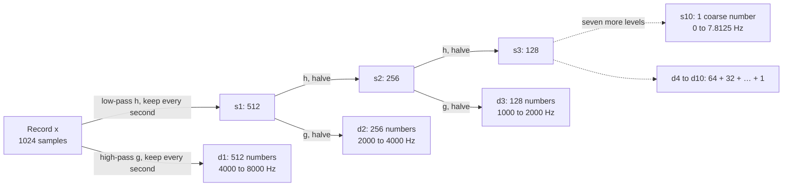

# Mallat's algorithm: every scale in linear time by filtering and halving

[Syllabus](../../../SYLLABUS.md) → [Harmonic analysis](../README.md) → [Wavelets and Time-Frequency](../README.md#s05) → Mallat's algorithm

---

## General Overview

A field recorder sits in a hedge, sampling a bird's one-second whistle 16,000 times a second. The whistle rises in pitch: at time $`t`$ seconds it is $`2000 + 4000\,t`$ hertz (Hz, cycles per second). The recording is illustrative, drawn from that formula. The recorder cuts the sound into blocks of 1,024 samples, 64 ms each, and wants every block split into scales: the fast wiggles, the slower ones, and so on down to the block's average.

Take the 1,024-sample stretch that starts at 0.175 s, where the pitch climbs from 2,700 to 2,956 Hz. Splitting it ten times by halves gives 512 + 256 + … + 1 detail numbers plus one coarse number: 1,024 numbers in, 1,024 out. Written as one big matrix (a table of weights, one row per output number), that costs 1,048,576 multiplies per block. Mallat's algorithm does it in 8,184. At 15.625 blocks a second, that is 127,875 multiplies a second instead of 16,384,000.

The trick is reuse. One short low-pass filter (a weighted average that keeps slow changes) and one short high-pass filter (a weighted difference that keeps fast ones) split the block into a half-length smooth part and a half-length detail part. The smooth part is then split again by the same two filters, and so on. Each level works on half as many numbers as the level before, so the total work is less than twice the first level's. Running the same steps backwards rebuilds the 1,024 samples exactly. Each level is orthonormal: like a rotation, it keeps lengths and angles, which is why it can be undone.

**Mallat's algorithm computes every level of an orthonormal wavelet transform by filtering with one low-pass and one high-pass filter and keeping every second output, then repeating on the smooth half; taken all the way down to one coarse number, the work is 2L(N − 1) multiplies for a record of N samples and filters of length L, and the same filters run backwards rebuild the record exactly.**

**What kind of fact this is:** an algorithm with two theorems behind it, both proved on this card in Why it works: the cascade gives the same coefficients as the wavelet basis, and the filter conditions make every level an orthogonal matrix, so it inverts exactly. The operation count is exact arithmetic. The whistle is illustrative.

### The picture: the cascade



Schematic. Each arrow pair is the same two filters of four weights each, followed by halving. Only the smooth part, on the left of each split, goes down again; the detail parts are kept. The bands are the nominal ones: short filters let some energy spill into the neighbouring level, as Worked numbers shows.

---

## The formula

Notation first, in words.

- The record is $`x[n]`$, sample number $`n`$, with $`N`$ samples. The sampling rate is $`f_s`$ = 16,000 samples a second, as in the engineering wing.
- The **level** $`j`$ runs from 1 (finest) to $`J`$ (coarsest). Here $`j`$ is a level, never the square root of −1.
- At level $`j`$ the **coarse part** $`s_j[k]`$ and the **detail** $`d_j[k]`$ each hold $`N/2^j`$ numbers, at positions $`k`$. The record itself is level 0: $`s_0[n] = x[n]`$.
- The **low-pass filter** $`h[m]`$ (it keeps slow changes) and the **high-pass filter** $`g[m]`$ (it keeps fast ones) have $`L`$ weights each, called taps, at positions $`m`$ = 0 to $`L-1`$.
- **Halving** means keeping every second output of a filter. All positions wrap around: past the end of a level, counting starts again at its beginning.

One level down, one level up, and the conditions on the filters:

```math
s_j[k] = \sum_{m=0}^{L-1} h[m]\, s_{j-1}[2k+m], \qquad d_j[k] = \sum_{m=0}^{L-1} g[m]\, s_{j-1}[2k+m]
```

```math
s_{j-1}[n] = \sum_{k} \Bigl( h[n-2k]\, s_j[k] + g[n-2k]\, d_j[k] \Bigr)
```

```math
\sum_{m} h[m]\, h[m+2r] = \begin{cases} 1 & r = 0 \\ 0 & r \ne 0 \end{cases}, \qquad g[m] = (-1)^m\, h[L-1-m]
```

**Read it aloud:** each coarse number is the low-pass filter laid over the previous level at an even position, and each detail number is the high-pass filter laid over the same spot; to go back up, every coarse and detail number hands its share back to the positions it was made from; this works when the low-pass filter, slid by any even number of places, has no overlap with itself, and the high-pass filter is the low-pass one reversed with every second sign flipped.

The work, counting multiplies:

```math
\text{multiplies} = L\,\bigl(N + \tfrac{N}{2} + \tfrac{N}{4} + \dots + 2\bigr) = 2L\,(N-1)
```

**Read it aloud:** a level that takes in some count of numbers costs $`L`$ multiplies for each one, and the counts halve, so the total is $`2L`$ times one less than the record length. For the whistle, $`L`$ = 4 and $`N`$ = 1,024 give 8 × 1,023 = 8,184. That count is for a cascade taken all the way down, $`J = \log_2 N`$ levels, to one coarse number. Stopping after $`J`$ levels gives $`2LN(1 - 2^{-J})`$, still under $`2LN`$.

The filters on this card are the four-tap D4 pair, also called db2, whose design is the subject of [Daubechies wavelets](06-daubechies-and-vanishing-moments.md):

```math
h = \frac{1}{4\sqrt2}\bigl(1+\sqrt3,\ 3+\sqrt3,\ 3-\sqrt3,\ 1-\sqrt3\bigr) = (0.482963,\ 0.836516,\ 0.224144,\ -0.129410)
```

| Symbol | Plain meaning | In our example | Push it up and the answer… |
| --- | --- | --- | --- |
| $`x[n]`$, $`n`$ | the record: one sample of the whistle, in units of full scale (the largest value the recorder stores, 1); its number | 1.000000, 0.488578, … | the energy grows as the square |
| $`f_s`$, $`t`$ | the sampling rate; time in seconds | 16,000 a second; 0.175 to 0.239 s | each level's band moves up in hertz |
| $`N`$ | samples in the record | 1,024 | the work grows in step with it, not faster |
| $`j`$, $`J`$ | level, 1 finest; the deepest level | $`J`$ = 10 | each level halves the numbers and the band |
| $`k`$, $`K`$ | position along a level; half the count coming into a level | $`k`$ = 0 to 511 and $`K`$ = 512 at level 1 | — |
| $`s_j[k]`$, $`d_j[k]`$ | coarse part at level $`j`$; detail at level $`j`$: what halving the resolution removes | $`s_1[0]`$ = 0.903822; $`d_1[0]`$ = −0.193558 | — |
| $`h[m]`$ | low-pass filter weights | the D4 four above | — |
| $`g[m]`$ | high-pass filter weights, $`h`$ reversed with alternate signs flipped | −0.129410, −0.224144, 0.836516, −0.482963 | — |
| $`L`$, $`m`$ | taps per filter; tap position | 4; 0 to 3 | the work grows as $`2L(N-1)`$ |
| $`r`$, $`p`$ | a shift of the filter by $`2r`$ places; how many times a filter wraps round a level (the fold in Step 2) | $`r`$ = 0 or 1 for D4 | — |
| $`\varphi`$, $`\psi`$, $`\varphi_{j,k}`$, $`\psi_{j,k}`$ | scaling function and wavelet, and their copies of width $`2^j`$ samples at shift $`k`$ (Why it works) | D4's shapes | — |
| $`W`$, $`I`$ | the whole cascade written as one square matrix; the identity matrix (1 on the diagonal, 0 elsewhere) | 16 × 16, for a 16-sample record taken four levels | — |

### When it holds

- **The two filters satisfy the conditions.** Then each level is an orthogonal matrix (a rotation or reflection in many dimensions) and runs backwards exactly. Forget to reverse the high-pass filter, using $`(-1)^m h[m]`$, and the rebuild misses by 1.653918 full scale.
- **The record length is a multiple of $`2^J`$.** Each halving needs an even count. A record of 1,000 samples is 8 × 125, so it allows only 3 levels before an odd length stops the cascade.
- **The ends wrap around.** The filter at the last positions of a level reaches past the end, and wrap-around feeds it the beginning. Feed it zeros instead and the rebuild misses by 1.105904. Wrap-around has a cost of its own: the end of the block meets its start, which makes false detail at the join if the two do not match.
- **The samples stand in for the level-0 coefficients.** The rebuild is still exact. But a sample is a value at one instant, not an overlap with $`\varphi`$, so the coefficients match those of the continuous whistle only approximately.
- **The filters are short and fixed.** The count $`2L(N-1)`$ is linear in $`N`$ only for a fixed $`L`$. A filter as long as the record brings back the matrix's cost.

---

## Why it works

### Step 0: the coarse part is reused, and it halves

Computing each output as its own long dot product with the record repeats work: every level-3 number needs the same smoothed record. Mallat's cascade computes the smoothed record once, at half length, and builds the next level from it alone. The work at each level is proportional to the length coming in, and those lengths halve: $`N + N/2 + N/4 + \dots`$ stays below $`2N`$. Two facts make this legitimate. Step 1 shows the short filters give the true wavelet coefficients. Step 2 shows the steps can be undone.

### Step 1: the refinement equation turns into a filter

The scaling function $`\varphi`$ is the shape whose shifted copies make the coarse views, and the wavelet $`\psi`$ the shape whose copies make the details ([The Haar wavelet](03-haar-wavelet-and-multiresolution.md) builds both for boxes). Each coarse view sits inside the next finer one, so $`\varphi`$ is a weighted sum of half-width copies of itself, and $`\psi`$ is a weighted sum of half-width copies of $`\varphi`$:

```math
\varphi(t) = \sqrt2 \sum_{m} h[m]\, \varphi(2t - m), \qquad \psi(t) = \sqrt2 \sum_{m} g[m]\, \varphi(2t - m)
```

Those weights are the filters. For Haar, $`h`$ = (1/√2, 1/√2) gives a box made of two half-boxes, and $`g`$ = (1/√2, −1/√2) gives the up-down step.

Stretch both sides to width $`2^j`$ and shift by $`2^j k`$. The copies $`\varphi_{j,k}(t) = 2^{-j/2}\varphi(2^{-j}t - k)`$ then obey $`\varphi_{j,k} = \sum_m h[m]\,\varphi_{j-1,\,2k+m}`$, and the same with $`g`$ for $`\psi_{j,k}`$. Now take the overlap (the inner product) of the signal with both sides. The coarse coefficient $`s_j[k]`$ is the overlap with $`\varphi_{j,k}`$, and the detail $`d_j[k]`$ the overlap with $`\psi_{j,k}`$, so:

```math
s_j[k] = \sum_m h[m]\, s_{j-1}[2k+m], \qquad d_j[k] = \sum_m g[m]\, s_{j-1}[2k+m]
```

That is the first formula. The "keep every second output" comes from the $`2k`$: a copy at level $`j`$ moves in steps of two level-$`(j-1)`$ positions. With Haar's two taps this is the engineering wing's ladder of pair sums and pair differences, each divided by $`\sqrt2`$ ([Wavelets](../../13-Engineering%20mathematics/05-Signals/08-wavelets-and-multiresolution.md)). The check runs Haar too: 4,092 multiplies, and $`d_1[0]`$ equals $`(x[0] - x[1])/\sqrt2`$.

### Step 2: each level is an orthogonal matrix, so its inverse is its transpose

Write one level as a square matrix acting on the $`2K`$ numbers coming in. Its first $`K`$ rows are $`h`$, placed at positions 0, 2, 4, …, wrapping at the end. Its last $`K`$ rows are $`g`$, placed the same way.

The conditions say exactly that these rows are perpendicular and of length 1:

- $`h`$ against itself shifted by $`2r`$: the first condition. For D4, the sum of squares is 1.000000 and the overlap at shift 2 is 0.000000.
- $`g`$ against itself: $`g`$ is $`h`$ reversed with sign flips, and the flips cancel in pairs, so the same condition holds.
- $`h`$ against $`g`$ at any even shift: the alternating signs pair each product with its negative, so the sum is zero.

A square matrix with orthonormal rows is orthogonal: its transpose undoes it. The transpose of "lay $`h`$ at position $`2k`$" is "hand $`s_j[k]`$ back to positions $`2k`$ to $`2k+L-1`$, weighted by $`h`$". That is the second formula. Orthogonal matrices also keep lengths, so the energy (sum of squares) of the record equals the energy of all its coefficients. The check finds 511.990361 both ways, a largest rebuild error below 1e-12 full scale, and, for a 16-sample record taken four levels, the full matrix $`W`$ with $`W^{T}W = I`$ to 1e-12.

<details>
<summary>Detailed proof: the filter conditions make the rows orthonormal, wrap-around included</summary>

Let one level take in $`2K`$ numbers, with positions counted modulo $`2K`$. Row $`k`$ of the low-pass half has weight $`h[m]`$ at position $`2k + m`$. The inner product of rows $`k`$ and $`k + r`$ adds $`h[m]\,h[m']`$ over all pairs whose positions agree modulo $`2K`$, where $`p`$ counts how many times the longer reach wraps:

$`\displaystyle \sum_{p} \sum_m h[m]\, h[m + 2r + 2Kp]`$

By the first condition each inner sum is 1 when $`2r + 2Kp = 0`$ and 0 otherwise. For two different rows, $`2r`$ is not a multiple of $`2K`$, so every term is zero; for a row with itself only $`p = 0`$ survives, giving 1. So the condition on the unwrapped filter carries over to every level, however short.

For $`g`$ rows, substitute $`g[m] = (-1)^m h[L-1-m]`$. The signs multiply to $`(-1)^{m + m'}`$, and $`m' - m`$ is even, so they cancel and the sum is the same as for $`h`$ reversed: 1 or 0 as before.

For an $`h`$ row against a $`g`$ row the sum is $`\sum_m h[m + 2r]\,(-1)^m h[L-1-m]`$, again counted modulo $`2K`$. Replace $`m`$ by $`L - 1 - m - 2r`$. Each product $`h[a]\,h[b]`$ reappears as $`h[b]\,h[a]`$, and with $`L`$ even the sign $`(-1)^{L-1-m-2r}`$ is $`-(-1)^m`$. So the sum equals its own negative, which makes it zero.

So the $`2K`$ rows are orthonormal, the matrix is orthogonal, and its inverse is its transpose.

</details>

### Step 3: count the multiplies

A level that takes in $`2K`$ numbers produces $`K`$ coarse and $`K`$ detail numbers, each with $`L`$ multiplies: $`2LK`$ in all, or $`L`$ per number coming in. For the whistle the levels cost 4,096, 2,048, 1,024, …, 8 multiplies. Their sum is $`4 \times 2{,}046`$ = 8,184.

Taken all the way down, the lengths coming in are $`N, N/2, \dots, 2`$, which add to $`2N - 2`$. So the total is $`2L(N - 1)`$. Going back up costs the same: each of the $`K`$ coarse numbers and $`K`$ details hands out $`L`$ weighted shares. The check counts every multiply as it happens: 8,184 down, 8,184 up.

### Step 4: the second road, one long filter per level

Without reuse, each level-$`j`$ coefficient is one dot product of the record with an equivalent filter: $`h`$, then $`h`$ spread out with gaps, and so on, ending with $`g`$ spread out by $`2^{j-1}`$. That long filter has $`3(2^j - 1) + 1`$ taps for D4. Filter the whole record with it and keep one output in $`2^j`$.

This road shares no intermediate numbers with the cascade. It gives the same 1,024 coefficients to 1e-9, at 26,632 multiplies (making the long filters is a one-off cost, not counted). The taps grow as fast as the outputs thin out, so each level costs about $`3N`$.

### Step 5: the cost per sample settles at 2L

| Record $`N`$ | Levels | Cascade | Per sample | Long filters | Dense matrix $`N^2`$ |
| ---: | ---: | ---: | ---: | ---: | ---: |
| 256 | 8 | 2,040 | 7.9688 | 5,128 | 65,536 |
| 1,024 | 10 | 8,184 | 7.9922 | 26,632 | 1,048,576 |
| 4,096 | 12 | 32,760 | 7.9980 | 131,080 | 16,777,216 |
| 16,384 | 14 | 131,064 | 7.9995 | 622,600 | 268,435,456 |

The cascade's cost per sample creeps up to $`2L`$ = 8 and stops: linear time, $`O(N)`$ in the big-O notation of the computing wing. The long-filter road costs about $`3N`$ per level (Step 4), so a little under $`3N \log_2 N`$ in all: its cost per sample keeps climbing as $`\log_2 N`$ does, so it is not linear. The dense matrix grows as $`N^2`$. A fast Fourier transform costs about $`N \log_2 N`$; the wavelet cascade is cheaper because each level hands on only half its numbers.

---

## Worked numbers, by hand

The whistle's first four samples are 1.000000, 0.488578, −0.522666 and −0.999212 full scale.

| Step | Arithmetic | Value |
| --- | --- | --- |
| first coarse number | $`s_1[0]`$ = 0.482963 × 1.000000 + 0.836516 × 0.488578 + 0.224144 × (−0.522666) − 0.129410 × (−0.999212) | 0.903822 |
| first detail | $`d_1[0]`$ = −0.129410 × 1.000000 − 0.224144 × 0.488578 + 0.836516 × (−0.522666) − 0.482963 × (−0.999212) | −0.193558 |
| numbers kept | 512 + 256 + 128 + … + 1 details, plus 1 coarse | 1,024 |
| multiplies per level | 4 × 1,024, 4 × 512, …, 4 × 2 | 4,096, 2,048, …, 8 |
| multiplies, all levels | 2 × 4 × (1,024 − 1) | 8,184 |
| dense matrix | 1,024 × 1,024 | 1,048,576 |
| saving | 1,048,576 ÷ 8,184 | 128.1 |
| per second | 16,000 ÷ 1,024 = 15.625 blocks, × 8,184 | 127,875 |
| energy | samples against coefficients | 511.990361 = 511.990361 |
| **rebuild** | **ten levels up again** | **every sample back, error below 1e-12** |

The cascade does 128.1 times less arithmetic than the matrix and loses nothing: the record comes back to round-off.

Where the whistle's energy lands, as a share of 511.990361:

```
share of the whistle's energy by level (40 marks = 100 %)
  level 1,  4000 to 8000 Hz  ########                                  18.922 %
  level 2,  2000 to 4000 Hz  #############################             72.697 %
  level 3,  1000 to 2000 Hz  ##                                         5.939 %
  level 4,   500 to 1000 Hz  #                                          2.376 %
  levels 5 to 10 and coarse: 0.039 % or less each
```

The whistle sits at 2,700 to 2,956 Hz, inside level 2's band, and 72.697% lands there. The 18.922% at level 1 is the filter, not the bird. D4's high-pass filter lets through 18.878% of the power at 2,828 Hz, the middle of the whistle's sweep, and the cascade faithfully records that leak. Halving then folds some leftover energy down into levels 3 and 4: after halving, a pitch above the new top of the band reappears below it (aliasing).

### What breaks if you drop a piece

| Mistake | Comes out at | What went wrong |
| --- | --- | --- |
| High-pass filter not reversed: $`g[m] = (-1)^m h[m]`$ | rebuild error 1.653918 full scale | the $`h`$ and $`g`$ rows overlap, so the level is no longer orthogonal |
| Zeros past the end instead of wrap-around | rebuild error 1.105904 | the last coefficients at each level lose part of their filter, and the coarse levels spread the damage over the whole block |
| A record of 1,000 samples | 3 levels, then an odd length | 1,000 = 8 × 125; halving needs an even count |
| No halving: keep every filter output | 81,920 multiplies and 11,264 numbers for 1,024 samples, counted by formula: $`2LNJ`$ and $`N(J+1)`$ | each level works on the full length, so the geometric saving is gone |
| Expecting level 1 to be empty, since the whistle stays below 4,000 Hz | 18.922% of the energy at level 1 | four-tap filters overlap in frequency; the bands are nominal |

---

## Code, from first principles, and it actually runs

The code builds the whistle, the D4 and Haar filter pairs, and the cascade down and up, counting every multiply as it happens. It reaches the coefficients by two independent roads: the cascade, and one long equivalent filter per level applied to the raw record. It checks the inverse three ways: the rebuild error, the energy ledger, and the 16-sample matrix $`W`$ with $`W^{T}W = I`$. It checks the count against $`2L(N-1)`$ at four record lengths, and prints each mistake from the table.

### Python

```python
# Mallat's algorithm -- the check behind the card.  Standard library only.
# A 1024-sample stretch of an illustrative whistle (16000 samples a second,
# pitch 2000 + 4000 t Hz, taken from t = 0.175 s) goes down ten levels through
# the D4 filter pair with wrap-around ends, comes back up, and every multiply
# is counted.  Road one is the cascade; road two filters the record once per
# level with one long equivalent filter and keeps one output in 2^j.
import math

FS, N, J, T0 = 16000, 1024, 10, 0.175
R2, R3 = math.sqrt(2), math.sqrt(3)
H = [(1 + R3) / (4 * R2), (3 + R3) / (4 * R2), (3 - R3) / (4 * R2), (1 - R3) / (4 * R2)]
HAAR, L = [1 / R2, 1 / R2], len(H)
def highpass(h): return [(-1) ** n * h[len(h) - 1 - n] for n in range(len(h))]
G = highpass(H)
ops = [0]                                      # multiplies, counted as they happen

def split(s, h, g, wrap=True):                 # one level down: filter, keep every second
    n, lo, hi = len(s), [], []
    for k in range(n // 2):
        a = b = 0.0
        for m in range(len(h)):
            i = 2 * k + m
            if i < n or wrap:
                a += h[m] * s[i % n]; b += g[m] * s[i % n]; ops[0] += 2
        lo.append(a); hi.append(b)
    return lo, hi

def merge(lo, hi, h, g, wrap=True):            # one level up: each pair returns its share
    n = 2 * len(lo); out = [0.0] * n
    for k in range(len(lo)):
        for m in range(len(h)):
            i = 2 * k + m
            if i < n or wrap:
                out[i % n] += h[m] * lo[k] + g[m] * hi[k]; ops[0] += 2
    return out

def forward(x, h, g, levels, wrap=True):
    s, ds = list(x), []
    for _ in range(levels):
        s, d = split(s, h, g, wrap); ds.append(d)
    return s, ds

def inverse(s, ds, h, g, wrap=True):
    for d in reversed(ds): s = merge(s, d, h, g, wrap)
    return s

def direct(x, h, g, levels):                   # road two: long filters, no reuse
    n, e, ds, count = len(x), [1.0], [], 0
    def stretch(f, e, step):                   # e followed by f with gaps of step
        r = [0.0] * ((len(f) - 1) * step + len(e))
        for m, fm in enumerate(f):
            for p, ep in enumerate(e): r[m * step + p] += fm * ep
        return r
    def fold(f):                               # wrap a filter longer than the record
        r = [0.0] * min(len(f), n)
        for q, fq in enumerate(f): r[q % n] += fq
        return r
    def apply(f, j):
        nonlocal count
        count += (n >> j) * len(f)
        return [sum(f[q] * x[((k << j) + q) % n] for q in range(len(f))) for k in range(n >> j)]
    for j in range(1, levels + 1):
        ge, e = stretch(g, e, 2 ** (j - 1)), stretch(h, e, 2 ** (j - 1))
        ds.append(apply(fold(ge), j))
    return apply(fold(e), levels), ds, count

def trim(v): return f"{v:.4f}".rstrip("0").rstrip(".")
def maxerr(a, b): return max(abs(p - q) for p, q in zip(a, b))
def whistle(n): t = T0 + n / FS; return math.sin(2 * math.pi * (2000 * t + 2000 * t * t))

x = [whistle(n) for n in range(N)]
print(f"record: {N} samples at {FS} per second, {1000 * N / FS:.0f} ms, pitch {2000 + 4000 * T0:.0f} to {2000 + 4000 * (T0 + N / FS):.0f} Hz")
print("first samples x[0..3]: " + " ".join(f"{v:.6f}" for v in x[:4]))
print("low-pass h:  " + " ".join(f"{v:.6f}" for v in H))
print("high-pass g: " + " ".join(f"{v:.6f}" for v in G))
lag2 = H[0] * H[2] + H[1] * H[3]
print(f"sum h {sum(H):.6f}; sum h^2 {sum(v * v for v in H):.6f}; h overlap at shift 2 {abs(lag2):.6f}; sum g {abs(sum(G)):.6f}")
print(f"by hand, s1[0] = h . x[0..3] = {sum(H[m] * x[m] for m in range(4)):.6f}; d1[0] = g . x[0..3] = {sum(G[m] * x[m] for m in range(4)):.6f}")
ops[0] = 0
s, ds = forward(x, H, G, J)
fwd = ops[0]
energy_x = sum(v * v for v in x)
energy_c = s[0] ** 2 + sum(v * v for d in ds for v in d)
print("level  numbers  band (Hz)          share of energy")
bands = [(FS / 2 ** (j + 1), FS / 2 ** j, sum(v * v for v in ds[j - 1])) for j in range(1, J + 1)] + [(0.0, FS / 2 ** (J + 1), s[0] ** 2)]
for j, (lo, hi, e) in enumerate(bands, 1):
    name = f"{j:>5}" if j <= J else "coarse"
    count = len(ds[j - 1]) if j <= J else 1
    bar = "#" * round(40 * e / energy_c)
    print(f"{name:>6}  {count:>7}  {trim(lo):>7} to {trim(hi):<7}  {100 * e / energy_c:7.3f} % {bar}")
w = 2 * math.pi * 2828 / FS                    # mid-pitch, as an angle per sample
gain = (sum(h * math.cos(w * n) for n, h in enumerate(H)) ** 2 + sum(h * math.sin(w * n) for n, h in enumerate(H)) ** 2) / 2
print(f"share of power at 2828 Hz the low-pass passes on: {100 * gain:.3f} %; the high-pass: {100 * (1 - gain):.3f} %")
print(f"energy: samples {energy_x:.6f}, coefficients {energy_c:.6f}")
ops[0] = 0
back = inverse(s, ds, H, G)
inv = ops[0]
print(f"rebuild: largest error below 1e-12: {'yes' if maxerr(back, x) < 1e-12 else 'no'}")
s2, ds2, dcount = direct(x, H, G, J)
same = max(maxerr(s, s2), max(maxerr(a, b) for a, b in zip(ds, ds2)))
print(f"road two, long filters: same 1024 coefficients to 1e-9: {'yes' if same < 1e-9 else 'no'}")
print("multiplies per level, L x length in: " + " ".join(str(L * (N >> j)) for j in range(J)))
print(f"multiplies: cascade down {fwd}, formula 2L(N-1) = {2 * L * (N - 1)}, cascade up {inv}")
print(f"multiplies: long filters {dcount}; dense 1024 x 1024 matrix {N * N}; dense over cascade {N * N / fwd:.1f}")
print(f"per second at {FS} samples/s: {FS / N:.3f} blocks, cascade {FS / N * fwd:.0f}, dense {FS / N * N * N:.0f}")
print("record N  levels  cascade  per sample  long filters  dense N^2")
for n in [256, 1024, 4096, 16384]:
    y = [whistle(k) for k in range(n)]
    lv = n.bit_length() - 1
    ops[0] = 0; forward(y, H, G, lv); c = ops[0]
    dc = direct(y, H, G, lv)[2]
    assert c == 2 * L * (n - 1)                              # counted against the formula
    print(f"{n:>8}  {lv:>6}  {c:>7}  {c / n:10.4f}  {dc:>12}  {n * n:>9}")
ops[0] = 0
hs, hds = forward(x, HAAR, highpass(HAAR), J)
hcount = ops[0]
herr = maxerr(inverse(hs, hds, HAAR, highpass(HAAR)), x)
print(f"Haar pair: multiplies {hcount}, rebuild below 1e-12: {'yes' if herr < 1e-12 else 'no'}, d1[0] = (x0 - x1)/sqrt2: {'yes' if abs(hds[0][0] - (x[0] - x[1]) / R2) < 1e-12 else 'no'}")
cols = []                                      # the 16-point cascade as a matrix W, column by column
for i in range(16):
    a, b = forward([1.0 if k == i else 0.0 for k in range(16)], H, G, 4)
    cols.append(a + [v for d in b for v in d])
gram = max(abs(sum(p * q for p, q in zip(cols[a], cols[b])) - (a == b)) for a in range(16) for b in range(16))
print(f"16-point cascade as a matrix: W^T W = I to 1e-12: {'yes' if gram < 1e-12 else 'no'}")
bad = [(-1) ** n * H[n] for n in range(4)]
e_bad = maxerr(inverse(*forward(x, H, bad, J), H, bad), x)
print(f"mistake, high-pass not reversed (g[n] = (-1)^n h[n]): rebuild error {e_bad:.6f}")
e_zero = maxerr(inverse(*forward(x, H, G, J, False), H, G, False), x)
print(f"mistake, zeros past the end instead of wrap-around: rebuild error {e_zero:.6f}")
print(f"mistake, 1000 samples: levels before an odd length {(1000 & -1000).bit_length() - 1}")
print(f"mistake, no halving: multiplies {2 * L * N * J}, numbers kept {N * (J + 1)}")
assert fwd == 2 * L * (N - 1) and inv == fwd                # counter against 2L(N - 1)
assert same < 1e-9                                         # cascade against long filters
assert maxerr(back, x) < 1e-12 and herr < 1e-12            # exact inversion
assert abs(energy_x - energy_c) < 1e-9                     # energy kept
assert gram < 1e-12                                        # inverse is the transpose
assert e_bad > 0.1 and e_zero > 0.1                        # the two mistakes fail
print("ALL CHECKS PASS")
```

**Ran 2026-11-15 on macOS, Python 3.14.10, standard library only. All checks passed. Output, pasted from the run:**

```
record: 1024 samples at 16000 per second, 64 ms, pitch 2700 to 2956 Hz
first samples x[0..3]: 1.000000 0.488578 -0.522666 -0.999212
low-pass h:  0.482963 0.836516 0.224144 -0.129410
high-pass g: -0.129410 -0.224144 0.836516 -0.482963
sum h 1.414214; sum h^2 1.000000; h overlap at shift 2 0.000000; sum g 0.000000
by hand, s1[0] = h . x[0..3] = 0.903822; d1[0] = g . x[0..3] = -0.193558
level  numbers  band (Hz)          share of energy
     1      512     4000 to 8000      18.922 % ########
     2      256     2000 to 4000      72.697 % #############################
     3      128     1000 to 2000       5.939 % ##
     4       64      500 to 1000       2.376 % #
     5       32      250 to 500        0.025 % 
     6       16      125 to 250        0.039 % 
     7        8     62.5 to 125        0.002 % 
     8        4    31.25 to 62.5       0.000 % 
     9        2   15.625 to 31.25      0.000 % 
    10        1   7.8125 to 15.625     0.000 % 
coarse        1        0 to 7.8125     0.000 % 
share of power at 2828 Hz the low-pass passes on: 81.122 %; the high-pass: 18.878 %
energy: samples 511.990361, coefficients 511.990361
rebuild: largest error below 1e-12: yes
road two, long filters: same 1024 coefficients to 1e-9: yes
multiplies per level, L x length in: 4096 2048 1024 512 256 128 64 32 16 8
multiplies: cascade down 8184, formula 2L(N-1) = 8184, cascade up 8184
multiplies: long filters 26632; dense 1024 x 1024 matrix 1048576; dense over cascade 128.1
per second at 16000 samples/s: 15.625 blocks, cascade 127875, dense 16384000
record N  levels  cascade  per sample  long filters  dense N^2
     256       8     2040      7.9688          5128      65536
    1024      10     8184      7.9922         26632    1048576
    4096      12    32760      7.9980        131080   16777216
   16384      14   131064      7.9995        622600  268435456
Haar pair: multiplies 4092, rebuild below 1e-12: yes, d1[0] = (x0 - x1)/sqrt2: yes
16-point cascade as a matrix: W^T W = I to 1e-12: yes
mistake, high-pass not reversed (g[n] = (-1)^n h[n]): rebuild error 1.653918
mistake, zeros past the end instead of wrap-around: rebuild error 1.105904
mistake, 1000 samples: levels before an odd length 3
mistake, no halving: multiplies 81920, numbers kept 11264
ALL CHECKS PASS
```

### Rust

Same numbers, same labels, built with `rustc --edition 2021 -O`.

```rust
// Mallat's algorithm -- the same check as the Python, in Rust.  No crates.
// A 1024-sample stretch of an illustrative whistle (16000 samples a second,
// pitch 2000 + 4000 t Hz, taken from t = 0.175 s) goes down ten levels through
// the D4 filter pair with wrap-around ends, comes back up, and every multiply
// is counted.  Road one is the cascade; road two filters the record once per
// level with one long equivalent filter and keeps one output in 2^j.
use std::f64::consts::PI;

const FS: f64 = 16000.0; const N: usize = 1024; const J: usize = 10; const T0: f64 = 0.175;

fn highpass(h: &[f64]) -> Vec<f64> {
    (0..h.len()).map(|n| if n % 2 == 0 { h[h.len() - 1 - n] } else { -h[h.len() - 1 - n] }).collect()
}

// one level down: filter, keep every second
fn split(s: &[f64], h: &[f64], g: &[f64], wrap: bool, ops: &mut u64) -> (Vec<f64>, Vec<f64>) {
    let n = s.len();
    let (mut lo, mut hi) = (Vec::new(), Vec::new());
    for k in 0..n / 2 {
        let (mut a, mut b) = (0.0, 0.0);
        for m in (0..h.len()).filter(|m| 2 * k + m < n || wrap) {
            a += h[m] * s[(2 * k + m) % n]; b += g[m] * s[(2 * k + m) % n]; *ops += 2;
        }
        lo.push(a); hi.push(b);
    }
    (lo, hi)
}

// one level up: each pair returns its share
fn merge(lo: &[f64], hi: &[f64], h: &[f64], g: &[f64], wrap: bool, ops: &mut u64) -> Vec<f64> {
    let n = 2 * lo.len();
    let mut out = vec![0.0; n];
    for k in 0..lo.len() {
        for m in (0..h.len()).filter(|m| 2 * k + m < n || wrap) {
            out[(2 * k + m) % n] += h[m] * lo[k] + g[m] * hi[k]; *ops += 2;
        }
    }
    out
}

fn forward(x: &[f64], h: &[f64], g: &[f64], levels: usize, wrap: bool, ops: &mut u64) -> (Vec<f64>, Vec<Vec<f64>>) {
    let (mut s, mut ds) = (x.to_vec(), Vec::new());
    for _ in 0..levels { let (lo, d) = split(&s, h, g, wrap, ops); s = lo; ds.push(d); }
    (s, ds)
}

fn inverse(s: &[f64], ds: &[Vec<f64>], h: &[f64], g: &[f64], wrap: bool, ops: &mut u64) -> Vec<f64> {
    ds.iter().rev().fold(s.to_vec(), |s, d| merge(&s, d, h, g, wrap, ops))
}

// e followed by f with gaps of step
fn stretch(f: &[f64], e: &[f64], step: usize) -> Vec<f64> {
    let mut r = vec![0.0; (f.len() - 1) * step + e.len()];
    for (m, fm) in f.iter().enumerate() {
        for (p, ep) in e.iter().enumerate() { r[m * step + p] += fm * ep; }
    }
    r
}

// road two: long filters, no reuse
fn direct(x: &[f64], h: &[f64], g: &[f64], levels: usize) -> (Vec<f64>, Vec<Vec<f64>>, u64) {
    let n = x.len();
    let (mut e, mut ds, mut count) = (vec![1.0], Vec::new(), 0u64);
    let fold = |f: &[f64]| { let mut r = vec![0.0; f.len().min(n)]; for (q, fq) in f.iter().enumerate() { r[q % n] += fq; } r };
    let mut apply = |f: &[f64], j: usize| -> Vec<f64> {
        count += ((n >> j) * f.len()) as u64;
        (0..n >> j).map(|k| (0..f.len()).fold(0.0, |acc, q| acc + f[q] * x[((k << j) + q) % n])).collect()
    };
    for j in 1..=levels {
        let ge = stretch(g, &e, 1 << (j - 1));
        e = stretch(h, &e, 1 << (j - 1));
        ds.push(apply(&fold(&ge), j));
    }
    (apply(&fold(&e), levels), ds, count)
}

fn trim(v: f64) -> String { format!("{:.4}", v).trim_end_matches('0').trim_end_matches('.').to_string() }
fn maxerr(a: &[f64], b: &[f64]) -> f64 { a.iter().zip(b).fold(0.0, |m, (p, q)| f64::max(m, (p - q).abs())) }
fn whistle(n: usize) -> f64 { let t = T0 + n as f64 / FS; (2.0 * PI * (2000.0 * t + 2000.0 * t * t)).sin() }
fn yn(c: bool) -> &'static str { if c { "yes" } else { "no" } }
fn row(v: &[f64]) -> String { v.iter().map(|x| format!("{:.6}", x)).collect::<Vec<_>>().join(" ") }
fn sq(v: &[f64]) -> f64 { v.iter().map(|a| a * a).sum() }

fn main() {
    let (r2, r3) = (2f64.sqrt(), 3f64.sqrt());
    let h = vec![(1.0 + r3) / (4.0 * r2), (3.0 + r3) / (4.0 * r2), (3.0 - r3) / (4.0 * r2), (1.0 - r3) / (4.0 * r2)];
    let haar = vec![1.0 / r2, 1.0 / r2];
    let (g, l) = (highpass(&h), h.len());
    let x: Vec<f64> = (0..N).map(whistle).collect();
    println!("record: {} samples at {} per second, {:.0} ms, pitch {:.0} to {:.0} Hz", N, FS, 1000.0 * N as f64 / FS, 2000.0 + 4000.0 * T0, 2000.0 + 4000.0 * (T0 + N as f64 / FS));
    println!("first samples x[0..3]: {}", row(&x[..4]));
    println!("low-pass h:  {}", row(&h));
    println!("high-pass g: {}", row(&g));
    let lag2 = h[0] * h[2] + h[1] * h[3];
    println!("sum h {:.6}; sum h^2 {:.6}; h overlap at shift 2 {:.6}; sum g {:.6}", h.iter().sum::<f64>(), sq(&h), lag2.abs(), g.iter().sum::<f64>().abs());
    let dot = |f: &[f64]| (0..4).fold(0.0, |a, m| a + f[m] * x[m]);
    println!("by hand, s1[0] = h . x[0..3] = {:.6}; d1[0] = g . x[0..3] = {:.6}", dot(&h), dot(&g));
    let mut ops = 0u64;
    let (s, ds) = forward(&x, &h, &g, J, true, &mut ops);
    let fwd = ops;
    let energy_x = sq(&x);
    let energy_c = s[0] * s[0] + ds.iter().map(|d| sq(d)).sum::<f64>();
    println!("level  numbers  band (Hz)          share of energy");
    for j in 1..=J + 1 {
        let (lo, hi) = if j <= J { (FS / (1u64 << (j + 1)) as f64, FS / (1u64 << j) as f64) } else { (0.0, FS / (1u64 << (J + 1)) as f64) };
        let (e, count) = if j <= J { (sq(&ds[j - 1]), ds[j - 1].len()) } else { (s[0] * s[0], 1) };
        let name = if j <= J { format!("{:>5}", j) } else { "coarse".to_string() };
        let bar = "#".repeat((40.0 * e / energy_c).round() as usize);
        println!("{:>6}  {:>7}  {:>7} to {:<7}  {:7.3} % {}", name, count, trim(lo), trim(hi), 100.0 * e / energy_c, bar);
    }
    let w = 2.0 * PI * 2828.0 / FS; // mid-pitch, as an angle per sample
    let (c, sn) = h.iter().enumerate().fold((0.0, 0.0), |(c, s), (n, hn)| (c + hn * (w * n as f64).cos(), s + hn * (w * n as f64).sin()));
    let gain = (c * c + sn * sn) / 2.0;
    println!("share of power at 2828 Hz the low-pass passes on: {:.3} %; the high-pass: {:.3} %", 100.0 * gain, 100.0 * (1.0 - gain));
    println!("energy: samples {:.6}, coefficients {:.6}", energy_x, energy_c);
    ops = 0; let back = inverse(&s, &ds, &h, &g, true, &mut ops);
    let inv = ops;
    println!("rebuild: largest error below 1e-12: {}", yn(maxerr(&back, &x) < 1e-12));
    let (s2, ds2, dcount) = direct(&x, &h, &g, J);
    let same = ds.iter().zip(&ds2).fold(maxerr(&s, &s2), |m, (a, b)| f64::max(m, maxerr(a, b)));
    println!("road two, long filters: same 1024 coefficients to 1e-9: {}", yn(same < 1e-9));
    println!("multiplies per level, L x length in: {}", (0..J).map(|j| (l * (N >> j)).to_string()).collect::<Vec<_>>().join(" "));
    println!("multiplies: cascade down {}, formula 2L(N-1) = {}, cascade up {}", fwd, 2 * l * (N - 1), inv);
    println!("multiplies: long filters {}; dense 1024 x 1024 matrix {}; dense over cascade {:.1}", dcount, N * N, (N * N) as f64 / fwd as f64);
    let blocks = FS / N as f64;
    println!("per second at {} samples/s: {:.3} blocks, cascade {:.0}, dense {:.0}", FS, blocks, blocks * fwd as f64, blocks * (N * N) as f64);
    println!("record N  levels  cascade  per sample  long filters  dense N^2");
    for n in [256usize, 1024, 4096, 16384] {
        let y: Vec<f64> = (0..n).map(whistle).collect();
        let lv = n.trailing_zeros() as usize;
        ops = 0; forward(&y, &h, &g, lv, true, &mut ops);
        let dc = direct(&y, &h, &g, lv).2;
        assert!(ops == (2 * l * (n - 1)) as u64); // counted against the formula
        println!("{:>8}  {:>6}  {:>7}  {:10.4}  {:>12}  {:>9}", n, lv, ops, ops as f64 / n as f64, dc, n * n);
    }
    ops = 0;
    let hg = highpass(&haar);
    let (hs, hds) = forward(&x, &haar, &hg, J, true, &mut ops);
    let hcount = ops;
    let herr = maxerr(&inverse(&hs, &hds, &haar, &hg, true, &mut ops), &x);
    println!("Haar pair: multiplies {}, rebuild below 1e-12: {}, d1[0] = (x0 - x1)/sqrt2: {}", hcount, yn(herr < 1e-12), yn((hds[0][0] - (x[0] - x[1]) / r2).abs() < 1e-12));
    let mut cols: Vec<Vec<f64>> = Vec::new(); // the 16-point cascade as a matrix W, column by column
    for i in 0..16 {
        let (a, b) = forward(&(0..16).map(|k| if k == i { 1.0 } else { 0.0 }).collect::<Vec<_>>(), &h, &g, 4, true, &mut ops);
        cols.push(a.into_iter().chain(b.into_iter().flatten()).collect());
    }
    let mut gram = 0.0f64;
    for (a, b) in (0..256).map(|i| (i / 16, i % 16)) {
        let d: f64 = cols[a].iter().zip(&cols[b]).map(|(p, q)| p * q).sum();
        gram = gram.max((d - if a == b { 1.0 } else { 0.0 }).abs());
    }
    println!("16-point cascade as a matrix: W^T W = I to 1e-12: {}", yn(gram < 1e-12));
    let bad: Vec<f64> = (0..4).map(|n| if n % 2 == 0 { h[n] } else { -h[n] }).collect();
    let (bs, bds) = forward(&x, &h, &bad, J, true, &mut ops);
    let e_bad = maxerr(&inverse(&bs, &bds, &h, &bad, true, &mut ops), &x);
    println!("mistake, high-pass not reversed (g[n] = (-1)^n h[n]): rebuild error {:.6}", e_bad);
    let (zs, zds) = forward(&x, &h, &g, J, false, &mut ops);
    let e_zero = maxerr(&inverse(&zs, &zds, &h, &g, false, &mut ops), &x);
    println!("mistake, zeros past the end instead of wrap-around: rebuild error {:.6}", e_zero);
    println!("mistake, 1000 samples: levels before an odd length {}", 1000u32.trailing_zeros());
    println!("mistake, no halving: multiplies {}, numbers kept {}", 2 * l * N * J, N * (J + 1));
    assert!(fwd == (2 * l * (N - 1)) as u64 && inv == fwd); // counter against 2L(N - 1)
    assert!(same < 1e-9); // cascade against long filters
    assert!(maxerr(&back, &x) < 1e-12 && herr < 1e-12); // exact inversion
    assert!((energy_x - energy_c).abs() < 1e-9); // energy kept
    assert!(gram < 1e-12); // inverse is the transpose
    assert!(e_bad > 0.1 && e_zero > 0.1); // the two mistakes fail
    println!("ALL CHECKS PASS");
}
```

**Ran 2026-11-15 on macOS, rustc 1.98.1, no crates. All checks passed. Output, pasted from the run:**

```
record: 1024 samples at 16000 per second, 64 ms, pitch 2700 to 2956 Hz
first samples x[0..3]: 1.000000 0.488578 -0.522666 -0.999212
low-pass h:  0.482963 0.836516 0.224144 -0.129410
high-pass g: -0.129410 -0.224144 0.836516 -0.482963
sum h 1.414214; sum h^2 1.000000; h overlap at shift 2 0.000000; sum g 0.000000
by hand, s1[0] = h . x[0..3] = 0.903822; d1[0] = g . x[0..3] = -0.193558
level  numbers  band (Hz)          share of energy
     1      512     4000 to 8000      18.922 % ########
     2      256     2000 to 4000      72.697 % #############################
     3      128     1000 to 2000       5.939 % ##
     4       64      500 to 1000       2.376 % #
     5       32      250 to 500        0.025 % 
     6       16      125 to 250        0.039 % 
     7        8     62.5 to 125        0.002 % 
     8        4    31.25 to 62.5       0.000 % 
     9        2   15.625 to 31.25      0.000 % 
    10        1   7.8125 to 15.625     0.000 % 
coarse        1        0 to 7.8125     0.000 % 
share of power at 2828 Hz the low-pass passes on: 81.122 %; the high-pass: 18.878 %
energy: samples 511.990361, coefficients 511.990361
rebuild: largest error below 1e-12: yes
road two, long filters: same 1024 coefficients to 1e-9: yes
multiplies per level, L x length in: 4096 2048 1024 512 256 128 64 32 16 8
multiplies: cascade down 8184, formula 2L(N-1) = 8184, cascade up 8184
multiplies: long filters 26632; dense 1024 x 1024 matrix 1048576; dense over cascade 128.1
per second at 16000 samples/s: 15.625 blocks, cascade 127875, dense 16384000
record N  levels  cascade  per sample  long filters  dense N^2
     256       8     2040      7.9688          5128      65536
    1024      10     8184      7.9922         26632    1048576
    4096      12    32760      7.9980        131080   16777216
   16384      14   131064      7.9995        622600  268435456
Haar pair: multiplies 4092, rebuild below 1e-12: yes, d1[0] = (x0 - x1)/sqrt2: yes
16-point cascade as a matrix: W^T W = I to 1e-12: yes
mistake, high-pass not reversed (g[n] = (-1)^n h[n]): rebuild error 1.653918
mistake, zeros past the end instead of wrap-around: rebuild error 1.105904
mistake, 1000 samples: levels before an odd length 3
mistake, no halving: multiplies 81920, numbers kept 11264
ALL CHECKS PASS
```

The two outputs match line for line.

### Lean

Lean proves exact rebuilding and kept energy for every filter pair meeting the filter conditions, and the multiply count for every record.

- Suppose the filters meet the conditions, $`L`$ is even, and the record length is a multiple of $`2^J`$. Then going $`J`$ levels down and back up, with wrap-around ends, returns every sample exactly.
- Suppose the same filters act on one level of $`2K`$ numbers, with wrap-around ends. Then its energy equals the energy of its $`K`$ coarse numbers and $`K`$ details.
- Take a record of $`N`$ samples, a multiple of $`2^J`$, and filters of $`L`$ taps. Then $`J`$ levels cost $`2LN(1 - 2^{-J})`$ multiplies: $`2L(N-1)`$ all the way down.
- The worked numbers check exactly: 8,184 multiplies for the whistle, the cost table, Haar's 4,092, and the 1,000-sample record.

The whistle, its coefficients and energy shares, the long-filter road and the mistakes' rebuild errors are left to the Python and Rust checks.

```lean
-- Mallat's algorithm: filtering and halving with an orthonormal filter pair and wrap-around ends rebuilds the record exactly, keeps its energy, and costs 2L(N - 1) multiplies.
import Mathlib.Algebra.BigOperators.Ring.Finset
import Mathlib.Basic.Real.Basic
import Mathlib.Algebra.BigOperators.Intervals
import Mathlib.Data.Nat.ModEq
import Mathlib.Tactic.Linarith
import Mathlib.Data.Int.Interval
import Mathlib.LinearAlgebra.Matrix.SemiringInverse

open Finset

namespace MallatFWT

/-- The high-pass filter made from a low-pass filter `h` with `L` taps:
`g[m] = (-1)^m h[L-1-m]` for `m < L`, and `0` past the last tap. -/
def highpass (L : ℕ) (h : ℕ → ℝ) (m : ℕ) : ℝ :=
  if m < L then (-1) ^ m * h (L - 1 - m) else 0

/-- One level down for one filter `f` with `L` taps, on a level of length `n` with
wrap-around ends: output `k` is `∑_m f[m] s[(2k + m) mod n]` (filter, keep every second). -/
def down (L : ℕ) (f : ℕ → ℝ) (n : ℕ) (s : ℕ → ℝ) (k : ℕ) : ℝ :=
  ∑ m ∈ range L, f m * s ((2 * k + m) % n)

/-- One level up, onto a level of length `n` with wrap-around ends: each coarse number
`lo k` and detail `hi k` hands `h[m] lo[k] + g[m] hi[k]` back to position `(2k + m) mod n`. -/
def up (L : ℕ) (h g : ℕ → ℝ) (n : ℕ) (lo hi : ℕ → ℝ) (i : ℕ) : ℝ :=
  ∑ k ∈ range (n / 2), ∑ m ∈ range L,
    if (2 * k + m) % n = i then h m * lo k + g m * hi k else 0

/-- The cascade taken `J` levels down from a record of length `n`: it returns the final
coarse part and the list of details `d_1, d_2, …, d_J`, finest first. Only the coarse part
goes down again, on a level half as long. -/
def forward (L : ℕ) (h g : ℕ → ℝ) : ℕ → ℕ → (ℕ → ℝ) → (ℕ → ℝ) × List (ℕ → ℝ)
  | 0, _, s => (s, [])
  | J + 1, n, s =>
      let rest := forward L h g J (n / 2) (down L h n s)
      (rest.1, down L g n s :: rest.2)

/-- The cascade run backwards: from the coarse part and the details, finest first, rebuild a
record of length `n` one level up at a time. -/
def inverse (L : ℕ) (h g : ℕ → ℝ) : ℕ → (ℕ → ℝ) → List (ℕ → ℝ) → (ℕ → ℝ)
  | _, c, [] => c
  | n, c, d :: ds => up L h g n (inverse L h g (n / 2) c ds) d

/-- Multiplies used by the cascade taken `J` levels down from a record of length `n`: a level
taking in `n` numbers makes `n/2` coarse and `n/2` detail numbers, `L` multiplies each. -/
def cascadeCost (L : ℕ) : ℕ → ℕ → ℕ
  | 0, _ => 0
  | J + 1, n => 2 * L * (n / 2) + cascadeCost L J (n / 2)

/-- Autocorrelation of the filter at a nonnegative even shift. -/
theorem corr_nat (M : ℕ) (h : ℕ → ℝ)
    (h_taps : ∀ m, 2 * M ≤ m → h m = 0)
    (h_orth : ∀ r : ℕ, ∑ m ∈ range (2 * M), h m * h (m + 2 * r) = if r = 0 then 1 else 0)
    (q : ℕ) :
    ∑ m ∈ range (2 * M), ∑ m' ∈ range (2 * M),
      (if (m' : ℤ) = m + 2 * q then h m * h m' else 0) = if q = 0 then 1 else 0 := by
  rw [← h_orth q]
  apply sum_congr rfl
  intro m _
  have : ∀ m' : ℕ, ((m' : ℤ) = m + 2 * q) ↔ m' = m + 2 * q := fun m' => by omega
  simp_rw [this]
  rw [sum_ite_eq']
  split_ifs with hm
  · rfl
  · rw [h_taps (m + 2 * q) (by simp at hm; omega), mul_zero]

theorem corr_int (M : ℕ) (h : ℕ → ℝ)
    (h_taps : ∀ m, 2 * M ≤ m → h m = 0)
    (h_orth : ∀ r : ℕ, ∑ m ∈ range (2 * M), h m * h (m + 2 * r) = if r = 0 then 1 else 0)
    (r : ℤ) :
    ∑ m ∈ range (2 * M), ∑ m' ∈ range (2 * M),
      (if (m' : ℤ) - m = 2 * r then h m * h m' else 0) = if r = 0 then 1 else 0 := by
  rcases le_or_gt 0 r with hr | hr
  · lift r to ℕ using hr
    have := corr_nat M h h_taps h_orth r
    simp only [Nat.cast_eq_zero]
    rw [← this]
    apply sum_congr rfl; intro m _; apply sum_congr rfl; intro m' _
    congr 1; apply propext; omega
  · obtain ⟨q, hq⟩ : ∃ q : ℕ, r = -(q : ℤ) := ⟨(-r).toNat, by omega⟩
    have hq0 : q ≠ 0 := by omega
    have := corr_nat M h h_taps h_orth q
    rw [ite_eq_right hq0] at this
    rw [ite_eq_right (by omega), sum_comm]
    refine Eq.trans ?_ this
    apply sum_congr rfl; intro m _; apply sum_congr rfl; intro m' _
    by_cases hc : (m' : ℤ) = m + 2 * q
    · rw [ite_eq_left hc, ite_eq_left (by omega), mul_comm]
    · rw [ite_eq_right hc, ite_eq_right (by omega)]

theorem corr_mod (M : ℕ) (h : ℕ → ℝ)
    (h_taps : ∀ m, 2 * M ≤ m → h m = 0)
    (h_orth : ∀ r : ℕ, ∑ m ∈ range (2 * M), h m * h (m + 2 * r) = if r = 0 then 1 else 0)
    (K : ℕ) (hK : 0 < K) (d : ℤ) (hd1 : -(K : ℤ) < d) (hd2 : d < K) :
    ∑ m ∈ range (2 * M), ∑ m' ∈ range (2 * M),
      (if (2 * (K : ℤ)) ∣ ((m' : ℤ) - m) - 2 * d then h m * h m' else 0)
      = if d = 0 then 1 else 0 := by
  have hK1 : (1 : ℤ) ≤ K := by exact_mod_cast hK
  have step : ∀ m ∈ range (2 * M), ∀ m' ∈ range (2 * M),
      (if (2 * (K : ℤ)) ∣ ((m' : ℤ) - m) - 2 * d then h m * h m' else 0)
      = ∑ t ∈ Icc (-((M : ℤ) + K)) ((M : ℤ) + K),
          (if (m' : ℤ) - m = 2 * (d + K * t) then h m * h m' else 0) := by
    intro m hm m' hm'
    simp only [mem_range] at hm hm'
    have hm1 : (m : ℤ) < 2 * M := by exact_mod_cast hm
    have hm2 : (m' : ℤ) < 2 * M := by exact_mod_cast hm'
    have hm3 : (0 : ℤ) ≤ m := Nat.cast_nonneg m
    have hm4 : (0 : ℤ) ≤ m' := Nat.cast_nonneg m'
    by_cases hdv : (2 * (K : ℤ)) ∣ ((m' : ℤ) - m) - 2 * d
    · rw [ite_eq_left hdv]
      obtain ⟨t0, ht0⟩ := hdv
      have hb1 : -((M : ℤ) + K) ≤ t0 := by
        by_contra hc
        push Not at hc
        nlinarith
      have hb2 : t0 ≤ (M : ℤ) + K := by
        by_contra hc
        push Not at hc
        nlinarith
      rw [sum_eq_single t0]
      · rw [ite_eq_left (by linarith)]
      · intro t _ htt
        rw [ite_eq_right]
        intro hc
        apply htt
        have : (2 * (K : ℤ)) * (t - t0) = 0 := by linarith
        rcases mul_eq_zero.1 this with h0 | h0
        · omega
        · linarith
      · intro hn
        exact absurd (mem_Icc.2 ⟨hb1, hb2⟩) hn
    · rw [ite_eq_right hdv]
      symm
      apply sum_eq_zero
      intro t _
      rw [ite_eq_right]
      intro hc
      exact hdv ⟨t, by linarith⟩
  calc _ = ∑ m ∈ range (2 * M), ∑ m' ∈ range (2 * M),
        ∑ t ∈ Icc (-((M : ℤ) + K)) ((M : ℤ) + K),
          (if (m' : ℤ) - m = 2 * (d + K * t) then h m * h m' else 0) :=
        sum_congr rfl (fun m hm => sum_congr rfl (fun m' hm' => step m hm m' hm'))
    _ = ∑ m ∈ range (2 * M), ∑ t ∈ Icc (-((M : ℤ) + K)) ((M : ℤ) + K),
          ∑ m' ∈ range (2 * M),
          (if (m' : ℤ) - m = 2 * (d + K * t) then h m * h m' else 0) :=
        sum_congr rfl (fun m _ => sum_comm)
    _ = ∑ t ∈ Icc (-((M : ℤ) + K)) ((M : ℤ) + K), ∑ m ∈ range (2 * M),
          ∑ m' ∈ range (2 * M),
          (if (m' : ℤ) - m = 2 * (d + K * t) then h m * h m' else 0) := sum_comm
    _ = ∑ t ∈ Icc (-((M : ℤ) + K)) ((M : ℤ) + K), (if d + K * t = 0 then (1 : ℝ) else 0) :=
        sum_congr rfl (fun t _ => corr_int M h h_taps h_orth (d + K * t))
    _ = if d = 0 then 1 else 0 := by
        rw [sum_eq_single 0]
        · simp
        · intro t _ ht
          rw [ite_eq_right]
          intro h0
          rcases lt_or_gt_of_ne ht with h1 | h1
          · nlinarith
          · nlinarith
        · intro h0
          exact absurd (mem_Icc.2 ⟨by omega, by omega⟩) h0

/-- Row `k` of the one-level matrix for filter `f`, entry at column `j`. -/
def rowF (L : ℕ) (f : ℕ → ℝ) (n k j : ℕ) : ℝ :=
  ∑ m ∈ range L, if (2 * k + m) % n = j then f m else 0

theorem row_inner (L : ℕ) (f f' : ℕ → ℝ) (n k k' : ℕ) (hn : 0 < n) :
    ∑ j ∈ range n, rowF L f n k j * rowF L f' n k' j =
      ∑ m ∈ range L, ∑ m' ∈ range L,
        (if (2 * k + m) % n = (2 * k' + m') % n then f m * f' m' else 0) := by
  simp only [rowF, sum_mul_sum]
  rw [sum_comm]
  apply sum_congr rfl
  intro m _
  rw [sum_comm]
  apply sum_congr rfl
  intro m' _
  simp only [ite_mul, zero_mul]
  rw [sum_ite_eq]
  have : (2 * k + m) % n ∈ range n := mem_range.2 (Nat.mod_lt _ hn)
  simp only [this, ite_true]
  by_cases hc : (2 * k + m) % n = (2 * k' + m') % n
  · simp [hc]
  · simp [hc, Ne.symm hc]

theorem sgn_same (a b : ℕ) (hab : (a + b) % 2 = 0) : (-1 : ℝ) ^ a * (-1) ^ b = 1 := by
  rw [← pow_add]
  exact Even.neg_one_pow (Nat.even_iff.mpr hab)

theorem sgn_opp (a b : ℕ) (hab : (a + b) % 2 = 1) : (-1 : ℝ) ^ a = -(-1) ^ b := by
  rcases Nat.even_or_odd b with hb | hb
  · have ha : Odd a := Nat.odd_iff.mpr (by have := Nat.even_iff.mp hb; omega)
    rw [ha.neg_one_pow, hb.neg_one_pow]
  · have ha : Even a := Nat.even_iff.mpr (by have := Nat.odd_iff.mp hb; omega)
    rw [ha.neg_one_pow, hb.neg_one_pow]; norm_num

theorem modeq_int (n a b : ℕ) : a % n = b % n ↔ (n : ℤ) ∣ (b : ℤ) - a := Nat.modEq_iff_dvd

theorem pair_hh (M : ℕ) (h : ℕ → ℝ)
    (h_taps : ∀ m, 2 * M ≤ m → h m = 0)
    (h_orth : ∀ r : ℕ, ∑ m ∈ range (2 * M), h m * h (m + 2 * r) = if r = 0 then 1 else 0)
    (K : ℕ) (k k' : ℕ) (hk : k < K) (hk' : k' < K) :
    ∑ m ∈ range (2 * M), ∑ m' ∈ range (2 * M),
      (if (2 * k + m) % (2 * K) = (2 * k' + m') % (2 * K) then h m * h m' else 0)
      = if k = k' then 1 else 0 := by
  have hK : 0 < K := by omega
  have := corr_mod M h h_taps h_orth K hK ((k : ℤ) - k') (by omega) (by omega)
  have e : ((k : ℤ) - k' = 0) ↔ k = k' := by omega
  simp only [e] at this
  rw [← this]
  apply sum_congr rfl; intro m _; apply sum_congr rfl; intro m' _
  congr 1
  apply propext
  rw [modeq_int]
  push_cast
  constructor <;> intro hd <;> (convert hd using 1; ring)

theorem pair_gg (M : ℕ) (h : ℕ → ℝ)
    (h_taps : ∀ m, 2 * M ≤ m → h m = 0)
    (h_orth : ∀ r : ℕ, ∑ m ∈ range (2 * M), h m * h (m + 2 * r) = if r = 0 then 1 else 0)
    (K : ℕ) (k k' : ℕ) (hk : k < K) (hk' : k' < K) :
    ∑ m ∈ range (2 * M), ∑ m' ∈ range (2 * M),
      (if (2 * k + m) % (2 * K) = (2 * k' + m') % (2 * K)
        then highpass (2 * M) h m * highpass (2 * M) h m' else 0)
      = if k = k' then 1 else 0 := by
  have hK : 0 < K := by omega
  have := corr_mod M h h_taps h_orth K hK ((k' : ℤ) - k) (by omega) (by omega)
  have e : ((k' : ℤ) - k = 0) ↔ k = k' := by omega
  simp only [e] at this
  rw [← this, ← sum_range_reflect]
  apply sum_congr rfl; intro p hp
  rw [← sum_range_reflect]
  apply sum_congr rfl; intro p' hp'
  simp only [mem_range] at hp hp'
  have h1 : 2 * M - 1 - p < 2 * M := by omega
  have h2 : 2 * M - 1 - p' < 2 * M := by omega
  have h3 : 2 * M - 1 - (2 * M - 1 - p) = p := by omega
  have h4 : 2 * M - 1 - (2 * M - 1 - p') = p' := by omega
  simp only [highpass, h1, h2, ite_true, h3, h4]
  have hc : (2 * k + (2 * M - 1 - p)) % (2 * K) = (2 * k' + (2 * M - 1 - p')) % (2 * K) ↔
      (2 * (K : ℤ)) ∣ ((p' : ℤ) - p) - 2 * ((k' : ℤ) - k) := by
    rw [modeq_int]
    have e1 : (((2 * k' + (2 * M - 1 - p')) : ℕ) : ℤ) - ((2 * k + (2 * M - 1 - p) : ℕ) : ℤ)
        = -(((p' : ℤ) - p) - 2 * ((k' : ℤ) - k)) := by omega
    rw [e1, dvd_neg]
    push_cast
    rfl
  by_cases hd : (2 * (K : ℤ)) ∣ ((p' : ℤ) - p) - 2 * ((k' : ℤ) - k)
  · rw [ite_eq_left (hc.2 hd), ite_eq_left hd]
    have h2d : (2 : ℤ) ∣ ((p' : ℤ) - p) - 2 * ((k' : ℤ) - k) :=
      dvd_trans (dvd_mul_right 2 (K : ℤ)) hd
    have hs := sgn_same (2 * M - 1 - p) (2 * M - 1 - p') (by omega)
    calc (-1 : ℝ) ^ (2 * M - 1 - p) * h p * ((-1) ^ (2 * M - 1 - p') * h p')
        = ((-1 : ℝ) ^ (2 * M - 1 - p) * (-1) ^ (2 * M - 1 - p')) * (h p * h p') := by ring
      _ = h p * h p' := by rw [hs, one_mul]
  · rw [ite_eq_right (fun hh => hd (hc.1 hh)), ite_eq_right hd]

theorem pair_gh (M : ℕ) (h : ℕ → ℝ) (K k k' : ℕ) :
    ∑ m ∈ range (2 * M), ∑ m' ∈ range (2 * M),
      (if (2 * k + m) % (2 * K) = (2 * k' + m') % (2 * K)
        then h m * highpass (2 * M) h m' else 0) = 0 := by
  have step1 : ∑ m ∈ range (2 * M), ∑ m' ∈ range (2 * M),
      (if (2 * k + m) % (2 * K) = (2 * k' + m') % (2 * K)
        then h m * highpass (2 * M) h m' else 0) =
      ∑ m ∈ range (2 * M), ∑ p ∈ range (2 * M),
        (if (2 * (K : ℤ)) ∣ (2 * (k' : ℤ) - 2 * k + 2 * M - 1) - (m + p)
          then (-1 : ℝ) ^ (2 * M - 1 - p) * (h m * h p) else 0) := by
    apply sum_congr rfl; intro m hm
    rw [← sum_range_reflect]
    apply sum_congr rfl; intro p hp
    simp only [mem_range] at hm hp
    have h1 : 2 * M - 1 - p < 2 * M := by omega
    have h3 : 2 * M - 1 - (2 * M - 1 - p) = p := by omega
    simp only [highpass, h1, ite_true, h3]
    have hc : (2 * k + m) % (2 * K) = (2 * k' + (2 * M - 1 - p)) % (2 * K) ↔
        (2 * (K : ℤ)) ∣ (2 * (k' : ℤ) - 2 * k + 2 * M - 1) - (m + p) := by
      rw [modeq_int]
      have e1 : (((2 * k' + (2 * M - 1 - p)) : ℕ) : ℤ) - ((2 * k + m : ℕ) : ℤ)
          = (2 * (k' : ℤ) - 2 * k + 2 * M - 1) - (m + p) := by omega
      rw [e1]
      push_cast
      rfl
    by_cases hd : (2 * (K : ℤ)) ∣ (2 * (k' : ℤ) - 2 * k + 2 * M - 1) - (m + p)
    · rw [ite_eq_left (hc.2 hd), ite_eq_left hd]; ring
    · rw [ite_eq_right (fun hh => hd (hc.1 hh)), ite_eq_right hd]
  have step2 : ∑ m ∈ range (2 * M), ∑ p ∈ range (2 * M),
        (if (2 * (K : ℤ)) ∣ (2 * (k' : ℤ) - 2 * k + 2 * M - 1) - (m + p)
          then (-1 : ℝ) ^ (2 * M - 1 - p) * (h m * h p) else 0) =
      -∑ m ∈ range (2 * M), ∑ p ∈ range (2 * M),
        (if (2 * (K : ℤ)) ∣ (2 * (k' : ℤ) - 2 * k + 2 * M - 1) - (m + p)
          then (-1 : ℝ) ^ (2 * M - 1 - p) * (h m * h p) else 0) := by
    conv_lhs => rw [sum_comm]
    simp only [← sum_neg_distrib]
    apply sum_congr rfl; intro p hp
    apply sum_congr rfl; intro m hm
    simp only [mem_range] at hm hp
    by_cases hd : (2 * (K : ℤ)) ∣ (2 * (k' : ℤ) - 2 * k + 2 * M - 1) - (m + p)
    · have hd' : (2 * (K : ℤ)) ∣ (2 * (k' : ℤ) - 2 * k + 2 * M - 1) - (p + m) := by
        rw [add_comm (p : ℤ)]; exact hd
      rw [ite_eq_left hd, ite_eq_left hd']
      have h2d : (2 : ℤ) ∣ (2 * (k' : ℤ) - 2 * k + 2 * M - 1) - (m + p) :=
        dvd_trans (dvd_mul_right 2 (K : ℤ)) hd
      have hs := sgn_opp (2 * M - 1 - m) (2 * M - 1 - p) (by omega)
      rw [hs]; ring
    · have hd' : ¬ (2 * (K : ℤ)) ∣ (2 * (k' : ℤ) - 2 * k + 2 * M - 1) - (p + m) := by
        rw [add_comm (p : ℤ)]; exact hd
      rw [ite_eq_right hd, ite_eq_right hd', neg_zero]
  rw [step1]
  linarith

theorem cols_orthonormal (K : ℕ) (A B : ℕ → ℕ → ℝ)
    (hAA : ∀ k < K, ∀ k' < K, ∑ j ∈ range (2 * K), A k j * A k' j = if k = k' then 1 else 0)
    (hBB : ∀ k < K, ∀ k' < K, ∑ j ∈ range (2 * K), B k j * B k' j = if k = k' then 1 else 0)
    (hAB : ∀ k < K, ∀ k' < K, ∑ j ∈ range (2 * K), A k j * B k' j = 0) :
    ∀ i < 2 * K, ∀ j < 2 * K,
      ∑ k ∈ range K, (A k i * A k j + B k i * B k j) = if i = j then 1 else 0 := by
  let W : Matrix (Fin K ⊕ Fin K) (Fin (2 * K)) ℝ :=
    Matrix.of fun r j => Sum.elim (fun k : Fin K => A k j) (fun k : Fin K => B k j) r
  have h1 : W * W.transpose = 1 := by
    ext r r'
    rcases r with k | k <;> rcases r' with k' | k'
    · simp only [W, Matrix.mul_apply, Matrix.transpose_apply, Matrix.of_apply, Sum.elim_inl,
        Matrix.one_apply, Sum.inl.injEq]
      rw [Fin.sum_univ_eq_sum_range (fun j => A k j * A k' j), hAA k k.2 k' k'.2]
      simp [Fin.ext_iff]
    · simp only [W, Matrix.mul_apply, Matrix.transpose_apply, Matrix.of_apply, Sum.elim_inl,
        Sum.elim_inr, Matrix.one_apply]
      rw [Fin.sum_univ_eq_sum_range (fun j => A k j * B k' j), hAB k k.2 k' k'.2]
      simp
    · simp only [W, Matrix.mul_apply, Matrix.transpose_apply, Matrix.of_apply, Sum.elim_inl,
        Sum.elim_inr, Matrix.one_apply]
      rw [Fin.sum_univ_eq_sum_range (fun j => B k j * A k' j)]
      simp_rw [mul_comm (B _ _)]
      rw [hAB k' k'.2 k k.2]
      simp
    · simp only [W, Matrix.mul_apply, Matrix.transpose_apply, Matrix.of_apply, Sum.elim_inr,
        Matrix.one_apply, Sum.inr.injEq]
      rw [Fin.sum_univ_eq_sum_range (fun j => B k j * B k' j), hBB k k.2 k' k'.2]
      simp [Fin.ext_iff]
  have h2 : W.transpose * W = 1 :=
    (Matrix.mul_eq_one_comm_of_equiv (finSumFinEquiv.trans (finCongr (two_mul K).symm))).mp h1
  intro i hi j hj
  have := congrFun (congrFun h2 ⟨i, hi⟩) ⟨j, hj⟩
  simp only [W, Matrix.mul_apply, Matrix.transpose_apply, Matrix.of_apply, Fintype.sum_sum_type,
    Sum.elim_inl, Sum.elim_inr, Matrix.one_apply, Fin.mk.injEq] at this
  rw [sum_add_distrib, ← Fin.sum_univ_eq_sum_range (fun k => A k i * A k j),
    ← Fin.sum_univ_eq_sum_range (fun k => B k i * B k j)]
  exact this


theorem down_eq_rows (L : ℕ) (f : ℕ → ℝ) (n : ℕ) (s : ℕ → ℝ) (k : ℕ) (hn : 0 < n) :
    down L f n s k = ∑ j ∈ range n, rowF L f n k j * s j := by
  simp only [down, rowF, sum_mul]
  rw [sum_comm]
  apply sum_congr rfl
  intro m _
  simp only [ite_mul, zero_mul]
  rw [sum_ite_eq]
  simp [Nat.mod_lt _ hn]

theorem up_eq_rows (L : ℕ) (h g : ℕ → ℝ) (n : ℕ) (lo hi : ℕ → ℝ) (i : ℕ) :
    up L h g n lo hi i =
      ∑ k ∈ range (n / 2), (rowF L h n k i * lo k + rowF L g n k i * hi k) := by
  simp only [up, rowF, sum_mul, ← sum_add_distrib]
  apply sum_congr rfl; intro k _
  apply sum_congr rfl; intro m _
  split_ifs <;> simp

theorem up_congr (L : ℕ) (h g : ℕ → ℝ) (n : ℕ) (lo lo' hi : ℕ → ℝ)
    (hlo : ∀ k < n / 2, lo k = lo' k) : up L h g n lo hi = up L h g n lo' hi := by
  funext i
  simp only [up]
  apply sum_congr rfl; intro k hk
  rw [hlo k (mem_range.1 hk)]

theorem level_rebuild (M : ℕ) (h : ℕ → ℝ)
    (h_taps : ∀ m, 2 * M ≤ m → h m = 0)
    (h_orth : ∀ r : ℕ, ∑ m ∈ range (2 * M), h m * h (m + 2 * r) = if r = 0 then 1 else 0)
    (K : ℕ) (hK : 0 < K) (s : ℕ → ℝ) :
    ∀ i < 2 * K, up (2 * M) h (highpass (2 * M) h) (2 * K) (down (2 * M) h (2 * K) s)
      (down (2 * M) (highpass (2 * M) h) (2 * K) s) i = s i := by
  intro i hi
  have hn : 0 < 2 * K := by omega
  have cols := cols_orthonormal K (rowF (2 * M) h (2 * K)) (rowF (2 * M) (highpass (2 * M) h) (2 * K))
    (fun k hk k' hk' => by
      rw [row_inner _ _ _ _ _ _ hn]; exact pair_hh M h h_taps h_orth K k k' hk hk')
    (fun k hk k' hk' => by
      rw [row_inner _ _ _ _ _ _ hn]; exact pair_gg M h h_taps h_orth K k k' hk hk')
    (fun k _ k' _ => by
      rw [row_inner _ _ _ _ _ _ hn]; exact pair_gh M h K k k') i hi
  rw [up_eq_rows, Nat.mul_div_cancel_left K two_pos]
  simp only [down_eq_rows _ _ _ s _ hn]
  simp_rw [mul_sum, ← sum_add_distrib]
  rw [sum_comm]
  have key : ∀ j ∈ range (2 * K),
      ∑ k ∈ range K, (rowF (2 * M) h (2 * K) k i * (rowF (2 * M) h (2 * K) k j * s j) +
        rowF (2 * M) (highpass (2 * M) h) (2 * K) k i *
          (rowF (2 * M) (highpass (2 * M) h) (2 * K) k j * s j))
      = (if i = j then 1 else 0) * s j := by
    intro j hj
    rw [← cols j (mem_range.1 hj), sum_mul]
    apply sum_congr rfl; intro k _; ring
  rw [sum_congr rfl key]
  simp [hi]

theorem adjoint (L : ℕ) (h g : ℕ → ℝ) (n : ℕ) (lo hi s : ℕ → ℝ) (hn : 0 < n) :
    ∑ i ∈ range n, s i * up L h g n lo hi i =
      ∑ k ∈ range (n / 2), (lo k * down L h n s k + hi k * down L g n s k) := by
  simp only [down_eq_rows _ _ _ s _ hn, up_eq_rows, mul_sum, ← sum_add_distrib]
  rw [sum_comm]
  apply sum_congr rfl; intro k _
  apply sum_congr rfl; intro j _
  ring

theorem cascade (M : ℕ) (h : ℕ → ℝ)
    (h_taps : ∀ m, 2 * M ≤ m → h m = 0)
    (h_orth : ∀ r : ℕ, ∑ m ∈ range (2 * M), h m * h (m + 2 * r) = if r = 0 then 1 else 0)
    (J : ℕ) : ∀ (K : ℕ) (x : ℕ → ℝ), ∀ i < 2 ^ J * K,
      inverse (2 * M) h (highpass (2 * M) h) (2 ^ J * K)
        (forward (2 * M) h (highpass (2 * M) h) J (2 ^ J * K) x).1
        (forward (2 * M) h (highpass (2 * M) h) J (2 ^ J * K) x).2 i = x i := by
  induction J with
  | zero => intro K x i _; simp [forward, inverse]
  | succ J ih =>
    intro K x i hi
    have hN : 2 ^ (J + 1) * K = 2 * (2 ^ J * K) := by ring
    rw [hN] at hi ⊢
    have hK : 0 < 2 ^ J * K := by omega
    simp only [forward, inverse]
    rw [Nat.mul_div_cancel_left _ two_pos]
    rw [up_congr _ _ _ _ _ (down (2 * M) h (2 * (2 ^ J * K)) x) _
      (fun k hk => ih K _ k (by rwa [Nat.mul_div_cancel_left _ two_pos] at hk))]
    exact level_rebuild M h h_taps h_orth _ hK x i hi

/-- Mallat's algorithm inverts exactly. Let the low-pass filter `h` have an even number
`L = 2M` of taps (positions `0` to `L - 1`), satisfy `∑_m h[m] h[m + 2r] = 1` for `r = 0` and
`0` for every other shift `r`, and let the high-pass filter be `g[m] = (-1)^m h[L-1-m]`.
Take a record `x` whose length `N` is a multiple of `2^J`, with wrap-around ends. Then going
`J` levels down by filtering and halving, and running the same filters back up, returns every
sample of `x` exactly. -/
theorem mallat_cascade_rebuilds_exactly (M : ℕ) (h : ℕ → ℝ)
    (h_taps : ∀ m, 2 * M ≤ m → h m = 0)
    (h_orth : ∀ r : ℕ, ∑ m ∈ range (2 * M), h m * h (m + 2 * r) = if r = 0 then 1 else 0)
    (J K : ℕ) (x : ℕ → ℝ) :
    let L := 2 * M
    let g := highpass L h
    let N := 2 ^ J * K
    let c := forward L h g J N x
    ∀ i < N, inverse L h g N c.1 c.2 i = x i := by
  intro L g N c i hi
  exact cascade M h h_taps h_orth J K x i hi

/-- Each level keeps energy (it is an orthogonal matrix): under the same filter conditions,
for a level of even length `n = 2K` with wrap-around ends, the sum of squares of its `2K`
numbers equals the sum of squares of its `K` coarse numbers and `K` details. -/
theorem mallat_level_keeps_energy (M : ℕ) (h : ℕ → ℝ)
    (h_taps : ∀ m, 2 * M ≤ m → h m = 0)
    (h_orth : ∀ r : ℕ, ∑ m ∈ range (2 * M), h m * h (m + 2 * r) = if r = 0 then 1 else 0)
    (K : ℕ) (s : ℕ → ℝ) :
    ∑ i ∈ range (2 * K), s i ^ 2 =
      ∑ k ∈ range K, (down (2 * M) h (2 * K) s k ^ 2
        + down (2 * M) (highpass (2 * M) h) (2 * K) s k ^ 2) := by
  rcases Nat.eq_zero_or_pos K with rfl | hK
  · simp
  have hn : 0 < 2 * K := by omega
  calc ∑ i ∈ range (2 * K), s i ^ 2
      = ∑ i ∈ range (2 * K), s i * up (2 * M) h (highpass (2 * M) h) (2 * K)
          (down (2 * M) h (2 * K) s) (down (2 * M) (highpass (2 * M) h) (2 * K) s) i := by
        apply sum_congr rfl; intro i hi
        rw [level_rebuild M h h_taps h_orth K hK s i (mem_range.1 hi)]; ring
    _ = ∑ k ∈ range (2 * K / 2), (down (2 * M) h (2 * K) s k * down (2 * M) h (2 * K) s k
          + down (2 * M) (highpass (2 * M) h) (2 * K) s k
            * down (2 * M) (highpass (2 * M) h) (2 * K) s k) := adjoint _ _ _ _ _ _ _ hn
    _ = _ := by
        rw [Nat.mul_div_cancel_left K two_pos]
        apply sum_congr rfl; intro k _; ring

/-- The work is linear: the cascade taken `J` levels down from a record of `N = 2^J K`
samples, with filters of `L` taps, costs `2 L K (2^J - 1) = 2 L N (1 - 2^(-J))` multiplies;
taken all the way down (`K = 1`, so `N = 2^J`) that is `2 L (N - 1)`. -/
theorem mallat_cascade_multiplies (L J K : ℕ) :
    cascadeCost L J (2 ^ J * K) = 2 * L * K * (2 ^ J - 1) := by
  induction J with
  | zero => simp [cascadeCost]
  | succ J ih =>
    have h2 : 2 ^ (J + 1) * K / 2 = 2 ^ J * K := by
      rw [pow_succ]; rw [show 2 ^ J * 2 * K = 2 * (2 ^ J * K) by ring]; omega
    rw [cascadeCost, h2, ih]
    obtain ⟨p, hp⟩ : ∃ p, 2 ^ J = p + 1 := ⟨2 ^ J - 1, by have := Nat.one_le_two_pow (n := J); omega⟩
    rw [pow_succ, hp]
    rw [show (p + 1) * 2 - 1 = 2 * p + 1 by omega, show p + 1 - 1 = p by omega]
    ring

-- The card's whole-number examples.
-- D4 (L = 4), N = 1024, ten levels: 8,184 multiplies, which is 2 × 4 × (1024 − 1).
example : cascadeCost 4 10 1024 = 8184 := by decide
example : 2 * 4 * (1024 - 1) = 8184 := by norm_num
-- Multiplies per level, L × length in: 4,096, 2,048, …, 8, adding to 8,184.
example : (List.range 10).map (fun j => 4 * (1024 / 2 ^ j)) =
    [4096, 2048, 1024, 512, 256, 128, 64, 32, 16, 8] := by decide
-- Numbers kept: 512 + 256 + … + 1 details plus 1 coarse number make 1,024.
example : (∑ j ∈ range 10, 1024 / 2 ^ (j + 1)) + 1 = 1024 := by decide
-- The dense matrix costs 1024 × 1024 = 1,048,576 multiplies; at 15.625 blocks a second the
-- cascade costs 127,875 a second and the matrix 16,384,000.
example : 1024 * 1024 = 1048576 := by norm_num
-- (16000 / 1024 blocks a second, written without the fraction.)
example : 16000 * 8184 = 127875 * 1024 ∧ 16000 * 1048576 = 16384000 * 1024 := by norm_num
-- The cost table: N = 256, 1024, 4096, 16384 taken all the way down with D4.
example : cascadeCost 4 8 256 = 2040 ∧ cascadeCost 4 10 1024 = 8184 ∧
    cascadeCost 4 12 4096 = 32760 ∧ cascadeCost 4 14 16384 = 131064 := by decide
-- Haar (L = 2) on 1,024 samples: 4,092 multiplies.
example : cascadeCost 2 10 1024 = 4092 := by decide
-- A record of 1,000 samples is 8 × 125: three halvings, then an odd length.
example : 1000 = 2 ^ 3 * 125 ∧ 125 % 2 = 1 := by norm_num
-- No halving: 2LNJ = 81,920 multiplies and N(J + 1) = 11,264 numbers.
example : 2 * 4 * 1024 * 10 = 81920 ∧ 1024 * (10 + 1) = 11264 := by norm_num

#print axioms corr_nat
#print axioms corr_int
#print axioms corr_mod
#print axioms row_inner
#print axioms sgn_same
#print axioms sgn_opp
#print axioms modeq_int
#print axioms pair_hh
#print axioms pair_gg
#print axioms pair_gh
#print axioms cols_orthonormal
#print axioms down_eq_rows
#print axioms up_eq_rows
#print axioms up_congr
#print axioms level_rebuild
#print axioms adjoint
#print axioms cascade
#print axioms mallat_cascade_rebuilds_exactly
#print axioms mallat_level_keeps_energy
#print axioms mallat_cascade_multiplies

end MallatFWT
```

**Checked 2026-11-15 on macOS, Lean 4.36.0-rc2, Mathlib v4.36.0-rc2. Every proof is complete and uses only Lean's standard axioms. Output, pasted from the run:**

```
'MallatFWT.corr_nat' depends on axioms: [propext, Classical.choice, Quot.sound]
'MallatFWT.corr_int' depends on axioms: [propext, Classical.choice, Quot.sound]
'MallatFWT.corr_mod' depends on axioms: [propext, Classical.choice, Quot.sound]
'MallatFWT.row_inner' depends on axioms: [propext, Classical.choice, Quot.sound]
'MallatFWT.sgn_same' depends on axioms: [propext, Classical.choice, Quot.sound]
'MallatFWT.sgn_opp' depends on axioms: [propext, Classical.choice, Quot.sound]
'MallatFWT.modeq_int' depends on axioms: [propext]
'MallatFWT.pair_hh' depends on axioms: [propext, Classical.choice, Quot.sound]
'MallatFWT.pair_gg' depends on axioms: [propext, Classical.choice, Quot.sound]
'MallatFWT.pair_gh' depends on axioms: [propext, Classical.choice, Quot.sound]
'MallatFWT.cols_orthonormal' depends on axioms: [propext, Classical.choice, Quot.sound]
'MallatFWT.down_eq_rows' depends on axioms: [propext, Classical.choice, Quot.sound]
'MallatFWT.up_eq_rows' depends on axioms: [propext, Classical.choice, Quot.sound]
'MallatFWT.up_congr' depends on axioms: [propext, Classical.choice, Quot.sound]
'MallatFWT.level_rebuild' depends on axioms: [propext, Classical.choice, Quot.sound]
'MallatFWT.adjoint' depends on axioms: [propext, Classical.choice, Quot.sound]
'MallatFWT.cascade' depends on axioms: [propext, Classical.choice, Quot.sound]
'MallatFWT.mallat_cascade_rebuilds_exactly' depends on axioms: [propext, Classical.choice, Quot.sound]
'MallatFWT.mallat_level_keeps_energy' depends on axioms: [propext, Classical.choice, Quot.sound]
'MallatFWT.mallat_cascade_multiplies' depends on axioms: [propext, Quot.sound]
```

> [!TIP]
> **Try changing**
> Guess first, then run the Python.
> - **Move the whistle onto a band edge.** Set `T0` to `0.5`, so the pitch runs from 4,000 to 4,256 Hz. Guess how the energy splits between levels 1 and 2. Answer: 49.234% and 50.763%, nearly half each, and every check still passes.
> - **Go longer.** Add `65536` to the list of record lengths. Guess the cascade's multiplies per sample. Answer: 524,280 multiplies, 7.9999 per sample; the dense matrix would need 4,294,967,296.
> - **Forget the reversal.** Set `G = [(-1) ** n * v for n, v in enumerate(H)]`. Guess which assert stops the run. Answer: the exact-inversion assert, because the rebuild no longer returns the record.

---

## The usual mistake

> [!warning]
> **Reading the levels as clean frequency bands.** Level 1 is nominally 4,000 to 8,000 Hz, yet it holds 18.922% of a whistle that never rises above 2,956 Hz. Four-tap filters cannot cut sharply: D4's high-pass filter passes 18.878% of the power at 2,828 Hz. The cascade is exact about the coefficients, not about the bands.
>
> - **Not reversing the high-pass filter.** With $`g[m] = (-1)^m h[m]`$ the rebuild misses by 1.653918 full scale.
> - **Padding with zeros instead of wrapping.** The rebuild misses by 1.105904, and the damage is not confined to the end of the block.
> - **Skipping the halving.** Filtering at full length on every level costs 81,920 multiplies and keeps 11,264 numbers for a 1,024-sample record, against 8,184 and 1,024.
> - **Building the whole matrix.** 1,048,576 multiplies per block, 128.1 times the cascade, for the same numbers.

---

## Where you meet it in real life

- **Image coding.** The JPEG 2000 standard runs the same filter-and-halve cascade along the rows and then the columns of a picture. Its lossy 9/7 filters are longer than D4. Both its pairs, the 9/7 and the lossless 5/3 of [Filter banks](05-filter-banks-and-perfect-reconstruction.md), are biorthogonal: the rebuilding filters differ from the splitting ones, so a level is invertible but not orthogonal. The lossless mode runs the 5/3 pair in the lifting form (below) so that whole numbers go in and come out.
- **Fingerprint archives.** The United States FBI stores fingerprint scans by the wavelet scalar quantization standard, a wavelet cascade followed by rounding of the coefficients.
- **Sound and vibration.** Birdsong studies and machine-vibration monitors split long recordings by level, block by block, at a few multiplies per sample.
- **Fast numerical algorithms.** In the wavelet basis many large matrices are mostly near-zero entries, so a matrix-times-vector product that cost $`N^2`$ multiplies drops to about $`N`$ or $`N \log N`$ (fourth source below).
- **The lifting scheme.** Any such filter pair factors into small "predict" and "update" steps that run in place with up to about half the multiplies (fifth source below).

> **Say it back**
> One level of Mallat's algorithm runs a short low-pass and a short high-pass filter over the signal and keeps every second output of each. The low-pass half goes down again; the high-pass half is kept as that level's detail. The filter conditions make each level an orthogonal matrix, so the same filters run backwards rebuild the signal exactly and the energy is kept. Each level costs L multiplies per number coming in, and the numbers halve, so the whole transform costs 2L(N − 1). For the 1,024-sample whistle that is 8,184 multiplies instead of 1,048,576.

---

## What this builds on

- [The Haar wavelet](03-haar-wavelet-and-multiresolution.md): the scaling function, the wavelet, levels and the refinement equation whose weights become the filters here.
- [Digital filters](../../13-Engineering%20mathematics/05-Signals/04-digital-filters-fir-and-iir.md): a filter as a weighted sum of the last few samples, and its gain at each frequency.
- [Wavelets](../../13-Engineering%20mathematics/05-Signals/08-wavelets-and-multiresolution.md): the Haar case of this cascade, pair sums and pair differences divided by $`\sqrt2`$, used to clean a scanned page.

## Where this goes next

- [Filter banks](05-filter-banks-and-perfect-reconstruction.md): the next card. It asks which filter pairs rebuild exactly, through $`H(z)`$ and $`G(z)`$ and the cancelling of the aliases that halving creates.
- [Wavelet denoising](07-wavelet-denoising.md): the cascade, then thresholds on the details, then the cascade backwards.
- [Compression by wavelets](08-wavelet-compression-and-image-coding.md): keep the largest coefficients, and count how few a picture needs.

The question this card leaves open: the conditions say when a pair of filters works, but not how to find a short pair whose wavelet is smooth, so what fixes D4's four numbers?

---

## Sources

Verified 2026-11-15: every link below resolves to the publisher's page.

- Mallat, Stéphane G. "A Theory for Multiresolution Signal Decomposition: The Wavelet Representation." *IEEE Transactions on Pattern Analysis and Machine Intelligence* 11, no. 7 (1989): 674–693. [doi:10.1109/34.192463](https://doi.org/10.1109/34.192463). The cascade of filtering and halving, its inverse, and its linear cost.
- Daubechies, Ingrid. "Orthonormal Bases of Compactly Supported Wavelets." *Communications on Pure and Applied Mathematics* 41, no. 7 (1988): 909–996. [doi:10.1002/cpa.3160410705](https://doi.org/10.1002/cpa.3160410705). The filter conditions and the four-tap filter used on this card.
- Mallat, Stéphane. *A Wavelet Tour of Signal Processing: The Sparse Way*, 3rd ed. Academic Press, 2009. [doi:10.1016/B978-0-12-374370-1.X0001-8](https://doi.org/10.1016/B978-0-12-374370-1.X0001-8). Chapter 7 sets out the fast transform with wrap-around ends and counts its operations.
- Beylkin, G., R. Coifman, and V. Rokhlin. "Fast Wavelet Transforms and Numerical Algorithms I." *Communications on Pure and Applied Mathematics* 44, no. 2 (1991): 141–183. [doi:10.1002/cpa.3160440202](https://doi.org/10.1002/cpa.3160440202). Linear-cost wavelet transforms used to apply large matrices quickly.
- Daubechies, Ingrid, and Wim Sweldens. "Factoring Wavelet Transforms into Lifting Steps." *Journal of Fourier Analysis and Applications* 4, no. 3 (1998): 247–269. [doi:10.1007/BF02476026](https://doi.org/10.1007/BF02476026). The lifting form of the cascade and its saving in multiplies.
