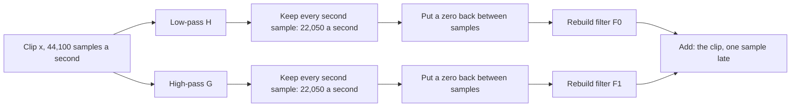
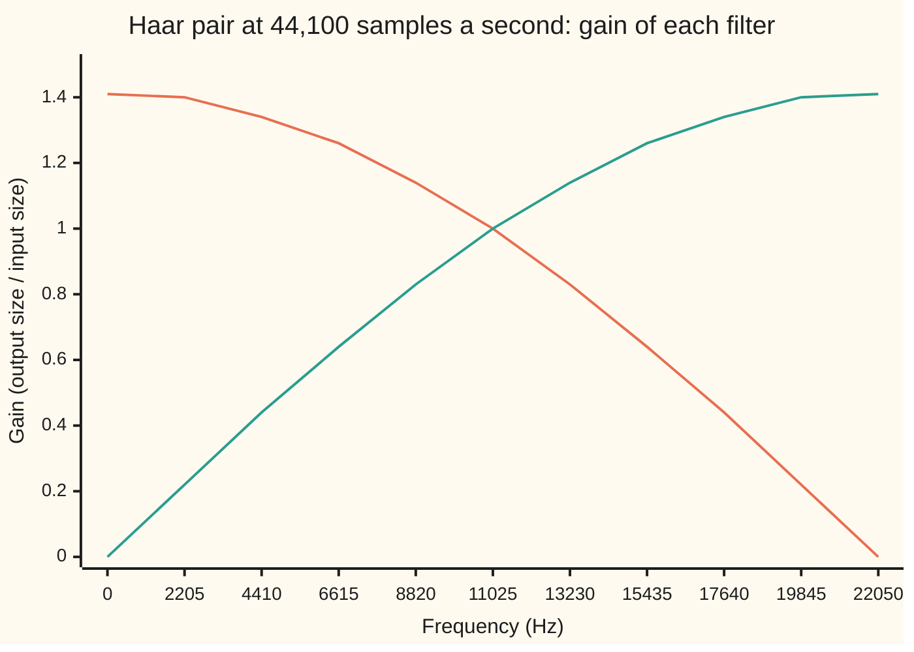

# Filter banks: when splitting and rejoining returns the signal unchanged

[Syllabus](../../../SYLLABUS.md) → [Harmonic analysis](../README.md) → [Wavelets and Time-Frequency](../README.md#s05) → Filter banks

---

## General Overview

A music file holds 44,100 samples a second. A coder wants to split it into a bass-and-middle band and a treble band. It can then spend more bits where the ear is sharp and fewer where it is not. Each band keeps only half the frequency range, so each band keeps only every second sample. The two bands together still hold 44,100 numbers a second, the same count as the file.

The test clip here is illustrative and synthetic: 0.1 s of the note A at 440 Hz, amplitude 0.5, plus a 14,000 Hz cymbal shimmer at amplitude 0.2 (full scale is 1). The split uses the shortest pair of filters there is, the Haar pair: a sum of two neighbouring samples and a difference of them.

Throwing away every second sample makes a fake tone. In the bass band, the shimmer folds down to 8,050 Hz at amplitude 0.0912. The treble band carries a fake 8,050 Hz tone of exactly the same size, upside down. When the two bands are rebuilt and added, the fakes cancel. The output is the clip, sample for sample, one sample late.

**A two-band filter bank gives back its input exactly, apart from a delay, when its four filters satisfy two conditions: the folded copies that halving makes in the two bands arrive equal and opposite, and what remains of the input passes through as a pure delay.**

**What kind of fact this is:** a theorem, proved on this card in Why it works: the two conditions are necessary and sufficient. That the original "mirror" design can be exact only when its filter has two nonzero taps is a classical result, stated in Step 7 with its source and a one-line reason. The clip is illustrative.

### The picture: one clip, two bands, one clip again



Schematic. The left half is the **analysis** side, which splits. The right half is the **synthesis** side, which rejoins. Anything a coder does to the bands happens in the middle, at half the rate.

---

## The formula

Notation first, in words.

- The clip is $`x[n]`$, sample number $`n`$, at the rate $`f_s`$ = 44,100 samples a second. The output is $`\tilde x[n]`$; the tilde marks a rebuilt signal, since on this wing a hat means a Fourier transform.
- A frequency $`\xi`$ is in hertz. The half rate $`f_s/2`$ = 22,050 Hz is the fastest tone the samples can show.
- From [The z-transform](../../13-Engineering%20mathematics/02-Linear%20Systems%20and%20Transforms/08-z-transform-and-discrete-time-systems.md): $`X(z) = \sum_n x[n]\, z^{-n}`$, and multiplying by $`z^{-1}`$ delays a signal by one sample. Setting $`z = e^{2\pi i \xi / f_s}`$, with $`i`$ the imaginary unit, reads off what the signal holds at frequency $`\xi`$.
- From [Mallat's algorithm](04-mallats-fast-wavelet-transform.md): $`h`$ and $`g`$ are the low-pass and high-pass filters, and **halving** keeps one sample in two. That card lays $`h`$ forward over the samples. Here every filter runs causally, $`y[n] = h[0]\,x[n] + h[1]\,x[n-1] + \dots`$, so the taps meet the samples in the opposite order. For Haar this pairs $`x[1]`$ with $`x[2]`$, where that card pairs $`x[0]`$ with $`x[1]`$, and it flips the detail's sign. The conditions below hold whichever way the taps run.
- New on this card: the filters' z-transforms $`H(z)`$ and $`G(z)`$ (the **analysis** pair), and $`F_0(z)`$, $`F_1(z)`$, the **synthesis** pair that rebuilds the low and high band. A filter's **taps** are its weights: the numbers it multiplies the current and recent samples by.

Run the clip through the bank and collect terms (Step 3 below). The output is:

```math
\tilde X(z) = \underbrace{\tfrac12\bigl[F_0(z)H(z) + F_1(z)G(z)\bigr]}_{T(z)}\,X(z) \;+\; \underbrace{\tfrac12\bigl[F_0(z)H(-z) + F_1(z)G(-z)\bigr]}_{A(z)}\,X(-z)
```

The bank returns its input exactly, $`\tilde x[n] = x[n - \ell]`$, if and only if

```math
A(z) = 0 \quad\text{(no alias)}, \qquad T(z) = z^{-\ell} \quad\text{(no distortion)}.
```

**Read it aloud:** the output is the input passed through one combined filter, plus a folded copy of the input passed through another; for an exact rebuild, the folded copy must vanish and the combined filter must be a pure delay of $`\ell`$ samples.

The usual way to meet the first condition is the **cross-mirror rule**. Build each synthesis filter from the other band's analysis filter, with every second tap's sign flipped:

```math
F_0(z) = G(-z), \qquad F_1(z) = -H(-z) \quad\Longrightarrow\quad A(z) = 0, \qquad T(z) = \tfrac12\bigl[P(z) - P(-z)\bigr],\ \ P(z) = H(z)F_0(z).
```

For the Haar pair, $`H(z) = (1 + z^{-1})/\sqrt2`$ and $`G(z) = (1 - z^{-1})/\sqrt2`$. The rule gives $`F_0(z) = (1 + z^{-1})/\sqrt2`$ and $`F_1(z) = (-1 + z^{-1})/\sqrt2`$. Then $`P(z) = (1 + 2z^{-1} + z^{-2})/2`$ and $`T(z) = z^{-1}`$: a one-sample delay.

| Symbol | Plain meaning | In our example | Push it up and the answer… |
| --- | --- | --- | --- |
| $`x[n]`$, $`n`$, $`\tilde x[n]`$ | the clip, sample number $`n`$, full scale ±1; the bank's output | 4,410 samples, 0.1 s; $`\tilde x[n] = x[n-1]`$ | the output scales with the clip |
| $`f_s`$, $`\xi`$ | the sample rate; a frequency in hertz | 44,100; 440 and 14,000 Hz | — |
| $`z`$, $`i`$ | $`z^{-1}`$ is a one-sample delay; on the unit circle $`z = e^{2\pi i\xi/f_s}`$, $`i`$ the imaginary unit | — | — |
| $`X(z)`$, $`X(-z)`$ | the clip's z-transform; the same with $`z`$ replaced by $`-z`$, which is the clip folded about $`f_s/4`$ | 14,000 Hz folds to 8,050 Hz | — |
| $`H(z)`$, $`G(z)`$ | the analysis low-pass and high-pass filters, taps $`h`$ and $`g`$ | Haar: taps (1, 1)/√2 and (1, −1)/√2 | longer filters split the bands more cleanly |
| $`F_0(z)`$, $`F_1(z)`$ | the synthesis filters that rebuild the low and high band | (1, 1)/√2 and (−1, 1)/√2 | — |
| $`y[n]`$, $`u[n]`$, $`Y`$, $`U`$, $`s`$, $`d`$ | one band before halving; the same band after halving and stuffing; their z-transforms; the low-band and high-band sample at time 2 | $`s`$ = 0.5519, $`d`$ = −0.0375 | — |
| $`T(z)`$ | the through term: what happens to the input itself | $`z^{-1}`$ | — |
| $`A(z)`$ | the alias term: what happens to the folded copy | 0 | any nonzero value is a fake tone in the output |
| $`\ell`$ | the delay of the rebuild, in samples | 1 for Haar, 3 for the 5/3 pair | longer filters, longer delay |
| $`P(z)`$ | the product filter $`H(z)F_0(z)`$ | taps (1, 2, 1)/2 | — |
| $`a`$, $`\xi_a`$ | the shimmer's amplitude; where its folded copy lands, $`f_s/2 - \xi`$ | 0.2; 8,050 Hz | each band's fake tone grows in step with $`a`$ |

### When it holds

- **Nothing changes the bands between split and rejoin.** Cancellation needs both fake tones at full size. Halve the treble band, as a tone control would, and a 0.0456 fake at 8,050 Hz survives.
- **The synthesis filters match the analysis filters exactly.** Flip the sign of $`F_1`$ and the two fakes add instead of cancel: 0.1823 at 8,050 Hz.
- **Both bands keep the same samples.** Here both keep the even-numbered ones. Keep even in one band and odd in the other, and $`X(-z)`$ enters the two bands with opposite signs, so the rule no longer cancels it.
- **The filters are fixed and linear.** A filter that changes with the signal, or clips it, has no single $`H(z)`$, and the algebra does not apply.
- **The fold is the bank's own.** The bank cancels only the folding that its own halving makes. A tone above 22,050 Hz that was folded when the music was first recorded is already in $`x[n]`$, and it comes back out unchanged.

---

## Why it works

### Step 0: the idea, in words

Halving a band folds its spectrum. Every tone at $`\xi`$ gains a fake twin at $`f_s/2 - \xi`$. Neither band can avoid this, because no short filter cuts off cleanly at 11,025 Hz.

But both bands fold the same input in the same way. So each band's fake is the folded input, passed through a known filter. Choose the synthesis filters so that those two known filters are equal and opposite. Then the fakes cancel, however poor the band split is.

### Step 1: halving and stuffing, in one formula

Halving keeps $`y[0], y[2], y[4], \dots`$. Stuffing puts a zero back between them. Together they turn $`y[n]`$ into $`u[n] = \tfrac12\bigl(1 + (-1)^n\bigr)\,y[n]`$: odd samples zeroed, even ones kept.

Now take the z-transform. The factor $`(-1)^n`$ turns $`z^{-n}`$ into $`(-z)^{-n}`$, so

```math
U(z) = \tfrac12\bigl[Y(z) + Y(-z)\bigr].
```

The first half is the band itself. The second half, $`Y(-z)`$, is the fake.

### Step 2: replacing z by −z folds the spectrum about 11,025 Hz

On the unit circle, $`-z = e^{i\pi}\, e^{2\pi i\xi/f_s} = e^{2\pi i(\xi + f_s/2)/f_s}`$. So $`Y(-z)`$ at frequency $`\xi`$ is what $`Y`$ holds at $`\xi + f_s/2`$. Frequencies repeat every $`f_s`$, and a real signal holds the same size at $`-\xi`$ as at $`\xi`$. So $`\xi + f_s/2`$ is the same as $`f_s/2 - \xi`$.

For the shimmer: 22,050 − 14,000 = 8,050 Hz. The fold is a mirror about $`f_s/4`$ = 11,025 Hz. [Changing rate](../../13-Engineering%20mathematics/05-Signals/05-resampling-decimation-and-interpolation.md) derives the same fold for any drop factor; here the factor is 2.

### Step 3: the whole bank

The low band is $`Y = H(z)X(z)`$, so after halving and stuffing it is $`\tfrac12[H(z)X(z) + H(-z)X(-z)]`$. The filter $`F_0`$ multiplies this. The high band does the same with $`G`$ and $`F_1`$. Add the two and collect the $`X(z)`$ and $`X(-z)`$ terms. That is the formula for $`\tilde X(z)`$, with the through term $`T(z)`$ and the alias term $`A(z)`$.

### Step 4: the two conditions are exactly right

They are enough: with $`A = 0`$ and $`T = z^{-\ell}`$, the output is $`z^{-\ell}X(z)`$, which is $`x[n-\ell]`$.

They are also needed. Feed in a single 1 at $`n = 0`$. Then $`X(z) = X(-z) = 1`$, and an exact rebuild requires $`T + A = z^{-\ell}`$. Feed in a single 1 at $`n = 1`$. Then $`X(z) = z^{-1}`$ and $`X(-z) = -z^{-1}`$, and an exact rebuild requires $`T - A = z^{-\ell}`$. Add and subtract: $`T = z^{-\ell}`$ and $`A = 0`$.

### Step 5: the cross-mirror rule kills the alias for any pair

Put $`F_0(z) = G(-z)`$ and $`F_1(z) = -H(-z)`$ into $`A`$:

```math
2A(z) = G(-z)H(-z) - H(-z)G(-z) = 0.
```

This holds for any $`H`$ and $`G`$, good or bad. With the same choice, $`F_1(z)G(z) = -H(-z)G(z)`$, which is $`-P(-z)`$. So $`T(z) = \tfrac12[P(z) - P(-z)]`$.

$`P(z) - P(-z)`$ keeps only the odd-numbered taps of $`P`$, doubled. So the no-distortion condition says: **the product filter has every odd-numbered tap zero, except one, which is 1.** That tap's position is the delay $`\ell`$. A filter of this shape is called a half-band filter.

### Step 6: the Haar pair, and a longer pair

**Haar.** $`P`$ has taps (1, 2, 1)/2. Its only odd-numbered tap is tap 1, and it equals 2/2 = 1. So $`T(z) = z^{-1}`$ and $`\ell = 1`$. The code checks this with whole numbers, every filter times √2.

**The 5/3 pair**, from the JPEG 2000 image standard. $`H`$ has taps (−1, 2, 6, 2, −1)/8 and $`F_0`$ has taps (1, 2, 1)/2. The cross-mirror rule gives $`G`$ = (1, −2, 1)/2 and $`F_1`$ = (1, 2, −6, 2, 1)/8. Their product is

```math
16\,P(z) = -1 + 0z^{-1} + 9z^{-2} + 16z^{-3} + 9z^{-4} + 0z^{-5} - z^{-6}.
```

The odd-numbered taps are 0, 16 and 0, over 16. So $`T(z) = z^{-3}`$ and $`\ell = 3`$. This pair is not a mirror of itself: its low-pass has five taps and its high-pass three. Exact rebuilding needs only the two conditions, not a matched shape.

### Step 7: the original mirror pair, and why it stops at two nonzero taps

The first banks of this kind, built for telephone speech in 1976–77, made the high-pass the exact mirror of the low-pass: $`G(z) = H(-z)`$. Its gain at $`\xi`$ is the low-pass gain at $`f_s/2 - \xi`$, reflected about 11,025 Hz. This is the **quadrature mirror filter**, or QMF. The chart below shows the Haar pair's two curves as mirror images.

With $`G(z) = H(-z)`$ and the cross-mirror rule, $`T(z) = \tfrac12[H(z)^2 - H(-z)^2]`$. It is a classical result that, for a finite filter, this is a pure delay only when $`H`$ has just two nonzero taps, one at an even-numbered position and one at an odd-numbered one ([Vaidyanathan](#sources)). The reason fits in a line. $`H(z)^2 - H(-z)^2 = [H(z) + H(-z)]\,[H(z) - H(-z)]`$; the first factor is the even-numbered taps of $`H`$, doubled, and the second the odd-numbered taps, doubled. A product of two polynomials in $`z^{-1}`$ is a single power of $`z^{-1}`$ only when each factor is. Two taps $`h[0]`$ and $`h[1]`$ give $`T(z) = 2\,h[0]\,h[1]\,z^{-1}`$, an exact rebuild whenever $`2\,h[0]\,h[1] = 1`$. Haar, with both taps $`1/\sqrt2`$, is the balanced choice.

Mirror pairs with more nonzero taps cancel the alias exactly but distort slightly. The fix of the 1980s was to give up the mirror shape and keep the two conditions. Orthogonal pairs, where $`G`$ is $`H`$ reversed in time with alternating signs, are on [Daubechies wavelets](06-daubechies-and-vanishing-moments.md). Pairs like 5/3, with different lengths, are called biorthogonal.

### The mirror, drawn



Orange: the low-pass $`H`$, gain $`\sqrt2\,\lvert\cos(\pi\xi/f_s)\rvert`$. Teal: the high-pass $`G`$, gain $`\sqrt2\,\lvert\sin(\pi\xi/f_s)\rvert`$. Each is the other reflected about 11,025 Hz. Both are poor band splits: at 13,230 Hz, well into the treble, the low-pass still passes 0.83 of the input. The bank is exact anyway.

---

## Worked numbers, by hand

The first four samples of the clip are 0.7000, 0.4168, 0.3637 and 0.6823. Take the pair $`x[1]`$ = 0.4168 and $`x[2]`$ = 0.3637. The Haar filters are causal: each band sample at time 2 uses $`x[2]`$ and $`x[1]`$. Call them $`s`$ (low band) and $`d`$ (high band).

| Step | Arithmetic | Value |
| --- | --- | --- |
| low band $`s`$ | (0.3637 + 0.4168) / √2 | 0.5519 |
| high band $`d`$ | (0.3637 − 0.4168) / √2 | −0.0375 |
| output at $`n = 2`$: $`F_0`$ gives $`s`$, $`F_1`$ gives $`-d`$, both from time 2 | (0.5519 − (−0.0375)) / √2 | **0.4168** = $`x[1]`$ |
| output at $`n = 3`$: both filters reach back one sample | (0.5519 + (−0.0375)) / √2 | **0.3637** = $`x[2]`$ |
| the polynomial check, Haar, every filter times √2 | $`4T`$ taps: 0, 4, 0; $`4A`$ taps: 0, 0, 0 | $`T = z^{-1}`$, $`A = 0`$ |
| the polynomial check, 5/3, every product times 16 | $`32T`$ taps: 0, 0, 0, 32, 0, 0, 0; $`32A`$ taps: all 0 | $`T = z^{-3}`$, $`A = 0`$ |

Every pair of samples comes back one sample late. The code runs all 4,410 samples and finds no error above 1e-12. It also runs the clip as 16-bit whole numbers through the 5/3 pair, where every sample comes back exactly, three samples late.

Now the fake tones. The code measures each branch's output with a discrete Fourier transform (DFT: the clip's content at each multiple of 10 Hz).

| Frequency | Low branch | High branch | Rejoined |
| --- | --- | --- | --- |
| 440 Hz, the note | 0.4995 | 0.0005 | **0.5000** |
| 14,000 Hz, the shimmer | 0.0589 | 0.1411 | **0.2000** |
| 8,050 Hz, the fold | 0.0912 | 0.0912 | **0.0000** |

The high branch's fake divided by the low branch's fake is −1.0000: same size, opposite sign. The closed form for each fake is $`a \cdot \tfrac12\lvert\sin(2\pi\xi_a/f_s)\rvert`$ = 0.2 × ½ × sin(2π × 8,050/44,100) = 0.0912, matching the DFT. The fold in each band is almost half the size of the real shimmer, and the rejoined clip has none of it.

<details>
<summary>Where the closed form for the fake comes from</summary>

The low branch's fake is $`\tfrac12 F_0(z)H(-z)X(-z)`$. At $`\xi_a`$ = 8,050 Hz, $`\lvert F_0\rvert = \sqrt2\,\lvert\cos(\pi\xi_a/f_s)\rvert`$ and $`\lvert H(-z)\rvert = \sqrt2\,\lvert\sin(\pi\xi_a/f_s)\rvert`$. The shimmer contributes amplitude $`a`$ = 0.2 at the folded frequency. Multiply:

$`\displaystyle \tfrac12 \cdot 2\,\lvert\cos(\pi\xi_a/f_s)\sin(\pi\xi_a/f_s)\rvert \cdot a = \tfrac12\,a\,\lvert\sin(2\pi\xi_a/f_s)\rvert.`$

The high branch gives the same size with $`\lvert G(-z)\rvert\,\lvert F_1\rvert`$, which is the same product, and the opposite sign.

</details>

### What breaks if you drop a piece

| Mistake | Comes out at | What went wrong |
| --- | --- | --- |
| Throw away the treble band to save bits | a fake 8,050 Hz tone at 0.0912, while the real shimmer survives only at 0.0589 | the low band's fake has no partner left to cancel it; the fake is louder than what remains of the real tone |
| Flip the sign of $`F_1`$ | 0.1823 at 8,050 Hz, and the shimmer drops to 0.0823 | the two fakes add instead of cancel, and $`T`$ is no longer a delay |
| Halve the treble band, as a tone control would | 0.0456 at 8,050 Hz, shimmer 0.1294 | half of the high band's fake no longer matches the low band's |

Each row breaks one hypothesis of the theorem: the bands must arrive unchanged and the filters must match. The code prints all three.

---

## Code, from first principles, and it actually runs

Both programs build the bank from scratch: circular filters on the 0.1 s clip (treated as repeating, so the ends join), halving, stuffing and a DFT, with no signal library. They take three independent roads. Road 1 checks the two conditions as polynomials in whole numbers, for the Haar and the 5/3 pair. Road 2 runs the bank sample by sample and compares the output with the delayed clip, for Haar in decimals and for 5/3 in exact integers. Road 3 measures each branch with the DFT and compares the fake tone against its closed form.

### Python

```python
# Filter banks: split a music clip into two bands, halve each, rejoin, get the clip back.
# Standard library only.  Roads: the bank run sample by sample (circular filters on a
# 0.1 s clip that repeats), the z-domain conditions as exact integer polynomials, and
# a DFT of each branch's output against the closed form for the alias it carries.
import math

FS, N = 44100, 4410                      # sample rate in Hz; 0.1 s clip, DFT bins 10 Hz apart
R2 = math.sqrt(2.0)
# Haar pair, each tap times sqrt 2: analysis H, G; synthesis F0 = G(-z), F1 = -H(-z)
HAAR = ([1, 1], [1, -1], [1, 1], [-1, 1], R2)          # (H, G, F0, F1, scale of each)
# LeGall 5/3 pair as integer numerators: H/8, G/2, F0/2, F1/8
L53 = ([-1, 2, 6, 2, -1], [1, -2, 1], [1, 2, 1], [1, 2, -6, 2, 1])

def mul(p, q):                           # polynomial product in z^-1 (convolution of taps)
    r = [0] * (len(p) + len(q) - 1)
    for i, a in enumerate(p):
        for j, b in enumerate(q):
            r[i + j] += a * b
    return r

def neg(p): return [c if k % 2 == 0 else -c for k, c in enumerate(p)]     # P(z) -> P(-z)
def add(p, q):
    n = max(len(p), len(q)); p, q = p + [0] * (n - len(p)), q + [0] * (n - len(q))
    return [a + b for a, b in zip(p, q)]

def show(v): return " ".join(str(c) for c in v)

def clip(f_hi):               # illustrative: A at 440 Hz, amplitude 0.5, plus a shimmer
    return [0.5 * math.cos(2 * math.pi * 440 * n / FS) + 0.2 * math.cos(2 * math.pi * f_hi * n / FS)
            for n in range(N)]

def filt(taps, x, s):                    # circular filter: y[n] = sum_k taps[k] x[n-k] / s
    return [sum(t * x[(n - k) % len(x)] for k, t in enumerate(taps)) / s for n in range(len(x))]

def halve_and_stuff(y): return [v if n % 2 == 0 else 0.0 for n, v in enumerate(y)]

def branches(x, bank, hi_gain=1.0, flip=1.0):          # (low branch out, high branch out)
    H, G, F0, F1, s = bank
    low = filt(F0, halve_and_stuff(filt(H, x, s)), s)
    high = filt([flip * c for c in F1], halve_and_stuff([hi_gain * v for v in filt(G, x, s)]), s)
    return low, high

COS = [math.cos(2 * math.pi * k / N) for k in range(N)]
SIN = [math.sin(2 * math.pi * k / N) for k in range(N)]
def bin_of(x, f):                         # DFT at f Hz as a complex number scaled to amplitude
    m = f * N // FS
    re = sum(v * COS[(m * n) % N] for n, v in enumerate(x))
    im = -sum(v * SIN[(m * n) % N] for n, v in enumerate(x))
    return complex(re, im) * 2 / N
def amp(x, f): return abs(bin_of(x, f))
def f4(v): return f"{v:.4f}"

# ---- road 1: the conditions as polynomials, exact integers ----
H, G, F0, F1, _ = HAAR
t_haar, a_haar = add(mul(F0, H), mul(F1, G)), add(mul(F0, neg(H)), mul(F1, neg(G)))
print("Haar, 2*(F0 H + F1 G) taps:", show(t_haar), "  2*(F0 H(-z) + F1 G(-z)):", show(a_haar))
assert t_haar == [0, 4, 0] and a_haar == [0, 0, 0]     # T = z^-1 (delay 1), alias term 0
H5, G5, F05, F15 = L53
assert G5 == neg(F05) and F15 == [-c for c in neg(H5)] # the cross-mirror rule, 5/3 pair
p5 = mul(H5, F05)
t53, a53 = add(mul(F05, H5), mul(F15, G5)), add(mul(F05, neg(H5)), mul(F15, neg(G5)))
print("5/3, 16*P = 16*H F0 taps:", show(p5))
print("5/3, 16*(F0 H + F1 G):", show(t53), "  16*(alias):", show(a53))
assert t53 == [0, 0, 0, 32, 0, 0, 0] and a53 == [0] * 7  # T = z^-3, alias term 0

# ---- road 2: the bank run sample by sample on the clip ----
x = clip(14000)
print("clip x[0..3]:", " ".join(f4(v) for v in x[:4]))
low, high = branches(x, HAAR)
out = [a + b for a, b in zip(low, high)]
lo_band = halve_and_stuff(filt(H, x, R2)); hi_band = halve_and_stuff(filt(G, x, R2))
print("time 2: low s =", f4(lo_band[2]), " high d =", f4(hi_band[2]),
      " rebuilt x~[2], x~[3] =", f4(out[2]), f4(out[3]))
err = max(abs(out[n] - x[(n - 1) % N]) for n in range(N))
print("Haar, largest |x~[n] - x[n-1]| over 4410 samples below 1e-12:", "yes" if err < 1e-12 else "no")
assert err < 1e-12
xi = [round(32767 * v) for v in x]       # the same clip as 16-bit integers, through the 5/3 bank
li = [sum(c * xi[(n - k) % N] for k, c in enumerate(H5)) if n % 2 == 0 else 0 for n in range(N)]
hi = [sum(c * xi[(n - k) % N] for k, c in enumerate(G5)) if n % 2 == 0 else 0 for n in range(N)]
oi = [sum(c * li[(n - k) % N] for k, c in enumerate(F05)) + sum(c * hi[(n - k) % N]
      for k, c in enumerate(F15)) for n in range(N)]  # every term over 16
ok = all(oi[n] == 16 * xi[(n - 3) % N] for n in range(N))
print("5/3 on 4410 integer samples: rebuilt exactly, 3 samples late:", "yes" if ok else "no")
assert ok

# ---- road 3: what each branch carries, DFT against closed form ----
def alias_pred(a, f_alias): return a * 0.5 * abs(math.sin(2 * math.pi * f_alias / FS))
for f in (440, 14000, 8050):
    print(f"at {f:>5} Hz  low branch {f4(amp(low, f))}  high branch {f4(amp(high, f))}  sum {f4(amp(out, f))}")
bl, bh = bin_of(low, 8050), bin_of(high, 8050)
print("high branch alias / low branch alias at 8050 Hz:", f4((bh / bl).real))
print("closed form for each branch's alias, 0.2 * sin(2 pi 8050/44100) / 2:", f4(alias_pred(0.2, 8050)))
assert abs(amp(low, 8050) - alias_pred(0.2, 8050)) < 1e-9 and abs(bh / bl + 1) < 1e-9
assert abs(amp(low, 440) - 0.5 * math.cos(math.pi * 440 / FS) ** 2) < 1e-9
assert amp(out, 8050) < 1e-12 and abs(amp(out, 14000) - 0.2) < 1e-9

# ---- what breaks ----
print("drop the high band: 8050 Hz phantom", f4(amp(low, 8050)), " 14000 Hz kept", f4(amp(low, 14000)))
l2, h2 = branches(x, HAAR, flip=-1.0)
o2 = [a + b for a, b in zip(l2, h2)]
print("F1 sign flipped: 8050 Hz", f4(amp(o2, 8050)), " 14000 Hz", f4(amp(o2, 14000)))
assert abs(amp(o2, 8050) - 2 * alias_pred(0.2, 8050)) < 1e-9
l3, h3 = branches(x, HAAR, hi_gain=0.5)
o3 = [a + b for a, b in zip(l3, h3)]
print("high band halved: 8050 Hz", f4(amp(o3, 8050)), " 14000 Hz", f4(amp(o3, 14000)))
assert abs(amp(o3, 8050) - 0.5 * alias_pred(0.2, 8050)) < 1e-9

# ---- try changing ----
for f_hi, f_al in ((4000, 18050), (11000, 11050)):
    l4, h4 = branches(clip(f_hi), HAAR)
    print(f"shimmer {f_hi} Hz: alias at {f_al} Hz, low branch {f4(amp(l4, f_al))}, rejoined {f4(amp([a + b for a, b in zip(l4, h4)], f_al))}")
B53 = ([c / 8 for c in H5], [c / 2 for c in G5], [c / 2 for c in F05], [c / 8 for c in F15], 1.0)
l5, h5 = branches(x, B53)
print("5/3, drop the high band: 8050 Hz phantom", f4(amp(l5, 8050)))

# ---- chart: Haar gains, 0 to 22050 Hz in 2205 Hz steps ----
fr = range(0, 22051, 2205)
print("chart, low gain:", " ".join(f"{R2 * abs(math.cos(math.pi * f / FS)):.2f}" for f in fr))
print("chart, high gain:", " ".join(f"{R2 * abs(math.sin(math.pi * f / FS)):.2f}" for f in fr))
print("ALL CHECKS PASS")
```

**Ran 2026-11-15 on macOS, Python 3.14.10, standard library only. All checks passed. Output, pasted from the run:**

```text
Haar, 2*(F0 H + F1 G) taps: 0 4 0   2*(F0 H(-z) + F1 G(-z)): 0 0 0
5/3, 16*P = 16*H F0 taps: -1 0 9 16 9 0 -1
5/3, 16*(F0 H + F1 G): 0 0 0 32 0 0 0   16*(alias): 0 0 0 0 0 0 0
clip x[0..3]: 0.7000 0.4168 0.3637 0.6823
time 2: low s = 0.5519  high d = -0.0375  rebuilt x~[2], x~[3] = 0.4168 0.3637
Haar, largest |x~[n] - x[n-1]| over 4410 samples below 1e-12: yes
5/3 on 4410 integer samples: rebuilt exactly, 3 samples late: yes
at   440 Hz  low branch 0.4995  high branch 0.0005  sum 0.5000
at 14000 Hz  low branch 0.0589  high branch 0.1411  sum 0.2000
at  8050 Hz  low branch 0.0912  high branch 0.0912  sum 0.0000
high branch alias / low branch alias at 8050 Hz: -1.0000
closed form for each branch's alias, 0.2 * sin(2 pi 8050/44100) / 2: 0.0912
drop the high band: 8050 Hz phantom 0.0912  14000 Hz kept 0.0589
F1 sign flipped: 8050 Hz 0.1823  14000 Hz 0.0823
high band halved: 8050 Hz 0.0456  14000 Hz 0.1294
shimmer 4000 Hz: alias at 18050 Hz, low branch 0.0540, rejoined 0.0000
shimmer 11000 Hz: alias at 11050 Hz, low branch 0.1000, rejoined 0.0000
5/3, drop the high band: 8050 Hz phantom 0.1002
chart, low gain: 1.41 1.40 1.34 1.26 1.14 1.00 0.83 0.64 0.44 0.22 0.00
chart, high gain: 0.00 0.22 0.44 0.64 0.83 1.00 1.14 1.26 1.34 1.40 1.41
ALL CHECKS PASS
```

### Rust

```rust
// Filter banks: split a music clip into two bands, halve each, rejoin, get the clip back.
// std only.  Roads: the bank run sample by sample (circular filters on a 0.1 s clip that
// repeats), the z-domain conditions as exact integer polynomials, and a DFT of each
// branch's output against the closed form for the alias it carries.
use std::f64::consts::PI;
const FS: i64 = 44100;
const N: usize = 4410; // 0.1 s clip, DFT bins 10 Hz apart

#[derive(Clone, Copy)]
struct C { re: f64, im: f64 } // a complex number
fn cdiv(a: C, b: C) -> C {
    let d = b.re * b.re + b.im * b.im;
    C { re: (a.re * b.re + a.im * b.im) / d, im: (a.im * b.re - a.re * b.im) / d }
}
fn mul(p: &[i64], q: &[i64]) -> Vec<i64> { // polynomial product in z^-1
    let mut r = vec![0; p.len() + q.len() - 1];
    for (i, a) in p.iter().enumerate() { for (j, b) in q.iter().enumerate() { r[i + j] += a * b; } }
    r
}
fn neg(p: &[i64]) -> Vec<i64> { // P(z) -> P(-z)
    p.iter().enumerate().map(|(k, &c)| if k % 2 == 0 { c } else { -c }).collect()
}
fn add(p: &[i64], q: &[i64]) -> Vec<i64> {
    (0..p.len().max(q.len())).map(|k| p.get(k).unwrap_or(&0) + q.get(k).unwrap_or(&0)).collect()
}
fn show(v: &[i64]) -> String { v.iter().map(|c| c.to_string()).collect::<Vec<_>>().join(" ") }
fn clip(f_hi: f64) -> Vec<f64> { // illustrative: A at 440 Hz, amplitude 0.5, plus a shimmer
    (0..N).map(|n| 0.5 * (2.0 * PI * 440.0 * n as f64 / FS as f64).cos()
        + 0.2 * (2.0 * PI * f_hi * n as f64 / FS as f64).cos()).collect()
}
fn filt(taps: &[f64], x: &[f64], s: f64) -> Vec<f64> { // circular: y[n] = sum_k taps[k] x[n-k] / s
    let m = x.len();
    (0..m).map(|n| { let mut acc = 0.0;
        for (k, t) in taps.iter().enumerate() { acc += t * x[(n + m - k) % m]; } acc / s }).collect()
}
fn halve_and_stuff(y: &[f64]) -> Vec<f64> {
    y.iter().enumerate().map(|(n, &v)| if n % 2 == 0 { v } else { 0.0 }).collect()
}
struct Bank { h: Vec<f64>, g: Vec<f64>, f0: Vec<f64>, f1: Vec<f64>, s: f64 }
fn branches(x: &[f64], b: &Bank, hi_gain: f64, flip: f64) -> (Vec<f64>, Vec<f64>) {
    let low = filt(&b.f0, &halve_and_stuff(&filt(&b.h, x, b.s)), b.s);
    let g: Vec<f64> = filt(&b.g, x, b.s).iter().map(|v| hi_gain * v).collect();
    let f1: Vec<f64> = b.f1.iter().map(|c| flip * c).collect();
    (low, filt(&f1, &halve_and_stuff(&g), b.s))
}
fn sum2(a: &[f64], b: &[f64]) -> Vec<f64> { a.iter().zip(b).map(|(p, q)| p + q).collect() }
fn bin_of(x: &[f64], f: i64, cs: &[f64], sn: &[f64]) -> C { // DFT at f Hz, scaled to amplitude
    let m = (f * N as i64 / FS) as usize;
    let mut re = 0.0; let mut im = 0.0;
    for (n, v) in x.iter().enumerate() { re += v * cs[(m * n) % N]; }
    for (n, v) in x.iter().enumerate() { im += v * sn[(m * n) % N]; }
    C { re: re * 2.0 / N as f64, im: -im * 2.0 / N as f64 }
}
fn f4(v: f64) -> String { format!("{:.4}", v) }
fn alias_pred(a: f64, f: f64) -> f64 { a * 0.5 * (2.0 * PI * f / FS as f64).sin().abs() }

fn main() {
    let r2 = 2f64.sqrt();
    let cs: Vec<f64> = (0..N).map(|k| (2.0 * PI * k as f64 / N as f64).cos()).collect();
    let sn: Vec<f64> = (0..N).map(|k| (2.0 * PI * k as f64 / N as f64).sin()).collect();
    let amp = |x: &[f64], f: i64| { let c = bin_of(x, f, &cs, &sn); (c.re * c.re + c.im * c.im).sqrt() };
    // ---- road 1: the conditions as polynomials, exact integers ----
    let (h, g, f0, f1) = (vec![1i64, 1], vec![1i64, -1], vec![1i64, 1], vec![-1i64, 1]);
    let t_haar = add(&mul(&f0, &h), &mul(&f1, &g));
    let a_haar = add(&mul(&f0, &neg(&h)), &mul(&f1, &neg(&g)));
    println!("Haar, 2*(F0 H + F1 G) taps: {}   2*(F0 H(-z) + F1 G(-z)): {}", show(&t_haar), show(&a_haar));
    assert!(t_haar == vec![0, 4, 0] && a_haar == vec![0, 0, 0]);
    let (h5, g5, f05, f15) = (vec![-1i64, 2, 6, 2, -1], vec![1i64, -2, 1], vec![1i64, 2, 1], vec![1i64, 2, -6, 2, 1]);
    assert!(g5 == neg(&f05) && f15 == neg(&h5).iter().map(|c| -c).collect::<Vec<_>>());
    let t53 = add(&mul(&f05, &h5), &mul(&f15, &g5));
    let a53 = add(&mul(&f05, &neg(&h5)), &mul(&f15, &neg(&g5)));
    println!("5/3, 16*P = 16*H F0 taps: {}", show(&mul(&h5, &f05)));
    println!("5/3, 16*(F0 H + F1 G): {}   16*(alias): {}", show(&t53), show(&a53));
    assert!(t53 == vec![0, 0, 0, 32, 0, 0, 0] && a53 == vec![0; 7]);
    // ---- road 2: the bank run sample by sample on the clip ----
    let tof = |v: &[i64]| v.iter().map(|&c| c as f64).collect::<Vec<f64>>();
    let haar = Bank { h: tof(&h), g: tof(&g), f0: tof(&f0), f1: tof(&f1), s: r2 };
    let x = clip(14000.0);
    println!("clip x[0..3]: {}", x[..4].iter().map(|&v| f4(v)).collect::<Vec<_>>().join(" "));
    let (low, high) = branches(&x, &haar, 1.0, 1.0);
    let out = sum2(&low, &high);
    let lo_band = halve_and_stuff(&filt(&haar.h, &x, r2));
    let hi_band = halve_and_stuff(&filt(&haar.g, &x, r2));
    println!("time 2: low s = {}  high d = {}  rebuilt x~[2], x~[3] = {} {}", f4(lo_band[2]), f4(hi_band[2]), f4(out[2]), f4(out[3]));
    let err = (0..N).map(|n| (out[n] - x[(n + N - 1) % N]).abs()).fold(0.0, f64::max);
    println!("Haar, largest |x~[n] - x[n-1]| over 4410 samples below 1e-12: {}", if err < 1e-12 { "yes" } else { "no" });
    assert!(err < 1e-12);
    let xi: Vec<i64> = x.iter().map(|v| (32767.0 * v).round() as i64).collect();
    let run = |taps: &[i64], y: &[i64], keep_even: bool| -> Vec<i64> { (0..N).map(|n| {
        if keep_even && n % 2 == 1 { return 0; }
        taps.iter().enumerate().map(|(k, c)| c * y[(n + N - k) % N]).sum() }).collect() };
    let li = run(&h5, &xi, true); let hi = run(&g5, &xi, true);
    let oi: Vec<i64> = run(&f05, &li, false).iter().zip(run(&f15, &hi, false)).map(|(a, b)| a + b).collect();
    let ok = (0..N).all(|n| oi[n] == 16 * xi[(n + N - 3) % N]);
    println!("5/3 on 4410 integer samples: rebuilt exactly, 3 samples late: {}", if ok { "yes" } else { "no" });
    assert!(ok);
    // ---- road 3: what each branch carries, DFT against closed form ----
    for f in [440i64, 14000, 8050] {
        println!("at {:>5} Hz  low branch {}  high branch {}  sum {}", f, f4(amp(&low, f)), f4(amp(&high, f)), f4(amp(&out, f)));
    }
    let ratio = cdiv(bin_of(&high, 8050, &cs, &sn), bin_of(&low, 8050, &cs, &sn));
    println!("high branch alias / low branch alias at 8050 Hz: {}", f4(ratio.re));
    println!("closed form for each branch's alias, 0.2 * sin(2 pi 8050/44100) / 2: {}", f4(alias_pred(0.2, 8050.0)));
    assert!((amp(&low, 8050) - alias_pred(0.2, 8050.0)).abs() < 1e-9 && ((ratio.re + 1.0).powi(2) + ratio.im.powi(2)).sqrt() < 1e-9);
    assert!((amp(&low, 440) - 0.5 * (PI * 440.0 / FS as f64).cos().powi(2)).abs() < 1e-9);
    assert!(amp(&out, 8050) < 1e-12 && (amp(&out, 14000) - 0.2).abs() < 1e-9);
    // ---- what breaks ----
    println!("drop the high band: 8050 Hz phantom {}  14000 Hz kept {}", f4(amp(&low, 8050)), f4(amp(&low, 14000)));
    let (l2, h2) = branches(&x, &haar, 1.0, -1.0);
    let o2 = sum2(&l2, &h2);
    println!("F1 sign flipped: 8050 Hz {}  14000 Hz {}", f4(amp(&o2, 8050)), f4(amp(&o2, 14000)));
    assert!((amp(&o2, 8050) - 2.0 * alias_pred(0.2, 8050.0)).abs() < 1e-9);
    let (l3, h3) = branches(&x, &haar, 0.5, 1.0);
    let o3 = sum2(&l3, &h3);
    println!("high band halved: 8050 Hz {}  14000 Hz {}", f4(amp(&o3, 8050)), f4(amp(&o3, 14000)));
    assert!((amp(&o3, 8050) - 0.5 * alias_pred(0.2, 8050.0)).abs() < 1e-9);
    // ---- try changing ----
    for (f_hi, f_al) in [(4000i64, 18050i64), (11000, 11050)] {
        let (l4, h4) = branches(&clip(f_hi as f64), &haar, 1.0, 1.0);
        println!("shimmer {} Hz: alias at {} Hz, low branch {}, rejoined {}", f_hi, f_al, f4(amp(&l4, f_al)), f4(amp(&sum2(&l4, &h4), f_al)));
    }
    let sc = |v: &[i64], d: f64| v.iter().map(|&c| c as f64 / d).collect::<Vec<f64>>();
    let b53 = Bank { h: sc(&h5, 8.0), g: sc(&g5, 2.0), f0: sc(&f05, 2.0), f1: sc(&f15, 8.0), s: 1.0 };
    let (l5, _) = branches(&x, &b53, 1.0, 1.0);
    println!("5/3, drop the high band: 8050 Hz phantom {}", f4(amp(&l5, 8050)));
    // ---- chart: Haar gains, 0 to 22050 Hz in 2205 Hz steps ----
    let fr: Vec<f64> = (0..11).map(|k| 2205.0 * k as f64).collect();
    println!("chart, low gain: {}", fr.iter().map(|f| format!("{:.2}", r2 * (PI * f / FS as f64).cos().abs())).collect::<Vec<_>>().join(" "));
    println!("chart, high gain: {}", fr.iter().map(|f| format!("{:.2}", r2 * (PI * f / FS as f64).sin().abs())).collect::<Vec<_>>().join(" "));
    println!("ALL CHECKS PASS");
}
```

**Ran 2026-11-15 on macOS, rustc 1.98.1, no crates. All checks passed. Output, pasted from the run:**

```text
Haar, 2*(F0 H + F1 G) taps: 0 4 0   2*(F0 H(-z) + F1 G(-z)): 0 0 0
5/3, 16*P = 16*H F0 taps: -1 0 9 16 9 0 -1
5/3, 16*(F0 H + F1 G): 0 0 0 32 0 0 0   16*(alias): 0 0 0 0 0 0 0
clip x[0..3]: 0.7000 0.4168 0.3637 0.6823
time 2: low s = 0.5519  high d = -0.0375  rebuilt x~[2], x~[3] = 0.4168 0.3637
Haar, largest |x~[n] - x[n-1]| over 4410 samples below 1e-12: yes
5/3 on 4410 integer samples: rebuilt exactly, 3 samples late: yes
at   440 Hz  low branch 0.4995  high branch 0.0005  sum 0.5000
at 14000 Hz  low branch 0.0589  high branch 0.1411  sum 0.2000
at  8050 Hz  low branch 0.0912  high branch 0.0912  sum 0.0000
high branch alias / low branch alias at 8050 Hz: -1.0000
closed form for each branch's alias, 0.2 * sin(2 pi 8050/44100) / 2: 0.0912
drop the high band: 8050 Hz phantom 0.0912  14000 Hz kept 0.0589
F1 sign flipped: 8050 Hz 0.1823  14000 Hz 0.0823
high band halved: 8050 Hz 0.0456  14000 Hz 0.1294
shimmer 4000 Hz: alias at 18050 Hz, low branch 0.0540, rejoined 0.0000
shimmer 11000 Hz: alias at 11050 Hz, low branch 0.1000, rejoined 0.0000
5/3, drop the high band: 8050 Hz phantom 0.1002
chart, low gain: 1.41 1.40 1.34 1.26 1.14 1.00 0.83 0.64 0.44 0.22 0.00
chart, high gain: 0.00 0.22 0.44 0.64 0.83 1.00 1.14 1.26 1.34 1.40 1.41
ALL CHECKS PASS
```

### Lean

Lean proves the card's theorem, the cross-mirror rule and the mirror-pair limit, for every bank of finite causal filters.

- Suppose all four filters are finite and causal, and both bands keep the even-numbered samples. Then the bank returns every input exactly, $`\ell`$ samples late, just when $`A(z) = 0`$ and $`T(z) = z^{-\ell}`$.
- Take the cross-mirror rule, $`F_0(z) = G(-z)`$ and $`F_1(z) = -H(-z)`$, for any analysis pair. Then $`A(z) = 0`$.
- Keep the cross-mirror rule. Then the bank rebuilds exactly, $`\ell`$ samples late, just when $`P(z)`$ is half-band with its tap of 1 at position $`\ell`$.
- Take the mirror pair, $`G(z) = H(-z)`$, with the cross-mirror rule, and suppose it rebuilds exactly with delay $`\ell`$. Then $`H`$ has just two nonzero taps.
- One of those two taps sits at an even-numbered position and one at an odd-numbered one. Their positions add up to $`\ell`$, and twice their product is 1.
- Take the Haar pair, every filter times √2, and the 5/3 pair. Then each meets the cross-mirror rule, with $`A(z) = 0`$ and delays of 1 and 3 samples.
- The product-filter taps of Step 6 check too: (1, 2, 1)/2 for Haar, and −1, 0, 9, 16, 9, 0, −1 over 16 for 5/3.

The clip's samples, the band values, the fake-tone sizes, the broken banks and the chart are left to the Python and Rust checks.

```lean
-- Filter banks: a two-band filter bank gives back every input exactly, one fixed delay late, if and only if its alias term is zero and its through term is a pure delay.
import Mathlib.Algebra.Polynomial.AlgebraMap
import Mathlib.Algebra.Polynomial.Coeff
import Mathlib.Algebra.Polynomial.Degree.TrailingDegree
import Mathlib.Algebra.Ring.Parity
import Mathlib.Basic.Real.Basic
import Mathlib.Tactic.Ring
import Mathlib.Tactic.NormNum
import Mathlib.Tactic.LinearCombination

/-! A filter is a finite causal filter, written as a polynomial in `w = z⁻¹`:
its taps are the coefficients, so `H = ∑ h[k] w^k` stands for `H(z) = ∑ h[k] z^(-k)`.
Replacing `z` by `-z` is replacing `w` by `-w`, which is Mathlib's `p.comp (-X)`.
A signal is any two-sided list of real samples `x : ℤ → ℝ`.

* `filt p x` runs the filter causally: `y[n] = ∑ p.coeff k * x[n - k]`.
* `halveStuff y` keeps one sample in two and puts a zero back between them:
  even-numbered samples kept, odd-numbered ones zeroed (both bands keep the even ones).
* `bank H G F0 F1 x` splits `x` with the analysis pair `H`, `G`, halves and stuffs both bands,
  rebuilds them with the synthesis pair `F0`, `F1`, and adds.
* `throughTerm` is `T(z) = ½[F0(z)H(z) + F1(z)G(z)]` and
  `aliasTerm` is `A(z) = ½[F0(z)H(-z) + F1(z)G(-z)]`. -/

open Polynomial

/-- Run a causal finite filter with taps `p.coeff k` over a two-sided signal. -/
noncomputable def filt (p : ℝ[X]) (x : ℤ → ℝ) : ℤ → ℝ :=
  fun n => p.sum fun k a => a * x (n - k)

/-- Halving then stuffing: keep the even-numbered samples, zero the odd-numbered ones. -/
def halveStuff (y : ℤ → ℝ) : ℤ → ℝ :=
  fun n => if Even n then y n else 0

/-- The two-band bank: analysis `H`, `G`; halve and stuff each band; synthesis `F0`, `F1`; add. -/
noncomputable def bank (H G F0 F1 : ℝ[X]) (x : ℤ → ℝ) : ℤ → ℝ :=
  filt F0 (halveStuff (filt H x)) + filt F1 (halveStuff (filt G x))

/-- The through term `T(z) = ½[F0(z)H(z) + F1(z)G(z)]`. -/
noncomputable def throughTerm (H G F0 F1 : ℝ[X]) : ℝ[X] :=
  C (1 / 2) * (F0 * H + F1 * G)

/-- The alias term `A(z) = ½[F0(z)H(-z) + F1(z)G(-z)]`. -/
noncomputable def aliasTerm (H G F0 F1 : ℝ[X]) : ℝ[X] :=
  C (1 / 2) * (F0 * H.comp (-X) + F1 * G.comp (-X))

lemma fb_coeff_comp_negX (p : ℝ[X]) (k : ℕ) : (p.comp (-X)).coeff k = (-1) ^ k * p.coeff k := by
  have h : (-X : ℝ[X]) = C (-1) * X := by simp
  rw [h, comp_C_mul_X_coeff, mul_comm]

lemma fb_filt_add (p q : ℝ[X]) (x : ℤ → ℝ) : filt (p + q) x = filt p x + filt q x := by
  funext n
  simp only [filt, Pi.add_apply]
  exact Polynomial.sum_add_index p q _ (fun _ => by simp) (fun _ _ _ => by ring)

lemma fb_filt_monomial (k : ℕ) (a : ℝ) (x : ℤ → ℝ) (n : ℤ) :
    filt (monomial k a) x n = a * x (n - k) := by
  simp only [filt]
  exact Polynomial.sum_monomial_index _ _ (by simp)

lemma fb_filt_add_sig (p : ℝ[X]) (x y : ℤ → ℝ) : filt p (x + y) = filt p x + filt p y := by
  funext n
  simp [filt, Polynomial.sum_def, mul_add, Finset.sum_add_distrib]

lemma fb_filt_mul (p q : ℝ[X]) (x : ℤ → ℝ) : filt (p * q) x = filt p (filt q x) := by
  induction p using Polynomial.induction_on' with
  | add p1 p2 h1 h2 => rw [add_mul, fb_filt_add, fb_filt_add, h1, h2]
  | monomial i a =>
    induction q using Polynomial.induction_on' with
    | add q1 q2 h1 h2 => rw [mul_add, fb_filt_add, h1, h2, fb_filt_add, fb_filt_add_sig]
    | monomial j b =>
      funext n
      rw [monomial_mul_monomial, fb_filt_monomial, fb_filt_monomial, fb_filt_monomial,
        Nat.cast_add, ← sub_sub]
      ring

lemma fb_filt_C (c : ℝ) (y : ℤ → ℝ) (n : ℤ) : filt (C c) y n = c * y n := by
  rw [← monomial_zero_left, fb_filt_monomial]
  simp

lemma fb_filt_zero (x : ℤ → ℝ) : filt 0 x = 0 := by
  funext n
  simp [filt]

lemma fb_filt_X_pow (l : ℕ) (x : ℤ → ℝ) (n : ℤ) : filt (X ^ l) x n = x (n - l) := by
  rw [X_pow_eq_monomial, fb_filt_monomial, one_mul]

/-- The sign `(-1)^n` on the integers. -/
noncomputable def fbSg (n : ℤ) : ℝ := if Even n then 1 else -1

lemma fb_sg_sub (n : ℤ) (k : ℕ) : (-1 : ℝ) ^ k * fbSg (n - k) = fbSg n := by
  rcases Nat.even_or_odd k with hk | hk
  · have hk' : Even (k : ℤ) := by exact_mod_cast hk
    by_cases hn : Even n
    · have : Even (n - k) := hn.sub hk'
      simp [fbSg, hk.neg_one_pow, hn, this]
    · have : ¬ Even (n - k) := by
        intro h; exact hn (by simpa using h.add hk')
      simp [fbSg, hk.neg_one_pow, hn, this]
  · have hk' : Odd (k : ℤ) := by exact_mod_cast hk
    by_cases hn : Even n
    · have : ¬ Even (n - k) := by
        rw [Int.not_even_iff_odd]; exact hn.sub_odd hk'
      simp [fbSg, hk.neg_one_pow, hn, this]
    · have : Even (n - k) := by
        rw [Int.not_even_iff_odd] at hn; exact hn.sub_odd hk'
      simp [fbSg, hk.neg_one_pow, hn, this]

lemma fb_monomial_comp_negX (k : ℕ) (a : ℝ) :
    (monomial k a).comp (-X) = monomial k ((-1) ^ k * a) := by
  ext m
  rw [fb_coeff_comp_negX, coeff_monomial, coeff_monomial]
  split_ifs with h
  · subst h; rfl
  · ring

lemma fb_twist (p : ℝ[X]) (x : ℤ → ℝ) :
    filt (p.comp (-X)) (fun n => fbSg n * x n) = fun n => fbSg n * filt p x n := by
  induction p using Polynomial.induction_on' with
  | add p1 p2 h1 h2 =>
    funext n
    rw [add_comp, fb_filt_add, fb_filt_add, Pi.add_apply, Pi.add_apply, congrFun h1 n,
      congrFun h2 n]
    ring
  | monomial k a =>
    funext n
    rw [fb_monomial_comp_negX, fb_filt_monomial, fb_filt_monomial, ← fb_sg_sub n k]
    ring

lemma fb_bank_eq (H G F0 F1 : ℝ[X]) (x : ℤ → ℝ) :
    bank H G F0 F1 x =
      filt (throughTerm H G F0 F1) x + filt (aliasTerm H G F0 F1) (fun n => fbSg n * x n) := by
  have key : ∀ P Q : ℝ[X], filt P (halveStuff (filt Q x)) =
      filt (C (1 / 2) * P * Q) x + filt (C (1 / 2) * P * Q.comp (-X)) (fun n => fbSg n * x n) := by
    intro P Q
    have hs : halveStuff (filt Q x) =
        filt (C (1 / 2)) (filt Q x + filt (Q.comp (-X)) (fun n => fbSg n * x n)) := by
      funext n
      rw [fb_filt_C, fb_twist, Pi.add_apply]
      unfold halveStuff fbSg
      split_ifs <;> ring
    rw [hs, ← fb_filt_mul, fb_filt_add_sig, ← fb_filt_mul, ← fb_filt_mul, mul_comm P (C _)]
  unfold bank
  rw [key, key]
  have hT : throughTerm H G F0 F1 = C (1 / 2) * F0 * H + C (1 / 2) * F1 * G := by
    unfold throughTerm; ring
  have hA : aliasTerm H G F0 F1 = C (1 / 2) * F0 * H.comp (-X) + C (1 / 2) * F1 * G.comp (-X) := by
    unfold aliasTerm; ring
  rw [hT, hA, fb_filt_add, fb_filt_add]
  abel

lemma fb_impulse (p : ℝ[X]) (m : ℤ) (v : ℝ) (j : ℕ) :
    filt p (fun n => if n = m then v else 0) (m + j) = p.coeff j * v := by
  simp only [filt, Polynomial.sum_def]
  rw [Finset.sum_eq_single j]
  · simp
  · intro k _ hk
    have : m + (j : ℤ) - k ≠ m := by
      intro h; apply hk; omega
    simp [this]
  · intro hj
    rw [Polynomial.notMem_support_iff.mp hj]
    simp

lemma fb_sg_impulse (m : ℤ) (v : ℝ) :
    (fun n => fbSg n * (if n = m then v else 0)) = fun n => if n = m then fbSg m * v else 0 := by
  funext n
  split_ifs with h
  · subst h; rfl
  · simp

lemma fb_mono_of_tr (p : ℝ[X]) (h : p.natTrailingDegree = p.natDegree) :
    p = C (p.coeff p.natDegree) * X ^ p.natDegree := by
  ext n
  rw [coeff_C_mul_X_pow]
  obtain hn | rfl | hn := lt_trichotomy n p.natDegree
  · rw [if_neg hn.ne, coeff_eq_zero_of_lt_natTrailingDegree (h ▸ hn)]
  · simp
  · rw [if_neg hn.ne', coeff_eq_zero_of_natDegree_lt hn]

lemma fb_factor_monomial (E O : ℝ[X]) (r : ℝ) (hr : r ≠ 0) (l : ℕ) (h : E * O = C r * X ^ l) :
    E ≠ 0 ∧ O ≠ 0 ∧ E = C (E.coeff E.natDegree) * X ^ E.natDegree ∧
      O = C (O.coeff O.natDegree) * X ^ O.natDegree := by
  have hE : E ≠ 0 := by rintro rfl; simp [hr] at h
  have hO : O ≠ 0 := by rintro rfl; simp [hr] at h
  have hdeg : E.natDegree + O.natDegree = l := by
    rw [← natDegree_mul hE hO, h, natDegree_C_mul_X_pow l r hr]
  have htr : E.natTrailingDegree + O.natTrailingDegree = l := by
    rw [← natTrailingDegree_mul hE hO, h, C_mul_X_pow_eq_monomial, natTrailingDegree_monomial hr]
  have h1 := natTrailingDegree_le_natDegree (p := E)
  have h2 := natTrailingDegree_le_natDegree (p := O)
  exact ⟨hE, hO, fb_mono_of_tr E (by omega), fb_mono_of_tr O (by omega)⟩

/-- A two-band filter bank with fixed linear filters `H`, `G` (analysis) and `F0`, `F1`
(synthesis), in which both bands keep the even-numbered samples and nothing changes the
bands between split and rejoin, gives back every input exactly, `ℓ` samples late
(`x~[n] = x[n - ℓ]`), if and only if the alias term is zero (`A(z) = 0`) and the through
term is a pure delay (`T(z) = z^(-ℓ)`). -/
theorem perfect_reconstruction_iff_no_alias_and_pure_delay (H G F0 F1 : ℝ[X]) (ℓ : ℕ) :
    (∀ x : ℤ → ℝ, bank H G F0 F1 x = fun n => x (n - ℓ)) ↔
      aliasTerm H G F0 F1 = 0 ∧ throughTerm H G F0 F1 = X ^ ℓ := by
  constructor
  · intro h
    have hd : ∀ x : ℤ → ℝ, ∀ n, filt (throughTerm H G F0 F1) x n +
        filt (aliasTerm H G F0 F1) (fun n => fbSg n * x n) n = x (n - ℓ) := by
      intro x n
      have := congrFun (h x) n
      rw [fb_bank_eq] at this
      exact this
    have e0 : ∀ j : ℕ, (throughTerm H G F0 F1).coeff j + (aliasTerm H G F0 F1).coeff j =
        if j = ℓ then 1 else 0 := by
      intro j
      have := hd (fun n => if n = 0 then 1 else 0) ((0 : ℤ) + j)
      beta_reduce at this
      rw [fb_sg_impulse, fb_impulse, fb_impulse] at this
      have hs : fbSg 0 = 1 := by simp [fbSg]
      rw [hs] at this
      split_ifs at this ⊢ <;> first | omega | linarith
    have e1 : ∀ j : ℕ, (throughTerm H G F0 F1).coeff j - (aliasTerm H G F0 F1).coeff j =
        if j = ℓ then 1 else 0 := by
      intro j
      have := hd (fun n => if n = 1 then 1 else 0) ((1 : ℤ) + j)
      beta_reduce at this
      rw [fb_sg_impulse, fb_impulse, fb_impulse] at this
      have hs : fbSg 1 = -1 := by simp [fbSg]
      rw [hs] at this
      split_ifs at this ⊢ <;> first | omega | linarith
    refine ⟨?_, ?_⟩
    · ext j
      have h0 := e0 j
      have h1 := e1 j
      rw [coeff_zero]
      split_ifs at h0 h1 <;> linarith
    · ext j
      have h0 := e0 j
      have h1 := e1 j
      rw [coeff_X_pow]
      split_ifs at h0 h1 ⊢ <;> linarith
  · rintro ⟨hA, hT⟩ x
    funext n
    rw [fb_bank_eq, hA, hT, fb_filt_zero, Pi.add_apply, fb_filt_X_pow, Pi.zero_apply, add_zero]

/-- The cross-mirror rule `F0(z) = G(-z)`, `F1(z) = -H(-z)` makes the alias term zero for
any analysis pair `H`, `G`. With it, the bank rebuilds exactly with delay `ℓ` if and only if
the product filter `P(z) = H(z)F0(z)` is half-band: `ℓ` is odd, tap `ℓ` of `P` is 1, and every
other odd-numbered tap of `P` is 0. -/
theorem cross_mirror_rule_kills_alias_and_needs_half_band (H G : ℝ[X]) (ℓ : ℕ) :
    aliasTerm H G (G.comp (-X)) (-H.comp (-X)) = 0 ∧
      ((∀ x : ℤ → ℝ, bank H G (G.comp (-X)) (-H.comp (-X)) x = fun n => x (n - ℓ)) ↔
        Odd ℓ ∧ ∀ k : ℕ, Odd k → (H * G.comp (-X)).coeff k = if k = ℓ then 1 else 0) := by
  have hA : aliasTerm H G (G.comp (-X)) (-H.comp (-X)) = 0 := by
    unfold aliasTerm; ring
  refine ⟨hA, ?_⟩
  rw [perfect_reconstruction_iff_no_alias_and_pure_delay, hA]
  simp only [true_and]
  obtain ⟨P, hP⟩ : ∃ P, P = H * G.comp (-X) := ⟨_, rfl⟩
  rw [← hP]
  have hT : ∀ k : ℕ, (throughTerm H G (G.comp (-X)) (-H.comp (-X))).coeff k =
      if Odd k then P.coeff k else 0 := by
    intro k
    have e : throughTerm H G (G.comp (-X)) (-H.comp (-X)) = C (1 / 2) * (P - P.comp (-X)) := by
      rw [hP, mul_comp_neg_X, comp_neg_X_comp_neg_X]
      unfold throughTerm
      ring
    rw [e, coeff_C_mul, coeff_sub, fb_coeff_comp_negX]
    rcases Nat.even_or_odd k with hk | hk
    · rw [if_neg (Nat.not_odd_iff_even.mpr hk), hk.neg_one_pow]; ring
    · rw [if_pos hk, hk.neg_one_pow]; ring
  constructor
  · intro h
    have hc : ∀ k, (throughTerm H G (G.comp (-X)) (-H.comp (-X))).coeff k =
        if k = ℓ then 1 else 0 := fun k => by rw [h, coeff_X_pow]
    have hl : Odd ℓ := by
      by_contra hn
      have := hc ℓ
      rw [hT, if_neg hn] at this
      simp at this
    refine ⟨hl, fun k hk => ?_⟩
    have := hc k
    rw [hT, if_pos hk] at this
    exact this
  · rintro ⟨hl, hk⟩
    ext k
    rw [hT, coeff_X_pow]
    by_cases ho : Odd k
    · rw [if_pos ho, hk k ho]
    · rw [if_neg ho, if_neg]
      rintro rfl
      exact ho hl

/-- The original mirror pair: the high-pass is the mirror of the low-pass, `G(z) = H(-z)`,
with the cross-mirror synthesis filters. If this bank rebuilds every input exactly with delay
`ℓ`, then `H` has just two nonzero taps, `c` at an even-numbered position `a` and `d` at an
odd-numbered position `b`, with `2cd = 1` and `a + b = ℓ`. -/
theorem mirror_pair_exact_only_with_two_taps (H : ℝ[X]) (ℓ : ℕ)
    (hPR : ∀ x : ℤ → ℝ,
      bank H (H.comp (-X)) ((H.comp (-X)).comp (-X)) (-H.comp (-X)) x = fun n => x (n - ℓ)) :
    ∃ a b : ℕ, ∃ c d : ℝ, Even a ∧ Odd b ∧ c ≠ 0 ∧ d ≠ 0 ∧
      H = C c * X ^ a + C d * X ^ b ∧ 2 * c * d = 1 ∧ a + b = ℓ := by
  have hT := ((perfect_reconstruction_iff_no_alias_and_pure_delay _ _ _ _ ℓ).mp hPR).2
  rw [comp_neg_X_comp_neg_X] at hT
  unfold throughTerm at hT
  obtain ⟨E, hE⟩ : ∃ E, E = C (1 / 2 : ℝ) * (H + H.comp (-X)) := ⟨_, rfl⟩
  obtain ⟨O, hO⟩ : ∃ O, O = C (1 / 2 : ℝ) * (H - H.comp (-X)) := ⟨_, rfl⟩
  have hEO : E * O = C (1 / 2) * X ^ ℓ := by
    rw [hE, hO]
    linear_combination C (1 / 2 : ℝ) * hT
  obtain ⟨hE0, hO0, hEm, hOm⟩ := fb_factor_monomial E O (1 / 2) (by norm_num) ℓ hEO
  have hEc : ∀ k, E.coeff k = (1 / 2) * ((1 + (-1) ^ k) * H.coeff k) := by
    intro k
    rw [hE, coeff_C_mul, coeff_add, fb_coeff_comp_negX]
    ring
  have hOc : ∀ k, O.coeff k = (1 / 2) * ((1 - (-1) ^ k) * H.coeff k) := by
    intro k
    rw [hO, coeff_C_mul, coeff_sub, fb_coeff_comp_negX]
    ring
  have hc : E.coeff E.natDegree ≠ 0 := by
    rw [coeff_natDegree]; exact leadingCoeff_ne_zero.mpr hE0
  have hd : O.coeff O.natDegree ≠ 0 := by
    rw [coeff_natDegree]; exact leadingCoeff_ne_zero.mpr hO0
  have hprod : C (E.coeff E.natDegree) * X ^ E.natDegree *
      (C (O.coeff O.natDegree) * X ^ O.natDegree) = C (1 / 2) * X ^ ℓ := by
    rw [← hEm, ← hOm]; exact hEO
  have hprod' : C (E.coeff E.natDegree * O.coeff O.natDegree) * X ^ (E.natDegree + O.natDegree) =
      C (1 / 2) * X ^ ℓ := by
    rw [← hprod, C_mul, pow_add]; ring
  have hab : E.natDegree + O.natDegree = ℓ := by
    have := congrArg natDegree hprod'
    rwa [natDegree_C_mul_X_pow _ _ (mul_ne_zero hc hd),
      natDegree_C_mul_X_pow _ _ (by norm_num)] at this
  refine ⟨E.natDegree, O.natDegree, E.coeff E.natDegree, O.coeff O.natDegree, ?_, ?_, hc, hd,
    ?_, ?_, hab⟩
  · rcases Nat.even_or_odd E.natDegree with h | h
    · exact h
    · exfalso; apply hc; rw [hEc, h.neg_one_pow]; ring
  · rcases Nat.even_or_odd O.natDegree with h | h
    · exfalso; apply hd; rw [hOc, h.neg_one_pow]; ring
    · exact h
  · have h2 : C (1 / 2 : ℝ) * 2 = 1 := by rw [← C_ofNat, ← C_mul]; norm_num
    rw [← hEm, ← hOm, hE, hO]
    linear_combination (-H) * h2
  · rw [hab] at hprod'
    have := congrArg (coeff · ℓ) hprod'
    simp only [coeff_C_mul_X_pow, if_pos] at this
    linarith

/-! The card's whole-number checks. -/

-- Haar, every filter times √2: H = 1 + w, G = 1 - w, F0 = 1 + w, F1 = -1 + w (w = z⁻¹).
-- The cross-mirror rule holds: F0 = G(-w) and F1 = -H(-w).
example : (1 - X : ℤ[X]).comp (-X) = 1 + X ∧ -(1 + X : ℤ[X]).comp (-X) = -1 + X := by
  constructor <;> simp [sub_comp]; ring
-- 2(F0 H + F1 G) has taps 0, 4, 0 (that is 4T = 4w: T = z^(-1)).
example : (1 + X) * (1 + X) + (-1 + X) * (1 - X) = (4 * X : ℤ[X]) := by ring
-- 2(F0 H(-w) + F1 G(-w)) has taps 0, 0, 0 (4A = 0).
example : (1 + X) * (1 + X : ℤ[X]).comp (-X) + (-1 + X) * (1 - X : ℤ[X]).comp (-X) = 0 := by
  simp [sub_comp]; ring
-- The Haar product filter P = (1, 2, 1)/2.
example : (1 + X) * (1 + X : ℤ[X]) = 1 + 2 * X + X ^ 2 := by ring

-- The 5/3 pair as whole-number numerators: H = (-1, 2, 6, 2, -1)/8, G = (1, -2, 1)/2,
-- F0 = (1, 2, 1)/2, F1 = (1, 2, -6, 2, 1)/8. The cross-mirror rule holds: G = F0(-w), F1 = -H(-w).
example : (1 + 2 * X + X ^ 2 : ℤ[X]).comp (-X) = 1 - 2 * X + X ^ 2 ∧
    -(-1 + 2 * X + 6 * X ^ 2 + 2 * X ^ 3 - X ^ 4 : ℤ[X]).comp (-X) =
      1 + 2 * X - 6 * X ^ 2 + 2 * X ^ 3 + X ^ 4 := by
  constructor <;> simp [sub_comp] <;> ring
-- 16P = 16 H F0 has taps -1, 0, 9, 16, 9, 0, -1.
example : (-1 + 2 * X + 6 * X ^ 2 + 2 * X ^ 3 - X ^ 4 : ℤ[X]) * (1 + 2 * X + X ^ 2) =
    -1 + 0 * X + 9 * X ^ 2 + 16 * X ^ 3 + 9 * X ^ 4 + 0 * X ^ 5 - X ^ 6 := by ring
-- 16(F0 H + F1 G) has taps 0, 0, 0, 32, 0, 0, 0 (32T = 32w³: T = z^(-3)).
example : (1 + 2 * X + X ^ 2 : ℤ[X]) * (-1 + 2 * X + 6 * X ^ 2 + 2 * X ^ 3 - X ^ 4) +
    (1 + 2 * X - 6 * X ^ 2 + 2 * X ^ 3 + X ^ 4) * (1 - 2 * X + X ^ 2) = 32 * X ^ 3 := by ring
-- 16(F0 H(-w) + F1 G(-w)) is 0: no alias.
example : (1 + 2 * X + X ^ 2 : ℤ[X]) * (-1 + 2 * X + 6 * X ^ 2 + 2 * X ^ 3 - X ^ 4 : ℤ[X]).comp (-X) +
    (1 + 2 * X - 6 * X ^ 2 + 2 * X ^ 3 + X ^ 4) * (1 - 2 * X + X ^ 2 : ℤ[X]).comp (-X) = 0 := by
  simp [sub_comp]; ring
-- The 5/3 bank itself, with its fractional taps: A = 0 and T = z^(-3).
example : aliasTerm (C (1 / 8) * (-1 + 2 * X + 6 * X ^ 2 + 2 * X ^ 3 - X ^ 4))
      (C (1 / 2) * (1 - 2 * X + X ^ 2)) (C (1 / 2) * (1 + 2 * X + X ^ 2))
      (C (1 / 8) * (1 + 2 * X - 6 * X ^ 2 + 2 * X ^ 3 + X ^ 4)) = 0 ∧
    throughTerm (C (1 / 8) * (-1 + 2 * X + 6 * X ^ 2 + 2 * X ^ 3 - X ^ 4))
      (C (1 / 2) * (1 - 2 * X + X ^ 2)) (C (1 / 2) * (1 + 2 * X + X ^ 2))
      (C (1 / 8) * (1 + 2 * X - 6 * X ^ 2 + 2 * X ^ 3 + X ^ 4)) = X ^ 3 := by
  constructor
  · simp only [aliasTerm, mul_comp, C_comp, sub_comp, add_comp, neg_comp, one_comp, X_comp, pow_comp,
      ofNat_comp]
    ring
  · have hc : C (1 / 2 : ℝ) * C (1 / 2) * C (1 / 8) * 32 = 1 := by
      rw [← C_mul, ← C_mul, ← C_ofNat, ← C_mul]; norm_num
    simp only [throughTerm]
    linear_combination X ^ 3 * hc

#print axioms perfect_reconstruction_iff_no_alias_and_pure_delay
#print axioms cross_mirror_rule_kills_alias_and_needs_half_band
#print axioms mirror_pair_exact_only_with_two_taps
#print axioms fb_coeff_comp_negX
#print axioms fb_filt_add
#print axioms fb_filt_monomial
#print axioms fb_filt_add_sig
#print axioms fb_filt_mul
#print axioms fb_filt_C
#print axioms fb_filt_zero
#print axioms fb_filt_X_pow
#print axioms fb_sg_sub
#print axioms fb_monomial_comp_negX
#print axioms fb_twist
#print axioms fb_bank_eq
#print axioms fb_impulse
#print axioms fb_sg_impulse
#print axioms fb_mono_of_tr
#print axioms fb_factor_monomial
```

**Checked 2026-11-15 on macOS, Lean 4.36.0-rc2, Mathlib v4.36.0-rc2. Every proof is complete and uses only Lean's standard axioms. Output, pasted from the run:**

```
'perfect_reconstruction_iff_no_alias_and_pure_delay' depends on axioms: [propext, Classical.choice, Quot.sound]
'cross_mirror_rule_kills_alias_and_needs_half_band' depends on axioms: [propext, Classical.choice, Quot.sound]
'mirror_pair_exact_only_with_two_taps' depends on axioms: [propext, Classical.choice, Quot.sound]
'fb_coeff_comp_negX' depends on axioms: [propext, Classical.choice, Quot.sound]
'fb_filt_add' depends on axioms: [propext, Classical.choice, Quot.sound]
'fb_filt_monomial' depends on axioms: [propext, Classical.choice, Quot.sound]
'fb_filt_add_sig' depends on axioms: [propext, Classical.choice, Quot.sound]
'fb_filt_mul' depends on axioms: [propext, Classical.choice, Quot.sound]
'fb_filt_C' depends on axioms: [propext, Classical.choice, Quot.sound]
'fb_filt_zero' depends on axioms: [propext, Classical.choice, Quot.sound]
'fb_filt_X_pow' depends on axioms: [propext, Classical.choice, Quot.sound]
'fb_sg_sub' depends on axioms: [propext, Classical.choice, Quot.sound]
'fb_monomial_comp_negX' depends on axioms: [propext, Classical.choice, Quot.sound]
'fb_twist' depends on axioms: [propext, Classical.choice, Quot.sound]
'fb_bank_eq' depends on axioms: [propext, Classical.choice, Quot.sound]
'fb_impulse' depends on axioms: [propext, Classical.choice, Quot.sound]
'fb_sg_impulse' depends on axioms: [propext, Classical.choice, Quot.sound]
'fb_mono_of_tr' depends on axioms: [propext, Classical.choice, Quot.sound]
'fb_factor_monomial' depends on axioms: [propext, Classical.choice, Quot.sound]
```

> [!TIP]
> **Try changing**
> - Guess first: move the shimmer from 14,000 Hz to 4,000 Hz, inside the low band. The code runs it: the fold lands at 22,050 − 4,000 = 18,050 Hz, at 0.0540 in the low branch. Rejoined: 0.0000. Low notes fold too, into the treble.
> - Guess first: put the shimmer at 11,000 Hz, almost on the 11,025 Hz mirror line. The code runs it: the fold lands at 11,050 Hz, at 0.1000 in the low branch: the largest a fake can be here, half the tone. Rejoined: still 0.0000.
> - Guess first: swap in the 5/3 pair and throw away its treble band. The fake at 8,050 Hz is 0.1002, a little larger than Haar's 0.0912. A longer filter does not by itself make the bands safer to alter.
> - Guess first: keep the odd-numbered samples in both bands instead of the even ones: in `halve_and_stuff`, change `n % 2 == 0` to `n % 2 == 1`. The code still prints `ALL CHECKS PASS`: the fake changes sign in both bands at once and still cancels.

---

## The usual mistake

> [!warning]
> **Thinking each band is clean on its own.** It is not. Each band, taken alone, carries a fake tone the music never had: here 0.0912 at 8,050 Hz, louder than the 0.0589 of real shimmer left in the low band. Perfect reconstruction is a property of the two bands together. Cancellation happens only when both arrive at the synthesis side, unchanged.
>
> Smaller traps:
> - **Treating the analysis filters as the rebuild filters.** For Haar that means using $`G`$ where $`-G`$ belongs. The fakes double to 0.1823.
> - **Expecting good filters to remove the need for cancellation.** A sharper split shrinks each band's fake, but no finite filter makes it zero. The cancellation does the exact work; the filter quality decides how gracefully the bank fails when the bands are altered.
> - **Forgetting the delay.** The Haar rebuild is $`x[n-1]`$ and the 5/3 rebuild is $`x[n-3]`$. Compare the output with $`x[n]`$ and every sample looks wrong.
> - **Calling the mirror pair exact.** $`G(z) = H(-z)`$ cancels the fold for any length, but it is distortion-free only with two nonzero taps. Mirror pairs with more need the shape of the product filter checked separately.

---

## Where you meet it in real life

- **MP3 and other audio coders.** MP3 splits sound into 32 bands with a bank of this kind, designed to nearly cancel its own folding. Each band then gets only the bits the ear needs.
- **JPEG 2000 images.** The lossless mode uses the 5/3 pair on this card, row by row and column by column. Integer samples come back exactly.
- **Wavelet transforms.** [Mallat's algorithm](04-mallats-fast-wavelet-transform.md) is this two-band bank applied again and again to the low band. The two conditions are why its inverse exists.
- **Telephone speech coding.** The mirror pair was invented in 1976–77 to split speech into bands for low-bit-rate coding.
- **Hearing aids and equalisers.** These boost or cut sound band by band. Altering a band breaks the exact cancellation, so these designs rely on sharp filters to keep each band's fake small.

> **Say it back**
> Splitting a signal into a low and a high band and keeping every second sample of each folds the spectrum, so each band holds fake tones. The output is a through term times the input plus an alias term times the folded input. Exact rebuilding needs the alias term to be zero and the through term to be a pure delay. The cross-mirror rule, $`F_0(z) = G(-z)`$ and $`F_1(z) = -H(-z)`$, kills the alias term for any pair. Then the product filter needs one odd-numbered tap equal to 1 and the rest zero, which the Haar pair meets with a delay of one sample and the 5/3 pair with three.

---

## What this builds on

- [Mallat's algorithm](04-mallats-fast-wavelet-transform.md): the filters $`h`$, $`g`$ and halving, run as a cascade and undone exactly when each level is orthogonal; this card gives the exact-rebuild conditions for any pair, orthogonal or not, such as 5/3.
- [Digital filters](../../13-Engineering%20mathematics/05-Signals/04-digital-filters-fir-and-iir.md): FIR filters (a weighted sum of recent inputs) and their gain at each frequency; every filter here is FIR.
- [Changing rate](../../13-Engineering%20mathematics/05-Signals/05-resampling-decimation-and-interpolation.md): dropping samples folds the spectrum, and stuffing zeros makes copies; this card cancels that fold instead of filtering it away.
- [Wavelets](../../13-Engineering%20mathematics/05-Signals/08-wavelets-and-multiresolution.md): the Haar sum-and-difference ladder, with its exact rebuild proved for one list of numbers; this card is the general condition behind that rebuild.

## Where this goes next

- [Daubechies wavelets](06-daubechies-and-vanishing-moments.md): the next card. It derives the four-tap orthogonal pair, D4, from two vanishing moments plus orthogonality, and writes its $`H(z)`$ with a double zero at $`z = -1`$.

The question this card leaves open: Haar is exact but splits the bands poorly, so how long must a pair be to split well, rebuild exactly, and still be short?

---

## Sources

Verified 2026-11-15: every link below resolves to the publisher's page.

- Esteban, D., and C. Galand. "Application of Quadrature Mirror Filters to Split-Band Voice Coding Schemes." First presented at ICASSP 1977; reprinted in *Fundamental Papers in Wavelet Theory*, Princeton University Press, 2006, 54–58. [doi:10.1515/9781400827268.54](https://doi.org/10.1515/9781400827268.54). The original mirror pair, $`G(z) = H(-z)`$, and the cancellation of the fold in speech coding.
- Smith, Mark J. T., and Thomas P. Barnwell. "Exact Reconstruction Techniques for Tree-Structured Subband Coders." *IEEE Transactions on Acoustics, Speech, and Signal Processing* 34, no. 3 (1986): 434–441. [doi:10.1109/TASSP.1986.1164832](https://doi.org/10.1109/TASSP.1986.1164832). Exact rebuilding with longer filters, by giving up the mirror shape.
- Vetterli, Martin. "Filter Banks Allowing Perfect Reconstruction." *Signal Processing* 10, no. 3 (1986): 219–244. [doi:10.1016/0165-1684(86)90101-5](https://doi.org/10.1016/0165-1684(86)90101-5). The alias and through terms, and the necessary and sufficient conditions in general.
- Vaidyanathan, P. P. "Quadrature Mirror Filter Banks, M-Band Extensions and Perfect-Reconstruction Techniques." *IEEE ASSP Magazine* 4, no. 3 (1987): 4–20. [doi:10.1109/MASSP.1987.1165589](https://doi.org/10.1109/MASSP.1987.1165589). A tutorial on the whole subject, including why the mirror pair is exact only with two nonzero taps.
- Le Gall, D., and A. Tabatabai. "Sub-Band Coding of Digital Images Using Symmetric Short Kernel Filters and Arithmetic Coding Techniques." *ICASSP-88* (1988): 761–764. [doi:10.1109/ICASSP.1988.196696](https://doi.org/10.1109/ICASSP.1988.196696). The 5/3 pair used in Step 6, later adopted by JPEG 2000.
