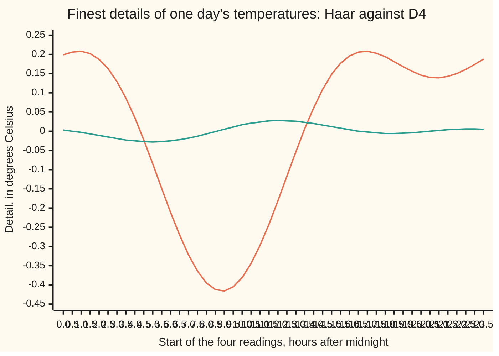
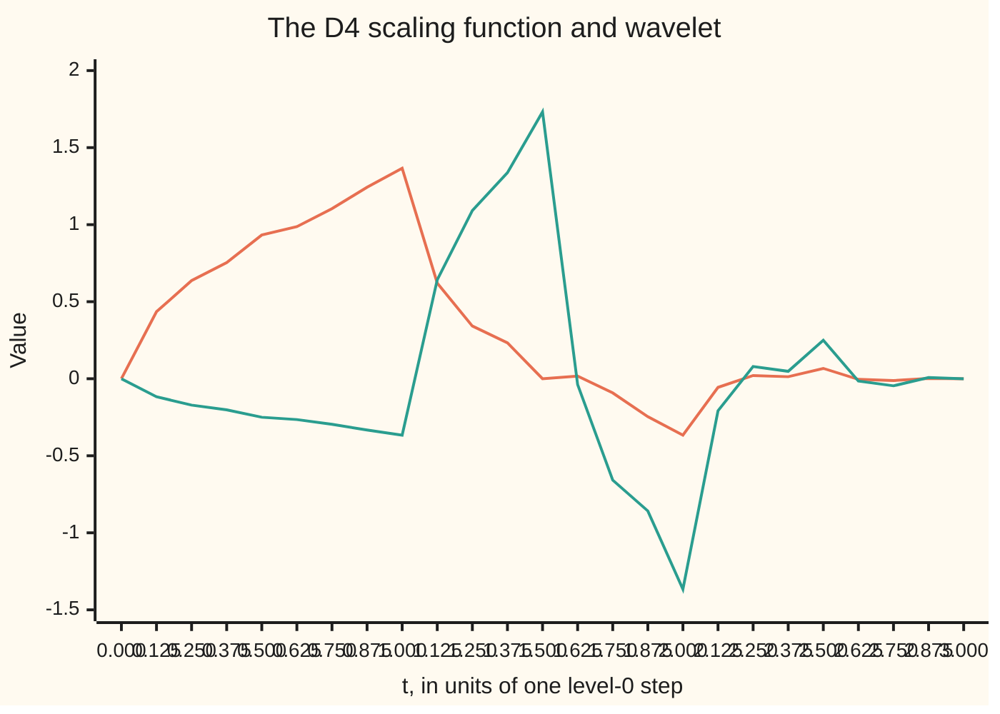

# Daubechies wavelets: short, smooth, and blind to polynomial trends

[Syllabus](../../../SYLLABUS.md) → [Harmonic analysis](../README.md) → [Wavelets and Time-Frequency](../README.md#s05) → Daubechies wavelets

---

## General Overview

A weather station logs the air temperature every 15 minutes: 96 readings in one spring day. The curve is smooth. It bottoms out at 9.40 °C before dawn, climbs through the morning and peaks at 22.60 °C in the early afternoon. The readings are illustrative: at $`t`$ hours after midnight the temperature is $`16 + 6\sin(\pi(t-9)/12) + 1.5\sin(\pi(t-9)/6)`$ °C, kept unrounded. The logger reads to 0.1 °C, and that step serves as the tolerance throughout.

A wavelet transform files the day as a few coarse averages plus details at each level, as on [The Haar wavelet](03-haar-wavelet-and-multiresolution.md). A Haar detail is the difference of two neighbouring readings, scaled. On a curve that is always rising or falling, neighbours almost never agree. So 41 of Haar's 48 finest details are bigger than the logger's 0.1 °C step. To rebuild every reading within 0.1 °C, Haar must keep 82 of its 96 numbers.

The Daubechies four-tap wavelet, called **D4** (also db2), looks at four neighbouring readings instead of two. Its four weights are chosen so that a straight line gives a detail of exactly zero. On a smooth curve only the bend is left, and the bend is tiny over four readings. All 48 finest D4 details are below 0.028 °C: zero at the logger's resolution. Just 25 numbers rebuild the whole day within 0.1 °C.

**A wavelet with p vanishing moments gives zero detail on every polynomial of degree below p, so on a smooth signal its details shrink like the p-th power of the sample spacing; Daubechies found the shortest orthonormal filters that do this, and for p = 2 they are four numbers fixed by four equations.**

**What kind of fact this is:** the D4 filter and its zero details on straight lines are theorems, proved on this card in Why it works. That p vanishing moments need at least 2p taps is Daubechies' theorem, stated here with its source. The size of the details on a curve is a Taylor approximation, and the checks print its error. The temperatures are illustrative.

### The picture: the finest details of the day, Haar against D4



Orange: the 48 finest Haar details, in °C. Teal: the 48 finest D4 details from the same readings. Each point sits at the hour where its group of readings starts. Haar's detail follows the slope of the day, up to 0.416 °C. D4's follows only the bend, and never leaves the band of ±0.028 °C.

---

## The formula

Notation first, in words.

- $`t`$ is the time in hours after midnight. The reading number $`n`$ (from 0 to 95) is taken at $`t = n\,\Delta t`$, with spacing $`\Delta t`$ = 0.25 hours. The reading is $`x[n]`$, in °C.
- The **filters** $`h`$ (averaging) and $`g`$ (detail) are the short lists of weights from [Mallat's algorithm](04-mallats-fast-wavelet-transform.md). For D4 each has four **taps** (weights), numbered 0 to 3. The detail filter is the averaging filter read backwards with alternate signs: $`g_n = (-1)^n h_{3-n}`$.
- The **level-1 detail** at position $`k`$ is $`d_1[k] = \sum_{m=0}^{3} g_m\, x[2k+m]`$. Level $`j`$ applies the same step to the level $`j-1`$ averages; level 1 is the finest, as across this wing. Positions past the last reading wrap round to the first.
- A filter has $`p`$ **vanishing moments** when the detail filter's weights, multiplied by each power $`m^0, m^1, \dots, m^{p-1}`$ of their position and added, give zero. Then the wavelet $`\psi`$ itself has $`\int t^m \psi(t)\,dt = 0`$ for those powers (Step 5).

The condition, the four-tap filter it forces, and the size it predicts for a smooth signal:

```math
\sum_{m=0}^{3} m^r g_m = 0 \quad (r = 0, 1), \ \text{plus orthonormality} \qquad \Longrightarrow \qquad h = \frac{\bigl(1+\sqrt3,\ 3+\sqrt3,\ 3-\sqrt3,\ 1-\sqrt3\bigr)}{4\sqrt2} = (0.482963,\ 0.836516,\ 0.224144,\ -0.129410)
```

```math
d_1[k] \approx C\, x''(t_k)\, \Delta t^2, \qquad C = \tfrac12 \sum_{m=0}^{3} m^2 g_m = -\tfrac{\sqrt6}{4} = -0.612372, \qquad t_k = (2k + 1.5)\,\Delta t
```

**Read it aloud:** if the detail weights cancel both constants and straight lines, and the transform keeps energy, then the four weights are these numbers, and the detail of a smooth signal is about −0.612372 times its bend times the spacing squared.

The same filter as a [Filter banks](05-filter-banks-and-perfect-reconstruction.md) transfer function $`H(z) = \sum h_n z^{-n}`$, where $`z^{-1}`$ is that card's one-sample delay. The zeros of $`H`$ are the same whichever way the taps are laid over the readings:

```math
H(z) = \sqrt2 \Bigl(\frac{1+z^{-1}}{2}\Bigr)^{2} \Bigl(\frac{1+\sqrt3}{2} + \frac{1-\sqrt3}{2}\, z^{-1}\Bigr)
```

The squared factor is the two vanishing moments seen from the frequency side. It makes $`H`$ vanish twice at $`z = -1`$, the fastest wiggle the samples can hold, so the detail filter vanishes twice at $`z = 1`$, where slow trends live.

| Symbol | Plain meaning | In our example | Push it up and the answer… |
| --- | --- | --- | --- |
| $`t,\ \Delta t`$ | time in hours after midnight; time between readings | one day; 0.25 hours | D4 details grow as $`\Delta t^2`$ |
| $`x[n],\ n`$ | reading number $`n`$, in °C | 96 readings, 9.40 to 22.60 °C | details grow with the bend |
| $`h_n,\ s`$ | averaging weights, tap $`n`$; the shorthand $`s = 1/\sqrt2`$, a number here, not a coarse part $`s_j[k]`$ | 0.482963, 0.836516, 0.224144, −0.129410 | — |
| $`g_n`$ | detail weights: $`h`$ reversed, alternate signs | −0.129410, −0.224144, 0.836516, −0.482963 | — |
| $`H(z),\ z`$ | the averaging filter as a polynomial in the delay $`z^{-1}`$ | zero of order 2 at $`z = -1`$ | — |
| $`d_j[k],\ j,\ k`$ | detail at level $`j`$, position $`k`$, in °C | $`d_1[18]`$ = 0.005479 °C at 9:00 | — |
| $`p,\ m,\ r,\ q`$ | number of vanishing moments; tap position; powers tested | $`p`$ = 2 | zero details on curves of higher degree |
| $`x''(t),\ t_k`$ | the bend: second derivative, °C per hour²; middle time of detail $`k`$ | $`t_{18}`$ = 9.375 hours | D4 details grow in proportion |
| $`u`$ | a tap's distance from the middle, in readings: $`m - 1.5`$ | −1.5 to 1.5 | — |
| $`a,\ b`$ | start value and step per reading of a straight line | 12.0 °C and 0.5 °C | the D4 detail stays 0 |
| $`C`$ | half the second moment of $`g`$ | −0.612372 | — |
| $`\varphi,\ \psi`$ | scaling function and wavelet built from $`h`$ and $`g`$ | $`\varphi(1)`$ = 1.366025 | — |

### When it holds

- **The signal is smooth across four readings.** A shower that cools the station by 3 °C for an hour makes jumps. D4 details next to each jump change by up to 1.4489 °C.
- **The record really repeats, or its ends are handled.** The transform wraps the end round to the start. The 6:00 to 11:45 readings alone, wrapped, join the late-morning warmth to the cool dawn. That jump lands in one detail: −4.0552 °C, against at most 0.0250 °C inside.
- **The prediction needs a short span.** The Taylor estimate misses by 0.0009 °C at level 1, but by 1.8770 °C at level 4, where one detail spans almost half the day.
- **Degree below $`p`$ means zero; degree $`p`$ does not.** A straight line gives exactly zero. A parabola gives the same nonzero detail $`C\,x''\,\Delta t^2`$ at every position.
- **Four taps hold two moments, no more.** A third moment breaks orthogonality (Step 6).

---

## Why it works

### Step 0: cancel the trend with the weights, then count the equations

A detail is a weighted sum of a few readings. A smooth signal looks like a polynomial over a short stretch, by [Taylor's theorem](../../06-Calculus%20and%20analysis/03-What%20Derivatives%20Tell%20You/05-taylors-theorem.md). If the weights add up to zero against every polynomial of low degree, the detail sees only the small remainder. Each such demand is one equation on the weights. Keeping the transform's energy costs more equations. Four weights can meet four equations, and that fixes D4.

### Step 1: what every four-tap wavelet filter must satisfy

[Mallat's algorithm](04-mallats-fast-wavelet-transform.md) proves, in its Step 2, that a level keeps energy and rebuilds the signal exactly when $`h`$ has energy 1 and is orthogonal to its own shifts by two, four, … places. The scaling function adds a third condition. For four taps the three are:

1. **Sum:** $`h_0 + h_1 + h_2 + h_3 = \sqrt2`$. This comes from the refinement equation $`\varphi(t) = \sqrt2 \sum_n h_n\,\varphi(2t - n)`$ of [The Haar wavelet](03-haar-wavelet-and-multiresolution.md). Take the area under both sides: each half-width copy $`\varphi(2t - n)`$ has half the area of $`\varphi`$, so the area equals $`\sqrt2 \sum_n h_n`$ times half the area. A scaling function's area is not zero (D4's is 1.000000, Step 7), so the sum is $`2/\sqrt2 = \sqrt2`$, as with Haar's $`1/\sqrt2 + 1/\sqrt2`$.
2. **Orthogonal to its double shift:** $`h_0 h_2 + h_1 h_3 = 0`$. The weights overlap their copy moved by two readings, and the overlap must be zero.
3. **Energy 1:** $`h_0^2 + h_1^2 + h_2^2 + h_3^2 = 1`$.

Conditions 2 and 3 alone do not fix the sum: $`(1, 0, 0, 0)`$ meets both with sum 1. The rule $`g_n = (-1)^n h_{3-n}`$ makes $`g`$ orthogonal to $`h`$ and to its double shifts.

### Step 2: two vanishing moments are two more equations

With $`g = (h_3, -h_2, h_1, -h_0)`$:

- **Moment 0:** $`g_0 + g_1 + g_2 + g_3 = h_3 - h_2 + h_1 - h_0 = 0`$. Constants give zero detail.
- **Moment 1:** $`0 g_0 + 1 g_1 + 2 g_2 + 3 g_3 = -h_2 + 2h_1 - 3h_0 = 0`$. Straight lines give zero detail.

Haar's detail filter $`(1/\sqrt2, -1/\sqrt2)`$ meets moment 0 only: its moment 1 is $`-1/\sqrt2`$. That is why it reports the slope.

### Step 3: solve the four equations

The sum and moment 0 together say $`h_0 + h_2 = h_1 + h_3 = 1/\sqrt2`$. Write $`s = 1/\sqrt2`$, so $`h_2 = s - h_0`$ and $`h_3 = s - h_1`$.

Moment 1 becomes $`-(s - h_0) + 2h_1 - 3h_0 = 0`$, so $`h_1 = h_0 + s/2`$.

Orthogonality becomes one equation in $`h_0`$:

```math
h_0 (s - h_0) + \bigl(h_0 + \tfrac{s}{2}\bigr)\bigl(\tfrac{s}{2} - h_0\bigr) = 0 \quad\Longleftrightarrow\quad 2h_0^2 - s\,h_0 - \tfrac{s^2}{4} = 0 \quad\Longleftrightarrow\quad h_0 = \frac{s\,(1 \pm \sqrt3)}{4}
```

The plus sign gives D4. The minus sign gives $`h_0 = -0.129410`$: the same four numbers in reverse order, a mirror image, not a new filter. The energy condition comes free: $`(h_0 + h_2)^2 + (h_1 + h_3)^2 = 2s^2 = 1`$, and the left side is the energy plus twice the orthogonality sum, which is zero.

The check reaches the same four numbers by two other roads. Newton's method on the raw equations, from a rough start, lands on them. So does multiplying out the factored $`H(z)`$ in The formula.

### Step 4: polynomials vanish, and smooth signals nearly do

Take a straight line, $`x[n] = a + bn`$. Then

```math
d_1[k] = \sum_{m} g_m \bigl(a + 2bk + bm\bigr) = (a + 2bk) \sum_m g_m + b \sum_m m\, g_m = 0
```

The readings 12.0, 12.5, 13.0, 13.5 °C give a D4 detail of 0.000000. Haar gives −0.353553 for each pair.

Now take a smooth signal. Expand each reading about the middle time $`t_k`$ of the four: $`x = x(t_k) + x'(t_k)\,u\,\Delta t + \tfrac12 x''(t_k)\,u^2 \Delta t^2 + \dots`$, with $`u = m - 1.5`$. The constant and slope terms vanish by Step 2. The $`u^2`$ term leaves $`\tfrac12 \sum g_m u^2 = \tfrac12 \sum g_m m^2 = C`$, because the lower moments kill the cross terms. So $`d_1[k] \approx C\,x''(t_k)\,\Delta t^2`$, and the next term is of size $`\Delta t^3`$.

The check confirms two consequences.

- **Halve the spacing and D4 details shrink four times; Haar's halve.** Sampling every 7.5 minutes, the largest D4 detail falls from 0.0277 to 0.0069 °C (ratio 4.00). Haar's falls from 0.4159 to 0.2082 °C (ratio 2.00).
- **Coarser levels grow in a known way.** The level-$`j-1`$ averages are the curve sampled every $`2^{j-1}\Delta t`$, scaled by $`2^{(j-1)/2}`$. So $`d_j[k] \approx 2^{(j-1)/2}\, C\, x''\, (2^{j-1}\Delta t)^2`$.

### Step 5: why the filter's moments are the wavelet's moments

The wavelet is built from half-width copies of the scaling function: $`\psi(t) = \sqrt2 \sum_n g_n\, \varphi(2t - n)`$. A moment of $`\psi`$ therefore splits into filter moments of equal or lower power, and each of those is zero.

<details>
<summary>Detailed proof: zero filter moments give zero wavelet moments</summary>

Suppose $`\sum_n n^q g_n = 0`$ for $`q = 0, \dots, p-1`$, and $`\varphi`$ is bounded and zero outside a finite interval. For $`r < p`$, substitute $`u = 2t - n`$, so $`t = (u + n)/2`$ and $`dt = du/2`$:

$`\displaystyle \int t^r \psi(t)\,dt = \sqrt2 \sum_n g_n \int \Bigl(\frac{u + n}{2}\Bigr)^{r} \varphi(u)\,\frac{du}{2} = \frac{\sqrt2}{2^{r+1}} \sum_{q=0}^{r} \binom{r}{q} \Bigl(\sum_n n^q g_n\Bigr) \int u^{r-q} \varphi(u)\,du`$

Each inner sum over $`n`$ has $`q \le r < p`$, so it is zero. Hence $`\int t^r \psi(t)\,dt = 0`$ for $`r = 0, \dots, p-1`$. The converse also holds for orthonormal wavelets with enough decay (Mallat, *A Wavelet Tour*, chapter 7), so the two definitions of "p vanishing moments" agree.

</details>

### Step 6: why four taps, and no fewer

Each extra moment costs two taps. Daubechies proved in 1988 (first source below) that an orthonormal wavelet with $`p`$ vanishing moments and a finite filter needs at least $`2p`$ taps, and built a family that uses exactly $`2p`$. Haar is $`p = 1`$ with two taps; D4 is $`p = 2`$ with four.

The count shows why. With $`2p`$ taps there are $`2p`$ unknowns. The sum gives one equation, the orthogonality to shifts by 2, 4, …, $`2p - 2`$ gives $`p - 1`$, and the moments give $`p`$. That is $`2p`$ equations, with energy coming free as in Step 3.

Ask four taps for a third moment and the system breaks. The sum and three moments are four linear equations, and they force $`h = (0.176777, 0.530330, 0.530330, 0.176777)`$, a smoothing filter proportional to 1, 3, 3, 1. Its orthogonality sum $`h_0 h_2 + h_1 h_3`$ is 0.187500, not zero. A third moment needs six taps.

### Step 7: short and smooth: the shape the filter builds

The scaling function obeys the refinement equation $`\varphi(t) = \sqrt2 \sum_n h_n\,\varphi(2t - n)`$. It is zero outside $`0 \le t \le 3`$, so at whole numbers only $`\varphi(1)`$ and $`\varphi(2)`$ are unknown. The equation at $`t = 1`$ and $`t = 2`$ is a 2-by-2 system whose solution, scaled so the values add to 1, is $`\varphi(1) = (1+\sqrt3)/2 = 1.366025`$ and $`\varphi(2) = (1-\sqrt3)/2 = -0.366025`$. The check finds them by repeating the system until it settles.

The same equation then gives every half-point from the whole points, every quarter-point from those, and so on. The wavelet follows from $`\psi(t) = \sqrt2 \sum g_n\,\varphi(2t - n)`$.



Orange: the D4 scaling function $`\varphi`$. Teal: the D4 wavelet $`\psi`$. Both are drawn from their values at every eighth of a unit and are zero outside 0 to 3. The check tests those values: the values of $`\varphi`$, added and divided by 8, give its area, 1.000000; those of $`\psi`$ add to 0.000000; and $`\psi(1.5)`$ = 1.732 matches the closed form $`\sqrt3`$. Neither has a jump, unlike Haar's box. Both are jagged: D4 is continuous, but its slope is not (*Ten Lectures*, chapter 7). More moments give longer, smoother members of the family. Close relatives trade other properties for the same moments: symlets are nearly symmetric, and coiflets give the scaling function vanishing moments too.

---

## Worked numbers, by hand

First the filter, from Step 3, with $`s = 1/\sqrt2`$. Then one detail, at 9:00, from four readings of the day.

| Step | Arithmetic | Value |
| --- | --- | --- |
| sum and moment 0 | $`h_0 + h_2 = h_1 + h_3 = s`$ | each $`1/\sqrt2`$ |
| moment 1 | $`-(s - h_0) + 2h_1 - 3h_0 = 0`$ | $`h_1 = h_0 + s/2`$ |
| orthogonality | $`2h_0^2 - s\,h_0 - s^2/4 = 0`$, plus root | $`h_0 = (1+\sqrt3)/(4\sqrt2)`$ = 0.482963 |
| the other three | $`h_0 + s/2`$, $`s - h_0`$, $`s - h_1`$ | 0.836516, 0.224144, −0.129410 |
| check | sum; sum of squares; $`h_0 h_2 + h_1 h_3`$ | 1.414213562; 1.000000000; 0.000000000 |
| detail filter | $`(h_3, -h_2, h_1, -h_0)`$ | −0.129410, −0.224144, 0.836516, −0.482963 |
| readings 9:00 to 9:45 | from the record | 16.0000, 16.5882, 17.1714, 17.7446 °C |
| products $`g_m x_m`$ | −0.129410 × 16.0000, and so on | −2.070552, −3.718145, 14.364144, −8.569968 |
| **D4 detail at 9:00** | **add the four products** | **0.005479 °C** |
| Haar detail at 9:00 | $`(16.0000 - 16.5882)/\sqrt2`$ | −0.415926 °C |
| Taylor prediction | $`C\,x''(9.375)\,\Delta t^2`$ | 0.004613 °C |

The morning is warming fast, yet the D4 detail is 0.005479 °C: the four weights cancel the warming and leave only its slight slowing. Haar reports the warming itself, at −0.415926 °C.

| Level | D4 largest detail, °C | Details above 0.1 °C: D4 actual, D4 predicted | Haar largest, °C | Haar above 0.1 °C |
| --- | --- | --- | --- | --- |
| 1 (48 details) | 0.0277 | 0, 0 | 0.4159 | 41 |
| 2 (24) | 0.1537 | 8, 8 | 1.1639 | 22 |
| 3 (12) | 0.8518 | 11, 9 | 3.2920 | 12 |
| 4 (6) | 4.4134 | 4, 6 | 8.5528 | 6 |

The prediction from Step 4 matches the count above 0.1 °C exactly at the two finest levels, which hold most of the numbers, and its misses at levels 3 and 4 cancel. With the 6 coarse averages, all far above 0.1 °C, it predicts 29 coefficients above 0.1 °C, and the run finds 29. Fewer are needed: keeping the largest coefficients until every reading is rebuilt within 0.1 °C takes 25 for D4 and 82 for Haar.

### What breaks if you drop a piece

| Mistake | Comes out at | What went wrong |
| --- | --- | --- |
| Use Haar: one vanishing moment | 41 of 48 finest details above 0.1 °C; 82 coefficients kept, not 25 | a one-moment filter reports the slope, which a smooth curve always has |
| Let a shower cool the station 3 °C from 15:15 to 16:00 | 4 D4 details change by more than 0.1 °C, the largest by 1.4489 °C | the signal is not smooth across the jumps, so the Taylor argument fails there |
| Wrap the 6:00 to 11:45 readings round on themselves | wrap-around detail −4.0552 °C; at most 0.0250 inside | the wrap joins 11:45 to 6:00 and makes a jump the record does not have |
| Ask four taps for three moments | $`h_0 h_2 + h_1 h_3`$ = 0.187500, not 0 | five equations on four unknowns: orthogonality is lost |

---

## Code, from first principles, and it actually runs

The code finds the D4 filter by three independent roads: the quadratic of Step 3, Newton's method on the raw conditions, and the factored $`H(z)`$ multiplied out. On the day of readings it runs four levels of D4 and Haar, checks every detail against the Taylor prediction, checks the energy ledger, and rebuilds the day from the largest coefficients. The "what breaks" cases come last.

### Python

```python
# Daubechies D4: the four-tap filter from its conditions, and a day of air temperature.
# Standard library only.  Roads to the filter: the quadratic solved by hand, Newton's method
# on the raw conditions, and the factored form multiplied out.  Roads to the coefficients:
# filtering, the Taylor prediction, and the energy ledger with exact rebuilding.
import math
R2, R3 = math.sqrt(2), math.sqrt(3)
def fx(v, d=6): return f"{(v if abs(v) >= 0.5 * 10 ** -d else 0.0):.{d}f}"
def row(xs, d=6): return " ".join(fx(v, d) for v in xs)
def solve(A, b):  # Gaussian elimination with partial pivoting
    n = len(b); M = [A[i][:] + [b[i]] for i in range(n)]
    for c in range(n):
        p = max(range(c, n), key=lambda r: abs(M[r][c])); M[c], M[p] = M[p], M[c]
        for r in range(c + 1, n):
            f = M[r][c] / M[c][c]
            M[r] = [M[r][i] - f * M[c][i] for i in range(n + 1)]
    x = [0.0] * n
    for r in range(n - 1, -1, -1):
        x[r] = (M[r][n] - sum(M[r][i] * x[i] for i in range(r + 1, n))) / M[r][r]
    return x
# road 1: h0 + h2 = h1 + h3 = s, moment gives h1 = h0 + s/2, orthogonality 2 h0^2 - s h0 - s^2/4 = 0
s = 1 / R2
h0 = (s + math.sqrt(s * s + 2 * s * s)) / 4
h = [h0, h0 + s / 2, s - h0, s - h0 - s / 2]
print("D4 h, by the quadratic:", row(h))
# road 2: Newton's method on the four conditions, from a rough start
def F(v): return [sum(v) - R2, v[0] - v[1] + v[2] - v[3], -3 * v[0] + 2 * v[1] - v[2], v[0] * v[2] + v[1] * v[3]]
v = [0.7, 0.0, 0.0, 0.0]
for it in range(8):
    J = [[1, 1, 1, 1], [1, -1, 1, -1], [-3, 2, -1, 0], [v[2], v[3], v[0], v[1]]]
    v = [a - b for a, b in zip(v, solve(J, F(v)))]
print("D4 h, by Newton's method:", row(v))
assert max(abs(a - b) for a, b in zip(h, v)) < 1e-12
# road 3: H(z) = sqrt2 ((1 + 1/z)/2)^2 (a + b/z), a = (1 + sqrt3)/2, b = (1 - sqrt3)/2
a, b = (1 + R3) / 2, (1 - R3) / 2
fac = [R2 / 4 * c for c in (a, 2 * a + b, a + 2 * b, b)]
print("D4 h, factored form:", row(fac))
assert max(abs(x - y) for x, y in zip(h, fac)) < 1e-12
g = [h[3], -h[2], h[1], -h[0]]  # g_n = (-1)^n h_(3-n)
print("g:", row(g))
print(f"sum h {sum(h):.9f}  sum h^2 {sum(x * x for x in h):.9f}  h0h2+h1h3 {fx(h[0] * h[2] + h[1] * h[3], 9)}")
mom = [sum(g[m] * m ** p for m in range(4)) for p in range(3)]
print("moments of g, p = 0, 1, 2:", row(mom, 6), " C = half the p=2 moment", fx(mom[2] / 2))
assert abs(mom[0]) < 1e-12 and abs(mom[1]) < 1e-12
assert abs(mom[2] + math.sqrt(6) / 2) < 1e-12
# the scaling function at whole numbers: eigenvector of the refinement equation, by power iteration
p1, p2 = 0.5, 0.5
for it in range(60):
    p1, p2 = R2 * (h[1] * p1 + h[0] * p2), R2 * (h[3] * p1 + h[2] * p2)
    p1, p2 = p1 / (p1 + p2), p2 / (p1 + p2)
phi = {0: 0.0, 8: p1, 16: p2, 24: 0.0}  # keys in eighths
for step in (4, 2, 1):
    for m in range(step, 24, 2 * step):
        phi[m] = R2 * sum(h[n] * phi.get(2 * m - 8 * n, 0.0) for n in range(4))
psi = [R2 * sum(g[n] * phi.get(2 * m - 8 * n, 0.0) for n in range(4)) for m in range(25)]
print(f"phi(1) {p1:.6f} closed form {(1 + R3) / 2:.6f}   phi(2) {p2:.6f} closed form {(1 - R3) / 2:.6f}   eighths: area of phi {sum(phi.values()) / 8:.6f}, sum of psi {fx(sum(psi))}")
assert abs(p1 - (1 + R3) / 2) < 1e-12
assert abs(sum(phi.values()) / 8 - 1) < 1e-12 and abs(sum(psi)) < 1e-12 and abs(psi[12] - R3) < 1e-12  # area 1, moment 0, psi(1.5) = sqrt3
print("chart t:", row([m / 8 for m in range(25)], 3))
print("chart phi:", row([phi[m] for m in range(25)], 3))
print("chart psi:", row(psi, 3))
# the day: air temperature every 15 minutes, 96 readings, illustrative
DT = 0.25
def T(t): u = 2 * math.pi * (t - 9) / 24; return 16 + 6 * math.sin(u) + 1.5 * math.sin(2 * u)
def T2(t): u = 2 * math.pi * (t - 9) / 24; w = 2 * math.pi / 24; return -w * w * (6 * math.sin(u) + 6 * math.sin(2 * u))
x = [T(n * DT) for n in range(96)]
HA, GA = [s, s], [s, -s]
def step(z, lo, hi):
    n = len(z)
    return ([sum(lo[m] * z[(2 * k + m) % n] for m in range(len(lo))) for k in range(n // 2)],
            [sum(hi[m] * z[(2 * k + m) % n] for m in range(len(hi))) for k in range(n // 2)])
def inv(a, d, lo, hi):
    y = [0.0] * (2 * len(a))
    for k in range(len(a)):
        for m in range(len(lo)):
            y[(2 * k + m) % len(y)] += lo[m] * a[k] + hi[m] * d[k]
    return y
ramp = [12.0, 12.5, 13.0, 13.5]
print(f"straight line 12.0 12.5 13.0 13.5: D4 detail {fx(sum(g[m] * ramp[m] for m in range(4)))}"
      f"  Haar details {fx((ramp[0] - ramp[1]) * s)} {fx((ramp[2] - ramp[3]) * s)}")
q = x[36:40]
print("readings 9:00 to 9:45:", row(q, 4), " products g_m x_m:", row([g[m] * q[m] for m in range(4)]))
print("   ", " D4 detail", fx(sum(g[m] * q[m] for m in range(4))),
      " Haar", fx((q[0] - q[1]) * s), " prediction C x''(9.375) dt^2", fx(mom[2] / 2 * T2(9.375) * DT * DT))
print(f"day: {len(x)} readings every {DT} h, min {min(x):.2f} C  max {max(x):.2f} C  energy {sum(v * v for v in x):.4f}")
print("j | D4 max|d|, Taylor error, count > 0.1 actual, predicted | Haar max|d|, count > 0.1")
coef = {}
for name, lo, hi in (("D4", h, g), ("Haar", HA, GA)):
    z, ds = x, []
    for j in range(1, 5):
        z, d = step(z, lo, hi); ds.append(d)
    coef[name] = (z, ds)
zd, zh = coef["D4"][1], coef["Haar"][1]
nc = sum(abs(v) > 0.1 for v in coef["D4"][0]); tot = [nc, nc]  # coarse averages count in both
for j in range(1, 5):
    w = 2 ** (j - 1) * DT
    pred = [2 ** ((j - 1) / 2) * mom[2] / 2 * T2((2 ** j * k + 1.5 * (2 ** j - 1)) * DT) * w * w for k in range(len(zd[j - 1]))]
    err = max(abs(p - q) for p, q in zip(pred, zd[j - 1]))
    if j <= 2: assert err < 0.01
    ca, cp = sum(abs(v) > 0.1 for v in zd[j - 1]), sum(abs(v) > 0.1 for v in pred); tot = [tot[0] + ca, tot[1] + cp]
    print(f"{j} | {max(map(abs, zd[j - 1])):.4f} {err:.4f} {ca} {cp}"
          f" | {max(map(abs, zh[j - 1])):.4f} {sum(abs(v) > 0.1 for v in zh[j - 1])}")
print(f"D4 coefficients above 0.1 C, the {nc} coarse averages included: actual {tot[0]}, predicted {tot[1]}")
def kterm(name, lo, hi):  # fewest largest coefficients that rebuild every reading within 0.1 C
    z, ds = coef[name]
    allc = sorted([abs(v) for d in ds for v in d] + [abs(v) for v in z], reverse=True)
    for K in range(1, 97):
        cut = allc[K - 1]
        y = [v if abs(v) >= cut else 0.0 for v in z]
        for d in reversed(ds): y = inv(y, [v if abs(v) >= cut else 0.0 for v in d], lo, hi)
        e = max(abs(p - q) for p, q in zip(x, y))
        if e <= 0.1: return K, e, sum(c * c for c in allc)
for name, lo, hi in (("D4", h, g), ("Haar", HA, GA)):
    K, e, en = kterm(name, lo, hi)
    print(f"{name}: energy of coefficients {en:.4f}; keep the {K} largest of 96, worst error {e:.4f} C")
    assert abs(en - sum(v * v for v in x)) < 1e-9
assert kterm("D4", h, g)[0] < kterm("Haar", HA, GA)[0] / 2
x2 = [T(n * DT / 2) for n in range(192)]
m4, mh = max(map(abs, step(x2, h, g)[1])), max(map(abs, step(x2, HA, GA)[1]))
print(f"every 7.5 min: level-1 max D4 {m4:.4f} (ratio {max(map(abs, zd[0])) / m4:.2f})  Haar {mh:.4f} (ratio {max(map(abs, zh[0])) / mh:.2f})")
assert abs(max(map(abs, zd[0])) / m4 - 4) < 0.3 and abs(max(map(abs, zh[0])) / mh - 2) < 0.1
print("chart hour:", row([k / 2 for k in range(48)], 1))
print("chart level-1 Haar:", row(zh[0], 3))
print("chart level-1 D4:", row(zd[0], 3))
# what breaks
shower = [v - (3.0 if 61 <= n <= 64 else 0.0) for n, v in enumerate(x)]
ch4 = [abs(p - q) for p, q in zip(step(shower, h, g)[1], zd[0])]
chh = [abs(p - q) for p, q in zip(step(shower, HA, GA)[1], zh[0])]
print(f"shower 15:15-16:00, 3 C colder: level-1 details changed by > 0.1: D4 {sum(c > 0.1 for c in ch4)}"
      f" (largest {max(ch4):.4f}), Haar {sum(c > 0.1 for c in chh)} (largest {max(chh):.4f})")
assert sum(c > 0.1 for c in ch4) == 4 and sum(c > 0.1 for c in chh) == 2
dm = step(x[24:48], h, g)[1]
print(f"6:00-11:45 alone, wrapped: D4 level-1 largest inside {max(map(abs, dm[:-1])):.4f}, wrap-around {fx(dm[-1], 4)}")
assert abs(dm[-1]) > 10 * max(map(abs, dm[:-1]))
h3 = solve([[1, 1, 1, 1], [1, -1, 1, -1], [-3, 2, -1, 0], [-9, 4, -1, 0]], [R2, 0, 0, 0])
print("four taps, three moments: h", row(h3, 6), " h0h2+h1h3", fx(h3[0] * h3[2] + h3[1] * h3[3]))
assert abs(h3[0] * h3[2] + h3[1] * h3[3]) > 0.01
gw = [h[0], -h[1], h[2], -h[3]]  # signs alternated, order not reversed
def wrong(y): return max(abs(p - q) for p, q in zip(y, inv(*step(y, h, gw), h, gw)))
print(f"g not reversed: <h, g> {fx(sum(p * q for p, q in zip(h, gw)))}  worst rebuild error {wrong(x):.4f} C, shower day {wrong(shower):.4f} C")
print("ALL CHECKS PASS")
```

**Ran 2026-11-15 on macOS, Python 3.14.10, standard library only. All checks passed. Output, pasted from the run:**

```text
D4 h, by the quadratic: 0.482963 0.836516 0.224144 -0.129410
D4 h, by Newton's method: 0.482963 0.836516 0.224144 -0.129410
D4 h, factored form: 0.482963 0.836516 0.224144 -0.129410
g: -0.129410 -0.224144 0.836516 -0.482963
sum h 1.414213562  sum h^2 1.000000000  h0h2+h1h3 0.000000000
moments of g, p = 0, 1, 2: 0.000000 0.000000 -1.224745  C = half the p=2 moment -0.612372
phi(1) 1.366025 closed form 1.366025   phi(2) -0.366025 closed form -0.366025   eighths: area of phi 1.000000, sum of psi 0.000000
chart t: 0.000 0.125 0.250 0.375 0.500 0.625 0.750 0.875 1.000 1.125 1.250 1.375 1.500 1.625 1.750 1.875 2.000 2.125 2.250 2.375 2.500 2.625 2.750 2.875 3.000
chart phi: 0.000 0.435 0.637 0.754 0.933 0.987 1.104 1.243 1.366 0.621 0.342 0.233 0.000 0.017 -0.092 -0.246 -0.366 -0.056 0.021 0.013 0.067 -0.004 -0.012 0.002 0.000
chart psi: 0.000 -0.117 -0.171 -0.202 -0.250 -0.265 -0.296 -0.333 -0.366 0.642 1.092 1.337 1.732 -0.038 -0.658 -0.858 -1.366 -0.208 0.079 0.048 0.250 -0.015 -0.046 0.008 0.000
straight line 12.0 12.5 13.0 13.5: D4 detail 0.000000  Haar details -0.353553 -0.353553
readings 9:00 to 9:45: 16.0000 16.5882 17.1714 17.7446  products g_m x_m: -2.070552 -3.718145 14.364144 -8.569968
     D4 detail 0.005479  Haar -0.415926  prediction C x''(9.375) dt^2 0.004613
day: 96 readings every 0.25 h, min 9.40 C  max 22.60 C  energy 26412.0000
j | D4 max|d|, Taylor error, count > 0.1 actual, predicted | Haar max|d|, count > 0.1
1 | 0.0277 0.0009 0 0 | 0.4159 41
2 | 0.1537 0.0050 8 8 | 1.1639 22
3 | 0.8518 0.1269 11 9 | 3.2920 12
4 | 4.4134 1.8770 4 6 | 8.5528 6
D4 coefficients above 0.1 C, the 6 coarse averages included: actual 29, predicted 29
D4: energy of coefficients 26412.0000; keep the 25 largest of 96, worst error 0.0936 C
Haar: energy of coefficients 26412.0000; keep the 82 largest of 96, worst error 0.0991 C
every 7.5 min: level-1 max D4 0.0069 (ratio 4.00)  Haar 0.2082 (ratio 2.00)
chart hour: 0.0 0.5 1.0 1.5 2.0 2.5 3.0 3.5 4.0 4.5 5.0 5.5 6.0 6.5 7.0 7.5 8.0 8.5 9.0 9.5 10.0 10.5 11.0 11.5 12.0 12.5 13.0 13.5 14.0 14.5 15.0 15.5 16.0 16.5 17.0 17.5 18.0 18.5 19.0 19.5 20.0 20.5 21.0 21.5 22.0 22.5 23.0 23.5
chart level-1 Haar: 0.199 0.206 0.208 0.202 0.187 0.163 0.129 0.086 0.035 -0.023 -0.085 -0.149 -0.212 -0.270 -0.322 -0.364 -0.395 -0.412 -0.416 -0.405 -0.381 -0.344 -0.297 -0.242 -0.181 -0.117 -0.054 0.007 0.061 0.109 0.148 0.177 0.196 0.206 0.208 0.203 0.194 0.181 0.168 0.156 0.146 0.140 0.139 0.143 0.150 0.161 0.174 0.188
chart level-1 D4: 0.003 0.000 -0.003 -0.007 -0.011 -0.015 -0.019 -0.023 -0.025 -0.027 -0.028 -0.027 -0.025 -0.022 -0.018 -0.013 -0.007 -0.001 0.005 0.011 0.017 0.021 0.024 0.027 0.028 0.027 0.026 0.023 0.020 0.016 0.012 0.008 0.004 0.000 -0.002 -0.004 -0.006 -0.006 -0.005 -0.004 -0.002 0.000 0.002 0.004 0.005 0.006 0.006 0.005
shower 15:15-16:00, 3 C colder: level-1 details changed by > 0.1: D4 4 (largest 1.4489), Haar 2 (largest 2.1213)
6:00-11:45 alone, wrapped: D4 level-1 largest inside 0.0250, wrap-around -4.0552
four taps, three moments: h 0.176777 0.530330 0.530330 0.176777  h0h2+h1h3 0.187500
g not reversed: <h, g> -0.433013  worst rebuild error 0.0390 C, shower day 0.6746 C
ALL CHECKS PASS
```

### Rust

Same numbers, same labels, built with `rustc --edition 2021 -O`.

```rust
// Daubechies D4: the four-tap filter from its conditions, and a day of air temperature.
// std only.  Roads to the filter: the quadratic solved by hand, Newton's method on the raw
// conditions, and the factored form multiplied out.  Roads to the coefficients: filtering,
// the Taylor prediction, and the energy ledger with exact rebuilding.
use std::f64::consts::PI;
fn fx(v: f64, d: i32) -> String { format!("{:.*}", d as usize, if v.abs() >= 0.5 * 10f64.powi(-d) { v } else { 0.0 }) }
fn row(xs: &[f64], d: i32) -> String { xs.iter().map(|&v| fx(v, d)).collect::<Vec<_>>().join(" ") }
fn solve(a: &[[f64; 4]; 4], b: &[f64; 4]) -> [f64; 4] { // Gaussian elimination with partial pivoting
    let n = 4;
    let mut m: Vec<Vec<f64>> = (0..n).map(|i| { let mut r = a[i].to_vec(); r.push(b[i]); r }).collect();
    for c in 0..n {
        let mut p = c;
        for r in c..n { if m[r][c].abs() > m[p][c].abs() { p = r; } }
        m.swap(c, p);
        for r in (c + 1)..n {
            let f = m[r][c] / m[c][c];
            for i in 0..=n { m[r][i] -= f * m[c][i]; }
        }
    }
    let mut x = [0.0; 4];
    for r in (0..n).rev() {
        x[r] = (m[r][n] - ((r + 1)..n).map(|i| m[r][i] * x[i]).sum::<f64>()) / m[r][r];
    }
    x
}
fn temp(t: f64) -> f64 { let u = 2.0 * PI * (t - 9.0) / 24.0; 16.0 + 6.0 * u.sin() + 1.5 * (2.0 * u).sin() }
fn temp2(t: f64) -> f64 { let (u, w) = (2.0 * PI * (t - 9.0) / 24.0, 2.0 * PI / 24.0); -w * w * (6.0 * u.sin() + 6.0 * (2.0 * u).sin()) }
fn step(z: &[f64], lo: &[f64], hi: &[f64]) -> (Vec<f64>, Vec<f64>) {
    let n = z.len();
    let f = |c: &[f64], k: usize| -> f64 { let mut s = 0.0; for m in 0..c.len() { s += c[m] * z[(2 * k + m) % n]; } s };
    ((0..n / 2).map(|k| f(lo, k)).collect(), (0..n / 2).map(|k| f(hi, k)).collect())
}
fn inv(a: &[f64], d: &[f64], lo: &[f64], hi: &[f64]) -> Vec<f64> {
    let n = 2 * a.len();
    let mut y = vec![0.0; n];
    for k in 0..a.len() { for m in 0..lo.len() { y[(2 * k + m) % n] += lo[m] * a[k] + hi[m] * d[k]; } }
    y
}
fn maxabs(v: &[f64]) -> f64 { v.iter().fold(0.0, |m: f64, x| m.max(x.abs())) }
fn count(v: &[f64], c: f64) -> usize { v.iter().filter(|x| x.abs() > c).count() }
fn main() {
    let (r2, r3) = (2f64.sqrt(), 3f64.sqrt());
    // road 1: h0 + h2 = h1 + h3 = s, moment gives h1 = h0 + s/2, orthogonality 2 h0^2 - s h0 - s^2/4 = 0
    let s = 1.0 / r2;
    let h0 = (s + (s * s + 2.0 * s * s).sqrt()) / 4.0;
    let h = [h0, h0 + s / 2.0, s - h0, s - h0 - s / 2.0];
    println!("D4 h, by the quadratic: {}", row(&h, 6));
    // road 2: Newton's method on the four conditions, from a rough start
    let mut v = [0.7, 0.0, 0.0, 0.0];
    for _ in 0..8 {
        let fv = [v.iter().sum::<f64>() - r2, v[0] - v[1] + v[2] - v[3], -3.0 * v[0] + 2.0 * v[1] - v[2], v[0] * v[2] + v[1] * v[3]];
        let j = [[1.0, 1.0, 1.0, 1.0], [1.0, -1.0, 1.0, -1.0], [-3.0, 2.0, -1.0, 0.0], [v[2], v[3], v[0], v[1]]];
        let dv = solve(&j, &fv); for i in 0..4 { v[i] -= dv[i]; }
    }
    println!("D4 h, by Newton's method: {}", row(&v, 6));
    assert!((0..4).all(|i| (h[i] - v[i]).abs() < 1e-12));
    // road 3: H(z) = sqrt2 ((1 + 1/z)/2)^2 (a + b/z), a = (1 + sqrt3)/2, b = (1 - sqrt3)/2
    let (a, b) = ((1.0 + r3) / 2.0, (1.0 - r3) / 2.0);
    let fac: Vec<f64> = [a, 2.0 * a + b, a + 2.0 * b, b].iter().map(|c| r2 / 4.0 * c).collect();
    println!("D4 h, factored form: {}", row(&fac, 6));
    assert!((0..4).all(|i| (h[i] - fac[i]).abs() < 1e-12));
    let g = [h[3], -h[2], h[1], -h[0]]; // g_n = (-1)^n h_(3-n)
    println!("g: {}", row(&g, 6));
    println!("sum h {:.9}  sum h^2 {:.9}  h0h2+h1h3 {}", h.iter().sum::<f64>(), h.iter().map(|x| x * x).sum::<f64>(),
             fx(h[0] * h[2] + h[1] * h[3], 9));
    let mom: Vec<f64> = (0..3).map(|p| (0..4).map(|m| g[m] * (m as f64).powi(p)).sum()).collect();
    println!("moments of g, p = 0, 1, 2: {}  C = half the p=2 moment {}", row(&mom, 6), fx(mom[2] / 2.0, 6));
    assert!(mom[0].abs() < 1e-12 && mom[1].abs() < 1e-12);
    assert!((mom[2] + 6f64.sqrt() / 2.0).abs() < 1e-12);
    // the scaling function at whole numbers: eigenvector of the refinement equation, by power iteration
    let (mut p1, mut p2) = (0.5, 0.5);
    for _ in 0..60 {
        let (q1, q2) = (r2 * (h[1] * p1 + h[0] * p2), r2 * (h[3] * p1 + h[2] * p2));
        p1 = q1 / (q1 + q2); p2 = q2 / (q1 + q2);
    }
    let mut phi = [0.0f64; 25]; // index in eighths
    phi[8] = p1; phi[16] = p2;
    let get = |ph: &[f64; 25], i: i64| -> f64 { if (0..25).contains(&i) { ph[i as usize] } else { 0.0 } };
    for st in [4usize, 2, 1] {
        for m in (st..24).step_by(2 * st) { phi[m] = r2 * (0..4).map(|n| h[n] * get(&phi, 2 * m as i64 - 8 * n as i64)).sum::<f64>(); }
    }
    let psi: Vec<f64> = (0..25).map(|m| r2 * (0..4).map(|n| g[n] * get(&phi, 2 * m as i64 - 8 * n as i64)).sum::<f64>()).collect();
    let (area, spsi) = (phi.iter().sum::<f64>() / 8.0, psi.iter().sum::<f64>());
    println!("phi(1) {:.6} closed form {:.6}   phi(2) {:.6} closed form {:.6}   eighths: area of phi {:.6}, sum of psi {}", p1, (1.0 + r3) / 2.0, p2, (1.0 - r3) / 2.0, area, fx(spsi, 6));
    assert!((p1 - (1.0 + r3) / 2.0).abs() < 1e-12);
    assert!((area - 1.0).abs() < 1e-12 && spsi.abs() < 1e-12 && (psi[12] - r3).abs() < 1e-12); // area 1, moment 0, psi(1.5) = sqrt3
    println!("chart t: {}", row(&(0..25).map(|m| m as f64 / 8.0).collect::<Vec<_>>(), 3));
    println!("chart phi: {}", row(&phi, 3));
    println!("chart psi: {}", row(&psi, 3));
    // the day: air temperature every 15 minutes, 96 readings, illustrative
    let dt = 0.25;
    let x: Vec<f64> = (0..96).map(|n| temp(n as f64 * dt)).collect();
    let (ha, ga) = ([s, s], [s, -s]);
    let ramp = [12.0, 12.5, 13.0, 13.5];
    println!("straight line 12.0 12.5 13.0 13.5: D4 detail {}  Haar details {} {}",
             fx((0..4).map(|m| g[m] * ramp[m]).sum(), 6), fx((ramp[0] - ramp[1]) * s, 6), fx((ramp[2] - ramp[3]) * s, 6));
    let q = &x[36..40];
    let prods: Vec<f64> = (0..4).map(|m| g[m] * q[m]).collect();
    println!("readings 9:00 to 9:45: {}  products g_m x_m: {}", row(q, 4), row(&prods, 6));
    println!("     D4 detail {}  Haar {}  prediction C x''(9.375) dt^2 {}", fx(prods.iter().sum(), 6), fx((q[0] - q[1]) * s, 6),
             fx(mom[2] / 2.0 * temp2(9.375) * dt * dt, 6));
    println!("day: {} readings every {} h, min {:.2} C  max {:.2} C  energy {:.4}", x.len(), dt, x.iter().cloned().fold(f64::MAX, f64::min),
             x.iter().cloned().fold(f64::MIN, f64::max), x.iter().map(|v| v * v).sum::<f64>());
    println!("j | D4 max|d|, Taylor error, count > 0.1 actual, predicted | Haar max|d|, count > 0.1");
    let full = |lo: &[f64], hi: &[f64]| -> (Vec<f64>, Vec<Vec<f64>>) {
        let (mut z, mut ds) = (x.clone(), Vec::new());
        for _ in 0..4 { let (a2, d2) = step(&z, lo, hi); z = a2; ds.push(d2); }
        (z, ds)
    };
    let (cd, ch) = (full(&h, &g), full(&ha, &ga));
    let (zd, zh) = (&cd.1, &ch.1);
    let nc = count(&cd.0, 0.1); let mut tot = [nc, nc]; // coarse averages count in both
    for j in 1..5 {
        let w = 2f64.powi(j - 1) * dt;
        let ju = j as usize;
        let pred: Vec<f64> = (0..zd[ju - 1].len()).map(|k| 2f64.powf((j - 1) as f64 / 2.0) * mom[2] / 2.0
            * temp2((2f64.powi(j) * k as f64 + 1.5 * (2f64.powi(j) - 1.0)) * dt) * w * w).collect();
        let err = maxabs(&pred.iter().zip(&zd[ju - 1]).map(|(p, q)| p - q).collect::<Vec<_>>());
        if j <= 2 { assert!(err < 0.01); }
        let (ca, cp) = (count(&zd[ju - 1], 0.1), count(&pred, 0.1)); tot = [tot[0] + ca, tot[1] + cp];
        println!("{} | {:.4} {:.4} {} {} | {:.4} {}", j, maxabs(&zd[ju - 1]), err, ca, cp,
                 maxabs(&zh[ju - 1]), count(&zh[ju - 1], 0.1));
    }
    println!("D4 coefficients above 0.1 C, the {} coarse averages included: actual {}, predicted {}", nc, tot[0], tot[1]);
    // fewest largest coefficients that rebuild every reading within 0.1 C
    let kterm = |c: &(Vec<f64>, Vec<Vec<f64>>), lo: &[f64], hi: &[f64]| -> (usize, f64, f64) {
        let mut all: Vec<f64> = c.1.iter().flatten().chain(c.0.iter()).map(|v| v.abs()).collect();
        all.sort_by(|p, q| q.partial_cmp(p).unwrap());
        let en: f64 = all.iter().map(|v| v * v).sum();
        for k in 1..97 {
            let cut = all[k - 1];
            let keep = |v: &[f64]| -> Vec<f64> { v.iter().map(|&u| if u.abs() >= cut { u } else { 0.0 }).collect() };
            let mut y = keep(&c.0);
            for d in c.1.iter().rev() { y = inv(&y, &keep(d), lo, hi); }
            let e = maxabs(&x.iter().zip(&y).map(|(p, q)| p - q).collect::<Vec<_>>());
            if e <= 0.1 { return (k, e, en); }
        }
        (0, 0.0, en)
    };
    let (kd, kh) = (kterm(&cd, &h, &g), kterm(&ch, &ha, &ga));
    for (name, kk) in [("D4", kd), ("Haar", kh)] {
        println!("{}: energy of coefficients {:.4}; keep the {} largest of 96, worst error {:.4} C", name, kk.2, kk.0, kk.1);
        assert!((kk.2 - x.iter().map(|v| v * v).sum::<f64>()).abs() < 1e-9);
    }
    assert!((kd.0 as f64) < kh.0 as f64 / 2.0);
    let x2: Vec<f64> = (0..192).map(|n| temp(n as f64 * dt / 2.0)).collect();
    let (m4, mh) = (maxabs(&step(&x2, &h, &g).1), maxabs(&step(&x2, &ha, &ga).1));
    println!("every 7.5 min: level-1 max D4 {:.4} (ratio {:.2})  Haar {:.4} (ratio {:.2})", m4, maxabs(&zd[0]) / m4, mh, maxabs(&zh[0]) / mh);
    assert!((maxabs(&zd[0]) / m4 - 4.0).abs() < 0.3 && (maxabs(&zh[0]) / mh - 2.0).abs() < 0.1);
    println!("chart hour: {}", row(&(0..48).map(|k| k as f64 / 2.0).collect::<Vec<_>>(), 1));
    println!("chart level-1 Haar: {}", row(&zh[0], 3));
    println!("chart level-1 D4: {}", row(&zd[0], 3));
    // what breaks
    let shower: Vec<f64> = x.iter().enumerate().map(|(n, v)| v - if (61..=64).contains(&n) { 3.0 } else { 0.0 }).collect();
    let ch4: Vec<f64> = step(&shower, &h, &g).1.iter().zip(&zd[0]).map(|(p, q)| (p - q).abs()).collect();
    let chh: Vec<f64> = step(&shower, &ha, &ga).1.iter().zip(&zh[0]).map(|(p, q)| (p - q).abs()).collect();
    println!("shower 15:15-16:00, 3 C colder: level-1 details changed by > 0.1: D4 {} (largest {:.4}), Haar {} (largest {:.4})",
             count(&ch4, 0.1), maxabs(&ch4), count(&chh, 0.1), maxabs(&chh));
    assert!(count(&ch4, 0.1) == 4 && count(&chh, 0.1) == 2);
    let dm = step(&x[24..48], &h, &g).1;
    println!("6:00-11:45 alone, wrapped: D4 level-1 largest inside {:.4}, wrap-around {}", maxabs(&dm[..11]), fx(dm[11], 4));
    assert!(dm[11].abs() > 10.0 * maxabs(&dm[..11]));
    let h3 = solve(&[[1.0, 1.0, 1.0, 1.0], [1.0, -1.0, 1.0, -1.0], [-3.0, 2.0, -1.0, 0.0], [-9.0, 4.0, -1.0, 0.0]], &[r2, 0.0, 0.0, 0.0]);
    println!("four taps, three moments: h {}  h0h2+h1h3 {}", row(&h3, 6), fx(h3[0] * h3[2] + h3[1] * h3[3], 6));
    assert!((h3[0] * h3[2] + h3[1] * h3[3]).abs() > 0.01);
    let gw = [h[0], -h[1], h[2], -h[3]]; // signs alternated, order not reversed
    let wrong = |y: &[f64]| { let (aw, dw) = step(y, &h, &gw); maxabs(&inv(&aw, &dw, &h, &gw).iter().zip(y).map(|(p, q)| p - q).collect::<Vec<_>>()) };
    println!("g not reversed: <h, g> {}  worst rebuild error {:.4} C, shower day {:.4} C", fx((0..4).map(|i| h[i] * gw[i]).sum(), 6), wrong(&x), wrong(&shower));
    println!("ALL CHECKS PASS");
}
```

**Ran 2026-11-15 on macOS, rustc 1.98.1, no crates. All checks passed. Output, pasted from the run:**

```text
D4 h, by the quadratic: 0.482963 0.836516 0.224144 -0.129410
D4 h, by Newton's method: 0.482963 0.836516 0.224144 -0.129410
D4 h, factored form: 0.482963 0.836516 0.224144 -0.129410
g: -0.129410 -0.224144 0.836516 -0.482963
sum h 1.414213562  sum h^2 1.000000000  h0h2+h1h3 0.000000000
moments of g, p = 0, 1, 2: 0.000000 0.000000 -1.224745  C = half the p=2 moment -0.612372
phi(1) 1.366025 closed form 1.366025   phi(2) -0.366025 closed form -0.366025   eighths: area of phi 1.000000, sum of psi 0.000000
chart t: 0.000 0.125 0.250 0.375 0.500 0.625 0.750 0.875 1.000 1.125 1.250 1.375 1.500 1.625 1.750 1.875 2.000 2.125 2.250 2.375 2.500 2.625 2.750 2.875 3.000
chart phi: 0.000 0.435 0.637 0.754 0.933 0.987 1.104 1.243 1.366 0.621 0.342 0.233 0.000 0.017 -0.092 -0.246 -0.366 -0.056 0.021 0.013 0.067 -0.004 -0.012 0.002 0.000
chart psi: 0.000 -0.117 -0.171 -0.202 -0.250 -0.265 -0.296 -0.333 -0.366 0.642 1.092 1.337 1.732 -0.038 -0.658 -0.858 -1.366 -0.208 0.079 0.048 0.250 -0.015 -0.046 0.008 0.000
straight line 12.0 12.5 13.0 13.5: D4 detail 0.000000  Haar details -0.353553 -0.353553
readings 9:00 to 9:45: 16.0000 16.5882 17.1714 17.7446  products g_m x_m: -2.070552 -3.718145 14.364144 -8.569968
     D4 detail 0.005479  Haar -0.415926  prediction C x''(9.375) dt^2 0.004613
day: 96 readings every 0.25 h, min 9.40 C  max 22.60 C  energy 26412.0000
j | D4 max|d|, Taylor error, count > 0.1 actual, predicted | Haar max|d|, count > 0.1
1 | 0.0277 0.0009 0 0 | 0.4159 41
2 | 0.1537 0.0050 8 8 | 1.1639 22
3 | 0.8518 0.1269 11 9 | 3.2920 12
4 | 4.4134 1.8770 4 6 | 8.5528 6
D4 coefficients above 0.1 C, the 6 coarse averages included: actual 29, predicted 29
D4: energy of coefficients 26412.0000; keep the 25 largest of 96, worst error 0.0936 C
Haar: energy of coefficients 26412.0000; keep the 82 largest of 96, worst error 0.0991 C
every 7.5 min: level-1 max D4 0.0069 (ratio 4.00)  Haar 0.2082 (ratio 2.00)
chart hour: 0.0 0.5 1.0 1.5 2.0 2.5 3.0 3.5 4.0 4.5 5.0 5.5 6.0 6.5 7.0 7.5 8.0 8.5 9.0 9.5 10.0 10.5 11.0 11.5 12.0 12.5 13.0 13.5 14.0 14.5 15.0 15.5 16.0 16.5 17.0 17.5 18.0 18.5 19.0 19.5 20.0 20.5 21.0 21.5 22.0 22.5 23.0 23.5
chart level-1 Haar: 0.199 0.206 0.208 0.202 0.187 0.163 0.129 0.086 0.035 -0.023 -0.085 -0.149 -0.212 -0.270 -0.322 -0.364 -0.395 -0.412 -0.416 -0.405 -0.381 -0.344 -0.297 -0.242 -0.181 -0.117 -0.054 0.007 0.061 0.109 0.148 0.177 0.196 0.206 0.208 0.203 0.194 0.181 0.168 0.156 0.146 0.140 0.139 0.143 0.150 0.161 0.174 0.188
chart level-1 D4: 0.003 0.000 -0.003 -0.007 -0.011 -0.015 -0.019 -0.023 -0.025 -0.027 -0.028 -0.027 -0.025 -0.022 -0.018 -0.013 -0.007 -0.001 0.005 0.011 0.017 0.021 0.024 0.027 0.028 0.027 0.026 0.023 0.020 0.016 0.012 0.008 0.004 0.000 -0.002 -0.004 -0.006 -0.006 -0.005 -0.004 -0.002 0.000 0.002 0.004 0.005 0.006 0.006 0.005
shower 15:15-16:00, 3 C colder: level-1 details changed by > 0.1: D4 4 (largest 1.4489), Haar 2 (largest 2.1213)
6:00-11:45 alone, wrapped: D4 level-1 largest inside 0.0250, wrap-around -4.0552
four taps, three moments: h 0.176777 0.530330 0.530330 0.176777  h0h2+h1h3 0.187500
g not reversed: <h, g> -0.433013  worst rebuild error 0.0390 C, shower day 0.6746 C
ALL CHECKS PASS
```

### Lean

Lean proves the polynomial rule for filters with any number of taps, and solves the four-tap equations exactly.

- Suppose a detail filter, with any number of taps, has $`p`$ vanishing moments. Then its detail is zero at every position on every signal that is a polynomial of degree below $`p`$ in the reading number $`n`$.
- The sum, moment 0, moment 1 and orthogonality to the double shift hold exactly when the four taps are D4 or its mirror image.
- Suppose four taps meet the sum and moments 0, 1 and 2. Then $`h_0 h_2 + h_1 h_3`$ is 3/16 = 0.1875, not 0, so orthogonality is lost.
- The straight line 12.0, 12.5, 13.0, 13.5 °C gives a D4 detail of exactly 0.
- The D4 taps have energy exactly 1.

The temperature day, the Taylor prediction, the scaling function, and the shower and wrap-around cases are left to the Python and Rust checks.

```lean
-- Daubechies wavelets: a detail filter with p vanishing moments gives zero detail on every polynomial of degree below p, and the four D4 taps are the only solutions, up to mirror image, of the sum, two-moment and orthogonality equations, which cannot hold a third moment.
import Mathlib.Algebra.Polynomial.Degree.Defs
import Mathlib.Algebra.Polynomial.Eval.Defs
import Mathlib.Algebra.Polynomial.Eval.Degree
import Mathlib.Analysis.SpecialFunctions.Pow.Real
import Mathlib.Tactic.NormNum
import Mathlib.Tactic.Ring

open Finset Polynomial

/-- The level-1 detail at position k of a detail filter g with L taps:
d[k] = g_0 x[2k] + g_1 x[2k+1] + ... + g_(L-1) x[2k+L-1]. -/
def detail (g x : ℕ → ℝ) (L k : ℕ) : ℝ := ∑ m ∈ range L, g m * x (2 * k + m)

/-- The detail filter g with L taps has p vanishing moments: its weights, multiplied by each
power m^0, m^1, ..., m^(p-1) of their position m and added, give zero. -/
def HasVanishingMoments (g : ℕ → ℝ) (L p : ℕ) : Prop :=
  ∀ r < p, ∑ m ∈ range L, (m : ℝ) ^ r * g m = 0

/-- Helper: the moment conditions kill every shifted power (2k + m)^i with i < p. -/
theorem shifted_power_moment_zero (g : ℕ → ℝ) (L p : ℕ)
    (hg : HasVanishingMoments g L p) (k i : ℕ) (hi : i < p) :
    ∑ m ∈ range L, g m * ((2 * k + m : ℕ) : ℝ) ^ i = 0 := by
  have h1 : ∀ m ∈ range L, g m * ((2 * k + m : ℕ) : ℝ) ^ i =
      ∑ j ∈ range (i + 1), ((2 * k : ℝ) ^ (i - j) * (i.choose j : ℝ)) * ((m : ℝ) ^ j * g m) := by
    intro m _
    rw [show ((2 * k + m : ℕ) : ℝ) = (m : ℝ) + 2 * k by push_cast; ring, add_pow, mul_sum]
    refine sum_congr rfl fun j _ => ?_
    ring
  rw [sum_congr rfl h1, sum_comm]
  refine sum_eq_zero fun j hj => ?_
  rw [← mul_sum, hg j (by simp at hj; omega), mul_zero]

#print axioms shifted_power_moment_zero

/-- A detail filter with p vanishing moments gives zero detail, at every position, on every
signal that is a polynomial of degree below p in the reading number. -/
theorem vanishing_moments_give_zero_detail_on_polynomials (g : ℕ → ℝ) (L p : ℕ)
    (hg : HasVanishingMoments g L p) (P : ℝ[X]) (hP : P.degree < p) (k : ℕ) :
    detail g (fun n => P.eval (n : ℝ)) L k = 0 := by
  unfold detail
  simp_rw [eval_eq_sum_range, mul_sum]
  rw [sum_comm]
  refine sum_eq_zero fun i _ => ?_
  by_cases hi : i < p
  · have := shifted_power_moment_zero g L p hg k i hi
    calc ∑ m ∈ range L, g m * (P.coeff i * ((2 * k + m : ℕ) : ℝ) ^ i)
        = P.coeff i * ∑ m ∈ range L, g m * ((2 * k + m : ℕ) : ℝ) ^ i := by
          rw [mul_sum]; refine sum_congr rfl fun m _ => ?_; ring
      _ = 0 := by rw [this, mul_zero]
  · have hc : P.coeff i = 0 :=
      coeff_eq_zero_of_degree_lt (lt_of_lt_of_le hP (by exact_mod_cast not_lt.mp hi))
    simp [hc]

/-- The four-tap filter h = (h₀, h₁, h₂, h₃), with detail filter g = (h₃, -h₂, h₁, -h₀), meets
the sum condition h₀ + h₁ + h₂ + h₃ = √2, moment 0 (g₀ + g₁ + g₂ + g₃ = 0), moment 1
(0 g₀ + 1 g₁ + 2 g₂ + 3 g₃ = 0) and orthogonality to its double shift (h₀ h₂ + h₁ h₃ = 0)
exactly when it is D4, h = (1 + √3, 3 + √3, 3 - √3, 1 - √3) / (4√2), or D4's mirror image,
the same four numbers in reverse order. -/
theorem d4_is_fixed_by_four_equations (h₀ h₁ h₂ h₃ : ℝ) :
    (h₀ + h₁ + h₂ + h₃ = √2 ∧ h₃ - h₂ + h₁ - h₀ = 0 ∧ -h₂ + 2 * h₁ - 3 * h₀ = 0 ∧
        h₀ * h₂ + h₁ * h₃ = 0) ↔
      ((h₀, h₁, h₂, h₃) = ((1 + √3) / (4 * √2), (3 + √3) / (4 * √2), (3 - √3) / (4 * √2),
          (1 - √3) / (4 * √2)) ∨
        (h₀, h₁, h₂, h₃) = ((1 - √3) / (4 * √2), (3 - √3) / (4 * √2), (3 + √3) / (4 * √2),
          (1 + √3) / (4 * √2))) := by
  have hs : √2 * √2 = 2 := Real.mul_self_sqrt (by norm_num)
  have ht : √3 * √3 = 3 := Real.mul_self_sqrt (by norm_num)
  have hs0 : √2 ≠ 0 := by positivity
  have hs2 : √2 ^ 2 = 2 := Real.sq_sqrt (by norm_num)
  have ht2 : √3 ^ 2 = 3 := Real.sq_sqrt (by norm_num)
  simp only [Prod.mk.injEq]
  constructor
  · rintro ⟨e1, e2, e3, e4⟩
    have q1 : h₁ = h₀ + √2 / 4 := by linarith
    have q2 : h₂ = √2 / 2 - h₀ := by linarith
    have q3 : h₃ = √2 / 4 - h₀ := by linarith
    subst q1 q2 q3
    have hq : (h₀ - (1 + √3) / (4 * √2)) * (h₀ - (1 - √3) / (4 * √2)) = 0 := by
      field_simp
      linear_combination (-16) * e4 + (16 * h₀ ^ 2 + 1) * hs - ht
    rcases mul_eq_zero.mp hq with h | h
    · have h0 : h₀ = (1 + √3) / (4 * √2) := by linarith
      left
      refine ⟨h0, ?_, ?_, ?_⟩ <;> rw [h0] <;> field_simp <;> ring_nf <;> linarith [hs2, ht2]
    · have h0 : h₀ = (1 - √3) / (4 * √2) := by linarith
      right
      refine ⟨h0, ?_, ?_, ?_⟩ <;> rw [h0] <;> field_simp <;> ring_nf <;> linarith [hs2, ht2]
  · rintro (⟨rfl, rfl, rfl, rfl⟩ | ⟨rfl, rfl, rfl, rfl⟩) <;>
      refine ⟨?_, ?_, ?_, ?_⟩ <;> field_simp <;> ring_nf <;> linarith [hs2, ht2]

/-- Four taps cannot hold three vanishing moments: if the sum is √2 and the detail filter
g = (h₃, -h₂, h₁, -h₀) has moments 0, 1 and 2 equal to zero, then the double-shift
orthogonality sum h₀ h₂ + h₁ h₃ is 3/16 = 0.1875, not zero, so orthogonality is lost. -/
theorem four_taps_cannot_hold_three_moments (h₀ h₁ h₂ h₃ : ℝ)
    (hsum : h₀ + h₁ + h₂ + h₃ = √2) (hm0 : h₃ - h₂ + h₁ - h₀ = 0)
    (hm1 : -h₂ + 2 * h₁ - 3 * h₀ = 0) (hm2 : -h₂ + 4 * h₁ - 9 * h₀ = 0) :
    h₀ * h₂ + h₁ * h₃ = 3 / 16 := by
  have q1 : h₁ = 3 * h₀ := by linarith
  have q2 : h₂ = 3 * h₀ := by linarith
  have q3 : h₃ = h₀ := by linarith
  have q0 : h₀ = √2 / 8 := by linarith
  have hs : √2 * √2 = 2 := Real.mul_self_sqrt (by norm_num)
  rw [q1, q2, q3, q0]
  linear_combination (3 / 32) * hs

-- The straight line 12.0, 12.5, 13.0, 13.5 °C gives a D4 detail of exactly zero.
example :
    (1 - √3) / (4 * √2) * 12 - (3 - √3) / (4 * √2) * (25 / 2) + (3 + √3) / (4 * √2) * 13
      - (1 + √3) / (4 * √2) * (27 / 2) = 0 := by
  ring

-- The D4 taps have energy 1: (1 + √3)² + (3 + √3)² + (3 - √3)² + (1 - √3)² = 32 = (4√2)².
example : (1 + √3) ^ 2 + (3 + √3) ^ 2 + (3 - √3) ^ 2 + (1 - √3) ^ 2 = (4 * √2) ^ 2 := by
  ring_nf
  norm_num

-- Four taps forced to three moments are proportional to 1, 3, 3, 1, with orthogonality sum
-- (1·3 + 3·1) / 32 = 3/16.
example : ((1 : ℚ) * 3 + 3 * 1) / 32 = 3 / 16 := by norm_num

#print axioms vanishing_moments_give_zero_detail_on_polynomials
#print axioms d4_is_fixed_by_four_equations
#print axioms four_taps_cannot_hold_three_moments
```

**Checked 2026-11-15 on macOS, Lean 4.36.0-rc2, Mathlib v4.36.0-rc2. Every proof is complete and uses only Lean's standard axioms. Output, pasted from the run:**

```
'shifted_power_moment_zero' depends on axioms: [propext, Classical.choice, Quot.sound]
'vanishing_moments_give_zero_detail_on_polynomials' depends on axioms: [propext, Classical.choice, Quot.sound]
'd4_is_fixed_by_four_equations' depends on axioms: [propext, Classical.choice, Quot.sound]
'four_taps_cannot_hold_three_moments' depends on axioms: [propext, Classical.choice, Quot.sound]
```

> [!TIP]
> **Try changing**
> - Guess first: sample every 7.5 minutes instead of 15. How much smaller is the largest finest D4 detail? Read the "every 7.5 min" line: 0.0069 °C, four times smaller (ratio 4.00). Haar's only halves (ratio 2.00).
> - Guess first: feed the straight line 12.0, 12.5, 13.0, 13.5 °C to both filters. D4 gives 0.000000; Haar gives −0.353553 for each pair.
> - Guess first: how many finest D4 details does an hour-long 3 °C shower disturb? Change the shower's readings 61 to 64. Four D4 details move, but only two Haar details.
> - Guess first: can four taps carry three moments? Add the third moment row to the solve: the weights become 0.176777, 0.530330, 0.530330, 0.176777 and the orthogonality sum is 0.187500.

---

## The usual mistake

> [!warning]
> **Thinking more vanishing moments shrink every coefficient.** They only cancel the smooth part. At a jump, a longer filter is worse: more of its windows straddle the jump. The hour-long shower changes 4 finest D4 details by more than 0.1 °C but only 2 Haar details. Vanishing moments buy few coefficients on smooth stretches and pay with a wider smear at each edge.
>
> - **Ignoring the ends.** Wrapping a record that does not repeat creates a jump. The morning alone gives a wrap-around detail of −4.0552 °C beside 0.0250 °C inside.
> - **Expecting a parabola to vanish.** Two moments cancel lines, not bends. A parabola leaves $`C\,x''\,\Delta t^2`$ in every detail.
> - **Trusting the Taylor estimate at coarse levels.** Once a detail spans many hours the estimate fails: 1.8770 °C off at level 4.
> - **Building the detail filter without reversing $`h`$.** The rule is $`g_n = (-1)^n h_{3-n}`$. Alternating the signs alone gives a detail filter whose overlap with $`h`$ is −0.433013, not 0, so the rebuild is no longer exact. On the smooth day readings come back only 0.0390 °C wrong, because this wrong filter still cancels straight lines; on the shower day they come back 0.6746 °C wrong.

---

## Where you meet it in real life

- **JPEG 2000 and fingerprint archives.** Both code pictures with the Cohen–Daubechies–Feauveau 9/7 filters, a biorthogonal cousin of D4 (one filter pair to analyse, another to rebuild). Their vanishing moments make smooth skies and skin cost almost nothing.
- **Heart and brain recordings.** Daubechies filters with four or more taps separate the slow drift of an ECG baseline from the sharp beats, because the drift lands almost entirely in the coarse averages.
- **Fast numerical methods.** An integral operator with a smooth kernel, written in a wavelet basis with vanishing moments, becomes a matrix that is almost all zeros. Solvers exploit this to handle large problems quickly.

> **Say it back**
> A wavelet detail is a weighted sum of a few neighbouring readings. If the weights cancel every polynomial of degree below p, the wavelet has p vanishing moments, and on a smooth signal only the p-th derivative survives. Daubechies' D4 has four taps fixed by four equations: the sum, orthogonality to its double shift, and two vanishing moments, which give a quadratic with root (1 + √3)/(4√2). On the day of temperatures every finest D4 detail is below 0.028 °C, and 25 coefficients rebuild the day within 0.1 °C where Haar needs 82. At a jump or a wrapped end the advantage disappears.

---

## What this builds on

- [The Haar wavelet](03-haar-wavelet-and-multiresolution.md): the scaling function, the wavelet, levels and the refinement equation; Haar is the Daubechies member with one vanishing moment.
- [Filter banks](05-filter-banks-and-perfect-reconstruction.md): the transfer function $`H(z)`$, used in The formula to show the two vanishing moments as a double zero at $`z = -1`$, and the conditions any pair must meet to rebuild exactly.
- [Mallat's algorithm](04-mallats-fast-wavelet-transform.md): the filters $`h`$ and $`g`$, the halving step that runs the levels, and the proof that double-shift orthogonality and energy 1 make each level keep energy and invert exactly, used in Step 1.
- [Taylor's theorem](../../06-Calculus%20and%20analysis/03-What%20Derivatives%20Tell%20You/05-taylors-theorem.md): a smooth function is a polynomial plus a small remainder, which is all Step 4 needs.

## Where this goes next

- [Wavelet denoising](07-wavelet-denoising.md): the next card. Because a smooth signal has so few large D4 coefficients, small coefficients are mostly noise and can be set to zero.
- [Compression by wavelets](08-wavelet-compression-and-image-coding.md): keeping the largest coefficients, as with the 25 here, and how fast the error falls as more are kept.

The question this card leaves open: real signals are smooth in most places but jump in a few, so how should a threshold tell the noise in the small coefficients from the edges in the large ones?

---

## Sources

Verified 2026-11-15: every link below resolves to the publisher's page.

- Daubechies, Ingrid. "Orthonormal Bases of Compactly Supported Wavelets." *Communications on Pure and Applied Mathematics* 41, no. 7 (1988): 909–996. [doi:10.1002/cpa.3160410705](https://doi.org/10.1002/cpa.3160410705). The construction of the family, the four-tap filter, and the bound of 2p taps for p vanishing moments.
- Daubechies, Ingrid. *Ten Lectures on Wavelets*. SIAM, 1992. [doi:10.1137/1.9781611970104](https://doi.org/10.1137/1.9781611970104). Chapter 6 derives the family and its filters; chapter 7 studies its smoothness.
- Cohen, Albert, Ingrid Daubechies and Jean-Christophe Feauveau. "Biorthogonal Bases of Compactly Supported Wavelets." *Communications on Pure and Applied Mathematics* 45, no. 5 (1992): 485–560. [doi:10.1002/cpa.3160450502](https://doi.org/10.1002/cpa.3160450502). The biorthogonal filters, including the 9/7 pair used in JPEG 2000.
- Mallat, Stéphane. *A Wavelet Tour of Signal Processing: The Sparse Way*, 3rd edition. Academic Press, 2009. [doi:10.1016/B978-0-12-374370-1.X0001-8](https://doi.org/10.1016/B978-0-12-374370-1.X0001-8). Vanishing moments, the decay of coefficients of smooth signals, and the trade-off between support and moments.
