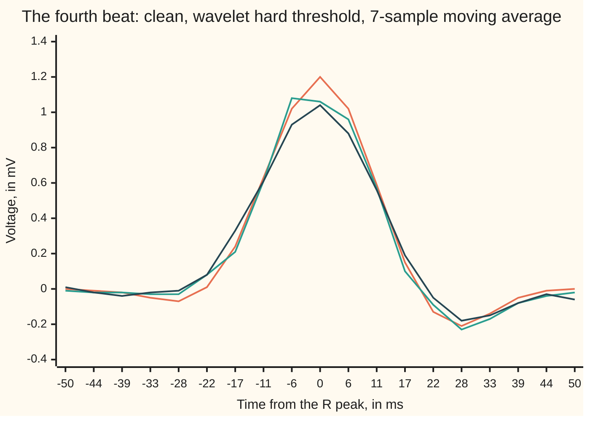

# Wavelet denoising: keep the big coefficients, throw the small ones away

[Syllabus](../../../SYLLABUS.md) → [Harmonic analysis](../README.md) → [Wavelets and Time-Frequency](../README.md#s05) → Wavelet denoising

---

## General Overview

A heart monitor records 2048 samples at 360 Hz, which is 5.689 seconds. The trace shows 7 beats, 0.8 s apart (75 a minute). Each beat has a tall, narrow spike, the **R wave**, that peaks at 1.197 mV, plus smaller, slower bumps before and after it. Muscle activity adds noise with a standard deviation of 0.1 mV to every sample. The trace is synthetic, built from a stated formula in the code, and illustrative.

The obvious fix is a moving average: replace each sample by the average of itself and its neighbours. Seven samples wide, it cuts the error from 0.0993 mV to 0.0439 mV. But it also cuts the spikes: the R waves come out at 1.017 mV on average, not 1.197. A doctor reads the spike height and shape, so this matters.

Wavelet denoising does better. Write the trace as a sum of short wave-shaped pieces at several widths: its **wavelet coefficients**. The **detail** coefficients measure the sharp, fine changes. Zero every detail coefficient smaller than a threshold of 0.3905 mV, keep the rest, and rebuild. The error falls to 0.0349 mV and the R waves come out at 1.109 mV. Averaged over 8 shifted copies of the record, the error falls to 0.0290 mV and the R waves reach 1.166 mV.

**A wavelet basis packs a spiky signal into a few big coefficients while white noise stays small and spread evenly over all of them; the largest of N noise coefficients rarely passes σ times the square root of 2 ln N (in about one record in six, 0.1755, at N = 2048, a share that shrinks only slowly as N grows), so zeroing everything below that line removes nearly all the noise and keeps the spikes.**

**What kind of fact this is:** two theorems and a method. That the largest noise coefficient seldom passes the threshold, and that soft thresholding comes within a factor 2 ln N + 1 of an ideal "oracle", are proved on this card in Why it works. Hard thresholding is a method: its error is measured by the checks, not proved. The heart trace is illustrative.

### The picture: one beat, cleaned two ways



Orange: the clean beat. Teal: the wavelet estimate with the hard threshold. Dark blue: the 7-sample moving average. The points are every second sample around the fourth R peak. The moving average spreads the spike: it is low at the top (1.04 against 1.20) and too high on the way up (0.33 against 0.24 at −17 ms). The wavelet estimate keeps the steep sides, but on this beat it is low at the top too, 1.06 (1.109 averaged over the 7 beats). Averaged over 8 shifts (Step 6), it reaches 1.17 here.

---

## The formula

Notation first, in words.

- The wavelet ladder is the one of [Mallat's algorithm](04-mallats-fast-wavelet-transform.md): two filters split a record into a coarse half and a detail half, and the coarse half is split again. The card uses the four-tap Daubechies wavelet D4, from [Daubechies wavelets](06-daubechies-and-vanishing-moments.md), for $`J`$ = 4 levels. Level $`j`$ = 1 is the finest.
- The ladder is **orthonormal**: it turns the 2048 samples into 2048 coefficients along perpendicular directions of length 1. So it keeps energy (the sum of squares), and squared errors are the same in samples and in coefficients.
- Of the 2048 coefficients, 1920 are **details** (1024, 512, 256 and 128 at levels 1 to 4) and 128 are **coarse** values. Only the details are thresholded; the coarse values are kept as they are.

The model, the threshold and the two rules:

```math
y_i = \theta_i + \sigma z_i, \qquad \lambda = \sigma\sqrt{2\ln N}
```

```math
\eta_H(y) = \begin{cases} y & \lvert y\rvert > \lambda \\ 0 & \lvert y\rvert \le \lambda \end{cases} \qquad \eta_S(y) = \mathrm{sign}(y)\,\max\bigl(\lvert y\rvert - \lambda,\ 0\bigr), \qquad \tilde\theta_i = \eta(y_i)
```

The two theorems: the largest noise coefficient, and the soft rule against the oracle.

```math
\mathrm{P}\Bigl(\max_{i \le N} \lvert \sigma z_i\rvert > \lambda\Bigr) \le \frac{1}{\sqrt{\pi \ln N}}, \qquad \mathrm{E}\sum_{i} \bigl(\eta_S(y_i) - \theta_i\bigr)^2 \le (2\ln N + 1)\Bigl(\sigma^2 + \sum_{i} \min(\theta_i^2, \sigma^2)\Bigr)
```

**Read it aloud:** keep a noisy coefficient, whole (hard) or shrunk by the threshold (soft), only if it beats sigma times the square root of 2 ln N; then pure noise passes with chance at most one over the square root of pi ln N, and the soft rule's expected error is at most 2 ln N + 1 times sigma squared plus the oracle's error.

| Symbol | Plain meaning | In our example | Push it up and the answer… |
| --- | --- | --- | --- |
| $`N`$ | number of samples, and of coefficients | 2048 | the threshold rises, slowly |
| $`\sigma`$ | standard deviation of the noise on each sample, in mV | 0.1 | the threshold rises in proportion |
| $`\theta_i`$ | the clean trace's coefficient number $`i`$ | 35 of 1920 details are above $`\lambda`$ | — |
| $`y_i,\ z_i`$ | the noisy coefficient; a standard bell-curve draw (mean 0, standard deviation 1) | $`y_i`$ = 0.9694 at one level-3 spot | — |
| $`\lambda`$ | the **threshold**, set by the **universal rule** $`\sigma\sqrt{2\ln N}`$ | 0.3905 mV | fewer noise coefficients survive, and more faint detail is erased |
| $`\eta_H,\ \eta_S,\ \tilde\theta_i,\ c(y)`$ | **hard** rule: keep or kill; **soft** rule: kill, or keep shrunk by $`\lambda`$ (sign(y) is +1 or −1 as y is positive or negative); the estimate, which wears a tilde across this wing; $`y`$ clipped to the range $`-\lambda`$ to $`\lambda`$, used in the proof | 0.9694 becomes 0.9694 (hard) or 0.5789 (soft) | — |
| $`\mathrm{P},\ \mathrm{E}`$ | probability; expected value, the average over every possible noise draw | — | — |
| $`r(\lambda, \theta)`$ | the **risk**: expected squared error of the soft rule on one coefficient, in units of $`\sigma^2`$ | 12.633477 at $`\theta = \lambda`$ | — |
| $`\min(\theta_i^2, \sigma^2)`$ | the **oracle's** error on one coefficient: the best of keeping it or zeroing it, chosen by someone who knows $`\theta_i`$ | sum 2.3089 mV², coarse values included | — |
| $`\Phi,\ g`$ | the bell curve's cumulative probability, from wing 09; its height, $`g(z) = e^{-z^2/2}/\sqrt{2\pi}`$ | tail $`2(1 - \Phi(3.9050))`$ = 94.21 per million | — |
| $`J,\ j`$ | number of levels in the ladder; one level, $`j`$ = 1 finest | $`J`$ = 4 | more, coarser levels are thresholded too |
| $`w`$ | moving-average width, in samples | 7 | less noise, flatter spikes |

### When it holds

- **The noise is white: independent from sample to sample, with one size.** Smear it over four samples and the noise per level comes out at 0.429, 0.814, 1.541 and 1.792 times $`\sigma`$. Then 5 noise details pass the threshold instead of 0.1809 expected, and the error is 0.0632 mV, not 0.0349.
- **The noise is a bell curve.** The tail bound in Step 2 uses the bell curve's fast-falling tail. Noise with heavy tails, such as sudden electrode pops, passes any threshold set this way.
- **$`\sigma`$ is the noise's size, not the record's.** The whole record's standard deviation is 0.2079 mV, because the heartbeat itself is in it. Using it as $`\sigma`$ gives an error of 0.0688 mV and R waves at 0.909 mV.
- **The signal is sparse in the basis: few big coefficients.** Here 35 of 1920 details stand above $`\lambda`$. A feature whose coefficients all sit below $`\lambda`$ is erased with the noise.
- **The oracle bound is an average over noise draws.** A single record can do worse. In 0.1655 of pure-noise records, at least one of the 1920 details survives the line.

---

## Why it works

### Step 0: the idea in words

The trace is mostly flat, with sharp spikes. A wavelet is short, so a flat stretch gives detail coefficients near zero and a spike gives a few large ones. The noise has no shape to match. Rotated into any perpendicular basis it stays the same size, $`\sigma`$, in every coefficient.

So the coefficients split into two groups: a few large ones that carry the heartbeat, and many small ones that are almost pure noise. Draw a line just above the largest noise coefficient. Below it, zero everything; above it, keep. Most of the noise goes, and the spikes stay.

The proof has three parts: the noise stays the same size (Step 1), the line sits just above the noise (Step 2), and the error is close to the best that any keep-or-kill rule could do (Steps 3 and 4).

### Step 1: the noise keeps its size in every coefficient

This is proved on the [Wavelets](../../13-Engineering%20mathematics/05-Signals/08-wavelets-and-multiresolution.md) card in one line: each coefficient is a dot product with a pattern of length 1, and perpendicular patterns give uncorrelated noise. That card also introduces the universal threshold, the hard and soft rules and the noise estimate from the finest details. This card proves why the threshold works and measures the result on a heart trace.

The D4 ladder is orthonormal. The check rebuilds the clean trace to within $`10^{-12}`$ and finds the same energy both ways: 80.571135 mV² from the samples and 80.571135 mV² from the coefficients.

### Step 2: the largest of N noise coefficients usually stays below the line

Take one standard bell-curve draw $`z`$. The chance that it lands above $`\lambda`$ is at most the bell curve's height at $`\lambda`$ divided by $`\lambda`$. The reason: above $`\lambda`$, the factor $`z/\lambda`$ is at least 1, and the area under $`z`$ times the bell curve has a closed form.

```math
\mathrm{P}(z > \lambda) = \int_\lambda^\infty \frac{e^{-z^2/2}}{\sqrt{2\pi}}\,dz \le \int_\lambda^\infty \frac{z}{\lambda}\,\frac{e^{-z^2/2}}{\sqrt{2\pi}}\,dz = \frac{e^{-\lambda^2/2}}{\lambda\sqrt{2\pi}}
```

Now set $`\lambda = \sqrt{2\ln N}`$ in units of $`\sigma`$. Then $`e^{-\lambda^2/2} = 1/N`$ exactly. That is why the threshold has this form: it makes the bell curve's height at the line equal to $`1/(N\sqrt{2\pi})`$.

There are $`N`$ coefficients and two tails each. The chance that any one of them passes is at most the sum of the chances:

```math
\mathrm{P}\Bigl(\max_{i \le N} \lvert z_i\rvert > \lambda\Bigr) \le 2N \cdot \frac{1}{N\lambda\sqrt{2\pi}} = \frac{2}{\sqrt{2\pi}\,\sqrt{2\ln N}} = \frac{1}{\sqrt{\pi\ln N}}
```

For $`N`$ = 2048 this is 0.2043. The exact chance, from the tail of one coefficient, is 0.1755. In 1000 records of pure noise the check finds a coefficient above the line in a share of 0.176. The largest of 2048 draws averages 3.6123, against a line at 3.9050.

These figures count all 2048 coefficients as noise, as the theorem does. On the record only the 1920 details are thresholded, so there the expected count is 0.1809 and the chance is 0.1655.

| $`N`$ | multiplier $`\sqrt{2\ln N}`$ | chance any noise coefficient passes | bound $`1/\sqrt{\pi\ln N}`$ |
| ---: | ---: | ---: | ---: |
| 64 | 2.8841 | 0.2226 | 0.2767 |
| 2048 | 3.9050 | 0.1755 | 0.2043 |
| 1048576 | 5.2655 | 0.1363 | 0.1515 |

The line grows very slowly: a record of 1048576 samples needs a line at 5.2655 times $`\sigma`$, against 3.9050 for 2048. A fixed line at $`3\sigma`$ would let 5.2 of the 1920 noise details through on this record, on average, and one at $`2\sigma`$ would let 87.4 through.

### Step 3: the oracle, the best that keep-or-kill can do

Suppose an oracle knows every clean coefficient $`\theta_i`$. For each one it chooses: keep $`y_i`$, with error $`\sigma^2`$ on average, or zero it, with error $`\theta_i^2`$. It picks the smaller, so its error is $`\min(\theta_i^2, \sigma^2)`$.

On the heart trace the oracle's total is 1.0289 mV² on the details plus 1.2800 mV² for the 128 coarse values kept as they are: 2.3089 mV². Doing nothing costs $`\sigma^2`$ on every coefficient. No real rule can match it, because no real rule knows $`\theta_i`$. The question is how close a rule that sees only $`y_i`$ can come.

### Step 4: soft thresholding comes within 2 ln N + 1 of the oracle

The soft rule is the proximal step of the charge $`\lambda\lvert\theta\rvert`$: the point that best balances staying close to $`y`$ against being small. [Proximal gradient](../../15-Optimization/06-Conic%2C%20Quadratic%20and%20Stochastic%20Programs/06-proximal-methods-ista-fista-and-the-lasso.md) derives it. Its risk on one coefficient obeys three facts, in units of $`\sigma^2`$:

1. **At zero it is tiny:** $`r(\lambda, 0) \le 4e^{-\lambda^2/2}/(\sqrt{2\pi}\lambda^3)`$, so the $`N`$ coefficients together cost at most 1. Here $`r(\lambda, 0)`$ is 9.5504 per million against a bound of 13.0848 per million.
2. **It grows no faster than $`\theta^2`$:** $`r(\lambda, \theta) \le r(\lambda, 0) + \theta^2`$, because the slope of the risk in $`\theta`$ is $`2\theta`$ times the chance of landing below the line, and that chance is at most 1.
3. **It never passes $`1 + \lambda^2`$:** the soft estimate is never more than $`\lambda`$ from $`y`$, so that shift adds at most $`\lambda^2`$; and Stein's identity (in the fold below) shows that the cross term between the noise and the shift is never positive.

Fact 2 covers small $`\theta`$ and fact 3 covers large $`\theta`$. Together, $`r(\lambda, \theta) \le r(\lambda, 0) + (1 + \lambda^2)\min(\theta^2, 1)`$. Add over the coefficients and use $`1 + \lambda^2 = 2\ln N + 1`$: that is the theorem.

<details>
<summary>Detailed proof: the three facts, and the sum</summary>

Work in units of $`\sigma`$, so $`y = \theta + z`$ with $`z`$ a standard bell-curve draw, and write $`g(z) = e^{-z^2/2}/\sqrt{2\pi}`$ for the bell curve's height. Write $`c(y)`$ for $`y`$ clipped to the range from $`-\lambda`$ to $`\lambda`$. Then $`\eta_S(y) = y - c(y)`$, so the error is $`\eta_S(y) - \theta = z - c(y)`$.

*Fact 1.* At $`\theta = 0`$ the error has size $`\lvert z\rvert - \lambda`$ when $`\lvert z\rvert > \lambda`$ and is 0 otherwise. Put $`z = \lambda + u`$, so $`u`$ is the distance above the line; then $`g(\lambda + u) = g(\lambda)\,e^{-\lambda u - u^2/2} \le g(\lambda)\,e^{-\lambda u}`$, and

$`\displaystyle r(\lambda, 0) = 2\int_0^\infty u^2\,g(\lambda + u)\,du \le 2\,g(\lambda)\int_0^\infty u^2 e^{-\lambda u}\,du = \frac{4\,g(\lambda)}{\lambda^3}`$

With $`\lambda^2 = 2\ln N`$, $`g(\lambda) = 1/(N\sqrt{2\pi})`$, so $`N\,r(\lambda, 0) \le 4/(\sqrt{2\pi}\,\lambda^3)`$, which is below 1 once $`\lambda \ge 1.2`$.

*Fact 2.* The risk is even in $`\theta`$, so take $`\theta \ge 0`$. Differentiate $`r = \mathrm{E}(\eta_S(\theta + z) - \theta)^2`$ under the average. The slope of $`\eta_S`$ is 1 above the line and 0 below it, where $`\eta_S = 0`$. So only the region below the line contributes:

$`\displaystyle \frac{\partial r}{\partial \theta} = \mathrm{E}\bigl[2(\eta_S - \theta)(\eta_S' - 1)\bigr] = 2\theta\,\mathrm{P}\bigl(\lvert\theta + z\rvert \le \lambda\bigr) \le 2\theta`$

Integrate from 0 to $`\theta`$: $`r(\lambda, \theta) - r(\lambda, 0) \le \theta^2`$.

*Fact 3.* Stein's identity says $`\mathrm{E}[z\,f(z)] = \mathrm{E}[f'(z)]`$ for a bell-curve draw and a function that is the integral of its slope, such as $`c`$. It is integration by parts, since the slope of $`g`$ is $`-z\,g(z)`$. The slope of $`c`$ is 1 inside the range and 0 outside. Expand the square:

$`\displaystyle \mathrm{E}\bigl(z - c(y)\bigr)^2 = 1 - 2\,\mathrm{E}[z\,c(\theta + z)] + \mathrm{E}\,c(y)^2 = 1 - 2\,\mathrm{P}\bigl(\lvert y\rvert < \lambda\bigr) + \mathrm{E}\min(y^2, \lambda^2) \le 1 + \lambda^2`$

*The sum.* Facts 2 and 3 give $`r(\lambda, \theta) \le r(\lambda, 0) + \min(\theta^2, 1 + \lambda^2) \le r(\lambda, 0) + (1 + \lambda^2)\min(\theta^2, 1)`$. Over at most $`N`$ coefficients, with fact 1:

$`\displaystyle \sum_i r(\lambda, \theta_i) \le N\,r(\lambda, 0) + (2\ln N + 1)\sum_i \min(\theta_i^2, 1) \le (2\ln N + 1)\Bigl(1 + \sum_i \min(\theta_i^2, 1)\Bigr)`$

Multiply by $`\sigma^2`$ to return to millivolts. This is Theorem 1 of Donoho and Johnstone (first source below).

</details>

The check computes the risk two ways, by a closed formula and by Simpson's rule on the defining integral, and they agree to $`10^{-8}`$ for $`\theta`$ from 0 to 6. On that grid the largest value of $`r - r(\lambda, 0) - \min(\theta^2, 1 + \lambda^2)`$ is 0.000000: the inequality holds, with equality at $`\theta = 0`$.

On the heart trace, the soft rule's expected error is 7.0054 mV² on the details, against the theorem's bound of 16.8807. With the coarse values, the expected total is 8.2854 mV²; 100 simulated noise draws average 8.3010.

### Step 5: hard against soft

The theorem is about the soft rule, because its risk has the clean form above. But soft pays for that. Every kept coefficient loses $`\lambda`$ = 0.3905 mV, and a spike's coefficients are exactly the kept ones. So soft lowers every spike.

The hard rule keeps the big coefficients whole. It pays only on coefficients near the line, where it keeps a noisy value or kills a real one. On the heart trace, hard averages 3.2152 mV² over 100 draws, against 8.3010 for soft. In the record shown, soft brings the R waves down to 0.838 mV.

### Step 6: why it beats a moving average

A moving average uses one width everywhere. Wide, it cleans the flat stretches and flattens the spikes. Narrow, it keeps the spikes and leaves noise on the flat stretches. The best width here is 7 samples, at 0.0439 mV.

Wavelet thresholding picks a width at each place. At a spike, the fine-level coefficients are large and survive, so the spike keeps its steep sides. On a flat stretch, every fine coefficient is noise and dies, which leaves a wide, smooth average. Over 100 noise draws, hard thresholding beat both the 5-sample and 7-sample averages 100 times out of 100. The check also tests the average itself: on the noise alone, the 7-sample average leaves a variance of 0.001431 mV², against $`\sigma^2/7`$ = 0.001429.

A wavelet grid is fixed, so the result depends a little on where the beats fall. Averaging the denoised record over 8 circular shifts, an idea from translation-invariant denoising (third source below), lowers the error to 0.0290 mV and lifts the R waves to 1.166 mV.

---

## Worked numbers, by hand

The threshold, the chance it is passed by noise, and the two rules on six real coefficients.

| Step | Arithmetic | Value |
| --- | --- | --- |
| log of the record length | ln 2048 | 7.6246 |
| multiplier | $`\sqrt{2 \times 7.6246}`$ | 3.9050 |
| threshold | 0.1 × 3.9050 | 0.3905 mV |
| tail for one noise coefficient | $`2(1 - \Phi(3.9050))`$ | 94.21 per million |
| noise coefficients expected above | 2048 × 0.00009421 | 0.1930 |
| chance any passes | 1 − (1 − 0.00009421) to the power 2048 | 0.1755 |
| the same over the 1920 thresholded details | 1920 × 0.00009421; 1 − (1 − 0.00009421) to the power 1920 | 0.1809; 0.1655 |
| Step 2's bound | $`1/\sqrt{\pi \times 7.6246}`$ | 0.2043 |
| six level-3 coefficients near beat 4 | as computed by the ladder | −0.0280, −0.6565, 0.9694, −0.5989, 0.1414, 0.0693 |
| hard rule | keep those with size above 0.3905 | 0, −0.6565, 0.9694, −0.5989, 0, 0 |
| soft rule | shrink the survivors by 0.3905 | 0, −0.2660, 0.5789, −0.2084, 0, 0 |
| oracle bound | (2 × 7.6246 + 1) × (0.01 + 1.0289) = 16.2492 × (0.01 + 1.0289) | 16.8807 mV² |
| soft, expected on the details | sum of $`0.01 \times r(3.9050, \theta_i/0.1)`$ | 7.0054 mV² |
| **result** | **rms error: noisy, moving average 7, hard threshold** | **0.0993, 0.0439, 0.0349 mV** |

The hard threshold cuts the error to about a third of the noise, and keeps the R waves at 1.109 mV where the best moving average leaves 1.017.

```
rms error on the record shown, mV (40 marks = 0.1)
  noisy record             ████████████████████████████████████████  0.0993
  moving average 7         ██████████████████                        0.0439
  soft, universal          █████████████████████████                 0.0635
  hard, universal          ██████████████                            0.0349
  hard, 8 shifts           ████████████                              0.0290
```

### What breaks if you drop a piece

| Mistake | Comes out at | What went wrong |
| --- | --- | --- |
| Soft rule instead of hard | rms error 0.0635 mV; R waves 0.838 mV | every spike coefficient loses 0.3905 mV |
| Threshold at $`\sigma`$, without $`\sqrt{2\ln N}`$ | rms error 0.0899 mV | 609.2 of the 1920 noise details are expected to pass |
| $`\sigma`$ taken as the whole record's spread, 0.2079 mV | rms error 0.0688 mV; R waves 0.909 mV | the heartbeat inflates the estimate, so the line more than doubles |
| Moving average, 7 samples | rms error 0.0439 mV; R waves 1.017 mV | one width everywhere: the spikes are spread out |
| Noise smeared over four samples | 5 noise coefficients pass; rms error 0.0632 mV | the noise is no longer white, and reaches 1.792 σ at level 4 |

---

## Code, from first principles, and it actually runs

The code builds the heart trace from five bell-shaped bumps per beat, adds noise from a SplitMix64 generator (seed 2026 for the simulations, seed 7 for the record shown) turned into bell-curve draws by the Box–Muller recipe, and runs the D4 ladder forwards and backwards. It takes three independent roads. First, the chance that noise passes the line, from the exact tail, from Step 2's bound and from 1000 simulated records. Second, the soft rule's risk, from a closed formula and from Simpson's rule on its defining integral. Third, the expected error on the heart trace, from the risk formula summed over the clean coefficients and from 100 simulated noise draws. The bell curve's cumulative probability is one series, written out.

### Python

```python
# Wavelet denoising: keep the big coefficients, throw the small ones away.
# A synthetic heart trace (illustrative), white noise, the D4 wavelet ladder, and the universal threshold.
# Standard library only.  Noise: SplitMix64 (seed 2026) and Box-Muller, written out.
from math import sqrt, log, exp, cos, pi, copysign
M64 = (1 << 64) - 1
class Rng:
    def __init__(s, seed): s.x = seed
    def unif(s):
        s.x = (s.x + 0x9E3779B97F4A7C15) & M64; z = s.x
        z = ((z ^ (z >> 30)) * 0xBF58476D1CE4E5B9) & M64; z = ((z ^ (z >> 27)) * 0x94D049BB133111EB) & M64
        return ((z ^ (z >> 31)) >> 11) / 2.0 ** 53
    def gauss(s):
        a = s.unif(); b = s.unif(); return sqrt(-2.0 * log(1.0 - a)) * cos(2.0 * pi * b)
FS, N, J, SIG = 360, 2048, 4, 0.1          # samples per second, samples, levels, noise sd in mV
WAVES = [(0.15, -0.2, 0.025), (-0.1, -0.025, 0.008), (1.2, 0.0, 0.010), (-0.25, 0.025, 0.008), (0.3, 0.3, 0.04)]
BEATS = [0.4 + 0.8 * b for b in range(7)]   # 75 beats a minute; P, Q, R, S, T bumps (mV, s from R, sd s)
PEAKS = [round(b * FS) for b in BEATS]
clean = [sum(a * exp(-(i / FS - b - c) ** 2 / (2 * w * w)) for b in BEATS for a, c, w in WAVES) for i in range(N)]
R3, R2 = sqrt(3.0), sqrt(2.0)
H = [(1 + R3) / (4 * R2), (3 + R3) / (4 * R2), (3 - R3) / (4 * R2), (1 - R3) / (4 * R2)]  # D4 lowpass
G = [H[3], -H[2], H[1], -H[0]]                                                          # D4 highpass
def forward(x):
    s, ds = list(x), []
    for _ in range(J):
        n = len(s)
        ds.append([sum(G[m] * s[(2 * k + m) % n] for m in range(4)) for k in range(n // 2)])
        s = [sum(H[m] * s[(2 * k + m) % n] for m in range(4)) for k in range(n // 2)]
    return s, ds
def inverse(s, ds):
    for d in reversed(ds):
        n = 2 * len(s); x = [0.0] * n
        for k in range(len(s)):
            for m in range(4): x[(2 * k + m) % n] += H[m] * s[k] + G[m] * d[k]
        s = x
    return s
def hard(v, t): return v if abs(v) > t else 0.0
def soft(v, t): return copysign(max(abs(v) - t, 0.0), v) + 0.0
def denoise(x, rule, t):
    s, ds = forward(x); return inverse(s, [[rule(v, t) for v in d] for d in ds])
def spun(x, rule, t, k=8):                    # average the denoised record over k circular shifts
    acc = [0.0] * N
    for c in range(k):
        y = denoise(x[c:] + x[:c], rule, t)
        for i in range(N): acc[(i + c) % N] += y[i] / k
    return acc
def moving_avg(x, w): return [sum(x[(i + k) % N] for k in range(-(w // 2), w // 2 + 1)) / w for i in range(N)]
def rms(a, b): return sqrt(sum((p - q) ** 2 for p, q in zip(a, b)) / len(a))
def r_height(y): return sum(y[p] for p in PEAKS) / len(PEAKS)
def phi(z): return exp(-z * z / 2) / sqrt(2 * pi)
def Phi(x):                                   # normal CDF: 1/2 + phi(x) (x + x^3/3 + x^5/15 + ...)
    term, total, k = x, x, 0
    while abs(term) > 1e-17 * abs(total) and k < 500:
        k += 1; term *= x * x / (2 * k + 1); total += term
    return 0.5 + phi(x) * total
def simpson(f, a, b, n=2000):
    h = (b - a) / n
    return h / 3 * (f(a) + f(b) + sum((4 if i % 2 else 2) * f(a + i * h) for i in range(1, n)))
def risk_closed(lam, th):                     # E (soft(th + Z, lam) - th)^2 for Z standard normal
    return (1 + lam * lam + (th * th - lam * lam - 1) * (Phi(lam - th) - Phi(-lam - th))
            - (lam - th) * phi(lam + th) - (lam + th) * phi(lam - th))
def risk_simpson(lam, th):
    f = lambda z: (soft(th + z, lam) - th) ** 2 * phi(z)
    cuts = [-12.0, -lam - th, lam - th, 12.0]
    return sum(simpson(f, cuts[i], cuts[i + 1]) for i in range(3))
def close(a, b, tol): return abs(a - b) <= tol
mult = sqrt(2 * log(N)); LAM = SIG * mult
print(f"heart trace: {N} samples at {FS} Hz = {N / FS:.3f} s, {len(BEATS)} beats 0.8 s apart (75 a minute), clean R height {r_height(clean):.3f} mV, noise sd {SIG} mV")
s0, d0 = forward(clean)
e_t, e_c = sum(v * v for v in clean), sum(v * v for v in s0) + sum(v * v for d in d0 for v in d)
back = max(abs(a - b) for a, b in zip(inverse(s0, d0), clean))
print(f"D4 ladder, {J} levels: rebuild error below 1e-12 {'yes' if back < 1e-12 else 'no'}; energy by samples {e_t:.6f}, by coefficients {e_c:.6f} mV^2")
assert back < 1e-12 and close(e_t, e_c, 1e-9)
print(f"universal threshold: ln {N} = {log(N):.4f}, sqrt(2 ln {N}) = {mult:.4f}, lambda = {LAM:.4f} mV")
# road 1: the largest of N pure-noise coefficients, by formula, bound and simulation
p1 = 2 * (1 - Phi(mult)); p_any = 1 - (1 - p1) ** N; bound = 1 / sqrt(pi * log(N))
rng = Rng(2026); trials = 1000; nd = N - len(s0)   # nd: the details, the only coefficients thresholded
tops = [max(abs(rng.gauss()) for _ in range(N)) for _ in range(trials)]; hits = sum(t > mult for t in tops)
print(f"one noise coefficient above: {1e6 * p1:.2f} per million; expected count {N * p1:.4f}; P(any of {N}) {p_any:.4f}; bound {bound:.4f}"
      f"\nover the {nd} thresholded details: expected count {nd * p1:.4f}; P(any of {nd}) {1 - (1 - p1) ** nd:.4f}")
print(f"{trials} noise records: largest |coefficient| mean {sum(tops) / trials:.4f}, range {min(tops):.4f} to {max(tops):.4f}; share above {hits / trials:.3f}")
assert p_any < bound and abs(hits / trials - p_any) < 4 * sqrt(p_any * (1 - p_any) / trials) and close(N * sqrt(2 * pi) * phi(mult), 1.0, 1e-12)
for n in (64, 2048, 2 ** 20):
    m = sqrt(2 * log(n)); q = 2 * (1 - Phi(m)); print(f"  N {n:8d}: multiplier {m:.4f}, P(any above) {1 - (1 - q) ** n:.4f}, bound {1 / sqrt(pi * log(n)):.4f}")
for t in (1.0, 2.0, 3.0): print(f"  threshold {t:.0f} sigma: noise coefficients expected above {N * 2 * (1 - Phi(t)):.1f} of {N}, {nd * 2 * (1 - Phi(t)):.1f} of {nd} details")
# road 2: soft-threshold risk of one coefficient, closed form against Simpson, and the oracle inequality
r0 = risk_closed(mult, 0.0)
print(f"risk at theta 0, per million sigma^2: closed {1e6 * r0:.4f}, Simpson {1e6 * risk_simpson(mult, 0.0):.4f}, bound 4 phi/lam^3 {1e6 * 4 * phi(mult) / mult ** 3:.4f}")
worst_gap, worst_slack = 0.0, -1.0
for i in range(61):
    th = i / 10; rc = risk_closed(mult, th)
    worst_gap = max(worst_gap, abs(rc - risk_simpson(mult, th)))
    worst_slack = max(worst_slack, rc - r0 - min(th * th, 1 + mult * mult))
for th in (0.5, 1.0, mult, 6.0): print(f"  theta {th:.4f}: risk {risk_closed(mult, th):.6f}, oracle {min(th * th, 1.0):.4f}")
print(f"theta 0..6: closed and Simpson agree to 1e-8 {'yes' if worst_gap < 1e-8 else 'no'}; max of risk - r(0) - min(theta^2, 1 + lam^2) {worst_slack:.6f}")
assert worst_gap < 1e-8 and worst_slack <= 0 and r0 <= 4 * phi(mult) / mult ** 3
big = [sum(abs(v) > LAM for v in d) for d in d0]
oracle = sum(min(v * v, SIG * SIG) for d in d0 for v in d); coarse = len(s0) * SIG ** 2
soft_exp = sum(SIG ** 2 * risk_closed(mult, v / SIG) for d in d0 for v in d) + coarse
print(f"clean details above lambda, levels 1-{J}: {big} of {[len(d) for d in d0]}, {sum(big)} of {N - len(s0)}; coarse kept {len(s0)}")
print(f"2 ln N + 1 = {2 * log(N) + 1:.4f}; ideal (oracle) error: details {oracle:.4f} + coarse {coarse:.4f} = {oracle + coarse:.4f} mV^2")
print(f"soft, expected: details {soft_exp - coarse:.4f}, total {soft_exp:.4f}; bound on details {(2 * log(N) + 1) * (SIG ** 2 + oracle):.4f}, total {(2 * log(N) + 1) * (SIG ** 2 + oracle) + coarse:.4f}")
# road 3: the same expected errors by simulation, 100 noise draws, against two moving averages
draws, sums = 100, {"soft": 0.0, "hard": 0.0, "avg5": 0.0, "avg7": 0.0}; wins, nv, ma7 = 0, 0.0, moving_avg(clean, 7)  # nv: noise variance a 7-sample average leaves
for _ in range(draws):
    x = [c + SIG * rng.gauss() for c in clean]
    out = {"soft": denoise(x, soft, LAM), "hard": denoise(x, hard, LAM), "avg5": moving_avg(x, 5), "avg7": moving_avg(x, 7)}
    err = {k: sum((a - b) ** 2 for a, b in zip(y, clean)) for k, y in out.items()}
    for k in sums: sums[k] += err[k] / draws
    wins += err["hard"] < min(err["avg5"], err["avg7"]); nv += sum((a - b) ** 2 for a, b in zip(out["avg7"], ma7)) / (draws * N)
print(f"{draws} draws, average total squared error, mV^2: " + ", ".join(f"{k} {v:.4f}" for k, v in sums.items()) + f"; hard beats both averages {wins} times"
      f"\nmoving average 7 on the noise alone: variance {nv:.6f}, sigma^2/7 {SIG ** 2 / 7:.6f} mV^2")
assert abs(sums["soft"] - soft_exp) < 0.03 * soft_exp and sums["soft"] <= (2 * log(N) + 1) * (SIG ** 2 + oracle) + coarse and wins >= 95 and abs(nv * 7 / SIG ** 2 - 1) < 0.03
# the worked record: one draw, every method
rng = Rng(7); noisy = [c + SIG * rng.gauss() for c in clean]
sh = sorted(abs(v) for v in forward(noisy)[1][0]); sig_hat = (sh[511] + sh[512]) / 2 / 0.6745
sd_all = sqrt(sum(v * v for v in noisy) / N - (sum(noisy) / N) ** 2)
methods = [("noisy record", noisy), ("moving average 3", moving_avg(noisy, 3)), ("moving average 5", moving_avg(noisy, 5)),
           ("moving average 7", moving_avg(noisy, 7)), ("moving average 9", moving_avg(noisy, 9)),
           ("hard, universal", denoise(noisy, hard, LAM)), ("soft, universal", denoise(noisy, soft, LAM)),
           ("hard, 8 shifts", spun(noisy, hard, LAM)), ("hard, sigma from MAD", denoise(noisy, hard, sig_hat * mult)),
           ("hard, lambda = sigma", denoise(noisy, hard, SIG)), ("hard, sigma = record sd", denoise(noisy, hard, sd_all * mult))]
d3 = forward(noisy)[1][2][123:129]
print("level-3 coefficients near beat 4:", " ".join(f"{v:.4f}" for v in d3))
print("  hard:", " ".join(f"{hard(v, LAM):.4f}" for v in d3), "  soft:", " ".join(f"{soft(v, LAM):.4f}" for v in d3))
print(f"one record (seed 7): sigma from MAD {sig_hat:.4f}; record sd {sd_all:.4f}")
for name, y in methods: print(f"  {name:24s} rms error {rms(y, clean):.4f} mV  R height {r_height(y):.3f} mV")
err = dict((k, rms(y, clean)) for k, y in methods)
assert err["hard, universal"] < min(err[f"moving average {w}"] for w in (3, 5, 7, 9)) < err["noisy record"]
assert err["hard, 8 shifts"] < err["hard, universal"] < err["soft, universal"]
# a broken hypothesis: noise that is not white (each sample the sum of four white draws, halved)
w = [rng.gauss() for _ in range(N + 3)]; col = [SIG * (w[i] + w[i + 1] + w[i + 2] + w[i + 3]) / 2 for i in range(N)]
_, dc = forward(col)
print("coloured noise, sd per level in sigma units:", " ".join(f"{sqrt(sum(v * v for v in d) / len(d)) / SIG:.3f}" for d in dc),
      f"; noise coefficients above lambda {sum(abs(v) > LAM for d in dc for v in d)}")
print(f"coloured noise record: rms error noisy {rms([a + b for a, b in zip(clean, col)], clean):.4f}, hard {rms(denoise([a + b for a, b in zip(clean, col)], hard, LAM), clean):.4f} mV")
c4 = PEAKS[3]; idx = list(range(c4 - 18, c4 + 19, 2))
chart = [("clean", clean), ("noisy", noisy), ("hard", methods[5][1]), ("hard, 8 shifts", methods[7][1]), ("moving average 7", methods[3][1])]
print("chart ms:", " ".join(f"{1000 * (i - c4) / FS:.0f}" for i in idx))
for name, y in chart: print(f"chart {name}:", " ".join(f"{y[i]:.2f}" for i in idx))
print("ALL CHECKS PASS")
```

**Ran 2026-11-15 on macOS, Python 3.14.10, standard library only. All checks passed. Output, pasted from the run:**

```text
heart trace: 2048 samples at 360 Hz = 5.689 s, 7 beats 0.8 s apart (75 a minute), clean R height 1.197 mV, noise sd 0.1 mV
D4 ladder, 4 levels: rebuild error below 1e-12 yes; energy by samples 80.571135, by coefficients 80.571135 mV^2
universal threshold: ln 2048 = 7.6246, sqrt(2 ln 2048) = 3.9050, lambda = 0.3905 mV
one noise coefficient above: 94.21 per million; expected count 0.1930; P(any of 2048) 0.1755; bound 0.2043
over the 1920 thresholded details: expected count 0.1809; P(any of 1920) 0.1655
1000 noise records: largest |coefficient| mean 3.6123, range 2.9307 to 5.1355; share above 0.176
  N       64: multiplier 2.8841, P(any above) 0.2226, bound 0.2767
  N     2048: multiplier 3.9050, P(any above) 0.1755, bound 0.2043
  N  1048576: multiplier 5.2655, P(any above) 0.1363, bound 0.1515
  threshold 1 sigma: noise coefficients expected above 649.9 of 2048, 609.2 of 1920 details
  threshold 2 sigma: noise coefficients expected above 93.2 of 2048, 87.4 of 1920 details
  threshold 3 sigma: noise coefficients expected above 5.5 of 2048, 5.2 of 1920 details
risk at theta 0, per million sigma^2: closed 9.5504, Simpson 9.5504, bound 4 phi/lam^3 13.0848
  theta 0.5000: risk 0.249958, oracle 0.2500
  theta 1.0000: risk 0.999225, oracle 1.0000
  theta 3.9050: risk 12.633477, oracle 1.0000
  theta 6.0000: risk 16.166187, oracle 1.0000
theta 0..6: closed and Simpson agree to 1e-8 yes; max of risk - r(0) - min(theta^2, 1 + lam^2) 0.000000
clean details above lambda, levels 1-4: [0, 0, 21, 14] of [1024, 512, 256, 128], 35 of 1920; coarse kept 128
2 ln N + 1 = 16.2492; ideal (oracle) error: details 1.0289 + coarse 1.2800 = 2.3089 mV^2
soft, expected: details 7.0054, total 8.2854; bound on details 16.8807, total 18.1607
100 draws, average total squared error, mV^2: soft 8.3010, hard 3.2152, avg5 4.4377, avg7 4.1817; hard beats both averages 100 times
moving average 7 on the noise alone: variance 0.001431, sigma^2/7 0.001429 mV^2
level-3 coefficients near beat 4: -0.0280 -0.6565 0.9694 -0.5989 0.1414 0.0693
  hard: 0.0000 -0.6565 0.9694 -0.5989 0.0000 0.0000   soft: 0.0000 -0.2660 0.5789 -0.2084 0.0000 0.0000
one record (seed 7): sigma from MAD 0.0991; record sd 0.2079
  noisy record             rms error 0.0993 mV  R height 1.195 mV
  moving average 3         rms error 0.0555 mV  R height 1.174 mV
  moving average 5         rms error 0.0443 mV  R height 1.105 mV
  moving average 7         rms error 0.0439 mV  R height 1.017 mV
  moving average 9         rms error 0.0505 mV  R height 0.925 mV
  hard, universal          rms error 0.0349 mV  R height 1.109 mV
  soft, universal          rms error 0.0635 mV  R height 0.838 mV
  hard, 8 shifts           rms error 0.0290 mV  R height 1.166 mV
  hard, sigma from MAD     rms error 0.0349 mV  R height 1.109 mV
  hard, lambda = sigma     rms error 0.0899 mV  R height 1.192 mV
  hard, sigma = record sd  rms error 0.0688 mV  R height 0.909 mV
coloured noise, sd per level in sigma units: 0.429 0.814 1.541 1.792 ; noise coefficients above lambda 5
coloured noise record: rms error noisy 0.0978, hard 0.0632 mV
chart ms: -50 -44 -39 -33 -28 -22 -17 -11 -6 0 6 11 17 22 28 33 39 44 50
chart clean: -0.00 -0.01 -0.02 -0.05 -0.07 0.01 0.24 0.63 1.02 1.20 1.02 0.59 0.15 -0.13 -0.21 -0.14 -0.05 -0.01 -0.00
chart noisy: 0.02 0.01 0.00 -0.14 -0.04 0.04 0.14 0.60 1.06 1.26 1.02 0.60 0.15 -0.09 -0.29 -0.28 0.15 -0.07 -0.14
chart hard: -0.01 -0.02 -0.02 -0.03 -0.03 0.08 0.21 0.61 1.08 1.06 0.96 0.57 0.10 -0.09 -0.23 -0.17 -0.08 -0.04 -0.02
chart hard, 8 shifts: -0.03 -0.03 -0.03 -0.02 0.02 0.07 0.22 0.59 0.99 1.17 0.99 0.57 0.16 -0.13 -0.23 -0.15 -0.06 -0.06 -0.05
chart moving average 7: 0.01 -0.02 -0.04 -0.02 -0.01 0.08 0.33 0.61 0.93 1.04 0.88 0.56 0.19 -0.05 -0.18 -0.15 -0.08 -0.03 -0.06
ALL CHECKS PASS
```

### Rust

Same numbers, same labels, built with `rustc --edition 2021 -O`.

```rust
// Wavelet denoising: keep the big coefficients, throw the small ones away.
// A synthetic heart trace (illustrative), white noise, the D4 wavelet ladder, and the universal threshold.
// std only.  Noise: SplitMix64 (seed 2026) and Box-Muller, written out.
use std::f64::consts::PI;
struct Rng { x: u64 }
impl Rng {
    fn unif(&mut self) -> f64 {
        self.x = self.x.wrapping_add(0x9E3779B97F4A7C15); let mut z = self.x;
        z = (z ^ (z >> 30)).wrapping_mul(0xBF58476D1CE4E5B9); z = (z ^ (z >> 27)).wrapping_mul(0x94D049BB133111EB);
        ((z ^ (z >> 31)) >> 11) as f64 / 2f64.powi(53)
    }
    fn gauss(&mut self) -> f64 { let a = self.unif(); let b = self.unif(); (-2.0 * (1.0 - a).ln()).sqrt() * (2.0 * PI * b).cos() }
}
const FS: f64 = 360.0; const N: usize = 2048; const J: usize = 4; const SIG: f64 = 0.1;
const WAVES: [(f64, f64, f64); 5] = [(0.15, -0.2, 0.025), (-0.1, -0.025, 0.008), (1.2, 0.0, 0.010), (-0.25, 0.025, 0.008), (0.3, 0.3, 0.04)];
type Rule = fn(f64, f64) -> f64;
fn filters() -> ([f64; 4], [f64; 4]) {
    let (r3, r2) = (3f64.sqrt(), 2f64.sqrt());
    let h = [(1.0 + r3) / (4.0 * r2), (3.0 + r3) / (4.0 * r2), (3.0 - r3) / (4.0 * r2), (1.0 - r3) / (4.0 * r2)];
    (h, [h[3], -h[2], h[1], -h[0]]) // D4 lowpass, D4 highpass
}
fn forward(x: &[f64]) -> (Vec<f64>, Vec<Vec<f64>>) {
    let ((h, g), mut s, mut ds) = (filters(), x.to_vec(), Vec::new());
    for _ in 0..J {
        let n = s.len();
        ds.push((0..n / 2).map(|k| (0..4).map(|m| g[m] * s[(2 * k + m) % n]).sum()).collect());
        s = (0..n / 2).map(|k| (0..4).map(|m| h[m] * s[(2 * k + m) % n]).sum()).collect();
    }
    (s, ds)
}
fn inverse(s0: &[f64], ds: &[Vec<f64>]) -> Vec<f64> {
    let ((h, g), mut s) = (filters(), s0.to_vec());
    for d in ds.iter().rev() {
        let n = 2 * s.len(); let mut x = vec![0.0; n];
        for k in 0..s.len() { for m in 0..4 { x[(2 * k + m) % n] += h[m] * s[k] + g[m] * d[k]; } }
        s = x;
    }
    s
}
fn hard(v: f64, t: f64) -> f64 { if v.abs() > t { v } else { 0.0 } }
fn soft(v: f64, t: f64) -> f64 { (v.abs() - t).max(0.0).copysign(v) + 0.0 }
fn denoise(x: &[f64], rule: Rule, t: f64) -> Vec<f64> {
    let (s, ds) = forward(x); inverse(&s, &ds.iter().map(|d| d.iter().map(|&v| rule(v, t)).collect()).collect::<Vec<Vec<f64>>>())
}
fn spun(x: &[f64], rule: Rule, t: f64, k: usize) -> Vec<f64> { // average the denoised record over k circular shifts
    let mut acc = vec![0.0; N];
    for c in 0..k {
        let y = denoise(&x[c..].iter().chain(x[..c].iter()).cloned().collect::<Vec<f64>>(), rule, t);
        for i in 0..N { acc[(i + c) % N] += y[i] / k as f64; }
    }
    acc
}
fn moving_avg(x: &[f64], w: i64) -> Vec<f64> {
    (0..N as i64).map(|i| (-(w / 2)..=w / 2).map(|k| x[((i + k).rem_euclid(N as i64)) as usize]).sum::<f64>() / w as f64).collect()
}
fn rms(a: &[f64], b: &[f64]) -> f64 { (a.iter().zip(b).map(|(p, q)| (p - q).powi(2)).sum::<f64>() / a.len() as f64).sqrt() }
fn phi(z: f64) -> f64 { (-z * z / 2.0).exp() / (2.0 * PI).sqrt() }
fn big_phi(x: f64) -> f64 { // normal CDF: 1/2 + phi(x) (x + x^3/3 + x^5/15 + ...)
    let (mut term, mut total, mut k) = (x, x, 0);
    while term.abs() > 1e-17 * total.abs() && k < 500 { k += 1; term *= x * x / (2 * k + 1) as f64; total += term; }
    0.5 + phi(x) * total
}
fn simpson(f: &dyn Fn(f64) -> f64, a: f64, b: f64) -> f64 {
    let (n, mut s) = (2000, f(a) + f(b)); let h = (b - a) / n as f64;
    for i in 1..n { s += (if i % 2 == 1 { 4.0 } else { 2.0 }) * f(a + i as f64 * h); }
    h / 3.0 * s
}
fn risk_closed(lam: f64, th: f64) -> f64 { // E (soft(th + Z, lam) - th)^2 for Z standard normal
    1.0 + lam * lam + (th * th - lam * lam - 1.0) * (big_phi(lam - th) - big_phi(-lam - th))
        - (lam - th) * phi(lam + th) - (lam + th) * phi(lam - th)
}
fn risk_simpson(lam: f64, th: f64) -> f64 {
    let f = |z: f64| (soft(th + z, lam) - th).powi(2) * phi(z);
    let cuts = [-12.0, -lam - th, lam - th, 12.0];
    (0..3).map(|i| simpson(&f, cuts[i], cuts[i + 1])).sum()
}
fn join(xs: &[f64], d: usize) -> String { xs.iter().map(|v| format!("{:.*}", d, v)).collect::<Vec<_>>().join(" ") }
fn yes(b: bool) -> &'static str { if b { "yes" } else { "no" } }
fn main() {
    let beats: Vec<f64> = (0..7).map(|b| 0.4 + 0.8 * b as f64).collect();
    let peaks: Vec<usize> = beats.iter().map(|b| (b * FS).round() as usize).collect();
    let r_height = |y: &[f64]| peaks.iter().map(|&p| y[p]).sum::<f64>() / peaks.len() as f64;
    let clean: Vec<f64> = (0..N).map(|i| beats.iter().map(|b| WAVES.iter().map(|(a, c, w)| a * (-(i as f64 / FS - b - c).powi(2) / (2.0 * w * w)).exp()).sum::<f64>()).sum()).collect();
    let mult = (2.0 * (N as f64).ln()).sqrt(); let lam = SIG * mult;
    println!("heart trace: {} samples at {} Hz = {:.3} s, {} beats 0.8 s apart (75 a minute), clean R height {:.3} mV, noise sd {} mV", N, FS, N as f64 / FS, beats.len(), r_height(&clean), SIG);
    let (s0, d0) = forward(&clean);
    let e_t: f64 = clean.iter().map(|v| v * v).sum();     let e_c: f64 = s0.iter().map(|v| v * v).sum::<f64>() + d0.iter().flatten().map(|v| v * v).sum::<f64>();
    let back = inverse(&s0, &d0).iter().zip(&clean).map(|(a, b)| (a - b).abs()).fold(0.0, f64::max);
    println!("D4 ladder, {} levels: rebuild error below 1e-12 {}; energy by samples {:.6}, by coefficients {:.6} mV^2", J, yes(back < 1e-12), e_t, e_c);
    assert!(back < 1e-12 && (e_t - e_c).abs() <= 1e-9);
    println!("universal threshold: ln {} = {:.4}, sqrt(2 ln {}) = {:.4}, lambda = {:.4} mV", N, (N as f64).ln(), N, mult, lam);
    // road 1: the largest of N pure-noise coefficients, by formula, bound and simulation
    let p1 = 2.0 * (1.0 - big_phi(mult)); let p_any = 1.0 - (1.0 - p1).powi(N as i32); let bound = 1.0 / (PI * (N as f64).ln()).sqrt();
    let mut rng = Rng { x: 2026 }; let trials = 1000; let nd = N - s0.len(); // nd: the details, the only coefficients thresholded
    let tops: Vec<f64> = (0..trials).map(|_| (0..N).map(|_| rng.gauss().abs()).fold(0.0, f64::max)).collect();
    let hits = tops.iter().filter(|&&t| t > mult).count(); let fr = hits as f64 / trials as f64;
    println!("one noise coefficient above: {:.2} per million; expected count {:.4}; P(any of {}) {:.4}; bound {:.4}\nover the {} thresholded details: expected count {:.4}; P(any of {}) {:.4}",
             1e6 * p1, N as f64 * p1, N, p_any, bound, nd, nd as f64 * p1, nd, 1.0 - (1.0 - p1).powi(nd as i32));
    println!("{} noise records: largest |coefficient| mean {:.4}, range {:.4} to {:.4}; share above {:.3}", trials, tops.iter().sum::<f64>() / trials as f64,
             tops.iter().cloned().fold(f64::MAX, f64::min), tops.iter().cloned().fold(0.0, f64::max), fr);
    assert!(p_any < bound && (fr - p_any).abs() < 4.0 * (p_any * (1.0 - p_any) / trials as f64).sqrt() && (N as f64 * (2.0 * PI).sqrt() * phi(mult) - 1.0).abs() <= 1e-12);
    for n in [64u64, 2048, 1 << 20] {
        let m = (2.0 * (n as f64).ln()).sqrt(); let q = 2.0 * (1.0 - big_phi(m)); println!("  N {:8}: multiplier {:.4}, P(any above) {:.4}, bound {:.4}", n, m, 1.0 - (1.0 - q).powf(n as f64), 1.0 / (PI * (n as f64).ln()).sqrt());
    }
    for t in [1.0, 2.0, 3.0] { println!("  threshold {:.0} sigma: noise coefficients expected above {:.1} of {}, {:.1} of {} details", t, N as f64 * 2.0 * (1.0 - big_phi(t)), N, nd as f64 * 2.0 * (1.0 - big_phi(t)), nd); }
    // road 2: soft-threshold risk of one coefficient, closed form against Simpson, and the oracle inequality
    let r0 = risk_closed(mult, 0.0);
    println!("risk at theta 0, per million sigma^2: closed {:.4}, Simpson {:.4}, bound 4 phi/lam^3 {:.4}", 1e6 * r0, 1e6 * risk_simpson(mult, 0.0), 1e6 * 4.0 * phi(mult) / mult.powi(3));
    let (mut worst_gap, mut worst_slack) = (0.0f64, -1.0f64);
    for i in 0..61 {
        let th = i as f64 / 10.0; let rc = risk_closed(mult, th);
        worst_gap = worst_gap.max((rc - risk_simpson(mult, th)).abs());
        worst_slack = worst_slack.max(rc - r0 - (th * th).min(1.0 + mult * mult));
    }
    for th in [0.5, 1.0, mult, 6.0] { println!("  theta {:.4}: risk {:.6}, oracle {:.4}", th, risk_closed(mult, th), (th * th).min(1.0)); }
    println!("theta 0..6: closed and Simpson agree to 1e-8 {}; max of risk - r(0) - min(theta^2, 1 + lam^2) {:.6}", yes(worst_gap < 1e-8), worst_slack);
    assert!(worst_gap < 1e-8 && worst_slack <= 0.0 && r0 <= 4.0 * phi(mult) / mult.powi(3));
    let big: Vec<String> = d0.iter().map(|d| d.iter().filter(|v| v.abs() > lam).count().to_string()).collect();
    let lens: Vec<String> = d0.iter().map(|d| d.len().to_string()).collect();
    let oracle: f64 = d0.iter().flatten().map(|v| (v * v).min(SIG * SIG)).sum();
    let coarse = s0.len() as f64 * SIG * SIG; let lnf = 2.0 * (N as f64).ln() + 1.0;
    let soft_exp = d0.iter().flatten().map(|v| SIG * SIG * risk_closed(mult, v / SIG)).sum::<f64>() + coarse;
    println!("clean details above lambda, levels 1-{}: [{}] of [{}], {} of {}; coarse kept {}", J, big.join(", "), lens.join(", "), d0.iter().flatten().filter(|v| v.abs() > lam).count(), N - s0.len(), s0.len());
    println!("2 ln N + 1 = {:.4}; ideal (oracle) error: details {:.4} + coarse {:.4} = {:.4} mV^2", lnf, oracle, coarse, oracle + coarse);
    println!("soft, expected: details {:.4}, total {:.4}; bound on details {:.4}, total {:.4}", soft_exp - coarse, soft_exp, lnf * (SIG * SIG + oracle), lnf * (SIG * SIG + oracle) + coarse);
    // road 3: the same expected errors by simulation, 100 noise draws, against two moving averages
    let draws = 100; let names = ["soft", "hard", "avg5", "avg7"]; let ma7 = moving_avg(&clean, 7); // nv: noise variance a 7-sample average leaves
    let (mut sums, mut wins, mut nv) = ([0.0f64; 4], 0, 0.0f64);
    for _ in 0..draws {
        let x: Vec<f64> = clean.iter().map(|c| c + SIG * rng.gauss()).collect();
        let out = [denoise(&x, soft, lam), denoise(&x, hard, lam), moving_avg(&x, 5), moving_avg(&x, 7)];
        let err: Vec<f64> = out.iter().map(|y| y.iter().zip(&clean).map(|(a, b)| (a - b).powi(2)).sum()).collect();
        for k in 0..4 { sums[k] += err[k] / draws as f64; }
        if err[1] < err[2].min(err[3]) { wins += 1; } nv += out[3].iter().zip(&ma7).map(|(a, b)| (a - b).powi(2)).sum::<f64>() / (draws * N) as f64;
    }
    let parts: Vec<String> = (0..4).map(|k| format!("{} {:.4}", names[k], sums[k])).collect();
    println!("{} draws, average total squared error, mV^2: {}; hard beats both averages {} times\nmoving average 7 on the noise alone: variance {:.6}, sigma^2/7 {:.6} mV^2",
             draws, parts.join(", "), wins, nv, SIG * SIG / 7.0);
    assert!((sums[0] - soft_exp).abs() < 0.03 * soft_exp && sums[0] <= lnf * (SIG * SIG + oracle) + coarse && wins >= 95 && (nv * 7.0 / (SIG * SIG) - 1.0).abs() < 0.03);
    // the worked record: one draw, every method
    let mut rng = Rng { x: 7 }; let noisy: Vec<f64> = clean.iter().map(|c| c + SIG * rng.gauss()).collect();
    let mut sh: Vec<f64> = forward(&noisy).1[0].iter().map(|v| v.abs()).collect(); sh.sort_by(|a, b| a.partial_cmp(b).unwrap());
    let sig_hat = (sh[511] + sh[512]) / 2.0 / 0.6745;
    let mean = noisy.iter().sum::<f64>() / N as f64; let sd_all = (noisy.iter().map(|v| v * v).sum::<f64>() / N as f64 - mean * mean).sqrt();
    let d3: Vec<f64> = forward(&noisy).1[2][123..129].to_vec();
    println!("level-3 coefficients near beat 4: {}", join(&d3, 4));
    println!("  hard: {}   soft: {}", join(&d3.iter().map(|&v| hard(v, lam)).collect::<Vec<_>>(), 4), join(&d3.iter().map(|&v| soft(v, lam)).collect::<Vec<_>>(), 4));
    let methods: Vec<(&str, Vec<f64>)> = vec![("noisy record", noisy.clone()), ("moving average 3", moving_avg(&noisy, 3)), ("moving average 5", moving_avg(&noisy, 5)),
        ("moving average 7", moving_avg(&noisy, 7)), ("moving average 9", moving_avg(&noisy, 9)),
        ("hard, universal", denoise(&noisy, hard, lam)), ("soft, universal", denoise(&noisy, soft, lam)),
        ("hard, 8 shifts", spun(&noisy, hard, lam, 8)), ("hard, sigma from MAD", denoise(&noisy, hard, sig_hat * mult)),
        ("hard, lambda = sigma", denoise(&noisy, hard, SIG)), ("hard, sigma = record sd", denoise(&noisy, hard, sd_all * mult))];
    println!("one record (seed 7): sigma from MAD {:.4}; record sd {:.4}", sig_hat, sd_all);
    for (name, y) in &methods { println!("  {:24} rms error {:.4} mV  R height {:.3} mV", name, rms(y, &clean), r_height(y)); }
    let err: Vec<f64> = methods.iter().map(|(_, y)| rms(y, &clean)).collect();
    assert!(err[5] < err[1].min(err[2]).min(err[3]).min(err[4]) && err[1].min(err[2]).min(err[3]).min(err[4]) < err[0]);
    assert!(err[7] < err[5] && err[5] < err[6]);
    // a broken hypothesis: noise that is not white (each sample the sum of four white draws, halved)
    let w: Vec<f64> = (0..N + 3).map(|_| rng.gauss()).collect();
    let col: Vec<f64> = (0..N).map(|i| SIG * (w[i] + w[i + 1] + w[i + 2] + w[i + 3]) / 2.0).collect();
    let (_, dc) = forward(&col); let sds: Vec<f64> = dc.iter().map(|d| (d.iter().map(|v| v * v).sum::<f64>() / d.len() as f64).sqrt() / SIG).collect();
    println!("coloured noise, sd per level in sigma units: {} ; noise coefficients above lambda {}", join(&sds, 3), dc.iter().flatten().filter(|v| v.abs() > lam).count());
    let cr: Vec<f64> = clean.iter().zip(&col).map(|(a, b)| a + b).collect(); println!("coloured noise record: rms error noisy {:.4}, hard {:.4} mV", rms(&cr, &clean), rms(&denoise(&cr, hard, lam), &clean));
    let c4 = peaks[3]; let idx: Vec<usize> = (0..19).map(|i| c4 - 18 + 2 * i).collect();
    println!("chart ms: {}", join(&idx.iter().map(|&i| 1000.0 * (i as f64 - c4 as f64) / FS).collect::<Vec<_>>(), 0));
    for (name, y) in [("clean", &clean), ("noisy", &methods[0].1), ("hard", &methods[5].1), ("hard, 8 shifts", &methods[7].1), ("moving average 7", &methods[3].1)] {
        println!("chart {}: {}", name, join(&idx.iter().map(|&i| y[i]).collect::<Vec<_>>(), 2));
    }
    println!("ALL CHECKS PASS");
}
```

**Ran 2026-11-15 on macOS, rustc 1.98.1, no crates. All checks passed. Output, pasted from the run:**

```text
heart trace: 2048 samples at 360 Hz = 5.689 s, 7 beats 0.8 s apart (75 a minute), clean R height 1.197 mV, noise sd 0.1 mV
D4 ladder, 4 levels: rebuild error below 1e-12 yes; energy by samples 80.571135, by coefficients 80.571135 mV^2
universal threshold: ln 2048 = 7.6246, sqrt(2 ln 2048) = 3.9050, lambda = 0.3905 mV
one noise coefficient above: 94.21 per million; expected count 0.1930; P(any of 2048) 0.1755; bound 0.2043
over the 1920 thresholded details: expected count 0.1809; P(any of 1920) 0.1655
1000 noise records: largest |coefficient| mean 3.6123, range 2.9307 to 5.1355; share above 0.176
  N       64: multiplier 2.8841, P(any above) 0.2226, bound 0.2767
  N     2048: multiplier 3.9050, P(any above) 0.1755, bound 0.2043
  N  1048576: multiplier 5.2655, P(any above) 0.1363, bound 0.1515
  threshold 1 sigma: noise coefficients expected above 649.9 of 2048, 609.2 of 1920 details
  threshold 2 sigma: noise coefficients expected above 93.2 of 2048, 87.4 of 1920 details
  threshold 3 sigma: noise coefficients expected above 5.5 of 2048, 5.2 of 1920 details
risk at theta 0, per million sigma^2: closed 9.5504, Simpson 9.5504, bound 4 phi/lam^3 13.0848
  theta 0.5000: risk 0.249958, oracle 0.2500
  theta 1.0000: risk 0.999225, oracle 1.0000
  theta 3.9050: risk 12.633477, oracle 1.0000
  theta 6.0000: risk 16.166187, oracle 1.0000
theta 0..6: closed and Simpson agree to 1e-8 yes; max of risk - r(0) - min(theta^2, 1 + lam^2) 0.000000
clean details above lambda, levels 1-4: [0, 0, 21, 14] of [1024, 512, 256, 128], 35 of 1920; coarse kept 128
2 ln N + 1 = 16.2492; ideal (oracle) error: details 1.0289 + coarse 1.2800 = 2.3089 mV^2
soft, expected: details 7.0054, total 8.2854; bound on details 16.8807, total 18.1607
100 draws, average total squared error, mV^2: soft 8.3010, hard 3.2152, avg5 4.4377, avg7 4.1817; hard beats both averages 100 times
moving average 7 on the noise alone: variance 0.001431, sigma^2/7 0.001429 mV^2
level-3 coefficients near beat 4: -0.0280 -0.6565 0.9694 -0.5989 0.1414 0.0693
  hard: 0.0000 -0.6565 0.9694 -0.5989 0.0000 0.0000   soft: 0.0000 -0.2660 0.5789 -0.2084 0.0000 0.0000
one record (seed 7): sigma from MAD 0.0991; record sd 0.2079
  noisy record             rms error 0.0993 mV  R height 1.195 mV
  moving average 3         rms error 0.0555 mV  R height 1.174 mV
  moving average 5         rms error 0.0443 mV  R height 1.105 mV
  moving average 7         rms error 0.0439 mV  R height 1.017 mV
  moving average 9         rms error 0.0505 mV  R height 0.925 mV
  hard, universal          rms error 0.0349 mV  R height 1.109 mV
  soft, universal          rms error 0.0635 mV  R height 0.838 mV
  hard, 8 shifts           rms error 0.0290 mV  R height 1.166 mV
  hard, sigma from MAD     rms error 0.0349 mV  R height 1.109 mV
  hard, lambda = sigma     rms error 0.0899 mV  R height 1.192 mV
  hard, sigma = record sd  rms error 0.0688 mV  R height 0.909 mV
coloured noise, sd per level in sigma units: 0.429 0.814 1.541 1.792 ; noise coefficients above lambda 5
coloured noise record: rms error noisy 0.0978, hard 0.0632 mV
chart ms: -50 -44 -39 -33 -28 -22 -17 -11 -6 0 6 11 17 22 28 33 39 44 50
chart clean: -0.00 -0.01 -0.02 -0.05 -0.07 0.01 0.24 0.63 1.02 1.20 1.02 0.59 0.15 -0.13 -0.21 -0.14 -0.05 -0.01 -0.00
chart noisy: 0.02 0.01 0.00 -0.14 -0.04 0.04 0.14 0.60 1.06 1.26 1.02 0.60 0.15 -0.09 -0.29 -0.28 0.15 -0.07 -0.14
chart hard: -0.01 -0.02 -0.02 -0.03 -0.03 0.08 0.21 0.61 1.08 1.06 0.96 0.57 0.10 -0.09 -0.23 -0.17 -0.08 -0.04 -0.02
chart hard, 8 shifts: -0.03 -0.03 -0.03 -0.02 0.02 0.07 0.22 0.59 0.99 1.17 0.99 0.57 0.16 -0.13 -0.23 -0.15 -0.06 -0.06 -0.05
chart moving average 7: 0.01 -0.02 -0.04 -0.02 -0.01 0.08 0.33 0.61 0.93 1.04 0.88 0.56 0.19 -0.05 -0.18 -0.15 -0.08 -0.03 -0.06
ALL CHECKS PASS
```

### Lean

Lean proves the card's two theorems and two steps of their proof, for every record length $`N`$ and noise size $`\sigma`$.

- Suppose $`z_1, \dots, z_N`$ are independent standard bell-curve draws, $`N \ge 2`$ and $`\sigma > 0`$. Then the chance that some $`\lvert\sigma z_i\rvert`$ passes the threshold $`\lambda`$ is at most $`1/\sqrt{\pi\ln N}`$.
- Take noisy coefficients $`y_i = \theta_i + \sigma z_i`$, with the same draws, and the soft rule at $`\lambda`$. Then the expected total squared error is at most $`(2\ln N + 1)(\sigma^2 + \sum_i \min(\theta_i^2, \sigma^2))`$.
- Take one standard bell-curve draw and a line $`\lambda > 0`$. Then the chance that it lands above $`\lambda`$ is at most $`g(\lambda)/\lambda`$.
- Take one coefficient, in units of $`\sigma^2`$, and any $`\lambda \ge 0`$. Then the soft rule's risk obeys $`r(\lambda, \theta) \le r(\lambda, 0) + (1 + \lambda^2)\min(\theta^2, 1)`$.
- Lean also checks the card's counts: 1920 details plus 128 coarse values make 2048, and beats 0.8 s apart are 75 a minute.

The D4 ladder, the hard rule, the heart trace and every decimal are left to the Python and Rust checks.

```lean
-- Wavelet denoising: the largest of N bell-curve noise coefficients passes the universal threshold σ√(2 ln N) with chance at most 1/√(π ln N), and soft thresholding at that line comes within a factor 2 ln N + 1 of the oracle.
import Mathlib.Probability.Distributions.Gaussian.Real
import Mathlib.Probability.HasLaw
import Mathlib.Probability.Independence.Basic
import Mathlib.Analysis.SpecialFunctions.Log.Basic
import Mathlib.Analysis.SpecialFunctions.Sqrt
import Mathlib.Basic.Real.Sign
import Mathlib.Analysis.Complex.ExponentialBounds

open MeasureTheory ProbabilityTheory Real

lemma soft_pt_A (lam : ℝ) (hlam : 0 ≤ lam) (θ x : ℝ) :
    (Real.sign (θ + x) * max (|θ + x| - lam) 0 - θ) ^ 2 ≤ θ ^ 2 + (max (|x| - lam) 0) ^ 2 := by
  rcases lt_trichotomy (θ + x) 0 with h | h | h
  · rw [Real.sign_of_neg h, abs_of_neg h]
    rcases le_total (-(θ + x) - lam) 0 with h1 | h1
    · rw [max_eq_right h1]; nlinarith [sq_nonneg (max (|x| - lam) 0)]
    · rw [max_eq_left h1]
      rcases le_total x 0 with hx | hx
      · rw [abs_of_nonpos hx]
        rcases le_total (-x - lam) 0 with h2 | h2
        · rw [max_eq_right h2]; nlinarith
        · rw [max_eq_left h2]; nlinarith
      · rw [abs_of_nonneg hx]
        rcases le_total (x - lam) 0 with h2 | h2
        · rw [max_eq_right h2]; nlinarith
        · rw [max_eq_left h2]; nlinarith
  · rw [h, Real.sign_zero]; nlinarith [sq_nonneg (max (|x| - lam) 0)]
  · rw [Real.sign_of_pos h, abs_of_pos h]
    rcases le_total ((θ + x) - lam) 0 with h1 | h1
    · rw [max_eq_right h1]; nlinarith [sq_nonneg (max (|x| - lam) 0)]
    · rw [max_eq_left h1]
      rcases le_total x 0 with hx | hx
      · rw [abs_of_nonpos hx]
        rcases le_total (-x - lam) 0 with h2 | h2
        · rw [max_eq_right h2]; nlinarith
        · rw [max_eq_left h2]; nlinarith
      · rw [abs_of_nonneg hx]
        rcases le_total (x - lam) 0 with h2 | h2
        · rw [max_eq_right h2]; nlinarith
        · rw [max_eq_left h2]; nlinarith

#print axioms soft_pt_A

lemma soft_pt_B (lam : ℝ) (hlam : 0 ≤ lam) (θ x : ℝ) :
    (Real.sign (θ + x) * max (|θ + x| - lam) 0 - θ) ^ 2
      ≤ x ^ 2 - 2 * max (-lam) (min θ lam) * x + lam ^ 2 := by
  -- η(θ+x) - θ = x - c with c = clamp(θ+x), and x (c - c0) ≥ 0
  have key : Real.sign (θ + x) * max (|θ + x| - lam) 0 - θ = x - max (-lam) (min (θ + x) lam) := by
    rcases lt_trichotomy (θ + x) 0 with h | h | h
    · rw [Real.sign_of_neg h, abs_of_neg h]
      rcases le_total (-(θ + x) - lam) 0 with h1 | h1
      · rw [max_eq_right h1, min_eq_left (by linarith), max_eq_right (by linarith)]; ring
      · rw [max_eq_left h1, min_eq_left (by linarith), max_eq_left (by linarith)]; ring
    · rw [h, Real.sign_zero, zero_mul, min_eq_left hlam, max_eq_right (neg_nonpos.mpr hlam)]; linarith
    · rw [Real.sign_of_pos h, abs_of_pos h]
      rcases le_total ((θ + x) - lam) 0 with h1 | h1
      · rw [max_eq_right h1, min_eq_left (by linarith), max_eq_right (by linarith)]; ring
      · rw [max_eq_left h1, min_eq_right (by linarith), max_eq_right (by linarith)]; ring
  rw [key]
  set c := max (-lam) (min (θ + x) lam)
  set c0 := max (-lam) (min θ lam)
  have hc1 : -lam ≤ c := le_max_left _ _
  have hc2 : c ≤ lam := max_le (by linarith) (min_le_right _ _)
  have hmono : 0 ≤ x * (c - c0) := by
    rcases le_total x 0 with hx | hx
    · have : c ≤ c0 := max_le_max le_rfl (min_le_min (by linarith) le_rfl)
      nlinarith
    · have : c0 ≤ c := max_le_max le_rfl (min_le_min (by linarith) le_rfl)
      nlinarith
  nlinarith

#print axioms soft_pt_B

lemma gauss_int_id : ∫ x, x ∂(gaussianReal 0 1) = 0 := by simp

#print axioms gauss_int_id

lemma gauss_integrable_id : Integrable (fun x : ℝ => x) (gaussianReal 0 1) :=
  (memLp_id_gaussianReal (μ := 0) (v := 1) 1).integrable le_rfl

#print axioms gauss_integrable_id

lemma gauss_integrable_sq : Integrable (fun x : ℝ => x ^ 2) (gaussianReal 0 1) :=
  (memLp_id_gaussianReal (μ := 0) (v := 1) 2).integrable_sq

#print axioms gauss_integrable_sq

lemma gauss_int_sq : ∫ x, x ^ 2 ∂(gaussianReal 0 1) = 1 := by
  have h := variance_fun_id_gaussianReal (μ := 0) (v := 1)
  rw [variance_eq_integral measurable_id'.aemeasurable] at h
  simpa using h

#print axioms gauss_int_sq

lemma soft_zero_sq (lam : ℝ) (hlam : 0 ≤ lam) (x : ℝ) :
    (Real.sign x * max (|x| - lam) 0) ^ 2 = (max (|x| - lam) 0) ^ 2 := by
  rcases lt_trichotomy x 0 with h | h | h
  · rw [Real.sign_of_neg h]; ring
  · subst h; simp [hlam]
  · rw [Real.sign_of_pos h]; ring

#print axioms soft_zero_sq

lemma integrable_soft_sq (lam : ℝ) (hlam : 0 ≤ lam) :
    Integrable (fun x : ℝ => (max (|x| - lam) 0) ^ 2) (gaussianReal 0 1) := by
  refine ((memLp_id_gaussianReal (μ := 0) (v := 1) 2).integrable_sq).mono' ?_ ?_
  · exact (by fun_prop : Continuous fun x : ℝ => (max (|x| - lam) 0) ^ 2).aestronglyMeasurable
  · refine Filter.Eventually.of_forall fun x => ?_
    simp only [id, Real.norm_eq_abs]
    rw [abs_of_nonneg (sq_nonneg _)]
    have h0 : 0 ≤ max (|x| - lam) 0 := le_max_right _ _
    have h1 : max (|x| - lam) 0 ≤ |x| := max_le (by linarith) (abs_nonneg _)
    calc (max (|x| - lam) 0) ^ 2 ≤ |x| ^ 2 := pow_le_pow_left₀ h0 h1 2
      _ = x ^ 2 := sq_abs x

#print axioms integrable_soft_sq

lemma gaussPDF01_eq (x : ℝ) :
    gaussianPDFReal 0 1 x = (√(2 * π))⁻¹ * rexp (-(1 / 2) * x ^ 2) := by
  rw [gaussianPDFReal_def]; simp only [NNReal.coe_one, mul_one, sub_zero]
  congr 2; ring

#print axioms gaussPDF01_eq

lemma integral_Ioi_mul_gaussPDF01 (a : ℝ) :
    ∫ x in Set.Ioi a, x * gaussianPDFReal 0 1 x = gaussianPDFReal 0 1 a := by
  have hderiv : ∀ x ∈ Set.Ioi a, HasDerivAt (fun x => -gaussianPDFReal 0 1 x)
      (x * gaussianPDFReal 0 1 x) x := by
    intro x _
    simp only [gaussPDF01_eq]
    have h1 : HasDerivAt (fun x : ℝ => -(1 / 2) * x ^ 2) (-(1 / 2) * (2 * x)) x := by
      simpa using (hasDerivAt_pow 2 x).const_mul (-(1 / 2) : ℝ)
    have h2 := (h1.exp.const_mul (√(2 * π))⁻¹).neg
    convert h2 using 1; ring
  have hint : MeasureTheory.IntegrableOn (fun x => x * gaussianPDFReal 0 1 x) (Set.Ioi a) := by
    have := (integrable_mul_exp_neg_mul_sq (b := 1 / 2) (by norm_num)).const_mul (√(2 * π))⁻¹
    refine (this.congr (Filter.Eventually.of_forall fun x => ?_)).integrableOn
    simp only [gaussPDF01_eq]; ring
  have hlim : Filter.Tendsto (fun x => -gaussianPDFReal 0 1 x) Filter.atTop (nhds 0) := by
    simp only [gaussPDF01_eq]
    have : Filter.Tendsto (fun x : ℝ => -(1 / 2) * x ^ 2) Filter.atTop Filter.atBot :=
      Filter.Tendsto.const_mul_atTop_of_neg (by norm_num) (Filter.tendsto_pow_atTop two_ne_zero)
    have h := (Real.tendsto_exp_atBot.comp this).const_mul (√(2 * π))⁻¹
    simpa using h.neg
  have hc : Continuous fun x => -gaussianPDFReal 0 1 x := by
    simp only [gaussPDF01_eq]; fun_prop
  have := integral_Ioi_of_hasDerivAt_of_tendsto
    (hc.continuousWithinAt) hderiv hint hlim
  simpa using this

#print axioms integral_Ioi_mul_gaussPDF01

lemma gaussianReal01_real_eq (s : Set ℝ) :
    (gaussianReal 0 1).real s = ∫ x in s, gaussianPDFReal 0 1 x := by
  rw [measureReal_def, gaussianReal_apply_eq_integral _ one_ne_zero,
    ENNReal.toReal_ofReal (setIntegral_nonneg_of_ae_restrict
      (Filter.Eventually.of_forall fun x => gaussianPDFReal_nonneg _ _ x))]

#print axioms gaussianReal01_real_eq

lemma gaussian_tail_aux (lam : ℝ) (hlam : 0 < lam) :
    (gaussianReal 0 1).real (Set.Ioi lam) ≤ gaussianPDFReal 0 1 lam / lam := by
  rw [gaussianReal01_real_eq]
  have hint : MeasureTheory.IntegrableOn (fun x => x * gaussianPDFReal 0 1 x) (Set.Ioi lam) := by
    have := (integrable_mul_exp_neg_mul_sq (b := 1 / 2) (by norm_num)).const_mul (√(2 * π))⁻¹
    refine (this.congr (Filter.Eventually.of_forall fun x => ?_)).integrableOn
    simp only [gaussPDF01_eq]; ring
  calc ∫ x in Set.Ioi lam, gaussianPDFReal 0 1 x
      ≤ ∫ x in Set.Ioi lam, lam⁻¹ * (x * gaussianPDFReal 0 1 x) := by
        refine setIntegral_mono_on (integrable_gaussianPDFReal 0 1).integrableOn
          (hint.const_mul _) measurableSet_Ioi fun x hx => ?_
        have hx' : lam < x := hx
        have hp := gaussianPDFReal_nonneg 0 1 x
        rw [← mul_assoc]
        have : 1 ≤ lam⁻¹ * x := by
          rw [le_inv_mul_iff₀ hlam]; linarith
        nlinarith
    _ = gaussianPDFReal 0 1 lam / lam := by
        rw [integral_const_mul, integral_Ioi_mul_gaussPDF01]; ring

#print axioms gaussian_tail_aux

lemma gaussian_abs_tail_le (lam : ℝ) (hlam : 0 < lam) :
    (gaussianReal 0 1).real {x | lam < |x|} ≤ 2 * (gaussianPDFReal 0 1 lam / lam) := by
  have hset : {x : ℝ | lam < |x|} = Set.Iio (-lam) ∪ Set.Ioi lam := by
    ext x; simp only [Set.mem_ofPred_eq, Set.mem_union, Set.mem_Iio, Set.mem_Ioi, lt_abs]
    constructor <;> rintro (h | h) <;> [right; left; right; left] <;> linarith
  have hdisj : Disjoint (Set.Iio (-lam)) (Set.Ioi lam) := by
    rw [Set.disjoint_left]; intro x h1 h2
    simp only [Set.mem_Iio, Set.mem_Ioi] at h1 h2; linarith
  have hneg : (gaussianReal 0 1).real (Set.Iio (-lam)) = (gaussianReal 0 1).real (Set.Ioi lam) := by
    have hm : (gaussianReal 0 1).map (fun x => -x) = gaussianReal 0 1 := by
      rw [gaussianReal_map_neg, neg_zero]
    conv_rhs => rw [← hm]
    rw [map_measureReal_apply measurable_neg measurableSet_Ioi]
    congr 1; ext x; simp
  rw [hset, measureReal_union hdisj measurableSet_Ioi, hneg]
  have := gaussian_tail_aux lam hlam
  linarith

#print axioms gaussian_abs_tail_le

lemma soft_sq_le_exp (lam : ℝ) (hlam : 0 < lam) (x : ℝ) :
    (max (|x| - lam) 0) ^ 2
      ≤ 4 / (rexp 2 * lam ^ 2) * (rexp (lam * x - lam ^ 2) + rexp (-lam * x - lam ^ 2)) := by
  have hpos : 0 < 4 / (rexp 2 * lam ^ 2) * (rexp (lam * x - lam ^ 2) + rexp (-lam * x - lam ^ 2)) := by
    positivity
  rcases le_total (|x| - lam) 0 with h | h
  · rw [max_eq_right h]; nlinarith
  · rw [max_eq_left h]
    set t := |x| - lam with ht
    have hexp : rexp (lam * t) ≤ rexp (lam * x - lam ^ 2) + rexp (-lam * x - lam ^ 2) := by
      rcases le_total 0 x with hx | hx
      · rw [ht, abs_of_nonneg hx]
        have := Real.exp_pos (-lam * x - lam ^ 2)
        have e : lam * (x - lam) = lam * x - lam ^ 2 := by ring
        rw [e]; linarith
      · rw [ht, abs_of_nonpos hx]
        have := Real.exp_pos (lam * x - lam ^ 2)
        have e : lam * (-x - lam) = -lam * x - lam ^ 2 := by ring
        rw [e]; linarith
    -- u ≤ exp (u - 1) with u = lam * t / 2
    have hu : lam * t / 2 ≤ rexp (lam * t / 2 - 1) := by
      have := Real.add_one_le_exp (lam * t / 2 - 1); linarith
    have hu0 : 0 ≤ lam * t / 2 := by positivity
    have hsq : (lam * t / 2) ^ 2 ≤ rexp (lam * t / 2 - 1) ^ 2 := pow_le_pow_left₀ hu0 hu 2
    have he : rexp (lam * t / 2 - 1) ^ 2 * rexp 2 = rexp (lam * t) := by
      rw [← Real.exp_nat_mul, ← Real.exp_add]; congr 1; push_cast; ring
    have h2 : t ^ 2 * (rexp 2 * lam ^ 2) ≤ 4 * rexp (lam * t) := by
      have := Real.exp_pos 2
      nlinarith
    have hd : 0 < rexp 2 * lam ^ 2 := by positivity
    calc t ^ 2 ≤ 4 / (rexp 2 * lam ^ 2) * rexp (lam * t) := by
          rw [div_mul_eq_mul_div, le_div_iff₀ hd]; linarith
      _ ≤ _ := mul_le_mul_of_nonneg_left hexp (by positivity)

#print axioms soft_sq_le_exp

lemma integral_exp_lin_gauss (a b : ℝ) :
    ∫ x, rexp (a * x + b) ∂(gaussianReal 0 1) = rexp (b + a ^ 2 / 2) := by
  have h1 : (fun x => rexp (a * x + b)) = fun x => rexp b * rexp (a * x) := by
    funext x; rw [← Real.exp_add]; ring_nf
  rw [h1, integral_const_mul]
  have h2 := congrFun (mgf_fun_id_gaussianReal (μ := 0) (v := 1)) a
  simp only [mgf] at h2
  rw [h2, ← Real.exp_add]; congr 1; push_cast; ring

#print axioms integral_exp_lin_gauss

lemma soft_risk_zero_le_one (lam : ℝ) (hlam : 0 ≤ lam) :
    ∫ x, (max (|x| - lam) 0) ^ 2 ∂(gaussianReal 0 1) ≤ 1 := by
  rw [← gauss_int_sq]
  refine integral_mono (integrable_soft_sq lam hlam) gauss_integrable_sq fun x => ?_
  have h0 : 0 ≤ max (|x| - lam) 0 := le_max_right _ _
  have h1 : max (|x| - lam) 0 ≤ |x| := max_le (by linarith) (abs_nonneg _)
  calc (max (|x| - lam) 0) ^ 2 ≤ |x| ^ 2 := pow_le_pow_left₀ h0 h1 2
    _ = x ^ 2 := sq_abs x

#print axioms soft_risk_zero_le_one

lemma N_soft_risk_zero_le (N : ℕ) :
    (N : ℝ) * ∫ x, (max (|x| - Real.sqrt (2 * Real.log N)) 0) ^ 2 ∂(gaussianReal 0 1)
      ≤ 1 + 2 * Real.log N := by
  have hL0 : 0 ≤ Real.log N := Real.log_natCast_nonneg N
  have hr0 := soft_risk_zero_le_one (Real.sqrt (2 * Real.log N)) (Real.sqrt_nonneg _)
  rcases Nat.lt_or_ge N 2 with hN | hN
  · interval_cases N
    · simp
    · simpa using hr0
  · have hN' : (1 : ℝ) < N := by exact_mod_cast (by omega : 1 < N)
    have hNpos : (0 : ℝ) < N := by linarith
    set L := Real.log N with hL
    have hLpos : 0 < L := Real.log_pos hN'
    set lam := Real.sqrt (2 * L) with hlam
    have hlampos : 0 < lam := Real.sqrt_pos.mpr (by positivity)
    have hlam2 : lam ^ 2 = 2 * L := Real.sq_sqrt (by positivity)
    have hi1 : Integrable (fun x : ℝ => rexp (lam * x - lam ^ 2)) (gaussianReal 0 1) := by
      have := (integrable_exp_mul_gaussianReal (μ := 0) (v := 1) lam).const_mul (rexp (-lam ^ 2))
      refine this.congr (Filter.Eventually.of_forall fun x => ?_)
      simp only; rw [← Real.exp_add]; ring_nf
    have hi2 : Integrable (fun x : ℝ => rexp (-lam * x - lam ^ 2)) (gaussianReal 0 1) := by
      have := (integrable_exp_mul_gaussianReal (μ := 0) (v := 1) (-lam)).const_mul (rexp (-lam ^ 2))
      refine this.congr (Filter.Eventually.of_forall fun x => ?_)
      simp only; rw [← Real.exp_add]; ring_nf
    have hb : ∫ x, (max (|x| - lam) 0) ^ 2 ∂(gaussianReal 0 1) ≤ ∫ x, 4 / (rexp 2 * lam ^ 2) *
        (rexp (lam * x - lam ^ 2) + rexp (-lam * x - lam ^ 2)) ∂(gaussianReal 0 1) :=
      integral_mono (integrable_soft_sq lam hlampos.le)
        ((hi1.add hi2).const_mul (4 / (rexp 2 * lam ^ 2))) (soft_sq_le_exp lam hlampos)
    rw [integral_const_mul, integral_add hi1 hi2] at hb
    have e1 : ∫ x, rexp (lam * x - lam ^ 2) ∂(gaussianReal 0 1) = rexp (-L) := by
      have := integral_exp_lin_gauss lam (-lam ^ 2)
      simp only [← sub_eq_add_neg] at this
      rw [this, hlam2]; congr 1; ring
    have e2 : ∫ x, rexp (-lam * x - lam ^ 2) ∂(gaussianReal 0 1) = rexp (-L) := by
      have := integral_exp_lin_gauss (-lam) (-lam ^ 2)
      simp only [← sub_eq_add_neg] at this
      rw [this, neg_sq, hlam2]; congr 1; ring
    rw [e1, e2, Real.exp_neg, Real.exp_log hNpos, hlam2] at hb
    -- hb : r0 ≤ 4 / (e² · 2L) · (N⁻¹ + N⁻¹)
    have he2 : 7 < rexp 2 := by
      have h := Real.exp_one_gt_d9
      have : rexp 2 = rexp 1 * rexp 1 := by rw [← Real.exp_add]; norm_num
      rw [this]; nlinarith
    have hlog2 : (0.6931471803 : ℝ) < L := by
      have := Real.log_two_gt_d9
      have : Real.log 2 ≤ L := Real.log_le_log (by norm_num) (by exact_mod_cast hN)
      linarith
    have hkey : (N : ℝ) * (4 / (rexp 2 * (2 * L)) * ((N : ℝ)⁻¹ + (N : ℝ)⁻¹)) ≤ 1 := by
      have : (N : ℝ) * (4 / (rexp 2 * (2 * L)) * ((N : ℝ)⁻¹ + (N : ℝ)⁻¹)) = 4 / (rexp 2 * L) := by
        field_simp; ring
      rw [this, div_le_one (by positivity)]
      nlinarith
    calc (N : ℝ) * ∫ x, (max (|x| - lam) 0) ^ 2 ∂(gaussianReal 0 1)
        ≤ (N : ℝ) * (4 / (rexp 2 * (2 * L)) * ((N : ℝ)⁻¹ + (N : ℝ)⁻¹)) :=
          mul_le_mul_of_nonneg_left hb hNpos.le
      _ ≤ 1 := hkey
      _ ≤ 1 + 2 * L := by linarith

#print axioms N_soft_risk_zero_le

lemma soft_bound_exists (lam : ℝ) (hlam : 0 ≤ lam) (t : ℝ) :
    ∃ b : ℝ → ℝ, Integrable b (gaussianReal 0 1) ∧
      (∀ x, (Real.sign (t + x) * max (|t + x| - lam) 0 - t) ^ 2 ≤ b x) ∧
      ∫ x, b x ∂(gaussianReal 0 1)
        ≤ ∫ x, (max (|x| - lam) 0) ^ 2 ∂(gaussianReal 0 1) + (1 + lam ^ 2) * min (t ^ 2) 1 := by
  have hR0 : 0 ≤ ∫ x, (max (|x| - lam) 0) ^ 2 ∂(gaussianReal 0 1) :=
    integral_nonneg fun x => sq_nonneg _
  rcases le_total (t ^ 2) 1 with ht | ht
  · refine ⟨fun x => t ^ 2 + (max (|x| - lam) 0) ^ 2,
      (integrable_const _).add (integrable_soft_sq lam hlam), soft_pt_A lam hlam t, ?_⟩
    rw [integral_add (integrable_const _) (integrable_soft_sq lam hlam), min_eq_left ht]
    simp only [integral_const, probReal_univ, smul_eq_mul, one_mul]
    nlinarith [sq_nonneg t, sq_nonneg lam]
  · set c0 := max (-lam) (min t lam)
    have hA : Integrable (fun x : ℝ => x ^ 2 - 2 * c0 * x) (gaussianReal 0 1) :=
      gauss_integrable_sq.sub (gauss_integrable_id.const_mul (2 * c0))
    refine ⟨fun x => x ^ 2 - 2 * c0 * x + lam ^ 2, hA.add (integrable_const _),
      soft_pt_B lam hlam t, ?_⟩
    have he : ∫ x, (x ^ 2 - 2 * c0 * x + lam ^ 2) ∂(gaussianReal 0 1) = 1 + lam ^ 2 := by
      rw [integral_add hA (integrable_const _),
        integral_sub gauss_integrable_sq (gauss_integrable_id.const_mul (2 * c0)),
        integral_const_mul, gauss_int_sq, gauss_int_id]
      simp
    rw [he, min_eq_right ht]
    linarith

#print axioms soft_bound_exists

lemma soft_scale (σ : ℝ) (hσ : 0 < σ) (lam θ x : ℝ) :
    (Real.sign (θ + σ * x) * max (|θ + σ * x| - σ * lam) 0 - θ) ^ 2
      = σ ^ 2 * (Real.sign (θ / σ + x) * max (|θ / σ + x| - lam) 0 - θ / σ) ^ 2 := by
  set y := θ / σ + x
  have hθ : θ = σ * (θ / σ) := by field_simp
  have hy : θ + σ * x = σ * y := by simp only [y]; field_simp
  have hsign : Real.sign (σ * y) = Real.sign y := by
    rcases lt_trichotomy y 0 with h | h | h
    · rw [Real.sign_of_neg h, Real.sign_of_neg (mul_neg_of_pos_of_neg hσ h)]
    · rw [h, mul_zero]
    · rw [Real.sign_of_pos h, Real.sign_of_pos (mul_pos hσ h)]
  have hmax : max (|σ * y| - σ * lam) 0 = σ * max (|y| - lam) 0 := by
    rw [abs_mul, abs_of_pos hσ, mul_max_of_nonneg _ _ hσ.le, mul_zero, mul_sub]
  rw [hy, hsign, hmax]
  conv_lhs => rw [hθ]
  ring

#print axioms soft_scale

/-- The largest of N noise coefficients rarely passes the universal threshold: if
`z 1, …, z N` are independent standard bell-curve draws (white Gaussian noise) and the noise on
each coefficient is `σ z i` with `σ > 0`, then the chance that some `|σ z i|` passes
`λ = σ √(2 ln N)` is at most `1 / √(π ln N)`. -/
theorem largest_noise_coefficient_rarely_passes_universal_threshold
    {Ω : Type*} [MeasurableSpace Ω] (P : Measure Ω) [IsProbabilityMeasure P]
    (N : ℕ) (hN : 2 ≤ N) (σ : ℝ) (hσ : 0 < σ)
    (z : Fin N → Ω → ℝ) (hind : iIndepFun z P)
    (hlaw : ∀ i, HasLaw (z i) (gaussianReal 0 1) P) :
    P.real {ω | ∃ i, σ * Real.sqrt (2 * Real.log N) < |σ * z i ω|}
      ≤ 1 / Real.sqrt (π * Real.log N) := by
  set L := Real.log N with hL
  have hN' : (1 : ℝ) < N := by exact_mod_cast (by omega : 1 < N)
  have hNpos : (0 : ℝ) < N := by linarith
  have hLpos : 0 < L := Real.log_pos hN'
  set lam := Real.sqrt (2 * L) with hlam
  have hlampos : 0 < lam := Real.sqrt_pos.mpr (by positivity)
  have hevent : ∀ i, {ω | σ * lam < |σ * z i ω|} = {ω | (fun x => lam < |x|) (z i ω)} := by
    intro i; ext ω
    simp only [Set.mem_ofPred_eq, abs_mul, abs_of_pos hσ]
    exact mul_lt_mul_iff_right₀ hσ
  have hmeas : MeasurableSet {x : ℝ | lam < |x|} := (isOpen_lt continuous_const continuous_abs).measurableSet
  have hunion : {ω | ∃ i, σ * lam < |σ * z i ω|} = ⋃ i, {ω | σ * lam < |σ * z i ω|} := by
    ext ω; simp
  rw [hunion]
  refine (measureReal_iUnion_fintype_le _).trans ?_
  simp_rw [hevent, fun i => (hlaw i).measureReal_eq hmeas]
  rw [Finset.sum_const, Finset.card_univ, Fintype.card_fin, nsmul_eq_mul]
  refine (mul_le_mul_of_nonneg_left (gaussian_abs_tail_le lam hlampos) hNpos.le).trans (le_of_eq ?_)
  have hφ : gaussianPDFReal 0 1 lam = (√(2 * π))⁻¹ * (N : ℝ)⁻¹ := by
    rw [gaussPDF01_eq, hlam, Real.sq_sqrt (by positivity)]
    congr 1
    rw [show -(1 / 2) * (2 * L) = -L by ring, Real.exp_neg, hL, Real.exp_log hNpos]
  have hsq : √(2 * π) * lam = 2 * √(π * L) := by
    rw [hlam, ← Real.sqrt_mul (by positivity), show 2 * π * (2 * L) = 2 ^ 2 * (π * L) by ring,
      Real.sqrt_mul (by positivity), Real.sqrt_sq (by norm_num)]
  have hpi : 0 < √(2 * π) := Real.sqrt_pos.mpr (by positivity)
  have hpl : 0 < √(π * L) := Real.sqrt_pos.mpr (by positivity)
  rw [hφ]
  field_simp
  linear_combination (-1) * hsq

/-- Soft thresholding comes within `2 ln N + 1` of the oracle: with clean coefficients
`θ i`, noisy coefficients `y i = θ i + σ z i` (independent standard bell-curve `z i`, `σ > 0`)
and the soft rule `η_S(y) = sign(y) · max(|y| - λ, 0)` at `λ = σ √(2 ln N)`, the expected total
squared error is at most `(2 ln N + 1) (σ² + ∑ min(θ i², σ²))`. -/
theorem soft_threshold_within_two_log_n_plus_one_of_oracle
    {Ω : Type*} [MeasurableSpace Ω] (P : Measure Ω) [IsProbabilityMeasure P]
    (N : ℕ) (σ : ℝ) (hσ : 0 < σ) (θ : Fin N → ℝ)
    (z : Fin N → Ω → ℝ) (hind : iIndepFun z P)
    (hlaw : ∀ i, HasLaw (z i) (gaussianReal 0 1) P) :
    ∫ ω, ∑ i, (Real.sign (θ i + σ * z i ω)
        * max (|θ i + σ * z i ω| - σ * Real.sqrt (2 * Real.log N)) 0 - θ i) ^ 2 ∂P
      ≤ (2 * Real.log N + 1) * (σ ^ 2 + ∑ i, min (θ i ^ 2) (σ ^ 2)) := by
  set L := Real.log N with hL
  have hL0 : 0 ≤ L := Real.log_natCast_nonneg N
  set lam := Real.sqrt (2 * L) with hlam
  have hlam0 : 0 ≤ lam := Real.sqrt_nonneg _
  have hlam2 : lam ^ 2 = 2 * L := Real.sq_sqrt (by positivity)
  set r0 := ∫ x, (max (|x| - lam) 0) ^ 2 ∂(gaussianReal 0 1) with hr0
  have hNr0 : (N : ℝ) * r0 ≤ 1 + 2 * L := N_soft_risk_zero_le N
  choose b hbi hbpt hbint using fun i : Fin N => soft_bound_exists lam hlam0 (θ i / σ)
  have hint : Integrable (fun ω => ∑ i, σ ^ 2 * b i (z i ω)) P :=
    integrable_finsetSum _ fun i _ => ((hlaw i).integrable_comp (hbi i)).const_mul (σ ^ 2)
  have hmono := integral_mono_of_nonneg
    (Filter.Eventually.of_forall fun ω => Finset.sum_nonneg fun i _ => sq_nonneg
      (Real.sign (θ i + σ * z i ω) * max (|θ i + σ * z i ω| - σ * lam) 0 - θ i))
    hint (Filter.Eventually.of_forall fun ω => Finset.sum_le_sum fun i _ => by
      rw [soft_scale σ hσ lam (θ i) (z i ω)]
      exact mul_le_mul_of_nonneg_left (hbpt i (z i ω)) (sq_nonneg σ))
  refine hmono.trans ?_
  have hint_i : ∀ i ∈ Finset.univ, Integrable (fun ω => σ ^ 2 * b i (z i ω)) P :=
    fun i _ => ((hlaw i).integrable_comp (hbi i)).const_mul (σ ^ 2)
  rw [integral_finsetSum _ hint_i]
  have hcomp : ∀ i, ∫ ω, σ ^ 2 * b i (z i ω) ∂P = σ ^ 2 * ∫ x, b i x ∂(gaussianReal 0 1) := by
    intro i
    rw [integral_const_mul]
    have := (hlaw i).integral_comp (hbi i).aestronglyMeasurable
    simp only [Function.comp_def] at this
    rw [this]
  simp_rw [hcomp]
  have hmin : ∀ i, σ ^ 2 * min ((θ i / σ) ^ 2) 1 = min (θ i ^ 2) (σ ^ 2) := by
    intro i
    rw [mul_min_of_nonneg _ _ (sq_nonneg σ), mul_one]
    congr 1; field_simp
  calc ∑ i, σ ^ 2 * ∫ x, b i x ∂(gaussianReal 0 1)
      ≤ ∑ i, σ ^ 2 * (r0 + (1 + lam ^ 2) * min ((θ i / σ) ^ 2) 1) :=
        Finset.sum_le_sum fun i _ => mul_le_mul_of_nonneg_left (hbint i) (sq_nonneg σ)
    _ = σ ^ 2 * ((N : ℝ) * r0) + (1 + lam ^ 2) * ∑ i, min (θ i ^ 2) (σ ^ 2) := by
        simp_rw [← hmin, mul_add, Finset.sum_add_distrib, Finset.sum_const, Finset.card_univ,
          Fintype.card_fin, nsmul_eq_mul, Finset.mul_sum]
        congr 1
        · ring
        · exact Finset.sum_congr rfl fun i _ => by ring
    _ ≤ σ ^ 2 * (1 + 2 * L) + (1 + 2 * L) * ∑ i, min (θ i ^ 2) (σ ^ 2) := by
        rw [hlam2]
        exact add_le_add_left (mul_le_mul_of_nonneg_left hNr0 (sq_nonneg σ)) _
    _ = (2 * L + 1) * (σ ^ 2 + ∑ i, min (θ i ^ 2) (σ ^ 2)) := by ring

/-- Step 2's tail bound: for a standard bell-curve draw and a line `λ > 0`, the chance of
landing above `λ` is at most the bell curve's height at `λ` divided by `λ`. -/
theorem gaussian_tail_le_height_div_line (lam : ℝ) (hlam : 0 < lam) :
    (gaussianReal 0 1).real (Set.Ioi lam) ≤ gaussianPDFReal 0 1 lam / lam := by
  exact gaussian_tail_aux lam hlam

/-- Step 4's risk bound for one coefficient, in units of `σ²`: the soft rule's risk
`r(λ, θ) = E (η_S(θ + z) - θ)²` obeys `r(λ, θ) ≤ r(λ, 0) + (1 + λ²) min(θ², 1)`. -/
theorem soft_threshold_risk_le (lam : ℝ) (hlam : 0 ≤ lam) (θ : ℝ) :
    ∫ x, (Real.sign (θ + x) * max (|θ + x| - lam) 0 - θ) ^ 2 ∂(gaussianReal 0 1)
      ≤ ∫ x, (Real.sign x * max (|x| - lam) 0) ^ 2 ∂(gaussianReal 0 1)
        + (1 + lam ^ 2) * min (θ ^ 2) 1 := by
  have hR : ∫ x, (Real.sign x * max (|x| - lam) 0) ^ 2 ∂(gaussianReal 0 1)
      = ∫ x, (max (|x| - lam) 0) ^ 2 ∂(gaussianReal 0 1) := by
    congr 1; funext x; exact soft_zero_sq lam hlam x
  rw [hR]
  have hR0 : 0 ≤ ∫ x, (max (|x| - lam) 0) ^ 2 ∂(gaussianReal 0 1) :=
    integral_nonneg fun x => sq_nonneg _
  have hnn : 0 ≤ᵐ[gaussianReal 0 1]
      fun x => (Real.sign (θ + x) * max (|θ + x| - lam) 0 - θ) ^ 2 :=
    Filter.Eventually.of_forall fun x => sq_nonneg _
  rcases le_total (θ ^ 2) 1 with hθ | hθ
  · rw [min_eq_left hθ]
    have hi : Integrable (fun x : ℝ => θ ^ 2 + (max (|x| - lam) 0) ^ 2) (gaussianReal 0 1) :=
      (integrable_const _).add (integrable_soft_sq lam hlam)
    have h1 := integral_mono_of_nonneg hnn hi
      (Filter.Eventually.of_forall fun x => soft_pt_A lam hlam θ x)
    rw [integral_add (integrable_const _) (integrable_soft_sq lam hlam)] at h1
    simp only [integral_const, probReal_univ, smul_eq_mul, one_mul] at h1
    nlinarith [sq_nonneg θ, sq_nonneg lam]
  · rw [min_eq_right hθ]
    set c0 := max (-lam) (min θ lam)
    have hi : Integrable (fun x : ℝ => x ^ 2 - 2 * c0 * x + lam ^ 2) (gaussianReal 0 1) :=
      (gauss_integrable_sq.sub (gauss_integrable_id.const_mul (2 * c0))).add (integrable_const _)
    have h1 := integral_mono_of_nonneg hnn hi
      (Filter.Eventually.of_forall fun x => soft_pt_B lam hlam θ x)
    have hA : Integrable (fun x : ℝ => x ^ 2 - 2 * c0 * x) (gaussianReal 0 1) :=
      gauss_integrable_sq.sub (gauss_integrable_id.const_mul (2 * c0))
    have he : ∫ x, (x ^ 2 - 2 * c0 * x + lam ^ 2) ∂(gaussianReal 0 1) = 1 + lam ^ 2 := by
      rw [integral_add hA (integrable_const _),
        integral_sub gauss_integrable_sq (gauss_integrable_id.const_mul (2 * c0)),
        integral_const_mul, gauss_int_sq, gauss_int_id]
      simp
    rw [he] at h1
    linarith

-- The card's counts: 1920 details (1024, 512, 256, 128 at levels 1 to 4) and 128 coarse values.
example : 1024 + 512 + 256 + 128 = 1920 := by norm_num
example : 1920 + 128 = 2048 := by norm_num
example : 2048 / 2 ^ 4 = 128 := by norm_num
example : (2048 : ℕ) = 2 ^ 11 := by norm_num
-- Beats 0.8 s apart are 75 a minute.
example : (60 : ℚ) / (4 / 5) = 75 := by norm_num

#print axioms largest_noise_coefficient_rarely_passes_universal_threshold
#print axioms soft_threshold_within_two_log_n_plus_one_of_oracle
#print axioms gaussian_tail_le_height_div_line
#print axioms soft_threshold_risk_le
```

**Checked 2026-11-15 on macOS, Lean 4.36.0-rc2, Mathlib v4.36.0-rc2. Every proof is complete and uses only Lean's standard axioms. Output, pasted from the run:**

```
'soft_pt_A' depends on axioms: [propext, Classical.choice, Quot.sound]
'soft_pt_B' depends on axioms: [propext, Classical.choice, Quot.sound]
'gauss_int_id' depends on axioms: [propext, Classical.choice, Quot.sound]
'gauss_integrable_id' depends on axioms: [propext, Classical.choice, Quot.sound]
'gauss_integrable_sq' depends on axioms: [propext, Classical.choice, Quot.sound]
'gauss_int_sq' depends on axioms: [propext, Classical.choice, Quot.sound]
'soft_zero_sq' depends on axioms: [propext, Classical.choice, Quot.sound]
'integrable_soft_sq' depends on axioms: [propext, Classical.choice, Quot.sound]
'gaussPDF01_eq' depends on axioms: [propext, Classical.choice, Quot.sound]
'integral_Ioi_mul_gaussPDF01' depends on axioms: [propext, Classical.choice, Quot.sound]
'gaussianReal01_real_eq' depends on axioms: [propext, Classical.choice, Quot.sound]
'gaussian_tail_aux' depends on axioms: [propext, Classical.choice, Quot.sound]
'gaussian_abs_tail_le' depends on axioms: [propext, Classical.choice, Quot.sound]
'soft_sq_le_exp' depends on axioms: [propext, Classical.choice, Quot.sound]
'integral_exp_lin_gauss' depends on axioms: [propext, Classical.choice, Quot.sound]
'soft_risk_zero_le_one' depends on axioms: [propext, Classical.choice, Quot.sound]
'N_soft_risk_zero_le' depends on axioms: [propext, Classical.choice, Quot.sound]
'soft_bound_exists' depends on axioms: [propext, Classical.choice, Quot.sound]
'soft_scale' depends on axioms: [propext, Classical.choice, Quot.sound]
'largest_noise_coefficient_rarely_passes_universal_threshold' depends on axioms: [propext, Classical.choice, Quot.sound]
'soft_threshold_within_two_log_n_plus_one_of_oracle' depends on axioms: [propext, Classical.choice, Quot.sound]
'gaussian_tail_le_height_div_line' depends on axioms: [propext, Classical.choice, Quot.sound]
'soft_threshold_risk_le' depends on axioms: [propext, Classical.choice, Quot.sound]
```

> [!TIP]
> **Try changing**
> - Guess first: how high must the line go for a record of 1048576 samples? Read the table in Step 2: 5.2655 times $`\sigma`$, and the chance that noise passes falls only to 0.1363.
> - Guess first: how many noise coefficients pass a line at $`2\sigma`$? Change the threshold to `2 * SIG`: 87.4 are expected among the 1920 details.
> - Guess first: does estimating $`\sigma`$ from the data cost much? The median of the level-1 detail sizes divided by 0.6745 gives 0.0991 mV, and the error is the same 0.0349 mV.
> - Guess first: what do 8 shifted copies buy? Compare "hard, universal" with "hard, 8 shifts": the error goes from 0.0349 to 0.0290 mV, and the R waves from 1.109 to 1.166 mV.

---

## The usual mistake

> [!warning]
> **Choosing the soft rule because the theorem is about it.** The near-oracle bound is proved for soft thresholding because its risk has a clean form, not because it is the better rule. Soft subtracts $`\lambda`$ from every coefficient it keeps, and the kept ones are the spikes. On the heart trace it averages 8.3010 mV² of squared error against 3.2152 for hard, and brings the R waves down to 0.838 mV.
>
> - **Taking $`\sigma`$ from the whole record.** Its spread, 0.2079 mV, includes the heartbeat. The line doubles, the error rises to 0.0688 mV and the R waves fall to 0.909 mV.
> - **Dropping the $`\sqrt{2\ln N}`$.** A line at $`\sigma`$ lets 609.2 of the 1920 noise details through; the error is 0.0899 mV.
> - **Tuning a moving average and calling it fair.** Its best width, 7 samples, still leaves 0.0439 mV of error and R waves at 1.017 mV.
> - **Using the rule on noise that is not white.** Noise smeared over four samples is 1.792 times $`\sigma`$ at level 4; 5 noise coefficients pass, and the error is 0.0632 mV.

---

## Where you meet it in real life

- **Heart monitors.** Wearable and bedside monitors clean muscle noise from heart traces; wavelet thresholding is a standard way to do it without blunting the R wave, whose timing gives the heart rate.
- **Medical images.** Scans from magnetic resonance machines carry noise that grows as scan time shrinks. Wavelet shrinkage on the image's two-dimensional coefficients keeps edges between tissues sharp.
- **Astronomy.** Faint galaxies and star spectra sit in sensor noise. Thresholding wavelet coefficients separates point-like sources from a flat, noisy sky.
- **Old recordings.** Audio restoration removes hiss by zeroing small coefficients in short time-frequency pieces, the same keep-or-kill idea on [Short-time Fourier transform](01-short-time-fourier-and-gabor.md) or wavelet coefficients.
- **Chemistry instruments.** Spectrometers produce sharp peaks on a noisy baseline, exactly the heart trace's shape, and wavelet denoising keeps the peak heights that measure concentration.

> **Say it back**
> A wavelet basis turns a spiky record into a few large coefficients, while white noise stays the same size in every coefficient. The largest of N noise coefficients seldom passes sigma times the square root of 2 ln N, because that line makes the bell curve's tail add up to less than one over the square root of pi ln N. Zeroing everything below the line removes almost all the noise; the soft rule's expected error is then within 2 ln N + 1 of an oracle that knows which coefficients matter. The hard rule keeps spikes whole and does better in practice. On the heart trace it cuts the error from 0.0993 to 0.0349 mV and keeps the R waves at 1.109 mV, where the best moving average leaves 0.0439 mV and 1.017 mV.

---

## What this builds on

- [Mallat's algorithm](04-mallats-fast-wavelet-transform.md): the filter ladder that turns 2048 samples into 2048 coefficients and back, in time proportional to the record's length.
- [Daubechies wavelets](06-daubechies-and-vanishing-moments.md): the D4 wavelet used here, short enough to isolate a spike and smooth enough to leave the slow waves out of the fine details.
- [Bias and variance](../../09-Probability%20and%20statistics/07-Sampling%20and%20Estimation/06-bias-variance-and-mean-squared-error.md): the oracle's choice is a bias-variance trade made coefficient by coefficient: zeroing has bias $`\theta^2`$, keeping has variance $`\sigma^2`$.
- [Wavelets](../../13-Engineering%20mathematics/05-Signals/08-wavelets-and-multiresolution.md): the orthonormal ladder, the proof that white noise keeps its size in every coefficient, the universal threshold and the noise estimate from the finest details.
- [Proximal gradient](../../15-Optimization/06-Conic%2C%20Quadratic%20and%20Stochastic%20Programs/06-proximal-methods-ista-fista-and-the-lasso.md): soft thresholding derived as the proximal step of the charge $`\lambda\lvert\theta\rvert`$.

## Where this goes next

- [Compression by wavelets](08-wavelet-compression-and-image-coding.md): the next card. It keeps the largest coefficients for a different reason, to store a picture in fewer numbers, and measures the error of keeping the best N terms.
- [Frames in outline](09-frames-in-outline.md): the 8-shift average is a redundant transform, more coefficients than samples; frames are the theory of such overlapping sets of pieces.

The question this card leaves open: the universal line is chosen to stop noise, not to minimise error, so how should a line be set level by level when the aim is the smallest error?

---

## Sources

Verified 2026-11-15: every link below resolves to the publisher's page.

- Donoho, David L., and Iain M. Johnstone. "Ideal Spatial Adaptation by Wavelet Shrinkage." *Biometrika* 81, no. 3 (1994): 425–455. [doi:10.1093/biomet/81.3.425](https://doi.org/10.1093/biomet/81.3.425). The universal threshold, the oracle and the bound within 2 ln N + 1 of it.
- Donoho, David L. "De-noising by Soft-Thresholding." *IEEE Transactions on Information Theory* 41, no. 3 (1995): 613–627. [doi:10.1109/18.382009](https://doi.org/10.1109/18.382009). Why soft thresholding at the universal line is, with high probability, at least as smooth as the true signal.
- Coifman, Ronald R., and David L. Donoho. "Translation-Invariant De-Noising." In *Wavelets and Statistics*, Lecture Notes in Statistics 103, 125–150. Springer, 1995. [doi:10.1007/978-1-4612-2544-7_9](https://doi.org/10.1007/978-1-4612-2544-7_9). Averaging the denoised record over shifts, the source of the 8-shift result.
- Stein, Charles M. "Estimation of the Mean of a Multivariate Normal Distribution." *The Annals of Statistics* 9, no. 6 (1981): 1135–1151. [doi:10.1214/aos/1176345632](https://doi.org/10.1214/aos/1176345632). The identity used in fact 3 of the proof.
