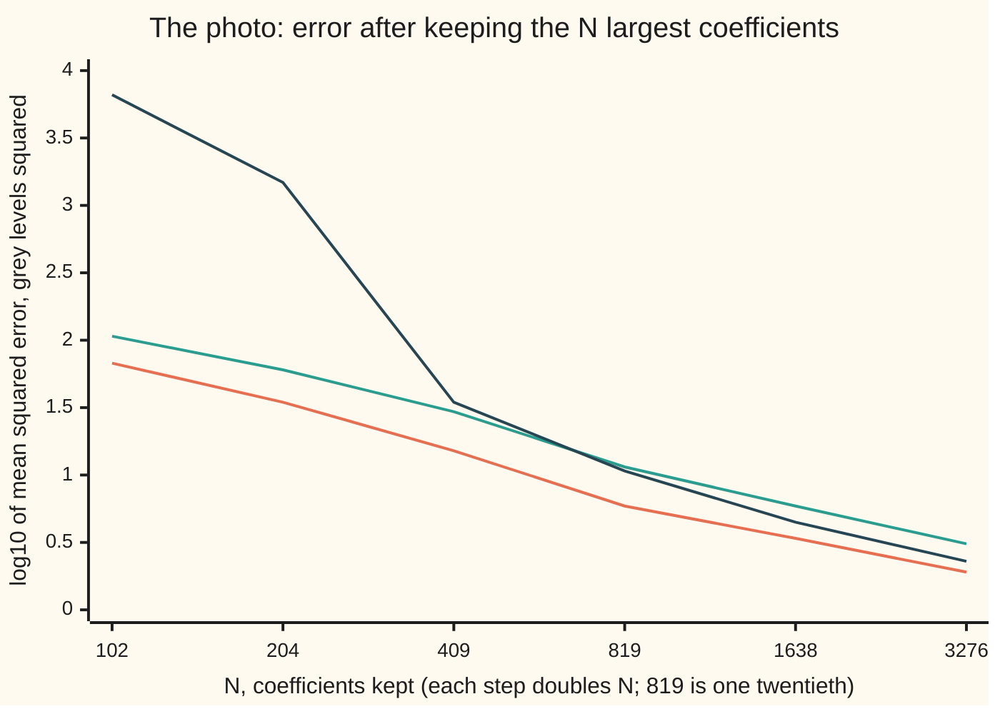

# Compression by wavelets: why a few coefficients carry a whole picture

[Syllabus](../../../SYLLABUS.md) → [Harmonic analysis](../README.md) → [Wavelets and Time-Frequency](../README.md#s05) → Compression by wavelets

---

## General Overview

A grey photo is 128 by 128 pixels: 16,384 brightness values from 0 (black) to 255 (white). It shows a lit ball, 60 pixels across and 70 grey levels brighter than its background, against a shaded wall, with a little sensor grain. It is the synthetic photo of [Rate and distortion](../../14-Applied%20and%20computational/03-Information%20Theory/10-lossy-compression-and-rate-distortion-in-outline.md), made by the same stated rule and seed, so every number can be rerun.

The task: store the photo with one twentieth of the numbers, 819 instead of 16,384. The method has three moves.

1. Rewrite the photo as 16,384 coefficients (weights on fixed patterns) in a transform that keeps sums of squares.
2. Keep the 819 coefficients that are largest in size, and set the rest to zero.
3. Rebuild the photo from what is left.

The choice of patterns decides the result. With Daubechies D4 wavelets, the rebuilt photo is off by a mean squared error of 5.915 (grey levels, squared). That is a peak signal-to-noise ratio (PSNR, 10 log10 of 255² over the error) of 40.41 dB.

With the 8 by 8 cosine blocks of JPEG, the same 819 numbers leave an error of 10.769, or 37.81 dB. The wavelets roughly halve the error on the same budget. Most of what they still miss is grain: the photo before its grain comes back with error 2.253.

**Keep the N largest coefficients in an orthonormal basis, and the squared error is exactly the sum of the squares thrown away; wavelets make that sum small, because a smooth patch gives almost nothing at fine levels and an edge gives large numbers only along its own length, so the error after N terms falls like 1/N.**

**What kind of fact this is:** two theorems, proved on this card in Why it works: keeping the largest is the best N-term choice, and a 1/k decay gives an error of at most C²/N. Why a picture's wavelet coefficients decay like 1/k is a counting argument, measured on the photo. The comparison with the cosine blocks is a measurement on one illustrative photo.

### The picture: error against numbers kept



Orange: D4 wavelets. Teal: Haar wavelets. Dark blue: 8 by 8 cosine blocks. A drop of 0.30 on the vertical axis halves the error.

The cosine blocks fail badly at small N: each of the 256 blocks needs its average before any detail counts. D4 stays lowest all the way. Haar, the simplest wavelet, does no better than the cosine blocks at one twentieth.

---

## The formula

Notation first, in words.

- The photo $`f`$ is a list of $`P`$ = 16,384 grey levels. Its energy is the sum of the squares of its values, and the inner product $`\langle f, g\rangle`$ of two photos is the sum of the products of matching pixels.
- An **orthonormal basis** is a set of $`P`$ patterns $`\psi_n`$ that are perpendicular (inner product zero) and each of energy 1. The **coefficient** $`c_n = \langle f, \psi_n\rangle`$ is how much of pattern $`n`$ the photo holds. Here the patterns are the shelf's $`\varphi`$ and $`\psi_{j,k}`$, made two-dimensional (below), or the 64 cosines of each 8 by 8 block.
- Sort the sizes $`\lvert c_n\rvert`$ from largest down. The $`k`$-th in that order is written $`\lvert c\rvert_{(k)}`$.
- The **N-term approximation** $`f_N`$ keeps the $`N`$ largest coefficients and sets the rest to zero. This card introduces the term.

```math
f = \sum_{n} c_n\, \psi_n, \qquad f_N = \sum_{n \in I_N} c_n\, \psi_n, \qquad \lVert f - f_N\rVert^2 = \sum_{n \notin I_N} \lvert c_n\rvert^2 = \sum_{k > N} \lvert c\rvert_{(k)}^2
```

Here $`I_N`$ is the set of places of the $`N`$ largest coefficients. The mean squared error per pixel is $`E_N = \lVert f - f_N\rVert^2 / P`$.

When the sorted sizes fall like $`1/k`$, the error falls like $`1/N`$:

```math
\lvert c\rvert_{(k)} \le \frac{C}{k} \ \text{ for every } k > N \quad \Longrightarrow \quad \lVert f - f_N\rVert^2 \le \frac{C^2}{N}
```

**Read it aloud:** keep the N biggest coefficients; the squared error is the sum of the squares of everything dropped; and if the k-th biggest is at most C over k, that sum is at most C squared over N.

The two-dimensional wavelets are products of a row pattern and a column pattern. Each step of [Mallat's algorithm](04-mallats-fast-wavelet-transform.md) splits every row, then every column, into averages (filter $`h`$) and details (filter $`g`$). That leaves a quarter-size average picture and three detail pictures: changes across, changes down, and diagonal changes. Five steps take the photo from 128 by 128 down to a 4 by 4 average picture.

| Symbol | Plain meaning | In our example | Push it up and the answer… |
| --- | --- | --- | --- |
| $`f,\ P,\ \langle f, g\rangle`$ | the photo, as a list of grey levels; the number of pixels, and of coefficients; the inner product with a second photo $`g`$ (not the filter $`g`$), the sum of the products of matching pixels | 128 by 128 values from 0 to 255; $`P`$ = 16,384 | — |
| $`\psi_n;\ \varphi,\ \psi_{j,k};\ h,\ g`$ | one pattern of an orthonormal basis; for wavelets, one of the shelf's scaling functions $`\varphi`$ or wavelets $`\psi_{j,k}`$; the averaging filter $`h`$ and detail filter $`g`$ that compute them | a D4 wavelet, or one cosine of one block | — |
| $`c_n`$ | the coefficient: the photo's inner product with $`\psi_n`$ | 819 kept, the other 15,565 dropped | — |
| $`k,\ \lvert c\rvert_{(k)}`$ | a rank in the sorted order (not the shift $`k`$ of $`\psi_{j,k}`$); the $`k`$-th largest coefficient size | Step 4 tabulates $`k \times \lvert c\rvert_{(k)}`$ | — |
| $`N`$ | how many coefficients are kept | 819, one twentieth | the error falls |
| $`I_N,\ f_N`$ | the places of the $`N`$ largest (Step 1's $`I`$ is any $`N`$ places); the photo rebuilt from them | the 819 largest D4 coefficients | — |
| $`E_N`$ | mean squared error per pixel after keeping $`N`$ | D4 5.915; cosine blocks 10.769 | — |
| $`C,\ s`$ | the constant and power in a decay $`\lvert c\rvert_{(k)} \le C k^{-s}`$; $`C`$ is the largest $`k \times \lvert c\rvert_{(k)}`$ | $`s`$ = 1; $`C`$ = 9,928 on the clean photo, beyond $`k`$ = 819 | the bound rises as $`C^2`$; larger $`s`$, faster fall |
| $`j`$ | the level: wavelets about $`2^j`$ pixels wide, $`j`$ = 1 finest | 1 to 5, then the 4 by 4 average picture | — |
| $`A`$ | the jump in brightness across an edge | 70 grey levels at the ball's rim | coefficients grow in proportion |
| $`\ell`$ | the length of an edge, in pixels | 2π × 30 = 188.5 for the ball | more coefficients, in proportion |
| $`z`$ | the cut-off with 5% of bell-curve values beyond plus or minus $`z`$ | 1.9600 | — |

### When it holds

- **The basis is orthonormal.** Then the error equals the sum of the dropped squares, and the biggest numbers are the right ones to keep. Pick Haar coefficients by their size as plain averages and half-differences, and the error rises from 11.402 to 20.839.
- **The picture is smooth pieces with edges between them.** That is what gives the $`1/k`$ decay. Grain is not like that. An orthonormal transform turns independent bell-curve grain into independent bell-curve coefficients, so no basis makes it sparse: the 819 largest of pure grain hold only 27.83% of its energy.
- **The wavelets have enough vanishing moments.** D4 ignores a straight ramp; Haar does not. On this photo Haar, at 11.402, does no better than the cosine blocks.
- **N counts numbers, not bits.** The receiver must also learn which 819 places were kept. Sent as an on-off map with an ideal code, that costs 0.286 bits a pixel, before the values themselves. Bits are the subject of [Rate and distortion](../../14-Applied%20and%20computational/03-Information%20Theory/10-lossy-compression-and-rate-distortion-in-outline.md).
- **The frame's edges are joined.** The code wraps each row and column around, so opposite edges of the frame meet as a false edge. JPEG 2000 mirrors the picture at its border instead.

---

## Why it works

### Step 0: energy that sits in a few numbers can be kept with a few numbers

An orthonormal transform throws nothing away; it only moves the photo's energy around. If most of the energy lands in a few coefficients, keeping those few keeps most of the photo.

A photograph is mostly smooth surfaces separated by edges. On a smooth surface, the fine wavelets measure almost nothing. Along an edge, each level has large coefficients only where the edge runs. So the big numbers sit at the coarse levels and along the edges, and they are few.

### Step 1: keeping the largest is the best choice of N

Write $`f`$ in the basis, and keep any $`N`$ of its coefficients. By Parseval's identity (sums of squares are kept, as in [Orthonormal bases](../../18-Functional%20analysis/02-Hilbert%20Spaces/03-orthonormal-bases-and-parseval.md)), the error is

```math
\Big\lVert f - \sum_{n \in I} c_n \psi_n \Big\rVert^2 = \Big\lVert \sum_{n \notin I} c_n \psi_n \Big\rVert^2 = \sum_{n \notin I} \lvert c_n\rvert^2
```

for any set $`I`$ of $`N`$ places. That sum is smallest when the dropped coefficients are the smallest. So keep the $`N`$ largest.

For a chosen set $`I`$, the true coefficients are also the best weights: any other weight adds the square of its difference from $`c_n`$.

The check measures the D4 error both ways. The sum of the 16,384 − 819 dropped squares, over $`P`$, is 5.915. The photo rebuilt by the inverse transform differs from the original by 5.915 too, to nine digits.

### Step 2: a 1/k decay gives a 1/N error

Suppose $`\lvert c\rvert_{(k)} \le C/k`$ for every $`k > N`$. Then

```math
\lVert f - f_N\rVert^2 = \sum_{k > N} \lvert c\rvert_{(k)}^2 \le C^2 \sum_{k > N} \frac{1}{k^2} \le \frac{C^2}{N}
```

The last step compares the sum with an area. Each $`1/k^2`$ is below the area under $`1/x^2`$ from $`k-1`$ to $`k`$, and the whole area from $`N`$ on is $`1/N`$.

<details>
<summary>Detailed proof: the general rate, for a decay like k to the power −s</summary>

Suppose $`\lvert c\rvert_{(k)} \le C k^{-s}`$ for every $`k > N`$, with $`s > 1/2`$. Since $`x^{-2s}`$ falls as $`x`$ grows, each term is below the area under the curve on the interval just before it:

$`\displaystyle \sum_{k > N} C^2 k^{-2s} \le C^2 \int_N^\infty x^{-2s}\, dx = \frac{C^2}{2s - 1}\, N^{1 - 2s}`$

At $`s = 1`$ this is $`C^2/N`$. A faster decay, larger $`s`$, gives a faster rate. At $`s \le 1/2`$ the sum need not be finite, and no rate follows.

The converse half also holds: an error that falls like $`N^{1-2s}`$ forces the coefficients to decay like $`k^{-s}`$, up to a constant. DeVore's survey (Sources) proves both halves and ties them to the smoothness of $`f`$.

</details>

On the clean photo (the photo before its grain), the largest $`k \times \lvert c\rvert_{(k)}`$ beyond $`k`$ = 819 is $`C`$ = 9,928. The bound gives $`C^2 / (N P)`$ = 7.345 per pixel. The true D4 error is 2.253. The bound holds, with room to spare: a factor of 3.26.

### Step 3: a smooth patch costs almost nothing at fine levels

[Daubechies wavelets](06-daubechies-and-vanishing-moments.md) proves that D4 has two **vanishing moments**: its detail filter gives zero on any straight line of values. A smooth surface looks like a tilted plane over a few pixels, so its fine D4 details are tiny. Only its curvature, the bend away from a plane, gets through.

The wall's tilt shows the difference. The wall brightens by 25 grey levels across 127 pixels. The level-1 Haar detail of that ramp is 0.139194 at every place away from the wrap, because Haar has only one vanishing moment and sees any slope. The D4 detail is 0.000000.

That tilt is gentle, though: its level-1 detail, 0.139194, is far below 15.69, the size of Haar's 819th largest coefficient on the photo. The cost comes from the shading, $`45 \sin(x/11) \cos(y/17)`$. Over a few pixels it also looks like a plane, but a steep one: its slope reaches $`45/11`$ = 4.091 grey levels a pixel. Haar sees that local slope at every fine level; D4 sees only the bend. On the wall alone, with no ball and no grain, Haar's error at one twentieth is 5.235 and D4's is 0.231. That is why Haar's error on the photo, 11.402, is nearly twice D4's.

### Step 4: an edge costs a fixed amount per level, and that gives the 1/k law

Take an edge of length $`\ell`$ pixels with a jump $`A`$. A level-$`j`$ wavelet covers a square about $`2^j`$ pixels on a side, with height about $`2^{-j}`$, so its energy is about 1.

- **Size.** A wavelet that the edge cuts sees the jump over about half its area, so its coefficient is about $`A \times 2^{-j} \times (2^j)^2 = A \cdot 2^j`$, times a constant.
- **Count.** The edge cuts about $`\ell / 2^j`$ wavelets at level $`j`$, times a constant.

Coarser levels have fewer, larger coefficients. Counting from the coarsest level down to level $`j`$ gives about $`2\ell/2^j`$ coefficients, each at least about $`A \cdot 2^j`$. So the $`k`$-th largest, with $`k`$ about $`2\ell / 2^j`$, is about $`2A\ell/k`$. The product $`k \times \lvert c\rvert_{(k)}`$ stays near a fixed multiple of $`A\ell`$.

On the clean photo, and on its two parts taken alone:

| $`k \times \lvert c\rvert_{(k)}`$ at $`k`$ = | 64 | 128 | 256 | 512 | 1024 | 2048 |
| --- | ---: | ---: | ---: | ---: | ---: | ---: |
| the clean photo | 9157 | 10374 | 11468 | 11596 | 7807 | 2869 |
| the wall alone | 6885 | 5258 | 4571 | 3600 | 1989 | 1489 |
| the ball alone, on a flat wall | 6919 | 7054 | 8668 | 7034 | 1365 | 0 |

For $`k`$ from 64 to 512 the product stays between 9,157 and 11,596. Not all of that is the ball. The ball alone stays between 6,919 and 8,668, a steady share of its $`A\ell`$ = 70 × 188.5 = 13,195. The rest is the wall: its shading and the false edges where the frame wraps give 6,885 at $`k`$ = 64, falling to 3,600 at 512. Past about 1,000 the product falls: by then every level, down to single pixels, has spent its edge coefficients, and what is left is the wall's small curvature.

A smooth surface adds only coarse coefficients, by Step 3. So for a picture of smooth pieces and edges, the error after $`N`$ wavelet terms falls about like $`1/N`$, with a constant set by the total of jump × length over all edges.

### Step 5: the cosine blocks are stuck at one scale

The 8 by 8 cosine transform is the one taught on [Rate and distortion](../../14-Applied%20and%20computational/03-Information%20Theory/10-lossy-compression-and-rate-distortion-in-outline.md): orthonormal, 64 cosine patterns per block. It has two costs that wavelets avoid.

- **Every block needs its average.** There are 256 blocks, so 256 numbers go on averages before any detail. With 102 numbers the error is 6,588.4. The D4 coarse picture covers the photo with 16 numbers, one per 32 by 32 square.
- **An edge inside a block spreads over many cosines.** A jump inside a block is not smooth there, so its cosine coefficients fall slowly with frequency. The ball's rim cuts 27 of the 256 blocks. At one twentieth, those 27 blocks take 304 detail numbers, about 11 each. The other 229 blocks share 259.

A wavelet adapts its width: wide on the wall, narrow at the rim. A cosine block has one width, 8 pixels, everywhere.

### Step 6: where the 819 D4 numbers went

```
D4 coefficients kept at one twentieth, by level (one # per 8)
  coarse 4x4    16 of    16  ##
  level 5       47 of    48  #####
  level 4      132 of   192  ################
  level 3      193 of   768  ########################
  level 2      168 of  3072  #####################
  level 1      263 of 12288  ################################
```

The coarse levels are almost all kept. The fine levels keep a small share: 263 of 12,288 at level 1. Those sit on the rim of the ball and on the wrapped edges of the frame. The grain's coefficients have a standard deviation of 2 grey levels, far below 12.21, the size of the 819th largest coefficient, so almost none is kept.

---

## Worked numbers, by hand

| Step | Arithmetic | Value |
| --- | --- | --- |
| pixels, and coefficients | 128 × 128 | 16,384 |
| numbers kept | 16,384 / 20, rounded down | 819 |
| D4 error at 819 | sum of the 16,384 − 819 dropped squares / 16,384 | 5.915 |
| D4 PSNR | 10 × log10(65,025 / 5.915) | 40.41 dB |
| cosine blocks, error at 819 | the same rule on 8 by 8 cosines | 10.769 |
| cosine blocks, PSNR | 10 × log10(65,025 / 10.769) | 37.81 dB |
| clean photo, D4 error | the photo before its grain | 2.253 |
| clean photo, bound | 9,928² / (819 × 16,384) | 7.345 |
| **D4 error against cosine error** | **5.915 / 10.769** | **0.55** |

At one twentieth, the D4 photo carries a little over half the cosine blocks' error, with the same count of kept numbers.

### What breaks if you drop a piece

| Mistake | Comes out at | What went wrong |
| --- | --- | --- |
| Haar instead of D4 | error 11.402, not 5.915 | one vanishing moment: the shading's local slope, up to 4.091 grey levels a pixel, fills the fine levels |
| Pick Haar coefficients by their size as averages and half-differences | error 20.839, not 11.402 | each level shrinks by 2, so size no longer measures energy and coarse numbers look too small |
| Keep the coarsest D4 numbers by place: the 32 by 32 corner | error 32.735 with 1,024 numbers | a blurred thumbnail: it drops the large rim coefficients at levels 1 and 2 |
| Compress pure grain | the top 1/20 hold 27.83% of the energy | grain has no smooth pieces and no edges; the bell-curve formula predicts 27.91% |
| Cosine blocks with fewer numbers than blocks | error 6,588.4 at 102 numbers | at least 154 of the 256 blocks get no average at all |

The grain row has a closed form. For bell-curve values, the top 5% in size lie beyond $`z`$ = 1.9600 standard deviations. Their share of the energy is $`0.05 + 2z\, e^{-z^2/2}/\sqrt{2\pi}`$: 0.2791. The code writes the bell-curve density $`e^{-z^2/2}/\sqrt{2\pi}`$ as phi(z).

---

## Code, from first principles, and it actually runs

The script writes out the photo's rule, the D4 and Haar filters, one Mallat step and its inverse, and the 8 by 8 cosine matrix. It takes three roads.

- **Two ways to the error.** The sum of the dropped squares (Parseval) against the error measured on the rebuilt pixels, for D4 and for the cosine blocks.
- **A bound against the truth.** The 1/k bound $`C^2/(NP)`$ against the true error on the clean photo.
- **Grain against a formula.** 16,384 bell-curve values from a written-out SplitMix64 generator (seed 11), D4-transformed, against $`0.05 + 2z\, e^{-z^2/2}/\sqrt{2\pi}`$, with $`z`$ found from a written-out series for the bell curve's area.

It also checks that each transform rebuilds the photo exactly, that D4 sends a ramp to zero while Haar does not, and that on the wall alone D4's error is under a tenth of Haar's. It runs the 1/k count on the wall alone and on the ball alone.

### Python

```python
# Compression by wavelets -- the check behind the card.  Standard library only.
# A synthetic 128 x 128 grey photo (the rule and seed of the Rate and distortion card) is
# rewritten three ways: Daubechies D4 wavelets, Haar wavelets, and 8 x 8 cosine blocks.
# Each keeps its N largest coefficients.  Roads: the error as the sum of the dropped squares
# (Parseval) against the error measured on the rebuilt pixels; the 1/k decay bound against
# the true error; pure grain against the bell-curve formula for its kept share.
import math
M64 = 0xFFFFFFFFFFFFFFFF

class Rng:                                     # SplitMix64, written out
    def __init__(s, seed): s.s = seed
    def u(s):
        s.s = (s.s + 0x9E3779B97F4A7C15) & M64; z = s.s
        z = ((z ^ (z >> 30)) * 0xBF58476D1CE4E5B9) & M64; z = ((z ^ (z >> 27)) * 0x94D049BB133111EB) & M64
        return ((z ^ (z >> 31)) >> 11) / 9007199254740992.0
    def gauss(s):                              # Box-Muller, cosine half
        a = 1.0 - s.u(); b = s.u()
        return math.sqrt(-2.0 * math.log(a)) * math.cos(2.0 * math.pi * b)

S, LEV = 128, 5; g = Rng(7)
def inball(x, y): return (x - 80) ** 2 + (y - 52) ** 2 < 900
def base(x, y, ball=70): return (100.5 + 25 * x / 127 + 45 * math.sin(x / 11) * math.cos(y / 17) + (ball if inball(x, y) else 0))
photo = [[min(255, max(0, math.floor(base(x, y) + 2 * g.gauss()))) for x in range(S)] for y in range(S)]
clean = [[min(255, max(0, math.floor(base(x, y)))) for x in range(S)] for y in range(S)]
r3, r2 = math.sqrt(3), math.sqrt(2)
D4 = [(1 + r3) / (4 * r2), (3 + r3) / (4 * r2), (3 - r3) / (4 * r2), (1 - r3) / (4 * r2)]
HAAR = [1 / r2, 1 / r2]
def hi(h): return [(-1) ** k * h[len(h) - 1 - k] for k in range(len(h))]   # g from h: reverse, alternate sign
def split(v, h):                               # one Mallat step on a periodic row: averages, then details
    n, gg = len(v), hi(h)
    return ([sum(h[k] * v[(2 * i + k) % n] for k in range(len(h))) for i in range(n // 2)] +
            [sum(gg[k] * v[(2 * i + k) % n] for k in range(len(h))) for i in range(n // 2)])
def merge(c, h):                               # its inverse: the transpose of split
    n, gg = len(c), hi(h); v = [0.0] * n
    for i in range(n // 2):
        for k in range(len(h)): v[(2 * i + k) % n] += h[k] * c[i] + gg[k] * c[n // 2 + i]
    return v
def rows_cols(X, n, f):                        # apply f to rows, then columns, of the top-left n x n corner
    for i in range(n): X[i][:n] = f(X[i][:n])
    for j in range(n):
        col = f([X[i][j] for i in range(n)])
        for i in range(n): X[i][j] = col[i]
def wav(X, h):
    X = [list(map(float, r)) for r in X]
    for L in range(LEV): rows_cols(X, S >> L, lambda v: split(v, h))
    return X
def iwav(X, h):
    X = [r[:] for r in X]
    for L in reversed(range(LEV)): rows_cols(X, S >> L, lambda v: merge(v, h))
    return X
C8 = [[(math.sqrt(1 / 8) if k == 0 else 0.5) * math.cos(math.pi * (2 * n + 1) * k / 16) for n in range(8)] for k in range(8)]
def dct(X, back=False):                        # 8 x 8 orthonormal cosine blocks, forward or back
    Y = [[0.0] * S for _ in range(S)]
    for by in range(0, S, 8):
        for bx in range(0, S, 8):
            for u in range(8):
                for v in range(8):
                    Y[by + u][bx + v] = sum((C8[i][u] * C8[j][v] if back else C8[u][i] * C8[v][j]) * X[by + i][bx + j]
                                            for i in range(8) for j in range(8))
    return Y
def keep(Y, N):                                # the N largest in size; the rest set to zero
    t = sorted((abs(c) for r in Y for c in r), reverse=True)[N - 1]
    return [[c if abs(c) >= t else 0.0 for c in r] for r in Y]
def tail(Y, N): return sum(sorted((c * c for r in Y for c in r), reverse=True)[N:]) / (S * S)
def mse(A, B): return sum((a - b) ** 2 for ra, rb in zip(A, B) for a, b in zip(ra, rb)) / (S * S)
def psnr(e): return 10 * math.log10(255 ** 2 / e)
def show(label, x, f=".3f"): print(f"{label:<46}{format(x, f):>12}")

N = S * S // 20
show("pixels in the photo", S * S, "d"); show("numbers kept, one twentieth", N, "d")
T = {"D4": wav(photo, D4), "Haar": wav(photo, HAAR), "cosine 8x8": dct(photo)}
assert mse(iwav(T["D4"], D4), photo) < 1e-18 and mse(dct(T["cosine 8x8"], True), photo) < 1e-18   # nothing lost
for name, Y in T.items():
    e, cut = tail(Y, N), sorted((abs(c) for r in Y for c in r), reverse=True)[N - 1]
    show(f"{name}: error, sum of dropped squares", e); show(f"{name}: PSNR, dB", psnr(e), ".2f"); show(f"{name}: size of the {N}th largest", cut, ".2f")
    if name != "Haar":
        R = iwav(keep(Y, N), D4) if name == "D4" else dct(keep(Y, N), True)
        show(f"{name}: error, measured on rebuilt pixels", mse(R, photo)); assert abs(mse(R, photo) - e) < 1e-9 * e
show("D4 error / cosine error", tail(T["D4"], N) / tail(T["cosine 8x8"], N), ".2f")
assert tail(T["D4"], N) < 0.6 * tail(T["cosine 8x8"], N)
Ns = [N // 8, N // 4, N // 2, N, 2 * N, 4 * N]
print("chart, N kept      " + "".join(f"{n:>7}" for n in Ns))
for name, Y in T.items(): print(f"chart, log10 error {name:<11}" + "".join(f"{math.log10(tail(Y, n)):>7.2f}" for n in Ns))

Y = T["D4"]; K = keep(Y, N)                    # where the kept D4 numbers sit
def lev(i, j): return next((L for L in range(1, LEV + 1) if max(i, j) >= S >> L), LEV + 1)
cnt = [sum(K[i][j] != 0 and lev(i, j) == L for i in range(S) for j in range(S)) for L in range(LEV + 1, 0, -1)]
for L, c in zip(range(LEV + 1, 0, -1), cnt):
    print(f"bars, D4 kept {'coarse 4x4' if L > LEV else f'level {L}':<11}{c:>4} of {3 * (S >> L) ** 2 if L <= LEV else 16:>5}  " + "#" * (c // 8))
assert sum(cnt) == N
Q = keep(T["cosine 8x8"], N); edge = lambda by, bx: len({inball(bx + j, by + i) for i in range(8) for j in range(8)}) == 2
eb = [(by, bx) for by in range(0, S, 8) for bx in range(0, S, 8) if edge(by, bx)]
show("cosine: blocks cut by the ball's edge", len(eb), "d")
show("cosine: averages kept, of 256", sum(Q[by][bx] != 0 for by in range(0, S, 8) for bx in range(0, S, 8)), "d")
ed = sum(Q[by + u][bx + v] != 0 for by, bx in eb for u in range(8) for v in range(8) if u + v)
show("cosine: details kept in edge blocks", ed, "d"); show(f"cosine: details kept in the other {256 - len(eb)} blocks", N - 256 - ed, "d")

# ---- why: vanishing moments, and the 1/k decay with its error bound ----
ramp = [25 * x / 127 for x in range(S)]
show("ramp of 25 levels: level-1 Haar detail, size", abs(split(ramp, HAAR)[S // 2]), ".6f")
show("ramp of 25 levels: level-1 D4 detail, size", abs(split(ramp, D4)[S // 2]), ".6f")
assert abs(split(ramp, D4)[S // 2]) < 1e-12 < abs(split(ramp, HAAR)[S // 2])
show("shading: steepest slope, grey levels a pixel", 45 / 11, ".3f")
W = [[min(255, max(0, math.floor(base(x, y, 0)))) for x in range(S)] for y in range(S)]; WH, WD = wav(W, HAAR), wav(W, D4)   # the wall alone
show("wall alone, no ball or grain: Haar error", tail(WH, N)); show("wall alone, no ball or grain: D4 error", tail(WD, N)); assert tail(WD, N) < 0.1 * tail(WH, N)
Z = wav(clean, D4); a = sorted((abs(c) for r in Z for c in r), reverse=True)
B = [[math.floor(100.5 + (70 if inball(x, y) else 0)) for x in range(S)] for y in range(S)]   # the ball alone, on a flat wall
for nm, X in (("clean", Z), ("wall alone", WD), ("ball alone", wav(B, D4))):
    b = sorted((abs(c) for r in X for c in r), reverse=True); print(f"k x size of k-th largest, {nm:<11}" + "".join(f"{k * b[k - 1]:>8.0f}" for k in (64, 128, 256, 512, 1024, 2048)))
show("edge length of the ball, 2 pi 30, pixels", 2 * math.pi * 30, ".1f")
show("jump x edge length, 70 x 2 pi 30", 70 * 2 * math.pi * 30, ".0f")
Cn = max(k * a[k - 1] for k in range(N + 1, S * S + 1))
show("clean: largest k x size beyond N, C", Cn, ".0f")
bound = Cn * Cn / (N * S * S)                  # the tail of C^2 / k^2 beyond N is below C^2 / N
show("clean: D4 error at N", tail(Z, N)); show("clean: bound C^2 / (N x pixels)", bound)
show("clean: bound / true error", bound / tail(Z, N), ".2f")
assert tail(Z, N) <= bound
show("clean: cosine error at N", tail(dct(clean), N))

# ---- what breaks ----
show("wrong: Haar, one vanishing moment", tail(T["Haar"], N))
Hy = T["Haar"]; raw = [[c / 2 ** min(lev(i, j), LEV) for j, c in enumerate(r)] for i, r in enumerate(Hy)]   # averages, half-differences
Kr = keep(raw, N); show("wrong: Haar picked by unscaled size", sum(Hy[i][j] ** 2 for i in range(S) for j in range(S) if Kr[i][j] == 0) / (S * S))
show("wrong: D4 32x32 corner by place, 1024 numbers", sum(Y[i][j] ** 2 for i in range(S) for j in range(S) if max(i, j) >= 32) / (S * S))
gr = Rng(11); G = [[2 * gr.gauss() for x in range(S)] for y in range(S)]; GY = wav(G, D4)
sq = sorted((c * c for r in GY for c in r), reverse=True); share = sum(sq[:N]) / sum(sq)
def erf(x): return 2 / math.sqrt(math.pi) * sum((-1) ** n * x ** (2 * n + 1) / (math.factorial(n) * (2 * n + 1)) for n in range(60))
lo, hi_ = 0.0, 5.0
for _ in range(60):
    mid = (lo + hi_) / 2
    if 1 - erf(mid / r2) > 0.05: lo = mid
    else: hi_ = mid
z = (lo + hi_) / 2
show("bell curve: z with 5% of values beyond +-z", z, ".4f")
show("wrong: pure grain, energy kept by top 1/20", share, ".4f")
show("bell curve: 0.05 + 2 z phi(z), z for 5% tails", 0.05 + 2 * z * math.exp(-z * z / 2) / math.sqrt(2 * math.pi), ".4f")
assert abs(share - (0.05 + 2 * z * math.exp(-z * z / 2) / math.sqrt(2 * math.pi))) < 0.01
show("wrong: cosine with N/8 numbers, error", tail(T["cosine 8x8"], N // 8), ".1f")
show("map of kept places, bits per pixel, ideal code", -(0.05 * math.log2(0.05) + 0.95 * math.log2(0.95)), ".3f")
print("ALL CHECKS PASS")
```

**Ran 2026-11-15 on macOS, Python 3.14.10, standard library only. All checks passed. Output, pasted from the run:**

```
pixels in the photo                                  16384
numbers kept, one twentieth                            819
D4: error, sum of dropped squares                    5.915
D4: PSNR, dB                                         40.41
D4: size of the 819th largest                        12.21
D4: error, measured on rebuilt pixels                5.915
Haar: error, sum of dropped squares                 11.402
Haar: PSNR, dB                                       37.56
Haar: size of the 819th largest                      15.69
cosine 8x8: error, sum of dropped squares           10.769
cosine 8x8: PSNR, dB                                 37.81
cosine 8x8: size of the 819th largest                18.38
cosine 8x8: error, measured on rebuilt pixels       10.769
D4 error / cosine error                               0.55
chart, N kept          102    204    409    819   1638   3276
chart, log10 error D4            1.83   1.54   1.18   0.77   0.53   0.28
chart, log10 error Haar          2.03   1.78   1.47   1.06   0.77   0.49
chart, log10 error cosine 8x8    3.82   3.17   1.54   1.03   0.65   0.36
bars, D4 kept coarse 4x4   16 of    16  ##
bars, D4 kept level 5      47 of    48  #####
bars, D4 kept level 4     132 of   192  ################
bars, D4 kept level 3     193 of   768  ########################
bars, D4 kept level 2     168 of  3072  #####################
bars, D4 kept level 1     263 of 12288  ################################
cosine: blocks cut by the ball's edge                   27
cosine: averages kept, of 256                          256
cosine: details kept in edge blocks                    304
cosine: details kept in the other 229 blocks           259
ramp of 25 levels: level-1 Haar detail, size      0.139194
ramp of 25 levels: level-1 D4 detail, size        0.000000
shading: steepest slope, grey levels a pixel         4.091
wall alone, no ball or grain: Haar error             5.235
wall alone, no ball or grain: D4 error               0.231
k x size of k-th largest, clean          9157   10374   11468   11596    7807    2869
k x size of k-th largest, wall alone     6885    5258    4571    3600    1989    1489
k x size of k-th largest, ball alone     6919    7054    8668    7034    1365       0
edge length of the ball, 2 pi 30, pixels             188.5
jump x edge length, 70 x 2 pi 30                     13195
clean: largest k x size beyond N, C                   9928
clean: D4 error at N                                 2.253
clean: bound C^2 / (N x pixels)                      7.345
clean: bound / true error                             3.26
clean: cosine error at N                             7.075
wrong: Haar, one vanishing moment                   11.402
wrong: Haar picked by unscaled size                 20.839
wrong: D4 32x32 corner by place, 1024 numbers       32.735
bell curve: z with 5% of values beyond +-z          1.9600
wrong: pure grain, energy kept by top 1/20          0.2783
bell curve: 0.05 + 2 z phi(z), z for 5% tails       0.2791
wrong: cosine with N/8 numbers, error               6588.4
map of kept places, bits per pixel, ideal code       0.286
ALL CHECKS PASS
```

### Rust

```rust
// Compression by wavelets -- the check behind the card.  std only, no crates.
// A synthetic 128 x 128 grey photo (the rule and seed of the Rate and distortion card) is
// rewritten three ways: Daubechies D4 wavelets, Haar wavelets, and 8 x 8 cosine blocks.
// Each keeps its N largest coefficients.  Roads: the error as the sum of the dropped squares
// (Parseval) against the error measured on the rebuilt pixels; the 1/k decay bound against
// the true error; pure grain against the bell-curve formula for its kept share.
use std::f64::consts::PI;
const S: usize = 128; const LEV: usize = 5;
type Img = Vec<Vec<f64>>;

struct Rng(u64); // SplitMix64, written out
impl Rng {
    fn u(&mut self) -> f64 {
        self.0 = self.0.wrapping_add(0x9E3779B97F4A7C15); let mut z = self.0;
        z = (z ^ (z >> 30)).wrapping_mul(0xBF58476D1CE4E5B9);
        z = (z ^ (z >> 27)).wrapping_mul(0x94D049BB133111EB);
        ((z ^ (z >> 31)) >> 11) as f64 / 9007199254740992.0
    }
    fn gauss(&mut self) -> f64 { let (a, b) = (1.0 - self.u(), self.u()); (-2.0 * a.ln()).sqrt() * (2.0 * PI * b).cos() } // Box-Muller, cosine half
}
fn inball(x: usize, y: usize) -> bool { let (dx, dy) = (x as i64 - 80, y as i64 - 52); dx * dx + dy * dy < 900 }
fn base(x: usize, y: usize, ball: f64) -> f64 {
    let (xf, yf) = (x as f64, y as f64);
    100.5 + 25.0 * xf / 127.0 + 45.0 * (xf / 11.0).sin() * (yf / 17.0).cos() + if inball(x, y) { ball } else { 0.0 }
}
fn hi(h: &[f64]) -> Vec<f64> { (0..h.len()).map(|k| if k % 2 == 0 { h[h.len() - 1 - k] } else { -h[h.len() - 1 - k] }).collect() }
fn split(v: &[f64], h: &[f64]) -> Vec<f64> { // one Mallat step on a periodic row: averages, then details
    let (n, g) = (v.len(), hi(h));
    let mut out: Vec<f64> = (0..n / 2).map(|i| (0..h.len()).map(|k| h[k] * v[(2 * i + k) % n]).sum()).collect();
    out.extend((0..n / 2).map(|i| (0..h.len()).map(|k| g[k] * v[(2 * i + k) % n]).sum::<f64>()));
    out
}
fn merge(c: &[f64], h: &[f64]) -> Vec<f64> { // its inverse: the transpose of split
    let (n, g) = (c.len(), hi(h));
    let mut v = vec![0.0; n]; for i in 0..n / 2 { for k in 0..h.len() { v[(2 * i + k) % n] += h[k] * c[i] + g[k] * c[n / 2 + i]; } }
    v
}
fn rows_cols(x: &mut Img, n: usize, f: &dyn Fn(&[f64]) -> Vec<f64>) {
    for i in 0..n { let r = f(&x[i][..n]); x[i][..n].copy_from_slice(&r); }
    for j in 0..n {
        let col = f(&(0..n).map(|i| x[i][j]).collect::<Vec<_>>());
        for i in 0..n { x[i][j] = col[i]; }
    }
}
fn wav(x: &Img, h: &[f64]) -> Img { let mut x = x.clone(); for l in 0..LEV { rows_cols(&mut x, S >> l, &|v| split(v, h)); } x }
fn iwav(x: &Img, h: &[f64]) -> Img { let mut x = x.clone(); for l in (0..LEV).rev() { rows_cols(&mut x, S >> l, &|v| merge(v, h)); } x }
fn dct(x: &Img, back: bool) -> Img { // 8 x 8 orthonormal cosine blocks, forward or back
    let c: Vec<Vec<f64>> = (0..8).map(|k| (0..8).map(|n| (if k == 0 { (1.0f64 / 8.0).sqrt() } else { 0.5 })
        * (PI * (2 * n + 1) as f64 * k as f64 / 16.0).cos()).collect()).collect();
    let mut y = vec![vec![0.0; S]; S];
    for by in (0..S).step_by(8) { for bx in (0..S).step_by(8) { for u in 0..8 { for v in 0..8 {
        let mut t = 0.0;
        for i in 0..8 { for j in 0..8 {
            let w = if back { c[i][u] * c[j][v] } else { c[u][i] * c[v][j] };
            t += w * x[by + i][bx + j];
        } }
        y[by + u][bx + v] = t;
    } } } }
    y
}
fn sorted_desc(y: &Img, f: fn(f64) -> f64) -> Vec<f64> {
    let mut a: Vec<f64> = y.iter().flatten().map(|&c| f(c)).collect();
    a.sort_by(|p, q| q.partial_cmp(p).unwrap()); a
}
fn keep(y: &Img, n: usize) -> Img { // the N largest in size; the rest set to zero
    let t = sorted_desc(y, f64::abs)[n - 1];
    y.iter().map(|r| r.iter().map(|&c| if c.abs() >= t { c } else { 0.0 }).collect()).collect()
}
fn tail(y: &Img, n: usize) -> f64 { sorted_desc(y, |c| c * c)[n..].iter().sum::<f64>() / (S * S) as f64 }
fn mse(a: &Img, b: &Img) -> f64 { a.iter().flatten().zip(b.iter().flatten()).map(|(p, q)| (p - q) * (p - q)).sum::<f64>() / (S * S) as f64 }
fn psnr(e: f64) -> f64 { 10.0 * (65025.0 / e).log10() }
fn show(label: &str, x: f64, d: usize) { println!("{:<46}{:>12.*}", label, d, x); }
fn showi(label: &str, x: usize) { println!("{:<46}{:>12}", label, x); }
fn lev(i: usize, j: usize) -> usize { (1..=LEV).find(|&l| i.max(j) >= S >> l).unwrap_or(LEV + 1) }

fn main() {
    let mut g = Rng(7);
    let mut photo = vec![vec![0.0; S]; S];
    for y in 0..S { for x in 0..S { photo[y][x] = (base(x, y, 70.0) + 2.0 * g.gauss()).floor().max(0.0).min(255.0); } }
    let clean: Img = (0..S).map(|y| (0..S).map(|x| base(x, y, 70.0).floor().max(0.0).min(255.0)).collect()).collect();
    let (r3, r2) = (3f64.sqrt(), 2f64.sqrt());
    let d4 = [(1.0 + r3) / (4.0 * r2), (3.0 + r3) / (4.0 * r2), (3.0 - r3) / (4.0 * r2), (1.0 - r3) / (4.0 * r2)];
    let haar = [1.0 / r2, 1.0 / r2];
    let n = S * S / 20;
    showi("pixels in the photo", S * S); showi("numbers kept, one twentieth", n);
    let names = ["D4", "Haar", "cosine 8x8"];
    let t = [wav(&photo, &d4), wav(&photo, &haar), dct(&photo, false)];
    assert!(mse(&iwav(&t[0], &d4), &photo) < 1e-18 && mse(&dct(&t[2], true), &photo) < 1e-18); // nothing lost
    for (k, name) in names.iter().enumerate() {
        let (e, cut) = (tail(&t[k], n), sorted_desc(&t[k], f64::abs)[n - 1]);
        show(&format!("{name}: error, sum of dropped squares"), e, 3); show(&format!("{name}: PSNR, dB"), psnr(e), 2); show(&format!("{name}: size of the {n}th largest"), cut, 2);
        if k != 1 {
            let r = if k == 0 { iwav(&keep(&t[0], n), &d4) } else { dct(&keep(&t[2], n), true) };
            show(&format!("{name}: error, measured on rebuilt pixels"), mse(&r, &photo), 3);
            assert!((mse(&r, &photo) - e).abs() < 1e-9 * e);
        }
    }
    show("D4 error / cosine error", tail(&t[0], n) / tail(&t[2], n), 2); assert!(tail(&t[0], n) < 0.6 * tail(&t[2], n));
    let ns = [n / 8, n / 4, n / 2, n, 2 * n, 4 * n];
    println!("chart, N kept      {}", ns.iter().map(|m| format!("{:>7}", m)).collect::<String>());
    for (k, name) in names.iter().enumerate() {
        println!("chart, log10 error {:<11}{}", name, ns.iter().map(|&m| format!("{:>7.2}", tail(&t[k], m).log10())).collect::<String>());
    }

    let y = &t[0]; let kk = keep(y, n); // where the kept D4 numbers sit
    let mut total = 0;
    for l in (1..=LEV + 1).rev() {
        let c = (0..S).flat_map(|i| (0..S).map(move |j| (i, j))).filter(|&(i, j)| kk[i][j] != 0.0 && lev(i, j) == l).count();
        let lab = if l > LEV { "coarse 4x4".to_string() } else { format!("level {l}") };
        let of = if l <= LEV { 3 * (S >> l) * (S >> l) } else { 16 };
        println!("bars, D4 kept {:<11}{:>4} of {:>5}  {}", lab, c, of, "#".repeat(c / 8));
        total += c;
    }
    assert!(total == n);
    let q = keep(&t[2], n);
    let eb: Vec<(usize, usize)> = (0..S).step_by(8).flat_map(|by| (0..S).step_by(8).map(move |bx| (by, bx)))
        .filter(|&(by, bx)| { let ins = (0..64).filter(|&p| inball(bx + p % 8, by + p / 8)).count(); ins > 0 && ins < 64 }).collect();
    showi("cosine: blocks cut by the ball's edge", eb.len());
    showi("cosine: averages kept, of 256", (0..S).step_by(8).flat_map(|by| (0..S).step_by(8).map(move |bx| (by, bx))).filter(|&(by, bx)| q[by][bx] != 0.0).count());
    let ed = eb.iter().map(|&(by, bx)| (1..64).filter(|&p| q[by + p / 8][bx + p % 8] != 0.0).count()).sum::<usize>();
    showi("cosine: details kept in edge blocks", ed); showi(&format!("cosine: details kept in the other {} blocks", 256 - eb.len()), n - 256 - ed);

    // ---- why: vanishing moments, and the 1/k decay with its error bound ----
    let ramp: Vec<f64> = (0..S).map(|x| 25.0 * x as f64 / 127.0).collect();
    show("ramp of 25 levels: level-1 Haar detail, size", split(&ramp, &haar)[S / 2].abs(), 6);
    show("ramp of 25 levels: level-1 D4 detail, size", split(&ramp, &d4)[S / 2].abs(), 6);
    assert!(split(&ramp, &d4)[S / 2].abs() < 1e-12 && 1e-12 < split(&ramp, &haar)[S / 2].abs());
    show("shading: steepest slope, grey levels a pixel", 45.0 / 11.0, 3);
    let w: Img = (0..S).map(|y| (0..S).map(|x| base(x, y, 0.0).floor().max(0.0).min(255.0)).collect()).collect(); let (wh, wd) = (wav(&w, &haar), wav(&w, &d4)); // the wall alone
    show("wall alone, no ball or grain: Haar error", tail(&wh, n), 3); show("wall alone, no ball or grain: D4 error", tail(&wd, n), 3); assert!(tail(&wd, n) < 0.1 * tail(&wh, n));
    let z = wav(&clean, &d4); let a = sorted_desc(&z, f64::abs);
    let b: Img = (0..S).map(|y| (0..S).map(|x| (100.5f64 + if inball(x, y) { 70.0 } else { 0.0 }).floor()).collect()).collect(); // the ball alone, on a flat wall
    for (nm, x) in [("clean", &z), ("wall alone", &wd), ("ball alone", &wav(&b, &d4))] {
        let s = sorted_desc(x, f64::abs); println!("k x size of k-th largest, {:<11}{}", nm, [64usize, 128, 256, 512, 1024, 2048].iter().map(|&k| format!("{:>8.0}", k as f64 * s[k - 1])).collect::<String>());
    }
    show("edge length of the ball, 2 pi 30, pixels", 2.0 * PI * 30.0, 1); show("jump x edge length, 70 x 2 pi 30", 70.0 * 2.0 * PI * 30.0, 0);
    let cn = (n + 1..=S * S).map(|k| k as f64 * a[k - 1]).fold(f64::MIN, f64::max);
    show("clean: largest k x size beyond N, C", cn, 0);
    let bound = cn * cn / (n * S * S) as f64; // the tail of C^2 / k^2 beyond N is below C^2 / N
    show("clean: D4 error at N", tail(&z, n), 3); show("clean: bound C^2 / (N x pixels)", bound, 3);
    show("clean: bound / true error", bound / tail(&z, n), 2);
    assert!(tail(&z, n) <= bound);
    show("clean: cosine error at N", tail(&dct(&clean, false), n), 3);

    // ---- what breaks ----
    show("wrong: Haar, one vanishing moment", tail(&t[1], n), 3);
    let hy = &t[1]; // averages and half-differences: each level shrinks the orthonormal number by 2
    let raw: Img = (0..S).map(|i| (0..S).map(|j| hy[i][j] / 2f64.powi(lev(i, j).min(LEV) as i32)).collect()).collect();
    let kr = keep(&raw, n); // pick by those shrunken sizes, then score with the true squares
    show("wrong: Haar picked by unscaled size", (0..S).flat_map(|i| (0..S).map(move |j| (i, j))).filter(|&(i, j)| kr[i][j] == 0.0).map(|(i, j)| hy[i][j] * hy[i][j]).sum::<f64>() / (S * S) as f64, 3);
    show("wrong: D4 32x32 corner by place, 1024 numbers", (0..S).flat_map(|i| (0..S).map(move |j| (i, j))).filter(|&(i, j)| i.max(j) >= 32).map(|(i, j)| y[i][j] * y[i][j]).sum::<f64>() / (S * S) as f64, 3);
    let (mut gr, mut gm) = (Rng(11), vec![vec![0.0; S]; S]);
    for yy in 0..S { for xx in 0..S { gm[yy][xx] = 2.0 * gr.gauss(); } }
    let sq = sorted_desc(&wav(&gm, &d4), |c| c * c);
    let share = sq[..n].iter().sum::<f64>() / sq.iter().sum::<f64>();
    let erf = |x: f64| { let mut f = 1.0; let mut s = 0.0;
        for k in 0..60 { if k > 0 { f *= k as f64; } let sg = if k % 2 == 0 { 1.0 } else { -1.0 };
            s += sg * x.powf((2 * k + 1) as f64) / (f * (2 * k + 1) as f64); }
        2.0 / PI.sqrt() * s };
    let (mut lo, mut hi_) = (0.0, 5.0);
    for _ in 0..60 { let mid = (lo + hi_) / 2.0; if 1.0 - erf(mid / r2) > 0.05 { lo = mid; } else { hi_ = mid; } }
    let zq = (lo + hi_) / 2.0;
    let theory = 0.05 + 2.0 * zq * (-zq * zq / 2.0).exp() / (2.0 * PI).sqrt();
    show("bell curve: z with 5% of values beyond +-z", zq, 4); show("wrong: pure grain, energy kept by top 1/20", share, 4);
    show("bell curve: 0.05 + 2 z phi(z), z for 5% tails", theory, 4);
    assert!((share - theory).abs() < 0.01);
    show("wrong: cosine with N/8 numbers, error", tail(&t[2], n / 8), 1);
    show("map of kept places, bits per pixel, ideal code", -(0.05 * 0.05f64.log2() + 0.95 * 0.95f64.log2()), 3);
    println!("ALL CHECKS PASS");
}
```

**Ran 2026-11-15 on macOS, rustc 1.98.1, no crates. All checks passed. Output, pasted from the run:**

```
pixels in the photo                                  16384
numbers kept, one twentieth                            819
D4: error, sum of dropped squares                    5.915
D4: PSNR, dB                                         40.41
D4: size of the 819th largest                        12.21
D4: error, measured on rebuilt pixels                5.915
Haar: error, sum of dropped squares                 11.402
Haar: PSNR, dB                                       37.56
Haar: size of the 819th largest                      15.69
cosine 8x8: error, sum of dropped squares           10.769
cosine 8x8: PSNR, dB                                 37.81
cosine 8x8: size of the 819th largest                18.38
cosine 8x8: error, measured on rebuilt pixels       10.769
D4 error / cosine error                               0.55
chart, N kept          102    204    409    819   1638   3276
chart, log10 error D4            1.83   1.54   1.18   0.77   0.53   0.28
chart, log10 error Haar          2.03   1.78   1.47   1.06   0.77   0.49
chart, log10 error cosine 8x8    3.82   3.17   1.54   1.03   0.65   0.36
bars, D4 kept coarse 4x4   16 of    16  ##
bars, D4 kept level 5      47 of    48  #####
bars, D4 kept level 4     132 of   192  ################
bars, D4 kept level 3     193 of   768  ########################
bars, D4 kept level 2     168 of  3072  #####################
bars, D4 kept level 1     263 of 12288  ################################
cosine: blocks cut by the ball's edge                   27
cosine: averages kept, of 256                          256
cosine: details kept in edge blocks                    304
cosine: details kept in the other 229 blocks           259
ramp of 25 levels: level-1 Haar detail, size      0.139194
ramp of 25 levels: level-1 D4 detail, size        0.000000
shading: steepest slope, grey levels a pixel         4.091
wall alone, no ball or grain: Haar error             5.235
wall alone, no ball or grain: D4 error               0.231
k x size of k-th largest, clean          9157   10374   11468   11596    7807    2869
k x size of k-th largest, wall alone     6885    5258    4571    3600    1989    1489
k x size of k-th largest, ball alone     6919    7054    8668    7034    1365       0
edge length of the ball, 2 pi 30, pixels             188.5
jump x edge length, 70 x 2 pi 30                     13195
clean: largest k x size beyond N, C                   9928
clean: D4 error at N                                 2.253
clean: bound C^2 / (N x pixels)                      7.345
clean: bound / true error                             3.26
clean: cosine error at N                             7.075
wrong: Haar, one vanishing moment                   11.402
wrong: Haar picked by unscaled size                 20.839
wrong: D4 32x32 corner by place, 1024 numbers       32.735
bell curve: z with 5% of values beyond +-z          1.9600
wrong: pure grain, energy kept by top 1/20          0.2783
bell curve: 0.05 + 2 z phi(z), z for 5% tails       0.2791
wrong: cosine with N/8 numbers, error               6588.4
map of kept places, bits per pixel, ideal code       0.286
ALL CHECKS PASS
```

### Lean

Lean proves Step 1 and Step 2 for any photo, in any orthonormal basis.

- Take any set of kept places. Then the squared error is exactly the sum of the squares of the dropped coefficients.
- Suppose the kept places hold the largest coefficients in size. Then no other set of as many places, with any weights, gives a smaller error.
- Suppose $`\lvert c\rvert_{(k)} \le C/k`$ for every $`k > N`$. Then keeping the $`N`$ largest leaves a squared error of at most $`C^2/N`$.
- Lean also checks the counts: 819 kept of 16,384, and the split of the 819 by level and by block.

The transforms themselves, the photo's measured decay, the grain and every decimal are left to the Python and Rust checks.

```lean
-- Compression by wavelets: keeping the N largest coefficients in an orthonormal basis leaves a squared error equal to the sum of the dropped squares, no other N-term choice does better, and a 1/k decay of the sorted sizes bounds that error by C²/N.
import Mathlib.Analysis.InnerProductSpace.PiL2

open Finset RealInnerProductSpace

theorem wavelet_coeff_of_partial_sum
    {ι E : Type*} [Fintype ι] [DecidableEq ι]
    [NormedAddCommGroup E] [InnerProductSpace ℝ E]
    (b : OrthonormalBasis ι ℝ E) (f : E) (J : Finset ι) (a : ι → ℝ) (i : ι) :
    ⟪b i, f - ∑ n ∈ J, a n • b n⟫ = ⟪b i, f⟫ - if i ∈ J then a i else 0 := by
  rw [inner_sub_right]
  congr 1
  simp [inner_sum, inner_smul_right, orthonormal_iff_ite.mp b.orthonormal]

#print axioms wavelet_coeff_of_partial_sum

theorem wavelet_error_eq_sum
    {ι E : Type*} [Fintype ι] [DecidableEq ι]
    [NormedAddCommGroup E] [InnerProductSpace ℝ E]
    (b : OrthonormalBasis ι ℝ E) (f : E) (J : Finset ι) (a : ι → ℝ) :
    ‖f - ∑ n ∈ J, a n • b n‖ ^ 2 =
      ∑ i ∈ J, (⟪b i, f⟫ - a i) ^ 2 + ∑ i ∈ Jᶜ, ⟪b i, f⟫ ^ 2 := by
  rw [← b.sum_sq_inner_right, ← Finset.sum_add_sum_compl J]
  congr 1
  · refine Finset.sum_congr rfl fun i hi => ?_
    simp [wavelet_coeff_of_partial_sum, hi]
  · refine Finset.sum_congr rfl fun i hi => ?_
    simp [wavelet_coeff_of_partial_sum, Finset.mem_compl.mp hi]

#print axioms wavelet_error_eq_sum

theorem wavelet_dropped_squares
    {ι E : Type*} [Fintype ι] [DecidableEq ι]
    [NormedAddCommGroup E] [InnerProductSpace ℝ E]
    (b : OrthonormalBasis ι ℝ E) (f : E) (I : Finset ι) :
    ‖f - ∑ n ∈ I, ⟪b n, f⟫ • b n‖ ^ 2 = ∑ n ∈ Iᶜ, ⟪b n, f⟫ ^ 2 := by
  rw [wavelet_error_eq_sum]
  simp

#print axioms wavelet_dropped_squares

theorem wavelet_sum_sdiff_le
    {ι : Type*} [DecidableEq ι] (c : ι → ℝ) (I J : Finset ι) (hcard : J.card = I.card)
    (hI : ∀ n ∈ I, ∀ m ∉ I, |c m| ≤ |c n|) :
    ∑ n ∈ J \ I, c n ^ 2 ≤ ∑ n ∈ I \ J, c n ^ 2 := by
  have hk : (J \ I).card = (I \ J).card := Finset.card_sdiff_comm hcard
  have key : ∀ x ∈ J \ I, ∀ y ∈ I \ J, c x ^ 2 ≤ c y ^ 2 := by
    intro x hx y hy
    rw [Finset.mem_sdiff] at hx hy
    have := hI y hy.1 x hx.2
    nlinarith [abs_nonneg (c x), sq_abs (c x), sq_abs (c y)]
  have h2 : ((I \ J).card : ℝ) * ∑ x ∈ J \ I, c x ^ 2 ≤ ((J \ I).card : ℝ) * ∑ y ∈ I \ J, c y ^ 2 := by
    have e1 : ((I \ J).card : ℝ) * ∑ x ∈ J \ I, c x ^ 2 = ∑ x ∈ J \ I, ∑ y ∈ I \ J, c x ^ 2 := by
      simp [Finset.mul_sum]
    have e2 : ((J \ I).card : ℝ) * ∑ y ∈ I \ J, c y ^ 2 = ∑ x ∈ J \ I, ∑ y ∈ I \ J, c y ^ 2 := by
      simp [Finset.mul_sum]
    rw [e1, e2]
    exact Finset.sum_le_sum fun x hx => Finset.sum_le_sum fun y hy => key x hx y hy
  rcases Nat.eq_zero_or_pos (I \ J).card with h0 | hpos
  · rw [h0] at hk
    rw [Finset.card_eq_zero.mp hk, Finset.card_eq_zero.mp h0]
  · rw [hk] at h2
    exact le_of_mul_le_mul_left h2 (by exact_mod_cast hpos)

#print axioms wavelet_sum_sdiff_le

theorem wavelet_tail_inv_sq_le (N : ℕ) (hN : 0 < N) (M : ℕ) :
    ∑ i ∈ range M, (if N ≤ i then 1 / ((i : ℝ) + 1) ^ 2 else 0)
      ≤ 1 / (N : ℝ) - 1 / (max M N : ℕ) := by
  induction M with
  | zero => simp
  | succ M ih =>
    rw [Finset.sum_range_succ]
    by_cases h : N ≤ M
    · rw [ite_eq_left h, max_eq_left h] at *
      rw [max_eq_left (by omega : N ≤ M + 1)]
      have hM : (0 : ℝ) < M := by exact_mod_cast (lt_of_lt_of_le hN h)
      have key : 1 / ((M : ℝ) + 1) ^ 2 ≤ 1 / (M : ℝ) - 1 / ((M + 1 : ℕ) : ℝ) := by
        push_cast
        rw [div_sub_div _ _ hM.ne' (by positivity), div_le_div_iff₀ (by positivity) (by positivity)]
        nlinarith
      linarith
    · rw [ite_eq_right h, max_eq_right (by omega : M ≤ N)] at *
      rw [max_eq_right (by omega : M + 1 ≤ N)]
      linarith

#print axioms wavelet_tail_inv_sq_le

/-- Keep the `N` largest coefficients `c n = ⟪b n, f⟫` of a photo `f` in an orthonormal basis `b`
(the kept places `I` hold coefficients at least as large in size as every dropped one).
Then the squared error of the rebuilt photo is exactly the sum of the squares thrown away,
and no other choice of `N` places `J`, with any weights `a n` on them, gives a smaller error:
keeping the largest is the best `N`-term approximation. -/
theorem keep_largest_error_eq_sum_dropped_squares_and_is_best
    {ι E : Type*} [Fintype ι] [DecidableEq ι]
    [NormedAddCommGroup E] [InnerProductSpace ℝ E]
    (b : OrthonormalBasis ι ℝ E) (f : E) (I : Finset ι)
    (hI : ∀ n ∈ I, ∀ m ∉ I, |⟪b m, f⟫| ≤ |⟪b n, f⟫|) :
    ‖f - ∑ n ∈ I, ⟪b n, f⟫ • b n‖ ^ 2 = ∑ n ∈ Iᶜ, ⟪b n, f⟫ ^ 2 ∧
    ∀ (J : Finset ι), J.card = I.card → ∀ a : ι → ℝ,
      ‖f - ∑ n ∈ I, ⟪b n, f⟫ • b n‖ ^ 2 ≤ ‖f - ∑ n ∈ J, a n • b n‖ ^ 2 := by
  refine ⟨wavelet_dropped_squares b f I, fun J hJ a => ?_⟩
  rw [wavelet_dropped_squares, wavelet_error_eq_sum]
  set c : ι → ℝ := fun n => ⟪b n, f⟫ with hc
  have hsd := wavelet_sum_sdiff_le c I J hJ hI
  have hA : ∑ n ∈ Iᶜ, c n ^ 2 + ∑ n ∈ I, c n ^ 2 = ∑ n, c n ^ 2 := by
    rw [add_comm]; exact Finset.sum_add_sum_compl I _
  have hB : ∑ n ∈ Jᶜ, c n ^ 2 + ∑ n ∈ J, c n ^ 2 = ∑ n, c n ^ 2 := by
    rw [add_comm]; exact Finset.sum_add_sum_compl J _
  have hI' : ∑ n ∈ I ∩ J, c n ^ 2 + ∑ n ∈ I \ J, c n ^ 2 = ∑ n ∈ I, c n ^ 2 :=
    Finset.sum_inter_add_sum_sdiff _ _ _
  have hJ' : ∑ n ∈ J ∩ I, c n ^ 2 + ∑ n ∈ J \ I, c n ^ 2 = ∑ n ∈ J, c n ^ 2 :=
    Finset.sum_inter_add_sum_sdiff _ _ _
  rw [Finset.inter_comm] at hJ'
  have hnn : 0 ≤ ∑ i ∈ J, (c i - a i) ^ 2 := Finset.sum_nonneg fun _ _ => sq_nonneg _
  show ∑ n ∈ Iᶜ, c n ^ 2 ≤ ∑ i ∈ J, (c i - a i) ^ 2 + ∑ i ∈ Jᶜ, c i ^ 2
  linarith

/-- For any set `I` of kept places in an orthonormal basis, the squared error of the
rebuilt photo is the sum of the squares of the dropped coefficients (Parseval). -/
theorem nterm_error_eq_sum_dropped_squares
    {ι E : Type*} [Fintype ι] [DecidableEq ι]
    [NormedAddCommGroup E] [InnerProductSpace ℝ E]
    (b : OrthonormalBasis ι ℝ E) (f : E) (I : Finset ι) :
    ‖f - ∑ n ∈ I, ⟪b n, f⟫ • b n‖ ^ 2 = ∑ n ∈ Iᶜ, ⟪b n, f⟫ ^ 2 := by
  rw [wavelet_error_eq_sum]
  simp

/-- Rank the coefficients `c n = ⟪b n, f⟫` from largest down, so the coefficient of rank
`r n` (counting from 0) is the `k`-th largest with `k = r n + 1`. If the `k`-th largest size is
at most `C / k` for every `k > N`, then the squared error after keeping the `N` largest is at
most `C² / N`. -/
theorem nterm_error_le_of_one_over_k_decay
    {ι E : Type*} [Fintype ι] [DecidableEq ι]
    [NormedAddCommGroup E] [InnerProductSpace ℝ E]
    (b : OrthonormalBasis ι ℝ E) (f : E) (r : ι ≃ Fin (Fintype.card ι))
    (hsorted : ∀ n m, r n ≤ r m → |⟪b m, f⟫| ≤ |⟪b n, f⟫|)
    (N : ℕ) (hN : 0 < N) (C : ℝ)
    (hdecay : ∀ n, N < (r n : ℕ) + 1 → |⟪b n, f⟫| ≤ C / ((r n : ℕ) + 1 : ℝ)) :
    ‖f - ∑ n ∈ univ.filter (fun n => (r n : ℕ) < N), ⟪b n, f⟫ • b n‖ ^ 2 ≤ C ^ 2 / N := by
  rw [nterm_error_eq_sum_dropped_squares, Finset.compl_filter, Finset.sum_filter]
  set h : ℕ → ℝ := fun i => if N ≤ i then 1 / ((i : ℝ) + 1) ^ 2 else 0 with hh
  have hterm : ∀ n, (if ¬ (r n : ℕ) < N then ⟪b n, f⟫ ^ 2 else 0) ≤ C ^ 2 * h (r n) := by
    intro n
    by_cases hn : (r n : ℕ) < N
    · simp [hh, hn, not_le.mpr hn]
    · have hle : N ≤ (r n : ℕ) := not_lt.mp hn
      simp only [hn, not_false_eq_true, ite_true, hh, hle]
      have hd := hdecay n (by omega)
      have hpos : (0 : ℝ) < ((r n : ℕ) : ℝ) + 1 := by positivity
      have h0 : 0 ≤ C / (((r n : ℕ) : ℝ) + 1) := le_trans (abs_nonneg _) hd
      have : ⟪b n, f⟫ ^ 2 ≤ (C / (((r n : ℕ) : ℝ) + 1)) ^ 2 := by
        rw [← sq_abs]; exact pow_le_pow_left₀ (abs_nonneg _) hd 2
      calc ⟪b n, f⟫ ^ 2 ≤ (C / (((r n : ℕ) : ℝ) + 1)) ^ 2 := this
        _ = C ^ 2 * (1 / (((r n : ℕ) : ℝ) + 1) ^ 2) := by rw [div_pow]; ring
  calc ∑ n, (if ¬ (r n : ℕ) < N then ⟪b n, f⟫ ^ 2 else 0)
      ≤ ∑ n, C ^ 2 * h (r n) := Finset.sum_le_sum fun n _ => hterm n
    _ = C ^ 2 * ∑ i : Fin (Fintype.card ι), h i := by
        rw [← Finset.mul_sum]
        congr 1
        exact Equiv.sum_comp r (fun i : Fin (Fintype.card ι) => h i)
    _ = C ^ 2 * ∑ i ∈ range (Fintype.card ι), h i := by
        rw [Fin.sum_univ_eq_sum_range]
    _ ≤ C ^ 2 * (1 / (N : ℝ)) := by
        apply mul_le_mul_of_nonneg_left _ (sq_nonneg C)
        have := wavelet_tail_inv_sq_le N hN (Fintype.card ι)
        have hpos : (0 : ℝ) < ((max (Fintype.card ι) N : ℕ) : ℝ) := by
          exact_mod_cast (lt_of_lt_of_le hN (le_max_right _ _))
        have : 0 < 1 / ((max (Fintype.card ι) N : ℕ) : ℝ) := by positivity
        linarith
    _ = C ^ 2 / N := by ring

-- The photo: 128 by 128 pixels, and one twentieth of them kept.
example : 128 * 128 = 16384 := by norm_num
example : 16384 / 20 = 819 := by norm_num
example : 16384 - 819 = 15565 := by norm_num
-- Five Mallat steps: coefficients per level plus the 4 by 4 average picture fill the photo.
example : 3 * 64 ^ 2 + 3 * 32 ^ 2 + 3 * 16 ^ 2 + 3 * 8 ^ 2 + 3 * 4 ^ 2 + 4 ^ 2 = 16384 := by norm_num
-- Where the 819 D4 numbers went, by level.
example : 16 + 47 + 132 + 193 + 168 + 263 = 819 := by norm_num
-- Cosine blocks: 256 averages, 304 details in the 27 edge blocks, 259 in the other 229.
example : (128 / 8) * (128 / 8) = 256 := by norm_num
example : 256 + 304 + 259 = 819 := by norm_num
example : 256 - 27 = 229 := by norm_num

#print axioms keep_largest_error_eq_sum_dropped_squares_and_is_best
#print axioms nterm_error_eq_sum_dropped_squares
#print axioms nterm_error_le_of_one_over_k_decay
```

**Checked 2026-11-15 on macOS, Lean 4.36.0-rc2, Mathlib v4.36.0-rc2. Every proof is complete and uses only Lean's standard axioms. Output, pasted from the run:**

```
'wavelet_coeff_of_partial_sum' depends on axioms: [propext, Classical.choice, Quot.sound]
'wavelet_error_eq_sum' depends on axioms: [propext, Classical.choice, Quot.sound]
'wavelet_dropped_squares' depends on axioms: [propext, Classical.choice, Quot.sound]
'wavelet_sum_sdiff_le' depends on axioms: [propext, Classical.choice, Quot.sound]
'wavelet_tail_inv_sq_le' depends on axioms: [propext, Classical.choice, Quot.sound]
'keep_largest_error_eq_sum_dropped_squares_and_is_best' depends on axioms: [propext, Classical.choice, Quot.sound]
'nterm_error_eq_sum_dropped_squares' depends on axioms: [propext, Classical.choice, Quot.sound]
'nterm_error_le_of_one_over_k_decay' depends on axioms: [propext, Classical.choice, Quot.sound]
```

> [!TIP]
> **Try changing**
> - Guess first: with no grain, does D4 gain more? Change `2 * g.gauss()` to `0 * g.gauss()` in the photo rule. D4 falls to 2.253, the cosine blocks to 7.075.
> - Guess first: does the gap close at one tenth? Read the 1638 column of the chart rows: log10 error 0.53 for D4, 0.65 for the cosine blocks. The gap narrows but stays.
> - Guess first: what do fewer levels cost? Set `LEV = 3`, so the average picture is 16 by 16: 256 numbers, as many as the cosine blocks' averages. The D4 error rises from 5.915 to 6.392.
> - Guess first: do more levels help? Set `LEV = 7`, down to one average. The D4 error is 5.910, almost unchanged; the bar labels no longer fit, but the script passes.

---

## The usual mistake

> [!warning]
> **Reading "one twentieth of the numbers" as one twentieth of the file.** The receiver must also learn which 819 of the 16,384 places were kept. An on-off map with an ideal code costs 0.286 bits a pixel before any value is sent. N-term approximation measures how sparse a picture is; the bit cost is the question of [Rate and distortion](../../14-Applied%20and%20computational/03-Information%20Theory/10-lossy-compression-and-rate-distortion-in-outline.md).
>
> - **Comparing sizes in a basis that is not orthonormal.** Haar as averages and half-differences: error 20.839, not 11.402.
> - **Keeping by place instead of by size.** A 32 by 32 thumbnail of 1,024 D4 numbers: error 32.735, against 5.915 for the 819 largest.
> - **Expecting noise to compress.** The top 1/20 of pure grain holds 27.83% of its energy.
> - **Treating every wavelet as equal.** Haar, with one vanishing moment: error 11.402, no better than the cosine blocks.

---

## Where you meet it in real life

- **JPEG 2000.** The still-image standard behind digital cinema and many medical archives. It uses a wavelet transform with symmetric filters, the Cohen–Daubechies–Feauveau 9/7 pair, mirrors the picture at its border, and codes the coefficients in bit-planes, biggest bits first.
- **Embedded coders.** Shapiro's zerotree coder and its successors send the largest coefficients first. Stop the file anywhere and the picture rebuilt so far is a good N-term approximation.
- **Ordinary JPEG files.** The 8 by 8 cosine blocks remain the most common photo format. At high compression the blocks show as a grid: the one-scale weakness of Step 5.

> **Say it back**
> In an orthonormal basis, keeping the N largest coefficients is the best N-term choice, and the squared error is the sum of the squares dropped. If the k-th largest is at most C/k, that error is at most C²/N. Wavelets give a picture that decay: smooth patches are nearly free, and an edge costs a fixed amount per level. At one twentieth, D4 wavelets leave error 5.915 on the photo, and 8 by 8 cosine blocks 10.769. Grain does not compress, and kept numbers are not yet bits.

---

## What this builds on

- [Mallat's algorithm](04-mallats-fast-wavelet-transform.md): the filter steps $`h`$ and $`g`$ that compute all 16,384 coefficients, here applied to rows and then to columns.
- [Daubechies wavelets](06-daubechies-and-vanishing-moments.md): the D4 filter and its two vanishing moments, the reason a smooth surface costs almost nothing in Step 3.
- [Rate and distortion](../../14-Applied%20and%20computational/03-Information%20Theory/10-lossy-compression-and-rate-distortion-in-outline.md): the same photo, the 8 by 8 cosine blocks, and transform coding with rounding and an entropy code; it turns kept numbers into bits.

## Where this goes next

- [Wavelet denoising](07-wavelet-denoising.md), a related card earlier on this shelf: the same sparsity used the other way. Noise spreads thinly over all coefficients, as the grain does here, so zeroing the small ones removes noise.
- [Frames in outline](09-frames-in-outline.md): redundant sets of patterns, which give up orthonormality and the exact error of Step 1 for other gains.
- [Compressed sensing](../../13-Engineering%20mathematics/05-Signals/10-compressed-sensing-in-outline.md): a picture that is sparse in wavelets can be recovered from fewer measurements than pixels.

Wavelets pay for an edge one small square at a time, which holds them near a 1/N error. Curvelets, needle-shaped patterns laid along an edge, do better: for a picture that is smooth except along smooth curved edges, Candès and Donoho proved a squared error of at most a constant times $`N^{-2}(\ln N)^3`$ (*Communications on Pure and Applied Mathematics* 57, 2004, [doi:10.1002/cpa.10116](https://doi.org/10.1002/cpa.10116)). How much of that gain a practical coder keeps on real photographs, once places and values are paid for in bits, is the question this card leaves open.

---

## Sources

Verified 2026-11-15: every link below resolves to the publisher's page.

- Mallat, S. *A Wavelet Tour of Signal Processing: The Sparse Way*, 3rd ed. Academic Press, 2009. [doi:10.1016/B978-0-12-374370-1.X0001-8](https://doi.org/10.1016/B978-0-12-374370-1.X0001-8). N-term approximation in wavelet and cosine bases, and wavelet image coding.
- DeVore, R. A. "Nonlinear Approximation." *Acta Numerica* 7 (1998): 51–150. [doi:10.1017/S0962492900002816](https://doi.org/10.1017/S0962492900002816). The link between the decay of sorted coefficients and the N-term error rate, both ways.
- DeVore, R. A., B. Jawerth, and B. J. Lucier. "Image Compression through Wavelet Transform Coding." *IEEE Transactions on Information Theory* 38, no. 2 (1992): 719–746. [doi:10.1109/18.119733](https://doi.org/10.1109/18.119733). Keeping the largest wavelet coefficients of an image, with error rates.
- Shapiro, J. M. "Embedded Image Coding Using Zerotrees of Wavelet Coefficients." *IEEE Transactions on Signal Processing* 41, no. 12 (1993): 3445–3462. [doi:10.1109/78.258085](https://doi.org/10.1109/78.258085). Sending the largest coefficients first, and coding their places cheaply.
- Skodras, A., C. Christopoulos, and T. Ebrahimi. "The JPEG 2000 Still Image Compression Standard." *IEEE Signal Processing Magazine* 18, no. 5 (2001): 36–58. [doi:10.1109/79.952804](https://doi.org/10.1109/79.952804). The standard's wavelet filters, border handling and bit-plane coding.
