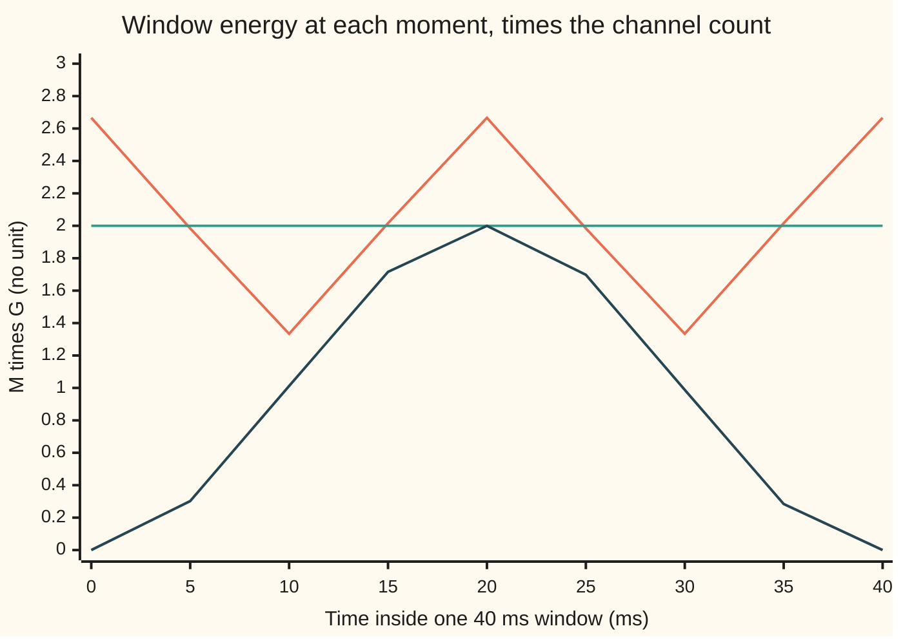

# Frames in outline: redundant building blocks that still rebuild a signal stably

[Syllabus](../../../SYLLABUS.md) → [Harmonic analysis](../README.md) → [Wavelets and Time-Frequency](../README.md#s05) → Frames in outline

---

## General Overview

A recorder captures ten seconds of a bird call whose pitch rises steadily from 1000 Hz (hertz, cycles per second) to 2500 Hz. It samples 6400 times a second, so the call is a list of 64,000 numbers. The call on this card is synthetic and illustrative, drawn from a stated formula so every answer can be checked.

To see which pitch sounds when, cut the call into slices 40 ms long, starting a new slice every 20 ms. Each slice overlaps the next by half. Measure each slice at 256 frequencies, 25 Hz apart. That gives 128,000 measurements: twice as many numbers as the recording has samples.

Two questions follow. Do the 128,000 numbers give back the call exactly? And if some are slightly wrong, from rounding or noise, is the rebuilt call slightly wrong or wildly wrong? A **frame** is a set of building blocks for which both answers are good, and one inequality with two numbers, $`A`$ and $`B`$, guarantees it.

The [Spectrograms](../../13-Engineering%20mathematics/05-Signals/09-short-time-fourier-and-spectrograms.md) card showed half-overlapping Hann slices adding back to the signal, because the windows sum to a constant. This card states the general rule, measures the rebuild's stability, and shows why no overlap-free version is sharp in both time and frequency.

**A frame is a set of building blocks whose measurements of every signal carry between A and B times its energy, with A above zero; then no signal can hide, any error in the numbers grows by at most a factor 1/√A in the rebuild, and the spare blocks allow a focus in time and frequency that no Gabor basis can have.**

**What kind of fact this is:** the frame inequality is a definition. The rebuild formula and the error bound $`1/\sqrt{A}`$ are theorems, proved on this card in Why it works. The bounds of the half-overlap Gabor frame follow from the painless formula proved on [Short-time Fourier transform](01-short-time-fourier-and-gabor.md). The Balian–Low theorem, the obstruction to a well-focused Gabor basis, is stated with its sources and its key idea, not proved. The bird call is synthetic.

### The picture: the frame bounds are the lowest and highest points of one curve



Orange: Hann windows overlapping by half. Teal: sine windows (the square root of Hann) overlapping by half. Dark blue: sine windows with no overlap. Each curve is the total squared window height covering each moment, times the 256 channels. Its lowest point is the frame's $`A`$ and its highest point is $`B`$: 1.333534 and 2.666466 for Hann, 2 and 2 for the sine window, and 0.000075 and 1.999925 with no overlap.

---

## The formula

Notation first, in words.

- A **signal** $`f`$ is a list of $`N`$ samples $`f(t)`$, where time $`t`$ counts samples; $`t/6400`$ is the time in seconds. Complex values are allowed.
- The **inner product** is $`\langle f, h\rangle = \sum_t f(t)\,\overline{h(t)}`$, linear in $`f`$ as across this wing; the bar is the complex conjugate. The **energy** is $`\lVert f\rVert^2 = \langle f, f\rangle`$.
- A **family** of building blocks is $`g_k`$, one for each label $`k`$. The **coefficient** $`\langle f, g_k\rangle`$ measures how much of block $`g_k`$ the signal holds.

The frame inequality:

```math
A\,\lVert f\rVert^2 \;\le\; \sum_k \lvert\langle f, g_k\rangle\rvert^2 \;\le\; B\,\lVert f\rVert^2 \quad \text{for every signal } f, \qquad 0 < A \le B < \infty
```

**Read it aloud:** for every signal, the energy in the measurements is at least $`A`$ times and at most $`B`$ times the signal's energy, and $`A`$ is above zero.

The numbers $`A`$ and $`B`$ are the **frame bounds**. When $`A = B`$ the frame is **tight**. The **frame operator** $`S`$ builds a signal from its own measurements, and it gives the rebuild:

```math
S f = \sum_k \langle f, g_k\rangle\, g_k, \qquad f = \sum_k \langle f, g_k\rangle\, S^{-1} g_k, \qquad \lVert \text{rebuild error}\rVert \le \frac{\lVert e\rVert}{\sqrt{A}}
```

**Read it aloud:** measure, then build with the corrected blocks $`S^{-1} g_k`$, and the signal returns; if the measurements carry an error list $`e`$, the rebuilt signal is off by at most the size of $`e`$ over the square root of $`A`$.

The bird call's blocks are **Gabor atoms**: a window $`g`$ of $`L`$ samples, moved along by a hop of $`a`$ samples and turned into a tone at one of $`M`$ channels. With $`L \le M`$, the frame operator just multiplies each sample by a weight, as [Short-time Fourier transform](01-short-time-fourier-and-gabor.md) proves:

```math
g_{m,n}(t) = g(t - na)\, e^{2\pi i m (t - na)/M}, \qquad S f(t) = M\,G(t)\, f(t), \qquad G(t) = \sum_n \lvert g(t - na)\rvert^2
```

**Read it aloud:** atom $`(m, n)`$ is the window at slice $`n`$, ringing at channel $`m`$; the frame operator multiplies each sample by $`M`$ times the squared window heights over it, so $`A = M \min G`$ and $`B = M \max G`$.

The coefficient $`\langle f, g_{m,n}\rangle`$ is the [Short-time Fourier transform](01-short-time-fourier-and-gabor.md) $`V_g f`$ at time $`na`$ and frequency $`6400\,m/M`$ Hz, times a phase factor of size 1. The letters change from that card, which calls the window $`w`$ and uses $`m`$ for the time step and $`n`$ for the frequency step; this card, like its code, calls the window $`g`$, counts slices with $`n`$ and channels with $`m`$. The obstruction concerns windows on the whole time line, with $`t`$ in seconds and $`\xi`$ in hertz:

```math
\{\, e^{2\pi i m b t}\, g(t - na) \,\}_{m,n}\ \text{a Riesz basis with } ab = 1 \;\Longrightarrow\; \int t^2 \lvert g(t)\rvert^2\,dt \cdot \int \xi^2 \lvert \hat g(\xi)\rvert^2\,d\xi = \infty
```

**Read it aloud:** if windows on a grid of $`a`$ seconds by $`b`$ hertz, one atom per grid cell of area 1, form a basis with bounds, then the window is infinitely spread in time or in frequency. This is the **Balian–Low theorem**. A **Riesz basis** is a frame that stops being a frame when any one block is removed; each signal then has exactly one list of coefficients.

| Symbol | Plain meaning | In our example | Push it up and the answer… |
| --- | --- | --- | --- |
| $`f,\ t,\ N`$ | the signal; the sample count from the start; the number of samples | the bird call; $`N`$ = 64,000 | — |
| $`\langle f, h\rangle,\ \lVert f\rVert^2`$ | overlap of two signals; energy of one | energy 8000.0000 | measurements grow with it |
| $`g_k`$ | one building block of the family | one Gabor atom $`g_{m,n}`$ | — |
| $`A,\ B`$ | lower and upper frame bounds | 1.333534 and 2.666466 for Hann | a larger $`A`$: a steadier rebuild |
| $`S,\ T,\ e`$ | frame operator: build from the measurements; the list of measurements; an error in them | $`S`$ multiplies by $`M G`$ | — |
| $`g,\ L,\ H`$ | the window; its length in samples; its height | Hann or sine; 256 samples = 40 ms; $`H^2`$ = 0.010417 for Hann | longer: finer in frequency |
| $`a`$ | the hop between slices, in samples (not the wavelet card's scale) | 128 samples = 20 ms | fewer atoms; at $`a`$ = 256, $`A`$ = 0.000075 for the sine window |
| $`M,\ m,\ n,\ s`$ | number of channels; channel number; slice number; sample inside a slice | 256 channels, 25 Hz apart; 500 slices | more channels: more atoms, larger bounds |
| $`V_g f`$ | the short-time Fourier transform with window $`g`$, written $`V_w f`$ on the short-time card | its values on the grid are the coefficients | — |
| $`G(t)`$ | total squared window height over sample $`t`$ | $`M G`$ from 1.333534 to 2.666466 for Hann | sets $`A`$ and $`B`$ |
| $`\gamma`$ | the dual window: $`g/(M G)`$, used to rebuild | $`g/(M G)`$ for Hann | — |
| $`b,\ \xi,\ \hat g`$ | channel spacing in hertz (not the wavelet card's shift); frequency in hertz; the window's transform | $`b`$ = 25 Hz, $`ab`$ = 0.50 | at $`ab`$ = 1.00, no well-focused basis |

### When it holds

- **The lower bound must be above zero.** Keep only the even channels of plain 40 ms blocks, and a steady 1225.00 Hz tone of energy 32000.0 gives coefficients of zero. With $`A = 0`$ the tone is invisible and nothing can rebuild it.
- **Spanning is not enough for a steady rebuild.** Sine windows with no overlap span every signal, yet $`A`$ = 0.000075, so an error can grow 115.2 times.
- **The window is no longer than the channel count, $`L \le M`$.** Otherwise $`S`$ is no longer a plain multiplication, and the bounds need the full operator, not treated here.
- **The grid is dense enough, $`ab \le 1`$.** With fewer atoms than samples there is no frame at all: 32000 atoms cannot rebuild 64000 samples.
- **The rebuild uses the dual blocks.** Only a tight frame rebuilds with the blocks themselves, divided by $`A`$. The Hann frame rebuilt with $`g/2`$ has a relative error of 0.235702.

---

## Why it works

### Step 0: many overlapping rulers, none of which can all read near zero

The lower bound $`A`$ says that no signal of energy 1 can make all its measurements small. So the measurements pin the signal down, the operator $`S`$ can be undone, and undoing it enlarges an error by at most a set amount. The blocks may overlap and outnumber the samples; they need not be perpendicular.

### Step 1: three vectors in the plane

Take three unit vectors in the plane at 90, 210 and 330 degrees: the **Mercedes frame**. For every signal tried, the squared measurements add to 1.500000 times its energy, so it is tight with $`A = B`$ = 1.500000. A tight frame of unit blocks always has $`A`$ = blocks per dimension: here 3 over 2.

The coefficients are not unique. The list $`(1, 1, 1)`$ builds the zero vector, so it can be added to any coefficient list without changing what it builds. Drop one vector and the two left are a basis, but not an orthonormal one: their bounds are $`A`$ = 0.500000 and $`B`$ = 1.500000.

### Step 2: the frame operator can be undone

For any signal, $`\langle S f, f\rangle = \sum_k \lvert\langle f, g_k\rangle\rvert^2`$. The frame inequality says this lies between $`A\lVert f\rVert^2`$ and $`B\lVert f\rVert^2`$. The operator $`S`$ is self-adjoint (it equals its own conjugate transpose), so all its stretch factors, its eigenvalues, lie between $`A`$ and $`B`$. None is zero, so $`S`$ has an inverse, and that inverse enlarges a signal by at most a factor $`1/A`$. Then $`f = S^{-1} S f`$, and moving $`S^{-1}`$ inside the sum gives the rebuild formula.

For a tight frame $`S = A`$ times the identity, so $`f = \frac{1}{A}\sum_k \langle f, g_k\rangle g_k`$: build with the blocks themselves and divide by $`A`$.

<details>
<summary>Detailed proof: the rebuild, and the error bound 1/√A</summary>

Write $`T f`$ for the list of measurements $`(\langle f, g_k\rangle)_k`$, and $`T^*`$ for building a signal from a list $`c`$: $`T^* c = \sum_k c_k g_k`$. Then $`S = T^* T`$ and $`\lVert T f\rVert^2 = \langle S f, f\rangle`$.

*Inverse.* $`S`$ is self-adjoint and $`A \lVert f\rVert^2 \le \langle S f, f\rangle \le B \lVert f\rVert^2`$. By Cauchy–Schwarz, $`A\lVert f\rVert^2 \le \lVert S f\rVert\,\lVert f\rVert`$, so $`\lVert S f\rVert \ge A \lVert f\rVert`$: $`S`$ sends no nonzero signal to zero and its range is closed. A self-adjoint operator with no kernel and closed range is onto, so $`S^{-1}`$ exists, and

$`\displaystyle \lVert S^{-1}\rVert \le \frac{1}{A}`$

*Rebuild.* $`f = S^{-1} S f = S^{-1} \sum_k \langle f, g_k\rangle g_k = \sum_k \langle f, g_k\rangle\, S^{-1} g_k`$, since $`S^{-1}`$ is bounded and so passes inside a convergent sum.

*Error.* Rebuilding from $`T f + e`$ gives $`f + S^{-1} T^* e`$. The size of the rebuild operator $`S^{-1} T^*`$ satisfies

$`\displaystyle \lVert S^{-1} T^*\rVert^2 = \lVert S^{-1} T^* T S^{-1}\rVert = \lVert S^{-1}\rVert \le \frac{1}{A}`$

so the rebuild error is at most $`\lVert e\rVert / \sqrt{A}`$. Equality is reached by an error equal to the measurements of a spike at the weakest sample (Step 4): if $`e = T u`$ with $`S u = A u`$, the rebuild error is $`u`$, of size $`\lVert e\rVert/\sqrt{A}`$.

</details>

### Step 3: redundancy pays for itself in noise

The rebuild ignores any part of the error that no signal could have produced. With twice as many coefficients as samples, half of a random error lies in that ignored part. A tight frame then divides the energy of the rest by $`A`$, because every sample is measured $`A`$ times over. For a tight frame with $`A = 2`$, random errors of the same size on every coefficient give, on average, half the error energy of an orthonormal basis.

The check adds noise of standard deviation 0.001 to the real and imaginary part of every coefficient. With plain 40 ms blocks, an orthonormal basis, the rebuild error energy is 0.127570, against an expected 0.128. With half-overlapping sine windows it is 0.063822: a ratio of 0.5003.

### Step 4: half-overlapping windows give a painless frame

[Short-time Fourier transform](01-short-time-fourier-and-gabor.md) proves the case where the window is no longer than the channel count, which Daubechies, Grossmann and Meyer called **painless**: the measurements carry the weighted energy $`M \sum_t \lvert f(t)\rvert^2\, G(t)`$, so $`A = M \min G`$ and $`B = M \max G`$, and the rebuild divides by $`M G`$, using the dual window $`\gamma = g/(M G)`$. That card's $`1/b`$ is $`M`$ here, because time counts samples. A single spike at the weakest sample reaches the lower bound: a spike at sample 64 gives 1.333534.

Both windows are scaled to energy 1 by a height $`H`$: Hann is $`H \sin^2`$ and the sine window $`H \sin`$.

- **Sine window, hop 128.** The two windows over each moment are $`\sin`$ and $`\cos`$ of the same angle, and $`\sin^2 + \cos^2 = 1`$. $`G`$ is flat, the frame is tight, and $`A = B`$ = 2.000000.
- **Hann window, hop 128.** The squares are $`\sin^4 + \cos^4`$, which wanders between one half and one. So $`B/A`$ = 2.00.
- **Hann window, hop 64.** Four windows cover each moment and their squares add to a constant: tight, with $`A = B`$ = 4.000000.

A unit-energy window always gives the average $`M G`$ = $`M/a`$, the number of atoms per sample. The bounds sit on either side of it: 2.000000 for both half-overlap frames.

### Step 5: a frame is not a basis, and the difference has a price

| Kind | Coefficients unique? | Bounds | On this card |
| --- | --- | --- | --- |
| Orthonormal basis | yes | $`A = B = 1`$ | plain 40 ms blocks, hop 256 |
| Riesz basis | yes | $`0 < A \le B`$ | two of the Mercedes vectors: 0.500000 and 1.500000 |
| Tight frame | no | $`A = B`$ | Mercedes, 1.500000; sine, hop 128, 2.000000 |
| Frame | no | $`0 < A \le B`$ | Hann, hop 128: 1.333534 and 2.666466 |

A redundant frame has spare blocks. They cost storage and buy two things: noise is averaged down (Step 3), and the blocks can be smooth and well focused, which Step 6 shows a Gabor basis cannot.

### Step 6: the obstruction to a well-focused Gabor basis

On the whole time line, put one atom in each cell of a grid $`a`$ seconds wide and $`b`$ hertz tall. The product $`ab`$ is the area per atom.

- **$`ab > 1`$:** too few atoms. No window gives a frame, by the density theorem stated on [Short-time Fourier transform](01-short-time-fourier-and-gabor.md). On this card's finite twin, keeping half the channels leaves 32000 atoms for 64000 samples, and a tone vanishes.
- **$`ab = 1`$:** a frame only if it is a Riesz basis. The Balian–Low theorem then forces the window to be infinitely spread in time or in frequency.
- **$`ab < 1`$:** room for frames with smooth windows. The bird call's grid has $`ab`$ = 0.50.

Both ways of failing show at $`ab`$ = 1.00. Plain 40 ms blocks are an orthonormal basis, but their sharp edges make the transform fall off only like $`1/\xi`$, so the frequency integral is infinite. Smooth sine windows with no overlap are a basis of a finite list, but $`A`$ sinks towards zero as the window lengthens:

| Window length $`L`$ | $`A`$ | Worst error growth $`1/\sqrt{A}`$ |
| --- | --- | --- |
| 64 | 0.001204544 | 28.8 |
| 256 | 0.000075298 | 115.2 |
| 1024 | 0.000004706 | 461.0 |

The pattern is $`A = 2\sin^2(\pi/(2L))`$, which shrinks like $`1/L^2`$. On the line, $`A`$ reaches zero. These numbers illustrate the theorem; they do not prove it.

The key idea of the proof is the **Zak transform**, which folds a window into one function on a unit square. At $`ab = 1`$ the system is a Riesz basis exactly when that function stays between two positive bounds. But the function returns to itself only up to a twist of phase across the square, and a continuous function with that twist must pass through zero. So a basis needs a discontinuous Zak transform, which means a badly spread window. Benedetto, Heil and Walnut give the full proof.

There are three ways out:

1. **Oversample**, $`ab < 1`$, as the bird call does: a frame, not a basis.
2. **Use cosines instead of complex tones.** The lapped cosine transforms of audio coding (cosine blocks on half-overlapping windows) are smooth orthonormal bases; the theorem covers only complex tones.
3. **Stretch instead of shift in frequency.** [Daubechies wavelets](06-daubechies-and-vanishing-moments.md) are smooth orthonormal bases.

---

## Worked numbers, by hand

The Hann frame of the bird call: window $`L`$ = 256 samples, hop $`a`$ = 128, $`M`$ = 256 channels. The Hann window of energy 1 is $`H \sin^2(\pi(s + \tfrac12)/L)`$.

| Step | Arithmetic | Value |
| --- | --- | --- |
| squared height $`H^2`$ | energy 1 needs $`H^2 \cdot 3L/8 = 1`$, so $`8/(3 \times 256)`$ | 0.010417 |
| $`M H^2`$ | 256 × 0.010417 | 2.666667 |
| two windows over one moment | $`\sin^4 + \cos^4`$ of the same angle, on the sample grid | 0.500075 to 0.999925 |
| lower bound $`A`$ | 2.666667 × 0.500075 (in the limit, 4/3 = 1.333333) | 1.333534 |
| upper bound $`B`$ | 2.666667 × 0.999925 (in the limit, 8/3 = 2.666667) | 2.666466 |
| atoms per sample | 128,000 / 64,000 | 2 |
| average of $`M G`$ | the atoms per sample | 2.000000 |
| bird call: measurement energy over $`\lVert f\rVert^2`$ | 16000.0000 / 8000.0000 | 2.000000 |
| **bounds of the frame** | **between 1.333534 and 2.666466** | **B/A = 2.00** |

Every signal's measurements carry between 1.333534 and 2.666466 times its energy, so the 128,000 numbers rebuild the call, and an error in them grows by at most $`1/\sqrt{1.333534}`$ in the rebuild. The rising call spreads evenly through each slice, so it lands on the average, 2.000000.

### What breaks if you drop a piece

| Mistake | Comes out at | What went wrong |
| --- | --- | --- |
| Rebuild the Hann coefficients with $`g/2`$, as if tight | relative error 0.235702 | the Hann frame is not tight; the rebuild must divide by $`M G`$, which runs from 1.333534 to 2.666466 |
| Drop the overlap: sine window, hop 256 | $`A`$ = 0.000075; errors grow up to 115.2 times | a smooth window at $`ab`$ = 1 is close to failing, as Balian–Low predicts |
| Keep only the even channels | a 1225.00 Hz tone of energy 32000.0 gives coefficients of zero | 32000 atoms for 64000 samples: $`A = 0`$ |

---

## Code, from first principles, and it actually runs

The code writes its own FFT (fast Fourier transform), measures the bird call in 500 half-overlapping slices, and rebuilds it. It reaches the frame bounds by **three independent roads**: the formula $`M \min G`$ and $`M \max G`$; a 16-sample frame operator built atom by atom as a matrix; and the energy of FFT coefficients, for the bird call and for one spike. Noise comes from a seeded SplitMix64 generator written out in both languages.

### Python

```python
# Frames in outline: a Gabor frame with half-overlapping windows on a ten-second bird call.
# Standard library only.  Roads: frame bounds from the window-energy sum M*G(k), against the
# frame operator built atom by atom as a matrix, against the energy of FFT coefficients.
from math import sin, cos, pi, sqrt
FS, SEC, L, M = 6400, 10, 256, 256        # samples per second, seconds, window, channels
N = FS * SEC                              # 64,000 samples
def fft(x):                               # radix-2, recursive: X[m] = sum x[k] e^(-2 pi i m k/n)
    n = len(x)
    if n == 1: return list(x)
    e, o = fft(x[0::2]), fft(x[1::2])
    out = [0j] * n
    for k in range(n // 2):
        w = complex(cos(2 * pi * k / n), -sin(2 * pi * k / n)) * o[k]
        out[k], out[k + n // 2] = e[k] + w, e[k] - w
    return out
def ifft_sum(c): return [z.conjugate() for z in fft([z.conjugate() for z in c])]  # sum c e^(+...)
def window(kind, n):                      # unit-energy windows sampled at k + 1/2
    if kind == "rect": return [1 / sqrt(n)] * n
    if kind == "sine": return [sqrt(2 / n) * sin(pi * (k + 0.5) / n) for k in range(n)]
    return [sqrt(8 / (3 * n)) * sin(pi * (k + 0.5) / n) ** 2 for k in range(n)]   # Hann
def G(g, a): return [sum(g[k + j * a] ** 2 for j in range(len(g) // a)) for k in range(a)]
def bounds(g, a, m): s = [m * v for v in G(g, a)]; return min(s), max(s)
def analyse(f, g, a, m=None):             # c[n][m] = <f, g_(m,n)>, phase measured from n*a
    n_ = len(f); return [fft([f[(n * a + k) % n_] * g[k] for k in range(len(g))])[:m]
                         for n in range(n_ // a)]
def synth(c, gam, a, n_):                 # sum over m, n of c[n][m] * gam_(m,n)
    out = [0j] * n_
    for n, row in enumerate(c):
        s = ifft_sum(row)
        for k in range(len(gam)): out[(n * a + k) % n_] += gam[k] * s[k]
    return out
def energy(v): return sum(abs(z) ** 2 for z in v)
def cenergy(c): return sum(energy(r) for r in c)
def close(x, y, tol): return abs(x - y) <= tol
def yn(b): return "yes" if b else "no"
print("Mercedes frame: three unit vectors at 90, 210, 330 degrees in the plane")
V = [(cos(d * pi / 180), sin(d * pi / 180)) for d in (90, 210, 330)]
def frame_op(vs): return [[sum(v[i] * v[j] for v in vs) for j in range(2)] for i in range(2)]
def eig2(S):
    t, d = S[0][0] + S[1][1], S[0][0] * S[1][1] - S[0][1] * S[1][0]
    r = sqrt(t * t / 4 - d); return t / 2 - r, t / 2 + r
for name, vs in (("three vectors", V), ("first two only", V[:2])):
    A_, B_ = eig2(frame_op(vs)); print(f"  {name}: A = {A_:.6f}, B = {B_:.6f}")
for f2 in ((1.0, 0.0), (0.0, 1.0), (0.6, 0.8)):
    s = sum((f2[0] * v[0] + f2[1] * v[1]) ** 2 for v in V)
    print(f"  f = {f2}: sum of squared coefficients {s:.6f}")
    assert close(s, 1.5, 1e-12)
z = [sum(v[i] for v in V) for i in range(2)]
print(f"  coefficients (1, 1, 1) build ({abs(z[0]):.6f}, {abs(z[1]):.6f}): not unique")
assert close(eig2(frame_op(V[:2]))[0], 0.5, 1e-12)
print("\nsmall instance N = 16, L = 8, hop 4, M = 8: frame operator built atom by atom")
n0, l0, a0 = 16, 8, 4
for kind in ("sine", "hann"):
    g = window(kind, l0); S = [[0j] * n0 for _ in range(n0)]
    for n in range(n0 // a0):
        for m in range(l0):
            at = [0j] * n0
            for k in range(l0):
                th = 2 * pi * m * k / l0; at[(n * a0 + k) % n0] = g[k] * complex(cos(th), sin(th))
            for i in range(n0):
                for j in range(n0): S[i][j] += at[i] * at[j].conjugate()
    off = max(abs(S[i][j]) for i in range(n0) for j in range(n0) if i != j)
    d = [S[i][i].real for i in range(n0)]; A_, B_ = bounds(g, a0, l0)
    print(f"  {kind}: off-diagonal below 1e-12 {yn(off < 1e-12)}; diagonal {min(d):.6f} to {max(d):.6f};"
          f" M*G {A_:.6f} to {B_:.6f}")
    assert off < 1e-12 and close(min(d), A_, 1e-12) and close(max(d), B_, 1e-12)
print(f"\nbird call: {SEC} s at {FS} Hz, N = {N}, {N // 128} slices; window {L} samples = {1000 * L / FS:.0f} ms,"
      f" {M} channels {FS / M:.0f} Hz apart")
f = [0.5 * sin(2 * pi * (1000 * t / FS + 75 * (t / FS) ** 2)) for t in range(N)]
Ef = energy(f); print(f"pitch 1000 Hz at 0 s rising to {1000 + 150 * SEC} Hz at {SEC} s; energy {Ef:.4f}")
res = {}
for kind, a in (("rect", 256), ("sine", 128), ("hann", 128), ("hann", 64), ("sine", 256)):
    g = window(kind, L); A_, B_ = bounds(g, a, M); res[kind, a] = (A_, B_)
    print(f"  {kind:4} hop {a} ({1000 * a / FS:.0f} ms): a*b = {a / M:.2f}, atoms {N // a * M} = {N // a * M / N:.0f} N,"
          f" A = {A_:.6f}, B = {B_:.6f}, B/A = {B_ / A_:.2f}")
mg = {kind: [M * v for v in G(window(kind, L), a)] for kind, a in (("sine", 128), ("hann", 128))}
mg["sine256"] = [M * v for v in G(window("sine", L), 256)]
print("figure, M*G at 0,5,...,40 ms: hann", " ".join(f"{mg['hann'][k % 128]:.3f}" for k in range(0, 257, 32)))
print("figure, sine half", " ".join(f"{mg['sine'][k % 128]:.3f}" for k in range(0, 257, 32)),
      "| sine no overlap", " ".join(f"{mg['sine256'][k % 256]:.3f}" for k in range(0, 257, 32)))
print(f"hann by hand: H^2 = 8/(3L) = {8 / (3 * L):.6f}, M H^2 = {M * 8 / (3 * L):.6f};"
      f" sin^4 + cos^4 from {min(mg['hann']) / (M * 8 / (3 * L)):.6f} to {max(mg['hann']) / (M * 8 / (3 * L)):.6f};"
      f" 4/3 = {4 / 3:.6f}, 8/3 = {8 / 3:.6f}; mean of M*G {sum(mg['hann']) / 128:.6f}")
assert close(res["rect", 256][0], 1, 1e-12) and close(res["sine", 128][1], 2, 1e-12)
assert close(res["hann", 128][0], 4 / 3, 5e-4) and close(res["hann", 128][1], 8 / 3, 5e-4)
for kind in ("sine", "hann"):            # road 3: FFT energy against the weighted-energy formula
    g = window(kind, L); c = analyse(f, g, 128)
    Ec = cenergy(c); Gk = G(g, 128); Ew = M * sum(f[t] ** 2 * Gk[t % 128] for t in range(N))
    print(f"  {kind}: sum |c|^2 = {Ec:.4f}; M * sum f^2 G = {Ew:.4f}; ratio to energy {Ec / Ef:.6f}")
    assert close(Ec, Ew, 1e-6 * Ew) and res[kind, 128][0] - 1e-9 <= Ec / Ef <= res[kind, 128][1] + 1e-9
    if kind == "hann": ch = c
gh = window("hann", L); Gh = G(gh, 128)
dual = [gh[k] / (M * Gh[k % 128]) for k in range(L)]
err = sqrt(energy([x - y for x, y in zip(synth(ch, dual, 128, N), f)]) / Ef)
wrong = sqrt(energy([x - y for x, y in zip(synth(ch, [v / 2 for v in gh], 128, N), f)]) / Ef)
print(f"hann rebuild with dual window: relative error below 1e-12 {yn(err < 1e-12)}; with g/2: {wrong:.6f}")
assert err < 1e-12 and wrong > 0.1
spike = [0.0] * 1024; spike[64] = 1.0
r = cenergy(analyse(spike, gh, 128)); print(f"spike at sample 64: sum |c|^2 = {r:.6f} = M*G(64)")
assert close(r, M * Gh[64], 1e-9)
print("critical sine window, hop = L: A = 2 sin^2(pi/(2L))")
for ln in (64, 256, 1024):
    A_ = bounds(window("sine", ln), ln, ln)[0]
    print(f"  L = {ln:4}: A = {A_:.9f}, formula {2 * sin(pi / (2 * ln)) ** 2:.9f}, 1/sqrt(A) = {A_ ** -0.5:.1f}")
    assert close(A_, 2 * sin(pi / (2 * ln)) ** 2, 1e-15)
tone = [sin(2 * pi * 49 * t / 256) for t in range(N)]
Et = cenergy(analyse(tone, window("rect", L), 256, None))
half = [row[0::2] for row in analyse(tone, window("rect", L), 256)]
print(f"half the channels (even only), rect hop 256: atoms {N // 256 * 128}; {49 * FS / 256:.2f} Hz tone,"
      f" energy {energy(tone):.1f}, all channels {Et:.1f}, even channels below 1e-12 {yn(cenergy(half) < 1e-12)}")
assert cenergy(half) < 1e-12 * Et and close(Et, energy(tone), 1e-6 * Et)
state = 2026
def rnd():                                # SplitMix64, uniform on [-1, 1)
    global state
    state = (state + 0x9E3779B97F4A7C15) % 2 ** 64; z = state
    z = ((z ^ (z >> 30)) * 0xBF58476D1CE4E5B9) % 2 ** 64; z = ((z ^ (z >> 27)) * 0x94D049BB133111EB) % 2 ** 64
    return ((z ^ (z >> 31)) >> 11) / 2 ** 52 - 1
h = 0.001 * sqrt(3)                       # noise of standard deviation 0.001 per real number
out = {}
for kind, a, scale in (("rect", 256, 1.0), ("sine", 128, 0.5)):
    g = window(kind, L); c = analyse(f, g, a)
    c = [[z + complex(h * rnd(), h * rnd()) for z in row] for row in c]
    out[kind] = energy([x - y for x, y in zip(synth(c, [scale * v for v in g], a, N), f)])
    print(f"  noise on every {kind} coefficient: rebuild error energy {out[kind]:.6f}")
q = out["sine"] / out["rect"]; ex = N * 2 * 0.001 ** 2
print(f"frame / basis error energy {q:.4f}; expected {ex:.3f} and {ex / 2:.3f}, ratio 0.5")
assert close(out["rect"], ex, 0.0013) and close(q, 0.5, 0.008)   # about 4 standard errors each
print("ALL CHECKS PASS")
```

**Ran 2026-11-15 on macOS, Python 3.14.10, standard library only. All checks passed. Output, pasted from the run:**

```
Mercedes frame: three unit vectors at 90, 210, 330 degrees in the plane
  three vectors: A = 1.500000, B = 1.500000
  first two only: A = 0.500000, B = 1.500000
  f = (1.0, 0.0): sum of squared coefficients 1.500000
  f = (0.0, 1.0): sum of squared coefficients 1.500000
  f = (0.6, 0.8): sum of squared coefficients 1.500000
  coefficients (1, 1, 1) build (0.000000, 0.000000): not unique

small instance N = 16, L = 8, hop 4, M = 8: frame operator built atom by atom
  sine: off-diagonal below 1e-12 yes; diagonal 2.000000 to 2.000000; M*G 2.000000 to 2.000000
  hann: off-diagonal below 1e-12 yes; diagonal 1.528595 to 2.471405; M*G 1.528595 to 2.471405

bird call: 10 s at 6400 Hz, N = 64000, 500 slices; window 256 samples = 40 ms, 256 channels 25 Hz apart
pitch 1000 Hz at 0 s rising to 2500 Hz at 10 s; energy 8000.0000
  rect hop 256 (40 ms): a*b = 1.00, atoms 64000 = 1 N, A = 1.000000, B = 1.000000, B/A = 1.00
  sine hop 128 (20 ms): a*b = 0.50, atoms 128000 = 2 N, A = 2.000000, B = 2.000000, B/A = 1.00
  hann hop 128 (20 ms): a*b = 0.50, atoms 128000 = 2 N, A = 1.333534, B = 2.666466, B/A = 2.00
  hann hop 64 (10 ms): a*b = 0.25, atoms 256000 = 4 N, A = 4.000000, B = 4.000000, B/A = 1.00
  sine hop 256 (40 ms): a*b = 1.00, atoms 64000 = 1 N, A = 0.000075, B = 1.999925, B/A = 26560.07
figure, M*G at 0,5,...,40 ms: hann 2.666 1.984 1.334 2.016 2.666 1.984 1.334 2.016 2.666
figure, sine half 2.000 2.000 2.000 2.000 2.000 2.000 2.000 2.000 2.000 | sine no overlap 0.000 0.302 1.012 1.716 2.000 1.698 0.988 0.284 0.000
hann by hand: H^2 = 8/(3L) = 0.010417, M H^2 = 2.666667; sin^4 + cos^4 from 0.500075 to 0.999925; 4/3 = 1.333333, 8/3 = 2.666667; mean of M*G 2.000000
  sine: sum |c|^2 = 16000.0000; M * sum f^2 G = 16000.0000; ratio to energy 2.000000
  hann: sum |c|^2 = 16000.0000; M * sum f^2 G = 16000.0000; ratio to energy 2.000000
hann rebuild with dual window: relative error below 1e-12 yes; with g/2: 0.235702
spike at sample 64: sum |c|^2 = 1.333534 = M*G(64)
critical sine window, hop = L: A = 2 sin^2(pi/(2L))
  L =   64: A = 0.001204544, formula 0.001204544, 1/sqrt(A) = 28.8
  L =  256: A = 0.000075298, formula 0.000075298, 1/sqrt(A) = 115.2
  L = 1024: A = 0.000004706, formula 0.000004706, 1/sqrt(A) = 461.0
half the channels (even only), rect hop 256: atoms 32000; 1225.00 Hz tone, energy 32000.0, all channels 32000.0, even channels below 1e-12 yes
  noise on every rect coefficient: rebuild error energy 0.127570
  noise on every sine coefficient: rebuild error energy 0.063822
frame / basis error energy 0.5003; expected 0.128 and 0.064, ratio 0.5
ALL CHECKS PASS
```

### Rust

```rust
// Frames in outline: a Gabor frame with half-overlapping windows on a ten-second bird call.
// std only.  Roads: frame bounds from the window-energy sum M*G(k), against the frame
// operator built atom by atom as a matrix, against the energy of FFT coefficients.
use std::f64::consts::PI;
#[derive(Clone, Copy)]
struct C { re: f64, im: f64 }
impl C {
    fn add(self, o: C) -> C { C { re: self.re + o.re, im: self.im + o.im } }
    fn sub(self, o: C) -> C { C { re: self.re - o.re, im: self.im - o.im } }
    fn mul(self, o: C) -> C { C { re: self.re * o.re - self.im * o.im, im: self.re * o.im + self.im * o.re } }
    fn sc(self, s: f64) -> C { C { re: self.re * s, im: self.im * s } }
    fn conj(self) -> C { C { re: self.re, im: -self.im } }
    fn abs2(self) -> f64 { self.re * self.re + self.im * self.im }
}
const Z: C = C { re: 0.0, im: 0.0 }; const FS: usize = 6400; const SEC: usize = 10; const L: usize = 256; const M: usize = 256;
fn fft(x: &[C]) -> Vec<C> { // radix-2, recursive: X[m] = sum x[k] e^(-2 pi i m k/n)
    let n = x.len();
    if n == 1 { return x.to_vec(); }
    let ev: Vec<C> = x.iter().step_by(2).cloned().collect();
    let od: Vec<C> = x.iter().skip(1).step_by(2).cloned().collect();
    let (e, o) = (fft(&ev), fft(&od));
    let mut out = vec![Z; n];
    for k in 0..n / 2 {
        let t = 2.0 * PI * k as f64 / n as f64;
        let w = C { re: t.cos(), im: -t.sin() }.mul(o[k]);
        out[k] = e[k].add(w); out[k + n / 2] = e[k].sub(w);
    }
    out
}
fn ifft_sum(c: &[C]) -> Vec<C> { let cc: Vec<C> = c.iter().map(|z| z.conj()).collect(); fft(&cc).iter().map(|z| z.conj()).collect() }
fn window(kind: &str, n: usize) -> Vec<f64> { // unit-energy windows sampled at k + 1/2
    (0..n).map(|k| { let s = (PI * (k as f64 + 0.5) / n as f64).sin();
        match kind { "rect" => 1.0 / (n as f64).sqrt(), "sine" => (2.0 / n as f64).sqrt() * s,
                     _ => (8.0 / (3.0 * n as f64)).sqrt() * s.powi(2) } }).collect()
}
fn gsum(g: &[f64], a: usize) -> Vec<f64> { (0..a).map(|k| (0..g.len() / a).map(|j| g[k + j * a].powi(2)).sum()).collect() }
fn bounds(g: &[f64], a: usize, m: usize) -> (f64, f64) {
    let s: Vec<f64> = gsum(g, a).iter().map(|v| m as f64 * v).collect();
    (s.iter().cloned().fold(f64::INFINITY, f64::min), s.iter().cloned().fold(f64::NEG_INFINITY, f64::max))
}
fn analyse(f: &[f64], g: &[f64], a: usize) -> Vec<Vec<C>> { // c[n][m] = <f, g_(m,n)>
    let n_ = f.len();
    (0..n_ / a).map(|n| { let seg: Vec<C> = (0..g.len()).map(|k| C { re: f[(n * a + k) % n_] * g[k], im: 0.0 }).collect(); fft(&seg) }).collect()
}
fn synth(c: &[Vec<C>], gam: &[f64], a: usize, n_: usize) -> Vec<C> {
    let mut out = vec![Z; n_];
    for (n, row) in c.iter().enumerate() {
        let s = ifft_sum(row);
        for k in 0..gam.len() { let i = (n * a + k) % n_; out[i] = out[i].add(s[k].sc(gam[k])); }
    }
    out
}
fn cenergy(c: &[Vec<C>]) -> f64 { c.iter().map(|r| r.iter().map(|z| z.abs2()).sum::<f64>()).sum() }
fn err_energy(x: &[C], f: &[f64]) -> f64 { x.iter().zip(f).map(|(z, y)| z.sub(C { re: *y, im: 0.0 }).abs2()).sum() }
fn close(x: f64, y: f64, tol: f64) -> bool { (x - y).abs() <= tol }
fn yn(b: bool) -> &'static str { if b { "yes" } else { "no" } }
fn eig2(s: [[f64; 2]; 2]) -> (f64, f64) {
    let (t, d) = (s[0][0] + s[1][1], s[0][0] * s[1][1] - s[0][1] * s[1][0]);
    let r = (t * t / 4.0 - d).sqrt(); (t / 2.0 - r, t / 2.0 + r)
}
fn frame_op(vs: &[(f64, f64)]) -> [[f64; 2]; 2] {
    let p = |v: &(f64, f64), i: usize| if i == 0 { v.0 } else { v.1 };
    let mut s = [[0.0; 2]; 2];
    for i in 0..2 { for j in 0..2 { s[i][j] = vs.iter().map(|v| p(v, i) * p(v, j)).sum(); } }
    s
}
struct Rng(u64);
impl Rng { fn next(&mut self) -> f64 { // SplitMix64, uniform on [-1, 1)
    self.0 = self.0.wrapping_add(0x9E3779B97F4A7C15); let mut z = self.0;
    z = (z ^ (z >> 30)).wrapping_mul(0xBF58476D1CE4E5B9); z = (z ^ (z >> 27)).wrapping_mul(0x94D049BB133111EB);
    ((z ^ (z >> 31)) >> 11) as f64 / 2f64.powi(52) - 1.0 } }
fn main() {
    println!("Mercedes frame: three unit vectors at 90, 210, 330 degrees in the plane");
    let v: Vec<(f64, f64)> = [90.0f64, 210.0, 330.0].iter().map(|d| ((d * PI / 180.0).cos(), (d * PI / 180.0).sin())).collect();
    for (name, vs) in [("three vectors", &v[..]), ("first two only", &v[..2])] {
        let (a, b) = eig2(frame_op(vs)); println!("  {}: A = {:.6}, B = {:.6}", name, a, b);
    }
    for f2 in [(1.0f64, 0.0f64), (0.0, 1.0), (0.6, 0.8)] {
        let s: f64 = v.iter().map(|w| (f2.0 * w.0 + f2.1 * w.1).powi(2)).sum();
        println!("  f = ({:.1}, {:.1}): sum of squared coefficients {:.6}", f2.0, f2.1, s);
        assert!(close(s, 1.5, 1e-12));
    }
    let z: (f64, f64) = (v.iter().map(|w| w.0).sum(), v.iter().map(|w| w.1).sum());
    println!("  coefficients (1, 1, 1) build ({:.6}, {:.6}): not unique", z.0.abs(), z.1.abs());
    assert!(close(eig2(frame_op(&v[..2])).0, 0.5, 1e-12));
    println!("\nsmall instance N = 16, L = 8, hop 4, M = 8: frame operator built atom by atom");
    let (n0, l0, a0) = (16usize, 8usize, 4usize);
    for kind in ["sine", "hann"] {
        let g = window(kind, l0); let mut s = vec![vec![Z; n0]; n0];
        for n in 0..n0 / a0 { for m in 0..l0 {
            let mut at = vec![Z; n0];
            for k in 0..l0 { let th = 2.0 * PI * (m * k) as f64 / l0 as f64; at[(n * a0 + k) % n0] = C { re: th.cos(), im: th.sin() }.sc(g[k]); }
            for i in 0..n0 { for j in 0..n0 { s[i][j] = s[i][j].add(at[i].mul(at[j].conj())); } }
        } }
        let mut off: f64 = 0.0;
        for i in 0..n0 { for j in 0..n0 { if i != j { off = off.max(s[i][j].abs2().sqrt()); } } }
        let d: Vec<f64> = (0..n0).map(|i| s[i][i].re).collect();
        let (dmin, dmax) = (d.iter().cloned().fold(f64::INFINITY, f64::min), d.iter().cloned().fold(f64::NEG_INFINITY, f64::max));
        let (a, b) = bounds(&g, a0, l0);
        println!("  {}: off-diagonal below 1e-12 {}; diagonal {:.6} to {:.6}; M*G {:.6} to {:.6}", kind, yn(off < 1e-12), dmin, dmax, a, b);
        assert!(off < 1e-12 && close(dmin, a, 1e-12) && close(dmax, b, 1e-12));
    }
    let n = FS * SEC;
    println!("\nbird call: {} s at {} Hz, N = {}, {} slices; window {} samples = {:.0} ms, {} channels {:.0} Hz apart", SEC, FS, n, n / 128, L, 1000.0 * L as f64 / FS as f64, M, FS as f64 / M as f64);
    let f: Vec<f64> = (0..n).map(|t| { let s = t as f64 / FS as f64; 0.5 * (2.0 * PI * (1000.0 * s + 75.0 * s.powi(2))).sin() }).collect();
    let ef: f64 = f.iter().map(|x| x * x).sum();
    println!("pitch 1000 Hz at 0 s rising to {} Hz at {} s; energy {:.4}", 1000 + 150 * SEC, SEC, ef);
    let mut res = std::collections::HashMap::new();
    for (kind, a) in [("rect", 256usize), ("sine", 128), ("hann", 128), ("hann", 64), ("sine", 256)] {
        let g = window(kind, L); let (a_, b_) = bounds(&g, a, M); res.insert((kind, a), (a_, b_));
        println!("  {:4} hop {} ({:.0} ms): a*b = {:.2}, atoms {} = {:.0} N, A = {:.6}, B = {:.6}, B/A = {:.2}", kind, a, 1000.0 * a as f64 / FS as f64,
                 a as f64 / M as f64, n / a * M, (n / a * M) as f64 / n as f64, a_, b_, b_ / a_);
    }
    let mgh: Vec<f64> = gsum(&window("hann", L), 128).iter().map(|v| M as f64 * v).collect();
    let mgs: Vec<f64> = gsum(&window("sine", L), 128).iter().map(|v| M as f64 * v).collect();
    let mg2: Vec<f64> = gsum(&window("sine", L), 256).iter().map(|v| M as f64 * v).collect();
    let pts = |v: &[f64], p: usize| (0..=256).step_by(32).map(|k| format!("{:.3}", v[k % p])).collect::<Vec<_>>().join(" ");
    println!("figure, M*G at 0,5,...,40 ms: hann {}", pts(&mgh, 128));
    println!("figure, sine half {} | sine no overlap {}", pts(&mgs, 128), pts(&mg2, 256));
    let mc = M as f64 * 8.0 / (3.0 * L as f64); let (hl, hh) = (res[&("hann", 128)].0 / mc, res[&("hann", 128)].1 / mc);
    println!("hann by hand: H^2 = 8/(3L) = {:.6}, M H^2 = {:.6}; sin^4 + cos^4 from {:.6} to {:.6}; 4/3 = {:.6}, 8/3 = {:.6}; mean of M*G {:.6}", 8.0 / (3.0 * L as f64), mc, hl, hh, 4.0 / 3.0, 8.0 / 3.0, mgh.iter().sum::<f64>() / 128.0);
    assert!(close(res[&("rect", 256)].0, 1.0, 1e-12) && close(res[&("sine", 128)].1, 2.0, 1e-12));
    assert!(close(res[&("hann", 128)].0, 4.0 / 3.0, 5e-4) && close(res[&("hann", 128)].1, 8.0 / 3.0, 5e-4));
    let mut ch = vec![];
    for kind in ["sine", "hann"] { // road 3: FFT energy against the weighted-energy formula
        let g = window(kind, L); let c = analyse(&f, &g, 128);
        let ec = cenergy(&c); let gk = gsum(&g, 128);
        let ew = M as f64 * (0..n).map(|t| f[t].powi(2) * gk[t % 128]).sum::<f64>();
        println!("  {}: sum |c|^2 = {:.4}; M * sum f^2 G = {:.4}; ratio to energy {:.6}", kind, ec, ew, ec / ef);
        let (a_, b_) = res[&(kind, 128)];
        assert!(close(ec, ew, 1e-6 * ew) && a_ - 1e-9 <= ec / ef && ec / ef <= b_ + 1e-9);
        if kind == "hann" { ch = c; }
    }
    let gh = window("hann", L); let ghs = gsum(&gh, 128);
    let dual: Vec<f64> = (0..L).map(|k| gh[k] / (M as f64 * ghs[k % 128])).collect();
    let err = (err_energy(&synth(&ch, &dual, 128, n), &f) / ef).sqrt();
    let half_g: Vec<f64> = gh.iter().map(|v| v / 2.0).collect();
    let wrong = (err_energy(&synth(&ch, &half_g, 128, n), &f) / ef).sqrt();
    println!("hann rebuild with dual window: relative error below 1e-12 {}; with g/2: {:.6}", yn(err < 1e-12), wrong);
    assert!(err < 1e-12 && wrong > 0.1);
    let mut spike = vec![0.0; 1024]; spike[64] = 1.0;
    let r = cenergy(&analyse(&spike, &gh, 128));
    println!("spike at sample 64: sum |c|^2 = {:.6} = M*G(64)", r);
    assert!(close(r, M as f64 * ghs[64], 1e-9));
    println!("critical sine window, hop = L: A = 2 sin^2(pi/(2L))");
    for ln in [64usize, 256, 1024] {
        let a_ = bounds(&window("sine", ln), ln, ln).0; let fo = 2.0 * (PI / (2.0 * ln as f64)).sin().powi(2);
        println!("  L = {:4}: A = {:.9}, formula {:.9}, 1/sqrt(A) = {:.1}", ln, a_, fo, a_.powf(-0.5));
        assert!(close(a_, fo, 1e-15));
    }
    let tone: Vec<f64> = (0..n).map(|t| (2.0 * PI * (49 * t) as f64 / 256.0).sin()).collect();
    let full = analyse(&tone, &window("rect", L), 256); let et = cenergy(&full);
    let half: Vec<Vec<C>> = full.iter().map(|r| r.iter().step_by(2).cloned().collect()).collect();
    let etone: f64 = tone.iter().map(|x| x * x).sum();
    println!("half the channels (even only), rect hop 256: atoms {}; {:.2} Hz tone, energy {:.1}, all channels {:.1}, even channels below 1e-12 {}",
             n / 256 * 128, 49.0 * FS as f64 / 256.0, etone, et, yn(cenergy(&half) < 1e-12));
    assert!(cenergy(&half) < 1e-12 * et && close(et, etone, 1e-6 * et));
    let mut rng = Rng(2026); let h = 0.001 * 3f64.sqrt(); let mut out = vec![];
    for (kind, a, scale) in [("rect", 256usize, 1.0), ("sine", 128, 0.5)] {
        let g = window(kind, L);
        let c: Vec<Vec<C>> = analyse(&f, &g, a).iter().map(|r| r.iter().map(|z| { let re = h * rng.next(); let im = h * rng.next(); z.add(C { re, im }) }).collect()).collect();
        let gs: Vec<f64> = g.iter().map(|v| scale * v).collect();
        let e = err_energy(&synth(&c, &gs, a, n), &f); out.push(e);
        println!("  noise on every {} coefficient: rebuild error energy {:.6}", kind, e);
    }
    let q = out[1] / out[0]; let ex = n as f64 * 2.0 * 0.001f64.powi(2);
    println!("frame / basis error energy {:.4}; expected {:.3} and {:.3}, ratio 0.5", q, ex, ex / 2.0);
    assert!(close(out[0], ex, 0.0013) && close(q, 0.5, 0.008)); // about 4 standard errors each
    println!("ALL CHECKS PASS");
}
```

**Ran 2026-11-15 on macOS, rustc 1.98.1, no crates. All checks passed. Output, pasted from the run:**

```
Mercedes frame: three unit vectors at 90, 210, 330 degrees in the plane
  three vectors: A = 1.500000, B = 1.500000
  first two only: A = 0.500000, B = 1.500000
  f = (1.0, 0.0): sum of squared coefficients 1.500000
  f = (0.0, 1.0): sum of squared coefficients 1.500000
  f = (0.6, 0.8): sum of squared coefficients 1.500000
  coefficients (1, 1, 1) build (0.000000, 0.000000): not unique

small instance N = 16, L = 8, hop 4, M = 8: frame operator built atom by atom
  sine: off-diagonal below 1e-12 yes; diagonal 2.000000 to 2.000000; M*G 2.000000 to 2.000000
  hann: off-diagonal below 1e-12 yes; diagonal 1.528595 to 2.471405; M*G 1.528595 to 2.471405

bird call: 10 s at 6400 Hz, N = 64000, 500 slices; window 256 samples = 40 ms, 256 channels 25 Hz apart
pitch 1000 Hz at 0 s rising to 2500 Hz at 10 s; energy 8000.0000
  rect hop 256 (40 ms): a*b = 1.00, atoms 64000 = 1 N, A = 1.000000, B = 1.000000, B/A = 1.00
  sine hop 128 (20 ms): a*b = 0.50, atoms 128000 = 2 N, A = 2.000000, B = 2.000000, B/A = 1.00
  hann hop 128 (20 ms): a*b = 0.50, atoms 128000 = 2 N, A = 1.333534, B = 2.666466, B/A = 2.00
  hann hop 64 (10 ms): a*b = 0.25, atoms 256000 = 4 N, A = 4.000000, B = 4.000000, B/A = 1.00
  sine hop 256 (40 ms): a*b = 1.00, atoms 64000 = 1 N, A = 0.000075, B = 1.999925, B/A = 26560.07
figure, M*G at 0,5,...,40 ms: hann 2.666 1.984 1.334 2.016 2.666 1.984 1.334 2.016 2.666
figure, sine half 2.000 2.000 2.000 2.000 2.000 2.000 2.000 2.000 2.000 | sine no overlap 0.000 0.302 1.012 1.716 2.000 1.698 0.988 0.284 0.000
hann by hand: H^2 = 8/(3L) = 0.010417, M H^2 = 2.666667; sin^4 + cos^4 from 0.500075 to 0.999925; 4/3 = 1.333333, 8/3 = 2.666667; mean of M*G 2.000000
  sine: sum |c|^2 = 16000.0000; M * sum f^2 G = 16000.0000; ratio to energy 2.000000
  hann: sum |c|^2 = 16000.0000; M * sum f^2 G = 16000.0000; ratio to energy 2.000000
hann rebuild with dual window: relative error below 1e-12 yes; with g/2: 0.235702
spike at sample 64: sum |c|^2 = 1.333534 = M*G(64)
critical sine window, hop = L: A = 2 sin^2(pi/(2L))
  L =   64: A = 0.001204544, formula 0.001204544, 1/sqrt(A) = 28.8
  L =  256: A = 0.000075298, formula 0.000075298, 1/sqrt(A) = 115.2
  L = 1024: A = 0.000004706, formula 0.000004706, 1/sqrt(A) = 461.0
half the channels (even only), rect hop 256: atoms 32000; 1225.00 Hz tone, energy 32000.0, all channels 32000.0, even channels below 1e-12 yes
  noise on every rect coefficient: rebuild error energy 0.127570
  noise on every sine coefficient: rebuild error energy 0.063822
frame / basis error energy 0.5003; expected 0.128 and 0.064, ratio 0.5
ALL CHECKS PASS
```

### Lean

Lean proves the rebuild and the error bound for any finite family of blocks on real or complex signals, and checks the worked numbers.

- Suppose a family of blocks obeys the frame inequality with $`0 < A \le B`$. Then $`S`$ has an inverse, and that inverse enlarges a signal by at most a factor $`1/A`$.
- Take the same family. Then every signal rebuilds from its measurements with the dual blocks $`S^{-1} g_k`$.
- Take the same family and an error list $`e`$ added to the measurements. Then the rebuilt signal is off by at most $`\lVert e\rVert / \sqrt{A}`$.
- Suppose the frame is tight, with $`A = B`$ above zero. Then every signal rebuilds with the blocks themselves, divided by $`A`$.
- Suppose a tight frame has unit blocks. Then $`A`$ is the number of blocks per dimension: 3/2 for the Mercedes frame.
- The Mercedes frame checks exactly: one signal's squared coefficients add to 3/2 times its energy, and $`(1, 1, 1)`$ builds zero.
- The bird call's counts check exactly: 64,000 samples, 128,000 atoms and $`ab`$ = 1/2. So do the Hann limits, 4/3 and 8/3, and the 32,000 atoms of the even channels.

The decimal bounds, the call's rebuild, the noise test and the no-overlap table are left to the Python and Rust checks.

```lean
-- Frames in outline: if a family of building blocks measures every signal with between A and B times its energy, A > 0, then the frame operator can be undone, the dual blocks rebuild every signal, and an error e in the measurements moves the rebuild by at most ‖e‖/√A.
import Mathlib.Analysis.InnerProductSpace.PiL2
import Mathlib.Analysis.SpecialFunctions.Pow.Real
import Mathlib.Tactic.NormNum

open scoped InnerProductSpace

theorem frame_op_exists
    {𝕜 : Type*} [RCLike 𝕜] {N : ℕ} {ι : Type*} [Fintype ι]
    (g : ι → EuclideanSpace 𝕜 (Fin N)) :
    ∃ L : EuclideanSpace 𝕜 (Fin N) →ₗ[𝕜] EuclideanSpace 𝕜 (Fin N),
      ∀ f, L f = ∑ k, ⟪g k, f⟫_𝕜 • g k :=
  ⟨{ toFun := fun f => ∑ k, ⟪g k, f⟫_𝕜 • g k
     map_add' := fun x y => by simp [inner_add_right, add_smul, Finset.sum_add_distrib]
     map_smul' := fun c x => by simp [inner_smul_right, mul_smul, Finset.smul_sum] },
   fun _ => rfl⟩


theorem frame_inner_self
    {𝕜 : Type*} [RCLike 𝕜] {N : ℕ} {ι : Type*} [Fintype ι]
    (g : ι → EuclideanSpace 𝕜 (Fin N)) (f : EuclideanSpace 𝕜 (Fin N)) :
    ⟪f, ∑ k, ⟪g k, f⟫_𝕜 • g k⟫_𝕜 = ((∑ k, ‖⟪g k, f⟫_𝕜‖ ^ 2 : ℝ) : 𝕜) := by
  rw [inner_sum]
  push_cast
  refine Finset.sum_congr rfl fun k _ => ?_
  rw [inner_smul_right, ← inner_conj_symm f (g k), RCLike.mul_conj]


theorem frame_symm
    {𝕜 : Type*} [RCLike 𝕜] {N : ℕ} {ι : Type*} [Fintype ι]
    (g : ι → EuclideanSpace 𝕜 (Fin N)) (f h : EuclideanSpace 𝕜 (Fin N)) :
    ⟪∑ k, ⟪g k, f⟫_𝕜 • g k, h⟫_𝕜 = ⟪f, ∑ k, ⟪g k, h⟫_𝕜 • g k⟫_𝕜 := by
  rw [sum_inner, inner_sum]
  refine Finset.sum_congr rfl fun k _ => ?_
  rw [inner_smul_left, inner_smul_right, inner_conj_symm, mul_comm]

#print axioms frame_op_exists
#print axioms frame_inner_self
#print axioms frame_symm

/-- **The frame inequality gives a stable rebuild.** A signal is a list of `N` samples, real or
complex, with the card's inner product `⟨f, h⟩ = ∑_t f(t) conj(h(t))`; in Mathlib's convention
this is `⟪h, f⟫`, so the coefficient `⟨f, g_k⟩` is `⟪g k, f⟫`. Let `g_k` be a finite family of
building blocks with frame bounds `0 < A ≤ B`: for every signal `f`,
`A ‖f‖² ≤ ∑_k |⟨f, g_k⟩|² ≤ B ‖f‖²`. Then the frame operator `S f = ∑_k ⟨f, g_k⟩ g_k` can be
undone, its inverse enlarges a signal by at most `1/A`, every signal is rebuilt from its
measurements with the dual blocks, `f = ∑_k ⟨f, g_k⟩ S⁻¹ g_k`, and if the measurements carry an
error list `e`, the rebuild `S⁻¹ ∑_k (⟨f, g_k⟩ + e_k) g_k` is off from `f` by at most
`‖e‖ / √A`, where `‖e‖ = √(∑_k |e_k|²)`. -/
theorem frame_rebuild_error_le_error_div_sqrt_lower_bound
    {𝕜 : Type*} [RCLike 𝕜] {N : ℕ} {ι : Type*} [Fintype ι]
    (g : ι → EuclideanSpace 𝕜 (Fin N)) {A B : ℝ} (hA : 0 < A) (hAB : A ≤ B)
    (hframe : ∀ f : EuclideanSpace 𝕜 (Fin N),
      A * ‖f‖ ^ 2 ≤ ∑ k, ‖⟪g k, f⟫_𝕜‖ ^ 2 ∧ ∑ k, ‖⟪g k, f⟫_𝕜‖ ^ 2 ≤ B * ‖f‖ ^ 2) :
    ∃ S : EuclideanSpace 𝕜 (Fin N) ≃ₗ[𝕜] EuclideanSpace 𝕜 (Fin N),
      (∀ f, S f = ∑ k, ⟪g k, f⟫_𝕜 • g k) ∧
      (∀ f, ‖S.symm f‖ ≤ ‖f‖ / A) ∧
      (∀ f, f = ∑ k, ⟪g k, f⟫_𝕜 • S.symm (g k)) ∧
      (∀ (f : EuclideanSpace 𝕜 (Fin N)) (e : ι → 𝕜),
        ‖S.symm (∑ k, (⟪g k, f⟫_𝕜 + e k) • g k) - f‖ ≤
          Real.sqrt (∑ k, ‖e k‖ ^ 2) / Real.sqrt A) := by
  obtain ⟨L, hL⟩ := frame_op_exists g
  -- lower bound ‖L f‖ ≥ A ‖f‖
  have hlow : ∀ f, A * ‖f‖ ≤ ‖L f‖ := by
    intro f
    have h1 : A * ‖f‖ ^ 2 ≤ ‖f‖ * ‖L f‖ := by
      calc A * ‖f‖ ^ 2 ≤ ∑ k, ‖⟪g k, f⟫_𝕜‖ ^ 2 := (hframe f).1
        _ = ‖⟪f, L f⟫_𝕜‖ := by
          rw [hL, frame_inner_self, RCLike.norm_ofReal, abs_of_nonneg (Finset.sum_nonneg fun _ _ => by positivity)]
        _ ≤ ‖f‖ * ‖L f‖ := norm_inner_le_norm f (L f)
    rcases (norm_nonneg f).eq_or_lt with h0 | hpos
    · rw [← h0]; simp
    · nlinarith
  have hinj : Function.Injective L := by
    rw [← LinearMap.ker_eq_bot, LinearMap.ker_eq_bot']
    intro f hf
    have := hlow f
    rw [hf, norm_zero] at this
    have : ‖f‖ ≤ 0 := by nlinarith
    exact norm_le_zero_iff.mp this
  set S := LinearEquiv.ofInjectiveEndo L hinj with hSdef
  have hS : ∀ f, S f = ∑ k, ⟪g k, f⟫_𝕜 • g k := fun f => hL f
  refine ⟨S, hS, ?_, ?_, ?_⟩
  · intro f
    rw [le_div_iff₀ hA, mul_comm]
    have := hlow (S.symm f)
    have h2 : L (S.symm f) = f := S.apply_symm_apply f
    rwa [h2] at this
  · intro f
    conv_lhs => rw [← S.symm_apply_apply f, hS, map_sum]
    simp only [map_smul]
  · intro f e
    set h := S.symm (∑ k, e k • g k) with hh
    have hkey : S.symm (∑ k, (⟪g k, f⟫_𝕜 + e k) • g k) - f = h := by
      simp only [add_smul, Finset.sum_add_distrib, map_add]
      rw [← hS, S.symm_apply_apply]
      abel
    rw [hkey]
    have hSh : ∑ k, ⟪g k, h⟫_𝕜 • g k = ∑ k, e k • g k := by
      rw [← hS, hh, S.apply_symm_apply]
    set Q := ∑ k, ‖⟪g k, h⟫_𝕜‖ ^ 2 with hQ
    set E := ∑ k, ‖e k‖ ^ 2 with hE
    have hQ0 : 0 ≤ Q := Finset.sum_nonneg fun _ _ => by positivity
    have hE0 : 0 ≤ E := Finset.sum_nonneg fun _ _ => by positivity
    have hQle : Q ≤ ∑ k, ‖e k‖ * ‖⟪g k, h⟫_𝕜‖ := by
      have : (Q : 𝕜) = ∑ k, e k * ⟪h, g k⟫_𝕜 := by
        rw [← frame_inner_self, hSh, inner_sum]
        refine Finset.sum_congr rfl fun k _ => ?_
        rw [inner_smul_right]
      have h3 : Q = ‖(Q : 𝕜)‖ := by
        rw [RCLike.norm_ofReal, abs_of_nonneg hQ0]
      rw [h3, this]
      refine (norm_sum_le _ _).trans (le_of_eq ?_)
      refine Finset.sum_congr rfl fun k _ => ?_
      rw [norm_mul, ← inner_conj_symm, RCLike.norm_conj]
    have hCS := Finset.sum_mul_sq_le_sq_mul_sq Finset.univ (fun k => ‖e k‖) (fun k => ‖⟪g k, h⟫_𝕜‖)
    have hQE : Q ≤ E := by
      have : Q ^ 2 ≤ E * Q := by
        calc Q ^ 2 ≤ (∑ k, ‖e k‖ * ‖⟪g k, h⟫_𝕜‖) ^ 2 := pow_le_pow_left₀ hQ0 hQle 2
          _ ≤ E * Q := hCS
      rcases hQ0.eq_or_lt with h0 | hpos
      · rw [← h0]; exact hE0
      · nlinarith
    have hAh : A * ‖h‖ ^ 2 ≤ E := ((hframe h).1).trans hQE
    rw [← Real.sqrt_div' _ hA.le, show ‖h‖ = Real.sqrt (‖h‖ ^ 2) from
      (Real.sqrt_sq (norm_nonneg h)).symm]
    apply Real.sqrt_le_sqrt
    rw [le_div_iff₀ hA]
    linarith

/-- **A tight frame rebuilds with its own blocks.** If the frame is tight, `A = B > 0`, so that
`∑_k |⟨f, g_k⟩|² = A ‖f‖²` for every signal `f`, then the frame operator is `A` times the
identity and every signal is rebuilt with the blocks themselves, divided by `A`:
`f = (1/A) ∑_k ⟨f, g_k⟩ g_k`. -/
theorem tight_frame_rebuilds_with_its_own_blocks
    {𝕜 : Type*} [RCLike 𝕜] {N : ℕ} {ι : Type*} [Fintype ι]
    (g : ι → EuclideanSpace 𝕜 (Fin N)) {A : ℝ} (hA : 0 < A)
    (htight : ∀ f : EuclideanSpace 𝕜 (Fin N), ∑ k, ‖⟪g k, f⟫_𝕜‖ ^ 2 = A * ‖f‖ ^ 2) :
    ∀ f : EuclideanSpace 𝕜 (Fin N), f = (A : 𝕜)⁻¹ • ∑ k, ⟪g k, f⟫_𝕜 • g k := by
  obtain ⟨L, hL⟩ := frame_op_exists g
  set T := L - (A : 𝕜) • LinearMap.id with hT
  have hTsymm : T.IsSymmetric := by
    intro x y
    simp only [hT, LinearMap.sub_apply, LinearMap.smul_apply, LinearMap.id_apply, inner_sub_left,
      inner_sub_right, inner_smul_left, inner_smul_right, hL, frame_symm, RCLike.conj_ofReal]
  have hT0 : T = 0 := by
    rw [← hTsymm.inner_map_self_eq_zero]
    intro x
    simp only [hT, LinearMap.sub_apply, LinearMap.smul_apply, LinearMap.id_apply, inner_sub_left,
      inner_smul_left, RCLike.conj_ofReal, hL]
    rw [frame_symm, frame_inner_self, htight, inner_self_eq_norm_sq_to_K]
    push_cast
    ring
  intro f
  have := congrArg (fun M => M f) hT0
  simp only [hT, LinearMap.sub_apply, LinearMap.smul_apply, LinearMap.id_apply,
    LinearMap.zero_apply, hL, sub_eq_zero] at this
  rw [this, smul_smul, inv_mul_cancel₀ (by exact_mod_cast hA.ne'), one_smul]

/-- **A tight frame of unit blocks has `A` = blocks per dimension.** If every block has length 1
and the frame is tight with bound `A`, `∑_k |⟨f, g_k⟩|² = A ‖f‖²` for every signal of `N`
samples, then `A · N` is the number of blocks: for the Mercedes frame, three unit vectors in the
plane, `A = 3/2`. -/
theorem unit_tight_frame_bound_mul_dim_eq_card
    {𝕜 : Type*} [RCLike 𝕜] {N : ℕ} {ι : Type*} [Fintype ι]
    (g : ι → EuclideanSpace 𝕜 (Fin N)) {A : ℝ} (hunit : ∀ k, ‖g k‖ = 1)
    (htight : ∀ f : EuclideanSpace 𝕜 (Fin N), ∑ k, ‖⟪g k, f⟫_𝕜‖ ^ 2 = A * ‖f‖ ^ 2) :
    A * N = Fintype.card ι := by
  set b := EuclideanSpace.basisFun (Fin N) 𝕜
  have h1 : ∑ j, ∑ k, ‖⟪g k, b j⟫_𝕜‖ ^ 2 = A * N := by
    simp_rw [htight, b.orthonormal.1 _]
    simp [mul_comm]
  have h2 : ∑ k, ∑ j, ‖⟪g k, b j⟫_𝕜‖ ^ 2 = Fintype.card ι := by
    simp_rw [b.sum_sq_norm_inner_left, hunit]
    simp
  rw [← h1, ← h2, Finset.sum_comm]

-- Mercedes frame (unit vectors at 90, 210, 330 degrees): for f = (3/5, 4/5), of energy 1,
-- the squared coefficients add to 3/2 times the energy.
example : ((3 / 5 : ℝ) * 0 + 4 / 5 * 1) ^ 2
    + ((3 / 5 : ℝ) * (-(Real.sqrt 3 / 2)) + 4 / 5 * (-1 / 2)) ^ 2
    + ((3 / 5 : ℝ) * (Real.sqrt 3 / 2) + 4 / 5 * (-1 / 2)) ^ 2
    = 3 / 2 * ((3 / 5) ^ 2 + (4 / 5) ^ 2) := by
  ring_nf
  norm_num

-- Mercedes frame: the coefficients (1, 1, 1) build the zero vector, so coefficients are not unique.
example : ((0 : ℝ) + -(Real.sqrt 3 / 2) + Real.sqrt 3 / 2, (1 : ℝ) + -1 / 2 + -1 / 2) = (0, 0) := by
  norm_num

-- Mercedes frame: three unit blocks in two dimensions give A = 3/2.
example : (3 : ℚ) / 2 * 2 = 3 := by norm_num

-- The bird call: 10 s at 6400 samples a second is 64,000 samples; pitch 1000 + 150 × 10 = 2500 Hz.
example : (6400 : ℕ) * 10 = 64000 ∧ (1000 : ℕ) + 150 * 10 = 2500 := by norm_num

-- A 256-sample window lasts 256/6400 s = 40 ms; hop 128 is 20 ms; channels 6400/256 = 25 Hz apart.
example : (256 : ℚ) / 6400 = 40 / 1000 ∧ (128 : ℚ) / 6400 = 20 / 1000 ∧ (6400 : ℚ) / 256 = 25 := by
  norm_num

-- Hop 128 gives 64000/128 = 500 slices of 256 channels: 128,000 atoms, 2 per sample.
example : (64000 : ℕ) / 128 = 500 ∧ 500 * 256 = 128000 ∧ 128000 = 2 * 64000 := by norm_num

-- Grid area per atom: a = 20 ms, b = 25 Hz, so ab = 1/2; plain 40 ms blocks give ab = 1.
example : (20 / 1000 : ℚ) * 25 = 1 / 2 ∧ (40 / 1000 : ℚ) * 25 = 1 := by norm_num

-- Hann window of energy 1: H² · 3L/8 = 1 with H² = 8/(3 × 256), so M H² = 256 × 8/768 = 8/3,
-- and the limiting bounds are 8/3 × 1/2 = 4/3 and 8/3 × 1 = 8/3, with B/A = 2.
example : (8 / (3 * 256) : ℚ) * (3 * 256 / 8) = 1 ∧ (256 : ℚ) * (8 / (3 * 256)) = 8 / 3 ∧
    (8 / 3 : ℚ) * (1 / 2) = 4 / 3 ∧ (8 / 3 : ℚ) / (4 / 3) = 2 := by norm_num

-- Average of M G is atoms per sample, M/a: 256/128 = 2 at hop 128; 256/64 = 4 at hop 64,
-- with 64000/64 × 256 = 256,000 atoms.
example : (256 : ℕ) / 128 = 2 ∧ (256 : ℕ) / 64 = 4 ∧ 64000 / 64 * 256 = 256000 := by norm_num

-- Even channels only, hop 256: 64000/256 × 128 = 32,000 atoms for 64,000 samples;
-- channel 49 is 49 × 6400/256 = 1225 Hz.
example : (64000 : ℕ) / 256 * 128 = 32000 ∧ (49 : ℕ) * 6400 / 256 = 1225 := by norm_num

#print axioms frame_rebuild_error_le_error_div_sqrt_lower_bound
#print axioms tight_frame_rebuilds_with_its_own_blocks
#print axioms unit_tight_frame_bound_mul_dim_eq_card
```

**Checked 2026-11-15 on macOS, Lean 4.36.0-rc2, Mathlib v4.36.0-rc2. Every proof is complete and uses only Lean's standard axioms. Output, pasted from the run:**

```
'frame_op_exists' depends on axioms: [propext, Classical.choice, Quot.sound]
'frame_inner_self' depends on axioms: [propext, Classical.choice, Quot.sound]
'frame_symm' depends on axioms: [propext, Classical.choice, Quot.sound]
'frame_rebuild_error_le_error_div_sqrt_lower_bound' depends on axioms: [propext, Classical.choice, Quot.sound]
'tight_frame_rebuilds_with_its_own_blocks' depends on axioms: [propext, Classical.choice, Quot.sound]
'unit_tight_frame_bound_mul_dim_eq_card' depends on axioms: [propext, Classical.choice, Quot.sound]
```

> [!TIP]
> **Try changing**
> - Guess first: is the Hann frame tight if the hop drops from 128 to 64? Read the hop-64 line: four windows cover each moment, and $`A = B`$ = 4.000000.
> - Guess first: what does removing the overlap do to the sine window? Read the hop-256 sine line: $`A`$ falls from 2.000000 to 0.000075, and $`B/A`$ = 26560.07.
> - Guess first: does a longer window rescue the no-overlap sine window? Read the critical table: at $`L`$ = 1024, $`A`$ = 0.000004706 and errors can grow 461.0 times.
> - Guess first: how much worse is rebuilding the Hann coefficients with $`g/2`$ than with the dual window? The dual rebuilds to within $`10^{-12}`$; $`g/2`$ is off by 0.235702.

---

## The usual mistake

> [!warning]
> **Thinking that windows which add up to a constant make a tight frame.** Half-overlapping Hann windows add up to a constant, which is why plain overlap-add rebuilds the signal on the [Spectrograms](../../13-Engineering%20mathematics/05-Signals/09-short-time-fourier-and-spectrograms.md) card. The frame bounds depend on the sum of the *squared* windows, which for Hann runs from 1.333534 to 2.666466. Rebuild the Hann coefficients with the window itself, scaled by 1/2, and the call comes back with a relative error of 0.235702. The sine window's squares do add to a constant, so it is tight.
>
> - **Taking "spans everything" as "rebuilds steadily".** Sine windows with no overlap span every signal, yet $`A`$ = 0.000075 and an error can grow 115.2 times.
> - **Expecting more numbers to mean more noise.** Redundancy averages noise down: the tight frame's error energy is 0.063822 against the basis's 0.127570.
> - **Looking for a smooth Gabor basis.** At $`ab = 1`$ the Balian–Low theorem rules out a window focused in both time and frequency. Oversample, switch to cosines, or switch to wavelets.

---

## Where you meet it in real life

- **MP3 and AAC audio.** These coders use a lapped cosine transform with half-overlapping windows obeying $`g(s)^2 + g(s + L/2)^2 = 1`$ for windows scaled to height 1, the flat sum of squares that makes the sine window tight here. Cosines let it be a smooth basis without breaking Balian–Low.
- **Audio time-stretching.** A phase vocoder, the tool that slows speech without lowering its pitch, edits overlapping slices, often with a hop of a quarter window. Hann windows at that hop form a tight frame, so the edited slices rebuild cleanly.
- **Oversampling converters.** A converter that samples faster than needed spreads its rounding noise over more numbers, and the rebuild discards part of it, as in Step 3.
- **Few measurements of sparse signals.** [Compressed sensing](../../13-Engineering%20mathematics/05-Signals/10-compressed-sensing-in-outline.md) asks for a lower bound like $`A`$, but only on signals with few nonzero entries. That is how an MRI scanner rebuilds an image from fewer readings.

> **Say it back**
> A frame's measurements of every signal carry between A and B times its energy, with A above zero. Then the signal rebuilds from the dual blocks, and an error in the measurements grows by at most one over the square root of A. Half-overlapping 40 ms windows give the bird call 128,000 measurements for 64,000 samples: tight with A = B = 2 for the sine window, bounds 1.333534 and 2.666466 for Hann. A basis has unique coefficients; a frame has spares that average noise down. At one atom per unit cell of time and frequency, Balian–Low forbids a Gabor basis focused in both, so practice oversamples, switches to cosines, or switches to wavelets.

---

## What this builds on

- [Short-time Fourier transform](01-short-time-fourier-and-gabor.md): the windowed transform $`V_g f`$; the coefficients here are its values on a grid.
- [The Haar wavelet](03-haar-wavelet-and-multiresolution.md): an orthonormal basis of time-frequency blocks, where shifting a step by half its width breaks perpendicularity; a frame is what survives when blocks overlap.
- [Orthonormal bases](../../18-Functional%20analysis/02-Hilbert%20Spaces/03-orthonormal-bases-and-parseval.md): Parseval's identity, the case $`A = B = 1`$, and the completeness test that a frame's lower bound strengthens.
- [Spectrograms](../../13-Engineering%20mathematics/05-Signals/09-short-time-fourier-and-spectrograms.md): half-overlapping Hann slices and the overlap-add rebuild, the worked redundant system this card measures.

## Where this goes next

- [Compressed sensing](../../13-Engineering%20mathematics/05-Signals/10-compressed-sensing-in-outline.md): a lower frame bound needed only on sparse signals, so far fewer measurements suffice.

Related cards earlier on this shelf, where frames reappear:

- [Continuous wavelet transform](02-continuous-wavelet-transform-and-the-scalogram.md): sampled on a grid of scales and times, the transform becomes a wavelet frame, with frame bounds in place of its single constant.
- [Filter banks](05-filter-banks-and-perfect-reconstruction.md): perfect reconstruction is the dual-block rule; an oversampled filter bank is a frame.
- [Daubechies wavelets](06-daubechies-and-vanishing-moments.md): smooth orthonormal wavelet bases, the third way out of Balian–Low.
- [Wavelet denoising](07-wavelet-denoising.md): averaging the denoised record over shifted copies, as that card does, uses a redundant wavelet frame, which averages noise down.

The question this card leaves open: for the bell-shaped Gaussian window, a grid gives a frame exactly when $`ab < 1`$ (stated on [Short-time Fourier transform](01-short-time-fourier-and-gabor.md)); for most other windows, which grids give a frame is not fully known as of 2026-11-15.

---

## Sources

Verified 2026-11-15: every link below resolves to the publisher's page.

- Duffin, R. J., and A. C. Schaeffer. "A Class of Nonharmonic Fourier Series." *Transactions of the American Mathematical Society* 72 (1952): 341–366. [doi:10.1090/S0002-9947-1952-0047179-6](https://doi.org/10.1090/S0002-9947-1952-0047179-6). The definition of a frame and the frame inequality.
- Daubechies, Ingrid, A. Grossmann, and Y. Meyer. "Painless Nonorthogonal Expansions." *Journal of Mathematical Physics* 27 (1986): 1271–1283. [doi:10.1063/1.527388](https://doi.org/10.1063/1.527388). Gabor and wavelet frames, and the case $`L \le M`$ where the frame operator is a multiplication.
- Benedetto, John J., Christopher Heil, and David F. Walnut. "Differentiation and the Balian–Low Theorem." *Journal of Fourier Analysis and Applications* 1 (1994): 355–402. [doi:10.1007/s00041-001-4016-5](https://doi.org/10.1007/s00041-001-4016-5). The precise statement and proofs of the Balian–Low theorem, through the Zak transform.
- Christensen, Ole. *An Introduction to Frames and Riesz Bases*. 2nd ed. Birkhäuser, 2016. [doi:10.1007/978-3-319-25613-9](https://doi.org/10.1007/978-3-319-25613-9). Frame operators, dual frames, Riesz bases and the density of Gabor frames.
- Princen, John P., and Alan B. Bradley. "Analysis/Synthesis Filter Bank Design Based on Time Domain Aliasing Cancellation." *IEEE Transactions on Acoustics, Speech, and Signal Processing* 34 (1986): 1153–1161. [doi:10.1109/TASSP.1986.1164954](https://doi.org/10.1109/TASSP.1986.1164954). The lapped cosine transform of audio coding and its window condition.
