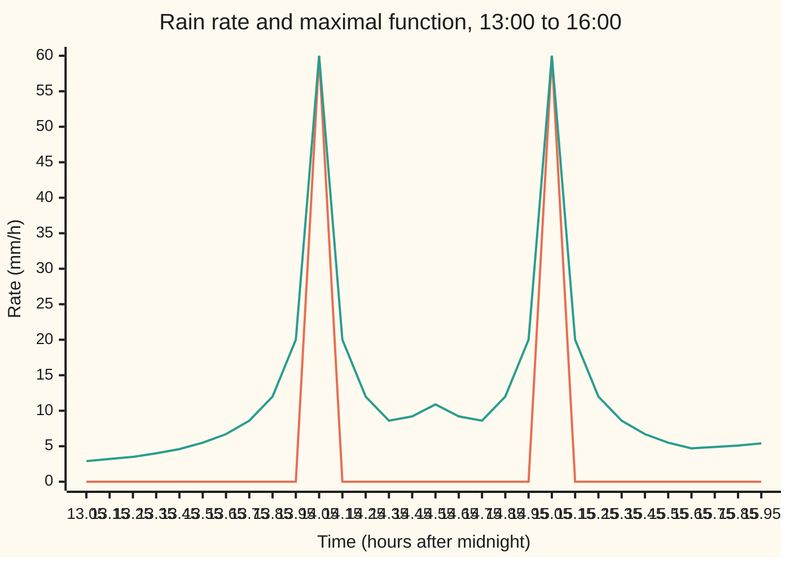

# The maximal function: the biggest average around a point, and the bound it obeys

[Syllabus](../../../SYLLABUS.md) → [Harmonic analysis](../README.md) → [Maximal Functions and Beyond](../README.md#s06) → The maximal function

---

## General Overview

A rain gauge logs the rain rate, in millimetres per hour (mm/h), through one summer day. The record here is illustrative, built from a stated formula. Time $`t`$ is in hours after midnight, and the rate is zero outside these four spells:

- a drizzle of 1 mm/h from 2:00 to 8:00;
- two thunderstorm bursts of 60 mm/h, each six minutes long, starting at 14:00 and at 15:00;
- a shower of 10 mm/h from 17:00 to 18:00.

The day's total is 28 mm. Before anyone uses such a record, they smooth it: a moving average, or a weighted average such as a triangular one. Each smoother, and each width, gives a different number at each moment.

The **maximal function** asks one question that covers them all. At time $`x`$, what is the biggest average rate over any window centred on $`x`$? At 14:30, between the bursts, no rain falls. Yet the window from 13:54 to 15:06 holds both bursts: 12 mm in 1.2 hours, an average of 10 mm/h. No centred window does better, so the maximal function at 14.5 is 10 mm/h. At dry noon, the window from 6:00 to 18:00 holds 24 mm in 12 hours, so it is 2 mm/h.

Why take the biggest average? A smoother that is symmetric and weights near times more than far times is a blend of centred window averages, so at $`x`$ it never exceeds that ceiling. One bound on the ceiling then controls every smoother at once. The bound says the ceiling is high only briefly: on the storm day it beats 8 mm/h for 2.65 hours, against 10.5 hours allowed.

**The maximal function, the biggest centred average at each point, is large only on a short set and caps every smoothing by a kernel that falls away from its centre, so every such smoothing returns the function at almost every point.**

**What kind of fact this is:** a definition, with three theorems. The weak bound is proved on [The Lebesgue differentiation theorem](../../10-Measure%20and%20integration/11-Derivatives%20Meet%20the%20Lebesgue%20Integral/02-lebesgue-differentiation-theorem.md) and quoted here. The strong bound and the cap on smoothers are proved on this card in Why it works, and convergence almost everywhere is deduced from them. The rainfall record is illustrative.

### The picture: the storm hours, rain and its ceiling



Orange: the rain rate, sampled every 0.1 hours, so each six-minute burst shows as one spike to 60 mm/h. Teal: the maximal function at the same times. It equals 60 on each burst and fades on both sides, but never to zero. Between the bursts it rises again, to 10.9 mm/h at 14.55, because one window there holds both bursts.

---

## The formula

Notation first. $`\lambda`$ is length, Lebesgue measure on the line ([Lebesgue measure](../../10-Measure%20and%20integration/02-Length%20Done%20Properly/03-lebesgue-measure.md)). $`f`$ is the rain rate and $`\lvert f\rvert`$ its size. The **p-norm** is $`\lVert f\rVert_p = (\int \lvert f\rvert^p)^{1/p}`$, and $`L^p`$ is the set of functions whose p-norm is finite ([Lp spaces](../../10-Measure%20and%20integration/07-Sizes%20of%20Functions/01-lp-spaces.md)). So $`\lVert f\rVert_1`$ is the total: 28 mm. The **maximal function** of $`f`$ is

```math
Mf(x) = \sup_{h > 0}\ \frac{1}{2h}\int_{x-h}^{x+h} \lvert f(s)\rvert\, ds
```

**Read it aloud:** M f at x is the largest, over every half-width h, of the average size of f over the window from x minus h to x plus h. ("sup" is the least upper bound: the largest value, or the limit the values approach.)

The **weak bound**, proved on [The Lebesgue differentiation theorem](../../10-Measure%20and%20integration/11-Derivatives%20Meet%20the%20Lebesgue%20Integral/02-lebesgue-differentiation-theorem.md), limits where $`Mf`$ can be high:

```math
\lambda\{x : Mf(x) > \alpha\} \;\le\; \frac{3}{\alpha}\,\lVert f\rVert_1 \qquad \text{for every } \alpha > 0
```

**Read it aloud:** the length of the set where M f beats the level alpha is at most three times the total of f, divided by alpha.

Two names describe bounds of this kind. A rule $`T`$ that turns functions into functions is of **strong type** $`(p, p)`$ when $`\lVert Tf\rVert_p \le C\lVert f\rVert_p`$ for one constant $`C`$. It is of **weak type** $`(p, p)`$ when only the set where $`\lvert Tf\rvert > \alpha`$ is controlled, with length at most $`(C\lVert f\rVert_p/\alpha)^p`$. Strong type gives weak type by [Markov and Chebyshev](../../10-Measure%20and%20integration/04-The%20Lebesgue%20Integral/07-markov-and-chebyshev.md). So $`M`$ is weak type $`(1, 1)`$. This card proves that it is strong type $`(p, p)`$ for every $`p`$ above 1:

```math
\lVert Mf\rVert_p \;\le\; C_p\,\lVert f\rVert_p, \qquad C_p = 2\left(\frac{3p}{p-1}\right)^{1/p} \ \text{ for } 1 < p < \infty, \qquad \lVert Mf\rVert_\infty \le \lVert f\rVert_\infty
```

**Read it aloud:** for p above 1, the p-norm of M f is at most C p times the p-norm of f, where C p is two times the p-th root of 3p over p minus 1; and M f is never higher than f's ceiling.

The tool that makes $`M`$ useful is the cap on smoothers. A **kernel** $`K`$ is a weight shape, and $`K_\varepsilon(u) = K(u/\varepsilon)/\varepsilon`$ is its copy narrowed to width $`\varepsilon`$ ([Approximate identities](../03-Convolution%20and%20Approximate%20Identities/03-approximate-identities.md)). Take $`K`$ even, never negative, and never rising as $`\lvert u\rvert`$ grows. Then for every point $`x`$ and every $`f`$

```math
\sup_{\varepsilon > 0}\ \lvert (K_\varepsilon * f)(x)\rvert \;\le\; \lVert K\rVert_1\, Mf(x)
```

**Read it aloud:** at every point, no smoothing of f by any width of the kernel exceeds the kernel's area times M f there.

From the cap and the weak bound, with $`\int K = 1`$:

```math
f \in L^p,\ 1 \le p < \infty \quad\Longrightarrow\quad (K_\varepsilon * f)(x) \to f(x) \ \text{ as } \varepsilon \to 0, \ \text{ for almost every } x
```

**Read it aloud:** for f of finite p-norm, the smoothings converge to f at every point outside a set of length zero. The mode is pointwise, almost everywhere. The worst gap over all points need not shrink: at a jump it stays at half the jump.

| Symbol | Plain meaning | In our example | Push it up and the answer… |
| --- | --- | --- | --- |
| $`f`$, $`t`$ | the rain rate, in mm/h, at time $`t`$ in hours | 60 mm/h in a burst | higher ceiling |
| $`x`$, $`s`$, $`u`$, $`y`$ | the point where $`Mf`$ is read; the variable inside an integral; the kernel's own variable; a height inside the kernel | $`x`$ = 14.5 | — |
| $`h`$ | half-width of a window, in hours | 0.6 h at 14.5 | the average first rises, then falls |
| $`Mf`$ | maximal function: largest centred average of $`\lvert f\rvert`$ | 10 mm/h at 14.5; 2 at noon | — |
| $`\alpha`$, $`\lambda`$ | a level, in mm/h; length of a set, in hours | 8 mm/h; 2.65 h where $`Mf > 8`$ | higher level, shorter set |
| $`\lVert f\rVert_p`$, $`p`$, $`L^p`$ | the p-norm; its exponent; functions of finite p-norm | $`\lVert f\rVert_1`$ = 28 mm | — |
| $`C_p`$, $`C`$, $`c`$, $`T`$ | the constant in the strong bound; a constant in general; in the fold, a ceiling on $`\lvert f\rvert`$; any rule turning functions into functions | $`C_2`$ = 4.898979 | grows without bound as $`p`$ falls to 1 |
| $`K`$, $`K_\varepsilon`$, $`\varepsilon`$, $`r(y)`$ | the kernel; its narrowed copy; its half-width, in hours; half-width of the part of $`K`$ above height $`y`$ | tent $`1 - \lvert u\rvert`$ on $`\lvert u\rvert < 1`$, with $`r(y) = 1 - y`$ | wider tent, more smoothing |
| $`f_1`$, $`f_2`$, $`v`$, $`\mathbf{1}\{\cdot\}`$ | $`f`$ where its size beats $`\alpha/2`$; the rest; one value of $`\lvert f\rvert`$; 1 when the condition inside holds, 0 when it fails | bursts and shower; drizzle (at $`\alpha`$ = 8) | — |
| $`A`$, $`w`$, $`z`$ | one burst's height and width; a point's distance outside it, in hours | 60 mm/h, 0.1 h; $`Mf > 8`$ when $`z < 0.275`$ | taller or wider burst, higher $`Mf`$ |
| $`\varphi`$, $`b`$, $`d`$, $`\tau`$, $`k`$ | a continuous stand-in for $`f`$; the remainder $`f - \varphi`$; the ramp width, in hours; in the fold, a tolerance on the remainder's p-norm and a counting index | $`\lVert b\rVert_1`$ = 0.655 mm at $`d`$ = 0.01 | smaller $`d`$, smaller remainder |
| $`\Theta f(x)`$ | the largest limiting gap between $`K_\varepsilon * f(x)`$ and $`f(x)`$ | 0 at 14.05; 30 at the edge 14.0 | zero at almost every point |

### When it holds

- **$`f`$ has a finite total over every window.** If some window holds infinite rain, every centred window containing it does too, and $`Mf`$ is infinite everywhere.
- **$`p`$ is above 1 for the strong bound.** At $`p`$ = 1 it fails: the integral of $`Mf`$ is 235.77 mm over a year from 28 mm of rain, and grows without limit.
- **The kernel is even and falls away from its centre.** That shape makes it a blend of centred windows, which is the whole proof of the cap. A kernel that is only bounded by such a shape still obeys the cap, with that shape's area as the constant.
- **Windows are centred intervals, or comparable to them.** The covering argument triples intervals. In the plane, averages over thin rectangles pointing in every direction obey no such bound; see [Restriction and Kakeya in outline](06-restriction-and-kakeya-in-outline.md).
- **"Almost every point", not every point.** At the burst's edge, 14:00, every tent smoothing of half-width 0.1 hours or less reads 30 mm/h, half the jump, while the record holds 60.

---

## Why it works

### Step 0: one ceiling over every smoother

A symmetric smoother that weights near times more than far times is a stack of centred windows. Its value at $`x`$ is a blend of window averages, so it never exceeds the largest one, $`Mf(x)`$. That ceiling is high only on a short stretch. So the moments where any smoother misbehaves fit inside a short stretch, and in the end inside a set of length zero.

### Step 1: what the measure wing already proved

[The Lebesgue differentiation theorem](../../10-Measure%20and%20integration/11-Derivatives%20Meet%20the%20Lebesgue%20Integral/02-lebesgue-differentiation-theorem.md) proves three facts, used here without proof:

- the **covering lemma**: from finitely many intervals, pick disjoint ones, longest first, whose tripled copies cover all the rest;
- the **weak bound** above, from the lemma applied to the windows where the average beats $`\alpha`$;
- the **differentiation theorem**: window averages of $`f`$ converge to $`f`$ at almost every point.

On the storm day, at $`\alpha`$ = 8 mm/h, the set where $`Mf > 8`$ has length 2.650 hours. The bound allows $`3 \times 28/8`$ = 10.500 hours, a ratio of 0.2524.

The 3 cannot drop to 1. Take the two bursts alone: 12 mm in all. The set where $`Mf > 8`$ is the interval from 13.725 to 15.375, of length 1.650 hours. A constant of 1 would allow only $`12/8`$ = 1.500 hours. Windows that straddle both bursts make the dry gap between them count as well. The smallest constant that works for every $`f`$ on the line is $`(11 + \sqrt{61})/12`$ = 1.567521 (Melas, 2003); 3 is what the simple covering proof gives.

### Step 2: the strong bound, for every p above 1

Cut $`f`$ at height $`\alpha/2`$: $`f_1`$ is $`f`$ where $`\lvert f\rvert > \alpha/2`$, and $`f_2`$ is the rest. A window average of $`\lvert f_2\rvert`$ is at most $`\alpha/2`$. So where $`Mf > \alpha`$, the part from $`f_1`$ must beat $`\alpha/2`$. The weak bound for $`f_1`$ at level $`\alpha/2`$ gives

```math
\lambda\{Mf > \alpha\} \;\le\; \frac{6}{\alpha}\int_{\lvert f\rvert > \alpha/2} \lvert f\rvert
```

Now add these bounds up over all levels. [The layer-cake formula](../../10-Measure%20and%20integration/06-Product%20Measures%20and%20Fubini/06-layer-cake-and-tail-integrals.md) writes a p-th power integral as a sum over levels: $`\lVert Mf\rVert_p^p = p\int_0^\infty \alpha^{p-1}\,\lambda\{Mf > \alpha\}\,d\alpha`$. Put in the bound and swap the two integrals. Each point with $`\lvert f\rvert`$ = $`v`$ is counted for every level $`\alpha`$ below $`2v`$, and $`\int_0^{2v} \alpha^{p-2}\,d\alpha = (2v)^{p-1}/(p-1)`$. That integral is finite exactly because $`p > 1`$. The result is $`\lVert Mf\rVert_p^p \le 3 \cdot 2^p\, p/(p-1)\,\lVert f\rVert_p^p`$, which is the formula's $`C_p`$. The fold below writes it out.

On the storm day at $`p`$ = 2, $`\lVert f\rVert_2`$ = 28.740216 and $`\lVert Mf\rVert_2`$ = 35.355, a ratio of 1.2301. The bound allows a ratio of $`C_2`$ = 4.898979. The integral of $`Mf^2`$, 1,249.9525, runs to hour 1,000 by grid, with cells 0.0001 hours wide near the rain, and past it exactly: there the best window reaches back to 2:00 and holds the whole day's 28 mm, so $`Mf(x) = 14/(x - 2)`$. Cutting at hour 500 instead gives the same 1,249.9525, and cells twice as wide give 1,249.9524: the grid moves only the fourth decimal.

The constant must grow as $`p`$ falls to 1. For one burst alone, of height $`A`$ and width $`w`$, $`Mf`$ at distance $`z`$ outside it is $`Aw/(2(z + w))`$: the best window just reaches the burst's far edge. Integrating gives the ratio $`\lVert Mf\rVert_p/\lVert f\rVert_p = (1 + 2^{1-p}/(p-1))^{1/p}`$, the same for every burst: 1.2247 at $`p`$ = 2, 8.3545 at 1.1, 95.8353 at 1.01. At $`p`$ = 2 the squared ratio is 1.5, and the code confirms it by summing $`Mf^2`$ on a grid.

### Step 3: every falling kernel is a blend of windows

Slice the kernel $`K`$ horizontally. At height $`y`$, the part of $`K`$ above $`y`$ is a centred interval, of half-width $`r(y)`$, because $`K`$ is even and falls away from 0. Adding up the slices rebuilds $`K`$:

```math
K(u) = \int_0^\infty \mathbf{1}\{\lvert u\rvert < r(y)\}\, dy
```

Here $`\mathbf{1}\{\cdot\}`$ is 1 when the condition holds and 0 when it fails. Narrow the kernel and smooth $`f`$ with it. Each slice becomes a centred window of half-width $`\varepsilon r(y)`$, and smoothing by that slice gives the window's length $`2r(y)`$ times the window average. So

```math
(K_\varepsilon * f)(x) = \int_0^\infty 2r(y)\cdot \frac{1}{2\varepsilon r(y)}\int_{x - \varepsilon r(y)}^{x + \varepsilon r(y)} f(s)\, ds\ \, dy
```

The weights $`2r(y)\,dy`$ add up to the kernel's area, $`\lVert K\rVert_1`$. Each window average of $`\lvert f\rvert`$ is at most $`Mf(x)`$. So the smoothing is at most $`\lVert K\rVert_1\, Mf(x)`$, for every width at once.

For the tent $`K(u) = 1 - \lvert u\rvert`$, the slice at height $`y`$ has $`r(y) = 1 - y`$, so the blend weights are $`2r\,dr`$ for $`r`$ from 0 to 1. The code smooths the rain record at 14:30 both ways: by the tent's closed form, and as this blend of 4,000 window averages. Both agree, and every width stays under the ceiling of 10 mm/h:

```
tent half-width ε (hours)   smoothed rain at 14:30 (mm/h); ceiling Mf = 10
   0.25    |                                          0.0000
   0.5     |██████                                    1.2000
   0.75    |██████████████████████████                5.3333
   1       |██████████████████████████████            6.0000
   1.5     |██████████████████████████                5.3333
   2       |██████████████████████                    4.5000
   4       |████████████████                          3.2500
   8       |███████████                               2.2051
   Mf      |██████████████████████████████████████████████████ 10.0000
```

The largest smoothing over 2,000 widths from 0.01 to 20 hours is 6.0000 mm/h. The ceiling is not reached: the tent tilts its weight towards the centre, where no rain fell. The cap promises only "at most".

### Step 4: smoothings converge almost everywhere

Take $`\int K = 1`$ and $`f`$ of finite total. Write $`\Theta f(x)`$ for the largest gap between $`(K_\varepsilon * f)(x)`$ and $`f(x)`$ that survives as $`\varepsilon`$ shrinks. Pick a continuous $`\varphi`$ close to $`f`$ in total, and let $`b = f - \varphi`$. For continuous $`\varphi`$ the smoothings converge at every point ([Approximate identities](../03-Convolution%20and%20Approximate%20Identities/03-approximate-identities.md)), so $`\varphi`$ drops out in the limit. The cap handles $`b`$:

```math
\Theta f(x) \;\le\; \sup_{\varepsilon}\lvert (K_\varepsilon * b)(x)\rvert + \lvert b(x)\rvert \;\le\; Mb(x) + \lvert b(x)\rvert
```

So if $`\Theta f(x) > 2\alpha`$, then $`Mb(x) > \alpha`$ or $`\lvert b(x)\rvert > \alpha`$. The weak bound and Markov's inequality put both sets inside a total length of $`4\lVert b\rVert_1/\alpha`$. That length can be made as small as wished, so the set where $`\Theta f > 2\alpha`$ has length zero. Taking $`\alpha`$ = 1, 1/2, 1/3, … leaves a set of length zero outside which $`\Theta f = 0`$. For $`p`$ above 1, use the strong bound for $`b`$ instead of the weak one.

On the rain record, take $`\varphi`$ as the window average of $`f`$ of width $`d`$. That replaces each jump by a straight ramp $`d`$ hours wide, and the remainder is two small triangles per jump. The jumps add up to 262 mm/h, so $`\lVert b\rVert_1`$ = $`262\,d/4`$. At $`\alpha`$ = 1 mm/h, the set where the limiting gap can exceed 2 mm/h fits in 2.620000 hours when $`d`$ = 0.01, and in 0.262000 hours when $`d`$ = 0.001.

The tent smoothings show the result directly:

| Moment | $`\varepsilon`$ = 1 | 0.3 | 0.1 | 0.03 | 0.01 | Record |
| --- | --- | --- | --- | --- | --- | --- |
| 5:00, in the drizzle | 1.0000 | 1.0000 | 1.0000 | 1.0000 | 1.0000 | 1 |
| 14:03, inside a burst | 5.9250 | 18.3333 | 45.0000 | 60.0000 | 60.0000 | 60 |
| 14:30, dry gap | 6.0000 | 0.0000 | 0.0000 | 0.0000 | 0.0000 | 0 |
| 14:00, a burst's edge | 5.7000 | 16.6667 | 30.0000 | 30.0000 | 30.0000 | 60 |

The last row is an exception: the smoothings settle at 30, half the jump. Each edge is a single instant, and the day's edges have total length zero. With the box kernel in place of the tent, the same argument is the differentiation theorem itself.

<details>
<summary>Detailed proof: the cap on smoothers, the strong bound, and convergence almost everywhere</summary>

**Setting.** $`\lambda`$ is Lebesgue measure on $`\mathbb{R}`$. For $`f`$ locally integrable, $`Mf(x) = \sup_{h > 0} \frac{1}{2h}\int_{x-h}^{x+h}\lvert f\rvert\,d\lambda \in [0, \infty]`$. Quoted from the differentiation card: $`\lambda\{Mf > \alpha\} \le 3\lVert f\rVert_1/\alpha`$ for $`f \in L^1`$, and $`\{Mf > \alpha\}`$ is open, so $`Mf`$ is measurable.

**Lemma 1 (sublinearity).** For any two locally integrable $`f_1`$, $`f_2`$, $`M(f_1 + f_2) \le Mf_1 + Mf_2`$ pointwise, since each window average of $`\lvert f_1 + f_2\rvert`$ is at most the sum of those of $`\lvert f_1\rvert`$ and $`\lvert f_2\rvert`$. If $`\lvert f\rvert \le c`$ almost everywhere, then $`Mf \le c`$ everywhere.

**Theorem 1 (strong bound).** For $`1 < p < \infty`$ and $`f \in L^p`$, $`\lVert Mf\rVert_p \le C_p\lVert f\rVert_p`$ with $`C_p^p = 3\cdot 2^p p/(p-1)`$. *Proof.* Fix $`\alpha > 0`$. Put $`f_1 = f\,\mathbf{1}\{\lvert f\rvert > \alpha/2\}`$ and $`f_2 = f - f_1`$. Then $`f_1 \in L^1`$, since $`\lvert f_1\rvert \le \lvert f\rvert^p (\alpha/2)^{1-p}`$. By Lemma 1, $`Mf \le Mf_1 + \alpha/2`$, so $`\{Mf > \alpha\} \subseteq \{Mf_1 > \alpha/2\}`$ and the weak bound gives

$`\displaystyle \lambda\{Mf > \alpha\} \le \frac{6}{\alpha}\int \lvert f\rvert\,\mathbf{1}\{\lvert f\rvert > \alpha/2\}\,d\lambda.`$

By the layer-cake formula and Tonelli's theorem (non-negative integrands may be integrated in either order),

$`\displaystyle \lVert Mf\rVert_p^p = p\int_0^\infty \alpha^{p-1}\lambda\{Mf > \alpha\}\,d\alpha \le 6p\int \lvert f\rvert \int_0^{2\lvert f\rvert}\alpha^{p-2}\,d\alpha\,d\lambda = \frac{6p\,2^{p-1}}{p-1}\int \lvert f\rvert^p\,d\lambda.`$

The inner integral converges at 0 because $`p - 2 > -1`$. For $`p = \infty`$, Lemma 1 gives $`\lVert Mf\rVert_\infty \le \lVert f\rVert_\infty`$.

**Lemma 2 (the cap).** Let $`K \ge 0`$ be even, non-increasing on $`[0, \infty)`$, with $`\lVert K\rVert_1 < \infty`$. For every $`x`$, every $`\varepsilon > 0`$ and every locally integrable $`f`$ for which $`Mf(x) < \infty`$, $`\lvert (K_\varepsilon * f)(x)\rvert \le \lVert K\rVert_1 Mf(x)`$. *Proof.* For $`y > 0`$ the set $`\{K > y\}`$ is an interval centred at 0; let $`r(y)`$ be its half-width, so $`\lambda\{K > y\} = 2r(y)`$ (an endpoint has length zero). Then $`K(u) = \int_0^\infty \mathbf{1}\{K(u) > y\}\,dy`$, and $`\int_0^\infty 2r(y)\,dy = \lVert K\rVert_1`$ by the layer-cake formula. By Tonelli,

$`\displaystyle \int K_\varepsilon(x - s)\lvert f(s)\rvert\,ds = \int_0^\infty \frac{1}{\varepsilon}\int_{\lvert x - s\rvert < \varepsilon r(y)} \lvert f(s)\rvert\,ds\,dy \le \int_0^\infty 2r(y)\,Mf(x)\,dy = \lVert K\rVert_1 Mf(x).`$

The left side bounds $`\lvert (K_\varepsilon * f)(x)\rvert`$, and the convolution integral converges absolutely.

**Theorem 2 (convergence almost everywhere).** Let $`K`$ be as in Lemma 2 with $`\int K = 1`$, and $`f \in L^p`$, $`1 \le p < \infty`$. Then $`(K_\varepsilon * f)(x) \to f(x)`$ for almost every $`x`$. *Proof.* Put $`\Theta f(x) = \limsup_{\varepsilon \to 0}\lvert (K_\varepsilon * f)(x) - f(x)\rvert`$. Fix $`\alpha, \tau > 0`$. Continuous functions that vanish outside a bounded interval are dense in $`L^p`$ ([Lp spaces](../../10-Measure%20and%20integration/07-Sizes%20of%20Functions/01-lp-spaces.md)), so choose such a $`\varphi`$ with $`\lVert f - \varphi\rVert_p < \tau`$, and put $`b = f - \varphi`$. Since $`\varphi`$ is bounded and continuous, $`K_\varepsilon * \varphi \to \varphi`$ at every point ([Approximate identities](../03-Convolution%20and%20Approximate%20Identities/03-approximate-identities.md)). By linearity of the convolution and Lemma 2, $`\Theta f(x) \le \Theta \varphi(x) + \sup_\varepsilon\lvert (K_\varepsilon * b)(x)\rvert + \lvert b(x)\rvert \le Mb(x) + \lvert b(x)\rvert`$. Hence $`\{\Theta f > 2\alpha\} \subseteq \{Mb > \alpha\} \cup \{\lvert b\rvert > \alpha\}`$. For $`p = 1`$ the weak bound and Markov's inequality give outer measure at most $`4\tau/\alpha`$. For $`p > 1`$, Theorem 1 and Markov's inequality applied to $`(Mb)^p`$ and $`\lvert b\rvert^p`$ give at most $`(C_p^p + 1)\tau^p/\alpha^p`$. Either way $`\tau`$ is arbitrary, so $`\{\Theta f > 2\alpha\}`$ is null, and $`\{\Theta f > 0\} = \bigcup_k \{\Theta f > 2/k\}`$ is null.

</details>

---

## Worked numbers, by hand

The maximal function at 14:30, then the storm's level set at $`\alpha`$ = 8 mm/h.

| Step | Arithmetic | Value |
| --- | --- | --- |
| window $`h`$ = 0.4, from 14.1 to 14.9 | no rain: 0 mm over 0.8 h | 0.0000 mm/h |
| window $`h`$ = 0.5, from 14.0 to 15.0 | first burst only: 6 mm over 1 h | 6.0000 mm/h |
| window $`h`$ = 0.6, from 13.9 to 15.1 | both bursts: 12 mm over 1.2 h | 10.0000 mm/h |
| window $`h`$ = 1, from 13.5 to 15.5 | 12 mm over 2 h | 6.0000 mm/h |
| window $`h`$ = 6, from 8.5 to 20.5 | bursts and shower: 22 mm over 12 h | 1.8333 mm/h |
| $`Mf(14.5)`$ | the largest; between these sizes the average only rises or only falls | **10 mm/h** |

Between the bursts no rain falls, yet the ceiling there reads 10 mm/h, because a window 1.2 hours wide catches both bursts.

| Step | Arithmetic | Value |
| --- | --- | --- |
| storm alone: a point $`z`$ hours outside a burst | best window reaches the far edge: $`6/(2(z + 0.1)) > 8`$ when $`z < 0.275`$ | 0.275 h |
| weak bound, constant 3 | $`3 \times 12/8`$ | 4.500 h |
| the set where $`Mf > 8`$ | from 14.0 − 0.275 to 15.1 + 0.275; the gap between bursts is inside too | **1.650 h** |

Windows that catch both bursts beat 8 mm/h when $`12/(2h) > 8`$, so $`h < 0.75`$, which covers the middle of the gap, from 14.35 to 14.75. The bursts hold 0.2 hours of rain but lift the ceiling above 8 mm/h for 1.650 hours, inside the 4.500 hours allowed.

### What breaks if you drop a piece

| Mistake | Comes out at | What went wrong |
| --- | --- | --- |
| Constant 1 in the weak bound, as in Markov's inequality | allows 1.500 h; the storm's set where $`Mf > 8`$ is 1.650 h | Markov bounds where $`f`$ itself is large; $`Mf`$ is also large beside and between the bursts |
| Strong bound at $`p`$ = 1 | integral of $`Mf`$: 194.31 mm over 1,980 h, 235.77 over a year, 364.66 over a century, from 28 mm of rain | far from the rain $`Mf`$ fades only like $`14/(x - 2)`$, whose integral grows like a logarithm |
| One constant for every $`p`$ above 1 | one burst: $`\lVert Mf\rVert_p/\lVert f\rVert_p`$ = 1.2247, 8.3545, 95.8353 at $`p`$ = 2, 1.1, 1.01 | the bound needs $`\int_0^{2v}\alpha^{p-2}\,d\alpha`$, which blows up as $`p`$ falls to 1 |
| Convergence at every point | at the edge 14:00, tent smoothings settle at 30.0000 mm/h; the record holds 60 | an edge is a jump; the theorem allows exceptions on a set of length zero |

---

## Code, from first principles, and it actually runs

The code finds $`Mf`$ by two independent roads: exactly, by checking only the window sizes where the average can peak, and by a brute-force sweep of 40,000 window sizes. Both are checked against values worked by hand. It measures the set where $`Mf > 8`$ on a grid of 0.001 hours and compares it with the hand interval and the weak bound. It integrates $`Mf`$ and $`Mf^2`$ on cells 0.0001 hours wide, with exact tails, and repeats $`Mf^2`$ at a second cut-off and with cells twice as wide. It checks each $`C_p`$ against the fold's sum over levels, and the single burst's closed form on a grid. The tent smoothing is computed in closed form and, separately, as a blend of 4,000 window averages. The ramp remainder is sampled and compared with $`262\,d/4`$. Python and Rust use the same arithmetic in the same order and print the same lines.

### Python

```python
# Hardy-Littlewood maximal function -- the check behind the card.  Standard library only.
# A rain gauge's record for one day, illustrative: rate in mm per hour, t in hours.
# Mf(x) is the biggest average rate over windows (x - h, x + h).  Roads: the exact
# maximum over the window sizes where the average can peak, a brute-force sweep of
# 40,000 sizes, and hand values; the tent smoothing in closed form and as a blend of
# window averages; integrals with exact tails; closed forms for the single burst.
from math import log, sqrt

RAIN = [(2.0, 8.0, 1.0), (14.0, 14.1, 60.0), (15.0, 15.1, 60.0), (17.0, 18.0, 10.0)]
STORM = RAIN[1:3]                  # the two bursts on their own
ALPHA = 8.0                        # the level, mm/h

def add(xs):                       # plain left-to-right sum, as in the Rust twin
    s = 0.0
    for x in xs: s += x
    return s

def rain(rec, a, b):               # mm that fall between times a < b
    return add(r * max(0.0, min(b, e) - max(a, s)) for s, e, r in rec)

def rate(rec, x): return add(r for s, e, r in rec if s <= x < e)

def avg(rec, x, h): return rain(rec, x - h, x + h) / (2 * h)

def M(rec, x):                     # road 1: between edge distances the average is monotone in h
    best = (rate(rec, x) + add(r for s, e, r in rec if s < x <= e)) / 2      # the limit as h shrinks to 0
    for s, e, r in rec:
        for h in (abs(x - s), abs(x - e)):
            if h > 0: best = max(best, avg(rec, x, h))
    return best

def M_sweep(rec, x):               # road 2: try every h = 0.0005, 0.001, ..., 20 hours
    return max(avg(rec, x, k * 0.0005) for k in range(1, 40001))

def tent(rec, x, eps):             # road 1: smoothing by K(u) = 1 - |u| on |u| < 1, closed form
    def T(u):                      # area of the tent to the left of u
        u = max(-1.0, min(1.0, u))
        return (1 + u) * (1 + u) / 2 if u <= 0 else 1 - (1 - u) * (1 - u) / 2
    return add(r * (T((x - s) / eps) - T((x - e) / eps)) for s, e, r in rec)

def tent_blend(rec, x, eps, n=4000):   # road 2: the tent is the blend 2r dr of windows of half-width eps r
    return add(2 * ((i + 0.5) / n) * avg(rec, x, eps * (i + 0.5) / n) / n for i in range(n))

def level_length(rec, a, b, alpha, step=0.001):   # length of {Mf > alpha}, sampled at cell midpoints
    n = round((b - a) / step)
    return step * add(1.0 for k in range(n) if M(rec, a + (k + 0.5) * step) > alpha)

def integral(g, a, b, step):       # midpoint rule
    n = round((b - a) / step)
    return step * add(g(a + (k + 0.5) * step) for k in range(n))

total = rain(RAIN, -1e9, 1e9)
f2 = add(r * r * (e - s) for s, e, r in RAIN)
print(f"record: rain {total:.4f} mm; integral of f^2 {f2:.4f}; ||f||_2 {sqrt(f2):.6f}")
hand = {5.0: 28 / 26, 12.0: 2.0, 14.0: 30.0, 14.05: 60.0, 14.5: 10.0, 17.5: 10.0}
for x, want in hand.items():
    m, sw = M(RAIN, x), M_sweep(RAIN, x)
    assert abs(m - want) < 1e-9 and -1e-9 < m - sw < 0.01
    print(f"Mf({x:g}) exact {m:.6f}, sweep {sw:.6f}, by hand {want:.6f}")
print(f"Mf(12): window [6, 18] holds {rain(RAIN, 6, 18):.4f} mm over 12 h")
print("Mf(14.5), windows h 0.4 0.5 0.6 1 6:", " ".join(f"{avg(RAIN, 14.5, h):.4f}" for h in (0.4, 0.5, 0.6, 1.0, 6.0)))
xs = [13.05 + 0.1 * k for k in range(30)]
print("chart, f:", " ".join(f"{rate(RAIN, x):.0f}" for x in xs))
print("chart, Mf:", " ".join(f"{M(RAIN, x):.1f}" for x in xs))

L = level_length(RAIN, -2.0, 26.0, ALPHA)
bound = 3 * total / ALPHA
assert L <= bound and abs(L - 2.65) < 0.002        # hand: (13.725, 15.375) plus the shower
print(f"weak bound, alpha {ALPHA:g}: length of Mf > alpha {L:.3f} h; 3||f||_1/alpha {bound:.3f} h; ratio {L / bound:.4f}")
Ls, storm = level_length(STORM, 12.0, 17.0, ALPHA), rain(STORM, 0, 24)
assert abs(Ls - (1.1 + 2 * (6 / (2 * ALPHA) - 0.1))) < 0.002 and Ls > storm / ALPHA # constant 1 fails, constant 3 holds
print(f"storm alone: length of Mf > alpha {Ls:.3f} h; ||f||_1/alpha {storm / ALPHA:.3f} h; 3||f||_1/alpha {3 * storm / ALPHA:.3f} h")
dmax = 6 / (2 * ALPHA) - 0.1                       # hand: 6 mm over a window reaching the far edge
print(f"storm alone, by hand: d < 6/(2 alpha) - 0.1 = {dmax:.3f}; set ({14 - dmax:.3f}, {15.1 + dmax:.3f}), length {1.1 + 2 * dmax:.3f} h")
print(f"storm alone: rain {storm:.4f} mm; windows holding both bursts beat alpha when h < {storm / (2 * ALPHA):.3f}: ({15.1 - storm / (2 * ALPHA):.3f}, {14 + storm / (2 * ALPHA):.3f})")
print(f"storm alone: needed constant at least {Ls * ALPHA / storm:.4f}; best possible (11 + sqrt 61)/12 = {(11 + sqrt(61)) / 12:.6f}")

def Msq(x): m = M(RAIN, x); return m * m
def lineint(g, A, B, step):        # midpoint rule: cells of step on [-6, 30], edges on the jumps; 250 x step beyond
    return integral(g, -6.0, 30.0, step) + integral(g, A, -6.0, 250 * step) + integral(g, 30.0, B, 250 * step)
def norm2sq(A, B, step):           # beyond A and B Mf is 14/(18 - x) and 14/(x - 2): exact tails
    assert abs(M(RAIN, B) - 14 / (B - 2)) < 1e-15 and abs(M(RAIN, A) - 14 / (18 - A)) < 1e-15
    return lineint(Msq, A, B, step) + 196 / (B - 2) + 196 / (18 - A)
A, B = -980.0, 1000.0
Mf2, Mf2b, Mf2c = norm2sq(A, B, 1e-4), norm2sq(-480.0, 500.0, 1e-4), norm2sq(A, B, 2e-4)
assert abs(Mf2 - Mf2b) < 1e-5 and abs(Mf2 - Mf2c) < 3e-4   # a second cut-off and a doubled step must agree
print(f"integral of Mf^2: step 0.0001 h, cut-off 1000 h {Mf2:.4f}, cut-off 500 h {Mf2b:.4f}; step 0.0002 h {Mf2c:.4f}")
Cp = lambda p: 2 * (3 * p / (p - 1)) ** (1 / p)
assert sqrt(Mf2) <= Cp(2) * sqrt(f2) and Mf2 > f2
print(f"strong bound, p 2: ||Mf||_2 {sqrt(Mf2):.3f}; C_2 ||f||_2 {Cp(2) * sqrt(f2):.3f}; ratio ||Mf||_2/||f||_2 {sqrt(Mf2 / f2):.4f}; C_2 {Cp(2):.6f}")

def M1(x): return M(RAIN, x)
I1 = lineint(M1, A, B, 1e-4)
for S in (990.0, 4380.0, 438000.0):  # spans [10 - S, 10 + S]: a little over 82 days, a year, a century
    print(f"p 1: integral of Mf over {2 * S:.0f} h = {I1 + 28 * log((S + 8) / 998):.2f} mm; rain {total:.0f} mm")
burst = STORM[:1]
grid = integral(lambda x: M(burst, x) * M(burst, x), 13.1, 15.0, 0.0005) + 2 * 9 / 1.0
assert abs(grid / 360 - 1.5) < 1e-4
print(f"single burst, p 2: ratio^2 grid {grid / 360:.6f}, closed form 1 + 2^(1-p)/(p-1) = 1.500000")
for p in (2.0, 1.5, 1.1, 1.01):
    assert abs(Cp(p) ** p / (6 * p * 2 ** (p - 1) / (p - 1)) - 1) < 1e-12   # the fold's sum over levels
    print(f"single burst, p {p:g}: ||Mf||_p/||f||_p {(1 + 2 ** (1 - p) / (p - 1)) ** (1 / p):.4f}; C_p {Cp(p):.4f}")

eps_list = [0.25, 0.5, 0.75, 1.0, 1.5, 2.0, 4.0, 8.0]
vals = [tent(RAIN, 14.5, e) for e in eps_list]
for e, v in zip(eps_list, vals):
    assert abs(v - tent_blend(RAIN, 14.5, e)) < 1e-5 and v <= M(RAIN, 14.5)
sup = max(tent(RAIN, 14.5, 0.01 * k) for k in range(1, 2001))
assert sup <= M(RAIN, 14.5)
print("tent at 14.5, eps", " ".join(f"{e:g}" for e in eps_list), ":", " ".join(f"{v:.4f}" for v in vals))
print(f"tent at 14.5: largest over eps = 0.01..20 {sup:.4f}; Mf(14.5) {M(RAIN, 14.5):.4f}")
for x in (5.0, 14.0, 14.05, 14.5):
    row = [tent(RAIN, x, e) for e in (1.0, 0.3, 0.1, 0.03, 0.01)]
    print(f"tent at {x:g}, eps 1 0.3 0.1 0.03 0.01: " + " ".join(f"{v:.4f}" for v in row))
assert abs(tent(RAIN, 14.0, 0.01) - 30) < 1e-9 and abs(tent(RAIN, 14.05, 0.01) - 60) < 1e-9

jumps = add(abs(r) * 2 for s, e, r in RAIN)          # each piece has two jumps of size r
print(f"jumps in the record add up to {jumps:.0f} mm/h")
for d in (0.01, 0.001):                               # phi = window average of width d: f with ramps
    phi = lambda x: rain(RAIN, x - d / 2, x + d / 2) / d
    b1 = add(integral(lambda x: abs(rate(RAIN, x) - phi(x)), j - d, j + d, d / 200)
             for s, e, r in RAIN for j in (s, e))
    assert abs(b1 - jumps * d / 4) < 1e-6
    print(f"ramps {d:g} h: ||f - phi||_1 sampled {b1:.6f}, sum of jumps x d/4 {jumps * d / 4:.6f}; bad-set bound at alpha 1: {4 * b1:.6f} h")
print("ALL CHECKS PASS")
```

**Ran 2026-11-15 on macOS, Python 3.14.10, standard library only. All checks passed. Output, pasted from the run:**

```
record: rain 28.0000 mm; integral of f^2 826.0000; ||f||_2 28.740216
Mf(5) exact 1.076923, sweep 1.076923, by hand 1.076923
Mf(12) exact 2.000000, sweep 2.000000, by hand 2.000000
Mf(14) exact 30.000000, sweep 30.000000, by hand 30.000000
Mf(14.05) exact 60.000000, sweep 60.000000, by hand 60.000000
Mf(14.5) exact 10.000000, sweep 10.000000, by hand 10.000000
Mf(17.5) exact 10.000000, sweep 10.000000, by hand 10.000000
Mf(12): window [6, 18] holds 24.0000 mm over 12 h
Mf(14.5), windows h 0.4 0.5 0.6 1 6: 0.0000 6.0000 10.0000 6.0000 1.8333
chart, f: 0 0 0 0 0 0 0 0 0 0 60 0 0 0 0 0 0 0 0 0 60 0 0 0 0 0 0 0 0 0
chart, Mf: 2.9 3.2 3.5 4.0 4.6 5.5 6.7 8.6 12.0 20.0 60.0 20.0 12.0 8.6 9.2 10.9 9.2 8.6 12.0 20.0 60.0 20.0 12.0 8.6 6.7 5.5 4.7 4.9 5.1 5.4
weak bound, alpha 8: length of Mf > alpha 2.650 h; 3||f||_1/alpha 10.500 h; ratio 0.2524
storm alone: length of Mf > alpha 1.650 h; ||f||_1/alpha 1.500 h; 3||f||_1/alpha 4.500 h
storm alone, by hand: d < 6/(2 alpha) - 0.1 = 0.275; set (13.725, 15.375), length 1.650 h
storm alone: rain 12.0000 mm; windows holding both bursts beat alpha when h < 0.750: (14.350, 14.750)
storm alone: needed constant at least 1.1000; best possible (11 + sqrt 61)/12 = 1.567521
integral of Mf^2: step 0.0001 h, cut-off 1000 h 1249.9525, cut-off 500 h 1249.9525; step 0.0002 h 1249.9524
strong bound, p 2: ||Mf||_2 35.355; C_2 ||f||_2 140.798; ratio ||Mf||_2/||f||_2 1.2301; C_2 4.898979
p 1: integral of Mf over 1980 h = 194.31 mm; rain 28 mm
p 1: integral of Mf over 8760 h = 235.77 mm; rain 28 mm
p 1: integral of Mf over 876000 h = 364.66 mm; rain 28 mm
single burst, p 2: ratio^2 grid 1.499999, closed form 1 + 2^(1-p)/(p-1) = 1.500000
single burst, p 2: ||Mf||_p/||f||_p 1.2247; C_p 4.8990
single burst, p 1.5: ||Mf||_p/||f||_p 1.7996; C_p 8.6535
single burst, p 1.1: ||Mf||_p/||f||_p 8.3545; C_p 48.0283
single burst, p 1.01: ||Mf||_p/||f||_p 95.8353; C_p 572.6693
tent at 14.5, eps 0.25 0.5 0.75 1 1.5 2 4 8 : 0.0000 1.2000 5.3333 6.0000 5.3333 4.5000 3.2500 2.2051
tent at 14.5: largest over eps = 0.01..20 6.0000; Mf(14.5) 10.0000
tent at 5, eps 1 0.3 0.1 0.03 0.01: 1.0000 1.0000 1.0000 1.0000 1.0000
tent at 14, eps 1 0.3 0.1 0.03 0.01: 5.7000 16.6667 30.0000 30.0000 30.0000
tent at 14.05, eps 1 0.3 0.1 0.03 0.01: 5.9250 18.3333 45.0000 60.0000 60.0000
tent at 14.5, eps 1 0.3 0.1 0.03 0.01: 6.0000 0.0000 0.0000 0.0000 0.0000
jumps in the record add up to 262 mm/h
ramps 0.01 h: ||f - phi||_1 sampled 0.655000, sum of jumps x d/4 0.655000; bad-set bound at alpha 1: 2.620000 h
ramps 0.001 h: ||f - phi||_1 sampled 0.065500, sum of jumps x d/4 0.065500; bad-set bound at alpha 1: 0.262000 h
ALL CHECKS PASS
```

### Rust

Same numbers, same labels, built with `rustc --edition 2021 -O`.

```rust
// Hardy-Littlewood maximal function -- the Rust twin of the Python check.  std only.
// A rain gauge's record for one day, illustrative: rate in mm per hour, t in hours.
// Mf(x) is the biggest average rate over windows (x - h, x + h).  Same roads, same
// labels, same output as the Python.
type Rec = [(f64, f64, f64)];
const RAIN: [(f64, f64, f64); 4] = [(2.0, 8.0, 1.0), (14.0, 14.1, 60.0), (15.0, 15.1, 60.0), (17.0, 18.0, 10.0)];
const ALPHA: f64 = 8.0;

fn rain(rec: &Rec, a: f64, b: f64) -> f64 {
    let mut s = 0.0;
    for &(st, e, r) in rec { s += r * f64::max(0.0, f64::min(b, e) - f64::max(a, st)); }
    s
}
fn rate(rec: &Rec, x: f64) -> f64 {
    let mut s = 0.0;
    for &(st, e, r) in rec { if st <= x && x < e { s += r; } }
    s
}
fn avg(rec: &Rec, x: f64, h: f64) -> f64 { rain(rec, x - h, x + h) / (2.0 * h) }

fn m(rec: &Rec, x: f64) -> f64 {
    // road 1: between edge distances the average is monotone in h
    let mut left = 0.0;
    for &(st, e, r) in rec { if st < x && x <= e { left += r; } }
    let mut best = (rate(rec, x) + left) / 2.0;
    for &(st, e, _) in rec {
        for h in [(x - st).abs(), (x - e).abs()] {
            if h > 0.0 { best = best.max(avg(rec, x, h)); }
        }
    }
    best
}
fn m_sweep(rec: &Rec, x: f64) -> f64 {
    // road 2: try every h = 0.0005, 0.001, ..., 20 hours
    let mut best = f64::MIN;
    for k in 1..=40000 { best = best.max(avg(rec, x, k as f64 * 0.0005)); }
    best
}
fn tent_area(u: f64) -> f64 {
    let u = u.min(1.0).max(-1.0);
    if u <= 0.0 { (1.0 + u) * (1.0 + u) / 2.0 } else { 1.0 - (1.0 - u) * (1.0 - u) / 2.0 }
}
fn tent(rec: &Rec, x: f64, eps: f64) -> f64 {
    let mut s = 0.0;
    for &(st, e, r) in rec { s += r * (tent_area((x - st) / eps) - tent_area((x - e) / eps)); }
    s
}
fn tent_blend(rec: &Rec, x: f64, eps: f64) -> f64 {
    let n = 4000.0;
    let mut s = 0.0;
    for i in 0..4000 {
        let r = (i as f64 + 0.5) / n;
        s += 2.0 * r * avg(rec, x, eps * (i as f64 + 0.5) / n) / n;
    }
    s
}
fn level_length(rec: &Rec, a: f64, b: f64, alpha: f64) -> f64 {
    let step = 0.001;
    let n = ((b - a) / step).round() as usize;
    let mut c = 0.0;
    for k in 0..n { if m(rec, a + (k as f64 + 0.5) * step) > alpha { c += 1.0; } }
    step * c
}
fn integral(g: &dyn Fn(f64) -> f64, a: f64, b: f64, step: f64) -> f64 {
    let n = ((b - a) / step).round() as usize;
    let mut s = 0.0;
    for k in 0..n { s += g(a + (k as f64 + 0.5) * step); }
    step * s
}
fn lineint(g: &dyn Fn(f64) -> f64, a: f64, b: f64, step: f64) -> f64 {
    // midpoint rule: cells of step on [-6, 30], edges on the jumps; 250 x step beyond
    integral(g, -6.0, 30.0, step) + integral(g, a, -6.0, 250.0 * step) + integral(g, 30.0, b, 250.0 * step)
}
fn cp(p: f64) -> f64 { 2.0 * (3.0 * p / (p - 1.0)).powf(1.0 / p) }
fn join(v: &[f64], d: usize) -> String {
    v.iter().map(|x| format!("{:.*}", d, x)).collect::<Vec<_>>().join(" ")
}

fn main() {
    let storm = &RAIN[1..3];
    let total = rain(&RAIN, -1e9, 1e9);
    let mut f2 = 0.0;
    for &(s, e, r) in RAIN.iter() { f2 += r * r * (e - s); }
    println!("record: rain {:.4} mm; integral of f^2 {:.4}; ||f||_2 {:.6}", total, f2, f2.sqrt());
    for (x, want) in [(5.0, 28.0 / 26.0), (12.0, 2.0), (14.0, 30.0), (14.05, 60.0), (14.5, 10.0), (17.5, 10.0)] {
        let (mx, sw) = (m(&RAIN, x), m_sweep(&RAIN, x));
        assert!((mx - want).abs() < 1e-9 && -1e-9 < mx - sw && mx - sw < 0.01);
        println!("Mf({}) exact {:.6}, sweep {:.6}, by hand {:.6}", x, mx, sw, want);
    }
    println!("Mf(12): window [6, 18] holds {:.4} mm over 12 h", rain(&RAIN, 6.0, 18.0));
    let w: Vec<f64> = [0.4, 0.5, 0.6, 1.0, 6.0].iter().map(|&h| avg(&RAIN, 14.5, h)).collect();
    println!("Mf(14.5), windows h 0.4 0.5 0.6 1 6: {}", join(&w, 4));
    let xs: Vec<f64> = (0..30).map(|k| 13.05 + 0.1 * k as f64).collect();
    println!("chart, f: {}", join(&xs.iter().map(|&x| rate(&RAIN, x)).collect::<Vec<_>>(), 0));
    println!("chart, Mf: {}", join(&xs.iter().map(|&x| m(&RAIN, x)).collect::<Vec<_>>(), 1));

    let l = level_length(&RAIN, -2.0, 26.0, ALPHA);
    let bound = 3.0 * total / ALPHA;
    assert!(l <= bound && (l - 2.65).abs() < 0.002);
    println!("weak bound, alpha {}: length of Mf > alpha {:.3} h; 3||f||_1/alpha {:.3} h; ratio {:.4}", ALPHA, l, bound, l / bound);
    let (ls, st) = (level_length(storm, 12.0, 17.0, ALPHA), rain(storm, 0.0, 24.0));
    assert!((ls - (1.1 + 2.0 * (6.0 / (2.0 * ALPHA) - 0.1))).abs() < 0.002 && ls > st / ALPHA);
    println!("storm alone: length of Mf > alpha {:.3} h; ||f||_1/alpha {:.3} h; 3||f||_1/alpha {:.3} h", ls, st / ALPHA, 3.0 * st / ALPHA);
    let dmax = 6.0 / (2.0 * ALPHA) - 0.1;
    println!("storm alone, by hand: d < 6/(2 alpha) - 0.1 = {:.3}; set ({:.3}, {:.3}), length {:.3} h", dmax, 14.0 - dmax, 15.1 + dmax, 1.1 + 2.0 * dmax);
    let hb = st / (2.0 * ALPHA);
    println!("storm alone: rain {:.4} mm; windows holding both bursts beat alpha when h < {:.3}: ({:.3}, {:.3})", st, hb, 15.1 - hb, 14.0 + hb);
    println!("storm alone: needed constant at least {:.4}; best possible (11 + sqrt 61)/12 = {:.6}", ls * ALPHA / st, (11.0 + 61f64.sqrt()) / 12.0);

    let msq = |x: f64| { let v = m(&RAIN, x); v * v };
    let norm2sq = |a: f64, b: f64, step: f64| -> f64 {
        // beyond a and b Mf is 14/(18 - x) and 14/(x - 2): exact tails
        assert!((m(&RAIN, b) - 14.0 / (b - 2.0)).abs() < 1e-15 && (m(&RAIN, a) - 14.0 / (18.0 - a)).abs() < 1e-15);
        lineint(&msq, a, b, step) + 196.0 / (b - 2.0) + 196.0 / (18.0 - a)
    };
    let (a, b) = (-980.0, 1000.0);
    let (mf2, mf2b, mf2c) = (norm2sq(a, b, 1e-4), norm2sq(-480.0, 500.0, 1e-4), norm2sq(a, b, 2e-4));
    assert!((mf2 - mf2b).abs() < 1e-5 && (mf2 - mf2c).abs() < 3e-4); // a second cut-off and a doubled step must agree
    println!("integral of Mf^2: step 0.0001 h, cut-off 1000 h {:.4}, cut-off 500 h {:.4}; step 0.0002 h {:.4}", mf2, mf2b, mf2c);
    assert!(mf2.sqrt() <= cp(2.0) * f2.sqrt() && mf2 > f2);
    println!("strong bound, p 2: ||Mf||_2 {:.3}; C_2 ||f||_2 {:.3}; ratio ||Mf||_2/||f||_2 {:.4}; C_2 {:.6}",
             mf2.sqrt(), cp(2.0) * f2.sqrt(), (mf2 / f2).sqrt(), cp(2.0));

    let m1 = |x: f64| m(&RAIN, x);
    let i1 = lineint(&m1, a, b, 1e-4);
    for s in [990.0f64, 4380.0, 438000.0] {
        println!("p 1: integral of Mf over {:.0} h = {:.2} mm; rain {:.0} mm", 2.0 * s, i1 + 28.0 * ((s + 8.0) / 998.0).ln(), total);
    }
    let burst = &RAIN[1..2];
    let grid = integral(&|x: f64| m(burst, x) * m(burst, x), 13.1, 15.0, 0.0005) + 2.0 * 9.0 / 1.0;
    assert!((grid / 360.0 - 1.5).abs() < 1e-4);
    println!("single burst, p 2: ratio^2 grid {:.6}, closed form 1 + 2^(1-p)/(p-1) = 1.500000", grid / 360.0);
    for p in [2.0f64, 1.5, 1.1, 1.01] {
        assert!((cp(p).powf(p) / (6.0 * p * 2f64.powf(p - 1.0) / (p - 1.0)) - 1.0).abs() < 1e-12); // the fold's sum over levels
        println!("single burst, p {}: ||Mf||_p/||f||_p {:.4}; C_p {:.4}", p, (1.0 + 2f64.powf(1.0 - p) / (p - 1.0)).powf(1.0 / p), cp(p));
    }

    let eps_list = [0.25, 0.5, 0.75, 1.0, 1.5, 2.0, 4.0, 8.0];
    let vals: Vec<f64> = eps_list.iter().map(|&e| tent(&RAIN, 14.5, e)).collect();
    for (&e, &v) in eps_list.iter().zip(vals.iter()) {
        assert!((v - tent_blend(&RAIN, 14.5, e)).abs() < 1e-5 && v <= m(&RAIN, 14.5));
    }
    let mut sup = f64::MIN;
    for k in 1..=2000 { sup = sup.max(tent(&RAIN, 14.5, 0.01 * k as f64)); }
    assert!(sup <= m(&RAIN, 14.5));
    let el: Vec<String> = eps_list.iter().map(|e| format!("{}", e)).collect();
    println!("tent at 14.5, eps {} : {}", el.join(" "), join(&vals, 4));
    println!("tent at 14.5: largest over eps = 0.01..20 {:.4}; Mf(14.5) {:.4}", sup, m(&RAIN, 14.5));
    for x in [5.0, 14.0, 14.05, 14.5] {
        let row: Vec<f64> = [1.0, 0.3, 0.1, 0.03, 0.01].iter().map(|&e| tent(&RAIN, x, e)).collect();
        println!("tent at {}, eps 1 0.3 0.1 0.03 0.01: {}", x, join(&row, 4));
    }
    assert!((tent(&RAIN, 14.0, 0.01) - 30.0).abs() < 1e-9 && (tent(&RAIN, 14.05, 0.01) - 60.0).abs() < 1e-9);

    let mut jumps = 0.0;
    for &(_, _, r) in RAIN.iter() { jumps += r.abs() * 2.0; }
    println!("jumps in the record add up to {:.0} mm/h", jumps);
    for d in [0.01, 0.001] {
        let phi = |x: f64| rain(&RAIN, x - d / 2.0, x + d / 2.0) / d;
        let mut b1 = 0.0;
        for &(s, e, _) in RAIN.iter() {
            for j in [s, e] { b1 += integral(&|x: f64| (rate(&RAIN, x) - phi(x)).abs(), j - d, j + d, d / 200.0); }
        }
        assert!((b1 - jumps * d / 4.0).abs() < 1e-6);
        println!("ramps {} h: ||f - phi||_1 sampled {:.6}, sum of jumps x d/4 {:.6}; bad-set bound at alpha 1: {:.6} h", d, b1, jumps * d / 4.0, 4.0 * b1);
    }
    println!("ALL CHECKS PASS");
}
```

**Ran 2026-11-15 on macOS, rustc 1.98.1, no crates. All checks passed. Output, pasted from the run:**

```
record: rain 28.0000 mm; integral of f^2 826.0000; ||f||_2 28.740216
Mf(5) exact 1.076923, sweep 1.076923, by hand 1.076923
Mf(12) exact 2.000000, sweep 2.000000, by hand 2.000000
Mf(14) exact 30.000000, sweep 30.000000, by hand 30.000000
Mf(14.05) exact 60.000000, sweep 60.000000, by hand 60.000000
Mf(14.5) exact 10.000000, sweep 10.000000, by hand 10.000000
Mf(17.5) exact 10.000000, sweep 10.000000, by hand 10.000000
Mf(12): window [6, 18] holds 24.0000 mm over 12 h
Mf(14.5), windows h 0.4 0.5 0.6 1 6: 0.0000 6.0000 10.0000 6.0000 1.8333
chart, f: 0 0 0 0 0 0 0 0 0 0 60 0 0 0 0 0 0 0 0 0 60 0 0 0 0 0 0 0 0 0
chart, Mf: 2.9 3.2 3.5 4.0 4.6 5.5 6.7 8.6 12.0 20.0 60.0 20.0 12.0 8.6 9.2 10.9 9.2 8.6 12.0 20.0 60.0 20.0 12.0 8.6 6.7 5.5 4.7 4.9 5.1 5.4
weak bound, alpha 8: length of Mf > alpha 2.650 h; 3||f||_1/alpha 10.500 h; ratio 0.2524
storm alone: length of Mf > alpha 1.650 h; ||f||_1/alpha 1.500 h; 3||f||_1/alpha 4.500 h
storm alone, by hand: d < 6/(2 alpha) - 0.1 = 0.275; set (13.725, 15.375), length 1.650 h
storm alone: rain 12.0000 mm; windows holding both bursts beat alpha when h < 0.750: (14.350, 14.750)
storm alone: needed constant at least 1.1000; best possible (11 + sqrt 61)/12 = 1.567521
integral of Mf^2: step 0.0001 h, cut-off 1000 h 1249.9525, cut-off 500 h 1249.9525; step 0.0002 h 1249.9524
strong bound, p 2: ||Mf||_2 35.355; C_2 ||f||_2 140.798; ratio ||Mf||_2/||f||_2 1.2301; C_2 4.898979
p 1: integral of Mf over 1980 h = 194.31 mm; rain 28 mm
p 1: integral of Mf over 8760 h = 235.77 mm; rain 28 mm
p 1: integral of Mf over 876000 h = 364.66 mm; rain 28 mm
single burst, p 2: ratio^2 grid 1.499999, closed form 1 + 2^(1-p)/(p-1) = 1.500000
single burst, p 2: ||Mf||_p/||f||_p 1.2247; C_p 4.8990
single burst, p 1.5: ||Mf||_p/||f||_p 1.7996; C_p 8.6535
single burst, p 1.1: ||Mf||_p/||f||_p 8.3545; C_p 48.0283
single burst, p 1.01: ||Mf||_p/||f||_p 95.8353; C_p 572.6693
tent at 14.5, eps 0.25 0.5 0.75 1 1.5 2 4 8 : 0.0000 1.2000 5.3333 6.0000 5.3333 4.5000 3.2500 2.2051
tent at 14.5: largest over eps = 0.01..20 6.0000; Mf(14.5) 10.0000
tent at 5, eps 1 0.3 0.1 0.03 0.01: 1.0000 1.0000 1.0000 1.0000 1.0000
tent at 14, eps 1 0.3 0.1 0.03 0.01: 5.7000 16.6667 30.0000 30.0000 30.0000
tent at 14.05, eps 1 0.3 0.1 0.03 0.01: 5.9250 18.3333 45.0000 60.0000 60.0000
tent at 14.5, eps 1 0.3 0.1 0.03 0.01: 6.0000 0.0000 0.0000 0.0000 0.0000
jumps in the record add up to 262 mm/h
ramps 0.01 h: ||f - phi||_1 sampled 0.655000, sum of jumps x d/4 0.655000; bad-set bound at alpha 1: 2.620000 h
ramps 0.001 h: ||f - phi||_1 sampled 0.065500, sum of jumps x d/4 0.065500; bad-set bound at alpha 1: 0.262000 h
ALL CHECKS PASS
```

The two outputs match line for line.

### Lean

Lean proves the cap on smoothers, the strong bound and convergence almost everywhere for every allowed kernel and record, and checks the worked numbers.

- Suppose $`K`$ is even, never negative, falls away from its centre with finite area, and $`f`$ has a finite total over every window. Then wherever $`Mf(x)`$ is finite, every smoothing integral at $`x`$ converges absolutely, with size at most $`\lVert K\rVert_1\, Mf(x)`$.
- Suppose $`1 < p < \infty`$ and $`f`$ is in $`L^p`$. Then $`\lVert Mf\rVert_p \le C_p\,\lVert f\rVert_p`$, with $`C_p`$ as in the formula.
- Suppose $`K`$ is as above with $`\int K = 1`$, and $`f`$ is in $`L^p`$ for some $`1 \le p < \infty`$. Then $`(K_\varepsilon * f)(x) \to f(x)`$ as $`\varepsilon \to 0`$, for almost every $`x`$.
- The record holds 28 mm, and the weak bound at 8 mm/h allows 10.5 hours.
- At 14:30 the window of half-width 0.6 hours gives 10 mm/h. At noon the window from 6:00 to 18:00 gives 2 mm/h.
- One burst lifts $`Mf`$ above 8 mm/h out to 0.275 hours on each side.
- For the storm alone, $`Mf > 8`$ on 1.650 hours: more than the 1.500 a constant of 1 allows, within the 4.500 allowed.
- At $`p`$ = 2, $`C_2^2`$ = 24, and the record's jumps add up to 262 mm/h.

The bound at $`p = \infty`$, grid values and integrals of $`Mf`$, and tent smoothings are left to the Python and Rust checks.

```lean
-- The maximal function: every smoothing by an even, falling kernel of area 1 returns an Lp function at almost every point, because the maximal function caps it and obeys the strong bound.
import Mathlib.MeasureTheory.Integral.Bochner.Basic
import Mathlib.MeasureTheory.Function.LocallyIntegrable
import Mathlib.MeasureTheory.Measure.Lebesgue.Basic
import Mathlib

open MeasureTheory Filter Topology Set

/-- The Hardy-Littlewood maximal function on the line:
`Mf(x) = sup over h > 0 of (1 / 2h) * ∫ over (x - h, x + h) of |f|`, as an extended
non-negative number (it may be infinite). -/
noncomputable def maximalFunction (f : ℝ → ℝ) (x : ℝ) : ENNReal :=
  ⨆ (h : ℝ) (_ : 0 < h), (ENNReal.ofReal (2 * h))⁻¹ * ∫⁻ s in Ioo (x - h) (x + h), ‖f s‖ₑ

/-- One window is bounded by the maximal function. -/

lemma hlmf_window_le (f : ℝ → ℝ) (x r : ℝ) :
    ∫⁻ s in Ioo (x - r) (x + r), ‖f s‖ₑ ≤ volume (Ioo (x - r) (x + r)) * maximalFunction f x := by
  rcases le_or_gt r 0 with hr | hr
  · have : Ioo (x - r) (x + r) = ∅ := Ioo_eq_empty (by linarith)
    simp [this]
  rw [Real.volume_Ioo, show x + r - (x - r) = 2 * r by ring]
  have h1 : (ENNReal.ofReal (2 * r))⁻¹ * ∫⁻ s in Ioo (x - r) (x + r), ‖f s‖ₑ
      ≤ maximalFunction f x :=
    le_iSup₂ (f := fun (h : ℝ) (_ : 0 < h) =>
      (ENNReal.ofReal (2 * h))⁻¹ * ∫⁻ s in Ioo (x - h) (x + h), ‖f s‖ₑ) r hr
  have h0 : ENNReal.ofReal (2 * r) ≠ 0 := by simp; linarith
  have ht : ENNReal.ofReal (2 * r) ≠ ⊤ := ENNReal.ofReal_ne_top
  calc ∫⁻ s in Ioo (x - r) (x + r), ‖f s‖ₑ
      = ENNReal.ofReal (2 * r) * ((ENNReal.ofReal (2 * r))⁻¹ * ∫⁻ s in Ioo (x - r) (x + r), ‖f s‖ₑ) := by
        rw [← mul_assoc, ENNReal.mul_inv_cancel h0 ht, one_mul]
    _ ≤ _ := by gcongr

#print axioms hlmf_window_le

/-- A set closed under moving closer to `x` is bounded by the maximal function. -/

lemma hlmf_star_le (f : ℝ → ℝ) (x : ℝ) (S : Set ℝ)
    (hS : ∀ s ∈ S, ∀ s', |s' - x| ≤ |s - x| → s' ∈ S) :
    ∫⁻ s in S, ‖f s‖ₑ ≤ volume S * maximalFunction f x := by
  rcases S.eq_empty_or_nonempty with hE | hne
  · simp [hE]
  by_cases hb : BddAbove ((fun s => |s - x|) '' S)
  · set r := sSup ((fun s => |s - x|) '' S) with hr
    have hsub1 : Ioo (x - r) (x + r) ⊆ S := by
      intro s' hs'
      have hlt : |s' - x| < r := by
        rw [abs_lt]; constructor <;> linarith [hs'.1, hs'.2]
      obtain ⟨d, ⟨s, hs, rfl⟩, hd⟩ := exists_lt_of_lt_csSup (hne.image _) hlt
      exact hS s hs s' hd.le
    have hsub2 : S ⊆ Icc (x - r) (x + r) := by
      intro s hs
      have : |s - x| ≤ r := le_csSup hb ⟨s, hs, rfl⟩
      rw [abs_le] at this
      constructor <;> linarith
    calc ∫⁻ s in S, ‖f s‖ₑ ≤ ∫⁻ s in Icc (x - r) (x + r), ‖f s‖ₑ := lintegral_mono_set hsub2
      _ = ∫⁻ s in Ioo (x - r) (x + r), ‖f s‖ₑ := setLIntegral_congr Ioo_ae_eq_Icc.symm
      _ ≤ volume (Ioo (x - r) (x + r)) * maximalFunction f x := hlmf_window_le f x r
      _ ≤ volume S * maximalFunction f x := by gcongr
  · have hall : ∀ n : ℕ, Ioo (x - n) (x + n) ⊆ S := by
      intro n s' hs'
      rw [not_bddAbove_iff] at hb
      obtain ⟨d, ⟨s, hs, rfl⟩, hd⟩ := hb n
      refine hS s hs s' ?_
      have : |s' - x| < n := by rw [abs_lt]; constructor <;> linarith [hs'.1, hs'.2]
      linarith
    have hU : S = univ := by
      refine eq_univ_of_forall fun s' => ?_
      obtain ⟨n, hn⟩ := exists_nat_gt |s' - x|
      apply hall n
      rw [abs_lt] at hn; constructor <;> linarith
    subst hU
    by_cases hM : maximalFunction f x = 0
    · have hw : ∀ n : ℕ, ∫⁻ s in Ioo (x - n) (x + n), ‖f s‖ₑ = 0 := fun n =>
        le_antisymm ((hlmf_window_le f x n).trans (by rw [hM, mul_zero])) (zero_le)
      have hU2 : (univ : Set ℝ) = ⋃ n : ℕ, Ioo (x - n) (x + n) := by
        refine (eq_univ_of_forall fun s' => ?_).symm
        obtain ⟨n, hn⟩ := exists_nat_gt |s' - x|
        rw [abs_lt] at hn
        exact mem_iUnion.2 ⟨n, by constructor <;> linarith⟩
      calc ∫⁻ s in univ, ‖f s‖ₑ ≤ ∑' n : ℕ, ∫⁻ s in Ioo (x - n) (x + n), ‖f s‖ₑ := by
            rw [hU2]; exact lintegral_iUnion_le _ _
        _ = 0 := by simp [hw]
        _ ≤ _ := zero_le
    · rw [Real.volume_univ, ENNReal.top_mul hM]; exact le_top

#print axioms hlmf_star_le

lemma hlmf_K_abs {K : ℝ → ℝ} (hKeven : ∀ u, K (-u) = K u) (u : ℝ) : K |u| = K u := by
  rcases le_or_gt 0 u with h | h
  · rw [abs_of_nonneg h]
  · rw [abs_of_neg h, hKeven]

#print axioms hlmf_K_abs

lemma hlmf_K_mono {K : ℝ → ℝ} (hKeven : ∀ u, K (-u) = K u) (hKanti : AntitoneOn K (Ici 0))
    {u v : ℝ} (h : |u| ≤ |v|) : K v ≤ K u := by
  rw [← hlmf_K_abs hKeven u, ← hlmf_K_abs hKeven v]
  exact hKanti (mem_Ici.2 (abs_nonneg u)) (mem_Ici.2 (abs_nonneg v)) h

#print axioms hlmf_K_mono

lemma hlmf_K_meas {K : ℝ → ℝ} (hKeven : ∀ u, K (-u) = K u) (hKanti : AntitoneOn K (Ici 0)) :
    Measurable K := by
  have hA : Antitone (fun v : ℝ => K (max v 0)) := by
    intro a b hab
    exact hKanti (mem_Ici.2 (le_max_right _ _)) (mem_Ici.2 (le_max_right _ _))
      (max_le_max hab le_rfl)
  have : K = (fun v : ℝ => K (max v 0)) ∘ (fun u => |u|) := by
    funext u; simp [hlmf_K_abs hKeven]
  rw [this]; exact hA.measurable.comp measurable_abs

#print axioms hlmf_K_meas

lemma hlmf_scale (F : ℝ → ENNReal) (x : ℝ) {ε : ℝ} (hε : 0 < ε) :
    ∫⁻ s, F ((x - s) / ε) = ENNReal.ofReal ε * ∫⁻ u, F u := by
  have h1 : ∫⁻ s, F ((x - s) / ε) = ∫⁻ s, F (s / ε) :=
    lintegral_sub_left_eq_self (fun s => F (s / ε)) x
  rw [h1]
  have h : ε⁻¹ ≠ 0 := inv_ne_zero hε.ne'
  have := lintegral_map_equiv F (Homeomorph.mulLeft₀ ε⁻¹ h).toMeasurableEquiv (μ := volume)
  simp only [Homeomorph.toMeasurableEquiv_coe, Homeomorph.coe_mulLeft₀] at this
  rw [Real.map_volume_mul_left h, lintegral_smul_measure, inv_inv, abs_of_pos hε] at this
  rw [← smul_eq_mul, this]
  simp [div_eq_inv_mul]

#print axioms hlmf_scale

lemma hlmf_kernel_mass {K : ℝ → ℝ} (x : ℝ) {ε : ℝ} (hε : 0 < ε) :
    ∫⁻ s, ENNReal.ofReal (K ((x - s) / ε) / ε) = ∫⁻ u, ENNReal.ofReal (K u) := by
  have h0 : ENNReal.ofReal ε ≠ 0 := by simpa using hε
  have e : ∀ s, ENNReal.ofReal (K ((x - s) / ε) / ε)
      = ENNReal.ofReal (K ((x - s) / ε)) * (ENNReal.ofReal ε)⁻¹ := fun s => by
    rw [ENNReal.ofReal_div_of_pos hε, div_eq_mul_inv]
  simp_rw [e]
  rw [lintegral_mul_const' _ _ (ENNReal.inv_ne_top.2 h0),
    hlmf_scale (fun u => ENNReal.ofReal (K u)) x hε, mul_comm, ← mul_assoc,
    ENNReal.inv_mul_cancel h0 ENNReal.ofReal_ne_top, one_mul]

#print axioms hlmf_kernel_mass

lemma hlmf_eLpNorm_K {K : ℝ → ℝ} (hK0 : ∀ u, 0 ≤ K u) (hKm : Measurable K) :
    eLpNorm K 1 volume = ∫⁻ u, ENNReal.ofReal (K u) := by
  rw [eLpNorm_one_eq_lintegral_enorm hKm.aestronglyMeasurable]
  congr 1; funext u; exact Real.enorm_eq_ofReal (hK0 u)

#print axioms hlmf_eLpNorm_K

lemma hlmf_kernel_le {K : ℝ → ℝ} (hK0 : ∀ u, 0 ≤ K u) (hKeven : ∀ u, K (-u) = K u)
    (hKanti : AntitoneOn K (Ici 0)) {f : ℝ → ℝ} (hf : AEMeasurable (fun s => ‖f s‖ₑ))
    (x : ℝ) {ε : ℝ} (hε : 0 < ε) :
    ∫⁻ s, ENNReal.ofReal (K ((x - s) / ε) / ε) * ‖f s‖ₑ
      ≤ eLpNorm K 1 volume * maximalFunction f x := by
  have hKm := hlmf_K_meas hKeven hKanti
  set g : ℝ → ℝ := fun s => K ((x - s) / ε) / ε with hg
  have hgm : Measurable g :=
    (hKm.comp ((measurable_const.sub measurable_id).div_const ε)).div_const ε
  have hg0 : ∀ s, 0 ≤ g s := fun s => div_nonneg (hK0 _) hε.le
  have hlc : ∀ s, ENNReal.ofReal (g s) = ∫⁻ t in Ioi 0, (Iio (g s)).indicator 1 t := by
    intro s
    rw [lintegral_indicator_one measurableSet_Iio, Measure.restrict_apply measurableSet_Iio,
      Iio_inter_Ioi, Real.volume_Ioo, sub_zero]
  have hswap : ∫⁻ s, ENNReal.ofReal (g s) * ‖f s‖ₑ
      = ∫⁻ t in Ioi 0, ∫⁻ s, (Iio (g s)).indicator 1 t * ‖f s‖ₑ := by
    have : ∀ s, ENNReal.ofReal (g s) * ‖f s‖ₑ
        = ∫⁻ t in Ioi 0, (Iio (g s)).indicator 1 t * ‖f s‖ₑ := by
      intro s
      rw [hlc s, lintegral_mul_const' _ _ enorm_ne_top]
    simp_rw [this]
    apply lintegral_lintegral_swap
    have hset : MeasurableSet {p : ℝ × ℝ | p.2 < g p.1} :=
      measurableSet_lt measurable_snd (hgm.comp measurable_fst)
    have e : Function.uncurry (fun s t => (Iio (g s)).indicator (1 : ℝ → ENNReal) t * ‖f s‖ₑ)
        = fun p : ℝ × ℝ => {p : ℝ × ℝ | p.2 < g p.1}.indicator 1 p * ‖f p.1‖ₑ := by
      funext p; simp [indicator, Function.uncurry]
    rw [e]
    exact ((measurable_one.indicator hset).aemeasurable).mul
      (hf.comp_quasiMeasurePreserving (Measure.quasiMeasurePreserving_fst))
  have hinner : ∀ t, ∫⁻ s, (Iio (g s)).indicator 1 t * ‖f s‖ₑ
      ≤ volume {s | t < g s} * maximalFunction f x := by
    intro t
    have e : (fun s => (Iio (g s)).indicator (1 : ℝ → ENNReal) t * ‖f s‖ₑ)
        = {s | t < g s}.indicator (fun s => ‖f s‖ₑ) := by
      funext s; by_cases h : t < g s <;> simp [indicator, h]
    rw [e, lintegral_indicator (measurableSet_lt measurable_const hgm)]
    apply hlmf_star_le
    intro s hs s' hs'
    simp only [mem_ofPred_eq] at hs ⊢
    refine lt_of_lt_of_le hs ?_
    simp only [hg]
    gcongr
    apply hlmf_K_mono hKeven hKanti
    rw [abs_div, abs_div, abs_sub_comm x s', abs_sub_comm x s]
    gcongr
  have hanti : Antitone (fun t => volume {s | t < g s}) := by
    intro a b hab
    exact measure_mono fun s (hs : b < g s) => (lt_of_le_of_lt hab hs : a < g s)
  calc ∫⁻ s, ENNReal.ofReal (K ((x - s) / ε) / ε) * ‖f s‖ₑ
      = ∫⁻ t in Ioi 0, ∫⁻ s, (Iio (g s)).indicator 1 t * ‖f s‖ₑ := hswap
    _ ≤ ∫⁻ t in Ioi 0, volume {s | t < g s} * maximalFunction f x := lintegral_mono hinner
    _ = (∫⁻ t in Ioi 0, volume {s | t < g s}) * maximalFunction f x :=
        lintegral_mul_const _ hanti.measurable
    _ = eLpNorm K 1 volume * maximalFunction f x := by
        rw [← lintegral_eq_lintegral_meas_lt volume (ae_of_all _ hg0) hgm.aemeasurable,
          hlmf_eLpNorm_K hK0 hKm]
        congr 1
        exact hlmf_kernel_mass x hε

#print axioms hlmf_kernel_le

lemma hlmf_notMem_Ioo {x r s : ℝ} : s ∉ Ioo (x - r) (x + r) ↔ r ≤ |x - s| := by
  rw [mem_Ioo, not_and_or, not_lt, not_lt, le_abs']
  constructor <;> rintro (h | h) <;> first | (left; linarith) | (right; linarith)

#print axioms hlmf_notMem_Ioo

lemma hlmf_tail {K : ℝ → ℝ} (hKm : Measurable K) (hKint : Integrable K) :
    Tendsto (fun R : ℝ => ∫⁻ u, {u | R ≤ |u|}.indicator (fun u => ENNReal.ofReal (K u)) u)
      atTop (𝓝 0) := by
  have h := tendsto_lintegral_filter_of_dominated_convergence (μ := volume) (l := atTop)
    (F := fun R : ℝ => {u | R ≤ |u|}.indicator (fun u => ENNReal.ofReal (K u))) (f := fun _ => 0)
    (fun u => ENNReal.ofReal (K u))
    (Eventually.of_forall fun R => (ENNReal.measurable_ofReal.comp hKm).indicator
      (measurableSet_le measurable_const measurable_abs))
    (Eventually.of_forall fun R => ae_of_all _ fun u => indicator_le_self _ _ u)
    hKint.lintegral_lt_top.ne
    (ae_of_all _ fun u => by
      refine tendsto_const_nhds.congr' ?_
      filter_upwards [eventually_gt_atTop |u|] with R hR
      rw [indicator_of_notMem (show u ∉ {u | R ≤ |u|} from fun h => absurd h (not_le.2 hR))])
  simpa using h

#print axioms hlmf_tail

lemma hlmf_Ka {K : ℝ → ℝ} (hKeven : ∀ u, K (-u) = K u)
    (hKanti : AntitoneOn K (Ici 0)) (hKint : Integrable K) :
    Tendsto (fun a : ℝ => ENNReal.ofReal (K a) * ENNReal.ofReal a) atTop (𝓝 0) := by
  have hKm := hlmf_K_meas hKeven hKanti
  have ht := (hlmf_tail hKm hKint).comp (tendsto_id.atTop_div_const (by norm_num : (0 : ℝ) < 2))
  have h2 := ENNReal.Tendsto.const_mul ht (a := 2) (Or.inr (by norm_num))
  rw [mul_zero] at h2
  refine tendsto_of_tendsto_of_tendsto_of_le_of_le' tendsto_const_nhds h2
    (Eventually.of_forall fun _ => zero_le) ?_
  filter_upwards [eventually_gt_atTop 0] with a ha
  simp only [Function.comp, id]
  have e : ENNReal.ofReal a = 2 * ENNReal.ofReal (a / 2) := by
    rw [show (2 : ENNReal) = ENNReal.ofReal 2 by simp, ← ENNReal.ofReal_mul (by norm_num)]
    congr 1; ring
  rw [e, mul_left_comm]
  gcongr
  calc ENNReal.ofReal (K a) * ENNReal.ofReal (a / 2)
      = ∫⁻ u in Ioc (a / 2) a, ENNReal.ofReal (K a) := by
        rw [setLIntegral_const, Real.volume_Ioc, show a - a / 2 = a / 2 by ring]
    _ ≤ ∫⁻ u in Ioc (a / 2) a, ENNReal.ofReal (K u) := by
        refine setLIntegral_mono' measurableSet_Ioc fun u hu => ?_
        exact ENNReal.ofReal_le_ofReal
          (hKanti (mem_Ici.2 (by linarith [hu.1])) (mem_Ici.2 ha.le) hu.2)
    _ = ∫⁻ u, (Ioc (a / 2) a).indicator (fun u => ENNReal.ofReal (K u)) u :=
        (lintegral_indicator measurableSet_Ioc _).symm
    _ ≤ ∫⁻ u, {u | a / 2 ≤ |u|}.indicator (fun u => ENNReal.ofReal (K u)) u := by
        refine lintegral_mono fun u => indicator_le_indicator_of_subset (fun v hv => ?_)
          (fun _ => zero_le) u
        simp only [mem_ofPred_eq]
        rw [abs_of_pos (by linarith [hv.1])]; exact hv.1.le

#print axioms hlmf_Ka

/-- The weak bound, with constant 3, from the Vitali covering lemma. -/

lemma hlmf_weak (g : ℝ → ℝ) {a : ℝ} (ha : 0 < a) :
    volume {x | ENNReal.ofReal a < maximalFunction g x}
      ≤ ENNReal.ofReal (3 / a) * ∫⁻ s, ‖g s‖ₑ := by
  set C := ∫⁻ s, ‖g s‖ₑ with hC
  by_cases hCt : C = ⊤
  · rw [hCt, ENNReal.mul_top (by simp; positivity)]; exact le_top
  set S := {x | ENNReal.ofReal a < maximalFunction g x} with hS
  have hex : ∀ x : S, ∃ h : ℝ, 0 < h ∧
      ENNReal.ofReal (2 * h * a) < ∫⁻ s in Ioo (x.1 - h) (x.1 + h), ‖g s‖ₑ := by
    rintro ⟨x, hx⟩
    simp only [hS, mem_ofPred_eq, maximalFunction, lt_iSup_iff] at hx
    obtain ⟨h, hh, hlt⟩ := hx
    refine ⟨h, hh, ?_⟩
    have h0 : ENNReal.ofReal (2 * h) ≠ 0 := by simp; linarith
    have := ENNReal.mul_lt_mul_left h0 ENNReal.ofReal_ne_top hlt
    rw [mul_comm ((ENNReal.ofReal (2 * h))⁻¹), mul_assoc,
      ENNReal.inv_mul_cancel h0 ENNReal.ofReal_ne_top, mul_one,
      ← ENNReal.ofReal_mul ha.le] at this
    convert this using 2; ring
  choose h hpos hI using hex
  have hR : ∀ i : S, h i ≤ C.toReal / (2 * a) := by
    intro i
    have h1 : ENNReal.ofReal (2 * h i * a) < C := (hI i).trans_le (setLIntegral_le_lintegral _ _)
    rw [ENNReal.ofReal_lt_iff_lt_toReal (by nlinarith [hpos i]) hCt] at h1
    rw [le_div_iff₀ (by positivity)]; linarith
  have hne : ∀ i : S, (Ioo (i.1 - h i) (i.1 + h i)).Nonempty := fun i =>
    ⟨i.1, by constructor <;> linarith [hpos i]⟩
  obtain ⟨u, -, hdisj, hcov⟩ := Vitali.exists_disjoint_subfamily_covering_enlargement
    (fun i : S => Ioo (i.1 - h i) (i.1 + h i)) univ h 2 one_lt_two (fun i _ => (hpos i).le)
    (C.toReal / (2 * a)) (fun i _ => hR i) (fun i _ => hne i)
  have hcount : u.Countable := hdisj.countable_of_isOpen (fun _ _ => isOpen_Ioo)
    (fun i _ => hne i)
  have hcover : S ⊆ ⋃ b ∈ u, Ioo (b.1 - 3 * h b) (b.1 + 3 * h b) := by
    intro x hx
    obtain ⟨b, hbu, ⟨y, hy1, hy2⟩, hle⟩ := hcov ⟨x, hx⟩ (mem_univ _)
    refine mem_biUnion hbu ?_
    simp only [mem_Ioo] at hy1 hy2 ⊢
    constructor <;> linarith [hy1.1, hy1.2, hy2.1, hy2.2]
  calc volume S ≤ volume (⋃ b ∈ u, Ioo (b.1 - 3 * h b) (b.1 + 3 * h b)) := measure_mono hcover
    _ ≤ ∑' b : u, volume (Ioo (b.1.1 - 3 * h b) (b.1.1 + 3 * h b)) :=
        measure_biUnion_le _ hcount _
    _ ≤ ∑' b : u, ENNReal.ofReal (3 / a) * ∫⁻ s in Ioo (b.1.1 - h b) (b.1.1 + h b), ‖g s‖ₑ := by
        refine tsum_le_tsum fun b => ?_
        rw [Real.volume_Ioo]
        calc ENNReal.ofReal (b.1.1 + 3 * h b - (b.1.1 - 3 * h b))
            = ENNReal.ofReal (3 / a) * ENNReal.ofReal (2 * h b * a) := by
              rw [← ENNReal.ofReal_mul (by positivity)]; congr 1; field_simp; ring
          _ ≤ _ := by gcongr; exact (hI b).le
    _ = ENNReal.ofReal (3 / a) * ∫⁻ s in ⋃ b ∈ u, Ioo (b.1 - h b) (b.1 + h b), ‖g s‖ₑ := by
        rw [ENNReal.tsum_mul_left, lintegral_biUnion hcount (fun _ _ => measurableSet_Ioo) hdisj]
    _ ≤ ENNReal.ofReal (3 / a) * C := by gcongr; exact setLIntegral_le_lintegral _ _

#print axioms hlmf_weak

/-- The weak bound applied to the part of `f` above half the level. -/

lemma hlmf_weak_trunc (f : ℝ → ℝ) {t : ℝ} (ht : 0 < t) :
    volume {x | ENNReal.ofReal t < maximalFunction f x}
      ≤ ENNReal.ofReal (6 / t) * ∫⁻ s, {s | t / 2 < ‖f s‖}.indicator (fun s => ‖f s‖ₑ) s := by
  set g := {s | t / 2 < ‖f s‖}.indicator f with hg
  have hpt : ∀ s, ‖f s‖ₑ ≤ ‖g s‖ₑ + ENNReal.ofReal (t / 2) := by
    intro s
    by_cases hs : t / 2 < ‖f s‖
    · have : g s = f s := by rw [hg, indicator_of_mem (show s ∈ {s | t / 2 < ‖f s‖} from hs)]
      rw [this]; exact le_self_add
    · have : g s = 0 := by rw [hg, indicator_of_notMem (show s ∉ {s | t / 2 < ‖f s‖} from hs)]
      rw [this, enorm_zero, zero_add, ← ofReal_norm]
      exact ENNReal.ofReal_le_ofReal (not_lt.1 hs)
  have hM : ∀ x, maximalFunction f x ≤ maximalFunction g x + ENNReal.ofReal (t / 2) := by
    intro x
    apply iSup₂_le
    intro h hh
    have h0 : ENNReal.ofReal (2 * h) ≠ 0 := by simp; linarith
    calc (ENNReal.ofReal (2 * h))⁻¹ * ∫⁻ s in Ioo (x - h) (x + h), ‖f s‖ₑ
        ≤ (ENNReal.ofReal (2 * h))⁻¹
            * ∫⁻ s in Ioo (x - h) (x + h), (‖g s‖ₑ + ENNReal.ofReal (t / 2)) := by
          gcongr with s; exact hpt s
      _ = (ENNReal.ofReal (2 * h))⁻¹ * (∫⁻ s in Ioo (x - h) (x + h), ‖g s‖ₑ)
            + ENNReal.ofReal (t / 2) := by
          rw [lintegral_add_right _ measurable_const, setLIntegral_const, Real.volume_Ioo,
            show x + h - (x - h) = 2 * h by ring, mul_add,
            mul_comm (ENNReal.ofReal (t / 2)), ← mul_assoc,
            ENNReal.inv_mul_cancel h0 ENNReal.ofReal_ne_top, one_mul]
      _ ≤ maximalFunction g x + ENNReal.ofReal (t / 2) := by
          have hle : (ENNReal.ofReal (2 * h))⁻¹ * ∫⁻ s in Ioo (x - h) (x + h), ‖g s‖ₑ
              ≤ maximalFunction g x :=
            le_iSup₂ (f := fun (h : ℝ) (_ : 0 < h) =>
              (ENNReal.ofReal (2 * h))⁻¹ * ∫⁻ s in Ioo (x - h) (x + h), ‖g s‖ₑ) h hh
          exact add_le_add hle le_rfl
  have hsub : {x | ENNReal.ofReal t < maximalFunction f x}
      ⊆ {x | ENNReal.ofReal (t / 2) < maximalFunction g x} := by
    intro x hx
    simp only [mem_ofPred_eq] at hx ⊢
    by_contra hc
    replace hc := not_lt.1 hc
    have : maximalFunction f x ≤ ENNReal.ofReal t := by
      calc _ ≤ _ := hM x
        _ ≤ ENNReal.ofReal (t / 2) + ENNReal.ofReal (t / 2) := by gcongr
        _ = ENNReal.ofReal t := by
          rw [← ENNReal.ofReal_add (by positivity) (by positivity)]; ring_nf
    exact absurd hx (not_lt.2 this)
  calc _ ≤ _ := measure_mono hsub
    _ ≤ ENNReal.ofReal (3 / (t / 2)) * ∫⁻ s, ‖g s‖ₑ := hlmf_weak g (by positivity)
    _ = _ := by
        congr 1
        · congr 1; field_simp; norm_num
        · congr 1; funext s; rw [hg, enorm_indicator_eq_indicator_enorm]

#print axioms hlmf_weak_trunc

lemma hlmf_rpow_integral {p y : ℝ} (hp : 1 < p) (hy : 0 ≤ y) :
    ∫⁻ t in Ioo 0 y, ENNReal.ofReal (t ^ (p - 2)) = ENNReal.ofReal (y ^ (p - 1) / (p - 1)) := by
  have hint : IntegrableOn (fun t : ℝ => t ^ (p - 2)) (Ioo 0 y) := by
    have := intervalIntegral.intervalIntegrable_rpow' (a := 0) (b := y) (r := p - 2) (by linarith)
    exact (intervalIntegrable_iff_integrableOn_Ioo_of_le hy).1 this
  rw [← ofReal_integral_eq_lintegral_ofReal hint
    (ae_restrict_of_forall_mem measurableSet_Ioo fun t ht => Real.rpow_nonneg ht.1.le _)]
  congr 1
  rw [← integral_Ioc_eq_integral_Ioo, ← intervalIntegral.integral_of_le hy,
    integral_rpow (Or.inl (by linarith)), show p - 2 + 1 = p - 1 by ring,
    Real.zero_rpow (by linarith), sub_zero]

#print axioms hlmf_rpow_integral

lemma hlmf_const_identity {p y : ℝ} (hp : 1 < p) (hy : 0 ≤ y) :
    p * (6 * ((2 * y) ^ (p - 1) / (p - 1)) * y) = 2 ^ p * (3 * p / (p - 1)) * y ^ p := by
  have hp1 : p - 1 ≠ 0 := by linarith
  rcases hy.eq_or_lt with h0 | hpos
  · subst h0; simp [Real.zero_rpow (show p ≠ 0 by linarith)]
  rw [Real.mul_rpow (by norm_num) hy, Real.rpow_sub_one (by norm_num : (2 : ℝ) ≠ 0),
    Real.rpow_sub_one hpos.ne']
  field_simp
  ring

#print axioms hlmf_const_identity

lemma hlmf_strong_lintegral {p : ℝ} (hp : 1 < p) {f : ℝ → ℝ}
    (hf : AEStronglyMeasurable f volume) :
    ∫⁻ x, maximalFunction f x ^ p
      ≤ ENNReal.ofReal (2 ^ p * (3 * p / (p - 1))) * ∫⁻ s, ‖f s‖ₑ ^ p := by
  have hp0 : 0 < p := by linarith
  obtain ⟨g, hgm, hgle, hgeq⟩ :=
    exists_measurable_le_lintegral_eq (μ := volume) (fun x => maximalFunction f x ^ p)
  rw [hgeq]
  have hsup : ∀ x, g x = ⨆ n : ℕ, g x ⊓ (n : ENNReal) := by
    intro x; rw [← inf_iSup_eq, ENNReal.iSup_natCast, inf_top_eq]
  rw [show ∫⁻ x, g x = ∫⁻ x, ⨆ n : ℕ, g x ⊓ (n : ENNReal) from lintegral_congr hsup]
  rw [lintegral_iSup (f := fun (n : ℕ) x => g x ⊓ (n : ENNReal))
    (fun n => hgm.inf measurable_const)
    (fun n m hnm x => inf_le_inf_left _ (Nat.cast_le.2 hnm))]
  apply iSup_le
  intro n
  set m := fun x => g x ⊓ (n : ENNReal) with hm
  set H : ℝ → ℝ := fun x => (m x).toReal ^ (1 / p) with hH
  have hm_ne : ∀ x, m x ≠ ⊤ := fun x =>
    ne_top_of_le_ne_top (ENNReal.natCast_ne_top n) inf_le_right
  have hHp : ∀ x, ENNReal.ofReal (H x ^ p) = m x := by
    intro x
    simp only [hH]
    rw [← Real.rpow_mul ENNReal.toReal_nonneg, one_div_mul_cancel hp0.ne', Real.rpow_one,
      ENNReal.ofReal_toReal (hm_ne x)]
  have hHm : Measurable H := ((hgm.inf measurable_const).ennreal_toReal).pow_const _
  have hH0 : ∀ x, 0 ≤ H x := fun x => Real.rpow_nonneg ENNReal.toReal_nonneg _
  set J : ℝ → ENNReal := fun t =>
    ∫⁻ s, {s | t / 2 < ‖f s‖}.indicator (fun s => ‖f s‖ₑ) s with hJ
  set Φ : ℝ → ℝ → ENNReal := fun t s =>
    (if t < 2 * ‖f s‖ then ENNReal.ofReal (6 * t ^ (p - 2)) else 0) * ENNReal.ofReal ‖f s‖
    with hΦ
  have hstep : ∀ t ∈ Ioi (0 : ℝ), volume {x | t < H x} * ENNReal.ofReal (t ^ (p - 1))
      ≤ ∫⁻ s, Φ t s := by
    intro t ht
    have ht : 0 < t := ht
    have h1 : volume {x | t < H x} ≤ ENNReal.ofReal (6 / t) * J t := by
      refine (measure_mono ?_).trans (hlmf_weak_trunc f ht)
      intro x hx
      simp only [mem_ofPred_eq] at hx ⊢
      by_contra hc
      replace hc := not_lt.1 hc
      have a1 : t ^ p < H x ^ p := Real.rpow_lt_rpow ht.le hx hp0
      have a2 : ENNReal.ofReal (t ^ p) < m x := by
        rw [← hHp x]
        exact (ENNReal.ofReal_lt_ofReal_iff (lt_of_le_of_lt (by positivity) a1)).2 a1
      have a3 : m x ≤ maximalFunction f x ^ p := (inf_le_left).trans (hgle x)
      have a4 : maximalFunction f x ^ p ≤ ENNReal.ofReal (t ^ p) := by
        rw [← ENNReal.ofReal_rpow_of_nonneg ht.le hp0.le]
        exact ENNReal.rpow_le_rpow hc hp0.le
      exact absurd (a2.trans_le (a3.trans a4)) (lt_irrefl _)
    calc volume {x | t < H x} * ENNReal.ofReal (t ^ (p - 1))
        ≤ ENNReal.ofReal (6 / t) * J t * ENNReal.ofReal (t ^ (p - 1)) := by gcongr
      _ = ∫⁻ s, Φ t s := by
        simp only [hJ]
        rw [← lintegral_const_mul' _ _ ENNReal.ofReal_ne_top,
          ← lintegral_mul_const' _ _ ENNReal.ofReal_ne_top]
        congr 1; funext s
        have e1 : (t / 2 < ‖f s‖) ↔ (t < 2 * ‖f s‖) := by constructor <;> intro h <;> linarith
        have e2 : 6 / t * t ^ (p - 1) = 6 * t ^ (p - 2) := by
          rw [show p - 2 = (p - 1) - 1 by ring, Real.rpow_sub_one ht.ne' (p - 1)]; ring
        simp only [hΦ]
        by_cases hs : t < 2 * ‖f s‖
        · have hs' : t / 2 < ‖f s‖ := e1.2 hs
          rw [indicator_of_mem (show s ∈ {s | t / 2 < ‖f s‖} from hs'), if_pos hs, ← e2,
            ENNReal.ofReal_mul (by positivity), ofReal_norm]
          ring
        · have hs' : ¬ t / 2 < ‖f s‖ := fun h => hs (e1.1 h)
          rw [indicator_of_notMem (show s ∉ {s | t / 2 < ‖f s‖} from hs'), if_neg hs]
          simp
  have hΦm : AEMeasurable (Function.uncurry Φ) ((volume.restrict (Ioi (0 : ℝ))).prod volume) := by
    have hF : Measurable (fun q : ℝ × ℝ =>
        (if q.1 < 2 * q.2 then ENNReal.ofReal (6 * q.1 ^ (p - 2)) else 0) * ENNReal.ofReal q.2) := by
      refine Measurable.mul ?_ (ENNReal.measurable_ofReal.comp measurable_snd)
      refine Measurable.ite (measurableSet_lt measurable_fst (measurable_const.mul measurable_snd))
        ?_ measurable_const
      exact ENNReal.measurable_ofReal.comp (measurable_const.mul (measurable_fst.pow_const _))
    have hpair : AEMeasurable (fun q : ℝ × ℝ => (q.1, ‖f q.2‖))
        ((volume.restrict (Ioi (0 : ℝ))).prod volume) :=
      measurable_fst.aemeasurable.prodMk
        (hf.norm.aemeasurable.comp_quasiMeasurePreserving Measure.quasiMeasurePreserving_snd)
    exact hF.comp_aemeasurable hpair
  have hinner : ∀ s, ∫⁻ t in Ioi 0, Φ t s
      = ENNReal.ofReal (6 * ((2 * ‖f s‖) ^ (p - 1) / (p - 1)) * ‖f s‖) := by
    intro s
    have e : (fun t => Φ t s) = fun t =>
        (Iio (2 * ‖f s‖)).indicator (fun t => ENNReal.ofReal (6 * t ^ (p - 2))) t
          * ENNReal.ofReal ‖f s‖ := by
      funext t; simp [hΦ, indicator]
    rw [e, lintegral_mul_const' _ _ ENNReal.ofReal_ne_top, setLIntegral_indicator measurableSet_Iio,
      Iio_inter_Ioi]
    simp_rw [ENNReal.ofReal_mul (show (0 : ℝ) ≤ 6 by norm_num)]
    rw [lintegral_const_mul' _ _ ENNReal.ofReal_ne_top, hlmf_rpow_integral hp (by positivity),
      ← ENNReal.ofReal_mul (by norm_num), ← ENNReal.ofReal_mul (by positivity)]
  calc ∫⁻ x, m x = ∫⁻ x, ENNReal.ofReal (H x ^ p) := by simp_rw [hHp]
    _ = ENNReal.ofReal p * ∫⁻ t in Ioi 0, volume {x | t < H x} * ENNReal.ofReal (t ^ (p - 1)) :=
        lintegral_rpow_eq_lintegral_meas_lt_mul volume (ae_of_all _ hH0) hHm.aemeasurable hp0
    _ ≤ ENNReal.ofReal p * ∫⁻ t in Ioi 0, ∫⁻ s, Φ t s := by
        gcongr ENNReal.ofReal p * ?_
        exact setLIntegral_mono' measurableSet_Ioi hstep
    _ = ENNReal.ofReal p * ∫⁻ s, ∫⁻ t in Ioi 0, Φ t s := by
        rw [lintegral_lintegral_swap hΦm]
    _ = ∫⁻ s, ENNReal.ofReal (2 ^ p * (3 * p / (p - 1))) * ‖f s‖ₑ ^ p := by
        rw [← lintegral_const_mul' _ _ ENNReal.ofReal_ne_top]
        congr 1; funext s
        rw [hinner s, ← ENNReal.ofReal_mul hp0.le, hlmf_const_identity hp (norm_nonneg _),
          ENNReal.ofReal_mul (by positivity), ← ofReal_norm,
          ENNReal.ofReal_rpow_of_nonneg (norm_nonneg _) hp0.le]
    _ = ENNReal.ofReal (2 ^ p * (3 * p / (p - 1))) * ∫⁻ s, ‖f s‖ₑ ^ p :=
        lintegral_const_mul' _ _ ENNReal.ofReal_ne_top

#print axioms hlmf_strong_lintegral

/-- Smoothings converge almost everywhere: let `K` be a kernel that is never negative, even,
never rising as `|u|` grows, integrable, with area 1, and let `K_ε(u) = K(u/ε)/ε`. For `f` of
finite p-norm with `1 ≤ p < ∞`, the smoothings `(K_ε * f)(x)` converge to `f(x)` as `ε`
shrinks to 0, at every point outside a set of length zero. -/
theorem falling_kernel_smoothing_tendsto_ae {K : ℝ → ℝ} (hK0 : ∀ u, 0 ≤ K u)
    (hKeven : ∀ u, K (-u) = K u) (hKanti : AntitoneOn K (Ici 0)) (hKint : Integrable K)
    (hK1 : ∫ u, K u = 1) {p : ENNReal} (hp1 : 1 ≤ p) (hptop : p ≠ ⊤) {f : ℝ → ℝ}
    (hf : MemLp f p) :
    ∀ᵐ x, Tendsto (fun ε : ℝ => ∫ s, K ((x - s) / ε) / ε * f s) (𝓝[>] 0) (𝓝 (f x)) := by
  have hKm := hlmf_K_meas hKeven hKanti
  have hloc : LocallyIntegrable f volume := hf.locallyIntegrable hp1
  have hfm : AEStronglyMeasurable f volume := hf.aestronglyMeasurable
  have hp0 : p ≠ 0 := (lt_of_lt_of_le one_pos hp1).ne'
  have hP : 1 ≤ p.toReal := by
    have := ENNReal.toReal_mono hptop hp1; simpa using this
  have hNp : ∫⁻ s, ‖f s‖ₑ ^ p.toReal ≠ ⊤ := by
    have := hf.eLpNorm_lt_top
    rw [eLpNorm_eq_lintegral_rpow_enorm_toReal hp0 hptop hfm] at this
    exact ((ENNReal.rpow_lt_top_iff_of_pos (by positivity)).1 this).ne
  have hKmass : eLpNorm K 1 volume = 1 := by
    rw [hlmf_eLpNorm_K hK0 hKm, ← ofReal_integral_eq_lintegral_ofReal hKint (ae_of_all _ hK0),
      hK1, ENNReal.ofReal_one]
  have hLeb := (IsUnifLocDoublingMeasure.vitaliFamily (volume : Measure ℝ) 1)
    |>.ae_tendsto_lintegral_enorm_sub_div hloc
  filter_upwards [hLeb] with x hx
  have hx2 : Tendsto (fun h : ℝ => (∫⁻ y in Metric.closedBall x h, ‖f y - f x‖ₑ)
      / volume (Metric.closedBall x h)) (𝓝[>] 0) (𝓝 0) := by
    refine hx.comp (IsUnifLocDoublingMeasure.tendsto_closedBall_filterAt volume
      (fun _ => x) id tendsto_id ?_)
    filter_upwards [self_mem_nhdsWithin] with h (hh : 0 < h)
    simp [hh.le]
  set D : ℝ → ENNReal := fun ε =>
    ∫⁻ s, ENNReal.ofReal (K ((x - s) / ε) / ε) * ‖f s - f x‖ₑ with hD
  have hDlim : Tendsto D (𝓝[>] 0) (𝓝 0) := by
    rw [ENNReal.tendsto_nhds_zero]
    intro η hη
    have hη2 : 0 < η / 2 := ENNReal.half_pos hη.ne'
    obtain ⟨u, hu, hu'⟩ := mem_nhdsGT_iff_exists_Ioo_subset.1
      ((ENNReal.tendsto_nhds_zero.1 hx2) (η / 2) hη2)
    have hu0 : (0 : ℝ) < u := hu
    set r0 := u / 2 with hr0
    have hr0pos : 0 < r0 := by positivity
    have hball : ∀ h, 0 < h → h ≤ r0 →
        ∫⁻ y in Ioo (x - h) (x + h), ‖f y - f x‖ₑ ≤ η / 2 * ENNReal.ofReal (2 * h) := by
      intro h hh hhr
      have h1 : (∫⁻ y in Metric.closedBall x h, ‖f y - f x‖ₑ)
          / volume (Metric.closedBall x h) ≤ η / 2 := hu' ⟨hh, by linarith⟩
      rw [Real.volume_closedBall, ENNReal.div_le_iff (by simp; linarith) ENNReal.ofReal_ne_top,
        Real.closedBall_eq_Icc] at h1
      exact (lintegral_mono_set Ioo_subset_Icc_self).trans h1
    set φ : ℝ → ℝ := (Ioo (x - r0) (x + r0)).indicator (fun s => f s - f x) with hφ
    have hφm : AEStronglyMeasurable φ volume :=
      (hfm.sub aestronglyMeasurable_const).indicator measurableSet_Ioo
    have hMφ : maximalFunction φ x ≤ η / 2 := by
      apply iSup₂_le
      intro h hh
      have h0 : ENNReal.ofReal (2 * h) ≠ 0 := by simp; linarith
      have hI : ∫⁻ s in Ioo (x - h) (x + h), ‖φ s‖ₑ ≤ η / 2 * ENNReal.ofReal (2 * h) := by
        simp_rw [hφ, enorm_indicator_eq_indicator_enorm]
        rcases le_or_gt h r0 with hle | hgt
        · calc _ ≤ ∫⁻ s in Ioo (x - h) (x + h), ‖f s - f x‖ₑ :=
                lintegral_mono (fun s => indicator_le_self _ _ s)
            _ ≤ _ := hball h hh hle
        · calc _ ≤ ∫⁻ s, (Ioo (x - r0) (x + r0)).indicator (fun s => ‖f s - f x‖ₑ) s :=
                setLIntegral_le_lintegral _ _
            _ = ∫⁻ s in Ioo (x - r0) (x + r0), ‖f s - f x‖ₑ := lintegral_indicator measurableSet_Ioo _
            _ ≤ η / 2 * ENNReal.ofReal (2 * r0) := hball r0 hr0pos le_rfl
            _ ≤ η / 2 * ENNReal.ofReal (2 * h) := by
                gcongr
      calc (ENNReal.ofReal (2 * h))⁻¹ * ∫⁻ s in Ioo (x - h) (x + h), ‖φ s‖ₑ
          ≤ (ENNReal.ofReal (2 * h))⁻¹ * (η / 2 * ENNReal.ofReal (2 * h)) := by gcongr
        _ = η / 2 := by
          rw [mul_comm, mul_assoc, ENNReal.mul_inv_cancel h0 ENNReal.ofReal_ne_top, mul_one]
    set far := (Ioo (x - r0) (x + r0))ᶜ with hfar
    set T : ℝ → ENNReal := fun ε =>
      ∫⁻ s, far.indicator (fun s => ENNReal.ofReal (K ((x - s) / ε) / ε)) s with hT
    set B : ℝ → ENNReal := fun ε => ENNReal.ofReal (K (r0 / ε) / ε) with hB
    set Np := ∫⁻ s, ‖f s‖ₑ ^ p.toReal with hNpdef
    have hdiv : Tendsto (fun ε : ℝ => r0 / ε) (𝓝[>] 0) atTop := by
      simpa [div_eq_mul_inv] using Tendsto.const_mul_atTop hr0pos tendsto_inv_nhdsGT_zero
    have hTlim : Tendsto T (𝓝[>] 0) (𝓝 0) := by
      refine ((hlmf_tail hKm hKint).comp hdiv).congr' ?_
      filter_upwards [self_mem_nhdsWithin] with ε (hε : 0 < ε)
      have h0 : ENNReal.ofReal ε ≠ 0 := by simpa using hε
      have e : ∀ s, far.indicator (fun s => ENNReal.ofReal (K ((x - s) / ε) / ε)) s
          = {u | r0 / ε ≤ |u|}.indicator (fun u => ENNReal.ofReal (K u)) ((x - s) / ε)
            * (ENNReal.ofReal ε)⁻¹ := by
        intro s
        have hiff : s ∈ far ↔ (x - s) / ε ∈ {u | r0 / ε ≤ |u|} := by
          simp only [hfar, mem_compl_iff, hlmf_notMem_Ioo, mem_ofPred_eq, abs_div,
            abs_of_pos hε]
          exact (div_le_div_iff_of_pos_right hε).symm
        by_cases hs : s ∈ far
        · rw [indicator_of_mem hs, indicator_of_mem (hiff.1 hs), ENNReal.ofReal_div_of_pos hε,
            div_eq_mul_inv]
        · rw [indicator_of_notMem hs, indicator_of_notMem (fun h => hs (hiff.2 h)), zero_mul]
      simp only [Function.comp, hT]
      simp_rw [e]
      rw [lintegral_mul_const' _ _ (ENNReal.inv_ne_top.2 h0),
        hlmf_scale (fun u => {u | r0 / ε ≤ |u|}.indicator (fun u => ENNReal.ofReal (K u)) u) x hε,
        mul_comm, ← mul_assoc, ENNReal.inv_mul_cancel h0 ENNReal.ofReal_ne_top, one_mul]
    have hBlim : Tendsto B (𝓝[>] 0) (𝓝 0) := by
      have h1 := ENNReal.Tendsto.mul_const ((hlmf_Ka hKeven hKanti hKint).comp hdiv)
        (b := ENNReal.ofReal r0⁻¹) (Or.inr ENNReal.ofReal_ne_top)
      rw [zero_mul] at h1
      refine h1.congr' ?_
      filter_upwards [self_mem_nhdsWithin] with ε (hε : 0 < ε)
      simp only [Function.comp, hB]
      rw [← ENNReal.ofReal_mul (hK0 _), ← ENNReal.ofReal_mul
        (mul_nonneg (hK0 _) (div_pos hr0pos hε).le)]
      congr 1
      field_simp
    have hrest : Tendsto (fun ε => T ε * (1 + ‖f x‖ₑ) + B ε * Np) (𝓝[>] 0) (𝓝 0) := by
      have h1 := ENNReal.Tendsto.mul_const hTlim (b := 1 + ‖f x‖ₑ)
        (Or.inr (ENNReal.add_ne_top.2 ⟨ENNReal.one_ne_top, enorm_ne_top⟩))
      have h2 := ENNReal.Tendsto.mul_const hBlim (b := Np) (Or.inr hNp)
      simpa using h1.add h2
    filter_upwards [(ENNReal.tendsto_nhds_zero.1 hrest) (η / 2) hη2, self_mem_nhdsWithin]
      with ε hε1 (hε : 0 < ε)
    have hkm : Measurable (fun s => K ((x - s) / ε) / ε) :=
      (hKm.comp ((measurable_const.sub measurable_id).div_const ε)).div_const ε
    have hpt : ∀ s, ENNReal.ofReal (K ((x - s) / ε) / ε) * ‖f s - f x‖ₑ ≤
        ENNReal.ofReal (K ((x - s) / ε) / ε) * ‖φ s‖ₑ
        + far.indicator (fun s => ENNReal.ofReal (K ((x - s) / ε) / ε)) s * (1 + ‖f x‖ₑ)
        + B ε * ‖f s‖ₑ ^ p.toReal := by
      intro s
      by_cases hs : s ∈ Ioo (x - r0) (x + r0)
      · have : φ s = f s - f x := by rw [hφ, indicator_of_mem hs]
        rw [this, add_assoc]; exact le_self_add
      · have h1 : φ s = 0 := by rw [hφ, indicator_of_notMem hs]
        have h2 : far.indicator (fun s => ENNReal.ofReal (K ((x - s) / ε) / ε)) s
            = ENNReal.ofReal (K ((x - s) / ε) / ε) := indicator_of_mem hs _
        rw [h1, h2, enorm_zero, mul_zero, zero_add]
        have hkB : ENNReal.ofReal (K ((x - s) / ε) / ε) ≤ B ε := by
          apply ENNReal.ofReal_le_ofReal
          apply div_le_div_of_nonneg_right _ hε.le
          apply hlmf_K_mono hKeven hKanti
          rw [abs_of_pos (div_pos hr0pos hε), abs_div, abs_of_pos hε]
          exact div_le_div_of_nonneg_right (hlmf_notMem_Ioo.1 hs) hε.le
        have hfs : ‖f s‖ₑ ≤ 1 + ‖f s‖ₑ ^ p.toReal := by
          rcases le_total ‖f s‖ₑ 1 with h | h
          · exact h.trans le_self_add
          · calc ‖f s‖ₑ = ‖f s‖ₑ ^ (1 : ℝ) := (ENNReal.rpow_one _).symm
              _ ≤ ‖f s‖ₑ ^ p.toReal := ENNReal.rpow_le_rpow_of_exponent_le h hP
              _ ≤ _ := le_add_self
        calc ENNReal.ofReal (K ((x - s) / ε) / ε) * ‖f s - f x‖ₑ
            ≤ ENNReal.ofReal (K ((x - s) / ε) / ε) * (‖f s‖ₑ + ‖f x‖ₑ) := by
              gcongr; exact enorm_sub_le
          _ ≤ ENNReal.ofReal (K ((x - s) / ε) / ε) * ((1 + ‖f s‖ₑ ^ p.toReal) + ‖f x‖ₑ) := by
              gcongr
          _ = ENNReal.ofReal (K ((x - s) / ε) / ε) * (1 + ‖f x‖ₑ)
              + ENNReal.ofReal (K ((x - s) / ε) / ε) * ‖f s‖ₑ ^ p.toReal := by ring
          _ ≤ _ := by gcongr
    have hA : AEMeasurable (fun s => ENNReal.ofReal (K ((x - s) / ε) / ε) * ‖φ s‖ₑ) :=
      (ENNReal.measurable_ofReal.comp hkm).aemeasurable.mul hφm.enorm
    have hC : AEMeasurable (fun s =>
        far.indicator (fun s => ENNReal.ofReal (K ((x - s) / ε) / ε)) s * (1 + ‖f x‖ₑ)) :=
      (((ENNReal.measurable_ofReal.comp hkm).indicator
        measurableSet_Ioo.compl).aemeasurable).mul_const _
    calc D ε ≤ ∫⁻ s, (ENNReal.ofReal (K ((x - s) / ε) / ε) * ‖φ s‖ₑ
          + far.indicator (fun s => ENNReal.ofReal (K ((x - s) / ε) / ε)) s * (1 + ‖f x‖ₑ)
          + B ε * ‖f s‖ₑ ^ p.toReal) := lintegral_mono hpt
      _ = (∫⁻ s, ENNReal.ofReal (K ((x - s) / ε) / ε) * ‖φ s‖ₑ)
          + T ε * (1 + ‖f x‖ₑ) + B ε * Np := by
          have hAC : AEMeasurable (fun s => ENNReal.ofReal (K ((x - s) / ε) / ε) * ‖φ s‖ₑ
              + far.indicator (fun s => ENNReal.ofReal (K ((x - s) / ε) / ε)) s
                * (1 + ‖f x‖ₑ)) := hA.add hC
          rw [lintegral_add_left' hAC, lintegral_add_left' hA,
            lintegral_mul_const' _ _ (ENNReal.add_ne_top.2 ⟨ENNReal.one_ne_top, enorm_ne_top⟩),
            lintegral_const_mul' _ _ ENNReal.ofReal_ne_top]
      _ ≤ η / 2 + η / 2 := by
          rw [add_assoc]
          gcongr
          calc _ ≤ eLpNorm K 1 volume * maximalFunction φ x :=
                hlmf_kernel_le hK0 hKeven hKanti hφm.enorm x hε
            _ ≤ 1 * (η / 2) := by rw [hKmass]; gcongr
            _ = η / 2 := one_mul _
      _ = η := ENNReal.add_halves η
  rw [tendsto_iff_edist_tendsto_0]
  refine tendsto_of_tendsto_of_tendsto_of_le_of_le' tendsto_const_nhds hDlim
    (Eventually.of_forall fun _ => zero_le) ?_
  filter_upwards [(ENNReal.tendsto_nhds_zero.1 hDlim) 1 one_pos, self_mem_nhdsWithin]
    with ε hDε (hε : 0 < ε)
  set k : ℝ → ℝ := fun s => K ((x - s) / ε) / ε with hk
  have hkm : Measurable k :=
    (hKm.comp ((measurable_const.sub measurable_id).div_const ε)).div_const ε
  have hk0 : ∀ s, 0 ≤ k s := fun s => div_nonneg (hK0 _) hε.le
  have hkint : Integrable k := by
    refine ⟨hkm.aestronglyMeasurable, ?_⟩
    show ∫⁻ s, ‖k s‖ₑ < ⊤
    simp_rw [Real.enorm_eq_ofReal (hk0 _)]
    rw [hlmf_kernel_mass x hε]; exact hKint.lintegral_lt_top
  have hk1 : ∫ s, k s = 1 := by
    simp only [hk]
    rw [integral_div, integral_sub_left_eq_self (fun s => K (s / ε)) volume x,
      Measure.integral_comp_div, abs_of_pos hε, hK1, smul_eq_mul, mul_one, div_self hε.ne']
  have hen : ∀ s, ‖k s * (f s - f x)‖ₑ = ENNReal.ofReal (k s) * ‖f s - f x‖ₑ := fun s => by
    rw [enorm_mul, Real.enorm_eq_ofReal (hk0 s)]
  have hint2 : Integrable (fun s => k s * (f s - f x)) := by
    refine ⟨hkm.aestronglyMeasurable.mul (hfm.sub aestronglyMeasurable_const), ?_⟩
    show ∫⁻ s, ‖k s * (f s - f x)‖ₑ < ⊤
    simp_rw [hen]; exact lt_of_le_of_lt hDε ENNReal.one_lt_top
  have heq : ∫ s, k s * f s = (∫ s, k s * (f s - f x)) + f x := by
    have : (fun s => k s * f s) = fun s => k s * (f s - f x) + k s * f x := by funext s; ring
    rw [this, integral_add hint2 (hkint.mul_const _), integral_mul_const, hk1, one_mul]
  rw [edist_eq_enorm_sub, heq, add_sub_cancel_right]
  calc ‖∫ s, k s * (f s - f x)‖ₑ ≤ ∫⁻ s, ‖k s * (f s - f x)‖ₑ :=
        enorm_integral_le_lintegral_enorm _
    _ = D ε := by simp_rw [hen]; rfl

/-- The cap on smoothers: if `K` is never negative, even, never rising as `|u|` grows and
integrable, then at every point `x` where `Mf(x)` is finite, and for every width `ε > 0`, the
smoothing integral converges absolutely and `|(K_ε * f)(x)| ≤ ‖K‖₁ · Mf(x)`. -/
theorem smoothing_le_kernel_area_mul_maximalFunction {K : ℝ → ℝ} (hK0 : ∀ u, 0 ≤ K u)
    (hKeven : ∀ u, K (-u) = K u) (hKanti : AntitoneOn K (Ici 0)) (hKint : Integrable K)
    {f : ℝ → ℝ} (hf : LocallyIntegrable f) {x : ℝ} (hMx : maximalFunction f x < ⊤)
    {ε : ℝ} (hε : 0 < ε) :
    Integrable (fun s => K ((x - s) / ε) / ε * f s) ∧
      ENNReal.ofReal |∫ s, K ((x - s) / ε) / ε * f s|
        ≤ eLpNorm K 1 volume * maximalFunction f x := by
  have hKm := hlmf_K_meas hKeven hKanti
  have hfm : AEStronglyMeasurable f volume := hf.aestronglyMeasurable
  have hbound := hlmf_kernel_le hK0 hKeven hKanti hfm.enorm x hε
  have hKfin : eLpNorm K 1 volume < ⊤ := (memLp_one_iff_integrable.2 hKint).eLpNorm_lt_top
  have hmeas : AEStronglyMeasurable (fun s => K ((x - s) / ε) / ε * f s) volume :=
    ((hKm.comp ((measurable_const.sub measurable_id).div_const ε)).div_const
      ε).aestronglyMeasurable.mul hfm
  have hen : ∀ s, ‖K ((x - s) / ε) / ε * f s‖ₑ
      = ENNReal.ofReal (K ((x - s) / ε) / ε) * ‖f s‖ₑ := by
    intro s; rw [enorm_mul, Real.enorm_eq_ofReal (div_nonneg (hK0 _) hε.le)]
  have hfin : ∫⁻ s, ‖K ((x - s) / ε) / ε * f s‖ₑ
      ≤ eLpNorm K 1 volume * maximalFunction f x := by
    simp_rw [hen]; exact hbound
  refine ⟨⟨hmeas, ?_⟩, ?_⟩
  · exact lt_of_le_of_lt hfin (ENNReal.mul_lt_top hKfin hMx)
  · rw [← Real.enorm_eq_ofReal_abs]
    exact (enorm_integral_le_lintegral_enorm _).trans hfin

/-- The strong bound: for `1 < p < ∞` and `f` of finite p-norm,
`‖Mf‖_p ≤ C_p ‖f‖_p` with `C_p = 2 (3p / (p - 1))^(1/p)`. -/
theorem maximalFunction_strong_bound {p : ℝ} (hp : 1 < p) {f : ℝ → ℝ}
    (hf : MemLp f (ENNReal.ofReal p)) :
    (∫⁻ x, maximalFunction f x ^ p) ^ (1 / p)
      ≤ ENNReal.ofReal (2 * (3 * p / (p - 1)) ^ (1 / p)) * eLpNorm f (ENNReal.ofReal p) volume := by
  have hp0 : 0 < p := by linarith
  have hfm : AEStronglyMeasurable f volume := hf.aestronglyMeasurable
  have hmain := hlmf_strong_lintegral hp hfm
  rw [eLpNorm_eq_lintegral_rpow_enorm_toReal (by simp; linarith) ENNReal.ofReal_ne_top hfm,
    ENNReal.toReal_ofReal hp0.le]
  calc (∫⁻ x, maximalFunction f x ^ p) ^ (1 / p)
      ≤ (ENNReal.ofReal (2 ^ p * (3 * p / (p - 1))) * ∫⁻ s, ‖f s‖ₑ ^ p) ^ (1 / p) :=
        ENNReal.rpow_le_rpow hmain (by positivity)
    _ = _ := by
      have h3 : 0 ≤ 3 * p / (p - 1) := div_nonneg (by linarith) (by linarith)
      rw [ENNReal.mul_rpow_of_nonneg _ _ (by positivity),
        ENNReal.ofReal_rpow_of_nonneg (by positivity) (by positivity)]
      congr 2
      rw [Real.mul_rpow (by positivity) h3, ← Real.rpow_mul (by norm_num),
        mul_one_div_cancel hp0.ne', Real.rpow_one]

-- The day's rain: drizzle 1 mm/h for 6 h, two bursts of 60 mm/h for 1/10 h, shower 10 mm/h for 1 h.
example : (1 : ℚ) * 6 + 60 * (1 / 10) + 60 * (1 / 10) + 10 * 1 = 28 := by norm_num
-- Mf(14.5) = 10: the window of half-width 3/5 h holds both bursts, 12 mm over 6/5 h.
example : (12 : ℚ) / (2 * (3 / 5)) = 10 := by norm_num
-- At noon the window from 6:00 to 18:00 holds 24 mm in 12 h: 2 mm/h.
example : ((8 - 6) * 1 + 12 + 10 : ℚ) / 12 = 2 := by norm_num
-- Weak bound on the whole day at level 8: 3 × 28 / 8 = 21/2 hours allowed.
example : (3 : ℚ) * 28 / 8 = 21 / 2 := by norm_num
-- One burst: Mf beats 8 mm/h out to z = 11/40 h, since 6 / (2 (11/40 + 1/10)) = 8.
example : (6 : ℚ) / (2 * (11 / 40 + 1 / 10)) = 8 := by norm_num
-- The storm's level set at 8 mm/h runs from 14 − 11/40 to 151/10 + 11/40: length 33/20 h,
-- above the 12/8 = 3/2 h a constant of 1 would allow, inside the 3 × 12/8 = 9/2 h allowed.
example : ((151 : ℚ) / 10 + 11 / 40) - (14 - 11 / 40) = 33 / 20 ∧ (12 : ℚ) / 8 < 33 / 20 ∧
    (33 : ℚ) / 20 ≤ 3 * 12 / 8 := by norm_num
-- At p = 2 the constant is C_2^2 = 3 × 2^2 × 2 / (2 − 1) = 24.
example : (3 : ℚ) * 2 ^ 2 * 2 / (2 - 1) = 24 := by norm_num
-- The record's jumps add up to 262 mm/h: 1 + 1 + 4 × 60 + 2 × 10.
example : 1 + 1 + 4 * 60 + 2 * 10 = 262 := by decide

#print axioms falling_kernel_smoothing_tendsto_ae
#print axioms smoothing_le_kernel_area_mul_maximalFunction
#print axioms maximalFunction_strong_bound
```

**Checked 2026-11-15 on macOS, Lean 4.36.0-rc2, Mathlib v4.36.0-rc2. Every proof is complete and uses only Lean's standard axioms. Output, pasted from the run:**

```
'hlmf_window_le' depends on axioms: [propext, Classical.choice, Quot.sound]
'hlmf_star_le' depends on axioms: [propext, Classical.choice, Quot.sound]
'hlmf_K_abs' depends on axioms: [propext, Classical.choice, Quot.sound]
'hlmf_K_mono' depends on axioms: [propext, Classical.choice, Quot.sound]
'hlmf_K_meas' depends on axioms: [propext, Classical.choice, Quot.sound]
'hlmf_scale' depends on axioms: [propext, Classical.choice, Quot.sound]
'hlmf_kernel_mass' depends on axioms: [propext, Classical.choice, Quot.sound]
'hlmf_eLpNorm_K' depends on axioms: [propext, Classical.choice, Quot.sound]
'hlmf_kernel_le' depends on axioms: [propext, Classical.choice, Quot.sound]
'hlmf_notMem_Ioo' depends on axioms: [propext, Classical.choice, Quot.sound]
'hlmf_tail' depends on axioms: [propext, Classical.choice, Quot.sound]
'hlmf_Ka' depends on axioms: [propext, Classical.choice, Quot.sound]
'hlmf_weak' depends on axioms: [propext, Classical.choice, Quot.sound]
'hlmf_weak_trunc' depends on axioms: [propext, Classical.choice, Quot.sound]
'hlmf_rpow_integral' depends on axioms: [propext, Classical.choice, Quot.sound]
'hlmf_const_identity' depends on axioms: [propext, Classical.choice, Quot.sound]
'hlmf_strong_lintegral' depends on axioms: [propext, Classical.choice, Quot.sound]
'falling_kernel_smoothing_tendsto_ae' depends on axioms: [propext, Classical.choice, Quot.sound]
'smoothing_le_kernel_area_mul_maximalFunction' depends on axioms: [propext, Classical.choice, Quot.sound]
'maximalFunction_strong_bound' depends on axioms: [propext, Classical.choice, Quot.sound]
```

> [!TIP]
> **Try changing**
> Guess first, then run the Python.
> - **Push p closer to 1.** Add `1.001` to the list `(2.0, 1.5, 1.1, 1.01)`. Guess: the single burst's ratio passes 900. It is 993.4276, against a constant $`C_p`$ of 5958.1474.
> - **Wait longer.** Add `4380000.0` to the spans `(990.0, 4380.0, 438000.0)`, a thousand years. Guess: the integral of $`Mf`$ grows by about $`28 \ln 10`$, near 64 mm. It reads 429.14 mm, from the same 28 mm of rain.
> - **Make the ramps narrower.** Add `0.0001` to `(0.01, 0.001)`. Guess: the remainder and the bad-set bound shrink tenfold again. They read 0.006550 mm and 0.026200 hours.
> - **Try widths near the peak.** Set `eps_list` to `[0.25, 0.5, 0.75, 0.9, 1.0, 1.1, 1.5, 2.0, 4.0, 8.0]`. Guess: a width near 1 hour gives the most. The tent reads 5.9259 at 0.9, 6.0000 at 1 and 5.9504 at 1.1, all under the ceiling of 10.

---

## The usual mistake

> [!warning]
> **Reading $`Mf`$ as a smoothed copy of the record.** It is a ceiling, not a smoothing. It is at least $`\lvert f\rvert`$ almost everywhere, and higher wherever rain falls nearby: 10 mm/h in the dry gap at 14:30, 2 mm/h at dry noon. Far from the rain it fades only like $`14/(x - 2)`$, so its integral is never finite unless the record is all zero: 235.77 mm over a year, from 28 mm of rain.
>
> Smaller traps:
> - **Dropping the 3.** Markov's constant of 1 allows 1.500 hours above 8 mm/h for the storm alone; the true length is 1.650 hours.
> - **Using the strong bound at $`p`$ = 1.** It fails, and the constants $`C_p`$ blow up as $`p`$ falls to 1: 48.0283 at 1.1, 572.6693 at 1.01.
> - **Expecting a smoother to reach the ceiling.** The cap is "at most". At 14:30 the best tent smoothing is 6.0000 mm/h, under the ceiling of 10.
> - **Expecting convergence at every point.** At a burst's edge the tent smoothings settle at 30.0000 mm/h, half the jump, not the recorded 60.

---

## Where you meet it in real life

- **Rainfall and drain design.** Engineers read the largest average intensity over each duration, from minutes to a day, to size storm drains. The maximal function asks the same question about one moment and every duration at once.
- **Heat and harmonic functions.** The bell-curve heat kernel and the Poisson kernel are even and fall away from their centres, so they obey the cap. Heat spreading from any integrable starting temperature returns it at almost every point as time shrinks to 0 ([The Gaussian and Poisson kernels](../03-Convolution%20and%20Approximate%20Identities/04-gaussian-and-poisson-kernels.md)).
- **Fourier series.** The Fejér kernel, which averages the partial sums, lies under a falling kernel of finite area. So Fejér averages of an integrable signal converge at almost every point ([Dirichlet and Fejer kernels](../01-Fourier%20Series%20in%20Depth/03-dirichlet-and-fejer-kernels.md)).
- **Martingales and ergodic averages.** The largest value a martingale reaches by a given time obeys the same two bounds, weak at $`p`$ = 1 and strong above: [Doob's inequalities](../../11-Stochastic%20processes%20and%20calculus/02-Martingales/05-doob-inequalities.md). Wiener's 1939 proof of the ergodic theorem ([Birkhoff's ergodic theorem](../../10-Measure%20and%20integration/12-Ergodic%20Theory/04-birkhoff-pointwise-ergodic-theorem.md)), on long-run time averages, runs through the same covering argument.

> **Say it back**
> The maximal function takes, at each moment, the biggest average of the record over the windows centred there. It is high only on a short stretch: at most 3 times the total over the level, so 10.5 hours at 8 mm/h for the storm day, which uses 2.65. For every p above 1 its p-norm is at most a constant times the record's, but at p = 1 its integral is infinite. Every even kernel that falls from its centre is a blend of centred windows, so every smoothing by it stays under the ceiling. That ceiling, with the weak bound, makes every such smoothing return the record at almost every moment, with exceptions such as a burst's edge.

---

## What this builds on

- [Approximate identities](../03-Convolution%20and%20Approximate%20Identities/03-approximate-identities.md): the narrowed kernels $`K_\varepsilon`$ and their convergence at points of continuity, which handles the continuous part $`\varphi`$ in Step 4.
- [The Lebesgue differentiation theorem](../../10-Measure%20and%20integration/11-Derivatives%20Meet%20the%20Lebesgue%20Integral/02-lebesgue-differentiation-theorem.md): the covering lemma, the weak bound with its constant 3, and convergence of window averages, all proved there.
- [Lebesgue measure](../../10-Measure%20and%20integration/02-Length%20Done%20Properly/03-lebesgue-measure.md): length on the line and sets of length zero, the exceptions every "almost every" allows.
- [Lp spaces](../../10-Measure%20and%20integration/07-Sizes%20of%20Functions/01-lp-spaces.md): the p-norms the strong bound compares, and the continuous functions that come within any tolerance of an $`L^p`$ function.

## Where this goes next

- [Calderon-Zygmund decomposition](02-calderon-zygmund-decomposition-in-outline.md): the next card. Step 2 cut $`f`$ by height; that card cuts it by place, into halving intervals on each of which the bad part adds up to zero.
- [Interpolation](04-interpolation-riesz-thorin-and-marcinkiewicz.md): Step 2 is a special case of Marcinkiewicz's theorem, which turns two weak bounds into strong bounds in between.
- [Singular integrals](03-singular-integrals-and-the-hilbert-transform-bound.md): operators such as the Hilbert transform are not averages, yet obey the same weak bound at $`p`$ = 1.
- [Fractional integration](08-riesz-potentials-and-hardy-littlewood-sobolev.md): the Hardy-Littlewood-Sobolev inequality, and Sobolev embedding in one line.
- [BMO](09-bmo-and-the-john-nirenberg-inequality.md): functions that wobble a bounded amount on every interval, and the exponential tail that forces.
- [Muckenhoupt weights](11-muckenhoupt-weights.md): exactly which weightings keep the maximal function and singular integrals bounded.

The question this card leaves open: the maximal function is controlled because it is built from averages, so can an operator whose kernel changes sign and is not integrable still obey a weak bound at $`p`$ = 1?

---

## Sources

Verified 2026-11-15: every link below resolves to the publisher's page.

- Hardy, G. H., and J. E. Littlewood. "A Maximal Theorem with Function-Theoretic Applications." *Acta Mathematica* 54 (1930): 81–116. [doi:10.1007/BF02547518](https://doi.org/10.1007/BF02547518). The original maximal theorem, first for sequences and then for functions.
- Wiener, Norbert. "The Ergodic Theorem." *Duke Mathematical Journal* 5, no. 1 (1939): 1–18. [doi:10.1215/S0012-7094-39-00501-6](https://doi.org/10.1215/S0012-7094-39-00501-6). The covering argument and the maximal function in several dimensions, used for long-run averages.
- Stein, Elias M. *Singular Integrals and Differentiability Properties of Functions*. Princeton University Press, 1970. [doi:10.1515/9781400883882](https://doi.org/10.1515/9781400883882). Chapter I proves the weak and strong bounds; Chapter III caps smoothing by falling kernels with the maximal function.
- Grafakos, Loukas. *Classical Fourier Analysis*, 3rd ed. Springer, 2014. [doi:10.1007/978-1-4939-1194-3](https://doi.org/10.1007/978-1-4939-1194-3). Section 2.1: the maximal function, its bounds, the cap by a falling majorant and convergence of approximate identities almost everywhere.
- Melas, Antonios D. "The Best Constant for the Centered Hardy–Littlewood Maximal Inequality." *Annals of Mathematics* 157 (2003): 647–688. [doi:10.4007/annals.2003.157.647](https://doi.org/10.4007/annals.2003.157.647). The best constant in the one-dimensional weak bound, $`(11 + \sqrt{61})/12`$.
