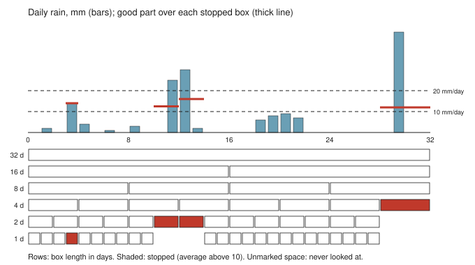
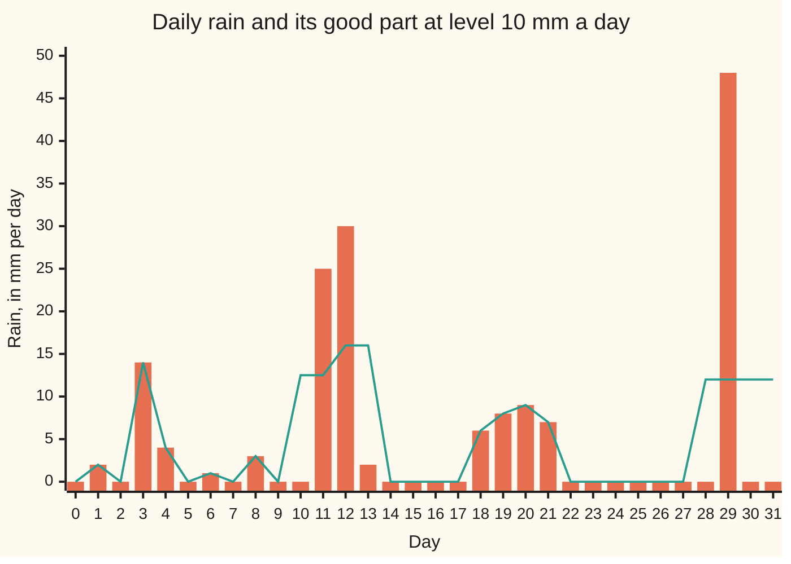

# Calderon-Zygmund decomposition: halve the boxes until the average is just big enough

[Syllabus](../../../SYLLABUS.md) → [Harmonic analysis](../README.md) → [Maximal Functions and Beyond](../README.md#s06) → Calderon-Zygmund decomposition

---

## General Overview

A rain gauge logs 32 days of rain, 159 mm in all. The numbers are illustrative. Most days are dry or nearly so. There is a 14 mm shower on day 3, a storm of 25 mm and 30 mm on days 11 and 12, steady showers of 6 to 9 mm on days 18 to 21, and a 48 mm cloudburst on day 29. Days are numbered 0 to 31.

The town's storm drains clear 10 mm a day. Where were they overloaded on average, and over how long a stretch? One wet day is a different problem from a wet week, so each wet spell should be found at its own length.

Halving does it. The whole record averages 4.96875 mm a day, below 10. Cut it in half, and keep cutting each half, and stop at the first box whose average goes above 10. Four boxes stop: day 3 at 14 mm a day, days 10 and 11 at 12.5, days 12 and 13 at 16, and days 28 to 31 at 12. Every one is above 10 and at most 20. The reason: its parent box was not above 10 and is only twice as long.

The stopped boxes then split the rain in two. The **good part** keeps the rain outside the boxes as it was, and spreads each box's rain evenly over its box. It never exceeds 20 mm a day. The **bad part** is what is left: inside each box it only moves rain around, and over each box it adds up to zero.

**Halve from the top and stop at the first box whose average beats the level: each stopped box averages between the level and twice it, the boxes are no longer in total than the total divided by the level, and the function splits into a good part bounded by twice the level and a bad part that adds up to zero on every box.**

**What kind of fact this is:** a theorem, the Calderón-Zygmund decomposition, proved on this card in Why it works for functions on the line. The version in higher dimensions is stated. Its main use, the bound for singular integrals, is outlined here and, with constants, on [Singular integrals](03-singular-integrals-and-the-hilbert-transform-bound.md). The rainfall record is illustrative.

### The picture: the record, the level and the halving

<p align="center"></p>

Drawn to scale: day d starts at 40 + 18 × d px, and each mm of rain is 3 px of bar height above y = 190. The dashed lines at y = 160 and y = 130 are 10 and 20 mm a day. The rows below are the boxes the halving looked at, longest first. The four shaded boxes stopped. The thick lines over the bars are the good part on those boxes. Boxes inside a stopped box are never looked at.

---

## The formula

Notation first, in words.

- Time $`t`$ is in days. Day d is the stretch from $`t = d`$ to $`t = d + 1`$.
- The function $`f(t)`$ is the rain rate on the day that contains $`t`$, in mm per day, and zero outside the 32 days. The area under $`f`$ over one day is that day's rain in mm.
- $`L^1(\mathbb R)`$ is the set of functions on the line with a finite total $`\|f\|_1 = \int \lvert f\rvert\,dt`$ (the wing 10 notation). Here $`\|f\|_1`$ = 159 mm.
- A **dyadic interval** is an interval $`[m\,2^n, (m+1)\,2^n)`$ with $`m`$ and $`n`$ whole numbers: its length is a power of two and it starts at a whole multiple of that length. Two dyadic intervals are either nested or apart; they never half-overlap. Each one splits into two dyadic halves, and sits inside one dyadic **parent** twice as long.
- For an interval $`Q`$, $`\lvert Q\rvert`$ is its length ([Lebesgue measure](../../10-Measure%20and%20integration/02-Length%20Done%20Properly/03-lebesgue-measure.md) writes it $`\lambda(Q)`$), and $`f_Q = \frac{1}{\lvert Q\rvert}\int_Q f`$ is the average of $`f`$ over it. Rain is never negative, so here the average of $`\lvert f\rvert`$ is the same number.
- $`\alpha`$ is the level, 10 mm per day. On this shelf, as on wing 10, it is a level a function is compared with.
- $`\mathbf 1_Q`$ is 1 on $`Q`$ and 0 elsewhere. "a.e." means almost everywhere: everywhere except on a set of length zero ([Null sets and almost everywhere](../../10-Measure%20and%20integration/01-Sets%20You%20Can%20Measure/07-null-sets-and-almost-everywhere.md)).

The theorem. For every $`f`$ in $`L^1(\mathbb R)`$ and every level $`\alpha > 0`$ there are dyadic intervals $`Q_1, Q_2, \dots`$, no two overlapping, with

```math
\alpha < \frac{1}{\lvert Q_k\rvert}\int_{Q_k} \lvert f\rvert\,dt \le 2\alpha, \qquad \sum_k \lvert Q_k\rvert \le \frac{\|f\|_1}{\alpha}, \qquad \lvert f(t)\rvert \le \alpha \ \text{ for a.e. } t \text{ outside every } Q_k
```

**Read it aloud:** each stopped box has an average above the level and at most twice the level, the boxes together are no longer than the total divided by the level, and outside them the function stays at or below the level, except on a set of length zero.

The good part $`g`$ and the bad pieces $`b_k`$:

```math
g(t) = \begin{cases} f(t) & t \text{ outside every } Q_k \\ f_{Q_k} & t \in Q_k \end{cases} \qquad b_k = \bigl(f - f_{Q_k}\bigr)\,\mathbf 1_{Q_k}, \qquad f = g + \sum_k b_k
```

What the two parts give:

```math
\lvert g\rvert \le 2\alpha \text{ a.e.}, \qquad \|g\|_1 \le \|f\|_1, \qquad \|g\|_2^2 \le 2\alpha\,\|f\|_1, \qquad \int_{Q_k} b_k\,dt = 0, \qquad \sum_k \|b_k\|_1 \le 2\,\|f\|_1
```

**Read it aloud:** the good part never exceeds twice the level, has no more total than $`f`$, and has energy at most twice the level times the total; each bad piece lives on one box, adds up to zero there, and all the bad pieces together are at most twice the total in size.

With the rain: four boxes of total length 9 days, against the bound 159 / 10 = 15.9 days. The good part peaks at 16 mm a day, under 20. Its energy $`\|g\|_2^2`$ (the integral of its square) is 1856.5, under the bound 2 × 10 × 159 = 3180. The rain's own energy is 4289: above that bound, so $`f`$ itself does not obey it.

| Symbol | Plain meaning | In our example | Push it up and the answer… |
| --- | --- | --- | --- |
| $`t,\ d`$ | time, in days; a day's number (in "When it holds", $`d`$ is instead a dimension) | 0 to 32; day 29 | — |
| $`f(t)`$ | the function: rain rate on the day containing $`t`$ | 0 to 48 mm per day | more rain, more boxes |
| $`\alpha`$ | the level the averages are compared with | 10 mm per day | fewer, shorter boxes |
| $`\Vert f\Vert_1,\ L^1(\mathbb R)`$ | total of $`\lvert f\rvert`$; functions with a finite total | 159 mm | the length bound grows |
| $`m,\ n,\ N`$ | start and length exponent of a dyadic interval $`[m\,2^n, (m+1)\,2^n)`$; $`2^N`$ is the length of the calm starting box | $`[28, 32)`$; $`2^5`$ = 32 | — |
| $`Q_k,\ \lvert Q_k\rvert,\ P`$ | the stopped boxes; a box's length; a box's parent (in the proof, $`I`$ and $`I_j`$ are other dyadic intervals; $`I_j`$ has length $`2^{-j}`$) | $`[3,4), [10,12), [12,14), [28,32)`$; total 9 days | — |
| $`f_Q`$ | average of $`f`$ over $`Q`$ | 12 on $`[28,32)`$ | — |
| $`g`$ | good part: $`f`$ outside the boxes, the box average inside | peak 16 mm per day | — |
| $`b_k,\ \mathbf 1_Q`$ | bad piece on $`Q_k`$; 1 on $`Q`$, 0 elsewhere | −12, 36, −12, −12 on days 28 to 31 | — |
| $`\Vert g\Vert_2^2`$ | energy: the integral of the square | 1856.5 | — |
| $`M_d f`$ | dyadic maximal function: largest $`\lvert f\rvert`$ average over dyadic intervals containing the point | above 10 on 9 days | — |
| $`Hb,\ x,\ y`$ | the Hilbert transform of $`b`$; the point it is read at; the point summed over | −0.001807 at 64 days from $`[28,32)`$ | — |

### When it holds

- **The total is finite.** The halving needs a first box whose average is not above the level. Rain of 12 mm a day forever averages 12 over $`2^5`$, $`2^{10}`$ and $`2^{20}`$ days alike, so no box can start the halving.
- **Stop at the first box above the level.** The bound $`2\alpha`$ comes from the parent not being above $`\alpha`$. Start the halving at single days instead, and day 29 is a box of average 48, far above 20.
- **The boxes are dyadic.** Dyadic boxes nest or stay apart, so the stopped boxes cannot overlap. The grid is a choice: move it one day and the boxes become $`[3,4)`$, $`[11,15)`$ and $`[27,31)`$. Every property in the theorem still holds; only the boxes change.
- **"Outside the boxes" means almost everywhere.** A rain rate changed at a single instant changes no average, so the halving cannot see it. The bound $`\lvert f\rvert \le \alpha`$ outside the boxes allows such exceptions on a set of length zero.
- **In $`d`$ dimensions the 2 becomes $`2^d`$.** A cube halved along every side has $`2^d`$ children, so a child's average is at most $`2^d`$ times its parent's: the upper bound is $`2^d\alpha`$. A grid of 1 km squares over a catchment gives 4α.

---

## Why it works

### Step 0: big boxes are calm, tiny boxes see the value, the stopping rule sits between

A very long box spreads a finite total thin, so its average is small. A box shrinking to a point has averages that tend to the value there, at almost every point. Halve from a calm box downwards and stop at the first box that beats the level. Its parent did not, and halving at most doubles an average. That one comparison gives every bound on the card.

### Step 1: find a calm box to start from

A dyadic box of length $`2^N`$ has average at most $`\|f\|_1 / 2^N`$, which is at most $`\alpha`$ once $`2^N \ge \|f\|_1 / \alpha`$. For the rain, the whole record $`[0, 32)`$ averages 4.96875, below 10. Rain is zero outside the record, so every other box of length 32 has average 0.

Without a finite total there is no such box: steady rain of 12 mm a day averages 12 at every length.

### Step 2: halve, and stop at the first box above the level

Take each box. If its average is above $`\alpha`$, stop: it is a $`Q_k`$. Otherwise halve it and test both halves. The rain needed 1, 2, 4, 8, 14 and 24 tests at lengths 32, 16, 8, 4, 2 and 1 day.

A one-day box not above 10 never stops below: the rain is constant on it, so every piece has the same average. The halving ends there.

The stopped boxes do not overlap. Two dyadic boxes are nested or apart, and nothing inside a stopped box is ever tested. Each $`Q_k`$ is also **largest**: no dyadic box containing it is above the level, since all of those were tested and halved.

### Step 3: the average is above α and at most 2α

Above $`\alpha`$ is the stopping rule. For the upper bound, let $`P`$ be the parent of $`Q_k`$, of length $`2\lvert Q_k\rvert`$. It was halved, so its average is at most $`\alpha`$:

```math
\int_{Q_k} \lvert f\rvert \le \int_P \lvert f\rvert \le \alpha\,\lvert P\rvert = 2\alpha\,\lvert Q_k\rvert
```

For $`[12, 14)`$: its parent $`[12, 16)`$ averages 8, so $`[12, 14)`$ can average at most 16. It averages exactly 16, because days 14 and 15 are dry. That is the bound reached.

### Step 4: the total length of the boxes

Each box has average above $`\alpha`$, so its length is less than its rain divided by $`\alpha`$. The boxes do not overlap, so adding up:

```math
\sum_k \lvert Q_k\rvert < \frac{1}{\alpha}\sum_k \int_{Q_k} \lvert f\rvert \le \frac{\|f\|_1}{\alpha}
```

For the rain: 9 days, under 119 / 10 = 11.9, under 159 / 10 = 15.9.

The union of the boxes is exactly the set where the **dyadic maximal function** $`M_d f`$ (the largest average of $`\lvert f\rvert`$ over dyadic intervals containing the point) is above $`\alpha`$. A point is in a stopped box exactly when some dyadic box around it beats the level. So Step 4 is the bound $`\lambda\{M_d f > \alpha\} \le \|f\|_1 / \alpha`$, the weak-type bound of [The maximal function](01-hardy-littlewood-maximal-function.md) for dyadic windows, with constant 1. A point in $`Q_k`$ also has a centred window of half-width $`\lvert Q_k\rvert`$ containing $`Q_k`$, of average above $`\alpha / 2`$, so the boxes lie inside the set where the ordinary maximal function $`Mf`$ is above $`\alpha / 2`$.

### Step 5: outside the boxes, at most α almost everywhere

A point outside every box sits in dyadic boxes of every small length, and none of them beats the level. As the boxes shrink to the point, their averages tend to $`\lvert f\rvert`$ there, at almost every point. That is [The Lebesgue differentiation theorem](../../10-Measure%20and%20integration/11-Derivatives%20Meet%20the%20Lebesgue%20Integral/02-lebesgue-differentiation-theorem.md). So $`\lvert f\rvert \le \alpha`$ there, except on a set of length zero.

For the rain no limit is needed. The rain is constant on each day, so a day outside the boxes has rain equal to its own one-day average, at most 10. The wettest such days are 9 and 8 mm, on days 20 and 19.

### Step 6: the good part and the bad part

On a box the good part is the average, at most $`2\alpha`$ by Step 3; off the boxes it is $`f`$, at most $`\alpha`$ a.e. by Step 5. Spreading rain evenly keeps its total, so $`\|g\|_1 \le \|f\|_1`$, and the energy is at most the peak times the total: $`\|g\|_2^2 \le 2\alpha\,\|f\|_1`$.

Each bad piece is $`f`$ minus its own average on one box, so it adds up to zero there. Its size is at most twice the rain in the box.

<details>
<summary>Detailed proof: the whole theorem on the line</summary>

Let $`f`$ be in $`L^1(\mathbb R)`$ and $`\alpha > 0`$. Choose $`N`$ with $`2^N \ge \|f\|_1/\alpha`$. Every dyadic interval $`I`$ of length $`2^N`$ has $`\frac{1}{\lvert I\rvert}\int_I \lvert f\rvert \le \|f\|_1/2^N \le \alpha`$.

*Selection.* Call a dyadic interval $`I`$ with $`\lvert I\rvert \le 2^N`$ **hot** if $`\int_I \lvert f\rvert > \alpha\lvert I\rvert`$. Let the $`Q_k`$ be the hot intervals contained in no larger hot interval of length at most $`2^N`$. Every hot interval lies in one of them, since its chain of dyadic ancestors up to length $`2^N`$ is finite. Two different $`Q_k`$ cannot be nested by maximality, so, being dyadic, they are disjoint. There are countably many dyadic intervals, so countably many $`Q_k`$. This is the halving of Step 2, described without the order of the tests.

*The averages.* $`Q_k`$ is hot, so its average is above $`\alpha`$. Its parent $`P`$ has length at most $`2^N`$ (no interval of length $`2^N`$ is hot) and is not hot, by maximality. So

$`\displaystyle \int_{Q_k} \lvert f\rvert \le \int_P \lvert f\rvert \le \alpha\lvert P\rvert = 2\alpha\lvert Q_k\rvert`$

*The length.* By disjointness and $`\lvert Q_k\rvert < \frac1\alpha \int_{Q_k}\lvert f\rvert`$,

$`\displaystyle \sum_k \lvert Q_k\rvert < \frac1\alpha \sum_k \int_{Q_k} \lvert f\rvert \le \frac{\|f\|_1}{\alpha}`$

*Outside.* Let $`x`$ lie in no $`Q_k`$ and be a Lebesgue point of $`\lvert f\rvert`$ (a point where averages of $`\lvert f(y)\rvert - \lvert f(x)\rvert`$ in size over shrinking windows tend to 0), which almost every point is. For each length $`2^{-j} \le 2^N`$, let $`I_j`$ be the dyadic interval of that length containing $`x`$. It is not hot, else it would lie in some $`Q_k`$. Also $`I_j \subseteq (x - 2^{-j}, x + 2^{-j})`$, a window of length $`2\lvert I_j\rvert`$, so

$`\displaystyle \Bigl\lvert \frac{1}{\lvert I_j\rvert}\int_{I_j}\lvert f\rvert - \lvert f(x)\rvert \Bigr\rvert \le \frac{2}{2\cdot 2^{-j}}\int_{x-2^{-j}}^{x+2^{-j}} \bigl\lvert \lvert f(y)\rvert - \lvert f(x)\rvert \bigr\rvert\,dy \to 0`$

Each average on the left is at most $`\alpha`$, so $`\lvert f(x)\rvert \le \alpha`$.

*The parts.* On $`Q_k`$, $`\lvert f_{Q_k}\rvert \le \frac{1}{\lvert Q_k\rvert}\int_{Q_k}\lvert f\rvert \le 2\alpha`$. Off the boxes $`\lvert g\rvert = \lvert f\rvert \le \alpha`$ a.e. Next, $`\int_{Q_k}\lvert g\rvert = \lvert Q_k\rvert\,\lvert f_{Q_k}\rvert \le \int_{Q_k}\lvert f\rvert`$, so $`\|g\|_1 \le \|f\|_1`$, and $`\|g\|_2^2 \le 2\alpha\|g\|_1 \le 2\alpha\|f\|_1`$. Finally $`\int b_k = \int_{Q_k} f - \lvert Q_k\rvert f_{Q_k} = 0`$, and $`\|b_k\|_1 \le \int_{Q_k}\lvert f\rvert + \lvert Q_k\rvert\,\lvert f_{Q_k}\rvert \le 2\int_{Q_k}\lvert f\rvert`$. Summing over the disjoint boxes gives $`\sum_k\|b_k\|_1 \le 2\|f\|_1`$.

In $`\mathbb R^d`$ the same proof runs with dyadic cubes. A cube's parent has $`2^d`$ times its volume, so the upper bound is $`2^d\alpha`$; everything else is unchanged. Calderón and Zygmund introduced the decomposition in 1952 (first source below).

</details>

### Step 7: what the two parts are for, in outline

The good part is bounded, so it has finite energy, and energy bounds proved with Fourier transforms apply to it. The bad part has no useful size bound, but each piece adds up to zero on a short box. Seen from far away, such a piece nearly cancels itself.

The table shows it for the Hilbert transform, $`Hb(x) = \frac1\pi\int \frac{b(y)}{x - y}\,dy`$ at a point $`x`$ outside the box ([The Hilbert transform](../02-The%20Fourier%20Transform/09-hilbert-transform-and-analytic-signals.md)). It compares the bad piece on $`[28, 32)`$ with the cut-at-the-level remainder there: the 38 mm of day 29 above 10 mm, which has no zero total. Distances are days before the box's centre, day 30.

| Distance | Bad piece | Cut-at-the-level remainder | Ratio |
| ---: | ---: | ---: | ---: |
| 8 days | −0.088999 | −1.615166 | 0.055102 |
| 16 days | −0.026126 | −0.780643 | 0.033467 |
| 32 days | −0.006996 | −0.384025 | 0.018219 |
| 64 days | −0.001807 | −0.190489 | 0.009486 |

The remainder fades like 1 over the distance: at 64 days, remainder × distance = −12.191270, near −38/π = −12.095776. The bad piece fades like 1 over the distance squared, because its zero total cancels the leading term. At 64 days, bad piece × distance² = −7.401463, near its first moment −24.0 mm × days over π, −7.639437. (The first moment is the sum of each day's bad rain times its offset from day 30.)

That cancellation is the whole engine of the next card. Take an operator bounded in energy whose kernel varies slowly away from the diagonal (the Hörmander condition, stated on [Singular integrals](03-singular-integrals-and-the-hilbert-transform-bound.md)). Then:

1. Split $`f = g + b`$ at level $`\alpha`$.
2. The good part: the energy bound and Chebyshev's inequality give a set of length at most a constant times $`\|f\|_1/\alpha`$ ([Markov and Chebyshev](../../10-Measure%20and%20integration/04-The%20Lebesgue%20Integral/07-markov-and-chebyshev.md)).
3. The bad part: throw away each box doubled, total length at most $`2\|f\|_1/\alpha`$. Off them, the zero totals make the kernel's slow variation count, and the result is again a constant times $`\|f\|_1/\alpha`$.

So the operator is of **weak type (1, 1)**: the set where its output is above $`\alpha`$ has length at most a constant times $`\|f\|_1/\alpha`$. [Interpolation](04-interpolation-riesz-thorin-and-marcinkiewicz.md) then fills in every $`L^p`$ bound between 1 and 2.

---

## Worked numbers, by hand

The record, in mm, days 0 to 31: 0, 2, 0, 14, 4, 0, 1, 0, 3, 0, 0, 25, 30, 2, 0, 0, 0, 0, 6, 8, 9, 7, 0, 0, 0, 0, 0, 0, 0, 48, 0, 0. Level 10 mm a day.

| Step | Arithmetic | Value |
| --- | --- | --- |
| start | 159 mm over $`[0, 32)`$ | 4.96875: halve |
| halves | 81 / 16 on $`[0,16)`$, 78 / 16 on $`[16,32)`$ | 5.0625 and 4.875: halve both |
| toward day 3 | $`[0,8)`$: 21 / 8; $`[0,4)`$: 16 / 4; $`[2,4)`$: 14 / 2 | 2.625, 4, 7: halve |
| day 3 | 14 / 1 | **14: stop** |
| toward the storm | $`[8,16)`$: 60 / 8; $`[8,12)`$: 28 / 4; $`[12,16)`$: 32 / 4 | 7.5, 7, 8: halve |
| the storm | $`[10,12)`$: 25 / 2; $`[12,14)`$: 32 / 2 | **12.5 and 16: stop** |
| toward the cloudburst | $`[24,32)`$: 48 / 8 | 6: halve |
| the cloudburst | $`[28,32)`$: 48 / 4 | **12: stop** |
| total length | 1 + 2 + 2 + 4 | **9 days**, under 159 / 10 = 15.9 |
| good part on the boxes | each box's average | 14; 12.5, 12.5; 16, 16; 12, 12, 12, 12 |
| bad part on $`[28,32)`$ | 0 − 12, 48 − 12, 0 − 12, 0 − 12 | −12, 36, −12, −12: sum 0 |
| bad part on the storm | 0 − 12.5, 25 − 12.5; 30 − 16, 2 − 16 | −12.5, 12.5; 14, −14 |
| size of the bad part | by box: 0, 25, 28, 72 | **125 mm**, under 2 × 119 = 238 |

The drains were overloaded on average over four spells, 9 days in all: one wet day, two back-to-back two-day storms, and four days around the cloudburst. The good part spreads each spell's rain evenly over it and never passes 16 mm a day.



Orange bars: the daily rain. Teal line: the good part. They differ only on the four stopped boxes; there the gap is the bad part.

### What breaks if you drop a piece

| Mistake | Comes out at | What went wrong |
| --- | --- | --- |
| Cut at the level instead of halving: keep rain above 10 as the remainder | 77 mm on days 3, 11, 12 and 29, adding to zero on no box; its Hilbert transform at 64 days is −0.190489, against −0.001807 | the remainder has no zero total, so nothing cancels and it fades only like 1 over the distance |
| Start the halving at single days | a box of average 48 on day 29 | no calm parent, so no upper bound of 2α = 20 |
| Expect the good part to stay at or below the level | 16 on $`[12,14)`$ | only twice the level is promised; at most the parent's 8 doubled |
| Drop the finite total: 12 mm a day forever | every average 12, over $`2^5`$, $`2^{10}`$ or $`2^{20}`$ days | no calm box to start from, so the halving never begins |

---

## Code, from first principles, and it actually runs

Both programs hold the record as whole millimetres, so every average is an exact fraction with a power-of-two denominator, printed exactly. They take three independent roads to the stopped boxes. Road 1 halves from the top and stops at the first box above the level. Road 2 lists every dyadic box above the level, bottom up, and keeps those inside no other. Road 3 computes the dyadic maximal function day by day and checks that it beats the level on exactly the days in the boxes. The asserts also test the bounds, the zero totals, and the far-field laws against the moment formulas, and they reproduce the hand-worked boxes. Logarithms appear only in the far-field table.

### Python

```python
# Calderon-Zygmund decomposition of a 32-day rainfall record (illustrative numbers).
# Road 1: start from the whole record and halve each box, stopping at the first
#         box whose average rain is above the level ALPHA.
# Road 2: list every dyadic box with average above ALPHA, keep the largest ones.
# Road 3: the dyadic maximal function, day by day; its level set must be the same days.
# Rain is whole mm per day, so every average is an exact fraction with a power-of-two
# denominator; dec() prints it exactly. Logs appear only in the far-field table.
from math import log, pi

RAIN = [0, 2, 0, 14, 4, 0, 1, 0, 3, 0, 0, 25, 30, 2, 0, 0,
        0, 0, 6, 8, 9, 7, 0, 0, 0, 0, 0, 0, 0, 48, 0, 0]   # mm on each day
ALPHA = 10                                                  # level, mm per day

def dec(n, d):  # exact decimal of n/d, d a power of two
    s = "-" if n < 0 else ""
    q, r = divmod(abs(n), d)
    out = s + str(q) + ("." if r else "")
    while r:
        r *= 10
        out += str(r // d)
        r %= d
    return out

def show(bx, shift=0):
    return " ".join(f"[{a - shift},{a - shift + n})" for a, n in bx)

def tot(rain, a, n):
    return sum(rain[a:a + n])

def halve(rain, alpha, a, n, out, seen):  # road 1, the stopping time
    seen[n] = seen.get(n, 0) + 1
    if tot(rain, a, n) > alpha * n:
        out.append((a, n))
    elif n > 1:  # a one-day box is constant inside: halving it never stops
        halve(rain, alpha, a, n // 2, out, seen)
        halve(rain, alpha, a + n // 2, n // 2, out, seen)
    return out

def largest(rain, alpha):  # road 2, bottom up
    hot, n = [], 1
    while n <= len(rain):
        hot += [(a, n) for a in range(0, len(rain), n) if tot(rain, a, n) > alpha * n]
        n *= 2
    inside = lambda b, c: c != b and c[0] <= b[0] and b[0] + b[1] <= c[0] + c[1]
    return sorted(b for b in hot if not any(inside(b, c) for c in hot))

L, F1 = len(RAIN), sum(RAIN)
print(f"record: {L} days, total {F1} mm, level ALPHA = {ALPHA} mm/day, 2 ALPHA = {2 * ALPHA}")
print(f"start box [0,{L}): average {dec(F1, L)} mm/day, not above {ALPHA}")
seen = {}
boxes = halve(RAIN, ALPHA, 0, L, [], seen)
for n in sorted(seen, reverse=True):
    print(f"  boxes of length {n:>2} looked at: {seen[n]:>2}, stopped: {sum(1 for b in boxes if b[1] == n)}")
for a, n in boxes:
    t = tot(RAIN, a, n)
    path = [(a - a % m, m) for m in (32, 16, 8, 4, 2) if m > n]
    print(f"stopped [{a},{a + n}): length {n}, {t} mm, average {dec(t, n)}; above it: "
          + ", ".join(f"[{s},{s + m}) {tot(RAIN, s, m)}/{m} = {dec(tot(RAIN, s, m), m)}" for s, m in path))
assert boxes == [(3, 1), (10, 2), (12, 2), (28, 4)], "the hand-worked halving"
assert boxes == largest(RAIN, ALPHA), "road 2: largest hot boxes"
for a, n in boxes:
    assert ALPHA * n < tot(RAIN, a, n) <= 2 * ALPHA * n, "average between ALPHA and 2 ALPHA"
bad_days = sorted(d for a, n in boxes for d in range(a, a + n))
md_hot = [d for d in range(L) if any(tot(RAIN, d - d % n, n) > ALPHA * n for n in (1, 2, 4, 8, 16, 32))]
assert md_hot == bad_days, "road 3: dyadic maximal function above ALPHA on exactly the boxes"
print(f"road 2, largest hot boxes: {show(largest(RAIN, ALPHA))}")
print(f"road 3, days with dyadic maximal function above {ALPHA}: {md_hot}")
inbox = sum(tot(RAIN, a, n) for a, n in boxes)
print(f"length of boxes {len(bad_days)} days < rain in boxes {inbox} mm / ALPHA = {dec(inbox, ALPHA)} <= total / ALPHA = {dec(F1, ALPHA)}")
assert len(bad_days) * ALPHA < inbox <= F1, "length bound"
assert max(RAIN[d] for d in range(L) if d not in bad_days) <= ALPHA, "outside the boxes, rain <= ALPHA"

g32 = [32 * r for r in RAIN]   # good part times 32, so it stays a whole number
for a, n in boxes:
    for d in range(a, a + n):
        g32[d] = 32 * tot(RAIN, a, n) // n
b32 = [32 * r - g for r, g in zip(RAIN, g32)]
for a, n in boxes:
    print(f"  bad part on [{a},{a + n}): {" ".join(dec(x, 32) for x in b32[a:a + n])}, sum {dec(sum(b32[a:a + n]), 32)}, size {dec(sum(abs(x) for x in b32[a:a + n]), 32)}")
    assert sum(b32[a:a + n]) == 0, "bad part nets to zero on each box"
e_g, e_f = sum(x * x for x in g32), 1024 * sum(r * r for r in RAIN)
print(f"good part: largest {dec(max(g32), 32)} mm/day, total {dec(sum(g32), 32)} mm, energy {dec(e_g, 1024)}")
print(f"rain energy {dec(e_f, 1024)}; bound on good energy 2 ALPHA x total = {2 * ALPHA * F1}")
print(f"bad part: total size {dec(sum(abs(x) for x in b32), 32)} mm <= 2 x rain in boxes = {2 * inbox}")
assert max(g32) <= 64 * ALPHA and sum(g32) == 32 * F1 and e_g <= 1024 * 2 * ALPHA * F1 < e_f

def pull(vals, a, x):  # Hilbert transform at x of a day-by-day step function starting on day a
    return sum(v * (log(abs(x - d)) - log(abs(x - d - 1))) for d, v in zip(range(a, a + len(vals)), vals)) / pi
cut = [max(r - ALPHA, 0) for r in RAIN[28:32]]   # the truncation remainder on [28,32)
print("far field of [28,32): distance, bad part, cut-at-level remainder, ratio")
ratios = []
for dist in (8, 16, 32, 64):
    hb, hc = pull([x / 32 for x in b32[28:32]], 28, 30 - dist), pull(cut, 28, 30 - dist)
    ratios.append(abs(hb / hc))
    print(f"  {dist:>3} days  {hb:>10.6f}  {hc:>10.6f}  {ratios[-1]:.6f}")
assert all(r2 < 0.65 * r1 for r1, r2 in zip(ratios, ratios[1:])), "bad part fades faster"
m1 = sum(x / 32 * (d + 0.5 - 30) for d, x in zip(range(28, 32), b32[28:32]))   # first moment, -24
print(f"at 64 days, bad part x distance^2 = {hb * 64 ** 2:.6f}; first moment {m1:.1f} mm x days, / pi = {m1 / pi:.6f}")
print(f"at 64 days, remainder x distance = {hc * 64:.6f}; -38 / pi = {-38 / pi:.6f}")
assert abs(hb * 64 ** 2 / (m1 / pi) - 1) < 0.05 and abs(hc * 64 / (-38 / pi) - 1) < 0.05, "far-field laws"

trunc = [max(r - ALPHA, 0) for r in RAIN]
print(f"wrong: cut at the level, remainder total {sum(trunc)} mm, on days {[d for d in range(L) if trunc[d]]}")
print(f"wrong: start at single days, largest box average {max(RAIN)} > 2 ALPHA = {2 * ALPHA}")
print(f"wrong: good part <= ALPHA, but it reaches {dec(max(g32), 32)}")
print(f"fails: 12 mm/day forever, average over 2^n days for n = 5, 10, 20: {", ".join(dec(12 * 2 ** n, 2 ** n) for n in (5, 10, 20))}")
shift = [0] + RAIN + [0] * 31
sb = halve(shift, ALPHA, 0, 64, [], {})
print(f"grid moved one day: boxes {show(sb, 1)}, length {sum(n for _, n in sb)} days")
for label, rain, alpha in (("try: ALPHA = 5", RAIN, 5), ("try: ALPHA = 20", RAIN, 20),
                           ("try: day 29 = 96 mm", RAIN[:29] + [96] + RAIN[30:], ALPHA)):
    bx = halve(rain, alpha, 0, L, [], {})
    assert bx == largest(rain, alpha)
    print(f"{label}: boxes {show(bx)}, length {sum(n for _, n in bx)} days")
print("chart, rain      " + " ".join(str(r) for r in RAIN))
print("chart, good part " + " ".join(dec(g, 32) for g in g32))
print("figure, x = 40 + 18 x day px, bar height 3 px per mm from y = 190, ALPHA line y = 160, 2 ALPHA line y = 130")
print("figure, stopped boxes px " + ", ".join(f"{40 + 18 * a}-{40 + 18 * (a + n)}" for a, n in boxes))
print("ALL CHECKS PASS")
```

**Ran 2026-11-15 on macOS, Python 3.14.10, standard library only. All checks passed. Output, pasted from the run:**

```
record: 32 days, total 159 mm, level ALPHA = 10 mm/day, 2 ALPHA = 20
start box [0,32): average 4.96875 mm/day, not above 10
  boxes of length 32 looked at:  1, stopped: 0
  boxes of length 16 looked at:  2, stopped: 0
  boxes of length  8 looked at:  4, stopped: 0
  boxes of length  4 looked at:  8, stopped: 1
  boxes of length  2 looked at: 14, stopped: 2
  boxes of length  1 looked at: 24, stopped: 1
stopped [3,4): length 1, 14 mm, average 14; above it: [0,32) 159/32 = 4.96875, [0,16) 81/16 = 5.0625, [0,8) 21/8 = 2.625, [0,4) 16/4 = 4, [2,4) 14/2 = 7
stopped [10,12): length 2, 25 mm, average 12.5; above it: [0,32) 159/32 = 4.96875, [0,16) 81/16 = 5.0625, [8,16) 60/8 = 7.5, [8,12) 28/4 = 7
stopped [12,14): length 2, 32 mm, average 16; above it: [0,32) 159/32 = 4.96875, [0,16) 81/16 = 5.0625, [8,16) 60/8 = 7.5, [12,16) 32/4 = 8
stopped [28,32): length 4, 48 mm, average 12; above it: [0,32) 159/32 = 4.96875, [16,32) 78/16 = 4.875, [24,32) 48/8 = 6
road 2, largest hot boxes: [3,4) [10,12) [12,14) [28,32)
road 3, days with dyadic maximal function above 10: [3, 10, 11, 12, 13, 28, 29, 30, 31]
length of boxes 9 days < rain in boxes 119 mm / ALPHA = 11.9 <= total / ALPHA = 15.9
  bad part on [3,4): 0, sum 0, size 0
  bad part on [10,12): -12.5 12.5, sum 0, size 25
  bad part on [12,14): 14 -14, sum 0, size 28
  bad part on [28,32): -12 36 -12 -12, sum 0, size 72
good part: largest 16 mm/day, total 159 mm, energy 1856.5
rain energy 4289; bound on good energy 2 ALPHA x total = 3180
bad part: total size 125 mm <= 2 x rain in boxes = 238
far field of [28,32): distance, bad part, cut-at-level remainder, ratio
    8 days   -0.088999   -1.615166  0.055102
   16 days   -0.026126   -0.780643  0.033467
   32 days   -0.006996   -0.384025  0.018219
   64 days   -0.001807   -0.190489  0.009486
at 64 days, bad part x distance^2 = -7.401463; first moment -24.0 mm x days, / pi = -7.639437
at 64 days, remainder x distance = -12.191270; -38 / pi = -12.095776
wrong: cut at the level, remainder total 77 mm, on days [3, 11, 12, 29]
wrong: start at single days, largest box average 48 > 2 ALPHA = 20
wrong: good part <= ALPHA, but it reaches 16
fails: 12 mm/day forever, average over 2^n days for n = 5, 10, 20: 12, 12, 12
grid moved one day: boxes [3,4) [11,15) [27,31), length 9 days
try: ALPHA = 5: boxes [0,16) [18,20) [20,22) [24,32), length 28 days
try: ALPHA = 20: boxes [11,12) [12,13) [28,30), length 4 days
try: day 29 = 96 mm: boxes [3,4) [10,12) [12,14) [24,32), length 13 days
chart, rain      0 2 0 14 4 0 1 0 3 0 0 25 30 2 0 0 0 0 6 8 9 7 0 0 0 0 0 0 0 48 0 0
chart, good part 0 2 0 14 4 0 1 0 3 0 12.5 12.5 16 16 0 0 0 0 6 8 9 7 0 0 0 0 0 0 12 12 12 12
figure, x = 40 + 18 x day px, bar height 3 px per mm from y = 190, ALPHA line y = 160, 2 ALPHA line y = 130
figure, stopped boxes px 94-112, 220-256, 256-292, 544-616
ALL CHECKS PASS
```

### Rust

```rust
// Calderon-Zygmund decomposition of a 32-day rainfall record (illustrative numbers).
// Road 1: start from the whole record and halve each box, stopping at the first
//         box whose average rain is above the level ALPHA.
// Road 2: list every dyadic box with average above ALPHA, keep the largest ones.
// Road 3: the dyadic maximal function, day by day; its level set must be the same days.
// Rain is whole mm per day, so every average is an exact fraction with a power-of-two
// denominator; dec() prints it exactly. Logs appear only in the far-field table.
use std::collections::BTreeMap;
use std::f64::consts::PI;

const RAIN: [i64; 32] = [0, 2, 0, 14, 4, 0, 1, 0, 3, 0, 0, 25, 30, 2, 0, 0,
                         0, 0, 6, 8, 9, 7, 0, 0, 0, 0, 0, 0, 0, 48, 0, 0]; // mm on each day
const ALPHA: i64 = 10; // level, mm per day

fn dec(n: i64, d: i64) -> String { // exact decimal of n/d, d a power of two
    let s = if n < 0 { "-" } else { "" };
    let (q, mut r) = (n.abs() / d, n.abs() % d);
    let mut out = format!("{}{}{}", s, q, if r != 0 { "." } else { "" });
    while r != 0 {
        r *= 10;
        out += &(r / d).to_string();
        r %= d;
    }
    out
}

fn show(bx: &[(usize, usize)], shift: usize) -> String {
    bx.iter().map(|&(a, n)| format!("[{},{})", a - shift, a - shift + n)).collect::<Vec<_>>().join(" ")
}

fn tot(rain: &[i64], a: usize, n: usize) -> i64 { rain[a..a + n].iter().sum() }

// road 1, the stopping time
fn halve(rain: &[i64], alpha: i64, a: usize, n: usize, out: &mut Vec<(usize, usize)>, seen: &mut BTreeMap<usize, usize>) {
    *seen.entry(n).or_insert(0) += 1;
    if tot(rain, a, n) > alpha * n as i64 {
        out.push((a, n));
    } else if n > 1 { // a one-day box is constant inside: halving it never stops
        halve(rain, alpha, a, n / 2, out, seen);
        halve(rain, alpha, a + n / 2, n / 2, out, seen);
    }
}

fn run(rain: &[i64], alpha: i64) -> Vec<(usize, usize)> {
    let mut out = Vec::new();
    halve(rain, alpha, 0, rain.len(), &mut out, &mut BTreeMap::new());
    out
}

fn largest(rain: &[i64], alpha: i64) -> Vec<(usize, usize)> { // road 2, bottom up
    let (mut hot, mut n) = (Vec::new(), 1);
    while n <= rain.len() {
        for a in (0..rain.len()).step_by(n) {
            if tot(rain, a, n) > alpha * n as i64 { hot.push((a, n)); }
        }
        n *= 2;
    }
    let inside = |b: (usize, usize), c: (usize, usize)| c != b && c.0 <= b.0 && b.0 + b.1 <= c.0 + c.1;
    let mut keep: Vec<_> = hot.iter().cloned().filter(|&b| !hot.iter().any(|&c| inside(b, c))).collect();
    keep.sort();
    keep
}

fn pull(vals: &[f64], a: i64, x: i64) -> f64 { // Hilbert transform at x of a day-by-day step function
    let mut s = 0.0;
    for (i, v) in vals.iter().enumerate() {
        let d = a + i as i64;
        s += v * (((x - d).abs() as f64).ln() - ((x - d - 1).abs() as f64).ln());
    }
    s / PI
}

fn main() {
    let (l, f1) = (RAIN.len(), RAIN.iter().sum::<i64>());
    println!("record: {} days, total {} mm, level ALPHA = {} mm/day, 2 ALPHA = {}", l, f1, ALPHA, 2 * ALPHA);
    println!("start box [0,{}): average {} mm/day, not above {}", l, dec(f1, l as i64), ALPHA);
    let (mut boxes, mut seen) = (Vec::new(), BTreeMap::new());
    halve(&RAIN, ALPHA, 0, l, &mut boxes, &mut seen);
    for (n, c) in seen.iter().rev() {
        println!("  boxes of length {:>2} looked at: {:>2}, stopped: {}", n, c, boxes.iter().filter(|b| b.1 == *n).count());
    }
    for &(a, n) in &boxes {
        let t = tot(&RAIN, a, n);
        let path: Vec<String> = [32usize, 16, 8, 4, 2].iter().filter(|&&m| m > n)
            .map(|&m| { let s = a - a % m; format!("[{},{}) {}/{} = {}", s, s + m, tot(&RAIN, s, m), m, dec(tot(&RAIN, s, m), m as i64)) }).collect();
        println!("stopped [{},{}): length {}, {} mm, average {}; above it: {}", a, a + n, n, t, dec(t, n as i64), path.join(", "));
    }
    assert!(boxes == vec![(3, 1), (10, 2), (12, 2), (28, 4)], "the hand-worked halving");
    assert!(boxes == largest(&RAIN, ALPHA), "road 2: largest hot boxes");
    for &(a, n) in &boxes {
        let t = tot(&RAIN, a, n);
        assert!(ALPHA * (n as i64) < t && t <= 2 * ALPHA * n as i64, "average between ALPHA and 2 ALPHA");
    }
    let bad_days: Vec<usize> = boxes.iter().flat_map(|&(a, n)| a..a + n).collect();
    let md_hot: Vec<usize> = (0..l).filter(|&d| [1usize, 2, 4, 8, 16, 32].iter()
        .any(|&n| tot(&RAIN, d - d % n, n) > ALPHA * n as i64)).collect();
    assert!(md_hot == bad_days, "road 3: dyadic maximal function above ALPHA on exactly the boxes");
    println!("road 2, largest hot boxes: {}", show(&largest(&RAIN, ALPHA), 0));
    println!("road 3, days with dyadic maximal function above {}: {:?}", ALPHA, md_hot);
    let inbox: i64 = boxes.iter().map(|&(a, n)| tot(&RAIN, a, n)).sum();
    println!("length of boxes {} days < rain in boxes {} mm / ALPHA = {} <= total / ALPHA = {}", bad_days.len(), inbox, dec(inbox, ALPHA), dec(f1, ALPHA));
    assert!((bad_days.len() as i64) * ALPHA < inbox && inbox <= f1, "length bound");
    assert!((0..l).filter(|d| !bad_days.contains(d)).all(|d| RAIN[d] <= ALPHA), "outside the boxes, rain <= ALPHA");

    let mut g32: Vec<i64> = RAIN.iter().map(|r| 32 * r).collect(); // good part times 32
    for &(a, n) in &boxes {
        for d in a..a + n { g32[d] = 32 * tot(&RAIN, a, n) / n as i64; }
    }
    let b32: Vec<i64> = RAIN.iter().zip(&g32).map(|(r, g)| 32 * r - g).collect();
    for &(a, n) in &boxes {
        let s: i64 = b32[a..a + n].iter().sum();
        let parts: Vec<String> = b32[a..a + n].iter().map(|&x| dec(x, 32)).collect();
        let size: i64 = b32[a..a + n].iter().map(|x| x.abs()).sum();
        println!("  bad part on [{},{}): {}, sum {}, size {}", a, a + n, parts.join(" "), dec(s, 32), dec(size, 32));
        assert!(s == 0, "bad part nets to zero on each box");
    }
    let e_g: i64 = g32.iter().map(|x| x * x).sum();
    let e_f: i64 = 1024 * RAIN.iter().map(|r| r * r).sum::<i64>();
    let gmax = *g32.iter().max().unwrap();
    println!("good part: largest {} mm/day, total {} mm, energy {}", dec(gmax, 32), dec(g32.iter().sum(), 32), dec(e_g, 1024));
    println!("rain energy {}; bound on good energy 2 ALPHA x total = {}", dec(e_f, 1024), 2 * ALPHA * f1);
    println!("bad part: total size {} mm <= 2 x rain in boxes = {}", dec(b32.iter().map(|x| x.abs()).sum(), 32), 2 * inbox);
    assert!(gmax <= 64 * ALPHA && g32.iter().sum::<i64>() == 32 * f1 && e_g <= 1024 * 2 * ALPHA * f1 && 1024 * 2 * ALPHA * f1 < e_f);

    let bvals: Vec<f64> = b32[28..32].iter().map(|&x| x as f64 / 32.0).collect();
    let cut: Vec<f64> = RAIN[28..32].iter().map(|&r| (r - ALPHA).max(0) as f64).collect(); // truncation remainder
    println!("far field of [28,32): distance, bad part, cut-at-level remainder, ratio");
    let (mut ratios, mut hb, mut hc) = (Vec::new(), 0.0, 0.0);
    for dist in [8i64, 16, 32, 64] {
        hb = pull(&bvals, 28, 30 - dist);
        hc = pull(&cut, 28, 30 - dist);
        ratios.push((hb / hc).abs());
        println!("  {:>3} days  {:>10.6}  {:>10.6}  {:.6}", dist, hb, hc, ratios[ratios.len() - 1]);
    }
    assert!(ratios.windows(2).all(|w| w[1] < 0.65 * w[0]), "bad part fades faster");
    let m1: f64 = (28..32).map(|d| b32[d] as f64 / 32.0 * (d as f64 + 0.5 - 30.0)).sum(); // first moment, -24
    println!("at 64 days, bad part x distance^2 = {:.6}; first moment {:.1} mm x days, / pi = {:.6}", hb * 4096.0, m1, m1 / PI);
    println!("at 64 days, remainder x distance = {:.6}; -38 / pi = {:.6}", hc * 64.0, -38.0 / PI);
    assert!((hb * 4096.0 / (m1 / PI) - 1.0).abs() < 0.05 && (hc * 64.0 / (-38.0 / PI) - 1.0).abs() < 0.05, "far-field laws");

    let trunc: Vec<i64> = RAIN.iter().map(|&r| (r - ALPHA).max(0)).collect();
    let tdays: Vec<usize> = (0..l).filter(|&d| trunc[d] != 0).collect();
    println!("wrong: cut at the level, remainder total {} mm, on days {:?}", trunc.iter().sum::<i64>(), tdays);
    println!("wrong: start at single days, largest box average {} > 2 ALPHA = {}", RAIN.iter().max().unwrap(), 2 * ALPHA);
    println!("wrong: good part <= ALPHA, but it reaches {}", dec(gmax, 32));
    let drizzle: Vec<String> = [5u32, 10, 20].iter().map(|&n| dec(12 * 2i64.pow(n), 2i64.pow(n))).collect();
    println!("fails: 12 mm/day forever, average over 2^n days for n = 5, 10, 20: {}", drizzle.join(", "));
    let mut shift = vec![0i64];
    shift.extend_from_slice(&RAIN);
    shift.extend_from_slice(&[0; 31]);
    let sb = run(&shift, ALPHA);
    println!("grid moved one day: boxes {}, length {} days", show(&sb, 1), sb.iter().map(|b| b.1).sum::<usize>());
    let mut heavy = RAIN.to_vec();
    heavy[29] = 96;
    for (label, rain, alpha) in [("try: ALPHA = 5", RAIN.to_vec(), 5), ("try: ALPHA = 20", RAIN.to_vec(), 20),
                                 ("try: day 29 = 96 mm", heavy, ALPHA)] {
        let bx = run(&rain, alpha);
        assert!(bx == largest(&rain, alpha));
        println!("{}: boxes {}, length {} days", label, show(&bx, 0), bx.iter().map(|b| b.1).sum::<usize>());
    }
    println!("chart, rain      {}", RAIN.iter().map(|r| r.to_string()).collect::<Vec<_>>().join(" "));
    println!("chart, good part {}", g32.iter().map(|&g| dec(g, 32)).collect::<Vec<_>>().join(" "));
    println!("figure, x = 40 + 18 x day px, bar height 3 px per mm from y = 190, ALPHA line y = 160, 2 ALPHA line y = 130");
    println!("figure, stopped boxes px {}", boxes.iter().map(|&(a, n)| format!("{}-{}", 40 + 18 * a, 40 + 18 * (a + n)))
             .collect::<Vec<_>>().join(", "));
    println!("ALL CHECKS PASS");
}
```

**Ran 2026-11-15 on macOS, rustc 1.98.1, no crates. All checks passed. Output, pasted from the run:**

```
record: 32 days, total 159 mm, level ALPHA = 10 mm/day, 2 ALPHA = 20
start box [0,32): average 4.96875 mm/day, not above 10
  boxes of length 32 looked at:  1, stopped: 0
  boxes of length 16 looked at:  2, stopped: 0
  boxes of length  8 looked at:  4, stopped: 0
  boxes of length  4 looked at:  8, stopped: 1
  boxes of length  2 looked at: 14, stopped: 2
  boxes of length  1 looked at: 24, stopped: 1
stopped [3,4): length 1, 14 mm, average 14; above it: [0,32) 159/32 = 4.96875, [0,16) 81/16 = 5.0625, [0,8) 21/8 = 2.625, [0,4) 16/4 = 4, [2,4) 14/2 = 7
stopped [10,12): length 2, 25 mm, average 12.5; above it: [0,32) 159/32 = 4.96875, [0,16) 81/16 = 5.0625, [8,16) 60/8 = 7.5, [8,12) 28/4 = 7
stopped [12,14): length 2, 32 mm, average 16; above it: [0,32) 159/32 = 4.96875, [0,16) 81/16 = 5.0625, [8,16) 60/8 = 7.5, [12,16) 32/4 = 8
stopped [28,32): length 4, 48 mm, average 12; above it: [0,32) 159/32 = 4.96875, [16,32) 78/16 = 4.875, [24,32) 48/8 = 6
road 2, largest hot boxes: [3,4) [10,12) [12,14) [28,32)
road 3, days with dyadic maximal function above 10: [3, 10, 11, 12, 13, 28, 29, 30, 31]
length of boxes 9 days < rain in boxes 119 mm / ALPHA = 11.9 <= total / ALPHA = 15.9
  bad part on [3,4): 0, sum 0, size 0
  bad part on [10,12): -12.5 12.5, sum 0, size 25
  bad part on [12,14): 14 -14, sum 0, size 28
  bad part on [28,32): -12 36 -12 -12, sum 0, size 72
good part: largest 16 mm/day, total 159 mm, energy 1856.5
rain energy 4289; bound on good energy 2 ALPHA x total = 3180
bad part: total size 125 mm <= 2 x rain in boxes = 238
far field of [28,32): distance, bad part, cut-at-level remainder, ratio
    8 days   -0.088999   -1.615166  0.055102
   16 days   -0.026126   -0.780643  0.033467
   32 days   -0.006996   -0.384025  0.018219
   64 days   -0.001807   -0.190489  0.009486
at 64 days, bad part x distance^2 = -7.401463; first moment -24.0 mm x days, / pi = -7.639437
at 64 days, remainder x distance = -12.191270; -38 / pi = -12.095776
wrong: cut at the level, remainder total 77 mm, on days [3, 11, 12, 29]
wrong: start at single days, largest box average 48 > 2 ALPHA = 20
wrong: good part <= ALPHA, but it reaches 16
fails: 12 mm/day forever, average over 2^n days for n = 5, 10, 20: 12, 12, 12
grid moved one day: boxes [3,4) [11,15) [27,31), length 9 days
try: ALPHA = 5: boxes [0,16) [18,20) [20,22) [24,32), length 28 days
try: ALPHA = 20: boxes [11,12) [12,13) [28,30), length 4 days
try: day 29 = 96 mm: boxes [3,4) [10,12) [12,14) [24,32), length 13 days
chart, rain      0 2 0 14 4 0 1 0 3 0 0 25 30 2 0 0 0 0 6 8 9 7 0 0 0 0 0 0 0 48 0 0
chart, good part 0 2 0 14 4 0 1 0 3 0 12.5 12.5 16 16 0 0 0 0 6 8 9 7 0 0 0 0 0 0 12 12 12 12
figure, x = 40 + 18 x day px, bar height 3 px per mm from y = 190, ALPHA line y = 160, 2 ALPHA line y = 130
figure, stopped boxes px 94-112, 220-256, 256-292, 544-616
ALL CHECKS PASS
```

### Lean

Lean proves the whole theorem on the line, for every function with a finite total, and checks the rain's arithmetic.

- Take $`f`$ in $`L^1(\mathbb R)`$ and a level $`\alpha > 0`$. Then there are dyadic intervals $`Q_k`$, no two overlapping, each averaging $`\lvert f\rvert`$ above $`\alpha`$ and at most $`2\alpha`$.
- Take those boxes $`Q_k`$. Then their lengths add up to at most $`\|f\|_1/\alpha`$, and $`\lvert f\rvert \le \alpha`$ a.e. outside them.
- Take dyadic boxes as above: no overlaps, each averaging at most $`2\alpha`$, and $`\lvert f\rvert \le \alpha`$ a.e. outside them. Then the good part $`g`$ has $`\lvert g\rvert \le 2\alpha`$ a.e. and $`\|g\|_1 \le \|f\|_1`$.
- Take the same good part $`g`$. Then its energy $`\|g\|_2^2`$ is at most $`2\alpha\|f\|_1`$.
- Take any dyadic boxes $`Q_k`$ that do not overlap. Then each bad piece $`b_k`$ adds up to zero on its box.
- Take the same boxes. Then the sizes $`\|b_k\|_1`$ add up to at most $`2\|f\|_1`$.
- Lean also checks the rain's arithmetic exactly: the four stopped boxes, their parents, the 9 days, and the bad part's 125 mm.

The Hilbert transform table, the energies, the moved grid and the Try changing cases are left to the Python and Rust checks.

```lean
-- Calderon-Zygmund decomposition: every integrable function on the line has disjoint dyadic boxes with averages between the level and twice it, total length at most the total over the level, the function at most the level a.e. outside them, and a good part and bad part with the card's bounds.
import Mathlib.MeasureTheory.Integral.Bochner.Set
import Mathlib.MeasureTheory.Measure.Lebesgue.Basic
import Mathlib.MeasureTheory.Covering.DensityTheorem
import Mathlib.MeasureTheory.Measure.Lebesgue.EqHaar

open MeasureTheory

namespace CalderonZygmund

/-- The dyadic interval `[m 2^n, (m+1) 2^n)` named by the pair `p = (m, n)` of whole numbers. -/
noncomputable def dyadic (p : ℤ × ℤ) : Set ℝ :=
  Set.Ico ((p.1 : ℝ) * (2 : ℝ) ^ p.2) (((p.1 : ℝ) + 1) * (2 : ℝ) ^ p.2)

lemma dyadic_meas (p : ℤ × ℤ) : MeasurableSet (dyadic p) := measurableSet_Ico

#print axioms dyadic_meas

lemma volume_dyadic (p : ℤ × ℤ) : volume (dyadic p) = ENNReal.ofReal ((2 : ℝ) ^ p.2) := by
  rw [dyadic, Real.volume_Ico]; congr 1; ring

#print axioms volume_dyadic

lemma pairwise_sub (S : Set (ℤ × ℤ)) (hS : S.PairwiseDisjoint dyadic) :
    Pairwise (Function.onFun Disjoint fun p : S => dyadic p) :=
  fun a b hab => hS a.2 b.2 (fun h => hab (Subtype.ext h))

#print axioms pairwise_sub

lemma union_meas (S : Set (ℤ × ℤ)) : MeasurableSet (⋃ p ∈ S, dyadic p) :=
  MeasurableSet.biUnion S.to_countable (fun p _ => dyadic_meas p)

#print axioms union_meas

lemma lintegral_split (S : Set (ℤ × ℤ)) (hS : S.PairwiseDisjoint dyadic) (φ : ℝ → ENNReal) :
    ∫⁻ x, φ x = (∫⁻ x in (⋃ p ∈ S, dyadic p)ᶜ, φ x) + ∑' p : S, ∫⁻ x in dyadic p, φ x := by
  have hU : (⋃ p : S, dyadic p) = ⋃ p ∈ S, dyadic p := by ext x; simp
  rw [← lintegral_iUnion (fun p => dyadic_meas _) (pairwise_sub S hS), hU]
  exact (lintegral_add_compl _ (union_meas S)).symm.trans (add_comm _ _)

#print axioms lintegral_split

lemma tsum_le (S : Set (ℤ × ℤ)) (hS : S.PairwiseDisjoint dyadic) (φ : ℝ → ENNReal) :
    ∑' p : S, ∫⁻ x in dyadic p, φ x ≤ ∫⁻ x, φ x := by
  rw [lintegral_split S hS φ]
  exact le_add_self

#print axioms tsum_le

lemma ofReal_setIntegral_abs (f : ℝ → ℝ) (hf : Integrable f) (s : Set ℝ) :
    ENNReal.ofReal (∫ x in s, |f x|) = ∫⁻ x in s, ‖f x‖ₑ := by
  rw [← ofReal_integral_norm_eq_lintegral_enorm hf.integrableOn]; rfl

#print axioms ofReal_setIntegral_abs

lemma ofReal_integral_abs (f : ℝ → ℝ) (hf : Integrable f) :
    ENNReal.ofReal (∫ x, |f x|) = ∫⁻ x, ‖f x‖ₑ := by
  rw [← ofReal_integral_norm_eq_lintegral_enorm hf]; rfl

#print axioms ofReal_integral_abs

/-- The parent of a dyadic interval: the dyadic interval twice as long that contains it. -/
def parent (p : ℤ × ℤ) : ℤ × ℤ := (p.1 / 2, p.2 + 1)

#print axioms parent

lemma dyadic_subset_parent (p : ℤ × ℤ) : dyadic p ⊆ dyadic (parent p) := by
  intro x hx
  obtain ⟨m, n⟩ := p
  simp only [dyadic, parent, Set.mem_Ico] at hx ⊢
  have h1 : (m / 2) * 2 ≤ m := by omega
  have h2 : m + 1 ≤ (m / 2 + 1) * 2 := by omega
  have h1' : ((m / 2 : ℤ) : ℝ) * 2 ≤ m := by exact_mod_cast h1
  have h2' : (m : ℝ) + 1 ≤ (((m / 2 : ℤ) : ℝ) + 1) * 2 := by exact_mod_cast h2
  have hpos : (0 : ℝ) < 2 ^ n := by positivity
  rw [zpow_add_one₀ two_ne_zero]
  constructor <;> nlinarith

#print axioms dyadic_subset_parent

lemma iterate_parent_snd (k : ℕ) (p : ℤ × ℤ) : (parent^[k] p).2 = p.2 + k := by
  induction k with
  | zero => simp
  | succ k ih => rw [Function.iterate_succ_apply', parent]; simp only [ih]; push_cast; ring

#print axioms iterate_parent_snd

lemma dyadic_subset_iterate (k : ℕ) (p : ℤ × ℤ) : dyadic p ⊆ dyadic (parent^[k] p) := by
  induction k with
  | zero => simp
  | succ k ih => rw [Function.iterate_succ_apply']; exact ih.trans (dyadic_subset_parent _)

#print axioms dyadic_subset_iterate

lemma mem_dyadic_iff (x : ℝ) (p : ℤ × ℤ) : x ∈ dyadic p ↔ p.1 = ⌊x / 2 ^ p.2⌋ := by
  have hpos : (0 : ℝ) < 2 ^ p.2 := by positivity
  simp only [dyadic, Set.mem_Ico]
  rw [eq_comm, Int.floor_eq_iff, le_div_iff₀ hpos, div_lt_iff₀ hpos]

#print axioms mem_dyadic_iff

lemma eq_of_mem_of_snd (x : ℝ) (p q : ℤ × ℤ) (hp : x ∈ dyadic p) (hq : x ∈ dyadic q)
    (h : p.2 = q.2) : p = q := by
  rw [mem_dyadic_iff] at hp hq
  exact Prod.ext (by rw [hp, hq, h]) h

#print axioms eq_of_mem_of_snd

lemma eq_iterate_of_mem (x : ℝ) (p q : ℤ × ℤ) (hp : x ∈ dyadic p) (hq : x ∈ dyadic q)
    (hle : p.2 ≤ q.2) : q = parent^[(q.2 - p.2).toNat] p :=
  eq_of_mem_of_snd x q _ hq (dyadic_subset_iterate _ _ hp)
    (by rw [iterate_parent_snd]; omega)

#print axioms eq_iterate_of_mem

/-- The Calderón-Zygmund decomposition on the line. For every `f` in `L¹(ℝ)` and every level
`α > 0` there are dyadic intervals `Q_k`, no two overlapping, such that each `Q_k` has an
average of `|f|` above `α` and at most `2α`, their lengths add up to at most `‖f‖₁ / α`, and
`|f| ≤ α` at almost every point outside every `Q_k`. -/
theorem calderon_zygmund_decomposition (f : ℝ → ℝ) (hf : Integrable f) (α : ℝ) (hα : 0 < α) :
    ∃ S : Set (ℤ × ℤ), S.PairwiseDisjoint dyadic ∧
      (∀ p ∈ S, α < ((2 : ℝ) ^ p.2)⁻¹ * ∫ x in dyadic p, |f x| ∧
                ((2 : ℝ) ^ p.2)⁻¹ * ∫ x in dyadic p, |f x| ≤ 2 * α) ∧
      ∑' p : S, volume (dyadic p) ≤ ENNReal.ofReal ((∫ x, |f x|) / α) ∧
      ∀ᵐ x ∂volume, x ∉ ⋃ p ∈ S, dyadic p → |f x| ≤ α := by
  set A : ℤ × ℤ → ℝ := fun p => ((2 : ℝ) ^ p.2)⁻¹ * ∫ x in dyadic p, |f x| with hAdef
  have hA_parent : ∀ p, A p ≤ 2 * A (parent p) := by
    intro p
    have hI : ∫ x in dyadic p, |f x| ≤ ∫ x in dyadic (parent p), |f x| :=
      setIntegral_mono_set hf.abs.integrableOn (Filter.Eventually.of_forall (fun x => abs_nonneg _))
        (dyadic_subset_parent p).eventuallyLE
    have hpos : (0 : ℝ) < 2 ^ p.2 := by positivity
    have hsnd : (parent p).2 = p.2 + 1 := rfl
    have e : 2 * A (parent p) = ((2 : ℝ) ^ p.2)⁻¹ * ∫ x in dyadic (parent p), |f x| := by
      simp only [hAdef]
      rw [hsnd, zpow_add_one₀ two_ne_zero, mul_inv]; ring
    rw [e]
    exact mul_le_mul_of_nonneg_left hI (by positivity)
  have hA_bound : ∀ p, A p ≤ ((2 : ℝ) ^ p.2)⁻¹ * ∫ x, |f x| := fun p =>
    mul_le_mul_of_nonneg_left (setIntegral_le_integral hf.abs
      (Filter.Eventually.of_forall (fun x => abs_nonneg _))) (by positivity)
  have hA_small : ∀ p, ∃ K : ℕ, ∀ k, K ≤ k → A (parent^[k] p) ≤ α := by
    intro p
    obtain ⟨K, hK⟩ := pow_unbounded_of_one_lt ((∫ x, |f x|) / α / 2 ^ p.2) (one_lt_two : (1 : ℝ) < 2)
    refine ⟨K, fun k hk => (hA_bound _).trans ?_⟩
    have hpos : (0 : ℝ) < 2 ^ p.2 := by positivity
    have hk2 : (2 : ℝ) ^ K ≤ 2 ^ k := pow_le_pow_right₀ one_le_two hk
    rw [iterate_parent_snd, zpow_add₀ two_ne_zero, zpow_natCast, inv_mul_le_iff₀ (by positivity)]
    rw [div_lt_iff₀ hpos, div_lt_iff₀ hα] at hK
    have : (2 : ℝ) ^ K * (2 ^ p.2 * α) ≤ 2 ^ k * (2 ^ p.2 * α) :=
      mul_le_mul_of_nonneg_right hk2 (by positivity)
    nlinarith
  set S : Set (ℤ × ℤ) := {p | α < A p ∧ ∀ k : ℕ, 1 ≤ k → A (parent^[k] p) ≤ α} with hSdef
  have hmax : ∀ p, α < A p → ∃ q ∈ S, dyadic p ⊆ dyadic q := by
    intro p hp
    obtain ⟨K, hK⟩ := hA_small p
    classical
    set k0 := Nat.findGreatest (fun k => α < A (parent^[k] p)) K with hk0def
    have hk0 : α < A (parent^[k0] p) := Nat.findGreatest_spec (P := fun k => α < A (parent^[k] p))
      (Nat.zero_le K) (by simpa using hp)
    refine ⟨parent^[k0] p, ⟨hk0, fun j hj => ?_⟩, dyadic_subset_iterate _ _⟩
    rw [← Function.iterate_add_apply]
    by_cases hjK : j + k0 ≤ K
    · exact not_lt.mp (Nat.findGreatest_is_greatest (P := fun k => α < A (parent^[k] p))
        (by omega) hjK)
    · exact hK _ (by omega)
  have key : ∀ p ∈ S, ∀ q ∈ S, ∀ x, x ∈ dyadic p → x ∈ dyadic q → p.2 ≤ q.2 → p = q := by
    intro p hp q hq x hxp hxq hle
    have hq' := eq_iterate_of_mem x p q hxp hxq hle
    by_cases hk : (q.2 - p.2).toNat = 0
    · rw [hk] at hq'; exact hq'.symm
    · have h1 := hp.2 _ (Nat.one_le_iff_ne_zero.mpr hk)
      rw [← hq'] at h1
      exact absurd hq.1 (not_lt.mpr h1)
  have hS : S.PairwiseDisjoint dyadic := by
    intro p hp q hq hpq
    rw [Function.onFun, Set.disjoint_left]
    intro x hxp hxq
    rcases le_total p.2 q.2 with h | h
    · exact hpq (key p hp q hq x hxp hxq h)
    · exact hpq (key q hq p hp x hxq hxp h).symm
  refine ⟨S, hS, fun p hp => ⟨hp.1, ?_⟩, ?_, ?_⟩
  · have h1 := hA_parent p
    have h2 := hp.2 1 le_rfl
    simp only [Function.iterate_one] at h2
    change A p ≤ 2 * α
    linarith
  · have hvol : ∀ p : S, volume (dyadic p) ≤
        ENNReal.ofReal α⁻¹ * ∫⁻ x in dyadic p, ‖f x‖ₑ := by
      intro p
      have hp := p.2.1
      have hpos : (0 : ℝ) < 2 ^ (p : ℤ × ℤ).2 := by positivity
      have h1 : (2 : ℝ) ^ (p : ℤ × ℤ).2 * α < ∫ x in dyadic p, |f x| := by
        have := mul_lt_mul_of_pos_left hp hpos
        simp only [hAdef] at this
        rwa [← mul_assoc, mul_inv_cancel₀ hpos.ne', one_mul] at this
      have h2 : (2 : ℝ) ^ (p : ℤ × ℤ).2 ≤ α⁻¹ * ∫ x in dyadic p, |f x| := by
        rw [inv_mul_eq_div, le_div_iff₀ hα]; exact h1.le
      rw [volume_dyadic, ← ofReal_setIntegral_abs f hf, ← ENNReal.ofReal_mul (inv_nonneg.mpr hα.le)]
      exact ENNReal.ofReal_le_ofReal h2
    calc _ ≤ ∑' p : S, ENNReal.ofReal α⁻¹ * ∫⁻ x in dyadic p, ‖f x‖ₑ := tsum_le_tsum hvol
      _ = ENNReal.ofReal α⁻¹ * ∑' p : S, ∫⁻ x in dyadic p, ‖f x‖ₑ := ENNReal.tsum_mul_left
      _ ≤ ENNReal.ofReal α⁻¹ * ∫⁻ x, ‖f x‖ₑ := by gcongr; exact tsum_le S hS _
      _ = ENNReal.ofReal ((∫ x, |f x|) / α) := by
        rw [← ofReal_integral_abs f hf, ← ENNReal.ofReal_mul (inv_nonneg.mpr hα.le), div_eq_inv_mul]
  · have hdiff := IsUnifLocDoublingMeasure.ae_tendsto_average (μ := volume) (f := fun y => |f y|)
      hf.abs.locallyIntegrable 1
    filter_upwards [hdiff] with x hx hxU
    have hle : ∀ p, x ∈ dyadic p → A p ≤ α := by
      intro p hxp
      by_contra h
      push Not at h
      obtain ⟨q, hq, hsub⟩ := hmax p h
      exact hxU (Set.mem_iUnion₂.mpr ⟨q, hq, hsub hxp⟩)
    let n : ℕ → ℤ := fun j => -(j : ℤ)
    let m : ℕ → ℤ := fun j => ⌊x / 2 ^ (n j)⌋
    have hball : ∀ j, Metric.closedBall (((m j : ℝ) + 1 / 2) * 2 ^ (n j)) ((2 : ℝ) ^ (n j) / 2) =
        Set.Icc ((m j : ℝ) * 2 ^ (n j)) (((m j : ℝ) + 1) * 2 ^ (n j)) := by
      intro j; rw [Real.closedBall_eq_Icc]; congr 1 <;> ring
    have hmem : ∀ j, x ∈ dyadic (m j, n j) := fun j => (mem_dyadic_iff x _).mpr rfl
    have havg : ∀ j, ⨍ y in Metric.closedBall (((m j : ℝ) + 1 / 2) * 2 ^ (n j))
        ((2 : ℝ) ^ (n j) / 2), |f y| = A (m j, n j) := by
      intro j
      have hpos : (0 : ℝ) < 2 ^ (n j) := by positivity
      rw [hball, setAverage_eq, smul_eq_mul, Real.volume_real_Icc_of_le (by nlinarith),
        setIntegral_congr_set Ico_ae_eq_Icc.symm]
      simp only [hAdef, dyadic]
      congr 2; ring
    have δlim : Filter.Tendsto (fun j : ℕ => (2 : ℝ) ^ (n j) / 2) Filter.atTop (nhdsWithin 0 (Set.Ioi 0)) := by
      rw [tendsto_nhdsWithin_iff]
      constructor
      · have : (fun j : ℕ => (2 : ℝ) ^ (n j) / 2) = fun j => (1 / 2 : ℝ) ^ j / 2 := by
          funext j; simp [n, zpow_neg, zpow_natCast, inv_pow]
        rw [this]
        simpa using (tendsto_pow_atTop_nhds_zero_of_lt_one (by norm_num)
          (by norm_num : (1 / 2 : ℝ) < 1)).div_const 2
      · exact Filter.Eventually.of_forall (fun j => by simp only [Set.mem_Ioi]; positivity)
    have xmem : ∀ᶠ j in Filter.atTop, x ∈ Metric.closedBall (((m j : ℝ) + 1 / 2) * 2 ^ (n j))
        (1 * ((2 : ℝ) ^ (n j) / 2)) :=
      Filter.Eventually.of_forall (fun j => by rw [one_mul, hball]; exact Set.Ico_subset_Icc_self (hmem j))
    have ht := hx (fun j => ((m j : ℝ) + 1 / 2) * 2 ^ (n j)) (fun j => (2 : ℝ) ^ (n j) / 2)
      δlim xmem
    exact le_of_tendsto' ht (fun j => by rw [havg]; exact hle _ (hmem j))

/-- The good part. Given disjoint dyadic boxes from the decomposition (averages of `|f|` at most
`2α`, and `|f| ≤ α` a.e. outside them), the function `g` that equals `f` outside the boxes and
the box's average `f_Q` on each box is integrable, at most `2α` a.e., has total at most `‖f‖₁`,
and has energy `‖g‖₂²` at most `2α ‖f‖₁`. -/
theorem good_part_bounds (f : ℝ → ℝ) (hf : Integrable f) (α : ℝ) (hα : 0 < α)
    (S : Set (ℤ × ℤ)) (hS : S.PairwiseDisjoint dyadic)
    (hupper : ∀ p ∈ S, ((2 : ℝ) ^ p.2)⁻¹ * ∫ x in dyadic p, |f x| ≤ 2 * α)
    (hout : ∀ᵐ x ∂volume, x ∉ ⋃ p ∈ S, dyadic p → |f x| ≤ α)
    (g : ℝ → ℝ)
    (hg_in : ∀ p ∈ S, ∀ x ∈ dyadic p, g x = ((2 : ℝ) ^ p.2)⁻¹ * ∫ y in dyadic p, f y)
    (hg_out : ∀ x, x ∉ ⋃ p ∈ S, dyadic p → g x = f x) :
    Integrable g ∧ (∀ᵐ x ∂volume, |g x| ≤ 2 * α) ∧ ∫ x, |g x| ≤ ∫ x, |f x| ∧
      Integrable (fun x => g x ^ 2) ∧ ∫ x, g x ^ 2 ≤ 2 * α * ∫ x, |f x| := by
  have hmeas : AEStronglyMeasurable g volume := by
    rw [← Measure.restrict_add_restrict_compl (μ := volume) (union_meas S)]
    refine AEStronglyMeasurable.add_measure ?_ ?_
    · have hU' : (⋃ p ∈ S, dyadic p) = ⋃ p : S, dyadic p := by ext x; simp
      rw [hU', aestronglyMeasurable_iUnion_iff]
      intro p
      refine (aestronglyMeasurable_const
        (b := ((2 : ℝ) ^ (p : ℤ × ℤ).2)⁻¹ * ∫ y in dyadic p, f y)).congr ?_
      filter_upwards [ae_restrict_mem (dyadic_meas p)] with x hx
      exact (hg_in p p.2 x hx).symm
    · refine hf.aestronglyMeasurable.restrict.congr ?_
      filter_upwards [ae_restrict_mem (union_meas S).compl] with x hx
      exact (hg_out x hx).symm
  have hle : ∫⁻ x, ‖g x‖ₑ ≤ ∫⁻ x, ‖f x‖ₑ := by
    rw [lintegral_split S hS (fun x => ‖g x‖ₑ), lintegral_split S hS (fun x => ‖f x‖ₑ)]
    refine add_le_add (le_of_eq (setLIntegral_congr_fun (union_meas S).compl
        (fun x hx => by simp only [hg_out x hx]))) (tsum_le_tsum (fun p => ?_))
    rw [setLIntegral_congr_fun (dyadic_meas p)
        (g := fun _ => ‖((2 : ℝ) ^ (p : ℤ × ℤ).2)⁻¹ * ∫ y in dyadic p, f y‖ₑ)
        (fun x hx => by simp only [hg_in p p.2 x hx]),
      setLIntegral_const, volume_dyadic, ← Real.enorm_eq_ofReal (by positivity), ← enorm_mul]
    have : (2 : ℝ) ^ (p : ℤ × ℤ).2 ≠ 0 := by positivity
    rw [mul_comm, ← mul_assoc, mul_inv_cancel₀ this, one_mul]
    exact enorm_integral_le_lintegral_enorm _
  have hfin : ∫⁻ x, ‖f x‖ₑ < ⊤ := hasFiniteIntegral_iff_enorm.mp hf.2
  have hg : Integrable g := ⟨hmeas, hasFiniteIntegral_iff_enorm.mpr (lt_of_le_of_lt hle hfin)⟩
  have hbound : ∀ᵐ x ∂volume, |g x| ≤ 2 * α := by
    filter_upwards [hout] with x hx
    by_cases hxU : x ∈ ⋃ p ∈ S, dyadic p
    · obtain ⟨p, hp, hxp⟩ := Set.mem_iUnion₂.mp hxU
      rw [hg_in p hp x hxp]
      have hpos : (0 : ℝ) < 2 ^ p.2 := by positivity
      rw [abs_mul, abs_inv, abs_of_pos hpos]
      exact le_trans (mul_le_mul_of_nonneg_left abs_integral_le_integral_abs (by positivity))
        (hupper p hp)
    · rw [hg_out x hxU]; linarith [hx hxU]
  have habs : ∫ x, |g x| ≤ ∫ x, |f x| := by
    have h1 := integral_norm_eq_lintegral_enorm hmeas
    have h2 := integral_norm_eq_lintegral_enorm hf.aestronglyMeasurable
    simp only [Real.norm_eq_abs] at h1 h2
    rw [h1, h2]
    exact ENNReal.toReal_mono hfin.ne hle
  have hsq : ∀ᵐ x ∂volume, g x ^ 2 ≤ 2 * α * |g x| := by
    filter_upwards [hbound] with x hx
    rw [← sq_abs]; nlinarith [abs_nonneg (g x)]
  have hsqint : Integrable (fun x => g x ^ 2) := by
    refine Integrable.mono' (hg.abs.const_mul (2 * α)) (hmeas.pow 2) ?_
    filter_upwards [hsq] with x hx
    rw [Real.norm_eq_abs, abs_of_nonneg (sq_nonneg _)]; exact hx
  refine ⟨hg, hbound, habs, hsqint, ?_⟩
  calc ∫ x, g x ^ 2 ≤ ∫ x, 2 * α * |g x| := integral_mono_ae hsqint (hg.abs.const_mul _) hsq
    _ = 2 * α * ∫ x, |g x| := integral_const_mul _ _
    _ ≤ 2 * α * ∫ x, |f x| := mul_le_mul_of_nonneg_left habs (by positivity)

/-- The bad part. On disjoint dyadic boxes, each bad piece `b_k = (f - f_{Q_k}) 1_{Q_k}` adds up
to zero over its box, and the sizes `‖b_k‖₁` add up to at most `2 ‖f‖₁`. -/
theorem bad_part_bounds (f : ℝ → ℝ) (hf : Integrable f)
    (S : Set (ℤ × ℤ)) (hS : S.PairwiseDisjoint dyadic) :
    (∀ p ∈ S, ∫ x in dyadic p, (f x - ((2 : ℝ) ^ p.2)⁻¹ * ∫ y in dyadic p, f y) = 0) ∧
      ∑' p : S, ENNReal.ofReal
          (∫ x in dyadic p, |f x - ((2 : ℝ) ^ (p : ℤ × ℤ).2)⁻¹ * ∫ y in dyadic p, f y|)
        ≤ ENNReal.ofReal (2 * ∫ x, |f x|) := by
  have hvol : ∀ p, volume (dyadic p) ≠ ⊤ := by simp [volume_dyadic]
  have hreal : ∀ p, volume.real (dyadic p) = (2 : ℝ) ^ p.2 := by
    intro p; rw [measureReal_def, volume_dyadic, ENNReal.toReal_ofReal (by positivity)]
  refine ⟨fun p _ => ?_, ?_⟩
  · rw [integral_sub hf.integrableOn (integrableOn_const (hvol p)), setIntegral_const, smul_eq_mul,
      hreal]
    have : (2 : ℝ) ^ p.2 ≠ 0 := by positivity
    field_simp; ring
  · have key : ∀ p : ℤ × ℤ, ENNReal.ofReal
        (∫ x in dyadic p, |f x - ((2 : ℝ) ^ p.2)⁻¹ * ∫ y in dyadic p, f y|) ≤
        2 * ∫⁻ x in dyadic p, ‖f x‖ₑ := by
      intro p
      set c := ((2 : ℝ) ^ p.2)⁻¹ * ∫ y in dyadic p, f y
      have hpos : (0 : ℝ) < 2 ^ p.2 := by positivity
      have hc : |c| ≤ ((2 : ℝ) ^ p.2)⁻¹ * ∫ y in dyadic p, |f y| := by
        rw [abs_mul, abs_inv, abs_of_pos hpos]
        exact mul_le_mul_of_nonneg_left (abs_integral_le_integral_abs) (by positivity)
      have h1 : ∫ x in dyadic p, |f x - c| ≤ ∫ x in dyadic p, (|f x| + |c|) := by
        apply integral_mono_of_nonneg
        · exact Filter.Eventually.of_forall (fun x => abs_nonneg _)
        · exact hf.integrableOn.abs.add (integrableOn_const (hvol p))
        · exact Filter.Eventually.of_forall (fun x => abs_sub _ _)
      rw [integral_add hf.integrableOn.abs (integrableOn_const (hvol p)), setIntegral_const,
        smul_eq_mul, hreal] at h1
      have h2 : (2 : ℝ) ^ p.2 * |c| ≤ ∫ y in dyadic p, |f y| := by
        calc (2 : ℝ) ^ p.2 * |c| ≤ 2 ^ p.2 * (((2 : ℝ) ^ p.2)⁻¹ * ∫ y in dyadic p, |f y|) :=
              mul_le_mul_of_nonneg_left hc hpos.le
          _ = ∫ y in dyadic p, |f y| := by field_simp
      rw [← ofReal_setIntegral_abs f hf, ← ENNReal.ofReal_ofNat 2, ← ENNReal.ofReal_mul (by norm_num)]
      exact ENNReal.ofReal_le_ofReal (by linarith)
    calc _ ≤ ∑' p : S, 2 * ∫⁻ x in dyadic p, ‖f x‖ₑ := tsum_le_tsum (fun p => key p)
      _ = 2 * ∑' p : S, ∫⁻ x in dyadic p, ‖f x‖ₑ := ENNReal.tsum_mul_left
      _ ≤ 2 * ∫⁻ x, ‖f x‖ₑ := by gcongr; exact tsum_le S hS _
      _ = ENNReal.ofReal (2 * ∫ x, |f x|) := by
        rw [ENNReal.ofReal_mul (by norm_num), ENNReal.ofReal_ofNat, ofReal_integral_abs f hf]

/-! The card's rainfall record: 32 days of whole millimetres, level 10 mm a day. -/

/-- Rain on days 0 to 31, in mm. -/
def rain : List ℕ :=
  [0, 2, 0, 14, 4, 0, 1, 0, 3, 0, 0, 25, 30, 2, 0, 0,
   0, 0, 6, 8, 9, 7, 0, 0, 0, 0, 0, 0, 0, 48, 0, 0]

/-- Rain in mm over the `n` days starting on day `a`. -/
def boxSum (a n : ℕ) : ℕ := ((rain.drop a).take n).sum

-- The whole record: 159 mm over 32 days, not above 10 mm a day, so the halving can start.
example : boxSum 0 32 = 159 ∧ boxSum 0 32 ≤ 10 * 32 := by decide

-- The four stopped boxes [3,4), [10,12), [12,14), [28,32): each averages above 10 and at most 20.
example : 10 * 1 < boxSum 3 1 ∧ boxSum 3 1 ≤ 20 * 1 := by decide
example : 10 * 2 < boxSum 10 2 ∧ boxSum 10 2 ≤ 20 * 2 := by decide
example : 10 * 2 < boxSum 12 2 ∧ boxSum 12 2 ≤ 20 * 2 := by decide
example : 10 * 4 < boxSum 28 4 ∧ boxSum 28 4 ≤ 20 * 4 := by decide

-- Their parents [2,4), [8,12), [12,16), [24,32) are not above 10, so they were halved.
example : boxSum 2 2 ≤ 10 * 2 ∧ boxSum 8 4 ≤ 10 * 4 ∧ boxSum 12 4 ≤ 10 * 4 ∧
    boxSum 24 8 ≤ 10 * 8 := by decide

-- [12,14) averages exactly 16, twice its parent's 8: the bound reached.
example : boxSum 12 2 = 2 * 16 ∧ boxSum 12 4 = 4 * 8 := by decide

-- Total length 9 days: 9 × 10 < 119 mm of rain in the boxes ≤ 159 mm in all.
example : boxSum 3 1 + boxSum 10 2 + boxSum 12 2 + boxSum 28 4 = 119 ∧
    (1 + 2 + 2 + 4) * 10 < 119 ∧ 119 ≤ 159 := by decide

-- Outside the boxes, every day has at most 10 mm.
example : ∀ d < 32, ¬ (d = 3 ∨ (10 ≤ d ∧ d < 14) ∨ 28 ≤ d) → rain.getD d 0 ≤ 10 := by decide

-- The bad part on [28,32): 0 − 12, 48 − 12, 0 − 12, 0 − 12 adds up to zero; its size is 72.
example : ((0 : ℤ) - 12) + (48 - 12) + (0 - 12) + (0 - 12) = 0 ∧
    |(0 : ℤ) - 12| + |(48 : ℤ) - 12| + |(0 : ℤ) - 12| + |(0 : ℤ) - 12| = 72 := by decide

-- Size of the bad part, by box 0, 25, 28 and 72: 125 mm, under 2 × 119 = 238.
example : (0 + 25 + 28 + 72 : ℕ) = 125 ∧ 125 ≤ 2 * 119 := by decide

#print axioms calderon_zygmund_decomposition
#print axioms good_part_bounds
#print axioms bad_part_bounds

end CalderonZygmund
```

**Checked 2026-11-15 on macOS, Lean 4.36.0-rc2, Mathlib v4.36.0-rc2. Every proof is complete and uses only Lean's standard axioms. Output, pasted from the run:**

```
'CalderonZygmund.dyadic_meas' depends on axioms: [propext, Classical.choice, Quot.sound]
'CalderonZygmund.volume_dyadic' depends on axioms: [propext, Classical.choice, Quot.sound]
'CalderonZygmund.pairwise_sub' depends on axioms: [propext, Classical.choice, Quot.sound]
'CalderonZygmund.union_meas' depends on axioms: [propext, Classical.choice, Quot.sound]
'CalderonZygmund.lintegral_split' depends on axioms: [propext, Classical.choice, Quot.sound]
'CalderonZygmund.tsum_le' depends on axioms: [propext, Classical.choice, Quot.sound]
'CalderonZygmund.ofReal_setIntegral_abs' depends on axioms: [propext, Classical.choice, Quot.sound]
'CalderonZygmund.ofReal_integral_abs' depends on axioms: [propext, Classical.choice, Quot.sound]
'CalderonZygmund.parent' does not depend on any axioms
'CalderonZygmund.dyadic_subset_parent' depends on axioms: [propext, Classical.choice, Quot.sound]
'CalderonZygmund.iterate_parent_snd' depends on axioms: [propext, Quot.sound]
'CalderonZygmund.dyadic_subset_iterate' depends on axioms: [propext, Classical.choice, Quot.sound]
'CalderonZygmund.mem_dyadic_iff' depends on axioms: [propext, Classical.choice, Quot.sound]
'CalderonZygmund.eq_of_mem_of_snd' depends on axioms: [propext, Classical.choice, Quot.sound]
'CalderonZygmund.eq_iterate_of_mem' depends on axioms: [propext, Classical.choice, Quot.sound]
'CalderonZygmund.calderon_zygmund_decomposition' depends on axioms: [propext, Classical.choice, Quot.sound]
'CalderonZygmund.good_part_bounds' depends on axioms: [propext, Classical.choice, Quot.sound]
'CalderonZygmund.bad_part_bounds' depends on axioms: [propext, Classical.choice, Quot.sound]
```

> [!TIP]
> **Try changing**
> Guess first, then run it. The first assert is pinned to the hand-worked boxes, so change `RAIN` or `ALPHA` at the top and it stops the program; the `try:` lines near the end run these cases without stopping.
> - **Lower the level to 5.** Guess: more and longer boxes. The halving stops at the first half itself: $`[0,16)`$ averages 5.0625. The boxes are $`[0,16)`$, $`[18,20)`$, $`[20,22)`$ and $`[24,32)`$: 28 days.
> - **Raise the level to 20.** Guess: only the storm and the cloudburst survive. The boxes shrink to $`[11,12)`$, $`[12,13)`$ and $`[28,30)`$: 4 days. Day 3 drops out.
> - **Double the cloudburst to 96 mm.** Guess: its box grows, since a longer box can now stay above 10. It becomes $`[24,32)`$, and the total length is 13 days.
> - **Move the grid by one day.** The `grid moved` line does this. The boxes become $`[3,4)`$, $`[11,15)`$ and $`[27,31)`$: still 9 days, but the storm is now one box.

---

## The usual mistake

> [!warning]
> **Thinking the bad part is small.** It is not. Here its total size is 125 mm, more than the 119 mm that fell inside the boxes, and the theorem allows up to twice that. What makes it harmless is that each piece adds up to zero on a short box. At 64 days before the centre of the cloudburst's box its Hilbert transform is −0.001807, against −0.190489 for the cut-at-the-level remainder. Size is not the point; cancellation is.
>
> - **The boxes are not the days above the level.** Those are days 3, 11, 12 and 29. The boxes cover 9 days, including days 10, 13, 28, 30 and 31, which had 2 mm or less.
> - **The good part can exceed the level.** It reaches 16 on $`[12,14)`$; only 2α = 20 is promised.
> - **Only the good part obeys the energy bound.** The rain's energy is 4289, above 2 × 10 × 159 = 3180; the good part's is 1856.5.
> - **The grid is part of the answer.** Moving it one day turns the boxes into $`[3,4)`$, $`[11,15)`$ and $`[27,31)`$. The guarantees hold for every grid; the boxes themselves do not.

---

## Where you meet it in real life

- **Singular integrals.** The Hilbert transform, the [Riesz transforms](07-riesz-transforms-and-singular-integrals-in-higher-dimensions.md) (its analogues in higher dimensions) and every operator on [Singular integrals](03-singular-integrals-and-the-hilbert-transform-bound.md) get their weak-type (1, 1) bound from this split, as Step 7 outlines.
- **Partial differential equations.** The Calderón-Zygmund estimates, which bound all second derivatives of a solution of Poisson's equation by its Laplacian (the sum of its pure second derivatives) in every $`L^p`$ with $`1 < p < \infty`$, run through the same decomposition.
- **Probability.** The averages over shrinking dyadic boxes around a point form a martingale (a fair-game sequence), and stopping at the first box above the level is a stopping time. The decomposition is the dyadic case of Gundy's decomposition of martingales.
- **Adaptive grids.** Quadtree image coding (squares split into four) and adaptive mesh refinement split a cell into halves until a test on the cell passes or fails, the same stopping rule on the same dyadic tree.

> **Say it back**
> Start from a box long enough that its average is below the level, and halve it again and again. Stop at the first box whose average beats the level. Its parent did not, so its average is at most twice the level, and the boxes together are no longer than the total over the level. Outside them the function is at most the level, almost everywhere. Spread each box's total evenly to get a good part bounded by twice the level; what is left adds up to zero on every box, and that cancellation is what singular integrals need.

---

## What this builds on

- [The maximal function](01-hardy-littlewood-maximal-function.md): the largest average around a point and its weak-type bound; the union of the boxes is where the dyadic maximal function beats the level.
- [Lebesgue measure](../../10-Measure%20and%20integration/02-Length%20Done%20Properly/03-lebesgue-measure.md): length for every set the proof meets, and its additivity over the disjoint boxes.
- [Null sets and almost everywhere](../../10-Measure%20and%20integration/01-Sets%20You%20Can%20Measure/07-null-sets-and-almost-everywhere.md): what "at most the level almost everywhere outside the boxes" allows.
- [The Lebesgue differentiation theorem](../../10-Measure%20and%20integration/11-Derivatives%20Meet%20the%20Lebesgue%20Integral/02-lebesgue-differentiation-theorem.md): shrinking averages return the value at almost every point, which gives Step 5.

## Where this goes next

- [Singular integrals](03-singular-integrals-and-the-hilbert-transform-bound.md): the next card uses the good part's energy bound and the bad part's zero totals to outline, with constants, why the Hilbert transform is of weak type (1, 1).
- [Riesz transforms](07-riesz-transforms-and-singular-integrals-in-higher-dimensions.md): the Hilbert transform in n dimensions, and second derivatives from the Laplacian.
- [BMO](09-bmo-and-the-john-nirenberg-inequality.md): functions that wobble a bounded amount on every interval, and the exponential tail that forces.
- [Muckenhoupt weights](11-muckenhoupt-weights.md): exactly which weightings keep the maximal function and singular integrals bounded.
- [Fourier multipliers](../07-Multipliers%20and%20Estimates%20for%20PDE/01-mihlin-hormander-multiplier-theorem.md): which equaliser settings are safe on every Lᵖ, by the Mihlin-Hörmander test.

Left open: the bad part cancels only when the kernel varies slowly away from the diagonal; which kernels do, and does the energy bound then carry over to every $`L^p`$?

---

## Sources

Verified 2026-11-15: every link below resolves to the publisher's page.

- Calderón, A. P., and A. Zygmund. "On the existence of certain singular integrals." *Acta Mathematica* 88 (1952): 85–139. [doi:10.1007/BF02392130](https://doi.org/10.1007/BF02392130). The paper that introduced the decomposition, in cubes, and used it to bound singular integrals.
- Stein, E. M. *Singular Integrals and Differentiability Properties of Functions*. Princeton University Press, 1970. [doi:10.1515/9781400883882](https://doi.org/10.1515/9781400883882). Chapter I proves the decomposition into cubes and Chapter II the singular-integral bound it gives.
- Duoandikoetxea, J. *Fourier Analysis*. American Mathematical Society, Graduate Studies in Mathematics 29, 2001. [doi:10.1090/gsm/029](https://doi.org/10.1090/gsm/029). The dyadic maximal function and the decomposition (Chapter 2), and Calderón-Zygmund singular integrals (Chapter 5), at the level of this card.
- Grafakos, L. *Classical Fourier Analysis*, 3rd edition. Springer, Graduate Texts in Mathematics 249, 2014. [doi:10.1007/978-1-4939-1194-3](https://doi.org/10.1007/978-1-4939-1194-3). A full treatment with dyadic cubes and the weak-type (1, 1) theorem for singular integrals (Chapter 5).
