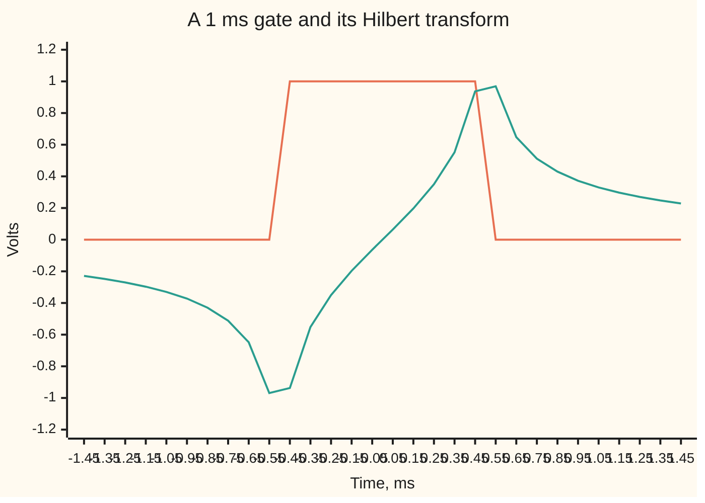

# Singular integrals: kernels that only just fail to be integrable, yet stay bounded

[Syllabus](../../../SYLLABUS.md) → [Harmonic analysis](../README.md) → [Maximal Functions and Beyond](../README.md#s06) → Singular integrals

---

## General Overview

A camera shutter opens for 1 ms (one millisecond). Its signal is a gate: 1 V while the shutter is open, 0 V otherwise. Feed the gate to a Hilbert filter, the quarter-turn filter of [The Hilbert transform](../02-The%20Fourier%20Transform/09-hilbert-transform-and-analytic-signals.md). The output has a spike at each edge of the gate. The spike is logarithmic: close to the edge, it grows by only about 0.73 V each time you move ten times closer, a step that settles at ln(10)/π = 0.732936 V. At 1 µs (microsecond) from the edge it reads 2.199 V; at 1 ns (nanosecond) it reads 4.398 V. It never stops growing.

So the filter turns a signal that never exceeds 1 V into one with no ceiling. It also turns an area of 1 V·ms into an infinite area: far from the gate the output fades like 1/t, and the area under 1/t has no limit. Yet one size does not change at all. The energy (the area under the signal squared) is 1 V²·ms going in and exactly 1 V²·ms coming out.

The filter works by convolution with the kernel 1/(πt): each output value is a weighted sum of the input, weighted by 1/(πt) at distance t. That kernel only just fails to be integrable. Near 0 and far out, its area grows like a logarithm, so it is infinite at both ends. Operators built on such kernels are **singular integrals**. This card shows why they stay bounded anyway, and which sizes they keep and which they lose.

**A singular integral stays bounded in energy because its kernel's positive and negative halves cancel, so its multiplier, not its kernel's area, sets its size; size and smoothness conditions extend this to every p-norm with 1 < p < ∞, but not to area (p = 1) or height (p = ∞).**

**What kind of fact this is:** theorems. The energy bound, the gate's partner, its level sets and its infinite area are proved on this card in Why it works. The Calderón–Zygmund theorem and Riesz's p-norm bound are stated with sources, with the proof's outline in a fold.

### The picture: the gate and its partner



The first line (orange) is the gate g. The second (teal) is its Hilbert transform Hg. It is odd: negative before the middle, positive after. It peaks near the two edges at ±0.5 ms and fades like 1/(πt) far out. The chart samples every 0.1 ms, offset by 0.05 ms, so it never lands on an edge, where Hg is infinite. The spike itself, approached in factors of ten:

```
distance past the edge   Hg (V)
0.1 ms        ########                                     0.763
0.01 ms       ###############                              1.469
0.001 ms      ######################                       2.199
0.0001 ms     #############################                2.932
0.00001 ms    #####################################        3.665
0.000001 ms   ############################################ 4.398
```

Each step ten times closer adds nearly the same amount. The step is a little smaller at 0.1 ms, where the distance is not yet small beside the 1 ms width, and settles at ln(10)/π = 0.732936 V. The signal is synthetic, from the formula below: illustrative, not a recording.

---

## The formula

Notation from earlier cards: time $`t`$ in ms, frequency $`\xi`$ (xi) in kHz, and the transform $`\hat f(\xi) = \int f(t)\,e^{-2\pi i\xi t}\,dt`$. The Hilbert transform $`Hf`$ has the **multiplier** $`m(\xi) = -i\,\mathrm{sgn}(\xi)`$: it multiplies the transform by $`m`$, frequency by frequency. In time it is the principal-value convolution with $`K(t) = 1/(\pi t)`$: cut out a gap of equal half-width $`\varepsilon`$ on both sides of 0, then shrink the gap ([The Hilbert transform](../02-The%20Fourier%20Transform/09-hilbert-transform-and-analytic-signals.md)).

The p-norm is $`\lVert f\rVert_p = (\int \lvert f\rvert^p\,dt)^{1/p}`$, and $`L^p`$ is the space of signals with a finite p-norm ([Lp spaces](../../10-Measure%20and%20integration/07-Sizes%20of%20Functions/01-lp-spaces.md)). Energy is $`\lVert f\rVert_2^2`$, area is $`\lVert f\rVert_1`$. This card introduces $`\lVert T\rVert_{p\to p}`$, the **operator norm** of an operator $`T`$ (a rule that turns signals into signals): the smallest number $`C`$ with $`\lVert Tf\rVert_p \le C\,\lVert f\rVert_p`$ for every $`f`$.

**The energy bound by the multiplier.** For any operator $`T`$ that multiplies the transform by $`m(\xi)`$:

```math
\lVert Tf\rVert_2 \le \sup_\xi \lvert m(\xi)\rvert\,\lVert f\rVert_2, \qquad \lVert Hf\rVert_2 = \lVert f\rVert_2 .
```

**Read it aloud:** the energy norm of T f is at most the largest size of the multiplier times the energy norm of f; for the Hilbert transform the multiplier has size 1 everywhere, so the energy is kept exactly.

**The kernel conditions.** These three conditions on a kernel $`K`$ define a Calderón–Zygmund kernel. $`A`$ and $`B`$ are fixed constants, and $`y`$ is any shift:

```math
\text{size: } \lvert K(t)\rvert \le \frac{A}{\lvert t\rvert}, \qquad \text{smoothness: } \int_{\lvert t\rvert > 2\lvert y\rvert} \lvert K(t-y) - K(t)\rvert\,dt \le B, \qquad \text{cancellation: } \int_{\varepsilon < \lvert t\rvert < R} K(t)\,dt = 0 .
```

**Read it aloud:** the kernel is at most A over the distance; shifting it by y changes it, far from the shift, by a total of at most B; and over any pair of matched shells, between epsilon and R, it adds up to zero (a bounded total is enough in general).

**The Calderón–Zygmund theorem (stated).** If $`K`$ meets the size and smoothness conditions and $`T`$ is bounded in energy, then $`T`$ is bounded on $`L^p`$ for every $`1 < p < \infty`$. At $`p = 1`$ it keeps only a weaker bound, **weak type (1,1)**: for every level $`\alpha > 0`$,

```math
\lambda\{t : \lvert Tf(t)\rvert > \alpha\} \le \frac{C\,\lVert f\rVert_1}{\alpha}, \qquad \lVert H\rVert_{p\to p} = \cot\frac{\pi}{2p}\ \ (p \ge 2), \qquad \lVert H\rVert_{p\to p} = \tan\frac{\pi}{2p}\ \ (1 < p \le 2).
```

**Read it aloud:** the length of the set where T f exceeds alpha is at most a constant times the area of f, divided by alpha; and the exact p-norm of the Hilbert transform is cot of pi over 2p for p at least 2, and tan of pi over 2p for p up to 2.

Here $`\lambda`$ is length, as in wing 10, and "weak type" is defined on [The maximal function](01-hardy-littlewood-maximal-function.md). The best constants are Pichorides' (1972).

**The gate's partner and its level sets.** For the gate $`g`$ of width $`W`$, 1 V on $`\lvert t\rvert < W/2`$:

```math
Hg(t) = \frac{1}{\pi}\ln\left\lvert\frac{t + W/2}{t - W/2}\right\rvert, \qquad \lambda\{t : \lvert Hg(t)\rvert > \alpha\} = \frac{2W}{\sinh(\pi\alpha)} .
```

**Read it aloud:** Hg at t is one over pi times the log of the distance to the far edge over the distance to the near edge; and the length of time on which Hg exceeds alpha volts is 2W over the hyperbolic sine of pi alpha.

| Symbol | Plain meaning | In our example | Push it up and the answer… |
| --- | --- | --- | --- |
| $`t`$, $`W`$, $`c`$, $`d`$ | time in ms; the gate's width; half the width; distance past an edge | W = 1 ms, c = 0.5 ms; d = 0.001 ms gives 2.199 V | wider W: energy and level sets grow in proportion |
| $`f`$, $`g`$, $`Hf`$, $`Hg`$ | any signal; the gate; their Hilbert transforms | g = 1 V inside; Hg(1 ms) = 0.349699 V | — |
| $`\xi`$, $`\hat f`$, $`\hat g`$, $`m(\xi)`$, $`\mathrm{sgn}`$, $`i`$ | frequency; transforms; the multiplier; the sign of a number; the imaginary unit | $`m = -i\,\mathrm{sgn}(\xi)`$, size 1 | larger $`\sup\lvert m\rvert`$: larger energy bound |
| $`K`$, $`\varepsilon`$, $`R`$, $`u`$ | the kernel; inner and outer cut-offs; a running distance | K = 1/(πt); ε = 0.001 ms, R up to 1000 ms | wider cut: the area of \|K\| grows, the multiplier does not |
| $`A`$, $`B`$, $`y`$, $`s`$ | size constant; smoothness constant; a shift; a scale factor in Step 6 | A = 1/π; B = ln(3)/π = 0.349699, the same for every y | — |
| $`\lVert f\rVert_p`$, $`L^p`$, $`p`$, $`p'`$ | the p-norm; signals with a finite p-norm; the power; its partner, with 1/p + 1/p' = 1 | $`\lVert g\rVert_p = 1`$ for every p | — |
| $`T`$, $`\lVert T\rVert_{p\to p}`$ | an operator; its operator norm | $`\lVert H\rVert_{2\to 2} = 1`$, $`\lVert H\rVert_{4\to 4} = 2.414214`$ | p toward 1 or ∞: the norm grows without limit |
| $`\alpha`$, $`\lambda`$, $`C`$ | a level in V; length; the weak-type constant | at 0.5 V the set has length 0.869074 ms | higher α: the set shrinks, like $`4W e^{-\pi\alpha}`$ |
| $`\sinh`$, $`\mathrm{Si}`$, $`r`$, $`k`$ | hyperbolic sine, $`(e^x - e^{-x})/2`$; the integral of sin u / u from 0; $`e^{\pi\alpha}`$; a counting index | sinh(π/2) = 2.301299; Si(π) = 1.851937; r = 4.810477 | — |
| $`g_0`$, $`b`$, $`b_j`$, $`I_j`$, $`I_j^*`$, $`y_j`$ | in the proof outline: the good part; the bad part; a bad bump; its dyadic interval; that interval doubled; its centre | not used on the gate | — |

### When it holds

- **Cancellation.** The two halves of 1/(πt) must cancel. Replace the kernel by 1/(π\|t\|) and the bound is lost: the cut kernel's area, (2/π) ln(R/ε), is 8.795227 for ε = 0.001 ms and R = 1000 ms, and grows without limit.
- **Matched gaps.** The cut-out round 0 must be symmetric. A gap from −ε to 2ε gives −0.220635 V at the gate's middle, where Hg is 0.
- **Size and smoothness.** These two conditions turn the energy bound into p-norm bounds. A kernel that decays too slowly and oscillates far from 0 can be bounded in energy and still fail every other p-norm; [Restriction and Kakeya in outline](06-restriction-and-kakeya-in-outline.md) names one such operator.
- **1 < p < ∞, strictly.** At p = 1 the gate's partner has infinite area. At p = ∞ it has no ceiling. Only the weak bound survives at p = 1.
- **A finite-energy input.** The energy identity needs $`\lVert f\rVert_2`$ finite. A constant 1 V signal has infinite energy and infinite area, so neither the energy identity nor the p-norm bounds say anything about it.

---

## Why it works

### Step 0: cancellation, measured by the multiplier

The kernel 1/(πt) has infinite area, so the usual bound, "output at most kernel area times input", says nothing. But the kernel is odd: its value at −t is minus its value at t. Against a smooth signal the two sides nearly cancel. Energy sees this cancellation exactly, because in energy an operator's size is its multiplier's largest size. The multiplier of 1/(πt) is $`-i\,\mathrm{sgn}(\xi)`$, of size 1.

### Step 1: energy is bounded by the multiplier

[Plancherel](../02-The%20Fourier%20Transform/05-plancherel-and-l2.md) says a signal and its transform have the same energy. So

```math
\lVert Tf\rVert_2^2 = \int \lvert m(\xi)\rvert^2\,\lvert\hat f(\xi)\rvert^2\,d\xi \le \sup_\xi \lvert m(\xi)\rvert^2 \int \lvert\hat f(\xi)\rvert^2\,d\xi = \sup_\xi \lvert m(\xi)\rvert^2\,\lVert f\rVert_2^2 .
```

For H, $`\lvert m\rvert = 1`$ at every ξ except 0, so the inequality is an equality: $`\lVert H\rVert_{2\to 2} = 1`$. The bound is also the best possible for any T: a signal whose transform sits where $`\lvert m\rvert`$ is near its largest value is stretched by nearly that much.

The check confirms it on the gate by three independent roads:

| Road | What it computes | Value |
| --- | --- | --- |
| Frequency | $`\int \lvert m\,\hat g\rvert^2`$ up to 1000 kHz, tail at most 0.000203 | 0.999899 |
| Time | $`\int Hg^2\,dt`$, with substitutions that tame the spike | 1.000000 |
| Level sets | $`\int 2\alpha\,\lambda\{\lvert Hg\rvert > \alpha\}\,d\alpha`$ | 1.000000 |

All three give the gate's own energy, 1 V²·ms. The spike is tall but thin: it holds very little energy, because the square of a logarithm still has a finite area.

### Step 2: the kernel's area grows, its multiplier does not

Cut the kernel to $`\varepsilon < \lvert t\rvert < R`$. Its area in absolute value is $`(2/\pi)\ln(R/\varepsilon)`$. Its multiplier is $`-(2i/\pi)\,\mathrm{sgn}(\xi)\,(\mathrm{Si}(2\pi\lvert\xi\rvert R) - \mathrm{Si}(2\pi\lvert\xi\rvert\varepsilon))`$ ([The Hilbert transform](../02-The%20Fourier%20Transform/09-hilbert-transform-and-analytic-signals.md) derives it). Si is never negative and is largest at π, where Si(π) = 1.851937, so the multiplier's size never exceeds $`(2/\pi)\,\mathrm{Si}(\pi) = 1.178980`$.

| Cut, in ms | Area of \|K\| | Multiplier at ξ = 1/(2R) |
| --- | ---: | ---: |
| 0.001 to 1 | 4.397614 | 1.176980 |
| 0.001 to 10 | 5.863485 | 1.178780 |
| 0.001 to 100 | 7.329356 | 1.178960 |
| 0.001 to 1000 | 8.795227 | 1.178978 |

Each factor of ten in R adds 1.465871 to the area. The check finds each multiplier twice, by the Si formula and by integrating $`(2/\pi)\sin(2\pi\xi t)/t`$ over $`\varepsilon < t < R`$ directly, and the two agree. A scan of 4,000 frequencies up to 2/R finds at most 1.176981 for the shortest cut and the column's own value for the others. The multiplier stays below 1.178980 for every cut. That is the whole difference between a positive kernel and a cancelling one. For a positive kernel the multiplier at ξ = 0 equals its area, so no cancellation can help.

### Step 3: the gate's partner has a logarithmic spike

With $`c = W/2`$, the kernel against the gate is one integral of 1/(t − u) over the gate:

```math
Hg(t) = \frac{1}{\pi}\int_{-c}^{c} \frac{du}{t-u} = \frac{1}{\pi}\ln\left\lvert\frac{t+c}{t-c}\right\rvert .
```

This is the partner that [The Hilbert transform](../02-The%20Fourier%20Transform/09-hilbert-transform-and-analytic-signals.md) finds for the shutter. At distance d past the edge, $`Hg = (1/\pi)\ln((W + d)/d)`$. Once d is small beside W, each factor of ten in d changes it by almost exactly ln(10)/π = 0.732936 V: a logarithmic spike. The check computes Hg by the kernel itself, cutting a 0.000001 ms gap, and gets 0.441266, 0.349711 and 0.162600 V at 0.3, 1 and 2 ms. The closed form gives 0.441271, 0.349699 and 0.162601 V. They agree to four decimals; the midpoint rule loses a little at the gate's jumps.

The spike is the price of the gate's jump. A jump in the input makes the kernel's two sides stop cancelling at the jump: one side sees 1 V, the other 0 V.

### Step 4: the failure in area and in height

[The Hilbert transform](../02-The%20Fourier%20Transform/09-hilbert-transform-and-analytic-signals.md) showed the partner's area growing without limit on one side; here both sides count. Far from the gate, $`Hg(t) \approx W/(\pi t)`$, because $`\ln((t+c)/(t-c)) \approx 2c/t`$. The area under $`W/(\pi t)`$ grows by $`(W/\pi)\ln 10`$ per factor of ten on each side. So the gate has area 1 V·ms, but its partner's area inside $`\lvert t\rvert < R`$ is:

| R, in ms | 10 | 100 | 1000 | 10,000 |
| --- | ---: | ---: | ---: | ---: |
| Area of \|Hg\|, V·ms | 2.543497 | 4.009631 | 5.475505 | 6.941376 |

It grows by 1.465871 V·ms per factor of ten, without limit. So $`\lVert H\rVert_{1\to 1}`$ is infinite.

This is not special to the gate. Any signal with finite area and nonzero total $`\int f`$ has $`Hf(t) \approx (\int f)/(\pi t)`$ far out. The transform view gives the same answer: $`-i\,\mathrm{sgn}(\xi)\hat f(\xi)`$ jumps at ξ = 0 unless $`\hat f(0) = \int f = 0`$, and a signal of finite area has a continuous transform. In height the spike shows the same failure: g never exceeds 1 V, but Hg has no ceiling, so $`\lVert H\rVert_{\infty\to\infty}`$ is infinite too.

### Step 5: what survives at p = 1 is the weak bound

The set where $`Hg > \alpha`$, for $`t > 0`$, is where $`\lvert(t + c)/(t - c)\rvert > r`$ with $`r = e^{\pi\alpha}`$. Solving on each side of the edge gives the interval from $`c(r-1)/(r+1)`$ to $`c(r+1)/(r-1)`$, of length $`4cr/(r^2 - 1) = W/\sinh(\pi\alpha)`$. Hg is odd, so the same length lies on the negative side. In total, $`\lambda\{\lvert Hg\rvert > \alpha\} = 2W/\sinh(\pi\alpha)`$.

Since $`\sinh x \ge x`$, $`\alpha\,\lambda\{\lvert Hg\rvert > \alpha\} \le 2W/\pi`$. That is weak type (1,1) for the gate, with constant 2/π = 0.636620. The check counts the set on a grid of 0.0001 ms steps:

| Level α, V | Set on one side, ms | Length, formula | Grid count | α × length, V·ms |
| ---: | --- | ---: | ---: | ---: |
| 0.1 | 0.077900 to 3.209236 | 6.262671 | 6.2626 | 0.626267 |
| 0.5 | 0.327897 to 0.762434 | 0.869074 | 0.8690 | 0.434537 |
| 1.0 | 0.458576 to 0.545166 | 0.173179 | 0.1732 | 0.173179 |
| 2.0 | 0.498136 to 0.501871 | 0.007470 | 0.0076 | 0.014940 |

The product α × length stays below 0.636620 at every level. Area is infinite, yet each level set is small. Weak type is exactly the gap between those two facts. The area is the integral of the length over all levels α. Weak type lets the length grow like C/α as α falls to 0, and the integral of 1/α diverges, though only logarithmically.

<details>
<summary>Detailed proof: the gate's energy from its level sets</summary>

The area of $`\lvert f\rvert^p`$ equals $`\int_0^\infty p\,\alpha^{p-1}\,\lambda\{\lvert f\rvert > \alpha\}\,d\alpha`$: slice the area under $`\lvert f\rvert^p`$ horizontally instead of vertically. For the gate's partner, with $`1/\sinh x = 2\sum_{k \ge 0} e^{-(2k+1)x}`$ and $`\int_0^\infty \alpha\,e^{-a\alpha}\,d\alpha = 1/a^2`$,

$`\displaystyle \int Hg^2\,dt = \int_0^\infty 2\alpha\,\frac{2W}{\sinh(\pi\alpha)}\,d\alpha = 8W\sum_{k\ge 0}\frac{1}{\pi^2(2k+1)^2} = \frac{8W}{\pi^2}\cdot\frac{\pi^2}{8} = W.`$

The sum of the reciprocal odd squares is $`\pi^2/8`$. The check's series road sums 200,000 terms and gets 0.999999. The same slicing at p = 4 uses $`\sum 1/(2k+1)^4 = \pi^4/96`$ and gives $`\int Hg^4\,dt = W`$ as well. At p = 1 the weight is $`2W/\sinh(\pi\alpha)`$ alone, which behaves like $`2W/(\pi\alpha)`$ near 0: its integral diverges, which is Step 4 again.

</details>

### Step 6: the kernel conditions give every p between 1 and ∞

For K(t) = 1/(πt), the size condition holds with A = 1/π. The smoothness condition is a calculation. For a shift y > 0, $`\lvert K(t-y) - K(t)\rvert = y/(\pi\lvert t\rvert\lvert t-y\rvert)`$. Integrating over t > 2y gives ln 2; over t < −2y it gives ln(3/2). So

```math
\int_{\lvert t\rvert > 2y} \lvert K(t-y) - K(t)\rvert\,dt = \frac{\ln 2 + \ln(3/2)}{\pi} = \frac{\ln 3}{\pi} = 0.349699 .
```

The answer does not depend on y: the check gets 0.349699 at y = 1 ms and at y = 0.01 ms. The reason is scale: replace y by sy and t by st, and K(st) = K(t)/s while dt gains a factor s, so the two cancel.

Calderón and Zygmund (1952) showed that size, smoothness and an energy bound give weak type (1,1). Their smoothness condition was pointwise; the integral form above, Hörmander's condition (1960), is a weaker requirement that the same proof accepts. [Interpolation](04-interpolation-riesz-thorin-and-marcinkiewicz.md) then fills in every p between 1 and 2. For p above 2, duality does the rest: the adjoint of H is −H, so $`\lVert H\rVert_{p\to p} = \lVert H\rVert_{p'\to p'}`$ with $`1/p + 1/p' = 1`$. Riesz proved the p-norm bound for H in 1928. Pichorides found the exact values in 1972.

At p = 4 the exact norm is $`\cot(\pi/8) = 2.414214`$. The gate's ratio is $`\lVert Hg\rVert_4/\lVert g\rVert_4 = 1.000000`$, well inside the bound. The norm is approached by other signals, not by the gate.

<details>
<summary>Proof outline: weak type (1,1) from the Calderón–Zygmund decomposition</summary>

Fix a level α and a signal f of finite area. [Calderon-Zygmund decomposition](02-calderon-zygmund-decomposition-in-outline.md) splits f into a good part g₀ and a bad part b. The good part is at most 2α everywhere and has area at most that of f. The bad part is a sum of bumps $`b_j`$, each living on one dyadic interval $`I_j`$ with total $`\int b_j = 0`$. The intervals have total length at most $`\lVert f\rVert_1/\alpha`$.

**The good part, by energy.** Since $`\lvert g_0\rvert \le 2\alpha`$, its energy is at most $`2\alpha\lVert f\rVert_1`$. By Chebyshev's inequality and the energy bound of Step 1,

$`\displaystyle \lambda\{\lvert Tg_0\rvert > \alpha/2\} \le \frac{4\,\lVert T\rVert_{2\to 2}^2\,\lVert g_0\rVert_2^2}{\alpha^2} \le \frac{8\,\lVert T\rVert_{2\to 2}^2\,\lVert f\rVert_1}{\alpha}.`$

**The bad part, by smoothness.** Let $`I_j^*`$ be $`I_j`$ doubled about its centre $`y_j`$. Throw away the union of the $`I_j^*`$: its length is at most $`2\lVert f\rVert_1/\alpha`$. Outside it, use $`\int b_j = 0`$ to subtract $`K(t - y_j)`$ for free:

$`\displaystyle Tb_j(t) = \int \big(K(t-u) - K(t-y_j)\big)\,b_j(u)\,du .`$

Integrate in t outside $`I_j^*`$ and use the smoothness condition: $`\int_{t \notin I_j^*} \lvert Tb_j\rvert\,dt \le B\,\lVert b_j\rVert_1`$. Summing over j and applying Chebyshev once more bounds the length of the set, outside the doubled intervals, where $`\lvert Tb\rvert > \alpha/2`$ by $`(2/\alpha)\,B\sum_j \lVert b_j\rVert_1`$.

The bumps have total area at most $`2\lVert f\rVert_1`$, so this piece is at most $`4B\,\lVert f\rVert_1/\alpha`$. Adding the three pieces gives $`\lambda\{\lvert Tf\rvert > \alpha\} \le (8\lVert T\rVert_{2\to 2}^2 + 2 + 4B)\,\lVert f\rVert_1/\alpha`$. The mean-zero bumps are where cancellation enters a second time. Stein (1970) and Grafakos (2014) give the full proof in any dimension.

</details>

---

## Worked numbers, by hand

The level set of the gate's partner at α = 0.5 V, with W = 1 ms and c = 0.5 ms.

| Step | Arithmetic | Value |
| --- | --- | --- |
| Ratio r | e^(π × 0.5) | 4.810477 |
| r − 1 and r + 1 | 4.810477 − 1 and 4.810477 + 1 | 3.810477 and 5.810477 |
| Inner end | 0.5 × 3.810477/5.810477 | 0.327897 ms |
| Outer end | 0.5 × 5.810477/3.810477 | 0.762434 ms |
| One side | 0.762434 − 0.327897 | 0.434537 ms |
| Both sides | 2 × 0.434537, the same as 2/sinh(π/2) = 2/2.301299 | 0.869074 ms |
| Weak-type product | 0.5 V × 0.869074 ms | **0.434537 V·ms** |

The partner exceeds 0.5 V for 0.869074 ms in total, and α × length is 0.434537 V·ms. That is below 2/π × 1 V·ms = 0.636620 V·ms, the weak-type bound for this gate, even though the partner's area is infinite.

### What breaks if you drop a piece

| Mistake | Comes out at | What went wrong |
| --- | --- | --- |
| Drop the cancellation: bound H by the area of \|K\| | 8.795227 for a cut from 0.001 to 1000 ms, and growing | the true energy bound is the multiplier, at most 1.178980 for every cut |
| Expect an area bound | area of \|Hg\| is 2.543497, 4.009631, 5.475505, 6.941376 V·ms inside 10, 100, 1000, 10,000 ms | the 1/(πt) tail adds 1.465871 V·ms per factor of ten: p = 1 fails |
| Expect a height bound | Hg = 2.199 V at 0.001 ms from the edge, 4.398 V at 0.000001 ms | the logarithmic spike has no ceiling: p = ∞ fails |
| Cut a lopsided gap, −ε to 2ε | −0.220635 V at t = 0, where Hg = 0 | the unmatched shell from ε to 2ε adds −ln(2)/π = −0.220636 V |

---

## Code, from first principles, and it actually runs

The script writes every piece itself: a midpoint-rule integrator, the principal-value kernel with an exponential substitution, the series for Si and the level-set formula. It takes six independent roads. The kernel integral is checked against the closed form of Hg. The energy is found by frequency, by time and by level sets, plus a series. The level sets are counted on a grid against the sinh formula. The area is integrated against an antiderivative. The smoothness integral is checked against ln(3)/π at two shifts. The cut kernel's multiplier is found by the Si series and by direct integration, then scanned over 4,000 frequencies. The two programs print identical output.

### Python

```python
# Singular integrals and the Hilbert transform bound -- the check behind the card.
# Standard library only.  Signal: a gate g, 1 V while |t| < W/2, t in ms, W = 1 ms.
# Its Hilbert transform is Hg(t) = (1/pi) ln|(t + W/2)/(t - W/2)|, in volts.
from math import pi, sin, cos, exp, log, sinh, tan, sqrt

W = 1.0                                       # gate width, ms
c = W / 2
g = lambda t: 1.0 if abs(t) < c else 0.0
Hg = lambda t: log(abs((t + c) / (t - c))) / pi

def midpoint(f, a, b, n):                     # the integral of f from a to b, n cells
    h = (b - a) / n
    return h * sum(f(a + (k + 0.5) * h) for k in range(n))

def pv(t, e_neg, e_pos, n=400000):            # (1/pi) integral of g(t-u)/u, gap -e_neg < u < e_pos
    pos = midpoint(lambda s: g(t - exp(s)), log(e_pos), log(10.0), n)    # u = e^s > 0
    neg = midpoint(lambda s: g(t + exp(s)), log(e_neg), log(10.0), n)    # u = -e^s < 0
    return (pos - neg) / pi

def power_integral(p, n=40000):              # integral of |Hg|^p over the line, by time
    a = c ** (1 / 3)                          # t = c -+ v^3 near the spike, t = 1/w far out
    near = midpoint(lambda v: 3 * v * v * (abs(Hg(c - v ** 3)) ** p + abs(Hg(c + v ** 3)) ** p), 0, a, n)
    far = midpoint(lambda w: abs(Hg(1 / w)) ** p / (w * w), 0, 1 / (2 * c), n)
    return 2 * (near + far)

m = lambda a: 2 * W / sinh(pi * a)            # measure of {|Hg| > a}, in ms

# The partner of the gate: kernel road against the closed form, and the logarithmic spike.
for t in [0.3, 1.0, 2.0]:
    k = pv(t, 1e-6, 1e-6)
    print("Hg(%.1f ms): closed form %.6f V, kernel road %.6f V" % (t, Hg(t), k))
    assert abs(k - Hg(t)) < 1e-4
for d in [0.1, 0.01, 0.001, 0.0001, 0.00001, 0.000001]:
    print("spike: %.6f ms past the edge, Hg = %.3f V" % (d, Hg(c + d)))
print("spike growth per factor of ten closer: ln(10)/pi = %.6f V" % (log(10) / pi))

# Energy: the multiplier -i sgn has size 1, so the energy of Hg equals the energy of g, W.
L = 1000.0
fr = 2 * midpoint(lambda x: (sin(pi * W * x) / (pi * x)) ** 2, 0, L, 200000)
print("energy of g: W = %.6f V^2 ms" % W)
print("frequency road: integral of |m ghat|^2 up to %.0f kHz = %.6f, tail at most %.6f" % (L, fr, 2 / (pi * pi * L)))
assert 0 <= W - fr <= 2 / (pi * pi * L)
e_time = power_integral(2)
e_dist = midpoint(lambda a: 2 * a * m(a), 0, 30, 60000)
e_ser = 8 * W / pi ** 2 * sum(1 / (2 * k + 1) ** 2 for k in range(200000))
print("time road: integral of Hg^2 = %.6f V^2 ms" % e_time)
print("level-set road: integral of 2a m(a) da = %.6f V^2 ms" % e_dist)
print("series road: (8W/pi^2)(1 + 1/9 + 1/25 + ...) = %.6f V^2 ms" % e_ser)
assert abs(e_time - W) < 1e-6 and abs(e_dist - W) < 1e-6 and abs(e_ser - W) < 1e-5

# Level sets, weak type (1,1): m(a) = 2W/sinh(pi a), counted on a grid.
for a in [0.1, 0.5, 1.0, 2.0]:
    r = exp(pi * a)
    inner, outer = c * (r - 1) / (r + 1), c * (r + 1) / (r - 1)
    h = 1e-4
    cnt = sum(1 for k in range(-int(2 * outer / h), int(2 * outer / h)) if abs(Hg((k + 0.5) * h)) > a) * h
    print("level %.1f V: set from %.6f to %.6f ms each side; measure %.6f ms, grid count %.4f ms; a x measure %.6f V ms"
          % (a, inner, outer, m(a), cnt, a * m(a)))
    assert abs(cnt - m(a)) < 2e-3 and a * cnt < 2 * W / pi
r = exp(pi / 2)
print("by hand at level 0.5 V: r = e^(pi a) = %.6f, r - 1 = %.6f, r + 1 = %.6f, sinh(pi a) = %.6f" % (r, r - 1, r + 1, sinh(pi / 2)))
print("weak-type ratio a m(a) / ||g||_1 tends to 2/pi = %.6f as a -> 0" % (2 / pi))

# Failure in mass: the area of |Hg| inside |t| < R grows by (2W/pi) ln 10 per factor of ten.
F = lambda t: ((t + c) * log(t + c) - (t - c) * log(abs(t - c))) / pi
area = lambda R: 2 * (F(R) - F(0))
num = 2 * (midpoint(lambda v: 3 * v * v * (Hg(c - v ** 3) + Hg(c + v ** 3)), 0, c ** (1 / 3), 40000)
           + midpoint(Hg, 2 * c, 10, 200000))
print("area of g: %.6f V ms; area of |Hg| inside 10 ms: antiderivative %.6f, integral %.6f V ms" % (W, area(10), num))
assert abs(num - area(10)) < 1e-6
for R in [100, 1000, 10000]:
    print("area of |Hg| inside %d ms: %.6f V ms" % (R, area(R)))
print("growth per decade (2W/pi) ln 10 = %.6f V ms" % (2 * W * log(10) / pi))
assert abs(area(10000) - area(1000) - 2 * W * log(10) / pi) < 1e-6

# Kernel conditions for K(t) = 1/(pi t): size, smoothness (Hormander), cancellation.
for y in [1.0, 0.01]:                         # x = +-2y e^s on the two sides of |x| > 2|y|
    hor = midpoint(lambda s: y / (2 * y * exp(s) - y) + y / (2 * y * exp(s) + y), 0, 50, 100000) / pi
    print("Hormander integral at y = %.2f ms: %.6f, closed form ln(3)/pi = %.6f" % (y, hor, log(3) / pi))
    assert abs(hor - log(3) / pi) < 1e-6
def Si(x):                                    # integral of sin(u)/u from 0 to x, by its series
    term, s, k = x, x, 0
    while abs(term) > 1e-17:
        k += 1
        term *= -x * x * (2 * k - 1) / ((2 * k + 1) * (2 * k) * (2 * k + 1))
        s += term
    return s
cap = 2 / pi * Si(pi)
print("cut kernel's multiplier is at most (2/pi) Si(pi) = (2/pi) x %.6f = %.6f for every cut-off" % (Si(pi), cap))
assert abs(Si(pi) - midpoint(lambda u: sin(u) / u, 0, pi, 20000)) < 1e-8
eps = 0.001
for R in [1, 10, 100, 1000]:
    q = lambda xi: 2 / pi * (Si(2 * pi * xi * R) - Si(2 * pi * xi * eps))   # size of the cut multiplier, by Si
    direct = 2 / pi * midpoint(lambda t: sin(pi * t / R) / t, eps, R, 20000)  # (2/pi) int sin(2 pi xi t)/t dt at xi = 1/(2R)
    top = max(q(k / (2000 * R)) for k in range(1, 4001))                     # 4000 frequencies up to 2/R
    print("cut %.3f < |t| < %d ms: mass of |K| %.6f, multiplier at 1/(2R) %.6f, direct %.6f; largest up to 2/R %.6f"
          % (eps, R, 2 / pi * log(R / eps), q(1 / (2 * R)), direct, top))
    assert abs(direct - q(1 / (2 * R))) < 1e-6 and top <= cap and cap - top < 0.0021
print("lopsided gap (-eps, 2eps) at t = 0: %.6f V, true Hg(0) = %.6f V, -ln(2)/pi = %.6f"
      % (pv(0.0, eps, 2 * eps), Hg(0.0), -log(2) / pi))
assert abs(pv(0.0, eps, 2 * eps) + log(2) / pi) < 1e-4

# L^p: Riesz's theorem with the best constant cot(pi/2p) for p >= 2 (Pichorides); the gate at p = 4.
q_time, q_dist = power_integral(4), midpoint(lambda a: 4 * a ** 3 * m(a), 0, 30, 60000)
print("p = 4: integral of Hg^4 by time %.6f, by level sets %.6f; ||Hg||_4/||g||_4 = %.6f; bound cot(pi/8) = %.6f"
      % (q_time, q_dist, (q_time / W) ** 0.25, 1 / tan(pi / 8)))
assert abs(q_time - q_dist) < 1e-5 and (q_time / W) ** 0.25 <= 1 / tan(pi / 8)
print("p = 2 bound: 1, attained by every signal; p = 1: no bound (area above grows without limit)")

# Chart points.
ts = [-1.45 + 0.1 * k for k in range(30)]
print("chart t ms: [" + ", ".join("%.2f" % t for t in ts) + "]")
print("chart g V: [" + ", ".join("%.0f" % g(t) for t in ts) + "]")
print("chart Hg V: [" + ", ".join("%.3f" % Hg(t) for t in ts) + "]")
print("ALL CHECKS PASS")
```

**Ran 2026-11-15 on macOS, Python 3.14.10, standard library only. All checks passed. Output, pasted from the run:**

```
Hg(0.3 ms): closed form 0.441271 V, kernel road 0.441266 V
Hg(1.0 ms): closed form 0.349699 V, kernel road 0.349711 V
Hg(2.0 ms): closed form 0.162601 V, kernel road 0.162600 V
spike: 0.100000 ms past the edge, Hg = 0.763 V
spike: 0.010000 ms past the edge, Hg = 1.469 V
spike: 0.001000 ms past the edge, Hg = 2.199 V
spike: 0.000100 ms past the edge, Hg = 2.932 V
spike: 0.000010 ms past the edge, Hg = 3.665 V
spike: 0.000001 ms past the edge, Hg = 4.398 V
spike growth per factor of ten closer: ln(10)/pi = 0.732936 V
energy of g: W = 1.000000 V^2 ms
frequency road: integral of |m ghat|^2 up to 1000 kHz = 0.999899, tail at most 0.000203
time road: integral of Hg^2 = 1.000000 V^2 ms
level-set road: integral of 2a m(a) da = 1.000000 V^2 ms
series road: (8W/pi^2)(1 + 1/9 + 1/25 + ...) = 0.999999 V^2 ms
level 0.1 V: set from 0.077900 to 3.209236 ms each side; measure 6.262671 ms, grid count 6.2626 ms; a x measure 0.626267 V ms
level 0.5 V: set from 0.327897 to 0.762434 ms each side; measure 0.869074 ms, grid count 0.8690 ms; a x measure 0.434537 V ms
level 1.0 V: set from 0.458576 to 0.545166 ms each side; measure 0.173179 ms, grid count 0.1732 ms; a x measure 0.173179 V ms
level 2.0 V: set from 0.498136 to 0.501871 ms each side; measure 0.007470 ms, grid count 0.0076 ms; a x measure 0.014940 V ms
by hand at level 0.5 V: r = e^(pi a) = 4.810477, r - 1 = 3.810477, r + 1 = 5.810477, sinh(pi a) = 2.301299
weak-type ratio a m(a) / ||g||_1 tends to 2/pi = 0.636620 as a -> 0
area of g: 1.000000 V ms; area of |Hg| inside 10 ms: antiderivative 2.543497, integral 2.543497 V ms
area of |Hg| inside 100 ms: 4.009631 V ms
area of |Hg| inside 1000 ms: 5.475505 V ms
area of |Hg| inside 10000 ms: 6.941376 V ms
growth per decade (2W/pi) ln 10 = 1.465871 V ms
Hormander integral at y = 1.00 ms: 0.349699, closed form ln(3)/pi = 0.349699
Hormander integral at y = 0.01 ms: 0.349699, closed form ln(3)/pi = 0.349699
cut kernel's multiplier is at most (2/pi) Si(pi) = (2/pi) x 1.851937 = 1.178980 for every cut-off
cut 0.001 < |t| < 1 ms: mass of |K| 4.397614, multiplier at 1/(2R) 1.176980, direct 1.176980; largest up to 2/R 1.176981
cut 0.001 < |t| < 10 ms: mass of |K| 5.863485, multiplier at 1/(2R) 1.178780, direct 1.178780; largest up to 2/R 1.178780
cut 0.001 < |t| < 100 ms: mass of |K| 7.329356, multiplier at 1/(2R) 1.178960, direct 1.178960; largest up to 2/R 1.178960
cut 0.001 < |t| < 1000 ms: mass of |K| 8.795227, multiplier at 1/(2R) 1.178978, direct 1.178978; largest up to 2/R 1.178978
lopsided gap (-eps, 2eps) at t = 0: -0.220635 V, true Hg(0) = 0.000000 V, -ln(2)/pi = -0.220636
p = 4: integral of Hg^4 by time 1.000000, by level sets 1.000000; ||Hg||_4/||g||_4 = 1.000000; bound cot(pi/8) = 2.414214
p = 2 bound: 1, attained by every signal; p = 1: no bound (area above grows without limit)
chart t ms: [-1.45, -1.35, -1.25, -1.15, -1.05, -0.95, -0.85, -0.75, -0.65, -0.55, -0.45, -0.35, -0.25, -0.15, -0.05, 0.05, 0.15, 0.25, 0.35, 0.45, 0.55, 0.65, 0.75, 0.85, 0.95, 1.05, 1.15, 1.25, 1.35, 1.45]
chart g V: [0, 0, 0, 0, 0, 0, 0, 0, 0, 0, 1, 1, 1, 1, 1, 1, 1, 1, 1, 1, 0, 0, 0, 0, 0, 0, 0, 0, 0, 0]
chart Hg V: [-0.229, -0.248, -0.270, -0.297, -0.330, -0.372, -0.430, -0.512, -0.648, -0.969, -0.937, -0.552, -0.350, -0.197, -0.064, 0.064, 0.197, 0.350, 0.552, 0.937, 0.969, 0.648, 0.512, 0.430, 0.372, 0.330, 0.297, 0.270, 0.248, 0.229]
ALL CHECKS PASS
```

### Rust

```rust
// Singular integrals and the Hilbert transform bound -- the check behind the card.
// Rust std only.  Signal: a gate g, 1 V while |t| < W/2, t in ms, W = 1 ms.
// Its Hilbert transform is Hg(t) = (1/pi) ln|(t + W/2)/(t - W/2)|, in volts.
use std::f64::consts::PI;

const W: f64 = 1.0; // gate width, ms
const C: f64 = W / 2.0;

fn g(t: f64) -> f64 { if t.abs() < C { 1.0 } else { 0.0 } }
fn hg(t: f64) -> f64 { ((t + C) / (t - C)).abs().ln() / PI }

fn midpoint<F: Fn(f64) -> f64>(f: F, a: f64, b: f64, n: usize) -> f64 {
    let h = (b - a) / n as f64;
    h * (0..n).map(|k| f(a + (k as f64 + 0.5) * h)).fold(0.0, |s, v| s + v)
}

// (1/pi) integral of g(t-u)/u, with the gap -e_neg < u < e_pos cut out
fn pv(t: f64, e_neg: f64, e_pos: f64) -> f64 {
    let n = 400000;
    let pos = midpoint(|s| g(t - s.exp()), e_pos.ln(), 10f64.ln(), n);
    let neg = midpoint(|s| g(t + s.exp()), e_neg.ln(), 10f64.ln(), n);
    (pos - neg) / PI
}

// integral of |Hg|^p over the line, by time: t = c -+ v^3 near the spike, t = 1/w far out
fn power_integral(p: f64) -> f64 {
    let n = 40000;
    let a = C.powf(1.0 / 3.0);
    let near = midpoint(|v| 3.0 * v * v * (hg(C - v.powf(3.0)).abs().powf(p) + hg(C + v.powf(3.0)).abs().powf(p)), 0.0, a, n);
    let far = midpoint(|w| hg(1.0 / w).abs().powf(p) / (w * w), 0.0, 1.0 / (2.0 * C), n);
    2.0 * (near + far)
}

fn m(a: f64) -> f64 { 2.0 * W / (PI * a).sinh() } // measure of {|Hg| > a}, in ms

// integral of sin(u)/u from 0 to x, by its series
fn si(x: f64) -> f64 {
    let (mut term, mut s, mut k) = (x, x, 0.0f64);
    while term.abs() > 1e-17 {
        k += 1.0;
        term *= -x * x * (2.0 * k - 1.0) / ((2.0 * k + 1.0) * (2.0 * k) * (2.0 * k + 1.0));
        s += term;
    }
    s
}

fn f_anti(t: f64) -> f64 { ((t + C) * (t + C).ln() - (t - C) * (t - C).abs().ln()) / PI }
fn area(r: f64) -> f64 { 2.0 * (f_anti(r) - f_anti(0.0)) }

fn main() {
    // The partner of the gate: kernel road against the closed form, and the logarithmic spike.
    for t in [0.3, 1.0, 2.0] {
        let k = pv(t, 1e-6, 1e-6);
        println!("Hg({:.1} ms): closed form {:.6} V, kernel road {:.6} V", t, hg(t), k);
        assert!((k - hg(t)).abs() < 1e-4);
    }
    for d in [0.1, 0.01, 0.001, 0.0001, 0.00001, 0.000001] {
        println!("spike: {:.6} ms past the edge, Hg = {:.3} V", d, hg(C + d));
    }
    println!("spike growth per factor of ten closer: ln(10)/pi = {:.6} V", 10f64.ln() / PI);

    // Energy: the multiplier -i sgn has size 1, so the energy of Hg equals the energy of g, W.
    let l = 1000.0;
    let fr = 2.0 * midpoint(|x| ((PI * W * x).sin() / (PI * x)).powf(2.0), 0.0, l, 200000);
    println!("energy of g: W = {:.6} V^2 ms", W);
    println!("frequency road: integral of |m ghat|^2 up to {:.0} kHz = {:.6}, tail at most {:.6}", l, fr, 2.0 / (PI * PI * l));
    assert!(W - fr >= 0.0 && W - fr <= 2.0 / (PI * PI * l));
    let e_time = power_integral(2.0);
    let e_dist = midpoint(|a| 2.0 * a * m(a), 0.0, 30.0, 60000);
    let e_ser = 8.0 * W / PI.powf(2.0) * (0..200000u64).map(|k| 1.0 / ((2 * k + 1) * (2 * k + 1)) as f64).fold(0.0, |s, v| s + v);
    println!("time road: integral of Hg^2 = {:.6} V^2 ms", e_time);
    println!("level-set road: integral of 2a m(a) da = {:.6} V^2 ms", e_dist);
    println!("series road: (8W/pi^2)(1 + 1/9 + 1/25 + ...) = {:.6} V^2 ms", e_ser);
    assert!((e_time - W).abs() < 1e-6 && (e_dist - W).abs() < 1e-6 && (e_ser - W).abs() < 1e-5);

    // Level sets, weak type (1,1): m(a) = 2W/sinh(pi a), counted on a grid.
    for a in [0.1, 0.5, 1.0, 2.0] {
        let r = (PI * a).exp();
        let (inner, outer) = (C * (r - 1.0) / (r + 1.0), C * (r + 1.0) / (r - 1.0));
        let h = 1e-4;
        let kmax = (2.0 * outer / h) as i64;
        let cnt = (-kmax..kmax).filter(|&k| hg((k as f64 + 0.5) * h).abs() > a).count() as f64 * h;
        println!("level {:.1} V: set from {:.6} to {:.6} ms each side; measure {:.6} ms, grid count {:.4} ms; a x measure {:.6} V ms",
                 a, inner, outer, m(a), cnt, a * m(a));
        assert!((cnt - m(a)).abs() < 2e-3 && a * cnt < 2.0 * W / PI);
    }
    let r = (PI / 2.0).exp();
    println!("by hand at level 0.5 V: r = e^(pi a) = {:.6}, r - 1 = {:.6}, r + 1 = {:.6}, sinh(pi a) = {:.6}", r, r - 1.0, r + 1.0, (PI / 2.0).sinh());
    println!("weak-type ratio a m(a) / ||g||_1 tends to 2/pi = {:.6} as a -> 0", 2.0 / PI);

    // Failure in mass: the area of |Hg| inside |t| < R grows by (2W/pi) ln 10 per factor of ten.
    let num = 2.0 * (midpoint(|v| 3.0 * v * v * (hg(C - v.powf(3.0)) + hg(C + v.powf(3.0))), 0.0, C.powf(1.0 / 3.0), 40000)
        + midpoint(hg, 2.0 * C, 10.0, 200000));
    println!("area of g: {:.6} V ms; area of |Hg| inside 10 ms: antiderivative {:.6}, integral {:.6} V ms", W, area(10.0), num);
    assert!((num - area(10.0)).abs() < 1e-6);
    for r in [100, 1000, 10000] {
        println!("area of |Hg| inside {} ms: {:.6} V ms", r, area(r as f64));
    }
    println!("growth per decade (2W/pi) ln 10 = {:.6} V ms", 2.0 * W * 10f64.ln() / PI);
    assert!((area(10000.0) - area(1000.0) - 2.0 * W * 10f64.ln() / PI).abs() < 1e-6);

    // Kernel conditions for K(t) = 1/(pi t): size, smoothness (Hormander), cancellation.
    for y in [1.0, 0.01] {
        let hor = midpoint(|s| y / (2.0 * y * s.exp() - y) + y / (2.0 * y * s.exp() + y), 0.0, 50.0, 100000) / PI;
        println!("Hormander integral at y = {:.2} ms: {:.6}, closed form ln(3)/pi = {:.6}", y, hor, 3f64.ln() / PI);
        assert!((hor - 3f64.ln() / PI).abs() < 1e-6);
    }
    let cap = 2.0 / PI * si(PI);
    println!("cut kernel's multiplier is at most (2/pi) Si(pi) = (2/pi) x {:.6} = {:.6} for every cut-off", si(PI), cap);
    assert!((si(PI) - midpoint(|u| u.sin() / u, 0.0, PI, 20000)).abs() < 1e-8);
    let eps = 0.001;
    for r in [1, 10, 100, 1000] {
        let rf = r as f64;
        let q = |xi: f64| 2.0 / PI * (si(2.0 * PI * xi * rf) - si(2.0 * PI * xi * eps)); // size of the cut multiplier, by Si
        let direct = 2.0 / PI * midpoint(|t| (PI * t / rf).sin() / t, eps, rf, 20000); // (2/pi) int sin(2 pi xi t)/t dt at xi = 1/(2R)
        let top = (1..=4000).map(|k| q(k as f64 / (2000.0 * rf))).fold(f64::MIN, f64::max); // 4000 frequencies up to 2/R
        println!("cut {:.3} < |t| < {} ms: mass of |K| {:.6}, multiplier at 1/(2R) {:.6}, direct {:.6}; largest up to 2/R {:.6}",
                 eps, r, 2.0 / PI * (rf / eps).ln(), q(1.0 / (2.0 * rf)), direct, top);
        assert!((direct - q(1.0 / (2.0 * rf))).abs() < 1e-6 && top <= cap && cap - top < 0.0021);
    }
    let lop = pv(0.0, eps, 2.0 * eps);
    println!("lopsided gap (-eps, 2eps) at t = 0: {:.6} V, true Hg(0) = {:.6} V, -ln(2)/pi = {:.6}", lop, hg(0.0), -(2f64.ln()) / PI);
    assert!((lop + 2f64.ln() / PI).abs() < 1e-4);

    // L^p: Riesz's theorem with the best constant cot(pi/2p) for p >= 2 (Pichorides); the gate at p = 4.
    let q_time = power_integral(4.0);
    let q_dist = midpoint(|a| 4.0 * a.powf(3.0) * m(a), 0.0, 30.0, 60000);
    println!("p = 4: integral of Hg^4 by time {:.6}, by level sets {:.6}; ||Hg||_4/||g||_4 = {:.6}; bound cot(pi/8) = {:.6}",
             q_time, q_dist, (q_time / W).powf(0.25), 1.0 / (PI / 8.0).tan());
    assert!((q_time - q_dist).abs() < 1e-5 && (q_time / W).powf(0.25) <= 1.0 / (PI / 8.0).tan());
    println!("p = 2 bound: 1, attained by every signal; p = 1: no bound (area above grows without limit)");

    // Chart points.
    let ts: Vec<f64> = (0..30).map(|k| -1.45 + 0.1 * k as f64).collect();
    let j = |v: Vec<String>| v.join(", ");
    println!("chart t ms: [{}]", j(ts.iter().map(|t| format!("{:.2}", t)).collect()));
    println!("chart g V: [{}]", j(ts.iter().map(|&t| format!("{:.0}", g(t))).collect()));
    println!("chart Hg V: [{}]", j(ts.iter().map(|&t| format!("{:.3}", hg(t))).collect()));
    println!("ALL CHECKS PASS");
}
```

**Ran 2026-11-15 on macOS, rustc 1.98.1, no crates. All checks passed. Output, pasted from the run:**

```
Hg(0.3 ms): closed form 0.441271 V, kernel road 0.441266 V
Hg(1.0 ms): closed form 0.349699 V, kernel road 0.349711 V
Hg(2.0 ms): closed form 0.162601 V, kernel road 0.162600 V
spike: 0.100000 ms past the edge, Hg = 0.763 V
spike: 0.010000 ms past the edge, Hg = 1.469 V
spike: 0.001000 ms past the edge, Hg = 2.199 V
spike: 0.000100 ms past the edge, Hg = 2.932 V
spike: 0.000010 ms past the edge, Hg = 3.665 V
spike: 0.000001 ms past the edge, Hg = 4.398 V
spike growth per factor of ten closer: ln(10)/pi = 0.732936 V
energy of g: W = 1.000000 V^2 ms
frequency road: integral of |m ghat|^2 up to 1000 kHz = 0.999899, tail at most 0.000203
time road: integral of Hg^2 = 1.000000 V^2 ms
level-set road: integral of 2a m(a) da = 1.000000 V^2 ms
series road: (8W/pi^2)(1 + 1/9 + 1/25 + ...) = 0.999999 V^2 ms
level 0.1 V: set from 0.077900 to 3.209236 ms each side; measure 6.262671 ms, grid count 6.2626 ms; a x measure 0.626267 V ms
level 0.5 V: set from 0.327897 to 0.762434 ms each side; measure 0.869074 ms, grid count 0.8690 ms; a x measure 0.434537 V ms
level 1.0 V: set from 0.458576 to 0.545166 ms each side; measure 0.173179 ms, grid count 0.1732 ms; a x measure 0.173179 V ms
level 2.0 V: set from 0.498136 to 0.501871 ms each side; measure 0.007470 ms, grid count 0.0076 ms; a x measure 0.014940 V ms
by hand at level 0.5 V: r = e^(pi a) = 4.810477, r - 1 = 3.810477, r + 1 = 5.810477, sinh(pi a) = 2.301299
weak-type ratio a m(a) / ||g||_1 tends to 2/pi = 0.636620 as a -> 0
area of g: 1.000000 V ms; area of |Hg| inside 10 ms: antiderivative 2.543497, integral 2.543497 V ms
area of |Hg| inside 100 ms: 4.009631 V ms
area of |Hg| inside 1000 ms: 5.475505 V ms
area of |Hg| inside 10000 ms: 6.941376 V ms
growth per decade (2W/pi) ln 10 = 1.465871 V ms
Hormander integral at y = 1.00 ms: 0.349699, closed form ln(3)/pi = 0.349699
Hormander integral at y = 0.01 ms: 0.349699, closed form ln(3)/pi = 0.349699
cut kernel's multiplier is at most (2/pi) Si(pi) = (2/pi) x 1.851937 = 1.178980 for every cut-off
cut 0.001 < |t| < 1 ms: mass of |K| 4.397614, multiplier at 1/(2R) 1.176980, direct 1.176980; largest up to 2/R 1.176981
cut 0.001 < |t| < 10 ms: mass of |K| 5.863485, multiplier at 1/(2R) 1.178780, direct 1.178780; largest up to 2/R 1.178780
cut 0.001 < |t| < 100 ms: mass of |K| 7.329356, multiplier at 1/(2R) 1.178960, direct 1.178960; largest up to 2/R 1.178960
cut 0.001 < |t| < 1000 ms: mass of |K| 8.795227, multiplier at 1/(2R) 1.178978, direct 1.178978; largest up to 2/R 1.178978
lopsided gap (-eps, 2eps) at t = 0: -0.220635 V, true Hg(0) = 0.000000 V, -ln(2)/pi = -0.220636
p = 4: integral of Hg^4 by time 1.000000, by level sets 1.000000; ||Hg||_4/||g||_4 = 1.000000; bound cot(pi/8) = 2.414214
p = 2 bound: 1, attained by every signal; p = 1: no bound (area above grows without limit)
chart t ms: [-1.45, -1.35, -1.25, -1.15, -1.05, -0.95, -0.85, -0.75, -0.65, -0.55, -0.45, -0.35, -0.25, -0.15, -0.05, 0.05, 0.15, 0.25, 0.35, 0.45, 0.55, 0.65, 0.75, 0.85, 0.95, 1.05, 1.15, 1.25, 1.35, 1.45]
chart g V: [0, 0, 0, 0, 0, 0, 0, 0, 0, 0, 1, 1, 1, 1, 1, 1, 1, 1, 1, 1, 0, 0, 0, 0, 0, 0, 0, 0, 0, 0]
chart Hg V: [-0.229, -0.248, -0.270, -0.297, -0.330, -0.372, -0.430, -0.512, -0.648, -0.969, -0.937, -0.552, -0.350, -0.197, -0.064, 0.064, 0.197, 0.350, 0.552, 0.937, 0.969, 0.648, 0.512, 0.430, 0.372, 0.330, 0.297, 0.270, 0.248, 0.229]
ALL CHECKS PASS
```

### Lean

Lean proves the energy bound for every finite-energy signal, and the gate's partner and level sets for every width $`W > 0`$.

- Suppose $`T`$ multiplies the transform by $`m`$, and $`\lvert m(\xi)\rvert \le M`$ at every frequency. Then $`\lVert Tf\rVert_2 \le M\,\lVert f\rVert_2`$ for every finite-energy $`f`$.
- Take the Hilbert transform, with multiplier $`-i\,\mathrm{sgn}(\xi)`$. Then $`\lVert Hf\rVert_2 = \lVert f\rVert_2`$: the energy is kept exactly.
- Take the gate of width $`W`$ and a time $`t`$ off its two edges. Then the kernel integral with matched gaps of half-width $`\varepsilon`$ tends to the formula for $`Hg(t)`$ as $`\varepsilon`$ shrinks.
- Take a level $`\alpha > 0`$. Then $`\lvert Hg\rvert`$ exceeds $`\alpha`$ on a set of length exactly $`2W/\sinh(\pi\alpha)`$.
- The gate's partner $`Hg`$ has infinite area and no ceiling.

The decimals, the smoothness integral, the cut kernel's multiplier, the lopsided gap and $`p = 4`$ are left to the Python and Rust checks.

```lean
-- Singular integrals: a multiplier operator's energy is at most the multiplier's largest size times the input's energy, the Hilbert transform keeps energy exactly, and a gate's Hilbert partner is the log formula with level sets of length 2W/sinh(πα), infinite area and no ceiling.
import Mathlib.Analysis.Fourier.LpSpace
import Mathlib.Analysis.SpecialFunctions.Log.Basic
import Mathlib.Analysis.SpecialFunctions.Trigonometric.Deriv
import Mathlib.Basic.Real.Sign
import Mathlib.Analysis.SpecialFunctions.Integrals.Basic
import Mathlib.Analysis.SpecialFunctions.NonIntegrable
import Mathlib.Analysis.SpecialFunctions.Trigonometric.DerivHyp

open MeasureTheory Filter Topology FourierTransform Real

/-- The energy bound by the multiplier. If an operator turns the finite-energy signal `f` into
`Tf` by multiplying its Fourier transform by `m(ξ)`, frequency by frequency, and `|m(ξ)| ≤ M`
at every frequency, then `‖Tf‖₂ ≤ M ‖f‖₂`. For the Hilbert transform, whose multiplier is
`-i sgn(ξ)`, the energy is kept exactly: `‖Hf‖₂ = ‖f‖₂`. -/
theorem energy_bound_by_multiplier :
    (∀ (f Tf : Lp (α := ℝ) ℂ 2) (m : ℝ → ℂ) (M : ℝ),
        (∀ ξ, ‖m ξ‖ ≤ M) →
        ((𝓕 Tf : Lp (α := ℝ) ℂ 2) : ℝ → ℂ) =ᵐ[volume]
          (fun ξ => m ξ * ((𝓕 f : Lp (α := ℝ) ℂ 2) : ℝ → ℂ) ξ) →
        ‖Tf‖ ≤ M * ‖f‖) ∧
    (∀ (f Hf : Lp (α := ℝ) ℂ 2),
        ((𝓕 Hf : Lp (α := ℝ) ℂ 2) : ℝ → ℂ) =ᵐ[volume]
          (fun ξ => (-Complex.I * (Real.sign ξ : ℂ)) * ((𝓕 f : Lp (α := ℝ) ℂ 2) : ℝ → ℂ) ξ) →
        ‖Hf‖ = ‖f‖) := by
  refine ⟨fun f Tf m M hm h => ?_, fun f Hf h => ?_⟩
  · rw [← Lp.norm_fourier_eq Tf, ← Lp.norm_fourier_eq f]
    apply Lp.norm_le_mul_norm_of_ae_le_mul
    filter_upwards [h] with ξ hξ
    rw [hξ, norm_mul]
    exact mul_le_mul_of_nonneg_right (hm ξ) (norm_nonneg _)
  · rw [← Lp.norm_fourier_eq Hf, ← Lp.norm_fourier_eq f]
    have h0 : ∀ᵐ ξ ∂(volume : Measure ℝ), ξ ≠ 0 := by
      have : (volume : Measure ℝ) {(0:ℝ)} = 0 := Real.volume_singleton
      exact measure_eq_zero_iff_ae_notMem.mp this |>.mono fun x hx => by simpa using hx
    have key : ∀ᵐ ξ ∂(volume : Measure ℝ),
        ‖((𝓕 Hf : Lp ℂ 2 (volume : Measure ℝ)) : ℝ → ℂ) ξ‖ = ‖((𝓕 f : Lp ℂ 2 (volume : Measure ℝ)) : ℝ → ℂ) ξ‖ := by
      filter_upwards [h, h0] with ξ hξ hne
      rw [hξ, norm_mul, norm_mul, norm_neg, Complex.norm_I, one_mul]
      rcases lt_or_gt_of_ne hne with hl | hl
      · simp [Real.sign_of_neg hl]
      · simp [Real.sign_of_pos hl]
    apply le_antisymm
    · exact Lp.norm_le_norm_of_ae_le (key.mono fun x hx => hx.le)
    · exact Lp.norm_le_norm_of_ae_le (key.mono fun x hx => hx.ge)

/-- The integral of `1/(t - u)` over an open interval that stays on one side of `u = t`. -/
lemma hilbert_gate_integral_Ioo (t p q : ℝ) (hpq : p ≤ q) (h0 : (0 : ℝ) ∉ Set.uIcc (t - q) (t - p)) :
    ∫ u in Set.Ioo p q, 1 / (t - u) = Real.log ((t - p) / (t - q)) := by
  rw [← integral_Ioc_eq_integral_Ioo, ← intervalIntegral.integral_of_le hpq]
  have := intervalIntegral.integral_comp_sub_left (fun x : ℝ => 1 / x) (a := p) (b := q) t
  rw [this, integral_one_div h0]

#print axioms hilbert_gate_integral_Ioo

/-- `1/(t - u)` is integrable on an open interval whose closure avoids `u = t`. -/
lemma hilbert_gate_integrableOn (t p q : ℝ) (h : ∀ u ∈ Set.Icc p q, t - u ≠ 0) :
    IntegrableOn (fun u : ℝ => 1 / (t - u)) (Set.Ioo p q) := by
  have hc : ContinuousOn (fun u : ℝ => 1 / (t - u)) (Set.Icc p q) :=
    ContinuousOn.div continuousOn_const (by fun_prop) h
  exact (hc.integrableOn_Icc).mono_set Set.Ioo_subset_Icc_self

#print axioms hilbert_gate_integrableOn

/-- The ratio test `q |t - a| < |t + a|` holds exactly on the interval
`(a (q-1)/(q+1), a (q+1)/(q-1))`. -/
lemma hilbert_gate_ratio_iff (a q t : ℝ) (ha : 0 < a) (hq : 1 < q) :
    q * |t - a| < |t + a| ↔ a * (q - 1) / (q + 1) < t ∧ t < a * (q + 1) / (q - 1) := by
  rw [div_lt_iff₀ (by linarith), lt_div_iff₀ (by linarith)]
  have h1 : q * |t - a| = |q * (t - a)| := by
    rw [abs_mul, abs_of_pos (by linarith : (0:ℝ) < q)]
  rw [h1, ← sq_lt_sq]
  have hfac : (t + a) ^ 2 - (q * (t - a)) ^ 2 =
      (a * (q + 1) - t * (q - 1)) * (t * (q + 1) - a * (q - 1)) := by ring
  have hsum : (q + 1) * (a * (q + 1) - t * (q - 1)) + (q - 1) * (t * (q + 1) - a * (q - 1))
      = 4 * a * q := by ring
  constructor
  · intro h
    have hPQ : 0 < (a * (q + 1) - t * (q - 1)) * (t * (q + 1) - a * (q - 1)) := by
      rw [← hfac]; linarith
    rcases mul_pos_iff.mp hPQ with ⟨hP, hQ⟩ | ⟨hP, hQ⟩
    · constructor <;> linarith
    · exfalso
      have e1 := mul_neg_of_pos_of_neg (by linarith : (0:ℝ) < q + 1) hP
      have e2 := mul_neg_of_pos_of_neg (by linarith : (0:ℝ) < q - 1) hQ
      have : 0 < 4 * a * q := by positivity
      linarith
  · rintro ⟨h1, h2⟩
    have : 0 < (a * (q + 1) - t * (q - 1)) * (t * (q + 1) - a * (q - 1)) :=
      mul_pos (by linarith) (by linarith)
    linarith

#print axioms hilbert_gate_ratio_iff

/-- Membership in the level set of `|log |(t + a)/(t - a)||` above `s`. -/
lemma hilbert_gate_level_mem (a s t : ℝ) (ha : 0 < a) (hs : 0 < s) :
    s < abs (Real.log |(t + a) / (t - a)|) ↔
      t ≠ a ∧ t ≠ -a ∧
        ((a * (exp s - 1) / (exp s + 1) < t ∧ t < a * (exp s + 1) / (exp s - 1)) ∨
         (-(a * (exp s + 1) / (exp s - 1)) < t ∧ t < -(a * (exp s - 1) / (exp s + 1)))) := by
  have hq : 1 < exp s := Real.one_lt_exp_iff.mpr hs
  have hq0 : 0 < exp s := exp_pos s
  by_cases hta : t = a
  · subst hta; simp; linarith
  by_cases htb : t = -a
  · subst htb; simp; linarith
  have hd : 0 < |t - a| := abs_pos.mpr (sub_ne_zero.mpr hta)
  have hn : t + a ≠ 0 := by intro h; apply htb; linarith
  have hx : 0 < |(t + a) / (t - a)| := abs_pos.mpr (div_ne_zero hn (sub_ne_zero.mpr hta))
  simp only [ne_eq, hta, htb, not_false_eq_true, true_and]
  rw [lt_abs, Real.lt_log_iff_exp_lt hx, lt_neg, Real.log_lt_iff_lt_exp hx, abs_div,
    lt_div_iff₀ hd, div_lt_iff₀ hd, Real.exp_neg]
  have h2 : |t + a| < (exp s)⁻¹ * |t - a| ↔ exp s * |t + a| < |t - a| := by
    rw [inv_mul_eq_div, lt_div_iff₀ hq0, mul_comm]
  rw [h2, hilbert_gate_ratio_iff a (exp s) t ha hq]
  have h3 := hilbert_gate_ratio_iff a (exp s) (-t) ha hq
  rw [show -t - a = -(t + a) by ring, show -t + a = -(t - a) by ring, abs_neg, abs_neg] at h3
  rw [h3]
  constructor
  · rintro (⟨h1, h2⟩ | ⟨h1, h2⟩)
    · exact Or.inl ⟨h1, h2⟩
    · exact Or.inr ⟨by linarith, by linarith⟩
  · rintro (⟨h1, h2⟩ | ⟨h1, h2⟩)
    · exact Or.inl ⟨h1, h2⟩
    · exact Or.inr ⟨by linarith, by linarith⟩

#print axioms hilbert_gate_level_mem

/-- The length of the level set of the gate's Hilbert partner. -/
lemma hilbert_gate_level_volume (W α : ℝ) (hW : 0 < W) (hα : 0 < α) :
    volume {t : ℝ | α < abs ((1 / π) * Real.log |(t + W / 2) / (t - W / 2)|)} =
        ENNReal.ofReal (2 * W / Real.sinh (π * α)) := by
  set a := W / 2 with ha_def
  have ha : 0 < a := by positivity
  set s := π * α with hs_def
  have hs : 0 < s := by positivity
  set q := exp s with hq_def
  have hq : 1 < q := Real.one_lt_exp_iff.mpr hs
  set A := a * (q - 1) / (q + 1) with hA
  set B := a * (q + 1) / (q - 1) with hB
  have hA0 : 0 < A := by rw [hA]; apply div_pos <;> nlinarith
  have hAB : A < B := by
    rw [hA, hB, div_lt_div_iff₀ (by linarith) (by linarith)]
    nlinarith
  have hset : {t : ℝ | α < abs ((1 / π) * Real.log |(t + a) / (t - a)|)} =
      (Set.Ioo A B ∪ Set.Ioo (-B) (-A)) \ {a, -a} := by
    ext t
    simp only [Set.mem_ofPred_eq, Set.mem_sdiff, Set.mem_union, Set.mem_Ioo, Set.mem_insert_iff,
      Set.mem_singleton_iff, not_or]
    rw [abs_mul, abs_of_pos (by positivity : (0:ℝ) < 1 / π), one_div, ← div_eq_inv_mul,
      lt_div_iff₀ pi_pos, mul_comm, hilbert_gate_level_mem a s t ha hs]
    tauto
  rw [hset, measure_sdiff_null ((Set.toFinite _).measure_zero _),
    measure_union _ measurableSet_Ioo, Real.volume_Ioo, Real.volume_Ioo,
    ← ENNReal.ofReal_add (by linarith) (by linarith)]
  · congr 1
    rw [Real.sinh_eq, Real.exp_neg, ← hq_def, hA, hB, ha_def]
    have h1 : q - 1 ≠ 0 := by linarith
    have h2 : q + 1 ≠ 0 := by linarith
    have hq0 : q ≠ 0 := by linarith
    have h3 : q - q⁻¹ ≠ 0 := by
      have : q⁻¹ < 1 := inv_lt_one_of_one_lt₀ hq
      linarith
    rw [show q - q⁻¹ = (q - 1) * (q + 1) / q by field_simp; ring]
    field_simp
    ring
  · rw [Set.disjoint_left]
    rintro u ⟨h1, _⟩ ⟨_, h2⟩
    linarith

#print axioms hilbert_gate_level_volume

/-- The gate's partner, by the kernel. For the gate of width `W` (1 on `|u| < W/2`, 0 elsewhere),
the principal-value integral `(1/π) ∫ g(u)/(t - u) du`, with a gap of equal half-width `ε`
cut out on both sides of `u = t` and the gap then shrunk, tends to
`(1/π) ln |(t + W/2)/(t - W/2)|` at every `t` off the two edges. -/
theorem gate_hilbert_partner (W t : ℝ) (hW : 0 < W) (ht₁ : t ≠ W / 2) (ht₂ : t ≠ -(W / 2)) :
    Tendsto
      (fun ε : ℝ => (1 / π) * ∫ u in {u : ℝ | ε < |t - u|},
        Set.indicator (Set.Ioo (-(W / 2)) (W / 2)) (fun _ => (1 : ℝ)) u / (t - u))
      (𝓝[>] 0) (𝓝 ((1 / π) * Real.log |(t + W / 2) / (t - W / 2)|)) := by
  set a := W / 2 with ha_def
  have ha : 0 < a := by positivity
  have hd1 : 0 < |t - a| := abs_pos.mpr (sub_ne_zero.mpr ht₁)
  have hd2 : 0 < |t + a| := abs_pos.mpr (by intro h; apply ht₂; linarith)
  refine tendsto_const_nhds.congr' ?_
  filter_upwards [Ioo_mem_nhdsGT (lt_min hd1 hd2)] with ε hε
  obtain ⟨hε0, hεδ⟩ := hε
  have hε1 : ε < |t - a| := lt_of_lt_of_le hεδ (min_le_left _ _)
  have hε2 : ε < |t + a| := lt_of_lt_of_le hεδ (min_le_right _ _)
  congr 1
  have hind : (fun u => Set.indicator (Set.Ioo (-a) a) (fun _ => (1 : ℝ)) u / (t - u)) =
      Set.indicator (Set.Ioo (-a) a) (fun u => 1 / (t - u)) := by
    funext u
    by_cases hu : u ∈ Set.Ioo (-a) a
    · simp [Set.indicator_of_mem hu]
    · simp [Set.indicator_of_notMem hu]
  rw [hind, setIntegral_indicator measurableSet_Ioo]
  rcases lt_trichotomy t (-a) with hlt | heq | hgt
  · -- the gate lies wholly to the right of `t`
    have hset : {u : ℝ | ε < |t - u|} ∩ Set.Ioo (-a) a = Set.Ioo (-a) a := by
      ext u
      simp only [Set.mem_inter_iff, Set.mem_ofPred_eq, Set.mem_Ioo, and_iff_right_iff_imp]
      rintro ⟨h1, h2⟩
      rw [abs_of_neg (by linarith : t + a < 0)] at hε2
      rw [abs_of_neg (by linarith : t - u < 0)]
      linarith
    rw [hset, hilbert_gate_integral_Ioo t (-a) a (by linarith)]
    · rw [Real.log_abs, sub_neg_eq_add]
    · rw [Set.uIcc_of_le (by linarith)]
      simp only [Set.mem_Icc, not_and, not_le]
      intro _; linarith
  · exact absurd heq ht₂
  · rcases lt_trichotomy t a with hlt' | heq' | hgt'
    · -- `t` inside the gate: two pieces
      rw [abs_of_neg (by linarith : t - a < 0)] at hε1
      rw [abs_of_pos (by linarith : 0 < t + a)] at hε2
      have hset : {u : ℝ | ε < |t - u|} ∩ Set.Ioo (-a) a =
          Set.Ioo (-a) (t - ε) ∪ Set.Ioo (t + ε) a := by
        ext u
        simp only [Set.mem_inter_iff, Set.mem_ofPred_eq, Set.mem_Ioo, Set.mem_union, lt_abs]
        constructor
        · rintro ⟨h | h, h1, h2⟩
          · left; constructor <;> linarith
          · right; constructor <;> linarith
        · rintro (⟨h1, h2⟩ | ⟨h1, h2⟩)
          · exact ⟨Or.inl (by linarith), by linarith, by linarith⟩
          · exact ⟨Or.inr (by linarith), by linarith, by linarith⟩
      have hdisj : Disjoint (Set.Ioo (-a) (t - ε)) (Set.Ioo (t + ε) a) := by
        rw [Set.disjoint_left]
        rintro u ⟨_, h1⟩ ⟨h2, _⟩
        linarith
      rw [hset, setIntegral_union hdisj measurableSet_Ioo
        (hilbert_gate_integrableOn t _ _ (fun u hu => by
          have := hu.2; intro h; linarith))
        (hilbert_gate_integrableOn t _ _ (fun u hu => by
          have := hu.1; intro h; linarith))]
      rw [hilbert_gate_integral_Ioo t (-a) (t - ε) (by linarith),
        hilbert_gate_integral_Ioo t (t + ε) a (by linarith)]
      · rw [← Real.log_mul (by
            apply div_ne_zero <;> · intro h; linarith)
          (by apply div_ne_zero <;> · intro h; linarith)]
        rw [abs_of_neg (div_neg_of_pos_of_neg (by linarith) (by linarith))]
        congr 1
        have h1 : t - (t - ε) ≠ 0 := by intro h; linarith
        have h2 : t - a ≠ 0 := by intro h; linarith
        field_simp
        ring
      · rw [Set.uIcc_of_le (by linarith)]
        simp only [Set.mem_Icc, not_and, not_le]
        intro _; linarith
      · rw [Set.uIcc_of_le (by linarith)]
        simp only [Set.mem_Icc, not_and, not_le]
        intro h; linarith
    · exact absurd heq' ht₁
    · -- the gate lies wholly to the left of `t`
      have hset : {u : ℝ | ε < |t - u|} ∩ Set.Ioo (-a) a = Set.Ioo (-a) a := by
        ext u
        simp only [Set.mem_inter_iff, Set.mem_ofPred_eq, Set.mem_Ioo, and_iff_right_iff_imp]
        rintro ⟨h1, h2⟩
        rw [abs_of_pos (by linarith : 0 < t - a)] at hε1
        rw [abs_of_pos (by linarith : 0 < t - u)]
        linarith
      rw [hset, hilbert_gate_integral_Ioo t (-a) a (by linarith)]
      · rw [Real.log_abs, sub_neg_eq_add]
      · rw [Set.uIcc_of_le (by linarith)]
        simp only [Set.mem_Icc, not_and, not_le]
        intro h; linarith

/-- The gate's partner `Hg(t) = (1/π) ln |(t + W/2)/(t - W/2)|` exceeds the level `α > 0` in size
on a set of total length `2W / sinh(πα)` (weak type at `p = 1`), yet it has infinite area
(it is not integrable, so `p = 1` fails) and no ceiling (it is not essentially bounded,
so `p = ∞` fails). -/
theorem gate_partner_level_sets_and_failure (W α : ℝ) (hW : 0 < W) (hα : 0 < α) :
    volume {t : ℝ | α < abs ((1 / π) * Real.log |(t + W / 2) / (t - W / 2)|)} =
        ENNReal.ofReal (2 * W / Real.sinh (π * α)) ∧
    ¬ Integrable (fun t : ℝ => (1 / π) * Real.log |(t + W / 2) / (t - W / 2)|) volume ∧
    ¬ MemLp (fun t : ℝ => (1 / π) * Real.log |(t + W / 2) / (t - W / 2)|) ⊤ volume := by
  refine ⟨hilbert_gate_level_volume W α hW hα, ?_, ?_⟩
  · intro hint
    set a := W / 2 with ha_def
    have ha : 0 < a := by positivity
    have hinv : IntegrableOn (fun t : ℝ => t⁻¹) (Set.Ioi a) := by
      refine Integrable.mono' ((hint.const_mul (π / a)).integrableOn)
        measurable_inv.aestronglyMeasurable ?_
      refine ae_restrict_of_forall_mem measurableSet_Ioi fun t ht => ?_
      have ht : a < t := ht
      have ht0 : 0 < t := by linarith
      have hpos : 0 < (t + a) / (t - a) := div_pos (by linarith) (by linarith)
      have hlog := Real.one_sub_inv_le_log_of_pos hpos
      have heq : 1 - ((t + a) / (t - a))⁻¹ = 2 * a / (t + a) := by
        have : t - a ≠ 0 := by linarith
        have : t + a ≠ 0 := by linarith
        field_simp
        ring
      have hle : a / t ≤ 2 * a / (t + a) := by
        rw [div_le_div_iff₀ ht0 (by linarith)]
        nlinarith
      rw [Real.norm_eq_abs, abs_of_pos (inv_pos.mpr ht0), abs_of_pos hpos]
      have : π / a * (1 / π * Real.log ((t + a) / (t - a))) = Real.log ((t + a) / (t - a)) / a := by
        field_simp
      rw [this, le_div_iff₀ ha, ← div_eq_inv_mul]
      linarith
    exact not_integrableOn_Ioi_inv hinv
  · intro hmem
    set g := fun t : ℝ => (1 / π) * Real.log |(t + W / 2) / (t - W / 2)| with hg
    have hlt : eLpNormEssSup g volume < ⊤ := by
      have := hmem.eLpNorm_lt_top
      rwa [eLpNorm_exponent_top hmem.aestronglyMeasurable] at this
    set C := (eLpNormEssSup g volume).toReal with hC
    have hae : ∀ᵐ t ∂(volume : Measure ℝ), |g t| ≤ C := by
      filter_upwards [ae_le_eLpNormEssSup (μ := volume) (f := g)] with t ht
      rw [← Real.norm_eq_abs, hC]
      rw [← ofReal_norm] at ht
      exact (ENNReal.ofReal_le_iff_le_toReal hlt.ne).mp ht
    have hC0 : 0 ≤ C := ENNReal.toReal_nonneg
    have hpos := hilbert_gate_level_volume W (C + 1) hW (by linarith)
    have hzero : volume {t : ℝ | C + 1 < abs ((1 / π) * Real.log |(t + W / 2) / (t - W / 2)|)} = 0 := by
      rw [ae_iff] at hae
      refine measure_mono_null (fun t ht => ?_) hae
      simp only [Set.mem_ofPred_eq, not_le] at ht ⊢
      show C < |g t|
      simp only [hg]
      linarith
    rw [hzero] at hpos
    have : 0 < 2 * W / Real.sinh (π * (C + 1)) :=
      div_pos (by positivity) (Real.sinh_pos_iff.mpr (by positivity))
    exact absurd hpos.symm (ENNReal.ofReal_pos.mpr this).ne'

#print axioms energy_bound_by_multiplier
#print axioms gate_hilbert_partner
#print axioms gate_partner_level_sets_and_failure
```

**Checked 2026-11-15 on macOS, Lean 4.36.0-rc2, Mathlib v4.36.0-rc2. Every proof is complete and uses only Lean's standard axioms. Output, pasted from the run:**

```
'hilbert_gate_integral_Ioo' depends on axioms: [propext, Classical.choice, Quot.sound]
'hilbert_gate_integrableOn' depends on axioms: [propext, Classical.choice, Quot.sound]
'hilbert_gate_ratio_iff' depends on axioms: [propext, Classical.choice, Quot.sound]
'hilbert_gate_level_mem' depends on axioms: [propext, Classical.choice, Quot.sound]
'hilbert_gate_level_volume' depends on axioms: [propext, Classical.choice, Quot.sound]
'energy_bound_by_multiplier' depends on axioms: [propext, Classical.choice, Quot.sound]
'gate_hilbert_partner' depends on axioms: [propext, Classical.choice, Quot.sound]
'gate_partner_level_sets_and_failure' depends on axioms: [propext, Classical.choice, Quot.sound]
```

> [!TIP]
> **Try changing**
> Guess first, then run it. An assert is a line that stops the program if a number comes out wrong.
> - **Halve the shutter.** Set `W = 0.5`. Guess first: what happens to the energy, the level set at 0.5 V and the growth of the area? All three halve: energy 0.500000 V²·ms, length 0.434537 ms, growth 0.732936 V·ms per factor of ten. Every assert still passes, because every size scales with W.
> - **Make the kernel positive.** In `pv`, change `(pos - neg)` to `(pos + neg)`. Guess first: the kernel becomes 1/(π\|u\|). At 0.3 ms it gives 8.211893 V instead of 0.441271 V, and the first assert stops it. Shrink the gap and the number grows without limit.
> - **Widen the lopsided gap.** Change both `2 * eps` in the lopsided line to `3 * eps`. Guess first: the output is about −ln(3)/π. It prints −0.349702 V, and the assert expecting −ln(2)/π stops it.
> - **Try p = 6.** In the p = 4 block use power 6, level-set weight `6 * a ** 5`, root `1 / 6`, and `pi / 8` replaced by `pi / 12`. Guess first: the gate's integral of Hg⁶ is 3.000000, its ratio 1.200937, still under cot(π/12) = 3.732051.

---

## The usual mistake

> [!warning]
> **Bounded in energy does not mean bounded in area or in height.** The Hilbert transform keeps the gate's energy exactly, 1 V²·ms in and out. But it turns the gate's area of 1 V·ms into an infinite one, and a signal capped at 1 V into one with no ceiling. Singular integrals are bounded on $`L^p`$ only for 1 < p < ∞. At the ends you get the weak bound or nothing.
>
> - **Bounding by the kernel's area.** The cut kernel's area is 8.795227 from 0.001 to 1000 ms and grows with every cut. The true energy bound is the multiplier's, at most 1.178980. Cancellation is the whole point.
> - **A lopsided cut-out.** Cutting −ε to 2ε round 0 gives −0.220635 V at the gate's middle, where the answer is 0.
> - **Reading the gate's ratio as the norm.** At p = 4 the gate's ratio is 1.000000, but $`\lVert H\rVert_{4\to 4}`$ is 2.414214. One signal gives a lower bound on a norm, never the norm.
> - **Reading the weak bound as an area bound.** α × length stays below 0.636620 V·ms at every level, yet the area of \|Hg\| is infinite. A weak bound controls each level, not their sum.

---

## Where you meet it in real life

- **Optics and X-ray scattering.** How strongly a material absorbs light and how much it bends light form a Hilbert pair (the Kramers–Kronig relations). A sharp absorption edge, like the gate's edge, gives a logarithmic spike in the bending, seen near X-ray absorption edges.
- **Elliptic equations.** For Poisson's equation, the second derivatives of the solution are singular integrals of the source (Riesz transforms, the Hilbert transform in higher dimensions). So they are controlled in every p-norm for 1 < p < ∞, but not at p = 1 or ∞. This was Calderón and Zygmund's original motivation.
- **Fluid flow.** In a two-dimensional fluid, the velocity's rate of change is a singular integral of the vorticity (the local spin). Bounded spin does not give a bounded rate of change, for the gate's reason: a logarithmic loss.
- **Digital Hilbert filters.** A filter built from the 1/(πt) kernel answers a sharp step with a slow 1/t tail and a tall, narrow peak at the step, as in the chart above. An envelope read from the analytic signal shows a false peak at a sudden switch-on for this reason.

> **Say it back**
> A singular integral convolves with a kernel like 1/(πt), whose area is infinite at both ends. It stays bounded in energy because the kernel's positive and negative halves cancel, and energy measures that cancellation through the multiplier, here of size 1. A kernel with the size, smoothness and cancellation conditions is then bounded in every p-norm for 1 < p < ∞, by the Calderón–Zygmund theorem and interpolation. At p = 1 and p = ∞ it fails: the 1 ms gate's partner has infinite area and a logarithmic spike with no ceiling. What survives at p = 1 is the weak bound: the partner exceeds α volts on 2W/sinh(πα) ms, so α × length stays below 2/π.

---

## What this builds on

- [The Hilbert transform](../02-The%20Fourier%20Transform/09-hilbert-transform-and-analytic-signals.md): defines H by its multiplier −i sgn(ξ) and its kernel 1/(πt), and finds the gate's partner and its 1/t tail.
- [Calderon-Zygmund decomposition](02-calderon-zygmund-decomposition-in-outline.md): splits a signal at a level into a bounded good part and mean-zero bad bumps, the tool behind weak type (1,1).
- [Lp spaces](../../10-Measure%20and%20integration/07-Sizes%20of%20Functions/01-lp-spaces.md): the p-norms in which this card measures every bound.

## Where this goes next

- [Interpolation](04-interpolation-riesz-thorin-and-marcinkiewicz.md): turns the energy bound and the weak bound at p = 1 into a bound at every p between 1 and 2.
- [Restriction and Kakeya in outline](06-restriction-and-kakeya-in-outline.md): operators beyond the kernel conditions. In two dimensions the ball multiplier, 1 inside a disc of frequencies and 0 outside, has multiplier size 1 and so is bounded in energy, yet it is bounded in no other p-norm.

Left open: the multiplier decides the energy bound exactly. Which multipliers keep the other p-norms bounded, when the kernel conditions fail?

---

## Sources

Verified 2026-11-15: every link below resolves to the publisher's page.

- Riesz, M. "Sur les fonctions conjuguées." *Mathematische Zeitschrift* 27 (1928): 218–244. [doi:10.1007/BF01171098](https://doi.org/10.1007/BF01171098). Proves that the Hilbert transform (the conjugate function) is bounded on $`L^p`$ for 1 < p < ∞.
- Calderón, A. P., and A. Zygmund. "On the existence of certain singular integrals." *Acta Mathematica* 88 (1952): 85–139. [doi:10.1007/BF02392130](https://doi.org/10.1007/BF02392130). The decomposition and the kernel conditions behind weak type (1,1) in any dimension.
- Pichorides, S. K. "On the best values of the constants in the theorem of M. Riesz, Zygmund and Kolmogorov." *Studia Mathematica* 44 (1972): 165–179. [doi:10.4064/sm-44-2-165-179](https://doi.org/10.4064/sm-44-2-165-179). The exact norms tan(π/2p) and cot(π/2p).
- Stein, E. M. *Singular Integrals and Differentiability Properties of Functions*. Princeton University Press, 1970. [doi:10.1515/9781400883882](https://doi.org/10.1515/9781400883882). The standard account of the Calderón–Zygmund theorem and its proof.
- Grafakos, L. *Classical Fourier Analysis*, 3rd edition. Springer, Graduate Texts in Mathematics 249, 2014. [doi:10.1007/978-1-4939-1194-3](https://doi.org/10.1007/978-1-4939-1194-3). Proves the energy bound by the multiplier, the kernel conditions and the weak-type (1,1) theorem in its chapter on singular integrals.
