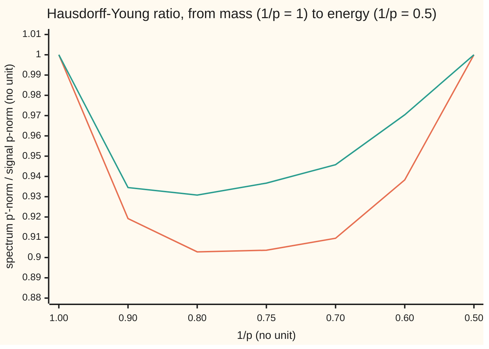

# Interpolation: bounds at two sizes give bounds at every size between

[Syllabus](../../../SYLLABUS.md) → [Harmonic analysis](../README.md) → [Maximal Functions and Beyond](../README.md#s06) → Interpolation

---

## General Overview

A camera shutter opens for 1 ms. The light sensor sees a gate: 1 V while the shutter is open, 0 V otherwise. Its spectrum, the Fourier transform, has size $`\lvert\hat f(\xi)\rvert = \lvert\sin(\pi\xi W)/(\pi\xi)\rvert`$, where $`\xi`$ is frequency in hertz and $`W`$ = 0.001 s is the open time.

Two facts about any signal's spectrum are already proved. **Mass caps the peak:** no spectral value is larger than the signal's mass (the area under its size), here 0.001 V·s ([The Fourier transform of an absolutely integrable signal, and why it fades at infinity](../02-The%20Fourier%20Transform/01-fourier-transform-on-l1-and-riemann-lebesgue.md)). **Energy is kept:** the spectrum's energy equals the signal's energy, here 0.001 V²·s ([Plancherel](../02-The%20Fourier%20Transform/05-plancherel-and-l2.md)).

Those are bounds at two sizes. Mass is the 1-norm, energy the square of the 2-norm. What about a size halfway between, such as the $`\tfrac{4}{3}`$-norm? **Interpolation** answers without any new estimate. Both known bounds have constant 1, so every size between has constant at most 1. For the shutter, the halfway ratio comes out at 0.903602, inside the promised 1.

The same idea, in a cruder form due to Marcinkiewicz, upgrades the maximal function's weak bound to a strong bound, and it fills in the $`L^p`$ bounds of the Hilbert transform for $`p`$ between 1 and 2. Most size bounds in harmonic analysis are proved at two easy ends and then interpolated.

**If a map is bounded at two sizes, it is bounded at every size between: for a linear map with a geometric mean of the two constants (Riesz-Thorin), and for a map that only obeys weak bounds with a larger constant, which grows without bound near the lower end (Marcinkiewicz); applied to the Fourier transform, mass and energy give the Hausdorff-Young inequality.**

**What kind of fact this is:** four theorems. The three-lines lemma, Riesz-Thorin and Marcinkiewicz are proved on this card in Why it works. Hausdorff-Young follows from Riesz-Thorin in one line. The sharp constant for Hausdorff-Young (Beckner, 1975) is stated with its source, not proved.

### The picture: how far below the bound two signals sit



Orange: the shutter gate. Teal: the bell curve $`e^{-\pi t^2}`$, the best possible signal at every size (Beckner's theorem). Both touch 1 at the two ends, where the known bounds are exact. Between the ends both stay under 1, the interpolated bound. At $`1/p`$ = 0.75, halfway, the gate reads 0.9036 and the bell 0.9367.

---

## The formula

Notation first. $`\lVert f\rVert_p = (\int \lvert f\rvert^p)^{1/p}`$ is the **p-norm** of a signal, a measure of its size, and $`L^p`$ is the set of signals with finite p-norm ([Lp spaces](../../10-Measure%20and%20integration/07-Sizes%20of%20Functions/01-lp-spaces.md)). $`\lVert f\rVert_\infty`$ is the signal's ceiling. $`p'`$, read "p-prime", is the **conjugate exponent**: $`1/p + 1/p' = 1`$, so $`\tfrac{4}{3}`$ pairs with 4. A **map** $`T`$ turns a signal into another signal; the Fourier transform and the maximal function are maps.

**Riesz-Thorin.** Let $`T`$ be linear, with complex-valued signals, and bounded at two pairs of sizes:

```math
\lVert Tf\rVert_{q_0} \le M_0\lVert f\rVert_{p_0}, \qquad \lVert Tf\rVert_{q_1} \le M_1\lVert f\rVert_{p_1} \qquad\Longrightarrow\qquad \lVert Tf\rVert_{q_\theta} \le M_0^{1-\theta}M_1^{\theta}\,\lVert f\rVert_{p_\theta}, \qquad \frac{1}{p_\theta} = \frac{1-\theta}{p_0} + \frac{\theta}{p_1}, \quad \frac{1}{q_\theta} = \frac{1-\theta}{q_0} + \frac{\theta}{q_1}
```

**Read it aloud:** if T is bounded from size p-nought to size q-nought with constant M-nought, and from p-one to q-one with constant M-one, then for every theta between 0 and 1 it is bounded between the in-between sizes, whose reciprocals sit a fraction theta of the way along, with constant M-nought to the power one minus theta times M-one to the power theta.

**Hausdorff-Young.** The Fourier transform $`\hat f(\xi) = \int f(t)\,e^{-2\pi i\xi t}\,dt`$ has $`M_0 = 1`$ from size 1 to size $`\infty`$, and $`M_1 = 1`$ from size 2 to size 2. So for $`1 \le p \le 2`$:

```math
\lVert \hat f\rVert_{p'} \;\le\; \lVert f\rVert_p
```

**Read it aloud:** the spectrum's p-prime-norm is at most the signal's p-norm, for every p from 1 to 2.

**Marcinkiewicz.** A map is **sublinear** when $`\lvert T(f+g)\rvert \le \lvert Tf\rvert + \lvert Tg\rvert`$ and $`\lvert T(cf)\rvert = \lvert c\rvert\,\lvert Tf\rvert`$. It is **weak type** $`(p, p)`$ with constant $`A`$ when the set where $`\lvert Tf\rvert > \alpha`$ has length at most $`(A\lVert f\rVert_p/\alpha)^p`$, for every level $`\alpha > 0`$; weak type $`(\infty, \infty)`$ means $`\lVert Tf\rVert_\infty \le A\lVert f\rVert_\infty`$ ([The maximal function](01-hardy-littlewood-maximal-function.md)). If $`T`$ is sublinear and weak type $`(p_0, p_0)`$ and $`(p_1, p_1)`$ with constants $`A_0, A_1`$, where $`p_0 < p_1 \le \infty`$, then for $`p_0 < p < p_1`$:

```math
\lVert Tf\rVert_p \;\le\; 2\left(\frac{p}{p - p_0} + \frac{p}{p_1 - p}\right)^{1/p} A_0^{1-\theta}A_1^{\theta}\,\lVert f\rVert_p, \qquad \frac{1}{p} = \frac{1-\theta}{p_0} + \frac{\theta}{p_1}
```

**Read it aloud:** weak bounds at two exponents give a true norm bound at every exponent strictly between, with the geometric mean of the two constants times an extra factor that blows up near either end. When $`p_1 = \infty`$ the second fraction is dropped.

For the maximal function $`M`$, $`p_0 = 1`$, $`A_0 = 3`$, $`p_1 = \infty`$ and $`A_1 = 1`$, so the constant is $`C_p = 2(3p/(p-1))^{1/p}`$: 12.8948 at $`p = \tfrac{4}{3}`$.

| Symbol | Plain meaning | In our example | Push it up and the answer… |
| --- | --- | --- | --- |
| $`f`$, $`f_0`$, $`f_1`$, $`t`$, $`W`$ | the signal, in volts, and its tall and short parts in Marcinkiewicz's cut; time, in seconds; the shutter's open time | gate of 1 V for $`W`$ = 0.001 s | longer $`W`$, larger norms |
| $`\hat f`$, $`\xi`$, $`b`$ | the spectrum, in V·s; frequency, in hertz; a chirp's sweep rate, no unit | $`\lvert\hat f(300)\rvert`$ = 0.000858 V·s; chirp ratio 6.0035 at $`b`$ = 1000 | larger $`b`$: wider spectrum, larger chirp ratio |
| $`\lVert f\rVert_p`$, $`p`$, $`q`$, $`L^p`$ | the p-norm; its exponent; a second exponent, for the output side; signals of finite p-norm | $`\lVert f\rVert_{4/3}`$ = 0.005623 V·s^(3/4) | — |
| $`p'`$, $`c`$ | conjugate exponent, $`p/(p-1)`$; a stretch factor for the gate's width | 4 when $`p = \tfrac{4}{3}`$; a stretch by $`c`$ scales both sides by $`c^{3/4}`$ | $`p'`$ falls toward 1 |
| $`T`$, $`g`$ | a map from signals to signals; a test signal paired with $`Tf`$ in the proof | the Fourier transform; the maximal function | — |
| $`p_0, q_0, p_1, q_1`$ | the sizes at the two known ends | $`(1, \infty)`$ and $`(2, 2)`$ | — |
| $`M_0`$, $`M_1`$ | Riesz-Thorin's constants at the two ends | 1 and 1 | larger interpolated constant |
| $`\theta`$, $`p_\theta`$, $`q_\theta`$ | how far along from end 0 to end 1; the in-between sizes | $`\theta = \tfrac{1}{2}`$: $`p_\theta = \tfrac{4}{3}`$, $`q_\theta = 4`$ | moves toward end 1 |
| $`z`$, $`F(z)`$, $`\varepsilon`$ | a complex number in the strip $`0 \le \mathrm{Re}\, z \le 1`$; an analytic function on it; a small damping number in the proof | $`F(\theta)`$ is the response being bounded | — |
| $`Mf`$, $`\alpha`$, $`\lambda`$, $`d`$ | the maximal function; a level, in volts; length of a set, in seconds; distance outside the gate, in seconds | $`Mf > 0.25`$ V on 3 ms | higher level, shorter set |
| $`A_0`$, $`A_1`$, $`C_p`$, $`\delta`$, $`v`$ | weak-type constants; Marcinkiewicz's constant; the cut sits at height $`\delta\alpha`$; a value of $`\lvert f\rvert`$ | 3, 1; $`C_{4/3}`$ = 12.8948 | $`C_p`$ grows without bound as $`p \to 1`$ |
| $`N`$, $`x_n`$, $`X_k`$ | length of a finite signal; its values; its discrete transform | $`N`$ = 16 | Riesz-Thorin bound $`\sqrt{N}^{\,\theta}`$ grows |

### When it holds

- **Riesz-Thorin needs a linear map and complex scalars.** The proof feeds complex powers of the signal into $`T`$. For real-valued signals and maps, the same bound can need an extra factor, at most 2 (see Grafakos, below).
- **Hausdorff-Young needs $`p \le 2`$ and the conjugate exponent.** For $`p`$ above 2 no bound holds: a chirp (a tone whose pitch sweeps) has a ratio of 6.0035 at sweep rate 1000, and it grows without limit. With a non-conjugate pair the ratio depends on the signal's time scale, so no constant works.
- **Marcinkiewicz needs $`p`$ strictly between the ends.** At $`p_0 = 1`$ itself, weak type does not give strong type: the area under the gate's $`Mf`$ grows like a logarithm of the span and is infinite.
- **The three-lines lemma needs a limit on growth.** The function $`\exp(-i e^{i\pi z})`$ has modulus 1 on both edges of the strip, yet grows like $`\exp(e^{\pi\lvert t\rvert})`$ along the middle line $`z = \tfrac{1}{2} + it`$ as $`t \to -\infty`$. Bounded on the strip is enough.
- **The interpolated constant is an upper bound, not the true value.** The gate sits at 0.903602 against the bound 1. Beckner's bell reaches the best constant, 0.936687 at $`p = \tfrac{4}{3}`$.

---

## Why it works

### Step 0: two ways to slide between sizes

**Riesz-Thorin** slides the signal itself. Raise each value's size to a complex power $`z`$, keeping its phase. At $`\mathrm{Re}\, z = 0`$ the signal looks like a size-$`p_0`$ signal, at $`\mathrm{Re}\, z = 1`$ like a size-$`p_1`$ signal, and at $`z = \theta`$ it is the original. The response of a linear map to this family is an analytic function of $`z`$. An analytic function cannot peak inside a region ([The maximum modulus principle](../../07-Complex%20analysis/04-Taylor%20Series%2C%20Zeros%20and%20Rigidity/05-maximum-modulus-principle.md)). So the bounds on the two edges control the middle.

**Marcinkiewicz** cuts the signal instead. At each level $`\alpha`$, split the signal into its tall part and its short part. The tall part is handled by the bound at the small exponent, the short part by the bound at the large one. Adding the pieces over all levels gives a norm. No complex numbers, so it works for maps that are not linear, such as the maximal function.

### Step 1: the three-lines lemma

Let $`F`$ be analytic on the open strip $`0 < \mathrm{Re}\, z < 1`$, continuous and bounded on the closed strip. Suppose $`\lvert F\rvert \le M_0`$ on the left edge and $`\lvert F\rvert \le M_1`$ on the right edge. Then

```math
\lvert F(\theta + it)\rvert \;\le\; M_0^{1-\theta}M_1^{\theta} \qquad \text{for every } 0 \le \theta \le 1 \text{ and real } t
```

**Read it aloud:** on the line a fraction theta of the way across, the modulus is at most the weighted geometric mean of the two edge bounds.

The proof divides $`F`$ by $`M_0^{1-z}M_1^{z}`$, an analytic function whose modulus is exactly $`M_0`$ on the left edge, $`M_1`$ on the right, and the geometric mean in between. The quotient is at most 1 on both edges. A small factor $`e^{\varepsilon(z^2 - 1)}`$ pushes it below 1 far up and down the strip. The maximum modulus principle on a tall rectangle then gives at most 1 inside. Letting $`\varepsilon \to 0`$ finishes it. The fold below writes this out.

### Step 2: Riesz-Thorin from three lines

The size of $`Tf`$ in $`L^{q}`$ is the largest pairing $`\int (Tf)\,g`$ over test signals $`g`$ with $`\lVert g\rVert_{q'} = 1`$ (the equality case of [Holder's inequality](../../10-Measure%20and%20integration/07-Sizes%20of%20Functions/02-holders-inequality.md)). Take $`f`$ and $`g`$ to be step signals, of size 1. Replace $`\lvert f\rvert`$ by $`\lvert f\rvert^{a(z)}`$ and $`\lvert g\rvert`$ by $`\lvert g\rvert^{b(z)}`$, with exponents $`a, b`$ linear in $`z`$, chosen so that:

- at $`z = \theta`$ both powers are 1, so nothing changes;
- on the left edge, $`\lvert f_z\rvert^{p_0} = \lvert f\rvert^{p_\theta}`$ and $`\lvert g_z\rvert^{q_0'} = \lvert g\rvert^{q_\theta'}`$, so both still have size 1 in the end-0 norms;
- on the right edge the same holds with the end-1 norms.

Then $`F(z) = \int T(f_z)\,g_z`$ is a finite sum of exponentials in $`z`$, so it is analytic and bounded on the strip. On the left edge Holder and the end-0 bound give $`\lvert F\rvert \le M_0`$; on the right, $`\lvert F\rvert \le M_1`$. Three lines gives $`\lvert F(\theta)\rvert \le M_0^{1-\theta}M_1^{\theta}`$, and $`F(\theta) = \int (Tf)\,g`$. Step signals come as close as wanted to any signal in $`L^{p}`$, which extends the bound.

A finite check. The unnormalized discrete transform of length $`N`$ = 16, $`X_k = \sum_n x_n e^{-2\pi i kn/N}`$, has constant 1 from size 1 to size $`\infty`$ and constant $`\sqrt{16}`$ = 4 from size 2 to size 2. Riesz-Thorin at $`\theta = \tfrac{1}{2}`$ promises $`\sqrt{1 \times 4}`$ = 2 from size $`\tfrac{4}{3}`$ to size 4. Over 500 random complex signals the worst ratio is 1.4925. A single spike and a flat signal both reach exactly 2.0000, so the interpolated constant is sharp here.

<details>
<summary>Detailed proof: the three-lines lemma and Riesz-Thorin</summary>

**Three-lines lemma.** Let $`S = \{0 \le \mathrm{Re}\, z \le 1\}`$ and $`F`$ continuous and bounded on $`S`$, analytic inside, with $`\lvert F\rvert \le B`$ on $`S`$, $`\lvert F(it)\rvert \le M_0`$ and $`\lvert F(1+it)\rvert \le M_1`$, where $`M_0, M_1 > 0`$ (if one is 0, replace it by $`\delta > 0`$ and let $`\delta \to 0`$). For $`\varepsilon > 0`$ put

$`\displaystyle G(z) = F(z)\,M_0^{z-1}M_1^{-z}\,e^{\varepsilon(z^2-1)}.`$

With $`z = x + it`$, $`\lvert M_0^{z-1}M_1^{-z}\rvert = M_0^{x-1}M_1^{-x}`$ and $`\lvert e^{\varepsilon(z^2-1)}\rvert = e^{\varepsilon(x^2 - t^2 - 1)} \le e^{-\varepsilon t^2}`$. So $`\lvert G\rvert \le 1`$ on both edges, and $`\lvert G\rvert \le B\max(1, M_0^{-1})\max(1, M_1^{-1})e^{-\varepsilon t^2} \le 1`$ once $`\lvert t\rvert \ge R`$ for some $`R`$. On the rectangle $`\{0 \le x \le 1, \lvert t\rvert \le R\}`$ the maximum modulus principle bounds $`\lvert G\rvert`$ by its boundary values, which are at most 1. So $`\lvert G\rvert \le 1`$ on $`S`$, that is

$`\displaystyle \lvert F(x + it)\rvert \le M_0^{1-x}M_1^{x}\,e^{\varepsilon(1 + t^2 - x^2)}.`$

Let $`\varepsilon \to 0`$.

**Riesz-Thorin.** Let $`(X, \mu)`$ and $`(Y, \nu)`$ be measure spaces, $`T`$ linear from simple functions on $`X`$ to measurable functions on $`Y`$, and $`1 \le p_0, p_1, q_0, q_1 \le \infty`$ with the two bounds of the formula. Fix $`0 < \theta < 1`$ and write $`p = p_\theta`$, $`q = q_\theta`$. Assume $`p < \infty`$ (if $`p = \infty`$ then $`p_0 = p_1 = \infty`$ and the exponent $`a(z)`$ below is replaced by 1). Take a simple $`f = \sum_j c_j e^{i\phi_j}\mathbf{1}_{E_j}`$ with $`c_j > 0`$, disjoint $`E_j`$ and $`\lVert f\rVert_p = 1`$, and a simple $`g = \sum_k d_k e^{i\psi_k}\mathbf{1}_{F_k}`$ with $`\lVert g\rVert_{q'} = 1`$; when $`q' = \infty`$ (so $`q_0 = q_1 = 1`$), the exponent $`b(z)`$ below is replaced by 1. Put

$`\displaystyle a(z) = p\left(\frac{1-z}{p_0} + \frac{z}{p_1}\right), \qquad b(z) = q'\left(\frac{1-z}{q_0'} + \frac{z}{q_1'}\right),`$

$`\displaystyle f_z = \sum_j c_j^{a(z)}e^{i\phi_j}\mathbf{1}_{E_j}, \qquad g_z = \sum_k d_k^{b(z)}e^{i\psi_k}\mathbf{1}_{F_k}, \qquad F(z) = \int_Y T(f_z)\,g_z\,d\nu = \sum_{j,k} c_j^{a(z)}d_k^{b(z)}e^{i(\phi_j + \psi_k)}\int_{F_k} T(\mathbf{1}_{E_j})\,d\nu.`$

Each term is a constant times $`e^{(\text{real})z}`$, so $`F`$ is entire and bounded on $`S`$. On $`\mathrm{Re}\, z = 0`$, $`\lvert f_{it}\rvert = \lvert f\rvert^{p/p_0}`$, so $`\lVert f_{it}\rVert_{p_0} = \lVert f\rVert_p^{p/p_0} = 1`$, and likewise $`\lVert g_{it}\rVert_{q_0'} = 1`$. Holder's inequality and the end-0 bound give $`\lvert F(it)\rvert \le \lVert T f_{it}\rVert_{q_0}\lVert g_{it}\rVert_{q_0'} \le M_0`$. In the same way $`\lvert F(1+it)\rvert \le M_1`$. Since $`a(\theta) = b(\theta) = 1`$, $`F(\theta) = \int (Tf)\,g\,d\nu`$, and the three-lines lemma gives $`\lvert \int (Tf)\,g\,d\nu\rvert \le M_0^{1-\theta}M_1^{\theta}`$. Taking the supremum over simple $`g`$ of size 1 in $`L^{q'}`$ gives $`\lVert Tf\rVert_q \le M_0^{1-\theta}M_1^{\theta}`$ by the duality of $`L^q`$ and $`L^{q'}`$ (for $`q = \infty`$ this needs $`\nu`$ σ-finite). Scaling gives every simple $`f`$, and density extends $`T`$ to all of $`L^p`$ when $`p < \infty`$.

**Hausdorff-Young.** On simple functions, $`\lVert\hat f\rVert_\infty \le \lVert f\rVert_1`$ and $`\lVert \hat f\rVert_2 = \lVert f\rVert_2`$. Take $`(p_0, q_0) = (1, \infty)`$, $`(p_1, q_1) = (2, 2)`$. Then $`1/p_\theta = 1 - \theta/2`$ and $`1/q_\theta = \theta/2 = 1 - 1/p_\theta`$, so $`q_\theta = p_\theta'`$ and the constant is $`1^{1-\theta}1^{\theta} = 1`$.

</details>

### Step 3: Hausdorff-Young on the shutter

At halfway, $`\theta = \tfrac{1}{2}`$: $`1/p = \tfrac{1}{2} \cdot 1 + \tfrac{1}{2} \cdot \tfrac{1}{2} = \tfrac{3}{4}`$, so $`p = \tfrac{4}{3}`$ and $`p' = 4`$. The bound reads $`\lVert\hat f\rVert_4 \le \lVert f\rVert_{4/3}`$.

The left side has an exact time-side road. The transform of a convolution is the product of transforms ([The convolution theorem](../03-Convolution%20and%20Approximate%20Identities/02-convolution-theorem-and-impulse-response.md)), so $`\hat f^{\,2}`$ is the spectrum of $`f * f`$. Plancherel then turns the spectrum's fourth-power area into the energy of $`f * f`$:

```math
\lVert \hat f\rVert_4^4 = \int \lvert \hat f(\xi)\rvert^4\,d\xi = \int \lvert (f * f)(t)\rvert^2\,dt
```

For the gate, $`f * f`$ is a triangle: it rises from 0 to $`W`$ V²·s over the first $`W`$ seconds and falls back over the next $`W`$. Its energy is $`2W^3/3`$. The code gets 6.666667e-10 three ways: this formula, a midpoint sum of the triangle's square, and a lobe-by-lobe Simpson sum of $`\lvert\hat f\rvert^4`$ over 2,000 lobes.

Both sides carry the same unit, V·s^(3/4). That is why the exponents must be conjugate. Stretch the gate to width $`cW`$ and both sides scale by $`c^{3/4}`$, so the ratio stays at 0.903602 for every shutter time. With the non-conjugate pair $`(\tfrac{3}{2}, 4)`$ the two sides scale differently, and the ratio runs from 0.5081 at 1 ms to 2.8574 at $`10^6`$ s.

### Step 4: Marcinkiewicz, and the maximal function's strong bound

Fix a level $`\alpha`$ and cut $`f`$ at height $`\delta\alpha`$, for a constant $`\delta`$ chosen later. The tall part $`f_0`$ keeps the values above the cut; the short part $`f_1`$ keeps the rest. Sublinearity gives $`\lvert Tf\rvert \le \lvert Tf_0\rvert + \lvert Tf_1\rvert`$. So where $`\lvert Tf\rvert > \alpha`$, one of the two pieces is above $`\alpha/2`$, and each weak bound limits the length of that set.

[The layer-cake formula](../../10-Measure%20and%20integration/06-Product%20Measures%20and%20Fubini/06-layer-cake-and-tail-integrals.md) writes $`\lVert Tf\rVert_p^p = p\int_0^\infty \alpha^{p-1}\lambda\{\lvert Tf\rvert > \alpha\}\,d\alpha`$. Put in the two bounds and swap the integrals. A point where $`\lvert f\rvert = v`$ counts in the tall part for levels $`\alpha < v/\delta`$ and in the short part for $`\alpha > v/\delta`$. The two level integrals, $`\int_0^{v/\delta}\alpha^{p-1-p_0}\,d\alpha`$ and $`\int_{v/\delta}^\infty \alpha^{p-1-p_1}\,d\alpha`$, are finite exactly because $`p_0 < p < p_1`$. They produce the fractions $`p/(p - p_0)`$ and $`p/(p_1 - p)`$. Choosing $`\delta`$ to balance the two terms gives the geometric mean $`A_0^{1-\theta}A_1^{\theta}`$.

[The maximal function](01-hardy-littlewood-maximal-function.md) ran this argument for $`M`$ and is not repeated here. For the gate, $`Mf = 1`$ V on the gate, and at distance $`d`$ outside it $`Mf = W/(2(d + W))`$. The set where $`Mf > 0.25`$ V has length 3 ms, against the weak bound's 12 ms. At $`p = \tfrac{4}{3}`$ the true ratio $`\lVert Mf\rVert_p/\lVert f\rVert_p`$ is 2.4934, inside Marcinkiewicz's 12.8948.

The extra factor is not decoration. The bare geometric mean $`3^{1-\theta} \cdot 1^{\theta} = 3^{1/p}`$ is 2.2795 at $`p = \tfrac{4}{3}`$, below the gate's true 2.4934. So Riesz-Thorin's constant would be false for $`M`$. Weak bounds lose information, and the factor pays for it.

<details>
<summary>Detailed proof: Marcinkiewicz's theorem</summary>

Let $`T`$ be sublinear, defined on $`L^{p_0} + L^{p_1}`$, of weak type $`(p_0, p_0)`$ with constant $`A_0`$ and weak type $`(p_1, p_1)`$ with constant $`A_1`$, $`1 \le p_0 < p < p_1 \le \infty`$. Take $`f \in L^p`$. For $`\alpha > 0`$ and $`\delta > 0`$ put $`f_0 = f\,\mathbf{1}\{\lvert f\rvert > \delta\alpha\}`$ and $`f_1 = f - f_0`$. Then $`f_0 \in L^{p_0}`$ and $`f_1 \in L^{p_1}`$, since $`\lvert f_0\rvert^{p_0} \le \lvert f\rvert^p(\delta\alpha)^{p_0 - p}`$ and $`\lvert f_1\rvert^{p_1} \le \lvert f\rvert^p(\delta\alpha)^{p_1 - p}`$.

**Case $`p_1 < \infty`$.** From $`\lvert Tf\rvert \le \lvert Tf_0\rvert + \lvert Tf_1\rvert`$,

$`\displaystyle \lambda\{\lvert Tf\rvert > \alpha\} \le \left(\frac{2A_0}{\alpha}\right)^{p_0}\int_{\lvert f\rvert > \delta\alpha}\lvert f\rvert^{p_0} + \left(\frac{2A_1}{\alpha}\right)^{p_1}\int_{\lvert f\rvert \le \delta\alpha}\lvert f\rvert^{p_1}.`$

Multiply by $`p\alpha^{p-1}`$, integrate over $`\alpha`$ and use Tonelli's theorem (non-negative integrands may be integrated in either order):

$`\displaystyle \lVert Tf\rVert_p^p \le p(2A_0)^{p_0}\int \lvert f\rvert^{p_0}\int_0^{\lvert f\rvert/\delta}\alpha^{p-1-p_0}\,d\alpha + p(2A_1)^{p_1}\int\lvert f\rvert^{p_1}\int_{\lvert f\rvert/\delta}^\infty \alpha^{p-1-p_1}\,d\alpha = \left(\frac{p(2A_0)^{p_0}\delta^{p_0-p}}{p - p_0} + \frac{p(2A_1)^{p_1}\delta^{p_1-p}}{p_1 - p}\right)\lVert f\rVert_p^p.`$

Choose $`\delta`$ with $`\delta^{p_1 - p_0} = (2A_0)^{p_0}/(2A_1)^{p_1}`$. Then $`(2A_0)^{p_0}\delta^{p_0-p} = (2A_1)^{p_1}\delta^{p_1-p} = (2A_0)^{p(1-\theta)}(2A_1)^{p\theta}`$, using $`1-\theta = p_0(p_1-p)/(p(p_1-p_0))`$ and $`\theta = p_1(p - p_0)/(p(p_1 - p_0))`$. Taking p-th roots gives the formula's constant.

**Case $`p_1 = \infty`$.** Take $`\delta = 1/(2A_1)`$. Then $`\lvert Tf_1\rvert \le A_1\delta\alpha = \alpha/2`$ almost everywhere, so $`\{\lvert Tf\rvert > \alpha\} \subseteq \{\lvert Tf_0\rvert > \alpha/2\}`$ up to a null set, and only the first term remains: $`\lVert Tf\rVert_p^p \le p(2A_0)^{p_0}(2A_1)^{p - p_0}/(p - p_0)\,\lVert f\rVert_p^p`$. With $`\theta = 1 - p_0/p`$ this is the formula with the second fraction dropped. For $`M`$: $`p_0 = 1`$, $`A_0 = 3`$, $`A_1 = 1`$ give $`C_p^p = 3 \cdot 2^p\,p/(p-1)`$.

</details>

---

## Worked numbers, by hand

Hausdorff-Young for the 1 ms shutter, halfway between mass and energy.

| Step | Arithmetic | Value |
| --- | --- | --- |
| halfway exponents | $`\theta = \tfrac{1}{2}`$: $`1/p_\theta = \tfrac{1}{2} + \tfrac{1}{4}`$, $`1/q_\theta = 0 + \tfrac{1}{4}`$ | $`p_\theta = \tfrac{4}{3}`$, $`q_\theta = 4`$ |
| constants at the ends | peak at most mass; energy kept | $`M_0 = 1`$, $`M_1 = 1`$ |
| Riesz-Thorin constant | $`1^{1/2} \times 1^{1/2}`$ | 1 |
| signal side | $`\lVert f\rVert_{4/3} = (1^{4/3} \times 0.001)^{3/4}`$ | 0.005623 V·s^(3/4) |
| fourth-power area | energy of the triangle $`f * f`$: $`2W^3/3 = 2 \times 10^{-9}/3`$ | 6.666667e-10 V⁴·s³ |
| spectrum side | $`(6.666667 \times 10^{-10})^{1/4}`$ | 0.005081 V·s^(3/4) |
| ratio | $`0.005081/0.005623 = (2/3)^{1/4}`$ | **0.903602** |

The shutter's spectrum is 90.36 % of the size the theorem allows, at this exponent pair. The bound is good to within 10 %, from two facts that cost nothing.

### What breaks if you drop a piece

| Mistake | Comes out at | What went wrong |
| --- | --- | --- |
| Pair $`p = \tfrac{3}{2}`$ with $`q = 4`$, not conjugate | ratio 0.5081, 0.9036, 1.6069, 2.8574 for gates of 1 ms, 1 s, 1000 s, $`10^6`$ s | the two sides scale differently, so no one constant fits every time scale |
| Use $`p = 4`$, above 2, with $`p' = \tfrac{4}{3}`$ | chirp $`e^{-\pi(1 + ib)t^2}`$: ratio 1.0676, 1.9008, 3.3761, 6.0035 at $`b`$ = 0, 10, 100, 1000 | sweeping the pitch spreads the spectrum without changing the signal's size; the endpoint bounds only run from size 1 and 2 |
| Riesz-Thorin's constant for the maximal function | $`3^{1/p}`$ = 2.2795 at $`p = \tfrac{4}{3}`$; the gate's true ratio is 2.4934 | weak bounds are not norm bounds, so the extra factor in Marcinkiewicz is needed |
| Marcinkiewicz at the end $`p = 1`$ | area under $`Mf`$: 0.007909 V·s within 1 s of the gate, 0.014816 within 1000 s; $`\lVert f\rVert_1`$ = 0.001 | far away $`Mf`$ fades like $`W/(2d)`$, whose area grows like a logarithm |

---

## Code, from first principles, and it actually runs

The code checks Hausdorff-Young on the gate by three roads: the transform integral done by a midpoint sum against the closed form, the spectrum's fourth-power area by Simpson's rule lobe by lobe against the triangle's energy on the time side, and both against $`2W^3/3`$. It checks the bell's ratio by sums against Beckner's closed form, and prints the chart's points. It runs Riesz-Thorin on a 16-point discrete transform written out by hand, with 500 random signals from a SplitMix64 generator. It finds the gate's maximal function by brute-force window search and compares it with the closed form, measures level sets by sampling, and prints the Marcinkiewicz constants. Every row of "What breaks" is computed. Python and Rust print the same lines.

### Python

```python
# Interpolation: Riesz-Thorin, Marcinkiewicz, Hausdorff-Young -- the check behind the card.
# Standard library only.  The example: a shutter gate, 1 V for W = 0.001 s.  Roads: closed
# forms against integrals done here by Simpson or midpoint sums, the spectrum's 4th-power
# area against the triangle's energy on the time side, an exact 16-point DFT on random
# signals, and the maximal function by brute-force window search against its closed form.
from math import sin, cos, exp, pi, sqrt, log

W = 0.001                                   # gate open time, seconds; height 1 V

def sinc(u): return 1.0 if u == 0 else sin(pi * u) / (pi * u)

def S(q, lobes=2000, m=32):                 # area under |sinc u|^q over the line, Simpson per lobe
    tot = 0.0
    for k in range(lobes):
        h, s = 1.0 / m, 0.0
        for j in range(m + 1):
            c = 1 if j in (0, m) else (4 if j % 2 else 2)
            s += c * abs(sinc(k + j * h)) ** q
        tot += s * h / 3
    tail = 2 * lobes ** (1 - q) / (pi ** q * (q - 1))   # the area past the cut-off is below this
    return 2 * tot, tail

def ft_gate(xi, n=2000):                    # the transform integral itself, midpoint rule
    re = im = 0.0
    for k in range(n):
        t = (k + 0.5) * W / n
        re += cos(2 * pi * xi * t) * W / n; im -= sin(2 * pi * xi * t) * W / n
    return sqrt(re * re + im * im)

print(f"gate: mass ||f||_1 {W:.6f} V s; |f^(0)| integral {ft_gate(0):.6f}; |f^(300)| integral {ft_gate(300):.6f}, closed form {W * abs(sinc(W * 300)):.6f}")
assert abs(ft_gate(300) - W * abs(sinc(W * 300))) < 1e-9
s2, t2 = S(2)
s4, t4 = S(4)
s6, t6 = S(6)
assert abs(s2 - 1) < 2e-4 and abs(s4 - 2 / 3) < 1e-8 and abs(s6 - 0.55) < 1e-8
print(f"energy: ||f||_2^2 {W:.6f}; area of |f^|^2 {W * s2:.6f} (cut-off 2000 lobes, tail below {W * t2:.1e})")
p, q = 4 / 3, 4.0                           # halfway: 1/p = 3/4 sits midway between 1 and 1/2
tri = sum(min(t, 2 * W - t) ** 2 for t in ((k + 0.5) * 2 * W / 20000 for k in range(20000))) * 2 * W / 20000
print(f"area of |f^|^4: frequency side {W ** 3 * s4:.6e}; time side, energy of f*f {tri:.6e}; exact 2w^3/3 {2 * W ** 3 / 3:.6e}")
assert abs(tri - W ** 3 * s4) < 1e-14
lhs, rhs = (W ** 3 * s4) ** 0.25, W ** 0.75
print(f"halfway: ||f^||_4 {lhs:.6f}; ||f||_4/3 {rhs:.6f}; ratio {lhs / rhs:.6f}; Riesz-Thorin bound 1^(1/2) x 1^(1/2) = 1")
assert lhs < rhs

def gauss_ratio(p):                         # bell e^(-pi t^2) is its own transform; ||g||_p = p^(-1/2p)
    if p == 1: return 1.0
    pp = p / (p - 1)
    return (p ** (1 / p) / pp ** (1 / pp)) ** 0.5

def gnorm(p, n=12000):                      # ||g||_p by midpoint sum on [-6, 6]
    return (sum(exp(-p * pi * ((k + 0.5) * 12 / n - 6) ** 2) for k in range(n)) * 12 / n) ** (1 / p)
for pt in (4 / 3, 1.5):
    pp = pt / (pt - 1)
    assert abs(gnorm(pp) / gnorm(pt) - gauss_ratio(pt)) < 1e-9
print(f"bell at p 4/3: ratio by sums {gnorm(4.0) / gnorm(4 / 3):.6f}; closed form {gauss_ratio(4 / 3):.6f}")
inv = [1.0, 0.9, 0.8, 0.75, 0.7, 0.6, 0.5]
gate_r, bell_r = [], []
for a in inv:
    if a in (1.0, 0.5): gate_r.append(1.0)  # the ends: tallest point of |sinc| is 1; Plancherel
    else:
        pp = 1 / (1 - a); sq, tq = S(pp)
        assert tq < 1e-5
        gate_r.append(sq ** (1 / pp))
    bell_r.append(gauss_ratio(1 / a))
    assert gate_r[-1] <= bell_r[-1] + 1e-6 <= 1 + 2e-6
print("chart, 1/p:", " ".join(f"{a:.2f}" for a in inv))
print("chart, gate ratio:", " ".join(f"{r:.4f}" for r in gate_r))
print("chart, bell ratio:", " ".join(f"{r:.4f}" for r in bell_r))

state = 2026                                # SplitMix64, so Python and Rust draw the same signals
def rnd():
    global state
    state = (state + 0x9E3779B97F4A7C15) % 2 ** 64
    z = state
    z = ((z ^ (z >> 30)) * 0xBF58476D1CE4E5B9) % 2 ** 64
    z = ((z ^ (z >> 27)) * 0x94D049BB133111EB) % 2 ** 64
    return ((z ^ (z >> 31)) >> 11) / 2 ** 53 * 2 - 1
N = 16
def dft(x): return [sum(x[n] * complex(cos(2 * pi * k * n / N), -sin(2 * pi * k * n / N)) for n in range(N)) for k in range(N)]
def norm(v, r): return sum(abs(c) ** r for c in v) ** (1 / r)
worst = 0.0
for trial in range(500):
    x = [complex(rnd(), rnd()) for _ in range(N)]
    X = dft(x)
    assert abs(norm(X, 2) - 4 * norm(x, 2)) < 1e-9 and max(abs(c) for c in X) <= norm(x, 1)
    worst = max(worst, norm(X, 4) / norm(x, 4 / 3))
d, fl = dft([1.0] + [0.0] * 15), dft([1.0] * 16)
assert worst < 2 and abs(norm(d, 4) - 2) < 1e-12 and abs(norm(fl, 4) / norm([1.0] * 16, 4 / 3) - 2) < 1e-12
print(f"16-point DFT: M0 1, M1 sqrt(16) = 4, bound sqrt(1 x 4) = 2; worst of 500 random {worst:.4f}; spike {norm(d, 4):.4f}; flat {norm(fl, 4) / norm([1.0] * 16, 4 / 3):.4f}")

def Mf(d): return 1.0 if d < 0 else 0.5 / (d / W + 1)   # d = distance outside the gate, s
def Mbrute(x):                              # try windows (x - h, x + h), h = W/1000 ... 20 W
    return max(max(0.0, min(x + h, W) - max(x - h, 0.0)) / (2 * h) for h in (k * W / 1000 for k in range(1, 20001)))
for r in (0.5, 1.0, 4.0):
    assert abs(Mbrute(W + r * W) - Mf(r * W)) < 1e-12
    print(f"Mf at {r:g} w outside: window search {Mbrute(W + r * W):.6f} V; closed form {Mf(r * W):.6f} V")
for al in (0.1, 0.25, 0.5):
    lam = W * (1 / al - 1); n = 200000; step = 40 * W / n
    samp = step * sum(1 for k in range(n) if Mf(abs((k + 0.5) * step - 20 * W + W / 2) - W / 2) > al)
    assert abs(samp - lam) < 2 * step and lam <= 3 * W / al
    print(f"level {al:g} V: length of Mf > level {lam * 1e3:.4f} ms, sampled {samp * 1e3:.4f} ms; weak bound 3||f||_1/level {3 * W / al * 1e3:.4f} ms")
n = 100000
cake = sum(2 * a * (W * (1 / a - 1) if a < 0.5 else W) for a in ((k + 0.5) / n for k in range(n))) / n
assert abs(cake - 1.5 * W) < 1e-9
Cp = lambda p: 2 * (3 * p / (p - 1)) ** (1 / p)
Mtrue = lambda p: (1 + 2 ** (1 - p) / (p - 1)) ** (1 / p)   # ||Mf||_p/||f||_p, from the closed form of Mf
assert abs(Mtrue(2) ** 2 - cake / W) < 1e-6                  # against the layer-cake sum
assert abs(Cp(4 / 3) - (4 / 3 * 6 * 2 ** (1 / 3) / (1 / 3)) ** 0.75) < 1e-12   # the proof's p(2A0)(2A1)^(p-1)/(p-1)
print(f"p 2: ||Mf||_2^2 layer cake {cake * 1e3:.6f}, closed form w(1 + 1/2) {1.5 * W * 1e3:.6f} (x 1e-3 V^2 s)")
print(f"p 2: ||Mf||_2/||f||_2 {sqrt(1.5):.4f}; Marcinkiewicz C_2 = 2 sqrt(6) {Cp(2):.4f}")
for pt in (4 / 3, 1.1, 1.01):
    true = Mtrue(pt)
    assert 3 ** (1 / pt) < true < Cp(pt)       # the bare geometric mean 3^(1-theta) x 1^theta is too small
    print(f"p {pt:.2f}: ||Mf||_p/||f||_p {true:.4f}; C_p {Cp(pt):.4f}; geometric mean 3^(1/p) {3 ** (1 / pt):.4f}")

mis = [(w ** 3 * s4) ** 0.25 / w ** (2 / 3) for w in (1e-3, 1.0, 1e3, 1e6)]   # ||f^||_4 / ||f||_3/2
assert abs(mis[0] - (2 / 3) ** 0.25 * W ** (1 / 12)) < 1e-9 and mis[3] > 2.5   # exact s4 = 2/3 gives (2/3)^(1/4) w^(1/12)
print("breaks, p = 3/2 with q = 4: ratio ||f^||_4/||f||_3/2 at w = 1 ms, 1 s, 1000 s, 1e6 s:", " ".join(f"{r:.4f}" for r in mis))
def chirp_ratio(b):                         # f = e^(-pi (1 + ib) t^2): |f^| is a wider, lower bell
    return (1 + b * b) ** (1 / 8) * (4 / 3) ** (-3 / 8) / 4 ** (-1 / 8)
def chirp_ft(b, xi, n=40000):               # the transform integral itself, on [-6, 6] s
    re = im = 0.0
    for k in range(n):
        t = (k + 0.5) * 12 / n - 6; ph = -pi * b * t * t - 2 * pi * xi * t; a = exp(-pi * t * t) * 12 / n
        re += a * cos(ph); im += a * sin(ph)
    return sqrt(re * re + im * im)
assert abs(chirp_ft(10, 3) - (101) ** -0.25 * exp(-pi * 9 / 101)) < 1e-9
print("breaks, p = 4 > 2: chirp ratio ||f^||_4/3/||f||_4 at sweep 0, 10, 100, 1000:",
      " ".join(f"{chirp_ratio(b):.4f}" for b in (0, 10, 100, 1000)))
fh = lambda b, p: (sum(((1 + b * b) ** -0.25 * exp(-pi * ((k + 0.5) * 0.01 - 60) ** 2 / (1 + b * b))) ** p for k in range(12000)) * 0.01) ** (1 / p)
assert chirp_ratio(1000) > 5 and abs(fh(10, 4 / 3) / gnorm(4.0) - chirp_ratio(10)) < 1e-9   # |f^| summed on [-60, 60]
grid = sum(Mf((k + 0.5) * 1e-5) for k in range(100000)) * 1e-5   # one side, 0 to 1 s, midpoint sum
assert abs(W + 2 * grid - (W + W * log((1 + W) / W))) < 1e-8
for D in (1.0, 1000.0):
    print(f"breaks, p = 1: area under Mf over {D:g} s each side {W + W * log((D + W) / W):.6f} V s; ||f||_1 {W:.6f} V s")
print(f"try: 1/p 0.85: gate ratio {S(1 / (1 - 0.85))[0] ** (1 - 0.85):.4f}, bell ratio {gauss_ratio(1 / 0.85):.4f}; W 0.004 s: ||f^||_4 {(0.004 ** 3 * s4) ** 0.25:.6f}, ||f||_4/3 {0.004 ** 0.75:.6f}")
print(f"try: level 0.05 V: length of Mf > level {W * (1 / 0.05 - 1) * 1e3:.4f} ms, weak bound {3 * W / 0.05 * 1e3:.4f} ms; chirp ratio at sweep 10000 {chirp_ratio(10000):.4f}")
print("ALL CHECKS PASS")
```

**Ran 2026-11-15 on macOS, Python 3.14.10, standard library only. All checks passed. Output, pasted from the run:**

```
gate: mass ||f||_1 0.001000 V s; |f^(0)| integral 0.001000; |f^(300)| integral 0.000858, closed form 0.000858
energy: ||f||_2^2 0.001000; area of |f^|^2 0.001000 (cut-off 2000 lobes, tail below 1.0e-07)
area of |f^|^4: frequency side 6.666667e-10; time side, energy of f*f 6.666667e-10; exact 2w^3/3 6.666667e-10
halfway: ||f^||_4 0.005081; ||f||_4/3 0.005623; ratio 0.903602; Riesz-Thorin bound 1^(1/2) x 1^(1/2) = 1
bell at p 4/3: ratio by sums 0.936687; closed form 0.936687
chart, 1/p: 1.00 0.90 0.80 0.75 0.70 0.60 0.50
chart, gate ratio: 1.0000 0.9192 0.9028 0.9036 0.9095 0.9383 1.0000
chart, bell ratio: 1.0000 0.9345 0.9308 0.9367 0.9458 0.9704 1.0000
16-point DFT: M0 1, M1 sqrt(16) = 4, bound sqrt(1 x 4) = 2; worst of 500 random 1.4925; spike 2.0000; flat 2.0000
Mf at 0.5 w outside: window search 0.333333 V; closed form 0.333333 V
Mf at 1 w outside: window search 0.250000 V; closed form 0.250000 V
Mf at 4 w outside: window search 0.100000 V; closed form 0.100000 V
level 0.1 V: length of Mf > level 9.0000 ms, sampled 9.0000 ms; weak bound 3||f||_1/level 30.0000 ms
level 0.25 V: length of Mf > level 3.0000 ms, sampled 3.0000 ms; weak bound 3||f||_1/level 12.0000 ms
level 0.5 V: length of Mf > level 1.0000 ms, sampled 1.0000 ms; weak bound 3||f||_1/level 6.0000 ms
p 2: ||Mf||_2^2 layer cake 1.500000, closed form w(1 + 1/2) 1.500000 (x 1e-3 V^2 s)
p 2: ||Mf||_2/||f||_2 1.2247; Marcinkiewicz C_2 = 2 sqrt(6) 4.8990
p 1.33: ||Mf||_p/||f||_p 2.4934; C_p 12.8948; geometric mean 3^(1/p) 2.2795
p 1.10: ||Mf||_p/||f||_p 8.3545; C_p 48.0283; geometric mean 3^(1/p) 2.7149
p 1.01: ||Mf||_p/||f||_p 95.8353; C_p 572.6693; geometric mean 3^(1/p) 2.9675
breaks, p = 3/2 with q = 4: ratio ||f^||_4/||f||_3/2 at w = 1 ms, 1 s, 1000 s, 1e6 s: 0.5081 0.9036 1.6069 2.8574
breaks, p = 4 > 2: chirp ratio ||f^||_4/3/||f||_4 at sweep 0, 10, 100, 1000: 1.0676 1.9008 3.3761 6.0035
breaks, p = 1: area under Mf over 1 s each side 0.007909 V s; ||f||_1 0.001000 V s
breaks, p = 1: area under Mf over 1000 s each side 0.014816 V s; ||f||_1 0.001000 V s
try: 1/p 0.85: gate ratio 0.9074, bell ratio 0.9294; W 0.004 s: ||f^||_4 0.014372, ||f||_4/3 0.015905
try: level 0.05 V: length of Mf > level 19.0000 ms, weak bound 60.0000 ms; chirp ratio at sweep 10000 10.6759
ALL CHECKS PASS
```

### Rust

Same numbers, same labels, built with `rustc --edition 2021 -O`.

```rust
// Interpolation: Riesz-Thorin, Marcinkiewicz, Hausdorff-Young -- the same check in Rust.
// No crates.  A shutter gate, 1 V for W = 0.001 s.  Roads: closed forms against integrals done
// here, the spectrum's 4th-power area against the triangle's energy, a 16-point DFT on random
// signals, the maximal function by brute-force window search against its closed form.
use std::f64::consts::PI;
const W: f64 = 0.001; // gate open time, seconds; height 1 V

#[derive(Clone, Copy)] struct C { re: f64, im: f64 }
impl C { fn abs(self) -> f64 { self.re.hypot(self.im) } }

fn sinc(u: f64) -> f64 { if u == 0.0 { 1.0 } else { (PI * u).sin() / (PI * u) } }

fn s_area(q: f64) -> (f64, f64) { // area under |sinc u|^q over the line, Simpson per lobe
    let (lobes, m, mut tot) = (2000usize, 32usize, 0.0);
    for k in 0..lobes {
        let (h, mut s) = (1.0 / m as f64, 0.0);
        for j in 0..=m {
            let c = if j == 0 || j == m { 1.0 } else if j % 2 == 1 { 4.0 } else { 2.0 };
            s += c * sinc(k as f64 + j as f64 * h).abs().powf(q);
        }
        tot += s * h / 3.0;
    }
    (2.0 * tot, 2.0 * (lobes as f64).powf(1.0 - q) / (PI.powf(q) * (q - 1.0)))
}

fn ft_gate(xi: f64) -> f64 { // the transform integral itself, midpoint rule
    let (n, mut re, mut im) = (2000, 0.0, 0.0);
    for k in 0..n {
        let t = (k as f64 + 0.5) * W / n as f64;
        re += (2.0 * PI * xi * t).cos() * W / n as f64; im -= (2.0 * PI * xi * t).sin() * W / n as f64;
    }
    (re * re + im * im).sqrt()
}

fn e_fmt(x: f64, d: usize) -> String { // Python's e-format: two-digit signed exponent
    let s = format!("{:.*e}", d, x);
    let (m, e) = s.split_once('e').unwrap(); let ev: i32 = e.parse().unwrap();
    format!("{}e{}{:02}", m, if ev < 0 { '-' } else { '+' }, ev.abs())
}

fn gauss_ratio(p: f64) -> f64 {
    if p == 1.0 { return 1.0; } let pp = p / (p - 1.0); (p.powf(1.0 / p) / pp.powf(1.0 / pp)).powf(0.5)
}

fn gnorm(p: f64) -> f64 { // ||e^(-pi t^2)||_p by midpoint sum on [-6, 6]
    let (n, mut s) = (12000, 0.0);
    for k in 0..n { let t = (k as f64 + 0.5) * 12.0 / n as f64 - 6.0; s += (-p * PI * t * t).exp(); }
    (s * 12.0 / n as f64).powf(1.0 / p)
}

struct Rng(u64); // SplitMix64, so Python and Rust draw the same signals
impl Rng {
    fn next(&mut self) -> f64 {
        self.0 = self.0.wrapping_add(0x9E3779B97F4A7C15); let mut z = self.0;
        z = (z ^ (z >> 30)).wrapping_mul(0xBF58476D1CE4E5B9);
        z = (z ^ (z >> 27)).wrapping_mul(0x94D049BB133111EB);
        ((z ^ (z >> 31)) >> 11) as f64 / 9007199254740992.0 * 2.0 - 1.0
    }
}
const N: usize = 16;
fn dft(x: &[C]) -> Vec<C> {
    (0..N).map(|k| {
        let mut s = C { re: 0.0, im: 0.0 };
        for n in 0..N {
            let a = 2.0 * PI * (k * n) as f64 / N as f64; let (c, sn) = (a.cos(), -a.sin());
            s.re += x[n].re * c - x[n].im * sn; s.im += x[n].re * sn + x[n].im * c;
        }
        s
    }).collect()
}
fn norm(v: &[C], r: f64) -> f64 { v.iter().map(|c| c.abs().powf(r)).sum::<f64>().powf(1.0 / r) }

fn mf(d: f64) -> f64 { if d < 0.0 { 1.0 } else { 0.5 / (d / W + 1.0) } } // d = distance outside, s
fn mbrute(x: f64) -> f64 { // try windows (x - h, x + h), h = W/1000 ... 20 W
    (1..=20000).map(|k| k as f64 * W / 1000.0)
        .fold(0.0f64, |b, h| b.max(0.0f64.max((x + h).min(W) - (x - h).max(0.0)) / (2.0 * h)))
}
fn cp(p: f64) -> f64 { 2.0 * (3.0 * p / (p - 1.0)).powf(1.0 / p) }
fn chirp_ratio(b: f64) -> f64 { (1.0 + b * b).powf(1.0 / 8.0) * (4.0f64 / 3.0).powf(-3.0 / 8.0) / 4.0f64.powf(-1.0 / 8.0) }
fn chirp_ft(b: f64, xi: f64) -> f64 { // the transform integral itself, on [-6, 6] s
    let (n, mut re, mut im) = (40000, 0.0, 0.0);
    for k in 0..n {
        let t = (k as f64 + 0.5) * 12.0 / n as f64 - 6.0;
        let (ph, a) = (-PI * b * t * t - 2.0 * PI * xi * t, (-PI * t * t).exp() * 12.0 / n as f64);
        re += a * ph.cos(); im += a * ph.sin();
    }
    (re * re + im * im).sqrt()
}

fn main() {
    println!("gate: mass ||f||_1 {:.6} V s; |f^(0)| integral {:.6}; |f^(300)| integral {:.6}, closed form {:.6}", W, ft_gate(0.0), ft_gate(300.0), W * sinc(W * 300.0).abs());
    assert!((ft_gate(300.0) - W * sinc(W * 300.0).abs()).abs() < 1e-9);
    let ((s2, t2), (s4, _), (s6, _)) = (s_area(2.0), s_area(4.0), s_area(6.0));
    assert!((s2 - 1.0).abs() < 2e-4 && (s4 - 2.0 / 3.0).abs() < 1e-8 && (s6 - 0.55).abs() < 1e-8);
    println!("energy: ||f||_2^2 {:.6}; area of |f^|^2 {:.6} (cut-off 2000 lobes, tail below {})", W, W * s2, e_fmt(W * t2, 1));
    let (n, mut tri) = (20000, 0.0);
    for k in 0..n { let t = (k as f64 + 0.5) * 2.0 * W / n as f64; tri += t.min(2.0 * W - t).powi(2); } tri *= 2.0 * W / n as f64;
    println!("area of |f^|^4: frequency side {}; time side, energy of f*f {}; exact 2w^3/3 {}", e_fmt(W.powi(3) * s4, 6), e_fmt(tri, 6), e_fmt(2.0 * W.powi(3) / 3.0, 6));
    assert!((tri - W.powi(3) * s4).abs() < 1e-14);
    let (lhs, rhs) = ((W.powi(3) * s4).powf(0.25), W.powf(0.75));
    println!("halfway: ||f^||_4 {:.6}; ||f||_4/3 {:.6}; ratio {:.6}; Riesz-Thorin bound 1^(1/2) x 1^(1/2) = 1", lhs, rhs, lhs / rhs);
    assert!(lhs < rhs);
    for pt in [4.0 / 3.0, 1.5f64] { assert!((gnorm(pt / (pt - 1.0)) / gnorm(pt) - gauss_ratio(pt)).abs() < 1e-9); }
    println!("bell at p 4/3: ratio by sums {:.6}; closed form {:.6}", gnorm(4.0) / gnorm(4.0 / 3.0), gauss_ratio(4.0 / 3.0));
    let inv = [1.0, 0.9, 0.8, 0.75, 0.7, 0.6, 0.5];
    let (mut gr, mut br) = (vec![], vec![]);
    for &a in &inv {
        if a == 1.0 || a == 0.5 { gr.push(1.0); } // the ends: tallest point of |sinc| is 1; Plancherel
        else { let pp = 1.0 / (1.0 - a); let (sq, tq) = s_area(pp); assert!(tq < 1e-5); gr.push(sq.powf(1.0 / pp)); }
        br.push(gauss_ratio(1.0 / a));
        assert!(gr[gr.len() - 1] <= br[br.len() - 1] + 1e-6 && br[br.len() - 1] + 1e-6 <= 1.0 + 2e-6);
    }
    let j = |v: &[f64], d: usize| v.iter().map(|x| format!("{:.*}", d, x)).collect::<Vec<_>>().join(" ");
    println!("chart, 1/p: {}", j(&inv, 2));
    println!("chart, gate ratio: {}", j(&gr, 4));
    println!("chart, bell ratio: {}", j(&br, 4));

    let (mut rng, mut worst) = (Rng(2026), 0.0f64);
    for _ in 0..500 {
        let x: Vec<C> = (0..N).map(|_| { let re = rng.next(); let im = rng.next(); C { re, im } }).collect();
        let xx = dft(&x);        let top = xx.iter().map(|c| c.abs()).fold(0.0, f64::max);
        assert!((norm(&xx, 2.0) - 4.0 * norm(&x, 2.0)).abs() < 1e-9 && top <= norm(&x, 1.0));
        worst = worst.max(norm(&xx, 4.0) / norm(&x, 4.0 / 3.0));
    }
    let mut spike = vec![C { re: 0.0, im: 0.0 }; N]; spike[0].re = 1.0; let d = dft(&spike);
    let flat = vec![C { re: 1.0, im: 0.0 }; N]; let fr = norm(&dft(&flat), 4.0) / norm(&flat, 4.0 / 3.0);
    assert!(worst < 2.0 && (norm(&d, 4.0) - 2.0).abs() < 1e-12 && (fr - 2.0).abs() < 1e-12);
    println!("16-point DFT: M0 1, M1 sqrt(16) = 4, bound sqrt(1 x 4) = 2; worst of 500 random {:.4}; spike {:.4}; flat {:.4}", worst, norm(&d, 4.0), fr);

    for (r, lab) in [(0.5, "0.5"), (1.0, "1"), (4.0, "4")] {
        assert!((mbrute(W + r * W) - mf(r * W)).abs() < 1e-12);
        println!("Mf at {} w outside: window search {:.6} V; closed form {:.6} V", lab, mbrute(W + r * W), mf(r * W));
    }
    for (al, lab) in [(0.1, "0.1"), (0.25, "0.25"), (0.5, "0.5")] {
        let (lam, n, mut cnt) = (W * (1.0 / al - 1.0), 200000, 0.0);
        let step = 40.0 * W / n as f64;
        for k in 0..n { if mf(((k as f64 + 0.5) * step - 20.0 * W + W / 2.0).abs() - W / 2.0) > al { cnt += 1.0; } } let samp = step * cnt;
        assert!((samp - lam).abs() < 2.0 * step && lam <= 3.0 * W / al);
        println!("level {} V: length of Mf > level {:.4} ms, sampled {:.4} ms; weak bound 3||f||_1/level {:.4} ms", lab, lam * 1e3, samp * 1e3, 3.0 * W / al * 1e3);
    }
    let (n, mut cake) = (100000, 0.0);
    for k in 0..n { let a = (k as f64 + 0.5) / n as f64; cake += 2.0 * a * if a < 0.5 { W * (1.0 / a - 1.0) } else { W }; }
    cake /= n as f64; assert!((cake - 1.5 * W).abs() < 1e-9);
    let mtrue = |p: f64| (1.0 + 2.0f64.powf(1.0 - p) / (p - 1.0)).powf(1.0 / p); // ||Mf||_p/||f||_p, closed form
    assert!((mtrue(2.0).powi(2) - cake / W).abs() < 1e-6); assert!((cp(4.0 / 3.0) - (4.0 / 3.0 * 6.0 * 2.0f64.powf(1.0 / 3.0) * 3.0).powf(0.75)).abs() < 1e-12);
    println!("p 2: ||Mf||_2^2 layer cake {:.6}, closed form w(1 + 1/2) {:.6} (x 1e-3 V^2 s)", cake * 1e3, 1.5 * W * 1e3);
    println!("p 2: ||Mf||_2/||f||_2 {:.4}; Marcinkiewicz C_2 = 2 sqrt(6) {:.4}", 1.5f64.sqrt(), cp(2.0));
    for pt in [4.0 / 3.0, 1.1, 1.01] {
        let tr = mtrue(pt);
        assert!(3f64.powf(1.0 / pt) < tr && tr < cp(pt)); // the bare geometric mean is too small
        println!("p {:.2}: ||Mf||_p/||f||_p {:.4}; C_p {:.4}; geometric mean 3^(1/p) {:.4}", pt, tr, cp(pt), 3f64.powf(1.0 / pt));
    }

    let mm: Vec<f64> = [1e-3, 1.0, 1e3, 1e6].iter().map(|w: &f64| (w.powi(3) * s4).powf(0.25) / w.powf(2.0 / 3.0)).collect();
    assert!((mm[0] - (2.0f64 / 3.0).powf(0.25) * W.powf(1.0 / 12.0)).abs() < 1e-9 && mm[3] > 2.5); // ||f^||_4 / ||f||_3/2; exact s4 = 2/3
    println!("breaks, p = 3/2 with q = 4: ratio ||f^||_4/||f||_3/2 at w = 1 ms, 1 s, 1000 s, 1e6 s: {}", j(&mm, 4));
    assert!((chirp_ft(10.0, 3.0) - 101.0f64.powf(-0.25) * (-PI * 9.0 / 101.0).exp()).abs() < 1e-9);
    let ch: Vec<f64> = [0.0, 10.0, 100.0, 1000.0].iter().map(|&b| chirp_ratio(b)).collect();
    println!("breaks, p = 4 > 2: chirp ratio ||f^||_4/3/||f||_4 at sweep 0, 10, 100, 1000: {}", j(&ch, 4));
    let fh = |b: f64, p: f64| ((0..12000).map(|k| ((1.0 + b * b).powf(-0.25) * (-PI * ((k as f64 + 0.5) * 0.01 - 60.0).powi(2) / (1.0 + b * b)).exp()).powf(p)).sum::<f64>() * 0.01).powf(1.0 / p);
    assert!(chirp_ratio(1000.0) > 5.0 && (fh(10.0, 4.0 / 3.0) / gnorm(4.0) - chirp_ratio(10.0)).abs() < 1e-9); // |f^| summed on [-60, 60]
    let grid = (0..100000).map(|k| mf((k as f64 + 0.5) * 1e-5)).sum::<f64>() * 1e-5; // one side, 0 to 1 s
    assert!((W + 2.0 * grid - (W + W * ((1.0 + W) / W).ln())).abs() < 1e-8);
    for (dd, lab) in [(1.0, "1"), (1000.0, "1000")] {
        println!("breaks, p = 1: area under Mf over {} s each side {:.6} V s; ||f||_1 {:.6} V s", lab, W + W * ((dd + W) / W).ln(), W);
    }
    println!("try: 1/p 0.85: gate ratio {:.4}, bell ratio {:.4}; W 0.004 s: ||f^||_4 {:.6}, ||f||_4/3 {:.6}", s_area(1.0 / (1.0 - 0.85)).0.powf(1.0 - 0.85), gauss_ratio(1.0 / 0.85), (0.004f64.powi(3) * s4).powf(0.25), 0.004f64.powf(0.75));
    println!("try: level 0.05 V: length of Mf > level {:.4} ms, weak bound {:.4} ms; chirp ratio at sweep 10000 {:.4}", W * (1.0 / 0.05 - 1.0) * 1e3, 3.0 * W / 0.05 * 1e3, chirp_ratio(10000.0));
    println!("ALL CHECKS PASS");
}
```

**Ran 2026-11-15 on macOS, rustc 1.98.1, no crates. All checks passed. Output, pasted from the run:**

```
gate: mass ||f||_1 0.001000 V s; |f^(0)| integral 0.001000; |f^(300)| integral 0.000858, closed form 0.000858
energy: ||f||_2^2 0.001000; area of |f^|^2 0.001000 (cut-off 2000 lobes, tail below 1.0e-07)
area of |f^|^4: frequency side 6.666667e-10; time side, energy of f*f 6.666667e-10; exact 2w^3/3 6.666667e-10
halfway: ||f^||_4 0.005081; ||f||_4/3 0.005623; ratio 0.903602; Riesz-Thorin bound 1^(1/2) x 1^(1/2) = 1
bell at p 4/3: ratio by sums 0.936687; closed form 0.936687
chart, 1/p: 1.00 0.90 0.80 0.75 0.70 0.60 0.50
chart, gate ratio: 1.0000 0.9192 0.9028 0.9036 0.9095 0.9383 1.0000
chart, bell ratio: 1.0000 0.9345 0.9308 0.9367 0.9458 0.9704 1.0000
16-point DFT: M0 1, M1 sqrt(16) = 4, bound sqrt(1 x 4) = 2; worst of 500 random 1.4925; spike 2.0000; flat 2.0000
Mf at 0.5 w outside: window search 0.333333 V; closed form 0.333333 V
Mf at 1 w outside: window search 0.250000 V; closed form 0.250000 V
Mf at 4 w outside: window search 0.100000 V; closed form 0.100000 V
level 0.1 V: length of Mf > level 9.0000 ms, sampled 9.0000 ms; weak bound 3||f||_1/level 30.0000 ms
level 0.25 V: length of Mf > level 3.0000 ms, sampled 3.0000 ms; weak bound 3||f||_1/level 12.0000 ms
level 0.5 V: length of Mf > level 1.0000 ms, sampled 1.0000 ms; weak bound 3||f||_1/level 6.0000 ms
p 2: ||Mf||_2^2 layer cake 1.500000, closed form w(1 + 1/2) 1.500000 (x 1e-3 V^2 s)
p 2: ||Mf||_2/||f||_2 1.2247; Marcinkiewicz C_2 = 2 sqrt(6) 4.8990
p 1.33: ||Mf||_p/||f||_p 2.4934; C_p 12.8948; geometric mean 3^(1/p) 2.2795
p 1.10: ||Mf||_p/||f||_p 8.3545; C_p 48.0283; geometric mean 3^(1/p) 2.7149
p 1.01: ||Mf||_p/||f||_p 95.8353; C_p 572.6693; geometric mean 3^(1/p) 2.9675
breaks, p = 3/2 with q = 4: ratio ||f^||_4/||f||_3/2 at w = 1 ms, 1 s, 1000 s, 1e6 s: 0.5081 0.9036 1.6069 2.8574
breaks, p = 4 > 2: chirp ratio ||f^||_4/3/||f||_4 at sweep 0, 10, 100, 1000: 1.0676 1.9008 3.3761 6.0035
breaks, p = 1: area under Mf over 1 s each side 0.007909 V s; ||f||_1 0.001000 V s
breaks, p = 1: area under Mf over 1000 s each side 0.014816 V s; ||f||_1 0.001000 V s
try: 1/p 0.85: gate ratio 0.9074, bell ratio 0.9294; W 0.004 s: ||f^||_4 0.014372, ||f||_4/3 0.015905
try: level 0.05 V: length of Mf > level 19.0000 ms, weak bound 60.0000 ms; chirp ratio at sweep 10000 10.6759
ALL CHECKS PASS
```

The two outputs match line for line.

> [!TIP]
> **Try changing**
> Guess first, then run the Python; the two `try:` lines print each answer.
> - **Change the shutter time.** Set `W = 0.004`. Guess: the halfway ratio stays at 0.903602, because both sides scale by the same power of the width. It does; only the norms change, to 0.014372 for the spectrum and 0.015905 for the signal.
> - **Add a point to the chart.** Add `0.85` to the list `inv`. Guess: the gate's ratio sits between its values at 0.9 and 0.8. It reads 0.9074, between 0.9192 and 0.9028. The bell reads 0.9294, below both its neighbours: its lowest point lies near 0.85, not at halfway.
> - **Lower the level.** Add `0.05` to the levels `(0.1, 0.25, 0.5)`. Guess: the set where $`Mf`$ beats 0.05 V is about 20 ms long. It is 19 ms, against the weak bound's 60 ms.
> - **Sweep the chirp faster.** Add `10000` to the sweeps `(0, 10, 100, 1000)`. Guess: the ratio grows by about $`10^{1/4}`$ again. It reads 10.6759.

---

## The usual mistake

> [!warning]
> **Interpolating a weak bound as if it were a norm bound.** Riesz-Thorin needs true norm bounds and a linear map. The maximal function has a weak bound at size 1 and is not linear. Plugging its constants into $`M_0^{1-\theta}M_1^{\theta}`$ gives 2.2795 at $`p = \tfrac{4}{3}`$, but the 1 ms gate already has ratio 2.4934. Use Marcinkiewicz, whose extra factor gives 12.8948.
>
> - **Forgetting that the exponents must be conjugate.** $`\lVert\hat f\rVert_4 \le C\lVert f\rVert_{3/2}`$ fails for every $`C`$: the gate's ratio goes from 0.5081 at 1 ms to 2.8574 at $`10^6`$ s.
> - **Running Hausdorff-Young past $`p = 2`$.** There is no bound from size 4 to size $`\tfrac{4}{3}`$: the chirp's ratio is 6.0035 at sweep 1000 and keeps growing.
> - **Reading the bound as the value.** The interpolated constant 1 is an upper bound. The gate reaches 0.903602 and the bell 0.936687; nothing reaches 1 between the ends.
> - **Interpolating to the endpoint.** Marcinkiewicz gives nothing at $`p = 1`$: the gate's $`Mf`$ has area 0.014816 V·s within 1000 s, from 0.001 V·s of signal, and it keeps growing.

---

## Where you meet it in real life

- **Wave equations in physics.** A quantum particle's wave spreads out. Its height falls like a power of time, an $`L^1 \to L^\infty`$ bound, while its total probability stays fixed, an $`L^2`$ bound. Interpolating the two gives the decay estimates used to study the Schrödinger equation ([Schrodinger and Klein-Gordon](../../19-Partial%20differential%20equations/05-Waves/07-schrodinger-and-klein-gordon-in-outline.md)).
- **Uncertainty in information theory.** Beckner's sharp Hausdorff-Young constant, differentiated at $`p = 2`$, gives the entropy form of the uncertainty principle: a signal and its spectrum cannot both have low entropy. [The uncertainty principle](../02-The%20Fourier%20Transform/07-uncertainty-principle.md) proves the spread form; the entropy form is not on that card.
- **Signal and image processing.** The $`L^p`$ bounds of the Hilbert transform, used to build the analytic signal, come from an energy bound and a weak bound at size 1, joined by Marcinkiewicz for $`p`$ from 1 to 2; duality gives $`p`$ above 2 ([Singular integrals](03-singular-integrals-and-the-hilbert-transform-bound.md)).
- **Partial differential equations.** Bounds for solutions of elliptic equations in $`L^p`$, needed to control stresses and potentials that are not smooth, go through Calderón-Zygmund theory, whose last step is Marcinkiewicz ([Calderon-Zygmund decomposition](02-calderon-zygmund-decomposition-in-outline.md)).

> **Say it back**
> A map bounded at two sizes is bounded at every size between. For a linear map, Riesz-Thorin gives the geometric mean of the two constants; its proof slides the signal through complex powers and uses the three-lines lemma. For the Fourier transform, mass caps the peak and energy is kept, both with constant 1, so the spectrum's p-prime-norm is at most the signal's p-norm for p from 1 to 2. For a sublinear map with only weak bounds, Marcinkiewicz cuts the signal at each level and gives a norm bound with an extra factor. That turns the maximal function's weak bound into strong bounds for every p above 1.

---

## What this builds on

- [The maximal function](01-hardy-littlewood-maximal-function.md): the weak bound at size 1 and the cutting argument, which this card generalizes to Marcinkiewicz's theorem.
- [Plancherel](../02-The%20Fourier%20Transform/05-plancherel-and-l2.md): energy is kept, the constant 1 at the size-2 end of Hausdorff-Young.
- [Lp spaces](../../10-Measure%20and%20integration/07-Sizes%20of%20Functions/01-lp-spaces.md): the p-norms, conjugate exponents and density of step signals.
- [Holder's inequality](../../10-Measure%20and%20integration/07-Sizes%20of%20Functions/02-holders-inequality.md): the pairing that measures a signal's size against test signals, used on both edges of the strip.
- [The maximum modulus principle](../../07-Complex%20analysis/04-Taylor%20Series%2C%20Zeros%20and%20Rigidity/05-maximum-modulus-principle.md): no interior peak, which becomes the three-lines lemma on a strip.

## Where this goes next

- [Restriction and Kakeya in outline](06-restriction-and-kakeya-in-outline.md): Hausdorff-Young says the spectrum of an $`L^p`$ signal is an $`L^{p'}`$ function, defined only up to sets of size zero. Restriction asks when the spectrum still makes sense on a curved surface, such as a sphere, which has size zero.

Interpolation fills in sizes between two known bounds, but it cannot create the endpoints: the question this card leaves open is how to prove the end bounds themselves, and what replaces them at sizes where none holds.

---

## Sources

Verified 2026-11-15: every link below resolves to the publisher's page.

- Grafakos, Loukas. *Classical Fourier Analysis*, 3rd ed. Springer, 2014. [doi:10.1007/978-1-4939-1194-3](https://doi.org/10.1007/978-1-4939-1194-3). Chapter 1.3: Marcinkiewicz's theorem with the constant used here, the three-lines lemma and Riesz-Thorin; chapter 2: Hausdorff-Young.
- Stein, Elias M. and Weiss, Guido. *Introduction to Fourier Analysis on Euclidean Spaces*. Princeton University Press, 1971. [doi:10.1515/9781400883899](https://doi.org/10.1515/9781400883899). Chapter V: interpolation of operators, the complex method and its uses.
- Riesz, Marcel. "Sur les maxima des formes bilinéaires et sur les fonctionnelles linéaires." *Acta Mathematica* 49 (1926). [doi:10.1007/BF02564121](https://doi.org/10.1007/BF02564121). The original convexity theorem, later extended by Thorin with the complex method.
- Zygmund, Antoni. "On a theorem of Marcinkiewicz concerning interpolation of operations." Reprinted in *Selected Papers of Antoni Zygmund*, Springer, 1989. [doi:10.1007/978-94-009-1045-4_12](https://doi.org/10.1007/978-94-009-1045-4_12). Publishes and extends Marcinkiewicz's interpolation theorem.
- Beckner, William. "Inequalities in Fourier analysis." *Annals of Mathematics* 102 (1975). [doi:10.2307/1970980](https://doi.org/10.2307/1970980). The sharp Hausdorff-Young constant, reached by Gaussians, used for the bell curve here.
