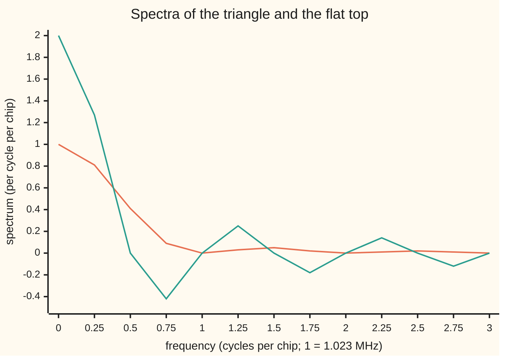

# Bochner's theorem: which functions are fingerprints, and which are spectra

[Syllabus](../../../SYLLABUS.md) → [Harmonic analysis](../README.md) → [Maximal Functions and Beyond](../README.md#s06) → Bochner's theorem

---

## General Overview

A GPS satellite sends a stream of +1 and −1 pulses called **chips**, 1.023 million a second. One chip lasts 0.977517 µs, the time light takes to cross 293.052 m. A receiver finds its range by sliding its own copy of the stream against the signal that arrives and measuring how well the two match at each shift.

For a stream that looks random, the match falls in a straight line. It is perfect at zero shift, one half at half a chip, and zero from one chip on. That shape, $`g(\tau) = \max(0,\, 1 - |\tau|)`$ with the shift $`\tau`$ in chips, is a **triangle**. It is the stream's **correlation**: the average product of the signal with itself $`\tau`$ chips later.

Could a designer choose a different shape, for example a flat top that stays at 1 for a whole chip and then drops to 0? No. Some weighted sums of correlation values are mean squares, and a mean square is never negative. A function that passes this test for every choice of shifts and weights is **positive definite**. The flat top fails it.

**Bochner's theorem** says exactly which functions pass: those whose Fourier transform is never negative. That transform is the **spectrum**, how the signal's power splits across frequencies. The triangle's spectrum is $`\mathrm{sinc}^2`$, never negative, with its first zero at 1.023 MHz: the familiar shape of the GPS civil signal. Scaled to total 1, a spectrum is a probability law, and the function is that law's fingerprint. So one theorem answers both halves of the title.

Two companions finish the job:

- **Herglotz's theorem** is the same statement for samples at whole-number steps, as a receiver takes them, 4 per chip.
- **Pólya's criterion** is a shortcut: an even bowl shape that falls to 0 always passes, with no transform to compute.

**A continuous function is a possible correlation, or, scaled to 1 at 0, a fingerprint, exactly when its Fourier transform is a spectrum that is never negative; Herglotz says the same for whole-number steps, and Pólya's criterion passes every even bowl shape that falls to 0.**

**What kind of fact this is:** three theorems. Bochner's theorem and Pólya's criterion are proved on this card in Why it works, with Bochner's hard direction in a fold. Herglotz's theorem is proved in outline, with its source.

### The picture: two spectra, one that can exist and one that cannot



Orange: the triangle's spectrum, $`\mathrm{sinc}^2(\xi)`$. It touches 0 at every whole number of cycles per chip and never goes below. Teal: the flat top's transform, $`2\,\mathrm{sinc}(2\xi)`$. It goes below zero, for example to −0.42 at 0.75 cycles per chip (0.767 MHz). Negative power is impossible, so no signal has the flat top as its correlation.

---

## The formula

Notation first. A **lag** $`\tau`$ is a shift in chips. The **frequency** $`\xi`$ is in cycles per chip; multiply by 1.023 to get MHz. The wing's transform is $`\hat g(\xi) = \int g(\tau)\,e^{-2\pi i\xi\tau}\,d\tau`$, where $`i`$ is the imaginary unit. A bar marks the complex conjugate, the mirror image across the horizontal axis.

**Positive definite.** A function $`g`$ is positive definite when, for any lags $`\tau_1, \dots, \tau_m`$ and any complex weights $`c_1, \dots, c_m`$,

```math
\sum_{j=1}^{m}\sum_{k=1}^{m} c_j\,\bar c_k\,g(\tau_j - \tau_k) \;\ge\; 0 .
```

In matrix terms, the table with $`g(\tau_j - \tau_k)`$ in row j, column k is Hermitian (its mirror entries are conjugates) and has no negative eigenvalue. An eigenvalue is a number by which the table stretches some direction of weights ([Quadratic forms](../../03-Algebra/07-Eigenvalues%20and%20Symmetric%20Matrices/05-quadratic-forms-and-positive-definite.md)).

**Bochner's theorem.** A continuous function $`g`$ on the line is positive definite exactly when

```math
g(\tau) = \int_{-\infty}^{\infty} e^{2\pi i \xi \tau}\,d\mu(\xi)
```

for a **spectrum** $`\mu`$: a measure that gives every set of frequencies a weight of 0 or more. Its total weight is $`g(0)`$. When $`g`$ is integrable, $`\mu`$ has the density $`S(\xi) = \hat g(\xi) \ge 0`$.

**Herglotz's theorem.** A sequence $`r[k]`$ at whole-number steps $`k`$ is positive definite when it passes the same test: the double sum above, with whole-number lags and $`r`$ in place of $`g`$, is never negative. That holds exactly when $`r[k] = \int_{-\pi}^{\pi} e^{ik\theta}\,d\mu(\theta)`$ for a spectrum $`\mu`$ on the circle of angles $`\theta`$.

**Pólya's criterion.** If $`g`$ is real, even and continuous, $`g(0) = 1`$, $`g`$ is convex (bowl-shaped) for $`\tau > 0`$, and $`g(\tau) \to 0`$ as $`\tau \to \infty`$, then $`g`$ is positive definite. It is a mix of triangles:

```math
g(\tau) = \int_0^{\infty} \Big(1 - \frac{|\tau|}{s}\Big)_{\!+}\, w(s)\,ds, \qquad w(s) = s\,g''(s) \ge 0 .
```

Here $`(\cdot)_+`$ keeps a number if it is positive and gives 0 otherwise.

**Read it aloud:** "A function can be a correlation exactly when it is a sum of pure waves, each with a weight that is not negative. On whole-number steps the waves live on a circle. A bowl that sinks to zero is a stack of triangles, so it always passes."

| Symbol | Plain meaning | In our example | Push it up and the answer… |
| --- | --- | --- | --- |
| $`\tau`$, $`\tau_j`$, $`m`$, $`a`$, $`b`$ | a lag in chips; the lags in one test; how many; the table entries $`g(0.8)`$ and $`g(1.6)`$ | lags 0, 0.8, 1.6; m = 3; triangle a = 0.2, b = 0 | — |
| $`g(\tau)`$, $`\hat g(\xi)`$, $`i`$ | the candidate correlation, or fingerprint; its transform; the imaginary unit | triangle $`\max(0, 1 - \lvert\tau\rvert)`$ | — |
| $`c_j`$, $`\bar c_k`$ | complex weights in the test; a weight's conjugate | 1, −√2, 1 | — |
| $`\xi`$, $`\xi_0`$ | frequency, cycles per chip; the frequency of one pure tone | 0.5, which is 0.5115 MHz | the triangle's spectrum falls, in lobes |
| $`\mu`$, $`S(\xi)`$ | the spectrum; its density, when it has one | $`\mathrm{sinc}^2(\xi)`$, 0.405285 at 0.5 | — |
| $`\mathrm{sinc}(u)`$ | $`\sin(\pi u)/(\pi u)`$, and 1 at u = 0 | its square is 0.405285 at u = 0.5 | — |
| $`X`$, $`Y`$, $`E`$, $`\Xi`$, $`\varphi_\Xi`$, $`t`$, $`\alpha`$ | the chip wave's value; a weighted sum of its samples; the average over the randomness; a random frequency drawn from the spectrum; its fingerprint; the fingerprint's input; the stable index | X is +1 or −1 | — |
| $`r[k]`$, $`k`$, $`\theta`$, $`N`$ | the correlation at k quarter-chips; a whole number; an angle on the circle; how many steps are averaged | r = 1, 0.75, 0.5, 0.25, 0 | — |
| $`F_4(\theta)`$, $`F_2(\theta)`$ | Fejér kernels: the spectra of samples taken 4 and 2 times a chip | $`F_4(1)`$ = 0.899310 | — |
| $`s`$, $`w(s)`$, $`g''`$ | half-width of one triangle in Pólya's mix; its weight; the second derivative | bowl $`1/(1+\lvert\tau\rvert)`$: $`w(s) = 2s/(1+s)^3`$ | — |
| $`T`$, $`u`$, $`v`$, $`\Delta u`$, $`\varepsilon`$, $`g_T`$, $`S_T`$, $`\Xi_T`$ | the proof's window length; two times in it; their spacing; a bell's width; the windowed function, its spectrum and its random frequency | — | as T grows, the window flattens to 1 |
| $`x`$, $`\rho`$ | a point on a map, in km; frequency on the map, cycles per km | ρ = 1.1 | — |

### When it holds

- **Continuity.** Bochner needs $`g`$ continuous. The spike, 1 at τ = 0 and 0 elsewhere, passes every finite test, since its tables are the identity. Yet no finite spectrum gives it: it would need equal power at every frequency, without end.
- **Every finite test, not some.** One table with a negative eigenvalue disproves positive definiteness. No finite number of passing tables proves it. The proof is a spectrum that is never negative.
- **Pólya is one-way.** A bowl that falls to 0 always passes. A shape that is not a bowl may still pass: the bell $`e^{-\tau^2/2}`$ is a dome near 0 and has a positive spectrum.
- **One dimension for Pólya.** Bochner holds in any number of dimensions, with $`\xi`$ a vector. Pólya's criterion does not. The triangle turned into a cone on a map, $`\max(0, 1 - |x|)`$, has spectrum −0.021597 at 1.1 cycles per km.
- **Lines are allowed.** A spectrum may have point weights. A pure tone $`\cos(2\pi\xi_0\tau)`$ is positive definite, with half its weight at $`\pm\xi_0`$ and no density. [The Radon-Nikodym theorem](../../10-Measure%20and%20integration/08-Densities%20and%20Changing%20Measure/03-radon-nikodym-theorem.md) says when a density exists: exactly when every set of zero length gets zero weight.

---

## Why it works

### Step 0: a correlation is a mean square in disguise

Take a signal with correlation $`g`$, write $`X(\tau)`$ for its value at time $`\tau`$, and form a weighted sum of samples, $`Y = \sum_j c_j X(\tau_j)`$. The mean square of $`Y`$ expands into the double sum of the definition. So the double sum is never negative: every correlation is positive definite.

Power works the same way. A spectrum is power per hertz, and power cannot be negative. Bochner's theorem says these two facts are one fact. A function passes every mean-square test exactly when it is built from waves with weights that are not negative.

### Step 1: a spectrum that is never negative makes a positive definite function

Put the spectrum's formula into the double sum. Each term's waves combine into one squared size:

```math
\sum_{j,k} c_j\,\bar c_k\,g(\tau_j - \tau_k) = \int \Big|\sum_j c_j\,e^{2\pi i \xi \tau_j}\Big|^2 d\mu(\xi) \;\ge\; 0 .
```

A squared size, averaged with weights that are not negative, is not negative. This is the easy direction, and it is the argument the [Characteristic functions](../04-Characteristic%20Functions%20and%20Probability/01-characteristic-functions-in-depth.md) card uses for every fingerprint.

### Step 2: the triangle is a real correlation, and its spectrum is sinc squared

**As a correlation.** Give the chip wave a random start, uniform across one chip. Two times $`\tau`$ chips apart, with $`|\tau| < 1`$, land in the same chip with chance $`1 - |\tau|`$. Then the product is $`(\pm1)^2 = 1`$. Otherwise they land in different chips, which are independent, and the product averages to 0. So the correlation is $`1 - |\tau|`$, and 0 beyond one chip.

**As a spectrum.** The triangle is the gate of width 1 convolved with itself. The gate transforms to sinc ([Two pairs worth memorising](../02-The%20Fourier%20Transform/03-gaussian-and-sinc-transform-pairs.md)), and convolution turns into a product, so

```math
\hat g(\xi) = \int_{-1}^{1} (1 - |\tau|)\,e^{-2\pi i\xi\tau}\,d\tau = \mathrm{sinc}^2(\xi) = \Big(\frac{\sin \pi\xi}{\pi\xi}\Big)^2 \ge 0 .
```

Its area is $`g(0) = 1`$. So $`\mathrm{sinc}^2`$ is a probability law for a random frequency $`\Xi`$, and $`g(\tau) = E[e^{2\pi i \Xi \tau}] = \varphi_\Xi(2\pi\tau)`$. The triangle is a genuine fingerprint.

The code checks this three ways: the closed form against the transform integral, the inverse transform back to the triangle, and a simulated chip wave.

### Step 3: a positive definite function always has a spectrum

This is the hard direction. The idea: look at $`g`$ through a window of length $`T`$ and measure the power at frequency $`\xi`$.

Spread weights $`e^{-2\pi i\xi u}`$ evenly over times $`u`$ from 0 to $`T`$. The double sum becomes a double integral, so it is not negative. Group the pairs of times by their gap $`\tau`$. A gap $`\tau`$ occurs on a stretch of length $`T - |\tau|`$, so a triangle appears:

```math
S_T(\xi) = \frac{1}{T}\int_0^T\!\!\int_0^T g(u - v)\,e^{-2\pi i\xi(u - v)}\,du\,dv = \int_{-T}^{T}\Big(1 - \frac{|\tau|}{T}\Big)\,g(\tau)\,e^{-2\pi i\xi\tau}\,d\tau \;\ge\; 0 .
```

So the windowed function $`(1 - |\tau|/T)_+\,g(\tau)`$ has a transform that is never negative. Its area is $`g(0)`$. Divided by $`g(0)`$, it is a probability law, and the windowed function is that law's fingerprint, up to the factor $`2\pi`$ in the rate. As $`T`$ grows, the window flattens to 1, and the windowed functions approach $`g`$ at every lag. The limit $`g`$ is continuous at 0. [Levy's continuity theorem](../04-Characteristic%20Functions%20and%20Probability/04-levy-continuity-theorem.md) then says the limit is itself a fingerprint. Its law, times $`g(0)`$, is the spectrum $`\mu`$.

<details>
<summary>Detailed proof: Bochner's hard direction, step by step</summary>

Let $`g`$ be continuous and positive definite. If $`g(0) = 0`$, the 2-by-2 test gives $`|g(\tau)| \le g(0)`$, so $`g = 0`$ and $`\mu = 0`$. So assume $`g(0) > 0`$.

The 2-by-2 test, with lags 0 and τ, uses the table `[[g(0), g(−τ)], [g(τ), g(0)]]`. Its double sum is real and not negative for every pair of complex weights. Real for the weights (1, 0), (1, 1) and (1, i) forces $`g(-\tau) = \overline{g(\tau)}`$. The table is then Hermitian with no negative eigenvalue, so its determinant is not negative, which gives $`|g(\tau)| \le g(0)`$. So $`g`$ is bounded.

**The window.** Fix $`T > 0`$ and $`\xi`$. The double integral $`S_T(\xi)`$ is a limit of Riemann sums $`\frac1T \sum_{j,k} c_j \bar c_k\, g(u_j - u_k)`$ with $`c_j = e^{-2\pi i \xi u_j}\,\Delta u`$. Each sum is not negative, and $`g`$ is continuous, so $`S_T(\xi) \ge 0`$. For the second form, substitute $`\tau = u - v`$: for fixed $`\tau`$, the times $`v`$ with both $`v`$ and $`v + \tau`$ in $`[0, T]`$ fill a stretch of length $`T - |\tau|`$.

**The area.** Write $`g_T(\tau) = (1 - |\tau|/T)_+\,g(\tau)`$. It is continuous and zero outside $`[-T, T]`$, so it is integrable, and $`S_T = \hat g_T`$. Multiply $`S_T`$ by the bell $`e^{-\pi\varepsilon^2\xi^2}`$ and integrate. Swapping the two integrals is allowed, since $`g_T`$ is integrable, and the bell's transform is $`\varepsilon^{-1}e^{-\pi\tau^2/\varepsilon^2}`$:

$`\displaystyle \int S_T(\xi)\,e^{-\pi\varepsilon^2\xi^2}\,d\xi = \int g_T(\tau)\,\frac{1}{\varepsilon}\,e^{-\pi\tau^2/\varepsilon^2}\,d\tau .`$

As $`\varepsilon \to 0`$, the right side tends to $`g_T(0) = g(0)`$, because the narrowing bell is an approximate identity ([Approximate identities](../03-Convolution%20and%20Approximate%20Identities/03-approximate-identities.md)). The left side rises to $`\int S_T`$, because $`S_T \ge 0`$ and the bell factor rises to 1. So $`\int S_T = g(0)`$, which is finite.

**Inversion.** Now $`g_T`$ and $`S_T`$ are both integrable, so [Fourier inversion](../02-The%20Fourier%20Transform/04-fourier-inversion-theorem.md) gives, at every lag,

$`\displaystyle g_T(\tau) = \int S_T(\xi)\,e^{2\pi i\xi\tau}\,d\xi .`$

So $`g_T/g(0)`$ is the fingerprint of the random frequency $`\Xi_T`$ with density $`S_T/g(0)`$, read at rate $`2\pi\tau`$.

**The limit.** As $`T \to \infty`$, $`g_T(\tau) \to g(\tau)`$ at every lag, and $`g`$ is continuous at 0. By Lévy's continuity theorem, $`g/g(0)`$ is the fingerprint of some law of $`\Xi`$. Set $`\mu = g(0)`$ times that law. Then $`g(\tau) = \int e^{2\pi i\xi\tau}\,d\mu(\xi)`$. ∎

</details>

### Step 4: Herglotz, the same theorem on whole-number steps

A receiver samples 4 times a chip. Its correlation at $`k`$ quarter-chips is $`r[k] = g(k/4)`$: 1, 0.75, 0.5, 0.25, then 0. On whole-number steps, waves $`e^{ik\theta}`$ with $`\theta`$ and $`\theta + 2\pi`$ are the same wave, so the spectrum lives on a circle.

For this sequence the spectrum is a kernel the wing has met. The sum $`\sum_k r[k]\,e^{-ik\theta}`$ is the Fejér kernel $`F_4`$ ([Dirichlet and Fejer kernels](../01-Fourier%20Series%20in%20Depth/03-dirichlet-and-fejer-kernels.md)):

```math
F_4(\theta) = \sum_{|k|<4}\Big(1 - \frac{|k|}{4}\Big)e^{ik\theta} = \frac14\Big(\frac{\sin 2\theta}{\sin(\theta/2)}\Big)^2 \ge 0, \qquad r[k] = \frac{1}{2\pi}\int_{-\pi}^{\pi} e^{ik\theta}\,F_4(\theta)\,d\theta .
```

It runs from 4 at θ = 0 down to 0 at θ = π/2 and θ = π, and is 0.899310 at θ = 1.

The spectrum also bounds every table. Put the spectrum into the double sum, as in Step 1. Then use $`\frac{1}{2\pi}\int|\sum_j c_j e^{ij\theta}|^2\,d\theta = \sum_j |c_j|^2`$. The double sum lies between the smallest and largest values of $`F_4`$, times $`\sum_j|c_j|^2`$. So every eigenvalue of every table lies between 0 and 4. For 9 lags, 0 to 2 chips, they run from 0.065301 to 3.599610.

The hard direction copies Step 3 with sums in place of integrals. The averages $`\frac1N\sum_{j,k<N} r[j-k]\,e^{-i(j-k)\theta}`$ are never negative. Each is a density on the circle with total weight $`r[0]`$. Helly's selection theorem, which picks a converging sequence out of measures of bounded total weight on a closed interval, supplies the limit spectrum (Katznelson, in Sources).

### Step 5: Pólya, a bowl is a stack of triangles

A triangle of half-width $`s`$, $`(1 - |\tau|/s)_+`$, has spectrum $`s\,\mathrm{sinc}^2(s\xi) \ge 0`$, by Step 2 stretched. A mix of such triangles with weights that are not negative has a mixed spectrum that is not negative. So it is enough to show a bowl is such a mix.

For $`\tau > 0`$, integrate by parts:

```math
\int_\tau^\infty (s - \tau)\,g''(s)\,ds = \Big[(s - \tau)\,g'(s)\Big]_\tau^\infty - \int_\tau^\infty g'(s)\,ds = 0 + g(\tau) - 0 = g(\tau) .
```

The bracket vanishes at infinity: a bowl that sinks to 0 has $`s\,g'(s) \to 0`$. Since $`s - \tau = s(1 - \tau/s)`$, this is the mix in The formula, with weight $`w(s) = s\,g''(s)`$. A bowl has $`g'' \ge 0`$, so the weights are not negative. At $`\tau = 0`$ the weights add up to $`g(0) = 1`$. A bowl without a second derivative works the same way, with the increase of $`g'`$ as the weight.

**The bowl $`1/(1+|\tau|)`$.** Here $`g''(s) = 2/(1+s)^3`$, so $`w(s) = 2s/(1+s)^3`$. Its weight on [0, 2000] is 0.999001, and the rest is in the tail. Its spectrum at 0.5 cycles per chip is 0.147336 by the mix of triangles, and also 0.147336 by the direct transform. The triangle itself is a bowl too: straight, then flat. Its mix is one triangle, at s = 1.

### Step 6: how to test a candidate

1. **Quick filters.** Check $`g(-\tau) = \overline{g(\tau)}`$ and $`|g(\tau)| \le g(0)`$. A failure ends the test.
2. **Look for a bowl.** If $`g`$ is real, even, convex for $`\tau > 0`$ and falls to 0, Pólya says it passes.
3. **Try tables.** Build $`g(\tau_j - \tau_k)`$ at a few lags. A negative eigenvalue proves failure.
4. **Compute the spectrum.** If the transform is never negative, Bochner says it passes. If it goes negative anywhere, it fails.

The flat top $`g(\tau) = 1`$ for $`|\tau| < 1`$, else 0, fails at step 3. At lags 0, 0.8 and 1.6 chips the table is `[[1, 1, 0], [1, 1, 1], [0, 1, 1]]`. Its eigenvalues are 1 and $`1 \pm \sqrt2`$, so the smallest is $`1 - \sqrt2`$ = −0.414214. The weights (1, −√2, 1) give a mean square of −1.656854, which no signal can have. Step 4 agrees: the flat top's transform is $`2\,\mathrm{sinc}(2\xi)`$, which is −0.424413 at 0.75 cycles per chip. The fake $`e^{-\tau^4}`$ of the [Characteristic functions](../04-Characteristic%20Functions%20and%20Probability/01-characteristic-functions-in-depth.md) card fails the same way.

---

## Worked numbers, by hand

| Step | Arithmetic | Value |
| --- | --- | --- |
| one chip | 1 / 1.023 MHz | 0.977517 µs |
| triangle's spectrum at 0.5 cycles per chip (0.5115 MHz) | (sin(π/2) / (π/2))² = 4/π² | 0.405285 |
| triangle's spectrum at 1 cycle per chip (1.023 MHz) | (sin π / π)² | 0 |
| triangle's table at lags 0, 0.8, 1.6 | a = g(0.8) = 0.2, b = g(1.6) = 0 | eigenvalue 1 − 0.2√2 = 0.717157 |
| flat top's table at the same lags | a = 1, b = 0 | eigenvalue 1 − √2 = −0.414214 |
| flat top, weights (1, −√2, 1) | 1 + 2 + 1 − 4√2 × 1 + 2 × 0 | −1.656854 |
| flat top's spectrum at 0.75 | 2 sin(1.5π) / (1.5π) = −2/(1.5π) | −0.424413 |
| Herglotz spectrum at θ = 1 | (sin 2 / sin 0.5)² / 4 = (0.909297 / 0.479426)² / 4 | 0.899310 |
| bowl's Pólya weight | w(s) = s × 2/(1+s)³ | 2s/(1+s)³ |
| bowl's spectrum at 0.5 | mix of triangles, by the code | 0.147336 |

**The triangle's spectrum, $`\mathrm{sinc}^2`$, is never negative and has area 1, so the triangle is a genuine fingerprint and a possible correlation; the flat top's spectrum is −0.424413 at 0.75 cycles per chip, so it is neither.**

For a receiver, the triangle means the signal's power sits in a main lobe 2.046 MHz wide, between the zeros at ±1.023 MHz.

### What breaks if you drop a piece

| Mistake | Comes out at | What went wrong |
| --- | --- | --- |
| Choosing a flat-top correlation | smallest eigenvalue −0.414214; spectrum −0.424413 at 0.767 MHz | it is not positive definite: some mean square would be negative |
| Dropping continuity: 1 at τ = 0, 0 elsewhere | every table is the identity, eigenvalues 1.000000 | it passes every finite test, yet has no finite spectrum |
| Using Pólya on a map: the cone $`\max(0, 1 - \lvert x\rvert)`$ | spectrum −0.021597 at 1.1 cycles per km | the criterion is one-dimensional; the cone is not positive definite on a plane |
| Reading Pólya backwards on the bell | $`g''(0) = -1.0000`$, a dome, yet spectrum 0.018027 at 0.5 | Pólya is sufficient, not necessary: failing it proves nothing |

---

## Code, from first principles, and it actually runs

Both programs print every number on this card, using `math` only for sine, cosine, exponential and square root. They take three roads to the triangle's spectrum. Road one is the closed form $`\mathrm{sinc}^2`$. Road two is the transform integral by Simpson's rule, which adds up an area from evenly spaced samples, plus the inverse transform back to the triangle, with its cut-off and tail bound. Road three simulates 50,000 chips from SplitMix64, a small random-number generator with seed 20261115, and measures the correlation. Eigenvalues come two ways: a closed form for 3-by-3 tables, and Jacobi rotations, which turn a symmetric table step by step until only its diagonal is left. Pólya's bowl is checked two ways: the mix of triangles against the direct transform. The bell's spectrum is checked the same way, closed form against the transform integral. Python and Rust print identical output.

### Python

```python
# Bochner's theorem -- the check behind the card.  Standard library only: math gives
# sin, cos, exp and sqrt, none of which knows an answer.  Lags tau are in chips of the
# GPS C/A code (1.023 million chips a second); frequencies xi in cycles per chip.
import math
PI, RATE = math.pi, 1.023                          # chip rate in MHz
def tri(t): return max(0.0, 1.0 - abs(t))          # the triangle: the code's correlation shape
def gate(t): return 1.0 if abs(t) < 1 else 0.0     # the candidate that fails
def bowl(t): return 1.0 / (1.0 + abs(t))           # Polya's bowl shape
def sinc(u): return 1.0 if u == 0 else math.sin(PI * u) / (PI * u)
def z(x): return 0.0 if abs(x) < 5e-10 else x      # print a rounding-level number as 0
def simpson(f, a, b, n):                           # n even
    h = (b - a) / n
    return (f(a) + f(b) + sum((4 if k % 2 else 2) * f(a + k * h) for k in range(1, n))) * h / 3
def eigs(A):                                       # Jacobi rotations: all eigenvalues of a symmetric matrix
    A, n = [row[:] for row in A], len(A)
    for _ in range(60):
        off = sum(A[i][j] ** 2 for i in range(n) for j in range(n) if i != j)
        if off < 1e-22: break
        for p in range(n - 1):
            for q in range(p + 1, n):
                if abs(A[p][q]) < 1e-300: continue
                th = (A[q][q] - A[p][p]) / (2 * A[p][q])
                t = (1 if th >= 0 else -1) / (abs(th) + math.sqrt(th * th + 1))
                c = 1 / math.sqrt(t * t + 1); s = t * c
                for k in range(n):
                    akp, akq = A[k][p], A[k][q]
                    A[k][p], A[k][q] = c * akp - s * akq, s * akp + c * akq
                for k in range(n):
                    apk, aqk = A[p][k], A[q][k]
                    A[p][k], A[q][k] = c * apk - s * aqk, s * apk + c * aqk
    return sorted(A[i][i] for i in range(n))
def gram(g, lags): return [[g(a - b) for b in lags] for a in lags]
print(f"1 chip = {1 / RATE:.6f} us = {299792458 / 1.023e6:.3f} m of light travel")
# Road one: the spectrum in closed form.  Road two: the transform integral of the triangle.
print("spectrum of the triangle, S(xi) = sinc(xi)^2")
print("  xi (per chip)  MHz     closed form  transform integral")
for xi in (0.0, 0.25, 0.5, 0.75, 1.0, 1.5, 2.0):
    closed = sinc(xi) ** 2
    num = 2 * simpson(lambda t: tri(t) * math.cos(2 * PI * xi * t), 0, 1, 2000)
    print(f"  {xi:5.2f}         {xi * RATE:6.4f}  {z(closed):9.6f}  {z(num):9.6f}")
    assert closed >= 0 and abs(closed - num) < 1e-9
L = 200.0                                          # inversion cut-off; the tail is at most 2/(pi^2 L)
for tau in (0.0, 0.5):
    back = 2 * simpson(lambda x: sinc(x) ** 2 * math.cos(2 * PI * x * tau), 0, L, 400000)
    print(f"inverse transform at tau = {tau:.1f}: {back:.6f} against g = {tri(tau):.6f}, tail bound {2 / (PI * PI * L):.6f}")
    assert abs(back - tri(tau)) < 2 / (PI * PI * L)
# The matrix test at lags 0, 0.8, 1.6 chips: [[1,a,b],[a,1,a],[b,a,1]].
lags = (0.0, 0.8, 1.6)
print("matrix test at lags 0, 0.8, 1.6: a = g(0.8), b = g(1.6), smallest eigenvalue closed / Jacobi")
for name, g in (("triangle", tri), ("gate", gate), ("bowl", bowl)):
    a, b = g(0.8), g(1.6)
    closed = min(1 - b, (2 + b - math.sqrt(b * b + 8 * a * a)) / 2)
    jac = eigs(gram(g, lags))[0]
    form = 4 - 4 * math.sqrt(2) * a + 2 * b          # weights (1, -sqrt 2, 1)
    print(f"  {name:9s}{a:9.6f}{b:9.6f}{closed:11.6f}{jac:11.6f}   weights (1,-r2,1) give {form:.6f}")
    assert abs(closed - jac) < 1e-9 and (jac < 0) == (name == "gate")
print(f"  1 - sqrt 2 = {1 - math.sqrt(2):.6f}")
gs = 2 * simpson(lambda t: math.cos(2 * PI * 0.75 * t), 0, 1, 2000)
print(f"gate spectrum at xi = 0.75: closed 2 sinc(1.5) = {2 * sinc(1.5):.6f}, integral {gs:.6f}")
assert gs < 0 and abs(gs - 2 * sinc(1.5)) < 1e-9
spike = eigs(gram(lambda t: 1.0 if t == 0 else 0.0, lags))
print(f"spike (1 at 0, else 0): eigenvalues {spike[0]:.6f} {spike[1]:.6f} {spike[2]:.6f}; positive definite, not continuous")
# Herglotz: samples every quarter chip, r[k] = 1 - |k|/4, spectrum F_4(theta) on the circle.
r = [tri(k / 4) for k in range(9)]
ev = eigs([[r[abs(j - k)] for k in range(9)] for j in range(9)])
print(f"9 lags 0, 0.25, ..., 2 chips: smallest eigenvalue {ev[0]:.6f}, largest {ev[-1]:.6f}; Herglotz range 0 to 4")
assert 0 < ev[0] and ev[-1] < 4
def f_sum(th): return sum(tri(k / 4) * math.cos(k * th) for k in range(-3, 4))
def fejer(th): return 4.0 if th == 0 else (math.sin(2 * th) / math.sin(th / 2)) ** 2 / 4
for th in (0.0, 1.0, PI / 2, PI):
    print(f"  theta = {th:.4f}: sum of r[k] e^(-ik theta) {z(f_sum(th)):.6f}, Fejer closed form {z(fejer(th)):.6f}")
    assert abs(f_sum(th) - fejer(th)) < 1e-12 and fejer(th) >= 0
coef = simpson(lambda th: fejer(th) * math.cos(2 * th), -PI, PI, 2000) / (2 * PI)
print(f"  coefficient back from the spectrum: r[2] = {coef:.6f}, against 1 - 2/4 = 0.5")
assert abs(coef - 0.5) < 1e-9
# Polya: the bowl 1/(1+|t|) is a mixture of triangles of half-width s, weight w(s) = s g''(s).
w = lambda s: 2 * s / (1 + s) ** 3
M = 2000.0
mass = simpson(w, 0, M, 400000)
print(f"Polya weights w(s) = 2s/(1+s)^3: mass on [0, {M:.0f}] {mass:.6f}, exact 1 - (2M+1)/(1+M)^2 = {1 - (2 * M + 1) / (1 + M) ** 2:.6f}")
assert abs(mass - (1 - (2 * M + 1) / (1 + M) ** 2)) < 1e-6
print("bowl spectrum: mixture of triangles  against  direct transform (cut-off 2000)  tail bound")
for xi in (0.5, 1.0):
    mix = simpson(lambda s: w(s) * s * sinc(s * xi) ** 2, 0, M, 400000)
    direct = 2 * simpson(lambda t: math.cos(2 * PI * xi * t) / (1 + t), 0, M, 400000)
    bound = 1 / (PI * xi * (1 + M))
    print(f"  xi = {xi:.1f}: {mix:.6f}  {direct:.6f}  {bound:.6f}")
    assert mix > 0 and abs(mix - direct) < bound + 1e-6
h = 1e-3
bell2 = (math.exp(-h * h / 2) - 2 + math.exp(-h * h / 2)) / (h * h)
bc, bs = math.sqrt(2 * PI) * math.exp(-PI * PI / 2), 2 * simpson(lambda t: math.exp(-t * t / 2) * math.cos(PI * t), 0, 12, 2000)   # tail past 12 below 1e-31
print(f"bell e^(-t^2/2): second derivative at 0 {bell2:.4f} (a dome, not a bowl), spectrum at xi = 0.5: closed form {bc:.6f}, integral on [-12, 12] {bs:.6f}")
assert bell2 < 0 and abs(bs - bc) < 1e-9
# The same triangle as a cone on a map: (1 - r)+ in two dimensions, r in km, rho in cycles per km.
def J0(x):                                         # the Bessel series, written out
    s, term, m = 0.0, 1.0, 0
    while abs(term) > 1e-17 or m < 5:
        s += term; m += 1; term *= -(x / 2) ** 2 / (m * m)
    return s
def cone(rho): return 2 * PI * simpson(lambda q: (1 - q) * q * J0(2 * PI * rho * q), 0, 1, 2000)
print(f"cone (1 - r)+ on a map: spectrum at rho = 0 {cone(0):.6f} (pi/3 = {PI / 3:.6f}), at rho = 1.1 {cone(1.1):.6f}")
assert abs(cone(0) - PI / 3) < 1e-9 and cone(1.1) < 0
# Road three: simulate the chip wave, 4 samples a chip, and measure its correlation.
MASK, state = (1 << 64) - 1, 20261115                # SplitMix64, seed 20261115
def bit():
    global state
    state = (state + 0x9E3779B97F4A7C15) & MASK
    x = ((state ^ (state >> 30)) * 0xBF58476D1CE4E5B9) & MASK
    x = ((x ^ (x >> 27)) * 0x94D049BB133111EB) & MASK
    return 1 if (x ^ (x >> 31)) >> 63 else -1
N = 50000
wave = [c for c in (bit() for _ in range(N)) for _ in range(4)]
print(f"simulated chip wave, {N} chips, 4 samples a chip: correlation at lag k quarter-chips / triangle")
for k in range(1, 5):
    est = sum(wave[i] * wave[i + k] for i in range(4 * N - k)) / (4 * N - k)
    se = k / (4 * math.sqrt(N))              # k equal products per chip boundary
    print(f"  k = {k}: {est:7.4f}  {tri(k / 4):7.4f}  standard error {se:.4f}")
    assert abs(est - tri(k / 4)) < 4 * se
# Try changing: samples every half chip; a gate half as wide; the cone further out.
r2 = [tri(k / 2) for k in range(9)]
ev2 = eigs([[r2[abs(j - k)] for k in range(9)] for j in range(9)])
print(f"try: half-chip samples, 9 lags: eigenvalues {ev2[0]:.6f} to {ev2[-1]:.6f}; Herglotz range 0 to 2")
narrow = eigs(gram(lambda t: 1.0 if abs(t) < 0.5 else 0.0, (0.0, 0.4, 0.8)))[0]
print(f"try: gate of half-width 0.5 at lags 0, 0.4, 0.8: smallest eigenvalue {narrow:.6f}; spectrum sinc(1.5) = {sinc(1.5):.6f}")
print(f"try: cone at rho = 2.1: {cone(2.1):.6f}")
assert 0 < ev2[0] and ev2[-1] < 2 and narrow < 0 and cone(2.1) < 0
for name, g in (("triangle", lambda x: sinc(x) ** 2), ("gate", lambda x: 2 * sinc(2 * x))):
    print(f"figure, {name:9s}" + " ".join(f"{z(g(k / 4)):.2f}" for k in range(13)))
print("ALL CHECKS PASS")
```

**Ran 2026-11-15 on macOS, Python 3.14.10, standard library only. All checks passed. Output, pasted from the run:**

```
1 chip = 0.977517 us = 293.052 m of light travel
spectrum of the triangle, S(xi) = sinc(xi)^2
  xi (per chip)  MHz     closed form  transform integral
   0.00         0.0000   1.000000   1.000000
   0.25         0.2557   0.810569   0.810569
   0.50         0.5115   0.405285   0.405285
   0.75         0.7672   0.090063   0.090063
   1.00         1.0230   0.000000   0.000000
   1.50         1.5345   0.045032   0.045032
   2.00         2.0460   0.000000   0.000000
inverse transform at tau = 0.0: 0.999493 against g = 1.000000, tail bound 0.001013
inverse transform at tau = 0.5: 0.500000 against g = 0.500000, tail bound 0.001013
matrix test at lags 0, 0.8, 1.6: a = g(0.8), b = g(1.6), smallest eigenvalue closed / Jacobi
  triangle  0.200000 0.000000   0.717157   0.717157   weights (1,-r2,1) give 2.868629
  gate      1.000000 0.000000  -0.414214  -0.414214   weights (1,-r2,1) give -1.656854
  bowl      0.555556 0.384615   0.383440   0.383440   weights (1,-r2,1) give 1.626534
  1 - sqrt 2 = -0.414214
gate spectrum at xi = 0.75: closed 2 sinc(1.5) = -0.424413, integral -0.424413
spike (1 at 0, else 0): eigenvalues 1.000000 1.000000 1.000000; positive definite, not continuous
9 lags 0, 0.25, ..., 2 chips: smallest eigenvalue 0.065301, largest 3.599610; Herglotz range 0 to 4
  theta = 0.0000: sum of r[k] e^(-ik theta) 4.000000, Fejer closed form 4.000000
  theta = 1.0000: sum of r[k] e^(-ik theta) 0.899310, Fejer closed form 0.899310
  theta = 1.5708: sum of r[k] e^(-ik theta) 0.000000, Fejer closed form 0.000000
  theta = 3.1416: sum of r[k] e^(-ik theta) 0.000000, Fejer closed form 0.000000
  coefficient back from the spectrum: r[2] = 0.500000, against 1 - 2/4 = 0.5
Polya weights w(s) = 2s/(1+s)^3: mass on [0, 2000] 0.999001, exact 1 - (2M+1)/(1+M)^2 = 0.999001
bowl spectrum: mixture of triangles  against  direct transform (cut-off 2000)  tail bound
  xi = 0.5: 0.147336  0.147336  0.000318
  xi = 1.0: 0.045121  0.045121  0.000159
bell e^(-t^2/2): second derivative at 0 -1.0000 (a dome, not a bowl), spectrum at xi = 0.5: closed form 0.018027, integral on [-12, 12] 0.018027
cone (1 - r)+ on a map: spectrum at rho = 0 1.047198 (pi/3 = 1.047198), at rho = 1.1 -0.021597
simulated chip wave, 50000 chips, 4 samples a chip: correlation at lag k quarter-chips / triangle
  k = 1:  0.7496   0.7500  standard error 0.0011
  k = 2:  0.4992   0.5000  standard error 0.0022
  k = 3:  0.2488   0.2500  standard error 0.0034
  k = 4: -0.0015   0.0000  standard error 0.0045
try: half-chip samples, 9 lags: eigenvalues 0.048943 to 1.951057; Herglotz range 0 to 2
try: gate of half-width 0.5 at lags 0, 0.4, 0.8: smallest eigenvalue -0.414214; spectrum sinc(1.5) = -0.212207
try: cone at rho = 2.1: -0.005201
figure, triangle 1.00 0.81 0.41 0.09 0.00 0.03 0.05 0.02 0.00 0.01 0.02 0.01 0.00
figure, gate     2.00 1.27 0.00 -0.42 0.00 0.25 0.00 -0.18 0.00 0.14 0.00 -0.12 0.00
ALL CHECKS PASS
```

### Rust

```rust
// Bochner's theorem -- the check behind the card.  Rust std only, no crates.  Lags tau
// are in chips of the GPS C/A code (1.023 million chips a second); frequencies xi in
// cycles per chip.  Prints exactly what the Python check prints.
use std::f64::consts::PI;
const RATE: f64 = 1.023; // chip rate in MHz
fn tri(t: f64) -> f64 { (1.0 - t.abs()).max(0.0) } // the triangle: the code's correlation shape
fn gate(t: f64) -> f64 { if t.abs() < 1.0 { 1.0 } else { 0.0 } } // the candidate that fails
fn bowl(t: f64) -> f64 { 1.0 / (1.0 + t.abs()) } // Polya's bowl shape
fn spike(t: f64) -> f64 { if t == 0.0 { 1.0 } else { 0.0 } }
fn sinc(u: f64) -> f64 { if u == 0.0 { 1.0 } else { (PI * u).sin() / (PI * u) } }
fn z(x: f64) -> f64 { if x.abs() < 5e-10 { 0.0 } else { x } } // print a rounding-level number as 0
fn simpson<F: Fn(f64) -> f64>(f: F, a: f64, b: f64, n: usize) -> f64 {
    let h = (b - a) / n as f64;
    let mut s = f(a) + f(b);
    for k in 1..n { s += (if k % 2 == 1 { 4.0 } else { 2.0 }) * f(a + k as f64 * h); }
    s * h / 3.0
}
fn eigs(a0: &Vec<Vec<f64>>) -> Vec<f64> { // Jacobi rotations: all eigenvalues of a symmetric matrix
    let mut a = a0.clone();
    let n = a.len();
    for _ in 0..60 {
        let mut off = 0.0;
        for i in 0..n { for j in 0..n { if i != j { off += a[i][j] * a[i][j]; } } }
        if off < 1e-22 { break; }
        for p in 0..n - 1 {
            for q in p + 1..n {
                if a[p][q].abs() < 1e-300 { continue; }
                let th = (a[q][q] - a[p][p]) / (2.0 * a[p][q]);
                let t = (if th >= 0.0 { 1.0 } else { -1.0 }) / (th.abs() + (th * th + 1.0).sqrt());
                let c = 1.0 / (t * t + 1.0).sqrt();
                let s = t * c;
                for k in 0..n {
                    let (akp, akq) = (a[k][p], a[k][q]);
                    a[k][p] = c * akp - s * akq; a[k][q] = s * akp + c * akq;
                }
                for k in 0..n {
                    let (apk, aqk) = (a[p][k], a[q][k]);
                    a[p][k] = c * apk - s * aqk; a[q][k] = s * apk + c * aqk;
                }
            }
        }
    }
    let mut d: Vec<f64> = (0..n).map(|i| a[i][i]).collect();
    d.sort_by(|x, y| x.partial_cmp(y).unwrap());
    d
}
fn gram(g: fn(f64) -> f64, lags: &[f64]) -> Vec<Vec<f64>> {
    lags.iter().map(|&a| lags.iter().map(|&b| g(a - b)).collect()).collect()
}
fn j0(x: f64) -> f64 { // the Bessel series, written out
    let (mut s, mut term, mut m) = (0.0f64, 1.0f64, 0.0f64);
    while term.abs() > 1e-17 || m < 5.0 {
        s += term; m += 1.0; term *= -(x / 2.0) * (x / 2.0) / (m * m);
    }
    s
}
fn cone(rho: f64) -> f64 { 2.0 * PI * simpson(|q| (1.0 - q) * q * j0(2.0 * PI * rho * q), 0.0, 1.0, 2000) }
fn f_sum(th: f64) -> f64 { (-3..4).map(|k: i32| tri(k as f64 / 4.0) * (k as f64 * th).cos()).sum() }
fn fejer(th: f64) -> f64 { if th == 0.0 { 4.0 } else { ((2.0 * th).sin() / (th / 2.0).sin()).powi(2) / 4.0 } }
struct Mix { state: u64 } // SplitMix64
impl Mix {
    fn bit(&mut self) -> i32 {
        self.state = self.state.wrapping_add(0x9E3779B97F4A7C15);
        let mut x = self.state;
        x = (x ^ (x >> 30)).wrapping_mul(0xBF58476D1CE4E5B9);
        x = (x ^ (x >> 27)).wrapping_mul(0x94D049BB133111EB);
        if (x ^ (x >> 31)) >> 63 == 1 { 1 } else { -1 }
    }
}
fn main() {
    println!("1 chip = {:.6} us = {:.3} m of light travel", 1.0 / RATE, 299792458.0 / 1.023e6);
    // Road one: the spectrum in closed form.  Road two: the transform integral of the triangle.
    println!("spectrum of the triangle, S(xi) = sinc(xi)^2");
    println!("  xi (per chip)  MHz     closed form  transform integral");
    for &xi in &[0.0, 0.25, 0.5, 0.75, 1.0, 1.5, 2.0] {
        let closed = sinc(xi).powi(2);
        let num = 2.0 * simpson(|t| tri(t) * (2.0 * PI * xi * t).cos(), 0.0, 1.0, 2000);
        println!("  {:5.2}         {:6.4}  {:9.6}  {:9.6}", xi, xi * RATE, z(closed), z(num));
        assert!(closed >= 0.0 && (closed - num).abs() < 1e-9);
    }
    let l = 200.0; // inversion cut-off; the tail is at most 2/(pi^2 L)
    for &tau in &[0.0, 0.5] {
        let back = 2.0 * simpson(|x| sinc(x).powi(2) * (2.0 * PI * x * tau).cos(), 0.0, l, 400000);
        println!("inverse transform at tau = {:.1}: {:.6} against g = {:.6}, tail bound {:.6}", tau, back, tri(tau), 2.0 / (PI * PI * l));
        assert!((back - tri(tau)).abs() < 2.0 / (PI * PI * l));
    }
    // The matrix test at lags 0, 0.8, 1.6 chips: [[1,a,b],[a,1,a],[b,a,1]].
    let lags = [0.0, 0.8, 1.6];
    println!("matrix test at lags 0, 0.8, 1.6: a = g(0.8), b = g(1.6), smallest eigenvalue closed / Jacobi");
    let cands: [(&str, fn(f64) -> f64); 3] = [("triangle", tri), ("gate", gate), ("bowl", bowl)];
    for &(name, g) in cands.iter() {
        let (a, b) = (g(0.8), g(1.6));
        let closed = (1.0 - b).min((2.0 + b - (b * b + 8.0 * a * a).sqrt()) / 2.0);
        let jac = eigs(&gram(g, &lags))[0];
        let form = 4.0 - 4.0 * 2f64.sqrt() * a + 2.0 * b; // weights (1, -sqrt 2, 1)
        println!("  {:9}{:9.6}{:9.6}{:11.6}{:11.6}   weights (1,-r2,1) give {:.6}", name, a, b, closed, jac, form);
        assert!((closed - jac).abs() < 1e-9 && (jac < 0.0) == (name == "gate"));
    }
    println!("  1 - sqrt 2 = {:.6}", 1.0 - 2f64.sqrt());
    let gs = 2.0 * simpson(|t| (2.0 * PI * 0.75 * t).cos(), 0.0, 1.0, 2000);
    println!("gate spectrum at xi = 0.75: closed 2 sinc(1.5) = {:.6}, integral {:.6}", 2.0 * sinc(1.5), gs);
    assert!(gs < 0.0 && (gs - 2.0 * sinc(1.5)).abs() < 1e-9);
    let sp = eigs(&gram(spike, &lags));
    println!("spike (1 at 0, else 0): eigenvalues {:.6} {:.6} {:.6}; positive definite, not continuous", sp[0], sp[1], sp[2]);
    // Herglotz: samples every quarter chip, r[k] = 1 - |k|/4, spectrum F_4(theta) on the circle.
    let r: Vec<f64> = (0..9).map(|k| tri(k as f64 / 4.0)).collect();
    let toep: Vec<Vec<f64>> = (0..9).map(|j: i32| (0..9).map(|k: i32| r[(j - k).unsigned_abs() as usize]).collect()).collect();
    let ev = eigs(&toep);
    println!("9 lags 0, 0.25, ..., 2 chips: smallest eigenvalue {:.6}, largest {:.6}; Herglotz range 0 to 4", ev[0], ev[8]);
    assert!(0.0 < ev[0] && ev[8] < 4.0);
    for &th in &[0.0, 1.0, PI / 2.0, PI] {
        println!("  theta = {:.4}: sum of r[k] e^(-ik theta) {:.6}, Fejer closed form {:.6}", th, z(f_sum(th)), z(fejer(th)));
        assert!((f_sum(th) - fejer(th)).abs() < 1e-12 && fejer(th) >= 0.0);
    }
    let coef = simpson(|th| fejer(th) * (2.0 * th).cos(), -PI, PI, 2000) / (2.0 * PI);
    println!("  coefficient back from the spectrum: r[2] = {:.6}, against 1 - 2/4 = 0.5", coef);
    assert!((coef - 0.5).abs() < 1e-9);
    // Polya: the bowl 1/(1+|t|) is a mixture of triangles of half-width s, weight w(s) = s g''(s).
    let w = |s: f64| 2.0 * s / (1.0 + s).powi(3);
    let m = 2000.0;
    let mass = simpson(w, 0.0, m, 400000);
    let exact = 1.0 - (2.0 * m + 1.0) / ((1.0 + m) * (1.0 + m));
    println!("Polya weights w(s) = 2s/(1+s)^3: mass on [0, {:.0}] {:.6}, exact 1 - (2M+1)/(1+M)^2 = {:.6}", m, mass, exact);
    assert!((mass - exact).abs() < 1e-6);
    println!("bowl spectrum: mixture of triangles  against  direct transform (cut-off 2000)  tail bound");
    for &xi in &[0.5, 1.0] {
        let mix = simpson(|s| w(s) * s * sinc(s * xi).powi(2), 0.0, m, 400000);
        let direct = 2.0 * simpson(|t| (2.0 * PI * xi * t).cos() / (1.0 + t), 0.0, m, 400000);
        let bound = 1.0 / (PI * xi * (1.0 + m));
        println!("  xi = {:.1}: {:.6}  {:.6}  {:.6}", xi, mix, direct, bound);
        assert!(mix > 0.0 && (mix - direct).abs() < bound + 1e-6);
    }
    let h: f64 = 1e-3;
    let bell2 = ((-h * h / 2.0).exp() - 2.0 + (-h * h / 2.0).exp()) / (h * h);
    let (bc, bs) = ((2.0 * PI).sqrt() * (-PI * PI / 2.0).exp(), 2.0 * simpson(|t| (-t * t / 2.0).exp() * (PI * t).cos(), 0.0, 12.0, 2000)); // tail past 12 below 1e-31
    println!("bell e^(-t^2/2): second derivative at 0 {:.4} (a dome, not a bowl), spectrum at xi = 0.5: closed form {:.6}, integral on [-12, 12] {:.6}", bell2, bc, bs);
    assert!(bell2 < 0.0 && (bs - bc).abs() < 1e-9);
    // The same triangle as a cone on a map: (1 - r)+ in two dimensions, r in km, rho in cycles per km.
    println!("cone (1 - r)+ on a map: spectrum at rho = 0 {:.6} (pi/3 = {:.6}), at rho = 1.1 {:.6}", cone(0.0), PI / 3.0, cone(1.1));
    assert!((cone(0.0) - PI / 3.0).abs() < 1e-9 && cone(1.1) < 0.0);
    // Road three: simulate the chip wave, 4 samples a chip, and measure its correlation.
    let mut rng = Mix { state: 20261115 }; // SplitMix64, seed 20261115
    let n = 50000usize;
    let mut wave: Vec<i32> = Vec::with_capacity(4 * n);
    for _ in 0..n { let c = rng.bit(); for _ in 0..4 { wave.push(c); } }
    println!("simulated chip wave, {} chips, 4 samples a chip: correlation at lag k quarter-chips / triangle", n);
    for k in 1..5usize {
        let tot: i64 = (0..4 * n - k).map(|i| (wave[i] * wave[i + k]) as i64).sum();
        let est = tot as f64 / (4 * n - k) as f64;
        let se = k as f64 / (4.0 * (n as f64).sqrt()); // k equal products per chip boundary
        println!("  k = {}: {:7.4}  {:7.4}  standard error {:.4}", k, est, tri(k as f64 / 4.0), se);
        assert!((est - tri(k as f64 / 4.0)).abs() < 4.0 * se);
    }
    // Try changing: samples every half chip; a gate half as wide; the cone further out.
    let r2: Vec<f64> = (0..9).map(|k| tri(k as f64 / 2.0)).collect();
    let t2: Vec<Vec<f64>> = (0..9).map(|j: i32| (0..9).map(|k: i32| r2[(j - k).unsigned_abs() as usize]).collect()).collect();
    let ev2 = eigs(&t2);
    println!("try: half-chip samples, 9 lags: eigenvalues {:.6} to {:.6}; Herglotz range 0 to 2", ev2[0], ev2[8]);
    let narrow = eigs(&gram(|t| if t.abs() < 0.5 { 1.0 } else { 0.0 }, &[0.0, 0.4, 0.8]))[0];
    println!("try: gate of half-width 0.5 at lags 0, 0.4, 0.8: smallest eigenvalue {:.6}; spectrum sinc(1.5) = {:.6}", narrow, sinc(1.5));
    println!("try: cone at rho = 2.1: {:.6}", cone(2.1));
    assert!(0.0 < ev2[0] && ev2[8] < 2.0 && narrow < 0.0 && cone(2.1) < 0.0);
    let figs: [(&str, fn(f64) -> f64); 2] = [("triangle", |x| sinc(x).powi(2)), ("gate", |x| 2.0 * sinc(2.0 * x))];
    for &(name, g) in figs.iter() {
        let pts: Vec<String> = (0..13).map(|k| format!("{:.2}", z(g(k as f64 / 4.0)))).collect();
        println!("figure, {:9}{}", name, pts.join(" "));
    }
    println!("ALL CHECKS PASS");
}
```

**Ran 2026-11-15 on macOS, rustc 1.98.1, no crates. All checks passed. Output, pasted from the run:**

```
1 chip = 0.977517 us = 293.052 m of light travel
spectrum of the triangle, S(xi) = sinc(xi)^2
  xi (per chip)  MHz     closed form  transform integral
   0.00         0.0000   1.000000   1.000000
   0.25         0.2557   0.810569   0.810569
   0.50         0.5115   0.405285   0.405285
   0.75         0.7672   0.090063   0.090063
   1.00         1.0230   0.000000   0.000000
   1.50         1.5345   0.045032   0.045032
   2.00         2.0460   0.000000   0.000000
inverse transform at tau = 0.0: 0.999493 against g = 1.000000, tail bound 0.001013
inverse transform at tau = 0.5: 0.500000 against g = 0.500000, tail bound 0.001013
matrix test at lags 0, 0.8, 1.6: a = g(0.8), b = g(1.6), smallest eigenvalue closed / Jacobi
  triangle  0.200000 0.000000   0.717157   0.717157   weights (1,-r2,1) give 2.868629
  gate      1.000000 0.000000  -0.414214  -0.414214   weights (1,-r2,1) give -1.656854
  bowl      0.555556 0.384615   0.383440   0.383440   weights (1,-r2,1) give 1.626534
  1 - sqrt 2 = -0.414214
gate spectrum at xi = 0.75: closed 2 sinc(1.5) = -0.424413, integral -0.424413
spike (1 at 0, else 0): eigenvalues 1.000000 1.000000 1.000000; positive definite, not continuous
9 lags 0, 0.25, ..., 2 chips: smallest eigenvalue 0.065301, largest 3.599610; Herglotz range 0 to 4
  theta = 0.0000: sum of r[k] e^(-ik theta) 4.000000, Fejer closed form 4.000000
  theta = 1.0000: sum of r[k] e^(-ik theta) 0.899310, Fejer closed form 0.899310
  theta = 1.5708: sum of r[k] e^(-ik theta) 0.000000, Fejer closed form 0.000000
  theta = 3.1416: sum of r[k] e^(-ik theta) 0.000000, Fejer closed form 0.000000
  coefficient back from the spectrum: r[2] = 0.500000, against 1 - 2/4 = 0.5
Polya weights w(s) = 2s/(1+s)^3: mass on [0, 2000] 0.999001, exact 1 - (2M+1)/(1+M)^2 = 0.999001
bowl spectrum: mixture of triangles  against  direct transform (cut-off 2000)  tail bound
  xi = 0.5: 0.147336  0.147336  0.000318
  xi = 1.0: 0.045121  0.045121  0.000159
bell e^(-t^2/2): second derivative at 0 -1.0000 (a dome, not a bowl), spectrum at xi = 0.5: closed form 0.018027, integral on [-12, 12] 0.018027
cone (1 - r)+ on a map: spectrum at rho = 0 1.047198 (pi/3 = 1.047198), at rho = 1.1 -0.021597
simulated chip wave, 50000 chips, 4 samples a chip: correlation at lag k quarter-chips / triangle
  k = 1:  0.7496   0.7500  standard error 0.0011
  k = 2:  0.4992   0.5000  standard error 0.0022
  k = 3:  0.2488   0.2500  standard error 0.0034
  k = 4: -0.0015   0.0000  standard error 0.0045
try: half-chip samples, 9 lags: eigenvalues 0.048943 to 1.951057; Herglotz range 0 to 2
try: gate of half-width 0.5 at lags 0, 0.4, 0.8: smallest eigenvalue -0.414214; spectrum sinc(1.5) = -0.212207
try: cone at rho = 2.1: -0.005201
figure, triangle 1.00 0.81 0.41 0.09 0.00 0.03 0.05 0.02 0.00 0.01 0.02 0.01 0.00
figure, gate     2.00 1.27 0.00 -0.42 0.00 0.25 0.00 -0.18 0.00 0.14 0.00 -0.12 0.00
ALL CHECKS PASS
```

### Lean

Lean proves Bochner's theorem, Herglotz's theorem and Pólya's criterion in full, plus the flat top's failing table.

- Take a continuous $`g`$ on the line. Then $`g`$ is positive definite exactly when $`g(\tau) = \int e^{2\pi i\xi\tau}\,d\mu(\xi)`$ for a spectrum $`\mu`$.
- Take a sequence $`r[k]`$ at whole-number steps. Then it is positive definite exactly when it has a spectrum $`\mu`$ on the circle of angles.
- That spectrum gives $`r[k] = \int e^{ik\theta}\,d\mu(\theta)`$, with all its weight on $`-\pi < \theta \le \pi`$.
- Suppose $`g`$ is real, even and continuous, with $`g(0) = 1`$, a bowl for $`\tau > 0`$, and falling to 0. Then $`g`$ is positive definite.
- The flat top's table at lags 0, 0.8 and 1.6 chips has the eigenvalue $`1 - \sqrt2`$.
- The weights (1, −√2, 1) give that table the mean square $`4 - 4\sqrt2`$, which is negative.
- Samples every quarter chip are 1, 0.75, 0.5, 0.25, then 0, and $`F_4(0) = 4`$.

Decimal values, the bowl's mix of triangles, the cone and the simulated chip wave are left to the Python and Rust checks.

```lean
-- Bochner's theorem: a continuous function on the line is positive definite exactly when it is the transform of a finite spectrum that is never negative, with Herglotz's version for whole-number steps and Pólya's criterion for even bowls that fall to 0.
import Mathlib.MeasureTheory.Integral.Bochner.Basic
import Mathlib.Analysis.SpecialFunctions.Exp
import Mathlib.Analysis.SpecialFunctions.Sqrt
import Mathlib.Analysis.Complex.Order
import Mathlib.Analysis.Convex.Function
import Mathlib.LinearAlgebra.Matrix.Determinant.Basic
import Mathlib.MeasureTheory.Measure.LevyConvergence
import Mathlib.MeasureTheory.Measure.Prokhorov
import Mathlib.Analysis.SpecialFunctions.Integrals.Basic
import Mathlib.Analysis.Convex.Slope
import Mathlib.Analysis.SpecialFunctions.Trigonometric.Basic
import Mathlib.MeasureTheory.Integral.IntervalIntegral.Basic
import Mathlib.MeasureTheory.Function.LocallyIntegrable
import Mathlib.Algebra.Order.Round

open MeasureTheory Complex Filter Topology
open scoped ComplexOrder


theorem pd_sum_integral_nonneg {α : Type*} [MeasurableSpace α] (μ : Measure α) {m : ℕ}
    (f : Fin m → α → ℂ) (c : Fin m → ℂ)
    (hf : ∀ j k, Integrable (fun x => f j x * (starRingEnd ℂ) (f k x)) μ) :
    0 ≤ ∑ j, ∑ k, c j * (starRingEnd ℂ) (c k) * ∫ x, f j x * (starRingEnd ℂ) (f k x) ∂μ := by
  have hi : ∀ j k, Integrable (fun x => (c j * f j x) * (starRingEnd ℂ) (c k * f k x)) μ := by
    intro j k
    refine ((hf j k).const_mul (c j * (starRingEnd ℂ) (c k))).congr (ae_of_all _ fun x => ?_)
    simp only [map_mul]; ring
  have h1 : ∀ j k, c j * (starRingEnd ℂ) (c k) * ∫ x, f j x * (starRingEnd ℂ) (f k x) ∂μ
      = ∫ x, (c j * f j x) * (starRingEnd ℂ) (c k * f k x) ∂μ := by
    intro j k
    rw [← integral_const_mul]
    congr 1; ext x; simp only [map_mul]; ring
  simp_rw [h1]
  have h2 : ∀ j, ∑ k, ∫ x, (c j * f j x) * (starRingEnd ℂ) (c k * f k x) ∂μ
      = ∫ x, ∑ k, (c j * f j x) * (starRingEnd ℂ) (c k * f k x) ∂μ := by
    intro j
    rw [integral_finsetSum]
    intro k _
    exact hi j k
  simp_rw [h2]
  rw [← integral_finsetSum _ (fun j _ => integrable_finsetSum _ fun k _ => hi j k)]
  have h3 : ∀ x, ∑ j, ∑ k, (c j * f j x) * (starRingEnd ℂ) (c k * f k x)
      = ((Complex.normSq (∑ j, c j * f j x) : ℝ) : ℂ) := by
    intro x
    rw [Complex.normSq_eq_conj_mul_self, map_sum, Finset.sum_mul_sum, Finset.sum_comm]
    exact Finset.sum_congr rfl fun _ _ => Finset.sum_congr rfl fun _ _ => mul_comm _ _
  simp_rw [h3]
  rw [integral_complex_ofReal]
  exact Complex.zero_le_real.mpr (integral_nonneg fun x => Complex.normSq_nonneg _)

#print axioms pd_sum_integral_nonneg

theorem pd_triangle {m : ℕ} (τ : Fin m → ℝ) (c : Fin m → ℂ) (s : ℝ) :
    0 ≤ ∑ j, ∑ k, c j * (starRingEnd ℂ) (c k) * ((max (s - |τ j - τ k|) 0 : ℝ) : ℂ) := by
  let f : Fin m → ℝ → ℂ := fun j => (Set.Icc (τ j) (τ j + s)).indicator (fun _ => (1 : ℂ))
  have hprod : ∀ j k, (fun x => f j x * (starRingEnd ℂ) (f k x))
      = (Set.Icc (τ j) (τ j + s) ∩ Set.Icc (τ k) (τ k + s)).indicator (fun _ => (1 : ℂ)) := by
    intro j k; ext x
    simp only [f, Set.indicator, Set.mem_inter_iff]
    split_ifs <;> simp_all
  have hint : ∀ j k, ∫ x, f j x * (starRingEnd ℂ) (f k x) = ((max (s - |τ j - τ k|) 0 : ℝ) : ℂ) := by
    intro j k
    rw [hprod, integral_indicator_const _ (measurableSet_Icc.inter measurableSet_Icc),
      Set.Icc_inter_Icc, Real.volume_real_Icc]
    simp only [real_smul, mul_one]
    congr 2
    rcases le_total (τ j) (τ k) with h | h
    · rw [max_eq_right h, min_eq_left (by linarith), abs_of_nonpos (by linarith)]; ring
    · rw [max_eq_left h, min_eq_right (by linarith), abs_of_nonneg (by linarith)]; ring
  have := pd_sum_integral_nonneg volume f c (fun j k => by
    rw [hprod]
    exact (integrableOn_const (by rw [Set.Icc_inter_Icc]; exact measure_Icc_lt_top.ne)).integrable_indicator
      (measurableSet_Icc.inter measurableSet_Icc))
  simpa only [hint] using this

#print axioms pd_triangle

theorem polya_rep : ∀ (n : ℕ) (φ : ℝ → ℝ) (D : Finset ℝ) (hD : D.Nonempty), D.card = n + 1 →
    (∀ d ∈ D, 0 ≤ d) → ConvexOn ℝ (Set.Icc 0 (D.max' hD)) φ →
    AntitoneOn φ (Set.Icc 0 (D.max' hD)) →
    ∃ (k : ℕ) (a s : Fin k → ℝ), (∀ i, 0 ≤ a i) ∧ (∀ i, s i ≤ D.max' hD) ∧
      ∀ d ∈ D, φ d = φ (D.max' hD) + ∑ i, a i * max (s i - d) 0 := by
  intro n
  induction n with
  | zero =>
    intro φ D hD hcard _ _ _
    obtain ⟨x, rfl⟩ := Finset.card_eq_one.1 hcard
    refine ⟨0, Fin.elim0, Fin.elim0, fun i => i.elim0, fun i => i.elim0, ?_⟩
    intro d hd
    rw [Finset.mem_singleton.1 hd]
    simp
  | succ n ih =>
    intro φ D hD hcard hnn hconv hanti
    set M := D.max' hD with hM
    have hMD : M ∈ D := D.max'_mem hD
    set D' := D.erase M with hD'
    have hcard' : D'.card = n + 1 := by rw [Finset.card_erase_of_mem hMD, hcard]; rfl
    have hD'ne : D'.Nonempty := by
      rw [← Finset.card_pos, hcard']; omega
    set M' := D'.max' hD'ne with hM'
    have hM'D' : M' ∈ D' := D'.max'_mem hD'ne
    have hM'lt : M' < M := by
      have h1 := Finset.mem_erase.1 hM'D'
      exact lt_of_le_of_ne (D.le_max' _ h1.2) h1.1
    have hM'nn : 0 ≤ M' := hnn _ (Finset.mem_erase.1 hM'D').2
    have hsub : Set.Icc 0 M' ⊆ Set.Icc 0 M := Set.Icc_subset_Icc le_rfl hM'lt.le
    have hM'mem : M' ∈ Set.Icc 0 M := ⟨hM'nn, hM'lt.le⟩
    have hMmem : M ∈ Set.Icc 0 M := ⟨hM'nn.trans hM'lt.le, le_rfl⟩
    set σ := (φ M' - φ M) / (M - M') with hσ
    have hpos : 0 < M - M' := by linarith
    have hσM : σ * (M - M') = φ M' - φ M := by rw [hσ]; field_simp
    have hσnn : 0 ≤ σ := div_nonneg (by linarith [hanti hM'mem hMmem hM'lt.le]) hpos.le
    let ψ : ℝ → ℝ := fun x => φ x - φ M - σ * (M - x)
    have hψconv : ConvexOn ℝ (Set.Icc 0 (D'.max' hD'ne)) ψ := by
      refine ⟨convex_Icc _ _, fun x hx y hy a b ha hb hab => ?_⟩
      have := (hconv.subset hsub (convex_Icc _ _)).2 hx hy ha hb hab
      simp only [smul_eq_mul, ψ] at this ⊢
      have hb' : b = 1 - a := by linarith
      subst hb'
      nlinarith
    have hψanti : AntitoneOn ψ (Set.Icc 0 (D'.max' hD'ne)) := by
      intro x hx y hy hxy
      simp only [ψ]
      rcases eq_or_lt_of_le hxy with rfl | hxy'
      · exact le_rfl
      have hxM : x ∈ Set.Icc 0 M := hsub hx
      have hyM : y ∈ Set.Icc 0 M := hsub hy
      have hyM' : y ≤ M' := hy.2
      have hxM' : x < M' := lt_of_lt_of_le hxy' hyM'
      have k1 := hconv.secant_mono_aux1 hxM hMmem hxy' (lt_of_le_of_lt hyM' hM'lt)
      have k2 := hconv.secant_mono_aux1 hxM hMmem hxM' hM'lt
      have hMx : 0 < M - x := by linarith
      have hyx : 0 < y - x := by linarith
      have hprod : (φ y - φ x + σ * (y - x)) * ((M - x) * (M - M')) ≤ 0 := by
        have e1 : σ * (y - x) * ((M - x) * (M - M')) = (φ M' - φ M) * (y - x) * (M - x) := by
          rw [← hσM]; ring
        have q1 := mul_le_mul_of_nonneg_right k1 hpos.le
        have q2 := mul_le_mul_of_nonneg_left k2 hyx.le
        nlinarith
      have hpp : 0 < (M - x) * (M - M') := mul_pos hMx hpos
      have : φ y - φ x + σ * (y - x) ≤ 0 := by
        by_contra hc
        have hc := not_le.1 hc
        linarith [mul_pos hc hpp]
      linarith
    obtain ⟨k, a, s, ha, hs, hrep⟩ := ih ψ D' hD'ne hcard' (fun d hd => hnn d (Finset.mem_erase.1 hd).2)
      hψconv hψanti
    have hψM' : ψ M' = 0 := by simp only [ψ]; linarith
    refine ⟨k + 1, Fin.cons σ a, Fin.cons M s, ?_, ?_, ?_⟩
    · intro i; refine Fin.cases hσnn (fun i => ha i) i
    · intro i; refine Fin.cases le_rfl (fun i => (hs i).trans hM'lt.le) i
    · intro d hd
      rw [Fin.sum_univ_succ]
      simp only [Fin.cons_zero, Fin.cons_succ]
      by_cases hdM : d = M
      · subst hdM
        have : ∑ i, a i * max (s i - M) 0 = 0 :=
          Finset.sum_eq_zero fun i _ => by
            rw [max_eq_right (by linarith [hs i]), mul_zero]
        rw [this]; simp
      · have hdD' : d ∈ D' := Finset.mem_erase.2 ⟨hdM, hd⟩
        have hdle : d ≤ M' := D'.le_max' _ hdD'
        have := hrep d hdD'
        rw [hψM', zero_add] at this
        rw [max_eq_left (by linarith), ← this]
        simp only [ψ]; ring

#print axioms polya_rep

theorem convexOn_Ici_of_Ioi (g : ℝ → ℝ) (hcont : Continuous g) (hconv : ConvexOn ℝ (Set.Ioi 0) g) :
    ConvexOn ℝ (Set.Ici 0) g := by
  refine ⟨convex_Ici _, fun x hx y hy a b ha hb hab => ?_⟩
  simp only [smul_eq_mul] at *
  have hsh : ∀ z : ℝ, Tendsto (fun ε => g (z + ε)) (𝓝[>] 0) (𝓝 (g z)) := by
    intro z
    have hc' : Continuous (fun ε : ℝ => g (z + ε)) := hcont.comp (continuous_const.add continuous_id)
    have := hc'.tendsto (0 : ℝ)
    simp only [add_zero] at this
    exact this.mono_left nhdsWithin_le_nhds
  refine le_of_tendsto_of_tendsto (hsh (a * x + b * y))
    (((hsh x).const_mul a).add ((hsh y).const_mul b)) ?_
  filter_upwards [self_mem_nhdsWithin] with ε hε
  have hε' : (0 : ℝ) < ε := hε
  have hx' : x + ε ∈ Set.Ioi (0 : ℝ) := by simp only [Set.mem_Ici, Set.mem_Ioi] at *; linarith
  have hy' : y + ε ∈ Set.Ioi (0 : ℝ) := by simp only [Set.mem_Ici, Set.mem_Ioi] at *; linarith
  have := hconv.2 hx' hy' ha hb hab
  simp only [smul_eq_mul] at this
  have e : a * (x + ε) + b * (y + ε) = a * x + b * y + ε := by
    have : a * ε + b * ε = ε := by rw [← add_mul, hab, one_mul]
    linarith
  rw [e] at this
  exact this

#print axioms convexOn_Ici_of_Ioi

theorem antitoneOn_Ici_of_convex_tendsto (g : ℝ → ℝ) (hconv : ConvexOn ℝ (Set.Ici 0) g)
    (hlim : Tendsto g atTop (𝓝 0)) : AntitoneOn g (Set.Ici 0) := by
  intro x hx y hy hxy
  by_contra hc
  have hc := not_le.1 hc
  have hxy' : x < y := lt_of_le_of_ne hxy (by rintro rfl; exact lt_irrefl _ hc)
  set δ := (g y - g x) / (y - x) with hδ
  have hδpos : 0 < δ := div_pos (by linarith) (by linarith)
  have hlow : ∀ z, y < z → g y + (z - y) * δ ≤ g z := by
    intro z hz
    have hz' : z ∈ Set.Ici (0 : ℝ) := by simp only [Set.mem_Ici] at *; linarith
    have k := hconv.secant_mono_aux1 hx hz' hxy' hz
    have hyx : 0 < y - x := by linarith
    have : (z - y) * δ * (y - x) = (z - y) * (g y - g x) := by rw [hδ]; field_simp
    nlinarith
  have htop : Tendsto (fun z => g y + (z - y) * δ) atTop atTop := by
    apply tendsto_atTop_add_const_left
    exact (tendsto_atTop_add_const_right _ _ tendsto_id).atTop_mul_const hδpos
  have : Tendsto g atTop atTop :=
    tendsto_atTop_mono' _ (eventually_atTop.2 ⟨y + 1, fun z hz => hlow z (by linarith)⟩) htop
  exact not_tendsto_atTop_of_tendsto_nhds hlim this

#print axioms antitoneOn_Ici_of_convex_tendsto

theorem integral_exp_int_mul (m : ℤ) :
    ∫ θ in (-Real.pi)..Real.pi, exp (m * θ * I) = if m = 0 then 2 * Real.pi else 0 := by
  split_ifs with hm
  · subst hm; simp; ring
  · have hc : (m : ℂ) * I ≠ 0 := mul_ne_zero (by exact_mod_cast hm) I_ne_zero
    have e : ∀ θ : ℝ, exp (m * θ * I) = exp ((m * I) * θ) := fun θ => by ring_nf
    simp_rw [e]
    rw [integral_exp_mul_complex hc]
    have h2 : exp (m * I * Real.pi) = exp (m * I * ((-Real.pi : ℝ) : ℂ)) := by
      have := exp_int_mul_two_pi_mul_I m
      rw [show (m : ℂ) * I * Real.pi = m * I * ((-Real.pi : ℝ) : ℂ) + m * (2 * Real.pi * I) by
        push_cast; ring, exp_add, this, mul_one]
    rw [h2, sub_self, zero_div, Complex.ofReal_zero]

#print axioms integral_exp_int_mul

theorem count_row (N : ℕ) : ∀ k : ℤ,
    ∑ a ∈ Finset.range N, (if (a : ℤ) - N = k then (1 : ℤ) else 0) =
      if -(N : ℤ) ≤ k ∧ k < 0 then 1 else 0 := by
  induction N with
  | zero => intro k; simp
  | succ N ih =>
    intro k
    rw [Finset.sum_range_succ]
    have : ∀ a : ℕ, ((a : ℤ) - ((N + 1 : ℕ) : ℤ) = k) ↔ ((a : ℤ) - N = k + 1) := fun a => by
      push_cast; omega
    simp_rw [this, ih (k + 1)]
    split_ifs <;> omega

#print axioms count_row

theorem count_pairs (N : ℕ) : ∀ k : ℤ,
    ∑ a ∈ Finset.range N, ∑ b ∈ Finset.range N, (if (a : ℤ) - b = k then (1 : ℤ) else 0) =
      max ((N : ℤ) - |k|) 0 := by
  induction N with
  | zero => intro k; simp
  | succ N ih =>
    intro k
    rw [Finset.sum_range_succ]
    simp_rw [Finset.sum_range_succ]
    rw [Finset.sum_add_distrib, ih k]
    have h1 := count_row N k
    have h2 : ∑ b ∈ Finset.range N, (if (N : ℤ) - b = k then (1 : ℤ) else 0) =
        if -(N : ℤ) ≤ -k ∧ -k < 0 then 1 else 0 := by
      rw [← count_row N (-k)]
      refine Finset.sum_congr rfl fun b _ => ?_
      have : ((N : ℤ) - b = k) ↔ ((b : ℤ) - N = -k) := by omega
      simp only [this]
    rw [h1, h2]
    simp only [sub_self]
    push_cast
    rcases abs_cases k with ⟨hk, _⟩ | ⟨hk, _⟩ <;> rw [hk] <;> split_ifs <;> omega

#print axioms count_pairs

noncomputable def fejerSum (r : ℤ → ℂ) (N : ℕ) (θ : ℝ) : ℂ :=
  ∑ a : Fin N, ∑ b : Fin N, r ((a : ℤ) - (b : ℤ)) * exp (-(((a : ℤ) - (b : ℤ) : ℤ) : ℂ) * θ * I)

theorem fejerSum_nonneg (r : ℤ → ℂ) (hpd : ∀ (m : ℕ) (n : Fin m → ℤ) (c : Fin m → ℂ),
    0 ≤ ∑ j, ∑ k, c j * (starRingEnd ℂ) (c k) * r (n j - n k)) (N : ℕ) (θ : ℝ) :
    0 ≤ fejerSum r N θ := by
  have := hpd N (fun a => (a : ℤ)) (fun a => exp (-((a : ℤ) : ℂ) * θ * I))
  unfold fejerSum
  refine this.trans_eq (Finset.sum_congr rfl fun a _ => Finset.sum_congr rfl fun b _ => ?_)
  simp only [← exp_conj, map_mul, map_neg, conj_ofReal, conj_I, map_intCast]
  rw [mul_comm, ← exp_add]
  congr 2
  push_cast
  ring

#print axioms fejerSum_nonneg

theorem fejerSum_continuous (r : ℤ → ℂ) (N : ℕ) : Continuous (fejerSum r N) := by
  unfold fejerSum; fun_prop

#print axioms fejerSum_continuous

theorem fejer_integral (r : ℤ → ℂ) (N : ℕ) (k : ℤ) :
    ∫ θ in (-Real.pi)..Real.pi, exp (k * θ * I) * fejerSum r N θ =
      2 * Real.pi * r k * ((max ((N : ℤ) - |k|) 0 : ℤ) : ℂ) := by
  unfold fejerSum
  simp_rw [Finset.mul_sum]
  rw [intervalIntegral.integral_finsetSum (fun a _ => by
    apply Continuous.intervalIntegrable; fun_prop)]
  have hterm : ∀ a b : Fin N, ∫ θ in (-Real.pi)..Real.pi,
      exp (k * θ * I) * (r ((a : ℤ) - (b : ℤ)) * exp (-(((a : ℤ) - (b : ℤ) : ℤ) : ℂ) * θ * I)) =
      if (a : ℤ) - (b : ℤ) = k then 2 * Real.pi * r k else 0 := by
    intro a b
    have e : ∀ θ : ℝ, exp (k * θ * I) * (r ((a : ℤ) - (b : ℤ)) *
        exp (-(((a : ℤ) - (b : ℤ) : ℤ) : ℂ) * θ * I)) =
        r ((a : ℤ) - (b : ℤ)) * exp (((k - ((a : ℤ) - (b : ℤ)) : ℤ) : ℂ) * θ * I) := by
      intro θ
      rw [mul_left_comm, ← exp_add]
      congr 2
      push_cast; ring
    simp_rw [e]
    rw [intervalIntegral.integral_const_mul, integral_exp_int_mul]
    split_ifs with h1 h2 h2
    · rw [h2]; push_cast; ring
    · omega
    · omega
    · simp
  have hinner : ∀ a : Fin N, ∫ θ in (-Real.pi)..Real.pi, ∑ b : Fin N,
      exp (k * θ * I) * (r ((a : ℤ) - (b : ℤ)) * exp (-(((a : ℤ) - (b : ℤ) : ℤ) : ℂ) * θ * I)) =
      ∑ b : Fin N, ∫ θ in (-Real.pi)..Real.pi,
      exp (k * θ * I) * (r ((a : ℤ) - (b : ℤ)) * exp (-(((a : ℤ) - (b : ℤ) : ℤ) : ℂ) * θ * I)) :=
    fun a => intervalIntegral.integral_finsetSum (fun b _ => by
      apply Continuous.intervalIntegrable; fun_prop)
  simp_rw [hinner, hterm]
  have hc := count_pairs N k
  have : ∀ a b : Fin N, (if (a : ℤ) - (b : ℤ) = k then 2 * Real.pi * r k else 0) =
      2 * Real.pi * r k * ((if ((a : ℕ) : ℤ) - ((b : ℕ) : ℤ) = k then (1 : ℤ) else 0 : ℤ) : ℂ) := by
    intro a b; split_ifs <;> simp
  simp_rw [this, ← Finset.mul_sum]
  congr 1
  rw [← hc]
  push_cast
  rw [Fin.sum_univ_eq_sum_range (fun a => ∑ b : Fin N,
    (if ((a : ℕ) : ℤ) - ((b : ℕ) : ℤ) = k then (1 : ℂ) else 0)) N]
  refine Finset.sum_congr rfl fun a _ => ?_
  exact Fin.sum_univ_eq_sum_range (fun b => (if ((a : ℕ) : ℤ) - ((b : ℕ) : ℤ) = k then (1 : ℂ) else 0)) N

#print axioms fejer_integral

theorem exists_limit_of_tight (μ : ℕ → Measure ℝ) [hμ : ∀ n, IsProbabilityMeasure (μ n)]
    (htight : IsTightMeasureSet (Set.range μ)) :
    ∃ ν : Measure ℝ, IsProbabilityMeasure ν ∧ ∀ (f : BoundedContinuousFunction ℝ ℂ) (L : ℂ),
      Tendsto (fun n => ∫ x, f x ∂(μ n)) atTop (𝓝 L) → ∫ x, f x ∂ν = L := by
  let P : ℕ → ProbabilityMeasure ℝ := fun n => ⟨μ n, hμ n⟩
  have hc : IsCompact (closure (Set.range P)) := by
    apply isCompact_closure_of_isTightMeasureSet
    convert htight using 1
    ext m
    constructor
    · rintro ⟨_, ⟨n, rfl⟩, rfl⟩; exact ⟨n, rfl⟩
    · rintro ⟨n, rfl⟩; exact ⟨P n, ⟨n, rfl⟩, rfl⟩
  let U : Ultrafilter ℕ := Ultrafilter.of atTop
  obtain ⟨ν, -, hν⟩ := hc.ultrafilter_le_nhds (U.map P)
    (.trans (by simp) (monotone_principal subset_closure))
  refine ⟨ν, inferInstance, fun f L hL => ?_⟩
  have hν' : Tendsto P U (𝓝 ν) := hν
  rw [ProbabilityMeasure.tendsto_iff_forall_integral_rclike_tendsto ℂ] at hν'
  exact tendsto_nhds_unique (hν' f) (hL.mono_left (Ultrafilter.of_le _))

#print axioms exists_limit_of_tight

theorem norm_exp_mul_mul_I (a b : ℝ) : ‖exp (a * b * I)‖ = 1 := by
  rw [← ofReal_mul]; exact norm_exp_ofReal_mul_I _

#print axioms norm_exp_mul_mul_I

noncomputable def expBCF (t : ℝ) : BoundedContinuousFunction ℝ ℂ :=
  BoundedContinuousFunction.mkOfBound ⟨fun x => exp (t * x * I), by fun_prop⟩ 2 (fun x y => by
    calc dist _ _ ≤ ‖exp (t * x * I)‖ + ‖exp (t * y * I)‖ := dist_le_norm_add_norm _ _
      _ = 2 := by rw [norm_exp_mul_mul_I, norm_exp_mul_mul_I]; norm_num)

theorem expBCF_apply (t x : ℝ) : expBCF t x = exp (t * x * I) := rfl

#print axioms expBCF_apply

noncomputable def cutFun (x : ℝ) : ℝ := min 1 (max 0 (|x| - Real.pi))

theorem cutFun_mem (x : ℝ) : 0 ≤ cutFun x ∧ cutFun x ≤ 1 :=
  ⟨le_min zero_le_one (le_max_left _ _), min_le_left _ _⟩

#print axioms cutFun_mem

theorem cutFun_eq_zero_iff (x : ℝ) : cutFun x = 0 ↔ x ∈ Set.Icc (-Real.pi) Real.pi := by
  unfold cutFun
  rw [Set.mem_Icc, ← abs_le]
  constructor
  · intro h
    by_contra hc
    have hc := not_le.1 hc
    have : min 1 (max 0 (|x| - Real.pi)) > 0 :=
      lt_min zero_lt_one (lt_max_of_lt_right (by linarith))
    linarith
  · intro h
    rw [max_eq_left (by linarith), min_eq_right zero_le_one]

#print axioms cutFun_eq_zero_iff

noncomputable def cutBCF : BoundedContinuousFunction ℝ ℂ :=
  BoundedContinuousFunction.mkOfBound ⟨fun x => ((cutFun x : ℝ) : ℂ), by unfold cutFun; fun_prop⟩ 2
    (fun x y => by
      calc dist _ _ ≤ ‖((cutFun x : ℝ) : ℂ)‖ + ‖((cutFun y : ℝ) : ℂ)‖ := dist_le_norm_add_norm _ _
        _ ≤ 1 + 1 := by
          gcongr <;> rw [Complex.norm_real, Real.norm_eq_abs, abs_le] <;>
            constructor <;> linarith [cutFun_mem x, cutFun_mem y]
        _ = 2 := by norm_num)

theorem cutBCF_apply (x : ℝ) : cutBCF x = ((cutFun x : ℝ) : ℂ) := rfl

#print axioms cutBCF_apply

/-- integral of the cut function vanishes iff measure lives on Icc -/

theorem integral_cut_eq_zero_of_support (μ : Measure ℝ) (h : μ (Set.Icc (-Real.pi) Real.pi)ᶜ = 0) :
    ∫ x, cutBCF x ∂μ = 0 := by
  apply integral_eq_zero_of_ae
  rw [Filter.EventuallyEq, ae_iff]
  refine measure_mono_null (fun x hx => ?_) h
  simp only [Set.mem_ofPred_eq, cutBCF_apply, Pi.zero_apply, ofReal_eq_zero] at hx
  exact fun h' => hx ((cutFun_eq_zero_iff x).2 h')

#print axioms integral_cut_eq_zero_of_support

theorem support_of_integral_cut_eq_zero (μ : Measure ℝ) [IsFiniteMeasure μ]
    (h : ∫ x, cutBCF x ∂μ = 0) : μ (Set.Icc (-Real.pi) Real.pi)ᶜ = 0 := by
  simp only [cutBCF_apply, integral_complex_ofReal, ofReal_eq_zero] at h
  have hint : Integrable cutFun μ := by
    refine Integrable.of_bound (Continuous.aestronglyMeasurable (by unfold cutFun; fun_prop)) 1
      (ae_of_all _ fun x => ?_)
    rw [Real.norm_eq_abs, abs_le]; constructor <;> linarith [cutFun_mem x]
  have := (integral_eq_zero_iff_of_nonneg (fun x => (cutFun_mem x).1) hint).1 h
  rw [Filter.EventuallyEq, ae_iff] at this
  refine measure_mono_null (fun x hx => ?_) this
  simp only [Set.mem_ofPred_eq, Pi.zero_apply]
  exact fun h' => hx ((cutFun_eq_zero_iff x).1 h')

#print axioms support_of_integral_cut_eq_zero

noncomputable def fejerDens (r : ℤ → ℂ) (N : ℕ) (θ : ℝ) : ℝ :=
  (fejerSum r N θ).re / (2 * Real.pi * N)

noncomputable def fejerMeasure (r : ℤ → ℂ) (N : ℕ) : Measure ℝ :=
  (volume.restrict (Set.Ioc (-Real.pi) Real.pi)).withDensity
    (fun θ => ((fejerDens r N θ).toNNReal : ENNReal))

theorem fejerDens_continuous (r : ℤ → ℂ) (N : ℕ) : Continuous (fejerDens r N) := by
  unfold fejerDens
  exact (continuous_re.comp (fejerSum_continuous r N)).div_const _

#print axioms fejerDens_continuous

theorem fejerMeasure_finite (r : ℤ → ℂ) (N : ℕ) : IsFiniteMeasure (fejerMeasure r N) := by
  have h := (Continuous.integrableOn_Ioc (μ := volume) (a := -Real.pi) (b := Real.pi)
    (fejerDens_continuous r N)).2
  exact isFiniteMeasure_withDensity_ofReal h

#print axioms fejerMeasure_finite

theorem fejerMeasure_support (r : ℤ → ℂ) (N : ℕ) :
    fejerMeasure r N (Set.Icc (-Real.pi) Real.pi)ᶜ = 0 := by
  apply withDensity_absolutelyContinuous
  rw [Measure.restrict_apply (measurableSet_Icc.compl)]
  convert measure_empty (μ := volume)
  ext x
  simp only [Set.mem_empty_iff_false, iff_false]
  rintro ⟨h1, h2⟩
  exact h1 ⟨h2.1.le, h2.2⟩

#print axioms fejerMeasure_support

theorem fejerMeasure_integral (r : ℤ → ℂ) (hpd : ∀ (m : ℕ) (n : Fin m → ℤ) (c : Fin m → ℂ),
    0 ≤ ∑ j, ∑ k, c j * (starRingEnd ℂ) (c k) * r (n j - n k)) (N : ℕ) (hN : 0 < N) (k : ℤ) :
    ∫ θ, exp (k * θ * I) ∂(fejerMeasure r N) =
      r k * (((max ((N : ℤ) - |k|) 0 : ℤ) : ℂ) / N) := by
  unfold fejerMeasure
  rw [integral_withDensity_eq_integral_smul (by
    exact (fejerDens_continuous r N).measurable.real_toNNReal)]
  have hreal : ∀ θ, fejerSum r N θ = ((fejerSum r N θ).re : ℂ) := fun θ =>
    Complex.ext rfl (by simp [← (Complex.nonneg_iff.1 (fejerSum_nonneg r hpd N θ)).2])
  have hpt : ∀ θ, (fejerDens r N θ).toNNReal • exp (k * θ * I) =
      (2 * Real.pi * N : ℂ)⁻¹ * (exp (k * θ * I) * fejerSum r N θ) := by
    intro θ
    have hnn : 0 ≤ fejerDens r N θ := div_nonneg
      (Complex.nonneg_iff.1 (fejerSum_nonneg r hpd N θ)).1 (by positivity)
    rw [NNReal.smul_def, Real.coe_toNNReal _ hnn, Complex.real_smul, hreal θ]
    unfold fejerDens
    push_cast
    ring
  simp_rw [hpt]
  rw [integral_const_mul, ← intervalIntegral.integral_of_le (by linarith [Real.pi_pos]),
    fejer_integral]
  have : (N : ℂ) ≠ 0 := by exact_mod_cast hN.ne'
  have hpi : (Real.pi : ℂ) ≠ 0 := by exact_mod_cast Real.pi_ne_zero
  field_simp

#print axioms fejerMeasure_integral

theorem fejerMeasure_real_univ (r : ℤ → ℂ) (hpd : ∀ (m : ℕ) (n : Fin m → ℤ) (c : Fin m → ℂ),
    0 ≤ ∑ j, ∑ k, c j * (starRingEnd ℂ) (c k) * r (n j - n k)) (N : ℕ) (hN : 0 < N) :
    ((fejerMeasure r N).real Set.univ : ℂ) = r 0 := by
  have := fejerMeasure_integral r hpd N hN 0
  simp only [Int.cast_zero, zero_mul, exp_zero, integral_const, abs_zero,
    sub_zero] at this
  rw [Complex.real_smul, mul_one] at this
  rw [this]
  have : (N : ℂ) ≠ 0 := by exact_mod_cast hN.ne'
  rw [max_eq_left (by positivity)]
  push_cast
  field_simp

#print axioms fejerMeasure_real_univ

theorem exp_int_mul_pi (k : ℤ) :
    exp (k * (Real.pi : ℝ) * I) = exp (k * ((-Real.pi : ℝ) : ℂ) * I) := by
  rw [show (k : ℂ) * (Real.pi : ℝ) * I = k * ((-Real.pi : ℝ) : ℂ) * I + k * (2 * Real.pi * I) by
    push_cast; ring, exp_add, exp_int_mul_two_pi_mul_I, mul_one]

#print axioms exp_int_mul_pi

noncomputable def wrapPi (x : ℝ) : ℝ := if x = -Real.pi then Real.pi else x

theorem wrapPi_measurable : Measurable wrapPi :=
  Measurable.ite (measurableSet_singleton (-Real.pi)) measurable_const measurable_id

#print axioms wrapPi_measurable

theorem exp_wrapPi (k : ℤ) (x : ℝ) : exp (k * (wrapPi x : ℝ) * I) = exp (k * x * I) := by
  unfold wrapPi
  split_ifs with h
  · rw [h, exp_int_mul_pi]
  · rfl

#print axioms exp_wrapPi

theorem wrapPi_preimage : wrapPi ⁻¹' (Set.Ioc (-Real.pi) Real.pi)ᶜ ⊆ (Set.Icc (-Real.pi) Real.pi)ᶜ := by
  intro x hx hx'
  apply hx
  unfold wrapPi
  split_ifs with h
  · exact ⟨by linarith [Real.pi_pos], le_rfl⟩
  · exact ⟨lt_of_le_of_ne hx'.1 (Ne.symm h), hx'.2⟩

#print axioms wrapPi_preimage

theorem frac_tendsto_one (k : ℤ) :
    Tendsto (fun N : ℕ => ((((max (((N + 1 : ℕ) : ℤ) - |k|) 0 : ℤ) : ℝ) / ((N + 1 : ℕ) : ℝ)) : ℂ))
      atTop (𝓝 1) := by
  have h1 : Tendsto (fun N : ℕ => 1 - (|k| : ℝ) / ((N + 1 : ℕ) : ℝ)) atTop (𝓝 1) := by
    have := (tendsto_const_div_atTop_nhds_zero_nat (|k| : ℝ)).comp (tendsto_add_atTop_nat 1)
    simpa using tendsto_const_nhds.sub this
  have h2 : Tendsto (fun N : ℕ => (((max (((N + 1 : ℕ) : ℤ) - |k|) 0 : ℤ) : ℝ) / ((N + 1 : ℕ) : ℝ)))
      atTop (𝓝 1) := by
    refine h1.congr' (eventually_atTop.2 ⟨k.natAbs, fun N hN => ?_⟩)
    have hk : |k| ≤ ((N + 1 : ℕ) : ℤ) := by
      have := Int.abs_eq_natAbs k
      push_cast; omega
    dsimp only
    rw [max_eq_left (by linarith)]
    have : ((N + 1 : ℕ) : ℝ) ≠ 0 := by positivity
    push_cast
    field_simp
  have := (continuous_ofReal.tendsto 1).comp h2
  rw [ofReal_one] at this
  exact this.congr fun N => by simp only [Function.comp_apply, Complex.ofReal_div]

#print axioms frac_tendsto_one

theorem herglotz_forward (r : ℤ → ℂ) (hpd : ∀ (m : ℕ) (n : Fin m → ℤ) (c : Fin m → ℂ),
    0 ≤ ∑ j, ∑ k, c j * (starRingEnd ℂ) (c k) * r (n j - n k)) :
    ∃ μ : Measure ℝ, IsFiniteMeasure μ ∧ μ (Set.Ioc (-Real.pi) Real.pi)ᶜ = 0 ∧
        ∀ k : ℤ, r k = ∫ θ, exp (k * θ * I) ∂μ := by
  have hF := fun N => fejerMeasure_finite r N
  set r0 := (r 0).re with hr0def
  have huniv : ∀ N : ℕ, (fejerMeasure r (N + 1)).real Set.univ = r0 := by
    intro N
    have := fejerMeasure_real_univ r hpd (N + 1) N.succ_pos
    rw [hr0def, ← this, ofReal_re]
  have hr0nn : 0 ≤ r0 := by rw [← huniv 0]; exact measureReal_nonneg
  have hint : ∀ (N : ℕ) (k : ℤ), ∫ θ, exp (k * θ * I) ∂(fejerMeasure r (N + 1)) =
      r k * ((((max (((N + 1 : ℕ) : ℤ) - |k|) 0 : ℤ) : ℝ) / ((N + 1 : ℕ) : ℝ)) : ℂ) := by
    intro N k
    rw [fejerMeasure_integral r hpd (N + 1) N.succ_pos k,
      Complex.ofReal_intCast, Complex.ofReal_natCast]
  rcases hr0nn.eq_or_lt with h0 | hpos
  · -- zero mass: r vanishes
    refine ⟨0, inferInstance, by simp, fun k => ?_⟩
    rw [integral_zero_measure]
    have hz : fejerMeasure r (k.natAbs + 1) = 0 := by
      have := huniv k.natAbs
      rw [← h0, measureReal_eq_zero_iff (measure_ne_top _ _)] at this
      exact Measure.measure_univ_eq_zero.1 this
    have := hint k.natAbs k
    rw [hz, integral_zero_measure] at this
    have hq : ((((max (((k.natAbs + 1 : ℕ) : ℤ) - |k|) 0 : ℤ) : ℝ) /
        ((k.natAbs + 1 : ℕ) : ℝ)) : ℂ) ≠ 0 := by
      have : max (((k.natAbs + 1 : ℕ) : ℤ) - |k|) 0 = 1 := by
        rw [Int.abs_eq_natAbs]; push_cast; simp
      rw [this]
      norm_num
      positivity
    exact (mul_eq_zero.1 this.symm).resolve_right hq
  · -- positive mass: normalize
    have hc0 : ENNReal.ofReal r0 ≠ 0 := by simpa using hpos
    let P : ℕ → Measure ℝ := fun N => (ENNReal.ofReal r0)⁻¹ • fejerMeasure r (N + 1)
    have hPprob : ∀ N, IsProbabilityMeasure (P N) := by
      intro N
      constructor
      have h1 : fejerMeasure r (N + 1) Set.univ = ENNReal.ofReal r0 := by
        rw [← huniv N, ofReal_measureReal (measure_ne_top _ _)]
      simp only [P, Measure.smul_apply, smul_eq_mul, h1]
      exact ENNReal.inv_mul_cancel hc0 ENNReal.ofReal_ne_top
    have htight : IsTightMeasureSet (Set.range P) := by
      rw [isTightMeasureSet_iff_exists_isCompact_measure_compl_le]
      refine fun ε _ => ⟨Set.Icc (-Real.pi) Real.pi, isCompact_Icc, ?_⟩
      rintro _ ⟨N, rfl⟩
      simp [P, fejerMeasure_support]
    obtain ⟨ν, hνprob, hν⟩ := exists_limit_of_tight P htight
    have hPint : ∀ (f : BoundedContinuousFunction ℝ ℂ) N, ∫ x, f x ∂(P N) = (r0⁻¹ : ℝ) • ∫ x, f x ∂(fejerMeasure r (N + 1)) := by
      intro f N
      simp only [P, integral_smul_measure, ENNReal.toReal_inv, ENNReal.toReal_ofReal hpos.le]
    have hνexp : ∀ k : ℤ, ∫ x, exp (k * x * I) ∂ν = (r0⁻¹ : ℝ) • r k := by
      intro k
      refine hν (expBCF k) ((r0⁻¹ : ℝ) • r k) ?_
      have e : ∀ N, ∫ x, expBCF k x ∂(P N) = (r0⁻¹ : ℝ) • (r k *
          ((((max (((N + 1 : ℕ) : ℤ) - |k|) 0 : ℤ) : ℝ) / ((N + 1 : ℕ) : ℝ)) : ℂ)) := by
        intro N
        rw [hPint]
        exact congrArg _ (hint N k)
      simp_rw [e]
      refine Tendsto.const_smul ?_ _
      simpa using (frac_tendsto_one k).const_mul (r k)
    have hνsupp : ν (Set.Icc (-Real.pi) Real.pi)ᶜ = 0 := by
      apply support_of_integral_cut_eq_zero
      refine hν cutBCF 0 ?_
      refine tendsto_const_nhds.congr fun N => ?_
      rw [integral_cut_eq_zero_of_support]
      simp [P, fejerMeasure_support]
    refine ⟨r0.toNNReal • ν.map wrapPi, inferInstance, ?_, fun k => ?_⟩
    · rw [Measure.smul_apply, Measure.map_apply wrapPi_measurable measurableSet_Ioc.compl,
        measure_mono_null wrapPi_preimage hνsupp, smul_zero]
    · rw [integral_smul_nnreal_measure, integral_map wrapPi_measurable.aemeasurable
        (Continuous.aestronglyMeasurable (by fun_prop))]
      simp_rw [exp_wrapPi]
      rw [hνexp, NNReal.smul_def, Real.coe_toNNReal _ hpos.le, smul_smul, mul_inv_cancel₀ hpos.ne', one_smul]

#print axioms herglotz_forward

theorem norm_exp_I_sub_one_le_aux (x θ : ℝ) (hxθ : |x| ≤ |θ|) (hθ : |θ| ≤ Real.pi) (ε : ℝ) (hε : 0 < ε) :
    ‖exp (x * I) - 1‖ ≤ ε + (2 - 2 * Real.cos θ) / ε := by
  have hsq : ‖exp (x * I) - 1‖ ^ 2 = 2 - 2 * Real.cos x := by
    rw [Complex.sq_norm, Complex.normSq_apply]
    simp only [sub_re, sub_im, exp_ofReal_mul_I_re, exp_ofReal_mul_I_im, one_re, one_im, sub_zero]
    nlinarith [Real.sin_sq_add_cos_sq x]
  have hcos : Real.cos θ ≤ Real.cos x := by
    rw [← Real.cos_abs x, ← Real.cos_abs θ]
    exact Real.cos_le_cos_of_nonneg_of_le_pi (abs_nonneg x) hθ hxθ
  set a := ‖exp (x * I) - 1‖
  have ha : 0 ≤ a := norm_nonneg _
  have h1 : a ≤ ε + a ^ 2 / ε := by
    have : a * ε ≤ ε * ε + a ^ 2 := by nlinarith [sq_nonneg (a - ε)]
    have : a ≤ (ε * ε + a ^ 2) / ε := by rw [le_div_iff₀ hε]; linarith
    calc a ≤ (ε * ε + a ^ 2) / ε := this
      _ = ε + a ^ 2 / ε := by field_simp
  calc a ≤ ε + a ^ 2 / ε := h1
    _ ≤ ε + (2 - 2 * Real.cos θ) / ε := by
      rw [hsq]; gcongr

#print axioms norm_exp_I_sub_one_le_aux

theorem approx_bound (ν : Measure ℝ) [IsFiniteMeasure ν]
    (hsupp : ν (Set.Ioc (-Real.pi) Real.pi)ᶜ = 0) (k : ℤ) (s : ℝ) (hs : |s - k| ≤ 1 / 2)
    (ε : ℝ) (hε : 0 < ε) :
    ‖∫ θ, exp (s * θ * I) ∂ν - ∫ θ, exp (k * θ * I) ∂ν‖ ≤
      ε * ν.real Set.univ +
        (2 * ν.real Set.univ - 2 * (∫ θ, exp (((1 : ℤ) : ℂ) * θ * I) ∂ν).re) / ε := by
  have hiexp : ∀ s : ℝ, Integrable (fun θ : ℝ => exp (s * θ * I)) ν := fun s =>
    Integrable.of_bound (Continuous.aestronglyMeasurable (by fun_prop)) 1
      (ae_of_all _ fun θ => (norm_exp_mul_mul_I s θ).le)
  have hiexpk : Integrable (fun θ : ℝ => exp (k * θ * I)) ν := by
    simpa using hiexp (k : ℝ)
  have hicos : Integrable (fun θ : ℝ => Real.cos θ) ν :=
    Integrable.of_bound (Continuous.aestronglyMeasurable (by fun_prop)) 1
      (ae_of_all _ fun θ => by rw [Real.norm_eq_abs]; exact Real.abs_cos_le_one θ)
  rw [← integral_sub (hiexp s) hiexpk]
  refine (norm_integral_le_integral_norm _).trans ?_
  have hmem : ∀ᵐ θ ∂ν, θ ∈ Set.Ioc (-Real.pi) Real.pi := by
    rw [ae_iff]; exact hsupp
  have hpt : ∀ᵐ (θ : ℝ) ∂ν, ‖exp (s * θ * I) - exp (k * θ * I)‖ ≤
      ε + (2 - 2 * Real.cos θ) / ε := by
    filter_upwards [hmem] with θ hθ
    have e : exp (s * θ * I) - exp (k * θ * I) =
        exp (k * θ * I) * (exp (((s - k) * θ : ℝ) * I) - 1) := by
      rw [mul_sub, ← exp_add, mul_one]; congr 2; push_cast; ring
    rw [e, norm_mul]
    rw [show ‖exp (k * θ * I)‖ = 1 by simpa using norm_exp_mul_mul_I (k : ℝ) θ, one_mul]
    apply norm_exp_I_sub_one_le_aux _ θ _ _ ε hε
    · rw [abs_mul]; nlinarith [abs_nonneg θ]
    · exact abs_le.2 ⟨by linarith [hθ.1], hθ.2⟩
  have hre : (∫ θ, exp (((1 : ℤ) : ℂ) * θ * I) ∂ν).re = ∫ θ, Real.cos θ ∂ν := by
    have := integral_re (hiexp 1)
    simp only [ofReal_one, one_mul, RCLike.re_to_complex] at this
    simp only [Int.cast_one, one_mul]
    rw [← this]
    congr 1; ext θ
    exact exp_ofReal_mul_I_re θ
  calc ∫ θ, ‖exp (s * θ * I) - exp (k * θ * I)‖ ∂ν
      ≤ ∫ θ, (ε + (2 - 2 * Real.cos θ) / ε) ∂ν :=
        integral_mono_ae ((hiexp s).sub hiexpk).norm
          ((integrable_const ε).add (((integrable_const 2).sub (hicos.const_mul 2)).div_const ε)) hpt
    _ = ε * ν.real Set.univ + (2 * ν.real Set.univ - 2 * (∫ θ, Real.cos θ ∂ν)) / ε := by
      have e1 : (∫ θ, (ε + (2 - 2 * Real.cos θ) / ε) ∂ν) =
          ∫ θ, ((ε + 2 / ε) - (2 / ε) * Real.cos θ) ∂ν := by
        congr 1; ext θ; ring
      rw [e1, integral_sub (integrable_const _) (hicos.const_mul _), integral_const,
        integral_const_mul, smul_eq_mul]
      field_simp
      ring
    _ = _ := by rw [hre]

#print axioms approx_bound

theorem bochner_conv (g : ℝ → ℂ) (hg : Continuous g) (h : ℕ → ℝ) (hpos : ∀ n, 0 < h n)
    (hlim : Tendsto h atTop (𝓝 0)) (ν : ℕ → Measure ℝ) [hfin : ∀ n, IsFiniteMeasure (ν n)]
    (hsupp : ∀ n, ν n (Set.Ioc (-Real.pi) Real.pi)ᶜ = 0)
    (hrep : ∀ n (k : ℤ), g (k * h n) = ∫ θ, exp (k * θ * I) ∂(ν n)) (t : ℝ) :
    Tendsto (fun n => ∫ θ, exp ((t / h n : ℝ) * θ * I) ∂(ν n)) atTop (𝓝 (g t)) := by
  set m0 := (g 0).re with hm0
  have hmass : ∀ n, (ν n).real Set.univ = m0 := by
    intro n
    have := hrep n 0
    simp only [Int.cast_zero, zero_mul, exp_zero, integral_const, Complex.real_smul,
      mul_one] at this
    rw [hm0, this, ofReal_re]
  have hre1 : ∀ n, (∫ θ, exp (((1 : ℤ) : ℂ) * θ * I) ∂(ν n)).re = (g (h n)).re := by
    intro n
    rw [← hrep n 1]
    simp
  let kk : ℕ → ℤ := fun n => round (t / h n)
  let B : ℕ → ℝ := fun n => 2 * m0 - 2 * (g (h n)).re
  let ε : ℕ → ℝ := fun n => Real.sqrt (|B n| + h n)
  have hεpos : ∀ n, 0 < ε n := fun n =>
    Real.sqrt_pos.2 (by have := hpos n; positivity)
  have hbound : ∀ n, ‖∫ θ, exp ((t / h n : ℝ) * θ * I) ∂(ν n) - g t‖ ≤
      ε n * (m0 + 1) + ‖g (kk n * h n) - g t‖ := by
    intro n
    refine (norm_sub_le_norm_sub_add_norm_sub _ (g (kk n * h n)) _).trans ?_
    gcongr
    rw [hrep n (kk n)]
    have hab := approx_bound (ν n) (hsupp n) (kk n) (t / h n) (abs_sub_round _) (ε n) (hεpos n)
    rw [hmass, hre1] at hab
    refine hab.trans ?_
    have hsq : ε n ^ 2 = |B n| + h n := Real.sq_sqrt (by have := hpos n; positivity)
    have h1 : B n / ε n ≤ ε n := by
      rw [div_le_iff₀ (hεpos n)]
      nlinarith [le_abs_self (B n), hpos n]
    change ε n * m0 + B n / ε n ≤ ε n * (m0 + 1)
    nlinarith
  have hε0 : Tendsto ε atTop (𝓝 0) := by
    have hgh : Tendsto (fun n => (g (h n)).re) atTop (𝓝 m0) :=
      (continuous_re.tendsto _).comp ((hg.tendsto 0).comp hlim)
    have hB : Tendsto (fun n => |B n| + h n) atTop (𝓝 (|2 * m0 - 2 * m0| + 0)) :=
      ((tendsto_const_nhds.sub (hgh.const_mul 2)).abs).add hlim
    rw [sub_self, abs_zero, add_zero] at hB
    have := (Real.continuous_sqrt.tendsto 0).comp hB
    rw [Real.sqrt_zero] at this
    exact this
  have hk : Tendsto (fun n => (kk n : ℝ) * h n) atTop (𝓝 t) := by
    rw [tendsto_iff_norm_sub_tendsto_zero]
    have h2 : Tendsto (fun n => h n / 2) atTop (𝓝 0) := by simpa using hlim.div_const 2
    refine squeeze_zero (fun n => norm_nonneg _) (fun n => ?_) h2
    show ‖(kk n : ℝ) * h n - t‖ ≤ h n / 2
    have e : (kk n : ℝ) * h n - t = h n * ((kk n : ℝ) - t / h n) := by
      rw [mul_sub, mul_div_cancel₀ _ (hpos n).ne']; ring
    rw [e, norm_mul, Real.norm_eq_abs, abs_of_pos (hpos n), Real.norm_eq_abs, abs_sub_comm]
    have := abs_sub_round (t / h n)
    nlinarith [hpos n]
  have hgk : Tendsto (fun n => g (kk n * h n)) atTop (𝓝 (g t)) := (hg.tendsto t).comp hk
  rw [tendsto_iff_norm_sub_tendsto_zero]
  refine squeeze_zero (fun n => norm_nonneg _) hbound ?_
  have := (hε0.mul_const (m0 + 1)).add (tendsto_iff_norm_sub_tendsto_zero.1 hgk)
  simpa using this

#print axioms bochner_conv

theorem bochner_forward (g : ℝ → ℂ) (hg : Continuous g)
    (hpd : ∀ (m : ℕ) (τ : Fin m → ℝ) (c : Fin m → ℂ),
        0 ≤ ∑ j, ∑ k, c j * (starRingEnd ℂ) (c k) * g (τ j - τ k)) :
    ∃ μ : Measure ℝ, IsFiniteMeasure μ ∧
        ∀ τ : ℝ, g τ = ∫ ξ, exp (2 * Real.pi * ξ * τ * I) ∂μ := by
  let h : ℕ → ℝ := fun n => 1 / ((n : ℝ) + 1)
  have hpos : ∀ n, 0 < h n := fun n => by positivity
  have hlim : Tendsto h atTop (𝓝 0) := tendsto_one_div_add_atTop_nhds_zero_nat
  have hpdn : ∀ n, ∀ (m : ℕ) (nn : Fin m → ℤ) (c : Fin m → ℂ),
      0 ≤ ∑ j, ∑ k, c j * (starRingEnd ℂ) (c k) * (fun k : ℤ => g (k * h n)) (nn j - nn k) := by
    intro n m nn c
    have := hpd m (fun j => (nn j : ℝ) * h n) c
    refine this.trans_eq (Finset.sum_congr rfl fun j _ => Finset.sum_congr rfl fun k _ => ?_)
    congr 2; push_cast; ring
  choose ν hνfin hνsupp hνrep using fun n => herglotz_forward (fun k : ℤ => g (k * h n)) (hpdn n)
  have hconv := bochner_conv g hg h hpos hlim ν hνsupp hνrep
  set m0 := (g 0).re with hm0
  have hmass : ∀ n, (ν n).real Set.univ = m0 := by
    intro n
    have := hνrep n 0
    simp only [Int.cast_zero, zero_mul, exp_zero, integral_const, Complex.real_smul,
      mul_one] at this
    rw [hm0, this, ofReal_re]
  have hm0nn : 0 ≤ m0 := by rw [← hmass 0]; exact measureReal_nonneg
  rcases hm0nn.eq_or_lt with h0 | hm0pos
  · have hz : ∀ n, ν n = 0 := by
      intro n
      have := hmass n
      rw [← h0, measureReal_eq_zero_iff (measure_ne_top _ _)] at this
      exact Measure.measure_univ_eq_zero.1 this
    have hg0 : ∀ t, g t = 0 := by
      intro t
      have := hconv t
      simp only [hz, integral_zero_measure] at this
      exact tendsto_nhds_unique this tendsto_const_nhds
    exact ⟨0, inferInstance, fun τ => by rw [integral_zero_measure, hg0]⟩
  · have hmeas : ∀ n, Measurable (fun θ : ℝ => θ / h n) := fun n => measurable_id.div_const _
    have hc0 : ENNReal.ofReal m0 ≠ 0 := by simpa using hm0pos
    let Q : ℕ → Measure ℝ := fun n => (ENNReal.ofReal m0)⁻¹ • (ν n).map (fun θ => θ / h n)
    have hQprob : ∀ n, IsProbabilityMeasure (Q n) := by
      intro n
      constructor
      have h1 : (ν n).map (fun θ => θ / h n) Set.univ = ENNReal.ofReal m0 := by
        rw [Measure.map_apply (hmeas n) MeasurableSet.univ, Set.preimage_univ, ← hmass n,
          ofReal_measureReal (measure_ne_top _ _)]
      simp only [Q, Measure.smul_apply, smul_eq_mul, h1]
      exact ENNReal.inv_mul_cancel hc0 ENNReal.ofReal_ne_top
    have hQchar : ∀ n t, charFun (Q n) t =
        (m0⁻¹ : ℝ) • ∫ θ, exp ((t / h n : ℝ) * θ * I) ∂(ν n) := by
      intro n t
      rw [charFun_apply_real, integral_smul_measure, integral_map (hmeas n).aemeasurable
        (Continuous.aestronglyMeasurable (by fun_prop)), ENNReal.toReal_inv,
        ENNReal.toReal_ofReal hm0pos.le]
      congr 1
      refine integral_congr_ae (ae_of_all _ fun θ => ?_)
      simp only
      congr 1
      push_cast
      ring
    have hQconv : ∀ t, Tendsto (fun n => charFun (Q n) t) atTop (𝓝 ((m0⁻¹ : ℝ) • g t)) := by
      intro t
      simp_rw [hQchar]
      exact (hconv t).const_smul _
    have htight : IsTightMeasureSet (Set.range Q) :=
      isTightMeasureSet_of_tendsto_charFun (f := fun t => (m0⁻¹ : ℝ) • g t)
        ((by fun_prop : Continuous fun t => (m0⁻¹ : ℝ) • g t).continuousAt) hQconv
    obtain ⟨ν', hprob, hlimν⟩ := exists_limit_of_tight Q htight
    have hνexp : ∀ t : ℝ, ∫ x, exp (t * x * I) ∂ν' = (m0⁻¹ : ℝ) • g t := by
      intro t
      refine hlimν (expBCF t) _ ?_
      have := hQconv t
      simp only [charFun_apply_real] at this
      exact this
    have hmeas2 : Measurable (fun x : ℝ => x / (2 * Real.pi)) := measurable_id.div_const _
    refine ⟨m0.toNNReal • ν'.map (fun x => x / (2 * Real.pi)), inferInstance, fun τ => ?_⟩
    rw [integral_smul_nnreal_measure, integral_map hmeas2.aemeasurable
      (Continuous.aestronglyMeasurable (by fun_prop))]
    have e : ∀ x : ℝ, exp (2 * Real.pi * ((x / (2 * Real.pi) : ℝ) : ℂ) * τ * I) =
        exp (τ * x * I) := by
      intro x
      congr 1
      have : (Real.pi : ℂ) ≠ 0 := by exact_mod_cast Real.pi_ne_zero
      push_cast
      field_simp
    simp_rw [e]
    rw [hνexp, NNReal.smul_def, Real.coe_toNNReal _ hm0pos.le, smul_smul, mul_inv_cancel₀ hm0pos.ne',
      one_smul]

#print axioms bochner_forward

/-- Bochner's theorem: a continuous function `g` on the line is positive definite (for any lags
`τ₁, …, τₘ` and any complex weights `c₁, …, cₘ`, the double sum `∑ⱼ ∑ₖ cⱼ · conj cₖ · g(τⱼ − τₖ)`
is a real number that is 0 or more) exactly when `g(τ) = ∫ e^(2πiξτ) dμ(ξ)` for a spectrum `μ`:
a finite measure on the frequencies, which gives every set a weight of 0 or more. -/
theorem bochner_positive_definite_iff_spectrum (g : ℝ → ℂ) (hg : Continuous g) :
    (∀ (m : ℕ) (τ : Fin m → ℝ) (c : Fin m → ℂ),
        0 ≤ ∑ j, ∑ k, c j * (starRingEnd ℂ) (c k) * g (τ j - τ k)) ↔
      ∃ μ : Measure ℝ, IsFiniteMeasure μ ∧
        ∀ τ : ℝ, g τ = ∫ ξ, exp (2 * Real.pi * ξ * τ * I) ∂μ := by
  constructor
  · exact bochner_forward g hg
  · rintro ⟨μ, hμ, hrep⟩ m τ c
    have := pd_sum_integral_nonneg μ (fun j ξ => exp (((2 * Real.pi * ξ * τ j : ℝ) : ℂ) * I)) c
      (fun j k => Integrable.of_bound (Continuous.aestronglyMeasurable (by fun_prop)) 1
        (ae_of_all _ fun ξ => by
          rw [norm_mul, Complex.norm_conj, norm_exp_ofReal_mul_I, norm_exp_ofReal_mul_I, one_mul]))
    refine this.trans_eq (Finset.sum_congr rfl fun j _ => Finset.sum_congr rfl fun k _ => ?_)
    rw [hrep]
    congr 1
    refine integral_congr_ae (ae_of_all _ fun ξ => ?_)
    simp only
    rw [← exp_conj, ← exp_add]
    congr 1
    simp only [map_mul, conj_ofReal, conj_I]
    push_cast
    ring

/-- Herglotz's theorem: a sequence `r[k]` at whole-number steps is positive definite (for any
whole-number lags `n₁, …, nₘ` and any complex weights `c₁, …, cₘ`, the double sum
`∑ⱼ ∑ₖ cⱼ · conj cₖ · r[nⱼ − nₖ]` is 0 or more) exactly when `r[k] = ∫ e^(ikθ) dμ(θ)` for a
spectrum `μ` on the circle of angles: a finite measure carried by the angles `−π < θ ≤ π`. -/
theorem herglotz_positive_definite_iff_circle_spectrum (r : ℤ → ℂ) :
    (∀ (m : ℕ) (n : Fin m → ℤ) (c : Fin m → ℂ),
        0 ≤ ∑ j, ∑ k, c j * (starRingEnd ℂ) (c k) * r (n j - n k)) ↔
      ∃ μ : Measure ℝ, IsFiniteMeasure μ ∧ μ (Set.Ioc (-Real.pi) Real.pi)ᶜ = 0 ∧
        ∀ k : ℤ, r k = ∫ θ, exp (k * θ * I) ∂μ := by
  constructor
  · exact herglotz_forward r
  · rintro ⟨μ, hμ, -, hrep⟩ m n c
    have := pd_sum_integral_nonneg μ (fun j θ => exp ((((n j : ℝ) * θ : ℝ) : ℂ) * I)) c
      (fun j k => Integrable.of_bound (Continuous.aestronglyMeasurable (by fun_prop)) 1
        (ae_of_all _ fun θ => by
          rw [norm_mul, Complex.norm_conj, norm_exp_ofReal_mul_I, norm_exp_ofReal_mul_I, one_mul]))
    refine this.trans_eq (Finset.sum_congr rfl fun j _ => Finset.sum_congr rfl fun k _ => ?_)
    rw [hrep]
    congr 1
    refine integral_congr_ae (ae_of_all _ fun θ => ?_)
    simp only
    rw [← exp_conj, ← exp_add]
    congr 1
    simp only [map_mul, conj_ofReal, conj_I]
    push_cast
    ring

/-- Pólya's criterion: if `g` is real, even and continuous, `g(0) = 1`, `g` is convex (a bowl)
for `τ > 0`, and `g(τ) → 0` as `τ → ∞`, then `g` is positive definite. -/
theorem polya_bowl_positive_definite (g : ℝ → ℝ) (hcont : Continuous g)
    (heven : ∀ τ, g (-τ) = g τ) (h0 : g 0 = 1) (hconv : ConvexOn ℝ (Set.Ioi 0) g)
    (hlim : Tendsto g atTop (𝓝 0)) :
    ∀ (m : ℕ) (τ : Fin m → ℝ) (c : Fin m → ℂ),
      0 ≤ ∑ j, ∑ k, c j * (starRingEnd ℂ) (c k) * (g (τ j - τ k) : ℂ) := by
  intro m τ c
  rcases Nat.eq_zero_or_pos m with rfl | hm
  · simp
  have hconvI := convexOn_Ici_of_Ioi g hcont hconv
  have hantiI := antitoneOn_Ici_of_convex_tendsto g hconvI hlim
  let D := Finset.univ.image (fun p : Fin m × Fin m => |τ p.1 - τ p.2|)
  have hmem : ∀ j k, |τ j - τ k| ∈ D := fun j k =>
    Finset.mem_image_of_mem (fun p : Fin m × Fin m => |τ p.1 - τ p.2|) (Finset.mem_univ (j, k))
  have hD : D.Nonempty := ⟨_, hmem ⟨0, hm⟩ ⟨0, hm⟩⟩
  have hnn : ∀ d ∈ D, 0 ≤ d := by
    intro d hd
    obtain ⟨p, -, rfl⟩ := Finset.mem_image.1 hd
    exact abs_nonneg _
  obtain ⟨K, a, s, ha, -, hrep⟩ := polya_rep (D.card - 1) g D hD
    (by have := Finset.card_pos.2 hD; omega) hnn
    (hconvI.subset Set.Icc_subset_Ici_self (convex_Icc _ _)) (hantiI.mono Set.Icc_subset_Ici_self)
  set M := D.max' hD
  have hMnn : 0 ≤ g M := by
    have hM0 : 0 ≤ M := hnn _ (D.max'_mem hD)
    refine le_of_tendsto hlim (eventually_atTop.2 ⟨M, fun z hz => ?_⟩)
    exact hantiI (Set.mem_Ici.2 hM0) (Set.mem_Ici.2 (hM0.trans hz)) hz
  have hval : ∀ j k, g (τ j - τ k) = g M + ∑ i, a i * max (s i - |τ j - τ k|) 0 := by
    intro j k
    rw [← hrep _ (hmem j k)]
    rcases abs_cases (τ j - τ k) with ⟨h, -⟩ | ⟨h, -⟩
    · rw [h]
    · rw [h, heven]
  have hsq : ∑ j, ∑ k, c j * (starRingEnd ℂ) (c k) = ((Complex.normSq (∑ j, c j) : ℝ) : ℂ) := by
    rw [Complex.normSq_eq_conj_mul_self, map_sum, Finset.sum_mul_sum, Finset.sum_comm]
    exact Finset.sum_congr rfl fun _ _ => Finset.sum_congr rfl fun _ _ => mul_comm _ _
  have hexp : ∑ j, ∑ k, c j * (starRingEnd ℂ) (c k) * (g (τ j - τ k) : ℂ)
      = (g M : ℂ) * ∑ j, ∑ k, c j * (starRingEnd ℂ) (c k)
        + ∑ i, (a i : ℂ) * ∑ j, ∑ k, c j * (starRingEnd ℂ) (c k) *
            ((max (s i - |τ j - τ k|) 0 : ℝ) : ℂ) := by
    simp_rw [hval, Complex.ofReal_add, Complex.ofReal_sum, Complex.ofReal_mul, mul_add,
      Finset.sum_add_distrib, Finset.mul_sum]
    congr 1
    · exact Finset.sum_congr rfl fun _ _ => Finset.sum_congr rfl fun _ _ => by ring
    · refine (Finset.sum_congr rfl fun j _ => Finset.sum_comm).trans ?_
      rw [Finset.sum_comm]
      exact Finset.sum_congr rfl fun _ _ => Finset.sum_congr rfl fun _ _ =>
        Finset.sum_congr rfl fun _ _ => by ring
  rw [hexp, hsq]
  refine add_nonneg (mul_nonneg (Complex.zero_le_real.2 hMnn)
    (Complex.zero_le_real.2 (Complex.normSq_nonneg _))) (Finset.sum_nonneg fun i _ => ?_)
  exact mul_nonneg (Complex.zero_le_real.2 (ha i)) (pd_triangle τ c (s i))

/-- The flat top's table at lags 0, 0.8 and 1.6 chips: weights (1, −√2, 1) give the mean square
4 − 4√2, which is negative (the card's −1.656854). -/
example :
    let A : Matrix (Fin 3) (Fin 3) ℝ := !![1, 1, 0; 1, 1, 1; 0, 1, 1]
    let c : Fin 3 → ℝ := ![1, -Real.sqrt 2, 1]
    ∑ j, ∑ k, c j * c k * A j k = 4 - 4 * Real.sqrt 2 ∧ 4 - 4 * Real.sqrt 2 < 0 := by
  norm_num [Fin.sum_univ_three]
  constructor
  · ring_nf
  · nlinarith [Real.sq_sqrt (show (0 : ℝ) ≤ 2 by norm_num), Real.sqrt_nonneg 2]

/-- The flat top's table has the eigenvalue 1 − √2: subtracting it from the diagonal leaves a
table with determinant 0. -/
example :
    (!![1, 1, 0; 1, 1, 1; 0, 1, 1] - (1 - Real.sqrt 2) • (1 : Matrix (Fin 3) (Fin 3) ℝ)).det
      = 0 := by
  norm_num [Matrix.det_fin_three]
  ring_nf

/-- Samples every quarter chip: `r[k] = 1 − k/4` gives 1, 0.75, 0.5, 0.25, then 0. -/
example : (List.range 5).map (fun k : ℕ => max 0 (1 - (k : ℚ) / 4)) = [1, 3/4, 1/2, 1/4, 0] := by
  decide +kernel

/-- The Herglotz spectrum `F₄(θ) = ∑_{|k|<4} (1 − |k|/4) e^(ikθ)` is 4 at θ = 0. -/
example : ∑ k ∈ Finset.Icc (-3 : ℤ) 3, (1 - (|k| : ℚ) / 4) = 4 := by
  decide +kernel

#print axioms bochner_positive_definite_iff_spectrum
#print axioms herglotz_positive_definite_iff_circle_spectrum
#print axioms polya_bowl_positive_definite
```

**Checked 2026-11-15 on macOS, Lean 4.36.0-rc2, Mathlib v4.36.0-rc2. Every proof is complete and uses only Lean's standard axioms. Output, pasted from the run:**

```
'pd_sum_integral_nonneg' depends on axioms: [propext, Classical.choice, Quot.sound]
'pd_triangle' depends on axioms: [propext, Classical.choice, Quot.sound]
'polya_rep' depends on axioms: [propext, Classical.choice, Quot.sound]
'convexOn_Ici_of_Ioi' depends on axioms: [propext, Classical.choice, Quot.sound]
'antitoneOn_Ici_of_convex_tendsto' depends on axioms: [propext, Classical.choice, Quot.sound]
'integral_exp_int_mul' depends on axioms: [propext, Classical.choice, Quot.sound]
'count_row' depends on axioms: [propext, Classical.choice, Quot.sound]
'count_pairs' depends on axioms: [propext, Classical.choice, Quot.sound]
'fejerSum_nonneg' depends on axioms: [propext, Classical.choice, Quot.sound]
'fejerSum_continuous' depends on axioms: [propext, Classical.choice, Quot.sound]
'fejer_integral' depends on axioms: [propext, Classical.choice, Quot.sound]
'exists_limit_of_tight' depends on axioms: [propext, Classical.choice, Quot.sound]
'norm_exp_mul_mul_I' depends on axioms: [propext, Classical.choice, Quot.sound]
'expBCF_apply' depends on axioms: [propext, Classical.choice, Quot.sound]
'cutFun_mem' depends on axioms: [propext, Classical.choice, Quot.sound]
'cutFun_eq_zero_iff' depends on axioms: [propext, Classical.choice, Quot.sound]
'cutBCF_apply' depends on axioms: [propext, Classical.choice, Quot.sound]
'integral_cut_eq_zero_of_support' depends on axioms: [propext, Classical.choice, Quot.sound]
'support_of_integral_cut_eq_zero' depends on axioms: [propext, Classical.choice, Quot.sound]
'fejerDens_continuous' depends on axioms: [propext, Classical.choice, Quot.sound]
'fejerMeasure_finite' depends on axioms: [propext, Classical.choice, Quot.sound]
'fejerMeasure_support' depends on axioms: [propext, Classical.choice, Quot.sound]
'fejerMeasure_integral' depends on axioms: [propext, Classical.choice, Quot.sound]
'fejerMeasure_real_univ' depends on axioms: [propext, Classical.choice, Quot.sound]
'exp_int_mul_pi' depends on axioms: [propext, Classical.choice, Quot.sound]
'wrapPi_measurable' depends on axioms: [propext, Classical.choice, Quot.sound]
'exp_wrapPi' depends on axioms: [propext, Classical.choice, Quot.sound]
'wrapPi_preimage' depends on axioms: [propext, Classical.choice, Quot.sound]
'frac_tendsto_one' depends on axioms: [propext, Classical.choice, Quot.sound]
'herglotz_forward' depends on axioms: [propext, Classical.choice, Quot.sound]
'norm_exp_I_sub_one_le_aux' depends on axioms: [propext, Classical.choice, Quot.sound]
'approx_bound' depends on axioms: [propext, Classical.choice, Quot.sound]
'bochner_conv' depends on axioms: [propext, Classical.choice, Quot.sound]
'bochner_forward' depends on axioms: [propext, Classical.choice, Quot.sound]
'bochner_positive_definite_iff_spectrum' depends on axioms: [propext, Classical.choice, Quot.sound]
'herglotz_positive_definite_iff_circle_spectrum' depends on axioms: [propext, Classical.choice, Quot.sound]
'polya_bowl_positive_definite' depends on axioms: [propext, Classical.choice, Quot.sound]
```

> [!TIP]
> **Try changing**
> - Guess first: sample every half chip instead of every quarter. The sequence is 1, 0.5, 0, and its spectrum is $`F_2`$, between 0 and 2. Change `tri(k / 4)` to `tri(k / 2)`. The 9-lag table's eigenvalues run from 0.048943 to 1.951057.
> - Guess first: does a narrower flat top, 1 for $`|\tau| < 0.5`$, do better? No. At lags 0, 0.4 and 0.8 its smallest eigenvalue is again −0.414214, and its spectrum $`\mathrm{sinc}(\xi)`$ is −0.212207 at 1.5 cycles per chip.
> - Guess first: does the cone's spectrum turn positive further out? It keeps dipping: at 2.1 cycles per km it is −0.005201.
> - Guess first: what does the simulated correlation do past one chip? At 4 quarter-chips it reads −0.0015, within one standard error, 0.0045, of the triangle's 0.

---

## The usual mistake

> [!warning]
> **Treating a function as a valid correlation because it looks like one.** It starts at 1, is even, stays between 0 and 1 and falls to 0, so it seems fine. The flat top has all of that and fails: one table has eigenvalue −0.414214, and its spectrum is −0.424413 at 0.767 MHz. Only the spectrum, or a table with a negative eigenvalue, decides.
>
> Smaller traps:
> - **Passing a few tables and calling it proved.** The triangle's 3-by-3 table has smallest eigenvalue 0.717157, but that alone proves nothing. The spectrum $`\mathrm{sinc}^2 \ge 0`$ is the proof.
> - **Reading Pólya as "only bowls pass".** The bell is a dome at 0, with $`g''(0) = -1.0000`$, yet its spectrum is 0.018027 at 0.5 cycles per chip.
> - **Moving a one-dimensional shape onto a map.** The triangle is valid on a line. As a cone on a plane its spectrum is −0.021597 at 1.1 cycles per km.
> - **Forgetting continuity.** The spike passes every table, with eigenvalues 1.000000, but no finite spectrum has it. Independent values at every instant would have this spike as their correlation, which is why continuous white noise is an idealisation that Bochner does not cover.

---

## Where you meet it in real life

- **GPS receivers.** The receiver tracks the triangle's peak by comparing the match half a chip early and half a chip late. The $`\mathrm{sinc}^2`$ spectrum sets the main lobe, 2.046 MHz wide, that the front end must pass.
- **Maps of rainfall, ore grades and soil.** Geostatisticians fill gaps between measurements with kriging, which needs a covariance model. The model must be positive definite in two or three dimensions, or some predicted variance turns negative. The triangle is valid only on a line, as the cone shows.
- **Machine learning.** A Gaussian process or a kernel method needs a positive definite kernel. Random Fourier features build one by drawing frequencies from its Bochner spectrum and averaging waves.
- **Correlation matrices in finance.** A risk desk that edits one correlation by hand can create a negative eigenvalue: a portfolio with negative variance. The matrix test here is the same check.
- **Heavy-tailed laws.** The fingerprints $`e^{-|t|^\alpha}`$ for $`0 < \alpha \le 1`$ are bowls that fall to 0, so Pólya proves they are fingerprints with no density in hand ([Stable laws](../04-Characteristic%20Functions%20and%20Probability/08-stable-laws-and-heavy-tails.md)).

> **Say it back**
> A correlation is positive definite, because weighted sums of its values are mean squares. Bochner's theorem says the continuous positive definite functions are exactly the transforms of spectra that are never negative; scaled to 1 at 0, they are exactly the fingerprints. The GPS triangle has spectrum $`\mathrm{sinc}^2`$, so it qualifies, while a flat top has a negative eigenvalue and a negative spectrum. Herglotz says the same for samples, where the triangle's spectrum is the Fejér kernel. Pólya's criterion passes any even bowl that falls to 0, because a bowl is a stack of triangles.

---

## What this builds on

- [Characteristic functions](../04-Characteristic%20Functions%20and%20Probability/01-characteristic-functions-in-depth.md): defines the fingerprint and proves every fingerprint is positive definite. This card proves the converse.
- [Wiener-Khinchin](../03-Convolution%20and%20Approximate%20Identities/07-wiener-khinchin-and-the-power-spectrum.md): the power spectrum is the transform of the correlation. This card says which functions can be correlations at all, including ones whose spectrum has lines.
- [The Radon-Nikodym theorem](../../10-Measure%20and%20integration/08-Densities%20and%20Changing%20Measure/03-radon-nikodym-theorem.md): says when a spectrum has a density $`S(\xi)`$, and when it must keep point weights such as a pure tone.

## Where this goes next

- [Restriction and Kakeya in outline](06-restriction-and-kakeya-in-outline.md): the next card. It studies spectra that live on a sphere, which are measures of the kind Bochner produces when the amplitude is not negative, and asks how fast their transforms fade.

The question this card leaves open: in two or more dimensions, which simple shapes, like the cone, become valid once smoothed, and how much smoothing is enough?

---

## Sources

Verified 2026-11-15: every link below resolves to the publisher's page.

- Bochner, Salomon. "Monotone Funktionen, Stieltjessche Integrale und harmonische Analyse." *Mathematische Annalen* 108 (1933): 378–410. [doi:10.1007/BF01452844](https://doi.org/10.1007/BF01452844). The theorem: continuous positive definite functions are transforms of positive measures.
- Katznelson, Yitzhak. *An Introduction to Harmonic Analysis*, 3rd ed. Cambridge University Press, 2004. [doi:10.1017/CBO9781139165372](https://doi.org/10.1017/CBO9781139165372). Herglotz's theorem on the circle and Bochner's theorem on the line, with full proofs.
- Feller, William. *An Introduction to Probability Theory and Its Applications*, Volume 2, 2nd ed. Wiley, 1971. [Publisher page](https://www.wiley.com/en-us/An+Introduction+to+Probability+Theory+and+Its+Applications%2C+Volume+2%2C+2nd+Edition-p-9780471257097). Pólya's criterion and the triangle's fingerprint, in the chapter on characteristic functions.
- Chilès, Jean-Paul, and Pierre Delfiner. *Geostatistics: Modeling Spatial Uncertainty*, 2nd ed. Wiley, 2012. [doi:10.1002/9781118136188](https://doi.org/10.1002/9781118136188). Valid covariance models for kriging, and why the triangular model holds only in one dimension.
- *Interface Specification IS-GPS-200*, Revision N. 2022. [PDF](https://www.navcen.uscg.gov/sites/default/files/pdf/gps/IS-GPS-200N.pdf). The C/A code and its chip rate of 1.023 MHz.
