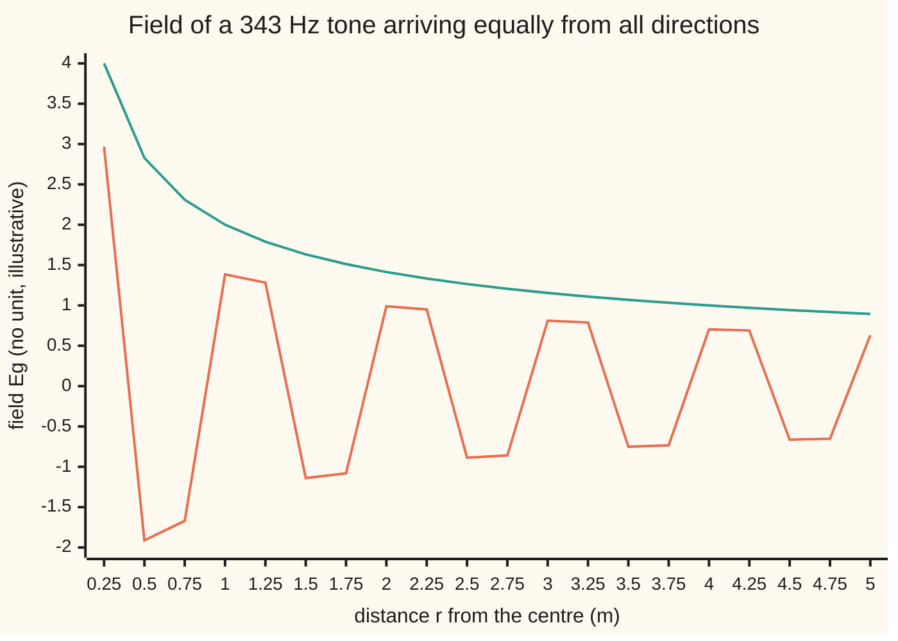

# Restriction and Kakeya in outline: what a spectrum living on a sphere can tell you

[Syllabus](../../../SYLLABUS.md) → [Harmonic analysis](../README.md) → [Maximal Functions and Beyond](../README.md#s06) → Restriction and Kakeya in outline

---

## General Overview

A loudspeaker plays a steady 343 Hz tone in open air. Sound travels at 343 m/s, so the wavelength is 1 m. Take the idealised two-dimensional case, where every wave of the tone travels horizontally. Then in a horizontal plane every wave has crests 1 m apart; only its direction varies.

So the field's two-dimensional spectrum lives on a circle: the frequencies $`\xi`$ with $`\lvert\xi\rvert`$ = 1 cycle per metre. The field is fixed by one amplitude per direction. What does that one fact force on the field?

It forces the field to fade. Send the tone in equally from every direction. The field is 6.283185 at the centre, 0.283984 at 10.3 m and 0.128124 at 50.3 m: it shrinks like $`2/\sqrt r`$ at distance $`r`$ metres. Yet the total of its fourth power over a disc around the centre grows by 26.13 each time the disc's radius doubles. Every power above 4 has a finite total.

The **restriction problem** asks for which powers $`p`$ a bounded amplitude on the circle (or sphere) always gives a finite total of $`\lvert \text{field}\rvert^p`$. In the plane the answer is every $`p > 4`$; in space it is open. The **Kakeya needle problem** asks how small a set can hold a needle pointing in every direction. The two meet because a narrow beam is a long thin tube, and tubes in many directions are needles.

**A spectrum on a curved circle forces the field to fade, with a finite p-th power total for every p above 4; such a bound also forces beams in all directions to spread out, so a transform bound gives a needle bound.**

**What kind of fact this is:** an outline. The needle bound in the plane is proved here. The field's fading, and with it the failure at exponent 4, is worked out from a standard large-distance formula for $`J_0`$, the Bessel function of order 0. That formula is quoted and checked numerically. The restriction theorem in the plane and the Stein–Tomas theorem are stated, with sources. The implication from restriction to Kakeya is outlined in a fold, with its exponent worked out; it runs one way only. The restriction conjecture in three or more dimensions is unproved as of 2026-11-15. The tone and its field are illustrative.

### The picture: the field from the whole circle



Orange: the field at distance $`r`$, computed as a sum of plane waves over the circle. The formula below names it $`Eg(r)`$ and shows it equals $`2\pi J_0(2\pi r)`$, where $`J_0`$ is the Bessel function of order 0. Teal: the envelope $`2/\sqrt r`$. The field swings between the envelope and its mirror image, one full swing per metre, and the envelope shrinks only like one over the square root of the distance.

---

## The formula

Notation first, in words.

- A point of the plane is $`x = (x_1, x_2)`$, in metres; $`r = \lvert x\rvert`$ is its distance from the centre. A frequency is $`\xi = (\xi_1, \xi_2)`$, in cycles per metre, as on [Transforms in two and three dimensions](../02-The%20Fourier%20Transform/10-multidimensional-transform-and-tomography.md).
- $`S^1`$ is the unit circle $`\lvert\xi\rvert = 1`$. A point on it is $`\omega = (\cos\varphi, \sin\varphi)`$, a direction of travel at angle $`\varphi`$. $`d\sigma`$ is arc length on it; the whole circle has length $`2\pi`$.
- $`g(\omega)`$ is the amplitude of the wave arriving from direction $`\omega`$. $`\|g\|_\infty`$ is its largest size.
- This card introduces the **extension operator** $`E`$: it builds a field from amplitudes on the circle. $`\|F\|_p = \bigl(\int \lvert F\rvert^p\,dx\bigr)^{1/p}`$ is the $`L^p`$ norm over the plane (wing 10's notation).

```math
Eg(x) = \int_{S^1} g(\omega)\, e^{2\pi i\, x\cdot\omega}\, d\sigma(\omega), \qquad \|Eg\|_{L^p(\mathbb R^2)} \le C_p\, \|g\|_\infty \ \text{ for every } p > 4, \text{ and for no } p \le 4
```

**Read it aloud:** "Add up plane waves of wavelength 1 m, one from each direction, weighted by g; the result has a finite p-th power total, bounded by a constant times the largest amplitude, exactly when p is above 4."

The transform of $`Eg`$ sits on the circle: it is the amplitude $`g`$ spread along $`S^1`$, with nothing off it. That is what "a spectrum on the circle" means. The **restriction** form is the same statement turned round: for $`f`$ on the plane, $`\int_{S^1} \lvert\hat f\rvert\,d\sigma \le C\,\|f\|_{p'}`$ for every $`p' < 4/3`$, where $`p'`$ is the partner exponent with $`1/p + 1/p' = 1`$. In $`d`$ dimensions the **restriction conjecture** puts the threshold at $`p > 2d/(d-1)`$: 4 in the plane, 3 in space.

The needle bound in the plane, for $`N`$ tubes of length 1 and width $`\delta = 1/N`$ in the directions $`k\pi/N`$, placed anywhere:

```math
\Bigl\lvert T_1 \cup \dots \cup T_N \Bigr\rvert \ \ge\ \frac{(N\delta)^2}{S_N}, \qquad S_N = N\delta + \sum_{j \ne k} \frac{\delta^2}{\sin\theta_{jk}}
```

**Read it aloud:** "The tubes cover at least the square of their total area divided by S_N, a sum that grows only like the logarithm of N."

And the bridge, in $`d`$ dimensions, outlined in Why it works:

```math
\|Eg\|_{L^p(\mathbb R^d)} \le C\,\|g\|_\infty \text{ for all } g \quad \Longrightarrow \quad \dim K \ \ge\ \frac{2p}{p-2} - d \ \text{ for every Kakeya set } K
```

**Read it aloud:** "A restriction bound at exponent p forces every set holding a needle in each direction to have dimension at least 2p over p minus 2, minus d."

| Symbol | Plain meaning | In our example | Push it up and the answer… |
| --- | --- | --- | --- |
| $`x = (x_1, x_2),\ r,\ u`$ | point of the plane, metres; its distance from the centre; the phase $`2\pi r - \pi/4`$ | 50.3 m | the field shrinks like $`2/\sqrt r`$ |
| $`\xi,\ S^1,\ S^{d-1}`$ | frequency, cycles per metre; the unit circle; the unit sphere in $`d`$ dimensions | $`\lvert\xi\rvert`$ = 1, wavelength 1 m | — |
| $`\omega,\ \varphi,\ d\sigma`$ | direction on the circle; its angle; arc length | whole circle: length $`2\pi`$ | — |
| $`g,\ \Vert g\Vert_\infty,\ \Vert g\Vert_2`$ | amplitude per direction; its largest size; its root-mean-square size | $`g = 1`$ | the field grows in proportion |
| $`f,\ \hat f`$ | a function on the plane and its transform, in the restriction form | — | — |
| $`Eg,\ J_0,\ F_j`$ | the field built from the circle; the Bessel function of order 0 (from [Transforms in two and three dimensions](../02-The%20Fourier%20Transform/10-multidimensional-transform-and-tomography.md)); one wave packet | $`Eg(r) = 2\pi J_0(2\pi r)`$, 6.283185 at the centre | — |
| $`p,\ p',\ \Vert F\Vert_p,\ C_p,\ C`$ | exponent; partner exponent, $`1/p + 1/p' = 1`$; $`L^p`$ norm of a function $`F`$; the constants | $`p`$ = 4 is the edge | larger $`p`$: easier to be finite |
| $`R`$ | radius of the disc a total is taken over | 8, 16, 32, 64 m | the $`L^4`$ total grows 26.13 per doubling |
| $`\delta,\ c`$ | half-angle of a cap of directions, radians, and a tube's width; the point a packet is moved to | 0.1 | narrower, longer beam |
| $`T_j,\ \chi_j,\ U,\ N,\ j, k, m`$ | tubes; 1 on a tube, 0 off it; their union; how many; tube numbers and their gap | 10 tubes, 1 by 0.1 | more tubes: smaller guaranteed union |
| $`\theta_{jk},\ S_N,\ \lvert A\rvert,\ \epsilon_j,\ \mathbb E`$ | angle between two tubes; the overlap total; area of a set $`A`$ ([Lebesgue measure](../../10-Measure%20and%20integration/02-Length%20Done%20Properly/03-lebesgue-measure.md)); random signs; their average | $`S_{10}`$ = 2.5450 | $`S_N`$ grows like $`(2/\pi)\ln N`$ |
| $`d,\ K,\ s,\ \varepsilon`$ | dimension of the space; a Kakeya set; its box-counting dimension; side of a covering square | $`d`$ = 2 | the conjectured dimension is $`d`$ |

### When it holds

- **The spectrum lies on a curved set.** Curvature makes waves from nearby directions drift out of step far away. Put the amplitudes on a flat segment instead and the field never fades along it: 0.2000 at 200 m and at 400 m, where the curved cap gives 0.0596 and 0.0444. No $`p`$ works.
- **The exponent is above 4.** At $`p = 4`$ the total over a disc of radius $`R`$ is 221.2, 247.6, 273.8 and 300.0 for $`R`$ = 8, 16, 32, 64 m, and it keeps climbing.
- **The amplitude is bounded.** With only a root-mean-square bound $`\|g\|_2`$, a narrow cap of directions can concentrate the field, and $`p`$ must be at least 6 (the Knapp example, Step 3).
- **The dimension is 2 for the full answer.** In $`d \ge 3`$ the threshold $`2d/(d-1)`$ is a conjecture, open as of 2026-11-15.

---

## Why it works

### Step 0: curvature spreads the waves out, and only beams fight back

Each direction on the circle sends one plane wave. Far from the centre, waves from nearby directions drift out of step and mostly cancel. Only the directions pointing straight at the observer, and straight away, add up in step. So the field fades.

One thing resists: sound from a narrow cap of directions stays in step for a long way and forms a **beam**, a long thin tube of strong field. So a bound on the field limits how much tubes can overlap, and that is the Kakeya problem.

### Step 1: why "restriction"

The transform $`\hat f`$ of a function on the plane is defined at every point when $`\int\lvert f\rvert\,dx`$ is finite. For a function with only finite energy, $`\hat f`$ is fixed only up to a set of zero area ([Null sets and almost everywhere](../../10-Measure%20and%20integration/01-Sets%20You%20Can%20Measure/07-null-sets-and-almost-everywhere.md)). A circle has zero area, so "$`\hat f`$ on the circle" means nothing.

The restriction problem asks for the exponents $`p'`$ between 1 and 2 where it does mean something: where $`\int_{S^1}\lvert\hat f\rvert\,d\sigma \le C\|f\|_{p'}`$ for smooth $`f`$, so the restriction extends to all of $`L^{p'}`$. Swapping the order of integration shows

```math
\int_{S^1} \hat f(\omega)\, \overline{g(\omega)}\, d\sigma(\omega) = \int_{\mathbb R^2} f(x)\, \overline{Eg(x)}\, dx
```

So restricting from $`L^{p'}`$ is the same problem as extending into $`L^p`$, with $`1/p + 1/p' = 1`$. This card works with $`E`$, because $`Eg`$ is a field one can picture.

### Step 2: the whole circle gives the edge exponent 4

Take $`g = 1`$. The angle integral is the one on [Transforms in two and three dimensions](../02-The%20Fourier%20Transform/10-multidimensional-transform-and-tomography.md), which gives $`Eg(x) = 2\pi J_0(2\pi r)`$. For large $`r`$, a standard formula, quoted from the first source and checked by the code, gives

```math
2\pi J_0(2\pi r) \approx \frac{2}{\sqrt r}\Bigl(\cos u + \frac{\sin u}{16\pi r}\Bigr), \qquad u = 2\pi r - \frac{\pi}{4}
```

The two in-step directions, towards and away from the observer, each contribute a wave of size $`1/\sqrt r`$. At 50.3 m the sum over the circle gives 0.128124 and the formula 0.128124; the envelope is 0.281998.

Now total the $`p`$-th power over a disc of radius $`R`$, in rings of area $`2\pi r\,dr`$:

```math
\int_{\lvert x\rvert < R} \lvert Eg\rvert^p\, dx \approx \text{const} + \int^R \Bigl(\frac{2}{\sqrt r}\Bigr)^p\, \overline{\lvert\cos\rvert^p}\; 2\pi r\, dr, \qquad \Bigl(\frac{2}{\sqrt r}\Bigr)^p 2\pi r \propto r^{1 - p/2}
```

Here $`\overline{\lvert\cos\rvert^p}`$ is the average of $`\lvert\cos\rvert^p`$ over a swing. The integral of $`r^{1-p/2}`$ out to infinity is finite exactly when $`1 - p/2 < -1`$, that is $`p > 4`$.

- At $`p = 4`$: the average of $`\cos^4`$ is 3/8, so the integrand is $`16 \times \frac38 \times 2\pi / r = 12\pi/r`$. Each doubling of $`R`$ adds $`12\pi\ln 2`$ = 26.13. The check finds 26.38, 26.26 and 26.19.
- At $`p = 6`$: the integrand is $`64 \times \frac{5}{16} \times 2\pi/r^2 = 40\pi/r^2`$, so the part beyond $`R`$ is $`40\pi/R`$. Adding it, $`R`$ = 32 and $`R`$ = 64 both give 3298.4.
- At $`p = 3`$: the total grows like $`\sqrt R`$. The square of the ratio between $`R`$ = 64 and $`R`$ = 32 is 2.026.

So $`g = 1`$ shows that no $`p \le 4`$ can work. The theorem says this example is the worst: in the plane, $`\|Eg\|_p \le C_p\|g\|_\infty`$ for every $`p > 4`$. It was proved in the early 1970s; the first source gives the proof.

### Step 3: a cap of directions makes a beam, the Knapp example

Keep only the directions within $`\delta`$ = 0.1 rad of due east: $`g = 1`$ on an arc of length $`2\delta`$ = 0.2. At the centre every wave is in step, so the field is 0.2000.

- **Across the beam** the waves fall out of step when $`2\pi x_2 \sin\varphi`$ reaches about $`\pi`$, so the field first vanishes near $`x_2 = 1/(2\delta)`$ = 5 m. The check finds 0.1274 at 2.5 m and 0.0001 at 5 m. The beam is about $`1/\delta`$ = 10 m wide.
- **Along the beam** the phase drifts only by $`2\pi x_1(1 - \cos\varphi) \approx \pi x_1\varphi^2`$, which stays small until $`x_1`$ is about $`1/\delta^2`$ = 100 m. The check finds 0.1946 at 25 m, 0.1789 at 50 m, 0.1257 at 100 m and 0.0596 at 200 m.

So a cap of half-angle $`\delta`$ makes a **wave packet**: size $`2\delta`$ on a tube about $`1/\delta`$ wide and $`1/\delta^2`$ long, pointing along the cap's centre direction. Moving the packet's centre costs nothing: multiply $`g`$ by $`e^{-2\pi i c\cdot\omega}`$ and $`Eg`$ is shifted by $`c`$.

This is the **Knapp example**. Measured against $`\|g\|_2 = (2\delta)^{1/2}`$, the field's $`L^p`$ norm is at least about $`2\delta`$ times (tube area)$`^{1/p}`$, so the ratio is at least about $`(2\delta)^{1/2}\delta^{-3/p}`$, up to a constant. This is a scaling, not a measured norm. At $`p = 5`$, where bounded amplitudes are enough, it still grows: 1.780, 2.241, 2.822 at $`\delta`$ = 0.1, 0.01, 0.001. At $`p = 6`$ it is 1.414 every time. The **Stein–Tomas theorem** says $`p = 6`$ is enough: $`\|Eg\|_6 \le C\|g\|_2`$, and $`p \ge 2(d+1)/(d-1)`$ in $`d`$ dimensions. Its proof feeds the $`2/\sqrt r`$ decay of Step 2 into [Interpolation](04-interpolation-riesz-thorin-and-marcinkiewicz.md).

### Step 4: the Kakeya needle problem

The Kakeya needle problem, posed in 1917, asks: what is the smallest area in which a needle of length 1 can be turned all the way round?

| Region | Area | How it was found |
| --- | ---: | --- |
| Disc of diameter 1 | 0.785398 | spin the needle about its middle |
| Equilateral triangle of height 1 | 0.577350 | the smallest convex region |
| Deltoid (three-cusped curve) | 0.392699 | slide the needle around the cusps |
| Besicovitch's construction | as small as you like | thin overlapping triangles, slid together |

The check finds the triangle and deltoid areas by the shoelace formula (the area of a polygon from its corner points), against $`1/\sqrt3`$ and $`\pi/8`$.

A **Kakeya set** is a closed bounded set that holds a needle of length 1 pointing in every direction. Besicovitch's construction gives one of area 0. Area is the wrong measure, so the question becomes its **dimension**: roughly, the exponent $`s`$ such that covering it takes about $`\varepsilon^{-s}`$ squares (or cubes) of side $`\varepsilon`$. The **Kakeya conjecture** says a Kakeya set in $`d`$ dimensions has dimension $`d`$. It is proved in the plane; Step 5 proves the box-counting version. The three-dimensional case was proved in 2025; [Kakeya](../../25-Frontier/04-Geometry%20and%20Combinatorics/02-kakeya-and-restriction.md) tells that story. It is open in four or more dimensions.

### Step 5: the needle bound in the plane, proved

Thicken each needle into a tube of length 1 and width $`\delta = 1/N`$, one tube per direction $`k\pi/N`$. Put them anywhere. How small can their union be?

Two tubes at angle $`\theta`$ overlap in at most a rhombus of area $`\delta^2/\sin\theta`$: that is where two strips of width $`\delta`$ cross. Adding over all pairs gives the total $`S_N`$ of the formula. Then the Cauchy–Schwarz inequality, $`(\int ab)^2 \le \int a^2 \int b^2`$, turns a small total overlap into a large union. For $`N`$ = 10, the ten tubes have total area 1 and $`S_{10}`$ = 2.5450, so the union is at least 0.3929. Ten tubes through one point cover 0.684.

$`S_N`$ grows like $`(2/\pi)\ln N`$, so the guaranteed union shrinks only like $`1/\ln N`$: 0.3929, 0.2493, 0.1826 and 0.1440 for $`N`$ = 10, 100, 1000, 10000. Besicovitch's construction shows that the logarithm cannot be removed. An area that shrinks only like $`1/\ln(1/\delta)`$ shrinks slower than any power of $`\delta`$, so it forces dimension 2: this bound proves the Kakeya conjecture in the plane, for box-counting dimension.

<details>
<summary>Detailed proof: the needle bound in the plane</summary>

Let $`\chi_j`$ be 1 on $`T_j`$ and 0 elsewhere, and let $`U`$ be the union. The integral of $`(\sum_j \chi_j)^2`$ counts every ordered pair of tubes by its overlap:

$`\displaystyle \int \Bigl(\sum_j \chi_j\Bigr)^2 dx = \sum_{j,k} \lvert T_j \cap T_k\rvert`$

A tube with itself gives its area $`\delta`$; there are $`N`$ of these, total $`N\delta`$. Two tubes at angle $`\theta_{jk} > 0`$ lie inside two infinite strips of width $`\delta`$. The strips cross in a parallelogram with both sides $`\delta/\sin\theta_{jk}`$ and angle $`\theta_{jk}`$, of area $`\delta^2/\sin\theta_{jk}`$. So the integral is at most $`S_N`$.

The function $`\sum_j\chi_j`$ is zero outside $`U`$. By the Cauchy–Schwarz inequality,

$`\displaystyle N\delta = \int_U \sum_j \chi_j\, dx \le \lvert U\rvert^{1/2} \Bigl(\int \Bigl(\sum_j\chi_j\Bigr)^2 dx\Bigr)^{1/2} \le \lvert U\rvert^{1/2} S_N^{1/2}`$

Squaring gives $`\lvert U\rvert \ge (N\delta)^2/S_N`$.

For the size of $`S_N`$: with directions $`k\pi/N`$, each tube meets the others at angles $`m\pi/N`$, $`m = 1, \dots, N-1`$, so

$`\displaystyle S_N = N\delta + N\delta^2 \sum_{m=1}^{N-1} \frac{1}{\sin(m\pi/N)}`$

The sum is close to $`(2N/\pi)\ln N`$, because $`1/\sin`$ behaves like $`N/(m\pi)`$ near each end. With $`\delta = 1/N`$ this gives $`S_N \approx 1 + (2/\pi)\ln N`$. The check prints both: 2.5450 against 2.4659 at $`N`$ = 10, and 6.9435 against 6.8635 at $`N`$ = 10000. This is the argument of the fifth source.

</details>

### Step 6: the bridge, a restriction bound gives a needle bound

This is the proved direction, from the third source. Assume $`\|Eg\|_{L^p(\mathbb R^d)} \le C\|g\|_\infty`$. In outline:

1. Split the sphere into about $`\delta^{1-d}`$ caps of half-angle $`\delta`$. On each cap put amplitude of size 1, with a phase that moves its wave packet onto a chosen tube $`T_j`$. Then $`\|g\|_\infty = 1`$.
2. Give the packets random signs. On average, the $`p`$-th power of such a sum is about the $`p/2`$-th power of the sum of squares, so the bound says the tubes cannot pile up much.
3. Hölder's inequality (Cauchy–Schwarz with a pair of exponents other than 2 and 2) turns "little pile-up" into "large union". Shrinking by $`\delta^2`$ gives needles of length 1 and width $`\delta`$, one per direction, and the dimension bound.

<details>
<summary>Detailed outline: the exponent arithmetic</summary>

Let $`F_j = E g_j`$, the packet on tube $`T_j`$, with $`\lvert F_j\rvert \gtrsim \delta^{d-1}`$ on $`T_j`$. Here $`\gtrsim`$ means "at least a constant times", and $`\lesssim`$ means "at most a constant times". Each tube has volume $`\lvert T_j\rvert \approx \delta^{-(d-1)}\delta^{-2} = \delta^{-d-1}`$. With random signs $`\epsilon_j = \pm 1`$, the averaged bound reads

$`\displaystyle \int \Bigl(\sum_j \lvert F_j\rvert^2\Bigr)^{p/2} dx \lesssim \mathbb E\, \Bigl\|\sum_j \epsilon_j F_j\Bigr\|_p^p \le C^p, \quad\text{so}\quad \int\Bigl(\sum_j \chi_{T_j}\Bigr)^{p/2} dx \lesssim \delta^{-(d-1)p}`$

Hölder's inequality with exponents $`p/2`$ and $`p/(p-2)`$, on the union $`U`$:

$`\displaystyle \sum_j \lvert T_j\rvert = \int_U \sum_j\chi_{T_j}\,dx \le \lvert U\rvert^{1 - 2/p}\Bigl(\int\Bigl(\sum_j\chi_{T_j}\Bigr)^{p/2}dx\Bigr)^{2/p}`$

The left side is $`\delta^{1-d}\cdot\delta^{-d-1} = \delta^{-2d}`$, and the last factor is at most about $`\delta^{-2(d-1)}`$. So $`\lvert U\rvert \gtrsim \delta^{-2p/(p-2)}`$. Shrinking by $`\delta^2`$ in every direction multiplies volumes by $`\delta^{2d}`$, so tubes of length 1 and width $`\delta`$ in $`\delta`$-separated directions cover at least about $`\delta^{2d - 2p/(p-2)}`$. A Kakeya set thickened by $`\delta`$ contains such tubes, so its volume is at least that, and a volume of $`\delta^{d-s}`$ means dimension $`s`$. Hence $`s \ge 2p/(p-2) - d`$. The constants and logarithmic losses are in the third source.

</details>

| Restriction at $`p`$ | Dimension $`d`$ | Kakeya dimension at least |
| ---: | ---: | ---: |
| 4 | 2 | 2.000 |
| 6 | 2 | 1.000 |
| 3 | 3 | 3.000 |
| 4 | 3 | 1.000 |

The rows at $`p = 4`$ in the plane and $`p = 3`$ in space are endpoints: the bound is assumed for every $`p`$ just above them, and the dimension bound then comes as close to $`d`$ as wished. So the conjectured restriction exponent $`p > 2d/(d-1)`$ gives the full Kakeya conjecture. The Stein–Tomas exponent gives 1.000, which every set holding a needle already has.

### Step 7: needle sets break the ideal circular filter

The **ball multiplier** keeps every frequency inside the circle and removes every frequency outside it: an ideal circular low-pass filter. On energy it is harmless: by [Plancherel](../02-The%20Fourier%20Transform/05-plancherel-and-l2.md) it never increases $`\|f\|_2`$. The second source proves that for every $`p \ne 2`$, in two or more dimensions, no constant bounds it on $`L^p`$. The outline:

1. Near one point of its edge, the circle looks like a straight line. There the filter acts like a half-plane filter, which is built from the Hilbert transform taken along one direction.
2. Applied to a wave packet on a long rectangle, the Hilbert transform leaves a fixed share of it on the next rectangle along, because the Hilbert transform of a gate has a tail like 1 over the distance ([Singular integrals](03-singular-integrals-and-the-hilbert-transform-bound.md)).
3. Besicovitch's construction gives rectangles in many directions whose union is as small as you like, while the next rectangles along do not overlap at all.

So the input lives on a tiny set and the output spreads over a large one. For $`p > 2`$ that ratio has no bound, and $`p < 2`$ follows by duality. This is the second proved link: a set that packs needles tightly breaks a transform bound.

---

## Worked numbers, by hand

The 343 Hz tone, wavelength 1 m, amplitude $`g = 1`$ on the whole circle; then a cap of half-angle 0.1 rad; then ten tubes.

| Step | Arithmetic | Value |
| --- | --- | --- |
| field at the centre | whole circle length, $`2\pi \times 1`$ | 6.283185 |
| field at 50.3 m | sum over the circle; large-r formula | 0.128124; 0.128124 |
| envelope at 50.3 m | $`2/\sqrt{50.3}`$ | 0.281998 |
| $`L^4`$ total, $`R`$ = 8 to 64 m | Simpson's rule in rings | 221.2, 247.6, 273.8, 300.0 |
| gain per doubling | $`12\pi\ln 2`$ | 26.13 |
| $`L^6`$ total | value at 64 m plus tail $`40\pi/64`$ | 3298.4 |
| beam width | first zero across at $`1/(2\delta)`$ = 5 m | about 10 m |
| beam at 100 m along | sum over the cap | 0.1257 |
| tube overlaps, $`N`$ = 10 | $`1/\sin(m\pi/10)`$ for $`m`$ = 1 to 5: 3.2361, 1.7013, 1.2361, 1.0515, 1.0000 | sum over $`m`$ = 1 to 9: 15.4498 |
| $`S_{10}`$ | $`1 + 10 \times 0.01 \times 15.4498`$ | 2.5450 |
| guaranteed union | $`1/2.5450`$ | **0.3929** |

So: a field with its spectrum on the circle has a finite $`L^p`$ total for every $`p`$ above 4, and ten tubes of width 0.1 in ten directions must cover at least 0.3929 of area however they are placed.

### What breaks if you drop a piece

| Mistake | Comes out at | What went wrong |
| --- | --- | --- |
| Stop at the edge exponent $`p = 4`$ | 221.2, 247.6, 273.8, 300.0 for $`R`$ = 8 to 64 m, gaining about 26.13 per doubling | $`r^{1-p/2} = 1/r`$, whose integral grows like $`\ln R`$ |
| Put the spectrum on a flat segment | 0.2000 at 200 m and 400 m, against 0.0596 and 0.0444 | no curvature, so the waves never drift out of step; no $`p`$ works |
| Use root-mean-square amplitudes below $`p = 6`$ | at $`p = 5`$, Knapp ratio at least about 1.780, 2.241, 2.822 as $`\delta`$ shrinks (a scaling, constant unknown) | narrow caps concentrate the field on tubes |
| Take ten tubes through one point as the worst case | 0.684 | only 0.3929 is guaranteed, and the guarantee falls to 0.1440 at $`N`$ = 10000 |

---

## Code, from first principles, and it actually runs

Both programs compute every field as a sum of plane waves over the circle or an arc, with no special-function library. They take independent roads to each answer. The field from the whole circle is checked against the Bessel power series near the centre and against the two-term large-r formula far out. The $`L^p`$ totals use Simpson's rule in rings and are checked against the tail laws $`12\pi/r`$ and $`40\pi/r^2`$. The beam is checked at two step counts and against the small-angle formula $`2\delta\,\lvert\sin u/u\rvert`$ across it. The tube overlap total $`S_N`$ is checked against a grid count of ten tubes, and the needle areas against $`1/\sqrt3`$ and $`\pi/8`$.

### Python

```python
# Restriction and Kakeya in outline: the check behind the card. Standard library only.
# A 343 Hz tone in air has wavelength 1 m, so its spectrum lies on the circle of
# radius 1 cycle per metre. Every circle integral and every area is computed here.
import math

def ext(x1, x2, lo, hi, m):
    # Eg(x) = integral over the arc lo..hi of exp(2 pi i x.w) d(arc), g = 1, midpoint rule
    h = (hi - lo) / m
    re = im = 0.0
    for k in range(m):
        p = lo + (k + 0.5) * h
        a = 2 * math.pi * (x1 * math.cos(p) + x2 * math.sin(p))
        re += math.cos(a)
        im += math.sin(a)
    return re * h, im * h

def circle(r):  # whole circle, g = 1: real by symmetry
    return ext(r, 0.0, 0.0, 2 * math.pi, int(8 * r) + 64)[0]

def j0_series(z):  # J0(z) = sum (-1)^k (z/2)^(2k) / (k!)^2
    term, s, k = 1.0, 1.0, 1
    while abs(term) > 1e-18:
        term *= -(z * z / 4) / (k * k)
        s += term
        k += 1
    return s

def asym(r):  # large r: 2 pi J0(2 pi r) is about (2 / sqrt r)(cos u + sin u / (16 pi r)), u = 2 pi r - pi/4
    u = 2 * math.pi * r - math.pi / 4
    return 2 * (math.cos(u) + math.sin(u) / (16 * math.pi * r)) / math.sqrt(r)

print("circle field Eg(r), g = 1 on the whole circle")
for r in (0.0, 0.25, 0.5, 1.0, 2.0):
    q, s = circle(r), 2 * math.pi * j0_series(2 * math.pi * r)
    assert abs(q - s) < 1e-9
    print(f"r={r:g} m: quadrature {q:.6f}, Bessel series {s:.6f}")
for r in (10.3, 50.3):
    q = circle(r)
    assert abs(q - asym(r)) < 1e-4
    print(f"r={r:g} m: quadrature {q:.6f}, large-r formula {asym(r):.6f}, envelope 2/sqrt(r) {2 / math.sqrt(r):.6f}")
rs = [0.25 * i for i in range(1, 21)]
print("chart r:", ", ".join(f"{r:g}" for r in rs))
print("chart Eg:", ", ".join(f"{circle(r):.3f}" for r in rs))
print("chart envelope 2/sqrt(r):", ", ".join(f"{2 / math.sqrt(r):.3f}" for r in rs))

# integral over the disc of radius R of |Eg|^p, Simpson in r with step 1/128 m
n_per, R_max = 128, 64
h = 1 / n_per
vals = [circle(i * h) if i else 2 * math.pi for i in range(R_max * n_per + 1)]
lp = {}
for p in (3, 4, 5, 6):
    s = 0.0
    for i, v in enumerate(vals):
        f = abs(v) ** p * 2 * math.pi * i * h
        if i and i % (8 * n_per) == 0:
            lp[(p, i // n_per)] = (s + f) * h / 3
        s += f * (1 if i == 0 else (4 if i % 2 else 2))
Rs = (8, 16, 32, 64)
for p in (3, 4, 5, 6):
    print(f"p={p}: " + ", ".join(f"R={R} {lp[(p, R)]:.1f}" for R in Rs))
grow = [lp[(4, 2 * R)] - lp[(4, R)] for R in (8, 16, 32)]
print("p=4 gain per doubling of R:", ", ".join(f"{g:.2f}" for g in grow),
      f"| 12 pi ln 2 = {12 * math.pi * math.log(2):.2f}")
assert grow[0] > grow[1] > grow[2] > 12 * math.pi * math.log(2) > grow[2] - 0.1
tails = [lp[(6, R)] + 40 * math.pi / R for R in (32, 64)]
assert abs(tails[0] - tails[1]) < 0.05
print(f"p=6 plus tail 40 pi/R: R=32 {tails[0]:.1f}, R=64 {tails[1]:.1f}")
ratio = (lp[(3, 64)] / lp[(3, 32)]) ** 2
assert abs(ratio - 2) < 0.05
print(f"p=3 growth: (I(64)/I(32))^2 = {ratio:.3f}, like sqrt(R)")

# a cap of half-width delta = 0.1 rad around the direction (1, 0): a beam
d = 0.1
along = [(x, math.hypot(*ext(x, 0, -d, d, 2000))) for x in (0, 25, 50, 100, 200, 400)]
for x, v in along:
    assert abs(v - math.hypot(*ext(x, 0, -d, d, 4000))) < 1e-6
print("beam along the axis:", ", ".join(f"{x} m {v:.4f}" for x, v in along))
across = []
for y in (0, 2.5, 5, 7.5, 10):
    v = math.hypot(*ext(0, y, -d, d, 2000))
    u = 2 * math.pi * d * y
    small = 2 * d * (abs(math.sin(u) / u) if u else 1.0)
    assert abs(v - small) < 1e-3
    across.append(f"{y:g} m {v:.4f} (small-angle {small:.4f})")
print("beam across the axis:", ", ".join(across))
def flat(x1, x2, m=2000):  # flat segment w = (1, s), |s| <= delta: no curvature
    re = im = 0.0
    for k in range(m):
        a = 2 * math.pi * (x1 + x2 * (-d + (k + 0.5) * 2 * d / m))
        re, im = re + math.cos(a), im + math.sin(a)
    return math.hypot(re, im) * 2 * d / m
fl = [flat(200, 0), flat(400, 0)]
assert abs(flat(400, 2.5) - 2 * d * math.sin(5 * math.pi * d) / (5 * math.pi * d)) < 1e-6 and along[4][1] < 0.1  # off axis: 2 delta sinc(2 delta x2)
print(f"flat segment along the axis: 200 m {fl[0]:.4f}, 400 m {fl[1]:.4f}")
print(f"try delta=0.05: across 10 m {math.hypot(*ext(0, 10, -0.05, 0.05, 2000)):.4f},"
      f" along 400 m {math.hypot(*ext(400, 0, -0.05, 0.05, 2000)):.4f}")
for p in (5, 6):
    print(f"Knapp ratio (2 delta)^(1/2) delta^(-3/{p}) at L2 data:",
          ", ".join(f"delta={e} {(2 * e) ** 0.5 * e ** (-3 / p):.3f}" for e in (0.1, 0.01, 0.001)))

# needle bound in the plane: N tubes 1 by 1/N, directions k pi / N
def overlap_total(N):  # sum over all pairs of |Tj n Tk| at most N delta + sum delta^2 / sin(angle)
    dl = 1 / N
    return N * dl + N * dl * dl * sum(1 / math.sin(math.pi * m / N) for m in range(1, N))
for N in (10, 100, 1000, 10000):
    S = overlap_total(N)
    print(f"N={N}: S_N {S:.4f}, union at least 1/S_N = {1 / S:.4f}, 1 + (2/pi) ln N = {1 + 2 / math.pi * math.log(N):.4f}")
inv = [1 / math.sin(math.pi * m / 10) for m in range(1, 10)]
print("S_10 terms 1/sin(m pi/10), m=1..5:", ", ".join(f"{v:.4f}" for v in inv[:5]), f"| sum m=1..9 {sum(inv):.4f}")
N, G = 10, 440
cell = 1.1 / G
dirs = [(math.cos(math.pi * k / N), math.sin(math.pi * k / N)) for k in range(N)]
cover = squares = 0
for i in range(G):
    x = -0.55 + (i + 0.5) * cell
    for j in range(G):
        y = -0.55 + (j + 0.5) * cell
        m = sum(1 for c, s in dirs if abs(x * c + y * s) <= 0.5 and abs(y * c - x * s) <= 0.05)
        cover += m > 0
        squares += m * m
cover, squares = cover * cell * cell, squares * cell * cell
assert abs(squares - overlap_total(10)) < 0.01 and cover >= 1 / overlap_total(10)
print(f"bush of 10 tubes on a grid: union {cover:.3f}, sum of overlaps {squares:.3f}")

# Kakeya needle problem: areas in which a unit needle turns round
def shoelace(P):
    return abs(sum(P[i][0] * P[i - 1][1] - P[i - 1][0] * P[i][1] for i in range(len(P)))) / 2
side = 2 / math.sqrt(3)
tri = shoelace([(0, 0), (side, 0), (side / 2, 1)])
K, a = 4000, 0.25
delt = shoelace([(2 * a * math.cos(t) + a * math.cos(2 * t), 2 * a * math.sin(t) - a * math.sin(2 * t))
                 for t in (2 * math.pi * k / K for k in range(K))])
G = 997  # grid count of the triangle, an independent road to its area
grid = sum(1 for i in range(G) for j in range(G) if (j + 0.5) / G <= math.sqrt(3) * min((i + 0.5) * side / G, side - (i + 0.5) * side / G)) * side / G ** 2
assert abs(tri - grid) < 1e-5 and abs(delt - math.pi / 8) < 1e-6
print(f"needle areas: disc {math.pi / 4:.6f}, triangle {tri:.6f} (1/sqrt3 {1 / math.sqrt(3):.6f}),"
      f" deltoid {delt:.6f} (pi/8 {math.pi / 8:.6f})")
for dim, p in ((2, 4), (2, 6), (3, 3), (3, 3.5), (3, 4)):
    print(f"restriction at p={p} in dimension {dim}: Kakeya dimension at least {2 * p / (p - 2) - dim:.3f}")
print("ALL CHECKS PASS")
```

**Ran 2026-11-15 on macOS, Python 3.14.10, standard library only. All checks passed. Output, pasted from the run:**

```
circle field Eg(r), g = 1 on the whole circle
r=0 m: quadrature 6.283185, Bessel series 6.283185
r=0.25 m: quadrature 2.965671, Bessel series 2.965671
r=0.5 m: quadrature -1.911610, Bessel series -1.911610
r=1 m: quadrature 1.384041, Bessel series 1.384041
r=2 m: quadrature 0.989648, Bessel series 0.989648
r=10.3 m: quadrature 0.283984, large-r formula 0.283989, envelope 2/sqrt(r) 0.623177
r=50.3 m: quadrature 0.128124, large-r formula 0.128124, envelope 2/sqrt(r) 0.281998
chart r: 0.25, 0.5, 0.75, 1, 1.25, 1.5, 1.75, 2, 2.25, 2.5, 2.75, 3, 3.25, 3.5, 3.75, 4, 4.25, 4.5, 4.75, 5
chart Eg: 2.966, -1.912, -1.670, 1.384, 1.283, -1.139, -1.081, 0.990, 0.951, -0.887, -0.859, 0.811, 0.789, -0.752, -0.734, 0.704, 0.689, -0.664, -0.652, 0.630
chart envelope 2/sqrt(r): 4.000, 2.828, 2.309, 2.000, 1.789, 1.633, 1.512, 1.414, 1.333, 1.265, 1.206, 1.155, 1.109, 1.069, 1.033, 1.000, 0.970, 0.943, 0.918, 0.894
p=3: R=8 115.3, R=16 165.5, R=32 236.3, R=64 336.4
p=4: R=8 221.2, R=16 247.6, R=32 273.8, R=64 300.0
p=5: R=8 727.0, R=16 741.4, R=32 751.5, R=64 758.6
p=6: R=8 3282.5, R=16 3290.5, R=32 3294.5, R=64 3296.5
p=4 gain per doubling of R: 26.38, 26.26, 26.19 | 12 pi ln 2 = 26.13
p=6 plus tail 40 pi/R: R=32 3298.4, R=64 3298.4
p=3 growth: (I(64)/I(32))^2 = 2.026, like sqrt(R)
beam along the axis: 0 m 0.2000, 25 m 0.1946, 50 m 0.1789, 100 m 0.1257, 200 m 0.0596, 400 m 0.0444
beam across the axis: 0 m 0.2000 (small-angle 0.2000), 2.5 m 0.1274 (small-angle 0.1273), 5 m 0.0001 (small-angle 0.0000), 7.5 m 0.0426 (small-angle 0.0424), 10 m 0.0003 (small-angle 0.0000)
flat segment along the axis: 200 m 0.2000, 400 m 0.2000
try delta=0.05: across 10 m 0.0000, along 400 m 0.0628
Knapp ratio (2 delta)^(1/2) delta^(-3/5) at L2 data: delta=0.1 1.780, delta=0.01 2.241, delta=0.001 2.822
Knapp ratio (2 delta)^(1/2) delta^(-3/6) at L2 data: delta=0.1 1.414, delta=0.01 1.414, delta=0.001 1.414
N=10: S_N 2.5450, union at least 1/S_N = 0.3929, 1 + (2/pi) ln N = 2.4659
N=100: S_N 4.0117, union at least 1/S_N = 0.2493, 1 + (2/pi) ln N = 3.9317
N=1000: S_N 5.4776, union at least 1/S_N = 0.1826, 1 + (2/pi) ln N = 5.3976
N=10000: S_N 6.9435, union at least 1/S_N = 0.1440, 1 + (2/pi) ln N = 6.8635
S_10 terms 1/sin(m pi/10), m=1..5: 3.2361, 1.7013, 1.2361, 1.0515, 1.0000 | sum m=1..9 15.4498
bush of 10 tubes on a grid: union 0.684, sum of overlaps 2.545
needle areas: disc 0.785398, triangle 0.577350 (1/sqrt3 0.577350), deltoid 0.392699 (pi/8 0.392699)
restriction at p=4 in dimension 2: Kakeya dimension at least 2.000
restriction at p=6 in dimension 2: Kakeya dimension at least 1.000
restriction at p=3 in dimension 3: Kakeya dimension at least 3.000
restriction at p=3.5 in dimension 3: Kakeya dimension at least 1.667
restriction at p=4 in dimension 3: Kakeya dimension at least 1.000
ALL CHECKS PASS
```

### Rust

```rust
// Restriction and Kakeya in outline: the check behind the card. std only.
// A 343 Hz tone in air has wavelength 1 m, so its spectrum lies on the circle of
// radius 1 cycle per metre. Every circle integral and every area is computed here.
use std::f64::consts::PI;

// Eg(x) = integral over the arc lo..hi of exp(2 pi i x.w) d(arc), g = 1, midpoint rule
fn ext(x1: f64, x2: f64, lo: f64, hi: f64, m: usize) -> (f64, f64) {
    let h = (hi - lo) / m as f64;
    let (mut re, mut im) = (0.0, 0.0);
    for k in 0..m {
        let p = lo + (k as f64 + 0.5) * h;
        let a = 2.0 * PI * (x1 * p.cos() + x2 * p.sin());
        re += a.cos(); im += a.sin();
    }
    (re * h, im * h)
}

fn circle(r: f64) -> f64 { // whole circle, g = 1: real by symmetry
    ext(r, 0.0, 0.0, 2.0 * PI, (8.0 * r) as usize + 64).0
}
fn j0_series(z: f64) -> f64 { // J0(z) = sum (-1)^k (z/2)^(2k) / (k!)^2
    let (mut term, mut s, mut k) = (1.0f64, 1.0f64, 1.0f64);
    while term.abs() > 1e-18 { term *= -(z * z / 4.0) / (k * k); s += term; k += 1.0; }
    s
}

fn asym(r: f64) -> f64 { // large r: 2 pi J0(2 pi r) is about (2 / sqrt r)(cos u + sin u / (16 pi r)), u = 2 pi r - pi/4
    let u = 2.0 * PI * r - PI / 4.0;
    2.0 * (u.cos() + u.sin() / (16.0 * PI * r)) / r.sqrt()
}
fn hyp(z: (f64, f64)) -> f64 { z.0.hypot(z.1) }
fn join(v: Vec<String>) -> String { v.join(", ") }

// flat segment w = (1, s), |s| <= delta: no curvature
fn flat(x1: f64, x2: f64, d: f64, m: usize) -> f64 {
    let (mut re, mut im) = (0.0, 0.0);
    for k in 0..m {
        let a = 2.0 * PI * (x1 + x2 * (-d + (k as f64 + 0.5) * 2.0 * d / m as f64));
        re += a.cos(); im += a.sin();
    }
    re.hypot(im) * 2.0 * d / m as f64
}

// needle bound in the plane: N tubes 1 by 1/N, directions k pi / N
fn overlap_total(n: usize) -> f64 { // N delta + sum over pairs of delta^2 / sin(angle)
    let dl = 1.0 / n as f64;
    let s: f64 = (1..n).map(|m| 1.0 / (PI * m as f64 / n as f64).sin()).sum();
    n as f64 * dl + n as f64 * dl * dl * s
}

fn shoelace(p: &[(f64, f64)]) -> f64 {
    let n = p.len();
    let s: f64 = (0..n).map(|i| { let j = (i + n - 1) % n; p[i].0 * p[j].1 - p[j].0 * p[i].1 }).sum();
    s.abs() / 2.0
}

fn main() {
    println!("circle field Eg(r), g = 1 on the whole circle");
    for r in [0.0, 0.25, 0.5, 1.0, 2.0] {
        let (q, s) = (circle(r), 2.0 * PI * j0_series(2.0 * PI * r));
        assert!((q - s).abs() < 1e-9);
        println!("r={} m: quadrature {:.6}, Bessel series {:.6}", r, q, s);
    }
    for r in [10.3, 50.3] {
        let q = circle(r);
        assert!((q - asym(r)).abs() < 1e-4);
        println!("r={} m: quadrature {:.6}, large-r formula {:.6}, envelope 2/sqrt(r) {:.6}", r, q, asym(r), 2.0 / r.sqrt());
    }
    let rs: Vec<f64> = (1..21).map(|i| 0.25 * i as f64).collect();
    println!("chart r: {}", join(rs.iter().map(|r| format!("{}", r)).collect()));
    println!("chart Eg: {}", join(rs.iter().map(|&r| format!("{:.3}", circle(r))).collect()));
    println!("chart envelope 2/sqrt(r): {}", join(rs.iter().map(|r| format!("{:.3}", 2.0 / r.sqrt())).collect()));

    // integral over the disc of radius R of |Eg|^p, Simpson in r with step 1/128 m
    let (n_per, r_max) = (128usize, 64usize);
    let h = 1.0 / n_per as f64;
    let vals: Vec<f64> = (0..=r_max * n_per).map(|i| if i > 0 { circle(i as f64 * h) } else { 2.0 * PI }).collect();
    let (ps, rr) = ([3.0f64, 4.0, 5.0, 6.0], [8usize, 16, 32, 64]);
    let mut lp = [[0.0f64; 4]; 4];
    for (pi_, &p) in ps.iter().enumerate() {
        let mut s = 0.0;
        for (i, v) in vals.iter().enumerate() {
            let f = v.abs().powf(p) * 2.0 * PI * i as f64 * h;
            if i > 0 && i % (8 * n_per) == 0 {
                if let Some(k) = rr.iter().position(|&r| r == i / n_per) { lp[pi_][k] = (s + f) * h / 3.0; }
            }
            s += f * if i == 0 { 1.0 } else if i % 2 == 1 { 4.0 } else { 2.0 };
        }
    }
    for (pi_, p) in ps.iter().enumerate() {
        println!("p={}: {}", p, join((0..4).map(|k| format!("R={} {:.1}", rr[k], lp[pi_][k])).collect()));
    }
    let grow: Vec<f64> = (0..3).map(|k| lp[1][k + 1] - lp[1][k]).collect();
    let c = 12.0 * PI * 2f64.ln();
    println!("p=4 gain per doubling of R: {} | 12 pi ln 2 = {:.2}", join(grow.iter().map(|g| format!("{:.2}", g)).collect()), c);
    assert!(grow[0] > grow[1] && grow[1] > grow[2] && grow[2] > c && c > grow[2] - 0.1);
    let tails = [lp[3][2] + 40.0 * PI / 32.0, lp[3][3] + 40.0 * PI / 64.0]; // p=6 tail beyond R
    assert!((tails[0] - tails[1]).abs() < 0.05);
    println!("p=6 plus tail 40 pi/R: R=32 {:.1}, R=64 {:.1}", tails[0], tails[1]);
    let ratio = (lp[0][3] / lp[0][2]).powi(2);
    assert!((ratio - 2.0).abs() < 0.05);
    println!("p=3 growth: (I(64)/I(32))^2 = {:.3}, like sqrt(R)", ratio);

    // a cap of half-width delta = 0.1 rad around the direction (1, 0): a beam
    let d = 0.1;
    let mut along = Vec::new();
    for x in [0.0, 25.0, 50.0, 100.0, 200.0, 400.0] {
        let v = hyp(ext(x, 0.0, -d, d, 2000));
        assert!((v - hyp(ext(x, 0.0, -d, d, 4000))).abs() < 1e-6);
        along.push((x, v));
    }
    println!("beam along the axis: {}", join(along.iter().map(|(x, v)| format!("{} m {:.4}", x, v)).collect()));
    let mut across = Vec::new();
    for y in [0.0, 2.5, 5.0, 7.5, 10.0] {
        let v = hyp(ext(0.0, y, -d, d, 2000));
        let u = 2.0 * PI * d * y;
        let small = 2.0 * d * if u != 0.0 { (u.sin() / u).abs() } else { 1.0 };
        assert!((v - small).abs() < 1e-3);
        across.push(format!("{} m {:.4} (small-angle {:.4})", y, v, small));
    }
    println!("beam across the axis: {}", join(across));
    let fl = [flat(200.0, 0.0, d, 2000), flat(400.0, 0.0, d, 2000)];
    assert!((flat(400.0, 2.5, d, 2000) - 2.0 * d * (5.0 * PI * d).sin() / (5.0 * PI * d)).abs() < 1e-6 && along[4].1 < 0.1); // off axis: 2 delta sinc(2 delta x2)
    println!("flat segment along the axis: 200 m {:.4}, 400 m {:.4}", fl[0], fl[1]);
    println!("try delta=0.05: across 10 m {:.4}, along 400 m {:.4}", hyp(ext(0.0, 10.0, -0.05, 0.05, 2000)), hyp(ext(400.0, 0.0, -0.05, 0.05, 2000)));
    for p in [5.0f64, 6.0] {
        let v: Vec<String> = [0.1f64, 0.01, 0.001].iter()
            .map(|e| format!("delta={} {:.3}", e, (2.0 * e).powf(0.5) * e.powf(-3.0 / p))).collect();
        println!("Knapp ratio (2 delta)^(1/2) delta^(-3/{}) at L2 data: {}", p, join(v));
    }

    for n in [10usize, 100, 1000, 10000] {
        let s = overlap_total(n);
        println!("N={}: S_N {:.4}, union at least 1/S_N = {:.4}, 1 + (2/pi) ln N = {:.4}", n, s, 1.0 / s, 1.0 + 2.0 / PI * (n as f64).ln());
    }
    let inv: Vec<f64> = (1..10).map(|m| 1.0 / (PI * m as f64 / 10.0).sin()).collect();
    println!("S_10 terms 1/sin(m pi/10), m=1..5: {} | sum m=1..9 {:.4}", join(inv[..5].iter().map(|v| format!("{:.4}", v)).collect()), inv.iter().sum::<f64>());
    let (n, g) = (10usize, 440usize);
    let cell = 1.1 / g as f64;
    let dirs: Vec<(f64, f64)> = (0..n).map(|k| { let t = PI * k as f64 / n as f64; (t.cos(), t.sin()) }).collect();
    let (mut cover, mut squares) = (0usize, 0usize);
    for i in 0..g {
        let x = -0.55 + (i as f64 + 0.5) * cell;
        for j in 0..g {
            let y = -0.55 + (j as f64 + 0.5) * cell;
            let m = dirs.iter().filter(|(c, s)| (x * c + y * s).abs() <= 0.5 && (y * c - x * s).abs() <= 0.05).count();
            if m > 0 { cover += 1; }
            squares += m * m;
        }
    }
    let (cover, squares) = (cover as f64 * cell * cell, squares as f64 * cell * cell);
    assert!((squares - overlap_total(10)).abs() < 0.01 && cover >= 1.0 / overlap_total(10));
    println!("bush of 10 tubes on a grid: union {:.3}, sum of overlaps {:.3}", cover, squares);

    // Kakeya needle problem: areas in which a unit needle turns round
    let side = 2.0 / 3f64.sqrt();
    let tri = shoelace(&[(0.0, 0.0), (side, 0.0), (side / 2.0, 1.0)]);
    let (kk, a) = (4000usize, 0.25);
    let pts: Vec<(f64, f64)> = (0..kk).map(|k| { let t = 2.0 * PI * k as f64 / kk as f64;
        (2.0 * a * t.cos() + a * (2.0 * t).cos(), 2.0 * a * t.sin() - a * (2.0 * t).sin()) }).collect();
    let delt = shoelace(&pts);
    let gt = (0..997).flat_map(|i| (0..997).map(move |j| (i, j))).filter(|&(i, j)| { let x = (i as f64 + 0.5) * side / 997.0; (j as f64 + 0.5) / 997.0 <= 3f64.sqrt() * x.min(side - x) }).count() as f64 * side / (997.0 * 997.0); // grid count
    assert!((tri - gt).abs() < 1e-5 && (delt - PI / 8.0).abs() < 1e-6);
    println!("needle areas: disc {:.6}, triangle {:.6} (1/sqrt3 {:.6}), deltoid {:.6} (pi/8 {:.6})",
        PI / 4.0, tri, 1.0 / 3f64.sqrt(), delt, PI / 8.0);
    for (dim, p) in [(2.0f64, 4.0f64), (2.0, 6.0), (3.0, 3.0), (3.0, 3.5), (3.0, 4.0)] {
        println!("restriction at p={} in dimension {}: Kakeya dimension at least {:.3}", p, dim, 2.0 * p / (p - 2.0) - dim);
    }
    println!("ALL CHECKS PASS");
}
```

**Ran 2026-11-15 on macOS, rustc 1.98.1, no crates. All checks passed. Output, pasted from the run:**

```
circle field Eg(r), g = 1 on the whole circle
r=0 m: quadrature 6.283185, Bessel series 6.283185
r=0.25 m: quadrature 2.965671, Bessel series 2.965671
r=0.5 m: quadrature -1.911610, Bessel series -1.911610
r=1 m: quadrature 1.384041, Bessel series 1.384041
r=2 m: quadrature 0.989648, Bessel series 0.989648
r=10.3 m: quadrature 0.283984, large-r formula 0.283989, envelope 2/sqrt(r) 0.623177
r=50.3 m: quadrature 0.128124, large-r formula 0.128124, envelope 2/sqrt(r) 0.281998
chart r: 0.25, 0.5, 0.75, 1, 1.25, 1.5, 1.75, 2, 2.25, 2.5, 2.75, 3, 3.25, 3.5, 3.75, 4, 4.25, 4.5, 4.75, 5
chart Eg: 2.966, -1.912, -1.670, 1.384, 1.283, -1.139, -1.081, 0.990, 0.951, -0.887, -0.859, 0.811, 0.789, -0.752, -0.734, 0.704, 0.689, -0.664, -0.652, 0.630
chart envelope 2/sqrt(r): 4.000, 2.828, 2.309, 2.000, 1.789, 1.633, 1.512, 1.414, 1.333, 1.265, 1.206, 1.155, 1.109, 1.069, 1.033, 1.000, 0.970, 0.943, 0.918, 0.894
p=3: R=8 115.3, R=16 165.5, R=32 236.3, R=64 336.4
p=4: R=8 221.2, R=16 247.6, R=32 273.8, R=64 300.0
p=5: R=8 727.0, R=16 741.4, R=32 751.5, R=64 758.6
p=6: R=8 3282.5, R=16 3290.5, R=32 3294.5, R=64 3296.5
p=4 gain per doubling of R: 26.38, 26.26, 26.19 | 12 pi ln 2 = 26.13
p=6 plus tail 40 pi/R: R=32 3298.4, R=64 3298.4
p=3 growth: (I(64)/I(32))^2 = 2.026, like sqrt(R)
beam along the axis: 0 m 0.2000, 25 m 0.1946, 50 m 0.1789, 100 m 0.1257, 200 m 0.0596, 400 m 0.0444
beam across the axis: 0 m 0.2000 (small-angle 0.2000), 2.5 m 0.1274 (small-angle 0.1273), 5 m 0.0001 (small-angle 0.0000), 7.5 m 0.0426 (small-angle 0.0424), 10 m 0.0003 (small-angle 0.0000)
flat segment along the axis: 200 m 0.2000, 400 m 0.2000
try delta=0.05: across 10 m 0.0000, along 400 m 0.0628
Knapp ratio (2 delta)^(1/2) delta^(-3/5) at L2 data: delta=0.1 1.780, delta=0.01 2.241, delta=0.001 2.822
Knapp ratio (2 delta)^(1/2) delta^(-3/6) at L2 data: delta=0.1 1.414, delta=0.01 1.414, delta=0.001 1.414
N=10: S_N 2.5450, union at least 1/S_N = 0.3929, 1 + (2/pi) ln N = 2.4659
N=100: S_N 4.0117, union at least 1/S_N = 0.2493, 1 + (2/pi) ln N = 3.9317
N=1000: S_N 5.4776, union at least 1/S_N = 0.1826, 1 + (2/pi) ln N = 5.3976
N=10000: S_N 6.9435, union at least 1/S_N = 0.1440, 1 + (2/pi) ln N = 6.8635
S_10 terms 1/sin(m pi/10), m=1..5: 3.2361, 1.7013, 1.2361, 1.0515, 1.0000 | sum m=1..9 15.4498
bush of 10 tubes on a grid: union 0.684, sum of overlaps 2.545
needle areas: disc 0.785398, triangle 0.577350 (1/sqrt3 0.577350), deltoid 0.392699 (pi/8 0.392699)
restriction at p=4 in dimension 2: Kakeya dimension at least 2.000
restriction at p=6 in dimension 2: Kakeya dimension at least 1.000
restriction at p=3 in dimension 3: Kakeya dimension at least 3.000
restriction at p=3.5 in dimension 3: Kakeya dimension at least 1.667
restriction at p=4 in dimension 3: Kakeya dimension at least 1.000
ALL CHECKS PASS
```

### Lean

Lean proves the needle bound for any $`N`$ tubes placed anywhere, the closed form of $`S_N`$, and the swap of Step 1.

- Take $`N`$ tubes of length 1 and width $`\delta = 1/N`$, tube $`k`$ in the direction $`k\pi/N`$, placed anywhere. Then their union covers at least $`(N\delta)^2/S_N`$ of area.
- Take the same tubes, with $`N \ge 1`$. Then $`S_N = N\delta + N\delta^2 \sum_{m=1}^{N-1} 1/\sin(m\pi/N)`$, as in the Detailed proof.
- Take $`f`$ with $`\int\lvert f\rvert\,dx`$ finite and a bounded amplitude $`g`$. Then $`\int_{S^1} \hat f\,\overline{g}\,d\sigma = \int_{\mathbb R^2} f\,\overline{Eg}\,dx`$, as in Step 1.
- The exponents 4, 3 and 6, the tail constants $`12\pi`$ and $`40\pi`$, and the bridge table also check.

The fields, totals, beams, needle areas and decimals are left to the Python and Rust checks; the stated theorems keep their sources.

```lean
-- Restriction and Kakeya in outline: N needle tubes of length 1 and width 1/N, one in each direction kπ/N and placed anywhere in the plane, cover at least (Nδ)²/S_N of area, S_N has the card's closed form, and restricting a transform to the circle is the same problem as extending amplitudes from it.
import Mathlib.Analysis.Fourier.FourierTransform
import Mathlib.Analysis.InnerProductSpace.PiL2
import Mathlib.Analysis.SpecialFunctions.Trigonometric.Basic
import Mathlib.MeasureTheory.Integral.IntervalIntegral.Basic
import Mathlib.MeasureTheory.Measure.Lebesgue.EqHaar
import Mathlib.MeasureTheory.Measure.Haar.InnerProductSpace
import Mathlib.MeasureTheory.Integral.Prod

open MeasureTheory Real Complex FourierTransform
open scoped InnerProductSpace ComplexConjugate

namespace RestrictionKakeya

/-! Notation, as on the card. A point of the plane is `x = (x₁, x₂)`, in metres: Mathlib's
`EuclideanSpace ℝ (Fin 2)`, with `x 0 = x₁` and `x 1 = x₂`, its `volume` being area. -/

/-- The plane. -/
abbrev Plane : Type := EuclideanSpace ℝ (Fin 2)

/-- The tube `T` of length 1 and width `δ` centred at `c`, pointing along the direction at angle
`θ`: the points whose offset from `c` is at most `1/2` along `(cos θ, sin θ)` and at most `δ/2`
across it. -/
def tube (c : Plane) (θ δ : ℝ) : Set Plane :=
  {x | |(x 0 - c 0) * Real.cos θ + (x 1 - c 1) * Real.sin θ| ≤ 1 / 2 ∧
       |-(x 0 - c 0) * Real.sin θ + (x 1 - c 1) * Real.cos θ| ≤ δ / 2}

/-- The card's directions: tube number `k` points at angle `kπ/N`. -/
noncomputable def dir (N : ℕ) (k : Fin N) : ℝ := (k : ℝ) * π / N

/-- The overlap total `S_N = Nδ + ∑_{j ≠ k} δ² / sin θ_{jk}` for `N` tubes of width `δ = 1/N` in
the directions `kπ/N`; `θ_{jk}` is the angle between tubes `j` and `k`, whose sine is
`|sin(θ_j - θ_k)|`. -/
noncomputable def overlapTotal (N : ℕ) : ℝ :=
  let δ : ℝ := 1 / N
  N * δ + ∑ j : Fin N, ∑ k ∈ Finset.univ.filter (· ≠ j),
    δ ^ 2 / |Real.sin (dir N j - dir N k)|


/-- The sine at a direction gap `mπ/N`, `1 ≤ m < N`, is positive. -/
lemma sin_pos_of_lt (N m : ℕ) (h1 : 1 ≤ m) (h2 : m < N) : 0 < Real.sin (m * π / N) := by
  have hN : (0 : ℝ) < N := by exact_mod_cast (show 0 < N by omega)
  have hm : (1 : ℝ) ≤ m := by exact_mod_cast h1
  have hmN : (m : ℝ) < N := by exact_mod_cast h2
  apply Real.sin_pos_of_pos_of_lt_pi
  · positivity
  · rw [div_lt_iff₀ hN]; nlinarith [Real.pi_pos]

/-- The sine of the gap between directions `j` and `k` is, up to sign, `sin(mπ/N)` with
`m = j - k` taken mod `N`. -/
lemma abs_sin_dir (N : ℕ) [NeZero N] (j k : Fin N) (h : j ≠ k) :
    |Real.sin (dir N j - dir N k)| = Real.sin (((j - k : Fin N) : ℕ) * π / N) ∧
      0 < Real.sin (((j - k : Fin N) : ℕ) * π / N) := by
  have hpos : 0 < Real.sin (((j - k : Fin N) : ℕ) * π / N) := by
    apply sin_pos_of_lt
    · rcases Nat.eq_zero_or_pos ((j - k : Fin N) : ℕ) with h0 | h0
      · exact absurd (sub_eq_zero.mp (Fin.ext h0)) h
      · exact h0
    · exact (j - k).isLt
  refine ⟨?_, hpos⟩
  have hN : (N : ℝ) ≠ 0 := by exact_mod_cast (NeZero.ne N)
  rcases le_or_gt k j with hkj | hjk
  · have hv : ((j - k : Fin N) : ℕ) = (j : ℕ) - k := Fin.coe_sub_iff_le.mpr hkj
    have hle : (k : ℕ) ≤ j := hkj
    rw [hv, Nat.cast_sub hle, dir, dir, abs_of_pos]
    · congr 1; field_simp
    · convert hpos using 2; rw [hv, Nat.cast_sub hle]; field_simp
  · have hv : ((j - k : Fin N) : ℕ) = N + j - k := Fin.coe_sub_iff_lt.mpr hjk
    have hlt : (j : ℕ) < k := hjk
    have hk : (k : ℕ) < N := k.isLt
    have hc : (((N + j - k : ℕ)) : ℝ) = N + j - k := by
      rw [Nat.cast_sub (by omega)]; push_cast; ring
    have he : ((N + j - k : ℕ) : ℝ) * π / N = (dir N j - dir N k) + π := by
      rw [hc, dir, dir]; field_simp; ring
    rw [hv, he, Real.sin_add_pi]
    rw [hv, he, Real.sin_add_pi] at hpos
    rw [abs_of_neg (by linarith)]


/-- The area of a parallelogram `{|p y₀ + q y₁ - a| ≤ r, |u y₀ + v y₁ - b| ≤ s}` in coordinates. -/
lemma volume_parallelogram (M : Matrix (Fin 2) (Fin 2) ℝ) (hM : M.det ≠ 0) (a b r s : ℝ) :
    volume {y : Fin 2 → ℝ | |M 0 0 * y 0 + M 0 1 * y 1 - a| ≤ r ∧
      |M 1 0 * y 0 + M 1 1 * y 1 - b| ≤ s} =
      ENNReal.ofReal |M.det⁻¹| * (ENNReal.ofReal (2 * r) * ENNReal.ofReal (2 * s)) := by
  have hset : {y : Fin 2 → ℝ | |M 0 0 * y 0 + M 0 1 * y 1 - a| ≤ r ∧
      |M 1 0 * y 0 + M 1 1 * y 1 - b| ≤ s} = Matrix.toLin' M ⁻¹'
        Set.pi Set.univ (fun i => Set.Icc (![a, b] i - ![r, s] i) (![a, b] i + ![r, s] i)) := by
    ext y
    simp only [Set.mem_ofPred_eq, Set.mem_preimage, Set.mem_pi, Set.mem_univ, true_implies,
      Fin.forall_fin_two, Matrix.toLin'_apply, Matrix.mulVec, dotProduct, Fin.sum_univ_two,
      Set.mem_Icc, Matrix.cons_val_zero, Matrix.cons_val_one, abs_le]
    constructor <;> rintro ⟨⟨h1, h2⟩, h3, h4⟩ <;> refine ⟨⟨?_, ?_⟩, ?_, ?_⟩ <;> linarith
  rw [hset, Measure.addHaar_preimage_linearMap _ (by rwa [LinearMap.det_toLin']),
    LinearMap.det_toLin', volume_pi_pi, Fin.prod_univ_two]
  simp only [Real.volume_Icc, Matrix.cons_val_zero, Matrix.cons_val_one]
  ring_nf

/-- Area in the plane is area in coordinates. -/
lemma volume_plane_eq (P : ℝ → ℝ → Prop) :
    volume {x : Plane | P (x 0) (x 1)} = volume {y : Fin 2 → ℝ | P (y 0) (y 1)} := by
  rw [← (EuclideanSpace.volume_preserving_symm_measurableEquiv_toLp (Fin 2)).symm.measure_preimage_equiv]
  rfl

/-- The same parallelogram, in the plane. -/
lemma volume_plane_parallelogram (p q u v a b r s : ℝ) (hM : p * v - q * u ≠ 0) :
    volume {x : Plane | |p * x 0 + q * x 1 - a| ≤ r ∧ |u * x 0 + v * x 1 - b| ≤ s} =
      ENNReal.ofReal |(p * v - q * u)⁻¹| * (ENNReal.ofReal (2 * r) * ENNReal.ofReal (2 * s)) := by
  rw [volume_plane_eq (fun y0 y1 => |p * y0 + q * y1 - a| ≤ r ∧ |u * y0 + v * y1 - b| ≤ s)]
  have := volume_parallelogram !![p, q; u, v] (by rwa [Matrix.det_fin_two_of]) a b r s
  simpa [Matrix.det_fin_two_of] using this

/-- A tube is a closed, hence measurable, set. -/
lemma measurableSet_tube (c : Plane) (θ δ : ℝ) : MeasurableSet (tube c θ δ) := by
  have h0 : Continuous (fun x : Plane => x 0) := (EuclideanSpace.proj (0 : Fin 2)).continuous
  have h1 : Continuous (fun x : Plane => x 1) := (EuclideanSpace.proj (1 : Fin 2)).continuous
  apply IsClosed.measurableSet
  simp only [tube, Set.ofPred_and]
  exact (isClosed_le (by fun_prop) continuous_const).inter (isClosed_le (by fun_prop) continuous_const)

/-- A tube of length 1 and width `δ` has area `δ`. -/
lemma volume_tube (c : Plane) (θ δ : ℝ) :
    volume (tube c θ δ) = ENNReal.ofReal δ := by
  have hset : tube c θ δ = {x : Plane |
      |Real.cos θ * x 0 + Real.sin θ * x 1 - (c 0 * Real.cos θ + c 1 * Real.sin θ)| ≤ 1 / 2 ∧
      |(-Real.sin θ) * x 0 + Real.cos θ * x 1 - (-c 0 * Real.sin θ + c 1 * Real.cos θ)| ≤ δ / 2} := by
    ext x
    simp only [tube, Set.mem_ofPred_eq]
    constructor <;> rintro ⟨h1, h2⟩
    · exact ⟨by convert h1 using 2; ring, by convert h2 using 2; ring⟩
    · exact ⟨by convert h1 using 2; ring, by convert h2 using 2; ring⟩
  rw [hset, volume_plane_parallelogram _ _ _ _ _ _ _ _ (by nlinarith [Real.sin_sq_add_cos_sq θ])]
  have h1 : Real.cos θ * Real.cos θ - Real.sin θ * -Real.sin θ = 1 := by
    nlinarith [Real.sin_sq_add_cos_sq θ]
  rw [h1]
  simp only [inv_one, abs_one, ENNReal.ofReal_one, one_mul]
  rw [← ENNReal.ofReal_mul (by norm_num)]
  congr 1; ring

/-- Two tubes of width `δ` at angles `θ, θ'` with `sin(θ - θ') ≠ 0` meet in area at most
`δ² / |sin(θ - θ')|`: their meeting lies in the parallelogram where the two strips cross. -/
lemma volume_tube_inter_le (c c' : Plane) (θ θ' δ : ℝ) (hδ : 0 ≤ δ)
    (hs : Real.sin (θ - θ') ≠ 0) :
    volume (tube c θ δ ∩ tube c' θ' δ) ≤ ENNReal.ofReal (δ ^ 2 / |Real.sin (θ - θ')|) := by
  have hsub : tube c θ δ ∩ tube c' θ' δ ⊆ {x : Plane |
      |(-Real.sin θ) * x 0 + Real.cos θ * x 1 - (-c 0 * Real.sin θ + c 1 * Real.cos θ)| ≤ δ / 2 ∧
      |(-Real.sin θ') * x 0 + Real.cos θ' * x 1 - (-c' 0 * Real.sin θ' + c' 1 * Real.cos θ')|
        ≤ δ / 2} := by
    rintro x ⟨⟨_, h1⟩, ⟨_, h2⟩⟩
    refine ⟨?_, ?_⟩
    · convert h1 using 2; ring
    · convert h2 using 2; ring
  have hdet : -Real.sin θ * Real.cos θ' - Real.cos θ * -Real.sin θ' = -Real.sin (θ - θ') := by
    rw [Real.sin_sub]; ring
  refine (measure_mono hsub).trans (le_of_eq ?_)
  rw [volume_plane_parallelogram _ _ _ _ _ _ _ _ (by rw [hdet]; exact neg_ne_zero.mpr hs), hdet,
    ← ENNReal.ofReal_mul (by positivity), ← ENNReal.ofReal_mul (abs_nonneg _)]
  congr 1
  rw [abs_inv, abs_neg]
  field_simp

/-- `2aF ≤ F² + a²` for finite `a, F` in `[0, ∞]`. -/
lemma two_mul_mul_le_sq_add_sq {a F : ENNReal} (ha : a ≠ ⊤) (hF : F ≠ ⊤) :
    2 * a * F ≤ F ^ 2 + a ^ 2 := by
  lift F to NNReal using hF
  lift a to NNReal using ha
  rw [← ENNReal.coe_ofNat, ← ENNReal.coe_mul, ← ENNReal.coe_mul, ← ENNReal.coe_pow,
    ← ENNReal.coe_pow, ← ENNReal.coe_add, ENNReal.coe_le_coe, ← NNReal.coe_le_coe]
  push_cast
  nlinarith [sq_nonneg ((F : ℝ) - a)]

/-- **The needle bound in the plane** (The formula; Why it works, Step 5). Take `N` tubes of
length 1 and width `δ = 1/N`, tube `k` pointing in the direction `kπ/N`, and place them anywhere,
tube `k` centred at `c k`. Then their union covers at least `(Nδ)² / S_N` of area. -/
theorem tube_union_area_ge_sq_div_overlap_total (N : ℕ) (c : Fin N → Plane) :
    ENNReal.ofReal (((N : ℝ) * (1 / N)) ^ 2 / overlapTotal N) ≤
      volume (⋃ k : Fin N, tube (c k) (dir N k) (1 / N)) := by
  rcases Nat.eq_zero_or_pos N with rfl | hN
  · simp
  have : NeZero N := ⟨hN.ne'⟩
  have hNr : (0 : ℝ) < N := by exact_mod_cast hN
  set δ : ℝ := 1 / (N : ℝ) with hδdef
  have hδ : 0 < δ := by positivity
  have hNδ : (N : ℝ) * δ = 1 := by rw [hδdef]; field_simp
  set T : Fin N → Set Plane := fun k => tube (c k) (dir N k) δ with hTdef
  set U : Set Plane := ⋃ k, T k with hUdef
  have hTm : ∀ k, MeasurableSet (T k) := fun k => measurableSet_tube _ _ _
  have hUm : MeasurableSet U := MeasurableSet.iUnion hTm
  -- the overlap total, split into its diagonal and off-diagonal parts
  have hSdef : overlapTotal N = ∑ j : Fin N, (δ + ∑ k ∈ Finset.univ.filter (· ≠ j),
      δ ^ 2 / |Real.sin (dir N j - dir N k)|) := by
    simp only [overlapTotal]
    rw [Finset.sum_add_distrib, Finset.sum_const, Finset.card_univ, Fintype.card_fin, nsmul_eq_mul]
  have hoff : ∀ j k : Fin N, k ≠ j → 0 < |Real.sin (dir N j - dir N k)| :=
    fun j k h => (abs_sin_dir N j k h.symm).1 ▸ (abs_sin_dir N j k h.symm).2
  have hS_nonneg : ∀ j : Fin N, 0 ≤ δ + ∑ k ∈ Finset.univ.filter (· ≠ j),
      δ ^ 2 / |Real.sin (dir N j - dir N k)| := fun j =>
    add_nonneg hδ.le (Finset.sum_nonneg (fun k _ => by positivity))
  have hS1 : 1 ≤ overlapTotal N := by
    rw [hSdef, ← hNδ]
    have : (N : ℝ) * δ = ∑ _j : Fin N, δ := by simp
    rw [this]
    exact Finset.sum_le_sum (fun j _ =>
      le_add_of_nonneg_right (Finset.sum_nonneg (fun k _ => by positivity)))
  set S : ℝ := overlapTotal N with hS
  set s : ENNReal := ENNReal.ofReal S with hs
  have hs0 : s ≠ 0 := by rw [hs]; simp; linarith
  have hstop : s ≠ ⊤ := ENNReal.ofReal_ne_top
  -- the pair areas add up to at most `S`
  have hsum : ∑ j, ∑ k, volume (T j ∩ T k) ≤ s := by
    rw [hs, hSdef, ENNReal.ofReal_sum_of_nonneg (fun j _ => hS_nonneg j)]
    refine Finset.sum_le_sum (fun j _ => ?_)
    rw [← Finset.add_sum_erase _ _ (Finset.mem_univ j), Finset.filter_ne',
      ENNReal.ofReal_add hδ.le (Finset.sum_nonneg (fun k _ => by positivity)),
      ENNReal.ofReal_sum_of_nonneg (fun k _ => by positivity)]
    gcongr with k hk
    · rw [Set.inter_self, volume_tube]
    · have hkj : k ≠ j := Finset.ne_of_mem_erase hk
      exact volume_tube_inter_le _ _ _ _ _ hδ.le
        (by have := hoff j k hkj; intro h; rw [h, abs_zero] at this; exact lt_irrefl _ this)
  -- the tube areas add up to `Nδ = 1`
  have hone : ∑ k, volume (T k) = 1 := by
    simp only [hTdef, volume_tube, Finset.sum_const, Finset.card_univ, Fintype.card_fin,
      nsmul_eq_mul]
    rw [← ENNReal.ofReal_natCast, ← ENNReal.ofReal_mul (Nat.cast_nonneg _), hNδ,
      ENNReal.ofReal_one]
  -- pointwise: `2 s F ≤ F² + s² 1_U` with `F` the number of tubes through the point
  have hpt : ∀ x, 2 * s * ∑ k, (T k).indicator 1 x ≤
      ∑ j, ∑ k, (T j ∩ T k).indicator (1 : Plane → ENNReal) x + s ^ 2 * U.indicator 1 x := by
    intro x
    have hsq : ∑ j, ∑ k, (T j ∩ T k).indicator (1 : Plane → ENNReal) x =
        (∑ k, (T k).indicator (1 : Plane → ENNReal) x) ^ 2 := by
      rw [sq, Finset.sum_mul_sum]
      simp only [Set.inter_indicator_one, Pi.mul_apply]
    rw [hsq]
    by_cases hx : x ∈ U
    · rw [Set.indicator_of_mem hx, Pi.one_apply, mul_one]
      have hF : ∑ k, (T k).indicator (1 : Plane → ENNReal) x ≠ ⊤ :=
        ENNReal.sum_ne_top.mpr (fun k _ => by
          by_cases h : x ∈ T k <;> simp [Set.indicator, h])
      exact two_mul_mul_le_sq_add_sq hstop hF
    · have h0 : ∀ k, (T k).indicator (1 : Plane → ENNReal) x = 0 := fun k =>
        Set.indicator_of_notMem (fun h => hx (Set.mem_iUnion.mpr ⟨k, h⟩)) _
      simp [h0]
  have hmeasInd : ∀ (A : Set Plane), MeasurableSet A →
      Measurable (A.indicator (1 : Plane → ENNReal)) := fun A hA => measurable_one.indicator hA
  have hint := lintegral_mono (μ := volume) hpt
  rw [lintegral_const_mul _ (Finset.measurable_sum _ (fun k _ => hmeasInd _ (hTm k))),
    lintegral_finsetSum _ (fun k _ => hmeasInd _ (hTm k)),
    lintegral_add_right _ ((hmeasInd _ hUm).const_mul _),
    lintegral_const_mul _ (hmeasInd _ hUm), lintegral_indicator_one hUm,
    lintegral_finsetSum _ (fun j _ => Finset.measurable_sum _ (fun k _ =>
      hmeasInd _ ((hTm j).inter (hTm k))))] at hint
  simp only [lintegral_indicator_one (hTm _), lintegral_indicator_one ((hTm _).inter (hTm _)),
    lintegral_finsetSum _ (fun k _ => hmeasInd _ ((hTm _).inter (hTm k)))] at hint
  rw [hone, mul_one] at hint
  have key : s + s ≤ s + s ^ 2 * volume U := by
    rw [← two_mul]
    exact hint.trans (add_le_add_left hsum _)
  have key2 : s * 1 ≤ s * (s * volume U) := by
    rw [mul_one, ← mul_assoc, ← sq]
    exact (ENNReal.add_le_add_iff_left hstop).mp key
  have key3 : 1 ≤ s * volume U := (ENNReal.mul_le_mul_iff_right hs0 hstop).mp key2
  rw [hNδ, one_pow, one_div, ENNReal.ofReal_inv_of_pos (by linarith), ← hs,
    ENNReal.inv_le_iff_le_mul (fun _ => hs0) (fun h => absurd h hstop)]
  exact key3


/-- **The overlap total in closed form** (Detailed proof of Step 5). Each tube meets the others
at the angles `mπ/N`, `m = 1, …, N - 1`, so with `δ = 1/N`,
`S_N = Nδ + Nδ² ∑_{m=1}^{N-1} 1 / sin(mπ/N) = 1 + (1/N) ∑_{m=1}^{N-1} 1 / sin(mπ/N)`. -/
theorem overlap_total_eq (N : ℕ) (hN : 0 < N) :
    overlapTotal N = 1 + (1 / (N : ℝ)) * ∑ m ∈ Finset.Ico 1 N, 1 / Real.sin (m * π / N) := by
  have : NeZero N := ⟨hN.ne'⟩
  have hNr : (N : ℝ) ≠ 0 := by exact_mod_cast hN.ne'
  have inner : ∀ j : Fin N, ∑ k ∈ Finset.univ.filter (· ≠ j),
      (1 / (N : ℝ)) ^ 2 / |Real.sin (dir N j - dir N k)| =
      (1 / (N : ℝ)) ^ 2 * ∑ m ∈ Finset.Ico 1 N, 1 / Real.sin (m * π / N) := by
    intro j
    rw [Finset.mul_sum]
    refine Finset.sum_bij (fun k _ => ((j - k : Fin N) : ℕ)) ?_ ?_ ?_ ?_
    · intro k hk
      simp only [Finset.mem_filter, Finset.mem_univ, true_and] at hk
      simp only [Finset.mem_Ico]
      refine ⟨?_, (j - k).isLt⟩
      rcases Nat.eq_zero_or_pos ((j - k : Fin N) : ℕ) with h0 | h0
      · exact absurd (sub_eq_zero.mp (Fin.ext h0)).symm hk
      · exact h0
    · intro a _ b _ hab
      have : j - a = j - b := Fin.ext hab
      exact sub_right_injective this
    · intro m hm
      simp only [Finset.mem_Ico] at hm
      refine ⟨j - ⟨m, hm.2⟩, ?_, ?_⟩
      · simp only [Finset.mem_filter, Finset.mem_univ, true_and, ne_eq, sub_eq_self]
        intro h0
        have := congrArg Fin.val h0
        simp at this
        omega
      · simp
    · intro k hk
      simp only [Finset.mem_filter, Finset.mem_univ, true_and] at hk
      rw [(abs_sin_dir N j k hk.symm).1, div_eq_mul_one_div]
  simp only [overlapTotal]
  rw [Finset.sum_congr rfl (fun j _ => inner j), Finset.sum_const, Finset.card_univ,
    Fintype.card_fin, nsmul_eq_mul]
  generalize ∑ m ∈ Finset.Ico 1 N, 1 / Real.sin (m * π / N) = s
  field_simp


/-- The direction `ω = (cos φ, sin φ)` on the unit circle `S¹`, at angle `φ`. -/
noncomputable def onCircle (φ : ℝ) : Plane := !₂[Real.cos φ, Real.sin φ]

/-- The extension operator: the field `Eg(x) = ∫_{S¹} g(ω) e^{2πi x·ω} dσ(ω)` built from the
amplitude `g(φ)` of the wave from the direction at angle `φ`, arc length `dσ = dφ`. -/
noncomputable def extension (g : ℝ → ℂ) (x : Plane) : ℂ :=
  ∫ φ in (0 : ℝ)..2 * π, g φ * Complex.exp (2 * π * Complex.I * (⟪x, onCircle φ⟫_ℝ : ℝ))

/-- The pairing `x · ω` with the direction at angle `φ`, in coordinates. -/
lemma inner_onCircle (x : Plane) (φ : ℝ) :
    ⟪x, onCircle φ⟫_ℝ = x 0 * Real.cos φ + x 1 * Real.sin φ := by
  simp [onCircle, PiLp.inner_apply, Fin.sum_univ_two, mul_comm]

/-- **Restriction is extension turned round** (Why it works, Step 1). For an integrable `f` on
the plane, with transform `f̂(ξ) = ∫ f(x) e^{-2πi x·ξ} dx` (Mathlib's `𝓕 f`), and a bounded
amplitude `g` on the circle,
`∫_{S¹} f̂(ω) conj(g(ω)) dσ(ω) = ∫_{ℝ²} f(x) conj(Eg(x)) dx`. -/
theorem integral_circle_fourier_mul_conj_eq_integral_mul_conj_extension
    (f : Plane → ℂ) (hf : Integrable f) (g : ℝ → ℂ) (hg : AEStronglyMeasurable g)
    (hgb : ∃ M, ∀ φ, ‖g φ‖ ≤ M) :
    ∫ φ in (0 : ℝ)..2 * π, 𝓕 f (onCircle φ) * conj (g φ) =
      ∫ x, f x * conj (extension g x) := by
  have hpi : (0 : ℝ) ≤ 2 * π := by positivity
  obtain ⟨M, hM⟩ := hgb
  set μ : Measure ℝ := volume.restrict (Set.Ioc (0 : ℝ) (2 * π)) with hμ
  let F : Plane → ℝ → ℂ := fun x φ =>
    f x * conj (g φ) * Complex.exp (↑(-2 * π * ⟪x, onCircle φ⟫_ℝ) * Complex.I)
  have h0 : Continuous (fun x : Plane => x 0) := (EuclideanSpace.proj (0 : Fin 2)).continuous
  have h1 : Continuous (fun x : Plane => x 1) := (EuclideanSpace.proj (1 : Fin 2)).continuous
  have hcont : Continuous (fun p : Plane × ℝ =>
      Complex.exp (↑(-2 * π * ⟪p.1, onCircle p.2⟫_ℝ) * Complex.I)) := by
    simp only [inner_onCircle]
    fun_prop
  have hint : Integrable (Function.uncurry F) (volume.prod μ) := by
    refine Integrable.mono' ((hf.norm.mul_const M).comp_fst μ) ?_ ?_
    · have hg' : AEStronglyMeasurable (fun φ => conj (g φ)) μ :=
        (continuous_conj.comp_aestronglyMeasurable hg).restrict
      exact (hf.1.comp_fst.mul hg'.comp_snd).mul hcont.aestronglyMeasurable
    · refine Filter.Eventually.of_forall (fun p => ?_)
      simp only [Function.uncurry, F, norm_mul, Complex.norm_conj, Complex.norm_exp_ofReal_mul_I,
        mul_one]
      exact mul_le_mul_of_nonneg_left (hM p.2) (norm_nonneg _)
  have lhs : ∀ φ, 𝓕 f (onCircle φ) * conj (g φ) = ∫ x, F x φ := by
    intro φ
    rw [fourier_eq', ← integral_mul_const]
    congr 1; ext x
    simp only [F, smul_eq_mul]
    ring
  have rhs : ∀ x, f x * conj (extension g x) = ∫ φ, F x φ ∂μ := by
    intro x
    rw [extension, intervalIntegral.integral_of_le hpi, ← integral_conj, ← integral_const_mul]
    congr 1; ext φ
    simp only [F, map_mul, ← Complex.exp_conj, Complex.conj_ofReal, Complex.conj_I, map_ofNat]
    rw [← mul_assoc]
    congr 2
    push_cast
    ring
  rw [intervalIntegral.integral_of_le hpi]
  simp_rw [lhs, rhs]
  exact (integral_integral_swap hint).symm


-- The restriction thresholds 2d/(d-1): 4 in the plane, 3 in space.
example : (2 * 2 / (2 - 1) : ℚ) = 4 := by norm_num
example : (2 * 3 / (3 - 1) : ℚ) = 3 := by norm_num
-- The Stein-Tomas exponent 2(d+1)/(d-1) in the plane is 6.
example : (2 * (2 + 1) / (2 - 1) : ℚ) = 6 := by norm_num
-- At p = 4: 16 × 3/8 × 2π = 12π, the coefficient of 1/r; at p = 6: 64 × 5/16 × 2π = 40π.
example : (16 * (3 / 8) * 2 : ℚ) = 12 := by norm_num
example : (64 * (5 / 16) * 2 : ℚ) = 40 := by norm_num
-- Knapp at p = 6: (2δ)^(1/2) δ^(-3/p) has δ-exponent 1/2 - 3/6 = 0.
example : (1 / 2 - 3 / 6 : ℚ) = 0 := by norm_num
-- The bridge table: Kakeya dimension at least 2p/(p-2) - d.
example : (2 * 4 / (4 - 2) - 2 : ℚ) = 2 := by norm_num
example : (2 * 6 / (6 - 2) - 2 : ℚ) = 1 := by norm_num
example : (2 * 3 / (3 - 2) - 3 : ℚ) = 3 := by norm_num
example : (2 * 4 / (4 - 2) - 3 : ℚ) = 1 := by norm_num
-- Ten tubes of width 1/10: total area Nδ = 1.
example : ((10 : ℚ) * (1 / 10)) = 1 := by norm_num

#print axioms tube_union_area_ge_sq_div_overlap_total
#print axioms overlap_total_eq
#print axioms integral_circle_fourier_mul_conj_eq_integral_mul_conj_extension
#print axioms sin_pos_of_lt
#print axioms abs_sin_dir
#print axioms volume_parallelogram
#print axioms volume_plane_eq
#print axioms volume_plane_parallelogram
#print axioms measurableSet_tube
#print axioms volume_tube
#print axioms volume_tube_inter_le
#print axioms two_mul_mul_le_sq_add_sq
#print axioms inner_onCircle

end RestrictionKakeya
```

**Checked 2026-11-15 on macOS, Lean 4.36.0-rc2, Mathlib v4.36.0-rc2. Every proof is complete and uses only Lean's standard axioms. Output, pasted from the run:**

```
'RestrictionKakeya.tube_union_area_ge_sq_div_overlap_total' depends on axioms: [propext, Classical.choice, Quot.sound]
'RestrictionKakeya.overlap_total_eq' depends on axioms: [propext, Classical.choice, Quot.sound]
'RestrictionKakeya.integral_circle_fourier_mul_conj_eq_integral_mul_conj_extension' depends on axioms: [propext, Classical.choice, Quot.sound]
'RestrictionKakeya.sin_pos_of_lt' depends on axioms: [propext, Classical.choice, Quot.sound]
'RestrictionKakeya.abs_sin_dir' depends on axioms: [propext, Classical.choice, Quot.sound]
'RestrictionKakeya.volume_parallelogram' depends on axioms: [propext, Classical.choice, Quot.sound]
'RestrictionKakeya.volume_plane_eq' depends on axioms: [propext, Classical.choice, Quot.sound]
'RestrictionKakeya.volume_plane_parallelogram' depends on axioms: [propext, Classical.choice, Quot.sound]
'RestrictionKakeya.measurableSet_tube' depends on axioms: [propext, Classical.choice, Quot.sound]
'RestrictionKakeya.volume_tube' depends on axioms: [propext, Classical.choice, Quot.sound]
'RestrictionKakeya.volume_tube_inter_le' depends on axioms: [propext, Classical.choice, Quot.sound]
'RestrictionKakeya.two_mul_mul_le_sq_add_sq' depends on axioms: [propext, Classical.choice, Quot.sound]
'RestrictionKakeya.inner_onCircle' depends on axioms: [propext, Classical.choice, Quot.sound]
```

> [!TIP]
> **Try changing**
> Guess first, then read the line of output named.
> - **Halve the cap to $`\delta`$ = 0.05.** Guess: twice as wide, four times as long. The `try delta=0.05` line: the first zero across moves to 10 m (0.0000), and at 400 m the field is 0.0628, the same share of its peak $`2\delta`$ as 0.1257 is of 0.2000 at 100 m.
> - **Try $`p`$ = 5.** Guess: finite or not? The `p=5` line gives 727.0, 741.4, 751.5, 758.6: the gains shrink with each doubling, so the total settles.
> - **Use 10000 tubes.** Guess: does the guaranteed union stay near 0.39? It falls to 0.1440, like $`1/\ln N`$.
> - **Restriction at $`p`$ = 3.5 in space.** Guess: nearer 3 or nearer 1? The bridge gives Kakeya dimension at least 1.667, short of the conjectured 3.

---

## The usual mistake

> [!warning]
> **Reading the bridge backwards.** The proved implication runs from restriction to Kakeya: a bound on the field forces needles to spread out. A needle bound has never been shown to give the restriction bound in three or more dimensions. The proof of the three-dimensional Kakeya conjecture, named in [Kakeya](../../25-Frontier/04-Geometry%20and%20Combinatorics/02-kakeya-and-restriction.md), left the restriction conjecture in three dimensions open as of 2026-11-15. The other proved link also runs from needles to transforms only as an obstruction: tightly packed needles break the ball multiplier.
>
> Smaller traps:
> - **Treating $`p = 4`$ as allowed.** The $`L^4`$ total reaches 300.0 at 64 m and gains about 26.13 every doubling, forever.
> - **Reading the envelope as the field.** At 10.3 m the envelope is 0.623177 but the field is 0.283984. The envelope only bounds the swings.
> - **Taking $`\delta`$ as the beam width.** $`\delta`$ = 0.1 rad is the half-angle of the cap. The beam is about $`1/\delta`$ = 10 m wide, with its first zero at 5 m.
> - **Expecting tubes through one point to be the smallest arrangement.** Ten such tubes cover 0.684, but the bound guarantees only 0.3929. Besicovitch's arrangements shrink like the bound, as $`1/\ln N`$.

---

## Where you meet it in real life

- **Acoustics and optics.** A field at one frequency in free space has its spectrum on a circle or sphere. Step 3 is the trade-off of any focused beam: about $`1/\delta`$ wavelengths wide, it holds together for about $`1/\delta^2`$ wavelengths.
- **Wave and Schrödinger equations.** Their solutions have spectra on a cone or a paraboloid. Restriction estimates for those surfaces are the Strichartz estimates, a standard tool for nonlinear wave equations.
- **Image filtering.** The ideal circular low-pass filter rings beside sharp edges in a picture, so practical filters taper the edge of the circle. The same sharp cut-off is what makes the ideal filter unbounded on $`L^p`$ for $`p \ne 2`$ (Step 7).
- **Number theory.** Decoupling, an offshoot of restriction theory, proved in 2016 the main conjecture in Vinogradov's mean value theorem, about counting whole-number solutions of systems of equations.
- **Computer science.** The finite-field Kakeya problem, solved in 2008 by a short polynomial argument, gave better ways to merge sources of randomness.

> **Say it back**
> A tone of one wavelength has its spectrum on a circle. Waves from different directions drift out of step, so the field fades like $`2/\sqrt r`$, and its $`p`$-th power has a finite total exactly when $`p`$ is above 4. In space the matching threshold is a conjecture. A narrow cap of directions makes a beam on a long thin tube, so a bound on the field limits how much tubes in different directions can overlap, which bounds the size of needle sets. That implication is proved in one direction only, and tightly packed needle sets in turn break the ideal circular filter.

---

## What this builds on

- [Transforms in two and three dimensions](../02-The%20Fourier%20Transform/10-multidimensional-transform-and-tomography.md): the frequency vector $`\xi`$, and the angle integral that turns the whole circle into $`2\pi J_0(2\pi r)`$.
- [Interpolation](04-interpolation-riesz-thorin-and-marcinkiewicz.md): the tool that turns the decay of $`2\pi J_0`$ into the Stein–Tomas bound.
- [Lebesgue measure](../../10-Measure%20and%20integration/02-Length%20Done%20Properly/03-lebesgue-measure.md): area for the union of tubes and for Besicovitch's sets of area 0.
- [Null sets and almost everywhere](../../10-Measure%20and%20integration/01-Sets%20You%20Can%20Measure/07-null-sets-and-almost-everywhere.md): why a circle of area zero makes restriction a real question.

Related cards on this shelf: [The maximal function](01-hardy-littlewood-maximal-function.md), whose averages over tubes in place of discs give the Kakeya maximal function; [Calderon-Zygmund decomposition](02-calderon-zygmund-decomposition-in-outline.md); [Singular integrals](03-singular-integrals-and-the-hilbert-transform-bound.md), whose Hilbert transform drives Step 7; [Bochner's theorem](05-bochner-and-positive-definite-functions.md).

## Where this goes next

- [Kakeya](../../25-Frontier/04-Geometry%20and%20Combinatorics/02-kakeya-and-restriction.md): the 2025 proof that Kakeya sets in three dimensions have dimension 3, and where the problem stands in higher dimensions.

Left open: in three dimensions, does every bounded amplitude on the sphere give a field with a finite $`p`$-th power total for every $`p`$ above 3?

---

## Sources

Verified 2026-11-15: every link below resolves to the publisher's page.

- Stein, E. M. *Harmonic Analysis: Real-Variable Methods, Orthogonality, and Oscillatory Integrals*. Princeton University Press, 1993. [doi:10.1515/9781400883929](https://doi.org/10.1515/9781400883929). Restriction to curved surfaces, the Knapp example, the restriction theorem in the plane, Besicovitch sets and the ball multiplier, at the level this card states them.
- Fefferman, C. "The multiplier problem for the ball." *Annals of Mathematics* 94 (1971): 330–336. [doi:10.2307/1970864](https://doi.org/10.2307/1970864). Besicovitch sets show the ball multiplier is unbounded on $`L^p`$ for $`p \ne 2`$ (Step 7).
- Bourgain, J. "Besicovitch type maximal operators and applications to Fourier analysis." *Geometric and Functional Analysis* 1 (1991): 147–187. [doi:10.1007/BF01896376](https://doi.org/10.1007/BF01896376). The proof that restriction bounds give Kakeya bounds (Step 6).
- Tomas, P. A. "A restriction theorem for the Fourier transform." *Bulletin of the American Mathematical Society* 81 (1975): 477–478. [doi:10.1090/S0002-9904-1975-13790-6](https://doi.org/10.1090/S0002-9904-1975-13790-6). The $`L^2`$ restriction theorem of Step 3.
- Córdoba, A. "The Kakeya maximal function and the spherical summation multipliers." *American Journal of Mathematics* 99 (1977): 1–22. [doi:10.2307/2374006](https://doi.org/10.2307/2374006). The needle bound in the plane with its logarithm (Step 5).
