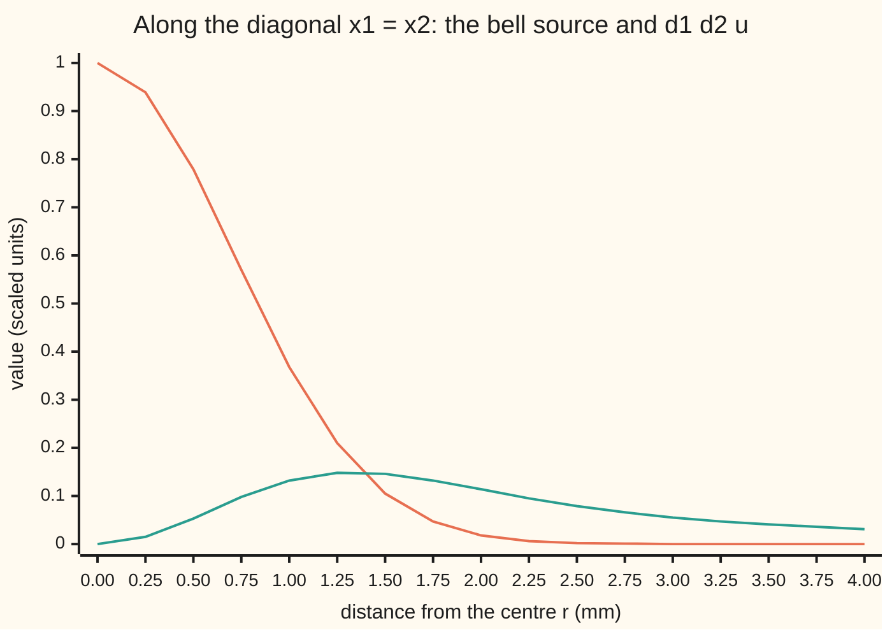

# Riesz transforms: the Hilbert transform in n dimensions, and second derivatives from the Laplacian

[Syllabus](../../../SYLLABUS.md) → [Harmonic analysis](../README.md) → [Maximal Functions and Beyond](../README.md#s06) → Riesz transforms

---

## General Overview

A round cloud of electric charge sits in a plane, like the cross-section of a particle beam. Its charge density (charge per unit area) is a bell: $`f(x) = e^{-|x|^2}`$, with the distance $`|x|`$ from the centre in millimetres. The density is 1 at the centre and falls to 0.368 at 1 mm. The units are scaled so that the potential $`u`$ (the energy per unit charge) solves Poisson's equation $`-\Delta u = f`$. The numbers are illustrative.

The push on a test charge is the slope of $`u`$. How fast that push changes from place to place is a second derivative. One of them, $`\partial_1\partial_2 u`$, says how the sideways push changes as the charge moves up. At (1 mm, 1 mm) it is 0.148499. The question: if the source is small on average, are all the second derivatives small too?

Yes for every p-norm with 1 < p < ∞, and no at the two ends. The p-norm is the p-th root of the total of $`\lvert f\rvert^p`$ over the plane. The 2-norm is the square root of the energy, "area" is p = 1 (the total of $`\lvert f\rvert`$, as on [Singular integrals](03-singular-integrals-and-the-hilbert-transform-bound.md)) and height is p = ∞ (the largest value). The tool is the **Riesz transform**, the Hilbert transform's partner in n dimensions. Each second derivative is two Riesz transforms of the source: $`\partial_1\partial_2 u = R_1R_2 f`$. In the 2-norm, $`R_1R_2`$ at most halves the source; for the bell the ratio is 0.353553. At p = 4 it is 0.216577, against a sharp bound of 1.5. In height (p = ∞) there is no bound: a checkerboard of charge that never exceeds 1 makes $`\partial_1\partial_2 u`$ as large as you like.

**The Riesz transform $`R_j`$ multiplies each frequency by $`-i\xi_j/|\xi|`$; its kernel meets the size, smoothness and cancellation conditions, so it is bounded on every $`L^p`$ with $`1 < p < \infty`$; and since $`\partial_i\partial_j u = R_iR_j f`$, every second derivative of Poisson's equation obeys the same bounds.**

**What kind of fact this is:** theorems. The multipliers, the kernel conditions, the bell's closed form, the energy bound and the two failures are proved on this card in Why it works. The Calderón–Zygmund theorem in n dimensions is stated, with the proof's outline in a fold. The sharp constant $`(p^* - 1)/2`$ for $`R_1R_2`$ is stated with its source.

### The picture: the source and its mixed second derivative



Orange: the source. Teal: $`\partial_1\partial_2 u`$ on the same diagonal. The source is gone by 3 mm. The derivative peaks between 1.25 and 1.5 mm, then fades only like $`1/(2r^2)`$: the slow tail that defeats the area (p = 1) bound.

---

## The formula

A point of $`\mathbb R^n`$ is $`x = (x_1, \dots, x_n)`$ and a frequency is $`\xi = (\xi_1, \dots, \xi_n)`$, in cycles per mm. The transform is $`\hat f(\xi) = \int f(x)\,e^{-2\pi i\,\xi\cdot x}\,dx`$ ([Transforms in two and three dimensions](../02-The%20Fourier%20Transform/10-multidimensional-transform-and-tomography.md)), and $`i`$ is the imaginary unit. An operator $`T`$ with **multiplier** $`m(\xi)`$ multiplies $`\hat f`$ by $`m`$, frequency by frequency. The p-norm is $`\lVert f\rVert_p = (\int \lvert f\rvert^p\,dx)^{1/p}`$, and $`\lVert T\rVert_{p\to p}`$ is the operator norm of [Singular integrals](03-singular-integrals-and-the-hilbert-transform-bound.md): the smallest $`C`$ with $`\lVert Tf\rVert_p \le C\lVert f\rVert_p`$ for every $`f`$.

This card introduces the **Riesz transforms** $`R_1, \dots, R_n`$, one for each axis:

```math
\widehat{R_j f}(\xi) = -i\,\frac{\xi_j}{|\xi|}\,\hat f(\xi), \qquad R_j f(x) = c_n\,\mathrm{p.v.}\int_{\mathbb R^n} \frac{x_j - y_j}{|x - y|^{n+1}}\,f(y)\,dy, \qquad c_n = \frac{\Gamma\big(\tfrac{n+1}{2}\big)}{\pi^{(n+1)/2}}
```

**Read it aloud:** the j-th Riesz transform multiplies each frequency by minus i times the j-th part of its direction; in space it weighs the source by the j-th part of the direction to each point, over the distance to the power n.

Here p.v. (principal value) means: cut out a small ball round $`x`$, integrate, then shrink the ball. $`\Gamma`$ is the gamma function, with $`\Gamma(1) = 1`$, $`\Gamma(1/2) = \sqrt\pi`$ and $`\Gamma(z+1) = z\,\Gamma(z)`$. For n = 1, $`c_1 = 1/\pi`$ and $`R_1`$ is the Hilbert transform. In the plane $`c_2`$ = 0.159155.

**Second derivatives from the Laplacian.** If $`-\Delta u = f`$, with $`u`$ the potential that fades far out ([Poisson's equation](../../19-Partial%20differential%20equations/04-Laplace%2C%20Poisson%20and%20Potentials/03-poissons-equation-and-the-newtonian-potential.md)), then for every pair of axes $`i`$, $`j`$:

```math
\partial_i\partial_j u = R_iR_j f, \qquad \sum_{j=1}^n R_j^2 = -I, \qquad \lVert \partial_i\partial_j u\rVert_p \le \lVert R_iR_j\rVert_{p\to p}\,\lVert f\rVert_p \ \ (1 < p < \infty)
```

**Read it aloud:** the i-j second derivative of the potential is R-i of R-j of the source; the squares of the Riesz transforms add up to minus the identity; so each second derivative is at most a fixed constant times the source, in every p-norm strictly between 1 and infinity.

**The kernel conditions in n dimensions.** A kernel $`K`$ is a **Calderón–Zygmund kernel** when, for fixed constants $`A`$ and $`B`$ and every shift $`y`$,

```math
\lvert K(x)\rvert \le \frac{A}{|x|^n}, \qquad \int_{|x| > 2|y|} \lvert K(x - y) - K(x)\rvert\,dx \le B, \qquad \int_{\varepsilon < |x| < \ell} K(x)\,dx = 0
```

**Read it aloud:** the kernel is at most A over the distance to the n; a shift changes it, far away, by a total of at most B; and it adds up to zero over every shell.

**The bell, worked exactly.** For $`f = e^{-|x|^2}`$ in the plane, with $`r = |x|`$:

```math
\partial_1\partial_2 u(x) = \frac{x_1x_2}{r^4}\Big(1 - (1 + r^2)\,e^{-r^2}\Big), \qquad \frac{\lVert \partial_1\partial_2 u\rVert_2}{\lVert f\rVert_2} = \frac{1}{\sqrt 8} = 0.353553 \le \frac12 = \lVert R_1R_2\rVert_{2\to 2}, \qquad \lVert R_1R_2\rVert_{p\to p} = \frac{p^* - 1}{2}
```

**Read it aloud:** the bell's mixed derivative has one over root eight of the source's energy norm, below the operator norm one half; the exact p-norm is p-star minus one, over two.

Here $`p^* = \max(p, p')`$ and $`p'`$ is the conjugate exponent, $`1/p + 1/p' = 1`$. At p = 4, $`p^* = 4`$ and the norm is 1.5. This $`p^*`$ is not the Sobolev exponent $`np/(n - p)`$ of [Fractional integration](08-riesz-potentials-and-hardy-littlewood-sobolev.md).

| Symbol | Plain meaning | In our example | Push it up and the answer… |
| --- | --- | --- | --- |
| $`x = (x_1, x_2)`$, $`y`$, $`r`$, $`\theta`$, $`n`$ | a point, in mm; a second point or a shift; distance from the centre; angle; dimension | (1, 1): r = √2, θ = 45°; n = 2 | larger r: the derivative fades like 1/(2r²) |
| $`f`$, $`u`$, $`\Delta`$, $`\Phi`$ | the source; the potential; the Laplacian, sum of the second derivatives; the point-source potential | f = e^(−r²) | larger f: every derivative grows in proportion |
| $`\partial_i\partial_j u`$, $`D`$, $`g(r)`$ | a second derivative; short name for the mixed one; its radial factor, D = cos θ sin θ g(r) | D(1, 1) = 0.148499 | — |
| $`\xi`$, $`\rho`$, $`\varphi`$, $`\hat f`$, $`i`$ | frequency, cycles per mm; its length; its angle; the transform; the imaginary unit | $`\hat f = \pi e^{-\pi^2\rho^2}`$ | larger ρ: the transform fades fast |
| $`R_j`$, $`m_j`$, $`I`$ | the j-th Riesz transform; its multiplier; the identity | m₁ = −0.866025 i at 30° | — |
| $`K_j`$, $`c_n`$, $`c`$, $`\Gamma`$, $`K`$, $`J_0`$, $`J_1`$, $`t`$ | kernel of R_j; its constant, c while unknown; the gamma function; kernel of R₁R₂; Bessel functions of order 0 and 1; their argument | c₂ = 0.159155 | — |
| $`A`$, $`B`$, $`\varepsilon`$, $`\ell`$ | size and smoothness constants; inner and outer radius of a shell or cut | A = 0.159155, B ≤ 8; ε = 0.001 mm, ℓ = 20 mm | smaller ε: the checkerboard's value grows |
| $`\lVert f\rVert_p`$, $`L^p`$, $`p`$, $`p'`$, $`p^*`$ | the p-norm; sources with finite p-norm; the power; its conjugate; the larger of the two | 1.253314 at p = 2, 0.941396 at p = 4 | larger p*: a larger bound |
| $`T`$, $`m`$, $`\lVert T\rVert_{p\to p}`$, $`C_p`$, $`C`$ | an operator; its multiplier; its operator norm; a p-norm constant; the weak-type constant | 1.5 for R₁R₂ at p = 4 | — |
| $`S_p`$ | ring sum $`\int_0^{2\pi}\lvert\cos\theta\sin\theta\rvert^p\,d\theta`$ | S₁ = 2, S₂ = π/4, S₄ = 3π/64 | — |
| $`\gamma`$, $`\alpha`$, $`\lambda`$ | Euler's constant; a level; area of a set, as in wing 10 | area of \|D\| inside 10 mm: 4.182386 | — |
| $`g_0`$, $`b`$, $`b_k`$, $`Q_k`$, $`Q_k^*`$, $`z_k`$ | in the proof outline: good part; bad part; one bad bump; its dyadic cube; that cube enlarged; its centre | not used on the bell | — |

### When it holds

- **Cancellation on every sphere.** The kernel $`x_1x_2/(\pi r^4)`$ adds up to zero round every circle, because $`\cos\theta\sin\theta`$ does. Without it, as in $`\lvert x_1x_2\rvert/(\pi r^4)`$, the area over the shell from 0.001 to 1 mm is 4.397614 and grows with every cut, so not even the 2-norm is bounded.
- **1 < p < ∞, strictly.** At p = ∞ the checkerboard has no ceiling. At p = 1 the bell's $`\partial_1\partial_2 u`$ has infinite area, growing by 4.605170 per factor of ten in radius.
- **The potential that fades far out.** Adding $`x_1x_2`$, which has zero Laplacian, gives another solution whose mixed derivative is larger by 1 everywhere, so no p-norm bound holds for it.
- **All of space, no walls.** In a bounded region the bounds hold away from the wall; up to the wall they need conditions on it (Gilbarg and Trudinger, below).

---

## Why it works

### Step 0: a derivative is a multiplier, and the ratio of two of the same order has size at most 1

In frequency, each derivative is a multiplication: $`\partial_j`$ multiplies by $`2\pi i\xi_j`$. So $`-\Delta`$ multiplies by $`4\pi^2|\xi|^2`$ and $`\partial_i\partial_j`$ by $`-4\pi^2\xi_i\xi_j`$. In their ratio the size of $`\xi`$ cancels. What is left, $`-\xi_i\xi_j/|\xi|^2`$, depends only on direction and never exceeds 1, so it cannot amplify energy. The other p-norms need the kernel, a singular integral like the Hilbert transform's.

### Step 1: the Riesz multipliers, and why $`\partial_i\partial_j u = R_iR_j f`$

$`R_j`$ is the derivative $`-\partial_j`$ applied after the "square root of the inverse Laplacian" $`(-\Delta)^{-1/2}`$, whose multiplier is $`1/(2\pi|\xi|)`$. So its multiplier is $`-2\pi i\xi_j/(2\pi|\xi|) = -i\xi_j/|\xi|`$. Multiply two of them:

```math
\Big(-i\frac{\xi_i}{|\xi|}\Big)\Big(-i\frac{\xi_j}{|\xi|}\Big) = -\frac{\xi_i\xi_j}{|\xi|^2} = \frac{(2\pi i\xi_i)(2\pi i\xi_j)}{4\pi^2|\xi|^2}
```

The right side is the multiplier that turns $`f = -\Delta u`$ into $`\partial_i\partial_j u`$. So $`\partial_i\partial_j u = R_iR_j f`$. Summing $`-\xi_j^2/|\xi|^2`$ over $`j`$ gives $`-1`$, so $`\sum_j R_j^2 = -I`$: the second derivatives $`\partial_j^2 u`$ add up to $`\Delta u = -f`$, as they must.

The check computes the multiplier from the kernel: it transforms $`x_j/(2\pi|x|^3)`$, cut to 0.001 < |x| < 20 mm, at the angle 30°:

| $`\lvert\xi\rvert`$ | $`m_1`$, kernel road | $`m_2`$, kernel road | Exact $`-i\cos 30°`$, $`-i\sin 30°`$ | Cut-off error at most |
| ---: | ---: | ---: | ---: | ---: |
| 1 | −0.862961 i | −0.498231 i | −0.866025 i, −0.500000 i | 0.003142 + 0.015915 |
| 2 | −0.860462 i | −0.496788 i | −0.866025 i, −0.500000 i | 0.006283 + 0.007958 |

Both rows agree within the cut-off error: the multiplier depends only on direction. The real parts cancel, because the kernel is odd. The product $`m_1m_2`$ is −0.429954 against the exact −0.433013.

<details>
<summary>Detailed proof: the plane's kernel constant 1/(2π) from the multiplier</summary>

Write $`x = r(\cos\theta, \sin\theta)`$ and $`\xi = \rho(\cos\varphi, \sin\varphi)`$, so $`\xi\cdot x = \rho r\cos(\theta - \varphi)`$ and $`dx = r\,dr\,d\theta`$. The cut kernel $`c\,x_1/|x|^3 = c\cos\theta/r^2`$ has the transform

$`\displaystyle m_1(\xi) = c\int_\varepsilon^\ell \frac{1}{r}\int_0^{2\pi}\cos\theta\,e^{-2\pi i\rho r\cos(\theta - \varphi)}\,d\theta\,dr .`$

The inner integral is $`-2\pi i\cos\varphi\,J_1(2\pi\rho r)`$, where $`J_1`$ is the Bessel function of order 1 from [Transforms in two and three dimensions](../02-The%20Fourier%20Transform/10-multidimensional-transform-and-tomography.md). Substituting $`t = 2\pi\rho r`$,

$`\displaystyle m_1(\xi) = -2\pi i\,c\cos\varphi\int_{2\pi\rho\varepsilon}^{2\pi\rho\ell}\frac{J_1(t)}{t}\,dt \;\longrightarrow\; -2\pi i\,c\cos\varphi .`$

The limit uses $`\int_0^\infty J_1(t)/t\,dt = 1`$, so the multiplier is $`-i\xi_1/|\xi|`$ exactly when $`c = 1/(2\pi)`$. The cut-off errors: near 0, $`\lvert J_1(t)\rvert \le t/2`$, so the inner piece is at most $`\pi\rho\varepsilon`$. Far out, $`J_1 = -J_0'`$ and $`\lvert J_0\rvert \le 1`$, so integration by parts bounds the tail by $`1/(\pi\rho\ell)`$. In n dimensions the same computation gives $`c_n`$: 0.318310, 0.159155 and 0.101321 for n = 1, 2, 3 (Stein 1970, chapter III).

</details>

### Step 2: the kernel of $`R_1R_2`$ meets all three conditions

The kernel of $`R_1R_2`$ is $`\partial_1\partial_2`$ of the point-source potential $`\Phi = -\ln r/(2\pi)`$ ([The fundamental solution](../../19-Partial%20differential%20equations/04-Laplace%2C%20Poisson%20and%20Potentials/02-fundamental-solution-of-the-laplacian.md)), taken away from the origin:

```math
K(x) = \partial_1\partial_2\Phi(x) = \frac{x_1x_2}{\pi r^4} = \frac{\sin 2\theta}{2\pi r^2}
```

- **Size.** $`\lvert\sin 2\theta\rvert \le 1`$, so $`\lvert K\rvert \le A/r^2`$ with $`A = 1/(2\pi)`$ = 0.159155. A scan of 36,000 directions finds exactly this.
- **Cancellation.** $`\sin 2\theta`$ adds up to zero round every circle. The check's ring sum prints 0.000000.
- **Smoothness.** The gradient of $`K`$ has size exactly $`1/(\pi r^3)`$: 2.546479 at (0.3, 0.4) by finite differences and by formula. For $`|x| > 2|y|`$ the segment from $`x`$ to $`x - y`$ stays at least $`|x|/2`$ from 0, so $`\lvert K(x-y) - K(x)\rvert \le 8|y|/(\pi|x|^3)`$. Integrating gives $`B \le 8`$ for every shift.

Each $`R_j`$ passes the same tests. Its kernel $`c_n x_j/|x|^{n+1}`$ is odd, so it cancels on every shell; its size is at most $`c_n/|x|^n`$, and its gradient at most $`n c_n/|x|^{n+1}`$, which gives smoothness as above. So every $`R_j`$, and every product $`R_iR_j`$, is bounded for 1 < p < ∞. That covers $`\partial_1^2 u = R_1^2 f`$ too, which in the plane is a p.v. kernel integral minus the point term $`f/2`$.

The kernel's angular part, $`\cos\theta\sin\theta`$, has the multiplier's shape. This is not luck: for a kernel made of a degree-2 polynomial with zero Laplacian over $`r^{n+2}`$, the transform keeps the polynomial (Stein 1970, chapter III).

### Step 3: the bell's mixed derivative, by three roads

The bell is round, so $`u`$ depends on $`r`$ only, and $`-\Delta u = f`$ becomes $`-(1/r)(r u')' = e^{-r^2}`$. One integration gives $`r u' = -(1 - e^{-r^2})/2`$. For a round $`u`$, $`\partial_1\partial_2 u = \cos\theta\sin\theta\,(u'' - u'/r)`$, which gives the closed form with $`g(r) = (1 - (1 + r^2)e^{-r^2})/r^2`$.

The check computes $`D = \partial_1\partial_2 u`$ at (1, 1) three ways:

| Road | What it computes | Value |
| --- | --- | ---: |
| Closed form | $`\tfrac14(1 - 3e^{-2})`$ | 0.148499 |
| Kernel | p.v. integral of $`K(x - y)f(y)`$ in rings round $`x`$, cut at 7 mm, where $`f < 2.8\times 10^{-14}`$ | 0.148499 |
| Multiplier | inverse transform of $`-\cos\varphi\sin\varphi\cdot\pi e^{-\pi^2\rho^2}`$ | 0.148499 |

The kernel road needs no cut-out round $`x`$: adding round each ring first lets the cancellation remove the singular part.

### Step 4: energy, by the multiplier

[Plancherel](../02-The%20Fourier%20Transform/05-plancherel-and-l2.md), as on [Singular integrals](03-singular-integrals-and-the-hilbert-transform-bound.md), turns the energy into an integral over frequencies:

```math
\lVert D\rVert_2^2 = \int \frac{\xi_1^2\xi_2^2}{|\xi|^4}\,\lvert\hat f(\xi)\rvert^2\,d\xi \le \Big(\max_\xi \frac{\lvert\xi_1\xi_2\rvert}{|\xi|^2}\Big)^2\,\lVert f\rVert_2^2 = \frac14\,\lVert f\rVert_2^2
```

The maximum is 1/2, at 45°, so $`\lVert R_1R_2\rVert_{2\to 2} = 1/2`$; a source whose transform sits near 45° comes close. The bell's transform is round, so $`\cos^2\varphi\sin^2\varphi`$ is averaged over all directions instead: 1/8 = 0.125000. So $`\lVert D\rVert_2^2 = \lVert f\rVert_2^2/8`$, and the ratio is $`1/\sqrt 8`$ = 0.353553. The check confirms it a second way, by integrating the closed form's square: $`S_2\int_0^\infty g^2\,r\,dr`$ = 0.196350 = π/16.

### Step 5: the Calderón–Zygmund theorem gives every p between 1 and ∞

The theorem of [Singular integrals](03-singular-integrals-and-the-hilbert-transform-bound.md) holds in every dimension. **Stated:** if $`T`$ is bounded in energy and its kernel meets the size and smoothness conditions, then $`T`$ is weak type (1,1) and bounded on $`L^p(\mathbb R^n)`$ for every $`1 < p < \infty`$. Weak type (1,1) means: the set where $`\lvert Tf\rvert > \alpha`$ has area at most $`C\lVert f\rVert_1/\alpha`$ ([The maximal function](01-hardy-littlewood-maximal-function.md)). For $`R_1R_2`$ all three hypotheses are Steps 2 and 4. So for 1 < p < ∞,

```math
\lVert \partial_1\partial_2 u\rVert_p \le C_p\,\lVert f\rVert_p .
```

The best $`C_p`$ is known: for real-valued sources $`\lVert R_1R_2\rVert_{p\to p} = (p^* - 1)/2`$ (Geiss, Montgomery-Smith and Saksman, 2010). At p = 2 that is 1/2, matching Step 4. At p = 4 it is 1.5.

The bell at p = 4: $`\lVert f\rVert_4 = (\pi/4)^{1/4}`$ = 0.941396. The check finds $`\lVert D\rVert_4^4`$ by rings, 0.00172797, and by a 0.04 mm grid, 0.00172794. The ratio is 0.216577, far inside 1.5.

<details>
<summary>Proof outline: weak type (1,1) in n dimensions, then every p</summary>

Fix a level $`\alpha`$ and a source $`f`$ of finite area. [Calderon-Zygmund decomposition](02-calderon-zygmund-decomposition-in-outline.md) on dyadic cubes gives stopped cubes $`Q_k`$ of total volume at most $`\lVert f\rVert_1/\alpha`$, a good part $`g_0 \le 2^n\alpha`$, and bad bumps $`b_k`$ with $`\int b_k = 0`$ on each cube.

**The good part, by energy.** $`\lVert g_0\rVert_2^2 \le 2^n\alpha\lVert f\rVert_1`$. Chebyshev's inequality and the energy bound give

$`\displaystyle \lambda\{\lvert Tg_0\rvert > \alpha/2\} \le \frac{4\lVert T\rVert_{2\to 2}^2\,\lVert g_0\rVert_2^2}{\alpha^2} \le \frac{2^{n+2}\lVert T\rVert_{2\to 2}^2\,\lVert f\rVert_1}{\alpha} .`$

**The bad part, by smoothness.** Let $`Q_k^*`$ be the ball round the centre $`z_k`$ of $`Q_k`$ with twice the cube's half-diagonal; throw these balls away. Outside them, $`\int b_k = 0`$ lets you subtract $`K(x - z_k)`$ for free:

$`\displaystyle Tb_k(x) = \int \big(K(x - y) - K(x - z_k)\big)\,b_k(y)\,dy .`$

The smoothness condition bounds the area of $`\lvert Tb_k\rvert`$ outside $`Q_k^*`$ by $`B\lVert b_k\rVert_1`$, and Chebyshev once more gives weak type (1,1).

**Every p.** [Interpolation](04-interpolation-riesz-thorin-and-marcinkiewicz.md) between weak (1,1) and energy gives $`1 < p \le 2`$. The multiplier is real, so $`R_1R_2`$ is its own adjoint, and duality covers $`p \ge 2`$. Stein (1970) and Grafakos (2014) give the full proof.

</details>

### Step 6: the two ends fail, for the Hilbert transform's reasons

**Height, p = ∞.** Take the checkerboard source: +1 where $`x_1x_2 > 0`$, −1 where $`x_1x_2 < 0`$, on the ring $`\varepsilon < |x| < 1`$ mm, and 0 elsewhere. It never exceeds 1. Near 0 it vanishes, so $`u`$ is smooth there and $`D(0) = \int K(y)f(y)\,dy`$. The source has the kernel's sign everywhere, so nothing cancels:

```math
D(0) = \int_\varepsilon^1\!\!\int_0^{2\pi} \frac{\lvert\cos\theta\sin\theta\rvert}{\pi r^2}\,r\,d\theta\,dr = \frac{S_1}{\pi}\ln\frac1\varepsilon = \frac{2}{\pi}\ln\frac1\varepsilon .
```

At $`\varepsilon`$ = 0.1 mm the check's 0.002 mm grid gives 1.465820, against 1.465871 from the formula. Each factor of ten smaller adds 1.465871:

```
hole radius eps   d1 d2 u at the centre
0.1 mm        ########                                     1.465871
0.01 mm       ###############                              2.931742
0.001 mm      ######################                       4.397614
0.0001 mm     #############################                5.863485
0.00001 mm    #####################################        7.329356
0.000001 mm   ############################################ 8.795227
```

The growth has no limit, so $`\lVert R_1R_2\rVert_{\infty\to\infty}`$ is infinite. These are the cut Hilbert kernel's areas from [Singular integrals](03-singular-integrals-and-the-hilbert-transform-bound.md), for the same reason: a source that copies the kernel's sign turns $`D(0)`$ into the area of $`\lvert K\rvert`$.

**Area, p = 1.** The bell has total $`\int f = \pi`$ = 3.141593, not 0. Far out, $`D`$ looks like $`\pi K(x) = x_1x_2/r^4`$, whose area grows like a logarithm. Exactly, the area of $`\lvert D\rvert`$ inside radius $`\ell`$ is $`S_1\int_0^\ell g\,r\,dr`$. For $`\ell \ge 10`$ mm this equals $`2\ln\ell + \gamma - 1`$ to within $`10^{-40}`$:

| $`\ell`$, mm | 10 | 100 | 1000 | 10,000 |
| --- | ---: | ---: | ---: | ---: |
| Area of $`\lvert D\rvert`$, by rings | 4.182386 | 8.787556 | 13.392726 | 17.997896 |

Each factor of ten adds $`2\ln 10`$ = 4.605170, without limit. So $`\lVert R_1R_2\rVert_{1\to 1}`$ is infinite too. What survives at p = 1 is the weak bound of Step 5.

---

## Worked numbers, by hand

The energy ratio for the bell, $`f = e^{-r^2}`$.

| Step | Arithmetic | Value |
| --- | --- | --- |
| Largest multiplier size | $`\cos 45° = \sin 45° = 1/\sqrt 2`$, so the product is 1/2 | 0.5 |
| Average of its square over directions | $`\cos^2\varphi\sin^2\varphi = \sin^2 2\varphi/4`$, and $`\sin^2`$ averages 1/2 | 0.125000 |
| Energy of the source | $`\int e^{-2r^2}\,dx = \pi/2`$ | 1.570796 |
| Energy of $`D`$ | 0.125000 × 1.570796, by Plancherel, since $`\hat f`$ is round | 0.196350 |
| Norms | $`\sqrt{1.570796}`$ and $`\sqrt{0.196350}`$ | 1.253314 and 0.443113 |
| Ratio | 0.443113 / 1.253314 | **0.353553** |

The bell's mixed derivative has 0.353553 times the source's energy norm, below the guaranteed 0.5, because the bell's energy is spread over all directions.

The value at (1, 1), by hand: $`r^2`$ = 2, $`e^{-2}`$ = 0.135335, $`3e^{-2}`$ = 0.406006, $`1 - 3e^{-2}`$ = 0.593994, and $`x_1x_2/r^4`$ = 0.25. So $`D(1, 1)`$ = 0.25 × 0.593994 = 0.148499.

### What breaks if you drop a piece

| Mistake | Comes out at | What went wrong |
| --- | --- | --- |
| Expect a height bound (p = ∞) | checkerboard: 1.465871, 4.397614, 8.795227 at $`\varepsilon`$ = 0.1, 0.001, 0.000001 mm | the source copies the kernel's sign, so the cancellation is lost and a logarithm grows |
| Expect an area bound (p = 1) | area of $`\lvert D\rvert`$: 4.182386, 8.787556, 13.392726, 17.997896 inside 10 to 10,000 mm | $`\int f = \pi \ne 0`$ leaves a $`1/r^2`$ tail, adding 4.605170 per factor of ten |
| Drop the minus sign: multiplier $`+\xi_1\xi_2/\lvert\xi\rvert^2`$ | $`D(1, 1)`$ = −0.148499 | $`(i)^2 = -1`$ from the two derivatives was lost: the sign of every mixed derivative flips |
| Read the cut kernel's transform as the multiplier | $`m_1`$ = −0.862961 i, not −0.866025 i | the cut at 0.001 and 20 mm leaves an error up to 0.003142 + 0.015915; it shrinks only as the cut widens |

---

## Code, from first principles, and it actually runs

The script writes every piece itself and takes seven independent roads: D(1, 1) by closed form, kernel and multiplier; the Riesz multiplier from the cut kernel; the energy by angular average and by radial integral; the 4-norm by rings and by grid; the area by rings and by its closed form; the checkerboard by grid and by formula; the kernel's gradient by finite differences and by formula. The two programs print identical output.

### Python

```python
# Riesz transforms: for -Lap u = f in the plane, d1 d2 u = R1 R2 f. Source f = exp(-|x|^2).
from math import exp, log, pi, sqrt, sin, cos

EG = 0.5772156649015329  # Euler's constant, used only in the area's closed form


def f(x1, x2):
    return exp(-(x1 * x1 + x2 * x2))


def g(r):  # radial factor: d1 d2 u = cos(t) sin(t) g(r), from solving the radial equation
    s = r * r
    if s < 1e-2:
        return s / 2 - s * s / 3 + s ** 3 / 8 - s ** 4 / 30
    return (1 - (1 + s) * exp(-s)) / s


def D(x1, x2):  # closed form of d1 d2 u
    r2 = x1 * x1 + x2 * x2
    return x1 * x2 / r2 * g(sqrt(r2))


def K(x1, x2):  # kernel of R1 R2: d1 d2 of the point-source potential -ln|x|/(2 pi)
    return x1 * x2 / (pi * (x1 * x1 + x2 * x2) ** 2)


def gamma_half(m):  # Gamma(m/2) for a whole number m >= 1, by Gamma(z + 1) = z Gamma(z)
    v, z = (1.0, 1.0) if m % 2 == 0 else (sqrt(pi), 0.5)
    while z < m / 2 - 1e-9:
        v, z = v * z, z + 1
    return v


def radial(fn, s0, s1, n=20000):  # integral of fn(r) r dr for r = e^s, midpoint in s
    h = (s1 - s0) / n
    return sum(fn(exp(s0 + (k + 0.5) * h)) * exp(2 * (s0 + (k + 0.5) * h)) for k in range(n)) * h


def riesz_mult(rho, phi, eps=1e-3, R=20.0, nr=4000, nt=512):  # transform of the cut kernel x_j/(2 pi |x|^3)
    a1 = a2 = 0.0
    hr, ht = (R - eps) / nr, 2 * pi / nt
    for a in range(nr):
        r = eps + (a + 0.5) * hr
        for b in range(nt):
            t = (b + 0.5) * ht
            s = sin(2 * pi * rho * r * cos(t - phi)) / r
            a1 += cos(t) * s
            a2 += sin(t) * s
    return -a1 * hr * ht / (2 * pi), -a2 * hr * ht / (2 * pi)  # imaginary parts; real parts cancel


def kernel_road(x1, x2, rmax=7.0, nr=700, nt=128):  # p.v. integral of K(x - y) f(y), rings round x
    tot, hr, ht = 0.0, rmax / nr, 2 * pi / nt
    for a in range(nr):
        r = (a + 0.5) * hr
        ring = sum(cos(t) * sin(t) * f(x1 - r * cos(t), x2 - r * sin(t)) for t in ((b + 0.5) * ht for b in range(nt)))
        tot += ring / (pi * r)
    return tot * hr * ht


def mult_road(x1, x2, sign=-1.0, rmax=3.0, nr=300, nt=128):  # inverse transform of sign xi1 xi2/|xi|^2 times pi exp(-pi^2 |xi|^2)
    tot, hr, ht = 0.0, rmax / nr, 2 * pi / nt
    for a in range(nr):
        p = (a + 0.5) * hr
        for b in range(nt):
            t = (b + 0.5) * ht
            tot += sign * cos(t) * sin(t) * pi * exp(-pi * pi * p * p) * cos(2 * pi * p * (x1 * cos(t) + x2 * sin(t))) * p
    return tot * hr * ht


ang = [k * 2 * pi / 36000 for k in range(36000)]  # every hundredth of a degree, 45 included
cs = [cos(t) * sin(t) for t in ang]
big = max(abs(c) for c in cs)
print("multiplier -xi1 xi2/|xi|^2 of R1 R2: largest size over 36000 directions %.6f; mean square %.6f" % (big, sum(c * c for c in cs) / 36000))
assert abs(big - 0.5) < 1e-6 and abs(sum(c * c for c in cs) / 36000 - 0.125) < 1e-9
S = [sum(abs(c) ** p for c in cs) * 2 * pi / 36000 for p in (1, 2, 4)]
print("ring sums of |cos sin|^p: p=1 %.6f (2), p=2 %.6f (pi/4 = %.6f), p=4 %.6f (3pi/64 = %.6f)" % (S[0], S[1], pi / 4, S[2], 3 * pi / 64))
assert abs(S[0] - 2) < 1e-6 and abs(S[1] - pi / 4) < 1e-9 and abs(S[2] - 3 * pi / 64) < 1e-9
x, y, h = 0.3, 0.4, 1e-5
gx, gy = (K(x + h, y) - K(x - h, y)) / (2 * h), (K(x, y + h) - K(x, y - h)) / (2 * h)
print("kernel x1 x2/(pi |x|^4): size constant %.6f, signed ring sum %.6f, |grad K| at (0.3, 0.4) %.6f, 1/(pi r^3) %.6f, so B <= 8"
      % (big / pi, abs(sum(cs)) * 2 * pi / 36000, sqrt(gx * gx + gy * gy), 1 / (pi * 0.5 ** 3)))
assert abs(sqrt(gx * gx + gy * gy) - 1 / (pi * 0.125)) < 1e-6
print("Riesz constants Gamma((n+1)/2)/pi^((n+1)/2): n=1 %.6f, n=2 %.6f, n=3 %.6f" % tuple(gamma_half(n + 1) / pi ** ((n + 1) / 2) for n in (1, 2, 3)))
assert abs(gamma_half(3) / pi ** 1.5 - 1 / (2 * pi)) < 1e-12
phi = pi / 6
for rho in (1.0, 2.0):
    m1, m2 = riesz_mult(rho, phi)
    lo, hi = pi * rho * 1e-3, 1 / (pi * rho * 20.0)
    print("|xi| = %.0f at 30 deg: kernel road m1 = %.6f i, m2 = %.6f i (exact %.6f i, %.6f i); m1 m2 = %.6f (exact %.6f); cut-off error at most %.6f + %.6f"
          % (rho, m1, m2, -cos(phi), -sin(phi), -m1 * m2, -cos(phi) * sin(phi), lo, hi))
    assert abs(m1 + cos(phi)) < lo + hi and abs(m2 + sin(phi)) < lo + hi
e2 = exp(-2)
print("by hand at (1, 1): r^2 = 2, e^-2 = %.6f, 3e^-2 = %.6f, 1 - 3e^-2 = %.6f, x1 x2/r^4 = 0.25" % (e2, 3 * e2, 1 - 3 * e2))
dk, dm = kernel_road(1.0, 1.0), mult_road(1.0, 1.0)
print("d1 d2 u at (1, 1): closed form %.6f, kernel road %.6f (cut at r = 7, f < %.1e there), multiplier road %.6f"
      % (D(1.0, 1.0), dk, exp(-(7 - sqrt(2)) ** 2), dm))
assert abs(dk - D(1.0, 1.0)) < 1e-5 and abs(dm - D(1.0, 1.0)) < 1e-5
I2 = radial(lambda r: g(r) ** 2, -12.0, 10.0)
n2f, n2D = sqrt(pi / 2), sqrt(S[1] * I2)
print("p = 2: ||f||_2^2 = pi/2 = %.6f, ||D||_2^2 = %.6f (pi/16 = %.6f); ||f||_2 = %.6f, ||D||_2 = %.6f; ratio %.6f, 1/sqrt(8) = %.6f; bound 0.5"
      % (pi / 2, S[1] * I2, pi / 16, n2f, n2D, n2D / n2f, 1 / sqrt(8)))
assert abs(n2D / n2f - 1 / sqrt(8)) < 1e-6
I4 = radial(lambda r: g(r) ** 4, -12.0, 10.0)
hg = 0.04
grid4 = sum(D(-8 + (i + 0.5) * hg, -8 + (j + 0.5) * hg) ** 4 for i in range(400) for j in range(400)) * hg * hg
n4f = (pi / 4) ** 0.25
print("p = 4: ||f||_4 = %.6f; ||D||_4^4 by rings %.8f, by a 0.04 grid %.8f; ratio %.6f; bound (p* - 1)/2 = 1.5"
      % (n4f, S[2] * I4, grid4, (S[2] * I4) ** 0.25 / n4f))
assert abs(grid4 - S[2] * I4) < 1e-4 * S[2] * I4 and (S[2] * I4) ** 0.25 / n4f < 1.5
print("p = 1: ||f||_1 = pi = %.6f" % pi)
for R in (10, 100, 1000, 10000):
    area = S[0] * radial(g, -12.0, log(R))
    print("area of |D| inside radius %d: rings %.6f, closed form 2 ln R + gamma - 1 = %.6f" % (R, area, 2 * log(R) + EG - 1))
    assert abs(area - (2 * log(R) + EG - 1)) < 1e-5
print("growth per factor of ten in R: 2 ln 10 = %.6f" % (2 * log(10)))
hq, cb = 0.002, 0.0
for i in range(500):
    for j in range(500):
        a, b = (i + 0.5) * hq, (j + 0.5) * hq
        if 0.01 < a * a + b * b < 1:
            cb += K(a, b)
print("checkerboard source sgn(x1 x2) on 0.1 < |x| < 1: d1 d2 u at 0 by a 0.002 grid %.6f, closed form (2/pi) ln 10 = %.6f" % (4 * cb * hq * hq, 2 / pi * log(10)))
assert abs(4 * cb * hq * hq - 2 / pi * log(10)) < 5e-3
for k in range(1, 7):
    print("checkerboard hole eps = 1e-%d: d1 d2 u at 0 = %.6f, source never above 1" % (k, 2 / pi * log(10 ** k)))
print("wrong sign, multiplier +xi1 xi2/|xi|^2: d1 d2 u at (1, 1) comes out %.6f" % mult_road(1.0, 1.0, 1.0))
rs = [0.25 * k for k in range(17)]
print("chart r: [" + ", ".join("%.2f" % r for r in rs) + "]")
print("chart f on the diagonal: [" + ", ".join("%.3f" % exp(-r * r) for r in rs) + "]")
print("chart d1 d2 u on the diagonal: [" + ", ".join("%.3f" % (g(r) / 2) for r in rs) + "]")
print("ALL CHECKS PASS")
```

**Ran 2026-11-24 on macOS, Python 3.14.10, standard library only. All checks passed. Output, pasted from the run:**

```
multiplier -xi1 xi2/|xi|^2 of R1 R2: largest size over 36000 directions 0.500000; mean square 0.125000
ring sums of |cos sin|^p: p=1 2.000000 (2), p=2 0.785398 (pi/4 = 0.785398), p=4 0.147262 (3pi/64 = 0.147262)
kernel x1 x2/(pi |x|^4): size constant 0.159155, signed ring sum 0.000000, |grad K| at (0.3, 0.4) 2.546479, 1/(pi r^3) 2.546479, so B <= 8
Riesz constants Gamma((n+1)/2)/pi^((n+1)/2): n=1 0.318310, n=2 0.159155, n=3 0.101321
|xi| = 1 at 30 deg: kernel road m1 = -0.862961 i, m2 = -0.498231 i (exact -0.866025 i, -0.500000 i); m1 m2 = -0.429954 (exact -0.433013); cut-off error at most 0.003142 + 0.015915
|xi| = 2 at 30 deg: kernel road m1 = -0.860462 i, m2 = -0.496788 i (exact -0.866025 i, -0.500000 i); m1 m2 = -0.427467 (exact -0.433013); cut-off error at most 0.006283 + 0.007958
by hand at (1, 1): r^2 = 2, e^-2 = 0.135335, 3e^-2 = 0.406006, 1 - 3e^-2 = 0.593994, x1 x2/r^4 = 0.25
d1 d2 u at (1, 1): closed form 0.148499, kernel road 0.148499 (cut at r = 7, f < 2.8e-14 there), multiplier road 0.148499
p = 2: ||f||_2^2 = pi/2 = 1.570796, ||D||_2^2 = 0.196350 (pi/16 = 0.196350); ||f||_2 = 1.253314, ||D||_2 = 0.443113; ratio 0.353553, 1/sqrt(8) = 0.353553; bound 0.5
p = 4: ||f||_4 = 0.941396; ||D||_4^4 by rings 0.00172797, by a 0.04 grid 0.00172794; ratio 0.216577; bound (p* - 1)/2 = 1.5
p = 1: ||f||_1 = pi = 3.141593
area of |D| inside radius 10: rings 4.182386, closed form 2 ln R + gamma - 1 = 4.182386
area of |D| inside radius 100: rings 8.787556, closed form 2 ln R + gamma - 1 = 8.787556
area of |D| inside radius 1000: rings 13.392726, closed form 2 ln R + gamma - 1 = 13.392726
area of |D| inside radius 10000: rings 17.997896, closed form 2 ln R + gamma - 1 = 17.997896
growth per factor of ten in R: 2 ln 10 = 4.605170
checkerboard source sgn(x1 x2) on 0.1 < |x| < 1: d1 d2 u at 0 by a 0.002 grid 1.465820, closed form (2/pi) ln 10 = 1.465871
checkerboard hole eps = 1e-1: d1 d2 u at 0 = 1.465871, source never above 1
checkerboard hole eps = 1e-2: d1 d2 u at 0 = 2.931742, source never above 1
checkerboard hole eps = 1e-3: d1 d2 u at 0 = 4.397614, source never above 1
checkerboard hole eps = 1e-4: d1 d2 u at 0 = 5.863485, source never above 1
checkerboard hole eps = 1e-5: d1 d2 u at 0 = 7.329356, source never above 1
checkerboard hole eps = 1e-6: d1 d2 u at 0 = 8.795227, source never above 1
wrong sign, multiplier +xi1 xi2/|xi|^2: d1 d2 u at (1, 1) comes out -0.148499
chart r: [0.00, 0.25, 0.50, 0.75, 1.00, 1.25, 1.50, 1.75, 2.00, 2.25, 2.50, 2.75, 3.00, 3.25, 3.50, 3.75, 4.00]
chart f on the diagonal: [1.000, 0.939, 0.779, 0.570, 0.368, 0.210, 0.105, 0.047, 0.018, 0.006, 0.002, 0.001, 0.000, 0.000, 0.000, 0.000, 0.000]
chart d1 d2 u on the diagonal: [0.000, 0.015, 0.053, 0.098, 0.132, 0.148, 0.146, 0.132, 0.114, 0.095, 0.079, 0.066, 0.055, 0.047, 0.041, 0.036, 0.031]
ALL CHECKS PASS
```

### Rust

```rust
// Riesz transforms: for -Lap u = f in the plane, d1 d2 u = R1 R2 f. Source f = exp(-|x|^2).
use std::f64::consts::PI;

const EG: f64 = 0.5772156649015329; // Euler's constant, used only in the area's closed form

fn f(x1: f64, x2: f64) -> f64 { (-(x1 * x1 + x2 * x2)).exp() }
// radial factor: d1 d2 u = cos(t) sin(t) g(r), from solving the radial equation
fn g(r: f64) -> f64 {
    let s = r * r;
    if s < 1e-2 {
        return s / 2.0 - s * s / 3.0 + s.powi(3) / 8.0 - s.powi(4) / 30.0;
    }
    (1.0 - (1.0 + s) * (-s).exp()) / s
}
// closed form of d1 d2 u
fn d(x1: f64, x2: f64) -> f64 {
    let r2 = x1 * x1 + x2 * x2;
    x1 * x2 / r2 * g(r2.sqrt())
}
// kernel of R1 R2: d1 d2 of the point-source potential -ln|x|/(2 pi)
fn k(x1: f64, x2: f64) -> f64 { x1 * x2 / (PI * (x1 * x1 + x2 * x2).powi(2)) }
// Gamma(m/2) for a whole number m >= 1, by Gamma(z + 1) = z Gamma(z)
fn gamma_half(m: u32) -> f64 {
    let (mut v, mut z) = if m % 2 == 0 { (1.0, 1.0) } else { (PI.sqrt(), 0.5) };
    while z < m as f64 / 2.0 - 1e-9 {
        v *= z;
        z += 1.0;
    }
    v
}
// integral of fun(r) r dr for r = e^s, midpoint in s
fn radial(fun: &dyn Fn(f64) -> f64, s0: f64, s1: f64) -> f64 {
    let n = 20000;
    let h = (s1 - s0) / n as f64;
    let mut tot = 0.0;
    for i in 0..n {
        let s = s0 + (i as f64 + 0.5) * h;
        tot += fun(s.exp()) * (2.0 * s).exp();
    }
    tot * h
}
// transform of the cut kernel x_j/(2 pi |x|^3); returns imaginary parts, the real parts cancel
fn riesz_mult(rho: f64, phi: f64) -> (f64, f64) {
    let (eps, rr, nr, nt) = (1e-3, 20.0, 4000, 512);
    let (hr, ht) = ((rr - eps) / nr as f64, 2.0 * PI / nt as f64);
    let (mut a1, mut a2) = (0.0, 0.0);
    for a in 0..nr {
        let r = eps + (a as f64 + 0.5) * hr;
        for b in 0..nt {
            let t = (b as f64 + 0.5) * ht;
            let s = (2.0 * PI * rho * r * (t - phi).cos()).sin() / r;
            a1 += t.cos() * s;
            a2 += t.sin() * s;
        }
    }
    (-a1 * hr * ht / (2.0 * PI), -a2 * hr * ht / (2.0 * PI))
}
// p.v. integral of K(x - y) f(y), taken in rings round x
fn kernel_road(x1: f64, x2: f64) -> f64 {
    let (rmax, nr, nt) = (7.0, 700, 128);
    let (hr, ht) = (rmax / nr as f64, 2.0 * PI / nt as f64);
    let mut tot = 0.0;
    for a in 0..nr {
        let r = (a as f64 + 0.5) * hr;
        let mut ring = 0.0;
        for b in 0..nt {
            let t = (b as f64 + 0.5) * ht;
            ring += t.cos() * t.sin() * f(x1 - r * t.cos(), x2 - r * t.sin());
        }
        tot += ring / (PI * r);
    }
    tot * hr * ht
}
// inverse transform of sign xi1 xi2/|xi|^2 times pi exp(-pi^2 |xi|^2)
fn mult_road(x1: f64, x2: f64, sign: f64) -> f64 {
    let (rmax, nr, nt) = (3.0, 300, 128);
    let (hr, ht) = (rmax / nr as f64, 2.0 * PI / nt as f64);
    let mut tot = 0.0;
    for a in 0..nr {
        let p = (a as f64 + 0.5) * hr;
        for b in 0..nt {
            let t = (b as f64 + 0.5) * ht;
            tot += sign * t.cos() * t.sin() * PI * (-PI * PI * p * p).exp() * (2.0 * PI * p * (x1 * t.cos() + x2 * t.sin())).cos() * p;
        }
    }
    tot * hr * ht
}
fn list(v: &[f64], dp: usize) -> String { v.iter().map(|x| format!("{:.*}", dp, x)).collect::<Vec<_>>().join(", ") }
fn main() {
    let na = 36000; // every hundredth of a degree, 45 included
    let cs: Vec<f64> = (0..na).map(|i| { let t = i as f64 * 2.0 * PI / na as f64; t.cos() * t.sin() }).collect();
    let big = cs.iter().fold(0.0f64, |m, c| m.max(c.abs()));
    let msq = cs.iter().map(|c| c * c).sum::<f64>() / na as f64;
    println!("multiplier -xi1 xi2/|xi|^2 of R1 R2: largest size over 36000 directions {:.6}; mean square {:.6}", big, msq);
    assert!((big - 0.5).abs() < 1e-6 && (msq - 0.125).abs() < 1e-9);
    let s: Vec<f64> = [1, 2, 4].iter().map(|&p| cs.iter().map(|c| c.abs().powi(p)).sum::<f64>() * 2.0 * PI / na as f64).collect();
    println!("ring sums of |cos sin|^p: p=1 {:.6} (2), p=2 {:.6} (pi/4 = {:.6}), p=4 {:.6} (3pi/64 = {:.6})", s[0], s[1], PI / 4.0, s[2], 3.0 * PI / 64.0);
    assert!((s[0] - 2.0).abs() < 1e-6 && (s[1] - PI / 4.0).abs() < 1e-9 && (s[2] - 3.0 * PI / 64.0).abs() < 1e-9);
    let (x, y, h) = (0.3, 0.4, 1e-5);
    let (gx, gy) = ((k(x + h, y) - k(x - h, y)) / (2.0 * h), (k(x, y + h) - k(x, y - h)) / (2.0 * h));
    let grad = (gx * gx + gy * gy).sqrt();
    println!("kernel x1 x2/(pi |x|^4): size constant {:.6}, signed ring sum {:.6}, |grad K| at (0.3, 0.4) {:.6}, 1/(pi r^3) {:.6}, so B <= 8",
        big / PI, cs.iter().sum::<f64>().abs() * 2.0 * PI / na as f64, grad, 1.0 / (PI * 0.5f64.powi(3)));
    assert!((grad - 1.0 / (PI * 0.125)).abs() < 1e-6);
    let c: Vec<f64> = (1..4).map(|n| gamma_half(n + 1) / PI.powf((n + 1) as f64 / 2.0)).collect();
    println!("Riesz constants Gamma((n+1)/2)/pi^((n+1)/2): n=1 {:.6}, n=2 {:.6}, n=3 {:.6}", c[0], c[1], c[2]);
    assert!((gamma_half(3) / PI.powf(1.5) - 1.0 / (2.0 * PI)).abs() < 1e-12);
    let phi = PI / 6.0;
    for rho in [1.0, 2.0] {
        let (m1, m2) = riesz_mult(rho, phi);
        let (lo, hi) = (PI * rho * 1e-3, 1.0 / (PI * rho * 20.0));
        println!("|xi| = {:.0} at 30 deg: kernel road m1 = {:.6} i, m2 = {:.6} i (exact {:.6} i, {:.6} i); m1 m2 = {:.6} (exact {:.6}); cut-off error at most {:.6} + {:.6}",
            rho, m1, m2, -phi.cos(), -phi.sin(), -m1 * m2, -phi.cos() * phi.sin(), lo, hi);
        assert!((m1 + phi.cos()).abs() < lo + hi && (m2 + phi.sin()).abs() < lo + hi);
    }
    let e2 = (-2.0f64).exp();
    println!("by hand at (1, 1): r^2 = 2, e^-2 = {:.6}, 3e^-2 = {:.6}, 1 - 3e^-2 = {:.6}, x1 x2/r^4 = 0.25", e2, 3.0 * e2, 1.0 - 3.0 * e2);
    let (dk, dm, d11) = (kernel_road(1.0, 1.0), mult_road(1.0, 1.0, -1.0), d(1.0, 1.0));
    println!("d1 d2 u at (1, 1): closed form {:.6}, kernel road {:.6} (cut at r = 7, f < {:.1e} there), multiplier road {:.6}",
        d11, dk, (-(7.0 - 2f64.sqrt()).powi(2)).exp(), dm);
    assert!((dk - d11).abs() < 1e-5 && (dm - d11).abs() < 1e-5);
    let i2 = radial(&|r| g(r).powi(2), -12.0, 10.0);
    let (n2f, n2d) = ((PI / 2.0).sqrt(), (s[1] * i2).sqrt());
    println!("p = 2: ||f||_2^2 = pi/2 = {:.6}, ||D||_2^2 = {:.6} (pi/16 = {:.6}); ||f||_2 = {:.6}, ||D||_2 = {:.6}; ratio {:.6}, 1/sqrt(8) = {:.6}; bound 0.5",
        PI / 2.0, s[1] * i2, PI / 16.0, n2f, n2d, n2d / n2f, 1.0 / 8f64.sqrt());
    assert!((n2d / n2f - 1.0 / 8f64.sqrt()).abs() < 1e-6);
    let i4 = radial(&|r| g(r).powi(4), -12.0, 10.0);
    let hg = 0.04;
    let mut grid4 = 0.0;
    for i in 0..400 {
        for j in 0..400 {
            grid4 += d(-8.0 + (i as f64 + 0.5) * hg, -8.0 + (j as f64 + 0.5) * hg).powi(4);
        }
    }
    grid4 *= hg * hg;
    let n4f = (PI / 4.0).powf(0.25);
    let ratio4 = (s[2] * i4).powf(0.25) / n4f;
    println!("p = 4: ||f||_4 = {:.6}; ||D||_4^4 by rings {:.8}, by a 0.04 grid {:.8}; ratio {:.6}; bound (p* - 1)/2 = 1.5", n4f, s[2] * i4, grid4, ratio4);
    assert!((grid4 - s[2] * i4).abs() < 1e-4 * s[2] * i4 && ratio4 < 1.5);
    println!("p = 1: ||f||_1 = pi = {:.6}", PI);
    for rr in [10.0f64, 100.0, 1000.0, 10000.0] {
        let area = s[0] * radial(&g, -12.0, rr.ln());
        println!("area of |D| inside radius {:.0}: rings {:.6}, closed form 2 ln R + gamma - 1 = {:.6}", rr, area, 2.0 * rr.ln() + EG - 1.0);
        assert!((area - (2.0 * rr.ln() + EG - 1.0)).abs() < 1e-5);
    }
    println!("growth per factor of ten in R: 2 ln 10 = {:.6}", 2.0 * 10f64.ln());
    let (hq, mut cb) = (0.002, 0.0);
    for i in 0..500 {
        for j in 0..500 {
            let (a, b) = ((i as f64 + 0.5) * hq, (j as f64 + 0.5) * hq);
            let r2 = a * a + b * b;
            if 0.01 < r2 && r2 < 1.0 {
                cb += k(a, b);
            }
        }
    }
    let ln10 = 10f64.ln();
    println!("checkerboard source sgn(x1 x2) on 0.1 < |x| < 1: d1 d2 u at 0 by a 0.002 grid {:.6}, closed form (2/pi) ln 10 = {:.6}", 4.0 * cb * hq * hq, 2.0 / PI * ln10);
    assert!((4.0 * cb * hq * hq - 2.0 / PI * ln10).abs() < 5e-3);
    for e in 1..7 {
        println!("checkerboard hole eps = 1e-{}: d1 d2 u at 0 = {:.6}, source never above 1", e, 2.0 / PI * 10f64.powi(e).ln());
    }
    println!("wrong sign, multiplier +xi1 xi2/|xi|^2: d1 d2 u at (1, 1) comes out {:.6}", mult_road(1.0, 1.0, 1.0));
    let rs: Vec<f64> = (0..17).map(|i| 0.25 * i as f64).collect();
    println!("chart r: [{}]", list(&rs, 2));
    println!("chart f on the diagonal: [{}]", list(&rs.iter().map(|r| (-r * r).exp()).collect::<Vec<_>>(), 3));
    println!("chart d1 d2 u on the diagonal: [{}]", list(&rs.iter().map(|&r| g(r) / 2.0).collect::<Vec<_>>(), 3));
    println!("ALL CHECKS PASS");
}
```

**Ran 2026-11-24 on macOS, rustc 1.98.1, no crates. All checks passed. Output, pasted from the run:**

```
multiplier -xi1 xi2/|xi|^2 of R1 R2: largest size over 36000 directions 0.500000; mean square 0.125000
ring sums of |cos sin|^p: p=1 2.000000 (2), p=2 0.785398 (pi/4 = 0.785398), p=4 0.147262 (3pi/64 = 0.147262)
kernel x1 x2/(pi |x|^4): size constant 0.159155, signed ring sum 0.000000, |grad K| at (0.3, 0.4) 2.546479, 1/(pi r^3) 2.546479, so B <= 8
Riesz constants Gamma((n+1)/2)/pi^((n+1)/2): n=1 0.318310, n=2 0.159155, n=3 0.101321
|xi| = 1 at 30 deg: kernel road m1 = -0.862961 i, m2 = -0.498231 i (exact -0.866025 i, -0.500000 i); m1 m2 = -0.429954 (exact -0.433013); cut-off error at most 0.003142 + 0.015915
|xi| = 2 at 30 deg: kernel road m1 = -0.860462 i, m2 = -0.496788 i (exact -0.866025 i, -0.500000 i); m1 m2 = -0.427467 (exact -0.433013); cut-off error at most 0.006283 + 0.007958
by hand at (1, 1): r^2 = 2, e^-2 = 0.135335, 3e^-2 = 0.406006, 1 - 3e^-2 = 0.593994, x1 x2/r^4 = 0.25
d1 d2 u at (1, 1): closed form 0.148499, kernel road 0.148499 (cut at r = 7, f < 2.8e-14 there), multiplier road 0.148499
p = 2: ||f||_2^2 = pi/2 = 1.570796, ||D||_2^2 = 0.196350 (pi/16 = 0.196350); ||f||_2 = 1.253314, ||D||_2 = 0.443113; ratio 0.353553, 1/sqrt(8) = 0.353553; bound 0.5
p = 4: ||f||_4 = 0.941396; ||D||_4^4 by rings 0.00172797, by a 0.04 grid 0.00172794; ratio 0.216577; bound (p* - 1)/2 = 1.5
p = 1: ||f||_1 = pi = 3.141593
area of |D| inside radius 10: rings 4.182386, closed form 2 ln R + gamma - 1 = 4.182386
area of |D| inside radius 100: rings 8.787556, closed form 2 ln R + gamma - 1 = 8.787556
area of |D| inside radius 1000: rings 13.392726, closed form 2 ln R + gamma - 1 = 13.392726
area of |D| inside radius 10000: rings 17.997896, closed form 2 ln R + gamma - 1 = 17.997896
growth per factor of ten in R: 2 ln 10 = 4.605170
checkerboard source sgn(x1 x2) on 0.1 < |x| < 1: d1 d2 u at 0 by a 0.002 grid 1.465820, closed form (2/pi) ln 10 = 1.465871
checkerboard hole eps = 1e-1: d1 d2 u at 0 = 1.465871, source never above 1
checkerboard hole eps = 1e-2: d1 d2 u at 0 = 2.931742, source never above 1
checkerboard hole eps = 1e-3: d1 d2 u at 0 = 4.397614, source never above 1
checkerboard hole eps = 1e-4: d1 d2 u at 0 = 5.863485, source never above 1
checkerboard hole eps = 1e-5: d1 d2 u at 0 = 7.329356, source never above 1
checkerboard hole eps = 1e-6: d1 d2 u at 0 = 8.795227, source never above 1
wrong sign, multiplier +xi1 xi2/|xi|^2: d1 d2 u at (1, 1) comes out -0.148499
chart r: [0.00, 0.25, 0.50, 0.75, 1.00, 1.25, 1.50, 1.75, 2.00, 2.25, 2.50, 2.75, 3.00, 3.25, 3.50, 3.75, 4.00]
chart f on the diagonal: [1.000, 0.939, 0.779, 0.570, 0.368, 0.210, 0.105, 0.047, 0.018, 0.006, 0.002, 0.001, 0.000, 0.000, 0.000, 0.000, 0.000]
chart d1 d2 u on the diagonal: [0.000, 0.015, 0.053, 0.098, 0.132, 0.148, 0.146, 0.132, 0.114, 0.095, 0.079, 0.066, 0.055, 0.047, 0.041, 0.036, 0.031]
ALL CHECKS PASS
```

### Lean

Lean proves the Riesz multiplier facts in every dimension, and the size and cancellation of the kernel $`K`$ in the plane.

- Take a frequency $`\xi \ne 0`$ and any two axes $`i`$, $`j`$. Then $`m_im_j`$ is the multiplier of $`\partial_i\partial_j`$ divided by that of $`-\Delta`$.
- Take a frequency $`\xi \ne 0`$. Then the squares $`m_1^2 + \dots + m_n^2`$ add up to $`-1`$, which is $`\sum_j R_j^2 = -I`$.
- Take two different axes $`i \ne j`$. Then $`\lvert m_im_j\rvert \le 1/2`$ at every nonzero frequency, with equality at 45° between the two axes.
- Take $`K = x_1x_2/(\pi r^4)`$ and any point other than the origin. Then $`\lvert K\rvert \le A/r^2`$ with $`A = 1/(2\pi)`$.
- Take a shell $`\varepsilon < r < \ell`$ with $`\varepsilon > 0`$. Then the area of $`\lvert K\rvert`$ over the shell is finite, and $`K`$ adds up to exactly 0 there.
- The worked-number arithmetic checks exactly: 1/4 at (1, 1), the directional average 1/8, and 3/2 at p = 4.

The decimals, the smoothness condition, the bell's three roads, its energy and 4-norm, and the failing ends are left to the Python and Rust checks.

```lean
-- Riesz transforms: the Riesz multipliers -i ξⱼ/|ξ| turn the source of -Δu = f into ∂ᵢ∂ⱼu and square-sum to -1, the mixed multiplier has size at most 1/2, and the kernel x₁x₂/(π|x|⁴) meets the size and cancellation conditions.
import Mathlib.Analysis.InnerProductSpace.PiL2
import Mathlib.Analysis.SpecialFunctions.Pow.Real
import Mathlib.Analysis.SpecialFunctions.Trigonometric.Basic
import Mathlib.MeasureTheory.Measure.Haar.InnerProductSpace
import Mathlib.MeasureTheory.Integral.IntegrableOn
import Mathlib.MeasureTheory.Integral.Bochner.Basic
import Mathlib.MeasureTheory.Integral.Bochner.Set

open Complex

lemma riesz_aux_mul (a b r : ℝ) :
    (-I * (a : ℂ) / (r : ℂ)) * (-I * (b : ℂ) / (r : ℂ)) = ((-(a * b) / r ^ 2 : ℝ) : ℂ) := by
  push_cast
  ring_nf
  rw [I_sq]
  ring

lemma riesz_aux_two_mul_abs_le {n : ℕ} (x : EuclideanSpace ℝ (Fin n)) (i j : Fin n) (hij : i ≠ j) :
    2 * |x i * x j| ≤ ‖x‖ ^ 2 := by
  rw [EuclideanSpace.real_norm_sq_eq]
  have h1 : ∑ k ∈ ({i, j} : Finset (Fin n)), x k ^ 2 ≤ ∑ k, x k ^ 2 :=
    Finset.sum_le_sum_of_subset_of_nonneg (Finset.subset_univ _) (fun k _ _ => sq_nonneg _)
  rw [Finset.sum_pair hij] at h1
  rcases abs_cases (x i * x j) with ⟨h, _⟩ | ⟨h, _⟩ <;> rw [h] <;>
    nlinarith [sq_nonneg (x i - x j), sq_nonneg (x i + x j)]

#print axioms riesz_aux_mul
#print axioms riesz_aux_two_mul_abs_le

/-- The Riesz multipliers and Poisson's equation, in every dimension n.
At a nonzero frequency ξ, the multiplier of `R_i R_j`, namely `(-i ξᵢ/|ξ|)(-i ξⱼ/|ξ|)`,
equals the multiplier `(2πi ξᵢ)(2πi ξⱼ)` of `∂ᵢ∂ⱼ` divided by the multiplier `4π²|ξ|²`
of `-Δ`; so `∂ᵢ∂ⱼ u = R_i R_j f` when `-Δu = f`. And the squares of the Riesz
multipliers add up to `-1`, which is `∑ⱼ R_j² = -I`. -/
theorem riesz_multipliers_give_second_derivatives_and_square_sum
    {n : ℕ} (ξ : EuclideanSpace ℝ (Fin n)) (hξ : ξ ≠ 0) :
    (∀ i j : Fin n,
      (-I * (ξ i : ℂ) / (‖ξ‖ : ℂ)) * (-I * (ξ j : ℂ) / (‖ξ‖ : ℂ)) =
        ((2 * Real.pi * I * (ξ i : ℂ)) * (2 * Real.pi * I * (ξ j : ℂ))) /
          (4 * (Real.pi : ℂ) ^ 2 * (‖ξ‖ : ℂ) ^ 2)) ∧
    ∑ j : Fin n, (-I * (ξ j : ℂ) / (‖ξ‖ : ℂ)) ^ 2 = -1 := by
  have hn : (‖ξ‖ : ℂ) ≠ 0 := by exact_mod_cast norm_ne_zero_iff.mpr hξ
  have hpi : (Real.pi : ℂ) ≠ 0 := by exact_mod_cast Real.pi_ne_zero
  refine ⟨fun i j => ?_, ?_⟩
  · field_simp
    ring_nf
  · have hs : ((‖ξ‖ ^ 2 : ℝ) : ℂ) = ∑ j, ((ξ j ^ 2 : ℝ) : ℂ) := by
      rw [EuclideanSpace.real_norm_sq_eq]; push_cast; rfl
    have : ∀ j, (-I * (ξ j : ℂ) / (‖ξ‖ : ℂ)) ^ 2 = -((ξ j ^ 2 : ℝ) : ℂ) / ((‖ξ‖ ^ 2 : ℝ) : ℂ) := by
      intro j; push_cast; ring_nf; rw [I_sq]; ring
    simp_rw [this]
    rw [← Finset.sum_div, Finset.sum_neg_distrib, ← hs]
    push_cast
    field_simp

/-- The energy bound for a mixed second derivative: for two different axes i ≠ j,
the multiplier of `R_i R_j` has size `|ξᵢ ξⱼ|/|ξ|² ≤ 1/2` at every nonzero frequency,
so `‖∂ᵢ∂ⱼ u‖₂ ≤ ½ ‖f‖₂`; and the value 1/2 is reached (at 45° between the two axes),
so 1/2 is the operator norm on energy. -/
theorem riesz_mixed_multiplier_le_half_and_sharp
    {n : ℕ} (i j : Fin n) (hij : i ≠ j) :
    (∀ ξ : EuclideanSpace ℝ (Fin n), ξ ≠ 0 →
      ‖(-I * (ξ i : ℂ) / (‖ξ‖ : ℂ)) * (-I * (ξ j : ℂ) / (‖ξ‖ : ℂ))‖ ≤ 1 / 2) ∧
    ∃ ξ : EuclideanSpace ℝ (Fin n), ξ ≠ 0 ∧
      ‖(-I * (ξ i : ℂ) / (‖ξ‖ : ℂ)) * (-I * (ξ j : ℂ) / (‖ξ‖ : ℂ))‖ = 1 / 2 := by
  refine ⟨fun ξ hξ => ?_, ?_⟩
  · rw [riesz_aux_mul, Complex.norm_real, Real.norm_eq_abs]
    have hpos : 0 < ‖ξ‖ ^ 2 := by positivity
    rw [abs_div, abs_neg, abs_of_pos hpos, div_le_iff₀ hpos]
    have := riesz_aux_two_mul_abs_le ξ i j hij
    linarith
  · set v : EuclideanSpace ℝ (Fin n) :=
      EuclideanSpace.single i (1 : ℝ) + EuclideanSpace.single j (1 : ℝ) with hv
    have hi : v i = 1 := by simp [hv, hij]
    have hj : v j = 1 := by simp [hv, hij.symm]
    have hnorm : ‖v‖ ^ 2 = 2 := by
      rw [hv, @norm_add_sq_real, PiLp.norm_single, PiLp.norm_single,
        EuclideanSpace.inner_single_left]
      simp [hij.symm]
      norm_num
    refine ⟨v, ?_, ?_⟩
    · intro h
      rw [h] at hi
      simp at hi
    · rw [riesz_aux_mul, Complex.norm_real, Real.norm_eq_abs, hi, hj, hnorm]
      norm_num

/-- The kernel `K(x) = x₁x₂/(π|x|⁴)` of `R₁R₂` in the plane is a Calderón–Zygmund kernel
in size and cancellation: `|K(x)| ≤ A/|x|²` with `A = 1/(2π)` at every point other
than the origin, and over every shell `ε < |x| < ℓ` with `ε > 0` it is integrable
and adds up to zero. -/
theorem riesz_product_kernel_size_and_cancellation :
    (∀ x : EuclideanSpace ℝ (Fin 2), x ≠ 0 →
      |x 0 * x 1 / (Real.pi * ‖x‖ ^ 4)| ≤ (1 / (2 * Real.pi)) / ‖x‖ ^ 2) ∧
    ∀ ε ℓ : ℝ, 0 < ε →
      MeasureTheory.IntegrableOn (fun x : EuclideanSpace ℝ (Fin 2) =>
        x 0 * x 1 / (Real.pi * ‖x‖ ^ 4)) {x | ε < ‖x‖ ∧ ‖x‖ < ℓ} ∧
      ∫ x in {x : EuclideanSpace ℝ (Fin 2) | ε < ‖x‖ ∧ ‖x‖ < ℓ},
        x 0 * x 1 / (Real.pi * ‖x‖ ^ 4) = 0 := by
  have hsize : ∀ x : EuclideanSpace ℝ (Fin 2), x ≠ 0 →
      |x 0 * x 1 / (Real.pi * ‖x‖ ^ 4)| ≤ (1 / (2 * Real.pi)) / ‖x‖ ^ 2 := by
    intro x hx
    have hx' : 0 < ‖x‖ := norm_pos_iff.mpr hx
    have h2 := riesz_aux_two_mul_abs_le x 0 1 (by decide)
    have hden : 0 < Real.pi * ‖x‖ ^ 4 := by positivity
    rw [abs_div, abs_of_pos hden, div_div, div_le_div_iff₀ hden (by positivity)]
    have : 0 < Real.pi * ‖x‖ ^ 2 := by positivity
    nlinarith
  refine ⟨hsize, fun ε ℓ hε => ⟨?_, ?_⟩⟩
  · have hs : MeasurableSet {x : EuclideanSpace ℝ (Fin 2) | ε < ‖x‖ ∧ ‖x‖ < ℓ} :=
      (measurableSet_lt measurable_const measurable_norm).inter
        (measurableSet_lt measurable_norm measurable_const)
    have hfin : MeasureTheory.volume {x : EuclideanSpace ℝ (Fin 2) | ε < ‖x‖ ∧ ‖x‖ < ℓ} ≠ ⊤ := by
      refine ne_top_of_le_ne_top (MeasureTheory.measure_ball_lt_top (x := (0 : EuclideanSpace ℝ (Fin 2)))
        (r := ℓ)).ne (MeasureTheory.measure_mono ?_)
      intro x hx
      simpa [Metric.mem_ball, dist_zero_right] using hx.2
    have hmeas : Measurable (fun x : EuclideanSpace ℝ (Fin 2) =>
        x 0 * x 1 / (Real.pi * ‖x‖ ^ 4)) := by fun_prop
    refine MeasureTheory.Measure.integrableOn_of_bounded hfin hmeas.aestronglyMeasurable
      (M := (1 / (2 * Real.pi)) / ε ^ 2) ?_
    refine MeasureTheory.ae_restrict_of_forall_mem hs ?_
    intro x hx
    have hx0 : x ≠ 0 := by
      intro h
      have h1 := hx.1
      rw [h, norm_zero] at h1
      linarith
    rw [Real.norm_eq_abs]
    refine (hsize x hx0).trans ?_
    have : 0 < 1 / (2 * Real.pi) := by positivity
    gcongr
    exact hx.1.le
  · set R : EuclideanSpace ℝ (Fin 2) ≃ₗᵢ[ℝ] EuclideanSpace ℝ (Fin 2) :=
      LinearIsometryEquiv.piLpCongrRight 2 (fun k : Fin 2 =>
        if k = 1 then LinearIsometryEquiv.neg ℝ else LinearIsometryEquiv.refl ℝ ℝ) with hR
    have hR0 : ∀ x, R x 0 = x 0 := by intro x; simp [hR]
    have hR1 : ∀ x, R x 1 = - x 1 := by intro x; simp [hR]
    have key := R.measurePreserving.setIntegral_preimage_emb
      R.toHomeomorph.measurableEmbedding
      (fun x : EuclideanSpace ℝ (Fin 2) => x 0 * x 1 / (Real.pi * ‖x‖ ^ 4))
      {x : EuclideanSpace ℝ (Fin 2) | ε < ‖x‖ ∧ ‖x‖ < ℓ}
    have hpre : R ⁻¹' {x : EuclideanSpace ℝ (Fin 2) | ε < ‖x‖ ∧ ‖x‖ < ℓ} =
        {x : EuclideanSpace ℝ (Fin 2) | ε < ‖x‖ ∧ ‖x‖ < ℓ} := by
      ext x; simp
    simp only [hpre, hR0, hR1, LinearIsometryEquiv.norm_map] at key
    have hneg : ∀ x : EuclideanSpace ℝ (Fin 2),
        x 0 * -x 1 / (Real.pi * ‖x‖ ^ 4) = -(x 0 * x 1 / (Real.pi * ‖x‖ ^ 4)) := by
      intro x; ring
    simp only [hneg, MeasureTheory.integral_neg] at key
    linarith

-- The card's exact hand numbers.
-- The kernel factor x₁x₂/r⁴ at the point (1, 1), where r² = 2: it is 1/4.
example : ((1 : ℚ) * 1) / ((1 ^ 2 + 1 ^ 2) ^ 2) = 1 / 4 := by norm_num
-- The sharp p-norm (p* - 1)/2 at p = 4: p' = 4/3, p* = max 4 (4/3) = 4, norm 3/2.
example : (1 : ℚ) / 4 + 1 / (4 / 3) = 1 ∧ max (4 : ℚ) (4 / 3) = 4 ∧
    (max (4 : ℚ) (4 / 3) - 1) / 2 = 3 / 2 := by norm_num
-- The average of the squared mixed multiplier over directions: cos²φ sin²φ = sin²2φ/4,
-- and sin² averages 1/2, so the average is (1/4)(1/2) = 1/8.
example : ((1 : ℚ) / 4) * (1 / 2) = 1 / 8 := by norm_num

#print axioms riesz_multipliers_give_second_derivatives_and_square_sum
#print axioms riesz_mixed_multiplier_le_half_and_sharp
#print axioms riesz_product_kernel_size_and_cancellation
```

**Checked 2026-11-24 on macOS, Lean 4.36.0-rc2, Mathlib v4.36.0-rc2. Every proof is complete and uses only Lean's standard axioms. Output, pasted from the run:**

```
'riesz_aux_mul' depends on axioms: [propext, Classical.choice, Quot.sound]
'riesz_aux_two_mul_abs_le' depends on axioms: [propext, Classical.choice, Quot.sound]
'riesz_multipliers_give_second_derivatives_and_square_sum' depends on axioms: [propext, Classical.choice, Quot.sound]
'riesz_mixed_multiplier_le_half_and_sharp' depends on axioms: [propext, Classical.choice, Quot.sound]
'riesz_product_kernel_size_and_cancellation' depends on axioms: [propext, Classical.choice, Quot.sound]
```

> [!TIP]
> **Try changing**
> Guess first, then run it. An assert is a line that stops the program if a number comes out wrong.
> - **Turn the frequency.** Set `phi = pi / 3`, so 60°. Guess first: $`m_1`$ and $`m_2`$ swap roles. The kernel road prints $`m_1`$ = −0.498231 i and $`m_2`$ = −0.862961 i, and every assert still passes.
> - **Move the point.** In the three roads, read $`D`$ at (2, 0.5) instead of (1, 1). Guess first: smaller, because the point is off the 45° line and further out. All three roads print 0.051217.
> - **Try p = 6.** Add 6 to the ring sums' powers, and in the p = 4 block use the power 6 and $`\lVert f\rVert_6 = (\pi/6)^{1/6}`$. Guess first: the bell's ratio drops again. It is 0.189913, against the bound $`(6 - 1)/2`$ = 2.5. The ring sum is $`S_6 = 10\pi/1024`$ = 0.030680.
> - **Shrink the checkerboard's hole.** Use $`\varepsilon = 10^{-12}`$ mm. Guess first: twelve steps of 1.465871. It prints 17.590454, and nothing stops it growing.

---

## The usual mistake

> [!warning]
> **"The multiplier is at most 1/2, so every norm of the second derivative is at most half the source's" is false.** The multiplier controls energy only. At p = 4 the true bound is 1.5. At p = ∞ there is none: the checkerboard never exceeds 1, yet gives 8.795227 at the centre with a 0.000001 mm hole, and grows without limit. Bounds for 1 < p < ∞ come from the kernel conditions.
>
> - **Reading one source's ratio as the norm.** The bell's ratio at p = 4 is 0.216577. The norm $`\lVert R_1R_2\rVert_{4\to 4}`$ is 1.5.
> - **Losing the sign.** The multiplier of $`\partial_1\partial_2`$ is $`-4\pi^2\xi_1\xi_2`$, because $`i^2 = -1`$. Without the minus, $`D(1, 1)`$ comes out −0.148499 instead of 0.148499.
> - **Forgetting the total.** The bell's total is π, not 0, so its second derivatives fade like 1/r² and have infinite area: 17.997896 inside 10,000 mm already.

---

## Where you meet it in real life

- **Elliptic equations.** The bound on $`\partial_i\partial_j u`$ is the Calderón–Zygmund estimate, the first step in solving nonlinear equations of the same type (Gilbarg and Trudinger, chapter 9).
- **Fluid flow in the plane.** Each entry of the velocity's gradient is a product of two Riesz transforms of the vorticity (the local spin). Bounded spin does not give a bounded gradient, for the checkerboard's reason: a logarithmic loss.
- **Image analysis.** The picture $`f`$ with its pair $`(R_1 f, R_2 f)`$, together called the monogenic signal, gives the local orientation of edges in a picture, as the Hilbert transform gives the phase of a sound.
- **Quasiconformal maps.** The Beurling–Ahlfors operator is built from $`R_1^2 - R_2^2`$ and $`2R_1R_2`$. Its exact p-norm is conjectured to be $`p^* - 1`$ (Iwaniec, 1982), open as of 2026-11-24.

> **Say it back**
> The Riesz transform $`R_j`$ multiplies each frequency by $`-i\xi_j/|\xi|`$, which depends only on direction; in one dimension it is the Hilbert transform. If $`-\Delta u = f`$, then $`\partial_i\partial_j u = R_iR_j f`$. For the bell, $`\partial_1\partial_2 u`$ has 0.353553 times the source's energy norm, under the multiplier's peak 1/2. The kernel $`x_1x_2/(\pi r^4)`$ meets the three kernel conditions, so every second derivative is bounded on $`L^p`$ for 1 < p < ∞, with exact constant 1.5 at p = 4. At p = ∞ a checkerboard gives a logarithm with no ceiling, and at p = 1 the bell's 1/r² tail has infinite area.

---

## What this builds on

- [Singular integrals](03-singular-integrals-and-the-hilbert-transform-bound.md): the one-dimensional case: kernel conditions, energy bound and the failures at p = 1 and ∞.
- [Calderon-Zygmund decomposition](02-calderon-zygmund-decomposition-in-outline.md): the split into a bounded good part and mean-zero bad bumps, here on dyadic cubes with the factor $`2^n`$.
- [Interpolation](04-interpolation-riesz-thorin-and-marcinkiewicz.md): Marcinkiewicz's theorem, which turns weak type (1,1) and the energy bound into every p between 1 and 2.
- [Transforms in two and three dimensions](../02-The%20Fourier%20Transform/10-multidimensional-transform-and-tomography.md): the transform on the plane, the frequency vector and the Bessel functions.
- [Poisson's equation](../../19-Partial%20differential%20equations/04-Laplace%2C%20Poisson%20and%20Potentials/03-poissons-equation-and-the-newtonian-potential.md): the potential as the point-source potential smeared over the source.
- [The fundamental solution](../../19-Partial%20differential%20equations/04-Laplace%2C%20Poisson%20and%20Potentials/02-fundamental-solution-of-the-laplacian.md): $`\Phi = -\ln r/(2\pi)`$ in the plane, whose second derivatives are this card's kernel.

## Where this goes next

- [Fractional integration](08-riesz-potentials-and-hardy-littlewood-sobolev.md): the next card. It drops the derivatives and keeps the inverse powers of the Laplacian, $`(-\Delta)^{-\alpha/2}`$, whose kernels are integrable near 0 and need a different proof.
- [BMO](09-bmo-and-the-john-nirenberg-inequality.md): the space a singular integral lands in at p = ∞. The checkerboard's logarithm is exactly the kind of growth BMO allows.
- [The Hardy space H¹](10-hardy-space-h1-and-its-duality-with-bmo.md): the replacement for $`L^1`$, defined by asking that $`f`$ and every $`R_j f`$ have finite area. The bell fails it because its total is not 0.
- [Fourier multipliers](../07-Multipliers%20and%20Estimates%20for%20PDE/01-mihlin-hormander-multiplier-theorem.md): the Mihlin–Hörmander test, which tells which multipliers, beyond the Riesz ones, give bounds on every $`L^p`$, judged from their smoothness away from 0.

Left open: the exact p-norm of $`R_1R_2`$ is known, but for the Beurling–Ahlfors operator built from the same pieces it is not. Which tools could close that gap?

---

## Sources

Verified 2026-11-24: every link below resolves to the publisher's page.

- Calderón, A. P., and A. Zygmund. "On the existence of certain singular integrals." *Acta Mathematica* 88 (1952): 85–139. [doi:10.1007/BF02392130](https://doi.org/10.1007/BF02392130). The kernel conditions and the decomposition behind the $`L^p`$ bounds in every dimension.
- Stein, E. M. *Singular Integrals and Differentiability Properties of Functions*. Princeton University Press, 1970. [doi:10.1515/9781400883882](https://doi.org/10.1515/9781400883882). Chapters II and III: the theorem in $`\mathbb R^n`$, the Riesz transforms and their constant $`c_n`$.
- Grafakos, L. *Classical Fourier Analysis*, 3rd edition. Springer, Graduate Texts in Mathematics 249, 2014. [doi:10.1007/978-1-4939-1194-3](https://doi.org/10.1007/978-1-4939-1194-3). Chapter 5: the Riesz multipliers and the full proof of weak type (1,1).
- Geiss, S., S. Montgomery-Smith and E. Saksman. "On singular integral and martingale transforms." *Transactions of the American Mathematical Society* 362 (2010): 553–575. [doi:10.1090/S0002-9947-09-04953-8](https://doi.org/10.1090/S0002-9947-09-04953-8). The exact p-norm of the real and imaginary parts of the Beurling–Ahlfors operator, $`p^* - 1`$; the imaginary part is $`2R_1R_2`$, giving $`(p^* - 1)/2`$.
- Gilbarg, D., and N. S. Trudinger. *Elliptic Partial Differential Equations of Second Order*. Springer, Classics in Mathematics, 2001. [doi:10.1007/978-3-642-61798-0](https://doi.org/10.1007/978-3-642-61798-0). Chapter 9: the $`L^p`$ bound on the Newtonian potential's second derivatives.
