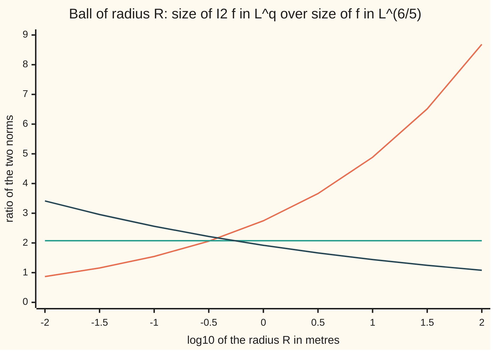

# Fractional integration: the Hardy-Littlewood-Sobolev inequality, and Sobolev embedding in one line

[Syllabus](../../../SYLLABUS.md) → [Harmonic analysis](../README.md) → [Maximal Functions and Beyond](../README.md#s06) → Fractional integration

---

## General Overview

Take a solid ball of uniform density, radius 1 m, density 1 kg/m³. Its gravitational potential at a point $`x`$ comes from adding every bit of mass divided by its distance from $`x`$. That sum is $`I_2 f(x) = \int f(y)/\lvert x - y\rvert\,dy`$, where $`f`$ is the density.

Gravity's potential is $`-G\,I_2 f`$, with $`G`$ the gravitational constant. At the centre $`I_2 f`$ = 6.283185 kg/m; at the surface it is 4.188790 kg/m.

The question is about whole sizes, not single values. Given only how big the mass is, measured as one number, how big can the potential be, measured as one number? Sizes are measured by $`p`$-norms, $`\lVert f\rVert_p = (\int \lvert f\rvert^p)^{1/p}`$. The answer is the **Hardy-Littlewood-Sobolev inequality**: $`\lVert I_2 f\rVert_6 \le C\,\lVert f\rVert_{6/5}`$ in space. The pair 6/5 and 6 is forced. For the ball the ratio of the two sides is 2.075750, and the best possible $`C`$ is 2.294011.

Why 6? Shrink the ball to a 1 cm marble, or grow it to 100 m. Only with 6 does the ratio stay put: at 4 or 8 it drifts, by a factor of 10 or of about 3 (the picture). A constant $`C`$ that works for every ball must survive every size, so scaling alone picks the exponent.

The same bound gives the **Sobolev embedding** in one line. A potential $`u`$ is at most a fixed multiple of $`I_1`$ applied to the size of its slope. Apply the inequality to $`I_1`$ and the slope's energy controls $`\lVert u\rVert_6`$. Physicists use both: the first caps the self-energy of a star or an atom's electron cloud, the second gives a lower bound for kinetic energy.

**The Riesz potential $`I_\alpha f`$, the source spread by the kernel $`\lvert x\rvert^{\alpha - n}`$, takes size $`p`$ to size $`q`$ exactly when $`1/q = 1/p - \alpha/n`$ with $`1 < p < n/\alpha`$; with $`\alpha = 1`$ it is the Sobolev embedding.**

**What kind of fact this is:** a theorem, proved on this card in Why it works, using the maximal theorem in $`n`$ dimensions, which is stated with its source. The best constant (Lieb, 1983) and the best Sobolev constant (Talenti, 1976) are stated with sources and checked on their extremal functions, not proved.

### The picture: only one exponent survives rescaling



Orange: $`q = 4`$, rising like $`R^{1/4}`$. Teal: $`q = 6`$, flat at 2.0758. Dark blue: $`q = 8`$, falling like $`R^{-1/8}`$. Both checks print every point. No single constant can cap a line that grows without end, so only $`q = 6`$ can hold.

---

## The formula

Notation first. Space has $`n`$ dimensions; here $`n = 3`$. Points are $`x`$ and $`y`$, and $`\lvert x - y\rvert`$ is their distance. $`L^p`$ is the set of functions with finite $`p`$-norm ([Lp spaces](../../10-Measure%20and%20integration/07-Sizes%20of%20Functions/01-lp-spaces.md)). Some letters change meaning from [Riesz transforms](07-riesz-transforms-and-singular-integrals-in-higher-dimensions.md): there $`\alpha`$ is a level, $`p^*`$ is $`\max(p, p')`$, and $`B`$, $`K`$, $`D`$ are a smoothness constant, a kernel and a derivative; here $`\alpha`$ is the order below, $`p^*`$ the Sobolev exponent, and $`B`$, $`K`$, $`D`$ the constants and self-energy of the table. For $`0 < \alpha < n`$, the **Riesz potential** of order $`\alpha`$ is

```math
I_\alpha f(x) = \int_{\mathbb R^n} \frac{f(y)}{\lvert x - y\rvert^{\,n - \alpha}}\, dy
```

**Read it aloud:** I alpha f at x adds the source at every point y, weighted by the distance from x to y to the power alpha minus n.

Many books divide by a constant; this card does not. In space, $`I_2 f/(4\pi)`$ is the Newtonian potential $`u`$ of [Poisson's equation](../../19-Partial%20differential%20equations/04-Laplace%2C%20Poisson%20and%20Potentials/03-poissons-equation-and-the-newtonian-potential.md), the solution of $`-\Delta u = f`$ that fades far away. Here $`\Delta`$ is the Laplacian, the sum of the three second derivatives. On the Fourier side $`I_2`$ multiplies the spectrum by $`1/(\pi\lvert\xi\rvert^2)`$, and $`-\Delta`$ multiplies it by $`4\pi^2\lvert\xi\rvert^2`$. So $`I_2`$ undoes two derivatives, and in general $`I_\alpha`$ undoes $`\alpha`$ of them: hence **fractional integration**.

**The Hardy-Littlewood-Sobolev inequality.** If $`1 < p < n/\alpha`$ and $`q`$ is set by the exponent rule, there is a constant $`C`$, depending only on $`n`$, $`\alpha`$ and $`p`$, with

```math
\lVert I_\alpha f\rVert_q \;\le\; C\,\lVert f\rVert_p \quad\text{for every } f \in L^p, \qquad \frac{1}{q} = \frac{1}{p} - \frac{\alpha}{n}
```

**Read it aloud:** the q-norm of I alpha f is at most C times the p-norm of f, where one over q is one over p minus alpha over n.

In the example, $`n = 3`$, $`\alpha = 2`$ and $`p = 6/5`$: $`1/q = 5/6 - 2/3 = 1/6`$, so $`q = 6`$.

**The Sobolev embedding.** For $`u`$ that fades at infinity with gradient $`\nabla u`$ (the slope in every direction), and $`1 < p < 3`$,

```math
\lvert u(x)\rvert \;\le\; \frac{1}{4\pi}\, I_1\lvert\nabla u\rvert(x), \qquad \lVert u\rVert_{p^*} \le C'\,\lVert \nabla u\rVert_p, \qquad p^* = \frac{3p}{3 - p}
```

**Read it aloud:** the size of u at a point is at most one over four pi times the order-one potential of the slope's size, so the p-star-norm of u is at most a constant times the p-norm of its gradient.

| Symbol | Plain meaning | In our example | Push it up and the answer… |
| --- | --- | --- | --- |
| $`x`$, $`y`$, $`r`$, $`R`$, $`\omega`$, $`t`$, $`\xi`$ | points in space; distance from the ball's centre, in m; the ball's radius; a direction; a distance along it; a frequency, per metre | $`R`$ = 1 m | larger $`R`$: both norms grow by $`R^{5/2}`$ |
| $`n`$ | number of space dimensions | 3 | the exponent rule changes |
| $`f`$, $`h`$, $`G`$ | the source (density, kg/m³); the bell $`(1 + \lvert x\rvert^2)^{-5/2}`$; the gravitational constant | $`f`$ = 1 on the ball | — |
| $`\alpha`$ | order of the potential: how many derivatives it undoes | 2; 1 for Sobolev | $`q`$ grows |
| $`I_\alpha f`$ | Riesz potential | $`I_2 f`$ = 6.283185 kg/m at the centre | — |
| $`u`$, $`\nabla u`$, $`\Delta`$, $`\psi`$ | Newtonian potential $`I_2 f/(4\pi)`$; its gradient; the Laplacian; a wave function (real life) | $`u`$ = 0.5 at the centre; $`\lVert\nabla u\rVert_2^2`$ = 1.675516 | — |
| $`p`$, $`q`$, $`p^*`$, $`p'`$, $`\lVert\cdot\rVert_p`$, $`N`$, $`c`$ | exponents; $`p'`$ the conjugate, $`1/p + 1/p' = 1`$; the $`p`$-norm; in the fold $`N = \lVert f\rVert_p`$ and $`c = 1 - \alpha p/n`$ | 6/5, 6, 6, 6; $`\lVert f\rVert_{6/5}`$ = 3.299189 | larger $`p`$, larger $`q`$ |
| $`C`$, $`C'`$, $`C_M`$ | constants in the two inequalities; the maximal theorem's constant (fold) | ball reaches 2.075750; best $`C`$ = 2.294011 | — |
| $`Mf`$ | maximal function: the largest average of $`\lvert f\rvert`$ over balls centred at $`x`$ | 1 inside; 0.111111 at $`r`$ = 1.5 | — |
| $`\delta`$, $`A`$, $`B`$ | cut radius between near and far; their constants | $`\delta`$ = 0.488359 at the centre; $`A`$ = 6.283185, $`B`$ = 1.269642 | larger $`\delta`$: more near, less far |
| $`D`$, $`K`$, $`J`$ | self-energy $`\int f\,I_2 f`$; best Sobolev constant; a polynomial integral in Worked numbers | 21.055156; 0.427261; 75.926207 | — |
| $`L`$, $`\varepsilon`$ | outer and inner cut-off radii in What breaks | $`L`$ up to $`10^6`$; $`\varepsilon`$ down to $`10^{-32}`$ | — |

### When it holds

- **The order lies strictly between 0 and $`n`$.** At $`\alpha = n`$ the kernel is 1 and the integral is just the total mass. At $`\alpha \le 0`$ the kernel is not integrable near the point.
- **$`q`$ obeys the exponent rule.** Any other $`q`$ fails for every $`C`$: with $`q = 4`$ the ball's ratio grows from 0.8685 to 8.6845 as $`R`$ goes from 0.01 m to 100 m.
- **$`p`$ is above 1.** At $`p = 1`$, $`q = 3`$, and $`I_2 f`$ falls like $`1/r`$ far away, which is never in $`L^3`$. Only a weak bound holds there.
- **$`p`$ is below $`n/\alpha`$.** At $`p = 3/2`$ the rule asks for $`q = \infty`$, a bound on the largest value. It fails: a source with finite $`3/2`$-norm can have an infinite potential at a point (What breaks).
- **For Sobolev, $`u`$ fades at infinity.** A constant has zero slope and infinite 6-norm. The ball's $`u`$ falls like $`1/(3r)`$, which is enough.

---

## Why it works

### Step 0: near is an average, far is a pairing

The kernel $`\lvert y\rvert^{\alpha - n}`$ is large near 0 and small far away. Cut it at a radius $`\delta`$. Near the point, the kernel is a falling weight, so its smoothing is a blend of ball averages and is capped by the maximal function. Far away, the kernel is small and its $`p'`$-th power is integrable, so Holder's inequality caps the pairing with $`f`$. Choose $`\delta`$ to balance the two, point by point. This route is Hedberg's (1972).

### Step 1: scaling fixes the exponent

Rescale a source: $`f_R(x) = f(x/R)`$. Substituting $`y = Rz`$ in each integral gives

```math
\lVert f_R\rVert_p = R^{n/p}\lVert f\rVert_p, \qquad I_\alpha f_R(x) = R^{\alpha}\, I_\alpha f(x/R), \qquad \lVert I_\alpha f_R\rVert_q = R^{\alpha + n/q}\lVert I_\alpha f\rVert_q
```

So the ratio $`\lVert I_\alpha f_R\rVert_q/\lVert f_R\rVert_p`$ is the ratio at $`R = 1`$ times $`R^{\alpha + n/q - n/p}`$. If that power is not 0, the ratio is unbounded as $`R`$ goes to 0 or to infinity, and no $`C`$ exists. The power is 0 exactly when $`1/q = 1/p - \alpha/n`$.

For the ball the power is $`2 + 3/q - 5/2`$: $`+0.25`$ at $`q = 4`$, 0 at $`q = 6`$, $`-0.125`$ at $`q = 8`$. The checks confirm $`R^{1/4}`$ numerically: the $`q = 4`$ ratio goes from 2.7463 at 1 m to 8.6845 at 100 m, a factor $`100^{1/4}`$. The same count is a units check. With $`f`$ in kg/m³, both $`\lVert f\rVert_{6/5}`$ and $`\lVert I_2 f\rVert_6`$ are in $`\mathrm{kg\,m^{-1/2}}`$, so their ratio has no unit; at $`q = 4`$ the ratio is in $`\mathrm{m^{1/4}}`$.

Scaling proves the rule is necessary. Steps 2 to 4 prove it is enough.

### Step 2: the near part is at most a multiple of Mf

Write $`\lvert I_\alpha f(x)\rvert \le \int_{\lvert y\rvert < \delta} \lvert f(x - y)\rvert\,\lvert y\rvert^{\alpha - n}dy + \int_{\lvert y\rvert \ge \delta} \lvert f(x - y)\rvert\,\lvert y\rvert^{\alpha - n}dy`$, the near and far parts.

The near kernel $`\lvert y\rvert^{\alpha - n}`$ on $`\lvert y\rvert < \delta`$ depends only on $`\lvert y\rvert`$ and never rises as $`\lvert y\rvert`$ grows. [The maximal function](01-hardy-littlewood-maximal-function.md) proves that such a kernel's smoothing is at most its total weight times $`Mf(x)`$: the kernel is a stack of ball averages. The proof there is on the line; in space it is word for word the same with balls. The total weight, in shells of area $`4\pi s^2`$, is $`\int_0^\delta s^{\alpha - 3}\,4\pi s^2\,ds = 4\pi\delta^\alpha/\alpha`$. So

```math
\text{near} \;\le\; A\,\delta^\alpha\, Mf(x), \qquad A = \frac{4\pi}{\alpha} = 2\pi \ \text{ at } \alpha = 2
```

At the ball's centre, with $`\delta`$ = 0.488359, the checks add up the near part shell by shell and get 1.498507. The bound $`A\delta^2 Mf`$ is the same 1.498507, because the source is 1 everywhere within $`\delta`$, and $`Mf = 1`$ there.

### Step 3: the far part is at most a multiple of the p-norm

[Holder's inequality](../../10-Measure%20and%20integration/07-Sizes%20of%20Functions/02-holders-inequality.md), with $`p'`$ the conjugate exponent ($`1/p + 1/p' = 1`$; here $`p'`$ = 6), gives

```math
\text{far} \;\le\; \lVert f\rVert_p \Big(\int_{\lvert y\rvert \ge \delta} \lvert y\rvert^{(\alpha - n)p'}\,dy\Big)^{1/p'} = B\,\delta^{\alpha - n/p}\,\lVert f\rVert_p
```

The integral is finite only if $`(n - \alpha)p' > n`$, which is the same as $`p < n/\alpha`$. That is where the upper limit on $`p`$ comes from. In the example the integral is $`4\pi/(3\delta^3)`$, so $`B = (4\pi/3)^{1/6}`$ = 1.269642 and the power is $`\delta^{-1/2}`$. At the centre the far part is 4.784678, under its bound 5.994029.

### Step 4: balance the cut, then integrate

Steps 2 and 3 give $`\lvert I_\alpha f(x)\rvert \le A\,\delta^\alpha Mf(x) + B\,\delta^{\alpha - n/p}\lVert f\rVert_p`$ for every $`\delta`$. The first term grows with $`\delta`$ and the second falls. Taking $`\delta^{n/p} = \lVert f\rVert_p / Mf(x)`$ makes them the same size, and gives Hedberg's inequality:

```math
\lvert I_\alpha f(x)\rvert \;\le\; (A + B)\; Mf(x)^{\,1 - \alpha p/n}\;\lVert f\rVert_p^{\,\alpha p/n}
```

Now raise to the power $`q`$ and integrate. The rule makes $`q(1 - \alpha p/n) = p`$ exactly, so the integral of $`Mf(x)^{q(1 - \alpha p/n)}`$ is $`\lVert Mf\rVert_p^p`$. The maximal theorem in $`n`$ dimensions bounds this by a constant times $`\lVert f\rVert_p^p`$, for $`p > 1`$ (Stein, chapter I). Every power of $`\lVert f\rVert_p`$ then adds up to $`q`$, which is the inequality. The fold has the algebra.

On the ball the checks go one step further. They use the $`\delta`$ that makes the sum smallest, $`\delta^{5/2} = B\lVert f\rVert_{6/5}/(4A\,Mf(x))`$, which can only lower the bound. They compute $`Mf`$ from the volume two balls share:

| Distance $`r`$ | $`Mf`$ | best $`\delta`$ | bound | true $`I_2 f`$ | true / bound |
| ---: | ---: | ---: | ---: | ---: | ---: |
| 0 | 1.000000 | 0.488359 | 7.492537 | 6.283185 | 0.838593 |
| 1.5 | 0.111111 | 1.176079 | 4.828146 | 2.792527 | 0.578385 |
| 2 | 0.052786 | 1.583911 | 4.160383 | 2.094395 | 0.503414 |
| 3 | 0.018875 | 2.389939 | 3.386922 | 1.396263 | 0.412251 |

```
r = 0    true   ██████████████████████████████████████         6.283185
         bound  █████████████████████████████████████████████  7.492537
r = 1.5  true   █████████████████                              2.792527
         bound  █████████████████████████████                  4.828146
r = 2    true   █████████████                                  2.094395
         bound  █████████████████████████                      4.160383
r = 3    true   ████████                                       1.396263
         bound  ████████████████████                           3.386922
```

At all four points the bound holds. It is loose far out, where $`Mf`$ fades like $`r^{-3}`$ but the potential only like $`1/r`$.

<details>
<summary>Detailed proof: from Hedberg's inequality to the q-norm bound</summary>

Write $`N = \lVert f\rVert_p`$ and $`c = 1 - \alpha p/n`$, which lies between 0 and 1 because $`p < n/\alpha`$.

Raise Hedberg's inequality to the power $`q`$ and integrate over $`x`$:

$`\displaystyle \lVert I_\alpha f\rVert_q^q \le (A + B)^q\, N^{\alpha p q/n} \int Mf(x)^{cq}\,dx .`$

The exponent rule says $`1/q = (1 - \alpha p/n)/p = c/p`$, so $`cq = p`$, and the integral is $`\lVert Mf\rVert_p^p`$.

The maximal theorem in $`n`$ dimensions gives $`\lVert Mf\rVert_p \le C_M\,N`$ for $`p > 1`$, with $`C_M`$ depending only on $`n`$ and $`p`$. Its proof is the one on the maximal function card: a covering lemma gives the weak bound at $`p = 1`$, and [Interpolation](04-interpolation-riesz-thorin-and-marcinkiewicz.md) by Marcinkiewicz turns it into the strong bound.

So $`\lVert I_\alpha f\rVert_q^q \le (A + B)^q C_M^p\, N^{\alpha p q/n + p}`$. Finally $`\alpha p q/n + p = q(\alpha p/n + c) = q`$, and taking $`q`$-th roots gives $`\lVert I_\alpha f\rVert_q \le (A + B)\,C_M^{p/q}\,\lVert f\rVert_p`$.

The constant is far from the best one, but it does not depend on $`f`$, which is all the theorem needs.

</details>

### Step 5: Sobolev embedding in one line

Start at $`x`$ and walk outward in a direction $`\omega`$. Since $`u`$ fades at infinity, $`u(x) = -\int_0^\infty \nabla u(x + t\omega)\cdot\omega\,dt`$, by the fundamental theorem of calculus. Average over all directions on the unit sphere, whose area is $`4\pi`$. Write $`y = x + t\omega`$, so $`dy = t^2\,dt\,d\omega`$:

```math
u(x) = \frac{1}{4\pi}\int \nabla u(y)\cdot\frac{x - y}{\lvert x - y\rvert^3}\,dy, \qquad\text{so}\qquad \lvert u(x)\rvert \le \frac{1}{4\pi}\int \frac{\lvert\nabla u(y)\rvert}{\lvert x - y\rvert^{2}}\,dy = \frac{1}{4\pi}\,I_1\lvert\nabla u\rvert(x)
```

That is the one line.

Apply the inequality with $`\alpha = 1`$, $`n = 3`$: $`1/q = 1/p - 1/3`$, which is $`q = 3p/(3 - p) = p^*`$. So $`\lVert u\rVert_{p^*} \le C\lVert\nabla u\rVert_p/(4\pi)`$ for $`1 < p < 3`$. At $`p = 2`$, $`p^* = 6`$: a field of finite energy has a potential in $`L^6`$.

[Sobolev and Poincare](../../18-Functional%20analysis/04-Distributions%20and%20Sobolev%20Spaces/09-sobolev-embedding-and-poincare-inequality.md) states this as $`W^{1,p} \hookrightarrow L^{p^*}`$; here it is derived. The case $`p = 1`$ is also true, but it needs a separate argument, because the inequality fails at $`p = 1`$.

On the ball, $`u = I_2 f/(4\pi)`$ is $`(3 - r^2)/6`$ inside and $`1/(3r)`$ outside. At the centre, $`u`$ = 0.500000 and the bound is 0.500000: equality, because $`u`$ falls along every ray, so no slope is wasted. At $`r = 2`$, $`u`$ = 0.166667 and the bound is 0.347488.

The field energy is $`\lVert\nabla u\rVert_2^2`$ = 1.675516, both from the field $`r/3`$ inside and $`1/(3r^2)`$ outside, and from $`\int f u = D/(4\pi)`$. The ball's Sobolev ratio $`\lVert u\rVert_6/\lVert\nabla u\rVert_2`$ is 0.421016. The best constant (Talenti, 1976) is $`K`$ = 0.427261, reached by $`u = (1 + r^2)^{-1/2}`$. The ball reaches 98.5384 % of it.

### Step 6: the best constant (stated, not proved)

Lieb (1983) found the best $`C`$ when $`q`$ is the conjugate of $`p`$, which is the example's case: $`6`$ is the conjugate of $`6/5`$. For $`n = 3`$, $`\alpha = 2`$,

```math
\lVert I_2 f\rVert_6 \;\le\; \frac{4}{3}\Big(\frac{16}{\pi}\Big)^{1/3}\lVert f\rVert_{6/5} = 2.294011\,\lVert f\rVert_{6/5}
```

with equality for the bell $`h(x) = (1 + \lvert x\rvert^2)^{-5/2}`$ and its shifts and rescalings. Since $`-\Delta(1 + r^2)^{-1/2} = 3(1 + r^2)^{-5/2}`$, the bell's potential is $`I_2 h = (4\pi/3)(1 + r^2)^{-1/2}`$: at $`r = 1`$ the defining integral gives 2.960007 against 2.961922. The bell's ratio is 2.294011, the same as Lieb's Gamma-function formula. The ball reaches 0.904856 of it.

---

## Worked numbers, by hand

The unit ball, density 1, $`n = 3`$, $`\alpha = 2`$, $`p = 6/5`$.

| Step | Arithmetic | Value |
| --- | --- | --- |
| exponent | $`1/q = 5/6 - 2/3`$ | $`q`$ = 6 |
| size of the source | $`\lVert f\rVert_{6/5} = (\text{volume})^{5/6} = (4\pi/3)^{5/6}`$ | 3.299189 |
| potential inside | $`(2\pi/3)(3 - r^2)`$: 6.283185 at $`r = 0`$, 4.188790 at $`r = 1`$ | — |
| potential outside | $`(4\pi/3)/r`$: 2.094395 at $`r = 2`$ | — |
| inside part of $`\lVert I_2 f\rVert_6^6`$ | $`(2\pi/3)^6 \cdot 4\pi \cdot J`$, with $`J = \int_0^1 (3 - r^2)^6 r^2\,dr`$ = 75.926207 | 80529.1752 |
| outside part | $`(4\pi/3)^6 \cdot 4\pi\int_1^\infty r^{-4}\,dr = (4\pi/3)^6 \cdot 4\pi/3`$ | 22626.6503 |
| total, and its sixth root | 103155.8256 | 6.848292 |
| ratio | $`6.848292/3.299189`$ | **2.075750** |
| against the best constant | $`2.075750/2.294011`$ | 0.904856 |

Every ball, from a marble to a hill, has potential-to-mass ratio 2.075750 in these sizes. No source of any shape beats 2.294011.

### What breaks if you drop a piece

| Mistake | Comes out at | What went wrong |
| --- | --- | --- |
| Pair $`p = 6/5`$ with $`q = 4`$ | ratio 0.8685, 2.7463, 8.6845 at $`R`$ = 0.01, 1, 100 m | the two sides scale by different powers of $`R`$ |
| Pair $`p = 6/5`$ with $`q = 8`$ | ratio 3.4146, 1.9202, 1.0798 at the same radii | the same, in the other direction: small balls win |
| Use $`p = 1`$, so $`q = 3`$: a ball of mass 1 | $`\lVert I_2 f\rVert_3`$ out to radius $`L`$ = 10, $`10^3`$, $`10^6`$: 3.315175, 4.551754, 5.657806 | far away $`I_2 f = 1/r`$, and $`\int r^{-3}\,4\pi r^2\,dr`$ grows like $`4\pi\log L`$ |
| Use $`p = 3/2 = n/\alpha`$, asking for $`q = \infty`$ | $`f = \lvert y\rvert^{-2}/\log(e/\lvert y\rvert)`$ on $`\varepsilon < \lvert y\rvert < 1`$, $`3/2`$-power integral at most $`8\pi`$: $`I_2 f(0)`$ = 21.660520, 37.276109, 54.201883 at $`\varepsilon = 10^{-2}, 10^{-8}, 10^{-32}`$ | the far part's Holder integral diverges; the value grows like $`4\pi\log\log(e/\varepsilon)`$ |

---

## Code, from first principles, and it actually runs

The code takes at least two independent roads to each number. The potential: the defining integral as a midpoint sum, against the shell-theorem closed form. The norms: exact polynomial integrals, against Simpson sums on rescaled balls that must follow the scaling power. The best constant: Lieb's Gamma formula, against the bell. Hedberg's cut: the formula, against a search; its near part at the centre: a shell sum, against $`A\delta^2`$. The field energy: the field's integral, against $`D/(4\pi)`$. It also computes every row of What breaks. Python and Rust print the same lines.

### Python

```python
# Riesz potentials and Hardy-Littlewood-Sobolev -- the check behind the card.  Standard
# library only.  Space has n = 3 dimensions and I2 f(x) = integral of f(y) / |x - y| dy, so
# the Newtonian potential is I2 f / (4 pi).  Example: f = 1 on a ball of radius R.  Roads:
# closed-form potentials against the defining integral by midpoint sums; exact polynomial
# norms against Simpson sums; the scaling law against rescaled balls; Lieb's Gamma formula
# against the bell (1 + r^2)^(-5/2); Hedberg's near-far split against the true values.
import math
PI = math.pi
def gam(x):  # Gamma at a whole or half-whole number, from Gamma(x + 1) = x Gamma(x)
    g, y = (1.0, 1.0) if x == round(x) else (math.sqrt(PI), 0.5)
    while y < x - 1e-9:
        g, y = g * y, y + 1
    return g
def add(vals):  # plain left-to-right sum, as in the Rust twin
    t = 0.0
    for v in vals:
        t += v
    return t
def simpson(fn, a, b, m=2000):
    h = (b - a) / m
    return h / 3 * add((1 if k in (0, m) else 4 if k % 2 else 2) * fn(a + k * h) for k in range(m + 1))
def pot(r, R):  # I2 of the ball of radius R, from the shell theorem (Poisson's equation card)
    return 2 * PI / 3 * (3 * R * R - r * r) if r <= R else 4 * PI * R ** 3 / (3 * r)
def kernel(r, nodes, n=400):  # defining integral, x at distance r: sum of w(s) / |x - y|
    tot = 0.0
    for s, w in nodes:
        for j in range(n):
            c = -1 + (j + 0.5) * 2 / n
            tot += w / math.sqrt(r * r + s * s - 2 * r * s * c)
    return tot * 2 * PI * 2 / n
N0 = 400
ball = [((i + 0.5) / N0, ((i + 0.5) / N0) ** 2 / N0) for i in range(N0)]
for r in (0.0, 0.5, 1.0, 2.0):
    a, b = kernel(r, ball), pot(r, 1.0)
    print(f"ball potential I2f({r:.1f}): defining integral {a:.6f}, closed form {b:.6f}")
    assert abs(a - b) < 2e-3 * b
def exact_qq(q):  # ||I2 f||_q^q for the unit ball, q a whole number above 3, exactly
    J = add(math.comb(q, k) * 3 ** (q - k) * (-1) ** k / (2 * k + 3) for k in range(q + 1))
    return (2 * PI / 3) ** q * 4 * PI * J + (4 * PI / 3) ** q * 4 * PI / (q - 3), J
def ratio(q, R):  # ||I2 f_R||_q / ||f_R||_(6/5) by Simpson sums; outside, r = R / t
    inner = simpson(lambda r: pot(r, R) ** q * 4 * PI * r * r, 0, R)
    outer = simpson(lambda t: (4 * PI * R * R / 3) ** q * 4 * PI * R ** 3 * t ** (q - 4), 0, 1)
    return (inner + outer) ** (1 / q) / (4 * PI * R ** 3 / 3) ** (5 / 6)
q6, J6 = exact_qq(6)
nf = (4 * PI / 3) ** (5 / 6)
rb = q6 ** (1 / 6) / nf
print(f"J = {J6:.6f}; ||I2f||_6^6 = {q6:.4f}; ||I2f||_6 = {q6 ** (1 / 6):.6f}; ||f||_6/5 = {nf:.6f}")
print(f"inner part {(2 * PI / 3) ** 6 * 4 * PI * J6:.4f}, outer part {(4 * PI / 3) ** 6 * 4 * PI / 3:.4f}")
print(f"ball ratio ||I2f||_6 / ||f||_6/5 = {rb:.6f}; Newtonian u = I2f/(4 pi): {rb / (4 * PI):.6f}")
assert abs(ratio(6, 1.0) - rb) < 1e-9 * rb
for q in (4, 6, 8):
    e, row = 2 + 3 / q - 5 / 2, [ratio(q, 10 ** (k / 2 - 2)) for k in range(9)]
    print(f"chart,q={q},exponent {e:+.3f}," + ",".join(f"{v:.4f}" for v in row))
    assert abs(row[8] / row[4] - 100 ** e) < 1e-9 * row[8] / row[4]
    assert abs(row[4] - exact_qq(q)[0] ** (1 / q) / nf) < 1e-9 * row[4]
lieb = PI ** 0.5 * gam(1) / gam(2.5) * (gam(1.5) / gam(3)) ** (-2 / 3)
bell = 4 * PI / 3 * (4 / PI ** 2) ** (2 / 3)
print(f"Lieb's sharp constant {lieb:.6f}; bell ratio {bell:.6f}; ball / sharp {rb / lieb:.6f}")
assert abs(lieb - bell) < 1e-12 and rb < lieb
bn = [(math.tan(p), math.sin(p) ** 2 * math.cos(p) * PI / 2 / N0)
      for p in ((i + 0.5) * PI / 2 / N0 for i in range(N0))]
a, b = kernel(1.0, bn), 4 * PI / 3 / math.sqrt(2)
print(f"bell potential I2h(1): defining integral {a:.6f}, closed form {b:.6f}")
assert abs(a - b) < 2e-3 * b
D = simpson(lambda r: pot(r, 1.0) * 4 * PI * r * r, 0, 1)
print(f"self-energy D = {D:.6f} (32 pi^2/15 = {32 * PI ** 2 / 15:.6f}); D/||f||^2 = {D / nf ** 2:.6f}")
assert abs(D - 32 * PI ** 2 / 15) < 1e-9 and D / nf ** 2 < lieb
A, Bc = 2 * PI, (4 * PI / 3) ** (1 / 6)
print(f"Hedberg constants: A = 2 pi = {A:.6f}, B = (4 pi/3)^(1/6) = {Bc:.6f}")
def lens(d, s):  # volume shared by the unit ball and a ball of radius s, centres d apart
    if d >= 1 + s: return 0.0
    if d <= abs(1 - s): return 4 * PI / 3 * min(1.0, s) ** 3
    return PI * (1 + s - d) ** 2 * (d * d + 2 * d * (1 + s) - 3 * (1 - s) ** 2) / (12 * d)
def maxf(r, K=20000):
    if r < 1: return 1.0
    return max(lens(r, s) / (4 * PI * s ** 3 / 3) for s in (r - 1 + 2 * k / K for k in range(1, K + 1)))
for r in (0.0, 1.5, 2.0, 3.0):
    M = maxf(r)
    d = (Bc * nf / (4 * A * M)) ** 0.4
    bnd = A * d * d * M + Bc * nf / math.sqrt(d)
    scan = min(A * x * x * M + Bc * nf / math.sqrt(x) for x in (k / 1000 for k in range(1, 5000)))
    print(f"Hedberg at r = {r:.1f}: Mf {M:.6f}, delta {d:.6f}, bound {bnd:.6f}, true {pot(r, 1):.6f}, ratio {pot(r, 1) / bnd:.6f}")
    assert pot(r, 1) <= bnd <= scan + 1e-9 and scan - bnd < 1e-4
    if r == 0:
        dc = d
near, far = simpson(lambda s: 4 * PI * s * s / s, 1e-12, dc), simpson(lambda s: 4 * PI * s * s / s, dc, 1)  # shells 4 pi s^2, kernel 1/s
print(f"centre split: near {near:.6f} <= {A * dc * dc:.6f}; far {far:.6f} <= {Bc * nf / math.sqrt(dc):.6f}")
assert abs(near - A * dc * dc) < 1e-9 and far <= Bc * nf / math.sqrt(dc) and abs(near + far - pot(0, 1)) < 1e-9
g2 = simpson(lambda r: (r / 3) ** 2 * 4 * PI * r * r, 0, 1) + simpson(lambda t: 4 * PI / 9, 0, 1)
print(f"field energy ||grad u||_2^2: integral {g2:.6f}, D/(4 pi) {D / (4 * PI):.6f}")
assert abs(g2 - D / (4 * PI)) < 1e-9
tal = 1 / math.sqrt(3 * PI) * (gam(3) / gam(1.5)) ** (1 / 3)
m6 = add(math.sin(p) ** 2 * math.cos(p) ** 2 for p in ((i + 0.5) * PI / 2 / N0 for i in range(N0))) * PI / 2 / N0
m2 = add(math.sin(p) ** 4 for p in ((i + 0.5) * PI / 2 / N0 for i in range(N0))) * PI / 2 / N0
sb, sbell = q6 ** (1 / 6) / (4 * PI) / math.sqrt(g2), (4 * PI * m6) ** (1 / 6) / math.sqrt(4 * PI * m2)
print(f"Sobolev ||u||_6/||grad u||_2: ball {sb:.6f}, bell {sbell:.6f}, sharp {tal:.6f}, ball / sharp {sb / tal:.6f}")
assert sb < tal and abs(sbell - tal) < 1e-12
n5, r2 = 100000, 2.0
inn = simpson(lambda s: s / 3 * s * s * 2 * PI / (r2 * s) * math.log((r2 + s) / (r2 - s)), 1e-12, 1)
out = add(2 * PI / (3 * r2 * t) * math.log((1 + r2 * t) / abs(1 - r2 * t)) for t in ((k + 0.5) / n5 for k in range(n5))) / n5
c0 = (simpson(lambda r: 4 * PI * r / 3, 0, 1) + simpson(lambda t: 4 * PI / 3, 0, 1)) / (4 * PI)
print(f"u <= I1|grad u|/(4 pi): centre {pot(0, 1) / (4 * PI):.6f} <= {c0:.6f}; r = 2: {pot(2, 1) / (4 * PI):.6f} <= {(inn + out) / (4 * PI):.6f}")
assert abs(c0 - pot(0, 1) / (4 * PI)) < 1e-9 and pot(2, 1) / (4 * PI) < (inn + out) / (4 * PI)
c1 = simpson(lambda r: ((3 - r * r) / 2) ** 3 * 4 * PI * r * r, 0, 1)
print("p = 1, unit mass ball, ||I2f||_3 out to L = 10, 1e3, 1e6: " + ", ".join(f"{(c1 + 4 * PI * math.log(L)) ** (1 / 3):.6f}" for L in (10, 1e3, 1e6)))
for k in (2, 8, 32):
    v = k * math.log(10)
    num = 4 * PI * add(1 / (1 + (k + 0.5) * v / 10000) for k in range(10000)) * v / 10000
    print(f"p = 3/2, cut at 10^-{k}: I2f(0) = {4 * PI * math.log(1 + v):.6f} (sum {num:.6f})")
    assert abs(num - 4 * PI * math.log(1 + v)) < 1e-4
print("ALL CHECKS PASS")
```

**Ran 2026-11-24 on macOS, Python 3.14.10, standard library only. All checks passed. Output, pasted from the run:**

```
ball potential I2f(0.0): defining integral 6.283185, closed form 6.283185
ball potential I2f(0.5): defining integral 5.756837, closed form 5.759587
ball potential I2f(1.0): defining integral 4.183756, closed form 4.188790
ball potential I2f(2.0): defining integral 2.094390, closed form 2.094395
J = 75.926207; ||I2f||_6^6 = 103155.8256; ||I2f||_6 = 6.848292; ||f||_6/5 = 3.299189
inner part 80529.1752, outer part 22626.6503
ball ratio ||I2f||_6 / ||f||_6/5 = 2.075750; Newtonian u = I2f/(4 pi): 0.165183
chart,q=4,exponent +0.250,0.8685,1.1581,1.5443,2.0594,2.7463,3.6622,4.8837,6.5125,8.6845
chart,q=6,exponent +0.000,2.0758,2.0758,2.0758,2.0758,2.0758,2.0758,2.0758,2.0758,2.0758
chart,q=8,exponent -0.125,3.4146,2.9569,2.5606,2.2174,1.9202,1.6628,1.4399,1.2469,1.0798
Lieb's sharp constant 2.294011; bell ratio 2.294011; ball / sharp 0.904856
bell potential I2h(1): defining integral 2.960007, closed form 2.961922
self-energy D = 21.055156 (32 pi^2/15 = 21.055156); D/||f||^2 = 1.934390
Hedberg constants: A = 2 pi = 6.283185, B = (4 pi/3)^(1/6) = 1.269642
Hedberg at r = 0.0: Mf 1.000000, delta 0.488359, bound 7.492537, true 6.283185, ratio 0.838593
Hedberg at r = 1.5: Mf 0.111111, delta 1.176079, bound 4.828146, true 2.792527, ratio 0.578385
Hedberg at r = 2.0: Mf 0.052786, delta 1.583911, bound 4.160383, true 2.094395, ratio 0.503414
Hedberg at r = 3.0: Mf 0.018875, delta 2.389939, bound 3.386922, true 1.396263, ratio 0.412251
centre split: near 1.498507 <= 1.498507; far 4.784678 <= 5.994029
field energy ||grad u||_2^2: integral 1.675516, D/(4 pi) 1.675516
Sobolev ||u||_6/||grad u||_2: ball 0.421016, bell 0.427261, sharp 0.427261, ball / sharp 0.985384
u <= I1|grad u|/(4 pi): centre 0.500000 <= 0.500000; r = 2: 0.166667 <= 0.347488
p = 1, unit mass ball, ||I2f||_3 out to L = 10, 1e3, 1e6: 3.315175, 4.551754, 5.657806
p = 3/2, cut at 10^-2: I2f(0) = 21.660520 (sum 21.660520)
p = 3/2, cut at 10^-8: I2f(0) = 37.276109 (sum 37.276107)
p = 3/2, cut at 10^-32: I2f(0) = 54.201883 (sum 54.201854)
ALL CHECKS PASS
```

### Rust

```rust
// Riesz potentials and Hardy-Littlewood-Sobolev -- the check behind the card.  Rust std only.
// Space has n = 3 dimensions and I2 f(x) = integral of f(y) / |x - y| dy, so the Newtonian
// potential is I2 f / (4 pi).  Example: f = 1 on a ball of radius R.  The same roads as the
// Python twin: closed forms against the defining integral by midpoint sums, exact norms
// against Simpson sums, the scaling law, Lieb's Gamma formula against the bell, and
// Hedberg's near-far split against the true values.  Both print the same lines.
use std::f64::consts::PI;
fn gam(x: f64) -> f64 { // Gamma at a whole or half-whole number, from Gamma(x + 1) = x Gamma(x)
    let (mut g, mut y) = if x == x.round() { (1.0, 1.0) } else { (PI.sqrt(), 0.5) };
    while y < x - 1e-9 { g *= y; y += 1.0; }
    g
}
fn add(v: impl Iterator<Item = f64>) -> f64 { let mut t = 0.0; for x in v { t += x; } t }
fn simpson(f: impl Fn(f64) -> f64, a: f64, b: f64) -> f64 {
    let m = 2000; let h = (b - a) / m as f64;
    h / 3.0 * add((0..=m).map(|k| {
        let w = if k == 0 || k == m { 1.0 } else if k % 2 == 1 { 4.0 } else { 2.0 };
        w * f(a + k as f64 * h) }))
}
fn pot(r: f64, rr: f64) -> f64 { // I2 of the ball of radius rr, from the shell theorem
    if r <= rr { 2.0 * PI / 3.0 * (3.0 * rr * rr - r * r) } else { 4.0 * PI * rr.powf(3.0) / (3.0 * r) }
}
fn kernel(r: f64, nodes: &[(f64, f64)]) -> f64 { // defining integral, x at distance r
    let n = 400; let mut tot = 0.0;
    for &(s, w) in nodes {
        for j in 0..n {
            let c = -1.0 + (j as f64 + 0.5) * 2.0 / n as f64;
            tot += w / (r * r + s * s - 2.0 * r * s * c).sqrt();
        }
    }
    tot * 2.0 * PI * 2.0 / n as f64
}
fn comb(n: i64, k: i64) -> i64 { (0..k).fold(1, |a, i| a * (n - i) / (i + 1)) }
fn exact_qq(q: i64) -> (f64, f64) { // ||I2 f||_q^q for the unit ball, exactly
    let j = add((0..=q).map(|k| (comb(q, k) * 3i64.pow((q - k) as u32) * if k % 2 == 0 { 1 } else { -1 }) as f64 / (2 * k + 3) as f64));
    let qf = q as f64;
    ((2.0 * PI / 3.0).powf(qf) * 4.0 * PI * j + (4.0 * PI / 3.0).powf(qf) * 4.0 * PI / (qf - 3.0), j)
}
fn ratio(q: f64, rr: f64) -> f64 { // ||I2 f_R||_q / ||f_R||_(6/5) by Simpson sums; outside r = R / t
    let inner = simpson(|r| pot(r, rr).powf(q) * 4.0 * PI * r * r, 0.0, rr);
    let outer = simpson(|t| (4.0 * PI * rr * rr / 3.0).powf(q) * 4.0 * PI * rr.powf(3.0) * t.powf(q - 4.0), 0.0, 1.0);
    (inner + outer).powf(1.0 / q) / (4.0 * PI * rr.powf(3.0) / 3.0).powf(5.0 / 6.0)
}
fn lens(d: f64, s: f64) -> f64 { // volume shared by the unit ball and a ball of radius s
    if d >= 1.0 + s { return 0.0; }
    if d <= (1.0 - s).abs() { return 4.0 * PI / 3.0 * 1f64.min(s).powf(3.0); }
    PI * (1.0 + s - d).powf(2.0) * (d * d + 2.0 * d * (1.0 + s) - 3.0 * (1.0 - s).powf(2.0)) / (12.0 * d)
}
fn maxf(r: f64) -> f64 {
    if r < 1.0 { return 1.0; }
    let kk = 20000;
    (1..=kk).map(|k| { let s = r - 1.0 + (2 * k) as f64 / kk as f64; lens(r, s) / (4.0 * PI * s.powf(3.0) / 3.0) }).fold(f64::MIN, f64::max)
}
fn main() {
    let n0 = 400usize; let n0f = n0 as f64;
    let ball: Vec<(f64, f64)> = (0..n0).map(|i| { let s = (i as f64 + 0.5) / n0f; (s, s.powf(2.0) / n0f) }).collect();
    for r in [0.0, 0.5, 1.0, 2.0] {
        let (a, b) = (kernel(r, &ball), pot(r, 1.0));
        println!("ball potential I2f({:.1}): defining integral {:.6}, closed form {:.6}", r, a, b);
        assert!((a - b).abs() < 2e-3 * b);
    }
    let (q6, j6) = exact_qq(6);
    let nf = (4.0 * PI / 3.0).powf(5.0 / 6.0);
    let rb = q6.powf(1.0 / 6.0) / nf;
    println!("J = {:.6}; ||I2f||_6^6 = {:.4}; ||I2f||_6 = {:.6}; ||f||_6/5 = {:.6}", j6, q6, q6.powf(1.0 / 6.0), nf);
    println!("inner part {:.4}, outer part {:.4}", (2.0 * PI / 3.0).powf(6.0) * 4.0 * PI * j6, (4.0 * PI / 3.0).powf(6.0) * 4.0 * PI / 3.0);
    println!("ball ratio ||I2f||_6 / ||f||_6/5 = {:.6}; Newtonian u = I2f/(4 pi): {:.6}", rb, rb / (4.0 * PI));
    assert!((ratio(6.0, 1.0) - rb).abs() < 1e-9 * rb);
    for q in [4i64, 6, 8] {
        let qf = q as f64; let e = 2.0 + 3.0 / qf - 5.0 / 2.0;
        let row: Vec<f64> = (0..9).map(|k| ratio(qf, 10f64.powf(k as f64 / 2.0 - 2.0))).collect();
        let s: Vec<String> = row.iter().map(|v| format!("{:.4}", v)).collect();
        println!("chart,q={},exponent {:+.3},{}", q, e, s.join(","));
        assert!((row[8] / row[4] - 100f64.powf(e)).abs() < 1e-9 * row[8] / row[4]);
        assert!((row[4] - exact_qq(q).0.powf(1.0 / qf) / nf).abs() < 1e-9 * row[4]);
    }
    let lieb = PI.powf(0.5) * gam(1.0) / gam(2.5) * (gam(1.5) / gam(3.0)).powf(-2.0 / 3.0);
    let bell = 4.0 * PI / 3.0 * (4.0 / PI.powf(2.0)).powf(2.0 / 3.0);
    println!("Lieb's sharp constant {:.6}; bell ratio {:.6}; ball / sharp {:.6}", lieb, bell, rb / lieb);
    assert!((lieb - bell).abs() < 1e-12 && rb < lieb);
    let ph = |i: usize| (i as f64 + 0.5) * PI / 2.0 / n0f;
    let bn: Vec<(f64, f64)> = (0..n0).map(|i| { let p = ph(i); (p.tan(), p.sin().powf(2.0) * p.cos() * PI / 2.0 / n0f) }).collect();
    let (a, b) = (kernel(1.0, &bn), 4.0 * PI / 3.0 / 2f64.sqrt());
    println!("bell potential I2h(1): defining integral {:.6}, closed form {:.6}", a, b);
    assert!((a - b).abs() < 2e-3 * b);
    let d = simpson(|r| pot(r, 1.0) * 4.0 * PI * r * r, 0.0, 1.0);
    println!("self-energy D = {:.6} (32 pi^2/15 = {:.6}); D/||f||^2 = {:.6}", d, 32.0 * PI.powf(2.0) / 15.0, d / nf.powf(2.0));
    assert!((d - 32.0 * PI.powf(2.0) / 15.0).abs() < 1e-9 && d / nf.powf(2.0) < lieb);
    let (aa, bc) = (2.0 * PI, (4.0 * PI / 3.0).powf(1.0 / 6.0));
    println!("Hedberg constants: A = 2 pi = {:.6}, B = (4 pi/3)^(1/6) = {:.6}", aa, bc);
    let mut dc = 0.0;
    for r in [0.0, 1.5, 2.0, 3.0] {
        let m = maxf(r);
        let dl = (bc * nf / (4.0 * aa * m)).powf(0.4);
        let bnd = aa * dl * dl * m + bc * nf / dl.sqrt();
        let scan = (1..5000).map(|k| { let x = k as f64 / 1000.0; aa * x * x * m + bc * nf / x.sqrt() }).fold(f64::MAX, f64::min);
        println!("Hedberg at r = {:.1}: Mf {:.6}, delta {:.6}, bound {:.6}, true {:.6}, ratio {:.6}", r, m, dl, bnd, pot(r, 1.0), pot(r, 1.0) / bnd);
        assert!(pot(r, 1.0) <= bnd && bnd <= scan + 1e-9 && scan - bnd < 1e-4);
        if r == 0.0 { dc = dl; }
    }
    let (near, far) = (simpson(|s| 4.0 * PI * s * s / s, 1e-12, dc), simpson(|s| 4.0 * PI * s * s / s, dc, 1.0)); // shells 4 pi s^2, kernel 1/s
    println!("centre split: near {:.6} <= {:.6}; far {:.6} <= {:.6}", near, aa * dc * dc, far, bc * nf / dc.sqrt());
    assert!((near - aa * dc * dc).abs() < 1e-9 && far <= bc * nf / dc.sqrt() && (near + far - pot(0.0, 1.0)).abs() < 1e-9);
    let g2 = simpson(|r| (r / 3.0).powf(2.0) * 4.0 * PI * r * r, 0.0, 1.0) + simpson(|_t| 4.0 * PI / 9.0, 0.0, 1.0);
    println!("field energy ||grad u||_2^2: integral {:.6}, D/(4 pi) {:.6}", g2, d / (4.0 * PI));
    assert!((g2 - d / (4.0 * PI)).abs() < 1e-9);
    let tal = 1.0 / (3.0 * PI).sqrt() * (gam(3.0) / gam(1.5)).powf(1.0 / 3.0);
    let m6 = add((0..n0).map(|i| ph(i).sin().powf(2.0) * ph(i).cos().powf(2.0))) * PI / 2.0 / n0f;
    let m2 = add((0..n0).map(|i| ph(i).sin().powf(4.0))) * PI / 2.0 / n0f;
    let (sb, sbell) = (q6.powf(1.0 / 6.0) / (4.0 * PI) / g2.sqrt(), (4.0 * PI * m6).powf(1.0 / 6.0) / (4.0 * PI * m2).sqrt());
    println!("Sobolev ||u||_6/||grad u||_2: ball {:.6}, bell {:.6}, sharp {:.6}, ball / sharp {:.6}", sb, sbell, tal, sb / tal);
    assert!(sb < tal && (sbell - tal).abs() < 1e-12);
    let (n5, r2) = (100000usize, 2.0f64);
    let inn = simpson(|s| s / 3.0 * s * s * 2.0 * PI / (r2 * s) * ((r2 + s) / (r2 - s)).ln(), 1e-12, 1.0);
    let out = add((0..n5).map(|k| { let t = (k as f64 + 0.5) / n5 as f64; 2.0 * PI / (3.0 * r2 * t) * ((1.0 + r2 * t) / (1.0 - r2 * t).abs()).ln() })) / n5 as f64;
    let c0 = (simpson(|r| 4.0 * PI * r / 3.0, 0.0, 1.0) + simpson(|_t| 4.0 * PI / 3.0, 0.0, 1.0)) / (4.0 * PI);
    println!("u <= I1|grad u|/(4 pi): centre {:.6} <= {:.6}; r = 2: {:.6} <= {:.6}", pot(0.0, 1.0) / (4.0 * PI), c0, pot(2.0, 1.0) / (4.0 * PI), (inn + out) / (4.0 * PI));
    assert!((c0 - pot(0.0, 1.0) / (4.0 * PI)).abs() < 1e-9 && pot(2.0, 1.0) / (4.0 * PI) < (inn + out) / (4.0 * PI));
    let c1 = simpson(|r| ((3.0 - r * r) / 2.0).powf(3.0) * 4.0 * PI * r * r, 0.0, 1.0);
    let s: Vec<String> = [10.0f64, 1e3, 1e6].iter().map(|l| format!("{:.6}", (c1 + 4.0 * PI * l.ln()).powf(1.0 / 3.0))).collect();
    println!("p = 1, unit mass ball, ||I2f||_3 out to L = 10, 1e3, 1e6: {}", s.join(", "));
    for k in [2.0f64, 8.0, 32.0] {
        let v = k * 10f64.ln();
        let num = 4.0 * PI * add((0..10000).map(|j| 1.0 / (1.0 + (j as f64 + 0.5) * v / 10000.0))) * v / 10000.0;
        println!("p = 3/2, cut at 10^-{}: I2f(0) = {:.6} (sum {:.6})", k, 4.0 * PI * (1.0 + v).ln(), num);
        assert!((num - 4.0 * PI * (1.0 + v).ln()).abs() < 1e-4);
    }
    println!("ALL CHECKS PASS");
}
```

**Ran 2026-11-24 on macOS, rustc 1.98.1, no crates. All checks passed. Output, pasted from the run:**

```
ball potential I2f(0.0): defining integral 6.283185, closed form 6.283185
ball potential I2f(0.5): defining integral 5.756837, closed form 5.759587
ball potential I2f(1.0): defining integral 4.183756, closed form 4.188790
ball potential I2f(2.0): defining integral 2.094390, closed form 2.094395
J = 75.926207; ||I2f||_6^6 = 103155.8256; ||I2f||_6 = 6.848292; ||f||_6/5 = 3.299189
inner part 80529.1752, outer part 22626.6503
ball ratio ||I2f||_6 / ||f||_6/5 = 2.075750; Newtonian u = I2f/(4 pi): 0.165183
chart,q=4,exponent +0.250,0.8685,1.1581,1.5443,2.0594,2.7463,3.6622,4.8837,6.5125,8.6845
chart,q=6,exponent +0.000,2.0758,2.0758,2.0758,2.0758,2.0758,2.0758,2.0758,2.0758,2.0758
chart,q=8,exponent -0.125,3.4146,2.9569,2.5606,2.2174,1.9202,1.6628,1.4399,1.2469,1.0798
Lieb's sharp constant 2.294011; bell ratio 2.294011; ball / sharp 0.904856
bell potential I2h(1): defining integral 2.960007, closed form 2.961922
self-energy D = 21.055156 (32 pi^2/15 = 21.055156); D/||f||^2 = 1.934390
Hedberg constants: A = 2 pi = 6.283185, B = (4 pi/3)^(1/6) = 1.269642
Hedberg at r = 0.0: Mf 1.000000, delta 0.488359, bound 7.492537, true 6.283185, ratio 0.838593
Hedberg at r = 1.5: Mf 0.111111, delta 1.176079, bound 4.828146, true 2.792527, ratio 0.578385
Hedberg at r = 2.0: Mf 0.052786, delta 1.583911, bound 4.160383, true 2.094395, ratio 0.503414
Hedberg at r = 3.0: Mf 0.018875, delta 2.389939, bound 3.386922, true 1.396263, ratio 0.412251
centre split: near 1.498507 <= 1.498507; far 4.784678 <= 5.994029
field energy ||grad u||_2^2: integral 1.675516, D/(4 pi) 1.675516
Sobolev ||u||_6/||grad u||_2: ball 0.421016, bell 0.427261, sharp 0.427261, ball / sharp 0.985384
u <= I1|grad u|/(4 pi): centre 0.500000 <= 0.500000; r = 2: 0.166667 <= 0.347488
p = 1, unit mass ball, ||I2f||_3 out to L = 10, 1e3, 1e6: 3.315175, 4.551754, 5.657806
p = 3/2, cut at 10^-2: I2f(0) = 21.660520 (sum 21.660520)
p = 3/2, cut at 10^-8: I2f(0) = 37.276109 (sum 37.276107)
p = 3/2, cut at 10^-32: I2f(0) = 54.201883 (sum 54.201854)
ALL CHECKS PASS
```

The two outputs match line for line.

### Lean

Lean proves the inequality, the exponent rule and the Sobolev embedding for every order and exponent allowed in When it holds.

- Suppose $`0 < \alpha < n`$, $`1 < p < n/\alpha`$ and $`1/q = 1/p - \alpha/n`$. Then one constant $`C`$ gives $`\lVert I_\alpha f\rVert_q \le C \lVert f\rVert_p`$ for every $`f`$ in $`L^p`$. It also shows the integral defining $`I_\alpha f(x)`$ converges for every $`x`$ outside a set of zero volume.
- Suppose $`q > 0`$, the same limits on $`\alpha`$ and $`p`$ hold, and one $`C`$ gives that bound for every $`f`$ in $`L^p`$. Then $`q`$ obeys the exponent rule: no other $`q`$ allows any $`C`$.
- Suppose $`u`$ in space has a continuous gradient and fades at infinity. Then $`\lvert u(x)\rvert \le I_1\lvert\nabla u\rvert(x)/(4\pi)`$ at every point $`x`$.
- Take the same $`u`$ and $`1 < p < 3`$. Then one constant $`C'`$ gives $`\lVert u\rVert_{p^*} \le C' \lVert\nabla u\rVert_p`$ for every such $`u`$.
- The exponent arithmetic of the example is checked exactly, with the scaling powers at $`q = 4`$, 6 and 8.
- The integral $`J`$ is exactly 1140032/15015, the card's 75.926207.

The decimals, Hedberg's table, Lieb's and Talenti's best constants and the What breaks rows are left to the Python and Rust checks.

```lean
-- Fractional integration: the Riesz potential of order α in n dimensions takes L^p to L^q exactly when 1/q = 1/p − α/n with 1 < p < n/α, and with α = 1 in space this gives the Sobolev embedding.
import Mathlib.Analysis.InnerProductSpace.PiL2
import Mathlib.Analysis.Calculus.ContDiff.Defs
import Mathlib.Analysis.Calculus.FDeriv.Basic
import Mathlib.MeasureTheory.Measure.Haar.InnerProductSpace
import Mathlib.MeasureTheory.Integral.Bochner.Basic
import Mathlib.MeasureTheory.Function.LpSeminorm.Basic
import Mathlib.Analysis.SpecialFunctions.Pow.Real
import Mathlib.Algebra.BigOperators.Intervals
import Mathlib.Tactic.NormNum
import Mathlib.MeasureTheory.Covering.Vitali
import Mathlib.MeasureTheory.Measure.Lebesgue.EqHaar
import Mathlib.Analysis.SpecialFunctions.Integrals.Basic
import Mathlib.MeasureTheory.Integral.Prod
import Mathlib.MeasureTheory.Measure.Haar.NormedSpace
import Mathlib.MeasureTheory.Constructions.HaarToSphere
import Mathlib.MeasureTheory.Measure.Lebesgue.VolumeOfBalls
import Mathlib.MeasureTheory.Integral.IntervalIntegral.FundThmCalculus
import Mathlib.MeasureTheory.Group.LIntegral
import Mathlib.Analysis.Calculus.ContDiff.Basic

open MeasureTheory Filter Topology
open scoped NNReal ENNReal

/-! ### How the card's objects are written here

Space with `n` dimensions is `EuclideanSpace ℝ (Fin n)`, with the usual distance `‖x - y‖` and
its usual volume (Lebesgue measure). A source is a real function `f` on it.

The card's Riesz potential of order `α`, with no constant in front, is
`I_α f (x) = ∫ f(y) / ‖x - y‖ ^ (n - α) dy`.

The `p`-norm `‖f‖_p` is Mathlib's `eLpNorm f p`, a value in `[0, ∞]`, so a norm that is
infinite is allowed and nothing needs to be assumed finite. "`f` is in `L^p`" is `MemLp f p`.
The exponents `p` and `q` are real numbers, passed to `eLpNorm` as `ENNReal.ofReal p`. -/

/-- The card's Riesz potential of order `α` in `n` dimensions:
`I_α f (x) = ∫ f(y) / |x - y| ^ (n - α) dy`. -/
noncomputable def rieszPotential (n : ℕ) (α : ℝ) (f : EuclideanSpace ℝ (Fin n) → ℝ)
    (x : EuclideanSpace ℝ (Fin n)) : ℝ :=
  ∫ y, f y / ‖x - y‖ ^ ((n : ℝ) - α)

section hlsHelpers

open Metric Set


/-- Dyadic maximal function. -/
noncomputable def hlsMax {n : ℕ} (g : EuclideanSpace ℝ (Fin n) → ℝ≥0∞)
    (x : EuclideanSpace ℝ (Fin n)) : ℝ≥0∞ :=
  ⨆ k : ℤ, (∫⁻ y in ball x ((2:ℝ) ^ k), g y) / volume (ball x ((2:ℝ) ^ k))

lemma hls_measurable_setLIntegral_ball {n : ℕ} {g : EuclideanSpace ℝ (Fin n) → ℝ≥0∞}
    (hg : Measurable g) (r : ℝ) :
    Measurable (fun x : EuclideanSpace ℝ (Fin n) => ∫⁻ y in ball x r, g y) := by
  have : (fun x : EuclideanSpace ℝ (Fin n) => ∫⁻ y in ball x r, g y) = fun x =>
      ∫⁻ y, ({p : EuclideanSpace ℝ (Fin n) × EuclideanSpace ℝ (Fin n) | dist p.2 p.1 < r}.indicator
        (fun p => g p.2)) (x, y) := by
    ext x
    rw [← lintegral_indicator measurableSet_ball]
    rfl
  rw [this]
  exact Measurable.lintegral_prod_right' ((hg.comp measurable_snd).indicator
    (measurableSet_lt (measurable_snd.dist measurable_fst) measurable_const))

lemma hls_measurable_max {n : ℕ} {g : EuclideanSpace ℝ (Fin n) → ℝ≥0∞} (hg : Measurable g) :
    Measurable (hlsMax g) := by
  unfold hlsMax
  refine Measurable.iSup fun k => ?_
  simp_rw [Measure.addHaar_ball_center]
  exact (hls_measurable_setLIntegral_ball hg _).div_const _

lemma hls_setLIntegral_le_max {n : ℕ} (g : EuclideanSpace ℝ (Fin n) → ℝ≥0∞)
    (x : EuclideanSpace ℝ (Fin n)) (k : ℤ) :
    ∫⁻ y in ball x ((2:ℝ) ^ k), g y ≤ volume (ball x ((2:ℝ) ^ k)) * hlsMax g x := by
  have h0 : volume (ball x ((2:ℝ) ^ k)) ≠ 0 := (measure_ball_pos _ _ (by positivity)).ne'
  have h1 : volume (ball x ((2:ℝ) ^ k)) ≠ ∞ := measure_ball_lt_top.ne
  rw [mul_comm, ← ENNReal.div_le_iff_le_mul (Or.inl h0) (Or.inl h1)]
  exact le_iSup (fun k : ℤ => (∫⁻ y in ball x ((2:ℝ) ^ k), g y) / volume (ball x ((2:ℝ) ^ k))) k

/-- Weak (1,1) bound. -/
lemma hls_weak_max {n : ℕ} {g : EuclideanSpace ℝ (Fin n) → ℝ≥0∞} (hg : Measurable g)
    (t : ℝ≥0∞) :
    t * volume {x | t < hlsMax g x} ≤ ENNReal.ofReal ((5:ℝ) ^ n) * ∫⁻ y, g y := by
  set avg : ℤ → EuclideanSpace ℝ (Fin n) → ℝ≥0∞ := fun k x =>
    (∫⁻ y in ball x ((2:ℝ) ^ k), g y) / volume (ball x ((2:ℝ) ^ k)) with havg
  set S : ℕ → Set (EuclideanSpace ℝ (Fin n)) := fun N => {x | ∃ k : ℤ, k ≤ N ∧ t < avg k x}
  have hU : {x | t < hlsMax g x} = ⋃ N, S N := by
    ext x
    simp only [mem_ofPred_eq, mem_iUnion, hlsMax, lt_iSup_iff, S]
    constructor
    · rintro ⟨k, hk⟩
      exact ⟨k.toNat, k, Int.self_le_toNat k, hk⟩
    · rintro ⟨N, k, -, hk⟩
      exact ⟨k, hk⟩
  have hmono : Monotone S := by
    intro N M hNM x hx
    obtain ⟨k, hk, h⟩ := hx
    exact ⟨k, hk.trans (by exact_mod_cast hNM), h⟩
  rw [hU, hmono.measure_iUnion, ENNReal.mul_iSup]
  refine iSup_le fun N => ?_
  -- Vitali on the family of balls
  set T : Set (EuclideanSpace ℝ (Fin n) × ℤ) := {p | p.2 ≤ N ∧ t < avg p.2 p.1}
  obtain ⟨u, huT, hdisj, hcov⟩ := Vitali.exists_disjoint_subfamily_covering_enlargement_ball T
    (fun p => p.1) (fun p => (2:ℝ) ^ p.2) ((2:ℝ) ^ (N:ℤ))
    (fun a ha => zpow_le_zpow_right₀ (by norm_num) ha.1) 5 (by norm_num)
  have hucount : u.Countable := hdisj.countable_of_isOpen (fun _ _ => isOpen_ball)
    (fun a _ => nonempty_ball.2 (by positivity))
  have hsub : S N ⊆ ⋃ b ∈ u, ball b.1 (5 * (2:ℝ) ^ b.2) := by
    rintro x ⟨k, hk, h⟩
    obtain ⟨b, hb, hsb⟩ := hcov (x, k) ⟨hk, h⟩
    exact mem_biUnion hb (hsb (mem_ball_self (by positivity)))
  have hball : ∀ b ∈ u, t * volume (ball b.1 ((2:ℝ) ^ b.2)) ≤ ∫⁻ y in ball b.1 ((2:ℝ) ^ b.2), g y := by
    intro b hb
    have h0 : volume (ball b.1 ((2:ℝ) ^ b.2)) ≠ 0 := (measure_ball_pos _ _ (by positivity)).ne'
    have h1 : volume (ball b.1 ((2:ℝ) ^ b.2)) ≠ ∞ := measure_ball_lt_top.ne
    have := (huT hb).2
    simp only [avg] at this
    exact (ENNReal.le_div_iff_mul_le (Or.inl h0) (Or.inl h1)).1 this.le
  have h5 : ∀ b : EuclideanSpace ℝ (Fin n) × ℤ, volume (ball b.1 (5 * (2:ℝ) ^ b.2)) =
      ENNReal.ofReal ((5:ℝ) ^ n) * volume (ball b.1 ((2:ℝ) ^ b.2)) := by
    intro b
    rw [Measure.addHaar_ball_mul_of_pos _ _ (by norm_num : (0:ℝ) < 5),
      finrank_euclideanSpace_fin, Measure.addHaar_ball_center _ b.1]
  calc t * volume (S N) ≤ t * volume (⋃ b ∈ u, ball b.1 (5 * (2:ℝ) ^ b.2)) :=
        mul_le_mul_right (measure_mono hsub) _
    _ ≤ t * ∑' b : u, volume (ball b.1.1 (5 * (2:ℝ) ^ b.1.2)) :=
        mul_le_mul_right (measure_biUnion_le _ hucount _) _
    _ = ENNReal.ofReal ((5:ℝ) ^ n) * ∑' b : u, t * volume (ball b.1.1 ((2:ℝ) ^ b.1.2)) := by
        simp_rw [h5, ← ENNReal.tsum_mul_left]
        congr 1; ext b; ring
    _ ≤ ENNReal.ofReal ((5:ℝ) ^ n) * ∑' b : u, ∫⁻ y in ball b.1.1 ((2:ℝ) ^ b.1.2), g y :=
        mul_le_mul_right (ENNReal.summable.tsum_le_tsum (fun b : u => hball b.1 b.2)
          ENNReal.summable) _
    _ = ENNReal.ofReal ((5:ℝ) ^ n) * ∫⁻ y in ⋃ b ∈ u, ball b.1 ((2:ℝ) ^ b.2), g y := by
        rw [lintegral_biUnion hucount (fun _ _ => measurableSet_ball) hdisj]
    _ ≤ ENNReal.ofReal ((5:ℝ) ^ n) * ∫⁻ y, g y :=
        mul_le_mul_right (setLIntegral_le_lintegral _ _) _

lemma hls_layer_real {p r : ℝ} (hp : 0 < p) (hr : 0 ≤ r) :
    ∫⁻ t in Ioi (0:ℝ), (Iio r).indicator (fun t => ENNReal.ofReal (t ^ (p - 1))) t =
      ENNReal.ofReal (r ^ p / p) := by
  rw [lintegral_indicator (measurableSet_Iio : MeasurableSet (Iio r)),
    Measure.restrict_restrict (measurableSet_Iio : MeasurableSet (Iio r))]
  have hset : Iio r ∩ Ioi 0 = Ioo 0 r := by
    ext t; simp [and_comm]
  rw [hset, ← ofReal_integral_eq_lintegral_ofReal]
  · rw [← integral_Ioc_eq_integral_Ioo, ← intervalIntegral.integral_of_le hr,
      integral_rpow (Or.inl (by linarith))]
    congr 1
    rw [sub_add_cancel, Real.zero_rpow hp.ne', sub_zero]
  · have := (intervalIntegral.intervalIntegrable_rpow' (a := 0) (b := r)
      (show -1 < p - 1 by linarith)).1
    exact this.mono_set Ioo_subset_Ioc_self
  · filter_upwards [ae_restrict_mem measurableSet_Ioo] with t ht
    exact Real.rpow_nonneg ht.1.le _

lemma hls_layer (a : ℝ≥0∞) {p : ℝ} (hp : 0 < p) :
    ∫⁻ t in Ioi (0:ℝ), {t : ℝ | ENNReal.ofReal t < a}.indicator
      (fun t => ENNReal.ofReal (t ^ (p - 1))) t = a ^ p / ENNReal.ofReal p := by
  have hfin : ∀ b : ℝ≥0∞, b ≠ ∞ →
      ∫⁻ t in Ioi (0:ℝ), {t : ℝ | ENNReal.ofReal t < b}.indicator
        (fun t => ENNReal.ofReal (t ^ (p - 1))) t = b ^ p / ENNReal.ofReal p := by
    intro b hb
    have h1 : ∫⁻ t in Ioi (0:ℝ), {t : ℝ | ENNReal.ofReal t < b}.indicator
        (fun t => ENNReal.ofReal (t ^ (p - 1))) t =
        ∫⁻ t in Ioi (0:ℝ), (Iio b.toReal).indicator
        (fun t => ENNReal.ofReal (t ^ (p - 1))) t := by
      refine setLIntegral_congr_fun measurableSet_Ioi (fun t ht => ?_)
      have : (ENNReal.ofReal t < b) ↔ t < b.toReal := ENNReal.ofReal_lt_iff_lt_toReal ht.le hb
      by_cases h : t < b.toReal
      · rw [indicator_of_mem (show t ∈ {t : ℝ | ENNReal.ofReal t < b} from this.2 h),
          indicator_of_mem (show t ∈ Iio b.toReal from h)]
      · rw [indicator_of_notMem (show t ∉ {t : ℝ | ENNReal.ofReal t < b} from fun h' => h (this.1 h')),
          indicator_of_notMem (show t ∉ Iio b.toReal from h)]
    rw [h1, hls_layer_real hp ENNReal.toReal_nonneg, ENNReal.ofReal_div_of_pos hp,
      ← ENNReal.ofReal_rpow_of_nonneg ENNReal.toReal_nonneg hp.le, ENNReal.ofReal_toReal hb]
  by_cases ha : a = ∞
  · subst ha
    rw [ENNReal.top_rpow_of_pos hp, ENNReal.top_div_of_ne_top ENNReal.ofReal_ne_top]
    refine ENNReal.eq_top_of_forall_nnreal_le fun M => ?_
    have hM : ((M : ℝ≥0∞)) = ENNReal.ofReal (((M:ℝ) * p) ^ (1 / p)) ^ p / ENNReal.ofReal p := by
      rw [ENNReal.ofReal_rpow_of_nonneg (by positivity) hp.le, ← Real.rpow_mul (by positivity),
        one_div_mul_cancel hp.ne', Real.rpow_one, ← ENNReal.ofReal_div_of_pos hp,
        mul_div_cancel_right₀ _ hp.ne', ENNReal.ofReal_coe_nnreal]
    have hle : ENNReal.ofReal (((M:ℝ) * p) ^ (1 / p)) ^ p / ENNReal.ofReal p ≤
        ∫⁻ t in Ioi (0:ℝ), {t : ℝ | ENNReal.ofReal t < ∞}.indicator
          (fun t => ENNReal.ofReal (t ^ (p - 1))) t := by
      rw [← hfin _ ENNReal.ofReal_ne_top]
      refine lintegral_mono fun t => ?_
      simp only [indicator]
      split_ifs <;> simp_all
    rw [hM]
    convert hle using 3
  · exact hfin a ha

lemma hls_max_split {n : ℕ} (g : EuclideanSpace ℝ (Fin n) → ℝ≥0∞) (hg : Measurable g)
    (s : ℝ≥0∞) (x : EuclideanSpace ℝ (Fin n)) :
    hlsMax g x ≤ hlsMax ({y | s < g y}.indicator g) x + s := by
  unfold hlsMax
  refine iSup_le fun k => ?_
  have h0 : volume (ball x ((2:ℝ) ^ k)) ≠ 0 := (measure_ball_pos _ _ (by positivity)).ne'
  have h1 : volume (ball x ((2:ℝ) ^ k)) ≠ ∞ := measure_ball_lt_top.ne
  have hle : ∫⁻ y in ball x ((2:ℝ) ^ k), g y ≤
      (∫⁻ y in ball x ((2:ℝ) ^ k), {y | s < g y}.indicator g y) + s * volume (ball x ((2:ℝ) ^ k)) := by
    calc ∫⁻ y in ball x ((2:ℝ) ^ k), g y ≤
        ∫⁻ y in ball x ((2:ℝ) ^ k), ({y | s < g y}.indicator g y + s) := by
          refine lintegral_mono fun y => ?_
          by_cases h : s < g y
          · rw [indicator_of_mem (show y ∈ {y | s < g y} from h)]; exact le_self_add
          · rw [indicator_of_notMem (show y ∉ {y | s < g y} from h), zero_add]; exact not_lt.1 h
      _ = _ := by
          rw [lintegral_add_right _ measurable_const, setLIntegral_const]
  rw [ENNReal.div_le_iff h0 h1]
  refine hle.trans ?_
  rw [add_mul]
  gcongr
  calc ∫⁻ y in ball x ((2:ℝ) ^ k), {y | s < g y}.indicator g y =
      (∫⁻ y in ball x ((2:ℝ) ^ k), {y | s < g y}.indicator g y) / volume (ball x ((2:ℝ) ^ k)) *
        volume (ball x ((2:ℝ) ^ k)) := (ENNReal.div_mul_cancel h0 h1).symm
    _ ≤ _ := by
      gcongr
      exact le_iSup (fun k : ℤ => (∫⁻ y in ball x ((2:ℝ) ^ k), {y | s < g y}.indicator g y) /
        volume (ball x ((2:ℝ) ^ k))) k

/-- Strong (p,p) bound for the dyadic maximal function. -/
lemma hls_strong_max {n : ℕ} {g : EuclideanSpace ℝ (Fin n) → ℝ≥0∞} (hg : Measurable g)
    {p : ℝ} (hp : 1 < p) :
    ∫⁻ x, hlsMax g x ^ p ≤ (ENNReal.ofReal p * (2 * ENNReal.ofReal ((5:ℝ) ^ n)) *
      (2 ^ (p - 1) / ENNReal.ofReal (p - 1))) * ∫⁻ x, g x ^ p := by
  have hp0 : 0 < p := by linarith
  have hp1 : 0 < p - 1 := by linarith
  set F := hlsMax g with hFdef
  have hF : Measurable F := hls_measurable_max hg
  set C5 := ENNReal.ofReal ((5:ℝ) ^ n)
  set φ : ℝ → ℝ≥0∞ := fun t => ENNReal.ofReal (t ^ (p - 1))
  have hφ : Measurable φ := ENNReal.measurable_ofReal.comp (measurable_id.pow_const _)
  have hpne : ENNReal.ofReal p ≠ 0 := by simpa using hp0
  -- step 1
  have step1 : ∫⁻ x, F x ^ p = ENNReal.ofReal p *
      ∫⁻ x, ∫⁻ t in Ioi (0:ℝ), {t : ℝ | ENNReal.ofReal t < F x}.indicator φ t := by
    rw [← lintegral_const_mul' _ _ ENNReal.ofReal_ne_top]
    refine lintegral_congr fun x => ?_
    rw [hls_layer (F x) hp0, ENNReal.mul_div_cancel hpne ENNReal.ofReal_ne_top]
  -- step 2: swap
  have hmeas1 : Measurable (Function.uncurry fun (x : EuclideanSpace ℝ (Fin n)) (t : ℝ) =>
      {t : ℝ | ENNReal.ofReal t < F x}.indicator φ t) := by
    have : Measurable ({z : EuclideanSpace ℝ (Fin n) × ℝ | ENNReal.ofReal z.2 < F z.1}.indicator
        (fun z => φ z.2)) :=
      (hφ.comp measurable_snd).indicator
        (measurableSet_lt (ENNReal.measurable_ofReal.comp measurable_snd) (hF.comp measurable_fst))
    exact this
  have step2 : ∫⁻ x, ∫⁻ t in Ioi (0:ℝ), {t : ℝ | ENNReal.ofReal t < F x}.indicator φ t =
      ∫⁻ t in Ioi (0:ℝ), φ t * volume {x | ENNReal.ofReal t < F x} := by
    rw [lintegral_lintegral_swap hmeas1.aemeasurable]
    refine lintegral_congr fun t => ?_
    have : (fun x => {t : ℝ | ENNReal.ofReal t < F x}.indicator φ t) =
        {x | ENNReal.ofReal t < F x}.indicator (fun _ => φ t) := by
      ext x; simp [indicator]
    rw [this, lintegral_indicator_const (measurableSet_lt measurable_const hF)]
  -- step 4: pointwise bound
  set g1 : ℝ → EuclideanSpace ℝ (Fin n) → ℝ≥0∞ := fun t =>
    {y | ENNReal.ofReal (t / 2) < g y}.indicator g
  have step4 : ∀ t ∈ Ioi (0:ℝ), φ t * volume {x | ENNReal.ofReal t < F x} ≤
      2 * C5 * (ENNReal.ofReal (t ^ (p - 2)) * ∫⁻ x, g1 t x) := by
    intro t ht
    have ht0 : 0 < t := ht
    set s := ENNReal.ofReal (t / 2)
    have hts : ENNReal.ofReal t = 2 * s := by
      rw [show t = 2 * (t / 2) by ring, ENNReal.ofReal_mul (by norm_num)]
      simp [s]
    have hsub : {x | ENNReal.ofReal t < F x} ⊆ {x | s < hlsMax (g1 t) x} := by
      intro x hx
      simp only [mem_setOf_eq] at hx ⊢
      by_contra hcon
      push_neg at hcon
      have := hls_max_split g hg s x
      have h2 : F x ≤ s + s := this.trans (by gcongr)
      rw [hts, two_mul] at hx
      exact absurd (hx.trans_le h2) (lt_irrefl _)
    have hweak := hls_weak_max (g := g1 t) ((hg.indicator (measurableSet_lt measurable_const hg))) s
    have hφt : φ t = 2 * ENNReal.ofReal (t ^ (p - 2)) * s := by
      simp only [φ, s]
      rw [← ENNReal.ofReal_ofNat 2, ← ENNReal.ofReal_mul (by norm_num),
        ← ENNReal.ofReal_mul (by positivity)]
      congr 1
      rw [show p - 1 = (p - 2) + 1 by ring, Real.rpow_add_one ht0.ne']
      ring
    calc φ t * volume {x | ENNReal.ofReal t < F x}
        ≤ 2 * ENNReal.ofReal (t ^ (p - 2)) * (s * volume {x | s < hlsMax (g1 t) x}) := by
          rw [hφt, mul_assoc]
          gcongr
      _ ≤ 2 * ENNReal.ofReal (t ^ (p - 2)) * (C5 * ∫⁻ x, g1 t x) := by gcongr
      _ = 2 * C5 * (ENNReal.ofReal (t ^ (p - 2)) * ∫⁻ x, g1 t x) := by ring
  -- step 5: swap back
  have hmeas2 : Measurable (Function.uncurry fun (t : ℝ) (x : EuclideanSpace ℝ (Fin n)) =>
      ENNReal.ofReal (t ^ (p - 2)) * g1 t x) := by
    have : Measurable (fun z : ℝ × EuclideanSpace ℝ (Fin n) => ENNReal.ofReal (z.1 ^ (p - 2)) *
        {z : ℝ × EuclideanSpace ℝ (Fin n) | ENNReal.ofReal (z.1 / 2) < g z.2}.indicator
          (fun z => g z.2) z) :=
      (ENNReal.measurable_ofReal.comp (measurable_fst.pow_const _)).mul
        ((hg.comp measurable_snd).indicator (measurableSet_lt
          (ENNReal.measurable_ofReal.comp (measurable_fst.div_const _)) (hg.comp measurable_snd)))
    exact this
  have step5 : ∫⁻ t in Ioi (0:ℝ), ENNReal.ofReal (t ^ (p - 2)) * ∫⁻ x, g1 t x =
      (2 ^ (p - 1) / ENNReal.ofReal (p - 1)) * ∫⁻ x, g x ^ p := by
    have : ∀ t, ENNReal.ofReal (t ^ (p - 2)) * ∫⁻ x, g1 t x =
        ∫⁻ x, ENNReal.ofReal (t ^ (p - 2)) * g1 t x := fun t =>
      (lintegral_const_mul' _ _ ENNReal.ofReal_ne_top).symm
    simp_rw [this]
    rw [lintegral_lintegral_swap hmeas2.aemeasurable, ← lintegral_const_mul' _ _ (by
      refine ENNReal.div_ne_top (ENNReal.rpow_ne_top_of_nonneg hp1.le (by simp)) ?_
      simpa using hp1)]
    refine lintegral_congr fun x => ?_
    have h1 : ∫⁻ t in Ioi (0:ℝ), ENNReal.ofReal (t ^ (p - 2)) * g1 t x =
        g x * ∫⁻ t in Ioi (0:ℝ), {t : ℝ | ENNReal.ofReal t < 2 * g x}.indicator
          (fun t => ENNReal.ofReal (t ^ ((p - 1) - 1))) t := by
      have hm : Measurable (fun t : ℝ => {t : ℝ | ENNReal.ofReal t < 2 * g x}.indicator
          (fun t => ENNReal.ofReal (t ^ (p - 1 - 1))) t) :=
        (ENNReal.measurable_ofReal.comp (measurable_id.pow_const _)).indicator
          (measurableSet_lt ENNReal.measurable_ofReal measurable_const)
      rw [← lintegral_const_mul _ hm]
      refine lintegral_congr fun t => ?_
      have hiff : ENNReal.ofReal (t / 2) < g x ↔ ENNReal.ofReal t < 2 * g x := by
        have hts : ENNReal.ofReal t = 2 * ENNReal.ofReal (t / 2) := by
          rcases le_or_gt t 0 with h | h
          · rw [ENNReal.ofReal_of_nonpos h, ENNReal.ofReal_of_nonpos (by linarith), mul_zero]
          · rw [show t = 2 * (t / 2) by ring, ENNReal.ofReal_mul (by norm_num)]
            simp
        rw [hts]
        exact (ENNReal.mul_lt_mul_iff_right (by norm_num) (by norm_num)).symm
      simp only [g1, indicator, mem_setOf_eq, hiff, show p - 1 - 1 = p - 2 by ring]
      split_ifs <;> ring
    rw [h1, hls_layer _ hp1, ENNReal.mul_rpow_of_nonneg _ _ hp1.le,
      show p = 1 + (p - 1) by ring, ENNReal.rpow_add_of_nonneg _ _ zero_le_one hp1.le,
      ENNReal.rpow_one, show 1 + (p - 1) - 1 = p - 1 by ring]
    simp only [div_eq_mul_inv]
    ring
  calc ∫⁻ x, F x ^ p = ENNReal.ofReal p * ∫⁻ t in Ioi (0:ℝ), φ t * volume {x | ENNReal.ofReal t < F x} := by
        rw [step1, step2]
    _ ≤ ENNReal.ofReal p * ∫⁻ t in Ioi (0:ℝ), 2 * C5 * (ENNReal.ofReal (t ^ (p - 2)) * ∫⁻ x, g1 t x) := by
        exact mul_le_mul_right (setLIntegral_mono' measurableSet_Ioi step4) _
    _ = ENNReal.ofReal p * (2 * C5) * ∫⁻ t in Ioi (0:ℝ), ENNReal.ofReal (t ^ (p - 2)) * ∫⁻ x, g1 t x := by
        rw [lintegral_const_mul' _ _ (ENNReal.mul_ne_top (by norm_num) ENNReal.ofReal_ne_top)]
        ring
    _ = _ := by rw [step5]; ring

/-- Pointwise dyadic shell bound for the Riesz kernel. -/
lemma hls_kernel_shell {n : ℕ} {α : ℝ} (hαn : α < n) (f : EuclideanSpace ℝ (Fin n) → ℝ)
    (x y : EuclideanSpace ℝ (Fin n)) :
    ‖f y / ‖x - y‖ ^ ((n : ℝ) - α)‖ₑ ≤ ∑' k : ℤ, (ball x ((2:ℝ) ^ (k + 1))).indicator
      (fun y => ENNReal.ofReal ((2:ℝ) ^ ((k:ℝ) * (α - n))) * ‖f y‖ₑ) y := by
  by_cases hxy : y = x
  · subst hxy
    simp [Real.zero_rpow (show (n:ℝ) - α ≠ 0 by linarith)]
  have hd : 0 < ‖x - y‖ := norm_pos_iff.2 (sub_ne_zero.2 (Ne.symm hxy))
  obtain ⟨k, hk1, hk2⟩ := exists_mem_Ico_zpow hd (by norm_num : (1:ℝ) < 2)
  refine le_trans ?_ (ENNReal.le_tsum k)
  have hmem : y ∈ ball x ((2:ℝ) ^ (k + 1)) := by
    rw [mem_ball, dist_comm, dist_eq_norm]; exact hk2
  rw [indicator_of_mem hmem, div_eq_mul_inv, enorm_mul, mul_comm]
  gcongr
  rw [Real.enorm_of_nonneg (by positivity)]
  apply ENNReal.ofReal_le_ofReal
  rw [← Real.rpow_neg hd.le, neg_sub, Real.rpow_mul (by norm_num), Real.rpow_intCast]
  exact Real.rpow_le_rpow_of_nonpos (by positivity) hk1 (by linarith)

lemma hls_kernel_integral {n : ℕ} {α : ℝ} (hαn : α < n) {f : EuclideanSpace ℝ (Fin n) → ℝ}
    (hf : Measurable f) (x : EuclideanSpace ℝ (Fin n)) :
    ∫⁻ y, ‖f y / ‖x - y‖ ^ ((n : ℝ) - α)‖ₑ ≤ ∑' k : ℤ, ENNReal.ofReal ((2:ℝ) ^ ((k:ℝ) * (α - n))) *
      ∫⁻ y in ball x ((2:ℝ) ^ (k + 1)), ‖f y‖ₑ := by
  calc ∫⁻ y, ‖f y / ‖x - y‖ ^ ((n : ℝ) - α)‖ₑ
        ≤ ∫⁻ y, ∑' k : ℤ, (ball x ((2:ℝ) ^ (k + 1))).indicator
          (fun y => ENNReal.ofReal ((2:ℝ) ^ ((k:ℝ) * (α - n))) * ‖f y‖ₑ) y :=
        lintegral_mono fun y => hls_kernel_shell hαn f x y
    _ = _ := by
      rw [lintegral_tsum]
      · congr 1; ext k
        rw [lintegral_indicator measurableSet_ball, lintegral_const_mul' _ _ ENNReal.ofReal_ne_top]
      · intro k
        exact (Measurable.indicator (by fun_prop) measurableSet_ball).aemeasurable

lemma hls_tsum_int_split (F : ℤ → ℝ≥0∞) (j : ℤ) :
    ∑' k : ℤ, F k = ∑' m : ℕ, F (j + m) + ∑' m : ℕ, F (j - 1 - m) := by
  rw [← (Equiv.addLeft j).tsum_eq, ← tsum_nat_add_neg_add_one ENNReal.summable, ENNReal.tsum_add]
  congr 2 <;> ext m <;> simp only [Equiv.coe_addLeft] <;> congr 1; ring

lemma hls_holder_ball {n : ℕ} {f : EuclideanSpace ℝ (Fin n) → ℝ} (hf : Measurable f) {p : ℝ}
    (hp : 1 < p) (x : EuclideanSpace ℝ (Fin n)) (r : ℝ) :
    ∫⁻ y in ball x r, ‖f y‖ₑ ≤
      eLpNorm f (ENNReal.ofReal p) volume * volume (ball x r) ^ (1 - 1 / p) := by
  have h1 : (1 : ℝ≥0∞) ≤ ENNReal.ofReal p := by
    rw [← ENNReal.ofReal_one]; exact ENNReal.ofReal_le_ofReal hp.le
  have hfm : AEStronglyMeasurable f (volume.restrict (ball x r)) :=
    hf.stronglyMeasurable.aestronglyMeasurable
  have := eLpNorm_le_eLpNorm_mul_rpow_measure_univ h1 hfm
  rw [eLpNorm_one_eq_lintegral_enorm hfm, Measure.restrict_apply_univ, ENNReal.toReal_one,
    ENNReal.toReal_ofReal (by linarith), div_one] at this
  refine this.trans ?_
  gcongr
  exact Measure.restrict_le_self

lemma hls_geom (c r : ℝ) :
    ∑' m : ℕ, ENNReal.ofReal ((2:ℝ) ^ (c + m * r)) =
      ENNReal.ofReal ((2:ℝ) ^ c) * (1 - ENNReal.ofReal ((2:ℝ) ^ r))⁻¹ := by
  have : ∀ m : ℕ, ENNReal.ofReal ((2:ℝ) ^ (c + m * r)) =
      ENNReal.ofReal ((2:ℝ) ^ c) * ENNReal.ofReal ((2:ℝ) ^ r) ^ m := by
    intro m
    rw [← ENNReal.ofReal_pow (by positivity), ← ENNReal.ofReal_mul (by positivity),
      Real.rpow_add (by norm_num), mul_comm (m:ℝ) r, Real.rpow_mul (by norm_num),
      Real.rpow_natCast]
  simp_rw [this]
  rw [ENNReal.tsum_mul_left, ENNReal.tsum_geometric]

lemma hls_vol_ball {n : ℕ} (x : EuclideanSpace ℝ (Fin n)) (k : ℤ) :
    volume (ball x ((2:ℝ) ^ (k + 1))) =
      ENNReal.ofReal ((2:ℝ) ^ (((k:ℝ) + 1) * n)) * volume (ball (0 : EuclideanSpace ℝ (Fin n)) 1) := by
  rw [Measure.addHaar_ball_of_pos _ _ (by positivity), finrank_euclideanSpace_fin,
    ← Real.rpow_intCast, ← Real.rpow_natCast, ← Real.rpow_mul (by norm_num)]
  push_cast
  rfl

/-- Hedberg's bound, with a free dyadic scale `2^j`. -/
lemma hls_hedberg_j {n : ℕ} {α p : ℝ} (hα0 : 0 < α) (hαn : α < n) (hp : 1 < p)
    (hpn : p < n / α) {f : EuclideanSpace ℝ (Fin n) → ℝ} (hf : Measurable f)
    (x : EuclideanSpace ℝ (Fin n)) (j : ℤ) :
    ∫⁻ y, ‖f y / ‖x - y‖ ^ ((n : ℝ) - α)‖ₑ ≤
      volume (ball (0 : EuclideanSpace ℝ (Fin n)) 1) ^ (1 - 1 / p) *
          eLpNorm f (ENNReal.ofReal p) volume *
          (ENNReal.ofReal ((2:ℝ) ^ (n * (1 - 1 / p) + j * (α - n / p))) *
            (1 - ENNReal.ofReal ((2:ℝ) ^ (α - n / p)))⁻¹) +
        volume (ball (0 : EuclideanSpace ℝ (Fin n)) 1) * hlsMax (fun y => ‖f y‖ₑ) x *
          (ENNReal.ofReal ((2:ℝ) ^ (n + (j - 1) * α)) *
            (1 - ENNReal.ofReal ((2:ℝ) ^ (-α)))⁻¹) := by
  have hn : (0:ℝ) < n := by linarith
  have hγ : α - n / p < 0 := by
    have : α * p < n := by rwa [lt_div_iff₀ hα0, mul_comm] at hpn
    have : α < n / p := by rw [lt_div_iff₀ (by linarith)]; exact this
    linarith
  set V := volume (ball (0 : EuclideanSpace ℝ (Fin n)) 1)
  set B := eLpNorm f (ENNReal.ofReal p) volume
  set A := hlsMax (fun y => ‖f y‖ₑ) x
  set T : ℤ → ℝ≥0∞ := fun k => ENNReal.ofReal ((2:ℝ) ^ ((k:ℝ) * (α - n))) *
      ∫⁻ y in ball x ((2:ℝ) ^ (k + 1)), ‖f y‖ₑ
  have hnear : ∀ k : ℤ, T k ≤ V * A * ENNReal.ofReal ((2:ℝ) ^ (n + k * α)) := by
    intro k
    calc T k ≤ ENNReal.ofReal ((2:ℝ) ^ ((k:ℝ) * (α - n))) *
          (volume (ball x ((2:ℝ) ^ (k + 1))) * A) := by
          simp only [T]
          gcongr
          exact hls_setLIntegral_le_max _ x (k + 1)
      _ = V * A * ENNReal.ofReal ((2:ℝ) ^ (n + k * α)) := by
          rw [hls_vol_ball]
          have : ENNReal.ofReal ((2:ℝ) ^ ((k:ℝ) * (α - n))) *
              ENNReal.ofReal ((2:ℝ) ^ (((k:ℝ) + 1) * n)) = ENNReal.ofReal ((2:ℝ) ^ (n + k * α)) := by
            rw [← ENNReal.ofReal_mul (by positivity), ← Real.rpow_add (by norm_num)]
            congr 2; ring
          rw [← this]; ring
  have hfar : ∀ k : ℤ, T k ≤ V ^ (1 - 1 / p) * B *
      ENNReal.ofReal ((2:ℝ) ^ (n * (1 - 1 / p) + k * (α - n / p))) := by
    intro k
    have hq : 0 ≤ 1 - 1 / p := by
      have : 1 / p < 1 := by rw [div_lt_one (by linarith)]; exact hp
      linarith
    calc T k ≤ ENNReal.ofReal ((2:ℝ) ^ ((k:ℝ) * (α - n))) *
          (B * volume (ball x ((2:ℝ) ^ (k + 1))) ^ (1 - 1 / p)) := by
          simp only [T]
          gcongr
          exact hls_holder_ball hf hp x _
      _ = V ^ (1 - 1 / p) * B *
          ENNReal.ofReal ((2:ℝ) ^ (n * (1 - 1 / p) + k * (α - n / p))) := by
          rw [hls_vol_ball, ENNReal.mul_rpow_of_nonneg _ _ hq,
            ENNReal.ofReal_rpow_of_nonneg (by positivity) hq, ← Real.rpow_mul (by norm_num)]
          have : ENNReal.ofReal ((2:ℝ) ^ ((k:ℝ) * (α - n))) *
              ENNReal.ofReal ((2:ℝ) ^ (((k:ℝ) + 1) * n * (1 - 1 / p))) =
              ENNReal.ofReal ((2:ℝ) ^ (n * (1 - 1 / p) + k * (α - n / p))) := by
            rw [← ENNReal.ofReal_mul (by positivity), ← Real.rpow_add (by norm_num)]
            congr 2
            field_simp
            ring
          rw [← this]; ring
  calc ∫⁻ y, ‖f y / ‖x - y‖ ^ ((n : ℝ) - α)‖ₑ ≤ ∑' k : ℤ, T k := hls_kernel_integral hαn hf x
    _ = ∑' m : ℕ, T (j + m) + ∑' m : ℕ, T (j - 1 - m) := hls_tsum_int_split T j
    _ ≤ ∑' m : ℕ, V ^ (1 - 1 / p) * B *
          ENNReal.ofReal ((2:ℝ) ^ (n * (1 - 1 / p) + ((j + m : ℤ) : ℝ) * (α - n / p))) +
        ∑' m : ℕ, V * A * ENNReal.ofReal ((2:ℝ) ^ (n + ((j - 1 - m : ℤ) : ℝ) * α)) := by
          gcongr with m m
          · exact hfar _
          · exact hnear _
    _ = _ := by
      rw [ENNReal.tsum_mul_left, ENNReal.tsum_mul_left]
      congr 2
      · rw [← hls_geom _ _]
        congr 1; ext m; congr 2; push_cast; ring
      · rw [← hls_geom _ _]
        congr 1; ext m; congr 2; push_cast; ring

lemma hls_cross {n α p a b : ℝ} (hn : 0 < n) (hα0 : 0 < α) (hp : 0 < p) (hγ : α - n / p < 0)
    (ha : 0 < a) (hb : 0 < b) : ∃ j : ℤ,
    (2:ℝ) ^ ((j:ℝ) * α) * a ≤ a ^ (1 - α * p / n) * b ^ (α * p / n) ∧
    (2:ℝ) ^ ((j:ℝ) * (α - n / p)) * b ≤
      (2:ℝ) ^ (-(α - n / p)) * (a ^ (1 - α * p / n) * b ^ (α * p / n)) := by
  set s := (b / a) ^ (p / n) with hs
  have hs0 : 0 < s := by positivity
  obtain ⟨j, hj1, hj2⟩ := exists_mem_Ico_zpow hs0 (by norm_num : (1:ℝ) < 2)
  refine ⟨j, ?_, ?_⟩
  · have hT : (2:ℝ) ^ ((j:ℝ) * α) ≤ s ^ α := by
      rw [Real.rpow_mul (by norm_num), Real.rpow_intCast]
      exact Real.rpow_le_rpow (by positivity) hj1 hα0.le
    have hid : s ^ α * a = a ^ (1 - α * p / n) * b ^ (α * p / n) := by
      rw [hs, ← Real.rpow_mul (by positivity), Real.div_rpow hb.le ha.le,
        show p / n * α = α * p / n by ring, Real.rpow_sub ha, Real.rpow_one]
      field_simp
    calc (2:ℝ) ^ ((j:ℝ) * α) * a ≤ s ^ α * a := by gcongr
      _ = _ := hid
  · have hT : (2:ℝ) ^ ((j:ℝ) * (α - n / p)) ≤ (2:ℝ) ^ (-(α - n / p)) * s ^ (α - n / p) := by
      rw [Real.rpow_mul (by norm_num), Real.rpow_intCast]
      have h2 : s / 2 ≤ (2:ℝ) ^ j := by
        rw [zpow_add_one₀ (by norm_num)] at hj2; linarith
      calc ((2:ℝ) ^ j) ^ (α - n / p) ≤ (s / 2) ^ (α - n / p) :=
            Real.rpow_le_rpow_of_nonpos (by positivity) h2 hγ.le
        _ = (2:ℝ) ^ (-(α - n / p)) * s ^ (α - n / p) := by
            rw [Real.div_rpow hs0.le (by norm_num), Real.rpow_neg (by norm_num)]
            ring
    have hid : s ^ (α - n / p) * b = a ^ (1 - α * p / n) * b ^ (α * p / n) := by
      rw [hs, ← Real.rpow_mul (by positivity), Real.div_rpow hb.le ha.le,
        show p / n * (α - n / p) = α * p / n - 1 by field_simp,
        show (1 : ℝ) - α * p / n = -(α * p / n - 1) by ring, Real.rpow_neg ha.le,
        show b ^ (α * p / n) = b ^ (α * p / n - 1) * b by
          rw [← Real.rpow_add_one hb.ne']; ring_nf]
      field_simp
    calc (2:ℝ) ^ ((j:ℝ) * (α - n / p)) * b ≤ (2:ℝ) ^ (-(α - n / p)) * s ^ (α - n / p) * b := by
          gcongr
      _ = _ := by rw [mul_assoc, hid]

/-- The constant in Hedberg's pointwise bound. -/
noncomputable def hlsK (n : ℕ) (α p : ℝ) : ℝ≥0∞ :=
  volume (ball (0 : EuclideanSpace ℝ (Fin n)) 1) ^ (1 - 1 / p) *
      ENNReal.ofReal ((2:ℝ) ^ (n * (1 - 1 / p))) * (1 - ENNReal.ofReal ((2:ℝ) ^ (α - n / p)))⁻¹ *
      ENNReal.ofReal ((2:ℝ) ^ (-(α - n / p))) +
    volume (ball (0 : EuclideanSpace ℝ (Fin n)) 1) * ENNReal.ofReal ((2:ℝ) ^ ((n:ℝ) - α)) *
      (1 - ENNReal.ofReal ((2:ℝ) ^ (-α)))⁻¹

lemma hlsK_ne_zero (n : ℕ) (α p : ℝ) : hlsK n α p ≠ 0 := by
  unfold hlsK
  intro h
  have h2 := (add_eq_zero.1 h).2
  simp only [mul_eq_zero, ENNReal.inv_eq_zero, ENNReal.ofReal_eq_zero] at h2
  rcases h2 with (h | h) | h
  · exact (measure_ball_pos volume _ one_pos).ne' h
  · exact absurd h (not_le.2 (by positivity))
  · exact ENNReal.sub_ne_top ENNReal.one_ne_top h

lemma hlsK_ne_top (n : ℕ) {α p : ℝ} (hα0 : 0 < α) (hγ : α - n / p < 0) : hlsK n α p ≠ ∞ := by
  have hlt : ∀ r : ℝ, r < 0 → (1 - ENNReal.ofReal ((2:ℝ) ^ r))⁻¹ ≠ ∞ := by
    intro r hr
    rw [ENNReal.inv_ne_top]
    exact (tsub_pos_iff_lt.2 (ENNReal.ofReal_lt_one.2
      (Real.rpow_lt_one_of_one_lt_of_neg (by norm_num) hr))).ne'
  unfold hlsK
  refine ENNReal.add_ne_top.2 ⟨?_, ?_⟩
  · refine ENNReal.mul_ne_top (ENNReal.mul_ne_top (ENNReal.mul_ne_top ?_ ENNReal.ofReal_ne_top)
      (hlt _ hγ)) ENNReal.ofReal_ne_top
    exact ENNReal.rpow_ne_top_of_ne_zero (measure_ball_pos volume _ one_pos).ne'
      measure_ball_lt_top.ne
  · exact ENNReal.mul_ne_top (ENNReal.mul_ne_top measure_ball_lt_top.ne ENNReal.ofReal_ne_top)
      (hlt _ (by linarith))

/-- Hedberg's pointwise bound. -/
lemma hls_hedberg {n : ℕ} {α p : ℝ} (hα0 : 0 < α) (hαn : α < n) (hp : 1 < p)
    (hpn : p < n / α) {f : EuclideanSpace ℝ (Fin n) → ℝ} (hf : Measurable f)
    (x : EuclideanSpace ℝ (Fin n)) (hA0 : hlsMax (fun y => ‖f y‖ₑ) x ≠ 0)
    (hB0 : eLpNorm f (ENNReal.ofReal p) volume ≠ 0) (hBt : eLpNorm f (ENNReal.ofReal p) volume ≠ ∞) :
    ∫⁻ y, ‖f y / ‖x - y‖ ^ ((n : ℝ) - α)‖ₑ ≤
      hlsK n α p * (hlsMax (fun y => ‖f y‖ₑ) x ^ (1 - α * p / n) *
        eLpNorm f (ENNReal.ofReal p) volume ^ (α * p / n)) := by
  have hn : (0:ℝ) < n := by linarith
  have hp0 : 0 < p := by linarith
  have hαp : α * p < n := by rwa [lt_div_iff₀ hα0, mul_comm] at hpn
  have hγ : α - n / p < 0 := by
    have : α < n / p := by rw [lt_div_iff₀ hp0]; exact hαp
    linarith
  have hθ : 0 < 1 - α * p / n := by
    have : α * p / n < 1 := by rw [div_lt_one hn]; exact hαp
    linarith
  have he : 0 < α * p / n := by positivity
  set A := hlsMax (fun y => ‖f y‖ₑ) x with hAdef
  set B := eLpNorm f (ENNReal.ofReal p) volume with hBdef
  set V := volume (ball (0 : EuclideanSpace ℝ (Fin n)) 1)
  by_cases hAt : A = ∞
  · have : A ^ (1 - α * p / n) = ∞ := by rw [hAt]; exact ENNReal.top_rpow_of_pos hθ
    rw [this, ENNReal.top_mul (ENNReal.rpow_pos (pos_iff_ne_zero.2 hB0) hBt).ne',
      ENNReal.mul_top (hlsK_ne_zero n α p)]
    exact le_top
  set a := A.toReal
  set b := B.toReal
  have ha : 0 < a := ENNReal.toReal_pos hA0 hAt
  have hb : 0 < b := ENNReal.toReal_pos hB0 hBt
  obtain ⟨j, hj1, hj2⟩ := hls_cross hn hα0 hp0 hγ ha hb
  set X := a ^ (1 - α * p / n) * b ^ (α * p / n)
  have hX : ENNReal.ofReal X = A ^ (1 - α * p / n) * B ^ (α * p / n) := by
    rw [ENNReal.ofReal_mul (by positivity), ← ENNReal.ofReal_rpow_of_pos ha,
      ← ENNReal.ofReal_rpow_of_pos hb, ENNReal.ofReal_toReal hAt, ENNReal.ofReal_toReal hBt]
  have h1 : ENNReal.ofReal ((2:ℝ) ^ (n * (1 - 1 / p) + j * (α - n / p))) * B =
      ENNReal.ofReal ((2:ℝ) ^ (n * (1 - 1 / p))) *
        ENNReal.ofReal ((2:ℝ) ^ ((j:ℝ) * (α - n / p)) * b) := by
    rw [← ENNReal.ofReal_toReal hBt, ← ENNReal.ofReal_mul (by positivity),
      ← ENNReal.ofReal_mul (by positivity), Real.rpow_add (by norm_num)]
    congr 1; ring
  have h2 : ENNReal.ofReal ((2:ℝ) ^ (n + (j - 1) * α)) * A =
      ENNReal.ofReal ((2:ℝ) ^ ((n:ℝ) - α)) * ENNReal.ofReal ((2:ℝ) ^ ((j:ℝ) * α) * a) := by
    rw [← ENNReal.ofReal_toReal hAt, ← ENNReal.ofReal_mul (by positivity),
      ← ENNReal.ofReal_mul (by positivity), ← mul_assoc, ← Real.rpow_add (by norm_num)]
    congr 3; ring
  calc ∫⁻ y, ‖f y / ‖x - y‖ ^ ((n : ℝ) - α)‖ₑ
      ≤ V ^ (1 - 1 / p) * B * (ENNReal.ofReal ((2:ℝ) ^ (n * (1 - 1 / p) + j * (α - n / p))) *
            (1 - ENNReal.ofReal ((2:ℝ) ^ (α - n / p)))⁻¹) +
        V * A * (ENNReal.ofReal ((2:ℝ) ^ (n + (j - 1) * α)) *
            (1 - ENNReal.ofReal ((2:ℝ) ^ (-α)))⁻¹) := hls_hedberg_j hα0 hαn hp hpn hf x j
    _ = V ^ (1 - 1 / p) * (1 - ENNReal.ofReal ((2:ℝ) ^ (α - n / p)))⁻¹ *
          (ENNReal.ofReal ((2:ℝ) ^ (n * (1 - 1 / p) + j * (α - n / p))) * B) +
        V * (1 - ENNReal.ofReal ((2:ℝ) ^ (-α)))⁻¹ *
          (ENNReal.ofReal ((2:ℝ) ^ (n + (j - 1) * α)) * A) := by ring
    _ = V ^ (1 - 1 / p) * (1 - ENNReal.ofReal ((2:ℝ) ^ (α - n / p)))⁻¹ *
          (ENNReal.ofReal ((2:ℝ) ^ (n * (1 - 1 / p))) *
            ENNReal.ofReal ((2:ℝ) ^ ((j:ℝ) * (α - n / p)) * b)) +
        V * (1 - ENNReal.ofReal ((2:ℝ) ^ (-α)))⁻¹ *
          (ENNReal.ofReal ((2:ℝ) ^ ((n:ℝ) - α)) * ENNReal.ofReal ((2:ℝ) ^ ((j:ℝ) * α) * a)) := by
        rw [h1, h2]
    _ ≤ V ^ (1 - 1 / p) * (1 - ENNReal.ofReal ((2:ℝ) ^ (α - n / p)))⁻¹ *
          (ENNReal.ofReal ((2:ℝ) ^ (n * (1 - 1 / p))) *
            ENNReal.ofReal ((2:ℝ) ^ (-(α - n / p)) * X)) +
        V * (1 - ENNReal.ofReal ((2:ℝ) ^ (-α)))⁻¹ *
          (ENNReal.ofReal ((2:ℝ) ^ ((n:ℝ) - α)) * ENNReal.ofReal X) := by
        gcongr
    _ = hlsK n α p * (A ^ (1 - α * p / n) * B ^ (α * p / n)) := by
        rw [ENNReal.ofReal_mul (by positivity), hX, hlsK]
        ring

/-- The constant of the strong maximal bound. -/
noncomputable def hlsCm (n : ℕ) (p : ℝ) : ℝ≥0∞ :=
  ENNReal.ofReal p * (2 * ENNReal.ofReal ((5:ℝ) ^ n)) * (2 ^ (p - 1) / ENNReal.ofReal (p - 1))

lemma hlsCm_ne_top (n : ℕ) {p : ℝ} (hp : 1 < p) : hlsCm n p ≠ ∞ := by
  unfold hlsCm
  refine ENNReal.mul_ne_top (ENNReal.mul_ne_top ENNReal.ofReal_ne_top
    (ENNReal.mul_ne_top (by norm_num) ENNReal.ofReal_ne_top)) ?_
  refine ENNReal.div_ne_top (ENNReal.rpow_ne_top_of_nonneg (by linarith) (by norm_num)) ?_
  simp only [ne_eq, ENNReal.ofReal_eq_zero, not_le]; linarith

lemma hls_measurable_kernel {n : ℕ} {α : ℝ} {f : EuclideanSpace ℝ (Fin n) → ℝ} (hf : Measurable f) :
    Measurable (fun z : EuclideanSpace ℝ (Fin n) × EuclideanSpace ℝ (Fin n) =>
      f z.2 / ‖z.1 - z.2‖ ^ ((n : ℝ) - α)) := by
  fun_prop

lemma hls_aesm_riesz {n : ℕ} {α : ℝ} {f : EuclideanSpace ℝ (Fin n) → ℝ} (hf : Measurable f) :
    AEStronglyMeasurable (rieszPotential n α f) volume :=
  ((hls_measurable_kernel (α := α) hf).stronglyMeasurable.integral_prod_right'
    (ν := volume)).aestronglyMeasurable

lemma hls_main_of_measurable {n : ℕ} {α p q : ℝ} (hα0 : 0 < α) (hαn : α < n) (hp1 : 1 < p)
    (hpn : p < n / α) (hq : 1 / q = 1 / p - α / n) {f : EuclideanSpace ℝ (Fin n) → ℝ}
    (hf : Measurable f) (hBt : eLpNorm f (ENNReal.ofReal p) volume ≠ ∞) :
    (∀ᵐ x, Integrable (fun y => f y / ‖x - y‖ ^ ((n : ℝ) - α))) ∧
      eLpNorm (rieszPotential n α f) (ENNReal.ofReal q) ≤
        hlsK n α p * hlsCm n p ^ (1 / q) * eLpNorm f (ENNReal.ofReal p) := by
  have hn : (0:ℝ) < n := by linarith
  have hp0 : 0 < p := by linarith
  have hαp : α * p < n := by rwa [lt_div_iff₀ hα0, mul_comm] at hpn
  have hθq : (1 - α * p / n) * q = p := by
    have h1 : 1 - α * p / n = p * (1 / q) := by rw [hq]; field_simp
    have hq0 : q ≠ 0 := by
      intro h; rw [h, div_zero] at hq
      have : α / n < 1 / p := by
        rw [div_lt_div_iff₀ hn hp0]; linarith
      linarith
    rw [h1]; field_simp
  have hq0 : 0 < q := by
    have : 0 < 1 - α * p / n := by
      have : α * p / n < 1 := by rw [div_lt_one hn]; exact hαp
      linarith
    nlinarith
  have heq : α * p / n * q + p = q := by nlinarith
  set B := eLpNorm f (ENNReal.ofReal p) volume with hBdef
  have hint_meas : ∀ x, AEStronglyMeasurable (fun y => f y / ‖x - y‖ ^ ((n : ℝ) - α)) volume :=
    fun x => (by fun_prop : Measurable (fun y => f y / ‖x - y‖ ^ ((n : ℝ) - α))).aestronglyMeasurable
  have hpne : ENNReal.ofReal p ≠ 0 := by simpa using hp0
  by_cases hB0 : B = 0
  · have hf0 : f =ᵐ[volume] 0 := (eLpNorm_eq_zero_iff hpne).1 hB0
    have hz : ∀ x, (fun y => f y / ‖x - y‖ ^ ((n : ℝ) - α)) =ᵐ[volume] 0 := by
      intro x
      filter_upwards [hf0] with y hy
      simp [hy]
    have hR : rieszPotential n α f = 0 := by
      funext x
      exact integral_eq_zero_of_ae (hz x)
    refine ⟨Filter.Eventually.of_forall fun x => (integrable_zero _ _ _).congr (hz x).symm, ?_⟩
    rw [hR, eLpNorm_zero]
    exact zero_le
  set g : EuclideanSpace ℝ (Fin n) → ℝ≥0∞ := fun y => ‖f y‖ₑ
  have hg : Measurable g := hf.enorm
  set A := hlsMax g
  have hA : Measurable A := hls_measurable_max hg
  -- A never vanishes
  have hA0 : ∀ x, A x ≠ 0 := by
    intro x hx
    have hcover : (univ : Set (EuclideanSpace ℝ (Fin n))) = ⋃ k : ℤ, ball x ((2:ℝ) ^ k) := by
      ext y
      simp only [mem_univ, mem_iUnion, mem_ball, true_iff]
      obtain ⟨m, hm⟩ := pow_unbounded_of_one_lt (dist y x) (by norm_num : (1:ℝ) < 2)
      exact ⟨m, by rw [zpow_natCast]; exact hm⟩
    have h0 : ∫⁻ y, g y = 0 := by
      rw [← setLIntegral_univ, hcover]
      refine le_antisymm ((lintegral_iUnion_le _ _).trans ?_) (zero_le)
      refine le_of_eq (ENNReal.tsum_eq_zero.2 fun k => le_antisymm ?_ (zero_le))
      exact (hls_setLIntegral_le_max g x k).trans (by simp [A] at hx; simp [hx])
    have : f =ᵐ[volume] 0 := by
      filter_upwards [(lintegral_eq_zero_iff hg).1 h0] with y hy
      simpa [g] using hy
    exact hB0 ((eLpNorm_congr_ae this).trans eLpNorm_zero)
  have hHed : ∀ x, ∫⁻ y, ‖f y / ‖x - y‖ ^ ((n : ℝ) - α)‖ₑ ≤
      hlsK n α p * (A x ^ (1 - α * p / n) * B ^ (α * p / n)) :=
    fun x => hls_hedberg hα0 hαn hp1 hpn hf x (hA0 x) hB0 hBt
  have hgp : ∫⁻ x, g x ^ p = B ^ p := by
    rw [hBdef, eLpNorm_eq_eLpNorm' hpne ENNReal.ofReal_ne_top hf.aestronglyMeasurable,
      ENNReal.toReal_ofReal hp0.le]
    exact lintegral_rpow_enorm_eq_rpow_eLpNorm' hp0
  have hAp : ∫⁻ x, A x ^ p ≤ hlsCm n p * B ^ p := by
    rw [← hgp]; exact hls_strong_max hg hp1
  have hAfin : ∀ᵐ x, A x < ∞ := by
    have hne : ∫⁻ x, A x ^ p ≠ ∞ := ne_top_of_le_ne_top
      (ENNReal.mul_ne_top (hlsCm_ne_top n hp1) (ENNReal.rpow_ne_top_of_nonneg hp0.le hBt)) hAp
    filter_upwards [ae_lt_top (hA.pow_const p) hne] with x hx
    by_contra h
    rw [not_lt, top_le_iff] at h
    rw [h, ENNReal.top_rpow_of_pos hp0] at hx
    exact lt_irrefl _ hx
  refine ⟨?_, ?_⟩
  · filter_upwards [hAfin] with x hx
    refine ⟨hint_meas x, ?_⟩
    refine (hHed x).trans_lt ?_
    refine ENNReal.mul_lt_top (lt_top_iff_ne_top.2 (hlsK_ne_top n hα0 ?_)) (ENNReal.mul_lt_top ?_ ?_)
    · have : α < n / p := by rw [lt_div_iff₀ hp0]; exact hαp
      linarith
    · exact ENNReal.rpow_lt_top_of_nonneg (by
        have : α * p / n < 1 := by rw [div_lt_one hn]; exact hαp
        linarith) hx.ne
    · exact ENNReal.rpow_lt_top_of_nonneg (by positivity) hBt
  · have hqne : ENNReal.ofReal q ≠ 0 := by simpa using hq0
    rw [eLpNorm_eq_lintegral_rpow_enorm_toReal hqne ENNReal.ofReal_ne_top (hls_aesm_riesz hf),
      ENNReal.toReal_ofReal hq0.le]
    set K := hlsK n α p
    have hKt : K ≠ ∞ := hlsK_ne_top n hα0 (by
      have : α < n / p := by rw [lt_div_iff₀ hp0]; exact hαp
      linarith)
    have hpt : ∀ x, ‖rieszPotential n α f x‖ₑ ^ q ≤
        K ^ q * B ^ (α * p / n * q) * A x ^ p := by
      intro x
      calc ‖rieszPotential n α f x‖ₑ ^ q ≤ (K * (A x ^ (1 - α * p / n) * B ^ (α * p / n))) ^ q := by
            gcongr
            exact (enorm_integral_le_lintegral_enorm _).trans (hHed x)
        _ = K ^ q * B ^ (α * p / n * q) * A x ^ p := by
            rw [ENNReal.mul_rpow_of_nonneg _ _ hq0.le, ENNReal.mul_rpow_of_nonneg _ _ hq0.le,
              ← ENNReal.rpow_mul, ← ENNReal.rpow_mul, hθq]
            ring
    calc (∫⁻ x, ‖rieszPotential n α f x‖ₑ ^ q) ^ (1 / q)
        ≤ (∫⁻ x, K ^ q * B ^ (α * p / n * q) * A x ^ p) ^ (1 / q) := by
          gcongr with x
          exact hpt x
      _ = (K ^ q * B ^ (α * p / n * q) * ∫⁻ x, A x ^ p) ^ (1 / q) := by
          rw [lintegral_const_mul' _ _ (ENNReal.mul_ne_top
            (ENNReal.rpow_ne_top_of_nonneg hq0.le hKt)
            (ENNReal.rpow_ne_top_of_nonneg (by positivity) hBt))]
      _ ≤ (K ^ q * B ^ (α * p / n * q) * (hlsCm n p * B ^ p)) ^ (1 / q) := by
          gcongr
      _ = (K ^ q * hlsCm n p * B ^ q) ^ (1 / q) := by
          congr 1
          rw [show K ^ q * B ^ (α * p / n * q) * (hlsCm n p * B ^ p) =
            K ^ q * hlsCm n p * (B ^ (α * p / n * q) * B ^ p) by ring,
            ← ENNReal.rpow_add _ _ hB0 hBt, heq]
      _ = K * hlsCm n p ^ (1 / q) * B := by
          rw [ENNReal.mul_rpow_of_nonneg _ _ (by positivity),
            ENNReal.mul_rpow_of_nonneg _ _ (by positivity), one_div,
            ENNReal.rpow_rpow_inv hq0.ne', ENNReal.rpow_rpow_inv hq0.ne']

lemma hls_riesz_scale {n : ℕ} {α : ℝ} {R : ℝ} (hR : 0 < R) (x : EuclideanSpace ℝ (Fin n)) :
    rieszPotential n α ((ball (0 : EuclideanSpace ℝ (Fin n)) R).indicator fun _ => (1:ℝ)) x =
      R ^ α * rieszPotential n α ((ball (0 : EuclideanSpace ℝ (Fin n)) 1).indicator
        fun _ => (1:ℝ)) (R⁻¹ • x) := by
  unfold rieszPotential
  set h : EuclideanSpace ℝ (Fin n) → ℝ := fun y =>
    (ball (0 : EuclideanSpace ℝ (Fin n)) R).indicator (fun _ => (1:ℝ)) y / ‖x - y‖ ^ ((n : ℝ) - α)
  have h1 := Measure.integral_comp_smul_of_nonneg volume h R (hR := hR.le)
  rw [finrank_euclideanSpace_fin] at h1
  have h2 : ∫ y, h y = R ^ n * ∫ z, h (R • z) := by
    rw [h1, smul_eq_mul, ← mul_assoc, mul_inv_cancel₀ (pow_ne_zero _ hR.ne'), one_mul]
  have h3 : ∀ z, h (R • z) = (R ^ ((n:ℝ) - α))⁻¹ *
      ((ball (0 : EuclideanSpace ℝ (Fin n)) 1).indicator (fun _ => (1:ℝ)) z /
        ‖R⁻¹ • x - z‖ ^ ((n : ℝ) - α)) := by
    intro z
    have hind : (ball (0 : EuclideanSpace ℝ (Fin n)) R).indicator (fun _ => (1:ℝ)) (R • z) =
        (ball (0 : EuclideanSpace ℝ (Fin n)) 1).indicator (fun _ => (1:ℝ)) z := by
      simp only [indicator, mem_ball, dist_zero_right, norm_smul, Real.norm_eq_abs,
        abs_of_pos hR]
      congr 1
      apply propext
      constructor
      · intro hh; nlinarith [norm_nonneg z]
      · intro hh; nlinarith [norm_nonneg z]
    have hnorm : ‖x - R • z‖ = R * ‖R⁻¹ • x - z‖ := by
      have : x - R • z = R • (R⁻¹ • x - z) := by rw [smul_sub, smul_inv_smul₀ hR.ne']
      rw [this, norm_smul, Real.norm_of_nonneg hR.le]
    simp only [h]
    rw [hind, hnorm, Real.mul_rpow hR.le (norm_nonneg _)]
    field_simp
  rw [h2]
  simp_rw [h3]
  rw [integral_const_mul, ← mul_assoc, ← Real.rpow_natCast, ← Real.rpow_neg hR.le,
    ← Real.rpow_add hR]
  congr 2
  ring

lemma hls_eLpNorm_comp_inv_smul {n : ℕ} {h : EuclideanSpace ℝ (Fin n) → ℝ}
    (hh : AEStronglyMeasurable h volume) {R : ℝ} (hR : 0 < R) (q : ℝ≥0∞) :
    eLpNorm (fun x => h (R⁻¹ • x)) q volume =
      ENNReal.ofReal (R ^ n) ^ (1 / q).toReal * eLpNorm h q volume := by
  have hmap : Measure.map (fun x : EuclideanSpace ℝ (Fin n) => R⁻¹ • x) volume =
      ENNReal.ofReal (R ^ n) • volume := by
    rw [Measure.map_addHaar_smul volume (inv_ne_zero hR.ne'), finrank_euclideanSpace_fin,
      inv_pow, inv_inv, abs_of_pos (pow_pos hR _)]
  have hc : ENNReal.ofReal (R ^ n) ≠ 0 := by simpa using pow_pos hR n
  have := eLpNorm_map_measure (p := q) (g := h)
    (by rw [hmap]; exact hh.smul_measure _)
    (measurable_const_smul R⁻¹).aemeasurable
  rw [hmap, eLpNorm_smul_measure_of_ne_zero hc] at this
  exact this.symm

lemma hls_riesz_ball_pos {n : ℕ} {α : ℝ} (hαn : α < n) (x : EuclideanSpace ℝ (Fin n))
    (hx : 2 < ‖x‖) :
    0 < rieszPotential n α ((ball (0 : EuclideanSpace ℝ (Fin n)) 1).indicator fun _ => (1:ℝ)) x := by
  unfold rieszPotential
  set φ : EuclideanSpace ℝ (Fin n) → ℝ := fun y =>
    (ball (0 : EuclideanSpace ℝ (Fin n)) 1).indicator (fun _ => (1:ℝ)) y / ‖x - y‖ ^ ((n : ℝ) - α)
  have hnn : ∀ y, 0 ≤ φ y := fun y => div_nonneg (indicator_nonneg (fun _ _ => zero_le_one) y)
    (Real.rpow_nonneg (norm_nonneg _) _)
  have hfar : ∀ y ∈ ball (0 : EuclideanSpace ℝ (Fin n)) 1, 1 < ‖x - y‖ := by
    intro y hy
    rw [mem_ball, dist_zero_right] at hy
    have := norm_sub_norm_le x y
    linarith
  have hle : ∀ y, ‖φ y‖ ≤ (ball (0 : EuclideanSpace ℝ (Fin n)) 1).indicator (fun _ => (1:ℝ)) y := by
    intro y
    rw [Real.norm_of_nonneg (hnn y)]
    by_cases hy : y ∈ ball (0 : EuclideanSpace ℝ (Fin n)) 1
    · simp only [φ, indicator_of_mem hy]
      rw [div_le_one (by have := hfar y hy; positivity)]
      exact Real.one_le_rpow (hfar y hy).le (by linarith)
    · simp [φ, indicator_of_notMem hy]
  have hint : Integrable φ volume := by
    refine Integrable.mono' ((integrable_indicator_iff measurableSet_ball).2
      (integrableOn_const measure_ball_lt_top.ne)) ?_ (Filter.Eventually.of_forall hle)
    exact ((Measurable.indicator measurable_const measurableSet_ball).div
      (by fun_prop)).aestronglyMeasurable
  rw [integral_pos_iff_support_of_nonneg_ae (Filter.Eventually.of_forall hnn) hint]
  refine lt_of_lt_of_le (measure_ball_pos volume (0 : EuclideanSpace ℝ (Fin n)) one_pos)
    (measure_mono fun y hy => ?_)
  simp only [Function.mem_support, φ, indicator_of_mem hy]
  have := hfar y hy
  positivity

lemma hls_rpow_bounded {e K : ℝ} (h : ∀ R : ℝ, 0 < R → R ^ e ≤ K) : e = 0 := by
  by_contra he
  set K' := max K 0 + 1
  have hK' : 0 < K' := by positivity
  have := h (K' ^ (1 / e)) (by positivity)
  rw [← Real.rpow_mul hK'.le, one_div_mul_cancel he, Real.rpow_one] at this
  have : K < K' := by simp only [K']; linarith [le_max_left K 0]
  linarith

lemma hls_ray {E : Type*} [NormedAddCommGroup E] [NormedSpace ℝ E] [ProperSpace E]
    {u : E → ℝ} (hu : ContDiff ℝ 1 u) (hlim : Tendsto u (cocompact E) (𝓝 0)) (x ω : E)
    (hω : ‖ω‖ = 1) :
    ENNReal.ofReal |u x| ≤ ∫⁻ r in Ioi (0:ℝ), ENNReal.ofReal ‖fderiv ℝ u (x + r • ω)‖ := by
  set h : ℝ → ℝ := fun r => u (x + r • ω)
  set h' : ℝ → ℝ := fun r => fderiv ℝ u (x + r • ω) ω
  set J := ∫⁻ r in Ioi (0:ℝ), ENNReal.ofReal ‖fderiv ℝ u (x + r • ω)‖
  have hd : ∀ r, HasDerivAt h (h' r) r := by
    intro r
    have h1 : HasDerivAt (fun r : ℝ => x + r • ω) ω r := by
      simpa using ((hasDerivAt_id r).smul_const ω).const_add x
    exact ((hu.differentiable one_ne_zero) (x + r • ω)).hasFDerivAt.comp_hasDerivAt r h1
  have hcont : Continuous h' :=
    ((hu.continuous_fderiv one_ne_zero).comp (continuous_const.add
      (continuous_id.smul continuous_const))).clm_apply continuous_const
  have hbound : ∀ R : ℝ, 0 ≤ R → ENNReal.ofReal |u x| ≤ ENNReal.ofReal |h R| + J := by
    intro R hR
    have hftc := intervalIntegral.integral_eq_sub_of_hasDerivAt (fun r _ => hd r)
      (hcont.intervalIntegrable 0 R)
    have h0 : h 0 = u x := by simp [h]
    set I := ∫ r in (0:ℝ)..R, h' r
    have hux : u x = h R - I := by rw [hftc, h0]; ring
    have hI : ENNReal.ofReal |I| ≤ J := by
      calc ENNReal.ofReal |I| = ‖∫ r in Ioc 0 R, h' r‖ₑ := by
            rw [Real.enorm_eq_ofReal_abs, ← intervalIntegral.integral_of_le hR]
        _ ≤ ∫⁻ r in Ioc 0 R, ‖h' r‖ₑ := enorm_integral_le_lintegral_enorm _
        _ ≤ ∫⁻ r in Ioc 0 R, ENNReal.ofReal ‖fderiv ℝ u (x + r • ω)‖ := by
            refine lintegral_mono fun r => ?_
            rw [Real.enorm_eq_ofReal_abs]
            apply ENNReal.ofReal_le_ofReal
            have := (fderiv ℝ u (x + r • ω)).le_opNorm ω
            rw [hω, mul_one, Real.norm_eq_abs] at this
            exact this
        _ ≤ J := lintegral_mono_set Ioc_subset_Ioi_self
    calc ENNReal.ofReal |u x| ≤ ENNReal.ofReal (|h R| + |I|) := by
          apply ENNReal.ofReal_le_ofReal
          rw [hux]; exact abs_sub _ _
      _ ≤ ENNReal.ofReal |h R| + ENNReal.ofReal |I| := ENNReal.ofReal_add_le
      _ ≤ ENNReal.ofReal |h R| + J := by gcongr
  have hray : Tendsto (fun R : ℝ => x + R • ω) atTop (cocompact E) := by
    rw [← Metric.cobounded_eq_cocompact, ← tendsto_norm_atTop_iff_cobounded]
    refine tendsto_atTop_mono' atTop ?_ (tendsto_atTop_add_const_right atTop (-‖x‖) tendsto_id)
    filter_upwards [eventually_ge_atTop 0] with R hR
    have : ‖R • ω‖ = R := by rw [norm_smul, hω, mul_one, Real.norm_of_nonneg hR]
    have := norm_sub_norm_le (R • ω) (-x)
    rw [sub_neg_eq_add, add_comm, norm_neg] at this
    simp only [id]
    linarith
  have hlim' : Tendsto (fun R => ENNReal.ofReal |h R| + J) atTop (𝓝 (0 + J)) := by
    refine Tendsto.add ?_ tendsto_const_nhds
    have := ((continuous_abs.tendsto 0).comp (hlim.comp hray))
    simp only [abs_zero] at this
    have := (ENNReal.continuous_ofReal.tendsto 0).comp this
    rw [ENNReal.ofReal_zero] at this
    exact this
  rw [← zero_add (ENNReal.ofReal |u x|)]
  rw [zero_add]
  have := ge_of_tendsto hlim' (eventually_atTop.2 ⟨0, hbound⟩)
  rwa [zero_add] at this

lemma hls_sobolev_pointwise {u : EuclideanSpace ℝ (Fin 3) → ℝ} (hu : ContDiff ℝ 1 u)
    (hlim : Tendsto u (cocompact _) (𝓝 0)) (x : EuclideanSpace ℝ (Fin 3)) :
    ENNReal.ofReal |u x| ≤ ENNReal.ofReal (1 / (4 * Real.pi)) *
      ∫⁻ y, ENNReal.ofReal (‖fderiv ℝ u y‖ / ‖x - y‖ ^ 2) := by
  set H : EuclideanSpace ℝ (Fin 3) → ℝ≥0∞ := fun z =>
    ENNReal.ofReal (‖fderiv ℝ u (x + z)‖ / ‖z‖ ^ 2) with hHdef
  have hfm : Measurable (fun y => fderiv ℝ u y) := (hu.continuous_fderiv one_ne_zero).measurable
  have hH : Measurable H := by
    simp only [hHdef]
    exact ENNReal.measurable_ofReal.comp
      (((hfm.comp (measurable_const_add x)).norm).div (measurable_norm.pow_const 2))
  have hT : ∫⁻ y, ENNReal.ofReal (‖fderiv ℝ u y‖ / ‖x - y‖ ^ 2) = ∫⁻ z, H z := by
    rw [← lintegral_add_left_eq_self _ x]
    congr 1; ext z
    simp only [hHdef, sub_add_cancel_left, norm_neg]
  set T := homeomorphUnitSphereProd (EuclideanSpace ℝ (Fin 3))
  have hmp := (volume : Measure (EuclideanSpace ℝ (Fin 3))).measurePreserving_homeomorphUnitSphereProd
  rw [finrank_euclideanSpace_fin] at hmp
  set G : (sphere (0 : EuclideanSpace ℝ (Fin 3)) 1 × Ioi (0:ℝ)) → ℝ≥0∞ :=
    fun p => H ((T.symm p : ({0}ᶜ : Set (EuclideanSpace ℝ (Fin 3)))) : EuclideanSpace ℝ (Fin 3))
  have hG : Measurable G := hH.comp (continuous_subtype_val.comp T.symm.continuous).measurable
  have hsub : ∫⁻ z in ({0}ᶜ : Set (EuclideanSpace ℝ (Fin 3))), H z ≤ ∫⁻ z, H z :=
    setLIntegral_le_lintegral _ _
  rw [← lintegral_subtype_comap (measurableSet_singleton 0).compl] at hsub
  have hcomp : ∫⁻ z : ({0}ᶜ : Set (EuclideanSpace ℝ (Fin 3))), H z
      ∂(volume.comap Subtype.val) = ∫⁻ p, G p
        ∂((volume : Measure (EuclideanSpace ℝ (Fin 3))).toSphere.prod (Measure.volumeIoiPow (3 - 1))) := by
    rw [← hmp.lintegral_comp_emb T.measurableEmbedding G]
    congr 1; ext z
    exact congrArg H (congrArg Subtype.val (T.symm_apply_apply z).symm)
  rw [hcomp, lintegral_prod _ hG.aemeasurable] at hsub
  have hinner : ∀ ω : sphere (0 : EuclideanSpace ℝ (Fin 3)) 1,
      ENNReal.ofReal |u x| ≤ ∫⁻ r, G (ω, r) ∂(Measure.volumeIoiPow (3 - 1)) := by
    intro ω
    have hω : ‖(ω : EuclideanSpace ℝ (Fin 3))‖ = 1 := norm_eq_of_mem_sphere ω
    have hwd := lintegral_withDensity_eq_lintegral_mul (Measure.comap Subtype.val volume)
      (f := fun r : Ioi (0:ℝ) => ENNReal.ofReal (r.1 ^ (3 - 1)))
      (ENNReal.measurable_ofReal.comp (measurable_subtype_coe.pow_const _))
      (g := fun r => G (ω, r)) (hG.comp measurable_prodMk_left)
    rw [Measure.volumeIoiPow, hwd]
    have : ∀ r : Ioi (0:ℝ), ((fun r : Ioi (0:ℝ) => ENNReal.ofReal (r.1 ^ (3 - 1))) *
        (fun r => G (ω, r))) r =
        (fun t : ℝ => ENNReal.ofReal (t ^ 2) * H (t • (ω : EuclideanSpace ℝ (Fin 3)))) r.1 := by
      intro r
      simp [G, T]
    rw [lintegral_congr this, lintegral_subtype_comap measurableSet_Ioi
      (fun t : ℝ => ENNReal.ofReal (t ^ 2) * H (t • (ω : EuclideanSpace ℝ (Fin 3))))]
    refine (hls_ray hu hlim x ω hω).trans (le_of_eq ?_)
    refine setLIntegral_congr_fun measurableSet_Ioi (fun t ht => ?_)
    have ht0 : 0 < t := ht
    simp only [hHdef]
    rw [← ENNReal.ofReal_mul (by positivity), norm_smul, hω, mul_one, Real.norm_of_nonneg ht0.le]
    congr 1
    field_simp
  have hσ : (volume : Measure (EuclideanSpace ℝ (Fin 3))).toSphere univ =
      ENNReal.ofReal (4 * Real.pi) := by
    rw [Measure.toSphere_apply_univ, finrank_euclideanSpace_fin, EuclideanSpace.volume_ball_fin_three]
    rw [ENNReal.ofReal_one, one_pow, one_mul, show ((3:ℕ) : ℝ≥0∞) = ENNReal.ofReal 3 by simp,
      ← ENNReal.ofReal_mul (by norm_num)]
    congr 1; ring
  have hlow : ENNReal.ofReal |u x| * ENNReal.ofReal (4 * Real.pi) ≤ ∫⁻ z, H z := by
    refine le_trans ?_ hsub
    rw [← hσ, ← lintegral_const]
    exact lintegral_mono fun ω => hinner ω
  rw [hT]
  calc ENNReal.ofReal |u x| = ENNReal.ofReal (1 / (4 * Real.pi)) *
        (ENNReal.ofReal |u x| * ENNReal.ofReal (4 * Real.pi)) := by
        rw [mul_comm (ENNReal.ofReal |u x|), ← mul_assoc, ← ENNReal.ofReal_mul (by positivity),
          one_div, inv_mul_cancel₀ (by positivity), ENNReal.ofReal_one, one_mul]
    _ ≤ _ := by gcongr

#print axioms hls_measurable_setLIntegral_ball
#print axioms hls_measurable_max
#print axioms hls_setLIntegral_le_max
#print axioms hls_weak_max
#print axioms hls_layer_real
#print axioms hls_layer
#print axioms hls_max_split
#print axioms hls_strong_max
#print axioms hls_kernel_shell
#print axioms hls_kernel_integral
#print axioms hls_tsum_int_split
#print axioms hls_holder_ball
#print axioms hls_geom
#print axioms hls_vol_ball
#print axioms hls_hedberg_j
#print axioms hls_cross
#print axioms hlsK_ne_zero
#print axioms hlsK_ne_top
#print axioms hls_hedberg
#print axioms hlsCm_ne_top
#print axioms hls_measurable_kernel
#print axioms hls_aesm_riesz
#print axioms hls_main_of_measurable
#print axioms hls_riesz_scale
#print axioms hls_eLpNorm_comp_inv_smul
#print axioms hls_riesz_ball_pos
#print axioms hls_rpow_bounded
#print axioms hls_ray
#print axioms hls_sobolev_pointwise

end hlsHelpers

/-- The Hardy-Littlewood-Sobolev inequality (Hedberg's proof on the card). Let the order `α`
lie strictly between 0 and `n`, let `1 < p < n/α`, and let `q` obey the exponent rule
`1/q = 1/p - α/n`. Then there is one constant `C`, depending only on `n`, `α` and `p`, such that
for every source `f` in `L^p` the integral defining `I_α f (x)` converges for almost every `x`,
and `‖I_α f‖_q ≤ C ‖f‖_p`. -/
theorem hardy_littlewood_sobolev_inequality {n : ℕ} {α p q : ℝ}
    (hα0 : 0 < α) (hαn : α < n) (hp1 : 1 < p) (hpn : p < n / α)
    (hq : 1 / q = 1 / p - α / n) :
    ∃ C : ℝ≥0, ∀ f : EuclideanSpace ℝ (Fin n) → ℝ, MemLp f (ENNReal.ofReal p) →
      (∀ᵐ x, Integrable (fun y => f y / ‖x - y‖ ^ ((n : ℝ) - α))) ∧
      eLpNorm (rieszPotential n α f) (ENNReal.ofReal q) ≤
        (C : ℝ≥0∞) * eLpNorm f (ENNReal.ofReal p) := by
  have hn : (0:ℝ) < n := by linarith
  have hq0 : 0 ≤ 1 / q := by
    rw [hq]
    have : α / n < 1 / p := by
      have hαp : α * p < n := by rwa [lt_div_iff₀ hα0, mul_comm] at hpn
      rw [div_lt_div_iff₀ hn (by linarith)]; linarith
    linarith
  have hfin : hlsK n α p * hlsCm n p ^ (1 / q) ≠ ∞ := by
    refine ENNReal.mul_ne_top (hlsK_ne_top n hα0 ?_)
      (ENNReal.rpow_ne_top_of_nonneg hq0 (hlsCm_ne_top n hp1))
    have hαp : α * p < n := by rwa [lt_div_iff₀ hα0, mul_comm] at hpn
    have : α < n / p := by rw [lt_div_iff₀ (by linarith)]; exact hαp
    linarith
  refine ⟨(hlsK n α p * hlsCm n p ^ (1 / q)).toNNReal, fun f hfp => ?_⟩
  have hf' : Measurable (hfp.aestronglyMeasurable.mk f) := hfp.aestronglyMeasurable.stronglyMeasurable_mk.measurable
  have hff' : f =ᵐ[volume] hfp.aestronglyMeasurable.mk f := hfp.aestronglyMeasurable.ae_eq_mk
  have hB' : eLpNorm (hfp.aestronglyMeasurable.mk f) (ENNReal.ofReal p) volume ≠ ∞ := by
    rw [← eLpNorm_congr_ae hff']; exact hfp.eLpNorm_ne_top
  obtain ⟨h1, h2⟩ := hls_main_of_measurable hα0 hαn hp1 hpn hq hf' hB'
  have hR : rieszPotential n α f = rieszPotential n α (hfp.aestronglyMeasurable.mk f) := by
    funext x
    refine integral_congr_ae ?_
    filter_upwards [hff'] with y hy
    rw [hy]
  refine ⟨?_, ?_⟩
  · filter_upwards [h1] with x hx
    refine hx.congr ?_
    filter_upwards [hff'] with y hy
    rw [hy]
  · rw [hR, eLpNorm_congr_ae hff', ENNReal.coe_toNNReal hfin]
    exact h2

/-- Scaling fixes the exponent (Step 1 of the card). With `0 < α < n` and `1 < p < n/α`, if a
single constant `C` gives `‖I_α f‖_q ≤ C ‖f‖_p` for every `f` in `L^p`, for some exponent
`q > 0`, then `q` must obey the exponent rule `1/q = 1/p - α/n`: any other `q` fails for every
`C`, because rescaling a ball by `R` multiplies the ratio of the two sides by `R ^ (α + n/q - n/p)`. -/
theorem exponent_rule_forced_by_scaling {n : ℕ} {α p q : ℝ}
    (hα0 : 0 < α) (hαn : α < n) (hp1 : 1 < p) (hpn : p < n / α) (hq0 : 0 < q)
    (hC : ∃ C : ℝ≥0, ∀ f : EuclideanSpace ℝ (Fin n) → ℝ, MemLp f (ENNReal.ofReal p) →
      eLpNorm (rieszPotential n α f) (ENNReal.ofReal q) ≤
        (C : ℝ≥0∞) * eLpNorm f (ENNReal.ofReal p)) :
    1 / q = 1 / p - α / n := by
  obtain ⟨C, hC⟩ := hC
  have hn : (0:ℝ) < n := by linarith
  have hnN : 0 < n := by exact_mod_cast hn
  have hp0 : 0 < p := by linarith
  have hpne : ENNReal.ofReal p ≠ 0 := by simpa using hp0
  have hqne : ENNReal.ofReal q ≠ 0 := by simpa using hq0
  set V := volume (Metric.ball (0 : EuclideanSpace ℝ (Fin n)) 1) with hVdef
  have hV0 : V ≠ 0 := (Metric.measure_ball_pos volume _ one_pos).ne'
  have hVt : V ≠ ∞ := measure_ball_lt_top.ne
  set fR : ℝ → EuclideanSpace ℝ (Fin n) → ℝ := fun R =>
    (Metric.ball (0 : EuclideanSpace ℝ (Fin n)) R).indicator fun _ => (1:ℝ)
  have hmem : ∀ R, MemLp (fR R) (ENNReal.ofReal p) volume := fun R =>
    memLp_indicator_const _ measurableSet_ball.nullMeasurableSet 1 (Or.inr measure_ball_lt_top.ne)
  have hnormR : ∀ R, 0 < R → eLpNorm (fR R) (ENNReal.ofReal p) volume =
      (ENNReal.ofReal (R ^ n) * V) ^ (1 / p) := by
    intro R hR
    rw [eLpNorm_indicator_const measurableSet_ball.nullMeasurableSet hpne ENNReal.ofReal_ne_top,
      ENNReal.toReal_ofReal hp0.le, Measure.addHaar_ball_of_pos _ _ hR, finrank_euclideanSpace_fin]
    simp [V]
  set A := eLpNorm (rieszPotential n α (fR 1)) (ENNReal.ofReal q) volume with hAdef
  have hAt : A ≠ ∞ := by
    refine ne_top_of_le_ne_top ?_ (hC (fR 1) (hmem 1))
    rw [hnormR 1 one_pos]
    exact ENNReal.mul_ne_top ENNReal.coe_ne_top
      (ENNReal.rpow_ne_top_of_nonneg (by positivity) (ENNReal.mul_ne_top ENNReal.ofReal_ne_top hVt))
  have hA0 : A ≠ 0 := by
    intro h
    rw [hAdef, eLpNorm_eq_zero_iff hqne] at h
    have : Nontrivial (EuclideanSpace ℝ (Fin n)) :=
      Module.nontrivial_of_finrank_pos (R := ℝ) (by rw [finrank_euclideanSpace_fin]; exact hnN)
    obtain ⟨v, hv⟩ := exists_ne (0 : EuclideanSpace ℝ (Fin n))
    have hvn : 0 < ‖v‖ := norm_pos_iff.2 hv
    have hx0 : 2 < ‖(3 / ‖v‖) • v‖ := by
      rw [norm_smul, Real.norm_of_nonneg (by positivity), div_mul_cancel₀ _ hvn.ne']
      norm_num
    have hopen : IsOpen {x : EuclideanSpace ℝ (Fin n) | 2 < ‖x‖} :=
      isOpen_lt continuous_const continuous_norm
    have hpos := hopen.measure_pos volume ⟨_, hx0⟩
    have hnull : volume {x : EuclideanSpace ℝ (Fin n) | 2 < ‖x‖} = 0 := by
      refine measure_mono_null (fun x hx => ?_) (ae_iff.1 h)
      exact (hls_riesz_ball_pos hαn x hx).ne'
    exact hpos.ne' hnull
  have hmeas1 : AEStronglyMeasurable (rieszPotential n α (fR 1)) volume :=
    hls_aesm_riesz (Measurable.indicator measurable_const measurableSet_ball)
  -- the scaled inequality
  have hineq : ∀ R : ℝ, 0 < R → ENNReal.ofReal (R ^ α) * (ENNReal.ofReal (R ^ n) ^ (1 / q) * A) ≤
      (C : ℝ≥0∞) * (ENNReal.ofReal (R ^ n) * V) ^ (1 / p) := by
    intro R hR
    have h := hC (fR R) (hmem R)
    rw [hnormR R hR] at h
    have hfun : rieszPotential n α (fR R) =
        R ^ α • fun x => rieszPotential n α (fR 1) (R⁻¹ • x) := by
      funext x
      simp only [Pi.smul_apply, smul_eq_mul]
      exact hls_riesz_scale hR x
    rw [hfun, eLpNorm_const_smul, hls_eLpNorm_comp_inv_smul hmeas1 hR,
      Real.enorm_of_nonneg (by positivity), one_div, ENNReal.toReal_inv,
      ENNReal.toReal_ofReal hq0.le] at h
    rw [one_div]
    exact h
  set a := A.toReal
  set v := V.toReal
  have ha : 0 < a := ENNReal.toReal_pos hA0 hAt
  have hv : 0 < v := ENNReal.toReal_pos hV0 hVt
  have hreal : ∀ R : ℝ, 0 < R → R ^ (α + n / q - n / p) ≤ C * v ^ (1 / p) / a := by
    intro R hR
    have h := hineq R hR
    rw [← ENNReal.ofReal_toReal hAt, ← ENNReal.ofReal_toReal hVt,
      ENNReal.ofReal_rpow_of_nonneg (by positivity) (by positivity),
      ← ENNReal.ofReal_mul (by positivity), ← ENNReal.ofReal_mul (by positivity),
      ← ENNReal.ofReal_mul (by positivity),
      ENNReal.ofReal_rpow_of_nonneg (by positivity) (by positivity),
      ← ENNReal.ofReal_coe_nnreal, ← ENNReal.ofReal_mul (by positivity),
      ENNReal.ofReal_le_ofReal_iff (by positivity)] at h
    rw [le_div_iff₀ ha]
    have e1 : (R ^ n) ^ (1 / q) = R ^ ((n:ℝ) / q) := by
      rw [← Real.rpow_natCast, ← Real.rpow_mul hR.le]; ring_nf
    have e2 : (R ^ n * v) ^ (1 / p) = R ^ ((n:ℝ) / p) * v ^ (1 / p) := by
      rw [Real.mul_rpow (by positivity) hv.le, ← Real.rpow_natCast, ← Real.rpow_mul hR.le]
      ring_nf
    rw [e1, e2] at h
    have e3 : R ^ (α + n / q - n / p) = R ^ α * R ^ ((n:ℝ) / q) / R ^ ((n:ℝ) / p) := by
      rw [Real.rpow_sub hR, Real.rpow_add hR]
    rw [e3, div_mul_eq_mul_div, div_le_iff₀ (by positivity)]
    calc R ^ α * R ^ ((n:ℝ) / q) * a = R ^ α * (R ^ ((n:ℝ) / q) * a) := by ring
      _ ≤ C * (R ^ ((n:ℝ) / p) * v ^ (1 / p)) := h
      _ = _ := by ring
  have he := hls_rpow_bounded hreal
  field_simp at he ⊢
  linarith

/-- Sobolev embedding in one line (Step 5 of the card), in space (`n = 3`). Let `u` have a
continuous gradient and fade at infinity. Then at every point
`|u(x)| ≤ (1/(4π)) ∫ |∇u(y)| / |x - y|² dy = (1/(4π)) I₁|∇u| (x)`,
and, for `1 < p < 3` and `p* = 3p/(3 - p)`, one constant `C'` gives `‖u‖_{p*} ≤ C' ‖∇u‖_p`
for every such `u`. The size of the slope `|∇u(y)|` is the norm of the derivative `fderiv ℝ u y`.
The pointwise integral is written in `[0, ∞]`, so it is the true integral even when infinite. -/
theorem sobolev_embedding_from_riesz_potential {p : ℝ} (hp1 : 1 < p) (hp3 : p < 3) :
    (∀ u : EuclideanSpace ℝ (Fin 3) → ℝ, ContDiff ℝ 1 u →
        Tendsto u (cocompact _) (𝓝 0) → ∀ x,
          ENNReal.ofReal |u x| ≤ ENNReal.ofReal (1 / (4 * Real.pi)) *
            ∫⁻ y, ENNReal.ofReal (‖fderiv ℝ u y‖ / ‖x - y‖ ^ 2)) ∧
    ∃ C' : ℝ≥0, ∀ u : EuclideanSpace ℝ (Fin 3) → ℝ, ContDiff ℝ 1 u →
      Tendsto u (cocompact _) (𝓝 0) →
        eLpNorm u (ENNReal.ofReal (3 * p / (3 - p))) ≤
          (C' : ℝ≥0∞) * eLpNorm (fun x => ‖fderiv ℝ u x‖) (ENNReal.ofReal p) := by
  refine ⟨fun u hu hlim x => hls_sobolev_pointwise hu hlim x, ?_⟩
  have hp0 : 0 < p := by linarith
  have h3p : 0 < 3 - p := by linarith
  have hq : 1 / (3 * p / (3 - p)) = 1 / p - 1 / ((3 : ℕ) : ℝ) := by
    push_cast
    field_simp
  obtain ⟨C, hC⟩ := hardy_littlewood_sobolev_inequality (n := 3) (α := 1) (p := p)
    (q := 3 * p / (3 - p)) one_pos (by norm_num) hp1 (by norm_num; exact hp3) hq
  refine ⟨Real.toNNReal (1 / (4 * Real.pi)) * C + 1, fun u hu hlim => ?_⟩
  set g : EuclideanSpace ℝ (Fin 3) → ℝ := fun x => ‖fderiv ℝ u x‖ with hgdef
  have hgc : Continuous g := (hu.continuous_fderiv one_ne_zero).norm
  have hC0 : ((Real.toNNReal (1 / (4 * Real.pi)) * C + 1 : ℝ≥0) : ℝ≥0∞) ≠ 0 := by
    rw [ENNReal.coe_ne_zero]
    exact (add_pos_of_nonneg_of_pos zero_le one_pos).ne'
  by_cases hgt : eLpNorm g (ENNReal.ofReal p) volume = ∞
  · rw [hgt, ENNReal.mul_top hC0]
    exact le_top
  have hmem : MemLp g (ENNReal.ofReal p) volume := lt_top_iff_ne_top.2 hgt
  obtain ⟨hint, hbd⟩ := hC g hmem
  have hnn : ∀ x, 0 ≤ rieszPotential 3 1 g x := fun x =>
    integral_nonneg fun y => div_nonneg (norm_nonneg _) (Real.rpow_nonneg (norm_nonneg _) _)
  have hpt : ∀ᵐ x, ‖u x‖ ≤ ‖(1 / (4 * Real.pi)) * rieszPotential 3 1 g x‖ := by
    filter_upwards [hint] with x hx
    have h1 := hls_sobolev_pointwise hu hlim x
    have hk : (fun y => ENNReal.ofReal (‖fderiv ℝ u y‖ / ‖x - y‖ ^ 2)) =
        fun y => ENNReal.ofReal (g y / ‖x - y‖ ^ (((3 : ℕ) : ℝ) - 1)) := by
      ext y
      congr 2
      rw [show ((3 : ℕ) : ℝ) - 1 = 2 by norm_num, Real.rpow_two]
    rw [hk, ← ofReal_integral_eq_lintegral_ofReal hx
      (Filter.Eventually.of_forall fun y => div_nonneg (norm_nonneg _)
        (Real.rpow_nonneg (norm_nonneg _) _)),
      ← ENNReal.ofReal_mul (by positivity)] at h1
    rw [Real.norm_eq_abs, Real.norm_eq_abs, abs_of_nonneg (mul_nonneg (by positivity) (hnn x))]
    exact (ENNReal.ofReal_le_ofReal_iff (mul_nonneg (by positivity) (hnn x))).1 h1
  calc eLpNorm u (ENNReal.ofReal (3 * p / (3 - p))) volume
      ≤ eLpNorm (fun x => (1 / (4 * Real.pi)) * rieszPotential 3 1 g x)
          (ENNReal.ofReal (3 * p / (3 - p))) volume := eLpNorm_mono_ae hu.continuous.aestronglyMeasurable hpt
    _ = ENNReal.ofReal (1 / (4 * Real.pi)) *
          eLpNorm (rieszPotential 3 1 g) (ENNReal.ofReal (3 * p / (3 - p))) volume := by
        rw [show (fun x => (1 / (4 * Real.pi)) * rieszPotential 3 1 g x) =
          (1 / (4 * Real.pi)) • rieszPotential 3 1 g from rfl, eLpNorm_const_smul,
          Real.enorm_of_nonneg (by positivity)]
    _ ≤ ENNReal.ofReal (1 / (4 * Real.pi)) * ((C : ℝ≥0∞) * eLpNorm g (ENNReal.ofReal p) volume) := by
        gcongr
    _ ≤ ((Real.toNNReal (1 / (4 * Real.pi)) * C + 1 : ℝ≥0) : ℝ≥0∞) *
          eLpNorm g (ENNReal.ofReal p) volume := by
        rw [← mul_assoc]
        gcongr
        rw [ENNReal.coe_add, ENNReal.coe_mul]
        exact le_self_add

/-! ### The card's worked numbers, checked exactly -/

-- The example: n = 3, α = 2, p = 6/5 lies in 1 < p < n/α = 3/2, and the rule gives q = 6.
example : (1 : ℝ) < 6 / 5 ∧ (6 / 5 : ℝ) < 3 / 2 := by norm_num
example : (1 : ℝ) / 6 = 1 / (6 / 5) - 2 / 3 := by norm_num

-- The ball's scaling power α + n/q - n/p: +1/4 at q = 4, 0 at q = 6, -1/8 at q = 8.
example : (2 : ℝ) + 3 / 4 - 3 / (6 / 5) = 1 / 4 := by norm_num
example : (2 : ℝ) + 3 / 6 - 3 / (6 / 5) = 0 := by norm_num
example : (2 : ℝ) + 3 / 8 - 3 / (6 / 5) = -1 / 8 := by norm_num

-- What breaks: p = 1 gives q = 3; p = 3/2 = n/α asks for 1/q = 0, that is q = ∞.
example : (1 : ℝ) / 3 = 1 / 1 - 2 / 3 := by norm_num
example : (1 : ℝ) / (3 / 2) - 2 / 3 = 0 := by norm_num

-- Sobolev: at p = 2 the exponent p* = 3p/(3 - p) is 6, the rule with α = 1.
example : (3 : ℝ) * 2 / (3 - 2) = 6 := by norm_num
example : (1 : ℝ) / 6 = 1 / 2 - 1 / 3 := by norm_num

-- The open pair: α = 1, p = 4/3 in space gives q = 12/5.
example : (1 : ℝ) / (12 / 5) = 1 / (4 / 3) - 1 / 3 := by norm_num

-- J = ∫₀¹ (3 - r²)⁶ r² dr, expanded by the binomial theorem as in the check, is 1140032/15015
-- exactly (the card's 75.926207).
example : (∑ k ∈ Finset.range 7,
    ((Nat.choose 6 k : ℚ) * 3 ^ (6 - k) * (-1) ^ k / (2 * k + 3))) = 1140032 / 15015 := by
  simp only [Finset.sum_range_succ, Finset.sum_range_zero]
  norm_num [Nat.choose]

#print axioms hardy_littlewood_sobolev_inequality
#print axioms exponent_rule_forced_by_scaling
#print axioms sobolev_embedding_from_riesz_potential
```

**Checked 2026-11-24 on macOS, Lean 4.36.0-rc2, Mathlib v4.36.0-rc2. Every proof is complete and uses only Lean's standard axioms. Output, pasted from the run:**

```
'hls_measurable_setLIntegral_ball' depends on axioms: [propext, Classical.choice, Quot.sound]
'hls_measurable_max' depends on axioms: [propext, Classical.choice, Quot.sound]
'hls_setLIntegral_le_max' depends on axioms: [propext, Classical.choice, Quot.sound]
'hls_weak_max' depends on axioms: [propext, Classical.choice, Quot.sound]
'hls_layer_real' depends on axioms: [propext, Classical.choice, Quot.sound]
'hls_layer' depends on axioms: [propext, Classical.choice, Quot.sound]
'hls_max_split' depends on axioms: [propext, Classical.choice, Quot.sound]
'hls_strong_max' depends on axioms: [propext, Classical.choice, Quot.sound]
'hls_kernel_shell' depends on axioms: [propext, Classical.choice, Quot.sound]
'hls_kernel_integral' depends on axioms: [propext, Classical.choice, Quot.sound]
'hls_tsum_int_split' depends on axioms: [propext, Classical.choice, Quot.sound]
'hls_holder_ball' depends on axioms: [propext, Classical.choice, Quot.sound]
'hls_geom' depends on axioms: [propext, Classical.choice, Quot.sound]
'hls_vol_ball' depends on axioms: [propext, Classical.choice, Quot.sound]
'hls_hedberg_j' depends on axioms: [propext, Classical.choice, Quot.sound]
'hls_cross' depends on axioms: [propext, Classical.choice, Quot.sound]
'hlsK_ne_zero' depends on axioms: [propext, Classical.choice, Quot.sound]
'hlsK_ne_top' depends on axioms: [propext, Classical.choice, Quot.sound]
'hls_hedberg' depends on axioms: [propext, Classical.choice, Quot.sound]
'hlsCm_ne_top' depends on axioms: [propext, Classical.choice, Quot.sound]
'hls_measurable_kernel' depends on axioms: [propext, Classical.choice, Quot.sound]
'hls_aesm_riesz' depends on axioms: [propext, Classical.choice, Quot.sound]
'hls_main_of_measurable' depends on axioms: [propext, Classical.choice, Quot.sound]
'hls_riesz_scale' depends on axioms: [propext, Classical.choice, Quot.sound]
'hls_eLpNorm_comp_inv_smul' depends on axioms: [propext, Classical.choice, Quot.sound]
'hls_riesz_ball_pos' depends on axioms: [propext, Classical.choice, Quot.sound]
'hls_rpow_bounded' depends on axioms: [propext, Classical.choice, Quot.sound]
'hls_ray' depends on axioms: [propext, Classical.choice, Quot.sound]
'hls_sobolev_pointwise' depends on axioms: [propext, Classical.choice, Quot.sound]
'hardy_littlewood_sobolev_inequality' depends on axioms: [propext, Classical.choice, Quot.sound]
'exponent_rule_forced_by_scaling' depends on axioms: [propext, Classical.choice, Quot.sound]
'sobolev_embedding_from_riesz_potential' depends on axioms: [propext, Classical.choice, Quot.sound]
```

> [!TIP]
> **Try changing**
> - **Check a point farther out.** Add `5.0` to the Hedberg radii `(0.0, 1.5, 2.0, 3.0)`. Guess first: does the bound get tighter or looser? Looser: $`Mf`$ = 0.005025, bound 2.599324, true 0.837758, ratio 0.322298.
> - **Try other exponents.** Change `(4, 6, 8)` to `(5, 6, 7)`. Guess first: which way does each line tilt, and by how much? $`q = 5`$ rises like $`R^{0.1}`$, from 1.4282 to 3.5874; $`q = 7`$ falls like $`R^{-0.071}`$, from 2.7488 to 1.4237.
> - **Coarsen the angle grid.** Change `n=400` in `kernel` to `n=100`. Guess first: does the 0.2 % tolerance survive the kernel's spike? No: at $`r = 1`$ the sum reads 4.170021 against 4.188790, 0.45 % low, and the assert stops the run.

---

## The usual mistake

> [!warning]
> **Choosing $`q`$ by habit.** A smoothing operator does not map $`L^p`$ to $`L^p`$ here, nor to any $`q`$ you like. Scaling forces $`1/q = 1/p - \alpha/n`$. With $`p = 6/5`$ and $`q = 4`$, the ball's ratio is 0.8685 at 1 cm and 8.6845 at 100 m, and it keeps growing with the radius.
>
> - **Forgetting the factor $`4\pi`$.** $`I_2 f`$ is $`4\pi`$ times the Newtonian potential. In terms of $`u`$, the ball's ratio is 0.165183, not 2.075750.
> - **Expecting the bound at $`p = 1`$.** A ball of mass 1 has $`\lVert I_2 f\rVert_3`$ = 5.657806 out to radius $`10^6`$, and it keeps growing. Only the weak bound survives at $`p = 1`$.
> - **Taking the ball as the worst case.** The ball reaches 0.904856 of the best constant. The bell $`(1 + \lvert x\rvert^2)^{-5/2}`$, with no edge, reaches it exactly.
> - **Reading Hedberg's bound as the value.** At the centre it gives 7.492537 for a true 6.283185, and at $`r = 3`$ it is more than twice the truth. The proof's constant is crude; only its independence of $`f`$ matters.

---

## Where you meet it in real life

- **Self-energy of a star or a charge cloud.** The energy released as a mass falls together from far apart is $`G/2`$ times $`D = \int f\,I_2 f`$. Holder and the inequality give $`D \le 2.294011\,\lVert f\rVert_{6/5}^2`$ for every shape. For the ball, $`D`$ = 21.055156, which is $`32\pi^2/15`$, and $`D/\lVert f\rVert_{6/5}^2`$ = 1.934390. Bounds of this kind control the electric repulsion in models of atoms and stars, such as Thomas-Fermi theory.
- **Quantum kinetic energy.** The Sobolev inequality with constant $`K`$ = 0.427261 bounds the kinetic energy $`\int\lvert\nabla\psi\rvert^2`$ of a wave function $`\psi`$ from below by its 6-norm. An electron squeezed into a small region pays for it in energy.
- **Equations of fluids and waves.** Energy estimates control $`\lVert\nabla u\rVert_2`$. The embedding into $`L^6`$ then controls products such as $`u^3`$, which is how existence is proved for the Navier-Stokes and nonlinear Schrödinger equations ([Schrodinger and Klein-Gordon](../../19-Partial%20differential%20equations/05-Waves/07-schrodinger-and-klein-gordon-in-outline.md)).
- **Heavy-tailed random motion.** For a symmetric jump process in space with stable index $`\alpha`$ between 0 and 2 ([Stable laws](../04-Characteristic%20Functions%20and%20Probability/08-stable-laws-and-heavy-tails.md)), the expected time spent near $`y`$ when starting from $`x`$ is a constant times $`\lvert x - y\rvert^{\alpha - 3}`$. So $`I_\alpha f`$ is the expected total of $`f`$ collected along the path.

> **Say it back**
> The Riesz potential adds a source weighted by distance to the power alpha minus n; in space, I-two over four pi is the Newtonian potential. Rescaling a ball shows that size p can go to size q only when one over q equals one over p minus alpha over n. To prove that it does, cut the kernel at a radius: the near part is a falling kernel, capped by the maximal function, and the far part is capped by Holder. Balancing the cut gives Hedberg's pointwise bound, and the maximal theorem integrates it. A potential is at most one over four pi times I-one of its slope, so the same bound is the Sobolev embedding.

---

## What this builds on

- [The maximal function](01-hardy-littlewood-maximal-function.md): the cap on falling kernels and the strong bound, which control the near part.
- [Interpolation](04-interpolation-riesz-thorin-and-marcinkiewicz.md): Marcinkiewicz's theorem, which gives the maximal function's strong bound and offers a second proof of this inequality from weak bounds.
- [Riesz transforms](07-riesz-transforms-and-singular-integrals-in-higher-dimensions.md): each second derivative of the Newtonian potential is two Riesz transforms applied to the source, bounded from $`L^p`$ to $`L^p`$. This card bounds the potential itself, from $`L^p`$ to a different $`L^q`$.
- [Poisson's equation](../../19-Partial%20differential%20equations/04-Laplace%2C%20Poisson%20and%20Potentials/03-poissons-equation-and-the-newtonian-potential.md): the Newtonian potential and the charged ball's closed form used here.
- [Sobolev and Poincare](../../18-Functional%20analysis/04-Distributions%20and%20Sobolev%20Spaces/09-sobolev-embedding-and-poincare-inequality.md): the one-dimensional embedding and the statement in $`d`$ dimensions, derived on this card.

## Where this goes next

- [BMO](09-bmo-and-the-john-nirenberg-inequality.md): at the end $`p = n/\alpha`$, where the bound on the largest value fails, $`I_\alpha f`$ still has bounded mean oscillation.
- [Strichartz estimates](../07-Multipliers%20and%20Estimates%20for%20PDE/06-strichartz-estimates-and-nonlinear-schrodinger.md): the inequality in one dimension, in the time variable, turns the decay of a spreading wave into space-time bounds.

The question this card leaves open: the best constant is known when $`q`$ is the conjugate of $`p`$, or when $`p`$ or $`q`$ is 2, so what is it for the other pairs, such as $`\alpha = 1`$, $`p = 4/3`$, $`q = 12/5`$ in space? It is still open as of 2026-11-24.

---

## Sources

Verified 2026-11-24: every link below resolves to the publisher's page.

- Hedberg, Lars Inge. "On certain convolution inequalities." *Proceedings of the American Mathematical Society* 36 (1972): 505. [doi:10.1090/S0002-9939-1972-0312232-4](https://doi.org/10.1090/S0002-9939-1972-0312232-4). The near-far split with the maximal function used in Why it works.
- Lieb, Elliott H. "Sharp constants in the Hardy-Littlewood-Sobolev and related inequalities." *Annals of Mathematics* 118 (1983): 349. [doi:10.2307/2007032](https://doi.org/10.2307/2007032). The best constant 2.294011 and the bell as the extremal function.
- Stein, Elias M. *Singular Integrals and Differentiability Properties of Functions*. Princeton University Press, 1970. [doi:10.1515/9781400883882](https://doi.org/10.1515/9781400883882). Chapter I: the maximal theorem in $`n`$ dimensions; chapter V: Riesz potentials and the inequality by weak bounds.
- Lieb, Elliott H., and Michael Loss. *Analysis*, 2nd ed. American Mathematical Society, Graduate Studies in Mathematics 14, 2001. [doi:10.1090/gsm/014](https://doi.org/10.1090/gsm/014). Chapter 4: the inequality with its best constant; chapter 8: the Sobolev inequality and its best constant.
- Talenti, Giorgio. "Best constant in Sobolev inequality." *Annali di Matematica Pura ed Applicata* 110 (1976): 353–372. [doi:10.1007/BF02418013](https://doi.org/10.1007/BF02418013). The best Sobolev constant 0.427261 in space, reached by $`(1 + r^2)^{-1/2}`$.
