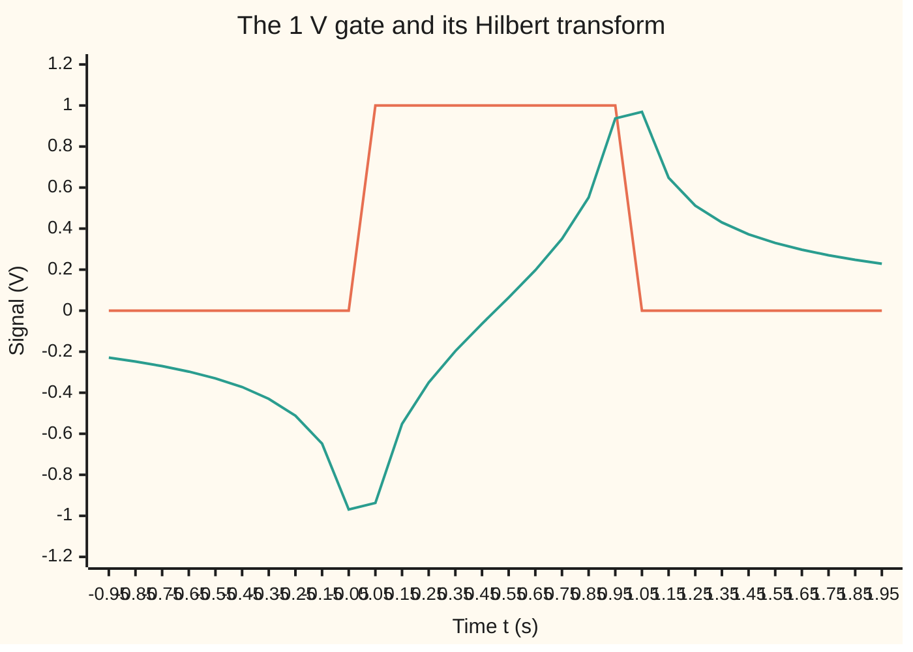
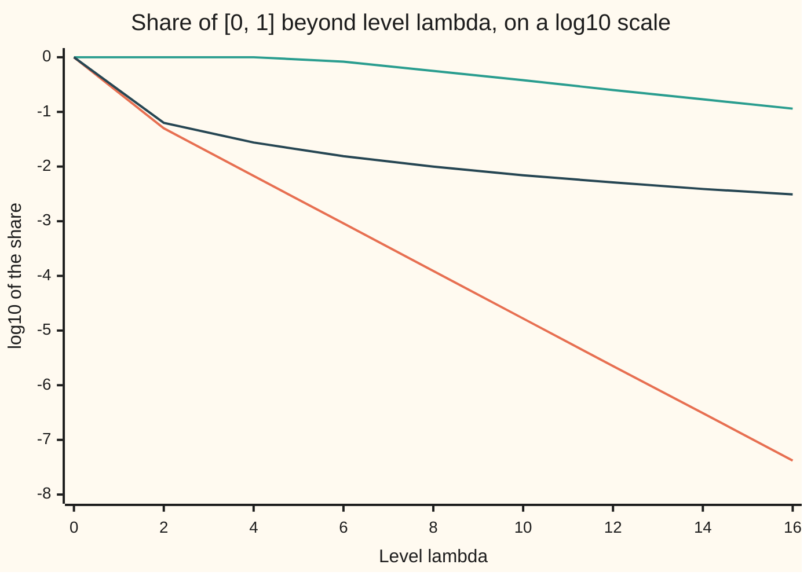

# BMO: functions that wobble a bounded amount on every interval, and the exponential tail that forces

[Syllabus](../../../SYLLABUS.md) → [Harmonic analysis](../README.md) → [Maximal Functions and Beyond](../README.md#s06) → BMO

---

## General Overview

A switch puts 1 V on a line at time 0 s and takes it off at 1 s. That signal is a gate. Feed it to a Hilbert filter, the quarter-turn filter of [The Hilbert transform](../02-The%20Fourier%20Transform/09-hilbert-transform-and-analytic-signals.md). The output has a spike at each edge. At 0.001 s past the edge it reads 2.199 V. At 0.000001 s it reads 4.398 V. It has no ceiling.

So a signal capped at 1 V comes out with no cap, as [Singular integrals](03-singular-integrals-and-the-hilbert-transform-bound.md) showed. What survives is the wobble. Take any stretch of time, average the output over it, then average how far the output strays from that average. For the filtered gate this second number tops out at 0.561100 V, by a search over centred stretches, confirmed by a grid of 31,375 stretches. Such functions have **bounded mean oscillation**, and they form a space called **BMO**.

The model case is $`\ln|t|`$, the natural logarithm of the distance from 0. It falls to minus infinity at 0. Yet on $`[0, 1]`$ its average is −1, and its average distance from −1 is 2/e = 0.735759. On $`[0, 0.001]`$ the average drops to −7.907755, but the wobble stays 0.735759: the logarithm shifts, it does not get wilder.

Bounded wobble forces the **John–Nirenberg inequality**: the share of a stretch where the function strays from its average by more than a level falls off exponentially in the level. For $`\ln|t|`$ on $`[0, 1]`$, the share beyond 2 is 0.049787 and the share beyond 8 is 0.000123. A function such as $`t^{-1/2}`$, whose wobble is not bounded, has a share beyond 8 of 0.010000: a power-law tail, far heavier.

**A function is in BMO when its average distance from its own average is bounded over every interval; singular integrals send bounded functions into BMO, and the John–Nirenberg inequality says that bounded wobble alone forces the share of an interval where the function strays by more than λ to decay exponentially in λ.**

**What kind of fact this is:** a definition and two theorems. Both theorems, the bound for singular integrals on bounded inputs and the John–Nirenberg inequality, are proved on this card in Why it works, for functions on the line. Their constants are the proof's own, not the best possible. The gate is synthetic, from the formulas below: illustrative.

### The picture: the gate and its partner



Orange: the gate g, 1 V from 0 s to 1 s. Teal: its Hilbert transform Hg, which runs to minus infinity at 0 s and plus infinity at 1 s, but only like a logarithm. The samples are offset by 0.05 s, so none lands on an edge.

---

## The formula

Notation first, in words.

- Time $`t`$ is in seconds. $`I`$ is an interval, and $`|I|`$ its length; $`|E|`$ is the length of any set $`E`$.
- Here $`\lambda`$ is a **level**. Other cards on this shelf use $`\lambda`$ for length; here length wears bars, and $`\alpha`$ is the stopping level in the proof.
- $`\lVert f\rVert_\infty`$ is the **ceiling** of $`f`$: the smallest number $`|f|`$ stays at or below, except on a set of length zero. $`L^\infty`$ is the set of functions with a finite ceiling ([Lp spaces](../../10-Measure%20and%20integration/07-Sizes%20of%20Functions/01-lp-spaces.md)).
- $`H`$ is the Hilbert transform, convolution with $`K(t) = 1/(\pi t)`$. For an operator $`T`$, $`\lVert T\rVert_{2\to 2}`$ is its energy norm and $`B`$ its kernel's smoothness constant, as on [Singular integrals](03-singular-integrals-and-the-hilbert-transform-bound.md).

The average of $`f`$ on $`I`$, its **mean oscillation** there, and its **BMO norm**:

```math
f_I = \frac{1}{\lvert I\rvert}\int_I f(t)\,dt, \qquad \mathrm{MO}_I(f) = \frac{1}{\lvert I\rvert}\int_I \lvert f(t) - f_I\rvert\,dt, \qquad \lVert f\rVert_{\mathrm{BMO}} = \sup_I \mathrm{MO}_I(f)
```

**Read it aloud:** f sub I is the average of f over I; the mean oscillation is the average distance of f from that average; and the BMO norm is the largest mean oscillation over every interval on the line.

BMO is the set of functions with a finite BMO norm. A constant has mean oscillation 0, so BMO does not see constants: $`f`$ and $`f + 5`$ have the same norm.

**Singular integrals map bounded functions into BMO.** For the Hilbert transform, and for any operator $`T`$ with an energy bound and a kernel that meets the smoothness condition:

```math
\lVert Hf\rVert_{\mathrm{BMO}} \le 2\Big(\sqrt 2 + \frac{\ln 3}{\pi}\Big)\lVert f\rVert_\infty = 3.527825\,\lVert f\rVert_\infty, \qquad \lVert Tf\rVert_{\mathrm{BMO}} \le 2\big(\sqrt 2\,\lVert T\rVert_{2\to 2} + B\big)\lVert f\rVert_\infty
```

**Read it aloud:** the BMO norm of H f is at most 3.527825 times the ceiling of f; for a general T, root 2 becomes root 2 times its energy norm and ln 3 over pi becomes B.

**The John–Nirenberg inequality.** For every $`f`$ in BMO, every interval $`I`$ and every level $`\lambda > 0`$:

```math
\frac{\lvert\{t \in I : \lvert f(t) - f_I\rvert > \lambda\}\rvert}{\lvert I\rvert} \le e\,\exp\Big(-\frac{\lambda}{2e\,\lVert f\rVert_{\mathrm{BMO}}}\Big)
```

**Read it aloud:** the share of I on which f strays from its average by more than lambda is at most e times the exponential of minus lambda over 2 e times the BMO norm.

Here $`e = 2.718282`$ is Euler's number and $`\exp(x) = e^x`$. The level is measured in units of the norm. The gate $`g`$ has ceiling 1 V, and its partner, from [Singular integrals](03-singular-integrals-and-the-hilbert-transform-bound.md) rescaled from 1 ms to 1 s, which only relabels time, and moved to start at 0 s, is

```math
Hg(t) = \frac{1}{\pi}\ln\Big\lvert\frac{t}{t-1}\Big\rvert
```

Its BMO norm is 0.561100 V, against the bound 3.527825 V: a ratio of 0.159050.

| Symbol | Plain meaning | In our example | Push it up and the answer… |
| --- | --- | --- | --- |
| $`t`$, $`I`$, $`\lvert I\rvert`$ | time in seconds; an interval; its length | $`I = [0, 1]`$, $`\lvert I\rvert = 1`$ s | longer $`I`$: for $`\ln\lvert t\rvert`$ the wobble stays the same |
| $`f`$, $`f_I`$, $`\mathrm{sgn}(t)`$ | a function; its average on $`I`$; the sign of $`t`$: 1, 0 or −1 | $`\ln\lvert t\rvert`$; $`f_{[0,1]} = -1`$; $`\mathrm{sgn}(t)\ln\lvert t\rvert`$ is not in BMO | — |
| $`\mathrm{MO}_I(f)`$ | mean oscillation: average distance from $`f_I`$ | 0.735759 on $`[0, 1]`$ | — |
| $`\lVert f\rVert_{\mathrm{BMO}}`$, BMO | the largest mean oscillation over all intervals; functions where it is finite | 0.930586 for $`\ln\lvert t\rvert`$, at $`[-0.13743, 1]`$ | larger norm: slower guaranteed decay |
| $`g`$, $`H`$, $`Hg`$ | the 1 V gate on $`[0, 1]`$; the Hilbert transform; the gate's partner | $`Hg(1.001) = 2.199`$ V; norm 0.561100 V | taller gate: $`Hg`$ and its norm grow in proportion |
| $`\lVert f\rVert_\infty`$, $`L^\infty`$ | the ceiling; functions with a finite ceiling | $`\lVert g\rVert_\infty = 1`$ V | higher ceiling: larger BMO bound |
| $`T`$, $`K`$, $`\lVert T\rVert_{2\to 2}`$, $`B`$ | a singular integral; its kernel; its energy norm; its smoothness constant | $`K = 1/(\pi t)`$; 1; $`\ln 3/\pi = 0.349699`$ | larger $`B`$: larger BMO bound |
| $`c`$, $`2I`$, $`f_1`$, $`f_2`$ | in the proof: centre of $`I`$; $`I`$ doubled about $`c`$; the input near $`I`$; the input far from it | $`I = [0.75, 1.25]`$, $`c = 1`$, $`2I = [0.5, 1.5]`$ | — |
| $`\lambda`$, $`E`$, $`\lvert E\rvert`$ | a level; a set; its length | share beyond $`\lambda = 2`$: 0.049787 | higher $`\lambda`$: share falls exponentially |
| $`\alpha`$, $`Q_j`$, $`k`$, $`F(\lambda)`$, $`h`$, $`J`$ | in the proof: stopping level; stopped dyadic intervals; generation; the worst share over all functions $`h`$ of norm 1 and intervals $`J`$ | $`\alpha = 2.529594`$; $`Q_1 = [0, 1/16]`$ | — |
| $`e`$, $`\exp`$, $`\ln`$, $`\beta`$ | Euler's number; the exponential; the natural logarithm; in Step 6, a rate inside the exponential | $`e = 2.718282`$; $`\beta = 0.5`$ | larger $`\beta`$: the average of $`\exp(\beta\lvert f - f_I\rvert)`$ grows, infinite from $`\beta = 1`$ |
| $`a`$, $`u`$, $`y`$, $`d`$ | an interval's right end $`[0, a]`$ (in Step 3, any constant); the left end of $`[u, 1]`$; a point far from $`I`$; the dimension, in the fold | $`a = 0.001`$; $`u = -0.13743`$ | — |

### When it holds

- **The function has finite averages on every interval.** The definition needs $`f_I`$. The kernel $`1/t`$ itself has no average on $`[0, 1]`$, so it has no mean oscillation at all.
- **Every interval counts.** One interval says nothing. $`t^{-1/2}`$ has mean oscillation 1.000000 on $`[0, 1]`$, but 10.000000 on $`[0, 0.01]`$ and 1000.000000 on $`[0, 0.000001]`$. It is not in BMO, and its tail is a power law.
- **The singular-integral bound needs both kernel conditions.** The energy bound controls the input near $`I`$, the smoothness condition the input far from it. Drop either and Step 3 has a gap.
- **Without a finite area, $`Hf`$ is defined only up to a constant.** For a constant 1 V input the integral defining $`Hf`$ diverges. Subtracting $`K(-y)`$ for $`\lvert y\rvert \ge 1`$, which does not depend on $`t`$, fixes it, and BMO ignores the constant this adds. The gate has finite area, so it needs no fix.
- **The tail is exponential, never faster in general.** $`\ln|t|`$ on $`[0, 1]`$ has share exactly $`e^{-1-\lambda}`$ beyond $`\lambda \ge 1`$. So no theorem about all of BMO can promise a Gaussian tail such as $`e^{-\lambda^2}`$.

---

## Why it works

### Step 0: a logarithm only shifts when you zoom in

Shrink an interval around 0 by a factor of 10. The function $`\ln|t|`$ drops by $`\ln 10`$ everywhere on it, but keeps its shape. Mean oscillation ignores a shift, so it does not change. That is why an unbounded function can have bounded wobble.

The John–Nirenberg proof runs this the other way. Where $`f`$ strays far from its average, it does so on small intervals. On each, $`f`$ has a new average, and bounded wobble lets it stray far from that one only on a small share again. Each generation costs a fixed step in level and a fixed factor in length: an exponential.

### Step 1: the mean oscillations of the logarithm

On $`[0, 1]`$, the antiderivative of $`\ln t`$ is $`t\ln t - t`$. So the average is $`(1\cdot 0 - 1) - 0 = -1`$.

The function $`\ln t + 1`$ is negative below $`t = 1/e`$ and positive above. Its total on $`[0, 1]`$ is 0, so the two parts have equal size. The negative part is

```math
\int_0^{1/e} (-1 - \ln t)\,dt = -\frac{1}{e} - \Big(\frac{1}{e}\ln\frac{1}{e} - \frac{1}{e}\Big) = \frac{1}{e}
```

So $`\mathrm{MO}_{[0,1]} = 2/e = 0.735759`$. On $`[0, a]`$, each point is $`a`$ times a point of $`[0, 1]`$, and the logarithm of a product is a sum: $`\ln|t|`$ on $`[0, a]`$ is its copy on $`[0, 1]`$ shifted by $`\ln a`$. The mean oscillation is again 0.735759. The check confirms it at $`a = 0.001`$ and $`a = 1000`$, and also on $`[-a, a]`$, where $`\ln|t|`$ is the same on both halves.

But $`[0, a]`$ is not the worst interval. By scaling and mirroring, every interval looks like $`[u, 1]`$ with $`-1 \le u < 1`$. A search over $`u`$ finds the largest mean oscillation at $`u = -0.13743`$: an interval with the spike near its left end. There the average is −1.239796 and the mean oscillation is 0.930586. That is the BMO norm.

### Step 2: the gate's partner wobbles a bounded amount

On $`[0, 1]`$, $`Hg(1 - t) = -Hg(t)`$, so the average is 0. The mean oscillation is

```math
\mathrm{MO}_{[0,1]}(Hg) = \frac{2}{\pi}\int_0^{1/2}\ln\frac{1-t}{t}\,dt = \frac{2}{\pi}\ln 2 = 0.441271\text{ V}
```

The two integrals inside are $`\int_0^{1/2} -\ln t\,dt = \tfrac12\ln 2 + \tfrac12`$ and $`\int_0^{1/2}\ln(1-t)\,dt = \tfrac12\ln 2 - \tfrac12`$; their sum is $`\ln 2`$.

A golden-section search over intervals centred on the gate finds the largest mean oscillation on $`[-0.2071, 1.2071]`$: centred on the gate, with half-width 0.707107 s, which matches $`1/\sqrt 2`$ to six digits. It is 0.561100 V. A grid of 31,375 intervals with ends from −2 s to 3 s finds nothing larger.

The gate itself has norm 0.500000 V: on an interval with a share of it inside the gate, the mean oscillation is twice that share times the rest, largest at one half. Near each edge, $`Hg`$ behaves like $`(1/\pi)\ln|t|`$ plus a smooth part. That is where its BMO membership comes from: the spike is a logarithm, and Step 1 showed a logarithm wobbles a bounded amount.

### Step 3: singular integrals send bounded inputs into BMO

Fix an interval $`I`$ with centre $`c`$. Split the input into the part near $`I`$ and the part far from it:

```math
f = f_1 + f_2, \qquad f_1 = f \text{ on } 2I \text{ and } 0 \text{ elsewhere}, \qquad f_2 = f - f_1
```

Mean oscillation is at most twice the average distance from any constant $`a`$, because $`|f_I - a|`$ is itself at most that average. Choose $`a = Hf_2(c)`$. Then bound two pieces.

1. **The near part, by energy.** The average of a size is at most the square root of the average of its square. The energy of $`Hf_1`$ is at most that of $`f_1`$, which is at most $`|2I|\,\lVert f\rVert_\infty^2`$. So the average of $`|Hf_1|`$ over $`I`$ is at most $`\sqrt{2|I|/|I|}\,\lVert f\rVert_\infty = \sqrt 2\,\lVert f\rVert_\infty`$.
2. **The far part, by smoothness.** For $`t`$ in $`I`$, $`Hf_2(t) - Hf_2(c)`$ is the input far away, weighted by $`K(t - y) - K(c - y)`$. Every far point $`y`$ is at least twice as far from $`c`$ as $`t`$ is. So the smoothness condition of [Singular integrals](03-singular-integrals-and-the-hilbert-transform-bound.md) gives $`|Hf_2(t) - Hf_2(c)| \le B\,\lVert f\rVert_\infty`$, with $`B = \ln 3/\pi = 0.349699`$. The check recomputes $`B`$ as an integral and gets 0.349699.

Adding them and doubling: $`\mathrm{MO}_I(Hf) \le 2(\sqrt 2 + 0.349699)\lVert f\rVert_\infty = 3.527825\,\lVert f\rVert_\infty`$.

The check runs both pieces on the gate for $`I = [0.75, 1.25]`$, which straddles the edge at 1 s. Then $`2I = [0.5, 1.5]`$, so $`f_1`$ is the gate on $`[0.5, 1]`$ and $`f_2`$ the gate on $`[0, 0.5]`$:

| Piece | Bound | Measured |
| --- | ---: | ---: |
| average of $`\lvert Hf_1\rvert`$ over $`I`$ | $`\sqrt 2 = 1.414214`$ | 0.524549 |
| largest $`\lvert Hf_2(t) - Hf_2(1)\rvert`$ on $`I`$ | $`\ln 3/\pi = 0.349699`$ | 0.129064 |
| mean oscillation of $`Hg`$ on $`I`$ | $`2 \times 0.653612 = 1.307225`$ | 0.237385 |

Each piece sits under its own bound, and the true mean oscillation sits under twice their sum. The near part is the spike, controlled only on average. The far part is smooth on $`I`$ and barely moves.

### Step 4: the stopping time, on the logarithm

The John–Nirenberg proof uses the halving of [Calderon-Zygmund decomposition](02-calderon-zygmund-decomposition-in-outline.md). Take $`f = \ln|t|`$, $`I = [0, 1]`$, and the function $`|f - f_I| = |\ln t + 1|`$, whose average on $`I`$ is 0.735759. Choose the stopping level $`\alpha = e\,\lVert f\rVert_{\mathrm{BMO}} = e \times 0.930586 = 2.529594`$.

Halve $`[0, 1]`$ and keep halving, stopping at the first dyadic interval (a half, a quarter, and so on) whose average of $`|\ln t + 1|`$ is above $`\alpha`$.

- $`[0, 1/8]`$ averages 2.079442: go on.
- $`[0, 1/16]`$ averages 2.772589: stop. That is above $`\alpha`$ and at most $`2\alpha = 5.059188`$, as the decomposition promises.
- Every other dyadic interval lies where $`|\ln t + 1|`$ stays below $`\alpha`$, so none stops.

One box, $`Q_1 = [0, 1/16]`$, of length 1/16. The decomposition promises total length at most $`|I|/\alpha`$, and 1/16 is well under it. Outside the box, $`|f - f_I| \le \alpha`$. Inside it, the box's own average differs from $`f_I`$ by $`-\ln 16 = -2.772589`$, at most $`2\alpha`$ in size.

Now repeat inside $`Q_1`$ with its own average. By Step 0, $`\ln|t|`$ on $`[0, 1/16]`$ is a shifted copy of itself on $`[0, 1]`$. So the next box is $`[0, 16^{-2}]`$, and so on:

| Generation $`k`$ | Box | Its length | Its mean minus $`f_I`$ | Beyond level | Share at most |
| ---: | --- | ---: | ---: | ---: | ---: |
| 1 | $`[0, 16^{-1}]`$ | 0.06250000 | −2.772589 | 5.059188 | 0.06250000 |
| 2 | $`[0, 16^{-2}]`$ | 0.00390625 | −5.545177 | 10.118376 | 0.00390625 |
| 3 | $`[0, 16^{-3}]`$ | 0.00024414 | −8.317766 | 15.177564 | 0.00024414 |

Each generation adds $`2\alpha`$ to the level and divides the length by 16. That is an exponential tail, built one generation at a time.

### Step 5: the John–Nirenberg inequality in general

For any $`f`$ of norm 1 the same two facts hold, with the length ratio 16 replaced by its guaranteed value $`\alpha`$. The stopped boxes have total length at most $`|I|/\alpha`$. On each, the box average is within $`2\alpha`$ of $`f_I`$, so straying by $`\lambda`$ from $`f_I`$ means straying by $`\lambda - 2\alpha`$ from the box average. So each step of $`2\alpha`$ in level divides the worst share by $`\alpha`$. The rate $`\ln\alpha/(2\alpha)`$ is largest at $`\alpha = e`$, which gives the constants $`e`$ and $`1/(2e)`$.

<details>
<summary>Detailed proof: the John–Nirenberg inequality on the line</summary>

Scale so that $`\lVert f\rVert_{\mathrm{BMO}} = 1`$; the general case follows by applying this to $`f/\lVert f\rVert_{\mathrm{BMO}}`$. Fix $`\alpha > 1`$ and an interval $`I`$. Define

$`\displaystyle F(\lambda) = \sup\Big\{\frac{|\{t \in J : |h(t) - h_J| > \lambda\}|}{|J|} : J \text{ an interval}, \ \lVert h\rVert_{\mathrm{BMO}} \le 1\Big\} \le 1 .`$

*Decomposition.* Apply the Calderón–Zygmund halving to $`|f - f_I|`$ on $`I`$, at level $`\alpha`$. The whole of $`I`$ is calm, since its average of $`|f - f_I|`$ is at most 1, below $`\alpha`$. The halving returns disjoint dyadic subintervals $`Q_j`$ of $`I`$ with

$`\displaystyle \alpha < \frac{1}{|Q_j|}\int_{Q_j}|f - f_I| \le 2\alpha, \qquad \sum_j |Q_j| \le \frac{1}{\alpha}\int_I |f - f_I| \le \frac{|I|}{\alpha},`$

and $`|f - f_I| \le \alpha`$ almost everywhere outside the $`Q_j`$, by [The Lebesgue differentiation theorem](../../10-Measure%20and%20integration/11-Derivatives%20Meet%20the%20Lebesgue%20Integral/02-lebesgue-differentiation-theorem.md).

*One generation.* On $`Q_j`$, $`|f_{Q_j} - f_I| \le \frac{1}{|Q_j|}\int_{Q_j}|f - f_I| \le 2\alpha`$. Take $`\lambda \ge \alpha`$. Almost every point where $`|f - f_I| > \lambda`$ lies in some $`Q_j`$, and there $`|f - f_{Q_j}| > \lambda - 2\alpha`$. Apply the definition of $`F`$ with $`J = Q_j`$ and $`h = f`$:

$`\displaystyle |\{t \in I : |f - f_I| > \lambda\}| \le \sum_j F(\lambda - 2\alpha)\,|Q_j| \le \frac{F(\lambda - 2\alpha)}{\alpha}\,|I| .`$

Taking the supremum over $`I`$ and $`f`$ gives $`F(\lambda) \le F(\lambda - 2\alpha)/\alpha`$ for $`\lambda \ge 2\alpha`$.

*Iterate.* For $`2\alpha k \le \lambda < 2\alpha(k+1)`$, apply it $`k`$ times and use $`F \le 1`$: $`F(\lambda) \le \alpha^{-k}`$. Since $`k > \lambda/(2\alpha) - 1`$,

$`\displaystyle F(\lambda) \le \alpha\,\exp\Big(-\frac{\lambda\ln\alpha}{2\alpha}\Big).`$

At $`\alpha = e`$ this is $`e\,\exp(-\lambda/(2e))`$. For $`\lambda < 2e`$ the right side is above 1, so it holds there too. In $`d`$ dimensions a cube has $`2^d`$ children, the bound on $`|f_{Q_j} - f_I|`$ becomes $`2^d\alpha`$, and the rate becomes $`1/(2^d e)`$. John and Nirenberg proved the inequality in 1961 (first source below).

</details>

### Step 6: what the tail buys

An exponential tail gives $`\exp(\beta\,|f - f_I|/\lVert f\rVert_{\mathrm{BMO}})`$ a finite average on every interval, for every rate $`\beta`$ below $`1/(2e)`$. So every power of $`|f - f_I|`$ has a finite average too: a BMO function lies in every $`L^p`$ on bounded intervals, though not necessarily in $`L^\infty`$.

For $`\ln|t|`$ the true tail on $`[0, 1]`$ is $`e^{-1-\lambda}`$, so the threshold is $`\beta = 1`$ in raw units. With $`\beta = 0.5`$, the average of $`\exp(0.5\,|\ln t + 1|)`$ on $`[0, 1]`$ is

```math
\frac{e^{-1}}{1 - 0.5} + \frac{e^{0.5} - e^{-1}}{1 + 0.5} = 1.589653
```

The check gets 1.589653 by the midpoint rule too. At $`\beta = 1`$ the first term divides by 0: the average is infinite.

---

## Worked numbers, by hand

John–Nirenberg on $`f = \ln|t|`$, $`I = [0, 1]`$, level $`\lambda = 2`$.

| Step | Arithmetic | Value |
| --- | --- | --- |
| average $`f_I`$ | $`(1\ln 1 - 1) - 0`$ | −1 |
| where $`\ln t + 1 < -2`$ | $`t < e^{-3}`$ | $`t < 0.049787`$ |
| where $`\ln t + 1 > 2`$ | $`t > e^{1}`$, outside $`[0, 1]`$ | none |
| true share | $`e^{-3}`$ | 0.049787 |
| BMO norm | the search of Step 1 | 0.930586 |
| $`2e`$ times the norm | $`2 \times 2.718282 \times 0.930586`$ | 5.059188 |
| bound | $`2.718282 \times \exp(-2/5.059188)`$ | 1.830666 |
| **bound over true share** | $`1.830666 / 0.049787`$ | **36.8** |

At $`\lambda = 2`$ the bound is above 1, so it says nothing yet. The true share falls by a factor $`e`$ per unit of level. The bound promises that fall per 5.059188 units, a rate every BMO function obeys; the logarithm beats it.

| $`\lambda`$ | True share, $`\ln\lvert t\rvert`$ on $`[0, 1]`$ | Grid of a million points | Bound | Bound over true |
| ---: | ---: | ---: | ---: | ---: |
| 1 | 0.135335 | 0.135335 | 2.230754 | 16.5 |
| 2 | 0.049787 | 0.049787 | 1.830666 | 36.8 |
| 4 | 0.006738 | 0.006738 | 1.232888 | 183.0 |
| 8 | 0.000123 | 0.000123 | 0.559181 | 4531.1 |

The gate's partner on $`[0, 1]`$ has an exact share too. $`|Hg| > \lambda`$ where $`t/(1 - t)`$ is above $`e^{\pi\lambda}`$ or below $`e^{-\pi\lambda}`$, a share of $`2/(1 + e^{\pi\lambda})`$:

| $`\lambda`$, V | True share | Grid | Bound, with norm 0.561100 V |
| ---: | ---: | ---: | ---: |
| 0.5 | 0.344206 | 0.344206 | 2.307328 |
| 1.0 | 0.082848 | 0.082848 | 1.958502 |
| 2.0 | 0.003728 | 0.003728 | 1.411087 |

Its tail falls by a factor of $`e^{\pi}`$ for each volt: exponential, as promised.



Orange: $`\ln|t|`$, a straight line, so an exponential tail. Teal: its John–Nirenberg bound, straight but shallower, capped at 1. Dark blue: $`t^{-1/2}`$, not in BMO; its line flattens, the mark of a power-law tail.

### What breaks if you drop a piece

| Mistake | Comes out at | What went wrong |
| --- | --- | --- |
| Test one interval only | $`t^{-1/2}`$: 1.000000 on $`[0, 1]`$, but 10.000000 on $`[0, 0.01]`$ and 1000.000000 on $`[0, 0.000001]`$; share beyond 98 is 0.000100, against $`10^{-43.00}`$ for $`\ln\lvert t\rvert`$ | the wobble grows as the interval shrinks, so the tail is a power law |
| Multiply by a bounded factor | $`\mathrm{sgn}(t)\ln\lvert t\rvert`$: mean oscillation 5.605170 on $`[-0.01, 0.01]`$ and 14.815511 on $`[-0.000001, 0.000001]`$, equal to $`1 - \ln a`$ | the sign flips the two halves apart, so the average sits at 0 while the function runs off both ways |
| Expect the filter to keep the ceiling | $`Hg`$ = 2.199 V at 0.001 s past the edge, 4.398 V at 0.000001 s | the Hilbert transform maps $`L^\infty`$ into BMO, not into $`L^\infty`$ |
| Read the level in raw units | $`10\ln\lvert t\rvert`$ beyond 5: share 0.616600; $`\ln\lvert t\rvert`$ beyond 5: 0.002479 | the level must be measured in units of the BMO norm, which is 10 times larger for the first |

---

## Code, from first principles, and it actually runs

The script writes every tool itself. An exact mean oscillation splits the interval where the function crosses its average and uses the antiderivative on each piece. It takes five independent roads: exact against midpoint rule for each mean oscillation; both against the closed forms 2/e and $`(2/\pi)\ln 2`$; a golden-section search against a grid scan for each norm; closed form against a count of a million grid points for each tail share; and the smoothness integral against $`\ln 3/\pi`$. The two programs print identical output.

### Python

```python
# BMO and the John-Nirenberg inequality -- the check behind the card.  Standard library only.
# f(t) = ln|t|, and the partner of a 1 V gate open from t = 0 to t = 1 s:
# Hg(t) = (1/pi) ln|t/(t - 1)| volts.  Every mean oscillation is found two ways:
# exactly, from an antiderivative split where f crosses its mean, and by the midpoint rule.
from math import log, exp, pi, e, sqrt

xl = lambda t: t * log(abs(t)) if t != 0 else 0.0
LOG = (lambda t: log(abs(t)), lambda t: xl(t) - t, lambda m: [exp(m), -exp(m)])
def partner(p, q):                            # (1/pi) ln|(t-p)/(t-q)|: H of a 1 V gate on [p, q]
    def roots(m):
        r = exp(pi * m)
        return [(p + r * q) / (1 + r)] + ([(p - r * q) / (1 - r)] if abs(r - 1) > 1e-12 else [])
    return (lambda t: log(abs((t - p) / (t - q))) / pi, lambda t: (xl(t - p) - xl(t - q)) / pi, roots)
HG = partner(0.0, 1.0)

def osc(fn, a, b, m=None):                    # (mean on [a,b], average of |f - m|), exactly
    h, F, roots = fn
    mean = (F(b) - F(a)) / (b - a)
    m = mean if m is None else m
    pts = [a] + sorted(t for t in roots(m) if a < t < b) + [b]
    s = 0.0
    for p, q in zip(pts, pts[1:]):
        sg = 1 if h(p + 0.37 * (q - p)) > m else -1
        s += sg * (F(q) - F(p) - m * (q - p))
    return mean, s / (b - a)
def mid(f, a, b, n):
    w = (b - a) / n
    return w * sum(f(a + (k + 0.5) * w) for k in range(n))
def golden(f, lo, hi):
    g = (sqrt(5) - 1) / 2
    for _ in range(120):
        x1, x2 = hi - g * (hi - lo), lo + g * (hi - lo)
        if f(x1) > f(x2): hi = x2
        else: lo = x1
    return (lo + hi) / 2

# 1. ln|t| on [0, 1]: mean -1, mean oscillation 2/e; the same on [0, a] and [-a, a].
m01, o01 = osc(LOG, 0.0, 1.0)
o_mid = mid(lambda v: 3 * v * v * abs(3 * log(v) + 1), 0, 1, 200000)   # t = v^3 tames the log
print("ln|t| on [0,1]: mean %.6f; mean oscillation exact %.6f, midpoint %.6f, 2/e = %.6f" % (m01, o01, o_mid, 2 / e))
assert abs(m01 + 1) < 1e-12 and abs(o01 - 2 / e) < 1e-12 and abs(o_mid - 2 / e) < 1e-6
for lab, a in [("0.001", 0.001), ("1000", 1000.0)]:
    print("ln|t| on [0,%s]: mean %.6f, mean oscillation %.6f; on [-%s,%s]: %.6f"
          % (lab, osc(LOG, 0, a)[0], osc(LOG, 0, a)[1], lab, lab, osc(LOG, -a, a)[1]))
    assert abs(osc(LOG, 0, a)[1] - 2 / e) < 1e-9 and abs(osc(LOG, -a, a)[1] - 2 / e) < 1e-9
# 2. Its BMO norm: by scaling and mirroring, every interval is some [u, 1] with -1 <= u < 1.
grid = max(osc(LOG, -1 + k / 1000, 1.0)[1] for k in range(2000))
u = golden(lambda u: osc(LOG, u, 1.0)[1], -0.5, 0.0)
B = osc(LOG, u, 1.0)[1]
c = mid(lambda v: 3 * v * v * abs(3 * log(v) - osc(LOG, u, 1)[0]), 0, 1, 200000)
c += mid(lambda v: 3 * v * v * abs(3 * log(v) - osc(LOG, u, 1)[0]), 0, (-u) ** (1 / 3), 200000)
print("BMO norm of ln|t|: largest at [%.5f, 1], mean %.6f, oscillation %.6f; midpoint %.6f; grid of 2000 %.6f"
      % (u, osc(LOG, u, 1)[0], B, c / (1 - u), grid))
assert grid <= B + 1e-12 and B - grid < 1e-5 and abs(c / (1 - u) - B) < 1e-6 and B > 2 / e

# 3. The gate g has BMO norm 1/2; its partner Hg is unbounded but has a finite BMO norm.
gate = lambda t: 1.0 if 0 < t < 1 else 0.0
gm = mid(gate, -1, 1, 20000) / 2
go = mid(lambda t: abs(gate(t) - gm), -1, 1, 20000) / 2
gbest = max(2 * th * (1 - th) for th in [k / 1000 for k in range(1001)])   # share th of I inside the gate
print("gate g: on [-1,1] mean %.6f, mean oscillation %.6f; over all intervals 2 th (1 - th) peaks at %.6f" % (gm, go, gbest))
assert abs(go - 0.5) < 1e-9 and abs(gbest - go) < 1e-12
print("Hg at 0.001 s past the edge: %.3f V; at 0.000001 s: %.3f V" % (HG[0](1.001), HG[0](1.000001)))
mH, oH = osc(HG, 0.0, 1.0)
oH_mid = 2 * mid(lambda v: 3 * v * v * abs(HG[0](v ** 3)), 0, 0.5 ** (1 / 3), 200000)
print("Hg on [0,1]: mean %.6f; mean oscillation exact %.6f, midpoint %.6f, (2/pi) ln 2 = %.6f" % (mH, oH, oH_mid, 2 * log(2) / pi))
assert abs(mH) < 1e-12 and abs(oH - 2 * log(2) / pi) < 1e-12 and abs(oH_mid - oH) < 1e-6
s = golden(lambda s: osc(HG, 0.5 - s, 0.5 + s)[1], 0.3, 1.5)
BH = osc(HG, 0.5 - s, 0.5 + s)[1]
gridH = max(osc(HG, -2 + 0.02 * i, -2 + 0.02 * j)[1] for i in range(250) for j in range(i + 1, 251))
print("BMO norm of Hg: largest at [%.4f, %.4f], half-width %.6f, oscillation %.6f V; grid of 31375 intervals %.6f V"
      % (0.5 - s, 0.5 + s, s, BH, gridH))
assert gridH <= BH + 1e-9 and BH - gridH < 1e-3

# 4. Singular integrals map L-infinity into BMO: ||Hf||_BMO <= 2 (sqrt 2 + ln(3)/pi) ||f||_inf.
hor = mid(lambda s: 1 / (pi * (2 * exp(s) - 1)) + 1 / (pi * (2 * exp(s) + 1)), 0, 30, 300000)  # t = +-2e^s
print("smoothness constant, integral of |K(t-1) - K(t)| over |t| > 2: %.6f, ln(3)/pi = %.6f" % (hor, log(3) / pi))
assert abs(log(3) / pi - hor) < 1e-9
C = 2 * (sqrt(2) + log(3) / pi)
print("bound: 2 x (sqrt 2 + ln(3)/pi) = 2 x (%.6f + %.6f) = %.6f; Hg uses %.6f of it, ratio %.6f" % (sqrt(2), log(3) / pi, C, BH, BH / C))
near, far = partner(0.5, 1.0), partner(0.0, 0.5)   # I = [0.75, 1.25], centre 1, doubled I = [0.5, 1.5]
n1 = osc(near, 0.75, 1.25, 0.0)[1]
n2 = max(abs(far[0](0.75 + k / 10000) - far[0](1.0)) for k in range(5001))
mI, oI = osc(HG, 0.75, 1.25)
oI_mid = sum(mid(lambda v: 3 * v * v * abs(log(abs(1 + 1 / (sg * v ** 3))) / pi - mI), 0, 0.25 ** (1 / 3), 100000) for sg in (1, -1)) / 0.5
print("I = [0.75,1.25]: near part average |Hf1| %.6f <= sqrt 2; far part |Hf2 - Hf2(1)| at most %.6f <= ln(3)/pi;"
      " so MO <= 2 x %.6f = %.6f; true MO %.6f, midpoint %.6f" % (n1, n2, n1 + n2, 2 * (n1 + n2), oI, oI_mid))
assert n1 <= sqrt(2) and n2 <= log(3) / pi and oI <= 2 * (n1 + n2) and abs(oI - oI_mid) < 1e-6

# 5. John-Nirenberg: share of I where |f - f_I| > lam is at most e exp(-lam / (2e ||f||_BMO)).
N = 1000000
JN = lambda lam, b: e * exp(-lam / (2 * e * b))
tlog = lambda lam: exp(-1 - lam) + max(0.0, 1 - exp(lam - 1))
for lam in [1, 2, 4, 8]:
    cnt = sum(1 for k in range(N) if abs(log((k + 0.5) / N) + 1) > lam) / N
    print("ln|t|, I = [0,1], lam = %d: share exact %.6f, grid %.6f; bound %.6f; bound/true %.1f"
          % (lam, tlog(lam), cnt, JN(lam, B), JN(lam, B) / tlog(lam)))
    assert abs(cnt - tlog(lam)) < 2e-6 and tlog(lam) <= JN(lam, B)
for lam in [0.5, 1.0, 2.0]:
    cnt = sum(1 for k in range(N) if abs(HG[0]((k + 0.5) / N)) > lam) / N
    ex = 2 / (1 + exp(pi * lam))
    print("Hg, I = [0,1], lam = %.1f V: share exact %.6f, grid %.6f; bound %.6f" % (lam, ex, cnt, JN(lam, BH)))
    assert abs(cnt - ex) < 2e-6 and ex <= JN(lam, BH)
al = e * B                                    # the stopping level of the proof, alpha = e ||f||_BMO
avg16, avg8 = osc(LOG, 0, 1 / 16, -1.0)[1], osc(LOG, 0, 1 / 8, -1.0)[1]   # averages of |ln t + 1|
print("stopping level alpha = e x ||f||_BMO = %.6f x %.6f = %.6f; [0,1/8] averages %.6f (go on), [0,1/16] averages %.6f (stop), <= 2 alpha = %.6f"
      % (e, B, al, avg8, avg16, 2 * al))
assert avg8 <= al < avg16 <= 2 * al and 1 / 16 <= 1 / al
for k in [1, 2, 3]:
    print("generation %d: box [0, 16^-%d] of length %.8f; its mean differs from f_I by %.6f; beyond lam = %.6f the share is at most %.8f"
          % (k, k, 16.0 ** -k, osc(LOG, 0, 16.0 ** -k)[0] + 1, k * 2 * al, 16.0 ** -k))
    assert tlog(k * 2 * al) <= 16.0 ** -k
beta = 0.5                                    # the rate of Step 6
ei = exp(-1) / (1 - beta) + (exp(beta) - exp(-1)) / (1 + beta)
ei_mid = mid(lambda v: 4 * v ** 3 * exp(beta * abs(4 * log(v) + 1)), 0, 1, 200000)
print("average of exp(beta |ln t + 1|) on [0,1], beta = %.1f: exact %.6f, midpoint %.6f; finite exactly when beta is below 1" % (beta, ei, ei_mid))
assert abs(ei - ei_mid) < 1e-6

# 6. What breaks: no single interval decides; a bounded factor; units.
for lab, a in [("1", 1.0), ("0.01", 0.01), ("0.000001", 0.000001)]:
    sq_mo = 2 * mid(lambda v: 2 * v * abs(1 / v - 2 / sqrt(a)), 0, (a / 4) ** 0.5, 20000) / a   # t = v^2
    sl = mid(lambda v: 3 * v * v * abs(3 * log(v)), 0, a ** (1 / 3), 20000) / a
    print("on [0,%s]: t^(-1/2) mean oscillation %.6f; on [-%s,%s]: sgn(t) ln|t| mean oscillation %.6f, 1 - ln a = %.6f"
          % (lab, sq_mo, lab, lab, sl, 1 - log(a)))
    assert abs(sq_mo - 1 / sqrt(a)) < 1e-6 * sq_mo and abs(sl - (1 - log(a))) < 1e-4
for lam in [8, 98]:
    print("I = [0,1], lam = %d: t^(-1/2) share 1/(2+lam)^2 = %.6f; ln|t| share 10^%.2f" % (lam, 1 / (2 + lam) ** 2, log(tlog(lam), 10)))
print("I = [0,1], lam = 5: 10 ln|t| share %.6f; ln|t| share %.6f" % (tlog(0.5), tlog(5)))

# 7. Chart points.
ts = [-0.95 + 0.1 * k for k in range(30)]
print("chart t s: [" + ", ".join("%.2f" % t for t in ts) + "]")
print("chart g V: [" + ", ".join("%.0f" % (1 if 0 < t < 1 else 0) for t in ts) + "]")
print("chart Hg V: [" + ", ".join("%.3f" % HG[0](t) for t in ts) + "]")
ls = list(range(0, 17, 2))
sq = lambda lam: 1 / (2 + lam) ** 2 + max(0.0, 1 - 1 / (2 - lam) ** 2) if lam < 1 else 1 / (2 + lam) ** 2
print("chart log10 share ln|t|: [" + ", ".join("%.2f" % log(tlog(x), 10) for x in ls) + "]")
print("chart log10 bound ln|t|: [" + ", ".join("%.2f" % log(min(1, JN(x, B)), 10) for x in ls) + "]")
print("chart log10 share t^(-1/2): [" + ", ".join("%.2f" % log(sq(x), 10) for x in ls) + "]")
print("ALL CHECKS PASS")
```

**Ran 2026-11-24 on macOS, Python 3.14.10, standard library only. All checks passed. Output, pasted from the run:**

```
ln|t| on [0,1]: mean -1.000000; mean oscillation exact 0.735759, midpoint 0.735759, 2/e = 0.735759
ln|t| on [0,0.001]: mean -7.907755, mean oscillation 0.735759; on [-0.001,0.001]: 0.735759
ln|t| on [0,1000]: mean 5.907755, mean oscillation 0.735759; on [-1000,1000]: 0.735759
BMO norm of ln|t|: largest at [-0.13743, 1], mean -1.239796, oscillation 0.930586; midpoint 0.930586; grid of 2000 0.930585
gate g: on [-1,1] mean 0.500000, mean oscillation 0.500000; over all intervals 2 th (1 - th) peaks at 0.500000
Hg at 0.001 s past the edge: 2.199 V; at 0.000001 s: 4.398 V
Hg on [0,1]: mean 0.000000; mean oscillation exact 0.441271, midpoint 0.441271, (2/pi) ln 2 = 0.441271
BMO norm of Hg: largest at [-0.2071, 1.2071], half-width 0.707107, oscillation 0.561100 V; grid of 31375 intervals 0.561053 V
smoothness constant, integral of |K(t-1) - K(t)| over |t| > 2: 0.349699, ln(3)/pi = 0.349699
bound: 2 x (sqrt 2 + ln(3)/pi) = 2 x (1.414214 + 0.349699) = 3.527825; Hg uses 0.561100 of it, ratio 0.159050
I = [0.75,1.25]: near part average |Hf1| 0.524549 <= sqrt 2; far part |Hf2 - Hf2(1)| at most 0.129064 <= ln(3)/pi; so MO <= 2 x 0.653612 = 1.307225; true MO 0.237385, midpoint 0.237385
ln|t|, I = [0,1], lam = 1: share exact 0.135335, grid 0.135335; bound 2.230754; bound/true 16.5
ln|t|, I = [0,1], lam = 2: share exact 0.049787, grid 0.049787; bound 1.830666; bound/true 36.8
ln|t|, I = [0,1], lam = 4: share exact 0.006738, grid 0.006738; bound 1.232888; bound/true 183.0
ln|t|, I = [0,1], lam = 8: share exact 0.000123, grid 0.000123; bound 0.559181; bound/true 4531.1
Hg, I = [0,1], lam = 0.5 V: share exact 0.344206, grid 0.344206; bound 2.307328
Hg, I = [0,1], lam = 1.0 V: share exact 0.082848, grid 0.082848; bound 1.958502
Hg, I = [0,1], lam = 2.0 V: share exact 0.003728, grid 0.003728; bound 1.411087
stopping level alpha = e x ||f||_BMO = 2.718282 x 0.930586 = 2.529594; [0,1/8] averages 2.079442 (go on), [0,1/16] averages 2.772589 (stop), <= 2 alpha = 5.059188
generation 1: box [0, 16^-1] of length 0.06250000; its mean differs from f_I by -2.772589; beyond lam = 5.059188 the share is at most 0.06250000
generation 2: box [0, 16^-2] of length 0.00390625; its mean differs from f_I by -5.545177; beyond lam = 10.118376 the share is at most 0.00390625
generation 3: box [0, 16^-3] of length 0.00024414; its mean differs from f_I by -8.317766; beyond lam = 15.177564 the share is at most 0.00024414
average of exp(beta |ln t + 1|) on [0,1], beta = 0.5: exact 1.589653, midpoint 1.589653; finite exactly when beta is below 1
on [0,1]: t^(-1/2) mean oscillation 1.000000; on [-1,1]: sgn(t) ln|t| mean oscillation 1.000000, 1 - ln a = 1.000000
on [0,0.01]: t^(-1/2) mean oscillation 10.000000; on [-0.01,0.01]: sgn(t) ln|t| mean oscillation 5.605170, 1 - ln a = 5.605170
on [0,0.000001]: t^(-1/2) mean oscillation 1000.000000; on [-0.000001,0.000001]: sgn(t) ln|t| mean oscillation 14.815511, 1 - ln a = 14.815511
I = [0,1], lam = 8: t^(-1/2) share 1/(2+lam)^2 = 0.010000; ln|t| share 10^-3.91
I = [0,1], lam = 98: t^(-1/2) share 1/(2+lam)^2 = 0.000100; ln|t| share 10^-43.00
I = [0,1], lam = 5: 10 ln|t| share 0.616600; ln|t| share 0.002479
chart t s: [-0.95, -0.85, -0.75, -0.65, -0.55, -0.45, -0.35, -0.25, -0.15, -0.05, 0.05, 0.15, 0.25, 0.35, 0.45, 0.55, 0.65, 0.75, 0.85, 0.95, 1.05, 1.15, 1.25, 1.35, 1.45, 1.55, 1.65, 1.75, 1.85, 1.95]
chart g V: [0, 0, 0, 0, 0, 0, 0, 0, 0, 0, 1, 1, 1, 1, 1, 1, 1, 1, 1, 1, 0, 0, 0, 0, 0, 0, 0, 0, 0, 0]
chart Hg V: [-0.229, -0.248, -0.270, -0.297, -0.330, -0.372, -0.430, -0.512, -0.648, -0.969, -0.937, -0.552, -0.350, -0.197, -0.064, 0.064, 0.197, 0.350, 0.552, 0.937, 0.969, 0.648, 0.512, 0.430, 0.372, 0.330, 0.297, 0.270, 0.248, 0.229]
chart log10 share ln|t|: [0.00, -1.30, -2.17, -3.04, -3.91, -4.78, -5.65, -6.51, -7.38]
chart log10 bound ln|t|: [0.00, 0.00, 0.00, -0.08, -0.25, -0.42, -0.60, -0.77, -0.94]
chart log10 share t^(-1/2): [0.00, -1.20, -1.56, -1.81, -2.00, -2.16, -2.29, -2.41, -2.51]
ALL CHECKS PASS
```

### Rust

```rust
// BMO and the John-Nirenberg inequality -- the same check as the Python script, in Rust.
// std only, no crates.  f(t) = ln|t|, and the partner of a 1 V gate open from t = 0 to t = 1 s:
// Hg(t) = (1/pi) ln|t/(t - 1)| volts.  Every mean oscillation is found two ways:
// exactly, from an antiderivative split where f crosses its mean, and by the midpoint rule.
use std::f64::consts::{E, PI};

struct Func { h: Box<dyn Fn(f64) -> f64>, big_f: Box<dyn Fn(f64) -> f64>, roots: Box<dyn Fn(f64) -> Vec<f64>> }
fn xl(t: f64) -> f64 { if t != 0.0 { t * t.abs().ln() } else { 0.0 } }
fn log_fn() -> Func {
    Func { h: Box::new(|t: f64| t.abs().ln()), big_f: Box::new(|t: f64| xl(t) - t),
           roots: Box::new(|m: f64| vec![m.exp(), -m.exp()]) }
}
fn partner(p: f64, q: f64) -> Func { // (1/pi) ln|(t-p)/(t-q)|: H of a 1 V gate on [p, q]
    Func {
        h: Box::new(move |t: f64| ((t - p) / (t - q)).abs().ln() / PI),
        big_f: Box::new(move |t: f64| (xl(t - p) - xl(t - q)) / PI),
        roots: Box::new(move |m: f64| {
            let r = (PI * m).exp();
            let mut v = vec![(p + r * q) / (1.0 + r)];
            if (r - 1.0).abs() > 1e-12 { v.push((p - r * q) / (1.0 - r)); } v }),
    }
}
fn osc(f: &Func, a: f64, b: f64, mm: Option<f64>) -> (f64, f64) {
    let mean = ((f.big_f)(b) - (f.big_f)(a)) / (b - a);
    let m = mm.unwrap_or(mean);
    let mut r: Vec<f64> = (f.roots)(m).into_iter().filter(|&t| a < t && t < b).collect();
    r.sort_by(|x, y| x.partial_cmp(y).unwrap());
    let mut pts = vec![a]; pts.extend(r); pts.push(b);
    let mut s = 0.0;
    for w in pts.windows(2) {
        let (p, q) = (w[0], w[1]); let sg = if (f.h)(p + 0.37 * (q - p)) > m { 1.0 } else { -1.0 };
        s += sg * ((f.big_f)(q) - (f.big_f)(p) - m * (q - p));
    }
    (mean, s / (b - a))
}
fn mid<F: Fn(f64) -> f64>(f: F, a: f64, b: f64, n: usize) -> f64 {
    let w = (b - a) / n as f64;
    let mut s = 0.0;
    for k in 0..n { s += f(a + (k as f64 + 0.5) * w); } w * s
}
fn golden<F: Fn(f64) -> f64>(f: F, mut lo: f64, mut hi: f64) -> f64 {
    let g = (5f64.sqrt() - 1.0) / 2.0;
    for _ in 0..120 {
        let (x1, x2) = (hi - g * (hi - lo), lo + g * (hi - lo));
        if f(x1) > f(x2) { hi = x2 } else { lo = x1 }
    }
    (lo + hi) / 2.0
}
fn join(v: &[f64], d: usize) -> String { v.iter().map(|x| format!("{:.*}", d, x)).collect::<Vec<_>>().join(", ") }
fn jn(lam: f64, b: f64) -> f64 { E * (-lam / (2.0 * E * b)).exp() }
fn tlog(lam: f64) -> f64 { (-1.0 - lam).exp() + f64::max(0.0, 1.0 - (lam - 1.0).exp()) }

fn main() {
    let (lg, hg) = (log_fn(), partner(0.0, 1.0));
    // 1. ln|t| on [0, 1]: mean -1, mean oscillation 2/e; the same on [0, a] and [-a, a].
    let (m01, o01) = osc(&lg, 0.0, 1.0, None);
    let o_mid = mid(|v| 3.0 * v * v * (3.0 * v.ln() + 1.0).abs(), 0.0, 1.0, 200000);
    println!("ln|t| on [0,1]: mean {:.6}; mean oscillation exact {:.6}, midpoint {:.6}, 2/e = {:.6}", m01, o01, o_mid, 2.0 / E);
    assert!((m01 + 1.0).abs() < 1e-12 && (o01 - 2.0 / E).abs() < 1e-12 && (o_mid - 2.0 / E).abs() < 1e-6);
    for (lab, a) in [("0.001", 0.001), ("1000", 1000.0)] {
        let (m, o) = osc(&lg, 0.0, a, None);
        let o2 = osc(&lg, -a, a, None).1;
        println!("ln|t| on [0,{}]: mean {:.6}, mean oscillation {:.6}; on [-{},{}]: {:.6}", lab, m, o, lab, lab, o2);
        assert!((o - 2.0 / E).abs() < 1e-9 && (o2 - 2.0 / E).abs() < 1e-9);
    }
    // 2. Its BMO norm: by scaling and mirroring, every interval is some [u, 1] with -1 <= u < 1.
    let grid = (0..2000).map(|k| osc(&lg, -1.0 + k as f64 / 1000.0, 1.0, None).1).fold(f64::MIN, f64::max);
    let u = golden(|u| osc(&lg, u, 1.0, None).1, -0.5, 0.0);
    let (mu, b) = osc(&lg, u, 1.0, None);
    let mut c = mid(|v| 3.0 * v * v * (3.0 * v.ln() - mu).abs(), 0.0, 1.0, 200000);
    c += mid(|v| 3.0 * v * v * (3.0 * v.ln() - mu).abs(), 0.0, (-u).powf(1.0 / 3.0), 200000);
    println!("BMO norm of ln|t|: largest at [{:.5}, 1], mean {:.6}, oscillation {:.6}; midpoint {:.6}; grid of 2000 {:.6}",
             u, mu, b, c / (1.0 - u), grid);
    assert!(grid <= b + 1e-12 && b - grid < 1e-5 && (c / (1.0 - u) - b).abs() < 1e-6 && b > 2.0 / E);

    // 3. The gate g has BMO norm 1/2; its partner Hg is unbounded but has a finite BMO norm.
    let gate = |t: f64| if 0.0 < t && t < 1.0 { 1.0 } else { 0.0 };
    let gm = mid(gate, -1.0, 1.0, 20000) / 2.0; let go = mid(|t| (gate(t) - gm).abs(), -1.0, 1.0, 20000) / 2.0;
    let gbest = (0..1001).map(|k| { let th = k as f64 / 1000.0; 2.0 * th * (1.0 - th) }).fold(f64::MIN, f64::max);
    println!("gate g: on [-1,1] mean {:.6}, mean oscillation {:.6}; over all intervals 2 th (1 - th) peaks at {:.6}", gm, go, gbest);
    assert!((go - 0.5).abs() < 1e-9 && (gbest - go).abs() < 1e-12);
    println!("Hg at 0.001 s past the edge: {:.3} V; at 0.000001 s: {:.3} V", (hg.h)(1.001), (hg.h)(1.000001));
    let (mh, oh) = osc(&hg, 0.0, 1.0, None);
    let oh_mid = 2.0 * mid(|v| 3.0 * v * v * (hg.h)(v.powf(3.0)).abs(), 0.0, 0.5f64.powf(1.0 / 3.0), 200000);
    println!("Hg on [0,1]: mean {:.6}; mean oscillation exact {:.6}, midpoint {:.6}, (2/pi) ln 2 = {:.6}", mh, oh, oh_mid, 2.0 * 2f64.ln() / PI);
    assert!(mh.abs() < 1e-12 && (oh - 2.0 * 2f64.ln() / PI).abs() < 1e-12 && (oh_mid - oh).abs() < 1e-6);
    let s = golden(|s| osc(&hg, 0.5 - s, 0.5 + s, None).1, 0.3, 1.5); let bh = osc(&hg, 0.5 - s, 0.5 + s, None).1;
    let mut grid_h = f64::MIN;
    for i in 0..250 { for j in (i + 1)..251 { grid_h = grid_h.max(osc(&hg, -2.0 + 0.02 * i as f64, -2.0 + 0.02 * j as f64, None).1); } }
    println!("BMO norm of Hg: largest at [{:.4}, {:.4}], half-width {:.6}, oscillation {:.6} V; grid of 31375 intervals {:.6} V",
             0.5 - s, 0.5 + s, s, bh, grid_h);
    assert!(grid_h <= bh + 1e-9 && bh - grid_h < 1e-3);

    // 4. Singular integrals map L-infinity into BMO: ||Hf||_BMO <= 2 (sqrt 2 + ln(3)/pi) ||f||_inf.
    let hor = mid(|s| 1.0 / (PI * (2.0 * s.exp() - 1.0)) + 1.0 / (PI * (2.0 * s.exp() + 1.0)), 0.0, 30.0, 300000);
    println!("smoothness constant, integral of |K(t-1) - K(t)| over |t| > 2: {:.6}, ln(3)/pi = {:.6}", hor, 3f64.ln() / PI);
    assert!((3f64.ln() / PI - hor).abs() < 1e-9);
    let cc = 2.0 * (2f64.sqrt() + 3f64.ln() / PI);
    println!("bound: 2 x (sqrt 2 + ln(3)/pi) = 2 x ({:.6} + {:.6}) = {:.6}; Hg uses {:.6} of it, ratio {:.6}",
             2f64.sqrt(), 3f64.ln() / PI, cc, bh, bh / cc);
    let (near, far) = (partner(0.5, 1.0), partner(0.0, 0.5)); // I = [0.75, 1.25], centre 1, doubled I = [0.5, 1.5]
    let n1 = osc(&near, 0.75, 1.25, Some(0.0)).1;
    let n2 = (0..5001).map(|k| ((far.h)(0.75 + k as f64 / 10000.0) - (far.h)(1.0)).abs()).fold(f64::MIN, f64::max);
    let (m_i, o_i) = osc(&hg, 0.75, 1.25, None);
    let o_i_mid = [1.0, -1.0].iter().map(|&sg| mid(|v| 3.0 * v * v * ((1.0 + 1.0 / (sg * v.powf(3.0))).abs().ln() / PI - m_i).abs(), 0.0, 0.25f64.powf(1.0 / 3.0), 100000)).sum::<f64>() / 0.5;
    println!("I = [0.75,1.25]: near part average |Hf1| {:.6} <= sqrt 2; far part |Hf2 - Hf2(1)| at most {:.6} <= ln(3)/pi; so MO <= 2 x {:.6} = {:.6}; true MO {:.6}, midpoint {:.6}",
             n1, n2, n1 + n2, 2.0 * (n1 + n2), o_i, o_i_mid);
    assert!(n1 <= 2f64.sqrt() && n2 <= 3f64.ln() / PI && o_i <= 2.0 * (n1 + n2) && (o_i - o_i_mid).abs() < 1e-6);

    // 5. John-Nirenberg: share of I where |f - f_I| > lam is at most e exp(-lam / (2e ||f||_BMO)).
    let n = 1000000;
    for lam in [1, 2, 4, 8] {
        let l = lam as f64;
        let cnt = (0..n).filter(|&k| (((k as f64 + 0.5) / n as f64).ln() + 1.0).abs() > l).count() as f64 / n as f64;
        println!("ln|t|, I = [0,1], lam = {}: share exact {:.6}, grid {:.6}; bound {:.6}; bound/true {:.1}",
                 lam, tlog(l), cnt, jn(l, b), jn(l, b) / tlog(l));
        assert!((cnt - tlog(l)).abs() < 2e-6 && tlog(l) <= jn(l, b));
    }
    for lam in [0.5, 1.0, 2.0] {
        let cnt = (0..n).filter(|&k| (hg.h)((k as f64 + 0.5) / n as f64).abs() > lam).count() as f64 / n as f64;
        let ex = 2.0 / (1.0 + (PI * lam).exp());
        println!("Hg, I = [0,1], lam = {:.1} V: share exact {:.6}, grid {:.6}; bound {:.6}", lam, ex, cnt, jn(lam, bh));
        assert!((cnt - ex).abs() < 2e-6 && ex <= jn(lam, bh));
    }
    let al = E * b; // the stopping level of the proof, alpha = e ||f||_BMO
    let (avg16, avg8) = (osc(&lg, 0.0, 1.0 / 16.0, Some(-1.0)).1, osc(&lg, 0.0, 1.0 / 8.0, Some(-1.0)).1); // average of |ln t + 1|
    println!("stopping level alpha = e x ||f||_BMO = {:.6} x {:.6} = {:.6}; [0,1/8] averages {:.6} (go on), [0,1/16] averages {:.6} (stop), <= 2 alpha = {:.6}",
             E, b, al, avg8, avg16, 2.0 * al);
    assert!(avg8 <= al && al < avg16 && avg16 <= 2.0 * al && 1.0 / 16.0 <= 1.0 / al);
    for k in [1, 2, 3] {
        let len = 16f64.powf(-(k as f64));
        println!("generation {}: box [0, 16^-{}] of length {:.8}; its mean differs from f_I by {:.6}; beyond lam = {:.6} the share is at most {:.8}",
                 k, k, len, osc(&lg, 0.0, len, None).0 + 1.0, k as f64 * 2.0 * al, len);
        assert!(tlog(k as f64 * 2.0 * al) <= len);
    }
    let beta: f64 = 0.5; // the rate of Step 6
    let ei = (-1f64).exp() / (1.0 - beta) + (beta.exp() - (-1f64).exp()) / (1.0 + beta);
    let ei_mid = mid(|v| 4.0 * v.powf(3.0) * (beta * (4.0 * v.ln() + 1.0).abs()).exp(), 0.0, 1.0, 200000);
    println!("average of exp(beta |ln t + 1|) on [0,1], beta = {:.1}: exact {:.6}, midpoint {:.6}; finite exactly when beta is below 1", beta, ei, ei_mid);
    assert!((ei - ei_mid).abs() < 1e-6);

    // 6. What breaks: no single interval decides; a bounded factor; units.
    for (lab, a) in [("1", 1.0f64), ("0.01", 0.01), ("0.000001", 0.000001)] {
        let sq_mo = 2.0 * mid(|v| 2.0 * v * (1.0 / v - 2.0 / a.sqrt()).abs(), 0.0, (a / 4.0).powf(0.5), 20000) / a; // t = v^2
        let sl = mid(|v| 3.0 * v * v * (3.0 * v.ln()).abs(), 0.0, a.powf(1.0 / 3.0), 20000) / a;
        println!("on [0,{}]: t^(-1/2) mean oscillation {:.6}; on [-{},{}]: sgn(t) ln|t| mean oscillation {:.6}, 1 - ln a = {:.6}",
                 lab, sq_mo, lab, lab, sl, 1.0 - a.ln());
        assert!((sq_mo - 1.0 / a.sqrt()).abs() < 1e-6 * sq_mo && (sl - (1.0 - a.ln())).abs() < 1e-4);
    }
    for lam in [8, 98] {
        println!("I = [0,1], lam = {}: t^(-1/2) share 1/(2+lam)^2 = {:.6}; ln|t| share 10^{:.2}",
                 lam, 1.0 / ((2 + lam) * (2 + lam)) as f64, tlog(lam as f64).ln() / 10f64.ln());
    }
    println!("I = [0,1], lam = 5: 10 ln|t| share {:.6}; ln|t| share {:.6}", tlog(0.5), tlog(5.0));

    // 7. Chart points.
    let ts: Vec<f64> = (0..30).map(|k| -0.95 + 0.1 * k as f64).collect();
    println!("chart t s: [{}]", join(&ts, 2));
    println!("chart g V: [{}]", join(&ts.iter().map(|&t| gate(t)).collect::<Vec<_>>(), 0));
    println!("chart Hg V: [{}]", join(&ts.iter().map(|&t| (hg.h)(t)).collect::<Vec<_>>(), 3));
    let ls: Vec<f64> = (0..9).map(|k| 2.0 * k as f64).collect(); let lg10 = |x: f64| x.ln() / 10f64.ln();
    let sq = |l: f64| if l < 1.0 { 1.0 / (2.0 + l).powf(2.0) + f64::max(0.0, 1.0 - 1.0 / (2.0 - l).powf(2.0)) } else { 1.0 / (2.0 + l).powf(2.0) };
    println!("chart log10 share ln|t|: [{}]", join(&ls.iter().map(|&x| lg10(tlog(x))).collect::<Vec<_>>(), 2));
    println!("chart log10 bound ln|t|: [{}]", join(&ls.iter().map(|&x| lg10(f64::min(1.0, jn(x, b)))).collect::<Vec<_>>(), 2));
    println!("chart log10 share t^(-1/2): [{}]", join(&ls.iter().map(|&x| lg10(sq(x))).collect::<Vec<_>>(), 2));
    println!("ALL CHECKS PASS");
}
```

**Ran 2026-11-24 on macOS, rustc 1.98.1, no crates. All checks passed. Output, pasted from the run:**

```
ln|t| on [0,1]: mean -1.000000; mean oscillation exact 0.735759, midpoint 0.735759, 2/e = 0.735759
ln|t| on [0,0.001]: mean -7.907755, mean oscillation 0.735759; on [-0.001,0.001]: 0.735759
ln|t| on [0,1000]: mean 5.907755, mean oscillation 0.735759; on [-1000,1000]: 0.735759
BMO norm of ln|t|: largest at [-0.13743, 1], mean -1.239796, oscillation 0.930586; midpoint 0.930586; grid of 2000 0.930585
gate g: on [-1,1] mean 0.500000, mean oscillation 0.500000; over all intervals 2 th (1 - th) peaks at 0.500000
Hg at 0.001 s past the edge: 2.199 V; at 0.000001 s: 4.398 V
Hg on [0,1]: mean 0.000000; mean oscillation exact 0.441271, midpoint 0.441271, (2/pi) ln 2 = 0.441271
BMO norm of Hg: largest at [-0.2071, 1.2071], half-width 0.707107, oscillation 0.561100 V; grid of 31375 intervals 0.561053 V
smoothness constant, integral of |K(t-1) - K(t)| over |t| > 2: 0.349699, ln(3)/pi = 0.349699
bound: 2 x (sqrt 2 + ln(3)/pi) = 2 x (1.414214 + 0.349699) = 3.527825; Hg uses 0.561100 of it, ratio 0.159050
I = [0.75,1.25]: near part average |Hf1| 0.524549 <= sqrt 2; far part |Hf2 - Hf2(1)| at most 0.129064 <= ln(3)/pi; so MO <= 2 x 0.653612 = 1.307225; true MO 0.237385, midpoint 0.237385
ln|t|, I = [0,1], lam = 1: share exact 0.135335, grid 0.135335; bound 2.230754; bound/true 16.5
ln|t|, I = [0,1], lam = 2: share exact 0.049787, grid 0.049787; bound 1.830666; bound/true 36.8
ln|t|, I = [0,1], lam = 4: share exact 0.006738, grid 0.006738; bound 1.232888; bound/true 183.0
ln|t|, I = [0,1], lam = 8: share exact 0.000123, grid 0.000123; bound 0.559181; bound/true 4531.1
Hg, I = [0,1], lam = 0.5 V: share exact 0.344206, grid 0.344206; bound 2.307328
Hg, I = [0,1], lam = 1.0 V: share exact 0.082848, grid 0.082848; bound 1.958502
Hg, I = [0,1], lam = 2.0 V: share exact 0.003728, grid 0.003728; bound 1.411087
stopping level alpha = e x ||f||_BMO = 2.718282 x 0.930586 = 2.529594; [0,1/8] averages 2.079442 (go on), [0,1/16] averages 2.772589 (stop), <= 2 alpha = 5.059188
generation 1: box [0, 16^-1] of length 0.06250000; its mean differs from f_I by -2.772589; beyond lam = 5.059188 the share is at most 0.06250000
generation 2: box [0, 16^-2] of length 0.00390625; its mean differs from f_I by -5.545177; beyond lam = 10.118376 the share is at most 0.00390625
generation 3: box [0, 16^-3] of length 0.00024414; its mean differs from f_I by -8.317766; beyond lam = 15.177564 the share is at most 0.00024414
average of exp(beta |ln t + 1|) on [0,1], beta = 0.5: exact 1.589653, midpoint 1.589653; finite exactly when beta is below 1
on [0,1]: t^(-1/2) mean oscillation 1.000000; on [-1,1]: sgn(t) ln|t| mean oscillation 1.000000, 1 - ln a = 1.000000
on [0,0.01]: t^(-1/2) mean oscillation 10.000000; on [-0.01,0.01]: sgn(t) ln|t| mean oscillation 5.605170, 1 - ln a = 5.605170
on [0,0.000001]: t^(-1/2) mean oscillation 1000.000000; on [-0.000001,0.000001]: sgn(t) ln|t| mean oscillation 14.815511, 1 - ln a = 14.815511
I = [0,1], lam = 8: t^(-1/2) share 1/(2+lam)^2 = 0.010000; ln|t| share 10^-3.91
I = [0,1], lam = 98: t^(-1/2) share 1/(2+lam)^2 = 0.000100; ln|t| share 10^-43.00
I = [0,1], lam = 5: 10 ln|t| share 0.616600; ln|t| share 0.002479
chart t s: [-0.95, -0.85, -0.75, -0.65, -0.55, -0.45, -0.35, -0.25, -0.15, -0.05, 0.05, 0.15, 0.25, 0.35, 0.45, 0.55, 0.65, 0.75, 0.85, 0.95, 1.05, 1.15, 1.25, 1.35, 1.45, 1.55, 1.65, 1.75, 1.85, 1.95]
chart g V: [0, 0, 0, 0, 0, 0, 0, 0, 0, 0, 1, 1, 1, 1, 1, 1, 1, 1, 1, 1, 0, 0, 0, 0, 0, 0, 0, 0, 0, 0]
chart Hg V: [-0.229, -0.248, -0.270, -0.297, -0.330, -0.372, -0.430, -0.512, -0.648, -0.969, -0.937, -0.552, -0.350, -0.197, -0.064, 0.064, 0.197, 0.350, 0.552, 0.937, 0.969, 0.648, 0.512, 0.430, 0.372, 0.330, 0.297, 0.270, 0.248, 0.229]
chart log10 share ln|t|: [0.00, -1.30, -2.17, -3.04, -3.91, -4.78, -5.65, -6.51, -7.38]
chart log10 bound ln|t|: [0.00, 0.00, 0.00, -0.08, -0.25, -0.42, -0.60, -0.77, -0.94]
chart log10 share t^(-1/2): [0.00, -1.20, -1.56, -1.81, -2.00, -2.16, -2.29, -2.41, -2.51]
ALL CHECKS PASS
```

### Lean

Lean proves the John–Nirenberg inequality for every function and interval, and the two facts about $`\ln|t|`$ from Step 1.

- Take $`f`$ with finite averages on every interval, mean oscillation at most $`M`$ on each, an interval $`I`$ and a level $`\lambda > 0`$. Then the share of $`I`$ where $`|f(t) - f_I| > \lambda`$ is at most $`e\exp(-\lambda/(2eM))`$. With $`M`$ the BMO norm, this is the inequality of The formula.
- Take any $`a > 0`$. Then the average of $`\ln|t|`$ on $`[0, a]`$ is $`\ln a - 1`$, so −1 on $`[0, 1]`$.
- Take any $`a > 0`$. Then the mean oscillation of $`\ln|t|`$ on $`[0, a]`$ is $`2/e`$, the same for every $`a`$.
- The grid of Step 2 has 31,375 intervals, and the boxes of Step 4 have lengths 1/16, 1/256 and 1/4096.

The BMO norms, the Hilbert transform and its bound, the measured shares and the failing examples are left to the Python and Rust checks.

```lean
-- BMO: a function on the line whose mean oscillation is at most M on every interval strays from its average by more than λ on a share of each interval at most e·exp(-λ/(2eM)), and ln|t| has average ln a - 1 and mean oscillation 2/e on every [0, a].
import Mathlib.MeasureTheory.Integral.Average
import Mathlib.MeasureTheory.Measure.Lebesgue.Basic
import Mathlib.Analysis.SpecialFunctions.Log.Basic
import Mathlib.Analysis.SpecialFunctions.Exp
import Mathlib.MeasureTheory.Covering.OneDim
import Mathlib.Analysis.SpecialFunctions.Integrals.Basic
import Mathlib.Algebra.Order.Floor.Semifield
import Mathlib.Tactic.NormNum

open MeasureTheory Set Real

/-- The average of `f` over `[l, r]` differs from a constant `c` by at most the average of
`|f - c|`. -/
theorem jn_abs_avg_sub_le (f : ℝ → ℝ) (c l r : ℝ) (hlr : l < r) (hf : IntegrableOn f (Icc l r)) :
    |(⨍ t in Icc l r, f t) - c| ≤ ⨍ t in Icc l r, |f t - c| := by
  have hv : volume.real (Icc l r) = r - l := Real.volume_real_Icc_of_le hlr.le
  have hpos : 0 < r - l := by linarith
  have key : (⨍ t in Icc l r, f t) - c = ⨍ t in Icc l r, (f t - c) := by
    rw [setAverage_eq, setAverage_eq, integral_sub hf (integrableOn_const measure_Icc_lt_top.ne), setIntegral_const,
      smul_eq_mul, smul_eq_mul, smul_eq_mul, hv]
    field_simp
  rw [key, setAverage_eq, setAverage_eq, smul_eq_mul, smul_eq_mul, abs_mul, hv,
    abs_of_pos (inv_pos.mpr hpos)]
  gcongr
  simpa [Real.norm_eq_abs] using norm_integral_le_integral_norm (μ := volume.restrict (Icc l r))
    (fun t => f t - c)

/-- Dyadic cells: if `x` lies in the cell `j` of generation `n` of `[a, b]`, then
`j = ⌊(x - a) / ((b - a) / 2^n)⌋₊`. -/
theorem jn_cell_index (a b : ℝ) (hab : a < b) (n j : ℕ) (x : ℝ)
    (hx : x ∈ Ico (a + j * ((b - a) / 2 ^ n)) (a + (j + 1) * ((b - a) / 2 ^ n))) :
    j = ⌊(x - a) / ((b - a) / 2 ^ n)⌋₊ := by
  have hS : 0 < (b - a) / 2 ^ n := div_pos (by linarith) (by positivity)
  symm
  rw [Nat.floor_eq_iff (div_nonneg (by nlinarith [hx.1, (Nat.cast_nonneg j : (0:ℝ) ≤ j)]) hS.le)]
  constructor
  · rw [le_div_iff₀ hS]; linarith [hx.1]
  · rw [div_lt_iff₀ hS]; linarith [hx.2]

/-- Every point of `[a, b)` lies in some cell of every generation. -/
theorem jn_cell_exists (a b : ℝ) (hab : a < b) (n : ℕ) (x : ℝ) (hx : x ∈ Ico a b) :
    ∃ j : ℕ, j < 2 ^ n ∧ x ∈ Ico (a + j * ((b - a) / 2 ^ n)) (a + (j + 1) * ((b - a) / 2 ^ n)) := by
  have hS : 0 < (b - a) / 2 ^ n := div_pos (by linarith) (by positivity)
  have hy0 : 0 ≤ (x - a) / ((b - a) / 2 ^ n) := div_nonneg (by linarith [hx.1]) hS.le
  refine ⟨⌊(x - a) / ((b - a) / 2 ^ n)⌋₊, ?_, ?_, ?_⟩
  · rw [Nat.floor_lt hy0, div_lt_iff₀ hS]
    push_cast
    field_simp
    linarith [hx.2]
  · have := Nat.floor_le hy0
    rw [le_div_iff₀ hS] at this
    linarith
  · have := Nat.lt_floor_add_one ((x - a) / ((b - a) / 2 ^ n))
    rw [div_lt_iff₀ hS] at this
    linarith

/-- Cells are nested: the generation-`m` cell holding `x` is the ancestor `j / 2^(n - m)` of the
generation-`n` cell `j` holding `x`. -/
theorem jn_cell_nest (a b : ℝ) (hab : a < b) (m i n j : ℕ) (x : ℝ) (hmn : m ≤ n)
    (hi : x ∈ Ico (a + i * ((b - a) / 2 ^ m)) (a + (i + 1) * ((b - a) / 2 ^ m)))
    (hj : x ∈ Ico (a + j * ((b - a) / 2 ^ n)) (a + (j + 1) * ((b - a) / 2 ^ n))) :
    i = j / 2 ^ (n - m) := by
  rw [jn_cell_index a b hab m i x hi, jn_cell_index a b hab n j x hj, ← Nat.floor_div_natCast]
  congr 1
  obtain ⟨d, rfl⟩ := Nat.exists_eq_add_of_le hmn
  have hba : (b - a) ≠ 0 := by linarith
  simp only [Nat.add_sub_cancel_left, pow_add, Nat.cast_pow, Nat.cast_ofNat]
  field_simp


open scoped ENNReal in
/-- One stopping-time step: if every interval has share at most `C` above level `lam`, then
every interval has measure at most `C · |I| / e` above level `lam + 2eM`. -/
theorem jn_step (f : ℝ → ℝ) (hf : ∀ a b : ℝ, IntegrableOn f (Icc a b)) (M : ℝ) (hM0 : 0 < M)
    (hM : ∀ a b : ℝ, a < b → ⨍ t in Icc a b, |f t - ⨍ s in Icc a b, f s| ≤ M)
    (lam : ℝ) (hlam : 0 ≤ lam) (C : ℝ≥0∞)
    (hC : ∀ c d : ℝ, c < d →
      volume {t ∈ Icc c d | lam < |f t - ⨍ s in Icc c d, f s|} ≤ C * volume (Icc c d))
    (a b : ℝ) (hab : a < b) :
    volume {t ∈ Icc a b | lam + 2 * exp 1 * M < |f t - ⨍ s in Icc a b, f s|}
      ≤ C * ENNReal.ofReal ((b - a) / exp 1) := by
  obtain ⟨e, he⟩ : ∃ e, e = exp 1 := ⟨_, rfl⟩
  rw [← he]
  have he1 : 1 < e := he ▸ one_lt_exp_iff.mpr one_pos
  obtain ⟨fI, hfI⟩ : ∃ fI, fI = ⨍ s in Icc a b, f s := ⟨_, rfl⟩
  rw [← hfI]
  obtain ⟨g, hg⟩ : ∃ g : ℝ → ℝ, g = fun t => |f t - fI| := ⟨_, rfl⟩
  have hg0 : ∀ t, 0 ≤ g t := fun t => by rw [hg]; exact abs_nonneg _
  have hgi : ∀ c d, IntegrableOn g (Icc c d) := fun c d => by
    rw [hg]; exact ((hf c d).sub (integrableOn_const measure_Icc_lt_top.ne)).abs
  obtain ⟨L, hL⟩ : ∃ L : ℕ → ℕ → ℝ, L = fun (n j : ℕ) => a + (j : ℝ) * ((b - a) / 2 ^ n) := ⟨_, rfl⟩
  obtain ⟨R, hR⟩ : ∃ R : ℕ → ℕ → ℝ, R = fun (n j : ℕ) => a + ((j : ℝ) + 1) * ((b - a) / 2 ^ n) := ⟨_, rfl⟩
  have hSpos : ∀ n : ℕ, 0 < (b - a) / 2 ^ n := fun n => div_pos (by linarith) (by positivity)
  have hRL : ∀ n j, R n j - L n j = (b - a) / 2 ^ n := fun n j => by rw [hL, hR]; ring
  have hLR : ∀ n j, L n j < R n j := fun n j => by linarith [hRL n j, hSpos n]
  have hvol : ∀ n j, volume.real (Icc (L n j) (R n j)) = (b - a) / 2 ^ n := fun n j => by
    rw [Real.volume_real_Icc_of_le (hLR n j).le, hRL]
  have hsub : ∀ n j, j < 2 ^ n → Icc (L n j) (R n j) ⊆ Icc a b := by
    intro n j hj
    apply Icc_subset_Icc
    · rw [hL]; exact le_add_of_nonneg_right (mul_nonneg (Nat.cast_nonneg _) (hSpos n).le)
    · rw [hR]; simp only
      have h1 : ((j : ℝ) + 1) ≤ 2 ^ n := by exact_mod_cast hj
      calc a + (j + 1) * ((b - a) / 2 ^ n) ≤ a + 2 ^ n * ((b - a) / 2 ^ n) := by
            gcongr
        _ = b := by field_simp; ring
  obtain ⟨bad, hbad⟩ : ∃ bad : ℕ → ℕ → Prop,
      bad = fun n j => e * M < ⨍ t in Icc (L n j) (R n j), g t := ⟨_, rfl⟩
  obtain ⟨stop, hstop⟩ : ∃ stop : ℕ × ℕ → Prop,
      stop = fun p => p.2 < 2 ^ p.1 ∧ bad p.1 p.2 ∧ ∀ m < p.1, ¬ bad m (p.2 / 2 ^ (p.1 - m)) :=
    ⟨_, rfl⟩
  classical
  obtain ⟨T, hT⟩ : ∃ T : ℕ × ℕ → Set ℝ,
      T = fun p => if stop p then Ico (L p.1 p.2) (R p.1 p.2) else ∅ := ⟨_, rfl⟩
  have hnest : ∀ x m i n j, x ∈ Ico (L m i) (R m i) → x ∈ Ico (L n j) (R n j) → m ≤ n →
      i = j / 2 ^ (n - m) := by
    intro x m i n j hi hj hmn
    rw [hL, hR] at hi hj
    exact jn_cell_nest a b hab m i n j x hmn hi hj
  have hexists : ∀ x ∈ Ico a b, ∀ n, ∃ j : ℕ, j < 2 ^ n ∧ x ∈ Ico (L n j) (R n j) := by
    intro x hx n
    rw [hL, hR]
    exact jn_cell_exists a b hab n x hx
  have hmemT : ∀ p x, x ∈ T p ↔ stop p ∧ x ∈ Ico (L p.1 p.2) (R p.1 p.2) := by
    intro p x; rw [hT]; simp only; split_ifs with h <;> simp [h]
  have hdisj : Pairwise (Function.onFun Disjoint T) := by
    intro p q hpq
    rw [Function.onFun, Set.disjoint_left]
    intro x hxp hxq
    obtain ⟨hsp, hxp⟩ := (hmemT p x).1 hxp
    obtain ⟨hsq, hxq⟩ := (hmemT q x).1 hxq
    rw [hstop] at hsp hsq
    obtain ⟨_, hbp, hmp⟩ := hsp
    obtain ⟨_, hbq, hmq⟩ := hsq
    apply hpq
    rcases lt_trichotomy p.1 q.1 with h | h | h
    · have hn := hnest x p.1 p.2 q.1 q.2 hxp hxq h.le
      rw [hn] at hbp
      exact absurd hbp (hmq p.1 h)
    · have hn := hnest x p.1 p.2 q.1 q.2 hxp hxq h.le
      rw [h, Nat.sub_self, pow_zero, Nat.div_one] at hn
      exact Prod.ext h hn
    · have hn := hnest x q.1 q.2 p.1 p.2 hxq hxp h.le
      rw [hn] at hbq
      exact absurd hbq (hmp q.1 h)
  have hTmeas : ∀ p, MeasurableSet (T p) := by
    intro p; rw [hT]; simp only; split_ifs <;> simp [measurableSet_Ico]
  have hpar : ∀ p, stop p → |(⨍ t in Icc (L p.1 p.2) (R p.1 p.2), f t) - fI| ≤ 2 * e * M := by
    rintro ⟨n, j⟩ hs
    rw [hstop] at hs
    obtain ⟨hj, hb, hm⟩ := hs
    obtain ⟨n, rfl⟩ : ∃ n', n = n' + 1 := by
      rcases n with _ | n
      · exfalso
        have hj0 : j = 0 := by simpa using hj
        subst hj0
        rw [hbad] at hb
        simp only at hb
        have hL0 : L 0 0 = a := by rw [hL]; simp
        have hR0 : R 0 0 = b := by rw [hR]; simp
        rw [hL0, hR0] at hb
        have := hM a b hab
        rw [← hfI] at this
        simp only [hg] at hb
        nlinarith
      · exact ⟨n, rfl⟩
    have hpg := hm n (Nat.lt_succ_self n)
    rw [Nat.add_sub_cancel_left, pow_one, hbad] at hpg
    simp only [not_lt] at hpg
    have hSn := hSpos n
    have hDP : Icc (L (n+1) j) (R (n+1) j) ⊆ Icc (L n (j/2)) (R n (j/2)) := by
      apply Icc_subset_Icc
      · rw [hL]; simp only
        have h2 : ((j / 2 : ℕ) : ℝ) * 2 ≤ j := by exact_mod_cast Nat.div_mul_le_self j 2
        rw [pow_succ]
        calc a + ↑(j / 2) * ((b - a) / 2 ^ n)
            = a + (↑(j / 2) * 2) * ((b - a) / (2 ^ n * 2)) := by field_simp
          _ ≤ a + j * ((b - a) / (2 ^ n * 2)) := by gcongr
      · rw [hR]; simp only
        have h2 : (j : ℝ) + 1 ≤ (((j / 2 : ℕ) : ℝ) + 1) * 2 := by
          have : j + 1 ≤ (j / 2 + 1) * 2 := by omega
          exact_mod_cast this
        rw [pow_succ]
        calc a + (↑j + 1) * ((b - a) / (2 ^ n * 2))
            ≤ a + ((↑(j / 2) + 1) * 2) * ((b - a) / (2 ^ n * 2)) := by gcongr
          _ = a + (↑(j / 2) + 1) * ((b - a) / 2 ^ n) := by field_simp
    have hint : ∫ t in Icc (L (n+1) j) (R (n+1) j), g t
        ≤ ∫ t in Icc (L n (j/2)) (R n (j/2)), g t :=
      setIntegral_mono_set (hgi _ _) (Filter.Eventually.of_forall (fun t => hg0 t))
        (Filter.Eventually.of_forall hDP)
    have havg : ⨍ t in Icc (L (n+1) j) (R (n+1) j), g t ≤ 2 * e * M := by
      rw [setAverage_eq, smul_eq_mul, hvol] at hpg ⊢
      rw [pow_succ]
      calc ((b - a) / (2 ^ n * 2))⁻¹ * ∫ t in Icc (L (n+1) j) (R (n+1) j), g t
          ≤ ((b - a) / (2 ^ n * 2))⁻¹ * ∫ t in Icc (L n (j/2)) (R n (j/2)), g t := by
            gcongr
        _ = 2 * (((b - a) / 2 ^ n)⁻¹ * ∫ t in Icc (L n (j/2)) (R n (j/2)), g t) := by
            field_simp
        _ ≤ 2 * (e * M) := by gcongr
        _ = 2 * e * M := by ring
    calc |(⨍ t in Icc (L (n+1) j) (R (n+1) j), f t) - fI|
        ≤ ⨍ t in Icc (L (n+1) j) (R (n+1) j), |f t - fI| :=
          jn_abs_avg_sub_le f fI _ _ (hLR _ _) (hf _ _)
      _ = ⨍ t in Icc (L (n+1) j) (R (n+1) j), g t := by rw [hg]
      _ ≤ 2 * e * M := havg
  have hgood : ∀ x ∈ Ico a b, (∀ p, x ∉ T p) → ∀ n j, x ∈ Ico (L n j) (R n j) → ¬ bad n j := by
    intro x hx hnot n
    induction n using Nat.strong_induction_on with
    | _ n ih =>
      intro j hxj hb
      obtain ⟨j', hj'lt, hxj'⟩ := hexists x hx n
      have hjj : j' = j / 2 ^ (n - n) := hnest x n j' n j hxj' hxj le_rfl
      rw [Nat.sub_self, pow_zero, Nat.div_one] at hjj
      subst hjj
      apply hnot (n, j')
      rw [hmemT]
      refine ⟨?_, hxj⟩
      rw [hstop]
      refine ⟨hj'lt, hb, fun m hm => ?_⟩
      obtain ⟨i, -, hxi⟩ := hexists x hx m
      have := hnest x m i n j' hxi hxj hm.le
      rw [← this]
      exact ih m hm i hxi
  have hae : ∀ᵐ x, x ∈ Ico a b → (∀ n j, x ∈ Ico (L n j) (R n j) → ¬ bad n j) → g x ≤ e * M := by
    have hgloc : LocallyIntegrable g volume := by
      rw [locallyIntegrable_iff]
      intro k hk
      obtain ⟨r, hr⟩ := hk.bddBelow
      obtain ⟨s, hs⟩ := hk.bddAbove
      exact (hgi r s).mono_set (fun t ht => ⟨hr ht, hs ht⟩)
    filter_upwards [IsUnifLocDoublingMeasure.ae_tendsto_average volume hgloc 1] with x hx hxI hgd
    choose J hJlt hJ using hexists x hxI
    have hlim := hx (l := Filter.atTop) (fun n => (L n (J n) + R n (J n)) / 2)
      (fun n => (R n (J n) - L n (J n)) / 2) ?_ ?_
    · simp only [← Real.Icc_eq_closedBall] at hlim
      refine le_of_tendsto' hlim (fun n => ?_)
      have := hgd n (J n) (hJ n)
      rw [hbad] at this
      exact not_lt.mp this
    · simp only [hRL]
      have h0 : Filter.Tendsto (fun n : ℕ => (b - a) / 2 ^ n / 2) Filter.atTop (nhds 0) := by
        have := (tendsto_pow_atTop_nhds_zero_of_lt_one (by norm_num : (0:ℝ) ≤ 1/2)
          (by norm_num : (1/2:ℝ) < 1)).const_mul ((b - a) / 2)
        rw [mul_zero] at this
        refine this.congr (fun n => ?_)
        field_simp
        rw [← mul_pow]; norm_num
      exact tendsto_nhdsWithin_iff.mpr ⟨h0, Filter.Eventually.of_forall fun n => by
        have := hSpos n; simp only [mem_Ioi]; positivity⟩
    · refine Filter.Eventually.of_forall fun n => ?_
      rw [one_mul, ← Real.Icc_eq_closedBall]
      exact Ico_subset_Icc_self (hJ n)
  obtain ⟨N, hN⟩ : ∃ N : Set ℝ, N = {x | x ∈ Ico a b ∧
      (∀ n j, x ∈ Ico (L n j) (R n j) → ¬ bad n j) ∧ e * M < g x} := ⟨_, rfl⟩
  have hN0 : volume N = 0 := by
    rw [ae_iff] at hae
    refine measure_mono_null (fun x hx => ?_) hae
    rw [hN] at hx
    obtain ⟨h1, h2, h3⟩ := hx
    simp only [mem_ofPred_eq]
    intro h
    exact absurd (h h1 h2) (not_le.mpr h3)
  obtain ⟨U, hU⟩ : ∃ U : ℕ × ℕ → Set ℝ, U = fun p => if stop p then
      {t ∈ Icc (L p.1 p.2) (R p.1 p.2) | lam < |f t - ⨍ s in Icc (L p.1 p.2) (R p.1 p.2), f s|}
      else ∅ := ⟨_, rfl⟩
  have hcover : {t ∈ Icc a b | lam + 2 * e * M < |f t - fI|} ⊆ ({b} ∪ N) ∪ ⋃ p, U p := by
    rintro t ⟨htI, htl⟩
    by_cases htb : t = b
    · left; left; exact htb
    have htI' : t ∈ Ico a b := ⟨htI.1, lt_of_le_of_ne htI.2 htb⟩
    by_cases hex : ∃ p, t ∈ T p
    · obtain ⟨p, hp⟩ := hex
      obtain ⟨hsp, htp⟩ := (hmemT p t).1 hp
      right
      refine mem_iUnion.2 ⟨p, ?_⟩
      rw [hU]
      simp only [hsp, ↓reduceIte]
      refine ⟨Ico_subset_Icc_self htp, ?_⟩
      have h1 := hpar p hsp
      have h2 := abs_sub_le (f t) (⨍ s in Icc (L p.1 p.2) (R p.1 p.2), f s) fI
      linarith
    · push Not at hex
      left; right
      rw [hN]
      refine ⟨htI', hgood t htI' hex, ?_⟩
      rw [hg]
      have : 0 < e * M := by positivity
      linarith
  have hUle : ∀ p, volume (U p) ≤ C * volume (T p) := by
    intro p
    rw [hU, hT]
    simp only
    split_ifs with h
    · rw [Real.volume_Ico, ← Real.volume_Icc]; exact hC _ _ (hLR _ _)
    · simp
  have h1 : volume {t ∈ Icc a b | lam + 2 * e * M < |f t - fI|} ≤ C * volume (⋃ p, T p) := by
    calc _ ≤ volume (({b} ∪ N) ∪ ⋃ p, U p) := measure_mono hcover
      _ ≤ volume ({b} ∪ N) + volume (⋃ p, U p) := measure_union_le _ _
      _ ≤ (volume {b} + volume N) + ∑' p, volume (U p) :=
          add_le_add (measure_union_le _ _) (measure_iUnion_le _)
      _ = ∑' p, volume (U p) := by rw [hN0, measure_singleton, zero_add, zero_add]
      _ ≤ ∑' p, C * volume (T p) := tsum_le_tsum hUle
      _ = C * volume (⋃ p, T p) := by rw [ENNReal.tsum_mul_left, measure_iUnion hdisj hTmeas]
  have hTsub : (⋃ p, T p) ⊆ Icc a b := by
    refine iUnion_subset fun p x hx => ?_
    obtain ⟨hs, hx⟩ := (hmemT p x).1 hx
    rw [hstop] at hs
    exact hsub _ _ hs.1 (Ico_subset_Icc_self hx)
  have hTlint : ∀ p, ENNReal.ofReal (e * M) * volume (T p) ≤ ∫⁻ t in T p, ENNReal.ofReal (g t) := by
    intro p
    by_cases hs : stop p
    · have hTp : T p = Ico (L p.1 p.2) (R p.1 p.2) := by rw [hT]; simp only [hs, ↓reduceIte]
      rw [hTp, setLIntegral_congr Ico_ae_eq_Icc, ← ofReal_integral_eq_lintegral_ofReal (hgi _ _)
        (Filter.Eventually.of_forall fun t => hg0 t), Real.volume_Ico,
        ← ENNReal.ofReal_mul (by positivity)]
      apply ENNReal.ofReal_le_ofReal
      have hb := hs
      rw [hstop] at hb
      have hb2 := hb.2.1
      rw [hbad] at hb2
      rw [setAverage_eq, smul_eq_mul, hvol] at hb2
      rw [hRL]
      have := hSpos p.1
      rw [lt_inv_mul_iff₀ this] at hb2
      linarith
    · have hTp : T p = ∅ := by rw [hT]; simp only [hs, ↓reduceIte]
      simp [hTp]
  have h2 : ENNReal.ofReal (e * M) * volume (⋃ p, T p) ≤ ENNReal.ofReal (M * (b - a)) := by
    calc _ = ∑' p, ENNReal.ofReal (e * M) * volume (T p) := by
          rw [measure_iUnion hdisj hTmeas, ENNReal.tsum_mul_left]
      _ ≤ ∑' p, ∫⁻ t in T p, ENNReal.ofReal (g t) := tsum_le_tsum hTlint
      _ = ∫⁻ t in ⋃ p, T p, ENNReal.ofReal (g t) := (lintegral_iUnion hTmeas hdisj _).symm
      _ ≤ ∫⁻ t in Icc a b, ENNReal.ofReal (g t) := lintegral_mono_set hTsub
      _ = ENNReal.ofReal (∫ t in Icc a b, g t) :=
          (ofReal_integral_eq_lintegral_ofReal (hgi a b)
            (Filter.Eventually.of_forall fun t => hg0 t)).symm
      _ ≤ ENNReal.ofReal (M * (b - a)) := by
        apply ENNReal.ofReal_le_ofReal
        have := hM a b hab
        rw [← hfI, setAverage_eq, smul_eq_mul, Real.volume_real_Icc_of_le hab.le,
          inv_mul_le_iff₀ (by linarith)] at this
        simp only [hg]
        linarith
  have h3 : volume (⋃ p, T p) ≤ ENNReal.ofReal ((b - a) / e) := by
    have hpos : ENNReal.ofReal (e * M) ≠ 0 := by
      rw [ne_eq, ENNReal.ofReal_eq_zero, not_le]; positivity
    rw [← ENNReal.mul_le_mul_iff_right hpos ENNReal.ofReal_ne_top,
      ← ENNReal.ofReal_mul (by positivity)]
    convert h2 using 2
    field_simp
  calc _ ≤ C * volume (⋃ p, T p) := h1
    _ ≤ C * ENNReal.ofReal ((b - a) / e) := by gcongr

/-- Iterating the step `k` times: above level `2eMk + μ` the measure is at most `e^(-k) |I|`. -/
theorem jn_iterate (f : ℝ → ℝ) (hf : ∀ a b : ℝ, IntegrableOn f (Icc a b)) (M : ℝ) (hM0 : 0 < M)
    (hM : ∀ a b : ℝ, a < b → ⨍ t in Icc a b, |f t - ⨍ s in Icc a b, f s| ≤ M) (k : ℕ) :
    ∀ μ : ℝ, 0 ≤ μ → ∀ c d : ℝ, c < d →
      volume {t ∈ Icc c d | 2 * exp 1 * M * k + μ < |f t - ⨍ s in Icc c d, f s|}
        ≤ ENNReal.ofReal (exp (-(k : ℝ))) * volume (Icc c d) := by
  induction k with
  | zero =>
    intro μ hμ c d hcd
    simp only [Nat.cast_zero, mul_zero, zero_add, neg_zero, exp_zero, ENNReal.ofReal_one, one_mul]
    exact measure_mono (fun t ht => ht.1)
  | succ k ih =>
    intro μ hμ c d hcd
    have hstep := jn_step f hf M hM0 hM (2 * exp 1 * M * k + μ) (by positivity) _ (ih μ hμ) c d hcd
    have heq : 2 * exp 1 * M * ((k + 1 : ℕ) : ℝ) + μ = (2 * exp 1 * M * k + μ) + 2 * exp 1 * M := by
      push_cast; ring
    rw [heq]
    refine hstep.trans (le_of_eq ?_)
    rw [Real.volume_Icc, ← ENNReal.ofReal_mul (exp_pos _).le, ← ENNReal.ofReal_mul (exp_pos _).le]
    congr 1
    push_cast
    rw [show -((k : ℝ) + 1) = -k + -1 by ring, exp_add, exp_neg 1]
    ring

/-- The average over `[a, b]` is the interval integral divided by `b - a`. -/
theorem jn_setAverage_Icc_eq_intervalIntegral (g : ℝ → ℝ) (a b : ℝ) (hab : a < b) :
    ⨍ t in Icc a b, g t = (b - a)⁻¹ * ∫ t in a..b, g t := by
  rw [setAverage_eq, smul_eq_mul, intervalIntegral.integral_of_le hab.le,
    integral_Icc_eq_integral_Ioc, Real.volume_real_Icc_of_le hab.le]

/-- The John–Nirenberg inequality on the line. Let f have a finite average on every interval
(it is integrable on every [a, b]), and let M bound its mean oscillation on every interval:
for all a < b, the average over [a, b] of |f(t) − f_I|, where f_I is the average of f over
I = [a, b], is at most M. (The least such M is the BMO norm ‖f‖_BMO, so f is in BMO.)
Then for every interval I = [a, b] and every level λ > 0, the share of I on which
|f(t) − f_I| > λ is at most e · exp(−λ / (2e M)). -/
theorem john_nirenberg_inequality
    (f : ℝ → ℝ) (hf : ∀ a b : ℝ, IntegrableOn f (Icc a b))
    (M : ℝ)
    (hM : ∀ a b : ℝ, a < b →
      ⨍ t in Icc a b, |f t - ⨍ s in Icc a b, f s| ≤ M)
    (a b : ℝ) (hab : a < b) (lam : ℝ) (hlam : 0 < lam) :
    volume.real {t ∈ Icc a b | lam < |f t - ⨍ s in Icc a b, f s|} / (b - a)
      ≤ exp 1 * exp (-(lam / (2 * exp 1 * M))) := by
  have hle : volume.real {t ∈ Icc a b | lam < |f t - ⨍ s in Icc a b, f s|} ≤ b - a := by
    calc _ ≤ volume.real (Icc a b) := measureReal_mono (Set.sep_subset _ _) measure_Icc_lt_top.ne
      _ = b - a := Real.volume_real_Icc_of_le hab.le
  by_cases hM0 : M ≤ 0
  · have h1 : 1 ≤ exp 1 * exp (-(lam / (2 * exp 1 * M))) := by
      have : lam / (2 * exp 1 * M) ≤ 0 :=
        div_nonpos_of_nonneg_of_nonpos hlam.le (by nlinarith [exp_pos 1])
      rw [← exp_add]
      apply one_le_exp
      linarith
    have h2 : volume.real {t ∈ Icc a b | lam < |f t - ⨍ s in Icc a b, f s|} / (b - a) ≤ 1 := by
      rw [div_le_one (by linarith)]
      exact hle
    linarith
  push Not at hM0
  have hc : 0 < 2 * exp 1 * M := by positivity
  obtain ⟨k, hkdef⟩ : ∃ k : ℕ, k = ⌊lam / (2 * exp 1 * M)⌋₊ := ⟨_, rfl⟩
  have hk : (k : ℝ) ≤ lam / (2 * exp 1 * M) := hkdef ▸ Nat.floor_le (by positivity)
  have hk2 : lam / (2 * exp 1 * M) < k + 1 := hkdef ▸ Nat.lt_floor_add_one _
  have hμ : 0 ≤ lam - 2 * exp 1 * M * k := by
    rw [le_div_iff₀ hc] at hk; linarith
  have hmain := jn_iterate f hf M hM0 hM k _ hμ a b hab
  rw [show 2 * exp 1 * M * k + (lam - 2 * exp 1 * M * k) = lam by ring] at hmain
  have hreal : volume.real {t ∈ Icc a b | lam < |f t - ⨍ s in Icc a b, f s|}
      ≤ exp (-(k : ℝ)) * (b - a) := by
    have hfin : ENNReal.ofReal (exp (-(k : ℝ))) * volume (Icc a b) ≠ ⊤ := by
      rw [Real.volume_Icc]
      exact ENNReal.mul_ne_top ENNReal.ofReal_ne_top ENNReal.ofReal_ne_top
    have := ENNReal.toReal_mono hfin hmain
    rw [Real.volume_Icc, ← ENNReal.ofReal_mul (exp_pos _).le,
      ENNReal.toReal_ofReal (mul_nonneg (exp_pos _).le (by linarith))] at this
    exact this
  rw [div_le_iff₀ (by linarith)]
  calc _ ≤ exp (-(k : ℝ)) * (b - a) := hreal
    _ ≤ exp 1 * exp (-(lam / (2 * exp 1 * M))) * (b - a) := by
      gcongr
      rw [← exp_add]
      apply exp_le_exp.mpr
      linarith

/-- The average of ln|t| on [0, a] is ln a − 1, for every a > 0; on [0, 1] it is −1.
So zooming in on 0 only shifts the logarithm down. -/
theorem average_log_abs_Icc_zero
    (a : ℝ) (ha : 0 < a) :
    ⨍ t in Icc 0 a, log |t| = log a - 1 := by
  rw [jn_setAverage_Icc_eq_intervalIntegral _ _ _ ha]
  simp only [log_abs, integral_log]
  field_simp
  ring

/-- The mean oscillation of ln|t| on [0, a] is 2/e, the same for every a > 0:
the average over [0, a] of |ln|t| − (its average on [0, a])| equals 2/e. -/
theorem mean_oscillation_log_abs_Icc_zero
    (a : ℝ) (ha : 0 < a) :
    ⨍ t in Icc 0 a, abs (log |t| - ⨍ s in Icc 0 a, log |s|) = 2 / exp 1 := by
  rw [average_log_abs_Icc_zero a ha, jn_setAverage_Icc_eq_intervalIntegral _ _ _ ha]
  set c := a / exp 1 with hc
  have hc0 : 0 < c := div_pos ha (exp_pos 1)
  have hca : c < a := div_lt_self ha (one_lt_exp_iff.mpr one_pos)
  have hlogc : log c = log a - 1 := by rw [hc, log_div ha.ne' (exp_pos 1).ne', log_exp]
  have hint : ∀ u v : ℝ, IntervalIntegrable (fun t => |log |t| - (log a - 1)|) volume u v := by
    intro u v
    simp only [log_abs]
    exact (intervalIntegral.intervalIntegrable_log'.sub intervalIntegrable_const).abs
  have key : ∀ u v : ℝ, ∫ t in u..v, (log t - (log a - 1)) =
      v * log v - u * log u - v + u - (v - u) * (log a - 1) := by
    intro u v
    rw [intervalIntegral.integral_sub intervalIntegral.intervalIntegrable_log' intervalIntegrable_const,
      integral_log, intervalIntegral.integral_const, smul_eq_mul]
  rw [← intervalIntegral.integral_add_adjacent_intervals (hint 0 c) (hint c a)]
  have h1 : ∫ t in (0:ℝ)..c, |log |t| - (log a - 1)| = ∫ t in (0:ℝ)..c, -(log t - (log a - 1)) := by
    refine intervalIntegral.integral_congr_ae (Filter.Eventually.of_forall fun t ht => ?_)
    rw [uIoc_of_le hc0.le] at ht
    rw [log_abs, abs_of_nonpos]
    have := log_le_log ht.1 ht.2
    linarith
  have h2 : ∫ t in c..a, |log |t| - (log a - 1)| = ∫ t in c..a, (log t - (log a - 1)) := by
    refine intervalIntegral.integral_congr (fun t ht => ?_)
    rw [uIcc_of_le hca.le] at ht
    rw [log_abs, abs_of_nonneg]
    have := log_le_log hc0 ht.1
    linarith
  rw [h1, h2, intervalIntegral.integral_neg, key, key, hlogc]
  simp only [zero_mul, sub_zero, add_zero]
  have : c * exp 1 = a := by rw [hc]; field_simp
  rw [← this]
  field_simp
  ring

-- The grid of Step 2: intervals with ends at the 251 points -2 + k/50 (k = 0 to 250), one per pair
-- of ends i < j, number 31,375.
example : Nat.choose 251 2 = 31375 := by norm_num [Nat.choose_two_right]

-- The stopping-time boxes of Step 4: generation k has length 16^(-k), so lengths
-- 1/16, 1/256, 1/4096, each 16 times smaller than the last.
example : ((1 : ℚ) / 16) ^ 2 = 1 / 256 ∧ ((1 : ℚ) / 16) ^ 3 = 1 / 4096 := by norm_num

#print axioms jn_abs_avg_sub_le
#print axioms jn_cell_index
#print axioms jn_cell_exists
#print axioms jn_cell_nest
#print axioms jn_step
#print axioms jn_iterate
#print axioms jn_setAverage_Icc_eq_intervalIntegral
#print axioms john_nirenberg_inequality
#print axioms average_log_abs_Icc_zero
#print axioms mean_oscillation_log_abs_Icc_zero
```

**Checked 2026-11-24 on macOS, Lean 4.36.0-rc2, Mathlib v4.36.0-rc2. Every proof is complete and uses only Lean's standard axioms. Output, pasted from the run:**

```
'jn_abs_avg_sub_le' depends on axioms: [propext, Classical.choice, Quot.sound]
'jn_cell_index' depends on axioms: [propext, Classical.choice, Quot.sound]
'jn_cell_exists' depends on axioms: [propext, Classical.choice, Quot.sound]
'jn_cell_nest' depends on axioms: [propext, Classical.choice, Quot.sound]
'jn_step' depends on axioms: [propext, Classical.choice, Quot.sound]
'jn_iterate' depends on axioms: [propext, Classical.choice, Quot.sound]
'jn_setAverage_Icc_eq_intervalIntegral' depends on axioms: [propext, Classical.choice, Quot.sound]
'john_nirenberg_inequality' depends on axioms: [propext, Classical.choice, Quot.sound]
'average_log_abs_Icc_zero' depends on axioms: [propext, Classical.choice, Quot.sound]
'mean_oscillation_log_abs_Icc_zero' depends on axioms: [propext, Classical.choice, Quot.sound]
```

> [!TIP]
> **Try changing**
> Guess first, then run it.
> - **Zoom in further.** In part 1, change `("0.001", 0.001)` to `("1e-9", 1e-9)`. Guess: does $`\ln|t|`$ wobble more? No: the average drops to −21.723266, but the mean oscillation stays 0.735759.
> - **Shrink the interval for $`t^{-1/2}`$.** In part 6, change `("0.000001", 0.000001)` to `("1e-8", 1e-8)`. Guess: does it settle? No: its mean oscillation is 10000.000000.
> - **Raise the top level.** In part 5, change `[1, 2, 4, 8]` to `[1, 2, 4, 12]`. Guess the share for $`\ln|t|`$ beyond 12. It is 0.000002, under a bound of 0.253619.
> - **Set `beta = 1.0`.** Guess: finite or not? The exact line divides by $`1 - 1 = 0`$: Python stops; Rust prints inf and its assert fails. Rust's midpoint sum, 21.658114, keeps growing as cells are added: the average is infinite.

---

## The usual mistake

> [!warning]
> **Bounded mean oscillation is not boundedness.** $`\ln|t|`$ runs to minus infinity, and the gate's partner reaches 4.398 V at 0.000001 s past the edge, yet both are in BMO. BMO lies strictly between $`L^\infty`$ and "integrable on every interval": it allows logarithmic spikes, and no worse.
>
> - **Using one interval's wobble as the norm.** $`\ln|t|`$ has mean oscillation 0.735759 on $`[0, 1]`$, but its norm is 0.930586, reached on $`[-0.13743, 1]`$. The norm is a supremum (least upper bound) over every interval.
> - **Treating BMO like a space closed under bounded factors.** $`\mathrm{sgn}(t)`$ is bounded, but $`\mathrm{sgn}(t)\ln|t|`$ has mean oscillation 14.815511 on $`[-0.000001, 0.000001]`$ and grows without limit.
> - **Reading the bound as the size.** The bound for the Hilbert transform is 3.527825 V for a 1 V input; the gate's partner uses 0.561100 V of it, a ratio of 0.159050. One input gives a lower estimate of the best constant, never the constant.

---

## Where you meet it in real life

- **Hilbert filters on switched signals.** A sharp switch gives a logarithmic spike. It has no ceiling, but by John–Nirenberg it is tall only on a tiny share of the time.
- **Elliptic equations.** For Poisson's equation, the second derivatives of the solution are singular integrals of the source ([Riesz transforms](07-riesz-transforms-and-singular-integrals-in-higher-dimensions.md)). A bounded source gives second derivatives in BMO, not bounded ones.
- **Two-dimensional fluid flow.** The velocity's rate of change is a singular integral of the vorticity (the local spin). Bounded spin puts it in BMO, and its exponential integrability is what makes the flow unique.
- **Probability and finance.** A martingale (a fair-game process) can be in a BMO class defined with conditional averages, and a John–Nirenberg inequality holds for it. Such martingales appear where exponentials of a process must have finite averages, as in changes of probability measure.

> **Say it back**
> A function is in BMO when, on every interval, its average distance from its own average is at most one fixed number. $`\ln|t|`$ is the model: unbounded, but with mean oscillation 0.735759 on every $`[0, a]`$ and norm 0.930586 over all intervals. Singular integrals send bounded inputs into BMO: the energy bound handles the input near an interval and the smoothness of the kernel handles the input far away, so the 1 V gate's partner has norm 0.561100 V. The John–Nirenberg inequality says bounded wobble forces an exponential tail: halving finds where the function strays, and each generation of halving costs a fixed step in level and a fixed factor in length. The logarithm shows that exponential is the best that can be promised.

---

## What this builds on

- [The maximal function](01-hardy-littlewood-maximal-function.md): weak-type bounds and the dyadic maximal function, whose large set is exactly the union of the stopped boxes in Step 4.
- [Calderon-Zygmund decomposition](02-calderon-zygmund-decomposition-in-outline.md): the halving that stops at the first box above the level, with each box's average at most twice the level; the engine of the John–Nirenberg proof.
- [Singular integrals](03-singular-integrals-and-the-hilbert-transform-bound.md): the Hilbert transform's energy bound, the smoothness constant $`\ln 3/\pi`$, and the gate's partner with its logarithmic spike, which this card shows lies in BMO.

## Where this goes next

- [The Hardy space H¹](10-hardy-space-h1-and-its-duality-with-bmo.md): the next card. BMO is exactly the set of functions that pair boundedly with the Hardy space $`H^1`$, a duality theorem of 1972, so singular integrals bounded on $`H^1`$ are bounded on BMO too.
- [Muckenhoupt weights](11-muckenhoupt-weights.md): the weights for which singular integrals stay bounded. The logarithm of such a weight is in BMO, and John–Nirenberg turns a small BMO function back into such a weight.

The question this card leaves open: John–Nirenberg says BMO functions have exponential tails, but which functions in BMO can be approximated in the BMO norm by bounded ones, and how far is $`\ln|t|`$ from them?

---

## Sources

Verified 2026-11-24: every link below resolves to the publisher's page.

- John, F., and L. Nirenberg. "On functions of bounded mean oscillation." *Communications on Pure and Applied Mathematics* 14, no. 3 (1961): 415–426. [doi:10.1002/cpa.3160140317](https://doi.org/10.1002/cpa.3160140317). Defines BMO and proves the exponential tail by the halving argument of Step 5.
- Fefferman, C., and E. M. Stein. "$`H^p`$ spaces of several variables." *Acta Mathematica* 129 (1972): 137–193. [doi:10.1007/BF02392215](https://doi.org/10.1007/BF02392215). Proves that BMO is the dual of $`H^1`$, and uses the duality to show that singular integrals are bounded on BMO.
- Stein, E. M. *Harmonic Analysis: Real-Variable Methods, Orthogonality, and Oscillatory Integrals*. Princeton University Press, 1993. [doi:10.1515/9781400883929](https://doi.org/10.1515/9781400883929). Chapter IV treats $`H^1`$ and BMO, the John–Nirenberg inequality, and singular integrals on $`L^\infty`$.
- Grafakos, L. *Modern Fourier Analysis*, 3rd edition. Springer, Graduate Texts in Mathematics 250, 2014. [doi:10.1007/978-1-4939-1230-8](https://doi.org/10.1007/978-1-4939-1230-8). Chapter 3 proves the John–Nirenberg inequality with the constants $`e`$ and $`1/(2^d e)`$ used here.
