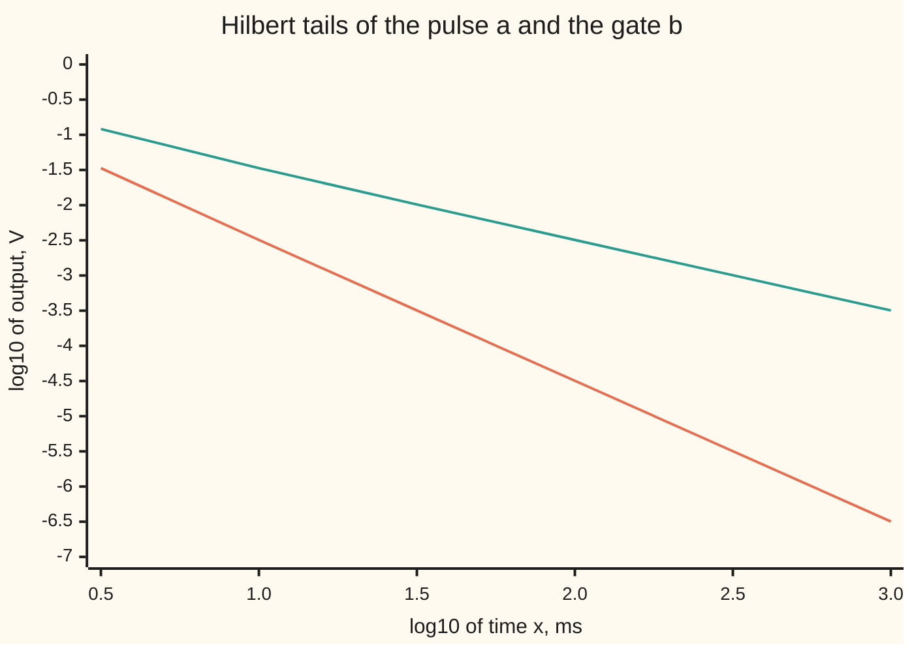

# The Hardy space H¹: atoms, the endpoint where singular integrals behave, and Fefferman's duality with BMO

[Syllabus](../../../SYLLABUS.md) → [Harmonic analysis](../README.md) → [Maximal Functions and Beyond](../README.md#s06) → The Hardy space H¹

---

## General Overview

A data line sends one bit as a balanced pulse: −1 V for 1 ms, then +1 V for 1 ms. Call this pulse $`a`$. Its total area is 0 V·ms, because the two halves cancel. A second signal, the gate $`b`$, is +1 V for 1 ms and nothing else. Its area is 1 V·ms.

Feed both to a Hilbert filter, the quarter-turn filter of [The Hilbert transform](../02-The%20Fourier%20Transform/09-hilbert-transform-and-analytic-signals.md). Far from the pulse, the gate's output fades like $`1/(\pi x)`$ volts at $`x`$ ms. The area under that tail has no limit: it grows by 1.465871 V·ms each time the window grows ten times. The balanced pulse's output fades like $`1/(\pi x^2)`$, and its whole area is a finite 2.244399 V·ms.

[Singular integrals](03-singular-integrals-and-the-hilbert-transform-bound.md) showed that the Hilbert transform is not bounded on area (the space $`L^1`$). The **Hardy space** $`H^1`$, the signals built from balanced blocks like $`a`$, is where it is. Its bounded measurements (linear rules that turn a signal into a number no bigger than a fixed multiple of its $`H^1`$ size) form the space BMO (bounded mean oscillation). Each multiplies the signal by a fixed function and takes the area. BMO holds unbounded functions such as $`\log\lvert x - \tfrac12\rvert`$. That function against the pulse gives a finite −1.647918 V·ms, exactly $`-\tfrac32\ln 3`$.

**The Hardy space H¹ is the set of signals built from atoms, small blocks that average to zero; that cancellation makes every singular integral map H¹ into L¹, where it fails on L¹ itself, and Fefferman's theorem says the bounded measurements on H¹ are exactly the integrals against BMO functions.**

**What kind of fact this is:** theorems. Proved on this card: the pulse's Hilbert transform and its area, the bound of singular integrals on atoms, and the easy half of the duality. Proved on [BMO](09-bmo-and-the-john-nirenberg-inequality.md): the bound of $`H`$ from $`L^\infty`$ to BMO. Stated with sources, with outlines in folds: the other descriptions of $`H^1`$ and the hard half of Fefferman's duality. The BMO norm of $`\log\lvert x\rvert`$, 0.930586, is found by a computer search, not derived.

### The picture: two tails, slope −1 against slope −2



The first line (orange) is $`\log_{10} Ha`$, the balanced pulse's output. It falls two units for every unit of $`\log_{10} x`$: a $`1/x^2`$ tail. The second line (teal) is $`\log_{10} Hb`$, the gate's output. It falls one unit per unit: a $`1/x`$ tail. The curves are from the closed forms below, sampled at $`x = 10^{0.5}`$ to $`10^3`$ ms. The signals are synthetic: illustrative, not a recording.

---

## The formula

Notation from earlier cards: $`Hf`$ is the Hilbert transform, convolution with $`1/(\pi t)`$. $`\lVert f\rVert_1`$ is the area of $`\lvert f\rvert`$ and $`L^1`$ the signals where it is finite. $`\lVert f\rVert_\infty`$ is the largest size and $`L^\infty`$ the bounded signals. The **mean oscillation** of $`\varphi`$ on an interval $`I`$ is the average distance of $`\varphi`$ from its own average $`\varphi_I`$ there. BMO is the set of $`\varphi`$ whose mean oscillation stays below one number for every interval; the smallest such number is $`\lVert\varphi\rVert_{\mathrm{BMO}}`$ ([BMO](09-bmo-and-the-john-nirenberg-inequality.md)).

**Atoms and the space.** An **atom** is a signal $`\alpha`$ that lives on one interval $`I`$, has height at most $`1/\lvert I\rvert`$, and has total 0:

```math
\mathrm{supp}\,\alpha \subset I, \qquad \lvert\alpha(x)\rvert \le \frac{1}{\lvert I\rvert}, \qquad \int \alpha(x)\,dx = 0, \qquad \lVert f\rVert_{H^1} = \inf\Big\{\sum_j \lvert\theta_j\rvert : f = \sum_j \theta_j\,\alpha_j\Big\}.
```

**Read it aloud:** an atom sits on an interval, is never taller than one over the interval's length, and adds up to zero; a signal is in H¹ when it is a sum of atoms with weights theta j whose sizes add up to a finite number, and its H¹ norm is the smallest such total.

The pulse $`a`$ lives on $`I = (-1, 1)`$, of length 2, so an atom there has height at most 1/2. The pulse has height 1, so $`a = 2\alpha`$ with $`\alpha = a/2`$ an atom, and $`\lVert a\rVert_{H^1} \le 2`$.

**Singular integrals on H¹.** Let $`T`$ be a singular integral with kernel $`K`$: bounded in energy with norm $`\lVert T\rVert_{2\to 2}`$, and meeting the smoothness condition of [Singular integrals](03-singular-integrals-and-the-hilbert-transform-bound.md) with constant $`B`$. Then on the line

```math
\lVert T\alpha\rVert_1 \le \sqrt{2}\,\lVert T\rVert_{2\to 2} + B \ \text{ for every atom } \alpha, \qquad \lVert Tf\rVert_1 \le \big(\sqrt{2}\,\lVert T\rVert_{2\to 2} + B\big)\,\lVert f\rVert_{H^1}.
```

**Read it aloud:** a singular integral sends each atom to a signal of area at most root two times its energy norm plus its smoothness constant, so it sends every H¹ signal into L¹ with that constant times its H¹ norm.

For $`H`$, $`\lVert H\rVert_{2\to 2} = 1`$ and $`B = \ln 3/\pi = 0.349699`$.

**Fefferman's duality.** For $`\varphi`$ in BMO and $`f`$ a finite sum of atoms,

```math
\Big\lvert \int f(x)\,\varphi(x)\,dx \Big\rvert \le \lVert f\rVert_{H^1}\,\lVert\varphi\rVert_{\mathrm{BMO}}, \qquad (H^1)^* = \mathrm{BMO}.
```

**Read it aloud:** the integral of f times phi is at most the H¹ norm of f times the BMO norm of phi; and the dual of H¹ is BMO.

The second half means: every bounded linear measurement $`\ell`$ on $`H^1`$ is $`\ell(f) = \int f\varphi`$ for some $`\varphi`$ in BMO, unique up to an added constant, with $`\lVert\varphi\rVert_{\mathrm{BMO}} \le C\,\lVert\ell\rVert`$ for a fixed constant $`C`$. "Dual" is as in [Dual spaces](../../18-Functional%20analysis/01-Normed%20and%20Banach%20Spaces/09-dual-spaces-and-lp-duality.md): the set of bounded linear measurements.

**Other descriptions (stated).** For $`f`$ in $`L^1`$, these are equivalent, with comparable norms: $`f`$ is a sum of atoms; $`Hf`$ is in $`L^1`$; the maximal function $`\sup_{r>0}\lvert\Phi_r * f(x)\rvert`$ is in $`L^1`$, where $`\Phi`$ is a smooth bump of area 1 and $`\Phi_r(x) = \Phi(x/r)/r`$. In $`n`$ dimensions, atoms live on cubes, and the Riesz transforms $`R_1, \dots, R_n`$ replace $`H`$.

| Symbol | Plain meaning | In our example | Push it up and the answer… |
| --- | --- | --- | --- |
| $`x`$, $`I`$, $`\lvert I\rvert`$, $`x_I`$, $`h`$, $`(u, v)`$ | time in ms; an interval; its length; its centre; its half-width; a gate's ends in Step 1 | $`I = (-1, 1)`$, length 2, centre 0 | longer $`I`$: lower height cap $`1/\lvert I\rvert`$ |
| $`a`$, $`b`$, $`\alpha`$ | the balanced pulse; the gate on (0, 1); an atom | $`a = 2\alpha`$; $`b`$ has area 1 V·ms | — |
| $`\theta_j`$, $`\lVert f\rVert_{H^1}`$, $`H^1`$ | atom weights; the H¹ norm; the Hardy space | $`\lVert a\rVert_{H^1} \le 2`$ | larger weights: larger norm |
| $`H`$, $`T`$, $`K`$ | Hilbert transform; a singular integral; its kernel | $`K(t) = 1/(\pi t)`$ | — |
| $`\lVert T\rVert_{2\to 2}`$, $`B`$ | energy norm; smoothness constant | 1 and 0.349699 for $`H`$ | either up: the atom bound grows |
| $`\varphi`$, $`\varphi_I`$, $`\lVert\varphi\rVert_{\mathrm{BMO}}`$ | a BMO function; its mean on $`I`$; its BMO norm | $`\log\lvert x - \tfrac12\rvert`$; −0.869188; 0.930586 | larger norm: larger possible pairing |
| $`\int f\varphi`$, $`\ell`$, $`\lVert\ell\rVert`$ | the pairing; a bounded measurement; its norm | $`\int a\varphi = -1.647918`$ V·ms | — |
| $`g_1`$, $`g_2`$, $`\mathrm{sgn}`$ | bounded signals in Step 5; the sign of a number | $`g_1 = 0`$, $`g_2 = -\tfrac{\pi}{2}\mathrm{sgn}(x - \tfrac12)`$ | — |
| $`L^1`$, $`L^\infty`$, $`\lVert f\rVert_1`$, $`\lVert f\rVert_\infty`$ | finite area; bounded; area; largest size | $`\lVert Ha\rVert_1 = 2.244399`$ V·ms | — |
| $`\Phi`$, $`\Phi_r`$, $`r`$, $`R_j`$, $`n`$, $`p`$ | smooth bump; it scaled; a scale; Riesz transforms; dimension; a Hardy-space exponent | not used on the pulse | — |
| $`\psi`$, $`k`$, $`G`$, $`\varepsilon`$, $`R`$ | any function and a constant in Step 0; antiderivative in Step 1; a narrow gate's width; a window's half-width | $`\varepsilon = 0.001`$ gives −8.600902 | smaller $`\varepsilon`$: the pairing has no floor |
| $`C`$, $`s`$ | duality constant; left-half scale of an unbalanced pulse | $`s = 0.9`$ leaves 0.1 V·ms | $`s`$ away from 1: the tail returns |

### When it holds

- **Cancellation.** Each atom must total zero. The gate $`b`$ totals 1 V·ms, and its output's area has no limit (Step 2).
- **The height cap.** An atom on $`I`$ is at most $`1/\lvert I\rvert`$ tall. Treat the pulse $`a`$, of height 1, as an atom, and Step 4's bound falls below the true pairing (What breaks).
- **The kernel conditions.** The $`H^1`$ bound needs $`T`$ bounded in energy and the smoothness condition with a finite $`B`$. These are the same conditions that give the $`L^p`$ bounds on [Singular integrals](03-singular-integrals-and-the-hilbert-transform-bound.md).
- **Finite sums first.** The pairing is defined on finite sums of atoms, which are dense in $`H^1`$, then extended by continuity. For a general $`f`$, $`\int\lvert f\varphi\rvert`$ can be infinite.
- **Exactly p = 1.** $`H^1`$ replaces $`L^1`$ at the bottom end. Below 1, the atoms of the Hardy spaces $`H^p`$ obey the stricter height cap $`\lvert I\rvert^{-1/p}`$; on the line, extra vanishing moments are needed only at $`p \le \tfrac12`$ ($`p \le n/(n+1)`$ in $`n`$ dimensions). This card does not develop that theory.

---

## Why it works

### Step 0: a block that totals zero lets you subtract a constant for free

An atom $`\alpha`$ on $`I`$ totals zero. So for any function $`\psi`$ and any constant $`k`$, $`\int \alpha\,(\psi - k) = \int \alpha\,\psi`$. Choose $`k`$ well and the integrand gets small.

That one trick runs the whole card:

- **Far from the atom**, choose $`k = K(x - x_I)`$, the kernel's value at the centre. The kernel's smoothness then makes $`T\alpha(x)`$ small, so the output tail is integrable.
- **Against a BMO function** $`\varphi`$, choose $`k = \varphi_I`$, its mean on $`I`$. Then only $`\varphi`$'s oscillation on $`I`$ counts, not its size. That is exactly what BMO controls.

### Step 1: the balanced pulse has an integrable Hilbert partner

For a 1 V gate on the interval $`(u, v)`$, the Hilbert transform is $`\frac{1}{\pi}\ln\lvert (x - u)/(x - v)\rvert`$ ([Singular integrals](03-singular-integrals-and-the-hilbert-transform-bound.md), Step 3). The pulse is the gate on $`(0, 1)`$ minus the gate on $`(-1, 0)`$, so

```math
Ha(x) = \frac{1}{\pi}\ln\left\lvert\frac{x}{x-1}\right\rvert - \frac{1}{\pi}\ln\left\lvert\frac{x+1}{x}\right\rvert = \frac{1}{\pi}\ln\frac{x^2}{\lvert x^2 - 1\rvert}.
```

Far out, $`x^2/(x^2 - 1) = 1/(1 - 1/x^2)`$, whose log is about $`1/x^2`$. So $`Ha(x) \approx 1/(\pi x^2)`$. The check confirms the tail: $`x^2\,Ha(x)`$ is 0.319912 at 10 ms and 0.318326 at 100 ms, settling at $`1/\pi = 0.318310`$.

The check also computes $`Ha`$ straight from the kernel, as a principal-value integral with a gap of $`10^{-6}`$ ms:

| x, ms | Closed form, V | Kernel road, V |
| ---: | ---: | ---: |
| 0.3 | −0.736453 | −0.736443 |
| 1.5 | 0.187098 | 0.187091 |
| 3.0 | 0.037492 | 0.037498 |
| 10.0 | 0.003199 | 0.003211 |

The area of $`\lvert Ha\rvert`$ is finite. $`Ha`$ is even, and it changes sign at $`x = 0.707107`$ ($`1/\sqrt2`$). With the antiderivative $`G(x) = 2x\ln x - (x-1)\ln\lvert x-1\rvert - (x+1)\ln(x+1)`$, which is 0 at $`x = 0`$ and tends to 0 far out:

```math
\lVert Ha\rVert_1 = \frac{2}{\pi}\cdot\big(-2\,G(1/\sqrt2)\big) = \frac{-4\times(-1.762747)}{\pi} = 2.244399 \text{ V·ms}.
```

An integrator gives 2.244399 as well. The total of $`Ha`$, with signs, is 0. So the output is balanced too: $`H`$ maps $`H^1`$ into itself, not only into $`L^1`$.

### Step 2: the gate fails, and so does any imbalance

Any signal confined to a bounded interval, with total $`A`$, has $`Hf(x) \approx A/(\pi x)`$ far out. The tail's area then grows by $`2A\ln 10/\pi`$ per factor of ten, on the two sides together. [Singular integrals](03-singular-integrals-and-the-hilbert-transform-bound.md) shows this for a centred gate; What breaks below gives the areas for $`b`$.

So $`b`$ is not in $`H^1`$: a signal in $`H^1`$ must total zero. A small imbalance is enough to fail. The pulse with its left half scaled by $`s = 0.9`$ totals 0.1 V·ms. The area its output adds between 1,000 and 10,000 ms on both sides:

| Signal | Total, V·ms | Area added, 1,000 to 10,000 ms |
| --- | ---: | ---: |
| Gate $`b`$ | 1 | 1.465871 |
| 10% imbalance, $`s = 0.9`$ | 0.1 | 0.146587 |
| Balanced pulse $`a`$ | 0 | 0.000573 |

Unbalanced tails add the same amount every factor of ten, forever. The balanced tail adds $`(2/\pi)(10^{-3} - 10^{-4})`$, then less each time.

### Step 3: singular integrals send every atom into L¹

Take an atom $`\alpha`$ on $`I`$ with centre $`x_I`$. Split the line into the doubled interval $`2I`$ (same centre, twice the length) and the rest.

**Near part, by energy.** On $`2I`$, the Cauchy–Schwarz inequality (on a set of length $`L`$, the area of $`\lvert g\rvert`$ is at most $`\sqrt{L}`$ times $`\lVert g\rVert_2`$) and the energy bound give

```math
\int_{2I} \lvert T\alpha\rvert \le \lvert 2I\rvert^{1/2}\,\lVert T\alpha\rVert_2 \le (2\lvert I\rvert)^{1/2}\,\lVert T\rVert_{2\to 2}\,\lVert\alpha\rVert_2 \le \sqrt2\,\lVert T\rVert_{2\to 2}.
```

The last step uses the height cap: $`\lVert\alpha\rVert_2^2 \le \lvert I\rvert\cdot\lvert I\rvert^{-2}`$.

**Far part, by cancellation.** Off $`2I`$, Step 0 subtracts $`K(x - x_I)`$ for free:

```math
T\alpha(x) = \int_I \big(K(x - y) - K(x - x_I)\big)\,\alpha(y)\,dy, \qquad \int_{x \notin 2I} \lvert T\alpha\rvert \le B\,\lVert\alpha\rVert_1 \le B.
```

Here $`\lvert x - x_I\rvert > 2\lvert y - x_I\rvert`$ for every $`y`$ in $`I`$, which is the region the smoothness condition covers. Adding the parts gives the atom bound.

For the pulse, $`a = 2\alpha`$ on $`I = (-1, 1)`$, so both bounds double:

| Part | True area of $`\lvert Ha\rvert`$, V·ms | Bound, V·ms |
| --- | ---: | ---: |
| Near, $`\lvert x\rvert < 2`$ | 1.911289 | $`2\sqrt2 = 2.828427`$ |
| Far, $`\lvert x\rvert > 2`$ | 0.333110 | $`2B = 0.699398`$ |
| Total | 2.244399 | 3.527825 |

The truth is 0.636199 of the bound. The far part is where the gate failed; here cancellation holds it to 0.333110.

For a general $`f = \sum\theta_j\alpha_j`$, the triangle inequality gives $`\lVert Tf\rVert_1 \le \sum\lvert\theta_j\rvert\,(\sqrt2\,\lVert T\rVert_{2\to 2} + B)`$. Take the smallest total over all decompositions.

<details>
<summary>Detailed proof: why the sum of atoms is handled correctly</summary>

The series $`\sum_j \theta_j T\alpha_j`$ converges in $`L^1`$, since each term's area is at most $`\lvert\theta_j\rvert`$ times the atom bound. The partial sums $`f_N`$ of $`\sum_j\theta_j\alpha_j`$ tend to $`f`$ in $`L^1`$. $`T`$ has weak type (1,1), so $`Tf_N \to Tf`$ in measure. An $`L^1`$ limit is also a limit in measure, and the two agree almost everywhere. So

$`\displaystyle \lVert Tf\rVert_1 \le \big(\sqrt2\,\lVert T\rVert_{2\to 2} + B\big)\sum_j\lvert\theta_j\rvert.`$

</details>

### Step 4: the easy half of the duality, an atom against a BMO weight

For an atom $`\alpha`$ on $`I`$ and a BMO function $`\varphi`$, Step 0 subtracts the mean $`\varphi_I`$:

```math
\Big\lvert\int \alpha\,\varphi\Big\rvert = \Big\lvert\int_I \alpha\,(\varphi - \varphi_I)\Big\rvert \le \frac{1}{\lvert I\rvert}\int_I \lvert\varphi - \varphi_I\rvert \le \lVert\varphi\rVert_{\mathrm{BMO}}.
```

The middle step is the height cap. For a finite sum $`f = \sum\theta_j\alpha_j`$, the triangle inequality gives $`\lvert\int f\varphi\rvert \le \sum\lvert\theta_j\rvert\,\lVert\varphi\rVert_{\mathrm{BMO}}`$. Take the smallest total: that is the inequality in The formula.

On the pulse, with $`\varphi(x) = \log\lvert x - \tfrac12\rvert`$ and $`I = (-1, 1)`$:

- The mean of $`\varphi`$ on $`I`$ is −0.869188.
- Its mean oscillation on $`I`$ is 0.838584, found exactly by splitting $`I`$ where $`\varphi - \varphi_I`$ changes sign, and confirmed by an integrator.
- So $`\lvert\int a\varphi\rvert \le 2 \times 0.838584 = 1.677168`$. The true size is 1.647918: ratio 0.982560. The bound is nearly met: $`a`$ is −1 on most of the set where $`\varphi`$ is above its mean, and +1 on most of the set where it is below.

Over all intervals the bound is weaker but still finite. $`\log\lvert x\rvert`$ changes only by a constant when $`x`$ is rescaled, so its mean oscillation on $`(x_I - h, x_I + h)`$ depends only on $`x_I/h`$. On centred intervals it is $`2/e = 0.735759`$. A scan of 4,001 positions from 0 to 4, refined by a golden-section search, finds the largest value, 0.930586, at $`x_I/h = 0.7583`$. This is $`\lVert\varphi\rVert_{\mathrm{BMO}}`$. A second search, over intervals ending at 1 as on [BMO](09-bmo-and-the-john-nirenberg-inequality.md), gets 0.930585. The duality bound is then $`2 \times 0.930586 = 1.861171`$.

### Step 5: the hard half, by Hahn–Banach

The converse says every bounded measurement on $`H^1`$ comes from a BMO function. Its proof uses two facts:

1. **Hilbert description.** $`\lVert f\rVert_1 + \lVert Hf\rVert_1`$ is a norm on $`H^1`$ comparable with $`\lVert f\rVert_{H^1}`$ (Fefferman and Stein 1972; Coifman 1974 for atoms). Step 3 proves one direction.
2. **H from bounded signals to BMO.** For bounded $`g`$, $`Hg`$ is defined up to a constant and $`\lVert Hg\rVert_{\mathrm{BMO}} \le 2(\sqrt2 + B)\,\lVert g\rVert_\infty = 3.527825\,\lVert g\rVert_\infty`$. [BMO](09-bmo-and-the-john-nirenberg-inequality.md), Step 3, proves it by the same near and far split as Step 3 here.

With these, [Hahn-Banach](../../18-Functional%20analysis/01-Normed%20and%20Banach%20Spaces/06-hahn-banach-theorem.md) does the rest. The result is the **Fefferman–Stein decomposition**: every BMO function is a bounded signal plus the Hilbert transform of a bounded signal, up to a constant.

<details>
<summary>Proof outline: every bounded measurement on H¹ is a BMO function</summary>

Let $`\ell`$ be a bounded linear measurement on $`H^1`$, normed by $`\lVert f\rVert_1 + \lVert Hf\rVert_1`$. Send $`f`$ to the pair $`(f, Hf)`$ in $`L^1 \times L^1`$, sized by the sum of the two areas. This map keeps sizes exactly, so $`\ell`$ becomes a bounded measurement on the set of such pairs, with the same norm.

Hahn–Banach extends it to all of $`L^1 \times L^1`$, with no increase in norm. [Dual spaces](../../18-Functional%20analysis/01-Normed%20and%20Banach%20Spaces/09-dual-spaces-and-lp-duality.md) identifies every bounded measurement on $`L^1`$ as an integral against a bounded signal. So there are $`g_1`$ and $`g_2`$ in $`L^\infty`$, each at most $`\lVert\ell\rVert`$ in size, with

$`\displaystyle \ell(f) = \int f\,g_1 + \int (Hf)\,g_2 = \int f\,(g_1 - Hg_2).`$

The second step uses $`\int (Hf)\,g = -\int f\,(Hg)\,`$: $`H`$ is antisymmetric, because its multiplier $`-i\,\mathrm{sgn}(\xi)`$ is odd and imaginary. An atom totals zero, so the constant left free in $`Hg_2`$ does not matter.

Set $`\varphi = g_1 - Hg_2`$. A bounded signal has mean oscillation at most twice its largest size. With fact 2, $`\lVert\varphi\rVert_{\mathrm{BMO}} \le (2 + 3.527825)\,\lVert\ell\rVert`$. The extension is not unique, but $`\varphi`$ is unique up to a constant: two functions that give the same pairing with every atom differ by a constant. Fefferman (1971) announced the theorem; Fefferman and Stein (1972) give the proof.

</details>

**The pulse, by this road.** For $`x > 0`$, the Hilbert transform of $`\mathrm{sgn}`$ cut to $`\lvert y\rvert < R`$ is $`\frac{1}{\pi}\big(2\ln\lvert x\rvert - \ln\lvert x^2 - R^2\rvert\big)`$. As $`R`$ grows, this is $`\frac{2}{\pi}\ln\lvert x\rvert`$ plus a constant that does not depend on $`x`$. So, up to a constant,

```math
\log\lvert x - \tfrac12\rvert = -H g_2(x), \qquad g_2(x) = -\tfrac{\pi}{2}\,\mathrm{sgn}(x - \tfrac12), \qquad \int a\,\varphi = \int (Ha)\,g_2 = -\frac{\pi}{2}\int Ha(x)\,\mathrm{sgn}(x - \tfrac12)\,dx.
```

The unbounded function is the Hilbert transform of a bounded one. The check integrates the right-hand side and gets −1.647918 V·ms, the same as the direct pairing. This road gives a third bound: $`\lvert\int a\varphi\rvert \le \lVert g_2\rVert_\infty\,\lVert Ha\rVert_1 = (\pi/2) \times 2.244399 = 3.525494`$.

### Step 6: why BMO and not L∞ is the right partner

The dual of $`L^1`$ is $`L^\infty`$, and $`\log\lvert x - \tfrac12\rvert`$ is not bounded. So it is not a bounded measurement on $`L^1`$. A gate of area 1 and width $`\varepsilon`$ centred on the spike at $`\tfrac12`$ pairs to $`\ln(\varepsilon/2) - 1`$:

| Width $`\varepsilon`$, ms | 0.1 | 0.01 | 0.001 |
| --- | ---: | ---: | ---: |
| Pairing, V·ms | −3.995732 | −6.298317 | −8.600902 |

Each factor of ten narrower subtracts $`\ln 10`$, without limit. Those gates have area 1, but none totals zero, so none is in $`H^1`$. On $`H^1`$, Step 4 bounds every pairing by $`0.930586\,\lVert f\rVert_{H^1}`$.

$`H^1`$ is smaller than $`L^1`$, so it has more bounded measurements: BMO is larger than $`L^\infty`$. Singular integrals send $`H^1`$ into $`L^1`$ and $`L^\infty`$ into BMO: one statement, read from the two sides of the pairing.

---

## Worked numbers, by hand

The pairing of the pulse with $`\varphi(x) = \log\lvert x - \tfrac12\rvert`$. The antiderivative of $`\ln\lvert u\rvert`$ is $`u\ln\lvert u\rvert - u`$. Substitute $`u = x - \tfrac12`$.

| Step | Arithmetic | Value |
| --- | --- | --- |
| Logs | ln 2, ln 1.5, ln 3 | 0.693147, 0.405465, 1.098612 |
| Antiderivative at 0.5 | 0.5 ln 0.5 − 0.5 | −0.846574 |
| Antiderivative at 1.5 | 1.5 ln 1.5 − 1.5 | −0.891802 |
| $`\varphi`$ over (0, 1) | u from −0.5 to 0.5: 2 × (−0.846574) | −1.693147 |
| $`\varphi`$ over (−1, 0) | u from −1.5 to −0.5, the same as 0.5 to 1.5 since the log is even: −0.891802 − (−0.846574) | −0.045229 |
| Mean of $`\varphi`$ on (−1, 1) | (−0.846574 − 0.891802)/2 | −0.869188 |
| Check against $`-\tfrac32\ln 3`$ | −1.5 × 1.098612 | −1.647918 |
| Pairing $`\int a\varphi`$ | +1 V on (0, 1), −1 V on (−1, 0): −1.693147 − (−0.045229) | **−1.647918 V·ms** |

The pulse pairs with the log-spike function at −1.647918 V·ms, a finite number although the function has no floor near ½ ms. It sits inside the atom bound 1.677168 and the duality bound 1.861171.

### What breaks if you drop a piece

| Mistake | Comes out at | What went wrong |
| --- | --- | --- |
| Drop the cancellation: use the gate $`b`$ | area of $`\lvert Hb\rvert`$ is 2.542698, 4.009623, 5.475504, 6.941376 V·ms inside 10, 100, 1000, 10,000 ms | total 1 V·ms leaves a $`1/(\pi x)`$ tail: $`b`$ is not in $`H^1`$ |
| Leave a 10% imbalance, $`s = 0.9`$ | 0.146587 V·ms added between 1,000 and 10,000 ms, every factor of ten | any nonzero total brings the tail back; the balanced pulse adds 0.000573 |
| Drop the height cap: call $`a`$ an atom | claimed bound 0.838584 V·ms, true size 1.647918 | $`a`$ has height 1 on a length-2 interval; it is twice an atom |
| Pair the function with $`L^1`$, not $`H^1`$ | −3.995732, −6.298317, −8.600902 V·ms for gates of area 1 and widths 0.1, 0.01, 0.001 ms | $`L^1`$'s dual is $`L^\infty`$; an unbounded function is not a bounded measurement there |

---

## Code, from first principles, and it actually runs

The script writes every piece itself: a midpoint-rule integrator with substitutions at each log spike, the principal-value kernel, the antiderivatives, an exact mean-oscillation routine and a golden-section search. Each main number takes two or more independent roads. $`Ha`$: closed form and kernel. $`\lVert Ha\rVert_1`$: antiderivative and integrator. The pairing: exact, integrator, and the Hilbert transform of a bounded signal. The mean oscillation: exact and integrator. $`B`$: closed form and integral. The BMO norm: two searches.

### Python

```python
# Hardy space H1 and its duality with BMO -- the check behind the card.
# Standard library only.  x counts milliseconds; signals are in volts.
# Atom pair a = +1 V on (0, 1), -1 V on (-1, 0).  Gate b = 1 V on (0, 1).  phi(x) = log|x - 1/2|.
from math import pi, log, exp, sqrt, e

Ha = lambda x: log(x * x / abs(x * x - 1)) / pi     # Hilbert transform of a, closed form
Hb = lambda x: log(abs(x / (x - 1))) / pi           # Hilbert transform of b, closed form
a = lambda x: (1.0 if 0 < x < 1 else 0.0) - (1.0 if -1 < x < 0 else 0.0)

def midpoint(f, lo, hi, n):                          # integral of f from lo to hi, n cells
    h = (hi - lo) / n
    return h * sum(f(lo + (k + 0.5) * h) for k in range(n))

def pv(x, n=400000):                                 # (1/pi) p.v. integral of a(x - u)/u du
    pos = midpoint(lambda s: a(x - exp(s)), log(1e-6), log(20.0), n)
    neg = midpoint(lambda s: a(x + exp(s)), log(1e-6), log(20.0), n)
    return (pos - neg) / pi

for x in [0.3, 1.5, 3.0, 10.0]:
    k = pv(x)
    print("Ha(%.1f): closed form %.6f V, kernel road %.6f V" % (x, Ha(x), k))
    assert abs(k - Ha(x)) < 1e-4
for x in [10.0, 100.0]:
    print("tail at x = %d: x^2 Ha = %.6f, x Hb = %.6f, 1/pi = %.6f" % (x, x * x * Ha(x), x * Hb(x), 1 / pi))
assert abs(100 ** 2 * Ha(100) - 1 / pi) < 1e-4
assert abs(100 * Hb(100) - 1 / pi) < 2e-3
for k in range(1, 7):                                # chart points: log10 of the two tails
    x = 10 ** (k / 2)
    print("chart log10 x = %.1f: log10 Ha = %.3f, log10 Hb = %.3f" % (k / 2, log(Ha(x)) / log(10), log(Hb(x)) / log(10)))

# Area of |Ha|: antiderivative G against the integrator on four pieces of x > 0 (Ha is even).
G = lambda x: 2 * x * log(x) - (x - 1) * log(abs(x - 1)) - (x + 1) * log(x + 1)
def pieces(f, n=200000):                             # integrals over (0,1/2), (1/2,1), (1,2), (2,inf)
    r = sqrt(0.5)                                    # x = v^2 or 1 -+ v^2 near the log spikes, x = 1/w far out
    return [midpoint(lambda v: 2 * v * f(v * v), 0, r, n), midpoint(lambda v: 2 * v * f(1 - v * v), 0, r, n),
            midpoint(lambda v: 2 * v * f(1 + v * v), 0, 1, n), midpoint(lambda w: f(1 / w) / (w * w), 0, 0.5, n)]
s = 1 / sqrt(2)                                      # Ha changes sign at 1/sqrt(2)
P_abs, P = pieces(lambda x: abs(Ha(x))), pieces(Ha)
area_exact, area_num = -4 * G(s) / pi, 2 * sum(P_abs)
print("Ha changes sign at x = %.6f, where G = %.6f" % (s, G(s)))
print("area of |Ha|: antiderivative %.6f, integrator %.6f V ms" % (area_exact, area_num))
print("size of the total of Ha: integrator %.6f V ms (antiderivative: exactly 0)" % abs(2 * sum(P)))
assert abs(area_num - area_exact) < 1e-5
assert abs(2 * sum(P)) < 1e-5
near, far = 2 * sum(P_abs[:3]), 2 * P_abs[3]
B = log(3) / pi                                      # Hormander constant of 1/(pi t)
hor = midpoint(lambda v: 1 / (2 * exp(v) - 1) + 1 / (2 * exp(v) + 1), 0, 50, 100000) / pi   # its integral, x = +-2e^v
print("Hormander constant B: ln 3/pi = %.6f; integral of |K(x - 1) - K(x)| over |x| > 2 = %.6f" % (B, hor))
assert abs(hor - B) < 1e-6
print("near part |x| < 2: %.6f, bound 2 sqrt 2 = %.6f; far part: %.6f, bound 2B = %.6f" % (near, 2 * sqrt(2), far, 2 * B))
assert abs(far - 2 * -G(2) / pi) < 1e-5
assert near < 2 * sqrt(2)
assert far < 2 * B
print("atom bound for a = 2(sqrt 2 + B), also the L-infinity to BMO constant: %.6f; true area %.6f; ratio %.6f" % (2 * sqrt(2) + 2 * B, area_exact, area_exact / (2 * sqrt(2) + 2 * B)))

# The gate fails: the area of |Hb| inside |x| < R grows by (2/pi) ln 10 per factor of ten.
K = lambda x: x * log(abs(x)) - (x - 1) * log(abs(x - 1))
gate_area = lambda R: (K(R) + K(-R) - 2 * K(0.5)) / pi
hb = lambda x: abs(Hb(x))
num = (midpoint(lambda v: 2 * v * hb(-v * v), 0, sqrt(10), 400000) + midpoint(lambda v: 2 * v * hb(v * v), 0, sqrt(0.5), 200000)
       + midpoint(lambda v: 2 * v * hb(1 - v * v), 0, sqrt(0.5), 200000) + midpoint(lambda v: 2 * v * hb(1 + v * v), 0, 3, 400000))
print("area of |Hb| inside |x| < 10: antiderivative %.6f, integrator %.6f V ms" % (gate_area(10), num))
assert abs(num - gate_area(10)) < 1e-4
print("area of |Hb| inside 100, 1000, 10000: %.6f, %.6f, %.6f V ms" % tuple(gate_area(R) for R in [100, 1000, 10000]))
L = lambda x: (x + 1) * log(abs(x + 1)) - x * log(abs(x))     # pi times antiderivative of H of 1 on (-1, 0)
def decade(w):                                       # area of |H(b - w c)| added between 1000 and 10000, both sides
    P2 = lambda x: (K(x) - w * L(x)) / pi
    return abs(P2(1e4) - P2(1e3)) + abs(P2(-1e3) - P2(-1e4))
for w, name in [(0.0, "gate b"), (0.9, "10% imbalance"), (1.0, "atom pair a")]:
    print("decade 1000 to 10000, %s: %.6f V ms" % (name, decade(w)))
assert abs(decade(0.9) - 0.1 * 2 * log(10) / pi) < 1e-4
assert abs(decade(1.0) - (2 / pi) * (1e-3 - 1e-4)) < 1e-6

# Pairing a with phi(x) = log|x - 1/2|: exact, integrator, and through the Hilbert transform.
F = lambda x: x * log(abs(x)) - x if x != 0 else 0.0        # antiderivative of log|x|
right, left = F(0.5) - F(-0.5), F(1.5) - F(0.5)              # integrals of phi over (0,1) and (-1,0)
pair = right - left
print("hand steps: ln 2 = %.6f, ln 1.5 = %.6f, ln 3 = %.6f, 0.5 ln 0.5 - 0.5 = %.6f, 1.5 ln 1.5 - 1.5 = %.6f"
      % (log(2), log(1.5), log(3), F(0.5), F(1.5)))
num_r = 2 * midpoint(lambda v: 2 * v * log(v * v), 0, sqrt(0.5), 200000)
num_l = midpoint(lambda x: log(abs(x - 0.5)), -1, 0, 200000)
print("phi over (0,1): %.6f; over (-1,0): %.6f; pairing %.6f V ms, -1.5 ln 3 = %.6f" % (right, left, pair, -1.5 * log(3)))
road_H = -(pi / 2) * (sum(P[1:]) - (sum(P) + P[0]))         # -(pi/2) integral of Ha(x) sgn(x - 1/2)
print("pairing by integrator %.6f; by Hilbert road -(pi/2) int Ha sgn(x - 1/2): %.6f V ms" % (num_r - num_l, road_H))
assert abs(pair + 1.5 * log(3)) < 1e-12
assert abs(num_r - num_l - pair) < 1e-5
assert abs(road_H - pair) < 1e-5

# Mean oscillation of log|x| on (lo, hi): exact by splitting where the sign of log|x| - mean changes.
def osc(lo, hi):
    m = (F(hi) - F(lo)) / (hi - lo)
    cuts = sorted([lo, hi] + [p for p in (-exp(m), 0.0, exp(m)) if lo < p < hi])
    return m, sum(abs(F(v) - F(u) - m * (v - u)) for u, v in zip(cuts, cuts[1:])) / (hi - lo)
m, o = osc(-1.5, 0.5)                                        # phi on I = (-1, 1) is log|u| on (-1.5, 0.5)
o_num = (midpoint(lambda v: 2 * v * abs(log(v * v) - m), 0, sqrt(1.5), 200000)
         + midpoint(lambda v: 2 * v * abs(log(v * v) - m), 0, sqrt(0.5), 200000)) / 2
print("on I = (-1,1): mean of phi %.6f, mean oscillation exact %.6f, integrator %.6f" % (m, o, o_num))
assert abs(o_num - o) < 1e-5
print("atom bound 2 x oscillation = %.6f >= |pairing| %.6f, ratio %.6f" % (2 * o, -pair, -pair / (2 * o)))
assert -pair <= 2 * o
best = max((osc(k / 1000 - 1, k / 1000 + 1)[1], k / 1000) for k in range(4001))   # centre/radius 0 to 4
lo, hi = best[1] - 0.001, best[1] + 0.001
for _ in range(60):                                          # golden-section search for the peak
    p, q = hi - (hi - lo) * 0.618034, lo + (hi - lo) * 0.618034
    lo, hi = (lo, q) if osc(p - 1, p + 1)[1] > osc(q - 1, q + 1)[1] else (p, hi)
bmo = osc(lo - 1, lo + 1)[1]
print("BMO norm of log|x|: centred intervals %.6f = 2/e %.6f; largest %.6f at centre/radius %.4f" % (osc(-1, 1)[1], 2 / e, bmo, lo))
assert abs(osc(-1, 1)[1] - 2 / e) < 1e-12
assert bmo >= best[0]
assert bmo >= o
grid = max(osc(k / 1000 - 1, 1.0)[1] for k in range(2000))  # road 2: intervals [u, 1], u = -1 to 0.999
print("BMO norm, second road: largest over 2000 intervals [u, 1]: %.6f" % grid)
assert -1e-12 < bmo - grid < 1e-5
print("duality bound |pairing| <= 2 x BMO norm = %.6f; Hilbert-road bound (pi/2) x area |Ha| = %.6f" % (2 * bmo, pi / 2 * area_exact))

# L1 is not enough: gates of area 1 squeezed onto phi's spike pair to log(eps/2) - 1, without limit.
for eps in [0.1, 0.01, 0.001]:
    print("gate of width %.3f at 1/2, area 1: pairing %.6f" % (eps, log(eps / 2) - 1))
nar = 2 * midpoint(lambda v: 2 * v * log(v * v), 0, sqrt(0.05), 200000) / 0.1
assert abs(nar - (log(0.05) - 1)) < 1e-5
print("ALL CHECKS PASS")
```

**Ran 2026-11-24 on macOS, Python 3.14.10, standard library only. All checks passed. Output, pasted from the run:**

```
Ha(0.3): closed form -0.736453 V, kernel road -0.736443 V
Ha(1.5): closed form 0.187098 V, kernel road 0.187091 V
Ha(3.0): closed form 0.037492 V, kernel road 0.037498 V
Ha(10.0): closed form 0.003199 V, kernel road 0.003211 V
tail at x = 10: x^2 Ha = 0.319912, x Hb = 0.335373, 1/pi = 0.318310
tail at x = 100: x^2 Ha = 0.318326, x Hb = 0.319912, 1/pi = 0.318310
chart log10 x = 0.5: log10 Ha = -1.474, log10 Hb = -0.917
chart log10 x = 1.0: log10 Ha = -2.495, log10 Hb = -1.474
chart log10 x = 1.5: log10 Ha = -3.497, log10 Hb = -1.990
chart log10 x = 2.0: log10 Ha = -4.497, log10 Hb = -2.495
chart log10 x = 2.5: log10 Ha = -5.497, log10 Hb = -2.996
chart log10 x = 3.0: log10 Ha = -6.497, log10 Hb = -3.497
Ha changes sign at x = 0.707107, where G = -1.762747
area of |Ha|: antiderivative 2.244399, integrator 2.244399 V ms
size of the total of Ha: integrator 0.000000 V ms (antiderivative: exactly 0)
Hormander constant B: ln 3/pi = 0.349699; integral of |K(x - 1) - K(x)| over |x| > 2 = 0.349699
near part |x| < 2: 1.911289, bound 2 sqrt 2 = 2.828427; far part: 0.333110, bound 2B = 0.699398
atom bound for a = 2(sqrt 2 + B), also the L-infinity to BMO constant: 3.527825; true area 2.244399; ratio 0.636199
area of |Hb| inside |x| < 10: antiderivative 2.542698, integrator 2.542698 V ms
area of |Hb| inside 100, 1000, 10000: 4.009623, 5.475504, 6.941376 V ms
decade 1000 to 10000, gate b: 1.465871 V ms
decade 1000 to 10000, 10% imbalance: 0.146587 V ms
decade 1000 to 10000, atom pair a: 0.000573 V ms
hand steps: ln 2 = 0.693147, ln 1.5 = 0.405465, ln 3 = 1.098612, 0.5 ln 0.5 - 0.5 = -0.846574, 1.5 ln 1.5 - 1.5 = -0.891802
phi over (0,1): -1.693147; over (-1,0): -0.045229; pairing -1.647918 V ms, -1.5 ln 3 = -1.647918
pairing by integrator -1.647918; by Hilbert road -(pi/2) int Ha sgn(x - 1/2): -1.647918 V ms
on I = (-1,1): mean of phi -0.869188, mean oscillation exact 0.838584, integrator 0.838584
atom bound 2 x oscillation = 1.677168 >= |pairing| 1.647918, ratio 0.982560
BMO norm of log|x|: centred intervals 0.735759 = 2/e 0.735759; largest 0.930586 at centre/radius 0.7583
BMO norm, second road: largest over 2000 intervals [u, 1]: 0.930585
duality bound |pairing| <= 2 x BMO norm = 1.861171; Hilbert-road bound (pi/2) x area |Ha| = 3.525494
gate of width 0.100 at 1/2, area 1: pairing -3.995732
gate of width 0.010 at 1/2, area 1: pairing -6.298317
gate of width 0.001 at 1/2, area 1: pairing -8.600902
ALL CHECKS PASS
```

### Rust

```rust
// Hardy space H1 and its duality with BMO -- the check behind the card.
// std only.  x counts milliseconds; signals are in volts.
// Atom pair a = +1 V on (0, 1), -1 V on (-1, 0).  Gate b = 1 V on (0, 1).  phi(x) = log|x - 1/2|.
use std::f64::consts::{E, PI};

fn ha(x: f64) -> f64 { (x * x / (x * x - 1.0).abs()).ln() / PI } // Hilbert transform of a
fn hb(x: f64) -> f64 { (x / (x - 1.0)).abs().ln() / PI }         // Hilbert transform of b
fn a(x: f64) -> f64 {
    (if 0.0 < x && x < 1.0 { 1.0 } else { 0.0 }) - (if -1.0 < x && x < 0.0 { 1.0 } else { 0.0 })
}
fn midpoint(f: &dyn Fn(f64) -> f64, lo: f64, hi: f64, n: usize) -> f64 {
    let h = (hi - lo) / n as f64;
    h * (0..n).map(|k| f(lo + (k as f64 + 0.5) * h)).sum::<f64>()
}
fn pv(x: f64, n: usize) -> f64 { // (1/pi) p.v. integral of a(x - u)/u du
    let pos = midpoint(&|s: f64| a(x - s.exp()), 1e-6f64.ln(), 20f64.ln(), n);
    let neg = midpoint(&|s: f64| a(x + s.exp()), 1e-6f64.ln(), 20f64.ln(), n);
    (pos - neg) / PI
}
fn g(x: f64) -> f64 { 2.0 * x * x.ln() - (x - 1.0) * (x - 1.0).abs().ln() - (x + 1.0) * (x + 1.0).ln() }
fn pieces(f: &dyn Fn(f64) -> f64, n: usize) -> [f64; 4] { // (0,1/2), (1/2,1), (1,2), (2,inf)
    let r = 0.5f64.sqrt();
    [midpoint(&|v: f64| 2.0 * v * f(v * v), 0.0, r, n), midpoint(&|v: f64| 2.0 * v * f(1.0 - v * v), 0.0, r, n),
     midpoint(&|v: f64| 2.0 * v * f(1.0 + v * v), 0.0, 1.0, n), midpoint(&|w: f64| f(1.0 / w) / (w * w), 0.0, 0.5, n)]
}
fn k(x: f64) -> f64 { x * x.abs().ln() - (x - 1.0) * (x - 1.0).abs().ln() }
fn l(x: f64) -> f64 { (x + 1.0) * (x + 1.0).abs().ln() - x * x.abs().ln() }
fn gate_area(r: f64) -> f64 { (k(r) + k(-r) - 2.0 * k(0.5)) / PI }
fn decade(w: f64) -> f64 { // area of |H(b - w c)| added between 1000 and 10000, both sides
    let p2 = |x: f64| (k(x) - w * l(x)) / PI;
    (p2(1e4) - p2(1e3)).abs() + (p2(-1e3) - p2(-1e4)).abs()
}
fn ff(x: f64) -> f64 { if x != 0.0 { x * x.abs().ln() - x } else { 0.0 } } // antiderivative of log|x|
fn osc(lo: f64, hi: f64) -> (f64, f64) { // mean of log|x| on (lo, hi) and its mean oscillation, exact
    let m = (ff(hi) - ff(lo)) / (hi - lo);
    let mut cuts = vec![lo, hi];
    for p in [-m.exp(), 0.0, m.exp()] { if lo < p && p < hi { cuts.push(p); } }
    cuts.sort_by(|x, y| x.partial_cmp(y).unwrap());
    let s: f64 = cuts.windows(2).map(|w| (ff(w[1]) - ff(w[0]) - m * (w[1] - w[0])).abs()).sum();
    (m, s / (hi - lo))
}

fn main() {
    for x in [0.3, 1.5, 3.0, 10.0] {
        let kr = pv(x, 400000);
        println!("Ha({:.1}): closed form {:.6} V, kernel road {:.6} V", x, ha(x), kr);
        assert!((kr - ha(x)).abs() < 1e-4);
    }
    for x in [10.0f64, 100.0] {
        println!("tail at x = {}: x^2 Ha = {:.6}, x Hb = {:.6}, 1/pi = {:.6}", x as i64, x * x * ha(x), x * hb(x), 1.0 / PI);
    }
    assert!((1e4 * ha(100.0) - 1.0 / PI).abs() < 1e-4);
    assert!((100.0 * hb(100.0) - 1.0 / PI).abs() < 2e-3);
    for kk in 1..7 {
        let x = 10f64.powf(kk as f64 / 2.0);
        println!("chart log10 x = {:.1}: log10 Ha = {:.3}, log10 Hb = {:.3}", kk as f64 / 2.0, ha(x).ln() / 10f64.ln(), hb(x).ln() / 10f64.ln());
    }
    // Area of |Ha|: antiderivative G against the integrator on four pieces of x > 0.
    let s = 1.0 / 2f64.sqrt();
    let p_abs = pieces(&|x: f64| ha(x).abs(), 200000);
    let p = pieces(&ha, 200000);
    let (area_exact, area_num) = (-4.0 * g(s) / PI, 2.0 * p_abs.iter().sum::<f64>());
    let tot: f64 = p.iter().sum();
    println!("Ha changes sign at x = {:.6}, where G = {:.6}", s, g(s));
    println!("area of |Ha|: antiderivative {:.6}, integrator {:.6} V ms", area_exact, area_num);
    println!("size of the total of Ha: integrator {:.6} V ms (antiderivative: exactly 0)", (2.0 * tot).abs());
    assert!((area_num - area_exact).abs() < 1e-5);
    assert!((2.0 * tot).abs() < 1e-5);
    let (near, far) = (2.0 * (p_abs[0] + p_abs[1] + p_abs[2]), 2.0 * p_abs[3]);
    let b = 3f64.ln() / PI; // Hormander constant of 1/(pi t)
    let hor = midpoint(&|v: f64| 1.0 / (2.0 * v.exp() - 1.0) + 1.0 / (2.0 * v.exp() + 1.0), 0.0, 50.0, 100000) / PI; // its integral, x = +-2e^v
    println!("Hormander constant B: ln 3/pi = {:.6}; integral of |K(x - 1) - K(x)| over |x| > 2 = {:.6}", b, hor);
    assert!((hor - b).abs() < 1e-6);
    let r2 = 2.0 * 2f64.sqrt();
    println!("near part |x| < 2: {:.6}, bound 2 sqrt 2 = {:.6}; far part: {:.6}, bound 2B = {:.6}", near, r2, far, 2.0 * b);
    assert!((far - 2.0 * -g(2.0) / PI).abs() < 1e-5);
    assert!(near < r2);
    assert!(far < 2.0 * b);
    println!("atom bound for a = 2(sqrt 2 + B), also the L-infinity to BMO constant: {:.6}; true area {:.6}; ratio {:.6}", r2 + 2.0 * b, area_exact, area_exact / (r2 + 2.0 * b));
    // The gate fails: the area of |Hb| inside |x| < R grows by (2/pi) ln 10 per factor of ten.
    let hba = |x: f64| hb(x).abs();
    let num = midpoint(&|v: f64| 2.0 * v * hba(-v * v), 0.0, 10f64.sqrt(), 400000) + midpoint(&|v: f64| 2.0 * v * hba(v * v), 0.0, 0.5f64.sqrt(), 200000)
        + midpoint(&|v: f64| 2.0 * v * hba(1.0 - v * v), 0.0, 0.5f64.sqrt(), 200000) + midpoint(&|v: f64| 2.0 * v * hba(1.0 + v * v), 0.0, 3.0, 400000);
    println!("area of |Hb| inside |x| < 10: antiderivative {:.6}, integrator {:.6} V ms", gate_area(10.0), num);
    assert!((num - gate_area(10.0)).abs() < 1e-4);
    println!("area of |Hb| inside 100, 1000, 10000: {:.6}, {:.6}, {:.6} V ms", gate_area(100.0), gate_area(1000.0), gate_area(10000.0));
    for (w, name) in [(0.0, "gate b"), (0.9, "10% imbalance"), (1.0, "atom pair a")] {
        println!("decade 1000 to 10000, {}: {:.6} V ms", name, decade(w));
    }
    assert!((decade(0.9) - 0.1 * 2.0 * 10f64.ln() / PI).abs() < 1e-4);
    assert!((decade(1.0) - (2.0 / PI) * (1e-3 - 1e-4)).abs() < 1e-6);
    // Pairing a with phi(x) = log|x - 1/2|: exact, integrator, and through the Hilbert transform.
    let (right, left) = (ff(0.5) - ff(-0.5), ff(1.5) - ff(0.5));
    let pair = right - left;
    println!("hand steps: ln 2 = {:.6}, ln 1.5 = {:.6}, ln 3 = {:.6}, 0.5 ln 0.5 - 0.5 = {:.6}, 1.5 ln 1.5 - 1.5 = {:.6}",
             2f64.ln(), 1.5f64.ln(), 3f64.ln(), ff(0.5), ff(1.5));
    let num_r = 2.0 * midpoint(&|v: f64| 2.0 * v * (v * v).ln(), 0.0, 0.5f64.sqrt(), 200000);
    let num_l = midpoint(&|x: f64| (x - 0.5).abs().ln(), -1.0, 0.0, 200000);
    println!("phi over (0,1): {:.6}; over (-1,0): {:.6}; pairing {:.6} V ms, -1.5 ln 3 = {:.6}", right, left, pair, -1.5 * 3f64.ln());
    let road_h = -(PI / 2.0) * ((p[1] + p[2] + p[3]) - (tot + p[0])); // -(pi/2) integral of Ha sgn(x - 1/2)
    println!("pairing by integrator {:.6}; by Hilbert road -(pi/2) int Ha sgn(x - 1/2): {:.6} V ms", num_r - num_l, road_h);
    assert!((pair + 1.5 * 3f64.ln()).abs() < 1e-12);
    assert!((num_r - num_l - pair).abs() < 1e-5);
    assert!((road_h - pair).abs() < 1e-5);
    // Mean oscillation of phi on I = (-1, 1), which is log|u| on (-1.5, 0.5).
    let (m, o) = osc(-1.5, 0.5);
    let o_num = (midpoint(&|v: f64| 2.0 * v * ((v * v).ln() - m).abs(), 0.0, 1.5f64.sqrt(), 200000)
        + midpoint(&|v: f64| 2.0 * v * ((v * v).ln() - m).abs(), 0.0, 0.5f64.sqrt(), 200000)) / 2.0;
    println!("on I = (-1,1): mean of phi {:.6}, mean oscillation exact {:.6}, integrator {:.6}", m, o, o_num);
    assert!((o_num - o).abs() < 1e-5);
    println!("atom bound 2 x oscillation = {:.6} >= |pairing| {:.6}, ratio {:.6}", 2.0 * o, -pair, -pair / (2.0 * o));
    assert!(-pair <= 2.0 * o);
    let mut best = (0.0f64, 0.0f64); // (oscillation, centre/radius), scanned from 0 to 4
    for kk in 0..4001 {
        let c = kk as f64 / 1000.0;
        let v = osc(c - 1.0, c + 1.0).1;
        if (v, c) > best { best = (v, c); }
    }
    let (mut lo, mut hi) = (best.1 - 0.001, best.1 + 0.001);
    for _ in 0..60 { // golden-section search for the peak
        let (pp, q) = (hi - (hi - lo) * 0.618034, lo + (hi - lo) * 0.618034);
        if osc(pp - 1.0, pp + 1.0).1 > osc(q - 1.0, q + 1.0).1 { hi = q; } else { lo = pp; }
    }
    let bmo = osc(lo - 1.0, lo + 1.0).1;
    println!("BMO norm of log|x|: centred intervals {:.6} = 2/e {:.6}; largest {:.6} at centre/radius {:.4}", osc(-1.0, 1.0).1, 2.0 / E, bmo, lo);
    assert!((osc(-1.0, 1.0).1 - 2.0 / E).abs() < 1e-12);
    assert!(bmo >= best.0);
    assert!(bmo >= o);
    let mut grid = f64::NEG_INFINITY; // road 2: intervals [u, 1], u = -1 to 0.999
    for kk in 0..2000 { grid = grid.max(osc(kk as f64 / 1000.0 - 1.0, 1.0).1); }
    println!("BMO norm, second road: largest over 2000 intervals [u, 1]: {:.6}", grid);
    assert!(-1e-12 < bmo - grid && bmo - grid < 1e-5);
    println!("duality bound |pairing| <= 2 x BMO norm = {:.6}; Hilbert-road bound (pi/2) x area |Ha| = {:.6}", 2.0 * bmo, PI / 2.0 * area_exact);
    // L1 is not enough: gates of area 1 squeezed onto phi's spike pair to log(eps/2) - 1, without limit.
    for eps in [0.1f64, 0.01, 0.001] {
        println!("gate of width {:.3} at 1/2, area 1: pairing {:.6}", eps, (eps / 2.0).ln() - 1.0);
    }
    let nar = 2.0 * midpoint(&|v: f64| 2.0 * v * (v * v).ln(), 0.0, 0.05f64.sqrt(), 200000) / 0.1;
    assert!((nar - (0.05f64.ln() - 1.0)).abs() < 1e-5);
    println!("ALL CHECKS PASS");
}
```

**Ran 2026-11-24 on macOS, rustc 1.98.1, no crates. All checks passed. Output, pasted from the run:**

```
Ha(0.3): closed form -0.736453 V, kernel road -0.736443 V
Ha(1.5): closed form 0.187098 V, kernel road 0.187091 V
Ha(3.0): closed form 0.037492 V, kernel road 0.037498 V
Ha(10.0): closed form 0.003199 V, kernel road 0.003211 V
tail at x = 10: x^2 Ha = 0.319912, x Hb = 0.335373, 1/pi = 0.318310
tail at x = 100: x^2 Ha = 0.318326, x Hb = 0.319912, 1/pi = 0.318310
chart log10 x = 0.5: log10 Ha = -1.474, log10 Hb = -0.917
chart log10 x = 1.0: log10 Ha = -2.495, log10 Hb = -1.474
chart log10 x = 1.5: log10 Ha = -3.497, log10 Hb = -1.990
chart log10 x = 2.0: log10 Ha = -4.497, log10 Hb = -2.495
chart log10 x = 2.5: log10 Ha = -5.497, log10 Hb = -2.996
chart log10 x = 3.0: log10 Ha = -6.497, log10 Hb = -3.497
Ha changes sign at x = 0.707107, where G = -1.762747
area of |Ha|: antiderivative 2.244399, integrator 2.244399 V ms
size of the total of Ha: integrator 0.000000 V ms (antiderivative: exactly 0)
Hormander constant B: ln 3/pi = 0.349699; integral of |K(x - 1) - K(x)| over |x| > 2 = 0.349699
near part |x| < 2: 1.911289, bound 2 sqrt 2 = 2.828427; far part: 0.333110, bound 2B = 0.699398
atom bound for a = 2(sqrt 2 + B), also the L-infinity to BMO constant: 3.527825; true area 2.244399; ratio 0.636199
area of |Hb| inside |x| < 10: antiderivative 2.542698, integrator 2.542698 V ms
area of |Hb| inside 100, 1000, 10000: 4.009623, 5.475504, 6.941376 V ms
decade 1000 to 10000, gate b: 1.465871 V ms
decade 1000 to 10000, 10% imbalance: 0.146587 V ms
decade 1000 to 10000, atom pair a: 0.000573 V ms
hand steps: ln 2 = 0.693147, ln 1.5 = 0.405465, ln 3 = 1.098612, 0.5 ln 0.5 - 0.5 = -0.846574, 1.5 ln 1.5 - 1.5 = -0.891802
phi over (0,1): -1.693147; over (-1,0): -0.045229; pairing -1.647918 V ms, -1.5 ln 3 = -1.647918
pairing by integrator -1.647918; by Hilbert road -(pi/2) int Ha sgn(x - 1/2): -1.647918 V ms
on I = (-1,1): mean of phi -0.869188, mean oscillation exact 0.838584, integrator 0.838584
atom bound 2 x oscillation = 1.677168 >= |pairing| 1.647918, ratio 0.982560
BMO norm of log|x|: centred intervals 0.735759 = 2/e 0.735759; largest 0.930586 at centre/radius 0.7583
BMO norm, second road: largest over 2000 intervals [u, 1]: 0.930585
duality bound |pairing| <= 2 x BMO norm = 1.861171; Hilbert-road bound (pi/2) x area |Ha| = 3.525494
gate of width 0.100 at 1/2, area 1: pairing -3.995732
gate of width 0.010 at 1/2, area 1: pairing -6.298317
gate of width 0.001 at 1/2, area 1: pairing -8.600902
ALL CHECKS PASS
```

### Lean

Lean proves the easy half of the duality in general, and the pulse's Hilbert partner and pairing exactly; the hard half stays stated.

- Take finitely many atoms $`\alpha_j`$, weights $`\theta_j`$, and $`\varphi`$ with a finite average and mean oscillation at most $`M`$ on every interval. Then $`\lvert\int f\varphi\rvert \le M\sum\lvert\theta_j\rvert`$ for $`f = \sum\theta_j\alpha_j`$.
- Take the balanced pulse $`a`$ and any $`x`$ other than −1, 0 and 1. Then the principal-value integral tends to the closed form $`Ha(x)`$ of Step 1 as the gap shrinks.
- Take $`Ha`$ from Step 1. Then it has finite area, exactly $`\frac{8}{\pi}\ln(1 + \sqrt2)`$ (about 2.244399 V·ms), and its total with signs is 0.
- Take $`\varphi(x) = \log\lvert x - \tfrac12\rvert`$. Then the pairing $`\int a\varphi`$ is exactly $`-\tfrac32\ln 3`$.
- The height cap on $`(-1, 1)`$ is 1/2, so the pulse, of height 1, is twice an atom.

The other decimal numbers, the singular-integral bound, the BMO norm search and the gate's growing tail are left to the Python and Rust checks.

```lean
-- The Hardy space H¹: a finite sum of atoms paired with a function of mean oscillation at most M on every interval gives at most M times the total size of the weights, the balanced pulse has a Hilbert partner of finite area (8/π) ln(1 + √2) and total 0, and the pulse paired with ln|x − 1/2| gives exactly −(3/2) ln 3.
import Mathlib.MeasureTheory.Integral.Average
import Mathlib.MeasureTheory.Measure.Lebesgue.Basic
import Mathlib.Analysis.SpecialFunctions.Log.Basic
import Mathlib.Analysis.SpecialFunctions.Pow.Real
import Mathlib.Tactic.NormNum
import Mathlib.Analysis.SpecialFunctions.Integrals.Basic
import Mathlib.MeasureTheory.Integral.IntegralEqImproper
import Mathlib.MeasureTheory.Measure.Lebesgue.Integral

open MeasureTheory Set Real Filter Topology

/-- One atom against `φ`: the pairing is integrable and at most `M` in size. -/
theorem atom_pairing_le_bmo
    (φ : ℝ → ℝ) (hφ : ∀ a b : ℝ, IntegrableOn φ (Icc a b))
    (M : ℝ)
    (hM : ∀ a b : ℝ, a < b →
      ⨍ t in Icc a b, |φ t - ⨍ s in Icc a b, φ s| ≤ M)
    (α : ℝ → ℝ) (c d : ℝ) (hcd : c < d)
    (hmeas : AEStronglyMeasurable α volume)
    (hsupp : ∀ x ∉ Icc c d, α x = 0)
    (hcap : ∀ x, |α x| ≤ 1 / (d - c))
    (hzero : ∫ x, α x = 0) :
    Integrable (fun x => α x * φ x) volume ∧ |∫ x, α x * φ x| ≤ M := by
  set I := Icc c d with hI
  set m := ⨍ s in I, φ s with hm
  have hL : 0 < d - c := sub_pos.2 hcd
  have hvol : volume.real I = d - c := Real.volume_real_Icc_of_le hcd.le
  have hbdd : ∀ᵐ x ∂(volume.restrict I), ‖α x‖ ≤ 1 / (d - c) :=
    Eventually.of_forall fun x => by rw [Real.norm_eq_abs]; exact hcap x
  have hαI : IntegrableOn α I := by
    refine Measure.integrableOn_of_bounded (M := 1 / (d - c)) ?_ hmeas hbdd
    simp [hI, Real.volume_Icc]
  have hαφI : IntegrableOn (fun x => α x * φ x) I :=
    (hφ c d).bdd_mul hmeas.restrict hbdd
  have hzeroφ : ∀ x ∉ I, α x * φ x = 0 := fun x hx => by rw [hsupp x hx, zero_mul]
  have hint : Integrable (fun x => α x * φ x) volume := by
    have : (fun x => α x * φ x) = I.indicator (fun x => α x * φ x) := by
      funext x
      by_cases hx : x ∈ I
      · simp [hx]
      · simp [hx, hzeroφ x hx]
    rw [this]
    exact (integrable_indicator_iff measurableSet_Icc).2 hαφI
  refine ⟨hint, ?_⟩
  have hφmI : IntegrableOn (fun x => φ x - m) I := (hφ c d).sub (integrableOn_const (by simp))
  have hαφm : IntegrableOn (fun x => α x * (φ x - m)) I := hφmI.bdd_mul hmeas.restrict hbdd
  have h0 : ∫ x in I, α x = 0 := by
    rw [setIntegral_eq_integral_of_forall_compl_eq_zero hsupp, hzero]
  have hshift : ∫ x, α x * φ x = ∫ x in I, α x * (φ x - m) := by
    rw [← setIntegral_eq_integral_of_forall_compl_eq_zero hzeroφ]
    have : (fun x => α x * (φ x - m)) = fun x => α x * φ x - m * α x := by
      funext x; ring
    rw [this, integral_sub hαφI (hαI.const_mul m), integral_const_mul, h0, mul_zero, sub_zero]
  rw [hshift]
  have hbound : ∀ x, |α x * (φ x - m)| ≤ 1 / (d - c) * |φ x - m| := fun x => by
    rw [abs_mul]; exact mul_le_mul_of_nonneg_right (hcap x) (abs_nonneg _)
  calc |∫ x in I, α x * (φ x - m)| = ‖∫ x in I, α x * (φ x - m)‖ := (Real.norm_eq_abs _).symm
    _ ≤ ∫ x in I, ‖α x * (φ x - m)‖ := norm_integral_le_integral_norm _
    _ ≤ ∫ x in I, 1 / (d - c) * |φ x - m| := by
        refine integral_mono hαφm.norm (hφmI.abs.const_mul _) fun x => ?_
        simp only [Real.norm_eq_abs]; exact hbound x
    _ = ⨍ t in I, |φ t - m| := by
        rw [integral_const_mul, setAverage_eq, hvol, smul_eq_mul, one_div]
    _ ≤ M := hM c d hcd

/-- The easy half of Fefferman's duality, on finite sums of atoms. An atom `α j` lives on one
interval `I_j = [c_j, d_j]` (it is 0 off `I_j`), is never taller than `1/|I_j|`, and totals 0.
Let `φ` have a finite average on every interval, and let `M` bound its mean oscillation on every
interval: for all `a < b`, the average over `[a, b]` of `|φ(t) − φ_I|`, where `φ_I` is the average
of `φ` over `I = [a, b]`, is at most `M` (the least such `M` is `‖φ‖_BMO`). Then for every finite
sum `f = Σ θ_j α_j` of atoms, `|∫ f φ| ≤ (Σ |θ_j|) · M`. Taking the smallest total over all
decompositions gives `|∫ f φ| ≤ ‖f‖_{H¹} ‖φ‖_BMO`. -/
theorem atom_sum_pairing_le_bmo
    (φ : ℝ → ℝ) (hφ : ∀ a b : ℝ, IntegrableOn φ (Icc a b))
    (M : ℝ)
    (hM : ∀ a b : ℝ, a < b →
      ⨍ t in Icc a b, |φ t - ⨍ s in Icc a b, φ s| ≤ M)
    {ι : Type*} (S : Finset ι) (θ : ι → ℝ) (α : ι → ℝ → ℝ) (c d : ι → ℝ)
    (hcd : ∀ j ∈ S, c j < d j)
    (hmeas : ∀ j ∈ S, AEStronglyMeasurable (α j) volume)
    (hsupp : ∀ j ∈ S, ∀ x ∉ Icc (c j) (d j), α j x = 0)
    (hcap : ∀ j ∈ S, ∀ x, |α j x| ≤ 1 / (d j - c j))
    (hzero : ∀ j ∈ S, ∫ x, α j x = 0) :
    |∫ x, (∑ j ∈ S, θ j * α j x) * φ x| ≤ (∑ j ∈ S, |θ j|) * M := by
  have key := fun j (hj : j ∈ S) => atom_pairing_le_bmo φ hφ M hM (α j) (c j) (d j) (hcd j hj)
    (hmeas j hj) (hsupp j hj) (hcap j hj) (hzero j hj)
  have hfun : (fun x => (∑ j ∈ S, θ j * α j x) * φ x)
      = fun x => ∑ j ∈ S, θ j * (α j x * φ x) := by
    funext x; rw [Finset.sum_mul]; exact Finset.sum_congr rfl fun j _ => by ring
  rw [hfun, integral_finsetSum S fun j hj => (key j hj).1.const_mul (θ j)]
  simp_rw [integral_const_mul]
  calc |∑ j ∈ S, θ j * ∫ x, α j x * φ x| ≤ ∑ j ∈ S, |θ j * ∫ x, α j x * φ x| :=
        Finset.abs_sum_le_sum_abs _ _
    _ ≤ ∑ j ∈ S, |θ j| * M := Finset.sum_le_sum fun j hj => by
        rw [abs_mul]; exact mul_le_mul_of_nonneg_left (key j hj).2 (abs_nonneg _)
    _ = (∑ j ∈ S, |θ j|) * M := (Finset.sum_mul _ _ _).symm

/-- The partner's log, `ln (x² / |x² − 1|)`, without the factor `1/π`. -/
noncomputable def pulseG (x : ℝ) : ℝ := Real.log (x ^ 2 / |x ^ 2 - 1|)

/-- An antiderivative of `pulseG`, continuous on the whole line. -/
noncomputable def pulseF (x : ℝ) : ℝ :=
  2 * (x * Real.log x) - (x - 1) * Real.log (x - 1) - (x + 1) * Real.log (x + 1)

theorem pulseG_eq (x : ℝ) (h0 : x ≠ 0) (h1 : x ≠ 1) (h2 : x ≠ -1) :
    pulseG x = 2 * Real.log x - Real.log (x - 1) - Real.log (x + 1) := by
  have a1 : x - 1 ≠ 0 := sub_ne_zero.2 h1
  have a2 : x + 1 ≠ 0 := by intro h; apply h2; linarith
  unfold pulseG
  rw [Real.log_div (pow_ne_zero 2 h0) (abs_ne_zero.2 (by
      rw [show x ^ 2 - 1 = (x - 1) * (x + 1) by ring]; exact mul_ne_zero a1 a2)),
    Real.log_abs, show x ^ 2 - 1 = (x - 1) * (x + 1) by ring, Real.log_mul a1 a2, Real.log_pow]
  push_cast; ring

theorem pulseG_abs (x : ℝ) : pulseG |x| = pulseG x := by
  unfold pulseG; rw [sq_abs]

theorem pulseF_continuous : Continuous pulseF := by
  unfold pulseF
  have h := Real.continuous_mul_log
  have h1 : Continuous fun x : ℝ => (x - 1) * Real.log (x - 1) :=
    h.comp (continuous_id.sub continuous_const)
  have h2 : Continuous fun x : ℝ => (x + 1) * Real.log (x + 1) :=
    h.comp (continuous_id.add continuous_const)
  exact ((continuous_const.mul h).sub h1).sub h2

theorem pulseF_hasDerivAt (x : ℝ) (h0 : x ≠ 0) (h1 : x ≠ 1) (h2 : x ≠ -1) :
    HasDerivAt pulseF (pulseG x) x := by
  have a1 : x - 1 ≠ 0 := sub_ne_zero.2 h1
  have a2 : x + 1 ≠ 0 := by intro h; apply h2; linarith
  have d0 := Real.hasDerivAt_mul_log h0
  have d1 := HasDerivAt.comp_sub_const x 1 (Real.hasDerivAt_mul_log a1)
  have d2 := HasDerivAt.comp_add_const x 1 (Real.hasDerivAt_mul_log a2)
  have := ((d0.const_mul 2).sub d1).sub d2
  have h' : HasDerivAt pulseF (2 * (Real.log x + 1) - (Real.log (x - 1) + 1)
      - (Real.log (x + 1) + 1)) x := this
  rw [pulseG_eq x h0 h1 h2]
  exact h'.congr_deriv (by ring)

theorem pulseF_zero : pulseF 0 = 0 := by
  simp [pulseF]

theorem pulseF_sqrt_half : pulseF (Real.sqrt 2 / 2) = -2 * Real.log (1 + Real.sqrt 2) := by
  set c := Real.sqrt 2 / 2 with hc
  have hs : Real.sqrt 2 ^ 2 = 2 := Real.sq_sqrt (by norm_num)
  have hs0 : 0 < Real.sqrt 2 := by positivity
  have hs1 : Real.sqrt 2 < 2 := by nlinarith
  have hc0 : 0 < c := by positivity
  have hc1 : 0 < 1 - c := by rw [hc]; linarith
  have hc2 : 0 < 1 + c := by linarith
  have e1 : Real.log c = -(Real.log 2) / 2 := by
    rw [hc, Real.log_div hs0.ne' (by norm_num), Real.log_sqrt (by norm_num)]; ring
  have e2 : Real.log (1 - c) + Real.log (1 + c) = -Real.log 2 := by
    rw [← Real.log_mul hc1.ne' hc2.ne', show (1 - c) * (1 + c) = 2⁻¹ by rw [hc]; nlinarith,
      Real.log_inv]
  have e3 : Real.log (1 + c) = Real.log (1 - c) + 2 * Real.log (1 + Real.sqrt 2) := by
    have hp : (0 : ℝ) < (1 + Real.sqrt 2) ^ 2 := by positivity
    rw [show (2 : ℝ) * Real.log (1 + Real.sqrt 2) = Real.log ((1 + Real.sqrt 2) ^ 2) by
      rw [Real.log_pow]; norm_num, ← Real.log_mul hc1.ne' hp.ne']
    congr 1
    rw [hc]; nlinarith
  have e4 : Real.log (c - 1) = Real.log (1 - c) := by
    rw [show c - 1 = -(1 - c) by ring, Real.log_neg_eq_log]
  unfold pulseF
  rw [e4, show c + 1 = 1 + c by ring]
  linear_combination (2 * c) * e1 - e3 - c * e2
    
theorem pulseG_nonpos (x : ℝ) (h : x ^ 2 ≤ 1 / 2) : pulseG x ≤ 0 := by
  unfold pulseG
  have h1 : x ^ 2 - 1 < 0 := by linarith
  rw [abs_of_neg h1]
  apply Real.log_nonpos (div_nonneg (sq_nonneg x) (by linarith))
  rw [div_le_one (by linarith)]; linarith

theorem pulseG_nonneg_mid (x : ℝ) (h : 1 / 2 ≤ x ^ 2) (h' : x ^ 2 ≤ 1) : 0 ≤ pulseG x := by
  unfold pulseG
  rcases h'.lt_or_eq with h' | h'
  · have h1 : x ^ 2 - 1 < 0 := by linarith
    rw [abs_of_neg h1]
    apply Real.log_nonneg
    rw [le_div_iff₀ (by linarith)]; linarith
  · rw [h']; simp

theorem pulseG_nonneg_big (x : ℝ) (h : 1 < x) : 0 ≤ pulseG x := by
  unfold pulseG
  have h1 : 0 < x ^ 2 - 1 := by nlinarith
  rw [abs_of_pos h1]
  apply Real.log_nonneg
  rw [le_div_iff₀ h1]; linarith

theorem pulseF_tendsto : Tendsto pulseF atTop (𝓝 0) := by
  have hlo : Tendsto (fun R : ℝ => -4 / R) atTop (𝓝 0) :=
    Tendsto.div_atTop tendsto_const_nhds tendsto_id
  have hhi : Tendsto (fun R : ℝ => 2 / R) atTop (𝓝 0) :=
    Tendsto.div_atTop tendsto_const_nhds tendsto_id
  have key : ∀ R : ℝ, 2 ≤ R → -4 / R ≤ pulseF R ∧ pulseF R ≤ 2 / R := by
    intro R hR
    have hR0 : 0 < R := by linarith
    have hm : 0 < R - 1 := by linarith
    have hp : 0 < R + 1 := by linarith
    have hq : 0 < R ^ 2 - 1 := by nlinarith
    have hsplit : pulseF R = R * pulseG R + (Real.log (R - 1) - Real.log (R + 1)) := by
      rw [pulseG_eq R hR0.ne' (by linarith) (by linarith)]; unfold pulseF; ring
    have hg0 : 0 ≤ pulseG R := pulseG_nonneg_big R (by linarith)
    have hg1 : pulseG R ≤ 1 / (R ^ 2 - 1) := by
      unfold pulseG
      rw [abs_of_pos hq]
      calc Real.log (R ^ 2 / (R ^ 2 - 1)) ≤ R ^ 2 / (R ^ 2 - 1) - 1 :=
            Real.log_le_sub_one_of_pos (div_pos (by positivity) hq)
        _ = 1 / (R ^ 2 - 1) := by field_simp; ring
    have hRg : R * pulseG R ≤ 2 / R := by
      calc R * pulseG R ≤ R * (1 / (R ^ 2 - 1)) := mul_le_mul_of_nonneg_left hg1 hR0.le
        _ = R / (R ^ 2 - 1) := by ring
        _ ≤ 2 / R := by rw [div_le_div_iff₀ hq hR0]; nlinarith
    have hl0 : Real.log (R - 1) ≤ Real.log (R + 1) := Real.log_le_log hm (by linarith)
    have hl1 : Real.log (R + 1) - Real.log (R - 1) ≤ 4 / R := by
      rw [← Real.log_div hp.ne' hm.ne']
      calc Real.log ((R + 1) / (R - 1)) ≤ (R + 1) / (R - 1) - 1 :=
            Real.log_le_sub_one_of_pos (div_pos hp hm)
        _ = 2 / (R - 1) := by field_simp; ring
        _ ≤ 4 / R := by rw [div_le_div_iff₀ hm hR0]; nlinarith
    have hRg0 : 0 ≤ R * pulseG R := mul_nonneg hR0.le hg0
    rw [hsplit]
    have : -4 / R = -(4 / R) := by ring
    constructor <;> linarith
  refine tendsto_of_tendsto_of_tendsto_of_le_of_le' hlo hhi ?_ ?_
  · filter_upwards [eventually_ge_atTop (2 : ℝ)] with R hR using (key R hR).1
  · filter_upwards [eventually_ge_atTop (2 : ℝ)] with R hR using (key R hR).2

/-- The three pieces of `(0, ∞)`: `(0, √2/2]` where `pulseG ≤ 0`, `(√2/2, 1]` and `(1, ∞)`. -/
theorem pulseG_pieces :
    IntegrableOn pulseG (Ioc 0 (Real.sqrt 2 / 2)) ∧
    ∫ x in Ioc 0 (Real.sqrt 2 / 2), pulseG x = pulseF (Real.sqrt 2 / 2) ∧
    IntegrableOn pulseG (Ioc (Real.sqrt 2 / 2) 1) ∧
    ∫ x in Ioc (Real.sqrt 2 / 2) 1, pulseG x = pulseF 1 - pulseF (Real.sqrt 2 / 2) ∧
    IntegrableOn pulseG (Ioi 1) ∧
    ∫ x in Ioi 1, pulseG x = - pulseF 1 := by
  set c := Real.sqrt 2 / 2 with hc
  have hs : Real.sqrt 2 ^ 2 = 2 := Real.sq_sqrt (by norm_num)
  have hs0 : 0 < Real.sqrt 2 := by positivity
  have hc0 : 0 < c := by positivity
  have hc2 : c ^ 2 = 1 / 2 := by rw [hc]; nlinarith
  have hc1 : c < 1 := by nlinarith
  have hcont : ∀ s, ContinuousOn pulseF s := fun s => pulseF_continuous.continuousOn
  have hd1 : ∀ x ∈ Ioo 0 c, HasDerivAt pulseF (pulseG x) x := fun x hx =>
    pulseF_hasDerivAt x hx.1.ne' (by linarith [hx.2]) (by linarith [hx.1])
  have hd2 : ∀ x ∈ Ioo c 1, HasDerivAt pulseF (pulseG x) x := fun x hx =>
    pulseF_hasDerivAt x (by linarith [hx.1]) hx.2.ne (by linarith [hx.1])
  have hd3 : ∀ x ∈ Ioi (1 : ℝ), HasDerivAt pulseF (pulseG x) x := fun x hx =>
    pulseF_hasDerivAt x (by linarith [mem_Ioi.1 hx]) (mem_Ioi.1 hx).ne' (by linarith [mem_Ioi.1 hx])
  have i1 : IntegrableOn pulseG (Ioc 0 c) := by
    have h := intervalIntegral.integrableOn_deriv_of_nonneg (g := fun x => -pulseF x)
      (g' := fun x => -pulseG x) (a := 0) (b := c) (pulseF_continuous.neg.continuousOn)
      (fun x hx => (hd1 x hx).neg) (fun x hx => by
        have : x ^ 2 ≤ 1 / 2 := by nlinarith [hx.1, hx.2]
        linarith [pulseG_nonpos x this])
    simpa using h.neg
  have i2 : IntegrableOn pulseG (Ioc c 1) :=
    intervalIntegral.integrableOn_deriv_of_nonneg (hcont _) hd2 (fun x hx =>
      pulseG_nonneg_mid x (by nlinarith [hx.1, hx.2]) (by nlinarith [hx.1, hx.2]))
  have g3 : ∀ x ∈ Ioi (1 : ℝ), 0 ≤ pulseG x := fun x hx => pulseG_nonneg_big x hx
  have cw : ContinuousWithinAt pulseF (Ici 1) 1 := pulseF_continuous.continuousWithinAt
  refine ⟨i1, ?_, i2, ?_, integrableOn_Ioi_deriv_of_nonneg cw hd3 g3 pulseF_tendsto, ?_⟩
  · rw [← intervalIntegral.integral_of_le hc0.le,
      intervalIntegral.integral_eq_sub_of_hasDerivAt_of_le hc0.le (hcont _) hd1
        ((intervalIntegrable_iff_integrableOn_Ioc_of_le hc0.le).2 i1), pulseF_zero, sub_zero]
  · rw [← intervalIntegral.integral_of_le hc1.le,
      intervalIntegral.integral_eq_sub_of_hasDerivAt_of_le hc1.le (hcont _) hd2
        ((intervalIntegrable_iff_integrableOn_Ioc_of_le hc1.le).2 i2)]
  · rw [integral_Ioi_of_hasDerivAt_of_nonneg cw hd3 g3 pulseF_tendsto, zero_sub]

/-- An even function integrable on `(0, ∞)` is integrable on the whole line. -/
theorem integrable_of_even (f : ℝ → ℝ) (hf : ∀ x, f |x| = f x) (h : IntegrableOn f (Ioi 0)) :
    Integrable f volume := by
  have hf' : f = fun x => f |x| := funext fun x => (hf x).symm
  have hpos : IntegrableOn (fun x => f |x|) (Ioi 0) := by rw [← hf']; exact h
  have int_Iic : IntegrableOn (fun x ↦ f |x|) (Iic 0) := by
    rw [← Measure.map_neg_eq_self (volume : Measure ℝ)]
    let m : MeasurableEmbedding fun x : ℝ => -x := (Homeomorph.neg ℝ).measurableEmbedding
    rw [m.integrableOn_map_iff]
    simp_rw [Function.comp_def, abs_neg, neg_preimage, neg_Iic, neg_zero]
    exact Iff.mpr integrableOn_Ici_iff_integrableOn_Ioi hpos
  rw [hf', ← integrableOn_univ, ← Iic_union_Ioi (a := (0 : ℝ))]
  exact int_Iic.union hpos

/-- On `(0, ∞)`: `pulseG` is integrable, totals 0, and its absolute value totals `4 ln(1 + √2)`. -/
theorem pulseG_Ioi :
    IntegrableOn pulseG (Ioi 0) ∧ ∫ x in Ioi 0, pulseG x = 0 ∧
    ∫ x in Ioi 0, |pulseG x| = 4 * Real.log (1 + Real.sqrt 2) := by
  obtain ⟨i1, e1, i2, e2, i3, e3⟩ := pulseG_pieces
  set c := Real.sqrt 2 / 2 with hc
  have hs : Real.sqrt 2 ^ 2 = 2 := Real.sq_sqrt (by norm_num)
  have hc0 : 0 < c := by positivity
  have hc2 : c ^ 2 = 1 / 2 := by rw [hc]; nlinarith
  have hc1 : c < 1 := by nlinarith
  have U1 : Ioc c 1 ∪ Ioi 1 = Ioi c := Ioc_union_Ioi_eq_Ioi hc1.le
  have U0 : Ioc 0 c ∪ Ioi c = Ioi 0 := Ioc_union_Ioi_eq_Ioi hc0.le
  have D1 : Disjoint (Ioc c 1) (Ioi 1) := Ioc_disjoint_Ioi_same
  have D0 : Disjoint (Ioc 0 c) (Ioi c) := Ioc_disjoint_Ioi_same
  have i23 : IntegrableOn pulseG (Ioi c) := by rw [← U1]; exact i2.union i3
  have iall : IntegrableOn pulseG (Ioi 0) := by rw [← U0]; exact i1.union i23
  refine ⟨iall, ?_, ?_⟩
  · rw [← U0, setIntegral_union D0 measurableSet_Ioi i1 i23, ← U1,
      setIntegral_union D1 measurableSet_Ioi i2 i3, e1, e2, e3]
    ring
  · have a1 : ∫ x in Ioc 0 c, |pulseG x| = -pulseF c := by
      rw [← e1, ← integral_neg]
      refine setIntegral_congr_fun measurableSet_Ioc fun x hx => ?_
      exact abs_of_nonpos (pulseG_nonpos x (by nlinarith [hx.1, hx.2]))
    have a2 : ∫ x in Ioc c 1, |pulseG x| = pulseF 1 - pulseF c := by
      rw [← e2]
      refine setIntegral_congr_fun measurableSet_Ioc fun x hx => ?_
      exact abs_of_nonneg (pulseG_nonneg_mid x (by nlinarith [hx.1, hx.2])
        (by nlinarith [hx.1, hx.2]))
    have a3 : ∫ x in Ioi 1, |pulseG x| = -pulseF 1 := by
      rw [← e3]
      refine setIntegral_congr_fun measurableSet_Ioi fun x hx => ?_
      exact abs_of_nonneg (pulseG_nonneg_big x hx)
    rw [← U0, setIntegral_union D0 measurableSet_Ioi i1.abs (i23.abs), ← U1,
      setIntegral_union D1 measurableSet_Ioi i2.abs i3.abs, a1, a2, a3, hc, pulseF_sqrt_half]
    ring

theorem inv_dist_Ioo (x a b : ℝ) (hab : a ≤ b) (hx : x ∉ Icc a b) :
    IntegrableOn (fun u => 1 / (x - u)) (Ioo a b) ∧
    ∫ u in Ioo a b, 1 / (x - u) = Real.log |x - a| - Real.log |x - b| := by
  have hne : ∀ u ∈ Icc a b, x - u ≠ 0 := fun u hu h => hx (by rw [sub_eq_zero.1 h]; exact hu)
  have hco : ContinuousOn (fun u => 1 / (x - u)) (Icc a b) :=
    continuousOn_const.div (continuousOn_const.sub continuousOn_id) hne
  refine ⟨hco.integrableOn_Icc.mono_set Ioo_subset_Icc_self, ?_⟩
  have hd : ∀ u ∈ uIcc a b, HasDerivAt (fun u => -Real.log (x - u)) (1 / (x - u)) u := by
    intro u hu
    rw [uIcc_of_le hab] at hu
    have h := (((hasDerivAt_id u).const_sub x).log (hne u hu)).neg
    exact h.congr_deriv (by simp; ring)
  rw [← integral_Ioc_eq_integral_Ioo, ← intervalIntegral.integral_of_le hab,
    intervalIntegral.integral_eq_sub_of_hasDerivAt hd
      ((hco.mono (uIcc_of_le hab).subset).intervalIntegrable), Real.log_abs, Real.log_abs]
  ring

theorem pv_piece (x p q ε : ℝ) (hpq : p < q) (hε : 0 < ε) (hp : ε < |x - p|)
    (hq : ε < |x - q|) :
    IntegrableOn (fun u => 1 / (x - u)) ({u | ε < |x - u|} ∩ Ioo p q) ∧
    ∫ u in {u | ε < |x - u|} ∩ Ioo p q, 1 / (x - u) = Real.log |x - p| - Real.log |x - q| := by
  rcases le_or_gt x p with hxp | hxp
  · have hset : {u | ε < |x - u|} ∩ Ioo p q = Ioo p q := by
      ext u
      simp only [mem_inter_iff, mem_ofPred_eq, mem_Ioo, and_iff_right_iff_imp]
      intro hu
      rw [abs_of_nonpos (by linarith)] at hp ⊢
      linarith [hu.1]
    rw [hset]
    exact inv_dist_Ioo x p q hpq.le fun h => by
      rw [abs_of_nonpos (by linarith [h.1])] at hp; linarith [h.1]
  rcases le_or_gt q x with hxq | hxq
  · have hset : {u | ε < |x - u|} ∩ Ioo p q = Ioo p q := by
      ext u
      simp only [mem_inter_iff, mem_ofPred_eq, mem_Ioo, and_iff_right_iff_imp]
      intro hu
      rw [abs_of_nonneg (by linarith)] at hq ⊢
      linarith [hu.2]
    rw [hset]
    exact inv_dist_Ioo x p q hpq.le fun h => by
      rw [abs_of_nonneg (by linarith [h.2])] at hq; linarith [h.2]
  rw [abs_of_pos (by linarith)] at hp
  rw [abs_of_neg (by linarith)] at hq
  have hset : {u | ε < |x - u|} ∩ Ioo p q = Ioo p (x - ε) ∪ Ioo (x + ε) q := by
    ext u
    simp only [mem_inter_iff, mem_ofPred_eq, mem_Ioo, mem_union, lt_abs]
    constructor
    · rintro ⟨h1 | h1, h2, h3⟩
      · exact Or.inl ⟨h2, by linarith⟩
      · exact Or.inr ⟨by linarith, h3⟩
    · rintro (⟨h2, h3⟩ | ⟨h2, h3⟩)
      · exact ⟨Or.inl (by linarith), h2, by linarith⟩
      · exact ⟨Or.inr (by linarith), by linarith, h3⟩
  have hD : Disjoint (Ioo p (x - ε)) (Ioo (x + ε) q) :=
    Set.disjoint_left.2 fun u h1 h2 => by linarith [h1.2, h2.1]
  obtain ⟨i1, e1⟩ := inv_dist_Ioo x p (x - ε) (by linarith) fun h => by linarith [h.2]
  obtain ⟨i2, e2⟩ := inv_dist_Ioo x (x + ε) q (by linarith) fun h => by linarith [h.1]
  rw [hset]
  refine ⟨i1.union i2, ?_⟩
  rw [setIntegral_union hD measurableSet_Ioo i1 i2, e1, e2,
    show x - (x - ε) = ε by ring, show x - (x + ε) = -ε by ring, abs_neg,
    abs_of_pos (by linarith : 0 < x - p), abs_of_neg (by linarith : x - q < 0)]
  ring

/-- The balanced pulse `a` (+1 on `(0, 1)`, −1 on `(−1, 0)`) has an integrable Hilbert partner.
At every `x` other than `−1, 0, 1`, the principal-value integral `(1/π) ∫ a(u)/(x − u) du`,
with a gap of half-width `ε` cut out around `u = x` and the gap then shrunk, tends to
`Ha(x) = (1/π) ln (x² / |x² − 1|)`. That partner has finite area, its area is
`‖Ha‖₁ = (8/π) ln(1 + √2)` (about 2.244399), and its total, with signs, is 0. -/
theorem balanced_pulse_hilbert_partner_integrable :
    (∀ x : ℝ, x ≠ -1 → x ≠ 0 → x ≠ 1 →
      Tendsto
        (fun ε : ℝ => (1 / π) * ∫ u in {u : ℝ | ε < |x - u|},
          (Set.indicator (Ioo 0 1) (fun _ => (1 : ℝ)) u
            - Set.indicator (Ioo (-1) 0) (fun _ => (1 : ℝ)) u) / (x - u))
        (𝓝[>] 0) (𝓝 ((1 / π) * Real.log (x ^ 2 / |x ^ 2 - 1|)))) ∧
    Integrable (fun x : ℝ => (1 / π) * Real.log (x ^ 2 / |x ^ 2 - 1|)) volume ∧
    ∫ x, |(1 / π) * Real.log (x ^ 2 / |x ^ 2 - 1|)| = (8 / π) * Real.log (1 + Real.sqrt 2) ∧
    ∫ x, (1 / π) * Real.log (x ^ 2 / |x ^ 2 - 1|) = 0 := by
  obtain ⟨iI, eI, aI⟩ := pulseG_Ioi
  have iG : Integrable pulseG volume := integrable_of_even pulseG pulseG_abs iI
  have hpi : 0 < 1 / π := by positivity
  refine ⟨?_, iG.const_mul (1 / π), ?_, ?_⟩
  · intro x hm1 h0 h1
    set δ := min (min |x| |x - 1|) |x + 1| with hδ
    have hx0 : 0 < |x| := abs_pos.2 h0
    have hx1 : 0 < |x - 1| := abs_pos.2 (sub_ne_zero.2 h1)
    have hx2 : 0 < |x + 1| := abs_pos.2 (by intro h; apply hm1; linarith)
    have hδ0 : 0 < δ := lt_min (lt_min hx0 hx1) hx2
    refine Tendsto.congr' ?_ tendsto_const_nhds
    filter_upwards [Ioo_mem_nhdsGT hδ0] with ε hε
    obtain ⟨hε0, hεδ⟩ := hε
    have b0 : ε < |x| := lt_of_lt_of_le hεδ ((min_le_left _ _).trans (min_le_left _ _))
    have b1 : ε < |x - 1| := lt_of_lt_of_le hεδ ((min_le_left _ _).trans (min_le_right _ _))
    have b2 : ε < |x + 1| := lt_of_lt_of_le hεδ (min_le_right _ _)
    set S := {u : ℝ | ε < |x - u|} with hS
    obtain ⟨j1, f1⟩ := pv_piece x 0 1 ε one_pos hε0 (by rwa [sub_zero]) b1
    obtain ⟨j2, f2⟩ := pv_piece x (-1) 0 ε (by norm_num) hε0 (by rwa [sub_neg_eq_add])
      (by rwa [sub_zero])
    have hfun : (fun u => (Set.indicator (Ioo 0 1) (fun _ => (1 : ℝ)) u
            - Set.indicator (Ioo (-1) 0) (fun _ => (1 : ℝ)) u) / (x - u))
        = fun u => Set.indicator (Ioo 0 1) (fun u => 1 / (x - u)) u
            - Set.indicator (Ioo (-1) 0) (fun u => 1 / (x - u)) u := by
      funext u
      simp only [Set.indicator_apply]
      split_ifs <;> ring
    have k1 : IntegrableOn (Set.indicator (Ioo 0 1) (fun u => 1 / (x - u))) S := by
      refine (integrable_indicator_iff measurableSet_Ioo).2 ?_
      rw [IntegrableOn, Measure.restrict_restrict measurableSet_Ioo, inter_comm]; exact j1
    have k2 : IntegrableOn (Set.indicator (Ioo (-1) 0) (fun u => 1 / (x - u))) S := by
      refine (integrable_indicator_iff measurableSet_Ioo).2 ?_
      rw [IntegrableOn, Measure.restrict_restrict measurableSet_Ioo, inter_comm]; exact j2
    show (1 / π) * Real.log (x ^ 2 / |x ^ 2 - 1|) = _
    rw [hfun, integral_sub k1 k2, setIntegral_indicator measurableSet_Ioo,
      setIntegral_indicator measurableSet_Ioo, f1, f2]
    congr 1
    rw [show Real.log (x ^ 2 / |x ^ 2 - 1|) = pulseG x from rfl, pulseG_eq x h0 h1 hm1,
      sub_zero, sub_neg_eq_add, Real.log_abs, Real.log_abs, Real.log_abs]
    ring
  · have h1 : (fun x : ℝ => |(1 / π) * Real.log (x ^ 2 / |x ^ 2 - 1|)|)
        = fun x => (1 / π) * |pulseG (|x|)| := by
      funext x; rw [pulseG_abs, abs_mul, abs_of_pos hpi]; rfl
    rw [h1, integral_const_mul, integral_comp_abs (f := fun x => |pulseG x|), aI]
    ring
  · have h1 : (fun x : ℝ => (1 / π) * Real.log (x ^ 2 / |x ^ 2 - 1|))
        = fun x => (1 / π) * pulseG |x| := by
      funext x; rw [pulseG_abs]; rfl
    rw [h1, integral_const_mul, integral_comp_abs (f := pulseG), eI]
    ring

theorem log_shift_Ioo (p q s : ℝ) (hpq : p ≤ q) :
    IntegrableOn (fun x : ℝ => Real.log |x - s|) (Ioo p q) ∧
    ∫ x in Ioo p q, Real.log |x - s|
      = (q - s) * Real.log (q - s) - (p - s) * Real.log (p - s) - (q - s) + (p - s) := by
  have hii : IntervalIntegrable (fun x : ℝ => Real.log (x - s)) volume p q := by
    have := (intervalIntegral.intervalIntegrable_log' (a := p - s) (b := q - s)).comp_sub_right s
    simpa using this
  have habs : (fun x : ℝ => Real.log |x - s|) = fun x => Real.log (x - s) := by
    funext x; exact Real.log_abs _
  rw [habs]
  refine ⟨((intervalIntegrable_iff_integrableOn_Ioc_of_le hpq).1 hii).mono_set Ioo_subset_Ioc_self, ?_⟩
  rw [← integral_Ioc_eq_integral_Ioo, ← intervalIntegral.integral_of_le hpq,
    intervalIntegral.integral_comp_sub_right (fun x => Real.log x) s, integral_log]

/-- The balanced pulse against the unbounded BMO function `φ(x) = ln|x − 1/2|`: the pairing
`∫ a φ` is finite and equals `−(3/2) ln 3` (about −1.647918). -/
theorem balanced_pulse_pairing_log_spike :
    ∫ x, (Set.indicator (Ioo 0 1) (fun _ => (1 : ℝ)) x
        - Set.indicator (Ioo (-1) 0) (fun _ => (1 : ℝ)) x) * Real.log |x - 1 / 2|
      = -(3 / 2) * Real.log 3 := by
  have hfun : (fun x : ℝ => (Set.indicator (Ioo 0 1) (fun _ => (1 : ℝ)) x
        - Set.indicator (Ioo (-1) 0) (fun _ => (1 : ℝ)) x) * Real.log |x - 1 / 2|)
      = fun x => Set.indicator (Ioo 0 1) (fun x => Real.log |x - 1 / 2|) x
        - Set.indicator (Ioo (-1) 0) (fun x => Real.log |x - 1 / 2|) x := by
    funext x
    simp only [Set.indicator_apply]
    split_ifs <;> ring
  obtain ⟨i1, e1⟩ := log_shift_Ioo 0 1 (1 / 2) (by norm_num)
  obtain ⟨i2, e2⟩ := log_shift_Ioo (-1) 0 (1 / 2) (by norm_num)
  rw [hfun, integral_sub ((integrable_indicator_iff measurableSet_Ioo).2 i1)
    ((integrable_indicator_iff measurableSet_Ioo).2 i2), integral_indicator measurableSet_Ioo,
    integral_indicator measurableSet_Ioo, e1, e2]
  have h1 : Real.log (0 - 1 / 2) = - Real.log 2 := by
    rw [show (0 : ℝ) - 1 / 2 = -(2⁻¹) by norm_num, Real.log_neg_eq_log, Real.log_inv]
  have h2 : Real.log (1 - 1 / 2) = - Real.log 2 := by
    rw [show (1 : ℝ) - 1 / 2 = 2⁻¹ by norm_num, Real.log_inv]
  have h3 : Real.log (-1 - 1 / 2) = Real.log 3 - Real.log 2 := by
    rw [show (-1 : ℝ) - 1 / 2 = -(3 / 2) by norm_num, Real.log_neg_eq_log,
      Real.log_div (by norm_num) (by norm_num)]
  rw [h1, h2, h3]
  ring

-- The height cap on I = (−1, 1), of length 2, is 1/(1 − (−1)) = 1/2, so the pulse of height 1
-- is twice an atom: a = 2α with α = a/2.
example : (1 : ℚ) / (1 - (-1)) = 1 / 2 ∧ (2 : ℚ) * (1 / 2) = 1 := by norm_num

#print axioms atom_pairing_le_bmo
#print axioms pulseG_eq
#print axioms pulseG_abs
#print axioms pulseF_continuous
#print axioms pulseF_hasDerivAt
#print axioms pulseF_zero
#print axioms pulseF_sqrt_half
#print axioms pulseG_nonpos
#print axioms pulseG_nonneg_mid
#print axioms pulseG_nonneg_big
#print axioms pulseF_tendsto
#print axioms pulseG_pieces
#print axioms integrable_of_even
#print axioms pulseG_Ioi
#print axioms inv_dist_Ioo
#print axioms pv_piece
#print axioms log_shift_Ioo
#print axioms atom_sum_pairing_le_bmo
#print axioms balanced_pulse_hilbert_partner_integrable
#print axioms balanced_pulse_pairing_log_spike
```

**Checked 2026-11-24 on macOS, Lean 4.36.0-rc2, Mathlib v4.36.0-rc2. Every proof is complete and uses only Lean's standard axioms. Output, pasted from the run:**

```
'atom_pairing_le_bmo' depends on axioms: [propext, Classical.choice, Quot.sound]
'pulseG_eq' depends on axioms: [propext, Classical.choice, Quot.sound]
'pulseG_abs' depends on axioms: [propext, Classical.choice, Quot.sound]
'pulseF_continuous' depends on axioms: [propext, Classical.choice, Quot.sound]
'pulseF_hasDerivAt' depends on axioms: [propext, Classical.choice, Quot.sound]
'pulseF_zero' depends on axioms: [propext, Classical.choice, Quot.sound]
'pulseF_sqrt_half' depends on axioms: [propext, Classical.choice, Quot.sound]
'pulseG_nonpos' depends on axioms: [propext, Classical.choice, Quot.sound]
'pulseG_nonneg_mid' depends on axioms: [propext, Classical.choice, Quot.sound]
'pulseG_nonneg_big' depends on axioms: [propext, Classical.choice, Quot.sound]
'pulseF_tendsto' depends on axioms: [propext, Classical.choice, Quot.sound]
'pulseG_pieces' depends on axioms: [propext, Classical.choice, Quot.sound]
'integrable_of_even' depends on axioms: [propext, Classical.choice, Quot.sound]
'pulseG_Ioi' depends on axioms: [propext, Classical.choice, Quot.sound]
'inv_dist_Ioo' depends on axioms: [propext, Classical.choice, Quot.sound]
'pv_piece' depends on axioms: [propext, Classical.choice, Quot.sound]
'log_shift_Ioo' depends on axioms: [propext, Classical.choice, Quot.sound]
'atom_sum_pairing_le_bmo' depends on axioms: [propext, Classical.choice, Quot.sound]
'balanced_pulse_hilbert_partner_integrable' depends on axioms: [propext, Classical.choice, Quot.sound]
'balanced_pulse_pairing_log_spike' depends on axioms: [propext, Classical.choice, Quot.sound]
```

> [!TIP]
> **Try changing**
> Guess first, then run it. An assert is a line that stops the program if a number comes out wrong.
> - **Shrink the imbalance.** Change both `0.9`s, in the `decade` loop and in the assert after it, to `0.99`. Guess first: the left half now leaves 0.01 V·ms of area. The output adds 0.014659 V·ms per factor of ten, a tenth of before, but still the same every time. The assert, which still expects 0.1 × (2/π) ln 10 = 0.146587, stops it.
> - **Move the function's spike to 0.** Change the pairing line to `right, left = F(1) - F(0), F(1) - F(0)`, which pairs $`a`$ with $`\log\lvert x\rvert`$. Guess first: the pulse is odd and the function is even, so the pairing is 0.000000. The assert expecting $`-\tfrac32\ln 3`$ stops it.
> - **Narrow the gate further.** Add `0.0001` to the list of widths. Guess first: one more $`\ln 10`$ down, to −10.903488 V·ms. No assert stops it: the pairing on $`L^1`$ has no floor.

---

## The usual mistake

> [!warning]
> **H¹ is not "L¹ with a bounded Hilbert transform for free"; it is a smaller space, and every signal in it totals zero.** The gate $`b`$ has area 1 V·ms, so it is in $`L^1`$, but its Hilbert tail adds 1.465871 V·ms per factor of ten, so it is not in $`H^1`$. Singular integrals are bounded from $`H^1`$ to $`L^1`$, not from $`L^1`$ to $`L^1`$. The cancellation is what buys the bound.
>
> - **Forgetting the height cap.** The pulse $`a`$ has height 1 on an interval of length 2, so it is twice an atom. Treated as one atom it gives the bound 0.838584 V·ms, below the true pairing size 1.647918.
> - **Thinking a small imbalance is harmless.** A total of 0.1 V·ms adds 0.146587 V·ms per factor of ten, forever.
> - **Reading BMO as "bounded".** $`\log\lvert x - \tfrac12\rvert`$ has no floor, and narrow gates of area 1 pair with it to −3.995732, −6.298317 and −8.600902 V·ms. Only its oscillation is bounded, at most 0.930586 on every interval.

---

## Where you meet it in real life

- **Data lines.** Twisted-pair Ethernet at 10 Mbit/s (10BASE-T) uses Manchester code: every bit is a balanced half-low, half-high pair, like the pulse $`a`$. The line is coupled through transformers, which pass no steady current, so the code keeps every bit balanced. That same balance gives the pulse a Hilbert partner of finite area.
- **Elliptic equations and the Jacobian.** The determinant of the derivative matrix of a map with finite energy is not only in $`L^1`$: Coifman, Lions, Meyer and Semmes showed in 1993 that it lies in $`H^1`$. That hidden cancellation is used to prove that solutions of some nonlinear equations are regular.
- **Weights and averages of logs.** The log of a positive weight that satisfies the Muckenhoupt conditions is in BMO. The log-spike function of this card is the model case: it is the log of the weight $`\lvert x - \tfrac12\rvert`$, which meets the condition for every p above 2.

> **Say it back**
> An atom is a block on one interval, no taller than one over its length, that totals zero; H¹ is built from atoms with summable weights. A total of zero lets a constant be subtracted for free. So a singular integral sends each atom to a signal of bounded area: the balanced pulse's Hilbert partner fades like 1/(πx²), with area 2.244399 V·ms, while the gate's fades like 1/(πx), with no finite area. The same free constant makes every BMO function pair boundedly with atoms: the pulse against log|x − ½| gives −1.647918 V·ms. Fefferman's theorem, proved with Hahn–Banach, says these pairings are all the bounded measurements on H¹.

---

## What this builds on

- [BMO](09-bmo-and-the-john-nirenberg-inequality.md): defines mean oscillation and the BMO norm, the size of every bounded measurement on $`H^1`$.
- [Riesz transforms](07-riesz-transforms-and-singular-integrals-in-higher-dimensions.md): the higher-dimensional Hilbert transforms that describe $`H^1`$ on $`\mathbb{R}^n`$.
- [Singular integrals](03-singular-integrals-and-the-hilbert-transform-bound.md): the kernel conditions, the energy bound and the failure on $`L^1`$ that $`H^1`$ repairs.
- [Dual spaces](../../18-Functional%20analysis/01-Normed%20and%20Banach%20Spaces/09-dual-spaces-and-lp-duality.md): what a dual space is, and the fact that the dual of $`L^1`$ is $`L^\infty`$, used in Step 5.
- [Hahn-Banach](../../18-Functional%20analysis/01-Normed%20and%20Banach%20Spaces/06-hahn-banach-theorem.md): extends a measurement from the pairs $`(f, Hf)`$ to all of $`L^1 \times L^1`$, the key move in the hard half.

## Where this goes next

- [Muckenhoupt weights](11-muckenhoupt-weights.md): weights under which singular integrals stay bounded; their logarithms lie in BMO.
- [Paraproducts](../07-Multipliers%20and%20Estimates%20for%20PDE/03-paraproducts-and-the-coifman-meyer-theorem.md): products of a BMO function with a signal, controlled through the $`H^1`$–BMO pairing.
- [The T(1) theorem](../07-Multipliers%20and%20Estimates%20for%20PDE/04-the-t1-theorem.md): decides when a singular integral is bounded in energy by testing it on the constant 1, an answer that lands in BMO.
- Hardy and Bergman spaces on the disc (planned): the analytic Hardy spaces of the unit disc, a different space with the same name, whose boundary values give back $`H^1`$ on the line.

Left open: what happens below p = 1, where atoms must also obey a lower height cap and, from p = ½ down on the line, have more vanishing moments, and what are the duals of those spaces?

---

## Sources

Verified 2026-11-24: every link below resolves to the publisher's page.

- Fefferman, C. "Characterizations of bounded mean oscillation." *Bulletin of the American Mathematical Society* 77 (1971): 587–588. [doi:10.1090/S0002-9904-1971-12763-5](https://doi.org/10.1090/S0002-9904-1971-12763-5). The announcement that BMO is the dual of $`H^1`$.
- Fefferman, C., and E. M. Stein. "Hᵖ spaces of several variables." *Acta Mathematica* 129 (1972): 137–193. [doi:10.1007/BF02392215](https://doi.org/10.1007/BF02392215). The maximal-function and Riesz-transform descriptions of $`H^1`$ in any dimension, and the full proof of the duality.
- Coifman, R. R. "A real variable characterization of Hᵖ." *Studia Mathematica* 51 (1974): 269–274. [doi:10.4064/sm-51-3-269-274](https://doi.org/10.4064/sm-51-3-269-274). The atomic decomposition on the line.
- Grafakos, L. *Modern Fourier Analysis*, 3rd edition. Springer, Graduate Texts in Mathematics 250, 2014. [doi:10.1007/978-1-4939-1230-8](https://doi.org/10.1007/978-1-4939-1230-8). Chapter 2 (Hardy spaces) proves the atomic decomposition and the bounds of singular integrals on $`H^1`$; chapter 3 (BMO and Carleson measures) proves the duality and the bound from $`L^\infty`$ to BMO.
