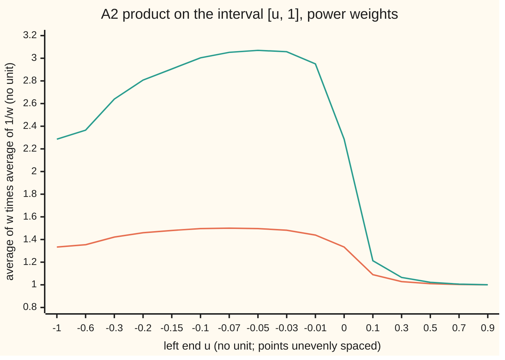

# Muckenhoupt weights: exactly which weightings keep the maximal function and singular integrals bounded

[Syllabus](../../../SYLLABUS.md) → [Harmonic analysis](../README.md) → [Maximal Functions and Beyond](../README.md#s06) → Muckenhoupt weights

---

## General Overview

Take the 1 ms camera-shutter gate from [Singular integrals](03-singular-integrals-and-the-hilbert-transform-bound.md): a signal of 1 V from time $`x = 0`$ to $`x = 1`$, with $`x`$ in milliseconds. Now measure its energy with a price on each moment. The price is a **weight** $`w(x) = \lvert x\rvert^{1/2}`$. A moment at 4 ms costs twice as much as a moment at 1 ms, and moments near 0 cost almost nothing.

The gate's weighted energy is the integral of $`x^{1/2}`$ from 0 to 1: 2/3. Its maximal function (the largest centred average at each moment, from [The maximal function](01-hardy-littlewood-maximal-function.md)) has weighted energy 1.559366. The ratio of sizes, the square root of 1.559366 over 2/3, is 1.5294. Finite.

Does that ratio stay below one fixed number for **every** signal? An averaging operator moves energy in time. If cheap moments sit next to expensive ones, a signal can sit cheaply and be spread to where it costs a lot. Benjamin Muckenhoupt found the exact test in 1972: on every interval, multiply the average price by the average of 1 over the price. The weight passes when that product stays bounded.

For $`\lvert x\rvert^{1/2}`$ the product is 4/3 on every interval $`[0, a]`$, near 1 on short intervals away from 0, and never above 3/2. For $`\lvert x\rvert^{1}`$ the average of $`1/w`$ over $`[0, 1]`$ is infinite, and the signal $`1/x`$ on $`[\varepsilon, 1]`$ pushes the maximal function's ratio past every bound as $`\varepsilon`$ shrinks.

**The maximal function and the Hilbert transform are bounded on weighted energy exactly when, on every interval, the average of the weight times the average of its reciprocal stays below one fixed number (the A2 condition, and its p-th power form Ap), which also suffices for every other singular integral; the power weight |x|^γ passes exactly when −1 < γ < 1.**

**What kind of fact this is:** theorems. For the maximal function, Why it works proves that the test is necessary, proves the weak bound, and outlines the strong bound. The power-weight test is proved in full. The theorems for the Hilbert transform (Hunt, Muckenhoupt and Wheeden, 1973) and all Calderón–Zygmund operators (Coifman and Fefferman, 1974) are stated with sources. The gate is synthetic: illustrative.

### The picture: the test on every interval that ends at 1

By scaling (Step 1 below), every interval is a copy of one of the form $`[u, 1]`$. So one curve shows the whole test: the A2 product on $`[u, 1]`$ as the left end $`u`$ runs from −1 to 0.9.



Orange: $`w = \lvert x\rvert^{0.5}`$. Teal: $`w = \lvert x\rvert^{0.75}`$. At $`u = 0`$ both read $`1/(1-\gamma^2)`$: 1.3333 and 2.2857. The worst interval pokes just past 0: for $`\gamma = 0.5`$, $`u = -0.0718`$ gives exactly 3/2. Far from 0 the weight is nearly constant on the interval, and the product falls to 1.

---

## The formula

Notation first. $`I`$ is an interval and $`\lvert I\rvert`$ its length. The **average** of a function over $`I`$ is $`\langle w\rangle_I = \frac{1}{\lvert I\rvert}\int_I w`$. A **weight** $`w`$ is a function that is positive almost everywhere and has a finite integral over every bounded interval. $`w(E) = \int_E w`$ is the **weighted length** of a set $`E`$. The **weighted p-norm** is $`\lVert f\rVert_{L^p(w)} = (\int \lvert f\rvert^p\,w)^{1/p}`$, and $`L^p(w)`$ is the set of signals for which it is finite ([Lp spaces](../../10-Measure%20and%20integration/07-Sizes%20of%20Functions/01-lp-spaces.md)). For $`p = 2`$ it is the weighted energy, square-rooted.

For $`1 < p < \infty`$, the **dual weight** is $`\sigma = w^{-1/(p-1)}`$; for $`p = 2`$ it is $`1/w`$. The **$`A_p`$ constant** of $`w`$ is

```math
[w]_{A_p} = \sup_{I} \ \langle w\rangle_I\,\langle \sigma\rangle_I^{\,p-1}, \qquad [w]_{A_2} = \sup_I \ \langle w\rangle_I\,\langle 1/w\rangle_I
```

**Read it aloud:** the A p constant of w is the largest value, over every interval I, of the average of w on I times the average of the dual weight on I raised to the power p minus 1; for p equal to 2, the average of w times the average of 1 over w.

The weight is **in $`A_p`$** when this number is finite. It is never below 1, because by [Holder's inequality](../../10-Measure%20and%20integration/07-Sizes%20of%20Functions/02-holders-inequality.md) with exponents $`p`$ and $`p'`$, the average of $`w^{1/p}\cdot w^{-1/p} = 1`$ is at most $`\langle w\rangle_I^{1/p}\langle \sigma\rangle_I^{1/p'}`$, whose $`p`$-th power is the product.

**Muckenhoupt's theorem.** Let $`M`$ be the maximal function of [The maximal function](01-hardy-littlewood-maximal-function.md) and $`1 < p < \infty`$. Then

```math
\lVert Mf\rVert_{L^p(w)} \le C\,\lVert f\rVert_{L^p(w)} \ \text{ for every } f \qquad\Longleftrightarrow\qquad [w]_{A_p} < \infty
```

**Read it aloud:** M is bounded on weighted p-norm, with one constant C for every signal, exactly when the A p constant of w is finite.

Two bounds come with it, both proved below. Here $`\alpha > 0`$ is a level:

```math
[w]_{A_p} \le (2C)^p, \qquad w\{x : Mf(x) > \alpha\} \le \frac{3^p\,[w]_{A_p}^2}{\alpha^p}\,\lVert f\rVert_{L^p(w)}^p
```

**Read it aloud:** a bound C for M makes the A p constant at most (2C) to the p; and the weighted length of the set where M f beats alpha is at most 3 to the p times the A p constant squared times the p-th power of f's weighted norm, over alpha to the p.

**Hunt–Muckenhoupt–Wheeden, and Coifman–Fefferman (stated).** For the Hilbert transform $`H`$ of [Singular integrals](03-singular-integrals-and-the-hilbert-transform-bound.md), and $`1 < p < \infty`$, $`H`$ is bounded on $`L^p(w)`$ exactly when $`w \in A_p`$. Every Calderón–Zygmund operator $`T`$ (a kernel with the size and smoothness conditions, bounded in energy) is bounded on $`L^p(w)`$ for every $`w \in A_p`$.

**The power weights.** For $`w = \lvert x\rvert^\gamma`$:

```math
\lvert x\rvert^\gamma \in A_p \iff -1 < \gamma < p - 1, \qquad \langle \lvert x\rvert^{\gamma}\rangle_{[0,a]}\,\langle \lvert x\rvert^{-\gamma}\rangle_{[0,a]} = \frac{1}{1-\gamma^2} \ \text{ for every } a > 0
```

**Read it aloud:** the power weight with exponent gamma is in A p exactly when gamma lies between minus 1 and p minus 1; on every interval from 0 to a, the A2 product is 1 over 1 minus gamma squared.

| Symbol | Plain meaning | In our example | Push it up and the answer… |
| --- | --- | --- | --- |
| $`x`$, $`g`$ | position on the line, in ms for the gate; the gate, 1 V on $`[0, 1]`$ | $`\lVert g\rVert_{L^2(w)}^2`$ = 2/3 | — |
| $`w`$, $`\gamma`$ | the weight, a price per moment; its power | $`w = \lvert x\rvert^{0.5}`$ | $`\gamma`$ toward 1: $`[w]_{A_2}`$ grows without limit |
| $`I`$, $`\lvert I\rvert`$, $`a`$, $`u`$, $`c`$, $`h`$ | an interval and its length; the right end of $`[0, a]`$; the left end of $`[u, 1]`$; a centre and half-width | worst interval $`[-0.0718, 1]`$ | — |
| $`\langle w\rangle_I`$, $`w(E)`$, $`E`$, $`I_j`$ | average over $`I`$; weighted length of a set; a set; chosen intervals in a covering | $`\langle w\rangle_{[0,1]}`$ = 0.666667 | — |
| $`\sigma`$, $`p`$, $`p'`$ | the dual weight $`w^{-1/(p-1)}`$; the exponent of the norm; its conjugate $`p/(p-1)`$ | $`\sigma = 1/w`$ at $`p = 2`$ | $`p`$ down toward 1: the test gets harder |
| $`[w]_{A_p}`$, $`[w]_{A_2}`$ | the $`A_p`$ constant: the worst interval's product | $`[w]_{A_2}`$ = 3/2 | — |
| $`L^p(w)`$, $`\lVert f\rVert_{L^p(w)}`$ | signals of finite weighted p-norm; that norm | gate: square root of 2/3 | — |
| $`M`$, $`H`$, $`T`$, $`C`$ | maximal function; Hilbert transform; any Calderón–Zygmund operator; a bound's constant | gate: $`\lVert Mg\rVert / \lVert g\rVert`$ = 1.5294 | — |
| $`\lambda`$, $`n`$, $`L`$, $`t`$, $`s`$, $`I'`$, $`3I`$ | a stretch factor; a truncation level; $`\ln(1/\varepsilon)`$; distance to the left of 0; a variable of integration, or a point of $`I`$; the neighbour of $`I`$; $`I`$ tripled about its centre | — | — |
| $`f`$, $`\varepsilon`$, $`\alpha`$ | a test signal, $`1/w`$ on $`[\varepsilon, 1]`$; its cut-off; a level, in V | $`\gamma = 1`$, $`\varepsilon = 10^{-8}`$: ratio at least 5.6096; $`\alpha`$ = 1/4 on the gate | smaller $`\varepsilon`$: ratio grows when $`\gamma = 1`$ |
| $`\varphi`$, $`m`$, $`A`$, $`B`$, $`\delta`$, BMO | $`\ln w`$; its mean on $`I`$; the two averages of Step 6; a small positive exponent; bounded mean oscillation | $`\varphi = 0.5\ln\lvert x\rvert`$, oscillation 0.367879 on $`[0, 1]`$ | — |
| $`r`$, $`y`$ | in the by-hand search: $`r = \sqrt{-u}`$; $`y = r/(1+r^2)`$ | $`r`$ = 0.267949, $`y`$ = 1/4 | — |

### When it holds

- **$`w`$ and $`\sigma`$ have finite integrals on bounded intervals.** For $`\gamma \le -1`$ the average of $`w`$ near 0 is infinite; for $`\gamma \ge 1`$ (at $`p = 2`$) that of $`1/w`$ is. Both operators then fail.
- **$`1 < p < \infty`$.** At $`p = 1`$ the test is $`A_1`$, $`Mw \le Cw`$ almost everywhere, and it gives only a weak bound, as without weights.
- **Every interval, at every scale and place.** Testing only intervals $`[0, a]`$ gives 4/3 for $`\lvert x\rvert^{0.5}`$; the true constant is 3/2, on an interval that pokes just past 0.
- **One weight on both sides.** With different input and output weights, a product test is still necessary but no longer enough for the strong bound.
- **A Calderón–Zygmund kernel.** The singular-integral half needs the size and smoothness conditions. In higher dimensions the test runs over cubes, and the theorems cover the [Riesz transforms](07-riesz-transforms-and-singular-integrals-in-higher-dimensions.md).

---

## Why it works

### Step 0: the cheapest way to make a big average

Fix an interval $`I`$. Which signal $`f \ge 0`$ on $`I`$ has a given integral at the lowest weighted energy? Write $`f = (f w^{1/2})\cdot w^{-1/2}`$ and apply Cauchy–Schwarz ([Holder's inequality](../../10-Measure%20and%20integration/07-Sizes%20of%20Functions/02-holders-inequality.md) with both exponents 2):

```math
\Bigl(\int_I f\Bigr)^2 \le \int_I f^2\,w \ \cdot \int_I \frac{1}{w}
```

Equality holds when $`f`$ is a multiple of $`1/w`$. So the cheapest signal piles up where the price is low, and its cost is $`(\int_I f)^2 / \int_I (1/w)`$.

Now apply $`M`$. At every point of $`I`$, the centred window of half-width $`\lvert I\rvert`$ covers $`I`$, so $`Mf \ge \langle f\rangle_I / 2`$ there. The output pays at least $`(\langle f\rangle_I/2)^2\,w(I)`$ on $`I`$ alone. Divide output by input:

```math
\frac{\lVert Mf\rVert_{L^2(w)}^2}{\lVert f\rVert_{L^2(w)}^2} \ \ge\ \frac{\langle f\rangle_I^2\,w(I)/4}{\langle f\rangle_I^2\lvert I\rvert^2/\int_I (1/w)} = \frac{\langle w\rangle_I\,\langle 1/w\rangle_I}{4}
```

So one interval forces the squared ratio up to a quarter of its A2 product. Muckenhoupt's theorem says the converse: if no single interval does damage, nothing does.

### Step 1: power weights pass exactly when −1 < γ < 1

Three facts settle it.

- **Scaling.** Stretch an interval by a factor $`\lambda`$: $`\langle w\rangle`$ gains $`\lambda^\gamma`$, $`\langle 1/w\rangle`$ gains $`\lambda^{-\gamma}`$, and the product is unchanged. Reflection changes nothing either. So every interval matches some $`[u, 1]`$ with $`-1 \le u < 1`$.
- **The closed form on $`[0, a]`$.** $`\int_0^a x^\gamma\,dx = a^{\gamma+1}/(\gamma+1)`$ when $`\gamma > -1`$. So $`\langle w\rangle = a^\gamma/(1+\gamma)`$ and $`\langle 1/w\rangle = a^{-\gamma}/(1-\gamma)`$. Their product is $`1/(1-\gamma^2)`$ for every $`a`$. For $`\gamma = 1`$ the second integral is $`\int_0^a dx/x`$, which is infinite.
- **Away from 0.** As $`u \to 1`$ the interval shrinks onto the point 1, where $`w`$ is smooth and positive, so the product tends to 1.

So for $`\lvert\gamma\rvert < 1`$ the product is a continuous function of $`u`$ on $`[-1, 1)`$ with a finite limit at 1, hence bounded. For $`\lvert\gamma\rvert \ge 1`$ one of the two averages is infinite. The same argument with $`\sigma = \lvert x\rvert^{-\gamma/(p-1)}`$ gives $`-1 < \gamma < p - 1`$ for $`A_p`$.

### Step 2: the test is necessary

Suppose $`\lVert Mf\rVert_{L^p(w)} \le C\lVert f\rVert_{L^p(w)}`$ for every $`f`$. Step 0's cheapest signal is now $`f = \sigma`$ on $`I`$, zero elsewhere. The choice $`\sigma = w^{-1/(p-1)}`$ makes $`\sigma^p w = \sigma`$, so the input costs $`\sigma(I)`$. On $`I`$, $`Mf \ge \langle\sigma\rangle_I/2`$, so

```math
\Bigl(\frac{\langle \sigma\rangle_I}{2}\Bigr)^p w(I) \ \le\ C^p\,\sigma(I) \qquad\Longrightarrow\qquad \langle w\rangle_I\,\langle\sigma\rangle_I^{\,p-1} \le (2C)^p
```

The second form comes from dividing by $`\sigma(I)`$ and $`\lvert I\rvert`$. If $`\sigma(I)`$ is infinite, use $`\min(\sigma, n)`$ on $`I`$ instead; the same bound holds for every $`n`$ and forces $`\sigma(I)`$ to be finite. This is exactly how $`\gamma = 1`$ fails: cut $`1/x`$ off at $`\varepsilon`$, and the ratio grows as $`\varepsilon`$ shrinks (Worked numbers).

### Step 3: the test gives the weak bound

Take $`w \in A_p`$. Two consequences of the test do the work.

1. **An average is controlled by the weighted norm.** Hölder's inequality on $`I`$, with $`\lvert f\rvert = \lvert f\rvert w^{1/p}\cdot w^{-1/p}`$, gives

```math
\langle \lvert f\rvert\rangle_I^{\,p} \ \le\ [w]_{A_p}\,\frac{1}{w(I)}\int_I \lvert f\rvert^p\,w
```

2. **Tripling an interval multiplies its weight by at most $`3^p[w]_{A_p}`$.** Put $`f = 1`$ on $`I`$ and zero elsewhere into fact 1, on the interval $`3I`$ (same centre, three times as long). The left side is $`3^{-p}`$, the right side $`[w]\,w(I)/w(3I)`$.

Now copy the unweighted proof of [The maximal function](01-hardy-littlewood-maximal-function.md). Each point where $`Mf > \alpha`$ has a centred interval with $`\langle\lvert f\rvert\rangle > \alpha`$. The covering lemma of [The Lebesgue differentiation theorem](../../10-Measure%20and%20integration/11-Derivatives%20Meet%20the%20Lebesgue%20Integral/02-lebesgue-differentiation-theorem.md) picks disjoint ones, $`I_j`$, whose tripled copies cover any compact piece of the set. Fact 2 bounds $`w(3I_j)`$ by $`3^p[w]\,w(I_j)`$. Fact 1 with $`\langle\lvert f\rvert\rangle_{I_j} > \alpha`$ bounds $`w(I_j)`$ by $`[w]\,\alpha^{-p}\int_{I_j}\lvert f\rvert^p w`$. Add over the disjoint $`I_j`$ and the weak bound of The formula follows.

<details>
<summary>Detailed proof: fact 1, the Hölder step</summary>

Write $`p' = p/(p-1)`$, the conjugate exponent. Hölder's inequality with exponents $`p`$ and $`p'`$ gives

$`\displaystyle \int_I \lvert f\rvert = \int_I \lvert f\rvert w^{1/p}\, w^{-1/p} \le \Bigl(\int_I \lvert f\rvert^p w\Bigr)^{1/p}\Bigl(\int_I w^{-p'/p}\Bigr)^{1/p'}.`$

Since $`p'/p = 1/(p-1)`$, the last integral is $`\sigma(I)`$. Raise to the power $`p`$ and divide by $`\lvert I\rvert^p`$:

$`\displaystyle \langle\lvert f\rvert\rangle_I^{\,p} \le \frac{\int_I \lvert f\rvert^p w}{w(I)}\cdot\frac{w(I)}{\lvert I\rvert}\Bigl(\frac{\sigma(I)}{\lvert I\rvert}\Bigr)^{p-1} \le [w]_{A_p}\,\frac{\int_I \lvert f\rvert^p w}{w(I)}.`$

The middle factor is $`\langle w\rangle_I\langle\sigma\rangle_I^{p-1}`$, at most $`[w]_{A_p}`$.

</details>

### Step 4: the strong bound, in outline

The weak bound at $`p`$ plus the trivial bound $`\lVert Mf\rVert_\infty \le \lVert f\rVert_\infty`$ is not enough: Marcinkiewicz interpolation ([Interpolation](04-interpolation-riesz-thorin-and-marcinkiewicz.md)) gives strong bounds only strictly between the two ends. The missing piece is room below $`p`$.

**Openness (stated; proved in Grafakos, chapter 7).** An $`A_p`$ weight obeys a **reverse Hölder inequality**: for some $`\delta > 0`$ and $`C`$, $`\langle w^{1+\delta}\rangle_I^{1/(1+\delta)} \le C\langle w\rangle_I`$ on every interval. Applied to $`\sigma`$, it shows $`w \in A_{p-\varepsilon}`$ for some $`\varepsilon > 0`$. So $`M`$ obeys the weak bound at $`p - \varepsilon`$, and Marcinkiewicz between $`p - \varepsilon`$ and $`\infty`$ gives the strong bound at $`p`$.

The power weight shows the room. $`\lvert x\rvert^{0.5}`$ is in $`A_p`$ for every $`p > 1.5`$, not only at $`p = 2`$. On $`[0, 1]`$ its $`A_p`$ product is 1.333333 at $`p = 2`$, 1.519671 at 1.75, 1.953437 at 1.6 and 2.492727 at 1.55. At $`p = 1.5`$ the dual weight is $`\lvert x\rvert^{-1}`$ and the product is infinite.

### Step 5: singular integrals (stated)

**Necessity for $`H`$.** Take $`f = \sigma`$ on $`I`$ and look at the neighbouring interval $`I'`$ of the same length. For $`x`$ in $`I'`$, every $`1/(x - s)`$ with $`s`$ in $`I`$ has the same sign and size at least $`1/(2\lvert I\rvert)`$. So $`\lvert Hf\rvert \ge \langle\sigma\rangle_I/(2\pi)`$ on $`I'`$, and Step 2's argument gives $`\langle w\rangle_{I'}\langle\sigma\rangle_I^{\,p-1} \le (2\pi C)^p`$. A second test with $`I`$ and $`I'`$ swapped shows that neighbouring intervals carry comparable weight, and the two combine into the $`A_p`$ bound. Hunt, Muckenhoupt and Wheeden (1973) proved the converse, that $`A_p`$ is enough.

**Sufficiency for every Calderón–Zygmund operator.** Coifman and Fefferman (1974) compare $`Tf`$ with $`Mf`$ by a **good-λ inequality**: the set where $`\lvert Tf\rvert > 2\alpha`$ but $`Mf`$ is small is a small part of the set where $`\lvert Tf\rvert > \alpha`$. An $`A_p`$ weight cannot pile its mass on a small part of an interval: $`w(E)/w(I) \le C(\lvert E\rvert/\lvert I\rvert)^\delta`$, from reverse Hölder. So small in length means small in weight, and $`\lVert Tf\rVert_{L^p(w)} \le C\lVert Mf\rVert_{L^p(w)}`$. Muckenhoupt's theorem then finishes.

For $`\gamma = 1`$, the test signal $`1/x`$ on $`[\varepsilon, 1]`$ breaks $`H`$ too. At $`x = -t < 0`$, $`\lvert Hf(x)\rvert = \ln\bigl((t+\varepsilon)/(\varepsilon(1+t))\bigr)/(\pi t)`$. Its weighted size on $`[-1, 0]`$ alone, over the input's, is 0.8025, 1.6577 and 3.3643 at $`\varepsilon = 10^{-2}, 10^{-4}, 10^{-8}`$.

### Step 6: the link with BMO

A function is in **BMO** (bounded mean oscillation) when its average distance from its own mean, over each interval, stays below one number ([BMO](09-bmo-and-the-john-nirenberg-inequality.md)).

**$`A_2`$ gives $`\ln w \in`$ BMO (proved).** Let $`\varphi = \ln w`$, $`m`$ its mean on $`I`$, $`A = \langle e^{\varphi - m}\rangle_I`$ and $`B = \langle e^{m - \varphi}\rangle_I`$. By [Jensen's inequality](../../10-Measure%20and%20integration/07-Sizes%20of%20Functions/04-jensens-inequality.md), $`A \ge 1`$ and $`B \ge 1`$, and $`AB = \langle w\rangle_I\langle 1/w\rangle_I \le [w]_{A_2}`$. Since $`(A-1)(B-1) \ge 0`$, $`A + B \le AB + 1`$. Jensen once more, with $`e^{\lvert s\rvert} \le e^s + e^{-s}`$:

```math
\langle \lvert\varphi - m\rvert\rangle_I \ \le\ \ln\bigl([w]_{A_2} + 1\bigr)
```

**The converse needs a small size (stated).** By the John–Nirenberg inequality, if $`\varphi \in`$ BMO then $`e^{\delta\varphi} \in A_2`$ for all small enough $`\delta > 0`$. The power weights show why "small" matters: $`\ln\lvert x\rvert`$ is in BMO, yet $`e^{\delta\ln\lvert x\rvert} = \lvert x\rvert^\delta`$ is in $`A_2`$ only for $`\delta < 1`$.

---

## Worked numbers, by hand

The weight $`w = \lvert x\rvert^{0.5}`$, at $`p = 2`$.

| Step | Arithmetic | Value |
| --- | --- | --- |
| $`\langle w\rangle_{[0,1]}`$ | $`1/1.5`$ | 0.666667 |
| $`\langle 1/w\rangle_{[0,1]}`$ | $`1/0.5`$ | 2 |
| product on $`[0, 1]`$ | $`0.666667 \times 2 = 1/(1 - 0.25)`$ | 1.333333 |
| same on $`[0, 0.01]`$ and $`[0, 100]`$ | $`0.066667 \times 20`$; $`6.666667 \times 0.2`$ | 1.333333 |
| $`[1, 3]`$: $`\langle w\rangle`$ | $`(3^{1.5} - 1)/(1.5 \times 2)`$ | 1.398717 |
| $`[1, 3]`$: $`\langle 1/w\rangle`$ | $`(3^{0.5} - 1)/(0.5 \times 2)`$ | 0.732051 |
| product on $`[1, 3]`$; on $`[1.5, 2.5]`$; on $`[1.9, 2.1]`$ | $`1.398717 \times 0.732051`$; same way | 1.023932; 1.005378; 1.000209 |
| interval $`[-r^2, 1]`$: product | $`\frac{4}{3}\cdot\frac{(1+r^3)(1+r)}{(1+r^2)^2} = \frac{4}{3}(1 + y - 2y^2)`$, $`y = \frac{r}{1+r^2}`$ | — |
| best $`y`$ | $`1 - 4y = 0`$ | 1/4 |
| best $`r`$ | $`r^2 - 4r + 1 = 0`$, so $`r = 2 - \sqrt3`$ | 0.267949 |
| worst left end $`u = -r^2`$ | $`-(0.267949)^2`$ | −0.071797 |
| **$`[w]_{A_2}`$** | $`\frac{4}{3}(1 + \frac14 - \frac18) = \frac43\cdot\frac98`$ | **1.500000** |

The product line uses $`(1+r^3)(1+r) = (1 + r^2 + 2r)(1 + r^2 - r)`$, divided by $`(1+r^2)^2`$. So no interval gives a product above 3/2. A grid of 7,260 intervals agrees: 1.499999.

On the gate, with this weight:

| Step | Arithmetic | Value |
| --- | --- | --- |
| $`Mg`$ | 1 on the gate, $`1/(2 \times \text{distance to the far edge})`$ outside | $`Mg(1.5)`$ = 0.333333 |
| set where $`Mg > 1/4`$ | far edge less than 2 away | $`(-1, 2)`$ |
| its weighted length | $`(1 + 2^{1.5})/1.5`$ | 2.552285 |
| weak ratio | $`2.552285 \times (1/4)^2 / (2/3)`$ | 0.239277 |
| weak bound | $`9 \times 1.5^2`$ | 20.2500, ratio 0.0118 |
| weighted energy of $`Mg`$ | $`2/3 + 1/2 + \pi/8`$ | 1.559366 |
| **strong ratio** | $`\sqrt{1.559366/(2/3)}`$ | **1.5294** |

The $`\pi/8`$ = 0.392699 is the left tail, $`\int_0^\infty s^{1/2}/(4(1+s)^2)\,ds`$; the right tail is $`\int_1^\infty x^{1/2}/(4x^2)\,dx = 1/2`$. The gate uses only 0.0118 of the proved weak bound.

| γ | $`[w]_{A_2}`$ | product on $`[0,1]`$, $`1/(1-\gamma^2)`$ |
| --- | --- | --- |
| 0 | 1.0000 | 1.0000 |
| 0.25 | 1.0969 | 1.0667 |
| 0.5 | 1.5000 | 1.3333 |
| 0.75 | 3.0706 | 2.2857 |
| 0.9 | 8.4854 | 5.2632 |
| 0.99 | 97.0949 | 50.2513 |

### What breaks if you drop a piece

| Mistake | Comes out at | What went wrong |
| --- | --- | --- |
| Test only intervals $`[0, a]`$ | 1.333333 instead of 1.500000 | The worst interval straddles 0: $`[-0.0718, 1]`$ |
| Take $`\gamma = 1`$: $`w = \lvert x\rvert`$ | product on $`[0,1]`$ with $`1/w`$ counted from $`\varepsilon`$: 2.302585, 4.605170, 9.210340 at $`\varepsilon = 10^{-2}, 10^{-4}, 10^{-8}`$ | $`\int_0^1 dx/x`$ is infinite: the test fails |
| … and trust $`M`$ anyway | $`\lVert Mf\rVert/\lVert f\rVert \ge`$ 1.5998, 2.9432, 5.6096 for $`f = 1/x`$ on $`[\varepsilon, 1]`$ | No constant works. For $`\gamma = 0.5`$ the same test gives 1.0966, 1.3064, 1.3513, settling at $`\sqrt{2\sqrt2 - 1}`$ = 1.3522 |
| … and trust $`H`$ anyway | ratio at least 0.8025, 1.6577, 3.3643 | Step 5: the Hilbert transform fails on the same signal |
| Read $`\ln w \in`$ BMO as enough | $`\ln\lvert x\rvert`$ has mean oscillation 0.735759 ($`2/e`$) on every $`[0, a]`$, yet $`\lvert x\rvert \notin A_2`$ | Only $`e^{\delta\varphi}`$ with small $`\delta`$ is promised |

For $`\gamma = 1`$ the code also checks the $`M`$ ratio against its closed form in $`L = \ln(1/\varepsilon)`$; it grows like $`L/\sqrt{12}`$.

---

## Code, from first principles, and it actually runs

Every example above runs by independent roads. Averages of $`\lvert x\rvert^\gamma`$ come from the antiderivative and from Simpson's rule after the change of variable $`x = c\,u^8`$. The constant 3/2 comes three ways: a golden-section search over $`[u, 1]`$, a brute-force grid of 7,260 intervals, and the by-hand formula. For every $`\gamma`$ in the table, the search is checked against a grid of 40,000 left ends. The gate's $`Mg`$ is checked by brute force over 40,000 window widths. The $`\gamma = 1`$ failure is computed by Simpson's rule in $`\ln x`$ and from its closed form. The closed form for $`\lvert Hf\rvert`$ is checked against its kernel integral at three points. Its energy integral starts 30 units of $`\ln t`$ below $`\ln\varepsilon`$, where the integrand is below $`e^{-60}`$; a second run from 40 units below agrees. The left tail is cut at $`\ln s`$ = −60 and 80, where the integrand is below $`e^{-30}`$, and matches $`\pi/8`$ to nine decimals.

### Python

```python
# Muckenhoupt weights -- the check behind the card.  Standard library only.
# Every number on the card is printed here.  Nothing imported knows the answer.
import math

def F(x, e):                       # antiderivative of |x|^e, for e > -1
    return math.copysign(abs(x) ** (e + 1) / (e + 1), x)

def avg_exact(a, b, e):            # road 1: average of |x|^e over [a, b], closed form
    return (F(b, e) - F(a, e)) / (b - a)

def simpson(g, lo, hi, n=2000):
    h = (hi - lo) / n
    s = g(lo) + g(hi) + sum((4 if k % 2 else 2) * g(lo + k * h) for k in range(1, n))
    return s * h / 3

def from_zero(c, e):               # integral of x^e over [0, c], by x = c u^8: no antiderivative
    return simpson(lambda u: 8 * c ** (e + 1) * u ** (8 * e + 7), 0.0, 1.0)

def avg_simpson(a, b, e):          # road 2: the same average by Simpson's rule
    side = lambda x: math.copysign(from_zero(abs(x), e), x)
    return (side(b) - side(a)) / (b - a)

def Q(a, b, g, avg=avg_exact):     # the A2 product on [a, b]: average of w times average of 1/w
    return avg(a, b, g) * avg(a, b, -g)

def a2_constant(g):                # sup of Q over all intervals; by scaling, intervals [u, 1]
    u0 = max((k / 1000 for k in range(-1000, 1000)), key=lambda u: Q(u, 1, g))
    lo, hi, r = u0 - 0.001, min(u0 + 0.001, 0.9999), (math.sqrt(5) - 1) / 2
    for _ in range(60):            # golden-section search on the best grid cell
        m1, m2 = hi - r * (hi - lo), lo + r * (hi - lo)
        if Q(m1, 1, g) < Q(m2, 1, g): lo = m1
        else: hi = m2
    return (lo + hi) / 2, Q((lo + hi) / 2, 1, g)

G = 0.5
print(f"weight w(x) = |x|^{G}")
for a in (0.01, 1, 100):          # intervals [0, a] at three scales
    e1, e2, s = avg_exact(0, a, G), avg_exact(0, a, -G), Q(0, a, G, avg_simpson)
    print(f"I=[0,{a}]: avg w={e1:.6f} avg 1/w={e2:.6f} product={e1 * e2:.6f} simpson={s:.6f}")
    assert abs(e1 * e2 - 1 / (1 - G * G)) < 1e-12 and abs(s - e1 * e2) < 1e-9
for h in (1, 0.5, 0.1):
    e, s = Q(2 - h, 2 + h, G), Q(2 - h, 2 + h, G, avg_simpson)
    print(f"centred at 2, half-width {h}: avg w={avg_exact(2 - h, 2 + h, G):.6f} avg 1/w={avg_exact(2 - h, 2 + h, -G):.6f} product={e:.6f} simpson={s:.6f}")
    assert abs(e - s) < 1e-9 and 1 < e < 1 / (1 - G * G)
print(f"symmetric [-1,1]: product={Q(-1, 1, G):.6f}")
u, A2 = a2_constant(G)
brute = max(Q(i / 20, j / 20, G) for i in range(-60, 61) for j in range(i + 1, 61))
print(f"A2 constant: worst interval [{u:.4f}, 1], [w]_A2={A2:.6f}; grid of 7260 intervals: {brute:.6f}")
s0 = -(2 - math.sqrt(3)) ** 2     # road 3, by hand: the worst left end is -(2 - sqrt 3)^2, product 3/2
r0 = math.sqrt(-s0)
print(f"by hand: r = 2 - sqrt 3 = {r0:.6f}, y = r/(1+r^2) = {r0 / (1 + r0 * r0):.6f}, left end {s0:.6f}, product {Q(s0, 1, G):.6f}")
assert abs(u - s0) < 1e-6 and abs(A2 - 1.5) < 1e-12 and brute <= A2 + 1e-12 and A2 - brute < 2e-3
US = (-1, -0.6, -0.3, -0.2, -0.15, -0.1, -0.07, -0.05, -0.03, -0.01, 0, 0.1, 0.3, 0.5, 0.7, 0.9)
for g in (0.5, 0.75):
    print(f"chart gamma={g}: " + ", ".join(f"{Q(x, 1, g):.4f}" for x in US))
for g in (0.0, 0.25, 0.5, 0.75, 0.9, 0.99):
    c = a2_constant(g)[1]
    print(f"table gamma={g:.2f}: [w]_A2={c:.4f}  on [0,1]: {1 / (1 - g * g):.4f}")
    fine = max(Q(k / 20000, 1, g) for k in range(-20000, 20000))   # road 2: exhaustive grid of left ends
    assert c >= 1 / (1 - g * g) - 1e-12 and fine <= c + 1e-12 and c - fine < 1e-4 * c
M = lambda x: 1.0 if 0 <= x <= 1 else 1 / (2 * max(x, 1 - x))   # Mg for the gate g on [0,1]
for x in (-0.5, 0.3, 1.5):          # brute force: largest centred average over 40000 half-widths
    b = max((min(x + h, 1) - max(x - h, 0)) / (2 * h) for h in (k / 10000 for k in range(1, 40001)))
    print(f"gate: Mg({x}) = {M(x):.6f}, brute force {b:.6f}")
    assert abs(b - M(x)) < 1e-4
wE, wE2 = avg_exact(-1, 2, G) * 3, avg_simpson(-1, 2, G) * 3
wr = wE / 16 / (2 / 3)              # w-length times alpha^2, over the weighted energy 2/3
print(f"gate: w-length where Mg > 1/4 = {wE:.6f} (simpson {wE2:.6f}); weak ratio {wr:.6f}")
print(f"gate: weak bound 9 [w]_A2^2 = {9 * A2 * A2:.4f}; ratio to bound {wr / (9 * A2 * A2):.4f}")
left = simpson(lambda v: math.exp(1.5 * v) / (4 * (1 + math.exp(v)) ** 2), -60.0, 80.0, 20000)
tot = 2 / 3 + 0.5 + left            # weighted energy of Mg: on the gate, right tail, left tail
print(f"gate: left tail {left:.6f} (pi/8 = {math.pi / 8:.6f}); energy of Mg {tot:.6f}; strong ratio {math.sqrt(tot / (2 / 3)):.4f}")
assert abs(wE - wE2) < 1e-9 and abs(left - math.pi / 8) < 1e-9
EPS = ((1e-2, "1e-2"), (1e-4, "1e-4"), (1e-8, "1e-8"))
for eps, lab in EPS:               # gamma = 1: the average of 1/w on [0,1] diverges
    print(f"gamma=1, 1/w counted from {lab}: product on [0,1] = {math.log(1 / eps) / 2:.6f}")

def test_ratio(g, eps):            # f = 1/w on [eps,1]; Mf(x) >= average over [0, 2x]
    S = lambda m: math.log(m / eps) if g == 1 else (m ** (1 - g) - eps ** (1 - g)) / (1 - g)
    num = sum(simpson(lambda v: S(min(2 * math.exp(v), 1)) ** 2 * math.exp((g - 1) * v) / 4, lo, hi)
              for lo, hi in ((math.log(eps), -math.log(2)), (-math.log(2), 0.0)))
    return math.sqrt(num / S(1.0))
for eps, lab in EPS:
    L, r1, r5 = math.log(1 / eps), test_ratio(1, eps), test_ratio(0.5, eps)
    exact = math.sqrt(((L ** 3 - math.log(2) ** 3) / 12 + L * L * math.log(2) / 4) / L)
    print(f"test eps={lab}: gamma=1 M-ratio>={r1:.4f} (closed form {exact:.4f}), gamma=0.5 M-ratio>={r5:.4f}")
    assert abs(r1 - exact) < 1e-6
print(f"gamma=0.5 limit as eps -> 0: sqrt(2 sqrt 2 - 1) = {math.sqrt(2 * math.sqrt(2) - 1):.4f}")
assert abs(r5 - math.sqrt(2 * math.sqrt(2) - 1)) < 1e-3

def hilbert_ratio(eps):            # gamma = 1, same f: |Hf| at x = -t is ln((t+eps)/(eps(1+t)))/(pi t)
    num = simpson(lambda v: math.log((math.exp(v) + eps) / (eps * (1 + math.exp(v)))) ** 2,
                  math.log(eps) - 30, 0.0, 20000) / math.pi ** 2
    return math.sqrt(num / math.log(1 / eps))
def hilbert_ratio2(eps):           # road 2: |Hf| as log1p(t/eps) - log1p(t), cut 40 below ln eps, 30000 steps
    num = simpson(lambda v: (math.log1p(math.exp(v) / eps) - math.log1p(math.exp(v))) ** 2,
                  math.log(eps) - 40, 0.0, 30000) / math.pi ** 2
    return math.sqrt(num / math.log(1 / eps))
for t in (0.001, 0.1, 0.5):         # road 2 for Hf: the kernel integral of 1/(y(t+y)) over [1e-4, 1], y = e^v
    k = simpson(lambda v: 1 / (t + math.exp(v)), math.log(1e-4), 0.0, 20000) / math.pi
    c = math.log((t + 1e-4) / (1e-4 * (1 + t))) / (math.pi * t)
    print(f"gamma=1, eps=1e-4: |Hf(-{t})| by kernel {k:.6f}, closed form {c:.6f}")
    assert abs(k - c) < 1e-8
hr, hr2 = [hilbert_ratio(e) for e, _ in EPS], [hilbert_ratio2(e) for e, _ in EPS]
print("gamma=1 H-ratio on x<0: " + ", ".join(f"{x:.4f}" for x in hr) + "; second cut-off: " + ", ".join(f"{x:.4f}" for x in hr2))
assert hr[0] < hr[1] < hr[2] and hr[2] > 3
assert all(abs(x - y) < 1e-6 for x, y in zip(hr, hr2))

for p in (2.0, 1.75, 1.6, 1.55):  # openness: |x|^0.5 is in A_p for every p above 1.5
    e1, e2 = avg_exact(0, 1, G), avg_exact(0, 1, -G / (p - 1))
    print(f"A_p product on [0,1], p={p:.2f}: {e1 * e2 ** (p - 1):.6f}")

def osc_log(a, b):                 # mean oscillation of ln x on [a, b], 0 <= a < b, by Simpson
    xlx = lambda x: x * math.log(x) - x if x > 0 else 0.0
    m = (xlx(b) - xlx(a)) / (b - a)            # the mean of ln x on [a, b]
    g = lambda x: abs(math.log(x) - m) if x > 0 else 0.0
    c = math.exp(m)                            # where ln x crosses its mean: split there
    return sum(simpson(lambda u: g(lo + (hi - lo) * u ** 8) * 8 * (hi - lo) * u ** 7, 0.0, 1.0, 20000)
               for lo, hi in ((a, c), (c, b))) / (b - a)
o = osc_log(0, 1)
print(f"BMO: mean oscillation of ln|x| on [0,1] = {o:.6f} (2/e = {2 / math.e:.6f}); on [1,3] = {osc_log(1, 3):.6f}")
print(f"log w = {G} ln|x|: oscillation {G * o:.6f} <= ln([w]_A2 + 1) = {math.log(A2 + 1):.6f}")
assert abs(o - 2 / math.e) < 1e-6 and G * o <= math.log(A2 + 1)
print("ALL CHECKS PASS")
```

**Ran 2026-11-24 on macOS, Python 3.14.10, standard library only. All checks passed. Output, pasted from the run:**

```
weight w(x) = |x|^0.5
I=[0,0.01]: avg w=0.066667 avg 1/w=20.000000 product=1.333333 simpson=1.333333
I=[0,1]: avg w=0.666667 avg 1/w=2.000000 product=1.333333 simpson=1.333333
I=[0,100]: avg w=6.666667 avg 1/w=0.200000 product=1.333333 simpson=1.333333
centred at 2, half-width 1: avg w=1.398717 avg 1/w=0.732051 product=1.023932 simpson=1.023932
centred at 2, half-width 0.5: avg w=1.410487 avg 1/w=0.712788 product=1.005378 simpson=1.005378
centred at 2, half-width 0.1: avg w=1.414066 avg 1/w=0.707328 product=1.000209 simpson=1.000209
symmetric [-1,1]: product=1.333333
A2 constant: worst interval [-0.0718, 1], [w]_A2=1.500000; grid of 7260 intervals: 1.499999
by hand: r = 2 - sqrt 3 = 0.267949, y = r/(1+r^2) = 0.250000, left end -0.071797, product 1.500000
chart gamma=0.5: 1.3333, 1.3538, 1.4217, 1.4599, 1.4799, 1.4963, 1.5000, 1.4963, 1.4821, 1.4392, 1.3333, 1.0900, 1.0285, 1.0098, 1.0026, 1.0002
chart gamma=0.75: 2.2857, 2.3653, 2.6396, 2.8072, 2.9053, 3.0038, 3.0521, 3.0697, 3.0578, 2.9502, 2.2857, 1.2131, 1.0650, 1.0222, 1.0059, 1.0005
table gamma=0.00: [w]_A2=1.0000  on [0,1]: 1.0000
table gamma=0.25: [w]_A2=1.0969  on [0,1]: 1.0667
table gamma=0.50: [w]_A2=1.5000  on [0,1]: 1.3333
table gamma=0.75: [w]_A2=3.0706  on [0,1]: 2.2857
table gamma=0.90: [w]_A2=8.4854  on [0,1]: 5.2632
table gamma=0.99: [w]_A2=97.0949  on [0,1]: 50.2513
gate: Mg(-0.5) = 0.333333, brute force 0.333333
gate: Mg(0.3) = 1.000000, brute force 1.000000
gate: Mg(1.5) = 0.333333, brute force 0.333333
gate: w-length where Mg > 1/4 = 2.552285 (simpson 2.552285); weak ratio 0.239277
gate: weak bound 9 [w]_A2^2 = 20.2500; ratio to bound 0.0118
gate: left tail 0.392699 (pi/8 = 0.392699); energy of Mg 1.559366; strong ratio 1.5294
gamma=1, 1/w counted from 1e-2: product on [0,1] = 2.302585
gamma=1, 1/w counted from 1e-4: product on [0,1] = 4.605170
gamma=1, 1/w counted from 1e-8: product on [0,1] = 9.210340
test eps=1e-2: gamma=1 M-ratio>=1.5998 (closed form 1.5998), gamma=0.5 M-ratio>=1.0966
test eps=1e-4: gamma=1 M-ratio>=2.9432 (closed form 2.9432), gamma=0.5 M-ratio>=1.3064
test eps=1e-8: gamma=1 M-ratio>=5.6096 (closed form 5.6096), gamma=0.5 M-ratio>=1.3513
gamma=0.5 limit as eps -> 0: sqrt(2 sqrt 2 - 1) = 1.3522
gamma=1, eps=1e-4: |Hf(-0.001)| by kernel 762.955621, closed form 762.955621
gamma=1, eps=1e-4: |Hf(-0.1)| by kernel 21.687868, closed form 21.687868
gamma=1, eps=1e-4: |Hf(-0.5)| by kernel 5.164214, closed form 5.164214
gamma=1 H-ratio on x<0: 0.8025, 1.6577, 3.3643; second cut-off: 0.8025, 1.6577, 3.3643
A_p product on [0,1], p=2.00: 1.333333
A_p product on [0,1], p=1.75: 1.519671
A_p product on [0,1], p=1.60: 1.953437
A_p product on [0,1], p=1.55: 2.492727
BMO: mean oscillation of ln|x| on [0,1] = 0.735759 (2/e = 0.735759); on [1,3] = 0.263639
log w = 0.5 ln|x|: oscillation 0.367879 <= ln([w]_A2 + 1) = 0.916291
ALL CHECKS PASS
```

### Rust

```rust
// Muckenhoupt weights -- the check behind the card.  std only, no crates.
// Every number on the card is printed here.  Nothing imported knows the answer.

fn f_anti(x: f64, e: f64) -> f64 {     // antiderivative of |x|^e, for e > -1
    (x.abs().powf(e + 1.0) / (e + 1.0)).copysign(x)
}
fn avg_exact(a: f64, b: f64, e: f64) -> f64 {   // road 1: average of |x|^e over [a, b], closed form
    (f_anti(b, e) - f_anti(a, e)) / (b - a)
}
fn simpson(g: &dyn Fn(f64) -> f64, lo: f64, hi: f64, n: usize) -> f64 {
    let h = (hi - lo) / n as f64;
    let mut acc = 0.0;
    for k in 1..n {
        acc += (if k % 2 == 1 { 4.0 } else { 2.0 }) * g(lo + k as f64 * h);
    }
    (g(lo) + g(hi) + acc) * h / 3.0
}
fn from_zero(c: f64, e: f64) -> f64 {  // integral of x^e over [0, c], by x = c u^8: no antiderivative
    simpson(&|u: f64| 8.0 * c.powf(e + 1.0) * u.powf(8.0 * e + 7.0), 0.0, 1.0, 2000)
}
fn avg_simpson(a: f64, b: f64, e: f64) -> f64 {  // road 2: the same average by Simpson's rule
    let side = |x: f64| from_zero(x.abs(), e).copysign(x);
    (side(b) - side(a)) / (b - a)
}
fn q(a: f64, b: f64, g: f64) -> f64 { avg_exact(a, b, g) * avg_exact(a, b, -g) }   // the A2 product
fn q_simpson(a: f64, b: f64, g: f64) -> f64 { avg_simpson(a, b, g) * avg_simpson(a, b, -g) }
fn a2_constant(g: f64) -> (f64, f64) {  // sup of q over all intervals; by scaling, intervals [u, 1]
    let (mut u0, mut best) = (-1.0, f64::NEG_INFINITY);
    for k in -1000..1000 {
        let u = k as f64 / 1000.0;
        if q(u, 1.0, g) > best { best = q(u, 1.0, g); u0 = u; }
    }
    let (mut lo, mut hi, r) = (u0 - 0.001, (u0 + 0.001f64).min(0.9999), (5f64.sqrt() - 1.0) / 2.0);
    for _ in 0..60 {                    // golden-section search on the best grid cell
        let (m1, m2) = (hi - r * (hi - lo), lo + r * (hi - lo));
        if q(m1, 1.0, g) < q(m2, 1.0, g) { lo = m1; } else { hi = m2; }
    }
    ((lo + hi) / 2.0, q((lo + hi) / 2.0, 1.0, g))
}
fn test_ratio(g: f64, eps: f64) -> f64 {  // f = 1/w on [eps,1]; Mf(x) >= average over [0, 2x]
    let s = |m: f64| if g == 1.0 { (m / eps).ln() } else { (m.powf(1.0 - g) - eps.powf(1.0 - g)) / (1.0 - g) };
    let integrand = |v: f64| s((2.0 * v.exp()).min(1.0)).powf(2.0) * ((g - 1.0) * v).exp() / 4.0;
    let mut num = 0.0;
    for (lo, hi) in [(eps.ln(), -(2f64).ln()), (-(2f64).ln(), 0.0)] { num += simpson(&integrand, lo, hi, 2000); }
    (num / s(1.0)).sqrt()
}
fn hilbert_ratio(eps: f64) -> f64 {     // gamma = 1, same f: |Hf| at x = -t is ln((t+eps)/(eps(1+t)))/(pi t)
    let pi = std::f64::consts::PI;
    let num = simpson(&|v: f64| ((v.exp() + eps) / (eps * (1.0 + v.exp()))).ln().powf(2.0),
                      eps.ln() - 30.0, 0.0, 20000) / pi.powf(2.0);
    (num / (1.0 / eps).ln()).sqrt()
}
fn hilbert_ratio2(eps: f64) -> f64 {    // road 2: |Hf| as ln_1p(t/eps) - ln_1p(t), cut 40 below ln eps, 30000 steps
    let num = simpson(&|v: f64| ((v.exp() / eps).ln_1p() - v.exp().ln_1p()).powf(2.0), eps.ln() - 40.0, 0.0, 30000);
    (num / std::f64::consts::PI.powf(2.0) / (1.0 / eps).ln()).sqrt()
}
fn osc_log(a: f64, b: f64) -> f64 {     // mean oscillation of ln x on [a, b], 0 <= a < b, by Simpson
    let xlx = |x: f64| if x > 0.0 { x * x.ln() - x } else { 0.0 };
    let m = (xlx(b) - xlx(a)) / (b - a);           // the mean of ln x on [a, b]
    let g = |x: f64| if x > 0.0 { (x.ln() - m).abs() } else { 0.0 };
    let c = m.exp();                               // where ln x crosses its mean: split there
    let mut total = 0.0;
    for (lo, hi) in [(a, c), (c, b)] {
        total += simpson(&|u: f64| g(lo + (hi - lo) * u.powf(8.0)) * 8.0 * (hi - lo) * u.powf(7.0), 0.0, 1.0, 20000);
    }
    total / (b - a)
}

fn main() {
    let g0 = 0.5;
    println!("weight w(x) = |x|^{}", g0);
    for a in [0.01, 1.0, 100.0] {       // intervals [0, a] at three scales
        let (e1, e2, s) = (avg_exact(0.0, a, g0), avg_exact(0.0, a, -g0), q_simpson(0.0, a, g0));
        println!("I=[0,{}]: avg w={:.6} avg 1/w={:.6} product={:.6} simpson={:.6}", a, e1, e2, e1 * e2, s);
        assert!((e1 * e2 - 1.0 / (1.0 - g0 * g0)).abs() < 1e-12 && (s - e1 * e2).abs() < 1e-9);
    }
    for h in [1.0, 0.5, 0.1] {
        let (e, s) = (q(2.0 - h, 2.0 + h, g0), q_simpson(2.0 - h, 2.0 + h, g0));
        println!("centred at 2, half-width {}: avg w={:.6} avg 1/w={:.6} product={:.6} simpson={:.6}",
                 h, avg_exact(2.0 - h, 2.0 + h, g0), avg_exact(2.0 - h, 2.0 + h, -g0), e, s);
        assert!((e - s).abs() < 1e-9 && 1.0 < e && e < 1.0 / (1.0 - g0 * g0));
    }
    println!("symmetric [-1,1]: product={:.6}", q(-1.0, 1.0, g0));
    let (u, a2) = a2_constant(g0);
    let mut brute = f64::NEG_INFINITY;
    for i in -60..61 { for j in (i + 1)..61 { brute = brute.max(q(i as f64 / 20.0, j as f64 / 20.0, g0)); } }
    println!("A2 constant: worst interval [{:.4}, 1], [w]_A2={:.6}; grid of 7260 intervals: {:.6}", u, a2, brute);
    let s0 = -(2.0 - 3f64.sqrt()).powf(2.0);  // road 3, by hand: the worst left end, product 3/2
    let r0 = (-s0).sqrt();
    println!("by hand: r = 2 - sqrt 3 = {:.6}, y = r/(1+r^2) = {:.6}, left end {:.6}, product {:.6}",
             r0, r0 / (1.0 + r0 * r0), s0, q(s0, 1.0, g0));
    assert!((u - s0).abs() < 1e-6 && (a2 - 1.5).abs() < 1e-12 && brute <= a2 + 1e-12 && a2 - brute < 2e-3);
    let us = [-1.0, -0.6, -0.3, -0.2, -0.15, -0.1, -0.07, -0.05, -0.03, -0.01, 0.0, 0.1, 0.3, 0.5, 0.7, 0.9];
    for g in [0.5, 0.75] {
        let pts: Vec<String> = us.iter().map(|&x| format!("{:.4}", q(x, 1.0, g))).collect();
        println!("chart gamma={}: {}", g, pts.join(", "));
    }
    for g in [0.0, 0.25, 0.5, 0.75, 0.9, 0.99] {
        let c = a2_constant(g).1;
        println!("table gamma={:.2}: [w]_A2={:.4}  on [0,1]: {:.4}", g, c, 1.0 / (1.0 - g * g));
        let mut fine = f64::NEG_INFINITY;  // road 2: exhaustive grid of left ends
        for k in -20000..20000 { fine = fine.max(q(k as f64 / 20000.0, 1.0, g)); }
        assert!(c >= 1.0 / (1.0 - g * g) - 1e-12 && fine <= c + 1e-12 && c - fine < 1e-4 * c);
    }
    let mg = |x: f64| if 0.0 <= x && x <= 1.0 { 1.0 } else { 1.0 / (2.0 * x.max(1.0 - x)) };  // Mg, gate on [0,1]
    for x in [-0.5, 0.3, 1.5] {         // brute force: largest centred average over 40000 half-widths
        let mut b = f64::NEG_INFINITY;
        for k in 1..40001 {
            let h = k as f64 / 10000.0;
            b = b.max(((x + h).min(1.0) - (x - h).max(0.0)) / (2.0 * h));
        }
        println!("gate: Mg({}) = {:.6}, brute force {:.6}", x, mg(x), b);
        assert!((b - mg(x)).abs() < 1e-4);
    }
    let (we, we2) = (avg_exact(-1.0, 2.0, g0) * 3.0, avg_simpson(-1.0, 2.0, g0) * 3.0);
    let wr = we / 16.0 / (2.0 / 3.0);   // w-length times alpha^2, over the weighted energy 2/3
    println!("gate: w-length where Mg > 1/4 = {:.6} (simpson {:.6}); weak ratio {:.6}", we, we2, wr);
    println!("gate: weak bound 9 [w]_A2^2 = {:.4}; ratio to bound {:.4}", 9.0 * a2 * a2, wr / (9.0 * a2 * a2));
    let pi = std::f64::consts::PI;
    let left = simpson(&|v: f64| (1.5 * v).exp() / (4.0 * (1.0 + v.exp()).powf(2.0)), -60.0, 80.0, 20000);
    let tot = 2.0 / 3.0 + 0.5 + left;   // weighted energy of Mg: on the gate, right tail, left tail
    println!("gate: left tail {:.6} (pi/8 = {:.6}); energy of Mg {:.6}; strong ratio {:.4}", left, pi / 8.0, tot,
             (tot / (2.0 / 3.0)).sqrt());
    assert!((we - we2).abs() < 1e-9 && (left - pi / 8.0).abs() < 1e-9);
    let epss: [(f64, &str); 3] = [(1e-2, "1e-2"), (1e-4, "1e-4"), (1e-8, "1e-8")];
    for (eps, lab) in epss {            // gamma = 1: the average of 1/w on [0,1] diverges
        println!("gamma=1, 1/w counted from {}: product on [0,1] = {:.6}", lab, (1.0 / eps).ln() / 2.0);
    }
    let mut r5 = 0.0;
    for (eps, lab) in epss {
        let (l, r1) = ((1.0 / eps).ln(), test_ratio(1.0, eps));
        r5 = test_ratio(0.5, eps);
        let ln2 = (2f64).ln();
        let exact = (((l.powf(3.0) - ln2.powf(3.0)) / 12.0 + l * l * ln2 / 4.0) / l).sqrt();
        println!("test eps={}: gamma=1 M-ratio>={:.4} (closed form {:.4}), gamma=0.5 M-ratio>={:.4}", lab, r1, exact, r5);
        assert!((r1 - exact).abs() < 1e-6);
    }
    let lim = (2.0 * 2f64.sqrt() - 1.0).sqrt();
    println!("gamma=0.5 limit as eps -> 0: sqrt(2 sqrt 2 - 1) = {:.4}", lim);
    assert!((r5 - lim).abs() < 1e-3);
    for t in [0.001, 0.1, 0.5] {         // road 2 for Hf: the kernel integral of 1/(y(t+y)) over [1e-4, 1], y = e^v
        let k = simpson(&|v: f64| 1.0 / (t + v.exp()), (1e-4f64).ln(), 0.0, 20000) / pi;
        let c = ((t + 1e-4) / (1e-4 * (1.0 + t))).ln() / (pi * t);
        println!("gamma=1, eps=1e-4: |Hf(-{})| by kernel {:.6}, closed form {:.6}", t, k, c);
        assert!((k - c).abs() < 1e-8);
    }
    let hr: Vec<f64> = epss.iter().map(|&(e, _)| hilbert_ratio(e)).collect();
    let hr2: Vec<f64> = epss.iter().map(|&(e, _)| hilbert_ratio2(e)).collect();
    let hs: Vec<String> = hr.iter().map(|x| format!("{:.4}", x)).collect();
    let hs2: Vec<String> = hr2.iter().map(|x| format!("{:.4}", x)).collect();
    println!("gamma=1 H-ratio on x<0: {}; second cut-off: {}", hs.join(", "), hs2.join(", "));
    assert!(hr[0] < hr[1] && hr[1] < hr[2] && hr[2] > 3.0);
    assert!(hr.iter().zip(&hr2).all(|(x, y)| (x - y).abs() < 1e-6));
    for p in [2.0, 1.75, 1.6, 1.55] {   // openness: |x|^0.5 is in A_p for every p above 1.5
        let (e1, e2) = (avg_exact(0.0, 1.0, g0), avg_exact(0.0, 1.0, -g0 / (p - 1.0)));
        println!("A_p product on [0,1], p={:.2}: {:.6}", p, e1 * e2.powf(p - 1.0));
    }
    let o = osc_log(0.0, 1.0);
    let e = std::f64::consts::E;
    println!("BMO: mean oscillation of ln|x| on [0,1] = {:.6} (2/e = {:.6}); on [1,3] = {:.6}", o, 2.0 / e, osc_log(1.0, 3.0));
    println!("log w = {} ln|x|: oscillation {:.6} <= ln([w]_A2 + 1) = {:.6}", g0, g0 * o, (a2 + 1.0).ln());
    assert!((o - 2.0 / e).abs() < 1e-6 && g0 * o <= (a2 + 1.0).ln());
    println!("ALL CHECKS PASS");
}
```

**Ran 2026-11-24 on macOS, rustc 1.98.1, no crates. All checks passed. Output, pasted from the run:**

```
weight w(x) = |x|^0.5
I=[0,0.01]: avg w=0.066667 avg 1/w=20.000000 product=1.333333 simpson=1.333333
I=[0,1]: avg w=0.666667 avg 1/w=2.000000 product=1.333333 simpson=1.333333
I=[0,100]: avg w=6.666667 avg 1/w=0.200000 product=1.333333 simpson=1.333333
centred at 2, half-width 1: avg w=1.398717 avg 1/w=0.732051 product=1.023932 simpson=1.023932
centred at 2, half-width 0.5: avg w=1.410487 avg 1/w=0.712788 product=1.005378 simpson=1.005378
centred at 2, half-width 0.1: avg w=1.414066 avg 1/w=0.707328 product=1.000209 simpson=1.000209
symmetric [-1,1]: product=1.333333
A2 constant: worst interval [-0.0718, 1], [w]_A2=1.500000; grid of 7260 intervals: 1.499999
by hand: r = 2 - sqrt 3 = 0.267949, y = r/(1+r^2) = 0.250000, left end -0.071797, product 1.500000
chart gamma=0.5: 1.3333, 1.3538, 1.4217, 1.4599, 1.4799, 1.4963, 1.5000, 1.4963, 1.4821, 1.4392, 1.3333, 1.0900, 1.0285, 1.0098, 1.0026, 1.0002
chart gamma=0.75: 2.2857, 2.3653, 2.6396, 2.8072, 2.9053, 3.0038, 3.0521, 3.0697, 3.0578, 2.9502, 2.2857, 1.2131, 1.0650, 1.0222, 1.0059, 1.0005
table gamma=0.00: [w]_A2=1.0000  on [0,1]: 1.0000
table gamma=0.25: [w]_A2=1.0969  on [0,1]: 1.0667
table gamma=0.50: [w]_A2=1.5000  on [0,1]: 1.3333
table gamma=0.75: [w]_A2=3.0706  on [0,1]: 2.2857
table gamma=0.90: [w]_A2=8.4854  on [0,1]: 5.2632
table gamma=0.99: [w]_A2=97.0949  on [0,1]: 50.2513
gate: Mg(-0.5) = 0.333333, brute force 0.333333
gate: Mg(0.3) = 1.000000, brute force 1.000000
gate: Mg(1.5) = 0.333333, brute force 0.333333
gate: w-length where Mg > 1/4 = 2.552285 (simpson 2.552285); weak ratio 0.239277
gate: weak bound 9 [w]_A2^2 = 20.2500; ratio to bound 0.0118
gate: left tail 0.392699 (pi/8 = 0.392699); energy of Mg 1.559366; strong ratio 1.5294
gamma=1, 1/w counted from 1e-2: product on [0,1] = 2.302585
gamma=1, 1/w counted from 1e-4: product on [0,1] = 4.605170
gamma=1, 1/w counted from 1e-8: product on [0,1] = 9.210340
test eps=1e-2: gamma=1 M-ratio>=1.5998 (closed form 1.5998), gamma=0.5 M-ratio>=1.0966
test eps=1e-4: gamma=1 M-ratio>=2.9432 (closed form 2.9432), gamma=0.5 M-ratio>=1.3064
test eps=1e-8: gamma=1 M-ratio>=5.6096 (closed form 5.6096), gamma=0.5 M-ratio>=1.3513
gamma=0.5 limit as eps -> 0: sqrt(2 sqrt 2 - 1) = 1.3522
gamma=1, eps=1e-4: |Hf(-0.001)| by kernel 762.955621, closed form 762.955621
gamma=1, eps=1e-4: |Hf(-0.1)| by kernel 21.687868, closed form 21.687868
gamma=1, eps=1e-4: |Hf(-0.5)| by kernel 5.164214, closed form 5.164214
gamma=1 H-ratio on x<0: 0.8025, 1.6577, 3.3643; second cut-off: 0.8025, 1.6577, 3.3643
A_p product on [0,1], p=2.00: 1.333333
A_p product on [0,1], p=1.75: 1.519671
A_p product on [0,1], p=1.60: 1.953437
A_p product on [0,1], p=1.55: 2.492727
BMO: mean oscillation of ln|x| on [0,1] = 0.735759 (2/e = 0.735759); on [1,3] = 0.263639
log w = 0.5 ln|x|: oscillation 0.367879 <= ln([w]_A2 + 1) = 0.916291
ALL CHECKS PASS
```

### Lean

Lean proves the power-weight test at $`p = 2`$ in full, and the exact constant for $`\gamma = 0.5`$.

- Take any $`\gamma`$. Then $`\lvert x\rvert^\gamma`$ is in $`A_2`$ exactly when $`-1 < \gamma < 1`$. Here "in $`A_2`$" means both averages are finite on every bounded interval, and their product stays below one fixed number.
- Take $`-1 < \gamma < 1`$ and any $`a > 0`$. Then the A2 product on $`[0, a]`$ is exactly $`1/(1-\gamma^2)`$.
- Take $`w = \lvert x\rvert^{0.5}`$. Then no interval gives an A2 product above 3/2. The worst interval, $`[-(2-\sqrt3)^2, 1]`$, gives exactly 3/2, so $`[w]_{A_2}`$ = 3/2.
- The by-hand numbers check exactly, among them 4/3 on three intervals, $`r = 2 - \sqrt3`$ and the weak bound 20.25.

The bounds for $`M`$ and $`H`$, the gate and the decimal searches are left to the Python and Rust checks.

```lean
-- Muckenhoupt weights: the power weight |x|^γ passes the A₂ test on every bounded interval exactly when −1 < γ < 1, its A₂ product on [0, a] is 1/(1 − γ²), and the A₂ constant of |x|^(1/2) is 3/2.
import Mathlib.MeasureTheory.Integral.Average
import Mathlib.Analysis.SpecialFunctions.Integrals.Basic
import Mathlib.Analysis.SpecialFunctions.Pow.Real

open MeasureTheory Set

/-- Interval integrability of |x|^r on [0, c] for c ≥ 0 and r > −1. -/
theorem muck_ii_nonneg {r c : ℝ} (hr : -1 < r) (hc : 0 ≤ c) :
    IntervalIntegrable (fun x : ℝ => |x| ^ r) volume 0 c := by
  have h := intervalIntegral.intervalIntegrable_rpow' (a := 0) (b := c) hr
  rw [intervalIntegrable_iff, uIoc_of_le hc] at h ⊢
  exact h.congr_fun (fun x hx => by simp only [abs_of_pos hx.1]) measurableSet_Ioc

/-- Interval integrability of |x|^r on any interval for r > −1. -/
theorem muck_ii {r : ℝ} (hr : -1 < r) (a b : ℝ) :
    IntervalIntegrable (fun x : ℝ => |x| ^ r) volume a b := by
  have h0 : ∀ c : ℝ, IntervalIntegrable (fun x : ℝ => |x| ^ r) volume 0 c := by
    intro c
    rcases le_total 0 c with hc | hc
    · exact muck_ii_nonneg hr hc
    · have h := muck_ii_nonneg hr (neg_nonneg.2 hc)
      rw [IntervalIntegrable.iff_comp_neg] at h
      simpa only [abs_neg, neg_neg, neg_zero] using h
  exact (h0 a).symm.trans (h0 b)

/-- ∫₀ᵗ |x|^r dx = t^(r+1)/(r+1) for t ≥ 0. -/
theorem muck_int_nonneg {r t : ℝ} (hr : -1 < r) (ht : 0 ≤ t) :
    ∫ x in (0 : ℝ)..t, |x| ^ r = t ^ (r + 1) / (r + 1) := by
  rw [intervalIntegral.integral_congr (g := fun x : ℝ => x ^ r), integral_rpow (Or.inl hr),
    Real.zero_rpow (by linarith : r + 1 ≠ 0), sub_zero]
  intro x hx
  rw [uIcc_of_le ht] at hx
  simp only [abs_of_nonneg hx.1]

/-- ∫₀ᵗ |x|^r dx = −((−t)^(r+1)/(r+1)) for t ≤ 0. -/
theorem muck_int_nonpos {r t : ℝ} (hr : -1 < r) (ht : t ≤ 0) :
    ∫ x in (0 : ℝ)..t, |x| ^ r = -((-t) ^ (r + 1) / (r + 1)) := by
  have h := intervalIntegral.integral_comp_neg (a := 0) (b := -t) (fun x : ℝ => |x| ^ r)
  simp only [abs_neg, neg_neg, neg_zero] at h
  rw [intervalIntegral.integral_symm, ← h, muck_int_nonneg hr (by linarith)]

/-- ∫ₐᵇ |x|^r dx as a difference of the two integrals from 0. -/
theorem muck_int_sub {r : ℝ} (hr : -1 < r) (a b : ℝ) :
    ∫ x in a..b, |x| ^ r = (∫ x in (0 : ℝ)..b, |x| ^ r) - ∫ x in (0 : ℝ)..a, |x| ^ r :=
  (intervalIntegral.integral_interval_sub_left (muck_ii hr 0 b) (muck_ii hr 0 a)).symm

/-- The average over [a, b] is the interval integral divided by the length. -/
theorem muck_avg_eq (f : ℝ → ℝ) {a b : ℝ} (hab : a < b) :
    ⨍ x in Icc a b, f x = (∫ x in a..b, f x) / (b - a) := by
  rw [setAverage_eq, Real.volume_real_Icc_of_le hab.le, integral_Icc_eq_integral_Ioc,
    ← intervalIntegral.integral_of_le hab.le, smul_eq_mul, div_eq_inv_mul]

/-- The A₂ product of |x|^γ is at most 4/(1 − γ) on every interval when 0 ≤ γ < 1. -/
theorem muck_bound {γ : ℝ} (hγ0 : 0 ≤ γ) (hγ1 : γ < 1) {a b : ℝ} (hab : a < b) :
    (⨍ x in Icc a b, |x| ^ γ) * (⨍ x in Icc a b, |x| ^ (-γ)) ≤ 4 / (1 - γ) := by
  rw [muck_avg_eq _ hab, muck_avg_eq _ hab]
  have hr1 : -1 < γ := by linarith
  have hr2 : -1 < -γ := by linarith
  have hLpos : 0 < b - a := by linarith
  obtain ⟨M, hM⟩ : ∃ M, M = max |a| |b| := ⟨_, rfl⟩
  have haM : |a| ≤ M := hM ▸ le_max_left _ _
  have hbM : |b| ≤ M := hM ▸ le_max_right _ _
  have hab1 := neg_abs_le a
  have hab2 := le_abs_self b
  have hab3 := le_abs_self a
  have hab4 := neg_abs_le b
  have hLM : b - a ≤ 2 * M := by linarith
  have hMpos : 0 < M := by linarith
  have hI1nn : 0 ≤ ∫ x in a..b, |x| ^ γ := intervalIntegral.integral_nonneg hab.le
    (fun x _ => Real.rpow_nonneg (abs_nonneg x) _)
  have hI2nn : 0 ≤ ∫ x in a..b, |x| ^ (-γ) := intervalIntegral.integral_nonneg hab.le
    (fun x _ => Real.rpow_nonneg (abs_nonneg x) _)
  have hxM : ∀ x ∈ Icc a b, |x| ≤ M := by
    intro x hx
    rw [abs_le]
    constructor <;> linarith [hx.1, hx.2]
  have hI1le : (∫ x in a..b, |x| ^ γ) ≤ M ^ γ * (b - a) := by
    have h := intervalIntegral.integral_mono_on (f := fun x : ℝ => |x| ^ γ)
      (g := fun _ => M ^ γ) hab.le (muck_ii hr1 a b) intervalIntegrable_const
      (fun x hx => Real.rpow_le_rpow (abs_nonneg x) (hxM x hx) hγ0)
    simp only [intervalIntegral.integral_const, smul_eq_mul] at h
    linarith [h]
  have hPpos : 0 < M ^ γ := Real.rpow_pos_of_pos hMpos γ
  have hPQ : M ^ γ * M ^ (-γ) = 1 := by
    rw [Real.rpow_neg hMpos.le, mul_inv_cancel₀ hPpos.ne']
  have hK : 0 < 1 - γ := by linarith
  rw [div_mul_div_comm, div_le_div_iff₀ (mul_pos hLpos hLpos) hK]
  rcases le_or_gt M (2 * (b - a)) with hcase | hcase
  · -- the interval sits inside [−M, M] with M ≤ 2L
    have hI2le : (∫ x in a..b, |x| ^ (-γ)) ≤ ∫ x in (-M)..M, |x| ^ (-γ) :=
      intervalIntegral.integral_mono_interval (by linarith) hab.le
        (by linarith) (Filter.Eventually.of_forall
          (fun x => Real.rpow_nonneg (abs_nonneg x) _)) (muck_ii hr2 _ _)
    rw [muck_int_sub hr2 (-M) M, muck_int_nonneg hr2 hMpos.le,
      muck_int_nonpos hr2 (by linarith : -M ≤ 0), neg_neg, Real.rpow_add_one hMpos.ne'] at hI2le
    have hI2le' : (∫ x in a..b, |x| ^ (-γ)) * (1 - γ) ≤ 2 * (M ^ (-γ) * M) := by
      have e : M ^ (-γ) * M / (-γ + 1) - -(M ^ (-γ) * M / (-γ + 1)) =
          2 * (M ^ (-γ) * M) / (1 - γ) := by ring
      rw [e, le_div_iff₀ hK] at hI2le
      exact hI2le
    have h3 := mul_le_mul hI1le hI2le' (mul_nonneg hI2nn hK.le) (mul_nonneg hPpos.le hLpos.le)
    have e2 : M ^ γ * (b - a) * (2 * (M ^ (-γ) * M)) =
        2 * (b - a) * M * (M ^ γ * M ^ (-γ)) := by ring
    rw [e2, hPQ] at h3
    nlinarith
  · -- the interval stays away from 0: |x| ≥ M/2 on it
    have hxlow : ∀ x ∈ Icc a b, M / 2 ≤ |x| := by
      intro x hx
      obtain ⟨hxa, hxb⟩ := hx
      have h1 := abs_sub_abs_le_abs_sub a x
      have h2 := abs_sub_abs_le_abs_sub b x
      rw [abs_of_nonpos (by linarith : a - x ≤ 0)] at h1
      rw [abs_of_nonneg (by linarith : 0 ≤ b - x)] at h2
      have h3 : M ≤ |x| + (b - a) := by
        rw [hM]; exact max_le (by linarith) (by linarith)
      linarith
    have hM2 : 0 < M / 2 := by linarith
    have hI2le : (∫ x in a..b, |x| ^ (-γ)) ≤ (M / 2) ^ (-γ) * (b - a) := by
      have h := intervalIntegral.integral_mono_on (f := fun x : ℝ => |x| ^ (-γ))
        (g := fun _ => (M / 2) ^ (-γ)) hab.le (muck_ii hr2 a b) intervalIntegrable_const
        (fun x hx => Real.rpow_le_rpow_of_nonpos hM2 (hxlow x hx) (by linarith))
      simp only [intervalIntegral.integral_const, smul_eq_mul] at h
      linarith [h]
    have h3 := mul_le_mul hI1le hI2le hI2nn (mul_nonneg hPpos.le hLpos.le)
    have h2pow : M ^ γ * (M / 2) ^ (-γ) = 2 ^ γ := by
      rw [Real.rpow_neg hM2.le, Real.div_rpow hMpos.le (by norm_num)]
      have : (0 : ℝ) < 2 ^ γ := Real.rpow_pos_of_pos (by norm_num) γ
      field_simp
    have h2le : (2 : ℝ) ^ γ ≤ 2 := by
      have := Real.rpow_le_rpow_of_exponent_le (x := 2) (by norm_num) hγ1.le
      simpa using this
    have e2 : M ^ γ * (b - a) * ((M / 2) ^ (-γ) * (b - a)) =
        (b - a) ^ 2 * (M ^ γ * (M / 2) ^ (-γ)) := by ring
    rw [e2, h2pow] at h3
    nlinarith [mul_le_mul_of_nonneg_right h3 hK.le, sq_nonneg (b - a),
      mul_le_mul_of_nonneg_left h2le (sq_nonneg (b - a))]

/-- ∫₀ᵗ of |x|^(1/2) and |x|^(−1/2) for t ≥ 0, in terms of √t. -/
theorem muck_half_nonneg {t : ℝ} (ht : 0 ≤ t) :
    (∫ x in (0 : ℝ)..t, |x| ^ (1 / 2 : ℝ)) = 2 / 3 * Real.sqrt t ^ 3 ∧
      (∫ x in (0 : ℝ)..t, |x| ^ (-(1 / 2 : ℝ))) = 2 * Real.sqrt t := by
  constructor
  · rw [muck_int_nonneg (by norm_num) ht, Real.rpow_add' ht (by norm_num), Real.rpow_one,
      ← Real.sqrt_eq_rpow]
    nth_rewrite 2 [← Real.sq_sqrt ht]
    ring
  · rw [muck_int_nonneg (by norm_num) ht]
    have e : -(1 / 2 : ℝ) + 1 = 1 / 2 := by norm_num
    rw [e, ← Real.sqrt_eq_rpow]
    ring

/-- ∫₀ᵗ of |x|^(1/2) and |x|^(−1/2) for t ≤ 0, in terms of √(−t). -/
theorem muck_half_nonpos {t : ℝ} (ht : t ≤ 0) :
    (∫ x in (0 : ℝ)..t, |x| ^ (1 / 2 : ℝ)) = -(2 / 3 * Real.sqrt (-t) ^ 3) ∧
      (∫ x in (0 : ℝ)..t, |x| ^ (-(1 / 2 : ℝ))) = -(2 * Real.sqrt (-t)) := by
  have ht' : 0 ≤ -t := by linarith
  have h := muck_half_nonneg ht'
  rw [muck_int_nonneg (by norm_num) ht', muck_int_nonneg (by norm_num) ht'] at h
  rw [muck_int_nonpos (by norm_num) ht, muck_int_nonpos (by norm_num) ht, h.1, h.2]
  exact ⟨rfl, rfl⟩

/-- The A₂ product of |x|^(1/2) on [a, b], written through the two integrals from 0. -/
theorem muck_half_prod {a b : ℝ} (hab : a < b) :
    (⨍ x in Icc a b, |x| ^ (1 / 2 : ℝ)) * (⨍ x in Icc a b, |x| ^ (-(1 / 2 : ℝ))) =
      ((∫ x in (0 : ℝ)..b, |x| ^ (1 / 2 : ℝ)) - ∫ x in (0 : ℝ)..a, |x| ^ (1 / 2 : ℝ)) *
        ((∫ x in (0 : ℝ)..b, |x| ^ (-(1 / 2 : ℝ))) - ∫ x in (0 : ℝ)..a, |x| ^ (-(1 / 2 : ℝ))) /
        (b - a) ^ 2 := by
  rw [muck_avg_eq _ hab, muck_avg_eq _ hab, muck_int_sub (r := 1 / 2) (by norm_num) a b,
    muck_int_sub (r := -(1 / 2)) (by norm_num) a b, div_mul_div_comm, sq]

/-- No interval gives an A₂ product above 3/2 for |x|^(1/2). -/
theorem muck_half_le {a b : ℝ} (hab : a < b) :
    (⨍ x in Icc a b, |x| ^ (1 / 2 : ℝ)) * (⨍ x in Icc a b, |x| ^ (-(1 / 2 : ℝ))) ≤ 3 / 2 := by
  rw [muck_half_prod hab, div_le_iff₀ (pow_pos (sub_pos.2 hab) 2)]
  rcases le_total 0 a with ha | ha
  · have hb : 0 ≤ b := by linarith
    obtain ⟨hb1, hb2⟩ := muck_half_nonneg hb
    obtain ⟨ha1, ha2⟩ := muck_half_nonneg ha
    rw [hb1, hb2, ha1, ha2]
    have hu := Real.sqrt_nonneg a
    have hv := Real.sqrt_nonneg b
    have e : b - a = Real.sqrt b ^ 2 - Real.sqrt a ^ 2 := by
      rw [Real.sq_sqrt hb, Real.sq_sqrt ha]
    rw [e]
    set u := Real.sqrt a
    set v := Real.sqrt b
    have key : 3 / 2 * (v ^ 2 - u ^ 2) ^ 2 - (2 / 3 * v ^ 3 - 2 / 3 * u ^ 3) * (2 * v - 2 * u) =
        (v - u) ^ 2 * ((v ^ 2 + u ^ 2) / 6 + 5 / 3 * (u * v)) := by ring
    nlinarith [mul_nonneg (sq_nonneg (v - u)) (add_nonneg (div_nonneg (add_nonneg (sq_nonneg v)
      (sq_nonneg u)) (by norm_num : (0 : ℝ) ≤ 6)) (mul_nonneg (by norm_num : (0 : ℝ) ≤ 5 / 3)
      (mul_nonneg hu hv)))]
  · rcases le_total 0 b with hb | hb
    · obtain ⟨hb1, hb2⟩ := muck_half_nonneg hb
      obtain ⟨ha1, ha2⟩ := muck_half_nonpos ha
      rw [hb1, hb2, ha1, ha2]
      have ha' : 0 ≤ -a := by linarith
      have e : b - a = Real.sqrt b ^ 2 + Real.sqrt (-a) ^ 2 := by
        rw [Real.sq_sqrt hb, Real.sq_sqrt ha']; ring
      rw [e]
      set u := Real.sqrt (-a)
      set v := Real.sqrt b
      have key : 3 / 2 * (v ^ 2 + u ^ 2) ^ 2 -
          (2 / 3 * v ^ 3 - -(2 / 3 * u ^ 3)) * (2 * v - -(2 * u)) =
          (u ^ 2 - 4 * u * v + v ^ 2) ^ 2 / 6 := by ring
      nlinarith [sq_nonneg (u ^ 2 - 4 * u * v + v ^ 2)]
    · obtain ⟨hb1, hb2⟩ := muck_half_nonpos hb
      obtain ⟨ha1, ha2⟩ := muck_half_nonpos ha
      rw [hb1, hb2, ha1, ha2]
      have ha' : 0 ≤ -a := by linarith
      have hb' : 0 ≤ -b := by linarith
      have e : b - a = Real.sqrt (-a) ^ 2 - Real.sqrt (-b) ^ 2 := by
        rw [Real.sq_sqrt hb', Real.sq_sqrt ha']; ring
      rw [e]
      have hu := Real.sqrt_nonneg (-a)
      have hv := Real.sqrt_nonneg (-b)
      set u := Real.sqrt (-a)
      set v := Real.sqrt (-b)
      have key : 3 / 2 * (u ^ 2 - v ^ 2) ^ 2 -
          (-(2 / 3 * v ^ 3) - -(2 / 3 * u ^ 3)) * (-(2 * v) - -(2 * u)) =
          (u - v) ^ 2 * ((v ^ 2 + u ^ 2) / 6 + 5 / 3 * (u * v)) := by ring
      nlinarith [mul_nonneg (sq_nonneg (u - v)) (add_nonneg (div_nonneg (add_nonneg (sq_nonneg v)
        (sq_nonneg u)) (by norm_num : (0 : ℝ) ≤ 6)) (mul_nonneg (by norm_num : (0 : ℝ) ≤ 5 / 3)
        (mul_nonneg hu hv)))]

/-- The interval [−(2 − √3)², 1] gives A₂ product exactly 3/2 for |x|^(1/2). -/
theorem muck_half_eq :
    (⨍ x in Icc (-(2 - Real.sqrt 3) ^ 2) 1, |x| ^ (1 / 2 : ℝ)) *
        (⨍ x in Icc (-(2 - Real.sqrt 3) ^ 2) 1, |x| ^ (-(1 / 2 : ℝ))) = 3 / 2 := by
  have h3 : Real.sqrt 3 ^ 2 = 3 := Real.sq_sqrt (by norm_num)
  have hs0 := Real.sqrt_nonneg 3
  have hu0 : 0 ≤ 2 - Real.sqrt 3 := by nlinarith
  have ha : -(2 - Real.sqrt 3) ^ 2 ≤ 0 := by nlinarith
  have hab : -(2 - Real.sqrt 3) ^ 2 < 1 := by linarith
  rw [muck_half_prod hab]
  obtain ⟨hb1, hb2⟩ := muck_half_nonneg (zero_le_one' ℝ)
  obtain ⟨ha1, ha2⟩ := muck_half_nonpos ha
  rw [hb1, hb2, ha1, ha2, neg_neg, Real.sqrt_sq hu0, Real.sqrt_one]
  set u := 2 - Real.sqrt 3 with hu
  have hq : u ^ 2 - 4 * u + 1 = 0 := by rw [hu]; nlinarith
  have hden : (1 - -u ^ 2) ^ 2 ≠ 0 := pow_ne_zero 2 (by nlinarith [sq_nonneg u])
  rw [div_eq_iff hden]
  linear_combination (-(1 / 6) * (u ^ 2 - 4 * u + 1)) * hq


/-- The power weight w(x) = |x|^γ is a Muckenhoupt A₂ weight exactly when −1 < γ < 1:
both w and its reciprocal 1/w = |x|^(−γ) have finite integrals over every bounded interval,
and on every interval I the average of w times the average of 1/w stays below one fixed
number C. -/
theorem rpow_abs_mem_A2_iff (γ : ℝ) :
    ((∀ a b : ℝ, a < b →
        IntegrableOn (fun x : ℝ => |x| ^ γ) (Icc a b) ∧
        IntegrableOn (fun x : ℝ => |x| ^ (-γ)) (Icc a b)) ∧
      ∃ C : ℝ, ∀ a b : ℝ, a < b →
        (⨍ x in Icc a b, |x| ^ γ) * (⨍ x in Icc a b, |x| ^ (-γ)) ≤ C) ↔
    (-1 < γ ∧ γ < 1) := by
  constructor
  · rintro ⟨hint, -⟩
    obtain ⟨h1, h2⟩ := hint 0 1 one_pos
    have key : ∀ s : ℝ, IntegrableOn (fun x : ℝ => |x| ^ s) (Icc 0 1) → -1 < s := by
      intro s hs
      rw [← intervalIntegral.integrableOn_Ioo_rpow_iff one_pos]
      exact (hs.mono_set Ioo_subset_Icc_self).congr_fun
        (fun x hx => by simp only [abs_of_pos hx.1]) measurableSet_Ioo
    have k1 := key _ h1
    have k2 := key _ h2
    constructor <;> linarith
  · rintro ⟨h1, h2⟩
    refine ⟨fun a b hab => ⟨?_, ?_⟩, ?_⟩
    · exact (intervalIntegrable_iff_integrableOn_Icc_of_le hab.le).1 (muck_ii h1 a b)
    · exact (intervalIntegrable_iff_integrableOn_Icc_of_le hab.le).1
        (muck_ii (by linarith) a b)
    · rcases le_total 0 γ with hγ | hγ
      · exact ⟨4 / (1 - γ), fun a b hab => muck_bound hγ h2 hab⟩
      · refine ⟨4 / (1 - -γ), fun a b hab => ?_⟩
        have h := muck_bound (γ := -γ) (by linarith) (by linarith) hab
        rw [neg_neg, mul_comm] at h
        exact h

/-- On every interval [0, a] with a > 0, the A₂ product of the power weight |x|^γ
(average of w times average of 1/w) is exactly 1/(1 − γ²), whatever the scale a,
when −1 < γ < 1. -/
theorem A2_product_rpow_abs_Icc_zero (γ : ℝ) (hγ₁ : -1 < γ) (hγ₂ : γ < 1) (a : ℝ) (ha : 0 < a) :
    (⨍ x in Icc 0 a, |x| ^ γ) * (⨍ x in Icc 0 a, |x| ^ (-γ)) = 1 / (1 - γ ^ 2) := by
  rw [muck_avg_eq _ ha, muck_avg_eq _ ha, muck_int_nonneg (by linarith) ha.le,
    muck_int_nonneg (by linarith) ha.le, Real.rpow_add_one ha.ne', Real.rpow_add_one ha.ne']
  have hP : a ^ γ * a ^ (-γ) = 1 := by
    rw [Real.rpow_neg ha.le, mul_inv_cancel₀ (Real.rpow_pos_of_pos ha γ).ne']
  have h1 : γ + 1 ≠ 0 := by linarith
  have h2 : -γ + 1 ≠ 0 := by linarith
  have h3 : 1 - γ ^ 2 ≠ 0 := by nlinarith
  rw [sub_zero]
  have e : a ^ γ * a / (γ + 1) / a * (a ^ (-γ) * a / (-γ + 1) / a) =
      (a ^ γ * a ^ (-γ)) / ((γ + 1) * (-γ + 1)) := by
    field_simp
  rw [e, hP]
  congr 1
  ring

/-- The A₂ constant of the weight |x|^(1/2) is exactly 3/2: no interval [a, b] gives an
A₂ product above 3/2, and the interval [−(2 − √3)², 1], which pokes just past 0,
gives exactly 3/2. -/
theorem A2_constant_rpow_abs_half :
    IsGreatest
      {q : ℝ | ∃ a b : ℝ, a < b ∧
        q = (⨍ x in Icc a b, |x| ^ (1 / 2 : ℝ)) * (⨍ x in Icc a b, |x| ^ (-(1 / 2 : ℝ)))}
      (3 / 2) ∧
    (⨍ x in Icc (-(2 - Real.sqrt 3) ^ 2) 1, |x| ^ (1 / 2 : ℝ)) *
        (⨍ x in Icc (-(2 - Real.sqrt 3) ^ 2) 1, |x| ^ (-(1 / 2 : ℝ))) = 3 / 2 := by
  have h3 : Real.sqrt 3 ^ 2 = 3 := Real.sq_sqrt (by norm_num)
  have hs0 := Real.sqrt_nonneg 3
  have hab : -(2 - Real.sqrt 3) ^ 2 < 1 := by nlinarith
  refine ⟨⟨⟨-(2 - Real.sqrt 3) ^ 2, 1, hab, muck_half_eq.symm⟩, ?_⟩, muck_half_eq⟩
  rintro q ⟨a, b, hab', rfl⟩
  exact muck_half_le hab'

-- Worked numbers: the product on [0, a] for γ = 1/2 is 1/(1 − 1/4) = 4/3.
example : (1 : ℚ) / (1 - (1 / 2) ^ 2) = 4 / 3 := by norm_num
-- Average of w on [0, 1] is 1/1.5 = 2/3, of 1/w is 1/0.5 = 2; their product is 4/3.
example : (1 / (3 / 2) : ℚ) * (1 / (1 / 2)) = 4 / 3 := by norm_num
-- On [0, 0.01] and [0, 100]: (1/15) × 20 and (20/3) × (1/5), both 4/3.
example : (1 / 15 : ℚ) * 20 = 4 / 3 ∧ (20 / 3 : ℚ) * (1 / 5) = 4 / 3 := by norm_num
-- By hand: at the best y = 1/4 the product (4/3)(1 + y − 2y²) is (4/3)(9/8) = 3/2.
example : (4 / 3 : ℚ) * (1 + 1 / 4 - 2 * (1 / 4) ^ 2) = 3 / 2 := by norm_num
-- The best r = 2 − √3 solves r² − 4r + 1 = 0.
example : (2 - Real.sqrt 3) ^ 2 - 4 * (2 - Real.sqrt 3) + 1 = 0 := by
  nlinarith [Real.sq_sqrt (show (0 : ℝ) ≤ 3 by norm_num)]
-- The weak bound 9 [w]_A₂² with [w]_A₂ = 3/2 is 81/4 = 20.25.
example : (9 : ℚ) * (3 / 2) ^ 2 = 81 / 4 := by norm_num
-- Table: 1/(1 − γ²) at γ = 1/4 and γ = 3/4 is 16/15 and 16/7.
example : (1 : ℚ) / (1 - (1 / 4) ^ 2) = 16 / 15 ∧ (1 : ℚ) / (1 - (3 / 4) ^ 2) = 16 / 7 := by norm_num

#print axioms muck_ii_nonneg
#print axioms muck_ii
#print axioms muck_int_nonneg
#print axioms muck_int_nonpos
#print axioms muck_int_sub
#print axioms muck_avg_eq
#print axioms muck_bound
#print axioms muck_half_nonneg
#print axioms muck_half_nonpos
#print axioms muck_half_prod
#print axioms muck_half_le
#print axioms muck_half_eq
#print axioms rpow_abs_mem_A2_iff
#print axioms A2_product_rpow_abs_Icc_zero
#print axioms A2_constant_rpow_abs_half
```

**Checked 2026-11-24 on macOS, Lean 4.36.0-rc2, Mathlib v4.36.0-rc2. Every proof is complete and uses only Lean's standard axioms. Output, pasted from the run:**

```
'muck_ii_nonneg' depends on axioms: [propext, Classical.choice, Quot.sound]
'muck_ii' depends on axioms: [propext, Classical.choice, Quot.sound]
'muck_int_nonneg' depends on axioms: [propext, Classical.choice, Quot.sound]
'muck_int_nonpos' depends on axioms: [propext, Classical.choice, Quot.sound]
'muck_int_sub' depends on axioms: [propext, Classical.choice, Quot.sound]
'muck_avg_eq' depends on axioms: [propext, Classical.choice, Quot.sound]
'muck_bound' depends on axioms: [propext, Classical.choice, Quot.sound]
'muck_half_nonneg' depends on axioms: [propext, Classical.choice, Quot.sound]
'muck_half_nonpos' depends on axioms: [propext, Classical.choice, Quot.sound]
'muck_half_prod' depends on axioms: [propext, Classical.choice, Quot.sound]
'muck_half_le' depends on axioms: [propext, Classical.choice, Quot.sound]
'muck_half_eq' depends on axioms: [propext, Classical.choice, Quot.sound]
'rpow_abs_mem_A2_iff' depends on axioms: [propext, Classical.choice, Quot.sound]
'A2_product_rpow_abs_Icc_zero' depends on axioms: [propext, Classical.choice, Quot.sound]
'A2_constant_rpow_abs_half' depends on axioms: [propext, Classical.choice, Quot.sound]
```

> [!TIP]
> **Try changing**
> - Guess first: how bad is the worst interval for $`\gamma = 0.75`$? Set `G = 0.75`. The search prints $`[w]_{A_2}`$ = 3.070576 on $`[-0.0453, 1]`$, and the by-hand assert fails, as it should: 3/2 belongs to $`\gamma = 0.5`$ alone.
> - Guess first: does $`\lvert x\rvert^{0.5}`$ survive at $`p = 1.51`$? Add `1.51` to the list in the openness loop. The product on $`[0, 1]`$ is 4.951873: finite, but climbing fast toward the edge at 1.5.
> - Guess first: where does the worst interval sit for $`\gamma = 0.9`$? Add `0.9` to the chart loop. The peak, 8.4655 among the chart's points, is at $`u = -0.03`$: closer to 0 than for 0.5.
> - Break the maths: in the gate's brute force, change `(2 * h)` to `(1.9 * h)`. The brute value of $`Mg(-0.5)`$ becomes 0.350877, and the assert stops the run.

---

## The usual mistake

> [!warning]
> **Testing the weight only near its zero or its spike.** The test is a supremum over every interval. For $`\lvert x\rvert^{0.5}`$ the intervals that start at 0 give 4/3, but $`[-0.0718, 1]`$ gives 3/2. A constant read off the obvious intervals is too small, and any bound built on it is wrong.
>
> Smaller traps:
> - **Testing $`w`$ alone.** $`\lvert x\rvert`$ is a fine, locally integrable weight. It fails because of $`1/w`$: the product on $`[0, 1]`$ reaches 9.210340 by $`\varepsilon = 10^{-8}`$ and keeps going.
> - **Forgetting the power $`p - 1`$.** At $`p \ne 2`$ the dual weight is $`w^{-1/(p-1)}`$, and its average is raised to $`p - 1`$. With them, $`\lvert x\rvert^{0.5}`$ at $`p = 1.6`$ gives 1.953437 on $`[0, 1]`$; with $`1/w`$ and no power, 1.333333.
> - **Reading BMO as $`A_2`$.** $`\ln\lvert x\rvert`$ has mean oscillation 0.735759 on $`[0, 1]`$ and 0.263639 on $`[1, 3]`$, bounded, yet $`\lvert x\rvert`$ fails $`A_2`$.
> - **Expecting $`p = 1`$ to work.** At $`p = 1`$ even the unweighted $`M`$ is only weak type. For $`\lvert x\rvert^{0.5}`$ the $`A_p`$ product on $`[0, 1]`$ is 2.492727 by $`p = 1.55`$ and infinite from 1.5 down.

---

## Where you meet it in real life

- **Equations with rough or vanishing coefficients.** Heat flow through a material whose conductivity falls to zero at a crack or a boundary like $`\lvert x\rvert^\gamma`$ is a degenerate elliptic equation. Taking the conductivity to be an $`A_2`$ weight is the standard assumption under which solutions stay regular. It extends [De Giorgi-Nash-Moser](../../19-Partial%20differential%20equations/06-Weak%20Solutions%20and%20Free%20Boundaries/15-de-giorgi-nash-moser.md).
- **Prediction of stationary signals.** For a stationary random signal with spectral density $`w`$, the past and the future stay a fixed angle apart exactly when the Hilbert transform is bounded on $`L^2(w)`$ on the circle (the Helson–Szegő theorem, 1960). With Hunt, Muckenhoupt and Wheeden's theorem, that is the $`A_2`$ condition on the circle.
- **Transferring bounds between spaces.** Rubio de Francia's extrapolation turns one $`L^2(w)`$ bound for all $`A_2`$ weights into $`L^p(w)`$ bounds for all $`p`$ and all $`A_p`$ weights.

> **Say it back**
> A weight puts a price on each moment. Muckenhoupt's test multiplies the average price by the average of 1 over the price, on every interval. One interval alone forces the maximal function's ratio up to a fixed fraction of that product, so the test is necessary; Hölder, tripling and the covering lemma give the weak bound, and room below p gives the strong one. The Hilbert transform and every Calderón–Zygmund operator obey the same test. The power weight |x|^γ passes exactly when −1 < γ < 1, and at γ = 0.5 its worst interval gives 3/2.

---

## What this builds on

- [The maximal function](01-hardy-littlewood-maximal-function.md): the operator $`M`$, weak and strong type, and the covering proof that Step 3 copies with weights.
- [Calderon-Zygmund decomposition](02-calderon-zygmund-decomposition-in-outline.md): the stopping-time split behind the reverse Hölder inequality and the good-λ comparison of Step 5.
- [Singular integrals](03-singular-integrals-and-the-hilbert-transform-bound.md): the Hilbert transform, the kernel conditions and the unweighted bounds that this card weights.
- [BMO](09-bmo-and-the-john-nirenberg-inequality.md): bounded mean oscillation and the John–Nirenberg inequality, the converse half of Step 6.
- [Interpolation](04-interpolation-riesz-thorin-and-marcinkiewicz.md): Marcinkiewicz's theorem, which turns two weak bounds into the strong bound of Step 4.
- [Holder's inequality](../../10-Measure%20and%20integration/07-Sizes%20of%20Functions/02-holders-inequality.md) and [Jensen's inequality](../../10-Measure%20and%20integration/07-Sizes%20of%20Functions/04-jensens-inequality.md): the two inequalities behind fact 1 of Step 3 and the BMO bound.

## Where this goes next

- [Stationary phase](12-oscillatory-integrals-and-stationary-phase.md): the next card on the shelf. Its integrals stay small through cancellation of a fast-turning phase, a different kind of cancellation from a kernel's change of sign.

The question this card leaves open: when the input and the output carry two different weights, what test replaces the single product?

---

## Sources

Verified 2026-11-24: every link below resolves to the publisher's page.

- Muckenhoupt, Benjamin. "Weighted norm inequalities for the Hardy maximal function." *Transactions of the American Mathematical Society* 165 (1972): 207–226. [doi:10.1090/S0002-9947-1972-0293384-6](https://doi.org/10.1090/S0002-9947-1972-0293384-6). The $`A_p`$ condition and the theorem of Steps 2 to 4.
- Hunt, Richard, Benjamin Muckenhoupt, and Richard Wheeden. "Weighted norm inequalities for the conjugate function and Hilbert transform." *Transactions of the American Mathematical Society* 176 (1973): 227–251. [doi:10.1090/S0002-9947-1973-0312139-8](https://doi.org/10.1090/S0002-9947-1973-0312139-8). The Hilbert transform is bounded on $`L^p(w)`$ exactly when $`w \in A_p`$.
- Coifman, Ronald R., and Charles Fefferman. "Weighted norm inequalities for maximal functions and singular integrals." *Studia Mathematica* 51 (1974): 241–250. [doi:10.4064/sm-51-3-241-250](https://doi.org/10.4064/sm-51-3-241-250). The reverse Hölder inequality in every dimension and the good-λ proof for all Calderón–Zygmund operators.
- Duoandikoetxea, Javier. *Fourier Analysis*. Graduate Studies in Mathematics 29. American Mathematical Society, 2001. Chapter 7, "Weighted inequalities". [doi:10.1090/gsm/029/07](https://doi.org/10.1090/gsm/029/07). A short textbook route through Steps 2 to 6.
- Grafakos, Loukas. *Classical Fourier Analysis*, 3rd ed. Graduate Texts in Mathematics 249. Springer, 2014. Chapter 7, "Weighted Inequalities". [doi:10.1007/978-1-4939-1194-3_7](https://doi.org/10.1007/978-1-4939-1194-3_7). Full proofs of openness, reverse Hölder and the power-weight test, with constants.
