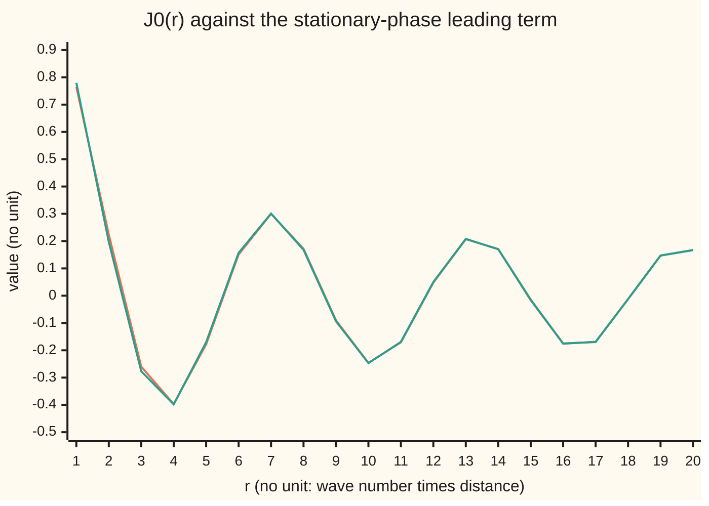

# Stationary phase: a fast-oscillating integral is decided near the points where the phase stops moving

[Syllabus](../../../SYLLABUS.md) → [Harmonic analysis](../README.md) → [Maximal Functions and Beyond](../README.md#s06) → Stationary phase

---

## General Overview

A tom-tom drum has a head 30 cm across, and waves cross it at 100 m/s, as on [Drumheads](../../19-Partial%20differential%20equations/05-Waves/08-membranes-and-bessel-modes.md). Its round notes (vibrations whose shape depends only on the distance from the centre) sound at 255.2, 585.7 and 918.2 Hz. Each sits at a zero of the Bessel function $`J_0`$: at $`r`$ = 2.404826, 5.520078 and 8.653728.

So the notes need the values of $`J_0`$, defined by an integral of a wave: $`J_0(r) = \frac{1}{\pi}\int_0^\pi \cos(r\sin\theta)\,d\theta`$. For large $`r`$ the wave swings fast and almost all of it cancels. What survives comes from near $`\theta = \pi/2`$, where $`\sin\theta`$ stops changing, so the wave stays in step.

Working out that one place gives $`J_0(r) \approx \sqrt{2/(\pi r)}\cos(r - \pi/4)`$. At $`r = 10`$ this is −0.2468, against the true −0.2459. The same rule puts the $`k`$-th zero near $`(k - \tfrac14)\pi`$. For the drum's tenth round note it predicts 3250.0 Hz, against the true 3250.4 Hz.

The method is called **stationary phase**. It also gives the rate at which the Fourier transform of a sphere's surface fades.

**When a wave $`e^{i\lambda\varphi(x)}`$ is integrated and $`\lambda`$ is large, the swings cancel everywhere except near the points where the phase $`\varphi`$ stops moving; each such point contributes its amplitude times $`\sqrt{2\pi/(\lambda\lvert\varphi''\rvert)}`$, with a phase shift of $`\pi/4`$, and everything else is smaller.**

**What kind of fact this is:** theorems. Van der Corput's lemma, the leading term for $`J_0`$ and the sphere's transform in three dimensions are proved in Why it works; the general leading term is proved in a fold; the decay for spheres in every dimension is stated, with its source.

### The picture: $`J_0`$ and its stationary-phase term



Orange: $`J_0(r)`$, from its defining integral. Teal: the leading term $`\sqrt{2/(\pi r)}\cos(r - \pi/4)`$. At $`r = 1`$ they differ in the second decimal: 0.765 against 0.780. By $`r = 10`$ they are −0.246 against −0.247, and the gap keeps shrinking.

---

## The formula

Notation first, in words.

- $`\lambda`$ is a large pure number that sets how fast the wave swings (not a length here).
- $`\varphi(x)`$ is the **phase**, a smooth real function on an interval $`[a, b]`$ (not a test function here).
- $`\psi(x)`$ is the **amplitude**, a smooth function that weights the wave (not a wavelet here).
- A **stationary point** $`x_0`$ is a point where the phase stops moving: $`\varphi'(x_0) = 0`$. It is **non-degenerate** when $`\varphi''(x_0) \ne 0`$, so the phase curves there.

**Van der Corput's lemma.** If $`\lvert\varphi'\rvert \ge 1`$ on $`[a, b]`$ and $`\varphi'`$ is monotone (only rises or only falls), or if $`\lvert\varphi''\rvert \ge 1`$ on $`[a, b]`$, then

```math
\Bigl\lvert \int_a^b e^{i\lambda\varphi(x)}\,dx \Bigr\rvert \le \frac{3}{\lambda} \quad (\text{first derivative}), \qquad \Bigl\lvert \int_a^b e^{i\lambda\varphi(x)}\,dx \Bigr\rvert \le \frac{8}{\sqrt{\lambda}} \quad (\text{second derivative})
```

**Read it aloud:** "A phase that keeps moving at speed one or more gives at most 3 over lambda; one that keeps curving by one or more gives at most 8 over root lambda, on any interval."

**The stationary-phase leading term.** If $`x_0`$ is the only stationary point, it lies inside $`(a, b)`$, it is non-degenerate, and $`\psi`$ is zero near $`a`$ and $`b`$, then

```math
\int_a^b \psi(x)\, e^{i\lambda\varphi(x)}\,dx = \psi(x_0)\, e^{i\lambda\varphi(x_0)}\, e^{\pm i\pi/4} \sqrt{\frac{2\pi}{\lambda\,\lvert\varphi''(x_0)\rvert}} + O(\lambda^{-3/2})
```

The sign is $`+`$ when $`\varphi''(x_0) > 0`$ and $`-`$ when $`\varphi''(x_0) < 0`$. $`O(\lambda^{-3/2})`$ means "at most a constant times $`\lambda^{-3/2}`$".

**Read it aloud:** "The integral is the amplitude at the stationary point, times the wave there turned by an eighth of a turn, times a width shrinking like one over root lambda, plus an error of order lambda to the minus three halves."

**What it gives.** For the Bessel functions, and for the surface of the unit sphere in three dimensions:

```math
J_n(r) = \sqrt{\frac{2}{\pi r}}\cos\Bigl(r - \frac{n\pi}{2} - \frac{\pi}{4}\Bigr) + O(r^{-3/2}), \qquad \hat\sigma(\xi) = \int_{S^2} e^{-2\pi i\, x\cdot\xi}\, d\sigma(x) = \frac{2\sin(2\pi\lvert\xi\rvert)}{\lvert\xi\rvert}
```

**Read it aloud:** "J n of r is a cosine shrinking like one over root r; the sphere's transform is two sine 2 pi rho over rho."

On the sphere $`S^{d-1}`$ in $`d`$ dimensions, $`\lvert\hat\sigma(\xi)\rvert \le C\lvert\xi\rvert^{-(d-1)/2}`$ for $`\lvert\xi\rvert \ge 1`$: one factor $`\lvert\xi\rvert^{-1/2}`$ per curved direction.

| Symbol | Plain meaning | In our example | Push it up and the answer… |
| --- | --- | --- | --- |
| $`\lambda,\ \mu`$ | how fast the wave swings; a lower bound on the phase's speed or curvature | $`\lambda = r = 10`$ | the integral shrinks |
| $`\varphi,\ \varphi',\ \varphi''`$ | the phase; its speed; its curvature | $`\varphi(\theta) = \sin\theta`$, $`\varphi''(\pi/2) = -1`$ | more curvature: a narrower window |
| $`\psi,\ x_0,\ a, b,\ i`$ | amplitude; stationary point; the ends; the imaginary unit | $`\psi = 1`$, $`x_0 = \pi/2`$, ends 0 and $`\pi`$ | larger $`\psi`$: a proportionally larger answer |
| $`c,\ \delta,\ m`$ | where $`\lvert\varphi'\rvert`$ is smallest; the half-width cut out there; how often $`\varphi'`$ turns | $`\delta = \lambda^{-1/2}`$ | — |
| $`y,\ g,\ h,\ G,\ H,\ q,\ F`$ | the variable that makes the phase $`\pm y^2/2`$; amplitudes after the change; the wave's integral from $`a`$ | $`g(0) = 1`$ | — |
| $`\theta,\ \tau,\ r,\ u`$ | the angle in Bessel's integral (also $`\tau`$); wave number times distance; $`r - \pi/4`$ | $`r = 10`$, $`u`$ = 9.214602 | $`J_0(r)`$ shrinks like $`r^{-1/2}`$ |
| $`J_0,\ J_n,\ n`$ | the Bessel functions of order 0 and $`n`$ | $`J_0(10) = -0.245936`$ | larger $`n`$: a later shift $`n\pi/2`$ |
| $`j_{0,k},\ \beta_k,\ k`$ | the $`k`$-th zero of $`J_0`$; its prediction $`(k - \frac14)\pi`$ | 2.404826 and 2.356194 | the gap shrinks like $`1/(8\beta_k)`$ |
| $`x,\ \xi,\ \rho,\ s`$ | the variable of integration; in Step 5, a point on the sphere; a frequency, cycles per metre; its size; the point's height along $`\xi`$ | $`\rho`$ = 10.25 | $`\hat\sigma`$ shrinks |
| $`S^{d-1},\ \sigma,\ \hat\sigma,\ d`$ | the unit sphere in $`d`$ dimensions; area on it; its transform | $`d`$ = 3 | more curved directions: faster decay |
| $`\Gamma(4/3),\ v`$ | the gamma function at 4/3, written as $`\int_0^\infty e^{-v^3}dv`$ | 0.892980 | — |
| $`C,\ O(\cdot)`$ | a fixed constant; "at most a constant times" | — | — |

### When it holds

- **The phase curves at the stationary point.** If $`\varphi''(x_0) = 0`$ too, the window is wider and the decay slower. For $`\varphi = x^3`$ the integral shrinks like $`\lambda^{-1/3}`$, not $`\lambda^{-1/2}`$: $`\lambda^{1/2}`$ times it grows from 2.1680 to 7.1770 as $`\lambda`$ goes from 10 to 10000.
- **The amplitude vanishes at the ends, or the end terms are added.** An end where $`\varphi' \ne 0`$ adds a term of size $`1/\lambda`$, which beats $`\lambda^{-3/2}`$. In the imaginary part of the $`J_0`$ integral this term is $`2/(\pi r)`$, so $`r`$ times the gap tends to $`2/\pi`$ = 0.6366.
- **The phase derivative is monotone, in the first-derivative test.** If $`\varphi'`$ turns up and down $`m`$ times, the bound applies on each of the $`m + 1`$ pieces, so the constant grows with $`m`$.
- **The surface is curved, for the sphere's decay.** A flat piece gives no decay along its normal, as the flat segment on [Restriction and Kakeya in outline](06-restriction-and-kakeya-in-outline.md) shows.

---

## Why it works

### Step 0: the swings cancel, except where the phase stops moving

Cut the interval into pieces where $`\lambda\varphi`$ rises by $`2\pi`$. On each piece the wave makes one full swing, and its two halves nearly cancel. The faster the phase moves, the better the cancellation.

Near a stationary point the phase barely moves. It changes like $`\frac12\varphi''(x_0)(x - x_0)^2`$, so the wave stays in step across a window of width about $`\lambda^{-1/2}`$. That window decides the integral. For $`J_0(10)`$ the stationary point counts like a stretch of width $`\sqrt{2\pi/10}`$ = 0.792665 on which the wave is frozen at its top value, turned back by an eighth of a turn (Step 3).

### Step 1: van der Corput's first-derivative test

Write the wave as a derivative divided by its own speed: $`e^{i\lambda\varphi} = \frac{1}{i\lambda\varphi'}\frac{d}{dx}e^{i\lambda\varphi}`$. Integrate by parts:

```math
\int_a^b e^{i\lambda\varphi}\,dx = \Bigl[\frac{e^{i\lambda\varphi}}{i\lambda\varphi'}\Bigr]_a^b - \int_a^b e^{i\lambda\varphi}\,\frac{d}{dx}\Bigl(\frac{1}{i\lambda\varphi'}\Bigr)dx
```

- The two end terms are each at most $`1/\lambda`$, because $`\lvert\varphi'\rvert \ge 1`$.
- The last integral is at most $`\frac{1}{\lambda}\int_a^b \bigl\lvert\frac{d}{dx}\frac{1}{\varphi'}\bigr\rvert dx`$. Since $`\varphi'`$ is monotone and keeps one sign, $`1/\varphi'`$ is monotone too. So the integral of its slope's size is $`\lvert 1/\varphi'(b) - 1/\varphi'(a)\rvert`$, which is at most 1.

The total is at most $`3/\lambda`$. If instead $`\lvert\varphi'\rvert \ge \mu`$, apply this to $`\varphi/\mu`$ with $`\lambda\mu`$ in place of $`\lambda`$: the bound becomes $`3/(\lambda\mu)`$.

The check takes $`\varphi = x + x^2`$ on $`[0, 1]`$, whose speed $`1 + 2x`$ rises from 1. At $`\lambda`$ = 10, 100 and 1000 the integral's size is 0.090895, 0.008800 and 0.001165, between 0.293 and 0.388 of the bound.

### Step 2: van der Corput's second-derivative test

Now $`\lvert\varphi''\rvert \ge 1`$. Then $`\varphi'`$ is monotone, so it is smallest in size at one point $`c`$, and $`\lvert\varphi'(x)\rvert \ge \lvert x - c\rvert`$ elsewhere. Pick a width $`\delta`$.

1. On the piece within $`\delta`$ of $`c`$, bound the wave by 1. That piece has length at most $`2\delta`$.
2. On the at most two pieces outside, $`\lvert\varphi'\rvert \ge \delta`$ and $`\varphi'`$ is monotone. Step 1 gives at most $`3/(\lambda\delta)`$ on each.
3. Add: the integral is at most $`2\delta + 6/(\lambda\delta)`$. Choose $`\delta = \lambda^{-1/2}`$. The bound is $`8\lambda^{-1/2}`$.

The bound does not depend on the interval's length. The check takes $`\varphi = x^2/2`$ on $`[-1, 1]`$. At $`\lambda`$ = 10, 100 and 1000 the integral's size is 0.639053, 0.233416 and 0.079880, against the bound 2.529822, 0.800000 and 0.252982. The Fresnel value $`\sqrt{2\pi/\lambda}`$ over the whole line is 0.792665, 0.250663 and 0.079267. The bound's constant is too big, but its power of $`\lambda`$ is right.

### Step 3: the leading term, worked on $`J_0`$

The Fresnel integral is the model case, with phase $`\pm x^2/2`$ on the whole line:

```math
\int_{-\infty}^{\infty} e^{\pm i\lambda x^2/2}\,dx = \sqrt{\frac{2\pi}{\lambda}}\; e^{\pm i\pi/4}
```

For $`J_0`$ the phase can be turned into exactly this shape. Since $`1 - \sin\theta = 2\sin^2\bigl(\frac{\theta - \pi/2}{2}\bigr)`$, the new variable $`y = 2\sin\bigl(\frac{\theta - \pi/2}{2}\bigr)`$ gives $`\sin\theta = 1 - y^2/2`$ exactly. It runs from $`-\sqrt2`$ to $`\sqrt2`$, and $`d\theta = dy/\sqrt{1 - y^2/4}`$. So

```math
\int_0^\pi e^{ir\sin\theta}\,d\theta = e^{ir}\int_{-\sqrt2}^{\sqrt2} e^{-iry^2/2}\, g(y)\,dy, \qquad g(y) = \frac{1}{\sqrt{1 - y^2/4}}, \quad g(0) = 1
```

Replace $`g`$ by its value 1 at the stationary point $`y = 0`$, and the interval by the whole line. The Fresnel integral gives $`e^{ir}\sqrt{2\pi/r}\,e^{-i\pi/4}`$. $`J_0(r)`$ is $`1/\pi`$ times the real part:

```math
J_0(r) \approx \frac{1}{\pi}\sqrt{\frac{2\pi}{r}}\cos\Bigl(r - \frac{\pi}{4}\Bigr) = \sqrt{\frac{2}{\pi r}}\cos\Bigl(r - \frac{\pi}{4}\Bigr)
```

The $`-\pi/4`$ comes from $`\varphi''(\pi/2) = -1 < 0`$: the phase curves downward at its top.

Two errors were made, both small:

- **Replacing $`g(y)`$ by $`g(0)`$.** Write $`g(y) = g(0) + y\,h(y)`$. Since $`y\,e^{-iry^2/2}`$ is $`\frac{i}{r}\frac{d}{dy}e^{-iry^2/2}`$, one integration by parts turns the $`y\,h(y)`$ piece into $`1/r`$ times a new oscillatory integral with amplitude $`h'`$. Step 2, in its form with an amplitude (see the fold below), bounds that integral by a constant times $`r^{-1/2}`$. Together: $`r^{-3/2}`$, plus end terms.
- **The ends $`\theta = 0`$ and $`\pi`$.** There $`\varphi' = \pm1`$, and Step 1's end terms give $`\bigl[\frac{e^{ir\sin\theta}}{ir\cos\theta}\bigr]_0^\pi = \frac{2i}{r}`$. This is purely imaginary, so it drops out of the real part. The next end terms are of size $`r^{-2}`$, smaller than $`r^{-3/2}`$.

So the gap between $`J_0(r)`$ and the leading term is at most a constant times $`r^{-3/2}`$. The full expansion's next term, quoted from the third source and checked by the code, is $`\sqrt{2/(\pi r)}\,\sin(u)/(8r)`$ with $`u = r - \pi/4`$. So $`r^{3/2}`$ times the gap stays below $`\sqrt{2/\pi}/8`$ = 0.0997:

| $`r`$ | $`J_0(r)`$ | leading term | gap | next term | $`r^{3/2}\lvert\text{gap}\rvert`$ |
| ---: | ---: | ---: | ---: | ---: | ---: |
| 10 | −0.245935764 | −0.246760893 | 8.251e-04 | 6.580e-04 | 0.0261 |
| 100 | 0.019985850 | 0.020082511 | −9.666e-05 | −9.652e-05 | 0.0967 |
| 1000 | 0.024786686 | 0.024786098 | 5.881e-07 | 5.899e-07 | 0.0186 |

<details>
<summary>Detailed proof: the general leading term</summary>

Take $`\varphi''(x_0) > 0`$. Near $`x_0`$, Taylor's theorem writes $`\varphi(x) - \varphi(x_0) = \frac12 (x - x_0)^2 q(x)`$ with $`q`$ smooth and $`q(x_0) = \varphi''(x_0)`$. The new variable $`y = (x - x_0)\sqrt{q(x)}`$ has a smooth inverse near $`x_0`$ (Morse's lemma) and makes the phase exactly $`\varphi(x_0) + y^2/2`$. Away from $`x_0`$, $`\varphi' \ne 0`$, and repeated integration by parts makes that part smaller than any power of $`1/\lambda`$.

So it is enough to study $`\int G(y)\,e^{i\lambda y^2/2}\,dy`$ with $`G`$ smooth, zero outside a bounded interval, and $`G(0) = \psi(x_0)/\sqrt{\varphi''(x_0)}`$. Write $`G(y) = G(0)e^{-y^2/2} + y\,H(y)`$, where $`H`$ is smooth and decays fast. The Gaussian piece is exact:

$`\displaystyle \int_{-\infty}^{\infty} e^{-y^2/2}\,e^{i\lambda y^2/2}\,dy = \sqrt{\frac{2\pi}{1 - i\lambda}} = \sqrt{\frac{2\pi}{\lambda}}\,e^{i\pi/4}\bigl(1 + O(\lambda^{-1})\bigr).`$

For the other piece, $`y\,e^{i\lambda y^2/2} = \frac{1}{i\lambda}\frac{d}{dy}e^{i\lambda y^2/2}`$, so one integration by parts gives $`-\frac{1}{i\lambda}\int H'(y)\,e^{i\lambda y^2/2}\,dy`$. Van der Corput's second-derivative test bounds this integral, at the cost of one more integration by parts for the amplitude. On $`[a, b]`$, with $`\lvert\varphi''\rvert \ge 1`$, let $`F(x)`$ be the integral of the bare wave $`e^{i\lambda\varphi}`$ from $`a`$ to $`x`$; Step 2 bounds every $`\lvert F(x)\rvert`$ by $`8\lambda^{-1/2}`$. Then

$`\displaystyle \int_a^b \psi\,e^{i\lambda\varphi}\,dx = \psi(b)F(b) - \int_a^b \psi'(x)F(x)\,dx, \quad\text{so}\quad \Bigl\lvert\int_a^b \psi\,e^{i\lambda\varphi}\,dx\Bigr\rvert \le \Bigl(\lvert\psi(b)\rvert + \int_a^b\lvert\psi'\rvert\,dx\Bigr)\,8\lambda^{-1/2}.`$

Here $`\psi = H'`$, which fades far out, so the integral is at most $`8\lambda^{-1/2}\int\lvert H''\rvert\,dy`$ and that piece is $`O(\lambda^{-3/2})`$. Adding the phase $`e^{i\lambda\varphi(x_0)}`$ gives the formula. For $`\varphi''(x_0) < 0`$, take complex conjugates: the sign of $`\pi/4`$ flips.

</details>

### Step 4: the decay of Bessel functions

With $`J_n(r) = \frac{1}{\pi}\int_0^\pi \cos(n\tau - r\sin\tau)\,d\tau`$, the stationary point is still $`\tau = \pi/2`$, and the amplitude $`e^{in\tau}`$ there adds the shift $`n\pi/2`$. So $`J_n(r) \approx \sqrt{2/(\pi r)}\cos(r - n\pi/2 - \pi/4)`$. At $`r = 10`$ this gives 0.052641 against $`J_1(10)`$ = 0.043473. At $`r = 1000`$ it gives 0.004719 against 0.004728.

Van der Corput also gives a bound for every $`r`$, not only large ones. Split $`[0, \pi]`$:

- On $`[\pi/6, 5\pi/6]`$, $`\lvert\varphi''\rvert = \sin\theta \ge \frac12`$. Step 2, rescaled, gives at most $`8/\sqrt{r/2} = 8\sqrt2/\sqrt r`$.
- On $`[0, \pi/6]`$ and $`[5\pi/6, \pi]`$, $`\lvert\varphi'\rvert = \lvert\cos\theta\rvert \ge \sqrt3/2`$, and it is monotone. Step 1 gives at most $`2\sqrt3/r`$ on each.

So $`\lvert J_0(r)\rvert \le \frac{1}{\pi}\bigl(8\sqrt2/\sqrt r + 4\sqrt3/r\bigr)`$. At $`r = 10`$ the bound is 1.3594, against $`\lvert J_0(10)\rvert`$ = 0.2459: a ratio of 5.53. At $`r = 100`$ it is 0.3822 against 0.0200: crude in its constant, right in its power of $`r`$.

**The zeros.** The leading term is zero when $`r - \pi/4 = (k - \frac12)\pi`$, so $`j_{0,k} \approx \beta_k = (k - \frac14)\pi`$. Keeping the next term, $`\cos u + \sin u/(8r) = 0`$ moves each zero right by about $`1/(8\beta_k)`$. On the tom-tom, one unit of $`j_{0,k}`$ is $`100/(2\pi \times 0.15)`$ = 106.103295 Hz.

| $`k`$ | true zero | $`(k - \frac14)\pi`$ | plus $`1/(8\beta_k)`$ | true note | predicted notes |
| ---: | ---: | ---: | ---: | ---: | ---: |
| 1 | 2.404826 | 2.356194 | 2.409246 | 255.2 Hz | 250.0, 255.6 Hz |
| 2 | 5.520078 | 5.497787 | 5.520524 | 585.7 Hz | 583.3, 585.7 Hz |
| 3 | 8.653728 | 8.639380 | 8.653848 | 918.2 Hz | 916.7, 918.2 Hz |
| 10 | 30.634606 | 30.630528 | 30.634609 | 3250.4 Hz | 3250.0, 3250.4 Hz |

So the drum's high round notes are close to evenly spaced, about $`\pi`$ apart in $`j_{0,k}`$. Only the low notes break the pattern.

### Step 5: the sphere's surface, and why curvature gives decay

Put the frequency $`\xi`$ along the vertical axis, with $`\rho = \lvert\xi\rvert`$. Then $`x\cdot\xi = \rho s`$, where $`s`$ is the height of the point $`x`$ on the unit sphere. Archimedes' hat-box theorem says the sphere's area is spread evenly in height: the band between heights $`s`$ and $`s + ds`$ has area $`2\pi\,ds`$. So

```math
\hat\sigma(\xi) = 2\pi\int_{-1}^{1} e^{-2\pi i\rho s}\,ds = \frac{2\sin(2\pi\rho)}{\rho}
```

The answer comes entirely from the two ends, $`s = \pm1`$: the north and south poles. They are the stationary points of the phase $`x\cdot\xi`$ on the sphere. At each pole the sphere curves in two directions, each giving a factor $`\lambda^{-1/2}`$ with $`\lambda = 2\pi\rho`$. That makes $`\rho^{-1}`$ in all. At $`\rho`$ = 10.25 and 100.25 the quadrature gives 0.195122 and 0.019950, equal to the formula, and $`\rho`$ times the value is 2.0000 both times.

<details>
<summary>Detailed proof: two-dimensional stationary phase at the poles gives the exact answer</summary>

Near the north pole, write a point as $`(y_1, y_2, \sqrt{1 - y_1^2 - y_2^2})`$. With $`\lambda = 2\pi\rho`$, the phase is $`-s \approx -1 + \frac12(y_1^2 + y_2^2)`$, curving upward in both directions. Each direction contributes a Fresnel factor $`\sqrt{2\pi/\lambda}\,e^{i\pi/4}`$, so the pole contributes

$`\displaystyle e^{-i\lambda}\,\frac{2\pi}{\lambda}\,e^{i\pi/2} = \frac{2\pi i}{\lambda}e^{-i\lambda}.`$

At the south pole the phase is $`1 - \frac12(y_1^2 + y_2^2)`$, curving downward, so the factors are $`e^{-i\pi/4}`$ and the pole contributes $`-\frac{2\pi i}{\lambda}e^{i\lambda}`$. The sum is

$`\displaystyle \frac{2\pi i}{\lambda}\bigl(e^{-i\lambda} - e^{i\lambda}\bigr) = \frac{4\pi\sin\lambda}{\lambda} = \frac{2\sin(2\pi\rho)}{\rho}.`$

This is the exact answer: in the height variable the area is constant, so the amplitude has nothing to correct.

</details>

**The circle, and every dimension.** On the unit circle in the plane, the same angle integral gives $`\hat\sigma(\xi) = 2\pi J_0(2\pi\rho)`$, as on [Transforms in two and three dimensions](../02-The%20Fourier%20Transform/10-multidimensional-transform-and-tomography.md). Step 3 turns it into $`(2/\sqrt\rho)\cos(2\pi\rho - \pi/4)`$: one curved direction, one factor $`\rho^{-1/2}`$. At $`\rho`$ = 10.3 cycles per metre this gives 0.282916, against the true 0.283984: the same function, evaluated on [Restriction and Kakeya in outline](06-restriction-and-kakeya-in-outline.md) at the point 10.3 m away. In $`d`$ dimensions the sphere $`S^{d-1}`$ curves in $`d - 1`$ directions at each pole, and the first source proves $`\lvert\hat\sigma(\xi)\rvert \le C\lvert\xi\rvert^{-(d-1)/2}`$. That decay is the input to the Stein–Tomas restriction theorem.

---

## Worked numbers, by hand

$`J_0(10) = \frac{1}{\pi}\int_0^\pi\cos(10\sin\theta)\,d\theta`$, by its one stationary point.

| Step | Arithmetic | Value |
| --- | --- | --- |
| stationary point | $`\varphi'(\theta) = \cos\theta = 0`$ | $`\theta = \pi/2`$ |
| curvature there | $`\varphi''(\pi/2) = -\sin(\pi/2)`$ | −1, so the shift is $`-\pi/4`$ |
| window width | $`\sqrt{2\pi/(\lambda\lvert\varphi''\rvert)} = \sqrt{2\pi/10}`$ | 0.792665 |
| times $`1/\pi`$ | $`0.792665/\pi = \sqrt{2/(10\pi)}`$ | 0.252313 |
| shifted phase | $`10\times\sin(\pi/2) - \pi/4`$ | 9.214602 |
| its cosine | $`\cos(9.214602)`$ | −0.977994 |
| leading term | $`0.252313 \times (-0.977994)`$ | **−0.246761** |
| true value | series, angle integral and Simpson's rule | −0.245936 |
| gap | $`-0.245936 - (-0.246761)`$ | 8.251e-04 |

So at $`r = 10`$ the one stationary point gives $`J_0`$ to within 8.251e-04, and the gap shrinks like $`r^{-3/2}`$ as $`r`$ grows.

### What breaks if you drop a piece

| Mistake | Comes out at | What went wrong |
| --- | --- | --- |
| Drop the $`\pi/4`$ shift | −0.211709 at $`r = 10`$, not −0.245936 | the Fresnel integral turns the wave by an eighth of a turn |
| Take the wrong sign of the curvature, $`\cos(r + \pi/4)`$ | −0.052641 | $`\varphi''(\pi/2) < 0`$, so the shift is $`-\pi/4`$ |
| Ignore the ends in the imaginary part, $`\frac1\pi\int_0^\pi\sin(r\sin\theta)\,d\theta`$ | 0.052641 against the true 0.118744 at $`r = 10`$; $`r`$ times the gap is 0.6335 at $`r = 1000`$ | ends with $`\varphi' \ne 0`$ add $`2/(\pi r)`$, so $`r`$ times the gap tends to 0.6366 |
| Use the $`\lambda^{-1/2}`$ rule on a flat point, $`\int_{-1}^1\cos(\lambda x^3)\,dx`$ | $`\lambda^{1/2}`$ times it: 2.1680, 3.2981, 4.9085, 7.1770 for $`\lambda`$ = 10 to 10000 | $`\varphi''(0) = 0`$; the decay is $`\lambda^{-1/3}`$, and $`\lambda^{1/3}`$ times it is 1.5462 at $`\lambda`$ = 10000 and tends to $`2\cos(\pi/6)\,\Gamma(4/3)`$ = 1.5467 |

Here $`\Gamma(4/3) = \int_0^\infty e^{-v^3}\,dv`$ = 0.892980, computed by the checks.

---

## Code, from first principles, and it actually runs

Both programs write $`J_0`$ and $`J_1`$ out twice: as the power series (80 terms) and as the angle integral, by the trapezoid rule over a full turn with $`2r + 80`$ points. At $`r = 1000`$ the trapezoid is also checked against Simpson's rule with 200000 steps. Every other integral is Simpson's rule, checked at a second step count or against a closed form. The roads are: the leading term against the integral; the gap against the expansion's next term; each van der Corput bound against the integral it bounds; the zeros, found by halving a bracket 60 times, against $`(k - \frac14)\pi`$ and the known first zero; and the sphere's quadrature against the hat-box formula.

### Python

```python
# Stationary phase: the check behind the card. Standard library only.
# Bessel functions are written out twice: as the power series and as the
# defining angle integral. Every other integral is Simpson's rule written out.
import math
PI = math.pi

def simpson(f, a, b, n):
    h = (b - a) / n
    s = f(a) + f(b) + sum((4 if k % 2 else 2) * f(a + k * h) for k in range(1, n))
    return s * h / 3

def j_series(n, r):  # sum of (-1)^k (r/2)^(2k+n) / (k! (k+n)!), 80 terms
    s, term = 0.0, (r / 2) ** n / math.factorial(n)
    for k in range(1, 81):
        s += term
        term *= -(r / 2) ** 2 / (k * (k + n))
    return s

def j_angle(n, r):  # (1/2pi) * integral over a full turn of cos(n t - r sin t), trapezoid
    m = 2 * int(r) + 80  # periodic integrand: error far below 1e-12 once m > r + 60
    return sum(math.cos(n * 2 * PI * k / m - r * math.sin(2 * PI * k / m)) for k in range(m)) / m

def lead(n, r):  # stationary-phase leading term
    return math.sqrt(2 / (PI * r)) * math.cos(r - n * PI / 2 - PI / 4)

def f6(x): return f"{x:.6f}"

# ---- the example: J0(10) ----
r = 10.0
js, ja = j_series(0, r), j_angle(0, r)
jsimp = simpson(lambda t: math.cos(r * math.sin(t)), 0, PI, 20000) / PI
amp, u = math.sqrt(2 / (PI * r)), r - PI / 4
print(f"J0(10): series {f6(js)}, angle integral {f6(ja)}, Simpson on [0, pi] {f6(jsimp)}")
print(f"leading term: sqrt(2/(pi r)) {f6(amp)}, r - pi/4 {f6(u)}, cos {f6(math.cos(u))}, product {f6(lead(0, r))}")
print(f"to four places: leading {lead(0, r):.4f}, true {ja:.4f}")
print(f"dropped pi/4: {f6(amp * math.cos(r))}; wrong sign of the curvature, cos(r + pi/4): {f6(amp * math.cos(r + PI / 4))}")
assert abs(js - ja) < 1e-12 and abs(jsimp - ja) < 1e-10
# ---- the gap shrinks like r^(-3/2) ----
for r in [10.0, 100.0, 1000.0]:
    J = j_angle(0, r)
    gap = J - lead(0, r)
    nxt = math.sqrt(2 / (PI * r)) * math.sin(r - PI / 4) / (8 * r)
    print(f"r={r:g}: J0 {J:.9f}, leading {lead(0, r):.9f}, gap {gap:.3e}, next term sin(u)/(8r) {nxt:.3e}, r^1.5 |gap| {r ** 1.5 * abs(gap):.4f}")
    assert abs(gap) <= 1.01 * math.sqrt(2 / PI) / 8 * r ** -1.5 + 0.1 * r ** -2.5
    assert abs(gap - nxt) < 0.2 * r ** -2.5
print(f"ceiling on r^1.5 |gap| for large r: sqrt(2/pi)/8 = {math.sqrt(2 / PI) / 8:.4f}")
assert abs(j_angle(0, 1000.0) - simpson(lambda t: math.cos(1000 * math.sin(t)), 0, PI, 200000) / PI) < 1e-10
print(f"J1(10): series {f6(j_series(1, 10))}, angle integral {f6(j_angle(1, 10))}, leading {f6(lead(1, 10))}")
print(f"J1(1000): angle integral {f6(j_angle(1, 1000))}, leading {f6(lead(1, 1000))}")
assert abs(j_series(1, 10) - j_angle(1, 10)) < 1e-12

# ---- van der Corput ----
def osc(phi, a, b, lam, n):  # |integral of e^(i lam phi)| over [a, b]
    c = simpson(lambda x: math.cos(lam * phi(x)), a, b, n)
    s = simpson(lambda x: math.sin(lam * phi(x)), a, b, n)
    return math.hypot(c, s)
for lam in [10.0, 100.0, 1000.0]:
    i1 = osc(lambda x: x + x * x, 0, 1, lam, 40000)
    assert abs(i1 - osc(lambda x: x + x * x, 0, 1, lam, 20000)) < 1e-9 and i1 <= 3 / lam
    i2 = osc(lambda x: x * x / 2, -1, 1, lam, 40000)
    assert i2 <= 8 / math.sqrt(lam) and abs(i2 - math.sqrt(2 * PI / lam)) < 2.5 / lam
    print(f"lambda={lam:g}: first-derivative |I| {i1:.6f} <= 3/lambda {3 / lam:.6f} (ratio {i1 * lam / 3:.3f});"
          f" second-derivative |I| {i2:.6f} <= 8/sqrt(lambda) {8 / math.sqrt(lam):.6f}, Fresnel sqrt(2 pi/lambda) {math.sqrt(2 * PI / lam):.6f}")
for r in [10.0, 100.0]:
    bound = (8 * math.sqrt(2) / math.sqrt(r) + 4 * math.sqrt(3) / r) / PI
    print(f"uniform bound on |J0({r:g})|: {bound:.4f} against {abs(j_angle(0, r)):.4f}, ratio {bound / abs(j_angle(0, r)):.2f}")
    assert abs(j_angle(0, r)) <= bound
    mu2 = min(math.sin(PI / 6 + k * PI / 1500) for k in range(1001))  # road 2: least |phi''| on [pi/6, 5pi/6]
    mu1 = min(math.cos(k * PI / 6000) for k in range(1001))           # least |phi'| on [0, pi/6]
    assert abs((8 / math.sqrt(r * mu2) + 2 * 3 / (r * mu1)) / PI - bound) < 1e-9   # the lemma's 8 and 3, piece by piece

# ---- what breaks: a flat stationary point, phase x^3 ----
g43 = simpson(lambda v: math.exp(-v ** 3), 0, 6, 6000)  # Gamma(4/3)
limit = 2 * math.cos(PI / 6) * g43
print(f"cubic phase limit 2 cos(pi/6) Gamma(4/3) = {limit:.4f} (Gamma(4/3) {g43:.6f})")
for lam in [10.0, 100.0, 1000.0, 10000.0]:
    ic = 2 * simpson(lambda x: math.cos(lam * x ** 3), 0, 1, 400000)
    print(f"lambda={lam:g}: integral of cos(lambda x^3) on [-1, 1] {ic:.6f}, times lambda^(1/3) {ic * lam ** (1 / 3):.4f}, times lambda^(1/2) {ic * lam ** 0.5:.4f}")
assert abs(ic * lam ** (1 / 3) - limit) < 0.01 and abs(g43 - 0.8929795116) < 1e-8
# ---- what breaks: the ends of the interval (imaginary part of the J0 integral) ----
for r in [10.0, 100.0, 1000.0]:
    im = simpson(lambda t: math.sin(r * math.sin(t)), 0, PI, 200000) / PI
    sp = math.sqrt(2 / (PI * r)) * math.sin(r - PI / 4)
    print(f"r={r:g}: imaginary part {im:.6f}, stationary point alone {sp:.6f}, gap {im - sp:.6f}, r x gap {r * (im - sp):.4f}")
print(f"end-point prediction for r x gap: 2/pi = {2 / PI:.4f}")
assert abs(r * (im - sp) - 2 / PI) < 0.01

# ---- zeros of J0 and the drum's round notes ----
note = 100 / (2 * PI * 0.15)  # wave speed 100 m/s, radius 0.15 m: hertz per unit of j
print(f"drum: hertz per unit of j = {note:.6f}")
for k in [1, 2, 3, 10]:
    beta = (k - 0.25) * PI
    lo, hi = beta - 0.3, beta + 0.3
    for _ in range(60):
        mid = (lo + hi) / 2
        lo, hi = (mid, hi) if j_angle(0, lo) * j_angle(0, mid) > 0 else (lo, mid)
    jz, mc = (lo + hi) / 2, beta + 1 / (8 * beta)
    print(f"zero {k}: true {jz:.6f}, (k - 1/4) pi {beta:.6f}, with 1/(8 beta) {mc:.6f}; note {note * jz:.1f} Hz, predicted {note * beta:.1f} Hz, {note * mc:.1f} Hz")
    assert abs(mc - jz) < 0.005 / k ** 2
    if k == 1: assert abs(jz - 2.404825557695773) < 1e-9
    if k == 1: assert abs(note * jz - 255.2) < 0.05     # the fundamental on Drumheads: 255.2 Hz

# ---- the sphere and the circle ----
for rho in [10.25, 100.25]:
    q = 2 * PI * simpson(lambda t: math.cos(2 * PI * rho * math.cos(t)) * math.sin(t), 0, PI, 40000)
    cf = 2 * math.sin(2 * PI * rho) / rho
    print(f"sphere rho={rho:g}: quadrature {q:.6f}, two poles 2 sin(2 pi rho)/rho {cf:.6f}, rho x value {rho * q:.4f}")
    assert abs(q - cf) < 1e-9
rho = 10.3
circ = 2 * PI * j_angle(0, 2 * PI * rho)
cl = 2 / math.sqrt(rho) * math.cos(2 * PI * rho - PI / 4)
print(f"circle rho=10.3: 2 pi J0(2 pi rho) {circ:.6f}, two points (2/sqrt(rho)) cos(2 pi rho - pi/4) {cl:.6f}, envelope 2/sqrt(rho) {2 / math.sqrt(rho):.6f}")
assert abs(circ - cl) < 0.01

# ---- chart points ----
print("chart r: " + ", ".join(str(r) for r in range(1, 21)))
print("chart J0: " + ", ".join(f"{j_angle(0, r):.3f}" for r in range(1, 21)))
print("chart leading: " + ", ".join(f"{lead(0, r):.3f}" for r in range(1, 21)))
print("ALL CHECKS PASS")
```

**Ran 2026-11-24 on macOS, Python 3.14.10, standard library only. All checks passed. Output, pasted from the run:**

```
J0(10): series -0.245936, angle integral -0.245936, Simpson on [0, pi] -0.245936
leading term: sqrt(2/(pi r)) 0.252313, r - pi/4 9.214602, cos -0.977994, product -0.246761
to four places: leading -0.2468, true -0.2459
dropped pi/4: -0.211709; wrong sign of the curvature, cos(r + pi/4): -0.052641
r=10: J0 -0.245935764, leading -0.246760893, gap 8.251e-04, next term sin(u)/(8r) 6.580e-04, r^1.5 |gap| 0.0261
r=100: J0 0.019985850, leading 0.020082511, gap -9.666e-05, next term sin(u)/(8r) -9.652e-05, r^1.5 |gap| 0.0967
r=1000: J0 0.024786686, leading 0.024786098, gap 5.881e-07, next term sin(u)/(8r) 5.899e-07, r^1.5 |gap| 0.0186
ceiling on r^1.5 |gap| for large r: sqrt(2/pi)/8 = 0.0997
J1(10): series 0.043473, angle integral 0.043473, leading 0.052641
J1(1000): angle integral 0.004728, leading 0.004719
lambda=10: first-derivative |I| 0.090895 <= 3/lambda 0.300000 (ratio 0.303); second-derivative |I| 0.639053 <= 8/sqrt(lambda) 2.529822, Fresnel sqrt(2 pi/lambda) 0.792665
lambda=100: first-derivative |I| 0.008800 <= 3/lambda 0.030000 (ratio 0.293); second-derivative |I| 0.233416 <= 8/sqrt(lambda) 0.800000, Fresnel sqrt(2 pi/lambda) 0.250663
lambda=1000: first-derivative |I| 0.001165 <= 3/lambda 0.003000 (ratio 0.388); second-derivative |I| 0.079880 <= 8/sqrt(lambda) 0.252982, Fresnel sqrt(2 pi/lambda) 0.079267
uniform bound on |J0(10)|: 1.3594 against 0.2459, ratio 5.53
uniform bound on |J0(100)|: 0.3822 against 0.0200, ratio 19.12
cubic phase limit 2 cos(pi/6) Gamma(4/3) = 1.5467 (Gamma(4/3) 0.892980)
lambda=10: integral of cos(lambda x^3) on [-1, 1] 0.685596, times lambda^(1/3) 1.4771, times lambda^(1/2) 2.1680
lambda=100: integral of cos(lambda x^3) on [-1, 1] 0.329810, times lambda^(1/3) 1.5308, times lambda^(1/2) 3.2981
lambda=1000: integral of cos(lambda x^3) on [-1, 1] 0.155220, times lambda^(1/3) 1.5522, times lambda^(1/2) 4.9085
lambda=10000: integral of cos(lambda x^3) on [-1, 1] 0.071770, times lambda^(1/3) 1.5462, times lambda^(1/2) 7.1770
r=10: imaginary part 0.118744, stationary point alone 0.052641, gap 0.066103, r x gap 0.6610
r=100: imaginary part -0.070879, stationary point alone -0.077220, gap 0.006341, r x gap 0.6341
r=1000: imaginary part 0.005353, stationary point alone 0.004719, gap 0.000634, r x gap 0.6335
end-point prediction for r x gap: 2/pi = 0.6366
drum: hertz per unit of j = 106.103295
zero 1: true 2.404826, (k - 1/4) pi 2.356194, with 1/(8 beta) 2.409246; note 255.2 Hz, predicted 250.0 Hz, 255.6 Hz
zero 2: true 5.520078, (k - 1/4) pi 5.497787, with 1/(8 beta) 5.520524; note 585.7 Hz, predicted 583.3 Hz, 585.7 Hz
zero 3: true 8.653728, (k - 1/4) pi 8.639380, with 1/(8 beta) 8.653848; note 918.2 Hz, predicted 916.7 Hz, 918.2 Hz
zero 10: true 30.634606, (k - 1/4) pi 30.630528, with 1/(8 beta) 30.634609; note 3250.4 Hz, predicted 3250.0 Hz, 3250.4 Hz
sphere rho=10.25: quadrature 0.195122, two poles 2 sin(2 pi rho)/rho 0.195122, rho x value 2.0000
sphere rho=100.25: quadrature 0.019950, two poles 2 sin(2 pi rho)/rho 0.019950, rho x value 2.0000
circle rho=10.3: 2 pi J0(2 pi rho) 0.283984, two points (2/sqrt(rho)) cos(2 pi rho - pi/4) 0.282916, envelope 2/sqrt(rho) 0.623177
chart r: 1, 2, 3, 4, 5, 6, 7, 8, 9, 10, 11, 12, 13, 14, 15, 16, 17, 18, 19, 20
chart J0: 0.765, 0.224, -0.260, -0.397, -0.178, 0.151, 0.300, 0.172, -0.090, -0.246, -0.171, 0.048, 0.207, 0.171, -0.014, -0.175, -0.170, -0.013, 0.147, 0.167
chart leading: 0.780, 0.197, -0.277, -0.398, -0.170, 0.157, 0.301, 0.168, -0.094, -0.247, -0.169, 0.050, 0.208, 0.170, -0.016, -0.176, -0.169, -0.012, 0.147, 0.167
ALL CHECKS PASS
```

### Rust

```rust
// Stationary phase: the check behind the card. Standard library only.
// Bessel functions are written out twice: as the power series and as the
// defining angle integral. Every other integral is Simpson's rule written out.
use std::f64::consts::PI;

fn simpson(f: &dyn Fn(f64) -> f64, a: f64, b: f64, n: usize) -> f64 {
    let h = (b - a) / n as f64;
    let mut acc = 0.0;
    for k in 1..n {
        acc += (if k % 2 == 1 { 4.0 } else { 2.0 }) * f(a + k as f64 * h);
    }
    (f(a) + f(b) + acc) * h / 3.0
}

fn j_series(n: i32, r: f64) -> f64 {
    let mut fact = 1.0;
    for k in 1..=n { fact *= k as f64; }
    let (mut s, mut term) = (0.0, (r / 2.0).powi(n) / fact);
    for k in 1..=80 {
        s += term;
        term *= -(r / 2.0).powi(2) / (k as f64 * (k + n) as f64);
    }
    s
}

fn j_angle(n: i32, r: f64) -> f64 {
    let m = 2 * (r as usize) + 80;
    let mut s = 0.0;
    for k in 0..m {
        let t = 2.0 * PI * k as f64 / m as f64;
        s += (n as f64 * t - r * t.sin()).cos();
    }
    s / m as f64
}

fn lead(n: i32, r: f64) -> f64 {
    (2.0 / (PI * r)).sqrt() * (r - n as f64 * PI / 2.0 - PI / 4.0).cos()
}

fn f6(x: f64) -> String { format!("{:.6}", x) }

fn sci3(x: f64) -> String { // Python's {:.3e}: two-digit exponent with a sign
    let s = format!("{:.3e}", x);
    let (m, e) = s.split_once('e').unwrap();
    let ev: i32 = e.parse().unwrap();
    format!("{}e{}{:02}", m, if ev < 0 { '-' } else { '+' }, ev.abs())
}

fn osc(phi: &dyn Fn(f64) -> f64, a: f64, b: f64, lam: f64, n: usize) -> f64 {
    let c = simpson(&|x| (lam * phi(x)).cos(), a, b, n);
    let s = simpson(&|x| (lam * phi(x)).sin(), a, b, n);
    c.hypot(s)
}

fn main() {
    // ---- the example: J0(10) ----
    let r = 10.0;
    let (js, ja) = (j_series(0, r), j_angle(0, r));
    let jsimp = simpson(&|t: f64| (r * t.sin()).cos(), 0.0, PI, 20000) / PI;
    let (amp, u) = ((2.0 / (PI * r)).sqrt(), r - PI / 4.0);
    println!("J0(10): series {}, angle integral {}, Simpson on [0, pi] {}", f6(js), f6(ja), f6(jsimp));
    println!("leading term: sqrt(2/(pi r)) {}, r - pi/4 {}, cos {}, product {}", f6(amp), f6(u), f6(u.cos()), f6(lead(0, r)));
    println!("to four places: leading {:.4}, true {:.4}", lead(0, r), ja);
    println!("dropped pi/4: {}; wrong sign of the curvature, cos(r + pi/4): {}", f6(amp * r.cos()), f6(amp * (r + PI / 4.0).cos()));
    assert!((js - ja).abs() < 1e-12 && (jsimp - ja).abs() < 1e-10);
    // ---- the gap shrinks like r^(-3/2) ----
    for &r in &[10.0f64, 100.0, 1000.0] {
        let j = j_angle(0, r);
        let gap = j - lead(0, r);
        let nxt = (2.0 / (PI * r)).sqrt() * (r - PI / 4.0).sin() / (8.0 * r);
        println!("r={}: J0 {:.9}, leading {:.9}, gap {}, next term sin(u)/(8r) {}, r^1.5 |gap| {:.4}",
                 r, j, lead(0, r), sci3(gap), sci3(nxt), r.powf(1.5) * gap.abs());
        assert!(gap.abs() <= 1.01 * (2.0 / PI).sqrt() / 8.0 * r.powf(-1.5) + 0.1 * r.powf(-2.5));
        assert!((gap - nxt).abs() < 0.2 * r.powf(-2.5));
    }
    println!("ceiling on r^1.5 |gap| for large r: sqrt(2/pi)/8 = {:.4}", (2.0 / PI).sqrt() / 8.0);
    assert!((j_angle(0, 1000.0) - simpson(&|t: f64| (1000.0 * t.sin()).cos(), 0.0, PI, 200000) / PI).abs() < 1e-10);
    println!("J1(10): series {}, angle integral {}, leading {}", f6(j_series(1, 10.0)), f6(j_angle(1, 10.0)), f6(lead(1, 10.0)));
    println!("J1(1000): angle integral {}, leading {}", f6(j_angle(1, 1000.0)), f6(lead(1, 1000.0)));
    assert!((j_series(1, 10.0) - j_angle(1, 10.0)).abs() < 1e-12);

    // ---- van der Corput ----
    for &lam in &[10.0f64, 100.0, 1000.0] {
        let i1 = osc(&|x| x + x * x, 0.0, 1.0, lam, 40000);
        assert!((i1 - osc(&|x| x + x * x, 0.0, 1.0, lam, 20000)).abs() < 1e-9 && i1 <= 3.0 / lam);
        let i2 = osc(&|x| x * x / 2.0, -1.0, 1.0, lam, 40000);
        assert!(i2 <= 8.0 / lam.sqrt() && (i2 - (2.0 * PI / lam).sqrt()).abs() < 2.5 / lam);
        println!("lambda={}: first-derivative |I| {:.6} <= 3/lambda {:.6} (ratio {:.3}); second-derivative |I| {:.6} <= 8/sqrt(lambda) {:.6}, Fresnel sqrt(2 pi/lambda) {:.6}",
                 lam, i1, 3.0 / lam, i1 * lam / 3.0, i2, 8.0 / lam.sqrt(), (2.0 * PI / lam).sqrt());
    }
    for &r in &[10.0f64, 100.0] {
        let bound = (8.0 * 2f64.sqrt() / r.sqrt() + 4.0 * 3f64.sqrt() / r) / PI;
        let j = j_angle(0, r).abs();
        println!("uniform bound on |J0({})|: {:.4} against {:.4}, ratio {:.2}", r, bound, j, bound / j);
        assert!(j <= bound);
        let mu2 = (0..1001).map(|k| (PI / 6.0 + k as f64 * PI / 1500.0).sin()).fold(f64::INFINITY, f64::min); // road 2
        let mu1 = (0..1001).map(|k| (k as f64 * PI / 6000.0).cos()).fold(f64::INFINITY, f64::min);
        assert!(((8.0 / (r * mu2).sqrt() + 2.0 * 3.0 / (r * mu1)) / PI - bound).abs() < 1e-9); // the lemma's 8 and 3
    }

    // ---- what breaks: a flat stationary point, phase x^3 ----
    let g43 = simpson(&|v: f64| (-v.powi(3)).exp(), 0.0, 6.0, 6000);
    let limit = 2.0 * (PI / 6.0).cos() * g43;
    println!("cubic phase limit 2 cos(pi/6) Gamma(4/3) = {:.4} (Gamma(4/3) {:.6})", limit, g43);
    let mut last = 0.0;
    for &lam in &[10.0f64, 100.0, 1000.0, 10000.0] {
        let ic = 2.0 * simpson(&|x: f64| (lam * x.powi(3)).cos(), 0.0, 1.0, 400000);
        println!("lambda={}: integral of cos(lambda x^3) on [-1, 1] {:.6}, times lambda^(1/3) {:.4}, times lambda^(1/2) {:.4}",
                 lam, ic, ic * lam.powf(1.0 / 3.0), ic * lam.powf(0.5));
        last = ic * lam.powf(1.0 / 3.0);
    }
    assert!((last - limit).abs() < 0.01 && (g43 - 0.8929795116).abs() < 1e-8);
    // ---- what breaks: the ends of the interval (imaginary part of the J0 integral) ----
    let mut rgap = 0.0;
    for &r in &[10.0f64, 100.0, 1000.0] {
        let im = simpson(&|t: f64| (r * t.sin()).sin(), 0.0, PI, 200000) / PI;
        let sp = (2.0 / (PI * r)).sqrt() * (r - PI / 4.0).sin();
        println!("r={}: imaginary part {:.6}, stationary point alone {:.6}, gap {:.6}, r x gap {:.4}", r, im, sp, im - sp, r * (im - sp));
        rgap = r * (im - sp);
    }
    println!("end-point prediction for r x gap: 2/pi = {:.4}", 2.0 / PI);
    assert!((rgap - 2.0 / PI).abs() < 0.01);

    // ---- zeros of J0 and the drum's round notes ----
    let note = 100.0 / (2.0 * PI * 0.15);
    println!("drum: hertz per unit of j = {:.6}", note);
    for &k in &[1i32, 2, 3, 10] {
        let beta = (k as f64 - 0.25) * PI;
        let (mut lo, mut hi) = (beta - 0.3, beta + 0.3);
        for _ in 0..60 {
            let mid = (lo + hi) / 2.0;
            if j_angle(0, lo) * j_angle(0, mid) > 0.0 { lo = mid; } else { hi = mid; }
        }
        let (jz, mc) = ((lo + hi) / 2.0, beta + 1.0 / (8.0 * beta));
        println!("zero {}: true {:.6}, (k - 1/4) pi {:.6}, with 1/(8 beta) {:.6}; note {:.1} Hz, predicted {:.1} Hz, {:.1} Hz",
                 k, jz, beta, mc, note * jz, note * beta, note * mc);
        assert!((mc - jz).abs() < 0.005 / (k * k) as f64);
        if k == 1 { assert!((jz - 2.404825557695773).abs() < 1e-9); }
        if k == 1 { assert!((note * jz - 255.2).abs() < 0.05); } // the fundamental on Drumheads: 255.2 Hz
    }

    // ---- the sphere and the circle ----
    for &rho in &[10.25f64, 100.25] {
        let q = 2.0 * PI * simpson(&|t: f64| (2.0 * PI * rho * t.cos()).cos() * t.sin(), 0.0, PI, 40000);
        let cf = 2.0 * (2.0 * PI * rho).sin() / rho;
        println!("sphere rho={}: quadrature {:.6}, two poles 2 sin(2 pi rho)/rho {:.6}, rho x value {:.4}", rho, q, cf, rho * q);
        assert!((q - cf).abs() < 1e-9);
    }
    let rho = 10.3;
    let circ = 2.0 * PI * j_angle(0, 2.0 * PI * rho);
    let cl = 2.0 / rho.sqrt() * (2.0 * PI * rho - PI / 4.0).cos();
    println!("circle rho=10.3: 2 pi J0(2 pi rho) {:.6}, two points (2/sqrt(rho)) cos(2 pi rho - pi/4) {:.6}, envelope 2/sqrt(rho) {:.6}", circ, cl, 2.0 / rho.sqrt());
    assert!((circ - cl).abs() < 0.01);

    // ---- chart points ----
    let rs: Vec<String> = (1..=20).map(|r| r.to_string()).collect();
    let jv: Vec<String> = (1..=20).map(|r| format!("{:.3}", j_angle(0, r as f64))).collect();
    let lv: Vec<String> = (1..=20).map(|r| format!("{:.3}", lead(0, r as f64))).collect();
    println!("chart r: {}", rs.join(", "));
    println!("chart J0: {}", jv.join(", "));
    println!("chart leading: {}", lv.join(", "));
    println!("ALL CHECKS PASS");
}
```

**Ran 2026-11-24 on macOS, rustc 1.98.1, no crates. All checks passed. Output, pasted from the run:**

```
J0(10): series -0.245936, angle integral -0.245936, Simpson on [0, pi] -0.245936
leading term: sqrt(2/(pi r)) 0.252313, r - pi/4 9.214602, cos -0.977994, product -0.246761
to four places: leading -0.2468, true -0.2459
dropped pi/4: -0.211709; wrong sign of the curvature, cos(r + pi/4): -0.052641
r=10: J0 -0.245935764, leading -0.246760893, gap 8.251e-04, next term sin(u)/(8r) 6.580e-04, r^1.5 |gap| 0.0261
r=100: J0 0.019985850, leading 0.020082511, gap -9.666e-05, next term sin(u)/(8r) -9.652e-05, r^1.5 |gap| 0.0967
r=1000: J0 0.024786686, leading 0.024786098, gap 5.881e-07, next term sin(u)/(8r) 5.899e-07, r^1.5 |gap| 0.0186
ceiling on r^1.5 |gap| for large r: sqrt(2/pi)/8 = 0.0997
J1(10): series 0.043473, angle integral 0.043473, leading 0.052641
J1(1000): angle integral 0.004728, leading 0.004719
lambda=10: first-derivative |I| 0.090895 <= 3/lambda 0.300000 (ratio 0.303); second-derivative |I| 0.639053 <= 8/sqrt(lambda) 2.529822, Fresnel sqrt(2 pi/lambda) 0.792665
lambda=100: first-derivative |I| 0.008800 <= 3/lambda 0.030000 (ratio 0.293); second-derivative |I| 0.233416 <= 8/sqrt(lambda) 0.800000, Fresnel sqrt(2 pi/lambda) 0.250663
lambda=1000: first-derivative |I| 0.001165 <= 3/lambda 0.003000 (ratio 0.388); second-derivative |I| 0.079880 <= 8/sqrt(lambda) 0.252982, Fresnel sqrt(2 pi/lambda) 0.079267
uniform bound on |J0(10)|: 1.3594 against 0.2459, ratio 5.53
uniform bound on |J0(100)|: 0.3822 against 0.0200, ratio 19.12
cubic phase limit 2 cos(pi/6) Gamma(4/3) = 1.5467 (Gamma(4/3) 0.892980)
lambda=10: integral of cos(lambda x^3) on [-1, 1] 0.685596, times lambda^(1/3) 1.4771, times lambda^(1/2) 2.1680
lambda=100: integral of cos(lambda x^3) on [-1, 1] 0.329810, times lambda^(1/3) 1.5308, times lambda^(1/2) 3.2981
lambda=1000: integral of cos(lambda x^3) on [-1, 1] 0.155220, times lambda^(1/3) 1.5522, times lambda^(1/2) 4.9085
lambda=10000: integral of cos(lambda x^3) on [-1, 1] 0.071770, times lambda^(1/3) 1.5462, times lambda^(1/2) 7.1770
r=10: imaginary part 0.118744, stationary point alone 0.052641, gap 0.066103, r x gap 0.6610
r=100: imaginary part -0.070879, stationary point alone -0.077220, gap 0.006341, r x gap 0.6341
r=1000: imaginary part 0.005353, stationary point alone 0.004719, gap 0.000634, r x gap 0.6335
end-point prediction for r x gap: 2/pi = 0.6366
drum: hertz per unit of j = 106.103295
zero 1: true 2.404826, (k - 1/4) pi 2.356194, with 1/(8 beta) 2.409246; note 255.2 Hz, predicted 250.0 Hz, 255.6 Hz
zero 2: true 5.520078, (k - 1/4) pi 5.497787, with 1/(8 beta) 5.520524; note 585.7 Hz, predicted 583.3 Hz, 585.7 Hz
zero 3: true 8.653728, (k - 1/4) pi 8.639380, with 1/(8 beta) 8.653848; note 918.2 Hz, predicted 916.7 Hz, 918.2 Hz
zero 10: true 30.634606, (k - 1/4) pi 30.630528, with 1/(8 beta) 30.634609; note 3250.4 Hz, predicted 3250.0 Hz, 3250.4 Hz
sphere rho=10.25: quadrature 0.195122, two poles 2 sin(2 pi rho)/rho 0.195122, rho x value 2.0000
sphere rho=100.25: quadrature 0.019950, two poles 2 sin(2 pi rho)/rho 0.019950, rho x value 2.0000
circle rho=10.3: 2 pi J0(2 pi rho) 0.283984, two points (2/sqrt(rho)) cos(2 pi rho - pi/4) 0.282916, envelope 2/sqrt(rho) 0.623177
chart r: 1, 2, 3, 4, 5, 6, 7, 8, 9, 10, 11, 12, 13, 14, 15, 16, 17, 18, 19, 20
chart J0: 0.765, 0.224, -0.260, -0.397, -0.178, 0.151, 0.300, 0.172, -0.090, -0.246, -0.171, 0.048, 0.207, 0.171, -0.014, -0.175, -0.170, -0.013, 0.147, 0.167
chart leading: 0.780, 0.197, -0.277, -0.398, -0.170, 0.157, 0.301, 0.168, -0.094, -0.247, -0.169, 0.050, 0.208, 0.170, -0.016, -0.176, -0.169, -0.012, 0.147, 0.167
ALL CHECKS PASS
```

### Lean

Lean proves van der Corput's two tests for every smooth phase, and the uniform bound on $`J_0`$.

- Suppose $`\lambda > 0`$, the speed $`\varphi'`$ is monotone, and $`\lvert\varphi'\rvert \ge 1`$ on $`[a, b]`$. Then the integral of $`e^{i\lambda\varphi(x)}`$ over $`[a, b]`$ has size at most $`3/\lambda`$.
- Suppose $`\lambda > 0`$ and the curvature has $`\lvert\varphi''\rvert \ge 1`$ on $`[a, b]`$. Then the same integral has size at most $`8/\sqrt{\lambda}`$, however long the interval.
- Take any $`r > 0`$. Then $`\lvert J_0(r)\rvert`$ is at most $`(8\sqrt2/\sqrt r + 4\sqrt3/r)/\pi`$.
- Take $`\lambda = 100`$ and $`\delta = 1/10`$, as in Step 2. Then $`2\delta + 6/(\lambda\delta) = 8/10`$, which is $`8/\sqrt{\lambda}`$.

The leading term, the sphere's transform, the zeros and every decimal are left to the Python and Rust checks.

```lean
-- Stationary phase: van der Corput's first- and second-derivative bounds for the integral of a fast wave, and the uniform bound on the Bessel integral J0 they give.
import Mathlib.Analysis.Calculus.ContDiff.Basic
import Mathlib.Analysis.SpecialFunctions.Trigonometric.Deriv
import Mathlib.Analysis.SpecialFunctions.Sqrt
import Mathlib.MeasureTheory.Integral.IntervalIntegral.Basic
import Mathlib.MeasureTheory.Integral.IntervalIntegral.IntegrationByParts
import Mathlib.Analysis.Calculus.Deriv.Slope
import Mathlib.Analysis.Calculus.ContDiff.Deriv

open Real Complex
open scoped ContDiff

theorem vdc_sign_helper {f : ℝ → ℝ} {a b c : ℝ} (hc : 0 < c) (hf : ContinuousOn f (Set.Icc a b))
    (h : ∀ x ∈ Set.Icc a b, c ≤ |f x|) :
    (∀ x ∈ Set.Icc a b, c ≤ f x) ∨ (∀ x ∈ Set.Icc a b, f x ≤ -c) := by
  by_contra hne
  push Not at hne
  obtain ⟨⟨x, hx, hfx⟩, ⟨y, hy, hfy⟩⟩ := hne
  have hx' : f x ≤ -c := by
    rcases le_abs'.mp (h x hx) with h1 | h1 <;> linarith
  have hy' : c ≤ f y := by
    rcases le_abs'.mp (h y hy) with h1 | h1 <;> linarith
  have h0 : (0 : ℝ) ∈ Set.Icc (f x) (f y) := ⟨by linarith, by linarith⟩
  obtain ⟨z, hz, hfz⟩ := isPreconnected_Icc.intermediate_value hx hy hf h0
  have := h z hz
  rw [hfz, abs_zero] at this
  linarith

theorem vdc_level_helper {f : ℝ → ℝ} {a b : ℝ} (hab : a ≤ b) (hf : ContinuousOn f (Set.Icc a b))
    (c : ℝ) : ∃ p ∈ Set.Icc a b, (p = a ∨ f p ≤ c) ∧ (p = b ∨ c ≤ f p) := by
  by_cases h1 : c ≤ f a
  · exact ⟨a, Set.left_mem_Icc.2 hab, Or.inl rfl, Or.inr h1⟩
  by_cases h2 : f b ≤ c
  · exact ⟨b, Set.right_mem_Icc.2 hab, Or.inr h2, Or.inl rfl⟩
  push Not at h1 h2
  obtain ⟨p, hp, hfp⟩ := intermediate_value_Icc hab hf ⟨h1.le, h2.le⟩
  exact ⟨p, hp, Or.inr hfp.le, Or.inr hfp.ge⟩

theorem vdc_norm_neg_helper (φ : ℝ → ℝ) (a b lam : ℝ) (hab : a ≤ b) :
    ‖∫ x in a..b, Complex.exp (Complex.I * ((lam * -φ x : ℝ) : ℂ))‖ =
      ‖∫ x in a..b, Complex.exp (Complex.I * ((lam * φ x : ℝ) : ℂ))‖ := by
  have h : ∀ x, Complex.exp (Complex.I * ((lam * -φ x : ℝ) : ℂ)) =
      (starRingEnd ℂ) (Complex.exp (Complex.I * ((lam * φ x : ℝ) : ℂ))) := by
    intro x
    rw [← Complex.exp_conj]
    congr 1
    simp [map_mul, Complex.conj_ofReal, Complex.conj_I]
  simp_rw [h]
  rw [intervalIntegral.integral_of_le hab, intervalIntegral.integral_of_le hab, integral_conj,
    Complex.norm_conj]

theorem vdc_deriv_nonneg_helper {f : ℝ → ℝ} {a b : ℝ} (hab : a < b)
    (hmono : MonotoneOn f (Set.Icc a b)) (hfd : Differentiable ℝ f) :
    ∀ x ∈ Set.Icc a b, 0 ≤ deriv f x := by
  intro x hx
  rw [← (hfd x).derivWithin (uniqueDiffOn_Icc hab x hx)]
  exact hmono.derivWithin_nonneg

theorem vdc1_mono_helper (φ : ℝ → ℝ) (a b lam δ : ℝ) (hab : a ≤ b)
    (hφ : ContDiff ℝ ∞ φ) (hmono : MonotoneOn (deriv φ) (Set.Icc a b))
    (hspeed : ∀ x ∈ Set.Icc a b, δ ≤ |deriv φ x|) (hδ : 0 < δ) (hlam : 0 < lam) :
    ‖∫ x in a..b, Complex.exp (Complex.I * ((lam * φ x : ℝ) : ℂ))‖ ≤ 3 / (lam * δ) := by
  rcases hab.eq_or_lt with rfl | hab'
  · simp only [intervalIntegral.integral_same, norm_zero]; positivity
  have hφd : Differentiable ℝ φ := (contDiff_infty_iff_deriv.mp hφ).1
  have hf : ContDiff ℝ ∞ (deriv φ) := (contDiff_infty_iff_deriv.mp hφ).2
  set f := deriv φ with hfdef
  have hfd : Differentiable ℝ f := (contDiff_infty_iff_deriv.mp hf).1
  have hf'c : Continuous (deriv f) := (contDiff_infty_iff_deriv.mp hf).2.continuous
  have hsign := vdc_sign_helper hδ hfd.continuous.continuousOn hspeed
  have hne : ∀ x ∈ Set.Icc a b, f x ≠ 0 := fun x hx h => by
    have := hspeed x hx; rw [h, abs_zero] at this; linarith
  have hf'nn := vdc_deriv_nonneg_helper hab' hmono hfd
  set g : ℝ → ℝ := fun x => (f x)⁻¹ with hgdef
  set g' : ℝ → ℝ := fun x => -(deriv f x) / (f x) ^ 2 with hg'def
  have hg : ∀ x ∈ Set.Icc a b, HasDerivAt g (g' x) x := fun x hx =>
    (hfd x).hasDerivAt.inv (hne x hx)
  have hg'np : ∀ x ∈ Set.Icc a b, g' x ≤ 0 := by
    intro x hx
    simp only [g']
    exact div_nonpos_of_nonpos_of_nonneg (neg_nonpos.mpr (hf'nn x hx)) (sq_nonneg _)
  have hg'c : ContinuousOn g' (Set.Icc a b) :=
    (hf'c.continuousOn.neg).div (hfd.continuous.pow 2).continuousOn
      (fun x hx => pow_ne_zero 2 (hne x hx))
  have hgb : ∀ x ∈ Set.Icc a b, |g x| ≤ 1 / δ := by
    intro x hx
    simp only [g, abs_inv, one_div]
    exact inv_anti₀ hδ (hspeed x hx)
  have ha : a ∈ Set.Icc a b := Set.left_mem_Icc.2 hab
  have hb : b ∈ Set.Icc a b := Set.right_mem_Icc.2 hab
  have hgab : g a - g b ≤ 1 / δ := by
    have h1 := abs_le.mp (hgb a ha)
    have h2 := abs_le.mp (hgb b hb)
    rcases hsign with h | h
    · have : 0 < g b := inv_pos.mpr (lt_of_lt_of_le hδ (h b hb))
      linarith
    · have : g a < 0 := inv_lt_zero.mpr (by linarith [h a ha])
      linarith
  set K : ℂ := (Complex.I * (lam : ℂ))⁻¹ with hK
  set u : ℝ → ℂ := fun x => (g x : ℂ) * K with hu
  set u' : ℝ → ℂ := fun x => (g' x : ℂ) * K with hu'
  set v : ℝ → ℂ := fun x => Complex.exp (Complex.I * ((lam * φ x : ℝ) : ℂ)) with hv
  set v' : ℝ → ℂ := fun x => v x * (Complex.I * ((lam * f x : ℝ) : ℂ)) with hv'
  have huD : ∀ x ∈ Set.uIcc a b, HasDerivAt u (u' x) x := by
    intro x hx
    rw [Set.uIcc_of_le hab] at hx
    exact ((hg x hx).ofReal_comp).mul_const K
  have hvD : ∀ x, HasDerivAt v (v' x) x := by
    intro x
    have h1 : HasDerivAt (fun y => lam * φ y) (lam * f x) x := (hφd x).hasDerivAt.const_mul lam
    exact ((h1.ofReal_comp).const_mul Complex.I).cexp
  have hlam0 : (lam : ℂ) ≠ 0 := by exact_mod_cast hlam.ne'
  have key : ∀ x ∈ Set.uIcc a b, Complex.exp (Complex.I * ((lam * φ x : ℝ) : ℂ)) = u x * v' x := by
    intro x hx
    rw [Set.uIcc_of_le hab] at hx
    have hfx : (f x : ℂ) ≠ 0 := by exact_mod_cast hne x hx
    simp only [u, v', v, K, g]
    push_cast
    field_simp
  have hu'i : IntervalIntegrable u' MeasureTheory.volume a b := by
    apply ContinuousOn.intervalIntegrable
    rw [Set.uIcc_of_le hab]
    exact (Complex.continuous_ofReal.comp_continuousOn hg'c).mul continuousOn_const
  have hvc : Continuous v := continuous_iff_continuousAt.mpr fun x => (hvD x).continuousAt
  have hv'c : Continuous v' := by
    simp only [v']
    have : Continuous fun x => ((lam * f x : ℝ) : ℂ) :=
      Complex.continuous_ofReal.comp (continuous_const.mul hfd.continuous)
    exact hvc.mul (continuous_const.mul this)
  rw [intervalIntegral.integral_congr key,
    intervalIntegral.integral_mul_deriv_eq_deriv_mul huD (fun x _ => hvD x) hu'i
      (hv'c.intervalIntegrable a b)]
  have hvn : ∀ x, ‖v x‖ = 1 := fun x => by
    simp only [v]; exact Complex.norm_exp_I_mul_ofReal _
  have hKn : ‖K‖ = 1 / lam := by
    simp [K, abs_of_pos hlam]
  have hun : ∀ x, ‖u x * v x‖ = |g x| / lam := by
    intro x; rw [norm_mul, hvn, mul_one]; simp only [u]
    rw [norm_mul, hKn, Complex.norm_real, Real.norm_eq_abs]; ring
  have hint : ‖∫ x in a..b, u' x * v x‖ ≤ ∫ x in a..b, -g' x / lam := by
    apply intervalIntegral.norm_integral_le_of_norm_le hab
    · refine MeasureTheory.ae_of_all _ (fun x hx => ?_)
      have hx' : x ∈ Set.Icc a b := Set.Ioc_subset_Icc_self hx
      rw [norm_mul, hvn, mul_one]; simp only [u']
      rw [norm_mul, hKn, Complex.norm_real, Real.norm_eq_abs, abs_of_nonpos (hg'np x hx')]
      ring_nf; rfl
    · apply ContinuousOn.intervalIntegrable
      rw [Set.uIcc_of_le hab]
      exact hg'c.neg.div_const lam
  have hFTC : ∫ x in a..b, -g' x / lam = g a / lam - g b / lam := by
    rw [intervalIntegral.integral_eq_sub_of_hasDerivAt (f := fun x => -g x / lam)]
    · ring
    · intro x hx
      rw [Set.uIcc_of_le hab] at hx
      exact (hg x hx).neg.div_const lam
    · apply ContinuousOn.intervalIntegrable
      rw [Set.uIcc_of_le hab]
      exact hg'c.neg.div_const lam
  calc ‖u b * v b - u a * v a - ∫ x in a..b, u' x * v x‖
      ≤ ‖u b * v b‖ + ‖u a * v a‖ + ‖∫ x in a..b, u' x * v x‖ :=
        (norm_sub_le _ _).trans (add_le_add_left (norm_sub_le _ _) _)
    _ ≤ |g b| / lam + |g a| / lam + (g a / lam - g b / lam) := by
        rw [hun, hun, ← hFTC]; linarith
    _ = (|g b| + |g a| + (g a - g b)) / lam := by ring
    _ ≤ (1 / δ + 1 / δ + 1 / δ) / lam := by
        gcongr
        · exact hgb b hb
        · exact hgb a ha
    _ = 3 / (lam * δ) := by field_simp; ring

theorem vdc1_gen_helper (φ : ℝ → ℝ) (a b lam δ : ℝ) (hab : a ≤ b)
    (hφ : ContDiff ℝ ∞ φ)
    (hmono : MonotoneOn (deriv φ) (Set.Icc a b) ∨ AntitoneOn (deriv φ) (Set.Icc a b))
    (hspeed : ∀ x ∈ Set.Icc a b, δ ≤ |deriv φ x|) (hδ : 0 < δ) (hlam : 0 < lam) :
    ‖∫ x in a..b, Complex.exp (Complex.I * ((lam * φ x : ℝ) : ℂ))‖ ≤ 3 / (lam * δ) := by
  rcases hmono with h | h
  · exact vdc1_mono_helper φ a b lam δ hab hφ h hspeed hδ hlam
  · have hd : deriv (fun x => -φ x) = fun x => -deriv φ x := by
      funext x; exact deriv.fun_neg
    have := vdc1_mono_helper (fun x => -φ x) a b lam δ hab hφ.neg
      (by rw [hd]; exact h.neg) (by rw [hd]; simpa only [abs_neg] using hspeed) hδ hlam
    rwa [vdc_norm_neg_helper φ a b lam hab] at this

theorem vdc2_pos_helper (φ : ℝ → ℝ) (a b lam δ : ℝ) (hab : a ≤ b)
    (hφ : ContDiff ℝ ∞ φ)
    (hcurve : ∀ x ∈ Set.Icc a b, 1 ≤ deriv (deriv φ) x) (hlam : 0 < lam) (hδ : 0 < δ) :
    ‖∫ x in a..b, Complex.exp (Complex.I * ((lam * φ x : ℝ) : ℂ))‖ ≤
      3 / (lam * δ) + 2 * δ + 3 / (lam * δ) := by
  have hf : ContDiff ℝ ∞ (deriv φ) := (contDiff_infty_iff_deriv.mp hφ).2
  set f := deriv φ with hfdef
  have hfd : Differentiable ℝ f := (contDiff_infty_iff_deriv.mp hf).1
  have hlin : ∀ x ∈ Set.Icc a b, ∀ y ∈ Set.Icc a b, x ≤ y → y - x ≤ f y - f x := by
    have hm : MonotoneOn (fun x => f x - x) (Set.Icc a b) := by
      apply monotoneOn_of_deriv_nonneg (convex_Icc a b)
      · exact (hfd.continuous.sub continuous_id).continuousOn
      · exact (hfd.sub differentiable_id).differentiableOn
      · intro x hx
        rw [interior_Icc] at hx
        have : deriv (fun x => f x - x) x = deriv f x - 1 := by
          exact ((hfd x).hasDerivAt.sub (hasDerivAt_id x)).deriv
        rw [this]
        linarith [hcurve x (Set.Ioo_subset_Icc_self hx)]
    intro x hx y hy hxy
    have := hm hx hy hxy
    simp only at this
    linarith
  have hmono : MonotoneOn f (Set.Icc a b) := fun x hx y hy hxy => by
    linarith [hlin x hx y hy hxy]
  obtain ⟨p, hp, hp1, hp2⟩ := vdc_level_helper hab hfd.continuous.continuousOn (-δ)
  obtain ⟨q, hq, hq1, hq2⟩ := vdc_level_helper hab hfd.continuous.continuousOn δ
  set F : ℝ → ℂ := fun x => Complex.exp (Complex.I * ((lam * φ x : ℝ) : ℂ)) with hF
  have hFc : Continuous F := by
    have : Continuous φ := hφ.continuous
    simp only [F]; fun_prop
  have hFi : ∀ s t : ℝ, IntervalIntegrable F MeasureTheory.volume s t :=
    fun s t => hFc.intervalIntegrable s t
  have hsplit : ∫ x in a..b, F x = (∫ x in a..p, F x) + (∫ x in p..q, F x) + ∫ x in q..b, F x := by
    rw [intervalIntegral.integral_add_adjacent_intervals (hFi a p) (hFi p q),
      intervalIntegral.integral_add_adjacent_intervals (hFi a q) (hFi q b)]
  have hA : ‖∫ x in a..p, F x‖ ≤ 3 / (lam * δ) := by
    rcases hp1 with rfl | hfp
    · simp only [intervalIntegral.integral_same, norm_zero]; positivity
    · apply vdc1_gen_helper φ a p lam δ hp.1 hφ
        (Or.inl (hmono.mono (Set.Icc_subset_Icc le_rfl hp.2))) _ hδ hlam
      intro x hx
      have hx' : x ∈ Set.Icc a b := ⟨hx.1, hx.2.trans hp.2⟩
      have := hmono hx' hp hx.2
      exact le_abs.mpr (Or.inr (by linarith))
  have hC : ‖∫ x in q..b, F x‖ ≤ 3 / (lam * δ) := by
    rcases hq2 with rfl | hfq
    · simp only [intervalIntegral.integral_same, norm_zero]; positivity
    · apply vdc1_gen_helper φ q b lam δ hq.2 hφ
        (Or.inl (hmono.mono (Set.Icc_subset_Icc hq.1 le_rfl))) _ hδ hlam
      intro x hx
      have hx' : x ∈ Set.Icc a b := ⟨hq.1.trans hx.1, hx.2⟩
      have := hmono hq hx' hx.1
      exact le_abs.mpr (Or.inl (by linarith))
  have hpq : |q - p| ≤ 2 * δ := by
    rcases le_or_gt p q with hle | hlt
    · rw [abs_of_nonneg (by linarith)]
      rcases hq1 with rfl | hfq
      · have : p = q := le_antisymm hle hp.1
        rw [this]; linarith
      rcases hp2 with rfl | hfp
      · have : q = p := le_antisymm hq.2 hle
        rw [this]; linarith
      linarith [hlin p hp q hq hle]
    · exfalso
      rcases hq2 with rfl | hfq
      · linarith [hp.2]
      rcases hp1 with rfl | hfp
      · linarith [hq.1]
      linarith [hmono hq hp hlt.le]
  have hB : ‖∫ x in p..q, F x‖ ≤ 2 * δ := by
    have := intervalIntegral.norm_integral_le_of_norm_le_const (a := p) (b := q) (C := 1) (f := F)
      (fun x _ => by simp only [F]; exact (Complex.norm_exp_I_mul_ofReal _).le)
    linarith
  rw [hsplit]
  calc ‖(∫ x in a..p, F x) + (∫ x in p..q, F x) + ∫ x in q..b, F x‖
      ≤ ‖∫ x in a..p, F x‖ + ‖∫ x in p..q, F x‖ + ‖∫ x in q..b, F x‖ := norm_add₃_le
    _ ≤ 3 / (lam * δ) + 2 * δ + 3 / (lam * δ) := by gcongr

#print axioms vdc_sign_helper
#print axioms vdc_level_helper
#print axioms vdc_norm_neg_helper
#print axioms vdc_deriv_nonneg_helper
#print axioms vdc1_mono_helper
#print axioms vdc1_gen_helper
#print axioms vdc2_pos_helper

/-- Van der Corput's first-derivative test: if the phase `φ` is smooth, its speed `φ'` is
monotone (only rises or only falls) on `[a, b]` and has size at least 1 there, then for every
`λ > 0` the integral of the wave `e^{iλφ(x)}` over `[a, b]` has size at most `3 / λ`. -/
theorem van_der_corput_first_derivative (φ : ℝ → ℝ) (a b lam : ℝ) (hab : a ≤ b)
    (hφ : ContDiff ℝ ∞ φ)
    (hmono : MonotoneOn (deriv φ) (Set.Icc a b) ∨ AntitoneOn (deriv φ) (Set.Icc a b))
    (hspeed : ∀ x ∈ Set.Icc a b, 1 ≤ |deriv φ x|) (hlam : 0 < lam) :
    ‖∫ x in a..b, Complex.exp (Complex.I * ((lam * φ x : ℝ) : ℂ))‖ ≤ 3 / lam := by
  simpa using vdc1_gen_helper φ a b lam 1 hab hφ hmono hspeed one_pos hlam

/-- Van der Corput's second-derivative test: if the phase `φ` is smooth and its curvature `φ''`
has size at least 1 on `[a, b]`, then for every `λ > 0` the integral of the wave `e^{iλφ(x)}`
over `[a, b]` has size at most `8 / √λ`, whatever the length of the interval. -/
theorem van_der_corput_second_derivative (φ : ℝ → ℝ) (a b lam : ℝ) (hab : a ≤ b)
    (hφ : ContDiff ℝ ∞ φ)
    (hcurve : ∀ x ∈ Set.Icc a b, 1 ≤ |deriv (deriv φ) x|) (hlam : 0 < lam) :
    ‖∫ x in a..b, Complex.exp (Complex.I * ((lam * φ x : ℝ) : ℂ))‖ ≤ 8 / Real.sqrt lam := by
  have hs : 0 < Real.sqrt lam := Real.sqrt_pos.mpr hlam
  have hδ : 0 < 1 / Real.sqrt lam := by positivity
  have harith : 3 / (lam * (1 / Real.sqrt lam)) + 2 * (1 / Real.sqrt lam) +
      3 / (lam * (1 / Real.sqrt lam)) = 8 / Real.sqrt lam := by
    rw [mul_one_div, Real.div_sqrt]; ring
  have hf2 : ContDiff ℝ ∞ (deriv (deriv φ)) :=
    (contDiff_infty_iff_deriv.mp (contDiff_infty_iff_deriv.mp hφ).2).2
  rcases vdc_sign_helper one_pos hf2.continuous.continuousOn hcurve with h | h
  · rw [← harith]; exact vdc2_pos_helper φ a b lam _ hab hφ h hlam hδ
  · have hd : deriv (deriv (fun x => -φ x)) = fun x => -deriv (deriv φ) x := by
      have : deriv (fun x => -φ x) = fun x => -deriv φ x := by funext x; exact deriv.fun_neg
      rw [this]; funext x; exact deriv.fun_neg
    have := vdc2_pos_helper (fun x => -φ x) a b lam _ hab hφ.neg
      (by rw [hd]; intro x hx; linarith [h x hx]) hlam hδ
    rw [vdc_norm_neg_helper φ a b lam hab, harith] at this
    exact this

/-- The uniform bound on `J₀` from van der Corput: for every `r > 0`,
`|J₀(r)| = |(1/π) ∫₀^π cos(r sin θ) dθ| ≤ (1/π)(8√2/√r + 4√3/r)`. -/
theorem bessel_j0_uniform_bound (r : ℝ) (hr : 0 < r) :
    |(1 / π) * ∫ θ in (0 : ℝ)..π, Real.cos (r * Real.sin θ)| ≤
      (1 / π) * (8 * Real.sqrt 2 / Real.sqrt r + 4 * Real.sqrt 3 / r) := by
  set F : ℝ → ℂ := fun θ => Complex.exp (Complex.I * ((r * Real.sin θ : ℝ) : ℂ)) with hF
  have hFc : Continuous F := by simp only [F]; fun_prop
  have hFi : ∀ s t : ℝ, IntervalIntegrable F MeasureTheory.volume s t :=
    fun s t => hFc.intervalIntegrable s t
  have hre : ∫ θ in (0 : ℝ)..π, Real.cos (r * Real.sin θ) = (∫ θ in (0 : ℝ)..π, F θ).re := by
    rw [← Complex.reCLM_apply,
      ← ContinuousLinearMap.intervalIntegral_comp_comm Complex.reCLM (hFi 0 π)]
    congr 1; funext θ
    simp only [F, Complex.reCLM_apply]
    rw [mul_comm Complex.I, Complex.exp_ofReal_mul_I_re]
  have s3 : 0 < Real.sqrt 3 := by positivity
  have s3sq : Real.sqrt 3 * Real.sqrt 3 = 3 := Real.mul_self_sqrt (by norm_num)
  have hpi : 0 < π := Real.pi_pos
  -- first-derivative pieces
  have hd1 : deriv (fun x => 2 / Real.sqrt 3 * Real.sin x) =
      fun x => 2 / Real.sqrt 3 * Real.cos x := by
    funext x; exact ((Real.hasDerivAt_sin x).const_mul _).deriv
  have hanti : ∀ s t : ℝ, 0 ≤ s → t ≤ π →
      AntitoneOn (deriv (fun x => 2 / Real.sqrt 3 * Real.sin x)) (Set.Icc s t) := by
    intro s t hs ht x hx y hy hxy
    rw [hd1]
    exact mul_le_mul_of_nonneg_left
      (Real.antitoneOn_cos ⟨hs.trans hx.1, hx.2.trans ht⟩ ⟨hs.trans hy.1, hy.2.trans ht⟩ hxy)
      (by positivity)
  have he1 : ∀ x : ℝ, r * Real.sqrt 3 / 2 * (2 / Real.sqrt 3 * Real.sin x) = r * Real.sin x := by
    intro x; field_simp
  have hlam1 : 0 < r * Real.sqrt 3 / 2 := by positivity
  have hval1 : 3 / (r * Real.sqrt 3 / 2) = 2 * Real.sqrt 3 / r := by
    field_simp; nlinarith [s3sq]
  have hkey : 2 / Real.sqrt 3 * (Real.sqrt 3 / 2) = 1 := by field_simp
  have hA : ‖∫ x in (0 : ℝ)..(π / 6), F x‖ ≤ 2 * Real.sqrt 3 / r := by
    have h := van_der_corput_first_derivative (fun x => 2 / Real.sqrt 3 * Real.sin x) 0 (π / 6)
      (r * Real.sqrt 3 / 2) (by positivity) (contDiff_const.mul Real.contDiff_sin)
      (Or.inr (hanti 0 (π / 6) le_rfl (by linarith)))
      (by
        intro x hx
        rw [hd1]
        have hc : Real.sqrt 3 / 2 ≤ Real.cos x := by
          rw [← Real.cos_pi_div_six]
          exact Real.antitoneOn_cos ⟨hx.1, by linarith [hx.2]⟩ ⟨by positivity, by linarith⟩ hx.2
        have : 1 ≤ 2 / Real.sqrt 3 * Real.cos x := by
          rw [← hkey]; exact mul_le_mul_of_nonneg_left hc (by positivity)
        exact this.trans (le_abs_self _))
      hlam1
    simp only [he1, hval1] at h
    exact h
  have hC : ‖∫ x in (5 * π / 6)..π, F x‖ ≤ 2 * Real.sqrt 3 / r := by
    have h := van_der_corput_first_derivative (fun x => 2 / Real.sqrt 3 * Real.sin x)
      (5 * π / 6) π
      (r * Real.sqrt 3 / 2) (by linarith) (contDiff_const.mul Real.contDiff_sin)
      (Or.inr (hanti (5 * π / 6) π (by positivity) le_rfl))
      (by
        intro x hx
        rw [hd1]
        have hc : Real.cos x ≤ -(Real.sqrt 3 / 2) := by
          rw [← Real.cos_pi_div_six, ← Real.cos_pi_sub]
          exact Real.antitoneOn_cos ⟨by linarith, by linarith⟩
            ⟨by linarith [hx.1], hx.2⟩ (by linarith [hx.1])
        have : 2 / Real.sqrt 3 * Real.cos x ≤ -1 := by
          rw [← hkey, ← mul_neg]; exact mul_le_mul_of_nonneg_left hc (by positivity)
        exact le_abs.mpr (Or.inr (by linarith)))
      hlam1
    simp only [he1, hval1] at h
    exact h
  -- second-derivative piece
  have hd2 : deriv (deriv (fun x => 2 * Real.sin x)) = fun x => -(2 * Real.sin x) := by
    have : deriv (fun x => 2 * Real.sin x) = fun x => 2 * Real.cos x := by
      funext x; exact ((Real.hasDerivAt_sin x).const_mul _).deriv
    rw [this]; funext x
    have := ((Real.hasDerivAt_cos x).const_mul (2 : ℝ)).deriv
    rw [this]; ring
  have he2 : ∀ x : ℝ, r / 2 * (2 * Real.sin x) = r * Real.sin x := by intro x; ring
  have hB : ‖∫ x in (π / 6)..(5 * π / 6), F x‖ ≤ 8 * Real.sqrt 2 / Real.sqrt r := by
    have h := van_der_corput_second_derivative (fun x => 2 * Real.sin x) (π / 6) (5 * π / 6)
      (r / 2) (by linarith) (contDiff_const.mul Real.contDiff_sin)
      (by
        intro x hx
        rw [hd2]
        have hs : 1 / 2 ≤ Real.sin x := by
          rw [← Real.sin_pi_div_six]
          rcases le_total x (π / 2) with hx2 | hx2
          · exact Real.strictMonoOn_sin.monotoneOn ⟨by linarith, by linarith⟩
              ⟨by linarith [hx.1], hx2⟩ hx.1
          · rw [← Real.sin_pi_sub x]
            exact Real.strictMonoOn_sin.monotoneOn ⟨by linarith, by linarith⟩
              ⟨by linarith [hx.2], by linarith⟩ (by linarith [hx.2])
        rw [abs_neg, abs_of_pos (by linarith)]
        linarith)
      (by positivity)
    simp only [he2] at h
    rw [Real.sqrt_div' r (by norm_num : (0 : ℝ) ≤ 2)] at h
    have hsr : 0 < Real.sqrt r := Real.sqrt_pos.mpr hr
    have hs2 : 0 < Real.sqrt 2 := by positivity
    calc _ ≤ 8 / (Real.sqrt r / Real.sqrt 2) := h
      _ = 8 * Real.sqrt 2 / Real.sqrt r := by field_simp
  have hsplit : ∫ x in (0 : ℝ)..π, F x =
      (∫ x in (0 : ℝ)..(π / 6), F x) + (∫ x in (π / 6)..(5 * π / 6), F x) +
        ∫ x in (5 * π / 6)..π, F x := by
    rw [intervalIntegral.integral_add_adjacent_intervals (hFi 0 (π / 6)) (hFi (π / 6) (5 * π / 6)),
      intervalIntegral.integral_add_adjacent_intervals (hFi 0 (5 * π / 6)) (hFi (5 * π / 6) π)]
  have hnorm : ‖∫ x in (0 : ℝ)..π, F x‖ ≤
      8 * Real.sqrt 2 / Real.sqrt r + 4 * Real.sqrt 3 / r := by
    rw [hsplit]
    calc _ ≤ ‖∫ x in (0 : ℝ)..(π / 6), F x‖ + ‖∫ x in (π / 6)..(5 * π / 6), F x‖ +
          ‖∫ x in (5 * π / 6)..π, F x‖ := norm_add₃_le
      _ ≤ 2 * Real.sqrt 3 / r + 8 * Real.sqrt 2 / Real.sqrt r + 2 * Real.sqrt 3 / r := by
          gcongr
      _ = 8 * Real.sqrt 2 / Real.sqrt r + 4 * Real.sqrt 3 / r := by ring
  rw [hre, abs_mul, abs_of_pos (by positivity : (0 : ℝ) < 1 / π)]
  gcongr
  exact (Complex.abs_re_le_norm _).trans hnorm

-- Step 2's arithmetic at λ = 100 with δ = λ^(-1/2) = 1/10: 2δ + 6/(λδ) = 8/√100 = 8/10.
example : (2 : ℚ) * (1 / 10) + 6 / (100 * (1 / 10)) = 8 / 10 := by norm_num

#print axioms van_der_corput_first_derivative
#print axioms van_der_corput_second_derivative
#print axioms bessel_j0_uniform_bound
```

**Checked 2026-11-24 on macOS, Lean 4.36.0-rc2, Mathlib v4.36.0-rc2. Every proof is complete and uses only Lean's standard axioms. Output, pasted from the run:**

```
'vdc_sign_helper' depends on axioms: [propext, Classical.choice, Quot.sound]
'vdc_level_helper' depends on axioms: [propext, Classical.choice, Quot.sound]
'vdc_norm_neg_helper' depends on axioms: [propext, Classical.choice, Quot.sound]
'vdc_deriv_nonneg_helper' depends on axioms: [propext, Classical.choice, Quot.sound]
'vdc1_mono_helper' depends on axioms: [propext, Classical.choice, Quot.sound]
'vdc1_gen_helper' depends on axioms: [propext, Classical.choice, Quot.sound]
'vdc2_pos_helper' depends on axioms: [propext, Classical.choice, Quot.sound]
'van_der_corput_first_derivative' depends on axioms: [propext, Classical.choice, Quot.sound]
'van_der_corput_second_derivative' depends on axioms: [propext, Classical.choice, Quot.sound]
'bessel_j0_uniform_bound' depends on axioms: [propext, Classical.choice, Quot.sound]
```

> [!TIP]
> **Try changing**
> - Guess first: how small is the gap at $`r = 1000`$? The gap loop prints 5.881e-07; the next term predicts 5.899e-07.
> - Guess first: in `lead`, change `PI / 4` to `PI / 5`. A gap assert stops the program: the gap is now of size $`r^{-1/2}`$.
> - Guess first: in the zero loop, change `1 / (8 * beta)` to `1 / (6 * beta)`. The zero assert stops it at $`k = 1`$: the guess misses by more than 0.005.
> - Guess first: which power of $`\lambda`$ makes the cubic integral settle? $`\lambda^{1/3}`$ times it reaches 1.5462 at $`\lambda`$ = 10000; $`\lambda^{1/2}`$ times it climbs to 7.1770.

---

## The usual mistake

> [!warning]
> **Forgetting the ends.** An end where the phase still moves gives its own term, of size $`1/\lambda`$, larger than the stationary point's error $`\lambda^{-3/2}`$. In $`J_0`$ the end terms are purely imaginary and drop out. In the imaginary part they stay: at $`r = 10`$ the stationary point alone gives 0.052641, but the true value is 0.118744.
>
> Smaller traps:
> - **Dropping the eighth of a turn.** Without the $`\pi/4`$, $`J_0(10)`$ comes out at −0.211709, not −0.245936.
> - **Getting the curvature's sign wrong.** $`\sin\theta`$ curves downward at its top, so the shift is $`-\pi/4`$; $`\cos(r + \pi/4)`$ gives −0.052641.
> - **Assuming every stationary point gives $`\lambda^{-1/2}`$.** At the flat point of $`x^3`$, $`\lambda^{1/2}`$ times the integral reaches 7.1770 at $`\lambda`$ = 10000 and keeps growing.
> - **Reading van der Corput's bound as the value.** At $`r = 10`$ it bounds $`\lvert J_0\rvert`$ by 1.3594; the true size is 0.2459.

---

## Where you meet it in real life

- **Drums.** The high round notes of a drum, and the zeros of every $`J_n`$, sit close to the evenly spaced positions stationary phase predicts. Programs that compute Bessel zeros start from these predictions, McMahon's expansions.
- **Optics.** Far from an aperture, the light at a point is an oscillatory integral over the aperture. Its stationary points are the rays of stationary travel time (Fermat's principle): ray optics emerges from wave optics.
- **Rainbows.** A rainbow's bright edge is a flat stationary point, where two rays merge. As with $`x^3`$, the decay there is slower, so the light is brighter. Airy's rainbow integral has exactly this cubic phase.
- **Ship wakes.** Kelvin introduced stationary phase in 1887 to explain the fixed V-shaped wake behind a ship in deep water.
- **Quantum mechanics.** A free particle's wave function shrinks like time to the power $`-d/2`$ in $`d`$ dimensions, by stationary phase. This decay drives the study of nonlinear waves.

> **Say it back**
> An integral of a fast wave mostly cancels itself. What survives comes from the points where the phase stops moving, plus the ends of the interval. Van der Corput's lemma turns this into bounds: 3 over $`\lambda`$ when the phase keeps moving, and 8 over $`\sqrt\lambda`$ when it keeps curving. At a curved stationary point the Fresnel integral gives the leading term, with width $`\sqrt{2\pi/(\lambda\lvert\varphi''\rvert)}`$ and a shift of $`\pi/4`$. This gives $`J_0(10)`$ as −0.2468 against −0.2459, and shows that a sphere's transform fades like one factor $`\lvert\xi\rvert^{-1/2}`$ per curved direction.

---

## What this builds on

- [The Fourier transform of an absolutely integrable signal, and why it fades at infinity](../02-The%20Fourier%20Transform/01-fourier-transform-on-l1-and-riemann-lebesgue.md): the transform's convention, with $`e^{-2\pi i}`$ and frequency in hertz, and the Riemann–Lebesgue lemma, which says a transform fades but not how fast. This card gives the rate.
- [Transforms in two and three dimensions](../02-The%20Fourier%20Transform/10-multidimensional-transform-and-tomography.md): the frequency vector $`\xi`$, and the angle integral that turns the circle's transform into $`2\pi J_0`$.
- [Restriction and Kakeya in outline](06-restriction-and-kakeya-in-outline.md): it quotes the circle's decay $`2/\sqrt r`$, which Step 5 proves, and uses it for the Stein–Tomas theorem.
- [Jordan's lemma](../../07-Complex%20analysis/06-Real%20Integrals%20and%20Counting%20Zeros/03-oscillatory-integrals-and-jordans-lemma.md): the first oscillatory integrals, solved exactly by contours. Stationary phase handles the ones no contour solves.
- [Drumheads](../../19-Partial%20differential%20equations/05-Waves/08-membranes-and-bessel-modes.md): the tom-tom, the Bessel functions $`J_n`$ and their zeros, which this card predicts.

Related card on this shelf: [Interpolation](04-interpolation-riesz-thorin-and-marcinkiewicz.md), the tool the Stein–Tomas proof uses to turn the sphere's decay into a bound.

## Where this goes next

- [Zeros on the line](../../21-Algebraic%20and%20analytic%20number%20theory/02-The%20Zeta%20Function%20and%20the%20Prime%20Number%20Theorem/10-zeros-on-the-critical-line-and-proportion-results.md): Hardy's proof that the zeta function has infinitely many zeros on the critical line bounds an integral of cosines whose phases turn ever faster, with a stationary-phase estimate.
- [Strichartz estimates](../07-Multipliers%20and%20Estimates%20for%20PDE/06-strichartz-estimates-and-nonlinear-schrodinger.md): the same decay for the free Schrödinger and wave equations, turned into bounds that control nonlinear waves.
- [Weyl differencing](../../21-Algebraic%20and%20analytic%20number%20theory/08-Additive%20Combinatorics%20and%20Probabilistic%20Number%20Theory/08-weyl-differencing-and-van-der-corput.md): squaring an exponential sum to lower its degree, and van der Corput's bounds.

Left open: when two stationary points merge, as in a rainbow, the leading term breaks down; what replaces it uniformly as they approach each other?

---

## Sources

Verified 2026-11-24: every link below resolves to the publisher's page.

- Stein, E. M. *Harmonic Analysis: Real-Variable Methods, Orthogonality, and Oscillatory Integrals*. Princeton University Press, 1993. [doi:10.1515/9781400883929](https://doi.org/10.1515/9781400883929). Chapter VIII: van der Corput's lemma with the constants 3 and 8, the stationary-phase leading term, Bessel functions, and the decay of the transform of surface measure on curved surfaces.
- Grafakos, L. *Classical Fourier Analysis*, 3rd ed. Graduate Texts in Mathematics 249. Springer, 2014. [doi:10.1007/978-1-4939-1194-3](https://doi.org/10.1007/978-1-4939-1194-3). Section 2.6 on oscillatory integrals and van der Corput's lemma, and the appendix on Bessel functions and their decay.
- Olver, F. W. J., et al., eds. *NIST Digital Library of Mathematical Functions*, §10.17 and §10.21. National Institute of Standards and Technology. [dlmf.nist.gov/10.17](https://dlmf.nist.gov/10.17) and [dlmf.nist.gov/10.21](https://dlmf.nist.gov/10.21). The large-argument expansion of $`J_n`$ with its next term $`\sin(u)/(8r)`$, and McMahon's expansion of the zeros, $`\beta_k + 1/(8\beta_k)`$.
- van der Corput, J. G. "Zahlentheoretische Abschätzungen." *Mathematische Annalen* 84 (1921): 53–79. [doi:10.1007/BF01458693](https://doi.org/10.1007/BF01458693). The original estimates for oscillatory sums and integrals.
