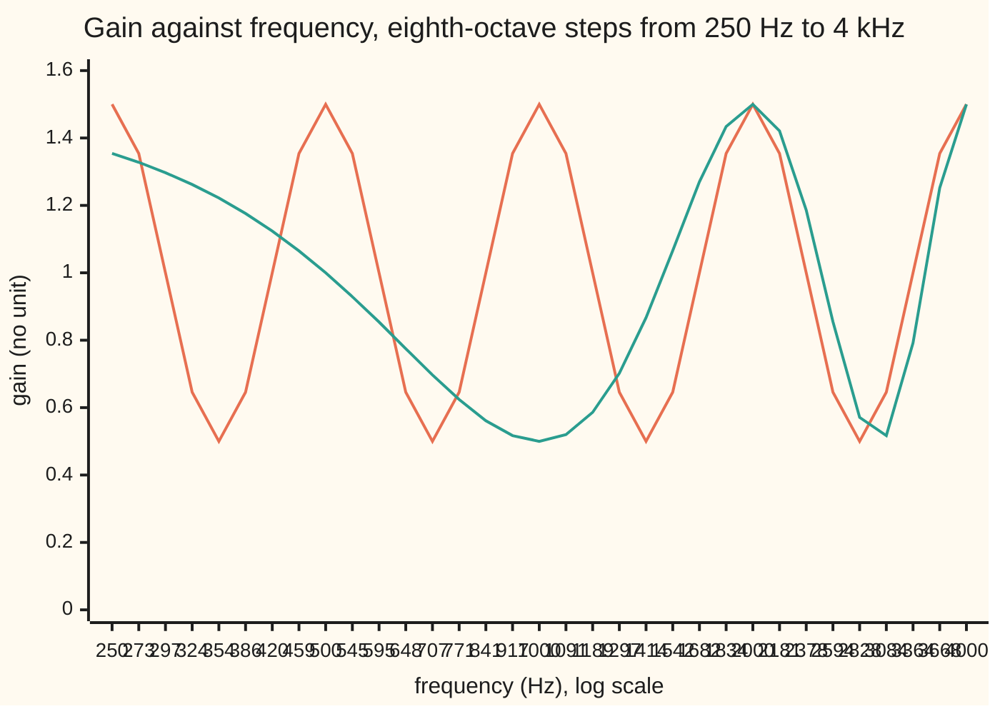

# Fourier multipliers: which equaliser settings are safe on every Lᵖ, by the Mihlin-Hörmander test

[Syllabus](../../../SYLLABUS.md) → [Harmonic analysis](../README.md) → [Multipliers and Estimates for PDE](../README.md#s07) → Fourier multipliers

---

## General Overview

A 10-band graphic equaliser has one slider per octave, centred at 31, 63, 125, 250 and 500 Hz and 1, 2, 4, 8 and 16 kHz. Push every slider to the same boost and the gain curve is not flat: it peaks at each band centre and dips halfway between. The numbers below exaggerate that ripple, down to a cut between bands, so that it is easy to see.

Take a gain of 1.5 (+3.52 dB) at each centre and 0.5 (−6.02 dB) halfway, at 707 Hz, 1414 Hz and so on. In formula form the gain is

```math
m(\xi) = 1 + \tfrac12\cos\bigl(2\pi\log_2(\lvert\xi\rvert / 1\ \mathrm{kHz})\bigr),
```

where $`\xi`$ (xi) is frequency in kHz. The curve repeats once per octave: $`m(2\xi) = m(\xi)`$.

A filter that multiplies each frequency's amount by a gain $`m(\xi)`$ is a **Fourier multiplier**. Energy is easy. By [Plancherel](../02-The%20Fourier%20Transform/05-plancherel-and-l2.md), no signal's energy grows by more than the square of the largest gain, here $`1.5^2`$.

Other sizes are harder. The $`p`$-norm of a signal is the $`p`$-th root of the integral of its size to the power $`p`$; $`p = 2`$ is energy. The $`p`$-norm with $`p = 4`$ weights loud peaks heavily; with $`p = 4/3`$ it weights a long quiet spread. A filter with gain 1 at every frequency can stretch the $`4/3`$-norm without limit: a dispersive filter below does it by 1.78, 3.16 and 5.62.

The Mihlin-Hörmander test asks for two things: the gain is bounded, and it changes by a bounded amount per octave. The equaliser passes. Its test constant is $`\pi/\ln 2 = 4.532360`$, so it is bounded on every $`p`$-norm with $`1 < p < \infty`$.

**A Fourier multiplier whose gain, and enough of its derivatives (one on a line, two in the plane), change by at most a fixed amount per octave has a kernel smooth enough for singular-integral theory, so it is bounded on every p-norm with 1 < p < ∞; a bounded gain alone keeps only energy safe, and a gain that jumps along a curve, like the cut-off to a disc, can fail every p ≠ 2.**

**What kind of fact this is:** a theorem, the Mihlin-Hörmander multiplier theorem, proved on this card in Why it works. The step from the test to the kernel is proved in full on the line; the step from the kernel to Lᵖ uses the Calderón-Zygmund theorem stated on [Singular integrals](../06-Maximal%20Functions%20and%20Beyond/03-singular-integrals-and-the-hilbert-transform-bound.md). The disc result (Fefferman, 1971) is stated with its source.

### The picture: a gain that repeats every octave, against one that does not



Orange: the equaliser, the same shape in every octave. Teal: an echo, $`1 + \tfrac12\cos(\pi\xi)`$ with $`\xi`$ in kHz: the signal plus quarter-strength copies 0.5 ms early and 0.5 ms late. Both stay between 0.5 and 1.5. On a log axis the echo's ripples crowd closer in each higher octave, and the test measures that crowding.

---

## The formula

Notation from earlier cards: the transform $`\hat f(\xi) = \int f(x)\,e^{-2\pi i\xi x}\,dx`$, with time $`x`$ in ms and frequency $`\xi`$ in kHz, and its inverse $`\check g`$. In $`d`$ dimensions $`x`$ and $`\xi`$ are lists of $`d`$ numbers and $`\xi x`$ is their dot product. The **multiplier operator** with gain $`m`$ is

```math
T_m f = \bigl(m\,\hat f\,\bigr)^{\vee} = K * f, \qquad K = \check m .
```

**Read it aloud:** transform the signal, multiply each frequency by its gain, transform back; equivalently, convolve the signal with the kernel K, the inverse transform of the gain.

A **multi-index** $`\beta = (\beta_1, \dots, \beta_d)`$ lists how many times to differentiate in each direction. Its order is $`\lvert\beta\rvert = \beta_1 + \dots + \beta_d`$, and $`\partial^\beta`$ is that derivative. $`\lfloor d/2\rfloor`$ is $`d/2`$ rounded down. The $`p`$-norm $`\lVert f\rVert_p`$, the space $`L^p`$ and the operator norm $`\lVert T\rVert_{p\to p}`$ are as on [Singular integrals](../06-Maximal%20Functions%20and%20Beyond/03-singular-integrals-and-the-hilbert-transform-bound.md).

**The Mihlin-Hörmander theorem.** Suppose that for every $`\xi \ne 0`$ and every $`\beta`$ with $`\lvert\beta\rvert \le \lfloor d/2\rfloor + 1`$,

```math
\lvert\partial^\beta m(\xi)\rvert \;\le\; A\,\lvert\xi\rvert^{-\lvert\beta\rvert} .
```

Then for every $`1 < p < \infty`$ and every $`f`$ in $`L^p`$,

```math
\lVert T_m f\rVert_p \;\le\; C_d\,\max\Bigl(p, \tfrac{1}{p-1}\Bigr)\,A\,\lVert f\rVert_p .
```

**Read it aloud:** if the gain is at most A, and each derivative of order k is at most A divided by the k-th power of the frequency, up to order d over 2 rounded down plus one, then the filter stretches every p-norm by at most a constant times A, for every p strictly between 1 and infinity.

The smallest such $`A`$ is the **Mihlin constant**. In dimension 1 only $`\beta = 0`$ and $`\beta = 1`$ count: $`A = \max(\sup\lvert m\rvert, \sup\lvert\xi\,m'(\xi)\rvert)`$. The product $`\xi\,m'(\xi)`$ is the slope of the gain against the natural log of frequency. So the test asks for a bounded change per octave.

| Symbol | Plain meaning | In our example | Push it up and the answer… |
| --- | --- | --- | --- |
| $`\xi`$, $`d`$, $`\theta`$ | frequency in kHz (a list of $`d`$ numbers in $`d`$ dimensions); the dimension; an angle on the unit circle | 31 Hz to 16 kHz; $`d = 1`$ for sound, 2 for a picture | more dimensions: more derivatives to check |
| $`m(\xi)`$ | the gain at frequency $`\xi`$ | 1.5 at each band centre, 0.5 halfway | larger gain: larger $`A`$ |
| $`f`$, $`\hat f`$, $`T_m`$, $`H`$, $`R_1`$, $`u`$, $`g`$ | a signal; its transform; the filter with gain $`m`$; the Hilbert transform; the first Riesz transform; in the Poisson example, the unknown and the data | a recording; the equaliser | — |
| $`K`$, $`x`$, $`y`$ | the kernel $`\check m`$; time in ms; a time shift | $`\lvert K(x)\rvert \le 0.600561/\lvert x\rvert`$ | — |
| $`\beta`$, $`\lvert\beta\rvert`$, $`\partial^\beta`$ | multi-index; its order; that derivative | order 0 and 1 on the line, up to 2 in the plane | — |
| $`A`$, $`C_d`$ | the Mihlin constant; a number fixed by the dimension | $`A = 4.532360`$ for the equaliser, 2 for the plane example | larger $`A`$: larger guaranteed bound |
| $`p`$, $`\lVert f\rVert_p`$, $`\lVert T\rVert_{p\to p}`$ | the power; the p-norm; the largest stretch of the p-norm | $`\lVert T_m\rVert_{2\to 2} = 1.5`$ | $`p`$ toward 1 or $`\infty`$: the guarantee weakens |
| $`B`$ | Hörmander's smoothness constant of the kernel | at most 4.133389 by the exact kernel | — |
| $`\psi`$, $`j`$, $`m_j`$, $`K_j`$, $`F`$ | the octave bump; an octave's number; the gain on octave $`j`$; its kernel; the piece $`m_0`$ | $`K_j(x) = 2^j K_0(2^j x)`$ | — |
| $`\gamma`$, $`C`$, $`R`$, $`c_\psi, c_1, \dots, c_4`$, $`N`$ | ripple rate per unit of natural log, $`2\pi/\ln 2`$; the exact kernel's constant; a tail radius in ms; fixed numbers in the proof; the number of derivatives used | $`\gamma = 9.064720`$, $`\lvert C\rvert = 0.832555`$ | — |
| $`a`$, $`s`$, $`W`$ | dispersion in ms²; a click's width; its width after the filter | $`a = 10`$, $`s = 1`$ ms, $`W = \sqrt{s^2 + a^2/s^2}`$ | larger $`a`$: larger stretch, no ceiling |
| $`\Delta`$, $`\alpha`$, $`\varepsilon`$, $`X`$ | the sum of second derivatives; a level in weak type; a small radius in the proof; the top of a frequency scan | Poisson's equation; —; —; 16 kHz | larger $`X`$: the echo's derivative bound grows |

### When it holds

- **Bounded change per octave.** The echo ripples every 2 kHz, so each higher octave holds more ripples: $`\sup\lvert\xi\,m'\rvert`$ reaches 24.352475 below 16 kHz, with no ceiling. The test fails, yet the echo is safe: the test is sufficient, not necessary.
- **A bounded gain is not enough.** The dispersive gain $`e^{-i\pi a\xi^2}`$ has size 1, but $`\lvert\xi\,m'\rvert = 2\pi a\xi^2`$ is unbounded. It stretches a click's $`4/3`$-norm by 5.623414 at $`a = 1000`$ ms², with no ceiling. One fixed filter is just as bad: the stretch depends only on $`a/s^2`$, so $`a = 10`$ ms² stretches a 0.1 ms click by the same 5.623414, and narrower clicks by more.
- **Enough derivatives for the dimension:** $`\lfloor d/2\rfloor + 1`$, so one on the line and two in the plane. The disc's cut-off has none across its rim, and fails every $`p \ne 2`$.
- **1 < p < ∞, strictly.** At $`p = 1`$ only weak type (1,1) survives (the time where $`\lvert T_m f\rvert`$ exceeds a level $`\alpha`$ is at most a constant times $`\lVert f\rVert_1/\alpha`$), and at $`p = \infty`$ nothing. The Hilbert transform's gain $`-i\,\mathrm{sgn}(\xi)`$ passes the test and fails at both ends.
- **One gain for all time.** The filter must not change with time or position. A gain that depends on both is the subject of [Pseudodifferential operators](05-pseudodifferential-operators.md).

---

## Why it works

### Step 0: a gain that changes per octave has a kernel that is smooth per octave

Cut the gain into octaves. On one octave, around frequency $`2^j`$, the piece's kernel lives on time scale $`2^{-j}`$. The test says each piece is a rescaled copy of one fixed shape, up to a bounded change. So each piece's kernel has bounded total size and bounded smoothness *at its own scale*.

Add the octaves, and compare each piece with a time shift $`y`$. A piece whose time scale is longer than the shift barely changes when shifted. A piece whose time scale is shorter has almost no mass that far from 0. Both sums are geometric, so the whole kernel obeys Hörmander's smoothness condition. The Calderón-Zygmund theorem turns that condition plus the energy bound into every $`p`$-norm bound.

### Step 1: energy is bounded by the largest gain

By Plancherel,

```math
\lVert T_m f\rVert_2^2 = \int \lvert m(\xi)\rvert^2\,\lvert\hat f(\xi)\rvert^2\,d\xi \;\le\; \sup\lvert m\rvert^2\,\lVert f\rVert_2^2 .
```

For the equaliser, $`\lVert T_m\rVert_{2\to 2} = 1.5`$ exactly: a tone at a band centre is stretched by 1.5. This is [Singular integrals](../06-Maximal%20Functions%20and%20Beyond/03-singular-integrals-and-the-hilbert-transform-bound.md) Step 1, used unchanged.

### Step 2: cut the gain into octaves

The octave bump is $`\psi(\xi) = \cos^2\bigl(\tfrac{\pi}{2}\log_2\lvert\xi\rvert\bigr)`$ for $`\tfrac12 \le \lvert\xi\rvert \le 2`$, and 0 elsewhere. Neighbouring copies $`\psi(\xi/2^j)`$ and $`\psi(\xi/2^{j+1})`$ are a cosine squared and a sine squared. They add to 1, so

```math
\sum_{j} \psi(\xi / 2^j) = 1 \quad (\xi \ne 0), \qquad m = \sum_j m_j, \qquad m_j(\xi) = m(\xi)\,\psi(\xi/2^j).
```

The equaliser repeats every octave, so every piece is a copy of the piece $`m_0`$ around 1 kHz, squeezed: $`K_j(x) = 2^j K_0(2^j x)`$. One piece tells the whole story. A general gain is not periodic per octave; the test then plays the role of periodicity, by giving every piece the same bounds.

### Step 3: one piece, measured from the frequency side

Plancherel turns time weights into frequency derivatives. Multiplying the kernel by $`x`$ corresponds to differentiating the gain, divided by $`2\pi`$. So, with $`F = m_0`$:

```math
\int x^2\,\lvert K_0(x)\rvert^2\,dx = \frac{1}{4\pi^2}\int \lvert F'(\xi)\rvert^2\,d\xi .
```

The check computes this two ways. The frequency side gives 0.575621. The kernel itself, computed by a cosine integral and integrated over $`\lvert x\rvert < 30`$ ms, gives 0.575618. The part beyond 30 ms is at most 0.000014: $`F''`$ jumps at the octave's ends, so integrating by parts four times shows that the kernel falls off like $`1/\lvert x\rvert^3`$.

The same trick bounds the derivative of the kernel: $`\int\lvert K_0'\rvert^2 = 57.605509`$ and $`\int x^2\lvert K_0'\rvert^2 = 22.724602`$. The Cauchy-Schwarz inequality then gives two bounds, one for $`\lvert x\rvert < 1`$ and one beyond:

```math
\int \lvert K_0'\rvert \;\le\; \sqrt{2 \times 57.605509} + \sqrt{2 \times 22.724602} = 17.475242, \qquad \int_{\lvert x\rvert > R}\lvert K_0\rvert \;\le\; \sqrt{\frac{2 \times 0.575621}{R}} .
```

This is where the test enters. $`F'`$ is built from $`m'`$ and $`m`$. The bounds $`\lvert m\rvert \le A`$ and $`\lvert\xi\,m'\rvert \le A`$ make every one of these integrals at most a fixed number times $`A^2`$, for every octave at its own scale.

### Step 4: add the octaves

Hörmander's condition asks for the integral $`\int_{\lvert x\rvert > 2\lvert y\rvert}\lvert K(x - y) - K(x)\rvert\,dx`$ to be at most $`B`$ for every shift $`y`$. Each piece gives the smaller of two bounds:

- **Long-scale pieces** ($`2^j\lvert y\rvert < 1`$, time scale $`2^{-j}`$ longer than the shift): a shift by $`y`$ changes the kernel by at most $`\lvert y\rvert \int\lvert K_j'\rvert = 2^j\lvert y\rvert \times 17.475242`$.
- **Short-scale pieces** ($`2^j\lvert y\rvert > 1`$, time scale shorter than the shift): both copies lie mostly near 0, and their mass beyond $`\lvert y\rvert`$ is at most $`2\sqrt{2 \times 0.575621/(2^j\lvert y\rvert)}`$.

The first list shrinks by half per octave downwards; the second by $`1/\sqrt2`$ per octave upwards. Doubling $`y`$ only moves every term one octave along the list, so the shifts from 1 to 2 ms cover every shift. The sum is largest at the shift 1.976439 ms, where one piece's two bounds are equal; from there both lists are geometric series, which add to **19.057675**. A direct sum at that shift agrees, and a grid of 257 shifts stays below it, at 19.057484.

A second road. The ripple $`\tfrac12\cos(\gamma\ln\lvert\xi\rvert)`$, with $`\gamma = 2\pi/\ln 2`$, has an exact kernel: half the real part of $`\lvert x\rvert^{-1-i\gamma}/C`$, from the transform of a power of $`\lvert x\rvert`$ (Grafakos, chapter 2). Here $`\lvert C\rvert = \sqrt{2\pi\coth(\pi\gamma/2)/\gamma} = 0.832555`$, so $`\lvert K(x)\rvert \le 0.600561/\lvert x\rvert`$. The gain's constant 1 adds only a spike at 0, which Hörmander's integral never reaches. Integrating the exact kernel's change out to $`10^6`$ ms, plus a tail of at most 0.000011, gives $`B \le 4.133389`$, inside the octave bound.

### Step 5: from the kernel to every p-norm

The Calderón-Zygmund theorem, in Hörmander's form, needs two inputs: the energy bound (Step 1) and the smoothness condition (Step 4). The proof runs in three moves, each on an earlier card.

1. **Weak type (1,1).** Split $`f`$ at a level by the [Calderon-Zygmund decomposition](../06-Maximal%20Functions%20and%20Beyond/02-calderon-zygmund-decomposition-in-outline.md). The good part is handled by the energy bound. Each bad piece has total zero on its box, so far from the box the kernel's smoothness makes its output small.
2. **1 < p ≤ 2.** [Interpolation](../06-Maximal%20Functions%20and%20Beyond/04-interpolation-riesz-thorin-and-marcinkiewicz.md) by Marcinkiewicz, between weak (1,1) and $`L^2`$.
3. **2 ≤ p < ∞.** Duality. The adjoint of $`T_m`$ is the multiplier with the complex conjugate gain $`\bar m`$, which passes the same test with the same $`A`$.

The factor $`\max(p, 1/(p-1))`$ comes from Marcinkiewicz's constant, which blows up near $`p = 1`$, and from duality near $`p = \infty`$.

<details>
<summary>Detailed proof: the test gives Hörmander's condition, on the line</summary>

Let $`| m| \le A`$ and $`|\xi\,m'(\xi)| \le A`$ for $`\xi \ne 0`$. Put $`m_j(\xi) = m(\xi)\,\psi(\xi/2^j)`$ and $`K_j = \check m_j`$. The bump $`\psi`$ has continuous derivative, with $`|\psi| \le 1`$ and $`|\xi\,\psi'(\xi)| \le c_\psi = \pi/(2\ln 2)`$. The support of $`m_j`$ is $`2^{j-1} \le |\xi| \le 2^{j+1}`$, of total length $`3 \cdot 2^j`$.

*Piece bounds.* On the support, $`| m_j'| \le (A + A c_\psi)/|\xi| \le 2(1 + c_\psi)A\,2^{-j}`$. By Plancherel,

$`\displaystyle \int x^2| K_j|^2\,dx = \frac{1}{4\pi^2}\int| m_j'|^2\,d\xi \le c_1 A^2\,2^{-j}, \qquad c_1 = \frac{12(1 + c_\psi)^2}{4\pi^2}.`$

Cauchy-Schwarz with $`\int_{| x| > R} x^{-2}\,dx = 2/R`$ gives the tail bound

$`\displaystyle \int_{| x| > R}| K_j|\,dx \le \sqrt{2c_1}\,A\,(2^j R)^{-1/2}.`$

The derivative $`K_j'`$ is the inverse transform of $`2\pi i\xi\,m_j`$. Plancherel gives $`\int| K_j'|^2 \le c_2 A^2\,2^{3j}`$ and $`\int x^2| K_j'|^2 = \int|(\xi\,m_j)'|^2 \le c_3 A^2\,2^{j}`$. Split at $`| x| = 2^{-j}`$ and apply Cauchy-Schwarz on each side:

$`\displaystyle \int| K_j'|\,dx \le \sqrt{2 \cdot 2^{-j} \cdot c_2 A^2 2^{3j}} + \sqrt{c_3 A^2 2^j \cdot 2 \cdot 2^j} = c_4\,A\,2^j.`$

*The sum.* Fix $`y \ne 0`$. For each $`j`$,

$`\displaystyle \int_{| x| > 2| y|}| K_j(x - y) - K_j(x)|\,dx \le \min\Bigl(c_4 A\,2^j| y|,\; 2\sqrt{2c_1}\,A\,(2^j| y|)^{-1/2}\Bigr).`$

The first bound is the mean value theorem integrated over $`x`$. The second uses $`| x - y| > | y|`$ when $`| x| > 2| y|`$. Summing the first over $`2^j| y| \le 1`$ gives at most $`2c_4 A`$. Summing the second over $`2^j| y| > 1`$ gives at most $`2\sqrt{2c_1}\,A/(1 - 2^{-1/2})`$. So $`K = \sum_j K_j`$ (the sum converges in $`L^1`$ on every region $`| x| > \varepsilon`$) obeys Hörmander's condition with $`B \le cA`$ for a fixed number $`c`$.

*The conclusion.* $`T_m`$ is bounded on $`L^2`$ with norm $`\sup| m| \le A`$, and for $`f`$ in $`L^2`$ with compact support, $`T_m f(x) = \int K(x - y) f(y)\,dy`$ for $`x`$ outside the support. The Calderón-Zygmund theorem in Hörmander's form (Hörmander 1960; Grafakos, chapter 5) gives weak type (1,1) with constant at most a fixed number times $`A + B`$. Marcinkiewicz interpolation gives $`1 < p \le 2`$, and the adjoint $`T_{\bar m}`$ gives $`2 \le p < \infty`$.

*In $`d`$ dimensions* the same proof runs with $`N = \lfloor d/2\rfloor + 1`$ derivatives. The weight $`x^2`$ becomes $`|x|^{2N}`$, and the tail step needs $`\int_{|x| > R}|x|^{-2N}\,dx`$ to be finite, which holds exactly when $`2N > d`$.

</details>

### Step 6: in the plane, count two derivatives

A picture's frequencies are $`\xi = (\xi_1, \xi_2)`$ in cycles per mm. The gain $`m(\xi) = \xi_1^2/\lvert\xi\rvert^2`$ keeps a stripe pattern by its direction: it passes stripes whose frequency points along $`\xi_1`$ and removes those along $`\xi_2`$. It is $`-R_1^2`$, where $`R_1`$, with gain $`-i\xi_1/\lvert\xi\rvert`$, is the first of the [Riesz transforms](../06-Maximal%20Functions%20and%20Beyond/07-riesz-transforms-and-singular-integrals-in-higher-dimensions.md).

Here $`d = 2`$, so the test needs orders 0, 1 and 2. The gain depends only on direction, so each product $`\lvert\xi\rvert^{\lvert\beta\rvert}\lvert\partial^\beta m\rvert`$ is the same on every circle around 0. The check scans the unit circle and the circle of radius 7, by finite differences, and finds the closed forms:

| Derivative | Largest value of $`\lvert\xi\rvert^{\lvert\beta\rvert}\lvert\partial^\beta m\rvert`$ |
| --- | ---: |
| $`m`$ itself | 1.000000 |
| $`\partial_1 m`$ and $`\partial_2 m`$ | $`4/(3\sqrt3)`$ = 0.769800 |
| $`\partial_1^2 m`$ and $`\partial_2^2 m`$ | 2.000000 |
| $`\partial_1\partial_2 m`$ | 1.000000 |

So $`A = 2`$. Away from 0 the kernel is $`-(x_1^2 - x_2^2)/(2\pi\lvert x\rvert^4)`$, of size at most $`0.159155/\lvert x\rvert^2`$ (Stein, chapter 3).

### Step 7: why the disc escapes

The **brick wall** on the line keeps $`\lvert\xi\rvert < 1`$ kHz. Its gain jumps at ±1 kHz, so it fails the test, yet it is bounded. Its gain is $`\tfrac12(\mathrm{sgn}(\xi + 1) - \mathrm{sgn}(\xi - 1))`$. Each sign function is a Hilbert transform with the signal multiplied by a pure tone before and after, and that multiplication keeps every $`p`$-norm. So $`\lVert T\rVert_{4\to 4} \le \lVert H\rVert_{4\to 4} = \cot(\pi/8) = 2.414214`$, Pichorides' exact constant, stated on [Singular integrals](../06-Maximal%20Functions%20and%20Beyond/03-singular-integrals-and-the-hilbert-transform-bound.md).

The **disc** in the plane keeps $`\lvert\xi\rvert < 1`$. Its gain jumps along a whole circle, so near each rim point it is a brick wall in a different direction. If the disc were bounded on $`L^p`$, many such one-direction cut-offs, acting together, would be bounded too. Fefferman (1971) tested them on thin rectangles taken from a Besicovitch set: rectangles pointing in many directions, packed into a tiny area. The bound fails for every $`p \ne 2`$. [Restriction and Kakeya in outline](../06-Maximal%20Functions%20and%20Beyond/06-restriction-and-kakeya-in-outline.md) gives the outline.

---

## Worked numbers, by hand

The equaliser, $`m(\xi) = 1 + \tfrac12\cos(2\pi\log_2\xi)`$ with $`\xi`$ in kHz, $`d = 1`$.

| Step | Arithmetic | Value |
| --- | --- | --- |
| largest gain | $`1 + \tfrac12`$, at every band centre | 1.5 |
| slope per natural-log unit | $`\xi\,m' = -\tfrac12 \cdot \tfrac{2\pi}{\ln 2}\sin(2\pi\log_2\xi)`$ | — |
| its largest size | $`\tfrac12 \cdot 2\pi/\ln 2 = \pi/0.693147`$ | 4.532360 |
| **Mihlin constant** | $`\max(1.5,\ 4.532360)`$ | **4.532360** |
| energy norm | $`\sup\lvert m\rvert`$ | 1.5 |

The plane example, $`\xi_1^2/\lvert\xi\rvert^2`$: on the unit circle write $`\xi = (\cos\theta, \sin\theta)`$.

| Step | Arithmetic | Value |
| --- | --- | --- |
| first derivative | $`\partial_1 m = 2\xi_1\xi_2^2/\lvert\xi\rvert^4 = 2\cos\theta\sin^2\theta`$, largest at $`\cos^2\theta = 1/3`$ | 0.769800 |
| second derivative | $`\partial_1^2 m = 2\sin^2\theta\,(4\sin^2\theta - 3)`$, largest at $`\theta = 90°`$ | 2 |
| mixed derivative | $`\partial_1\partial_2 m = \sin 4\theta`$ | 1 |
| **Mihlin constant** | $`\max(1, 0.769800, 2, 1)`$ | **2** |

Both gains pass, so both filters are bounded on every $`L^p`$ with $`1 < p < \infty`$. The equaliser's constant is set by how fast its ripple turns, not by how high it climbs.

### What breaks if you drop a piece

| Mistake | Comes out at | What went wrong |
| --- | --- | --- |
| Trust the gain bound alone: dispersion $`e^{-i\pi a\xi^2}`$, gain 1 | $`4/3`$-norm stretched by 1.780493, 3.162317, 5.623414 at $`a`$ = 10, 100, 1000 ms² | the phase turns faster at high frequency; only energy is safe |
| Read a failed test as "unbounded": the echo | $`\sup\lvert\xi\,m'\rvert`$ = 5.520354, 11.791565, 24.352475 below 4, 8, 16 kHz | the test is sufficient, not necessary; three shifted copies have norm at most 1.5 on every $`L^p`$ |
| Drop the derivative at a jump: brick wall at 1 kHz | test constant infinite; still at most 2.414214 on $`L^4`$ | on the line, two jumps are two Hilbert transforms |
| Carry the brick wall to the plane: the disc | no bound on any $`L^p`$, $`p \ne 2`$ | a jump along a circle points in every direction (Fefferman) |

The dispersion row is computed two ways. A 1 ms click $`g(x) = e^{-\pi x^2}`$ leaves the filter as a chirp of width $`W = \sqrt{1 + a^2}`$ ms and peak $`W^{-1/2}`$. The closed form for the stretch is $`W^{1/4}`$. A numerical transform at $`a = 10`$ gives 1.780493, the same to six digits. The $`L^4`$ norm shrinks by the same factor, 0.561642. The complex-conjugate chirp (its sweep reversed) is focused into the click instead, which stretches its $`L^4`$ norm by 1.780493.

---

## Code, from first principles, and it actually runs

The script finds each Mihlin constant twice: by closed form, and by a scan with finite differences. It then runs the proof on the equaliser. It checks Plancherel on one octave piece by two roads, the frequency side and the kernel computed by a cosine integral. It bounds Hörmander's constant by two roads, the octave sum (as geometric series, and directly) and the exact kernel. It finds the dispersion stretch by closed form and by a numerical transform. Every integral is Simpson's rule written out, with its cut-off and tail bound printed.

### Python

```python
# Mihlin-Hormander multiplier theorem -- the check behind the card.  Standard library only.
# Units: frequency xi in kHz, time x in ms.  Every number quoted on the card is printed here.
from math import pi, log, log2, log10, sqrt, cos, sin, exp, tanh, floor

def simpson(f, a, b, n):
    h = (b - a) / n
    s = f(a) + f(b)
    for i in range(1, n):
        s += (4 if i % 2 else 2) * f(a + i * h)
    return s * h / 3

def eq(xi):   return 1 + 0.5 * cos(2 * pi * log2(abs(xi)))    # equaliser: one wobble per octave
def echo(xi): return 1 + 0.5 * cos(pi * xi)                   # echoes at -0.5 and +0.5 ms, a quarter each
G = 2 * pi / log(2)                                           # cos(2 pi log2 xi) = cos(G ln xi)

# ---- the gain curve and the house example ----
print("chart, frequency in Hz   " + " ".join(f"{1000 * 2 ** (k / 8):6.0f}" for k in range(-16, 17)))
print("chart, equaliser gain    " + " ".join(f"{eq(2 ** (k / 8)):6.3f}" for k in range(-16, 17)))
print("chart, echo gain         " + " ".join(f"{echo(2 ** (k / 8)):6.3f}" for k in range(-16, 17)))
centres = [2.0 ** k for k in range(-5, 5)]                    # 31.25 Hz ... 16 kHz
print("gain at the ten band centres", " ".join(f"{eq(c):.3f}" for c in centres))
print(f"gain halfway, at 707 Hz      {eq(2 ** -0.5):.6f}")
print(f"in decibels: peak {20 * log10(1.5):.6f} dB, dip {20 * log10(0.5):.6f} dB")

# ---- 1. Mihlin constants: closed form against a finite-difference scan ----
def scan_1d(m, u0, u1, n, h=1e-5):           # largest |m| and |xi m'| over log2 xi in [u0, u1]
    b0 = b1 = 0.0
    for k in range(n + 1):
        xi = 2 ** (u0 + (u1 - u0) * k / n)
        b0 = max(b0, abs(m(xi)))
        b1 = max(b1, abs(m(xi * exp(h)) - m(xi * exp(-h))) / (2 * h))   # d m / d(ln xi) = xi m'
    return b0, b1
e0, e1 = scan_1d(eq, -5, 5, 10240)
print(f"equaliser sup|m|            closed 1.500000   scan {e0:.6f}")
print(f"equaliser sup|xi m'|        closed {pi / log(2):.6f}   scan {e1:.6f}")
print(f"equaliser Mihlin constant A {max(1.5, pi / log(2)):.6f}")
def echo_peak(X):                             # top of the last hump of (pi/2) xi |sin(pi xi)| below X, by Newton
    xi = X - 0.5
    for _ in range(20): xi -= (sin(pi * xi) + pi * xi * cos(pi * xi)) / (2 * pi * cos(pi * xi) - pi * pi * xi * sin(pi * xi))
    return pi / 2 * xi * abs(sin(pi * xi))
echo_scan = [(X, scan_1d(echo, -5, log2(X), 4096 * int(X))[1], echo_peak(X)) for X in (4, 8, 16)]
for X, v, pk in echo_scan:
    print(f"echo sup|xi m'| up to {X:>2} kHz {pk:10.6f}   scan {v:.6f}   (pi/2)(X - 1/2) = {pi / 2 * (X - 0.5):.6f}")

def riesz(a, b): return a * a / (a * a + b * b)              # xi1^2/|xi|^2 = -R1^2
def partials(a, b, h=1e-4):
    f = riesz
    d1 = (f(a + h, b) - f(a - h, b)) / (2 * h)
    d2 = (f(a, b + h) - f(a, b - h)) / (2 * h)
    d11 = (f(a + h, b) - 2 * f(a, b) + f(a - h, b)) / (h * h)
    d22 = (f(a, b + h) - 2 * f(a, b) + f(a, b - h)) / (h * h)
    d12 = (f(a + h, b + h) - f(a + h, b - h) - f(a - h, b + h) + f(a - h, b - h)) / (4 * h * h)
    return [abs(f(a, b)), abs(d1), abs(d2), abs(d11), abs(d22), abs(d12)]
closed2 = [1.0, 4 / (3 * sqrt(3)), 4 / (3 * sqrt(3)), 2.0, 2.0, 1.0]
scans = {}
for r in (1.0, 7.0):
    best = [0.0] * 6
    for k in range(2880):
        th = pi * k / 1440
        p = partials(r * cos(th), r * sin(th), 1e-4 * r)
        w = [1, r, r, r * r, r * r, r * r]                    # |xi|^|beta| times the derivative
        best = [max(best[i], p[i] * w[i]) for i in range(6)]
    scans[r] = best
names = ["|m|", "|xi| |d1 m|", "|xi| |d2 m|", "|xi|^2 |d11 m|", "|xi|^2 |d22 m|", "|xi|^2 |d12 m|"]
for i in range(6):
    print(f"Riesz {names[i]:<15} closed {closed2[i]:.6f}  scan r=1 {scans[1.0][i]:.6f}  r=7 {scans[7.0][i]:.6f}")
print(f"Riesz Mihlin constant A     {max(closed2):.6f}; kernel size constant 1/(2 pi) = {1 / (2 * pi):.6f}")

# ---- 2. the proof on the equaliser: one octave piece, bounded from the frequency side ----
def F(xi):                                    # m times the octave bump psi, for 1/2 <= xi <= 2
    u = log2(xi)
    return eq(xi) * cos(pi * u / 2) ** 2
def dF(xi):                                   # dF/dxi, by the chain rule through u = log2 xi
    u = log2(xi)
    du = -pi * sin(2 * pi * u) * cos(pi * u / 2) ** 2 - eq(xi) * (pi / 2) * sin(pi * u)
    return du / (xi * log(2))
n = 4000
I2 = 2 * simpson(lambda s: dF(s) ** 2, 0.5, 2, n) / (4 * pi * pi)            # int x^2 K0^2
J0 = 2 * simpson(lambda s: 4 * pi * pi * s * s * F(s) ** 2, 0.5, 2, n)       # int K0'^2
J2 = 2 * simpson(lambda s: (F(s) + s * dF(s)) ** 2, 0.5, 2, n)               # int x^2 K0'^2
D1 = sqrt(2 * J0) + sqrt(2 * J2)                                             # bound on int |K0'|
def lp_sum(y):
    return sum(min(2.0 ** j * y * D1, 2 * sqrt(2 * I2 / (2.0 ** j * y))) for j in range(-60, 61))
B_grid = max(lp_sum(1 + k / 256) for k in range(257))
r_sw = (2 * sqrt(2 * I2) / D1) ** (2 / 3)                  # the piece whose two bounds are equal
B_lp = (3 + sqrt(2)) * D1 * r_sw                            # both lists are geometric series from there
y_sw = r_sw * 2 ** -floor(log2(r_sw))                       # that shift, moved into [1, 2) ms
print(f"piece: int x^2 K0^2 from the frequency side  {I2:.6f}")
Fj = sum(abs(dF(s + 1e-6) - dF(s - 1e-6)) / 2e-6 for s in (0.5 + 1e-6, 2 - 1e-6))   # jumps of F'' at the ends
g3 = [(dF(s + 1e-5) - 2 * dF(s) + dF(s - 1e-5)) / 1e-10 for s in (0.5 + 1e-5 + (1.5 - 2e-5) * k / 30000 for k in range(30001))]
V3 = abs(g3[0]) + abs(g3[-1]) + sum(abs(u - v) for u, v in zip(g3, g3[1:]))       # total change of F'''
def K0(x): return 2 * simpson(lambda s: F(s) * cos(2 * pi * x * s), 0.5, 2, 600)
X = 30.0
I2t = 2 * simpson(lambda x: x * x * K0(x) ** 2, 0, X, 3000)
a3, a4 = 2 * Fj / (2 * pi) ** 3, 2 * V3 / (2 * pi) ** 4    # |K0(x)| <= a3/|x|^3 + a4/|x|^4, by parts four times
tail = 2 * (a3 ** 2 / (3 * X ** 3) + a3 * a4 / (2 * X ** 4) + a4 ** 2 / (5 * X ** 5))
print(f"piece: int x^2 K0^2 from the kernel, |x| < 30 ms  {I2t:.6f}  (tail at most {tail:.6f})")
print(f"piece: int K0'^2 {J0:.6f}   int x^2 K0'^2 {J2:.6f}   so int |K0'| <= {D1:.6f}")
print(f"Hormander constant B, octave-piece bound      {B_lp:.6f}  (largest at the shift {y_sw:.6f} ms)")
print(f"  the same by direct sum at that shift        {lp_sum(y_sw):.6f};  on a 257-shift grid {B_grid:.6f}")

# ---- 3. the same constant from the exact kernel  |x|^(-1-iG) / C ----
Cabs = sqrt(2 * pi / (G * tanh(pi * G / 2)))
def cpow(z): return (cos(G * log(z)) / z, -sin(G * log(z)) / z)            # z^(-1-iG), z > 0
def dabs(p, q): return sqrt((p[0] - q[0]) ** 2 + (p[1] - q[1]) ** 2)
def hint(u):
    x = exp(u)
    return x * (dabs(cpow(x - 1), cpow(x)) + dabs(cpow(x + 1), cpow(x)))
IH = simpson(hint, log(2), log(1e6), 40000)
tailH = 2 * sqrt(1 + G * G) / (1e6 - 1)
print(f"|C| = {Cabs:.6f}  (sqrt(ln 2) = {sqrt(log(2)):.6f});  size: |K(x)| <= {0.5 / Cabs:.6f} / |x|")
B_ex = 0.5 * (IH + tailH) / Cabs                            # the integral to 10^6 ms, plus its tail
print(f"Hormander constant B, exact-kernel bound      {B_ex:.6f}  (tail beyond 10^6 ms included: {0.5 * tailH / Cabs:.6f})")

# ---- 4. what breaks: a dispersion filter exp(-i pi a xi^2), gain 1 everywhere ----
def ratio_closed(a, s=1.0): return (sqrt(s ** 4 + a * a) / (s * s)) ** 0.25    # L^(4/3) stretch
def Tg_abs(t, a, s=1.0):
    re = simpson(lambda x: s * exp(-pi * s * s * x * x) * cos(pi * a * x * x) * cos(2 * pi * x * t), 0, 4, 4000)
    im = simpson(lambda x: s * exp(-pi * s * s * x * x) * sin(pi * a * x * x) * cos(2 * pi * x * t), 0, 4, 4000)
    return 2 * sqrt(re * re + im * im)
q = 4 / 3
out = (2 * simpson(lambda t: Tg_abs(t, 10.0) ** q, 0, 40, 400)) ** (1 / q)
inn = (2 * simpson(lambda t: exp(-pi * t * t) ** q, 0, 10, 400)) ** (1 / q)
for a in (10.0, 100.0, 1000.0):
    print(f"dispersion a = {a:6.0f} ms^2: L^(4/3) ratio {ratio_closed(a):.6f}, L^4 ratio {1 / ratio_closed(a):.6f}")
print(f"dispersion a = 10 by numerical transform: L^(4/3) ratio {out / inn:.6f}")
print(f"brick wall: ||T||_4 <= ||H||_4 = cot(pi/8) = {cos(pi / 8) / sin(pi / 8):.6f}")
print(f"try: 2 wobbles per octave A = {2 * pi / log(2):.6f};  depth 0.1: sup|xi m'| = {0.1 * G:.6f}, A = 1.100000")

assert abs(e1 - pi / log(2)) < 1e-6, "scan must find the closed-form derivative bound"
assert all(abs(scans[r][i] - closed2[i]) < 1e-5 for r in (1.0, 7.0) for i in range(6)), "Riesz constants"
assert all(pi / 2 * (X - 0.5) < pk < pi / 2 * X for X, v, pk in echo_scan), "echo grows like pi X / 2"
assert all(0 <= pk - v < 1e-4 for X, v, pk in echo_scan), "echo: the scan sits just below the Newton peak"
assert 0 < I2 - I2t < tail, "Plancherel on the piece: the kernel side falls short by less than the tail"
assert abs(out / inn - ratio_closed(10.0)) < 1e-4, "dispersion ratio: closed form vs numerical"
assert abs(lp_sum(y_sw) - B_lp) < 1e-6, "octave bound: geometric series against the direct sum"
assert 0 <= B_lp - B_grid < 1e-3, "octave bound: no shift on the grid beats the switch"
assert abs(Cabs - sqrt(log(2))) < 1e-9, "|C|: the coth formula is sqrt(ln 2) to 1e-12"
assert B_ex < B_lp, "the exact kernel must sit inside the proof's bound"
print("ALL CHECKS PASS")
```

**Ran 2026-11-24 on macOS, Python 3.14.10, standard library only. All checks passed. Output, pasted from the run:**

```
chart, frequency in Hz      250    273    297    324    354    386    420    459    500    545    595    648    707    771    841    917   1000   1091   1189   1297   1414   1542   1682   1834   2000   2181   2378   2594   2828   3084   3364   3668   4000
chart, equaliser gain     1.500  1.354  1.000  0.646  0.500  0.646  1.000  1.354  1.500  1.354  1.000  0.646  0.500  0.646  1.000  1.354  1.500  1.354  1.000  0.646  0.500  0.646  1.000  1.354  1.500  1.354  1.000  0.646  0.500  0.646  1.000  1.354  1.500
chart, echo gain          1.354  1.328  1.297  1.262  1.222  1.176  1.124  1.065  1.000  0.929  0.854  0.775  0.697  0.624  0.561  0.517  0.500  0.520  0.586  0.702  0.867  1.066  1.270  1.434  1.500  1.421  1.186  0.855  0.571  0.517  0.792  1.252  1.500
gain at the ten band centres 1.500 1.500 1.500 1.500 1.500 1.500 1.500 1.500 1.500 1.500
gain halfway, at 707 Hz      0.500000
in decibels: peak 3.521825 dB, dip -6.020600 dB
equaliser sup|m|            closed 1.500000   scan 1.500000
equaliser sup|xi m'|        closed 4.532360   scan 4.532360
equaliser Mihlin constant A 4.532360
echo sup|xi m'| up to  4 kHz   5.520354   scan 5.520350   (pi/2)(X - 1/2) = 5.497787
echo sup|xi m'| up to  8 kHz  11.791565   scan 11.791560   (pi/2)(X - 1/2) = 11.780972
echo sup|xi m'| up to 16 kHz  24.352475   scan 24.352471   (pi/2)(X - 1/2) = 24.347343
Riesz |m|             closed 1.000000  scan r=1 1.000000  r=7 1.000000
Riesz |xi| |d1 m|     closed 0.769800  scan r=1 0.769800  r=7 0.769800
Riesz |xi| |d2 m|     closed 0.769800  scan r=1 0.769800  r=7 0.769800
Riesz |xi|^2 |d11 m|  closed 2.000000  scan r=1 2.000000  r=7 2.000000
Riesz |xi|^2 |d22 m|  closed 2.000000  scan r=1 2.000000  r=7 2.000000
Riesz |xi|^2 |d12 m|  closed 1.000000  scan r=1 1.000000  r=7 1.000000
Riesz Mihlin constant A     2.000000; kernel size constant 1/(2 pi) = 0.159155
piece: int x^2 K0^2 from the frequency side  0.575621
piece: int x^2 K0^2 from the kernel, |x| < 30 ms  0.575618  (tail at most 0.000014)
piece: int K0'^2 57.605509   int x^2 K0'^2 22.724602   so int |K0'| <= 17.475242
Hormander constant B, octave-piece bound      19.057675  (largest at the shift 1.976439 ms)
  the same by direct sum at that shift        19.057675;  on a 257-shift grid 19.057484
|C| = 0.832555  (sqrt(ln 2) = 0.832555);  size: |K(x)| <= 0.600561 / |x|
Hormander constant B, exact-kernel bound      4.133389  (tail beyond 10^6 ms included: 0.000011)
dispersion a =     10 ms^2: L^(4/3) ratio 1.780493, L^4 ratio 0.561642
dispersion a =    100 ms^2: L^(4/3) ratio 3.162317, L^4 ratio 0.316224
dispersion a =   1000 ms^2: L^(4/3) ratio 5.623414, L^4 ratio 0.177828
dispersion a = 10 by numerical transform: L^(4/3) ratio 1.780493
brick wall: ||T||_4 <= ||H||_4 = cot(pi/8) = 2.414214
try: 2 wobbles per octave A = 9.064720;  depth 0.1: sup|xi m'| = 0.906472, A = 1.100000
ALL CHECKS PASS
```

### Rust

The same checks, the same inputs, the same output, line for line. Complex numbers are pairs of real numbers.

```rust
// Mihlin-Hormander multiplier theorem -- the same check as the Python file, in Rust.
// Standard library only, no crates.  Units: frequency xi in kHz, time x in ms.
use std::f64::consts::PI;

fn simpson<F: Fn(f64) -> f64>(f: F, a: f64, b: f64, n: usize) -> f64 {
    let h = (b - a) / n as f64;
    let mut s = f(a) + f(b);
    for i in 1..n { s += if i % 2 == 1 { 4.0 } else { 2.0 } * f(a + i as f64 * h); }
    s * h / 3.0
}

fn eq(xi: f64) -> f64 { 1.0 + 0.5 * (2.0 * PI * xi.abs().log2()).cos() }   // one wobble per octave
fn echo(xi: f64) -> f64 { 1.0 + 0.5 * (PI * xi).cos() }                   // echoes at -0.5 and +0.5 ms

fn row<F: Fn(i32) -> String>(label: &str, f: F) {
    let v: Vec<String> = (-16..=16).map(|k| f(k)).collect();
    println!("{}{}", label, v.join(" "));
}

fn scan_1d<F: Fn(f64) -> f64>(m: F, u0: f64, u1: f64, n: usize) -> (f64, f64) {
    let h = 1e-5_f64;
    let (mut b0, mut b1) = (0.0_f64, 0.0_f64);
    for k in 0..=n {
        let xi = 2f64.powf(u0 + (u1 - u0) * k as f64 / n as f64);
        b0 = b0.max(m(xi).abs());
        b1 = b1.max((m(xi * h.exp()) - m(xi * (-h).exp())).abs() / (2.0 * h));   // xi m'
    }
    (b0, b1)
}

fn riesz(a: f64, b: f64) -> f64 { a * a / (a * a + b * b) }               // xi1^2/|xi|^2 = -R1^2

fn partials(a: f64, b: f64, h: f64) -> [f64; 6] {
    let f = riesz;
    let d1 = (f(a + h, b) - f(a - h, b)) / (2.0 * h);
    let d2 = (f(a, b + h) - f(a, b - h)) / (2.0 * h);
    let d11 = (f(a + h, b) - 2.0 * f(a, b) + f(a - h, b)) / (h * h);
    let d22 = (f(a, b + h) - 2.0 * f(a, b) + f(a, b - h)) / (h * h);
    let d12 = (f(a + h, b + h) - f(a + h, b - h) - f(a - h, b + h) + f(a - h, b - h)) / (4.0 * h * h);
    [f(a, b).abs(), d1.abs(), d2.abs(), d11.abs(), d22.abs(), d12.abs()]
}

fn ff(xi: f64) -> f64 { let u = xi.log2(); eq(xi) * (PI * u / 2.0).cos().powi(2) }   // m times psi
fn dff(xi: f64) -> f64 {
    let u = xi.log2();
    let du = -PI * (2.0 * PI * u).sin() * (PI * u / 2.0).cos().powi(2) - eq(xi) * (PI / 2.0) * (PI * u).sin();
    du / (xi * 2f64.ln())
}
fn k0(x: f64) -> f64 { 2.0 * simpson(|s| ff(s) * (2.0 * PI * x * s).cos(), 0.5, 2.0, 600) }

fn tg_abs(t: f64, a: f64) -> f64 {                                         // s = 1 ms
    let re = simpson(|x| (-PI * x * x).exp() * (PI * a * x * x).cos() * (2.0 * PI * x * t).cos(), 0.0, 4.0, 4000);
    let im = simpson(|x| (-PI * x * x).exp() * (PI * a * x * x).sin() * (2.0 * PI * x * t).cos(), 0.0, 4.0, 4000);
    2.0 * (re * re + im * im).sqrt()
}
fn ratio_closed(a: f64) -> f64 { (1.0 + a * a).sqrt().powf(0.25) }

fn echo_peak(x: f64) -> f64 {        // top of the last hump of (pi/2) xi |sin(pi xi)| below X, by Newton
    let mut xi = x - 0.5;
    for _ in 0..20 { xi -= ((PI * xi).sin() + PI * xi * (PI * xi).cos()) / (2.0 * PI * (PI * xi).cos() - PI * PI * xi * (PI * xi).sin()); }
    PI / 2.0 * xi * (PI * xi).sin().abs()
}

fn main() {
    let ln2 = 2f64.ln();
    let g = 2.0 * PI / ln2;
    // ---- the gain curve and the house example ----
    row("chart, frequency in Hz   ", |k| format!("{:6.0}", 1000.0 * 2f64.powf(k as f64 / 8.0)));
    row("chart, equaliser gain    ", |k| format!("{:6.3}", eq(2f64.powf(k as f64 / 8.0))));
    row("chart, echo gain         ", |k| format!("{:6.3}", echo(2f64.powf(k as f64 / 8.0))));
    let c: Vec<String> = (-5..5).map(|k| format!("{:.3}", eq(2f64.powi(k)))).collect();
    println!("gain at the ten band centres {}", c.join(" "));
    println!("gain halfway, at 707 Hz      {:.6}", eq(2f64.powf(-0.5)));
    println!("in decibels: peak {:.6} dB, dip {:.6} dB", 20.0 * 1.5f64.log10(), 20.0 * 0.5f64.log10());

    // ---- 1. Mihlin constants ----
    let (e0, e1) = scan_1d(eq, -5.0, 5.0, 10240);
    println!("equaliser sup|m|            closed 1.500000   scan {:.6}", e0);
    println!("equaliser sup|xi m'|        closed {:.6}   scan {:.6}", PI / ln2, e1);
    println!("equaliser Mihlin constant A {:.6}", 1.5f64.max(PI / ln2));
    let mut echo_scan = vec![];
    for x in [4.0_f64, 8.0, 16.0] {
        let v = scan_1d(echo, -5.0, x.log2(), 4096 * x as usize).1;
        let pk = echo_peak(x);
        println!("echo sup|xi m'| up to {:>2} kHz {:10.6}   scan {:.6}   (pi/2)(X - 1/2) = {:.6}", x, pk, v, PI / 2.0 * (x - 0.5));
        echo_scan.push((x, v, pk));
    }
    let closed2 = [1.0, 4.0 / (3.0 * 3f64.sqrt()), 4.0 / (3.0 * 3f64.sqrt()), 2.0, 2.0, 1.0];
    let mut scans = [[0.0_f64; 6]; 2];
    for (ri, r) in [1.0_f64, 7.0].iter().enumerate() {
        for k in 0..2880 {
            let th = PI * k as f64 / 1440.0;
            let p = partials(r * th.cos(), r * th.sin(), 1e-4 * r);
            let w = [1.0, *r, *r, r * r, r * r, r * r];
            for i in 0..6 { scans[ri][i] = scans[ri][i].max(p[i] * w[i]); }
        }
    }
    let names = ["|m|", "|xi| |d1 m|", "|xi| |d2 m|", "|xi|^2 |d11 m|", "|xi|^2 |d22 m|", "|xi|^2 |d12 m|"];
    for i in 0..6 {
        println!("Riesz {:<15} closed {:.6}  scan r=1 {:.6}  r=7 {:.6}", names[i], closed2[i], scans[0][i], scans[1][i]);
    }
    println!("Riesz Mihlin constant A     {:.6}; kernel size constant 1/(2 pi) = {:.6}", 2.0, 1.0 / (2.0 * PI));

    // ---- 2. the proof on the equaliser: one octave piece ----
    let n = 4000;
    let i2 = 2.0 * simpson(|s| dff(s).powi(2), 0.5, 2.0, n) / (4.0 * PI * PI);
    let j0 = 2.0 * simpson(|s| 4.0 * PI * PI * s * s * ff(s).powi(2), 0.5, 2.0, n);
    let j2 = 2.0 * simpson(|s| (ff(s) + s * dff(s)).powi(2), 0.5, 2.0, n);
    let d1 = (2.0 * j0).sqrt() + (2.0 * j2).sqrt();
    let lp_sum = |y: f64| -> f64 {
        (-60..=60).map(|j| { let r = 2f64.powi(j) * y; (r * d1).min(2.0 * (2.0 * i2 / r).sqrt()) }).sum()
    };
    let b_grid = (0..=256).map(|k| lp_sum(1.0 + k as f64 / 256.0)).fold(0.0_f64, f64::max);
    let r_sw = (2.0 * (2.0 * i2).sqrt() / d1).powf(2.0 / 3.0);      // the piece whose two bounds are equal
    let b_lp = (3.0 + 2f64.sqrt()) * d1 * r_sw;                     // both lists are geometric series from there
    let y_sw = r_sw * 2f64.powf(-r_sw.log2().floor());              // that shift, moved into [1, 2) ms
    println!("piece: int x^2 K0^2 from the frequency side  {:.6}", i2);
    let fj: f64 = [0.5 + 1e-6, 2.0 - 1e-6].iter().map(|&s| (dff(s + 1e-6) - dff(s - 1e-6)).abs() / 2e-6).sum();
    let g3: Vec<f64> = (0..=30000).map(|k| 0.5 + 1e-5 + (1.5 - 2e-5) * k as f64 / 30000.0)
        .map(|s| (dff(s + 1e-5) - 2.0 * dff(s) + dff(s - 1e-5)) / 1e-10).collect();
    let v3 = g3[0].abs() + g3[30000].abs() + g3.windows(2).map(|w| (w[0] - w[1]).abs()).sum::<f64>();   // total change of F'''
    let xmax = 30.0;
    let i2t = 2.0 * simpson(|x| x * x * k0(x).powi(2), 0.0, xmax, 3000);
    let (a3, a4) = (2.0 * fj / (2.0 * PI).powi(3), 2.0 * v3 / (2.0 * PI).powi(4));   // |K0(x)| <= a3/|x|^3 + a4/|x|^4
    let tail = 2.0 * (a3 * a3 / (3.0 * xmax.powi(3)) + a3 * a4 / (2.0 * xmax.powi(4)) + a4 * a4 / (5.0 * xmax.powi(5)));
    println!("piece: int x^2 K0^2 from the kernel, |x| < 30 ms  {:.6}  (tail at most {:.6})", i2t, tail);
    println!("piece: int K0'^2 {:.6}   int x^2 K0'^2 {:.6}   so int |K0'| <= {:.6}", j0, j2, d1);
    println!("Hormander constant B, octave-piece bound      {:.6}  (largest at the shift {:.6} ms)", b_lp, y_sw);
    println!("  the same by direct sum at that shift        {:.6};  on a 257-shift grid {:.6}", lp_sum(y_sw), b_grid);

    // ---- 3. the exact kernel |x|^(-1-iG) / C ----
    let cabs = (2.0 * PI / (g * (PI * g / 2.0).tanh())).sqrt();
    let cpow = |z: f64| ((g * z.ln()).cos() / z, -(g * z.ln()).sin() / z);
    let dabs = |p: (f64, f64), q: (f64, f64)| ((p.0 - q.0).powi(2) + (p.1 - q.1).powi(2)).sqrt();
    let ih = simpson(|u| { let x = u.exp(); x * (dabs(cpow(x - 1.0), cpow(x)) + dabs(cpow(x + 1.0), cpow(x))) },
                     2f64.ln(), 1e6f64.ln(), 40000);
    let tail_h = 2.0 * (1.0 + g * g).sqrt() / (1e6 - 1.0);
    println!("|C| = {:.6}  (sqrt(ln 2) = {:.6});  size: |K(x)| <= {:.6} / |x|", cabs, ln2.sqrt(), 0.5 / cabs);
    let b_ex = 0.5 * (ih + tail_h) / cabs;                          // the integral to 10^6 ms, plus its tail
    println!("Hormander constant B, exact-kernel bound      {:.6}  (tail beyond 10^6 ms included: {:.6})", b_ex, 0.5 * tail_h / cabs);

    // ---- 4. what breaks: a dispersion filter exp(-i pi a xi^2) ----
    let q = 4.0 / 3.0;
    let out = (2.0 * simpson(|t| tg_abs(t, 10.0).powf(q), 0.0, 40.0, 400)).powf(1.0 / q);
    let inn = (2.0 * simpson(|t| (-PI * t * t).exp().powf(q), 0.0, 10.0, 400)).powf(1.0 / q);
    for a in [10.0_f64, 100.0, 1000.0] {
        println!("dispersion a = {:6.0} ms^2: L^(4/3) ratio {:.6}, L^4 ratio {:.6}", a, ratio_closed(a), 1.0 / ratio_closed(a));
    }
    println!("dispersion a = 10 by numerical transform: L^(4/3) ratio {:.6}", out / inn);
    println!("brick wall: ||T||_4 <= ||H||_4 = cot(pi/8) = {:.6}", (PI / 8.0).cos() / (PI / 8.0).sin());
    println!("try: 2 wobbles per octave A = {:.6};  depth 0.1: sup|xi m'| = {:.6}, A = 1.100000", 2.0 * PI / ln2, 0.1 * g);

    assert!((e1 - PI / ln2).abs() < 1e-6, "scan must find the closed-form derivative bound");
    assert!((0..2).all(|r| (0..6).all(|i| (scans[r][i] - closed2[i]).abs() < 1e-5)), "Riesz constants");
    assert!(echo_scan.iter().all(|&(x, _, pk)| PI / 2.0 * (x - 0.5) < pk && pk < PI / 2.0 * x), "echo grows like pi X / 2");
    assert!(echo_scan.iter().all(|&(_, v, pk)| 0.0 <= pk - v && pk - v < 1e-4), "echo: the scan sits just below the Newton peak");
    assert!(0.0 < i2 - i2t && i2 - i2t < tail, "Plancherel on the piece: the kernel side falls short by less than the tail");
    assert!((out / inn - ratio_closed(10.0)).abs() < 1e-4, "dispersion ratio: closed form vs numerical");
    assert!((lp_sum(y_sw) - b_lp).abs() < 1e-6, "octave bound: geometric series against the direct sum");
    assert!(0.0 <= b_lp - b_grid && b_lp - b_grid < 1e-3, "octave bound: no shift on the grid beats the switch");
    assert!((cabs - ln2.sqrt()).abs() < 1e-9, "|C|: the coth formula is sqrt(ln 2) to 1e-12");
    assert!(b_ex < b_lp, "the exact kernel must sit inside the proof's bound");
    println!("ALL CHECKS PASS");
}
```

**Ran 2026-11-24 on macOS, rustc 1.98.1, no crates. All checks passed. Output, pasted from the run:**

```
chart, frequency in Hz      250    273    297    324    354    386    420    459    500    545    595    648    707    771    841    917   1000   1091   1189   1297   1414   1542   1682   1834   2000   2181   2378   2594   2828   3084   3364   3668   4000
chart, equaliser gain     1.500  1.354  1.000  0.646  0.500  0.646  1.000  1.354  1.500  1.354  1.000  0.646  0.500  0.646  1.000  1.354  1.500  1.354  1.000  0.646  0.500  0.646  1.000  1.354  1.500  1.354  1.000  0.646  0.500  0.646  1.000  1.354  1.500
chart, echo gain          1.354  1.328  1.297  1.262  1.222  1.176  1.124  1.065  1.000  0.929  0.854  0.775  0.697  0.624  0.561  0.517  0.500  0.520  0.586  0.702  0.867  1.066  1.270  1.434  1.500  1.421  1.186  0.855  0.571  0.517  0.792  1.252  1.500
gain at the ten band centres 1.500 1.500 1.500 1.500 1.500 1.500 1.500 1.500 1.500 1.500
gain halfway, at 707 Hz      0.500000
in decibels: peak 3.521825 dB, dip -6.020600 dB
equaliser sup|m|            closed 1.500000   scan 1.500000
equaliser sup|xi m'|        closed 4.532360   scan 4.532360
equaliser Mihlin constant A 4.532360
echo sup|xi m'| up to  4 kHz   5.520354   scan 5.520350   (pi/2)(X - 1/2) = 5.497787
echo sup|xi m'| up to  8 kHz  11.791565   scan 11.791560   (pi/2)(X - 1/2) = 11.780972
echo sup|xi m'| up to 16 kHz  24.352475   scan 24.352471   (pi/2)(X - 1/2) = 24.347343
Riesz |m|             closed 1.000000  scan r=1 1.000000  r=7 1.000000
Riesz |xi| |d1 m|     closed 0.769800  scan r=1 0.769800  r=7 0.769800
Riesz |xi| |d2 m|     closed 0.769800  scan r=1 0.769800  r=7 0.769800
Riesz |xi|^2 |d11 m|  closed 2.000000  scan r=1 2.000000  r=7 2.000000
Riesz |xi|^2 |d22 m|  closed 2.000000  scan r=1 2.000000  r=7 2.000000
Riesz |xi|^2 |d12 m|  closed 1.000000  scan r=1 1.000000  r=7 1.000000
Riesz Mihlin constant A     2.000000; kernel size constant 1/(2 pi) = 0.159155
piece: int x^2 K0^2 from the frequency side  0.575621
piece: int x^2 K0^2 from the kernel, |x| < 30 ms  0.575618  (tail at most 0.000014)
piece: int K0'^2 57.605509   int x^2 K0'^2 22.724602   so int |K0'| <= 17.475242
Hormander constant B, octave-piece bound      19.057675  (largest at the shift 1.976439 ms)
  the same by direct sum at that shift        19.057675;  on a 257-shift grid 19.057484
|C| = 0.832555  (sqrt(ln 2) = 0.832555);  size: |K(x)| <= 0.600561 / |x|
Hormander constant B, exact-kernel bound      4.133389  (tail beyond 10^6 ms included: 0.000011)
dispersion a =     10 ms^2: L^(4/3) ratio 1.780493, L^4 ratio 0.561642
dispersion a =    100 ms^2: L^(4/3) ratio 3.162317, L^4 ratio 0.316224
dispersion a =   1000 ms^2: L^(4/3) ratio 5.623414, L^4 ratio 0.177828
dispersion a = 10 by numerical transform: L^(4/3) ratio 1.780493
brick wall: ||T||_4 <= ||H||_4 = cot(pi/8) = 2.414214
try: 2 wobbles per octave A = 9.064720;  depth 0.1: sup|xi m'| = 0.906472, A = 1.100000
ALL CHECKS PASS
```

### Lean

Lean proves the energy case, $`p = 2`$, in every dimension, and finds both worked Mihlin constants exactly.

- Take any dimension $`d`$ and a gain with $`\lvert m(\xi)\rvert \le A`$ at every $`\xi \ne 0`$. Then $`\lVert T_m f\rVert_2 \le A\,\lVert f\rVert_2`$ for every finite-energy signal $`f`$.
- The equaliser repeats every octave: $`m(2\xi) = m(\xi)`$ at every $`\xi \ne 0`$.
- Take the equaliser at any $`\xi \ne 0`$. Then $`\lvert m(\xi)\rvert \le 1.5`$ and $`\lvert\xi\,m'(\xi)\rvert \le \pi/\ln 2`$.
- Both bounds are reached, at 1 kHz and at $`2^{1/4}`$ kHz. Since 1.5 is below $`\pi/\ln 2`$, the equaliser's Mihlin constant is exactly $`\pi/\ln 2`$.
- Take the plane gain $`\xi_1^2/\lvert\xi\rvert^2`$ at any $`\xi \ne 0`$. Then its size and derivatives stay within the table's values: 1, $`4/(3\sqrt3)`$, 2 and 1.
- The value $`4/(3\sqrt3)`$ is reached at $`\xi = (1, \sqrt2)`$, and 2 at $`\xi = (0, 1)`$. So the plane gain's Mihlin constant is exactly 2.
- The test asks for one derivative on the line and two in the plane, and the ten band centres run from 31.25 Hz to 16 kHz.

Kernel bounds, the echo and the dispersion stretches are left to the Python and Rust checks; $`p \ne 2`$ rests on the proof above.

```lean
-- Fourier multipliers: a gain that passes the size part of the Mihlin-Hörmander test keeps every signal's energy within that bound in any dimension, the octave equaliser 1 + ½cos(2π log₂|ξ|) has Mihlin constant exactly π/ln 2, and the plane gain ξ₁²/|ξ|² has Mihlin constant exactly 2.
import Mathlib.Analysis.Fourier.LpSpace
import Mathlib.MeasureTheory.Measure.Haar.InnerProductSpace
import Mathlib.Analysis.SpecialFunctions.Log.Base
import Mathlib.Analysis.SpecialFunctions.Trigonometric.Deriv
import Mathlib.Analysis.SpecialFunctions.Pow.Real

open MeasureTheory FourierTransform Real

/-- The energy case (p = 2) of the Mihlin-Hörmander theorem, in every dimension `d ≥ 1`.
If the gain `m` obeys the size part of the test, `|m(ξ)| ≤ A` at every frequency `ξ ≠ 0`,
and the filter turns the finite-energy signal `f` into `T_m f` by multiplying its Fourier
transform by `m(ξ)` frequency by frequency, then `‖T_m f‖₂ ≤ A ‖f‖₂`. -/
theorem mihlin_test_bounds_energy (d : ℕ) (hd : 1 ≤ d)
    (m : EuclideanSpace ℝ (Fin d) → ℂ) (A : ℝ)
    (hm : ∀ ξ : EuclideanSpace ℝ (Fin d), ξ ≠ 0 → ‖m ξ‖ ≤ A)
    (f Tf : Lp (α := EuclideanSpace ℝ (Fin d)) ℂ 2)
    (hT : ((𝓕 Tf : Lp (α := EuclideanSpace ℝ (Fin d)) ℂ 2) : EuclideanSpace ℝ (Fin d) → ℂ)
      =ᵐ[volume] fun ξ => m ξ * ((𝓕 f : Lp (α := EuclideanSpace ℝ (Fin d)) ℂ 2) :
        EuclideanSpace ℝ (Fin d) → ℂ) ξ) :
    ‖Tf‖ ≤ A * ‖f‖ := by
  have : Nonempty (Fin d) := ⟨⟨0, hd⟩⟩
  rw [← Lp.norm_fourier_eq Tf, ← Lp.norm_fourier_eq f]
  apply Lp.norm_le_mul_norm_of_ae_le_mul
  filter_upwards [hT, Measure.ae_ne volume (0 : EuclideanSpace ℝ (Fin d))] with ξ h1 h2
  rw [h1, norm_mul]
  exact mul_le_mul_of_nonneg_right (hm ξ h2) (norm_nonneg _)

theorem equaliser_hasDerivAt (ξ : ℝ) (hξ : ξ ≠ 0) :
    HasDerivAt (fun ξ : ℝ => 1 + (1 / 2) * Real.cos (2 * π * Real.logb 2 |ξ|))
      (-(π * Real.sin (2 * π * Real.logb 2 ξ) / (ξ * Real.log 2))) ξ := by
  have hfun : (fun ξ : ℝ => 1 + (1 / 2) * Real.cos (2 * π * Real.logb 2 |ξ|)) =
      fun ξ : ℝ => 1 + (1 / 2) * Real.cos (2 * π * (Real.log ξ / Real.log 2)) := by
    funext x; rw [Real.logb_abs]; rfl
  rw [hfun]
  have h := ((((Real.hasDerivAt_log hξ).div_const (Real.log 2)).const_mul (2 * π)).cos.const_mul
    (1 / 2 : ℝ)).const_add 1
  convert h using 1
  have hl : Real.log 2 ≠ 0 := (Real.log_pos one_lt_two).ne'
  simp only [Real.logb]
  field_simp

/-- The equaliser's Mihlin constant is `π / ln 2`. The gain
`m(ξ) = 1 + ½ cos(2π log₂ |ξ|)` repeats every octave, `m(2ξ) = m(ξ)`; at every `ξ ≠ 0` its size
is at most `3/2` and its slope per unit of natural log, `ξ m'(ξ)`, is at most `π / ln 2` in size;
both bounds are reached (at the band centre `ξ = 1` and at `ξ = 2^(1/4)`), and `3/2 < π / ln 2`,
so the larger, `π / ln 2`, is the smallest constant that passes the test on the line. -/
theorem equaliser_mihlin_constant :
    let m : ℝ → ℝ := fun ξ => 1 + (1 / 2) * Real.cos (2 * π * Real.logb 2 |ξ|)
    (∀ ξ : ℝ, ξ ≠ 0 → m (2 * ξ) = m ξ) ∧
    (∀ ξ : ℝ, ξ ≠ 0 → |m ξ| ≤ 3 / 2) ∧
    (∀ ξ : ℝ, ξ ≠ 0 → |ξ * deriv m ξ| ≤ π / Real.log 2) ∧
    m 1 = 3 / 2 ∧
    |(2 : ℝ) ^ ((1 : ℝ) / 4) * deriv m ((2 : ℝ) ^ ((1 : ℝ) / 4))| = π / Real.log 2 ∧
    3 / 2 < π / Real.log 2 := by
  intro m
  have hl : 0 < Real.log 2 := Real.log_pos one_lt_two
  have hxd : ∀ ξ : ℝ, ξ ≠ 0 → ξ * deriv m ξ = -(π * Real.sin (2 * π * Real.logb 2 ξ) / Real.log 2) := by
    intro ξ hξ
    rw [(equaliser_hasDerivAt ξ hξ).deriv]
    field_simp
  refine ⟨?_, ?_, ?_, ?_, ?_, ?_⟩
  · intro ξ hξ
    simp only [m]
    rw [abs_mul, Real.logb_mul (by norm_num) (abs_ne_zero.mpr hξ)]
    rw [show |(2:ℝ)| = 2 by norm_num, Real.logb_self_eq_one one_lt_two]
    rw [show 2 * π * (1 + Real.logb 2 |ξ|) = 2 * π * Real.logb 2 |ξ| + 2 * π by ring,
      Real.cos_add_two_pi]
  · intro ξ _
    simp only [m]
    have h1 := Real.cos_le_one (2 * π * Real.logb 2 |ξ|)
    have h2 := Real.neg_one_le_cos (2 * π * Real.logb 2 |ξ|)
    rw [abs_le]; constructor <;> linarith
  · intro ξ hξ
    rw [hxd ξ hξ, abs_neg, abs_div, abs_mul, abs_of_pos Real.pi_pos, abs_of_pos hl]
    apply div_le_div_of_nonneg_right _ hl.le
    have := Real.abs_sin_le_one (2 * π * Real.logb 2 ξ)
    nlinarith [Real.pi_pos]
  · simp [m]
    norm_num
  · have hpos : (0:ℝ) < 2 ^ ((1:ℝ)/4) := by positivity
    rw [hxd _ hpos.ne', Real.logb_rpow (by norm_num) (by norm_num)]
    rw [show 2 * π * (1 / 4) = π / 2 by ring, Real.sin_pi_div_two, mul_one, abs_neg,
      abs_div, abs_of_pos Real.pi_pos, abs_of_pos hl]
  · rw [lt_div_iff₀ hl]
    have := Real.log_lt_sub_one_of_pos (by norm_num : (0:ℝ) < 2) (by norm_num)
    nlinarith [Real.two_le_pi]

theorem riesz_hasDerivAt_sq (a : ℝ) : HasDerivAt (fun x : ℝ => x ^ 2) (2 * a) a := by
  simpa using hasDerivAt_pow 2 a

theorem riesz_hasDerivAt_x (a b : ℝ) (h : a ^ 2 + b ^ 2 ≠ 0) :
    HasDerivAt (fun x : ℝ => x ^ 2 / (x ^ 2 + b ^ 2)) (2 * a * b ^ 2 / (a ^ 2 + b ^ 2) ^ 2) a := by
  have := (riesz_hasDerivAt_sq a).div ((riesz_hasDerivAt_sq a).add_const (b ^ 2)) h
  convert this using 1
  field_simp
  ring

theorem riesz_hasDerivAt_y (a b : ℝ) (h : a ^ 2 + b ^ 2 ≠ 0) :
    HasDerivAt (fun y : ℝ => a ^ 2 / (a ^ 2 + y ^ 2)) (-2 * a ^ 2 * b / (a ^ 2 + b ^ 2) ^ 2) b := by
  have := (hasDerivAt_const b (a ^ 2)).div ((riesz_hasDerivAt_sq b).const_add (a ^ 2)) h
  convert this using 1
  field_simp
  ring

theorem riesz_hasDerivAt_xx (a b : ℝ) (h : a ^ 2 + b ^ 2 ≠ 0) :
    HasDerivAt (fun x : ℝ => 2 * x * b ^ 2 / (x ^ 2 + b ^ 2) ^ 2)
      (2 * b ^ 2 * (b ^ 2 - 3 * a ^ 2) / (a ^ 2 + b ^ 2) ^ 3) a := by
  have hn : HasDerivAt (fun x : ℝ => 2 * x * b ^ 2) (2 * b ^ 2) a := by
    simpa using ((hasDerivAt_id' a).const_mul 2).mul_const (b ^ 2)
  have := hn.div (((riesz_hasDerivAt_sq a).add_const (b ^ 2)).fun_pow 2) (pow_ne_zero 2 h)
  convert this using 1
  field_simp
  ring

theorem riesz_hasDerivAt_yy (a b : ℝ) (h : a ^ 2 + b ^ 2 ≠ 0) :
    HasDerivAt (fun y : ℝ => -2 * a ^ 2 * y / (a ^ 2 + y ^ 2) ^ 2)
      (-2 * a ^ 2 * (a ^ 2 - 3 * b ^ 2) / (a ^ 2 + b ^ 2) ^ 3) b := by
  have hn : HasDerivAt (fun y : ℝ => -2 * a ^ 2 * y) (-2 * a ^ 2 * 1) b :=
    (hasDerivAt_id' b).const_mul (-2 * a ^ 2)
  have := hn.div (((riesz_hasDerivAt_sq b).const_add (a ^ 2)).fun_pow 2) (pow_ne_zero 2 h)
  convert this using 1
  field_simp
  ring

theorem riesz_hasDerivAt_xy (a b : ℝ) (h : a ^ 2 + b ^ 2 ≠ 0) :
    HasDerivAt (fun y : ℝ => 2 * a * y ^ 2 / (a ^ 2 + y ^ 2) ^ 2)
      (4 * a * b * (a ^ 2 - b ^ 2) / (a ^ 2 + b ^ 2) ^ 3) b := by
  have hn : HasDerivAt (fun y : ℝ => 2 * a * y ^ 2) (2 * a * (2 * b)) b :=
    (riesz_hasDerivAt_sq b).const_mul (2 * a)
  have := hn.div (((riesz_hasDerivAt_sq b).const_add (a ^ 2)).fun_pow 2) (pow_ne_zero 2 h)
  convert this using 1
  field_simp
  ring

theorem riesz_first_bound (a b : ℝ) (hs : 0 < a ^ 2 + b ^ 2) :
    √(a ^ 2 + b ^ 2) * |2 * a * b ^ 2 / (a ^ 2 + b ^ 2) ^ 2| ≤ 4 / (3 * √3) := by
  rw [← pow_le_pow_iff_left₀ (by positivity) (by positivity) two_ne_zero, mul_pow,
    Real.sq_sqrt hs.le, sq_abs, div_pow, div_pow, mul_pow 3, Real.sq_sqrt (by norm_num : (0:ℝ) ≤ 3)]
  have e : (a ^ 2 + b ^ 2) * ((2 * a * b ^ 2) ^ 2 / ((a ^ 2 + b ^ 2) ^ 2) ^ 2)
      = 4 * a ^ 2 * b ^ 4 / (a ^ 2 + b ^ 2) ^ 3 := by
    field_simp
    ring
  rw [e, div_le_div_iff₀ (by positivity) (by norm_num)]
  nlinarith [mul_nonneg (sq_nonneg (b ^ 2 - 2 * a ^ 2)) (by positivity : (0:ℝ) ≤ a ^ 2 + 4 * b ^ 2)]

theorem riesz_second_bound (a b : ℝ) (hs : 0 < a ^ 2 + b ^ 2) :
    (a ^ 2 + b ^ 2) * |2 * b ^ 2 * (b ^ 2 - 3 * a ^ 2) / (a ^ 2 + b ^ 2) ^ 3| ≤ 2 := by
  rw [abs_div, abs_mul, abs_of_pos (by positivity : (0:ℝ) < (a ^ 2 + b ^ 2) ^ 3),
    abs_of_nonneg (by positivity : (0:ℝ) ≤ 2 * b ^ 2)]
  have e : (a ^ 2 + b ^ 2) * (2 * b ^ 2 * |b ^ 2 - 3 * a ^ 2| / (a ^ 2 + b ^ 2) ^ 3)
      = 2 * b ^ 2 * |b ^ 2 - 3 * a ^ 2| / (a ^ 2 + b ^ 2) ^ 2 := by
    field_simp
  rw [e, div_le_iff₀ (by positivity)]
  rcases abs_cases (b ^ 2 - 3 * a ^ 2) with ⟨h1, _⟩ | ⟨h1, _⟩ <;> rw [h1] <;>
    nlinarith [sq_nonneg a, sq_nonneg b, mul_nonneg (sq_nonneg a) (sq_nonneg b),
      sq_nonneg (a ^ 2 - b ^ 2), pow_two_nonneg (a ^ 2), pow_two_nonneg (b ^ 2)]

theorem riesz_mixed_bound (a b : ℝ) (hs : 0 < a ^ 2 + b ^ 2) :
    (a ^ 2 + b ^ 2) * |4 * a * b * (a ^ 2 - b ^ 2) / (a ^ 2 + b ^ 2) ^ 3| ≤ 1 := by
  rw [abs_div, abs_of_pos (by positivity : (0:ℝ) < (a ^ 2 + b ^ 2) ^ 3)]
  have e : (a ^ 2 + b ^ 2) * (|4 * a * b * (a ^ 2 - b ^ 2)| / (a ^ 2 + b ^ 2) ^ 3)
      = |4 * a * b * (a ^ 2 - b ^ 2)| / (a ^ 2 + b ^ 2) ^ 2 := by
    field_simp
  rw [e, div_le_iff₀ (by positivity), one_mul, abs_le]
  constructor <;> nlinarith [sq_nonneg (2 * a * b - (a ^ 2 - b ^ 2)),
    sq_nonneg (2 * a * b + (a ^ 2 - b ^ 2))]

/-- The plane gain `m(ξ₁, ξ₂) = ξ₁² / (ξ₁² + ξ₂²)`, which is `-R₁²`, passes the test with two
derivatives and Mihlin constant exactly `2`. At every `ξ ≠ 0`: `|m| ≤ 1`;
`|ξ| |∂₁m|` and `|ξ| |∂₂m|` are at most `4/(3√3)`; `|ξ|² |∂₁²m|` and `|ξ|² |∂₂²m|` are at most
`2`; and `|ξ|² |∂₁∂₂m|` is at most `1`. The value `4/(3√3)` is reached at `ξ = (1, √2)` and
the value `2` at `ξ = (0, 1)`. Partial derivatives are derivatives of one-variable slices. -/
theorem riesz_square_mihlin_constant :
    (∀ a b : ℝ, (a, b) ≠ (0, 0) →
      |a ^ 2 / (a ^ 2 + b ^ 2)| ≤ 1 ∧
      √(a ^ 2 + b ^ 2) * |deriv (fun x => x ^ 2 / (x ^ 2 + b ^ 2)) a| ≤ 4 / (3 * √3) ∧
      √(a ^ 2 + b ^ 2) * |deriv (fun y => a ^ 2 / (a ^ 2 + y ^ 2)) b| ≤ 4 / (3 * √3) ∧
      (a ^ 2 + b ^ 2) *
          |deriv (fun x => deriv (fun x' => x' ^ 2 / (x' ^ 2 + b ^ 2)) x) a| ≤ 2 ∧
      (a ^ 2 + b ^ 2) *
          |deriv (fun y => deriv (fun y' => a ^ 2 / (a ^ 2 + y' ^ 2)) y) b| ≤ 2 ∧
      (a ^ 2 + b ^ 2) *
          |deriv (fun y => deriv (fun x => x ^ 2 / (x ^ 2 + y ^ 2)) a) b| ≤ 1) ∧
    √(1 ^ 2 + √2 ^ 2) * |deriv (fun x => x ^ 2 / (x ^ 2 + √2 ^ 2)) 1| = 4 / (3 * √3) ∧
    ((0 : ℝ) ^ 2 + 1 ^ 2) *
        |deriv (fun x => deriv (fun x' => x' ^ 2 / (x' ^ 2 + 1 ^ 2)) x) 0| = 2 := by
  -- the inner first derivatives agree with their formulas near any point off the origin
  have hxx : ∀ a b : ℝ, a ^ 2 + b ^ 2 ≠ 0 →
      deriv (fun x => deriv (fun x' => x' ^ 2 / (x' ^ 2 + b ^ 2)) x) a
        = 2 * b ^ 2 * (b ^ 2 - 3 * a ^ 2) / (a ^ 2 + b ^ 2) ^ 3 := by
    intro a b h
    have hev : (fun x => deriv (fun x' => x' ^ 2 / (x' ^ 2 + b ^ 2)) x) =ᶠ[nhds a]
        fun x => 2 * x * b ^ 2 / (x ^ 2 + b ^ 2) ^ 2 := by
      filter_upwards [(by fun_prop : Continuous fun x : ℝ => x ^ 2 + b ^ 2).continuousAt.eventually_ne h]
        with x hx
      exact (riesz_hasDerivAt_x x b hx).deriv
    rw [hev.deriv_eq, (riesz_hasDerivAt_xx a b h).deriv]
  refine ⟨?_, ?_, ?_⟩
  · intro a b hab
    have hs : 0 < a ^ 2 + b ^ 2 := by
      rcases eq_or_ne a 0 with ha | ha
      · have hb : b ≠ 0 := fun hb => hab (by simp [ha, hb])
        positivity
      · positivity
    have h := hs.ne'
    refine ⟨?_, ?_, ?_, ?_, ?_, ?_⟩
    · rw [abs_of_nonneg (by positivity), div_le_one hs]
      nlinarith [sq_nonneg b]
    · rw [(riesz_hasDerivAt_x a b h).deriv]
      exact riesz_first_bound a b hs
    · rw [(riesz_hasDerivAt_y a b h).deriv]
      have := riesz_first_bound b a (by linarith)
      rw [add_comm (b ^ 2)] at this
      convert this using 2
      rw [show -2 * a ^ 2 * b = -(2 * b * a ^ 2) by ring, neg_div, abs_neg]
    · rw [hxx a b h]
      exact riesz_second_bound a b hs
    · have hev : (fun y => deriv (fun y' => a ^ 2 / (a ^ 2 + y' ^ 2)) y) =ᶠ[nhds b]
          fun y => -2 * a ^ 2 * y / (a ^ 2 + y ^ 2) ^ 2 := by
        filter_upwards [(by fun_prop : Continuous fun y : ℝ => a ^ 2 + y ^ 2).continuousAt.eventually_ne h]
          with y hy
        exact (riesz_hasDerivAt_y a y hy).deriv
      rw [hev.deriv_eq, (riesz_hasDerivAt_yy a b h).deriv]
      have := riesz_second_bound b a (by linarith)
      rw [add_comm (b ^ 2)] at this
      convert this using 2
      rw [show -2 * a ^ 2 * (a ^ 2 - 3 * b ^ 2) = -(2 * a ^ 2 * (a ^ 2 - 3 * b ^ 2)) by ring,
        neg_div, abs_neg]
    · have hev : (fun y => deriv (fun x => x ^ 2 / (x ^ 2 + y ^ 2)) a) =ᶠ[nhds b]
          fun y => 2 * a * y ^ 2 / (a ^ 2 + y ^ 2) ^ 2 := by
        filter_upwards [(by fun_prop : Continuous fun y : ℝ => a ^ 2 + y ^ 2).continuousAt.eventually_ne h]
          with y hy
        exact (riesz_hasDerivAt_x a y hy).deriv
      rw [hev.deriv_eq, (riesz_hasDerivAt_xy a b h).deriv]
      exact riesz_mixed_bound a b hs
  · rw [(riesz_hasDerivAt_x 1 √2 (by positivity)).deriv]
    have h2 : √2 ^ 2 = 2 := Real.sq_sqrt (by norm_num)
    have h3 : √3 ^ 2 = 3 := Real.sq_sqrt (by norm_num)
    have h3p : 0 < √3 := by positivity
    rw [h2]
    norm_num
    field_simp
    rw [h3]; norm_num
  · rw [hxx 0 1 (by norm_num)]
    norm_num

-- The number of derivatives the test asks for, ⌊d/2⌋ + 1: one on the line, two in the plane.
example : 1 / 2 + 1 = 1 ∧ 2 / 2 + 1 = 2 := by decide
-- The tail step needs 2N > d for N = ⌊d/2⌋ + 1 derivatives: true in every dimension up to 100.
example : ∀ d < 100, d < 2 * (d / 2 + 1) := by decide
-- The ten band centres, 2^k kHz for k = -5, ..., 4, in hertz: 31.25 Hz up to 16 kHz.
example : (List.range 10).map (fun k : ℕ => (1000 : ℚ) * 2 ^ k / 32) =
    [125 / 4, 125 / 2, 125, 250, 500, 1000, 2000, 4000, 8000, 16000] := by
  norm_num [List.range_succ]
-- The plane example's first-derivative value 4/(3√3) is below the second-derivative value 2:
-- its square is 16/27 < 4, so A = max(1, 4/(3√3), 2, 1) = 2.
example : (4 : ℚ) ^ 2 / (3 ^ 2 * 3) = 16 / 27 ∧ (16 : ℚ) / 27 < 2 ^ 2 := by norm_num
-- At ξ = (1, √2), where |ξ|² = 3: ∂₁m = 2ξ₁ξ₂²/|ξ|⁴ = 2·1·2/9 = 4/9.
example : (2 : ℚ) * 1 * 2 / 3 ^ 2 = 4 / 9 := by norm_num

#print axioms mihlin_test_bounds_energy
#print axioms equaliser_mihlin_constant
#print axioms riesz_square_mihlin_constant
#print axioms equaliser_hasDerivAt
#print axioms riesz_hasDerivAt_sq
#print axioms riesz_hasDerivAt_x
#print axioms riesz_hasDerivAt_y
#print axioms riesz_hasDerivAt_xx
#print axioms riesz_hasDerivAt_yy
#print axioms riesz_hasDerivAt_xy
#print axioms riesz_first_bound
#print axioms riesz_second_bound
#print axioms riesz_mixed_bound
```

**Checked 2026-11-24 on macOS, Lean 4.36.0-rc2, Mathlib v4.36.0-rc2. Every proof is complete and uses only Lean's standard axioms. Output, pasted from the run:**

```
'mihlin_test_bounds_energy' depends on axioms: [propext, Classical.choice, Quot.sound]
'equaliser_mihlin_constant' depends on axioms: [propext, Classical.choice, Quot.sound]
'riesz_square_mihlin_constant' depends on axioms: [propext, Classical.choice, Quot.sound]
'equaliser_hasDerivAt' depends on axioms: [propext, Classical.choice, Quot.sound]
'riesz_hasDerivAt_sq' depends on axioms: [propext, Classical.choice, Quot.sound]
'riesz_hasDerivAt_x' depends on axioms: [propext, Classical.choice, Quot.sound]
'riesz_hasDerivAt_y' depends on axioms: [propext, Classical.choice, Quot.sound]
'riesz_hasDerivAt_xx' depends on axioms: [propext, Classical.choice, Quot.sound]
'riesz_hasDerivAt_yy' depends on axioms: [propext, Classical.choice, Quot.sound]
'riesz_hasDerivAt_xy' depends on axioms: [propext, Classical.choice, Quot.sound]
'riesz_first_bound' depends on axioms: [propext, Classical.choice, Quot.sound]
'riesz_second_bound' depends on axioms: [propext, Classical.choice, Quot.sound]
'riesz_mixed_bound' depends on axioms: [propext, Classical.choice, Quot.sound]
```

> [!TIP]
> **Try changing**
> - Guess first: the ripple turns twice per octave instead of once. Change `2 * pi * log2` to `4 * pi * log2` in the equaliser. The peak gain stays 1.5, but $`A`$ doubles to 9.064720.
> - Guess first: the ripple depth drops from ½ to 0.1. Then $`\sup\lvert\xi\,m'\rvert = 0.906472`$, and the gain cap wins: $`A = 1.1`$.
> - Guess first: ten times more dispersion, $`a = 100`$ ms². The $`4/3`$-norm stretch grows from 1.780493 to 3.162317, about $`\sqrt{10}`$.
> - Guess first: scan the echo only up to 8 kHz. Its derivative bound is 11.791565, about half the 16 kHz value: it grows in step with the top frequency.

---

## The usual mistake

> [!warning]
> **"The gain never exceeds 1.5, so the filter is safe."** That is true for energy only. A dispersive filter has gain 1 everywhere and still stretches a click's $`4/3`$-norm by 5.623414 at $`a = 1000`$ ms², with no ceiling as $`a`$ grows. Every $`p \ne 2`$ needs the derivatives as well.
>
> Smaller traps:
> - **Treating the test as necessary.** The echo fails it, at 24.352475 below 16 kHz, yet its norm is at most 1.5 on every $`L^p`$.
> - **Counting too few derivatives in the plane.** For $`\xi_1^2/\lvert\xi\rvert^2`$ the second derivatives set $`A = 2`$; the first alone suggest 1.
> - **Expecting the disc to act like the brick wall.** The brick wall is at most 2.414214 on $`L^4`$; the disc has no bound there.

---

## Where you meet it in real life

- **Audio equalisers.** A gain curve drawn smoothly on a log-frequency axis passes the test, so no $`p`$-norm can blow up. Sharp steps, or ripples that crowd at high frequency, lose that guarantee.
- **Image filters by direction.** Gains such as $`\xi_1^2/\lvert\xi\rvert^2`$ select stripes by direction, and are safe on every $`L^p`$.
- **The Poisson equation.** If $`\Delta u = g`$ (the sum of the second derivatives of $`u`$ is $`g`$), then $`\partial_1^2 u`$ is the gain $`\xi_1^2/\lvert\xi\rvert^2`$ applied to $`g`$. So $`\lVert\partial_1^2 u\rVert_p \le C_p\lVert g\rVert_p`$: the Calderón-Zygmund estimate for elliptic equations.
- **Fluid flow.** The projection that removes the compressible part of a velocity field has gains of the same kind as $`\xi_1^2/\lvert\xi\rvert^2`$, and each passes the test.
- **Waves that spread.** The free Schrödinger equation acts on frequencies by the dispersive gain above. It is bounded only on $`L^2`$, so its estimates average over time instead.

> **Say it back**
> A Fourier multiplier multiplies each frequency by a gain. A bounded gain keeps energy safe, but not other p-norms. The Mihlin-Hörmander test asks the gain and its first ⌊d/2⌋ + 1 derivatives to change by a bounded amount per octave. Then the octave pieces add up to a Calderón-Zygmund kernel, and the filter is bounded on every Lᵖ with 1 < p < ∞. The equaliser passes with constant 4.532360; the cut-off to a disc fails every p ≠ 2.

---

## What this builds on

- [Riesz transforms](../06-Maximal%20Functions%20and%20Beyond/07-riesz-transforms-and-singular-integrals-in-higher-dimensions.md): the gains $`-i\xi_j/\lvert\xi\rvert`$ and their kernels in higher dimensions; this card's plane example is $`-R_1^2`$.
- [Calderon-Zygmund decomposition](../06-Maximal%20Functions%20and%20Beyond/02-calderon-zygmund-decomposition-in-outline.md): the good and bad split behind weak type (1,1), the first move of Step 5.
- [Interpolation](../06-Maximal%20Functions%20and%20Beyond/04-interpolation-riesz-thorin-and-marcinkiewicz.md): Marcinkiewicz's theorem, which fills in every $`p`$ between 1 and 2.
- [Plancherel](../02-The%20Fourier%20Transform/05-plancherel-and-l2.md): the energy bound of Step 1, and the trade of time weights for frequency derivatives in Step 3.
- [Schwartz space and tempered distributions](../02-The%20Fourier%20Transform/06-schwartz-space-and-tempered-distributions.md): the gain is only bounded, so its kernel $`\check m`$ exists as a tempered distribution, not as an ordinary integral.

## Where this goes next

- [Littlewood-Paley](02-littlewood-paley-theory.md): the next card. It turns this card's octave cut into a square function, and proves Marcinkiewicz's multiplier theorem, which asks for bounded change per octave in a weaker sense.
- [Paraproducts](03-paraproducts-and-the-coifman-meyer-theorem.md): products of two signals sorted by frequency, with a two-gain version of this test.
- [The T(1) theorem](04-the-t1-theorem.md): kernels with Calderón-Zygmund bounds but no gain at all, because the operator does not commute with shifts.
- [Pseudodifferential operators](05-pseudodifferential-operators.md): gains that change with position, under the same per-octave test.
- [Strichartz estimates](06-strichartz-estimates-and-nonlinear-schrodinger.md): the dispersive gain that fails this test, rescued by averaging over time.

The question this card leaves open: the disc fails and a disc with a smoothed rim passes, so how much smoothing is exactly enough? This is the Bochner-Riesz problem: settled in the plane in 1972, and open in three or more dimensions as of 2026-11-24.

---

## Sources

Verified 2026-11-24: every link below resolves to the publisher's page.

- Hörmander, Lars. "Estimates for translation invariant operators in Lp spaces." *Acta Mathematica* 104 (1960): 93–140. [doi:10.1007/BF02547187](https://doi.org/10.1007/BF02547187). The multiplier theorem with ⌊d/2⌋ + 1 derivatives, and the kernel smoothness condition that bears his name.
- Fefferman, Charles. "The multiplier problem for the ball." *Annals of Mathematics* 94 (1971): 330–336. [doi:10.2307/1970864](https://doi.org/10.2307/1970864). The disc's cut-off is bounded on no $`L^p`$ with $`p \ne 2`$ (Step 7).
- Grafakos, Loukas. *Classical Fourier Analysis*, 3rd ed. Springer, Graduate Texts in Mathematics 249, 2014. [doi:10.1007/978-1-4939-1194-3](https://doi.org/10.1007/978-1-4939-1194-3). Chapter 6 for the multiplier theorem with its constant, chapter 5 for Hörmander's form of the Calderón-Zygmund theorem, chapter 2 for the transform of powers of $`\lvert x\rvert`$.
- Stein, Elias M. *Singular Integrals and Differentiability Properties of Functions*. Princeton University Press, 1970. [doi:10.1515/9781400883882](https://doi.org/10.1515/9781400883882). Chapter 4 for the multiplier theorem; chapter 3 for the kernels of gains such as $`\xi_1^2/\lvert\xi\rvert^2`$.
