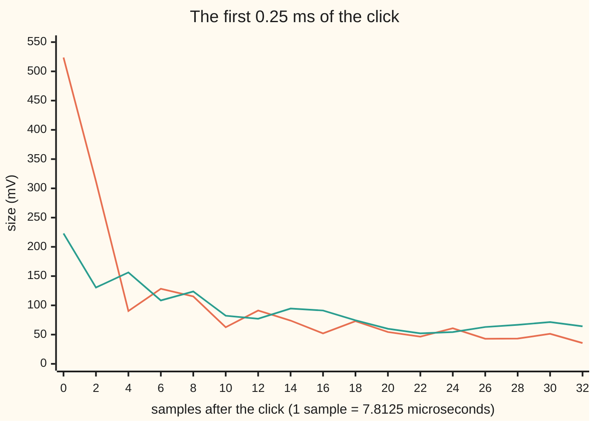
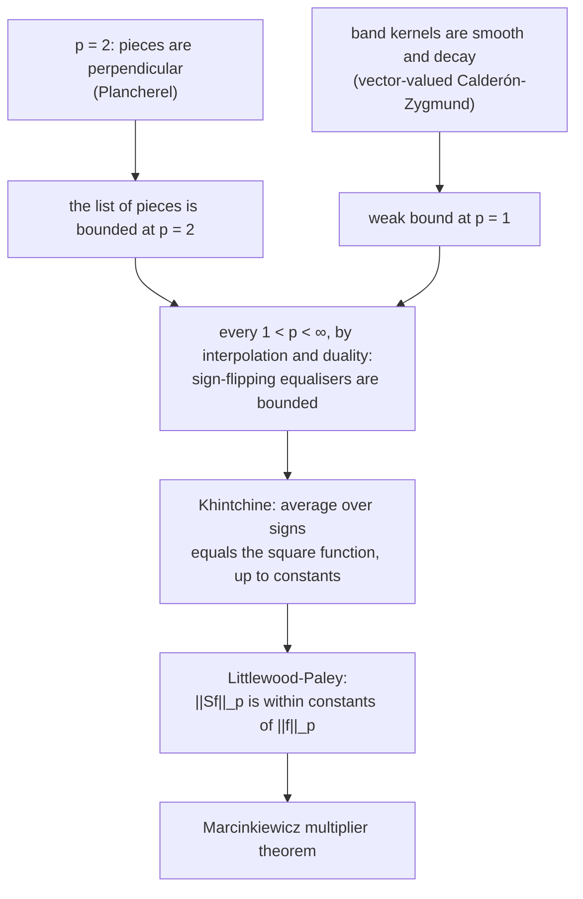

# Littlewood-Paley: split a signal into octaves, and its size is the size of the octaves' combined energy

[Syllabus](../../../SYLLABUS.md) → [Harmonic analysis](../README.md) → [Multipliers and Estimates for PDE](../README.md#s07) → Littlewood-Paley

---

## General Overview

A 10-band graphic equaliser has one slider per octave. The bands are centred at 31, 63, 125, 250 and 500 Hz and at 1, 2, 4, 8 and 16 kHz. Here the centres are exact doublings of 31.25 Hz, so "31" is 31.25 Hz and "63" is 62.5 Hz.

Feed it an illustrative test click: harmonics 1 to 724 of 31.25 Hz (up to 22625 Hz), harmonic n with amplitude 0.01/√n V, all in phase at time zero. It repeats every 32 ms and peaks at 0.523727 V. Amplitudes falling like 1/√n make it **pink**: each octave carries about the same power.

The equaliser splits the click into ten **band pieces**, one per band. Added together, they give the click back. Power adds exactly across them: the click's mean power, 358.134875 mV², is the sum of the ten band powers ([Plancherel](../02-The%20Fourier%20Transform/05-plancherel-and-l2.md)).

Sizes that weigh the peaks do not add. The 4-norm, the fourth root of the mean fourth power, depends on how the pieces line up in time. In the click all ten peak together.

**Littlewood-Paley theory** combines the pieces instant by instant, as a root sum of squares: the **square function**. For every p strictly between 1 and infinity, its p-norm (the p-th root of the mean p-th power) and the signal's agree up to fixed factors. For the click at p = 4: 40.9549 mV against 82.4046 mV, a ratio of 0.496998.

The payoff is the **Marcinkiewicz multiplier theorem**: a slider curve that stays bounded, and wiggles a bounded amount inside each octave, changes every p-norm with 1 < p < ∞ by at most a fixed factor.

**Split a signal into octave bands and combine the pieces at each instant by a root sum of squares; for every p with 1 < p < ∞, the p-norm of that square function is within constant factors of the signal's own p-norm, and the proof turns this into a bound for every equaliser whose gain varies boundedly within each octave.**

**What kind of fact this is:** two theorems, Littlewood-Paley's and Marcinkiewicz's. Proved here: the case p = 2, Khintchine's inequality, the reduction to sign-flipping equalisers, and Marcinkiewicz from Littlewood-Paley plus a list-valued Hilbert bound (in a fold). Given in outline with its source: the bound on sign-flipping equalisers, a vector-valued Calderón-Zygmund argument. The constants depend only on p and the band shape; the sources give no best values for Fourier bands.

### The picture: where the click's power sits

```
share of the click's mean power, 358.134875 mV², in each octave band
31.25 Hz  ████████████████████████████   13.96 %
62.5 Hz   ██████████████                  6.98 %
125 Hz    ██████████████████████         10.94 %
250 Hz    █████████████████████          10.28 %
500 Hz    ███████████████████             9.37 %
1 kHz     ████████████████████            9.83 %
2 kHz     ███████████████████             9.60 %
4 kHz     ███████████████████             9.72 %
8 kHz     ███████████████████             9.66 %
16 kHz    ███████████████████             9.67 %
```

The two lowest bands hold one harmonic each, so they stray furthest from an even split. The 125 and 250 Hz bands hold 10.94 % and 10.28 %; from 500 Hz up, each band holds between 9.37 % and 9.83 %.

### The picture: the click and its square function



Orange: the click's size, $`\lvert f(t)\rvert`$. Teal: the square function, $`Sf(t)`$. At the peak the bands add in phase: 523.7 mV against 222.9 mV. Later they partly cancel in the click, and the square function mostly sits above it. It ignores how the bands line up.

---

## The formula

Notation first. The signal $`f(t)`$ is in volts, time $`t`$ in seconds, period $`T_0`$ = 32 ms. Its **p-norm** is a time average:

```math
\lVert f\rVert_p = \Big(\frac{1}{T_0}\int_0^{T_0} \lvert f(t)\rvert^p\,dt\Big)^{1/p}
```

This is the circle's norm, with its $`1/2\pi`$, written in time. Harmonic $`n`$ sits at frequency $`\xi = 31.25\,n`$ Hz.

Band $`k`$, for $`k = 0, 1, \dots, 9`$, has centre $`c_k = 31.25 \times 2^k`$ Hz and runs from $`c_k/\sqrt{2}`$ to $`c_k\sqrt{2}`$. The **band piece** $`\Delta_k f`$ keeps the harmonics in band $`k`$ and drops the rest. The **square function** combines the pieces instant by instant:

```math
f = \sum_{k} \Delta_k f, \qquad Sf(t) = \Big(\sum_k \lvert \Delta_k f(t)\rvert^2\Big)^{1/2}, \qquad c_p\,\lVert f\rVert_p \;\le\; \lVert Sf\rVert_p \;\le\; C_p\,\lVert f\rVert_p \quad (1 < p < \infty)
```

**Read it aloud:** the signal is the sum of its octave pieces; the square function is their root sum of squares at each instant; and for p strictly between one and infinity its p-norm lies between two fixed multiples of the signal's.

The constants $`c_p`$ and $`C_p`$ depend on p and the band shape, never on the signal or on how many octaves it spans.

**Khintchine's inequality** is the tool. Flip the signs of some numbers $`a_k`$ at random, each sign $`\varepsilon_k = \pm 1`$ with even odds, and average over the sign patterns ($`\mathbb{E}`$). At p = 4 the average is exact:

```math
\mathbb{E}\Big(\sum_k \varepsilon_k a_k\Big)^4 = 3\Big(\sum_k a_k^2\Big)^2 - 2\sum_k a_k^4, \qquad \text{so} \qquad \Big(\sum_k a_k^2\Big)^{1/2} \le \Big(\mathbb{E}\Big(\sum_k \varepsilon_k a_k\Big)^4\Big)^{1/4} \le 3^{1/4}\Big(\sum_k a_k^2\Big)^{1/2}
```

**Read it aloud:** a random-sign sum's mean fourth power is three times its squared energy minus twice the sum of fourth powers; so its typical size is the root sum of squares, within a factor of the fourth root of 3.

**Marcinkiewicz's multiplier theorem.** An equaliser multiplies frequency $`\xi`$ by a gain $`m(\xi)`$, giving the equalised signal $`T_m f`$. If the gain is at most $`M`$ in size and its total variation (the total rise and fall) inside each octave band is at most $`B`$, then

```math
\lVert T_m f\rVert_p \;\le\; K_p\,(M + B)\,\lVert f\rVert_p \qquad (1 < p < \infty)
```

**Read it aloud:** a bounded gain that wiggles a bounded amount within each octave changes every p-norm by at most a constant times the gain bound plus the wiggle bound.

| Symbol | Plain meaning | In our example | Push it up and the answer… |
| --- | --- | --- | --- |
| $`f`$, $`t`$, $`T_0`$ | the signal, in volts; time, in seconds; the period | the click; $`T_0`$ = 32 ms | a larger signal scales both sides alike |
| $`\xi`$, $`n`$ | frequency, in hertz; harmonic number, $`\xi = 31.25\,n`$ | $`n`$ = 1 to 724 | more harmonics, more octaves |
| $`k`$, $`c_k`$ | band number; band centre $`31.25 \times 2^k`$ Hz | $`k`$ = 0 to 9; 31.25 Hz to 16 kHz | — |
| $`\Delta_k f`$, $`\Delta_{[s, r)}`$, $`s`$ | band piece: the part of $`f`$ in band $`k`$; the part in frequencies $`[s, r)`$; a cut point inside a band | band 9 holds harmonics 363 to 724 | — |
| $`Sf`$, $`S_H f`$ | square function: root sum of squares of the pieces; its Haar twin | $`\lVert Sf\rVert_4`$ = 40.9549 mV | — |
| $`\lVert f\rVert_p`$, $`p`$ | p-norm, a time average; its exponent | $`\lVert f\rVert_4`$ = 82.4046 mV | larger p weighs the peaks more |
| $`c_p`$, $`C_p`$, $`K_p`$, $`A_p`$, $`B_p`$, $`M_p`$ | the theorem's constants; the multiplier theorem's; Khintchine's lower and upper; the largest change any $`\pm 1`$ equaliser makes | $`A_4 = 1`$, $`B_4 = 3^{1/4}`$; the rest not given numerically by the sources | blow up as p nears 1 or infinity |
| $`\varepsilon_k`$, $`T_\varepsilon f`$ | random signs $`\pm 1`$; the signal with band $`k`$ flipped where $`\varepsilon_k = -1`$ | 1024 sign patterns for 10 bands | — |
| $`\mathbb{E}`$, $`P`$, $`a_k`$, $`X`$, $`\lambda`$, $`u`$, $`\theta`$ | average over all sign patterns; the share of patterns where an event happens; any real numbers, here $`\Delta_k f(t)`$ at one instant; the random sum $`\sum_k \varepsilon_k a_k`$; in the fold, a free rate, a level and a Hölder weight | $`a = (3, 4)`$ by hand | — |
| $`m(\xi)`$, $`T_m f`$, $`[l, r)`$, $`\mathbf{1}_{[l, r)}`$ | an equaliser's gain curve; the equalised signal; a band's left and right edges; gain 1 between them, 0 elsewhere | the "smile" setting, 6 dB at both ends | larger output |
| $`M`$, $`B`$, $`V_k`$, $`dm`$, $`G`$, $`C`$ | largest gain; largest variation of the gain inside one band; the variation in band $`k`$; in the fold, the gain's changes as a measure, the square function of the cut pieces, and the list-valued Hilbert constant | 1.995262 and 0.365742 | larger bound |
| $`w_k`$, $`x`$, $`p^*`$ | smooth band weights; distance from a centre, in octaves; $`\max(p, p/(p-1))`$ in Burkholder's constant | $`w_k = \cos^2(\pi x/2)`$; $`p^*`$ = 4 | — |

### When it holds

- **The exponent must lie strictly between 1 and infinity.** At $`p = \infty`$, ten in-phase tones, one per band, give peak ratio $`1/\sqrt{10}`$ = 0.316228, falling without limit as bands are added. At p = 4 the same tones give 0.749353.
- **The bands must be octaves (lacunary: edges grow by a fixed ratio).** With equal 31.25 Hz bands the click's ratio keeps falling: 0.303488, 0.264486, 0.230567 at 181, 362 and 724 harmonics.
- **Combine at each instant, then measure.** Measuring each piece first gives 46.8890 mV, not 40.9549 mV; away from p = 2 that number has no two-sided bound against $`\lVert f\rVert_p`$.
- **For the multiplier theorem, a bounded gain is not enough.** A random sign on every harmonic has gain 1 but variation 356 in the 16 kHz band, and grows one signal 3.353375 times at p = 4. On sharper clicks of 2896 and 11584 harmonics the same signs give 4.348749 and 5.751561: the factor keeps rising.
- **Constant factors, not equality.** Only p = 2 is exact: at p = 4 the click gives 0.496998, pink noise 0.779675.

---

## Why it works

### Step 0: flip signs, and the square function stays put

Set some sliders to −1, flipping those bands' signs. The signal's size changes, because the pieces line up differently. The square function does not, because it squares the pieces.

Khintchine's inequality says the flipped signals, averaged over all sign patterns, have the square function's size up to a constant. If no sign-flipping equaliser changes p-norms by more than a fixed factor, each flipped signal has about the size of $`f`$. So $`\lVert Sf\rVert_p`$ is about $`\lVert f\rVert_p`$.

Everything rests on one fact: the $`\pm 1`$ equalisers are bounded on $`L^p`$ (signals of finite p-norm), by a bound that does not grow with the number of bands. Calderón-Zygmund theory supplies it.



### Step 1: sharp and smooth octave pieces

A **sharp piece** keeps band $`k`$ exactly: gain 1 inside, 0 outside. Harmonic $`n`$ is in band $`k`$ when $`2^k/\sqrt{2} \le n < 2^k\sqrt{2}`$. Squaring avoids the root: $`4^k \le 2n^2 < 4^{k+1}`$, that is $`4^k/2 \le n^2 < 2 \cdot 4^k`$. For band 3 that reads $`32 \le n^2 < 128`$, so harmonics 6 to 11.

A **smooth piece** uses a gain $`w_k = \cos^2(\pi x/2)`$ that fades over one octave each side, where $`x`$ is the distance from the centre in octaves, $`\lvert x\rvert < 1`$. The end bands are shelves, staying at 1 beyond 31.25 Hz and 16 kHz.

Neighbouring fades add to 1 ($`\cos^2 + \sin^2 = 1`$), so the smooth pieces rebuild the click to within $`10^{-12}`$ V. Their squares sum to between $`\tfrac12`$ and 1, so power is no longer split exactly: the click keeps 0.809117 of it, and the smooth ratio at p = 4 is 0.479894.

The proof uses smooth pieces: their kernels (the band filters' impulse responses) decay fast. A sharp piece's kernel has a $`1/t`$ tail, like the Hilbert transform's.

### Step 2: p = 2 is Plancherel

Write the click as $`f(t) = \sum_n (0.01/\sqrt{n})\cos(2\pi \cdot 31.25\,n\,t)`$ V. Each cosine has mean power half its amplitude squared, $`0.0001/(2n)`$ V², and different harmonics are perpendicular over one period. So

```math
\lVert f\rVert_2^2 = \sum_n \frac{0.0001}{2n} = \sum_k \lVert \Delta_k f\rVert_2^2 = \frac{1}{T_0}\int_0^{T_0} \sum_k \lvert\Delta_k f(t)\rvert^2\,dt = \lVert Sf\rVert_2^2
```

**Read it aloud:** the signal's power is the sum of its harmonics' powers, which, grouped by band, is the sum of the band powers, which is the square function's power.

All four come out at 358.134875 mV², so $`c_2 = C_2 = 1`$. At p = 2 any split of the frequencies would do; octaves matter only away from p = 2.

### Step 3: Khintchine's inequality

Expand $`(\sum_k \varepsilon_k a_k)^4`$ and average over the signs. Each sign is $`+1`$ or $`-1`$ with even odds, so any term with an odd power of some $`\varepsilon_k`$ averages to 0. Two kinds survive:

- $`a_k^4`$, once for each $`k`$;
- $`a_j^2 a_k^2`$ for each pair $`j < k`$, which arises in $`\binom{4}{2} = 6`$ orders of the four factors, giving $`6\sum_{j<k} a_j^2a_k^2 = 3\sum_{j \ne k} a_j^2a_k^2`$.

Since $`\sum_{j \ne k} a_j^2a_k^2 = (\sum a_k^2)^2 - \sum a_k^4`$, the total is $`3(\sum a_k^2)^2 - 2\sum a_k^4`$.

By hand, with $`a = (3, 4)`$: the four sign pairs give $`7^4, 1^4, 1^4, 7^4`$, averaging $`(2401 + 1 + 1 + 2401)/4`$ = 1201. The formula gives $`3 \times 25^2 - 2 \times (81 + 256)`$ = 1201.

The upper bound drops $`-2\sum a_k^4`$; the lower uses $`\sum a_k^4 \le (\sum a_k^2)^2`$. The 3 is the bell curve's fourth moment: many equal $`a_k`$ make the sum nearly normal, so $`3^{1/4}`$ is best possible (Haagerup, below).

<details>
<summary>Khintchine at every p, by an exponential bound</summary>

Normalise $`\sum_k a_k^2 = 1`$ and write $`X = \sum_k \varepsilon_k a_k`$. Each sign contributes $`\mathbb{E}\,e^{\lambda\varepsilon_k a_k} = \cosh(\lambda a_k) \le e^{\lambda^2a_k^2/2}`$, comparing the two series term by term. Independence multiplies these:

$`\displaystyle \mathbb{E}\,e^{\lambda X} \le e^{\lambda^2/2}, \qquad \text{so} \qquad P(\lvert X\rvert > u) \le 2e^{\lambda^2/2 - \lambda u} = 2e^{-u^2/2} \text{ at } \lambda = u.`$

The layer-cake formula then gives $`\mathbb{E}\lvert X\rvert^p = \int_0^\infty p\,u^{p-1}P(\lvert X\rvert > u)\,du \le 2p\int_0^\infty u^{p-1}e^{-u^2/2}\,du`$, a finite constant $`B_p^p`$ for every $`p < \infty`$.

For a lower bound at $`p < 2`$, Hölder's inequality with $`2 = p\theta + 4(1-\theta)`$ gives $`1 = \mathbb{E}X^2 \le (\mathbb{E}\lvert X\rvert^p)^{\theta}(\mathbb{E}X^4)^{1-\theta}`$, and $`\mathbb{E}X^4 \le 3`$, so $`\mathbb{E}\lvert X\rvert^p \ge 3^{-(1-\theta)/\theta}`$. For $`p \ge 2`$, $`A_p = 1`$.

</details>

### Step 4: from sign flips to the theorem

Write $`T_\varepsilon f = \sum_k \varepsilon_k \Delta_k f`$, slider $`k`$ at $`\varepsilon_k = \pm 1`$. Apply Khintchine at each instant to $`a_k = \Delta_k f(t)`$, whose root sum of squares is $`Sf(t)`$, and average over time:

```math
A_p^p\,\lVert Sf\rVert_p^p \;\le\; \mathbb{E}\,\lVert T_\varepsilon f\rVert_p^p \;\le\; B_p^p\,\lVert Sf\rVert_p^p
```

**Read it aloud:** the flipped signals' average p-th power size lies between two fixed multiples of the square function's.

Let $`M_p`$ be the largest factor by which any $`\pm 1`$ setting can change any signal's p-norm. Then:

1. Each $`\lVert T_\varepsilon f\rVert_p \le M_p\lVert f\rVert_p`$, so $`\lVert Sf\rVert_p \le M_p\lVert f\rVert_p / A_p`$.
2. Flipping twice undoes the flip: $`T_\varepsilon T_\varepsilon f = f`$. So $`\lVert f\rVert_p \le M_p\lVert T_\varepsilon f\rVert_p`$ for every pattern, and averaging gives $`\lVert f\rVert_p \le M_p B_p\lVert Sf\rVert_p`$.

The check runs all 1024 sign patterns on the click (512 suffice, since a pattern and its negative match). The brute-force average of $`\lVert T_\varepsilon f\rVert_4^4`$ is 6728778.409 mV⁴, equal to Khintchine's closed form. Its fourth root, 50.9312 mV, sits between $`\lVert Sf\rVert_4`$ = 40.9549 mV and $`3^{1/4}\lVert Sf\rVert_4`$ = 53.8996 mV.

The square function also sits between the extreme patterns, as the sandwich forces: above the smallest, 34.8532 mV, divided by $`3^{1/4}`$, which is 26.4827 mV, and below the largest, the click itself at 82.4046 mV. That confirms the argument; it does not prove the theorem.

### Step 5: why the sign-flipping equalisers are bounded

The analytic heart, in outline (Grafakos, chapter 6; Stein, chapter IV):

1. **Treat the pieces as one list-valued signal**, $`f \mapsto (\Delta_k f)_k`$, measured at each instant by root sum of squares. Its p-norm is $`\lVert Sf\rVert_p`$.
2. **At p = 2 the bound is at most 1**, by Step 2.
3. **The kernel is a list-valued Calderón-Zygmund kernel.** Band $`k`$'s impulse response is $`2^k`$ times a fixed bump squeezed by $`2^k`$. In root sum of squares these are at most a constant over $`\lvert t\rvert`$, with slope at most a constant over $`t^2`$: the condition of [Fourier multipliers](01-mihlin-hormander-multiplier-theorem.md).
4. **Calderón-Zygmund gives a weak bound at p = 1** (the time where the output exceeds a level α shrinks like 1/α): the good-and-bad split works unchanged for lists.
5. **[Interpolation](../06-Maximal%20Functions%20and%20Beyond/04-interpolation-riesz-thorin-and-marcinkiewicz.md) and duality** (a bound at p carries over to p/(p − 1) by pairing with test signals) give $`1 < p \le 2`$, then $`2 \le p < \infty`$.

A smooth $`\pm 1`$ equaliser $`\sum_k \varepsilon_k w_k(\xi)`$ also meets Mihlin's condition with a constant blind to the signs, since at most two weights overlap. Its square is not the identity, though, and Step 4 needs flips that undo themselves.

For **sharp pieces**, $`\mathbf{1}_{[l,r)}(\xi) = \tfrac12(\mathrm{sgn}(\xi - l) - \mathrm{sgn}(\xi - r))`$: each sign is a Hilbert transform shifted to frequency $`l`$ or $`r`$ by multiplying by a complex tone. Marcinkiewicz and Zygmund's bound for the Hilbert transform on lists then carries the smooth bounds over to the sharp $`\pm 1`$ equalisers, which do undo themselves. So $`M_p`$ is finite.

All of this is proved on the line, while the click is periodic. A gain that is continuous at every harmonic keeps its line bound on periodic signals (de Leeuw, 1965), and no band edge falls on a harmonic, since $`2^k/\sqrt{2}`$ is never a whole number.

### Step 6: Marcinkiewicz's multiplier theorem

Inside band $`k`$ the gain is its left-edge value plus its accumulated change. So the equalised piece is the edge gain times the piece, plus sharp sub-band pieces weighted by the gain's change. Cauchy-Schwarz bounds those by the variation $`B`$ times a square function, and Littlewood-Paley at both ends finishes it.

<details>
<summary>Detailed proof: Marcinkiewicz from Littlewood-Paley</summary>

Let band $`k`$ be $`[l_k, r_k)`$, and for $`l_k \le s < r_k`$ let $`\Delta_{[s, r_k)}`$ keep frequencies in $`[s, r_k)`$. Assume $`m`$ is bounded by $`M`$ and of bounded variation on each band, with total variation $`V_k \le B`$ there, and treat positive frequencies (negative ones are symmetric). Then for $`\xi`$ in band $`k`$,

$`\displaystyle m(\xi) = m(l_k) + \int_{[l_k, \xi]} dm(s), \qquad \text{so} \qquad \Delta_k T_m f = m(l_k)\,\Delta_k f + \int_{[l_k, r_k)} \Delta_{[s, r_k)}\Delta_k f\;dm(s).`$

By Cauchy-Schwarz against the measure $`\lvert dm\rvert`$, whose mass on the band is $`V_k \le B`$,

$`\displaystyle \Big\lvert \int \Delta_{[s,r_k)}\Delta_k f\,dm(s)\Big\rvert^2 \le B\int \lvert \Delta_{[s, r_k)}\Delta_k f\rvert^2\,\lvert dm\rvert(s).`$

Summing over $`k`$ and taking the square root, $`S(T_m f) \le M\,Sf + \sqrt{B}\,G`$, where $`G^2 = \sum_k \int \lvert\Delta_{[s, r_k)}\Delta_k f\rvert^2\,\lvert dm\rvert(s)`$.

Each $`\Delta_{[s, r_k)}`$ is a sharp interval cut-off: two modulated Hilbert transforms. The vector-valued Hilbert bound, applied to the family indexed by $`k`$ and $`s`$, gives $`\lVert G\rVert_p \le C\,\lVert(\sum_k V_k\lvert\Delta_k f\rvert^2)^{1/2}\rVert_p \le C\sqrt{B}\,\lVert Sf\rVert_p`$. Hence

$`\displaystyle \lVert T_m f\rVert_p \le \frac{1}{c_p}\lVert S(T_m f)\rVert_p \le \frac{1}{c_p}(M + CB)\,\lVert Sf\rVert_p \le \frac{C_p}{c_p}(M + CB)\,\lVert f\rVert_p,`$

using the lower Littlewood-Paley bound for $`T_m f`$ first and the upper bound for $`f`$ last. This is Stein's proof, chapter IV, section 6.

</details>

The "smile" setting is 6, 4, 2, 0, −2, −2, 0, 2, 4, 6 dB, joined by straight lines in dB against octaves: $`M`$ = 1.995262, $`B`$ = 0.365742. It multiplies the click's 2-norm by 1.417191 and its 4-norm by 1.408771. Both sit below $`M + B`$, and the theorem's $`K_p`$ is at least 1, since the flat setting $`m = 1`$ changes nothing.

### Step 7: the Haar twin

[The Haar wavelet](../05-Wavelets%20and%20Time-Frequency/03-haar-wavelet-and-multiresolution.md) splits by scale: each level adds the difference between finer and coarser block averages. These differences form a dyadic martingale (each step adds a change with mean zero over its block), and their root sum of squares is the Haar square function $`S_H f`$.

Here the best sign-flip constant is known. Burkholder proved flips change the p-norm by at most $`p^* - 1`$, with $`p^* = \max(p, p/(p-1))`$, best possible, and deduced $`\lVert f\rVert_p/(p^* - 1) \le \lVert S_H f\rVert_p \le (p^* - 1)\lVert f\rVert_p`$: between $`\tfrac13`$ and 3 at p = 4. Over the click's 12 Haar levels the ratio is 0.566049.

---

## Worked numbers, by hand

The click at p = 4, with sharp octave pieces.

| Step | Arithmetic | Value |
| --- | --- | --- |
| power of the 31.25 Hz band | harmonic 1: $`0.01^2/2`$ V² | 50.0000 mV² |
| power of the 62.5 Hz band | harmonic 2: $`0.01^2/(2 \times 2)`$ V² | 25.0000 mV² |
| power of the 125 Hz band | harmonics 3 to 5: $`50 \times (\tfrac13 + \tfrac14 + \tfrac15)`$ mV² | 39.1667 mV² |
| total power, all ten bands | the band list in the output, summed | 358.134875 mV² |
| click's power, from samples | $`\lVert f\rVert_2^2`$ | 358.134875 mV² |
| click's 4-norm | $`\lVert f\rVert_4`$, from 4096 samples | 82.4046 mV |
| square function's 4-norm | $`\lVert Sf\rVert_4`$ | 40.9549 mV |
| **ratio** | $`40.9549 / 82.4046`$ | **0.496998** |
| Khintchine window | average flipped size, fourth root | 40.9549 ≤ 50.9312 ≤ 53.8996 mV |

The click's 4-norm is about twice its square function's, because all ten bands peak at once.

The theorem's bounds hold for every signal, so this one ratio already places the constants for these bands: $`c_4 \le 0.496998 \le C_4`$. The sources give no numbers for $`c_4`$ and $`C_4`$; the computable stand-in is Step 4's sandwich, 26.4827 ≤ 40.9549 ≤ 82.4046 mV.

The sampling is exact: a fourth power of the click has harmonics up to 2896, below the 4096 samples per period, so sample means equal true time averages.

### What breaks if you drop a piece

| Mistake | Comes out at | What went wrong |
| --- | --- | --- |
| Use $`p = \infty`$: ten in-phase tones, one per band | peak ratio 0.316228, which is $`1/\sqrt{10}`$; at p = 4, 0.749353 | at the endpoint the ratio falls like one over the root of the number of bands |
| Use equal 31.25 Hz bands instead of octaves | ratio 0.303488, 0.264486, 0.230567 at 181, 362, 724 harmonics | equal bands are not lacunary, so the lower bound fails and the ratio keeps falling |
| Equalise with a random sign on each harmonic | gain 1 everywhere, yet one signal grows 3.353375 times at p = 4; with 2896 and 11584 harmonics, 4.348749 and 5.751561 | variation 356 in the 16 kHz band: bounded gain without bounded variation |
| Measure each piece, then combine | 46.8890 mV against 40.9549 mV | the square root must be taken at each instant, before averaging |

---

## Code, from first principles, and it actually runs

The code takes four roads. It builds the band pieces from the formula and also cuts them from the samples with a hand-written fast Fourier transform; they agree to $`10^{-12}`$ V. It checks p = 2 by samples against coefficients. It averages over all 1024 sign patterns by brute force, in Gray-code order (one flip per step), against Khintchine's closed form. It checks a 12-level Haar square function against Burkholder's constants. It also computes the smooth pieces, the equaliser and every row of "What breaks"; random signs and phases come from SplitMix64, seed 2026. Python and Rust print the same lines.

### Python

```python
# Littlewood-Paley: a test click split into the ten octave bands of a graphic equaliser.
# Standard library only.  The click: every harmonic n of 31.25 Hz up to 724 (22.6 kHz),
# amplitude A/sqrt(n) (pink: equal energy per octave), all in phase at t = 0, period 32 ms,
# 4096 samples per period.  Norms are time averages over one period.  Roads: band pieces
# built from the formula against pieces cut from the samples by an FFT written out here;
# energy against the coefficients; the average over all 1024 slider sign patterns against
# Khintchine's closed form; a Haar square function against Burkholder's constants.
from math import cos, sin, pi, sqrt, log2
F0, N, H, A, K = 31.25, 4096, 724, 0.01, 10
def band(n):                    # octave band k: centre F0 2^k, edges centre/sqrt2 and centre*sqrt2
    for k in range(K + 1):
        if 2 * n * n >= 4 ** k and n * n < 2 * 4 ** k: return k
amp = [0.0] + [A / sqrt(n) for n in range(1, H + 1)]
CT = [cos(2 * pi * s / N) for s in range(N)]
def synth(terms): return [sum(c * CT[n * s % N] for n, c in terms) for s in range(N)]
def fft(x, sg):                 # radix 2; sg = -1 forward, +1 inverse (unscaled)
    x = list(x); n = len(x); j = 0
    for i in range(1, n):
        b = n >> 1
        while j & b: j ^= b; b >>= 1
        j |= b
        if i < j: x[i], x[j] = x[j], x[i]
    m = 2
    while m <= n:
        w = complex(cos(2 * pi / m), sg * sin(2 * pi / m))
        for s in range(0, n, m):
            z = complex(1, 0)
            for t in range(m // 2):
                u, v = x[s + t], x[s + t + m // 2] * z
                x[s + t], x[s + t + m // 2] = u + v, u - v; z = z * w
        m *= 2
    return x
def mult(X, g):                 # apply a gain g(n) to bins n and N - n, back to samples
    Y = [complex(0, 0)] * N
    for n in range(1, N // 2):
        Y[n], Y[N - n] = X[n] * g(n), X[N - n] * g(n)
    return [y.real / N for y in fft(Y, 1)]
def nrm(x, p):
    if p == 2: return sqrt(sum(v * v for v in x) / N)
    return sqrt(sqrt(sum(v * v * v * v for v in x) / N))
def sq(pieces): return [sqrt(sum(P[s] * P[s] for P in pieces)) for s in range(N)]
f = synth([(n, amp[n]) for n in range(1, H + 1)])
P = [synth([(n, amp[n]) for n in range(1, H + 1) if band(n) == k]) for k in range(K)]
X = fft(f, -1)
Q = [mult(X, lambda n, k=k: 1.0 if band(n) == k else 0.0) for k in range(K)]
assert max(abs(P[k][s] - Q[k][s]) for k in range(K) for s in range(N)) < 1e-12
print(f"click: amplitude 0.01/sqrt(n) V at harmonics n = 1 to 724 of 31.25 Hz (top {H * F0:.0f} Hz); f(0) = {f[0]:.6f} V")
print(f"sampling: {N} samples per 32 ms period ({N * 1000 / 32:.0f} per second); 4th powers reach harmonic {4 * H} < {N}, so means are exact")
print("band pieces: built from the formula and cut from the samples by FFT agree to 1e-12")
e2 = sum(amp[n] ** 2 for n in range(1, H + 1)) / 2
for k in range(K):
    ns = [n for n in range(1, H + 1) if band(n) == k]
    print(f"band {F0 * 2 ** k:8.2f} Hz: harmonics {ns[0]:3d}-{ns[-1]:3d}, mean power {nrm(P[k], 2) ** 2 * 1e6:7.4f} mV^2"
          f" ({100 * nrm(P[k], 2) ** 2 / e2:5.2f} %), ||D_k f||_4 {nrm(P[k], 4) * 1000:.4f} mV")
S = sq(P); f2, f4, S2, S4 = nrm(f, 2), nrm(f, 4), nrm(S, 2), nrm(S, 4)
bandsum = sum(nrm(Pk, 2) ** 2 for Pk in P)
print(f"p = 2: ||f||^2 {f2 * f2 * 1e6:.6f}; coefficients {e2 * 1e6:.6f}; band sum {bandsum * 1e6:.6f}; ||Sf||^2 {S2 * S2 * 1e6:.6f} (mV^2)")
assert abs(f2 * f2 - e2) < 1e-15 and abs(S2 * S2 - e2) < 1e-15 and abs(bandsum - e2) < 1e-15
print(f"p = 4: ||f||_4 {f4 * 1000:.4f} mV; ||Sf||_4 {S4 * 1000:.4f} mV; ratio {S4 / f4:.6f}")
print("chart, |f| mV:", " ".join(f"{abs(f[s]) * 1000:.1f}" for s in range(0, 33, 2)))
print("chart, Sf mV: ", " ".join(f"{S[s] * 1000:.1f}" for s in range(0, 33, 2)))
kh = sum((e1 * 3 + e2 * 4) ** 4 for e1 in (1, -1) for e2 in (1, -1)) / 4
print(f"Khintchine by hand, a = 3, 4: mean of (+-3 +-4)^4 over the 4 sign pairs {kh:.0f}; 3 x 25^2 - 2 x (81 + 256) = {3 * 25 ** 2 - 2 * (81 + 256)}")
acc, form = [0.0] * 512, 0.0    # all 1024 sign patterns, by Gray code; -e gives the same size as e
for s in range(N):
    d = [Pk[s] for Pk in P]; x = sum(d); sgn = [1] * K
    acc[0] += x * x * x * x
    for i in range(1, 512):
        b = (i & -i).bit_length(); x -= 2 * sgn[b] * d[b]; sgn[b] = -sgn[b]
        acc[i ^ (i >> 1)] += x * x * x * x
    q2 = sum(v * v for v in d); form += 3 * q2 * q2 - 2 * sum(v * v * v * v for v in d)
E4, form = sum(acc) / 512 / N, form / N
sizes = [sqrt(sqrt(a / N)) for a in acc]
print(f"Khintchine: mean ||T_e f||_4^4 over 1024 sign patterns {E4 * 1e12:.3f}; 3||Sf||^4 - 2 sum ||D_k f||^4 {form * 1e12:.3f} (mV^4)")
assert abs(E4 - form) < 1e-9 * form and abs(sizes[0] - f4) < 1e-15
print(f"sandwich: ||Sf||_4 {S4 * 1000:.4f} <= (mean)^(1/4) {E4 ** 0.25 * 1000:.4f} <= 3^(1/4) ||Sf||_4 {3 ** 0.25 * S4 * 1000:.4f} (mV)")
assert S4 <= E4 ** 0.25 <= 3 ** 0.25 * S4
print(f"sign patterns: smallest ||T_e f||_4 {min(sizes) * 1000:.4f} mV (over 3^(1/4): {3 ** -0.25 * min(sizes) * 1000:.4f}), largest {max(sizes) * 1000:.4f} mV = f itself, all plus")
assert 3 ** -0.25 * min(sizes) <= S4 <= max(sizes) == sizes[0]
def w(n, k):                    # smooth crossfade in octaves; the end bands are shelves
    x = log2(n) - k
    if (k == 0 and x <= 0) or (k == K - 1 and x >= 0): return 1.0
    return cos(pi * x / 2) ** 2 if abs(x) < 1 else 0.0
R = [mult(X, lambda n, k=k: w(n, k)) for k in range(K)]
assert max(abs(sum(Rk[s] for Rk in R) - f[s]) for s in range(N)) < 1e-12
Rs = sq(R)
print(f"smooth pieces: sum rebuilds f to 1e-12; energy kept {sum(nrm(Rk, 2) ** 2 for Rk in R) / e2:.6f} of f's; ||S f||_4 / ||f||_4 {nrm(Rs, 4) / f4:.6f}")
H2 = [(sum(f) / N) ** 2] * N; prev = [sum(f) / N] * N
for j in range(1, 13):
    blk = N >> j
    cur = [sum(f[(s // blk) * blk:(s // blk + 1) * blk]) / blk for s in range(N)]
    H2 = [H2[s] + (cur[s] - prev[s]) ** 2 for s in range(N)]; prev = cur
hr = nrm([sqrt(v) for v in H2], 4) / f4
print(f"Haar twin, 12 levels: ||S_H f||_4 / ||f||_4 {hr:.6f}; Burkholder: between 1/3 and 3")
assert 1 / 3 <= hr <= 3 and abs(nrm([sqrt(v) for v in H2], 2) - f2) < 1e-12
gains = [6, 4, 2, 0, -2, -2, 0, 2, 4, 6]   # slider settings, dB
def m(l): l = min(max(l, 0), K - 1); k = min(int(l), K - 2); return 10 ** ((gains[k] + (l - k) * (gains[k + 1] - gains[k])) / 20)
var = max(abs(m(k) - m(k - 0.5)) + abs(m(k + 0.5) - m(k)) for k in range(K))
Y = mult(X, lambda n: m(log2(n)))
print(f"equaliser: largest gain {max(m(k) for k in range(K)):.6f}, largest variation in a band {var:.6f}; ||Tf||_2/||f||_2 {nrm(Y, 2) / f2:.6f}, ||Tf||_4/||f||_4 {nrm(Y, 4) / f4:.6f}")
lac = synth([(2 ** k, 1.0) for k in range(K)]); Sl = [sqrt(sum(CT[2 ** k * s % N] ** 2 for k in range(K))) for s in range(N)]
l4 = ((K * K / 4 + K / 8) / (3 * K / 8 + 3 * K * (K - 1) / 4 + 1.5 * (K - 2))) ** 0.25   # pairings, and 8 carries 2^a + 2^a + 2^(a+1) = 2^(a+2)
print(f"breaks, p = infinity: one tone per band: max Sf / max f {max(Sl) / max(lac):.6f}, 1/sqrt(10) {1 / sqrt(10):.6f}; at p = 4: {nrm(Sl, 4) / nrm(lac, 4):.6f}, closed form {l4:.6f}")
assert abs(max(Sl) / max(lac) - 1 / sqrt(10)) < 1e-12 and abs(nrm(Sl, 4) / nrm(lac, 4) - l4) < 1e-12
eq = []
for top in (181, 362, 724):
    fc = synth([(n, amp[n]) for n in range(1, top + 1)])
    Se = [sqrt(sum(amp[n] ** 2 for n in range(1, top + 1)) / 2 + v) for v in synth([(2 * n, amp[n] ** 2 / 2) for n in range(1, top + 1)])]
    eq.append(nrm(Se, 4) / nrm(fc, 4))
print(f"breaks, equal 31.25 Hz bands: ||Sf||_4/||f||_4 with top harmonic 181, 362, 724: {eq[0]:.6f} {eq[1]:.6f} {eq[2]:.6f}")
assert eq[0] > eq[1] > eq[2]
st = 2026
def rnd():                      # SplitMix64
    global st
    st = (st + 0x9E3779B97F4A7C15) % 2 ** 64; z = st
    z = ((z ^ (z >> 30)) * 0xBF58476D1CE4E5B9) % 2 ** 64; z = ((z ^ (z >> 27)) * 0x94D049BB133111EB) % 2 ** 64
    return z ^ (z >> 31)
def lratio(h, nn, sg):          # click of h harmonics on nn samples, by inverse FFT: ||f||_4 / ||T_sg f||_4
    c = [A / sqrt(min(n, nn - n)) * nn / 2 if 0 < min(n, nn - n) <= h else 0.0 for n in range(nn)]
    fl, gl = fft(c, 1), fft([v * sg[min(n, nn - n)] if v else 0.0 for n, v in enumerate(c)], 1)
    return sqrt(sqrt(sum(z.real ** 4 for z in fl) / sum(z.real ** 4 for z in gl)))
sig = [0] + [1 if rnd() >> 63 else -1 for n in range(1, N // 2)]
flips = sum(1 for n in range(363, 724) if sig[n] != sig[n + 1])
st, keep = 2026, st; sgl = [0] + [1 if rnd() >> 63 else -1 for n in range(1, 11585)]; st = keep   # the same signs, continued
gr = [lratio(h, 4096 * h // 724, sgl) for h in (724, 2896, 11584)]
print(f"breaks, random sign per harmonic: variation in the 16 kHz band {2 * flips}; ||T g||_4/||g||_4 = ||f||_4/||g||_4 {gr[0]:.6f}")
print(f"breaks, the same signs on clicks of 2896 and 11584 harmonics: ||f||_4/||g||_4 {gr[1]:.6f} {gr[2]:.6f}")
assert abs(gr[0] - f4 / nrm(mult(X, lambda n: sgl[n]), 4)) < 1e-12 and gr[0] < gr[1] < gr[2]
out = sqrt(sum(nrm(Pk, 4) ** 2 for Pk in P))
print(f"breaks, norms before squares: (sum ||D_k f||_4^2)^(1/2) {out * 1000:.4f} mV against ||Sf||_4 {S4 * 1000:.4f} mV")
assert out > S4
ph = [2 * pi * (rnd() >> 11) / 2 ** 53 for n in range(H + 1)]
Z = [complex(0, 0)] * N
for n in range(1, H + 1): Z[n] = complex(cos(ph[n]), sin(ph[n])) * amp[n] * N / 2; Z[N - n] = Z[n].conjugate()
pn = [z.real / N for z in fft(Z, 1)]; Xp = fft(pn, -1)
Sp = sq([mult(Xp, lambda n, k=k: 1.0 if band(n) == k else 0.0) for k in range(K)])
print(f"try: random phases (pink noise): ||Sf||_4/||f||_4 {nrm(Sp, 4) / nrm(pn, 4):.6f}; double A: ratio {nrm(sq([[2 * v for v in Pk] for Pk in P]), 4) / nrm([2 * v for v in f], 4):.6f}")
gains = [12, 9, 6, 3, 0, 0, 0, 0, 0, 0]; Yb = mult(X, lambda n: m(log2(n)))
print(f"try: bass boost 12 9 6 3 0 dB: ||Tf||_2/||f||_2 {nrm(Yb, 2) / f2:.6f}, ||Tf||_4/||f||_4 {nrm(Yb, 4) / f4:.6f}")
print("ALL CHECKS PASS")
```

**Ran 2026-11-24 on macOS, Python 3.14.10, standard library only. All checks passed. Output, pasted from the run:**

```
click: amplitude 0.01/sqrt(n) V at harmonics n = 1 to 724 of 31.25 Hz (top 22625 Hz); f(0) = 0.523727 V
sampling: 4096 samples per 32 ms period (128000 per second); 4th powers reach harmonic 2896 < 4096, so means are exact
band pieces: built from the formula and cut from the samples by FFT agree to 1e-12
band    31.25 Hz: harmonics   1-  1, mean power 50.0000 mV^2 (13.96 %), ||D_k f||_4 7.8254 mV
band    62.50 Hz: harmonics   2-  2, mean power 25.0000 mV^2 ( 6.98 %), ||D_k f||_4 5.5334 mV
band   125.00 Hz: harmonics   3-  5, mean power 39.1667 mV^2 (10.94 %), ||D_k f||_4 8.3102 mV
band   250.00 Hz: harmonics   6- 11, mean power 36.8272 mV^2 (10.28 %), ||D_k f||_4 9.4813 mV
band   500.00 Hz: harmonics  12- 22, mean power 33.5468 mV^2 ( 9.37 %), ||D_k f||_4 10.5110 mV
band  1000.00 Hz: harmonics  23- 45, mean power 35.2067 mV^2 ( 9.83 %), ||D_k f||_4 12.9311 mV
band  2000.00 Hz: harmonics  46- 90, mean power 34.3811 mV^2 ( 9.60 %), ||D_k f||_4 15.1137 mV
band  4000.00 Hz: harmonics  91-181, mean power 34.7951 mV^2 ( 9.72 %), ||D_k f||_4 18.1282 mV
band  8000.00 Hz: harmonics 182-362, mean power 34.5884 mV^2 ( 9.66 %), ||D_k f||_4 21.4654 mV
band 16000.00 Hz: harmonics 363-724, mean power 34.6229 mV^2 ( 9.67 %), ||D_k f||_4 25.5392 mV
p = 2: ||f||^2 358.134875; coefficients 358.134875; band sum 358.134875; ||Sf||^2 358.134875 (mV^2)
p = 4: ||f||_4 82.4046 mV; ||Sf||_4 40.9549 mV; ratio 0.496998
chart, |f| mV: 523.7 312.1 90.3 128.4 115.2 62.6 91.2 74.0 52.0 73.0 54.4 46.5 60.8 42.9 43.2 51.4 35.6
chart, Sf mV:  222.9 130.5 156.3 108.4 123.7 82.3 77.1 94.5 91.2 74.4 60.0 52.1 54.3 63.0 66.7 71.4 64.2
Khintchine by hand, a = 3, 4: mean of (+-3 +-4)^4 over the 4 sign pairs 1201; 3 x 25^2 - 2 x (81 + 256) = 1201
Khintchine: mean ||T_e f||_4^4 over 1024 sign patterns 6728778.409; 3||Sf||^4 - 2 sum ||D_k f||^4 6728778.409 (mV^4)
sandwich: ||Sf||_4 40.9549 <= (mean)^(1/4) 50.9312 <= 3^(1/4) ||Sf||_4 53.8996 (mV)
sign patterns: smallest ||T_e f||_4 34.8532 mV (over 3^(1/4): 26.4827), largest 82.4046 mV = f itself, all plus
smooth pieces: sum rebuilds f to 1e-12; energy kept 0.809117 of f's; ||S f||_4 / ||f||_4 0.479894
Haar twin, 12 levels: ||S_H f||_4 / ||f||_4 0.566049; Burkholder: between 1/3 and 3
equaliser: largest gain 1.995262, largest variation in a band 0.365742; ||Tf||_2/||f||_2 1.417191, ||Tf||_4/||f||_4 1.408771
breaks, p = infinity: one tone per band: max Sf / max f 0.316228, 1/sqrt(10) 0.316228; at p = 4: 0.749353, closed form 0.749353
breaks, equal 31.25 Hz bands: ||Sf||_4/||f||_4 with top harmonic 181, 362, 724: 0.303488 0.264486 0.230567
breaks, random sign per harmonic: variation in the 16 kHz band 356; ||T g||_4/||g||_4 = ||f||_4/||g||_4 3.353375
breaks, the same signs on clicks of 2896 and 11584 harmonics: ||f||_4/||g||_4 4.348749 5.751561
breaks, norms before squares: (sum ||D_k f||_4^2)^(1/2) 46.8890 mV against ||Sf||_4 40.9549 mV
try: random phases (pink noise): ||Sf||_4/||f||_4 0.779675; double A: ratio 0.496998
try: bass boost 12 9 6 3 0 dB: ||Tf||_2/||f||_2 2.009743, ||Tf||_4/||f||_4 1.179636
ALL CHECKS PASS
```

### Rust

```rust
// Littlewood-Paley: a test click split into the ten octave bands of a graphic equaliser.
// Standard library only.  The same click, roads and printed lines as the Python check:
// every harmonic n of 31.25 Hz up to 724, amplitude A/sqrt(n), in phase at t = 0, 4096
// samples per 32 ms period; pieces by formula against pieces cut by a written-out FFT.
use std::f64::consts::PI;
const F0: f64 = 31.25; const N: usize = 4096; const H: usize = 724; const A: f64 = 0.01; const K: usize = 10;
#[derive(Clone, Copy)] struct C { r: f64, i: f64 }
fn cm(a: C, b: C) -> C { C { r: a.r * b.r - a.i * b.i, i: a.r * b.i + a.i * b.r } }
fn band(n: usize) -> usize { (0..=K).find(|&k| 2 * n * n >= 4usize.pow(k as u32) && n * n < 2 * 4usize.pow(k as u32)).unwrap_or(K + 1) }
fn synth(t: &[(usize, f64)], ct: &[f64]) -> Vec<f64> {
    (0..N).map(|s| t.iter().fold(0.0, |a, &(n, c)| a + c * ct[n * s % N])).collect() }
fn fft(x: &[C], sg: f64) -> Vec<C> {
    let mut x = x.to_vec(); let n = x.len(); let mut j = 0;
    for i in 1..n {
        let mut b = n >> 1;
        while j & b != 0 { j ^= b; b >>= 1; }
        j |= b;
        if i < j { x.swap(i, j); }
    }
    let mut m = 2;
    while m <= n {
        let w = C { r: (2.0 * PI / m as f64).cos(), i: sg * (2.0 * PI / m as f64).sin() };
        for s in (0..n).step_by(m) {
            let mut z = C { r: 1.0, i: 0.0 };
            for t in 0..m / 2 {
                let (u, v) = (x[s + t], cm(x[s + t + m / 2], z));
                x[s + t] = C { r: u.r + v.r, i: u.i + v.i }; x[s + t + m / 2] = C { r: u.r - v.r, i: u.i - v.i }; z = cm(z, w);
            }
        }
        m *= 2;
    }
    x
}
fn mult(x: &[C], g: &dyn Fn(usize) -> f64) -> Vec<f64> {
    let mut y = vec![C { r: 0.0, i: 0.0 }; N];
    for n in 1..N / 2 { let gn = g(n); y[n] = C { r: x[n].r * gn, i: x[n].i * gn }; y[N - n] = C { r: x[N - n].r * gn, i: x[N - n].i * gn }; }
    fft(&y, 1.0).iter().map(|c| c.r / N as f64).collect()
}
fn nrm(x: &[f64], p: u32) -> f64 {
    if p == 2 { return (x.iter().fold(0.0, |a, v| a + v * v) / N as f64).sqrt(); }
    (x.iter().fold(0.0, |a, v| a + v * v * v * v) / N as f64).sqrt().sqrt()
}
fn sq(p: &[Vec<f64>]) -> Vec<f64> { (0..N).map(|s| p.iter().fold(0.0, |a, q| a + q[s] * q[s]).sqrt()).collect() }
fn real(f: &[f64]) -> Vec<C> { f.iter().map(|&v| C { r: v, i: 0.0 }).collect() }
fn maxf(x: &[f64]) -> f64 { x.iter().cloned().fold(f64::MIN, f64::max) }
fn minf(x: &[f64]) -> f64 { x.iter().cloned().fold(f64::MAX, f64::min) }
fn rnd(st: &mut u64) -> u64 {
    *st = st.wrapping_add(0x9E3779B97F4A7C15); let mut z = *st;
    z = (z ^ (z >> 30)).wrapping_mul(0xBF58476D1CE4E5B9); z = (z ^ (z >> 27)).wrapping_mul(0x94D049BB133111EB);
    z ^ (z >> 31)
}
fn lratio(h: usize, nn: usize, sg: &[f64]) -> f64 {   // click of h harmonics on nn samples, by inverse FFT: ||f||_4 / ||T_sg f||_4
    let c = |n: usize, flip: bool| { let j = n.min(nn - n); if j == 0 || j > h { 0.0 } else { A / (j as f64).sqrt() * nn as f64 / 2.0 * if flip { sg[j] } else { 1.0 } } };
    let p4 = |flip: bool| fft(&(0..nn).map(|n| C { r: c(n, flip), i: 0.0 }).collect::<Vec<_>>(), 1.0).iter().fold(0.0, |a, z| a + z.r.powi(4));
    (p4(false) / p4(true)).sqrt().sqrt()
}
fn main() {
    let amp: Vec<f64> = (0..=H).map(|n| if n == 0 { 0.0 } else { A / (n as f64).sqrt() }).collect();
    let ct: Vec<f64> = (0..N).map(|s| (2.0 * PI * s as f64 / N as f64).cos()).collect();
    let all: Vec<(usize, f64)> = (1..=H).map(|n| (n, amp[n])).collect();
    let f = synth(&all, &ct);
    let p: Vec<Vec<f64>> = (0..K).map(|k| synth(&all.iter().cloned().filter(|&(n, _)| band(n) == k).collect::<Vec<_>>(), &ct)).collect();
    let x = fft(&real(&f), -1.0);
    let q: Vec<Vec<f64>> = (0..K).map(|k| mult(&x, &|n| if band(n) == k { 1.0 } else { 0.0 })).collect();
    assert!((0..K).all(|k| (0..N).all(|s| (p[k][s] - q[k][s]).abs() < 1e-12)));
    println!("click: amplitude 0.01/sqrt(n) V at harmonics n = 1 to 724 of 31.25 Hz (top {:.0} Hz); f(0) = {:.6} V", H as f64 * F0, f[0]);
    println!("sampling: {} samples per 32 ms period ({:.0} per second); 4th powers reach harmonic {} < {}, so means are exact", N, N as f64 * 1000.0 / 32.0, 4 * H, N);
    println!("band pieces: built from the formula and cut from the samples by FFT agree to 1e-12");
    let e2 = (1..=H).fold(0.0, |a, n| a + amp[n].powi(2)) / 2.0;
    for k in 0..K {
        let ns: Vec<usize> = (1..=H).filter(|&n| band(n) == k).collect();
        println!("band {:8.2} Hz: harmonics {:3}-{:3}, mean power {:7.4} mV^2 ({:5.2} %), ||D_k f||_4 {:.4} mV", F0 * 2f64.powi(k as i32),
            ns[0], ns[ns.len() - 1], nrm(&p[k], 2).powi(2) * 1e6, 100.0 * nrm(&p[k], 2).powi(2) / e2, nrm(&p[k], 4) * 1000.0);
    }
    let sf = sq(&p);
    let (f2, f4, s2, s4) = (nrm(&f, 2), nrm(&f, 4), nrm(&sf, 2), nrm(&sf, 4));
    let bandsum = p.iter().fold(0.0, |a, pk| a + nrm(pk, 2).powi(2));
    println!("p = 2: ||f||^2 {:.6}; coefficients {:.6}; band sum {:.6}; ||Sf||^2 {:.6} (mV^2)", f2 * f2 * 1e6, e2 * 1e6, bandsum * 1e6, s2 * s2 * 1e6);
    assert!((f2 * f2 - e2).abs() < 1e-15 && (s2 * s2 - e2).abs() < 1e-15 && (bandsum - e2).abs() < 1e-15);
    println!("p = 4: ||f||_4 {:.4} mV; ||Sf||_4 {:.4} mV; ratio {:.6}", f4 * 1000.0, s4 * 1000.0, s4 / f4);
    let pts: Vec<usize> = (0..33).step_by(2).collect();
    println!("chart, |f| mV: {}", pts.iter().map(|&s| format!("{:.1}", f[s].abs() * 1000.0)).collect::<Vec<_>>().join(" "));
    println!("chart, Sf mV:  {}", pts.iter().map(|&s| format!("{:.1}", sf[s] * 1000.0)).collect::<Vec<_>>().join(" "));
    let kh = [(1.0, 1.0), (1.0, -1.0), (-1.0, 1.0), (-1.0, -1.0f64)].iter().fold(0.0, |a, &(e1, e2)| a + (e1 * 3.0 + e2 * 4.0f64).powi(4)) / 4.0;
    println!("Khintchine by hand, a = 3, 4: mean of (+-3 +-4)^4 over the 4 sign pairs {:.0}; 3 x 25^2 - 2 x (81 + 256) = {}", kh, 3 * 25 * 25 - 2 * (81 + 256));
    let mut acc = vec![0.0f64; 512]; let mut form = 0.0;
    for s in 0..N {
        let d: Vec<f64> = (0..K).map(|k| p[k][s]).collect();
        let mut xs = d.iter().fold(0.0, |a, v| a + v); let mut sgn = [1.0f64; K];
        acc[0] += xs * xs * xs * xs;
        for i in 1..512usize {
            let b = (i.trailing_zeros() + 1) as usize; xs -= 2.0 * sgn[b] * d[b]; sgn[b] = -sgn[b];
            acc[i ^ (i >> 1)] += xs * xs * xs * xs;
        }
        let q2 = d.iter().fold(0.0, |a, v| a + v * v);
        form += 3.0 * q2 * q2 - 2.0 * d.iter().fold(0.0, |a, v| a + v * v * v * v);
    }
    let e4 = acc.iter().fold(0.0, |a, v| a + v) / 512.0 / N as f64; let form = form / N as f64;
    let sizes: Vec<f64> = acc.iter().map(|a| (a / N as f64).sqrt().sqrt()).collect();
    println!("Khintchine: mean ||T_e f||_4^4 over 1024 sign patterns {:.3}; 3||Sf||^4 - 2 sum ||D_k f||^4 {:.3} (mV^4)", e4 * 1e12, form * 1e12);
    assert!((e4 - form).abs() < 1e-9 * form && (sizes[0] - f4).abs() < 1e-15);
    println!("sandwich: ||Sf||_4 {:.4} <= (mean)^(1/4) {:.4} <= 3^(1/4) ||Sf||_4 {:.4} (mV)", s4 * 1000.0, e4.powf(0.25) * 1000.0, 3f64.powf(0.25) * s4 * 1000.0);
    assert!(s4 <= e4.powf(0.25) && e4.powf(0.25) <= 3f64.powf(0.25) * s4);
    println!("sign patterns: smallest ||T_e f||_4 {:.4} mV (over 3^(1/4): {:.4}), largest {:.4} mV = f itself, all plus",
        minf(&sizes) * 1000.0, 3f64.powf(-0.25) * minf(&sizes) * 1000.0, maxf(&sizes) * 1000.0);
    assert!(3f64.powf(-0.25) * minf(&sizes) <= s4 && s4 <= maxf(&sizes) && maxf(&sizes) == sizes[0]);
    let w = |n: usize, k: usize| -> f64 {
        let xx = (n as f64).log2() - k as f64; if (k == 0 && xx <= 0.0) || (k == K - 1 && xx >= 0.0) { return 1.0; }
        if xx.abs() < 1.0 { (PI * xx / 2.0).cos().powi(2) } else { 0.0 }
    };
    let r: Vec<Vec<f64>> = (0..K).map(|k| mult(&x, &|n| w(n, k))).collect();
    assert!((0..N).all(|s| (r.iter().fold(0.0, |a, rk| a + rk[s]) - f[s]).abs() < 1e-12));
    println!("smooth pieces: sum rebuilds f to 1e-12; energy kept {:.6} of f's; ||S f||_4 / ||f||_4 {:.6}",
        r.iter().fold(0.0, |a, rk| a + nrm(rk, 2).powi(2)) / e2, nrm(&sq(&r), 4) / f4);
    let mean = f.iter().fold(0.0, |a, v| a + v) / N as f64; let mut h2 = vec![mean.powi(2); N]; let mut prev = vec![mean; N];
    for j in 1..13 {
        let blk = N >> j;
        let cur: Vec<f64> = (0..N).map(|s| f[(s / blk) * blk..(s / blk + 1) * blk].iter().fold(0.0, |a, v| a + v) / blk as f64).collect();
        for s in 0..N { h2[s] += (cur[s] - prev[s]).powi(2); } prev = cur;
    }
    let hs: Vec<f64> = h2.iter().map(|v| v.sqrt()).collect(); let hr = nrm(&hs, 4) / f4;
    println!("Haar twin, 12 levels: ||S_H f||_4 / ||f||_4 {:.6}; Burkholder: between 1/3 and 3", hr);
    assert!(1.0 / 3.0 <= hr && hr <= 3.0 && (nrm(&hs, 2) - f2).abs() < 1e-12);
    let mfun = |gains: &[f64; K], l: f64| -> f64 {
        let l = l.max(0.0).min((K - 1) as f64); let k = (l as usize).min(K - 2);
        10f64.powf((gains[k] + (l - k as f64) * (gains[k + 1] - gains[k])) / 20.0)
    };
    let gains = [6.0, 4.0, 2.0, 0.0, -2.0, -2.0, 0.0, 2.0, 4.0, 6.0];
    let var = (0..K).map(|k| { let c = k as f64; (mfun(&gains, c) - mfun(&gains, c - 0.5)).abs() + (mfun(&gains, c + 0.5) - mfun(&gains, c)).abs() }).fold(f64::MIN, f64::max);
    let y = mult(&x, &|n| mfun(&gains, (n as f64).log2()));
    println!("equaliser: largest gain {:.6}, largest variation in a band {:.6}; ||Tf||_2/||f||_2 {:.6}, ||Tf||_4/||f||_4 {:.6}",
        (0..K).map(|k| mfun(&gains, k as f64)).fold(f64::MIN, f64::max), var, nrm(&y, 2) / f2, nrm(&y, 4) / f4);
    let lac = synth(&(0..K).map(|k| (1usize << k, 1.0)).collect::<Vec<_>>(), &ct);
    let sl: Vec<f64> = (0..N).map(|s| (0..K).fold(0.0, |a, k| a + ct[(1usize << k) * s % N].powi(2)).sqrt()).collect();
    let kf = K as f64; let l4 = ((kf * kf / 4.0 + kf / 8.0) / (3.0 * kf / 8.0 + 3.0 * kf * (kf - 1.0) / 4.0 + 1.5 * (kf - 2.0))).powf(0.25);   // pairings, and 8 carries
    println!("breaks, p = infinity: one tone per band: max Sf / max f {:.6}, 1/sqrt(10) {:.6}; at p = 4: {:.6}, closed form {:.6}", maxf(&sl) / maxf(&lac), 1.0 / 10f64.sqrt(), nrm(&sl, 4) / nrm(&lac, 4), l4);
    assert!((maxf(&sl) / maxf(&lac) - 1.0 / 10f64.sqrt()).abs() < 1e-12 && (nrm(&sl, 4) / nrm(&lac, 4) - l4).abs() < 1e-12);
    let mut eq = vec![];
    for &top in &[181usize, 362, 724] {
        let fc = synth(&(1..=top).map(|n| (n, amp[n])).collect::<Vec<_>>(), &ct);
        let base = (1..=top).fold(0.0, |a, n| a + amp[n].powi(2)) / 2.0;
        let se: Vec<f64> = synth(&(1..=top).map(|n| (2 * n, amp[n].powi(2) / 2.0)).collect::<Vec<_>>(), &ct).iter().map(|v| (base + v).sqrt()).collect();
        eq.push(nrm(&se, 4) / nrm(&fc, 4));
    }
    println!("breaks, equal 31.25 Hz bands: ||Sf||_4/||f||_4 with top harmonic 181, 362, 724: {:.6} {:.6} {:.6}", eq[0], eq[1], eq[2]);
    assert!(eq[0] > eq[1] && eq[1] > eq[2]);
    let mut st: u64 = 2026;
    let sig: Vec<f64> = (0..N / 2).map(|n| if n == 0 { 0.0 } else if rnd(&mut st) >> 63 == 1 { 1.0 } else { -1.0 }).collect();
    let flips = (363..724).filter(|&n| sig[n] != sig[n + 1]).count();
    let mut st2: u64 = 2026;   // the same signs, continued
    let sgl: Vec<f64> = (0..11585).map(|n| if n == 0 { 0.0 } else if rnd(&mut st2) >> 63 == 1 { 1.0 } else { -1.0 }).collect();
    let gr: Vec<f64> = [724usize, 2896, 11584].iter().map(|&h| lratio(h, 4096 * h / 724, &sgl)).collect();
    println!("breaks, random sign per harmonic: variation in the 16 kHz band {}; ||T g||_4/||g||_4 = ||f||_4/||g||_4 {:.6}", 2 * flips, gr[0]);
    println!("breaks, the same signs on clicks of 2896 and 11584 harmonics: ||f||_4/||g||_4 {:.6} {:.6}", gr[1], gr[2]);
    assert!((gr[0] - f4 / nrm(&mult(&x, &|n| sgl[n]), 4)).abs() < 1e-12 && gr[0] < gr[1] && gr[1] < gr[2]);
    let out = p.iter().fold(0.0, |a, pk| a + nrm(pk, 4).powi(2)).sqrt();
    println!("breaks, norms before squares: (sum ||D_k f||_4^2)^(1/2) {:.4} mV against ||Sf||_4 {:.4} mV", out * 1000.0, s4 * 1000.0);
    assert!(out > s4);
    let ph: Vec<f64> = (0..=H).map(|_| 2.0 * PI * (rnd(&mut st) >> 11) as f64 / 2f64.powi(53)).collect();
    let mut z = vec![C { r: 0.0, i: 0.0 }; N];
    for n in 1..=H { z[n] = C { r: ph[n].cos() * amp[n] * N as f64 / 2.0, i: ph[n].sin() * amp[n] * N as f64 / 2.0 }; z[N - n] = C { r: z[n].r, i: -z[n].i }; }
    let pn: Vec<f64> = fft(&z, 1.0).iter().map(|c| c.r / N as f64).collect(); let xp = fft(&real(&pn), -1.0);
    let sp = sq(&(0..K).map(|k| mult(&xp, &|n| if band(n) == k { 1.0 } else { 0.0 })).collect::<Vec<_>>());
    let p2: Vec<Vec<f64>> = p.iter().map(|pk| pk.iter().map(|v| 2.0 * v).collect()).collect(); let f2x: Vec<f64> = f.iter().map(|v| 2.0 * v).collect();
    println!("try: random phases (pink noise): ||Sf||_4/||f||_4 {:.6}; double A: ratio {:.6}", nrm(&sp, 4) / nrm(&pn, 4), nrm(&sq(&p2), 4) / nrm(&f2x, 4));
    let gb = [12.0, 9.0, 6.0, 3.0, 0.0, 0.0, 0.0, 0.0, 0.0, 0.0]; let yb = mult(&x, &|n| mfun(&gb, (n as f64).log2()));
    println!("try: bass boost 12 9 6 3 0 dB: ||Tf||_2/||f||_2 {:.6}, ||Tf||_4/||f||_4 {:.6}", nrm(&yb, 2) / f2, nrm(&yb, 4) / f4);
    println!("ALL CHECKS PASS");
}
```

**Ran 2026-11-24 on macOS, rustc 1.98.1, no crates. All checks passed. Output, pasted from the run:**

```
click: amplitude 0.01/sqrt(n) V at harmonics n = 1 to 724 of 31.25 Hz (top 22625 Hz); f(0) = 0.523727 V
sampling: 4096 samples per 32 ms period (128000 per second); 4th powers reach harmonic 2896 < 4096, so means are exact
band pieces: built from the formula and cut from the samples by FFT agree to 1e-12
band    31.25 Hz: harmonics   1-  1, mean power 50.0000 mV^2 (13.96 %), ||D_k f||_4 7.8254 mV
band    62.50 Hz: harmonics   2-  2, mean power 25.0000 mV^2 ( 6.98 %), ||D_k f||_4 5.5334 mV
band   125.00 Hz: harmonics   3-  5, mean power 39.1667 mV^2 (10.94 %), ||D_k f||_4 8.3102 mV
band   250.00 Hz: harmonics   6- 11, mean power 36.8272 mV^2 (10.28 %), ||D_k f||_4 9.4813 mV
band   500.00 Hz: harmonics  12- 22, mean power 33.5468 mV^2 ( 9.37 %), ||D_k f||_4 10.5110 mV
band  1000.00 Hz: harmonics  23- 45, mean power 35.2067 mV^2 ( 9.83 %), ||D_k f||_4 12.9311 mV
band  2000.00 Hz: harmonics  46- 90, mean power 34.3811 mV^2 ( 9.60 %), ||D_k f||_4 15.1137 mV
band  4000.00 Hz: harmonics  91-181, mean power 34.7951 mV^2 ( 9.72 %), ||D_k f||_4 18.1282 mV
band  8000.00 Hz: harmonics 182-362, mean power 34.5884 mV^2 ( 9.66 %), ||D_k f||_4 21.4654 mV
band 16000.00 Hz: harmonics 363-724, mean power 34.6229 mV^2 ( 9.67 %), ||D_k f||_4 25.5392 mV
p = 2: ||f||^2 358.134875; coefficients 358.134875; band sum 358.134875; ||Sf||^2 358.134875 (mV^2)
p = 4: ||f||_4 82.4046 mV; ||Sf||_4 40.9549 mV; ratio 0.496998
chart, |f| mV: 523.7 312.1 90.3 128.4 115.2 62.6 91.2 74.0 52.0 73.0 54.4 46.5 60.8 42.9 43.2 51.4 35.6
chart, Sf mV:  222.9 130.5 156.3 108.4 123.7 82.3 77.1 94.5 91.2 74.4 60.0 52.1 54.3 63.0 66.7 71.4 64.2
Khintchine by hand, a = 3, 4: mean of (+-3 +-4)^4 over the 4 sign pairs 1201; 3 x 25^2 - 2 x (81 + 256) = 1201
Khintchine: mean ||T_e f||_4^4 over 1024 sign patterns 6728778.409; 3||Sf||^4 - 2 sum ||D_k f||^4 6728778.409 (mV^4)
sandwich: ||Sf||_4 40.9549 <= (mean)^(1/4) 50.9312 <= 3^(1/4) ||Sf||_4 53.8996 (mV)
sign patterns: smallest ||T_e f||_4 34.8532 mV (over 3^(1/4): 26.4827), largest 82.4046 mV = f itself, all plus
smooth pieces: sum rebuilds f to 1e-12; energy kept 0.809117 of f's; ||S f||_4 / ||f||_4 0.479894
Haar twin, 12 levels: ||S_H f||_4 / ||f||_4 0.566049; Burkholder: between 1/3 and 3
equaliser: largest gain 1.995262, largest variation in a band 0.365742; ||Tf||_2/||f||_2 1.417191, ||Tf||_4/||f||_4 1.408771
breaks, p = infinity: one tone per band: max Sf / max f 0.316228, 1/sqrt(10) 0.316228; at p = 4: 0.749353, closed form 0.749353
breaks, equal 31.25 Hz bands: ||Sf||_4/||f||_4 with top harmonic 181, 362, 724: 0.303488 0.264486 0.230567
breaks, random sign per harmonic: variation in the 16 kHz band 356; ||T g||_4/||g||_4 = ||f||_4/||g||_4 3.353375
breaks, the same signs on clicks of 2896 and 11584 harmonics: ||f||_4/||g||_4 4.348749 5.751561
breaks, norms before squares: (sum ||D_k f||_4^2)^(1/2) 46.8890 mV against ||Sf||_4 40.9549 mV
try: random phases (pink noise): ||Sf||_4/||f||_4 0.779675; double A: ratio 0.496998
try: bass boost 12 9 6 3 0 dB: ||Tf||_2/||f||_2 2.009743, ||Tf||_4/||f||_4 1.179636
ALL CHECKS PASS
```

The two outputs match line for line.

### Lean

Lean proves Steps 2, 3 and 4 in general, at p = 2 and p = 4, and checks the by-hand numbers.

- Take any signal made of harmonics 1 and up, cut into bands in any way. Then its mean power is the sum of the band powers.
- That mean power is also the sum, over harmonics, of half of each amplitude squared.
- The square function has exactly the signal's 2-norm, so $`c_2 = C_2 = 1`$.
- Take any real numbers $`a_k`$, and average $`(\sum_k \varepsilon_k a_k)^4`$ over all sign patterns. Then the average is $`3(\sum_k a_k^2)^2 - 2\sum_k a_k^4`$.
- Take the same numbers. Then that average lies between $`(\sum_k a_k^2)^2`$ and three times it.
- Take any signal cut into bands, and average $`\lVert T_\varepsilon f\rVert_4^4`$ over all sign patterns. Then the average is $`3\lVert Sf\rVert_4^4 - 2\sum_k \lVert \Delta_k f\rVert_4^4`$.
- That average lies between $`\lVert Sf\rVert_4^4`$ and three times it.
- Band 3 holds exactly harmonics 6 to 11, the ten bands hold the harmonics in the output, and no band edge falls on a harmonic.
- The by-hand numbers check exactly: Khintchine's 1201, the band powers 50, 25 and 235/6 mV², and the 1024 sign patterns.

The decimals, Step 5's bound, Marcinkiewicz's theorem and the Haar twin are left to the Python and Rust checks and the sources.

```lean
-- Littlewood-Paley: for a periodic signal cut into frequency bands, the square function has exactly the signal's 2-norm and the bands' powers add up to the signal's power, and averaging over all band sign flips gives Khintchine's exact fourth-power formula, which pins the 4-norm of the flipped signals between the square function's and 3^(1/4) times it.
import Mathlib.MeasureTheory.Integral.IntervalIntegral.Basic
import Mathlib.Analysis.SpecialFunctions.Trigonometric.Basic
import Mathlib.Analysis.SpecialFunctions.Pow.Real
import Mathlib.Analysis.SpecialFunctions.Sqrt
import Mathlib.Analysis.SpecialFunctions.Integrals.Basic
import Mathlib.Data.Fintype.Pi
import Mathlib.Tactic.NormNum

/-! Setting, in the card's notation.
* Time `t : ℝ` in seconds; the period is `T > 0` (the card's `T₀` = 32 ms).
* A signal is a finite sum of harmonics `n ∈ s`, each `n ≥ 1`, harmonic `n` at frequency `n / T`:
  `f(t) = ∑_{n ∈ s} (aₙ cos(2πnt/T) + bₙ sin(2πnt/T))`. The card's click is `s = {1, …, 724}`,
  `aₙ = 0.01/√n`, `bₙ = 0`, `T = 32 ms`.
* `band : ℕ → Fin m` sends each harmonic to one of `m` bands (the card's ten octave bands, or any
  other split). `bandPiece … k` is the card's `Δ_k f`: the harmonics of band `k`, the rest dropped.
* `squareFn` is the card's `Sf(t) = (∑_k |Δ_k f(t)|²)^(1/2)`.
* `meanPow T p g = (1/T) ∫₀ᵀ |g t|^p dt` is the mean p-th power and `pNorm T p g` its p-th root,
  the card's `‖g‖_p`, a time average over one period.
* A sign pattern is `ε : Fin m → Bool` (`true` flips the band); `flipped … ε` is the card's
  `T_ε f = ∑_k ε_k Δ_k f`, and `(1/2^m) ∑_ε` is the card's average `𝔼` over sign patterns. -/

open Real MeasureTheory Finset

namespace LittlewoodPaleyCard

/-- The signal `f(t) = ∑_{n ∈ s} (aₙ cos(2πnt/T) + bₙ sin(2πnt/T))`. -/
noncomputable def trigSignal (T : ℝ) (s : Finset ℕ) (a b : ℕ → ℝ) (t : ℝ) : ℝ :=
  ∑ n ∈ s, (a n * cos (2 * π * n * t / T) + b n * sin (2 * π * n * t / T))

/-- The band piece `Δ_k f`: keep the harmonics that `band` sends to band `k`, drop the rest. -/
noncomputable def bandPiece {m : ℕ} (T : ℝ) (s : Finset ℕ) (a b : ℕ → ℝ) (band : ℕ → Fin m)
    (k : Fin m) (t : ℝ) : ℝ :=
  trigSignal T (s.filter (fun n => band n = k)) a b t

/-- The square function `Sf(t) = (∑_k |Δ_k f(t)|²)^(1/2)`: the pieces combined instant by instant
as a root sum of squares. -/
noncomputable def squareFn {m : ℕ} (T : ℝ) (s : Finset ℕ) (a b : ℕ → ℝ) (band : ℕ → Fin m)
    (t : ℝ) : ℝ :=
  Real.sqrt (∑ k : Fin m, bandPiece T s a b band k t ^ 2)

/-- The mean p-th power over one period, `(1/T) ∫₀ᵀ |g t|^p dt`. -/
noncomputable def meanPow (T : ℝ) (p : ℕ) (g : ℝ → ℝ) : ℝ :=
  (1 / T) * ∫ t in (0 : ℝ)..T, |g t| ^ p

/-- The p-norm over one period, `‖g‖_p = ((1/T) ∫₀ᵀ |g t|^p dt)^(1/p)`. -/
noncomputable def pNorm (T : ℝ) (p : ℕ) (g : ℝ → ℝ) : ℝ :=
  meanPow T p g ^ ((1 : ℝ) / p)

/-- A slider sign: `true` flips the band (`−1`), `false` leaves it (`+1`). -/
def signOf (e : Bool) : ℝ := if e then -1 else 1

/-- The sign-flipped signal `T_ε f = ∑_k ε_k Δ_k f`. -/
noncomputable def flipped {m : ℕ} (T : ℝ) (s : Finset ℕ) (a b : ℕ → ℝ) (band : ℕ → Fin m)
    (ε : Fin m → Bool) (t : ℝ) : ℝ :=
  ∑ k : Fin m, signOf (ε k) * bandPiece T s a b band k t

/-- Harmonic `n` lies in the card's octave band `k` (centre `2^k` harmonics, edges `2^k/√2` and
`2^k √2`) when `4^k ≤ 2n² < 4^(k+1)`, that is `4^k/2 ≤ n² < 2·4^k`. -/
def inOctaveBand (k n : ℕ) : Prop := 4 ^ k ≤ 2 * n ^ 2 ∧ n ^ 2 < 2 * 4 ^ k

instance (k n : ℕ) : Decidable (inOctaveBand k n) := by
  unfold inOctaveBand; infer_instance

theorem integral_cos_int (T : ℝ) (hT : T ≠ 0) (k : ℤ) :
    ∫ t in (0 : ℝ)..T, cos (2 * π * k * t / T) = if k = 0 then T else 0 := by
  split_ifs with hk
  · simp [hk]
  · have hc : 2 * π * k / T ≠ 0 := by
      have : (k : ℝ) ≠ 0 := by exact_mod_cast hk
      have := Real.pi_pos
      positivity
    have hf : (fun t => cos (2 * π * k * t / T)) = fun t => cos ((2 * π * k / T) * t) := by
      funext t; ring_nf
    rw [hf, intervalIntegral.integral_comp_mul_left (fun x => cos x) hc, integral_cos]
    have : 2 * π * k / T * T = ((2 * k : ℤ) : ℝ) * π := by push_cast; field_simp
    rw [this, sin_int_mul_pi]
    simp

theorem integral_sin_int (T : ℝ) (hT : T ≠ 0) (k : ℤ) :
    ∫ t in (0 : ℝ)..T, sin (2 * π * k * t / T) = 0 := by
  by_cases hk : k = 0
  · simp [hk]
  · have hc : 2 * π * k / T ≠ 0 := by
      have : (k : ℝ) ≠ 0 := by exact_mod_cast hk
      have := Real.pi_pos
      positivity
    have hf : (fun t => sin (2 * π * k * t / T)) = fun t => sin ((2 * π * k / T) * t) := by
      funext t; ring_nf
    rw [hf, intervalIntegral.integral_comp_mul_left (fun x => sin x) hc, integral_sin]
    have : 2 * π * k / T * T = (k : ℝ) * (2 * π) := by field_simp
    rw [this, cos_int_mul_two_pi]
    simp

theorem integral_harmonic_mul (T : ℝ) (hT : T ≠ 0) (a b : ℕ → ℝ) (n m : ℕ)
    (hn : 1 ≤ n) (hm : 1 ≤ m) :
    ∫ t in (0 : ℝ)..T, (a n * cos (2 * π * n * t / T) + b n * sin (2 * π * n * t / T)) *
        (a m * cos (2 * π * m * t / T) + b m * sin (2 * π * m * t / T)) =
      if n = m then T * ((a n ^ 2 + b n ^ 2) / 2) else 0 := by
  set kd : ℤ := (n : ℤ) - m with hkd
  set ks : ℤ := (n : ℤ) + m with hks
  have hpt : ∀ t : ℝ, (a n * cos (2 * π * n * t / T) + b n * sin (2 * π * n * t / T)) *
        (a m * cos (2 * π * m * t / T) + b m * sin (2 * π * m * t / T)) =
      (a n * a m + b n * b m) / 2 * cos (2 * π * kd * t / T) +
      ((a n * a m - b n * b m) / 2 * cos (2 * π * ks * t / T) +
      ((a n * b m + b n * a m) / 2 * sin (2 * π * ks * t / T) +
      (b n * a m - a n * b m) / 2 * sin (2 * π * kd * t / T))) := by
    intro t
    have e1 : 2 * π * (kd : ℝ) * t / T = 2 * π * n * t / T - 2 * π * m * t / T := by
      rw [hkd]; push_cast; ring
    have e2 : 2 * π * (ks : ℝ) * t / T = 2 * π * n * t / T + 2 * π * m * t / T := by
      rw [hks]; push_cast; ring
    rw [e1, e2, cos_sub, cos_add, sin_add, sin_sub]
    ring
  simp_rw [hpt]
  have hi : ∀ (c : ℝ) (k : ℤ), IntervalIntegrable (fun t => c * cos (2 * π * k * t / T))
      volume 0 T := fun c k => (by fun_prop : Continuous _).intervalIntegrable _ _
  have hi' : ∀ (c : ℝ) (k : ℤ), IntervalIntegrable (fun t => c * sin (2 * π * k * t / T))
      volume 0 T := fun c k => (by fun_prop : Continuous _).intervalIntegrable _ _
  rw [intervalIntegral.integral_add (hi _ _) ((hi _ _).add ((hi' _ _).add (hi' _ _))),
    intervalIntegral.integral_add (hi _ _) ((hi' _ _).add (hi' _ _)),
    intervalIntegral.integral_add (hi' _ _) (hi' _ _)]
  simp only [intervalIntegral.integral_const_mul, integral_cos_int T hT, integral_sin_int T hT]
  have hks0 : ks ≠ 0 := by omega
  have hkd0 : kd = 0 ↔ n = m := by omega
  simp only [hks0, ite_false, mul_zero, add_zero]
  by_cases h : n = m
  · subst h; simp [hkd0]; ring
  · simp [hkd0, h]

@[fun_prop]
theorem trigSignal_continuous (T : ℝ) (s : Finset ℕ) (a b : ℕ → ℝ) :
    Continuous (trigSignal T s a b) := by
  unfold trigSignal; fun_prop

theorem integral_trigSignal_sq (T : ℝ) (hT : T ≠ 0) (s : Finset ℕ) (hs : ∀ n ∈ s, 1 ≤ n)
    (a b : ℕ → ℝ) :
    ∫ t in (0 : ℝ)..T, trigSignal T s a b t ^ 2 = T * ∑ n ∈ s, (a n ^ 2 + b n ^ 2) / 2 := by
  unfold trigSignal
  simp_rw [sq, Finset.sum_mul_sum]
  rw [intervalIntegral.integral_finsetSum (fun i _ =>
    (by fun_prop : Continuous _).intervalIntegrable _ _)]
  rw [Finset.mul_sum]
  refine Finset.sum_congr rfl fun n hn => ?_
  rw [intervalIntegral.integral_finsetSum (fun i _ =>
    (by fun_prop : Continuous _).intervalIntegrable _ _)]
  rw [Finset.sum_congr rfl fun m hm => integral_harmonic_mul T hT a b n m (hs n hn) (hs m hm)]
  rw [Finset.sum_ite_eq]
  simp only [hn, ite_true]
  ring

@[fun_prop]
theorem bandPiece_continuous {m : ℕ} (T : ℝ) (s : Finset ℕ) (a b : ℕ → ℝ) (band : ℕ → Fin m)
    (k : Fin m) : Continuous (bandPiece T s a b band k) :=
  trigSignal_continuous T _ a b

@[fun_prop]
theorem flipped_continuous {m : ℕ} (T : ℝ) (s : Finset ℕ) (a b : ℕ → ℝ) (band : ℕ → Fin m)
    (ε : Fin m → Bool) : Continuous (flipped T s a b band ε) := by
  unfold flipped
  fun_prop

@[fun_prop]
theorem squareFn_continuous {m : ℕ} (T : ℝ) (s : Finset ℕ) (a b : ℕ → ℝ) (band : ℕ → Fin m) :
    Continuous (squareFn T s a b band) := by
  unfold squareFn
  fun_prop

theorem khintchine_moments_aux (m : ℕ) (a : Fin m → ℝ) :
    ∑ ε : Fin m → Bool, (∑ k, signOf (ε k) * a k) ^ 2 = 2 ^ m * ∑ k, a k ^ 2 ∧
    ∑ ε : Fin m → Bool, (∑ k, signOf (ε k) * a k) ^ 4 =
      2 ^ m * (3 * (∑ k, a k ^ 2) ^ 2 - 2 * ∑ k, a k ^ 4) := by
  induction m with
  | zero => simp
  | succ m ih =>
    obtain ⟨h2, h4⟩ := ih (fun i => a i.succ)
    have hsplit : ∀ g : (Fin (m + 1) → Bool) → ℝ,
        ∑ ε : Fin (m + 1) → Bool, g ε =
          ∑ e : Bool, ∑ ε' : Fin m → Bool, g (Fin.cons e ε') := by
      intro g
      rw [← (Fin.consEquiv fun _ => Bool).sum_comp, Fintype.sum_prod_type]
      rfl
    simp only [Fin.sum_univ_succ] at *
    refine ⟨?_, ?_⟩
    · rw [hsplit (fun ε => (signOf (ε 0) * a 0 + ∑ i : Fin m, signOf (ε i.succ) * a i.succ) ^ 2)]
      simp only [Fin.cons_zero, Fin.cons_succ, Fintype.sum_bool, signOf]
      simp only [ite_true, ite_false, Bool.false_eq_true]
      have : ∀ x : ℝ, (-1 * a 0 + x) ^ 2 + (1 * a 0 + x) ^ 2 = 2 * x ^ 2 + 2 * a 0 ^ 2 := by
        intro x; ring
      rw [← Finset.sum_add_distrib]
      simp only [this, Finset.sum_add_distrib, ← Finset.mul_sum]
      simp only [signOf] at h2
      rw [h2]
      simp
      ring
    · rw [hsplit (fun ε => (signOf (ε 0) * a 0 + ∑ i : Fin m, signOf (ε i.succ) * a i.succ) ^ 4)]
      simp only [Fin.cons_zero, Fin.cons_succ, Fintype.sum_bool, signOf]
      simp only [ite_true, ite_false, Bool.false_eq_true]
      have : ∀ x : ℝ, (-1 * a 0 + x) ^ 4 + (1 * a 0 + x) ^ 4 =
          2 * x ^ 4 + 12 * a 0 ^ 2 * x ^ 2 + 2 * a 0 ^ 4 := by
        intro x; ring
      rw [← Finset.sum_add_distrib]
      simp only [this, Finset.sum_add_distrib, ← Finset.mul_sum]
      simp only [signOf] at h2 h4
      rw [h2, h4]
      simp
      ring

#print axioms integral_cos_int
#print axioms integral_sin_int
#print axioms integral_harmonic_mul
#print axioms trigSignal_continuous
#print axioms integral_trigSignal_sq
#print axioms bandPiece_continuous
#print axioms flipped_continuous
#print axioms squareFn_continuous
#print axioms khintchine_moments_aux

/-- **Littlewood-Paley at p = 2 (Plancherel).** Cut a periodic signal of harmonics `n ≥ 1` into
bands in any way. Then power adds exactly across the bands: the signal's mean power is the sum of
the band pieces' mean powers, and is `∑ₙ (aₙ² + bₙ²)/2`, half of each amplitude squared. And the
square function has exactly the signal's size, `‖Sf‖₂ = ‖f‖₂`, so `c₂ = C₂ = 1`. -/
theorem square_function_two_norm_eq {m : ℕ} (T : ℝ) (hT : 0 < T) (s : Finset ℕ)
    (hs : ∀ n ∈ s, 1 ≤ n) (a b : ℕ → ℝ) (band : ℕ → Fin m) :
    meanPow T 2 (trigSignal T s a b) = ∑ k : Fin m, meanPow T 2 (bandPiece T s a b band k) ∧
      meanPow T 2 (trigSignal T s a b) = ∑ n ∈ s, (a n ^ 2 + b n ^ 2) / 2 ∧
      pNorm T 2 (squareFn T s a b band) = pNorm T 2 (trigSignal T s a b) := by
  have hT0 : T ≠ 0 := hT.ne'
  have hmp : ∀ s' : Finset ℕ, (∀ n ∈ s', 1 ≤ n) →
      meanPow T 2 (trigSignal T s' a b) = ∑ n ∈ s', (a n ^ 2 + b n ^ 2) / 2 := by
    intro s' hs'
    unfold meanPow
    simp_rw [sq_abs]
    rw [integral_trigSignal_sq T hT0 s' hs' a b, ← mul_assoc, one_div_mul_cancel hT0, one_mul]
  have h1 : meanPow T 2 (trigSignal T s a b) =
      ∑ k : Fin m, meanPow T 2 (bandPiece T s a b band k) := by
    rw [hmp s hs]
    unfold bandPiece
    rw [Finset.sum_congr rfl fun k _ => hmp _ fun n hn => hs n (Finset.mem_filter.1 hn).1]
    exact (Finset.sum_fiberwise s band _).symm
  have h3 : meanPow T 2 (squareFn T s a b band) = meanPow T 2 (trigSignal T s a b) := by
    rw [h1]
    unfold meanPow squareFn
    have hpt : ∀ t, |Real.sqrt (∑ k : Fin m, bandPiece T s a b band k t ^ 2)| ^ 2 =
        ∑ k : Fin m, |bandPiece T s a b band k t| ^ 2 := by
      intro t
      rw [sq_abs, Real.sq_sqrt (Finset.sum_nonneg fun k _ => sq_nonneg _)]
      simp_rw [sq_abs]
    simp_rw [hpt]
    rw [intervalIntegral.integral_finsetSum (fun k _ =>
      (by fun_prop : Continuous _).intervalIntegrable _ _), Finset.mul_sum]
  refine ⟨h1, hmp s hs, ?_⟩
  unfold pNorm
  rw [h3]

/-- **Khintchine's inequality at p = 4.** For any real numbers `a₁, …, aₘ`, flip each sign at
random with even odds and average over all `2^m` sign patterns: the mean fourth power of
`∑ ε_k a_k` is exactly `3(∑ a_k²)² − 2∑ a_k⁴`. So it lies between `(∑ a_k²)²` and `3(∑ a_k²)²`:
the random-sign sum's typical size is the root sum of squares, within a factor `3^(1/4)`. -/
theorem khintchine_fourth_moment (m : ℕ) (a : Fin m → ℝ) :
    (1 / 2 ^ m : ℝ) * ∑ ε : Fin m → Bool, (∑ k, signOf (ε k) * a k) ^ 4 =
        3 * (∑ k, a k ^ 2) ^ 2 - 2 * ∑ k, a k ^ 4 ∧
      (∑ k, a k ^ 2) ^ 2 ≤ (1 / 2 ^ m : ℝ) * ∑ ε : Fin m → Bool, (∑ k, signOf (ε k) * a k) ^ 4 ∧
      (1 / 2 ^ m : ℝ) * ∑ ε : Fin m → Bool, (∑ k, signOf (ε k) * a k) ^ 4 ≤
        3 * (∑ k, a k ^ 2) ^ 2 := by
  have heq : (1 / 2 ^ m : ℝ) * ∑ ε : Fin m → Bool, (∑ k, signOf (ε k) * a k) ^ 4 =
      3 * (∑ k, a k ^ 2) ^ 2 - 2 * ∑ k, a k ^ 4 := by
    rw [(khintchine_moments_aux m a).2]
    field_simp
  have h1 : ∑ k, a k ^ 4 ≤ (∑ k, a k ^ 2) ^ 2 := by
    have := Finset.sum_sq_le_sq_sum_of_nonneg (s := Finset.univ) (f := fun k => a k ^ 2)
      (fun i _ => sq_nonneg (a i))
    simpa [← pow_mul] using this
  have h2 : 0 ≤ ∑ k, a k ^ 4 := Finset.sum_nonneg fun i _ => by positivity
  refine ⟨heq, ?_, ?_⟩ <;> rw [heq] <;> linarith

/-- **Flipping band signs, averaged (Step 4 at p = 4).** For a periodic signal cut into `m` bands,
the average over all `2^m` slider sign patterns of `‖T_ε f‖₄⁴` is exactly
`3‖Sf‖₄⁴ − 2∑_k ‖Δ_k f‖₄⁴`, and so lies between `‖Sf‖₄⁴` and `3‖Sf‖₄⁴`. -/
theorem flipped_fourth_power_mean {m : ℕ} (T : ℝ) (hT : 0 < T) (s : Finset ℕ) (a b : ℕ → ℝ)
    (band : ℕ → Fin m) :
    (1 / 2 ^ m : ℝ) * ∑ ε : Fin m → Bool, meanPow T 4 (flipped T s a b band ε) =
        3 * meanPow T 4 (squareFn T s a b band) -
          2 * ∑ k : Fin m, meanPow T 4 (bandPiece T s a b band k) ∧
      meanPow T 4 (squareFn T s a b band) ≤
        (1 / 2 ^ m : ℝ) * ∑ ε : Fin m → Bool, meanPow T 4 (flipped T s a b band ε) ∧
      (1 / 2 ^ m : ℝ) * ∑ ε : Fin m → Bool, meanPow T 4 (flipped T s a b band ε) ≤
        3 * meanPow T 4 (squareFn T s a b band) := by
  have h4 : ∀ x : ℝ, |x| ^ 4 = x ^ 4 := fun x => by
    rw [pow_abs, abs_of_nonneg (by positivity)]
  have hS : ∀ t, |squareFn T s a b band t| ^ 4 = (∑ k, bandPiece T s a b band k t ^ 2) ^ 2 := by
    intro t
    rw [h4]
    unfold squareFn
    rw [show (4 : ℕ) = 2 * 2 from rfl, pow_mul,
      Real.sq_sqrt (Finset.sum_nonneg fun k _ => sq_nonneg _)]
  obtain ⟨F, hFdef⟩ : ∃ F : ℝ → ℝ,
      F = fun t => (1 / 2 ^ m : ℝ) * ∑ ε : Fin m → Bool, |flipped T s a b band ε t| ^ 4 :=
    ⟨_, rfl⟩
  have hK := fun t => khintchine_fourth_moment m (fun k => bandPiece T s a b band k t)
  have hF : ∀ t, F t = 3 * |squareFn T s a b band t| ^ 4 -
      2 * ∑ k, |bandPiece T s a b band k t| ^ 4 := by
    intro t
    rw [hFdef, hS]
    simp only [h4]
    exact (hK t).1
  have hFlo : ∀ t, |squareFn T s a b band t| ^ 4 ≤ F t := by
    intro t
    rw [hFdef, hS]
    simp only [h4]
    exact (hK t).2.1
  have hFhi : ∀ t, F t ≤ 3 * |squareFn T s a b band t| ^ 4 := by
    intro t
    rw [hFdef, hS]
    simp only [h4]
    exact (hK t).2.2
  have hFc : Continuous F := by
    rw [hFdef]
    fun_prop
  have hSc : Continuous fun t => |squareFn T s a b band t| ^ 4 := by fun_prop
  have hLHS : (1 / 2 ^ m : ℝ) * ∑ ε : Fin m → Bool, meanPow T 4 (flipped T s a b band ε) =
      (1 / T) * ∫ t in (0 : ℝ)..T, F t := by
    unfold meanPow
    rw [hFdef, intervalIntegral.integral_const_mul, intervalIntegral.integral_finsetSum
      (fun ε _ => (by fun_prop : Continuous _).intervalIntegrable _ _),
      ← Finset.mul_sum]
    ring
  have hInt : ∫ t in (0 : ℝ)..T, F t = 3 * (∫ t in (0 : ℝ)..T, |squareFn T s a b band t| ^ 4) -
      2 * ∑ k : Fin m, ∫ t in (0 : ℝ)..T, |bandPiece T s a b band k t| ^ 4 := by
    rw [intervalIntegral.integral_congr fun t _ => hF t]
    rw [intervalIntegral.integral_sub ((by fun_prop : Continuous _).intervalIntegrable _ _)
        ((by fun_prop : Continuous _).intervalIntegrable _ _),
      intervalIntegral.integral_const_mul, intervalIntegral.integral_const_mul,
      intervalIntegral.integral_finsetSum
        (fun k _ => (by fun_prop : Continuous _).intervalIntegrable _ _)]
  have hTinv : (0 : ℝ) ≤ 1 / T := by positivity
  refine ⟨?_, ?_, ?_⟩
  · rw [hLHS, hInt]
    unfold meanPow
    rw [← Finset.mul_sum]
    ring
  · rw [hLHS]
    unfold meanPow
    exact mul_le_mul_of_nonneg_left (intervalIntegral.integral_mono_on hT.le
      (hSc.intervalIntegrable _ _) (hFc.intervalIntegrable _ _) fun t _ => hFlo t) hTinv
  · rw [hLHS]
    unfold meanPow
    rw [mul_left_comm]
    refine mul_le_mul_of_nonneg_left ?_ hTinv
    rw [← intervalIntegral.integral_const_mul]
    exact intervalIntegral.integral_mono_on hT.le (hFc.intervalIntegrable _ _)
      ((continuous_const.mul hSc).intervalIntegrable _ _) fun t _ => hFhi t

-- Band 3 (250 Hz) holds harmonics 6 to 11: 32 ≤ n² < 128.
set_option maxRecDepth 20000 in
example : ∀ n < 725, inOctaveBand 3 n ↔ 6 ≤ n ∧ n ≤ 11 := by decide
-- The ten octave bands of the click, harmonics 1 to 724: 1-1, 2-2, 3-5, 6-11, 12-22, 23-45,
-- 46-90, 91-181, 182-362, 363-724 (each band's first and last harmonic is in, its neighbours out).
example : inOctaveBand 0 1 ∧ ¬ inOctaveBand 0 2 ∧ inOctaveBand 1 2 ∧ ¬ inOctaveBand 1 3 ∧
    inOctaveBand 2 3 ∧ inOctaveBand 2 5 ∧ ¬ inOctaveBand 2 6 ∧
    inOctaveBand 3 6 ∧ inOctaveBand 3 11 ∧ ¬ inOctaveBand 3 12 ∧
    inOctaveBand 4 12 ∧ inOctaveBand 4 22 ∧ ¬ inOctaveBand 4 23 ∧
    inOctaveBand 5 23 ∧ inOctaveBand 5 45 ∧ ¬ inOctaveBand 5 46 ∧
    inOctaveBand 6 46 ∧ inOctaveBand 6 90 ∧ ¬ inOctaveBand 6 91 ∧
    inOctaveBand 7 91 ∧ inOctaveBand 7 181 ∧ ¬ inOctaveBand 7 182 ∧
    inOctaveBand 8 182 ∧ inOctaveBand 8 362 ∧ ¬ inOctaveBand 8 363 ∧
    inOctaveBand 9 363 ∧ inOctaveBand 9 724 ∧ ¬ inOctaveBand 9 725 := by decide
-- No band edge falls on a harmonic: 2n² is never 4^k for the click's bands and harmonics.
set_option maxRecDepth 20000 in
example : ∀ k < 10, ∀ n < 725, 2 * n ^ 2 ≠ 4 ^ k := by decide
-- Khintchine by hand, a = (3, 4): the four sign pairs give 7⁴, 1⁴, 1⁴, 7⁴, averaging 1201,
-- and 3 × 25² − 2 × (81 + 256) = 1201.
example : ((3 + 4) ^ 4 + (3 - 4) ^ 4 + (-3 + 4) ^ 4 + (-3 - 4) ^ 4 : ℤ) = 4 * 1201 ∧
    (3 : ℤ) ^ 2 + 4 ^ 2 = 25 ∧ (3 : ℤ) * 25 ^ 2 - 2 * (3 ^ 4 + 4 ^ 4) = 1201 := by norm_num
-- Band powers (amplitude 1/100 V at harmonic n, mean power (1/100)²/(2n) V²), in mV² = 10⁻⁶ V²:
-- 31.25 Hz band 50, 62.5 Hz band 25, 125 Hz band 50 × (1/3 + 1/4 + 1/5) = 235/6 (39.1667).
example : ((1 : ℚ) / 100) ^ 2 / 2 = 50 / 10 ^ 6 ∧ ((1 : ℚ) / 100) ^ 2 / (2 * 2) = 25 / 10 ^ 6 ∧
    ((1 : ℚ) / 100) ^ 2 / (2 * 3) + (1 / 100) ^ 2 / (2 * 4) + (1 / 100) ^ 2 / (2 * 5) =
      235 / 6 / 10 ^ 6 ∧ (50 : ℚ) * (1 / 3 + 1 / 4 + 1 / 5) = 235 / 6 := by norm_num
-- The click's top harmonic: 724 × 31.25 Hz = 22625 Hz; fourth powers reach harmonic 2896 < 4096.
example : (724 : ℚ) * (125 / 4) = 22625 ∧ 4 * 724 = 2896 ∧ 2896 < 4096 := by norm_num
-- Ten bands give 2^10 = 1024 sign patterns, 512 up to an overall sign.
example : 2 ^ 10 = 1024 ∧ 1024 / 2 = 512 := by norm_num
-- Burkholder's Haar constant at p = 4: p* = max(4, 4/3) = 4, so p* − 1 = 3.
example : max (4 : ℚ) (4 / (4 - 1)) - 1 = 3 := by norm_num

#print axioms square_function_two_norm_eq
#print axioms khintchine_fourth_moment
#print axioms flipped_fourth_power_mean

end LittlewoodPaleyCard
```

**Checked 2026-11-24 on macOS, Lean 4.36.0-rc2, Mathlib v4.36.0-rc2. Every proof is complete and uses only Lean's standard axioms. Output, pasted from the run:**

```
'LittlewoodPaleyCard.integral_cos_int' depends on axioms: [propext, Classical.choice, Quot.sound]
'LittlewoodPaleyCard.integral_sin_int' depends on axioms: [propext, Classical.choice, Quot.sound]
'LittlewoodPaleyCard.integral_harmonic_mul' depends on axioms: [propext, Classical.choice, Quot.sound]
'LittlewoodPaleyCard.trigSignal_continuous' depends on axioms: [propext, Classical.choice, Quot.sound]
'LittlewoodPaleyCard.integral_trigSignal_sq' depends on axioms: [propext, Classical.choice, Quot.sound]
'LittlewoodPaleyCard.bandPiece_continuous' depends on axioms: [propext, Classical.choice, Quot.sound]
'LittlewoodPaleyCard.flipped_continuous' depends on axioms: [propext, Classical.choice, Quot.sound]
'LittlewoodPaleyCard.squareFn_continuous' depends on axioms: [propext, Classical.choice, Quot.sound]
'LittlewoodPaleyCard.khintchine_moments_aux' depends on axioms: [propext, Classical.choice, Quot.sound]
'LittlewoodPaleyCard.square_function_two_norm_eq' depends on axioms: [propext, Classical.choice, Quot.sound]
'LittlewoodPaleyCard.khintchine_fourth_moment' depends on axioms: [propext, Classical.choice, Quot.sound]
'LittlewoodPaleyCard.flipped_fourth_power_mean' depends on axioms: [propext, Classical.choice, Quot.sound]
```

> [!TIP]
> **Try changing**
> Guess first, then read the answer from the `try:` lines.
> - **Scramble the phases.** Give each harmonic a random phase: pink noise with the same band powers. Guess: the ratio moves toward 1, since the bands no longer peak together. It reads 0.779675.
> - **Double the amplitude.** Change `A = 0.01` to `0.02`. Guess: no change, since both sides double. It stays at 0.496998.
> - **Boost the bass.** Set `gains = [12, 9, 6, 3, 0, 0, 0, 0, 0, 0]`. Guess: the 4-norm rises less than the 2-norm, since low bands are a small part of the peak. The 2-norm grows 2.009743 times, the 4-norm 1.179636 times.

---

## The usual mistake

> [!warning]
> **Expecting the square function to have the signal's size.** Equality holds only at p = 2 (Plancherel). At p = 4 the click gives 40.9549 mV against 82.4046 mV, ratio 0.496998. The theorem promises fixed factors, not equality.
>
> - **Measuring the pieces before combining them:** 46.8890 mV, not 40.9549 mV.
> - **Using equal-width bands:** ratio 0.230567, and falling as harmonics are added.
> - **Working at an endpoint:** at $`p = \infty`$, ten in-phase tones give 0.316228, heading to 0 with more bands.
> - **Checking only the gain:** a random sign per harmonic has gain 1, yet grows one signal 3.353375 times.

---

## Where you meet it in real life

- **Audio equalisers and octave analysis.** Sound level meters report power per octave. Marcinkiewicz's theorem says a slider curve with bounded wiggle per octave cannot raise any p-norm with 1 < p < ∞, such as the 4-norm, by more than a fixed factor.
- **Image coding.** Wavelet coders such as JPEG 2000's split a picture into octave subbands; the Haar twin is the simplest case of why subband sizes control the picture's p-size.
- **Partial differential equations.** Sobolev and Besov spaces measure smoothness by weighting each octave piece by a power of its frequency. Nonlinear wave estimates use this through [Paraproducts](03-paraproducts-and-the-coifman-meyer-theorem.md) and [Strichartz estimates](06-strichartz-estimates-and-nonlinear-schrodinger.md).
- **Probability and finance.** Burkholder's square function inequalities bound stochastic integrals: the Haar idea in continuous time.

> **Say it back**
> Split a signal into octave bands and combine the pieces at each instant by a root sum of squares: the square function. At p = 2 its size equals the signal's, by Plancherel. For other p between 1 and infinity the two agree within constant factors. The proof flips band signs: the square function does not notice, Khintchine says the average flipped signal has its size, and Calderón-Zygmund theory says no sign flip changes sizes by more than a fixed factor. So an equaliser with bounded gain and bounded variation per octave is bounded on every p-norm.

---

## What this builds on

- [Fourier multipliers](01-mihlin-hormander-multiplier-theorem.md): the Mihlin condition and the Calderón-Zygmund kernel bounds that make the smooth sign-flipping equalisers bounded.
- [Plancherel](../02-The%20Fourier%20Transform/05-plancherel-and-l2.md): power is kept by the transform, which is the exact case p = 2.
- [Interpolation](../06-Maximal%20Functions%20and%20Beyond/04-interpolation-riesz-thorin-and-marcinkiewicz.md): Marcinkiewicz interpolation, which turns the weak bound at p = 1 and the bound at p = 2 into bounds for 1 < p < 2.
- [The Haar wavelet](../05-Wavelets%20and%20Time-Frequency/03-haar-wavelet-and-multiresolution.md): the ladder of block averages whose differences give the dyadic martingale twin of the square function.

## Where this goes next

- [Paraproducts](03-paraproducts-and-the-coifman-meyer-theorem.md): the next card multiplies two signals and sorts the product by octaves, using the square function to bound each part.
- [Strichartz estimates](06-strichartz-estimates-and-nonlinear-schrodinger.md): octave pieces let a wave's decay be proved one band at a time and then summed.
- [Pseudodifferential operators](05-pseudodifferential-operators.md): gains that change with position as well as frequency, cut into octave pieces the same way.

At the endpoints p = 1 and p = ∞, where the square function no longer matches the signal, other spaces take over: [The Hardy space H¹](../06-Maximal%20Functions%20and%20Beyond/10-hardy-space-h1-and-its-duality-with-bmo.md) and [BMO](../06-Maximal%20Functions%20and%20Beyond/09-bmo-and-the-john-nirenberg-inequality.md), on the previous shelf. The question this card leaves open is the best values of $`c_p`$ and $`C_p`$ for Fourier octave bands, which, unlike Burkholder's Haar constants, the sources here do not give.

---

## Sources

Verified 2026-11-24: every link below resolves to the publisher's page.

- Littlewood, J. E. and Paley, R. E. A. C. "Theorems on Fourier series and power series." *Journal of the London Mathematical Society* s1-6 (1931). [doi:10.1112/jlms/s1-6.3.230](https://doi.org/10.1112/jlms/s1-6.3.230). The first announcement of the dyadic square function theorem.
- Grafakos, Loukas. "Littlewood–Paley Theory and Multipliers." Chapter 6 of *Classical Fourier Analysis*, 3rd ed. Springer, 2014. [doi:10.1007/978-1-4939-1194-3_6](https://doi.org/10.1007/978-1-4939-1194-3_6). The vector-valued Calderón-Zygmund proof, smooth and sharp pieces, and the Marcinkiewicz multiplier theorem.
- Stein, Elias M. *Singular Integrals and Differentiability Properties of Functions*. Princeton University Press, 1970. [doi:10.1515/9781400883882](https://doi.org/10.1515/9781400883882). Chapter IV: Littlewood-Paley theory and the proof of Marcinkiewicz's theorem used in the fold.
- Haagerup, Uffe. "The best constants in the Khintchine inequality." *Studia Mathematica* 70 (1981). [doi:10.4064/sm-70-3-231-283](https://doi.org/10.4064/sm-70-3-231-283). The sharp constants, including $`3^{1/4}`$ at p = 4.
- Burkholder, D. L. "Boundary value problems and sharp inequalities for martingale transforms." *The Annals of Probability* 12 (1984). [doi:10.1214/aop/1176993220](https://doi.org/10.1214/aop/1176993220). The best constant $`p^* - 1`$ for sign-flipped martingales, and the square function bounds of the Haar twin.
