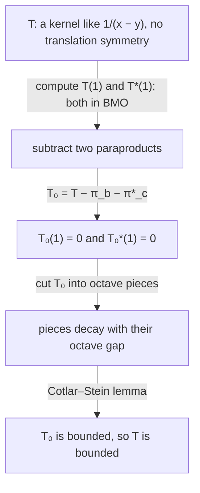
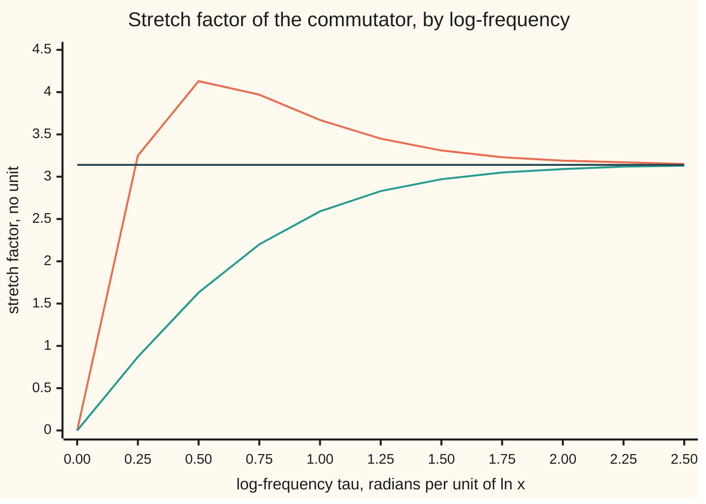

# The T(1) theorem: a singular integral with no translation symmetry is bounded on L² when T(1) and T*(1) lie in BMO

[Syllabus](../../../SYLLABUS.md) → [Harmonic analysis](../README.md) → [Multipliers and Estimates for PDE](../README.md#s07) → The T(1) theorem

---

## General Overview

A wall has a right-angle corner. Its profile is $`y = A(x) = |x|`$, with $`x`$ in metres along the floor. Air flow or electric fields next to such a wall are computed from signals on the wall, in volts here. The tool is the **Cauchy integral** of the wall: an average of the signal, weighted by one over the distance between two points of the wall.

On a flat wall the Cauchy integral is the Hilbert transform, which keeps energy exactly ([Singular integrals](../06-Maximal%20Functions%20and%20Beyond/03-singular-integrals-and-the-hilbert-transform-bound.md)). On the corner its weight depends on where the two points sit, not only on how far apart they are. It is no convolution, so the Fourier transform cannot measure it.

Expand the Cauchy integral in powers of the wall's slope. The first term is the Hilbert transform. The second is **Calderón's first commutator**, the operator of this card:

```math
C_A f(x) = \mathrm{p.v.}\int \frac{A(x) - A(y)}{(x-y)^2}\,f(y)\,dy .
```

Does it keep energy bounded? Feed it a gate, 1 V on the 2 m of wall with $`|x| < 1`$. The gate's energy is 2 V²·m. The output's energy is 21.159473 V²·m, a stretch of 3.252651 in size. A straight wall at slope 1 never stretches more than π = 3.141593. Is there any ceiling at all?

The **T(1) theorem** of Guy David and Jean-Lin Journé (1984) answers with three tests that never use the Fourier transform. Apply the operator to the constant signal 1. Apply its transpose to 1. Check it on small bumps. For the corner, $`C_A 1 = 2\ln|x|`$ plus a constant, which has bounded mean oscillation. Its transpose and the bump test pass too. So the ceiling exists. A separate computation on this card finds it exactly: 4.141061.

**The T(1) theorem says that an operator whose kernel has the size and smoothness of 1/(x − y) is bounded in energy exactly when T(1) and T\*(1) have bounded mean oscillation and T behaves on small bumps; subtracting two paraproducts reduces every such operator to one that sends 1 to 0, and that one is bounded by almost orthogonality.**

**What kind of fact this is:** a theorem, stated precisely with its source, and its proof given in outline under Why it works. Proved on this card for the corner: the formula for $`C_A 1`$, the bump condition, and the exact energy norm 4.141061. The BMO norm 1.861171 is found by a computer search, not derived.

### The picture: how the proof runs



---

## The formula

Notation from earlier cards: $`\lVert f\rVert_2`$ is the energy norm, the square root of $`\int |f|^2`$, and $`L^2`$ is the set of signals where it is finite. The Hilbert transform is $`Hf(x) = \frac{1}{\pi}\,\mathrm{p.v.}\int f(y)/(x-y)\,dy`$, where p.v. (principal value) means: cut out a gap of equal width on both sides of $`y = x`$, then shrink the gap. BMO is the set of signals whose **mean oscillation**, the average distance from their own average on an interval, stays below one number on every interval; the smallest such number is $`\lVert b\rVert_{\mathrm{BMO}}`$ ([BMO](../06-Maximal%20Functions%20and%20Beyond/09-bmo-and-the-john-nirenberg-inequality.md)).

This card introduces three words.

- A **kernel** $`K(x, y)`$ is the weight of an operator $`T`$: $`Tf(x) = \int K(x, y)\,f(y)\,dy`$ for $`x`$ outside the region where $`f`$ lives.
- The **transpose** $`T^*`$ has kernel $`K(y, x)`$, so $`\int Tf \cdot g = \int f \cdot T^*g`$ for real signals.
- A **normalised bump** on an interval of half-width $`r`$ is a smooth signal that lives on that interval, is at most 1 in size, and has slope at most $`1/r`$.

**The T(1) theorem (David and Journé, 1984).** Let $`T`$ act on smooth signals that vanish outside a bounded interval. Suppose its kernel satisfies, for one constant $`M`$ and one power $`0 < \delta \le 1`$:

```math
|K(x,y)| \le \frac{M}{|x-y|}, \qquad |K(x,y) - K(x',y)| + |K(y,x) - K(y,x')| \le \frac{M\,|x-x'|^{\delta}}{|x-y|^{1+\delta}} \ \text{ when } |x-x'| \le \tfrac12 |x-y| .
```

Then $`T`$ extends to a bounded operator on $`L^2`$ if and only if all three tests pass:

```math
T(1) \in \mathrm{BMO}, \qquad T^*(1) \in \mathrm{BMO}, \qquad |\langle T\varphi, \psi\rangle| \le B\,r \ \text{ for all normalised bumps } \varphi, \psi \text{ on one interval of half-width } r .
```

Here $`\langle T\varphi, \psi\rangle = \int T\varphi \cdot \psi`$ is the pairing. The third test is the **weak boundedness property**. When the tests pass, $`\lVert T\rVert_{2\to 2} \le c_0\,(M + B + \lVert T(1)\rVert_{\mathrm{BMO}} + \lVert T^*(1)\rVert_{\mathrm{BMO}})`$, with $`c_0`$ depending only on $`\delta`$.

**Read it aloud:** if the kernel is no bigger than M over the distance and changes smoothly, then T is bounded in energy exactly when T of one and T-star of one have bounded mean oscillation and T pairs any two bumps on an interval to at most B times its half-width.

The constant 1 has infinite energy, so $`T(1)`$ needs a meaning. It is the limit of $`T`$ applied to wider and wider gates, after subtracting a constant that may grow with the width. So $`T(1)`$ is a signal **up to an added constant**, which is exactly the freedom BMO allows.

**The corner's test.** For $`A(x) = |x|`$, the kernel is $`K(x, y) = (|x| - |y|)/(x-y)^2`$, and

```math
C_A 1(x) = \pi\,H(A')(x) + \text{const} = 2\ln|x| + \text{const}, \qquad C_A^* = -C_A, \qquad \lVert C_A\rVert_{2\to 2} = \pi\,\max_{\tau}\Big(\tanh(\pi\tau) + \frac{2\tau}{\cosh(\pi\tau)}\Big) = 4.141061 .
```

**Read it aloud:** the commutator of one is pi times the Hilbert transform of the slope, twice the log of the distance to the corner plus a constant; the transpose is minus the operator; the energy norm is pi times the peak of the bracket.

The slope $`A'`$ is the sign of $`x`$. Its Hilbert transform is $`(2/\pi)\ln|x|`$ plus a constant, with the sign set by this wing's kernel $`1/(\pi t)`$.

| Symbol | Plain meaning | In our example | Push it up and the answer… |
| --- | --- | --- | --- |
| $`x`$, $`y`$, $`R`$, $`\varepsilon`$, $`u`$ | positions, in m; a gate's half-width; a gap round the diagonal; a pairing distance (in the fold, the ratio x/y) | R = 10 to 100,000 m | larger R: raw $`T(1)`$ drifts by −2 ln R |
| $`A`$, $`A'`$, $`L`$ | the wall's height; its slope; the largest slope size | $`\lvert x\rvert`$; ±1; 1 | steeper: larger kernel constant |
| $`f`$, $`g`$ | a signal, in V; the gate, 1 V on $`\lvert x\rvert < 1`$ m | energy of g: 2 V²·m | — |
| $`K`$, $`T`$, $`T^*`$, $`C_A`$, $`k`$ | kernel; operator; transpose; the commutator; an order or band number | $`C_A^* = -C_A`$ | — |
| $`M`$, $`\delta`$, $`B`$, $`\varphi`$, $`\psi`$, $`r`$, $`\langle\cdot,\cdot\rangle`$ | size constant; smoothness power; bump constant; bumps; their half-width; the pairing | M = 24: size 1, smoothness 12 per term (slope at most $`3/(x-y)^2`$, distance to y at least halved); δ = 1; B = 4; $`\langle C_A g, g\rangle = 0`$ | larger: larger bound |
| $`b`$, $`c`$, $`\lVert b\rVert_{\mathrm{BMO}}`$ | $`T(1)`$ and $`T^*(1)`$; mean-oscillation size | $`2\ln\lvert x\rvert`$, norm 1.861171 | larger: larger bound |
| $`H`$, $`\mathrm{p.v.}`$ | Hilbert transform; principal value | — | — |
| $`\pi_b`$, $`\Delta_j`$, $`S_{j-2}`$, $`j`$, $`T_0`$ | paraproduct; octave band j; bands up to j − 2; a band number; T minus both paraproducts | $`\pi_b 1 = b`$ | — |
| $`\tau`$, $`v`$, $`F`$, $`P`$, $`Q`$, $`\lambda`$, $`\rho`$ | log-frequency; ln x; the signal in v; same-side and cross-side parts; a stretch of the picture; a kernel's profile in x/y | peak τ = 0.534504 | — |
| $`\lVert T\rVert_{2\to 2}`$, $`c_0`$, $`c_1`$ | operator norm, the largest stretch; the theorem's constant; Step 5's constant | 4.141061; π when straight | — |
| $`U_j`$, $`a(s)`$, $`s`$, $`\Lambda`$, $`m`$, $`N`$, $`n`$ | pieces; overlap sizes; the lemma's index gap; their sum; octave gap; number of pieces; a power | $`m = j - k`$; $`U_k = \Delta_{k+m}T_0\Delta_k`$ | larger Λ: larger bound |
| $`\Gamma`$, $`z`$, $`\sigma`$, $`C_\Gamma`$ | a graph wall; its points $`x + iA(x)`$; a chord's slope; the Cauchy integral | $`\lvert\sigma\rvert \le 1`$ | larger L: harder |

### When it holds

- **A kernel of size 1/|x − y| that changes smoothly.** Without smoothness, cancellation cannot be measured at small scales, and the octave pieces of Step 5 stop decaying.
- **T(1) in BMO, read up to a constant.** For the corner, $`C_A 1`$ at one point has no limit as the test gates widen. Only differences between points settle.
- **T\*(1) as well as T(1).** The test on $`T`$ alone controls half of the operator. The corner has $`C_A^* = -C_A`$, so its second test comes free; a general kernel does not.
- **The bump test.** The kernel 1/|x − y| has the right size and smoothness, but its bump pairing grows without limit as the gap around the diagonal shrinks. No bounded operator has that kernel.
- **A Lipschitz wall.** For a wall with a cusp, such as $`A = |x|^{1/2}`$, the slope is unbounded and $`C_A 1`$ grows like $`|x|^{-1/2}`$ near 0, which is not in BMO.

---

## Why it works

### Step 0: test the operator on the one signal the Fourier transform used to handle

A convolution sends every pure tone to a multiple of itself, so its size is the size of its multiplier. Without translation symmetry, no family of signals is treated so simply. The T(1) theorem replaces the whole multiplier by what the operator does to the zero-frequency signal, the constant 1. If $`T(1)`$ were exactly 0, the operator would have nothing to amplify at large scales. Paraproducts absorb whatever $`T(1)`$ is. The rest is a sum of octave pieces that almost ignore each other.

### Step 1: compute the corner's T(1)

Apply $`C_A`$ to the gate of half-width $`R`$. Split the integral at the corner. On the same side as $`x`$, the kernel is $`\pm 1/(x - y)`$. On the other side, write $`|x| + y = 2|x| - (|x| - y)`$ and integrate each part. For $`x > 0`$ this gives

```math
C_A 1_{|y|<R}(x) = \ln\frac{x^2}{|x^2 - R^2|} + \frac{2R}{|x| + R} .
```

The operator does not change when $`x`$ is replaced by $`-x`$, so the formula holds for every $`x`$. The check computes the same value by pairing $`y = x + u`$ with $`y = x - u`$, so the principal value becomes an ordinary integral. At R = 10 m and x = 0.5 m both roads give −4.084200.

The same answer has a second form. Integrate by parts against $`d/dy\,[1/(x-y)] = 1/(x-y)^2`$. The boundary terms give $`2R/(|x| + R)`$, and the rest is $`\int_{-R}^{R} A'(y)/(x-y)\,dy`$, which is $`\pi H`$ applied to the slope on the gate. That is the general rule: $`C_A 1 = \pi H(A')`$ up to a constant.

Now let $`R`$ grow. The value at one point runs off like $`-2\ln R`$. The difference between two points settles:

| x, in m | R = 10 | R = 1,000 | R = 100,000 | 2 ln x |
| ---: | ---: | ---: | ---: | ---: |
| 0.1 | −4.453104 | −4.603373 | −4.605152 | −4.605170 |
| 0.5 | −1.307261 | −1.385297 | −1.386284 | −1.386294 |
| 2.0 | 1.265551 | 1.384303 | 1.386274 | 1.386294 |
| 5.0 | 3.011659 | 3.210948 | 3.218796 | 3.218876 |

The table shows $`C_A 1_{|y|<R}(x) - C_A 1_{|y|<R}(1)`$. The gap to 2 ln x shrinks like $`2|x - 1|/R`$, from the last term of the formula. So $`C_A 1 = 2\ln|x|`$ up to a constant.

### Step 2: the logarithm has bounded mean oscillation

$`\ln|x|`$ is unbounded at 0, so it is not in $`L^\infty`$. But stretching $`x`$ by a factor $`\lambda`$ only adds the constant $`\ln\lambda`$, and the mean oscillation ignores constants. So the mean oscillation on an interval depends only on its shape: the ratio of its centre to its radius.

On an interval centred at the corner, the mean oscillation of $`2\ln|x|`$ is exactly $`4/e = 1.471518`$. The check computes it exactly on any interval, using the antiderivative $`x\ln|x| - x`$. A scan of 4,001 centre-to-radius ratios from 0 to 4, then refined, finds the largest value, 1.861171, at ratio 0.7583. It also confirms that stretching an interval by 37 leaves the oscillation unchanged.

### Step 3: the transpose and the bump test come from antisymmetry

Swap $`x`$ and $`y`$ in the kernel: $`K(y, x) = (|y| - |x|)/(y - x)^2 = -K(x, y)`$. So $`C_A^* = -C_A`$, and $`C_A^*1 = -2\ln|x|`$, also in BMO.

Antisymmetry also gives the bump test. For any real bump $`\varphi`$, $`\langle C_A\varphi, \varphi\rangle = -\langle\varphi, C_A\varphi\rangle`$, so it is 0. For two bumps $`\varphi`$, $`\psi`$ on one interval of half-width $`r`$, antisymmetry turns the pairing into half the double integral of $`K(x, y)\,(\psi(x)\varphi(y) - \varphi(x)\psi(y))`$. Each bump has slope at most $`1/r`$, so the bracket is at most $`2|x - y|/r`$. With $`|K| \le 1/|x - y|`$ the integrand is at most $`1/r`$, over a square of area $`4r^2`$. So the pairing is at most $`4r`$: the test passes with B = 4. The check integrates the gate's output over the gate and gets 0.000000, against the gate's width of 2 m.

The positive kernel $`1/|x-y|`$ has no such luck. Its pairing grows like $`2\ln(1/\varepsilon)`$ as the gap ε shrinks: 11.817511, then 25.631023. That is the third test failing.

### Step 4: subtract two paraproducts

Write $`b = T(1)`$ and $`c = T^*(1)`$. The paraproduct of [Paraproducts](03-paraproducts-and-the-coifman-meyer-theorem.md) is $`\pi_b f = \sum_j \Delta_j b \cdot S_{j-2} f`$: octave band $`j`$ of $`b`$ times the low part of $`f`$. Here the bands run over all whole numbers $`j`$, down to the lowest frequencies. Three facts make it the right tool:

1. $`\lVert\pi_b\rVert_{2\to 2}`$ is at most a fixed constant times $`\lVert b\rVert_{\mathrm{BMO}}`$: the paraproduct theorem.
2. $`\pi_b 1 = b`$ up to a constant, because the low part of 1 is 1 and the bands of $`b`$ add up to $`b`$.
3. $`\pi_b^* 1 = 0`$. Each term $`\Delta_j b \cdot S_{j-2}g`$ has frequencies in an octave band away from 0, so its integral is 0.

Set $`T_0 = T - \pi_b - \pi_c^*`$. Then $`T_0(1) = b - b - 0 = 0`$ and $`T_0^*(1) = c - 0 - c = 0`$. The paraproducts have kernels of the same size and smoothness, and they pass the bump test. So $`T_0`$ meets every hypothesis, and its first two tests now pass trivially. Bounding $`T`$ reduces to bounding $`T_0`$.

For the corner, $`b = 2\ln|x|`$ and $`c = -b`$, so $`T_0 = C_A - \pi_b + \pi_b^*`$.

### Step 5: an operator that kills constants is almost diagonal in octaves

Cut $`T_0`$ into pieces $`\Delta_j T_0 \Delta_k`$: input band $`k`$, output band $`j`$. When $`j`$ is much larger than $`k`$, the input is nearly constant at the output's scale. Since $`T_0(1) = 0`$, the piece is small: kernel smoothness gives $`\lVert\Delta_j T_0 \Delta_k\rVert \le c_1\,2^{-\delta|j-k|}`$. When $`k`$ is much larger, the transpose and $`T_0^*(1) = 0`$ do the same. When $`j`$ is close to $`k`$, the bump test gives the bound.

Group the pieces by octave gap $`m = j - k`$. Adding every piece's norm gives infinity. The Cotlar–Stein lemma adds only how much the pieces overlap.

**The Cotlar–Stein lemma.** If operators $`U_j`$ satisfy $`\lVert U_i^*U_j\rVert \le a(i-j)^2`$ and $`\lVert U_iU_j^*\rVert \le a(i-j)^2`$ with $`\Lambda = \sum_s a(s)`$ finite, then $`\lVert\sum_j U_j\rVert \le \Lambda`$.

<details>
<summary>Proof outline: the Cotlar–Stein lemma</summary>

Let $`U = \sum_{j=1}^{N} U_j`$, a finite sum. The energy norm satisfies $`\lVert U\rVert^{2n} = \lVert (U^*U)^n\rVert`$ for every whole number $`n`$. Expand $`(U^*U)^n`$ as a sum of products $`U_{i_1}^*U_{j_1}U_{i_2}^*U_{j_2}\cdots U_{i_n}^*U_{j_n}`$.

Bound each product two ways: group it as pairs $`U_i^*U_j`$, or as pairs $`U_jU_i^*`$ with one factor left at each end, of norm at most $`a(0) \le \Lambda`$. Take the geometric mean of the two bounds:

$`\displaystyle \lVert U_{i_1}^*U_{j_1}\cdots U_{i_n}^*U_{j_n}\rVert \le \Lambda\,a(i_1-j_1)\,a(j_1-i_2)\,a(i_2-j_2)\cdots a(i_n-j_n).`$

Sum over all indices: the first index gives at most $`N`$ choices and each later index a factor $`\Lambda`$. So $`\lVert U\rVert^{2n} \le N \Lambda^{2n}`$, and $`\lVert U\rVert \le N^{1/(2n)} \Lambda`$. Let $`n`$ grow: $`N^{1/(2n)} \to 1`$. The bound does not depend on $`N`$, so it holds for the infinite sum too.

</details>

For one gap $`m`$, take $`U_k = \Delta_{k+m}T_0\Delta_k`$. Bands that are not neighbours do not overlap, so $`U_i^*U_j`$ and $`U_iU_j^*`$ vanish unless $`|i - j| \le 1`$. The lemma, with $`a(s) = c_1 2^{-\delta|m|}`$ for $`|s| \le 1`$ and 0 otherwise, bounds the gap-$`m`$ sum by $`3c_1 2^{-\delta|m|}`$. These add up over $`m`$.

The reverse direction is shorter. A bounded $`T`$ passes the bump test with $`B`$ a multiple of $`\lVert T\rVert`$, and sends bounded signals into BMO, so $`T(1)`$ and $`T^*(1)`$ are in BMO.

### Step 6: for the corner, the ceiling is exactly 4.141061

The theorem's constant is not explicit. The corner allows more: $`C_A`$ does not change when the picture is stretched by $`\lambda`$, since $`A(\lambda x) = \lambda A(x)`$. Stretching plays the role shifting plays for a convolution.

Split a signal into its parts right and left of the corner. On one side, the kernel is $`1/(x - y)`$: this part is $`P`$. Across the corner, it is $`(x - t)/(x + t)^2`$, with $`t = -y`$: this part is $`Q`$. Even signals, the same on both sides, see $`P + Q`$. Odd signals see $`P - Q`$.

In the variable $`\ln x`$, stretching becomes shifting, and $`P`$ and $`Q`$ become convolutions. Their multipliers, as functions of the log-frequency $`\tau`$, are $`-i\pi\tanh(\pi\tau)`$ and $`-2\pi i\tau/\cosh(\pi\tau)`$. The norm on even signals is π times the peak of $`\tanh(\pi\tau) + 2\tau/\cosh(\pi\tau)`$. Its slope is zero where $`\pi/\cosh(\pi\tau) + 2 = 2\pi\tau\tanh(\pi\tau)`$, at τ = 0.534504. The pure signals $`|x|^{-1/2 + i\tau}`$, which wiggle evenly in $`\ln|x|`$, come as close to that stretch as wanted.

<details>
<summary>Detailed derivation: the multipliers of P and Q</summary>

Write $`x = e^v`$ and $`f(x) = e^{-v/2}F(v)`$. Then $`\int_0^\infty |f|^2\,dx = \int |F|^2\,dv`$, so energy is kept. An operator with kernel $`\frac{1}{y}\,\rho(x/y)`$ becomes convolution of $`F`$ with $`\rho(e^v)\,e^{v/2}`$, and its multiplier is that kernel's transform, $`\int \rho(e^v)\,e^{v/2}\,e^{-i\tau v}\,dv`$.

For $`P`$, $`\rho(u) = 1/(u - 1)`$, giving the kernel $`1/(2\sinh(v/2))`$. Its transform is $`-i\pi\tanh(\pi\tau)`$.

For $`Q`$, $`\rho(u) = (u - 1)/(u + 1)^2`$, giving $`\sinh(v/2)/(2\cosh^2(v/2))`$, which is minus the slope of $`1/\cosh(v/2)`$. That function has transform $`2\pi/\cosh(\pi\tau)`$, so the slope has transform $`i\tau`$ times it, and the multiplier of $`Q`$ is

$`\displaystyle -\frac{2\pi i\tau}{\cosh(\pi\tau)} .`$

A straight wall has $`(x + t)^{-1}`$ across the origin instead, with transform $`\pi/\cosh(\pi\tau)`$. Then $`|{-i\pi\tanh(\pi\tau)} \pm \pi/\cosh(\pi\tau)|^2 = \pi^2(\tanh^2 + \cosh^{-2}) = \pi^2`$: flat at π, as it must be for $`\pi H`$. The corner replaces that with a term that adds in phase.

</details>



Orange: the corner on even signals, peaking at 4.141061 near τ = 0.53. Green: odd signals, below π. Dark: a straight wall of slope 1, flat at π. All three approach π for fast wiggles.

### Step 7: the Cauchy integral on a Lipschitz wall

A wall that is a graph, $`z(x) = x + iA(x)`$ with $`|A(x) - A(y)| \le L|x - y|`$, has the Cauchy integral

```math
C_\Gamma f(x) = \frac{1}{\pi i}\,\mathrm{p.v.}\int \frac{f(y)\,(1 + iA'(y))}{(y - x) + i(A(y) - A(x))}\,dy .
```

On a flat wall it is $`iHf`$. Write $`\sigma = (A(x) - A(y))/(x - y)`$, the slope of the chord, of size at most $`L`$. Then $`1/((y-x)(1 + i\sigma)) = \sum_k (-i\sigma)^k/(y - x)`$ when $`L < 1`$. Up to constant factors, term $`k = 0`$ is the Hilbert kernel, term $`k = 1`$ is Calderón's commutator, and term $`k`$ is the **k-th commutator**, with kernel $`(A(x) - A(y))^k/(x - y)^{k+1}`$.

Calderón (1977) proved the Cauchy integral bounded for small $`L`$. Coifman, McIntosh and Meyer (1982) proved it for every Lipschitz wall. The T(1) theorem gives a clean route to each commutator: the $`k`$-th one applied to 1 is built from the $`(k-1)`$-th applied to the slope, so induction keeps every $`T(1)`$ in BMO. For the corner, L = 1, the series sits at the edge of convergence.

---

## Worked numbers, by hand

The corner $`A = |x|`$, the gate g of 1 V on $`|x| < 1`$ m.

| Step | Arithmetic | Value |
| --- | --- | --- |
| $`C_A 1`$ at 0.5 m minus at 1 m, R = 100,000 m | Step 1's formula at x = 0.5 and at x = 1 | −1.386284 |
| the limit | $`2\ln 0.5`$ | −1.386294 |
| mean oscillation of $`2\ln\lvert x\rvert`$, centred interval | $`2 \times 2/e`$ | 1.471518 |
| its largest value, any interval | search over shapes | 1.861171 |
| bump test on the gate | antisymmetry: $`\langle C_A g, g\rangle = -\langle g, C_A g\rangle`$ | 0 |
| peak log-frequency | solve $`\pi/\cosh(\pi\tau) + 2 = 2\pi\tau\tanh(\pi\tau)`$ | τ = 0.534504 |
| same-side part P at the peak | $`\pi\tanh(\pi \times 0.534504)`$ | 2.930343 |
| cross-side part Q at the peak | $`2\pi \times 0.534504/\cosh(\pi \times 0.534504)`$ | 1.210719 |
| **energy norm of $`C_A`$** | $`2.930343 + 1.210719`$, from unrounded parts | **4.141061** |
| the gate's stretch | $`\sqrt{21.159473/2}`$ | 3.252651 |

No signal on the corner is stretched by more than 4.141061 in energy norm; the gate already passes the straight wall's π.

### What breaks if you drop a piece

| Mistake | Comes out at | What went wrong |
| --- | --- | --- |
| Read $`T(1)`$ at one point as a number | −2.776938, −11.817508, −21.025871 at x = 1 m for R = 10, 1,000, 100,000 m | $`T(1)`$ is defined only up to a constant; only differences settle |
| Drop the cancellation: kernel $`1/\lvert x - y\rvert`$ | bump pairing 11.817511 at gap 0.001 m, 25.631023 at 0.000001 m | the bump test fails, so no bounded operator exists |
| Bound the corner by the straight wall, π | 3.141593, but the gate stretches by 3.252651 | the cross-side part Q adds in phase on even signals |

The code prints every number in both tables.

---

## Code, from first principles, and it actually runs

The script computes $`C_A`$ on gates by a closed form and checks it by quadrature that pairs the two sides of the singularity. It finds the BMO norm of $`2\ln|x|`$ from exact interval integrals and a search. It takes three independent roads to the energy norm: the multipliers in closed form, the same multipliers as integrals over log-distance, and the gate's output energy, computed once in position and once on the log-frequency side. The peak is found by bisection and confirmed by a grid search. Nothing imported contains a transform or an integrator.

### Python

```python
# The T(1) theorem -- the check behind the card.  Standard library only.
# Operator: Calderon's first commutator for the corner A(x) = |x|, x in metres:
#   C f(x) = p.v. integral of (|x| - |y|) / (x - y)^2 f(y) dy.
# Roads: closed forms against direct quadrature, against the Mellin side.
from math import pi, log, exp, tanh, sin, sinh, atan


def sech(x):
    return 2 * exp(-abs(x)) / (1 + exp(-2 * abs(x)))


def simpson(f, a, b, n=2000):
    h = (b - a) / n
    s = f(a) + f(b) + sum((4 if i % 2 else 2) * f(a + i * h) for i in range(1, n))
    return s * h / 3


def kern(x, y):
    return (abs(x) - abs(y)) / (x - y) ** 2


def t_closed(x, R):          # C applied to the gate 1 on |y| < R, closed form
    return log(x * x / abs(x * x - R * R)) + 2 * R / (abs(x) + R)


def t_quad(x, R):            # the same, pairing y = x + u with y = x - u
    def pair(u):             # the two halves cancel exactly while u < |x|
        return 0.0 if u == 0 else sum(kern(x, y) for y in (x + u, x - u) if abs(y) < R)
    cuts = sorted({0.0, R - abs(x), R + abs(x)} | {abs(x) * 2 ** k for k in range(8) if abs(x) * 2 ** k < R})
    return sum(simpson(pair, a + 1e-12, b - 1e-12) for a, b in zip(cuts, cuts[1:]) if b > a)


print("T(1) for the corner: C applied to the gate |y| < R, minus its value at x = 1 m")
xs, Rs = [0.1, 0.5, 2.0, 5.0], [10, 1000, 100000]
for x in xs:
    d = [t_closed(x, R) - t_closed(1.0, R) for R in Rs]
    print("x = %.1f m: R = 10, 1000, 100000 give %.6f %.6f %.6f; 2 ln x = %.6f"
          % (x, d[0], d[1], d[2], 2 * log(x)))
    assert abs(d[2] - 2 * log(x)) < 1e-4 * (1 + x * x)
    q = t_quad(x, 10.0)
    assert abs(q - t_closed(x, 10.0)) < 1e-6
print("quadrature against closed form at R = 10, x = 0.5 m: %.6f %.6f"
      % (t_quad(0.5, 10.0), t_closed(0.5, 10.0)))
raw = [t_closed(1.0, R) for R in Rs]
print("raw value at x = 1 m for R = 10, 1000, 100000: %.6f %.6f %.6f" % tuple(raw))


def F(x):                    # antiderivative of ln|x|
    return x * log(abs(x)) - x if x != 0 else 0.0


def osc(a, b):               # mean oscillation of 2 ln|x| on [a, b], exactly
    m = 2 * (F(b) - F(a)) / (b - a)
    r = exp(m / 2)
    pts = [a] + [p for p in (-r, r) if a < p < b] + [b]
    G = lambda x: 2 * F(x) - m * x
    return sum(abs(G(q) - G(p)) for p, q in zip(pts, pts[1:])) / (b - a)


grid = [i / 1000 for i in range(4001)]
c0 = max(grid, key=lambda c: osc(c - 1, c + 1))
lo, hi = c0 - 0.001, c0 + 0.001
for _ in range(60):
    m1, m2 = lo + (hi - lo) / 3, hi - (hi - lo) / 3
    if osc(m1 - 1, m1 + 1) < osc(m2 - 1, m2 + 1):
        lo = m1
    else:
        hi = m2
bmo = osc(lo - 1, lo + 1)
print("BMO norm of T(1) = 2 ln|x|: centred %.6f = 4/e %.6f; largest %.6f at centre/radius %.4f"
      % (osc(-1, 1), 4 / exp(1), bmo, lo))
assert abs(osc(-1, 1) - 4 / exp(1)) < 1e-12
assert abs(osc(-37 * 0.3, 37 * 1.7) - osc(-0.3, 1.7)) < 1e-9     # scale invariance
assert bmo >= osc(-1, 1) and bmo < 2


def sym(t, sgn):             # Mellin multiplier / pi on even (+1) or odd (-1) signals
    return tanh(pi * t) + sgn * 2 * t * sech(pi * t)


a, b = 0.1, 2.0              # peak: d/dt of sym(t, +1) changes sign
for _ in range(80):
    m = (a + b) / 2
    a, b = (m, b) if pi * sech(pi * m) + 2 - 2 * pi * m * tanh(pi * m) > 0 else (a, m)
peak = pi * sym(a, 1)
assert abs(peak - max(pi * sym(k / 20000, 1) for k in range(60000))) < 1e-8   # road two for the peak: a grid search
print("L2 norm of C: peak of the even-signal multiplier at tau = %.6f, norm %.6f; straight line %.6f"
      % (a, peak, pi))
for t in (0.25, a, 1.0):     # road two: the multipliers as integrals over log-distance v
    mp = 2 * simpson(lambda v: sin(t * v) / (2 * sinh(v / 2)), 1e-9, 80, 20000)
    mq = 2 * simpson(lambda v: sinh(v / 2) * sin(t * v) / (2 * (1 / sech(v / 2)) ** 2), 0, 80, 20000)
    print("tau = %.6f: P %.6f vs pi tanh %.6f; Q %.6f vs 2 pi tau sech %.6f"
          % (t, mp, pi * tanh(pi * t), mq, 2 * pi * t * sech(pi * t)))
    assert abs(mp - pi * tanh(pi * t)) < 1e-6 and abs(mq - 2 * pi * t * sech(pi * t)) < 1e-6


def gate_out(x, sgn):        # C on the even gate (sgn +1) or the odd gate (sgn -1), x > 0
    return log(x * x / abs(x * x - 1)) + 2 / (x + 1) if sgn > 0 else log((x + 1) / abs(x - 1)) - 2 / (x + 1)


def energy_time(sgn, n=40000):
    tot = 0.0
    for i in range(n):
        s = (i + 0.5) / n
        w, dw = 3 * s * s - 2 * s ** 3, 6 * s * (1 - s)
        tot += (gate_out(w, sgn) ** 2 + gate_out(1 + w, sgn) ** 2) * dw / n
        tot += gate_out(2 / s, sgn) ** 2 * 2 / (s * s) / n
    return 2 * tot


def energy_mellin(sgn, L=40.0, n=200000):
    h = L / n
    tot = sum(sym((i + 0.5) * h, sgn) ** 2 / (0.25 + ((i + 0.5) * h) ** 2) for i in range(n)) * h
    return 2 * pi * (tot + 2 * (pi / 2 - atan(2 * L)))


for name, sgn in (("even gate", 1), ("odd gate", -1)):
    e1, e2 = energy_time(sgn), energy_mellin(sgn)
    print("%s, energy 2 V^2 m in: out %.6f by time, %.6f by Mellin; stretch %.6f"
          % (name, e1, e2, (e2 / 2) ** 0.5))
    assert abs(e1 - e2) < 1e-4 and (e2 / 2) ** 0.5 < peak
wbp = 2 * simpson(lambda s: gate_out(3 * s * s - 2 * s ** 3, 1) * 6 * s * (1 - s), 1e-12, 1 - 1e-12, 20000)
print("weak boundedness: size of <C g, g> on the gate %.6f, against 2 m" % abs(wbp))
assert abs(wbp) < 1e-4
for eps in (1e-3, 1e-6):     # a positive kernel 1/|x - y| on [0, 1], gap eps
    num = 2 * simpson(lambda w: (1 - exp(w)), log(eps), 0, 20000)
    print("positive kernel, gap %.6f m: pairing %.6f by quadrature, %.6f by formula"
          % (eps, num, 2 * (log(1 / eps) - 1 + eps)))
    assert abs(num - 2 * (log(1 / eps) - 1 + eps)) < 1e-6
print("chart, tau        " + " ".join("%5.2f" % (k / 4) for k in range(11)))
print("chart, even       " + " ".join("%5.2f" % (pi * sym(k / 4, 1)) for k in range(11)))
print("chart, odd        " + " ".join("%5.2f" % (pi * sym(k / 4, -1)) for k in range(11)))
print("chart, straight   " + " ".join("%5.2f" % (pi * (tanh(pi * k / 4) ** 2 + sech(pi * k / 4) ** 2) ** 0.5) for k in range(11)))
print("ALL CHECKS PASS")
```

**Ran 2026-11-24 on macOS, Python 3.14.10, standard library only. All checks passed. Output, pasted from the run:**

```
T(1) for the corner: C applied to the gate |y| < R, minus its value at x = 1 m
x = 0.1 m: R = 10, 1000, 100000 give -4.453104 -4.603373 -4.605152; 2 ln x = -4.605170
x = 0.5 m: R = 10, 1000, 100000 give -1.307261 -1.385297 -1.386284; 2 ln x = -1.386294
x = 2.0 m: R = 10, 1000, 100000 give 1.265551 1.384303 1.386274; 2 ln x = 1.386294
x = 5.0 m: R = 10, 1000, 100000 give 3.011659 3.210948 3.218796; 2 ln x = 3.218876
quadrature against closed form at R = 10, x = 0.5 m: -4.084200 -4.084200
raw value at x = 1 m for R = 10, 1000, 100000: -2.776938 -11.817508 -21.025871
BMO norm of T(1) = 2 ln|x|: centred 1.471518 = 4/e 1.471518; largest 1.861171 at centre/radius 0.7583
L2 norm of C: peak of the even-signal multiplier at tau = 0.534504, norm 4.141061; straight line 3.141593
tau = 0.250000: P 2.060238 vs pi tanh 2.060238; Q 1.185857 vs 2 pi tau sech 1.185857
tau = 0.534504: P 2.930343 vs pi tanh 2.930343; Q 1.210719 vs 2 pi tau sech 1.210719
tau = 1.000000: P 3.129881 vs pi tanh 3.129881; Q 0.542030 vs 2 pi tau sech 0.542030
even gate, energy 2 V^2 m in: out 21.159473 by time, 21.159473 by Mellin; stretch 3.252651
odd gate, energy 2 V^2 m in: out 8.000000 by time, 8.000000 by Mellin; stretch 2.000000
weak boundedness: size of <C g, g> on the gate 0.000000, against 2 m
positive kernel, gap 0.001000 m: pairing 11.817511 by quadrature, 11.817511 by formula
positive kernel, gap 0.000001 m: pairing 25.631023 by quadrature, 25.631023 by formula
chart, tau         0.00  0.25  0.50  0.75  1.00  1.25  1.50  1.75  2.00  2.25  2.50
chart, even        0.00  3.25  4.13  3.97  3.67  3.45  3.31  3.23  3.19  3.17  3.15
chart, odd         0.00  0.87  1.63  2.20  2.59  2.83  2.97  3.05  3.09  3.12  3.13
chart, straight    3.14  3.14  3.14  3.14  3.14  3.14  3.14  3.14  3.14  3.14  3.14
ALL CHECKS PASS
```

### Rust

```rust
// The T(1) theorem -- the same check as the_t1_theorem_check.py, in Rust.
// Standard library only, no crates.  Operator: Calderon's first commutator for
// the corner A(x) = |x|:  C f(x) = p.v. integral of (|x| - |y|)/(x - y)^2 f(y) dy.
// Compile: rustc --edition 2021 -O the_t1_theorem_check.rs -o /tmp/the_t1_theorem
use std::f64::consts::{E, PI};

fn sech(x: f64) -> f64 {
    2.0 * (-x.abs()).exp() / (1.0 + (-2.0 * x.abs()).exp())
}

fn simpson(f: &dyn Fn(f64) -> f64, a: f64, b: f64, n: usize) -> f64 {
    let h = (b - a) / n as f64;
    let mut s = f(a) + f(b);
    for i in 1..n {
        s += if i % 2 == 1 { 4.0 } else { 2.0 } * f(a + i as f64 * h);
    }
    s * h / 3.0
}

fn kern(x: f64, y: f64) -> f64 {
    (x.abs() - y.abs()) / ((x - y) * (x - y))
}

fn t_closed(x: f64, r: f64) -> f64 {
    (x * x / (x * x - r * r).abs()).ln() + 2.0 * r / (x.abs() + r)
}

fn t_quad(x: f64, r: f64) -> f64 {
    let pair = |u: f64| -> f64 {
        if u == 0.0 {
            return 0.0;
        }
        [x + u, x - u].iter().filter(|y| y.abs() < r).map(|&y| kern(x, y)).sum()
    };
    let mut cuts = vec![0.0, r - x.abs(), r + x.abs()];
    for k in 0..8 {
        let c = x.abs() * 2f64.powi(k);
        if c < r {
            cuts.push(c);
        }
    }
    cuts.sort_by(|a, b| a.partial_cmp(b).unwrap());
    cuts.dedup();
    let mut tot = 0.0;
    for w in cuts.windows(2) {
        if w[1] > w[0] {
            tot += simpson(&pair, w[0] + 1e-12, w[1] - 1e-12, 2000);
        }
    }
    tot
}

fn f_anti(x: f64) -> f64 {
    if x != 0.0 { x * x.abs().ln() - x } else { 0.0 }
}

fn osc(a: f64, b: f64) -> f64 {
    let m = 2.0 * (f_anti(b) - f_anti(a)) / (b - a);
    let r = (m / 2.0).exp();
    let mut pts = vec![a];
    for p in [-r, r] {
        if a < p && p < b {
            pts.push(p);
        }
    }
    pts.push(b);
    let g = |x: f64| 2.0 * f_anti(x) - m * x;
    pts.windows(2).map(|w| (g(w[1]) - g(w[0])).abs()).sum::<f64>() / (b - a)
}

fn sym(t: f64, sgn: f64) -> f64 {
    (PI * t).tanh() + sgn * 2.0 * t * sech(PI * t)
}

fn gate_out(x: f64, sgn: f64) -> f64 {
    if sgn > 0.0 {
        (x * x / (x * x - 1.0).abs()).ln() + 2.0 / (x + 1.0)
    } else {
        ((x + 1.0) / (x - 1.0).abs()).ln() - 2.0 / (x + 1.0)
    }
}

fn energy_time(sgn: f64, n: usize) -> f64 {
    let mut tot = 0.0;
    for i in 0..n {
        let s = (i as f64 + 0.5) / n as f64;
        let (w, dw) = (3.0 * s * s - 2.0 * s * s * s, 6.0 * s * (1.0 - s));
        tot += (gate_out(w, sgn).powi(2) + gate_out(1.0 + w, sgn).powi(2)) * dw / n as f64;
        tot += gate_out(2.0 / s, sgn).powi(2) * 2.0 / (s * s) / n as f64;
    }
    2.0 * tot
}

fn energy_mellin(sgn: f64, l: f64, n: usize) -> f64 {
    let h = l / n as f64;
    let mut tot = 0.0;
    for i in 0..n {
        let t = (i as f64 + 0.5) * h;
        tot += sym(t, sgn).powi(2) / (0.25 + t * t);
    }
    2.0 * PI * (tot * h + 2.0 * (PI / 2.0 - (2.0 * l).atan()))
}

fn main() {
    println!("T(1) for the corner: C applied to the gate |y| < R, minus its value at x = 1 m");
    let rs = [10.0, 1000.0, 100000.0];
    for x in [0.1, 0.5, 2.0, 5.0] {
        let d: Vec<f64> = rs.iter().map(|&r| t_closed(x, r) - t_closed(1.0, r)).collect();
        println!("x = {:.1} m: R = 10, 1000, 100000 give {:.6} {:.6} {:.6}; 2 ln x = {:.6}", x, d[0], d[1], d[2], 2.0 * x.ln());
        assert!((d[2] - 2.0 * x.ln()).abs() < 1e-4 * (1.0 + x * x));
        assert!((t_quad(x, 10.0) - t_closed(x, 10.0)).abs() < 1e-6);
    }
    println!("quadrature against closed form at R = 10, x = 0.5 m: {:.6} {:.6}", t_quad(0.5, 10.0), t_closed(0.5, 10.0));
    let raw: Vec<f64> = rs.iter().map(|&r| t_closed(1.0, r)).collect();
    println!("raw value at x = 1 m for R = 10, 1000, 100000: {:.6} {:.6} {:.6}", raw[0], raw[1], raw[2]);

    let mut c0 = 0.0;
    for i in 0..4001 {
        let c = i as f64 / 1000.0;
        if osc(c - 1.0, c + 1.0) > osc(c0 - 1.0, c0 + 1.0) {
            c0 = c;
        }
    }
    let (mut lo, mut hi) = (c0 - 0.001, c0 + 0.001);
    for _ in 0..60 {
        let (m1, m2) = (lo + (hi - lo) / 3.0, hi - (hi - lo) / 3.0);
        if osc(m1 - 1.0, m1 + 1.0) < osc(m2 - 1.0, m2 + 1.0) { lo = m1 } else { hi = m2 }
    }
    let bmo = osc(lo - 1.0, lo + 1.0);
    println!("BMO norm of T(1) = 2 ln|x|: centred {:.6} = 4/e {:.6}; largest {:.6} at centre/radius {:.4}", osc(-1.0, 1.0), 4.0 / E, bmo, lo);
    assert!((osc(-1.0, 1.0) - 4.0 / E).abs() < 1e-12);
    assert!((osc(-37.0 * 0.3, 37.0 * 1.7) - osc(-0.3, 1.7)).abs() < 1e-9);
    assert!(bmo >= osc(-1.0, 1.0) && bmo < 2.0);

    let (mut a, mut b) = (0.1f64, 2.0f64);
    for _ in 0..80 {
        let m = (a + b) / 2.0;
        if PI * sech(PI * m) + 2.0 - 2.0 * PI * m * (PI * m).tanh() > 0.0 { a = m } else { b = m }
    }
    let peak = PI * sym(a, 1.0);
    assert!((peak - (0..60000).map(|k| PI * sym(k as f64 / 20000.0, 1.0)).fold(0.0, f64::max)).abs() < 1e-8); // road two for the peak: a grid search
    println!("L2 norm of C: peak of the even-signal multiplier at tau = {:.6}, norm {:.6}; straight line {:.6}", a, peak, PI);
    for t in [0.25, a, 1.0] {
        let mp = 2.0 * simpson(&|v: f64| (t * v).sin() / (2.0 * (v / 2.0).sinh()), 1e-9, 80.0, 20000);
        let mq = 2.0 * simpson(&|v: f64| (v / 2.0).sinh() * (t * v).sin() / (2.0 * (1.0 / sech(v / 2.0)).powi(2)), 0.0, 80.0, 20000);
        println!("tau = {:.6}: P {:.6} vs pi tanh {:.6}; Q {:.6} vs 2 pi tau sech {:.6}", t, mp, PI * (PI * t).tanh(), mq, 2.0 * PI * t * sech(PI * t));
        assert!((mp - PI * (PI * t).tanh()).abs() < 1e-6 && (mq - 2.0 * PI * t * sech(PI * t)).abs() < 1e-6);
    }

    for (name, sgn) in [("even gate", 1.0), ("odd gate", -1.0)] {
        let (et, em) = (energy_time(sgn, 40000), energy_mellin(sgn, 40.0, 200000));
        println!("{}, energy 2 V^2 m in: out {:.6} by time, {:.6} by Mellin; stretch {:.6}", name, et, em, (em / 2.0).sqrt());
        assert!((et - em).abs() < 1e-4 && (em / 2.0).sqrt() < peak);
    }
    let wbp = 2.0 * simpson(&|s: f64| gate_out(3.0 * s * s - 2.0 * s * s * s, 1.0) * 6.0 * s * (1.0 - s), 1e-12, 1.0 - 1e-12, 20000);
    println!("weak boundedness: size of <C g, g> on the gate {:.6}, against 2 m", wbp.abs());
    assert!(wbp.abs() < 1e-4);
    for eps in [1e-3f64, 1e-6] {
        let num = 2.0 * simpson(&|w: f64| 1.0 - w.exp(), eps.ln(), 0.0, 20000);
        let formula = 2.0 * ((1.0 / eps).ln() - 1.0 + eps);
        println!("positive kernel, gap {:.6} m: pairing {:.6} by quadrature, {:.6} by formula", eps, num, formula);
        assert!((num - formula).abs() < 1e-6);
    }
    let row = |f: &dyn Fn(f64) -> f64| (0..11).map(|k| format!("{:5.2}", f(k as f64 / 4.0))).collect::<Vec<_>>().join(" ");
    println!("chart, tau        {}", row(&|t| t));
    println!("chart, even       {}", row(&|t| PI * sym(t, 1.0)));
    println!("chart, odd        {}", row(&|t| PI * sym(t, -1.0)));
    println!("chart, straight   {}", row(&|t| PI * ((PI * t).tanh().powi(2) + sech(PI * t).powi(2)).sqrt()));
    println!("ALL CHECKS PASS");
}
```

**Ran 2026-11-24 on macOS, rustc 1.98.1, no crates. All checks passed. Output, pasted from the run:**

```
T(1) for the corner: C applied to the gate |y| < R, minus its value at x = 1 m
x = 0.1 m: R = 10, 1000, 100000 give -4.453104 -4.603373 -4.605152; 2 ln x = -4.605170
x = 0.5 m: R = 10, 1000, 100000 give -1.307261 -1.385297 -1.386284; 2 ln x = -1.386294
x = 2.0 m: R = 10, 1000, 100000 give 1.265551 1.384303 1.386274; 2 ln x = 1.386294
x = 5.0 m: R = 10, 1000, 100000 give 3.011659 3.210948 3.218796; 2 ln x = 3.218876
quadrature against closed form at R = 10, x = 0.5 m: -4.084200 -4.084200
raw value at x = 1 m for R = 10, 1000, 100000: -2.776938 -11.817508 -21.025871
BMO norm of T(1) = 2 ln|x|: centred 1.471518 = 4/e 1.471518; largest 1.861171 at centre/radius 0.7583
L2 norm of C: peak of the even-signal multiplier at tau = 0.534504, norm 4.141061; straight line 3.141593
tau = 0.250000: P 2.060238 vs pi tanh 2.060238; Q 1.185857 vs 2 pi tau sech 1.185857
tau = 0.534504: P 2.930343 vs pi tanh 2.930343; Q 1.210719 vs 2 pi tau sech 1.210719
tau = 1.000000: P 3.129881 vs pi tanh 3.129881; Q 0.542030 vs 2 pi tau sech 0.542030
even gate, energy 2 V^2 m in: out 21.159473 by time, 21.159473 by Mellin; stretch 3.252651
odd gate, energy 2 V^2 m in: out 8.000000 by time, 8.000000 by Mellin; stretch 2.000000
weak boundedness: size of <C g, g> on the gate 0.000000, against 2 m
positive kernel, gap 0.001000 m: pairing 11.817511 by quadrature, 11.817511 by formula
positive kernel, gap 0.000001 m: pairing 25.631023 by quadrature, 25.631023 by formula
chart, tau         0.00  0.25  0.50  0.75  1.00  1.25  1.50  1.75  2.00  2.25  2.50
chart, even        0.00  3.25  4.13  3.97  3.67  3.45  3.31  3.23  3.19  3.17  3.15
chart, odd         0.00  0.87  1.63  2.20  2.59  2.83  2.97  3.05  3.09  3.12  3.13
chart, straight    3.14  3.14  3.14  3.14  3.14  3.14  3.14  3.14  3.14  3.14  3.14
ALL CHECKS PASS
```

### Lean

Lean proves the Cotlar–Stein lemma for every finite sum, and two facts about the corner.

- Suppose operators $`U_j`$ satisfy both overlap bounds of the lemma, with sizes $`a(s) \ge 0`$ and finite sum $`\Lambda`$. Then every finite sum of the $`U_j`$ has norm at most $`\Lambda`$, however many pieces it has.
- Take the corner's kernel $`K(x, y) = (|x| - |y|)/(x - y)^2`$ at two different positions $`x`$ and $`y`$. Then $`K(y, x) = -K(x, y)`$, and $`|K(x, y)| \le 1/|x - y|`$.
- Take any interval $`(-r, r)`$ centred at the corner, with $`r > 0`$. Then the mean oscillation of $`2\ln|x|`$ on it is exactly $`4/e`$.

The values of $`C_A 1`$, the largest oscillation 1.861171 and the norm 4.141061 are left to the Python and Rust checks.

```lean
-- The T(1) theorem: the Cotlar-Stein lemma, the corner kernel's antisymmetry and size bound, and the mean oscillation 4/e of 2 ln|x| on intervals centred at the corner.
import Mathlib.Analysis.InnerProductSpace.Adjoint
import Mathlib.Analysis.SpecialFunctions.Integrals.Basic

open scoped InnerProduct

namespace CotlarSteinAux

/-- Sum of `f l` over all lists `l` of length `n` with entries in `S`. -/
def lsum {M : Type*} [AddCommMonoid M] (S : Finset ℤ) : ℕ → (List ℤ → M) → M
  | 0, f => f []
  | n + 1, f => ∑ i ∈ S, lsum S n (fun l => f (i :: l))

theorem lsum_mul_left {R : Type*} [NonUnitalNonAssocSemiring R] (S : Finset ℤ) (n : ℕ)
    (x : R) (f : List ℤ → R) : lsum S n (fun l => x * f l) = x * lsum S n f := by
  induction n generalizing f with
  | zero => rfl
  | succ n ih =>
    simp only [lsum]
    rw [Finset.mul_sum]
    exact Finset.sum_congr rfl (fun i _ => ih (fun l => f (i :: l)))

theorem lsum_mono (S : Finset ℤ) (n : ℕ) (f g : List ℤ → ℝ) (h : ∀ l, f l ≤ g l) :
    lsum S n f ≤ lsum S n g := by
  induction n generalizing f g with
  | zero => exact h []
  | succ n ih =>
    simp only [lsum]
    exact Finset.sum_le_sum (fun i _ => ih _ _ (fun l => h (i :: l)))

theorem lsum_nonneg (S : Finset ℤ) (n : ℕ) (f : List ℤ → ℝ) (h : ∀ l, 0 ≤ f l) :
    0 ≤ lsum S n f := by
  induction n generalizing f with
  | zero => exact h []
  | succ n ih =>
    simp only [lsum]
    exact Finset.sum_nonneg (fun i _ => ih _ (fun l => h (i :: l)))

theorem norm_lsum_le {M : Type*} [SeminormedAddCommGroup M] (S : Finset ℤ) (n : ℕ)
    (f : List ℤ → M) : ‖lsum S n f‖ ≤ lsum S n (fun l => ‖f l‖) := by
  induction n generalizing f with
  | zero => exact le_rfl
  | succ n ih =>
    simp only [lsum]
    exact (norm_sum_le _ _).trans (Finset.sum_le_sum (fun i _ => ih _))

variable {A : Type*} [NormedRing A] [StarRing A]

/-- `V true i = (U i)⋆`, `V false i = U i`. -/
def V (U : ℤ → A) : Bool → ℤ → A
  | true, i => star (U i)
  | false, i => U i

/-- The alternating word `V b i₁ * V (!b) i₂ * V b i₃ * ⋯`. -/
def word (U : ℤ → A) : Bool → List ℤ → A
  | _, [] => 1
  | b, i :: l => V U b i * word U (!b) l

/-- The pair-grouping bound: `a(i₁-i₂)² a(i₃-i₄)² ⋯`, with `a 0` for a lone last letter. -/
def G (a : ℤ → ℝ) : List ℤ → ℝ
  | [] => 1
  | [_] => a 0
  | i :: j :: l => a (i - j) ^ 2 * G a l

/-- The chain weight `a(i₁-i₂) a(i₂-i₃) ⋯`. -/
def C (a : ℤ → ℝ) : List ℤ → ℝ
  | [] => 1
  | [_] => 1
  | i :: j :: l => a (i - j) * C a (j :: l)

theorem G_nonneg (a : ℤ → ℝ) (ha : ∀ s, 0 ≤ a s) : ∀ l, 0 ≤ G a l
  | [] => zero_le_one
  | [_] => ha 0
  | _ :: _ :: l => mul_nonneg (sq_nonneg _) (G_nonneg a ha l)

theorem C_nonneg (a : ℤ → ℝ) (ha : ∀ s, 0 ≤ a s) : ∀ l, 0 ≤ C a l
  | [] => zero_le_one
  | [_] => zero_le_one
  | _ :: j :: l => mul_nonneg (ha _) (C_nonneg a ha (j :: l))

theorem G_mul_G (a : ℤ → ℝ) : ∀ (l : List ℤ) (i : ℤ), G a (i :: l) * G a l = a 0 * C a (i :: l) ^ 2
  | [], i => by simp [G, C]
  | j :: l, i => by
    have := G_mul_G a l j
    simp only [G, C] at this ⊢
    calc a (i - j) ^ 2 * G a l * G a (j :: l) = a (i - j) ^ 2 * (G a (j :: l) * G a l) := by ring
      _ = _ := by rw [this]; ring

theorem norm_VV_le (U : ℤ → A) (a : ℤ → ℝ) (h_left : ∀ i j, ‖star (U i) * U j‖ ≤ a (i - j) ^ 2)
    (h_right : ∀ i j, ‖U i * star (U j)‖ ≤ a (i - j) ^ 2) (b : Bool) (i j : ℤ) :
    ‖V U b i * V U (!b) j‖ ≤ a (i - j) ^ 2 := by
  cases b
  · exact h_right i j
  · exact h_left i j

/-- The alternating product of `n` factors `Y b * Y (!b) * ⋯` with `Y true = T⋆`, `Y false = T`. -/
def Z (U : ℤ → A) (S : Finset ℤ) : Bool → ℕ → A
  | _, 0 => 1
  | b, n + 1 => (∑ i ∈ S, V U b i) * Z U S (!b) n

theorem Z_eq (U : ℤ → A) (S : Finset ℤ) : ∀ (n : ℕ) (b : Bool), Z U S b n = lsum S n (word U b)
  | 0, b => rfl
  | n + 1, b => by
    simp only [Z, lsum, word, Finset.sum_mul]
    refine Finset.sum_congr rfl (fun i _ => ?_)
    rw [Z_eq U S n (!b), lsum_mul_left]

variable [CStarRing A]

theorem norm_V_le (U : ℤ → A) (a : ℤ → ℝ) (h_left : ∀ i j, ‖star (U i) * U j‖ ≤ a (i - j) ^ 2)
    (ha : ∀ s, 0 ≤ a s) (b : Bool) (i : ℤ) : ‖V U b i‖ ≤ a 0 := by
  have h : ‖U i‖ ≤ a 0 := by
    have h1 := h_left i i
    rw [CStarRing.norm_star_mul_self, sub_self] at h1
    nlinarith [norm_nonneg (U i), ha 0]
  cases b <;> simp [V, h]

theorem norm_word_le_G (U : ℤ → A) (a : ℤ → ℝ) (ha : ∀ s, 0 ≤ a s) (h1 : ‖(1 : A)‖ ≤ 1)
    (h_left : ∀ i j, ‖star (U i) * U j‖ ≤ a (i - j) ^ 2)
    (h_right : ∀ i j, ‖U i * star (U j)‖ ≤ a (i - j) ^ 2) :
    ∀ (l : List ℤ) (b : Bool), ‖word U b l‖ ≤ G a l
  | [], b => by simpa [word, G] using h1
  | [i], b => by
    simp only [word, G, mul_one]
    exact norm_V_le U a h_left ha b i
  | i :: j :: l, b => by
    simp only [word, G, Bool.not_not]
    rw [← mul_assoc]
    calc ‖V U b i * V U (!b) j * word U b l‖ ≤ ‖V U b i * V U (!b) j‖ * ‖word U b l‖ :=
          norm_mul_le _ _
      _ ≤ a (i - j) ^ 2 * G a l :=
          mul_le_mul (norm_VV_le U a h_left h_right b i j)
            (norm_word_le_G U a ha h1 h_left h_right l b) (norm_nonneg _) (sq_nonneg _)

theorem norm_word_le_C (U : ℤ → A) (a : ℤ → ℝ) (ha : ∀ s, 0 ≤ a s) (h1 : ‖(1 : A)‖ ≤ 1)
    (h_left : ∀ i j, ‖star (U i) * U j‖ ≤ a (i - j) ^ 2)
    (h_right : ∀ i j, ‖U i * star (U j)‖ ≤ a (i - j) ^ 2) (b : Bool) (i : ℤ) (l : List ℤ) :
    ‖word U b (i :: l)‖ ≤ a 0 * C a (i :: l) := by
  have hA := norm_word_le_G U a ha h1 h_left h_right (i :: l) b
  have hB : ‖word U b (i :: l)‖ ≤ a 0 * G a l := by
    simp only [word]
    exact (norm_mul_le _ _).trans (mul_le_mul (norm_V_le U a h_left ha b i)
      (norm_word_le_G U a ha h1 h_left h_right l (!b)) (norm_nonneg _) (ha 0))
  have hsq : ‖word U b (i :: l)‖ ^ 2 ≤ (a 0 * C a (i :: l)) ^ 2 := by
    calc ‖word U b (i :: l)‖ ^ 2 = ‖word U b (i :: l)‖ * ‖word U b (i :: l)‖ := sq _
      _ ≤ G a (i :: l) * (a 0 * G a l) :=
          mul_le_mul hA hB (norm_nonneg _) (G_nonneg a ha _)
      _ = a 0 * (G a (i :: l) * G a l) := by ring
      _ = (a 0 * C a (i :: l)) ^ 2 := by rw [G_mul_G]; ring
  exact (pow_le_pow_iff_left₀ (norm_nonneg _) (mul_nonneg (ha 0) (C_nonneg a ha _))
    two_ne_zero).mp hsq

theorem sum_shift_le (a : ℤ → ℝ) (ha : ∀ s, 0 ≤ a s) (ha_sum : Summable a) (S : Finset ℤ)
    (i : ℤ) : ∑ j ∈ S, a (i - j) ≤ ∑' s, a s := by
  have hs : Summable (fun j => a (i - j)) := (Equiv.subLeft i).summable_iff.mpr ha_sum
  calc ∑ j ∈ S, a (i - j) ≤ ∑' j, a (i - j) := hs.sum_le_tsum S (fun j _ => ha _)
    _ = ∑' s, a s := (Equiv.subLeft i).tsum_eq a

theorem lsum_C_le (a : ℤ → ℝ) (ha : ∀ s, 0 ≤ a s) (ha_sum : Summable a) (S : Finset ℤ) :
    ∀ (n : ℕ) (i : ℤ), lsum S n (fun l => C a (i :: l)) ≤ (∑' s, a s) ^ n
  | 0, i => by simp [lsum, C]
  | n + 1, i => by
    have hΛ : 0 ≤ ∑' s, a s := tsum_nonneg ha
    simp only [lsum, C]
    calc ∑ j ∈ S, lsum S n (fun l => a (i - j) * C a (j :: l))
        = ∑ j ∈ S, a (i - j) * lsum S n (fun l => C a (j :: l)) :=
          Finset.sum_congr rfl (fun j _ => lsum_mul_left S n _ _)
      _ ≤ ∑ j ∈ S, a (i - j) * (∑' s, a s) ^ n :=
          Finset.sum_le_sum (fun j _ => mul_le_mul_of_nonneg_left (lsum_C_le a ha ha_sum S n j) (ha _))
      _ = (∑ j ∈ S, a (i - j)) * (∑' s, a s) ^ n := by rw [Finset.sum_mul]
      _ ≤ (∑' s, a s) * (∑' s, a s) ^ n :=
          mul_le_mul_of_nonneg_right (sum_shift_le a ha ha_sum S i) (pow_nonneg hΛ n)
      _ = (∑' s, a s) ^ (n + 1) := by ring

theorem cotlar_stein_power (U : ℤ → A) (a : ℤ → ℝ) (ha : ∀ s, 0 ≤ a s) (ha_sum : Summable a)
    (h1 : ‖(1 : A)‖ ≤ 1)
    (h_left : ∀ i j, ‖star (U i) * U j‖ ≤ a (i - j) ^ 2)
    (h_right : ∀ i j, ‖U i * star (U j)‖ ≤ a (i - j) ^ 2) (S : Finset ℤ) (n : ℕ) :
    ‖Z U S true (n + 1)‖ ≤ S.card * (∑' s, a s) ^ (n + 1) := by
  have hΛ : 0 ≤ ∑' s, a s := tsum_nonneg ha
  have ha0 : a 0 ≤ ∑' s, a s := ha_sum.le_tsum 0 (fun j _ => ha j)
  rw [Z_eq]
  refine (norm_lsum_le S (n + 1) _).trans ?_
  simp only [lsum]
  calc ∑ i ∈ S, lsum S n (fun l => ‖word U true (i :: l)‖)
      ≤ ∑ i ∈ S, lsum S n (fun l => a 0 * C a (i :: l)) :=
        Finset.sum_le_sum (fun i _ => lsum_mono S n _ _
          (fun l => norm_word_le_C U a ha h1 h_left h_right true i l))
    _ = ∑ i ∈ S, a 0 * lsum S n (fun l => C a (i :: l)) :=
        Finset.sum_congr rfl (fun i _ => lsum_mul_left S n _ _)
    _ ≤ ∑ _i ∈ S, (∑' s, a s) * (∑' s, a s) ^ n :=
        Finset.sum_le_sum (fun i _ => mul_le_mul ha0 (lsum_C_le a ha ha_sum S n i)
          (lsum_nonneg S n _ (fun l => C_nonneg a ha _)) hΛ)
    _ = S.card * (∑' s, a s) ^ (n + 1) := by rw [Finset.sum_const, nsmul_eq_mul]; ring

omit [CStarRing A] in
theorem Z_two_mul (U : ℤ → A) (S : Finset ℤ) (m : ℕ) :
    Z U S true (2 * m) = (star (∑ j ∈ S, U j) * ∑ j ∈ S, U j) ^ m := by
  induction m with
  | zero => simp [Z]
  | succ m ih =>
    rw [show 2 * (m + 1) = 2 * m + 1 + 1 by ring, pow_succ', ← ih]
    simp only [Z, star_sum, V, Bool.not_true, Bool.not_false, mul_assoc]

theorem le_of_pow_le_mul_pow (x y c : ℝ) (hy : 0 ≤ y)
    (h : ∀ k : ℕ, x ^ (2 * 2 ^ k) ≤ c * y ^ (2 * 2 ^ k)) : x ≤ y := by
  by_contra hxy
  push Not at hxy
  rcases hy.eq_or_lt with hy0 | hy0
  · subst hy0
    have := h 0
    rw [show 2 * 2 ^ 0 = 2 by norm_num, zero_pow two_ne_zero, mul_zero] at this
    nlinarith [pow_pos hxy 2]
  · set r := x / y with hr
    have hr1 : 1 < r := by rw [hr, one_lt_div hy0]; exact hxy
    obtain ⟨k, hk⟩ := exists_nat_gt (c / (r - 1))
    have hpos : 0 < r - 1 := by linarith
    have hN : (k : ℝ) ≤ ((2 * 2 ^ k : ℕ) : ℝ) := by
      exact_mod_cast (Nat.lt_two_pow_self (n := k)).le.trans (by omega)
    have hb : 1 + ((2 * 2 ^ k : ℕ) : ℝ) * (r - 1) ≤ r ^ (2 * 2 ^ k) := by
      have := one_add_mul_le_pow (a := r - 1) (by linarith) (2 * 2 ^ k)
      simpa using this
    have hc : r ^ (2 * 2 ^ k) ≤ c := by
      have hyN : 0 < y ^ (2 * 2 ^ k) := pow_pos hy0 _
      rw [hr, div_pow, div_le_iff₀ hyN]
      exact h k
    have : c < k * (r - 1) := by rwa [div_lt_iff₀ hpos] at hk
    nlinarith


#print axioms lsum_mul_left
#print axioms lsum_mono
#print axioms lsum_nonneg
#print axioms norm_lsum_le
#print axioms G_nonneg
#print axioms C_nonneg
#print axioms G_mul_G
#print axioms norm_VV_le
#print axioms Z_eq
#print axioms norm_V_le
#print axioms norm_word_le_G
#print axioms norm_word_le_C
#print axioms sum_shift_le
#print axioms lsum_C_le
#print axioms cotlar_stein_power
#print axioms Z_two_mul
#print axioms le_of_pow_le_mul_pow

end CotlarSteinAux

theorem integral_abs_two_log_sub (r : ℝ) (hr : 0 < r) :
    ∫ x in (0:ℝ)..r, |2 * Real.log x - (2 * Real.log r - 2)| = 4 * r / Real.exp 1 := by
  set c := 2 * Real.log r - 2 with hc
  set m := r / Real.exp 1 with hm
  have he : 0 < Real.exp 1 := Real.exp_pos 1
  have hm0 : 0 < m := div_pos hr he
  have hmr : m ≤ r := div_le_self hr.le (Real.one_le_exp zero_le_one)
  have hlogm : Real.log m = Real.log r - 1 := by
    rw [hm, Real.log_div hr.ne' he.ne', Real.log_exp]
  have hint : ∀ a b : ℝ, IntervalIntegrable (fun x => |2 * Real.log x - c|) MeasureTheory.volume a b :=
    fun a b => ((intervalIntegral.intervalIntegrable_log'.const_mul 2).sub
      intervalIntegrable_const).abs
  rw [← intervalIntegral.integral_add_adjacent_intervals (hint 0 m) (hint m r)]
  have h1 : ∫ x in (0:ℝ)..m, |2 * Real.log x - c| = ∫ x in (0:ℝ)..m, (c - 2 * Real.log x) := by
    refine intervalIntegral.integral_congr_ae (Filter.Eventually.of_forall (fun x hx => ?_))
    rw [Set.uIoc_of_le hm0.le] at hx
    have : Real.log x ≤ Real.log m := Real.log_le_log hx.1 hx.2
    rw [abs_of_nonpos (by rw [hc]; linarith), neg_sub]
  have h2 : ∫ x in m..r, |2 * Real.log x - c| = ∫ x in m..r, (2 * Real.log x - c) := by
    refine intervalIntegral.integral_congr_ae (Filter.Eventually.of_forall (fun x hx => ?_))
    rw [Set.uIoc_of_le hmr] at hx
    have : Real.log m ≤ Real.log x := Real.log_le_log hm0 hx.1.le
    rw [abs_of_nonneg (by rw [hc]; linarith)]
  rw [h1, h2, intervalIntegral.integral_sub intervalIntegrable_const
      (intervalIntegral.intervalIntegrable_log'.const_mul 2),
    intervalIntegral.integral_sub (intervalIntegral.intervalIntegrable_log'.const_mul 2)
      intervalIntegrable_const,
    intervalIntegral.integral_const_mul, intervalIntegral.integral_const_mul,
    intervalIntegral.integral_const, intervalIntegral.integral_const, integral_log, integral_log]
  simp only [smul_eq_mul, Real.log_zero, mul_zero, sub_zero, add_zero, hlogm, hc]
  have : r = m * Real.exp 1 := by rw [hm, div_mul_cancel₀ _ he.ne']
  rw [show 4 * r / Real.exp 1 = 4 * m by rw [hm]; ring]
  rw [this, Real.log_mul hm0.ne' he.ne', Real.log_exp] at *
  ring_nf

#print axioms integral_abs_two_log_sub

/-- The Cotlar-Stein lemma: if operators `U j` on a Hilbert space overlap only a little,
`‖U i† U j‖ ≤ a(i - j)²` and `‖U i U j†‖ ≤ a(i - j)²`, where the overlap sizes `a(s) ≥ 0`
have a finite sum `Λ = ∑ a(s)`, then every finite sum of the `U j` has norm at most `Λ`,
however many pieces it has. -/
theorem cotlar_stein {𝕜 E : Type*} [RCLike 𝕜] [NormedAddCommGroup E] [InnerProductSpace 𝕜 E]
    [CompleteSpace E] (U : ℤ → E →L[𝕜] E) (a : ℤ → ℝ) (ha_nonneg : ∀ s, 0 ≤ a s)
    (ha_sum : Summable a) (h_left : ∀ i j, ‖(U i)† * U j‖ ≤ a (i - j) ^ 2)
    (h_right : ∀ i j, ‖U i * (U j)†‖ ≤ a (i - j) ^ 2) (S : Finset ℤ) :
    ‖∑ j ∈ S, U j‖ ≤ ∑' s, a s := by
  have hl : ∀ i j, ‖star (U i) * U j‖ ≤ a (i - j) ^ 2 := by
    intro i j; rw [ContinuousLinearMap.star_eq_adjoint]; exact h_left i j
  have hr : ∀ i j, ‖U i * star (U j)‖ ≤ a (i - j) ^ 2 := by
    intro i j; rw [ContinuousLinearMap.star_eq_adjoint]; exact h_right i j
  have h1 : ‖(1 : E →L[𝕜] E)‖ ≤ 1 := ContinuousLinearMap.norm_id_le
  set T := ∑ j ∈ S, U j with hT
  refine CotlarSteinAux.le_of_pow_le_mul_pow ‖T‖ (∑' s, a s) S.card
    (tsum_nonneg ha_nonneg) (fun k => ?_)
  have hpow := CotlarSteinAux.cotlar_stein_power U a ha_nonneg ha_sum h1 hl hr S (2 * 2 ^ k - 1)
  have hk : 2 * 2 ^ k - 1 + 1 = 2 * 2 ^ k := by have := Nat.one_le_two_pow (n := k); omega
  rw [hk, CotlarSteinAux.Z_two_mul, (IsSelfAdjoint.star_mul_self T).norm_pow_two_pow,
    CStarRing.norm_star_mul_self] at hpow
  calc ‖T‖ ^ (2 * 2 ^ k) = (‖T‖ * ‖T‖) ^ 2 ^ k := by rw [pow_mul, sq]
    _ ≤ _ := hpow

/-- The corner's kernel `K(x, y) = (|x| - |y|)/(x - y)²` is antisymmetric, `K(y, x) = -K(x, y)`,
so the commutator's transpose is minus itself, and it has size at most `1/|x - y|`. -/
theorem corner_kernel_antisymm_and_size (x y : ℝ) (hxy : x ≠ y) :
    (|y| - |x|) / (y - x) ^ 2 = -((|x| - |y|) / (x - y) ^ 2) ∧
      |(|x| - |y|) / (x - y) ^ 2| ≤ 1 / |x - y| := by
  constructor
  · rw [show (y - x) ^ 2 = (x - y) ^ 2 by ring, ← neg_div, neg_sub]
  · have hpos : 0 < |x - y| := abs_pos.mpr (sub_ne_zero.mpr hxy)
    rw [abs_div, abs_of_nonneg (sq_nonneg (x - y)), ← sq_abs (x - y), div_le_div_iff₀ (by positivity) hpos]
    calc |(|x| - |y|)| * |x - y| ≤ |x - y| * |x - y| :=
          mul_le_mul_of_nonneg_right (abs_abs_sub_abs_le_abs_sub x y) hpos.le
      _ = 1 * |x - y| ^ 2 := by ring

/-- On every interval `(-r, r)` centred at the corner, the mean oscillation of `2 ln|x|`,
the average distance from its own average, is exactly `4/e`. -/
theorem mean_oscillation_two_log_abs_centred (r : ℝ) (hr : 0 < r) :
    (1 / (2 * r)) * (∫ x in (-r)..r,
        abs (2 * Real.log |x| - (1 / (2 * r)) * ∫ y in (-r)..r, 2 * Real.log |y|)) =
      4 / Real.exp 1 := by
  have hc : (1 / (2 * r)) * ∫ y in (-r)..r, 2 * Real.log |y| = 2 * Real.log r - 2 := by
    simp only [Real.log_abs]
    rw [intervalIntegral.integral_const_mul, integral_log, Real.log_neg_eq_log]
    field_simp
    ring
  rw [hc]
  simp only [Real.log_abs]
  have hint : ∀ a b : ℝ, IntervalIntegrable (fun x => |2 * Real.log x - (2 * Real.log r - 2)|)
      MeasureTheory.volume a b :=
    fun a b => ((intervalIntegral.intervalIntegrable_log'.const_mul 2).sub
      intervalIntegrable_const).abs
  rw [← intervalIntegral.integral_add_adjacent_intervals (hint (-r) 0) (hint 0 r)]
  have hneg : ∫ x in (-r)..0, |2 * Real.log x - (2 * Real.log r - 2)| =
      ∫ x in (0:ℝ)..r, |2 * Real.log x - (2 * Real.log r - 2)| := by
    have h := intervalIntegral.integral_comp_neg (a := 0) (b := r)
      (fun x => |2 * Real.log x - (2 * Real.log r - 2)|)
    rw [neg_zero] at h
    rw [← h]
    simp only [Real.log_neg_eq_log]
  rw [hneg, integral_abs_two_log_sub r hr]
  field_simp
  ring

#print axioms cotlar_stein
#print axioms corner_kernel_antisymm_and_size
#print axioms mean_oscillation_two_log_abs_centred
```

**Checked 2026-11-24 on macOS, Lean 4.36.0-rc2, Mathlib v4.36.0-rc2. Every proof is complete and uses only Lean's standard axioms. Output, pasted from the run:**

```
'CotlarSteinAux.lsum_mul_left' depends on axioms: [propext, Classical.choice, Quot.sound]
'CotlarSteinAux.lsum_mono' depends on axioms: [propext, Classical.choice, Quot.sound]
'CotlarSteinAux.lsum_nonneg' depends on axioms: [propext, Classical.choice, Quot.sound]
'CotlarSteinAux.norm_lsum_le' depends on axioms: [propext, Classical.choice, Quot.sound]
'CotlarSteinAux.G_nonneg' depends on axioms: [propext, Classical.choice, Quot.sound]
'CotlarSteinAux.C_nonneg' depends on axioms: [propext, Classical.choice, Quot.sound]
'CotlarSteinAux.G_mul_G' depends on axioms: [propext, Classical.choice, Quot.sound]
'CotlarSteinAux.norm_VV_le' depends on axioms: [propext, Classical.choice, Quot.sound]
'CotlarSteinAux.Z_eq' depends on axioms: [propext, Classical.choice, Quot.sound]
'CotlarSteinAux.norm_V_le' depends on axioms: [propext, Classical.choice, Quot.sound]
'CotlarSteinAux.norm_word_le_G' depends on axioms: [propext, Classical.choice, Quot.sound]
'CotlarSteinAux.norm_word_le_C' depends on axioms: [propext, Classical.choice, Quot.sound]
'CotlarSteinAux.sum_shift_le' depends on axioms: [propext, Classical.choice, Quot.sound]
'CotlarSteinAux.lsum_C_le' depends on axioms: [propext, Classical.choice, Quot.sound]
'CotlarSteinAux.cotlar_stein_power' depends on axioms: [propext, Classical.choice, Quot.sound]
'CotlarSteinAux.Z_two_mul' depends on axioms: [propext, Classical.choice, Quot.sound]
'CotlarSteinAux.le_of_pow_le_mul_pow' depends on axioms: [propext, Classical.choice, Quot.sound]
'integral_abs_two_log_sub' depends on axioms: [propext, Classical.choice, Quot.sound]
'cotlar_stein' depends on axioms: [propext, Classical.choice, Quot.sound]
'corner_kernel_antisymm_and_size' depends on axioms: [propext, Classical.choice, Quot.sound]
'mean_oscillation_two_log_abs_centred' depends on axioms: [propext, Classical.choice, Quot.sound]
```

> [!TIP]
> **Try changing**
> - Guess first: how wide must the test gate be before $`T(1)`$ at 5 m is within 0.01 of 2 ln 5? Against 2 ln 5 = 3.218876, R = 10 gives 3.011659 and R = 1,000 gives 3.210948. The gap shrinks like 1/R.
> - Guess first: which signals does the corner stretch least? Read the odd-gate line of the energy loop (`sgn` = −1): the odd gate stretches by exactly 2.000000, and the odd curve never reaches π.
> - Guess first: does shrinking the gap rescue the positive kernel? Compare the two `eps` values, 0.001 and 0.000001: the pairing climbs from 11.817511 to 25.631023, by 2 ln 1000.

---

## The usual mistake

> [!warning]
> **Reading "T(1) in BMO" as "T(1) is a bounded function".** For the corner, $`T(1) = 2\ln|x|`$ has no floor at the corner, yet the operator is bounded. BMO measures oscillation, not size: the mean oscillation of $`2\ln|x|`$ is at most 1.861171 on every interval.
>
> Smaller traps:
> - **Asking for the value of $`T(1)`$ at a point.** At 1 m it runs −2.776938, −11.817508, −21.025871 as the gate widens.
> - **Skipping the bump test.** The kernel $`1/|x - y|`$ passes the other tests, yet pairs bumps to 11.817511, then 25.631023.
> - **Treating the commutator as the Hilbert transform times the slope.** That predicts π = 3.141593; the gate already gives 3.252651.

---

## Where you meet it in real life

- **Boundary-integral solvers.** Flow and field problems in the plane are solved by Cauchy integrals along the boundary. Their bound on every Lipschitz boundary, corners included, is what keeps the boundary equations stable.
- **Fluid interfaces and water waves.** The motion of an interface between two fluids is written with the Cauchy integral of the moving curve, and its commutator bounds control the equations.
- **Kato's square root problem in one dimension.** Coifman, McIntosh and Meyer's paper settled it: the square root of a one-dimensional operator with rough bounded coefficients is controlled by the first derivative.
- **Wavelet compression of operators.** Operators that pass the T(1) tests are nearly diagonal in a wavelet basis. Fast solvers for integral equations store such a dense operator as a sparse one.

> **Say it back**
> An operator with a kernel like 1/(x − y) but no translation symmetry has no multiplier to measure its size. The T(1) theorem replaces the multiplier by three tests: T(1) and T*(1) in BMO, and a bounded pairing on small bumps. Two paraproducts carry T(1) and T*(1) away, leaving an operator that kills constants, whose octave pieces almost ignore each other; Cotlar–Stein adds them up. For Calderón's commutator on a right-angle corner, T(1) is 2 ln|x| plus a constant, so the operator is bounded. Its exact energy norm is 4.141061, above the straight wall's π.

---

## What this builds on

- [Paraproducts](03-paraproducts-and-the-coifman-meyer-theorem.md): the operator $`\pi_b`$, bounded in energy when $`b`$ is in BMO, which carries $`T(1)`$ away in Step 4.
- [Riesz transforms](../06-Maximal%20Functions%20and%20Beyond/07-riesz-transforms-and-singular-integrals-in-higher-dimensions.md): singular integrals beyond one dimension, the setting where the T(1) theorem has its full form.
- [BMO](../06-Maximal%20Functions%20and%20Beyond/09-bmo-and-the-john-nirenberg-inequality.md): mean oscillation, the space where $`T(1)`$ must lie, and why the logarithm belongs to it.
- [Singular integrals](../06-Maximal%20Functions%20and%20Beyond/03-singular-integrals-and-the-hilbert-transform-bound.md): the kernel conditions, the Hilbert transform, and the energy bound by the multiplier that this card replaces.
- [Littlewood-Paley](02-littlewood-paley-theory.md): the octave pieces $`\Delta_j`$ that Step 5 cuts the operator into.
- [The Hardy space H¹](../06-Maximal%20Functions%20and%20Beyond/10-hardy-space-h1-and-its-duality-with-bmo.md): the BMO norm of $`\ln|x|`$, 0.930586, half of this card's 1.861171.

## Where this goes next

- [Pseudodifferential operators](05-pseudodifferential-operators.md): the next card. Its operators multiply each frequency by a factor that also depends on position, another way to lose translation symmetry, and their energy bounds use the same almost-orthogonality.
- [Strichartz estimates](06-strichartz-estimates-and-nonlinear-schrodinger.md): energy bounds for the Schrödinger wave averaged over time, proved by a $`TT^*`$ argument close to the one inside Cotlar–Stein.

The question this card leaves open: the theorem's constant $`c_0`$ is not sharp, and for the corner the true norm 4.141061 came from stretching symmetry alone. What is the exact norm of the Cauchy integral on a general Lipschitz wall? It is open as of 2026-11-24.

---

## Sources

Verified 2026-11-24: every link below resolves to the publisher's page.

- David, Guy, and Jean-Lin Journé. "A boundedness criterion for generalized Calderón–Zygmund operators." *Annals of Mathematics* 120, no. 2 (1984): 371–397. [doi:10.2307/2006946](https://doi.org/10.2307/2006946). The T(1) theorem, its three tests and the paraproduct reduction.
- Coifman, R. R., A. McIntosh, and Y. Meyer. "L'intégrale de Cauchy définit un opérateur borné sur L² pour les courbes lipschitziennes." *Annals of Mathematics* 116, no. 2 (1982): 361–387. [doi:10.2307/2007065](https://doi.org/10.2307/2007065). The Cauchy integral bounded on every Lipschitz curve, and the commutator bounds behind it.
- Calderón, A. P. "Commutators of singular integral operators." *Proceedings of the National Academy of Sciences* 53, no. 5 (1965): 1092–1099. [doi:10.1073/pnas.53.5.1092](https://doi.org/10.1073/pnas.53.5.1092). The first commutator and its energy bound for a Lipschitz $`A`$.
- Calderón, A. P. "Cauchy integrals on Lipschitz curves and related operators." *Proceedings of the National Academy of Sciences* 74, no. 4 (1977): 1324–1327. [doi:10.1073/pnas.74.4.1324](https://doi.org/10.1073/pnas.74.4.1324). The Cauchy integral bounded on walls of small slope.
- Grafakos, Loukas. *Modern Fourier Analysis*, 3rd edition. Springer, Graduate Texts in Mathematics 250, 2014. [doi:10.1007/978-1-4939-1230-8](https://doi.org/10.1007/978-1-4939-1230-8). Chapter 4: the T(1) theorem with full proof, the weak boundedness property, the Cotlar–Stein lemma and the commutators.
