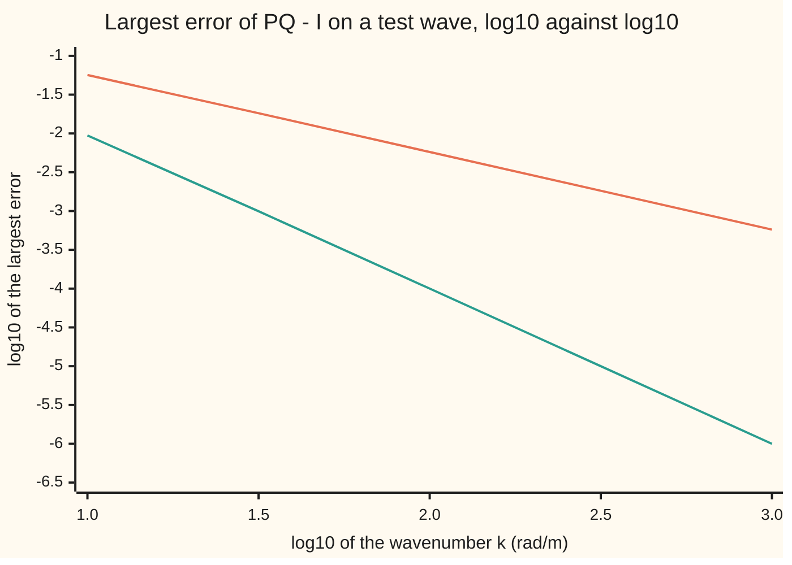

# Pseudodifferential operators: a Fourier multiplier whose gain also depends on position

[Syllabus](../../../SYLLABUS.md) → [Harmonic analysis](../README.md) → [Multipliers and Estimates for PDE](../README.md#s07) → Pseudodifferential operators

---

## General Overview

A 10-band graphic equaliser has one gain slider per octave, centred at 31, 63, 125, 250 and 500 Hz and 1, 2, 4, 8 and 16 kHz. Each slider multiplies one band of frequencies by a fixed gain. That is a **Fourier multiplier**: the gain depends on frequency only ([Fourier multipliers](01-mihlin-hormander-multiplier-theorem.md)).

Now let the sliders move while the song plays. The gain then depends on two things: where you are in the signal, and which frequency you look at. An operator of this kind is a **pseudodifferential operator**. Its gain table, a function of position and frequency, is its **symbol**.

Every linear differential operator with varying coefficients is of this kind. Take a long rod whose heat conductivity changes along it as $`c(x) = 2 + \sin x`$, in illustrative units, with $`x`$ the position in metres. The rod also leaks heat to the air. A heat source $`f(x)`$ then holds the rod at the steady temperature $`u(x)`$ that solves

```math
Pu = -\frac{d}{dx}\Bigl((2 + \sin x)\,\frac{du}{dx}\Bigr) + u = f .
```

To find $`u`$ from $`f`$ we want to undo $`P`$. For a multiplier you divide by the gain. Here the gain moves, so division is only nearly right. Divide by the main part of the gain, $`(2 + \sin x)k^2 + 1`$ for a wave of $`k`$ radians per metre. Then apply $`P`$ and compare with the input. On a heating pattern that wiggles 100 radians per metre, the mismatch is at most 0.0057723481 of the input. At 1000 radians per metre it is 0.0005773491. Ten times the wiggle rate, one tenth of the error.

That shrinking error is the whole method. One more correction term makes the error shrink like the square of the wiggle rate, and so on. The approximate inverse built this way is a **parametrix**. It proves that the solution $`u`$ is smooth wherever the source $`f`$ is smooth.

**A pseudodifferential operator multiplies each wave by a gain that depends on position and frequency; dividing by an elliptic operator's gain inverts it up to an error that shrinks like one over the frequency, and that makes its solutions as smooth as their data.**

**What kind of fact this is:** definitions (symbol, order, quantisation) and theorems. The composition formula for a differential operator, the parametrix and the L² bound for symbols that repeat in $`x`$ are proved on this card in Why it works. The general composition formula, the Calderón–Vaillancourt L² theorem and the local hypoellipticity theorem are stated with their sources.

### The picture: the error of the parametrix falls one order per term



Orange: the first parametrix $`q_0`$, falling one unit per decade (error about $`0.577/k`$). Green: $`q_0 + q_1`$, falling two units per decade (error about $`1/k^2`$). Both lines are printed by the checks.

---

## The formula

Notation first, in words. The wing measures frequency $`\xi`$ in cycles per metre, with $`\hat u(\xi) = \int u(x)\,e^{-2\pi i \xi x}\,dx`$. This card writes the **angular wavenumber** $`k = 2\pi\xi`$, in radians per metre, once and for all: then $`d/dx`$ of the wave $`e^{ikx}`$ is $`ik\,e^{ikx}`$, with no $`2\pi`$ to carry.

A **symbol** $`a(x, k)`$ is a smooth gain table. Its **quantisation**, the operator it names, is

```math
\mathrm{Op}(a)\,u(x) = \int a(x, 2\pi\xi)\,\hat u(\xi)\,e^{2\pi i x \xi}\,d\xi .
```

**Read it aloud:** split $`u`$ into waves, multiply the wave of wavenumber $`k`$ by the gain $`a(x, k)`$ at each position $`x`$, and add the waves back up.

If $`a`$ does not depend on $`x`$, this is a Fourier multiplier. On a single wave $`e_k(x) = e^{ikx}`$ it gives exactly $`\mathrm{Op}(a)\,e_k = a(x, k)\,e_k`$.

The symbol has **order** $`m`$, written $`a \in S^m`$, when it grows like $`\lvert k\rvert^m`$ and each $`k`$-derivative lowers the growth by one power:

```math
\bigl\lvert \partial_x^{\beta}\,\partial_k^{\alpha}\, a(x, k) \bigr\rvert \le C_{\alpha\beta}\,(1 + \lvert k\rvert)^{m - \alpha} .
```

The main formula is the **composition rule**. The product of two operators has the symbol

```math
\sigma(AB)(x, k) \;\approx\; \sum_{\alpha = 0}^{\infty} \frac{1}{\alpha!}\;\partial_k^{\alpha} a(x, k)\;\bigl(-i\,\partial_x\bigr)^{\alpha} b(x, k) .
```

**Read it aloud:** the symbol of the product is the product of the symbols, plus a correction that pairs each $`k`$-derivative of the first with an $`x`$-derivative of the second; each correction is one order lower than the last.

The adjoint (the operator with $`\langle A u, v\rangle = \langle u, A^* v\rangle`$) has the symbol $`\sigma(A^*) \approx \sum_\alpha \frac{1}{\alpha!}\,\partial_k^\alpha (-i\partial_x)^\alpha\, \bar a`$, where the bar is the complex conjugate.

For the rod, $`P = -c\,d^2/dx^2 - c'\,d/dx + 1`$ has the symbol

```math
p(x, k) = (2 + \sin x)\,k^2 - i\,k\cos x + 1 ,
```

and the first parametrix divides by its main part: $`q_0(x, k) = 1/\bigl((2 + \sin x)\,k^2 + 1\bigr)`$, of order $`-2`$.

| Symbol | Plain meaning | In our example | Push it up and the answer… |
| --- | --- | --- | --- |
| $`x`$, $`y`$ | position along the rod, in metres; in the fold, $`y`$ is a shift in position | one period, 0 to $`2\pi`$ | the coefficients repeat every $`2\pi`$ |
| $`k`$, $`\xi`$, $`\eta`$ | angular wavenumber $`k = 2\pi\xi`$ in radians per metre; $`\xi`$ is cycles per metre; in the fold, $`\eta`$ is a shift in wavenumber | 10, 100, 1000 | the parametrix error shrinks like $`1/k`$ |
| $`e_k`$, $`D`$ | the test wave $`e^{ikx}`$, and $`D = -i\,d/dx`$, which multiplies it by $`k`$ | a heating pattern of wavenumber $`k`$ | — |
| $`a(x, k)`$, $`b`$, $`\mathrm{Op}(a)`$, $`\sigma`$, $`p \# q`$ | a symbol (and $`b`$, a second one), the operator it names, the symbol of a given operator, and the symbol of $`PQ`$ | $`p`$, $`q_0`$, $`q_1`$ | — |
| $`m`$, $`S^m`$, $`C_{\alpha\beta}`$, $`H^s`$, $`s`$ | the order ($`m_a`$, $`m_b`$: the orders of $`a`$, $`b`$ in the fold); the class of symbols of that order; the constants in its bounds; the Sobolev space of functions with $`s`$ derivatives in L² | $`p \in S^2`$, $`q_0 \in S^{-2}`$ | more growth, rougher output |
| $`\alpha`$, $`\beta`$ | how many $`k`$- and $`x`$-derivatives are taken | $`\alpha = 0, 1, 2`$ for $`P`$ | each $`\alpha`$ lowers the order by one |
| $`c(x)`$, $`u`$, $`f`$ | heat conductivity of the rod; the steady temperature; the heat source | $`2 + \sin x`$, between 1 and 3 | closer to 0 means a bigger error constant |
| $`P`$, $`p`$ | the rod operator and its symbol | $`(2 + \sin x)k^2 - ik\cos x + 1`$ | — |
| $`Q`$, $`q_0`$, $`q_1`$ | the parametrix and its first two terms | $`q_0 = 1/(c k^2 + 1)`$ | more terms, smaller error |
| $`R`$, $`R'`$, $`r`$ | the errors $`PQ - I`$ and $`QP - I`$, and the symbol of $`R`$ | 0.0057723481 at most, at $`k = 100`$ | — |
| $`\hat a_n(k)`$, $`n`$, $`C_{02}`$ | the $`n`$-th Fourier coefficient of $`a`$ in $`x`$, for each whole number $`n`$; $`C_{02}`$ bounds $`\partial_x^2 a`$ | for the L² test symbol: 1 and 0.25 times a tilt | the sum of their sizes bounds the norm |
| $`\lVert A\rVert`$, $`N`$ | the operator's largest energy gain on L²; the number of grid points (in the fold, a number of terms; in Step 5, the Sobolev index of $`H^{-N}`$) | 1.496388 at $`N = 64`$ | larger $`N`$: order 0 settles, order 1 doubles |

### When it holds

- **The symbol is smooth and each $`k`$-derivative gains a power of $`k`$.** That is what makes each correction term smaller. A symbol with a jump in $`k`$, like the cut-off to a disc of frequencies, has no such expansion.
- **The operator is elliptic: its main part never vanishes for large $`k`$.** Here $`c(x)k^2 \ge k^2`$. Let the conductivity touch zero, $`c = 1 + \sin x`$, and the error near the touching point stays at 0.489895 even at $`k = 1000`$.
- **Order 0 for an L² bound.** An order-0 symbol gives a bounded operator. An order-1 symbol does not: its norm doubles each time the grid doubles, 7.6066 then 15.2424.
- **The expansion is asymptotic, not convergent.** The parametrix inverts $`P`$ up to an operator of order $`-\infty`$ (a smoothing operator), never exactly. That is enough for smoothness, not for a formula for $`u`$.

---

## Why it works

### Step 0: freeze the position, and pay for it one order at a time

On one wave, the operator just multiplies by the gain at each point: $`\mathrm{Op}(a)\,e_k = a(x, k)\,e_k`$. If the gain did not move with $`x`$, the inverse would divide by it, exactly.

The gain does move. Applying the second operator to a wave whose amplitude now varies with $`x`$ differentiates that amplitude. Every $`x`$-derivative of a symbol comes paired with a $`k`$-derivative of the other symbol, and a $`k`$-derivative lowers the order by one. So the price of freezing $`x`$ is a series of corrections, each one order smaller. At high wavenumber the gain barely changes over one wavelength, and the corrections fade.

### Step 1: the composition rule for a differential operator, proved

Write $`D = -i\,d/dx`$, so that $`D\,e_k = k\,e_k`$. A differential operator is $`P = \sum_j p_j(x)\,D^j`$, and its symbol is $`p(x, k) = \sum_j p_j(x)\,k^j`$, a polynomial in $`k`$.

Apply $`D`$ to an amplitude times a wave. By the product rule, $`D(b\,e_k) = e_k\,(k + D)\,b`$. Repeating, $`P(b\,e_k) = e_k\, p(x, k + D)\, b`$. Now expand the polynomial $`p(x, k + D)`$ in powers of $`D`$ by Taylor's formula in $`k`$, which is exact for a polynomial:

```math
P(b\,e_k) = e_k \sum_{\alpha = 0}^{\deg p} \frac{1}{\alpha!}\,\partial_k^\alpha p(x, k)\,D^\alpha b(x, k) .
```

That is the composition rule, with nothing left over. Since $`Q e_k = q(x, k)\,e_k`$, this gives $`PQ\,e_k = e_k\,(p \# q)`$, where $`p \# q`$ is the sum on the right.

For the rod, $`\partial_k p = 2ck - ic'`$ and $`\partial_k^2 p = 2c`$. So for any $`q`$,

```math
p \# q - 1 = (ck^2 + 1 - ikc')\,q - (2ikc + c')\,q' - c\,q'' - 1 ,
```

where primes are $`x`$-derivatives. This is the error symbol $`r`$ that the code evaluates.

<details>
<summary>The general composition rule, for two symbols that are not polynomials</summary>

Write $`\mathrm{Op}(a)\,\mathrm{Op}(b)\,u`$ as a double integral. The product's symbol is

$`\displaystyle \sigma(x, k) = \iint a(x, k + \eta)\, b(x + y, k)\, e^{-i y \eta}\, \frac{dy\, d\eta}{2\pi} .`$

Expand $`a(x, k + \eta)`$ in a Taylor series in $`\eta`$. Each power $`\eta^\alpha`$ against $`e^{-iy\eta}`$ turns into $`(-i\partial_y)^\alpha`$ acting on $`b(x + y, k)`$ at $`y = 0`$. That gives the terms of the series. The remainder after $`N`$ terms is a symbol of order $`m_a + m_b - N`$; bounding it needs integration by parts in $`y`$ and $`\eta`$ (Folland, Chapter 8; Stein, Chapter VI).

</details>

### Step 2: the adjoint, and a check that the rod's operator is self-adjoint

The heat operator $`-(cu')' + u`$ is symmetric: integrating by parts twice moves it from $`u`$ to $`v`$. Its symbol is not real, though: it has the term $`-ikc'`$. The adjoint rule reconciles the two. With $`\bar p = ck^2 + ikc' + 1`$,

```math
p^* = \bar p + \partial_k(-i\partial_x)\bar p + \tfrac12\,\partial_k^2(-i\partial_x)^2\bar p = (ck^2 + ikc' + 1) + (-2ikc' + c'') - c'' = p .
```

The code evaluates this sum at 720 points and finds $`\lvert p^* - p\rvert`$ = 0.000000000 at every one.

### Step 3: the parametrix, one order at a time

**First term.** Divide by the main part: $`q_0 = 1/(ck^2 + 1)`$. Then $`(ck^2 + 1)\,q_0 = 1`$ cancels the leading term. What is left is

```math
r_0 = -ikc'\,q_0 - 2ikc\,q_0' - c'\,q_0' - c\,q_0'' .
```

Since $`q_0' = -k^2 c'\,q_0^2`$, the first two terms are of order $`-1`$ and the last two of order $`-2`$. For large $`k`$,

```math
r_0 \approx -\frac{i c'}{c k} + \frac{2ic'}{ck} = \frac{i\cos x}{(2 + \sin x)\,k} .
```

So $`k \cdot \max_x \lvert r_0\rvert`$ tends to $`\max_x \lvert\cos x\rvert/(2 + \sin x)`$. That maximum is at $`\sin x = -\tfrac12`$, where it equals $`(\sqrt3/2)/(3/2) = 1/\sqrt3`$ = 0.577350. The code finds 0.565959, 0.577235 and 0.577349 at $`k`$ = 10, 100 and 1000.

**Second term.** Choose $`q_1`$ to cancel the order $`-1`$ part of $`r_0`$: divide it by the main part again,

```math
q_1 = -\frac{\text{(order } {-1} \text{ part of } r_0)}{ck^2 + 1} = -ikc'\,q_0^3\,(ck^2 - 1) .
```

This $`q_1`$ has order $`-3`$. With $`Q = \mathrm{Op}(q_0 + q_1)`$, the error drops to order $`-2`$: $`k^2 \cdot \max\lvert r\rvert`$ is 0.941472, 0.999400 and 0.999994, worst at $`x = 3\pi/2`$. There $`c' = 0`$, and the surviving terms give $`r \approx 1/k^2 - 2/k^2 = -1/k^2`$, so the limit is 1.

**All terms.** Repeat: each $`q_j`$ has order $`-2 - j`$ and removes the leading part of the error left by the ones before. A standard gluing step (Borel's lemma: cut each $`q_j`$ off at larger and larger $`k`$ and add) gives one symbol $`q \in S^{-2}`$ with $`PQ - I`$ and $`QP - I`$ of order $`-\infty`$. Order $`-\infty`$ means the symbol decays faster than every power of $`k`$: the operator is **smoothing**.

### Step 4: order 0 is bounded on L², proved for symbols that repeat in x

Suppose $`a \in S^0`$ repeats every $`2\pi`$ in $`x`$, as the rod's symbols do. Expand it in a Fourier series in $`x`$:

```math
a(x, k) = \sum_{n} \hat a_n(k)\, e^{inx}, \qquad \mathrm{Op}(a)\,u = \sum_n e^{inx}\,\hat a_n(D)\,u .
```

Each piece is a Fourier multiplier $`\hat a_n(D)`$, followed by multiplication by $`e^{inx}`$. By Plancherel the multiplier's L² norm is at most $`\sup_k \lvert\hat a_n(k)\rvert`$, and multiplication by $`e^{inx}`$ keeps the norm. Two integrations by parts in $`x`$ give $`\lvert\hat a_n(k)\rvert \le C_{02}/n^2`$, using the bound on $`\partial_x^2 a`$. The sizes add up to a finite total, so

```math
\lVert \mathrm{Op}(a) \rVert_{L^2 \to L^2} \le \sum_n \sup_k \lvert \hat a_n(k)\rvert < \infty .
```

The code tests this with a gain that tilts towards right-moving or left-moving waves, by an amount that changes along the rod: $`a(x, k) = 1 + \tfrac12\cos x \cdot k/\sqrt{1 + k^2}`$. Its harmonics are $`\hat a_0 = 1`$ and $`\hat a_{\pm1} = \tfrac14 k/\sqrt{1 + k^2}`$, so the bound is just under 1.5. On a 64-point grid the measured norm is 1.496388 against a bound of 1.499756.

The general theorem drops the repetition in $`x`$: every symbol in $`S^0`$ gives a bounded operator on L² (Calderón and Vaillancourt, 1971). Its proof cuts the $`(x, k)`$ plane into boxes and uses the almost-orthogonality of the pieces, the same tool as in [The T(1) theorem](04-the-t1-theorem.md). A symbol of order $`m`$ then maps the Sobolev space $`H^s`$ (functions with $`s`$ derivatives in L²) to $`H^{s - m}`$. The reason: the sandwich $`(1 + D^2)^{(s-m)/2}\,\mathrm{Op}(a)\,(1 + D^2)^{-s/2}`$ has order $`(s - m) + m - s = 0`$, so it is bounded on L².

### Step 5: hypoellipticity, from the parametrix

An operator is **hypoelliptic** when $`Pu`$ smooth on an open set forces $`u`$ smooth there. Elliptic operators are hypoelliptic, and the parametrix shows why.

1. Build the left parametrix: $`QP = I + R'`$, with $`R'`$ smoothing (Step 3, run on the other side).
2. Apply it to a solution: $`u = Qf - R'u`$.
3. If $`f`$ has $`s`$ derivatives in L², then $`Qf`$ has $`s + 2`$, because $`Q`$ has order $`-2`$ (Step 4).
4. $`R'u`$ is smooth for any $`u`$ in some Sobolev space $`H^{-N}`$, because $`R'`$ has order $`-\infty`$ and so gains every number of derivatives.

So $`u`$ is two derivatives smoother than $`f`$, and smooth when $`f`$ is. This is [Elliptic regularity](../../19-Partial%20differential%20equations/06-Weak%20Solutions%20and%20Free%20Boundaries/05-elliptic-regularity-in-outline.md), recovered without difference quotients. The local version, with $`f`$ smooth only on part of the rod, adds cut-off functions and uses one more fact: the kernel of $`\mathrm{Op}(a)`$ is smooth away from the diagonal $`x = y`$ (pseudolocality). It is stated here, with the proof in Folland, Chapter 8.

### Step 6: the wavefront set, in outline

A singularity has a place and a direction. The **wavefront set** of $`u`$ lists the pairs (position $`x`$, frequency direction) where $`u`$, cut off near $`x`$, has a transform that does not decay fast in that direction. A pseudodifferential operator never adds pairs. An elliptic one never removes them either. That sharper bookkeeping is microlocal analysis. This card only names it.

---

## Worked numbers, by hand

At $`x = 7\pi/6`$, where $`\lvert\cos x\rvert/(2 + \sin x)`$ is largest, and $`k = 100`$ rad/m:

| Step | Arithmetic | Value |
| --- | --- | --- |
| conductivity | $`c = 2 + \sin(7\pi/6) = 2 - 0.5`$ | 1.500000 |
| its slope | $`c' = \cos(7\pi/6)`$ | −0.866025 |
| first parametrix | $`q_0 = 1/(1.5 \times 100^2 + 1) = 1/15001`$ | 0.000066662 |
| slope of $`q_0`$ | $`q_0' = -k^2 c'\,q_0^2`$ | 0.000038485 |
| bend of $`q_0`$ | $`q_0''`$, by the quotient rule | 0.000022216 |
| leading cancellation | $`(ck^2 + 1)\,q_0 - 1`$ | 0 |
| term 1 | $`-ikc'\,q_0`$ | +0.005773i |
| term 2 | $`-2ikc\,q_0'`$ | −0.011545i |
| terms 3 and 4 | $`-c'q_0' - c\,q_0''`$ = 0.000033329 − 0.000033324 | nearly cancel |
| **error** $`r_0`$ | $`0.005773i - 0.011545i`$ | **−0.005772i** |

So at this point a heating wave of 100 rad/m comes back from $`PQ`$ with an extra 0.005772 of itself, turned a quarter cycle. The large-$`k`$ formula $`i\cos x/((2 + \sin x)k)`$ of Step 3 gives −0.005774i, which agrees to the order shown.

### What breaks if you drop a piece

| Mistake | Comes out at | What went wrong |
| --- | --- | --- |
| Multiply the symbols, $`pq_0 - 1`$, as for multipliers | +0.005773i, against the true −0.005772i | the $`k`$-derivative terms of the composition rule are as large as the product's error; here they flip its sign |
| Let the conductivity touch zero, $`c = 1 + \sin x`$ | error 0.489186, 0.489888, 0.489895 at $`k`$ = 10, 100, 1000 | not elliptic: near $`x = 3\pi/2`$ the main part is small, and dividing by it gains nothing |
| Stop at $`q_0`$ instead of $`q_0 + q_1`$ | 0.0005773491 at $`k = 1000`$, against 0.0000010000 | one order of the parametrix left unused |
| Use an order-1 symbol, $`1 + \tfrac12 k\cos x`$ | norm 7.6066 on 32 points, 15.2424 on 64 | order 1 grows with the highest wavenumber the grid holds: no L² bound |

---

## Code, from first principles, and it actually runs

The code builds $`q_0`$ and $`q_1`$ from their formulas, carrying each value with its first two $`x`$-derivatives (a "2-jet"), so slopes and bends are exact. It measures the error two independent ways. Road A evaluates the composition rule from Step 1. Road B never uses the rule. It applies $`P`$ to the function $`q(x, k)\,e^{ikx}`$ by finite differences, with Richardson extrapolation (combining two step sizes so that their leading errors cancel). Point by point at all 720 positions, the two roads differ by less than one millionth of the largest error for $`q_0`$, and one ten-thousandth for $`q_0 + q_1`$. A third road is the limits worked by hand: $`1/\sqrt3`$ for one term, 1 for two.

For the L² bound, the code builds the order-0 operator as a matrix on a periodic grid. It finds the norm as the square root of the largest eigenvalue of $`A^*A`$, by Jacobi rotations: each rotation clears one off-diagonal entry, and the code asserts that the trace (the sum of the eigenvalues) stays fixed. It compares that norm with the harmonic sum of Step 4, computed by its own 16-point transform.

### Python

```python
# Pseudodifferential operators: a parametrix for P = -d/dx((2 + sin x) d/dx) + 1, and an L2 bound.
import math, cmath

class J:  # a function of x with its first two x-derivatives (a 2-jet), complex values
    def __init__(s, a, b=0, c=0): s.v = (complex(a), complex(b), complex(c))
    def __add__(s, o):
        o = o if isinstance(o, J) else J(o)
        return J(*(x + y for x, y in zip(s.v, o.v)))
    __radd__ = __add__
    def __mul__(s, o):
        if not isinstance(o, J): return J(*(o * x for x in s.v))
        a, b, c = s.v; d, e, f = o.v
        return J(a * d, a * e + b * d, a * f + 2 * b * e + c * d)
    __rmul__ = __mul__
    def inv(s):
        a, b, c = s.v
        return J(1 / a, -b / a ** 2, 2 * b * b / a ** 3 - c / a ** 2)

def coef(x, base):  # c = base + sin x and c' = cos x, as jets
    return J(base + math.sin(x), math.cos(x), -math.sin(x)), J(math.cos(x), -math.sin(x), -math.cos(x))

def qsym(x, k, base, terms):  # parametrix symbol q0 (+ q1), k = angular wavenumber
    c, c1 = coef(x, base)
    q0 = (k * k * c + 1).inv()
    if terms == 1: return q0
    return q0 + (-1j * k) * c1 * q0 * q0 * q0 * (k * k * c + (-1))

def err_symbol(x, k, base, terms):  # road A: composition formula p#q - 1, exact x-derivatives
    c, c1 = coef(x, base)
    q = qsym(x, k, base, terms).v
    c0, d0 = c.v[0], c1.v[0]
    return (k * k * c0 + 1 - 1j * k * d0) * q[0] - (2j * k * c0 + d0) * q[1] - c0 * q[2] - 1

def err_direct(x, k, base, terms):  # road B: apply P to w = q(x,k) e^{ikx} by finite differences
    W = lambda s: qsym(x + s, k, base, terms).v[0] * cmath.exp(1j * k * s)  # w(x+s) e^{-ikx}
    cc = lambda s: base + math.sin(x + s)
    def Pw(h):
        return -(cc(h / 2) * (W(h) - W(0)) - cc(-h / 2) * (W(0) - W(-h))) / h ** 2 + W(0)
    d = [Pw(0.02 / k / 2 ** j) for j in range(3)]  # step halved twice, then Richardson twice
    r = [(4 * d[j + 1] - d[j]) / 3 for j in range(2)]  # cancels the h^2 error
    return (16 * r[1] - r[0]) / 15 - 1  # cancels the h^4 error

XS = [2 * math.pi * j / 720 for j in range(720)]  # every half degree along one period of the rod
def maxerr(k, base, terms, road, xs=XS):
    return max(abs(road(x, k, base, terms)) for x in xs)

print("parametrix error: max over x of |(PQ - I) e^{ikx}| / |e^{ikx}|, 720 points per period")
print("k (rad/m) | Q = q0: road A, road B, k*err | Q = q0 + q1: road A, road B, k^2*err")
for k in [10, 100, 1000]:
    a0, b0 = maxerr(k, 2, 1, err_symbol), maxerr(k, 2, 1, err_direct)
    a1, b1 = maxerr(k, 2, 2, err_symbol), maxerr(k, 2, 2, err_direct)
    gap = lambda t: max(abs(err_symbol(x, k, 2, t) - err_direct(x, k, 2, t)) for x in XS)  # point by point
    assert gap(1) < 1e-6 * a0 and gap(2) < 1e-4 * a1
    print(f"{k:4d} | {a0:.10f} {b0:.10f} {k * a0:.6f} | {a1:.10f} {b1:.10f} {k * k * a1:.6f}")
lim = 1 / math.sqrt(3)
print(f"predicted limit of k*err: max of |cos x|/(2 + sin x) = 1/sqrt(3) = {lim:.6f}")
assert abs(1000 * maxerr(1000, 2, 1, err_symbol) - lim) < 1e-5
assert maxerr(1000, 2, 2, err_symbol) < maxerr(1000, 2, 1, err_symbol) / 100
assert abs(1000 ** 2 * maxerr(1000, 2, 2, err_symbol) - 1) < 1e-3  # by hand: k^2 r -> -1 at x = 3pi/2
xbad = max(XS, key=lambda x: abs(err_symbol(x, 1000, 2, 2)))
print(f"q0 + q1 at k = 1000: worst point x = {xbad / math.pi:.6f} pi")
print("chart, log10 k: log10 err(q0), log10 err(q0 + q1)")
for e in [1, 1.5, 2, 2.5, 3]:
    k = 10 ** e
    print(f"chart,{e:.1f},{math.log10(maxerr(k, 2, 1, err_symbol)):.3f},{math.log10(maxerr(k, 2, 2, err_symbol)):.3f}")

x0, k = 7 * math.pi / 6, 100  # by hand: where |cos x|/(2 + sin x) is largest
c, c1 = coef(x0, 2)
q = qsym(x0, k, 2, 1).v
terms = [-1j * k * c1.v[0] * q[0], -2j * k * c.v[0] * q[1], -c1.v[0] * q[1], -c.v[0] * q[2]]
print(f"by hand, x = 7pi/6, k = 100: c = {c.v[0].real:.6f}, c' = {c1.v[0].real:.6f}, q0 = {q[0].real:.9f}, "
      f"q0' = {q[1].real:.9f}, q0'' = {q[2].real:.9f}")
print(f"  -ikc'q0 = {terms[0].imag:+.6f}i, -2ikc q0' = {terms[1].imag:+.6f}i, "
      f"-c'q0' = {terms[2].real:+.9f}, -c q0'' = {terms[3].real:+.9f}")
naive, true = terms[0], err_symbol(x0, k, 2, 1)
lead = math.cos(x0) / ((2 + math.sin(x0)) * k)  # large-k formula i c'/(ck)
print(f"x = 7pi/6, k = 100: naive pq - 1 = {naive.imag:+.6f}i, true PQ - I = {true.imag:+.6f}i, "
      f"large-k formula {lead:+.6f}i")
assert naive.imag * true.imag < 0 and abs(true.imag - lead) < 1e-5

def adjoint_gap(x, k):  # symbol of P*: sum over a of (1/a!) d_k^a (-i d_x)^a conj(p)
    c, c1, c2 = 2 + math.sin(x), math.cos(x), -math.sin(x)
    p = k * k * c - 1j * k * c1 + 1
    pstar = (k * k * c + 1j * k * c1 + 1) + (-1j) * (2 * k * c1 + 1j * c2) + (-1) * c2
    return abs(pstar - p)
gap = max(adjoint_gap(x, 100) for x in XS)
print(f"adjoint formula, k = 100: max |p* - p| = {gap:.9f}, so P is self-adjoint")
assert gap < 1e-9

print("degenerate rod c = 1 + sin x, zero at x = 3pi/2: max err of q0 near there")
for k in [10, 100, 1000]:
    near = [1.5 * math.pi + j / (20 * k) for j in range(-200, 201)]
    print(f"  k = {k:4d}: {maxerr(k, 1, 1, err_symbol, near):.6f}")
assert maxerr(1000, 1, 1, err_symbol, [1.5 * math.pi + j / 20000 for j in range(-200, 201)]) > 0.4
alpha = (math.sqrt(5) - 1) / 2
u = lambda y: abs(y) ** alpha
h = 1e-4
res = max(abs(-((y + h / 2) ** 2 * (u(y + h) - u(y)) - (y - h / 2) ** 2 * (u(y) - u(y - h))) / h ** 2 + u(y))
          for y in [-0.5, 0.3, 0.9])  # -(x^2 u')' + u by finite differences
print(f"model -(x^2 u')' + u = 0 is solved by u = |x|^{alpha:.6f}: residual {res:.9f}")
assert res < 1e-5

def opnorm(N, sym):  # grid quantisation (Au)_j = (1/N) sum_m a(x_j, m) uhat_m e^{i m x_j}
    xs = [2 * math.pi * j / N for j in range(N)]
    ms = range(-N // 2, N // 2)
    A = [[sum(sym(xj, m) * cmath.exp(1j * m * (xj - xl)) for m in ms) / N for xl in xs] for xj in xs]
    H = [[sum(A[j][p].conjugate() * A[j][q] for j in range(N)) for q in range(N)] for p in range(N)]  # A*A
    fro = sum(abs(z) ** 2 for row in A for z in row)  # trace of A*A: every rotation keeps it
    for sweep in range(31):  # Jacobi sweeps: each rotation clears the entry (p, q) of the Hermitian A*A
        if sum(abs(H[p][q]) ** 2 for p in range(N) for q in range(N) if p != q) < 1e-24 * fro * fro: break
        assert sweep < 30, "Jacobi sweeps converge"
        for p in range(N - 1):
            for q in range(p + 1, N):
                h = abs(H[p][q])
                if h == 0: continue
                e, th = H[p][q] / h, (H[q][q].real - H[p][p].real) / (2 * h)
                t = math.copysign(1, th) / (abs(th) + math.sqrt(th * th + 1))
                c = 1 / math.sqrt(t * t + 1); s = t * c
                for k in range(N):
                    H[k][p], H[k][q] = c * H[k][p] - s * e.conjugate() * H[k][q], s * H[k][p] + c * e.conjugate() * H[k][q]
                for k in range(N):
                    H[p][k], H[q][k] = c * H[p][k] - s * e * H[q][k], s * H[p][k] + c * e * H[q][k]
    assert abs(sum(H[j][j].real for j in range(N)) - fro) < 1e-9 * fro, "rotations keep the trace"
    return math.sqrt(max(H[j][j].real for j in range(N)))  # norm = square root of the largest eigenvalue of A*A

a0 = lambda x, m: 1 + 0.5 * math.cos(x) * m / math.sqrt(1 + m * m)
a1 = lambda x, m: 1 + 0.5 * math.cos(x) * m
def bound(N, sym, M=16):  # sum over x-harmonics n of sup_m |a_n(m)|, a_n by a 16-point DFT in x
    tot = 0
    for n in range(-M // 2, M // 2):
        tot += max(abs(sum(sym(2 * math.pi * j / M, m) * cmath.exp(-2j * math.pi * n * j / M)
                           for j in range(M)) / M) for m in range(-N // 2, N // 2))
    return tot
for N in [32, 64]:
    n0, n1, b = opnorm(N, a0), opnorm(N, a1), bound(N, a0)
    print(f"N = {N:3d}: order 0 norm {n0:.6f} <= bound {b:.6f} | order 1 norm {n1:.4f}")
    assert n0 <= b + 1e-9 and n0 > 1.4
assert opnorm(64, a1) > 1.8 * opnorm(32, a1)
print("ALL CHECKS PASS")
```

**Ran 2026-11-24 on macOS, Python 3.14.10, standard library only. All checks passed. Output, pasted from the run:**

```
parametrix error: max over x of |(PQ - I) e^{ikx}| / |e^{ikx}|, 720 points per period
k (rad/m) | Q = q0: road A, road B, k*err | Q = q0 + q1: road A, road B, k^2*err
  10 | 0.0565958593 0.0565958593 0.565959 | 0.0094147244 0.0094147244 0.941472
 100 | 0.0057723481 0.0057723481 0.577235 | 0.0000999400 0.0000999400 0.999400
1000 | 0.0005773491 0.0005773491 0.577349 | 0.0000010000 0.0000010000 0.999994
predicted limit of k*err: max of |cos x|/(2 + sin x) = 1/sqrt(3) = 0.577350
q0 + q1 at k = 1000: worst point x = 1.500000 pi
chart, log10 k: log10 err(q0), log10 err(q0 + q1)
chart,1.0,-1.247,-2.026
chart,1.5,-1.739,-3.003
chart,2.0,-2.239,-4.000
chart,2.5,-2.739,-5.000
chart,3.0,-3.239,-6.000
by hand, x = 7pi/6, k = 100: c = 1.500000, c' = -0.866025, q0 = 0.000066662, q0' = 0.000038485, q0'' = 0.000022216
  -ikc'q0 = +0.005773i, -2ikc q0' = -0.011545i, -c'q0' = +0.000033329, -c q0'' = -0.000033324
x = 7pi/6, k = 100: naive pq - 1 = +0.005773i, true PQ - I = -0.005772i, large-k formula -0.005774i
adjoint formula, k = 100: max |p* - p| = 0.000000000, so P is self-adjoint
degenerate rod c = 1 + sin x, zero at x = 3pi/2: max err of q0 near there
  k =   10: 0.489186
  k =  100: 0.489888
  k = 1000: 0.489895
model -(x^2 u')' + u = 0 is solved by u = |x|^0.618034: residual 0.000000006
N =  32: order 0 norm 1.486650 <= bound 1.499026 | order 1 norm 7.6066
N =  64: order 0 norm 1.496388 <= bound 1.499756 | order 1 norm 15.2424
ALL CHECKS PASS
```

### Rust

```rust
// Pseudodifferential operators: a parametrix for P = -d/dx((2 + sin x) d/dx) + 1, and an L2 bound.
use std::f64::consts::PI;
use std::ops::{Add, Mul, Sub, Div};

#[derive(Clone, Copy)]
struct C { re: f64, im: f64 }
fn c(re: f64, im: f64) -> C { C { re, im } }
impl Add for C { type Output = C; fn add(self, o: C) -> C { c(self.re + o.re, self.im + o.im) } }
impl Sub for C { type Output = C; fn sub(self, o: C) -> C { c(self.re - o.re, self.im - o.im) } }
impl Mul for C { type Output = C; fn mul(self, o: C) -> C { c(self.re * o.re - self.im * o.im, self.re * o.im + self.im * o.re) } }
impl Div for C { type Output = C; fn div(self, o: C) -> C { let d = o.re * o.re + o.im * o.im; c((self.re * o.re + self.im * o.im) / d, (self.im * o.re - self.re * o.im) / d) } }
impl C {
    fn abs(self) -> f64 { self.re.hypot(self.im) }
    fn conj(self) -> C { c(self.re, -self.im) }
    fn s(self, t: f64) -> C { c(self.re * t, self.im * t) }
}
fn r(x: f64) -> C { c(x, 0.0) }
fn expi(t: f64) -> C { c(t.cos(), t.sin()) }

#[derive(Clone, Copy)]
struct J { v: [C; 3] } // a function of x with its first two x-derivatives (a 2-jet), complex values
fn j3(a: C, b: C, cc: C) -> J { J { v: [a, b, cc] } }
impl Add<C> for J { type Output = J; fn add(self, o: C) -> J { j3(self.v[0] + o, self.v[1], self.v[2]) } }
impl Add for J { type Output = J; fn add(self, o: J) -> J { j3(self.v[0] + o.v[0], self.v[1] + o.v[1], self.v[2] + o.v[2]) } }
impl Mul<C> for J { type Output = J; fn mul(self, o: C) -> J { j3(o * self.v[0], o * self.v[1], o * self.v[2]) } }
impl Mul for J { type Output = J; fn mul(self, o: J) -> J {
    let [a, b, cc] = self.v; let [d, e, f] = o.v;
    j3(a * d, a * e + b * d, a * f + r(2.0) * b * e + cc * d) } }
impl J { fn inv(self) -> J { let [a, b, cc] = self.v;
    j3(r(1.0) / a, r(0.0) - b / (a * a), r(2.0) * b * b / (a * a * a) - cc / (a * a)) } }

fn coef(x: f64, base: f64) -> (J, J) { // c = base + sin x and c' = cos x, as jets
    (j3(r(base + x.sin()), r(x.cos()), r(-x.sin())), j3(r(x.cos()), r(-x.sin()), r(-x.cos())))
}
fn qsym(x: f64, k: f64, base: f64, terms: u32) -> J { // parametrix symbol q0 (+ q1)
    let (cj, c1) = coef(x, base);
    let q0 = (cj * r(k * k) + r(1.0)).inv();
    if terms == 1 { return q0; }
    q0 + c1 * c(0.0, -k) * q0 * q0 * q0 * (cj * r(k * k) + r(-1.0))
}
fn err_symbol(x: f64, k: f64, base: f64, terms: u32) -> C { // road A: composition formula p#q - 1
    let (cj, c1) = coef(x, base);
    let q = qsym(x, k, base, terms).v;
    let (c0, d0) = (cj.v[0], c1.v[0]);
    (c0 * r(k * k) + r(1.0) - c(0.0, k) * d0) * q[0] - (c(0.0, 2.0 * k) * c0 + d0) * q[1] - c0 * q[2] - r(1.0)
}
fn err_direct(x: f64, k: f64, base: f64, terms: u32) -> C { // road B: apply P to q e^{ikx} by differences
    let w = |s: f64| qsym(x + s, k, base, terms).v[0] * expi(k * s); // w(x+s) e^{-ikx}
    let cc = |s: f64| base + (x + s).sin();
    let pw = |h: f64| r(0.0) - ((w(h) - w(0.0)).s(cc(h / 2.0)) - (w(0.0) - w(-h)).s(cc(-h / 2.0))).s(1.0 / (h * h)) + w(0.0);
    let d: Vec<C> = (0..3).map(|j| pw(0.02 / k / 2f64.powi(j))).collect(); // step halved twice
    let rr: Vec<C> = (0..2).map(|j| (d[j + 1].s(4.0) - d[j]).s(1.0 / 3.0)).collect(); // cancels h^2
    (rr[1].s(16.0) - rr[0]).s(1.0 / 15.0) - r(1.0) // cancels the h^4 error
}
fn maxerr(k: f64, base: f64, terms: u32, road: fn(f64, f64, f64, u32) -> C, xs: &[f64]) -> f64 {
    xs.iter().map(|&x| road(x, k, base, terms).abs()).fold(0.0, f64::max)
}
fn adjoint_gap(x: f64, k: f64) -> f64 { // symbol of P*: sum over a of (1/a!) d_k^a (-i d_x)^a conj(p)
    let (cc, c1, c2) = (2.0 + x.sin(), x.cos(), -x.sin());
    let p = c(k * k * cc + 1.0, -k * c1);
    let pstar = c(k * k * cc + 1.0, k * c1) + c(0.0, -1.0) * c(2.0 * k * c1, c2) - r(c2);
    (pstar - p).abs()
}
fn opnorm(n: usize, sym: fn(f64, f64) -> f64) -> f64 { // grid quantisation of a(x, m)
    let xs: Vec<f64> = (0..n).map(|j| 2.0 * PI * j as f64 / n as f64).collect();
    let h = (n / 2) as i64;
    let a: Vec<Vec<C>> = xs.iter().map(|&xj| xs.iter().map(|&xl| {
        let mut s = r(0.0);
        for m in -h..h { s = s + expi(m as f64 * (xj - xl)).s(sym(xj, m as f64)); }
        s.s(1.0 / n as f64) }).collect()).collect();
    let mut hm: Vec<Vec<C>> = (0..n).map(|p| (0..n).map(|q| { // A*A
        let mut s = r(0.0); for j in 0..n { s = s + a[j][p].conj() * a[j][q]; } s }).collect()).collect();
    let fro = a.iter().flatten().map(|z| z.abs().powi(2)).fold(0.0, |s, v| s + v); // trace of A*A: every rotation keeps it
    let off = |hm: &Vec<Vec<C>>| { let mut s = 0.0; for p in 0..n { for q in 0..n { if p != q { s += hm[p][q].abs().powi(2); } } } s };
    for sweep in 0..31 { // Jacobi sweeps: each rotation clears the entry (p, q) of the Hermitian A*A
        if off(&hm) < 1e-24 * fro * fro { break; }
        assert!(sweep < 30, "Jacobi sweeps converge");
        for p in 0..n - 1 { for q in p + 1..n {
            let g = hm[p][q].abs();
            if g == 0.0 { continue; }
            let (e, th) = (c(hm[p][q].re / g, hm[p][q].im / g), (hm[q][q].re - hm[p][p].re) / (2.0 * g));
            let t = 1f64.copysign(th) / (th.abs() + (th * th + 1.0).sqrt());
            let cs = 1.0 / (t * t + 1.0).sqrt(); let sn = t * cs;
            for k in 0..n { let (hp, hq) = (hm[k][p], hm[k][q]); hm[k][p] = hp.s(cs) - e.conj().s(sn) * hq; hm[k][q] = hp.s(sn) + e.conj().s(cs) * hq; }
            for k in 0..n { let (hp, hq) = (hm[p][k], hm[q][k]); hm[p][k] = hp.s(cs) - e.s(sn) * hq; hm[q][k] = hp.s(sn) + e.s(cs) * hq; }
        } }
    }
    assert!(((0..n).map(|j| hm[j][j].re).fold(0.0, |s, v| s + v) - fro).abs() < 1e-9 * fro, "rotations keep the trace");
    (0..n).map(|j| hm[j][j].re).fold(f64::MIN, f64::max).sqrt() // norm = square root of the largest eigenvalue of A*A
}
fn a0(x: f64, m: f64) -> f64 { 1.0 + 0.5 * x.cos() * m / (1.0 + m * m).sqrt() }
fn a1(x: f64, m: f64) -> f64 { 1.0 + 0.5 * x.cos() * m }
fn bound(n: usize, sym: fn(f64, f64) -> f64) -> f64 { // sum over x-harmonics of sup_m |a_n(m)|
    let big = 16i64;
    let mut tot = 0.0;
    for nn in -big / 2..big / 2 {
        let mut best = 0.0f64;
        for m in -(n as i64) / 2..(n as i64) / 2 {
            let mut s = r(0.0);
            for j in 0..big { s = s + expi(-2.0 * PI * nn as f64 * j as f64 / big as f64).s(sym(2.0 * PI * j as f64 / big as f64, m as f64)); }
            best = best.max(s.s(1.0 / big as f64).abs());
        }
        tot += best;
    }
    tot
}

fn main() {
    let xs: Vec<f64> = (0..720).map(|j| 2.0 * PI * j as f64 / 720.0).collect();
    println!("parametrix error: max over x of |(PQ - I) e^{{ikx}}| / |e^{{ikx}}|, 720 points per period");
    println!("k (rad/m) | Q = q0: road A, road B, k*err | Q = q0 + q1: road A, road B, k^2*err");
    for k in [10.0, 100.0, 1000.0] {
        let (e0, b0) = (maxerr(k, 2.0, 1, err_symbol, &xs), maxerr(k, 2.0, 1, err_direct, &xs));
        let (e1, b1) = (maxerr(k, 2.0, 2, err_symbol, &xs), maxerr(k, 2.0, 2, err_direct, &xs));
        let gap = |t: u32| xs.iter().map(|&x| (err_symbol(x, k, 2.0, t) - err_direct(x, k, 2.0, t)).abs()).fold(0.0, f64::max); // point by point
        assert!(gap(1) < 1e-6 * e0 && gap(2) < 1e-4 * e1);
        println!("{:4} | {:.10} {:.10} {:.6} | {:.10} {:.10} {:.6}", k as i64, e0, b0, k * e0, e1, b1, k * k * e1);
    }
    let lim = 1.0 / 3f64.sqrt();
    println!("predicted limit of k*err: max of |cos x|/(2 + sin x) = 1/sqrt(3) = {:.6}", lim);
    assert!((1000.0 * maxerr(1000.0, 2.0, 1, err_symbol, &xs) - lim).abs() < 1e-5);
    assert!(maxerr(1000.0, 2.0, 2, err_symbol, &xs) < maxerr(1000.0, 2.0, 1, err_symbol, &xs) / 100.0);
    assert!((1e6 * maxerr(1000.0, 2.0, 2, err_symbol, &xs) - 1.0).abs() < 1e-3); // by hand: k^2 r -> -1 at x = 3pi/2
    let mut xbad = 0.0; let mut worst = -1.0;
    for &x in &xs { let e = err_symbol(x, 1000.0, 2.0, 2).abs(); if e > worst { worst = e; xbad = x; } }
    println!("q0 + q1 at k = 1000: worst point x = {:.6} pi", xbad / PI);
    println!("chart, log10 k: log10 err(q0), log10 err(q0 + q1)");
    for e in [1.0, 1.5, 2.0, 2.5, 3.0f64] {
        let k = 10f64.powf(e);
        println!("chart,{:.1},{:.3},{:.3}", e, maxerr(k, 2.0, 1, err_symbol, &xs).log10(), maxerr(k, 2.0, 2, err_symbol, &xs).log10());
    }
    let (x0, k) = (7.0 * PI / 6.0, 100.0); // by hand: where |cos x|/(2 + sin x) is largest
    let (cj, c1) = coef(x0, 2.0);
    let q = qsym(x0, k, 2.0, 1).v;
    let t = [c(0.0, -k) * c1.v[0] * q[0], c(0.0, -2.0 * k) * cj.v[0] * q[1], r(0.0) - c1.v[0] * q[1], r(0.0) - cj.v[0] * q[2]];
    println!("by hand, x = 7pi/6, k = 100: c = {:.6}, c' = {:.6}, q0 = {:.9}, q0' = {:.9}, q0'' = {:.9}", cj.v[0].re, c1.v[0].re, q[0].re, q[1].re, q[2].re);
    println!("  -ikc'q0 = {:+.6}i, -2ikc q0' = {:+.6}i, -c'q0' = {:+.9}, -c q0'' = {:+.9}", t[0].im, t[1].im, t[2].re, t[3].re);
    let (naive, truth) = (t[0], err_symbol(x0, k, 2.0, 1));
    let lead = x0.cos() / ((2.0 + x0.sin()) * k); // large-k formula i c'/(ck)
    println!("x = 7pi/6, k = 100: naive pq - 1 = {:+.6}i, true PQ - I = {:+.6}i, large-k formula {:+.6}i", naive.im, truth.im, lead);
    assert!(naive.im * truth.im < 0.0 && (truth.im - lead).abs() < 1e-5);
    let gap = xs.iter().map(|&x| adjoint_gap(x, 100.0)).fold(0.0, f64::max);
    println!("adjoint formula, k = 100: max |p* - p| = {:.9}, so P is self-adjoint", gap);
    assert!(gap < 1e-9);
    println!("degenerate rod c = 1 + sin x, zero at x = 3pi/2: max err of q0 near there");
    let near = |k: f64| -> Vec<f64> { (-200..=200).map(|j| 1.5 * PI + j as f64 / (20.0 * k)).collect() };
    for k in [10.0, 100.0, 1000.0] { println!("  k = {:4}: {:.6}", k as i64, maxerr(k, 1.0, 1, err_symbol, &near(k))); }
    assert!(maxerr(1000.0, 1.0, 1, err_symbol, &near(1000.0)) > 0.4);
    let alpha = (5f64.sqrt() - 1.0) / 2.0;
    let u = |y: f64| y.abs().powf(alpha);
    let h = 1e-4;
    let res = [-0.5, 0.3, 0.9f64].iter().map(|&y| (-((y + h / 2.0).powi(2) * (u(y + h) - u(y))
        - (y - h / 2.0).powi(2) * (u(y) - u(y - h))) / (h * h) + u(y)).abs()).fold(0.0, f64::max);
    println!("model -(x^2 u')' + u = 0 is solved by u = |x|^{:.6}: residual {:.9}", alpha, res);
    assert!(res < 1e-5);
    for n in [32usize, 64] {
        let (n0, n1, b) = (opnorm(n, a0), opnorm(n, a1), bound(n, a0));
        println!("N = {:3}: order 0 norm {:.6} <= bound {:.6} | order 1 norm {:.4}", n, n0, b, n1);
        assert!(n0 <= b + 1e-9 && n0 > 1.4);
    }
    assert!(opnorm(64, a1) > 1.8 * opnorm(32, a1));
    println!("ALL CHECKS PASS");
}
```

**Ran 2026-11-24 on macOS, rustc 1.98.1, no crates. All checks passed. Output, pasted from the run:**

```
parametrix error: max over x of |(PQ - I) e^{ikx}| / |e^{ikx}|, 720 points per period
k (rad/m) | Q = q0: road A, road B, k*err | Q = q0 + q1: road A, road B, k^2*err
  10 | 0.0565958593 0.0565958593 0.565959 | 0.0094147244 0.0094147244 0.941472
 100 | 0.0057723481 0.0057723481 0.577235 | 0.0000999400 0.0000999400 0.999400
1000 | 0.0005773491 0.0005773491 0.577349 | 0.0000010000 0.0000010000 0.999994
predicted limit of k*err: max of |cos x|/(2 + sin x) = 1/sqrt(3) = 0.577350
q0 + q1 at k = 1000: worst point x = 1.500000 pi
chart, log10 k: log10 err(q0), log10 err(q0 + q1)
chart,1.0,-1.247,-2.026
chart,1.5,-1.739,-3.003
chart,2.0,-2.239,-4.000
chart,2.5,-2.739,-5.000
chart,3.0,-3.239,-6.000
by hand, x = 7pi/6, k = 100: c = 1.500000, c' = -0.866025, q0 = 0.000066662, q0' = 0.000038485, q0'' = 0.000022216
  -ikc'q0 = +0.005773i, -2ikc q0' = -0.011545i, -c'q0' = +0.000033329, -c q0'' = -0.000033324
x = 7pi/6, k = 100: naive pq - 1 = +0.005773i, true PQ - I = -0.005772i, large-k formula -0.005774i
adjoint formula, k = 100: max |p* - p| = 0.000000000, so P is self-adjoint
degenerate rod c = 1 + sin x, zero at x = 3pi/2: max err of q0 near there
  k =   10: 0.489186
  k =  100: 0.489888
  k = 1000: 0.489895
model -(x^2 u')' + u = 0 is solved by u = |x|^0.618034: residual 0.000000006
N =  32: order 0 norm 1.486650 <= bound 1.499026 | order 1 norm 7.6066
N =  64: order 0 norm 1.496388 <= bound 1.499756 | order 1 norm 15.2424
ALL CHECKS PASS
```

### Lean

Lean proves Step 1's composition rule and Step 3's first parametrix bounds on every test wave, and checks the worked numbers.

- Take a conductivity $`c`$ that has a slope everywhere, and an amplitude $`b`$ with two continuous derivatives. Then $`P(b\,e_k) = e_k\,(p \# b)`$, with nothing left over.
- Take $`q_0 = 1/(ck^2 + 1)`$, with $`c`$ smooth, all its derivatives bounded, and $`c`$ above some positive number. Then one constant $`C`$ bounds the error on every test wave by $`C/\lvert k\rvert`$, for all $`\lvert k\rvert \ge 1`$.
- Take the rod, $`c = 2 + \sin x`$. Then $`k`$ times the largest error of $`q_0`$ tends to $`1/\sqrt3`$, the largest value of $`\lvert\cos x\rvert/(2 + \sin x)`$.
- At $`x = 7\pi/6`$ and $`k = 100`$, the conductivity is $`3/2`$ and $`ck^2 + 1 = 15001`$.
- Where $`\sin x = -1/2`$, the ratio $`\cos^2 x/(2 + \sin x)^2`$ is $`(3/4)/(9/4) = 1/3`$.
- For the degenerate model, the exponent $`(\sqrt5 - 1)/2`$, about 0.618034, times the exponent plus one is exactly 1.
- The L² test symbol's harmonic bound is $`1 + 1/4 + 1/4 = 3/2`$.

Lean has no pseudodifferential calculus, so $`q_1`$, the adjoint, the L² bound and every measured number are left to the Python and Rust checks.

```lean
-- Pseudodifferential operators: dividing the rod operator P u = -(c u')' + u by the main part of its gain inverts it on every test wave up to an error at most a constant over the wavenumber, the composition rule for P holds exactly, and for c = 2 + sin x the error times the wavenumber tends to 1/√3.
import Mathlib.Analysis.Calculus.ContDiff.Defs
import Mathlib.Analysis.Calculus.IteratedDeriv.Defs
import Mathlib.Analysis.SpecialFunctions.Trigonometric.Deriv
import Mathlib.Analysis.SpecialFunctions.Sqrt
import Mathlib.Order.Filter.AtTopBot.Basic
import Mathlib.Analysis.Complex.RealDeriv
import Mathlib.Analysis.Calculus.ContDiff.Deriv
import Mathlib.Basic.Real.Pointwise
import Mathlib.Analysis.SpecialFunctions.Trigonometric.Basic

open Filter Topology
open scoped ContDiff

namespace PseudodifferentialCard

/-! Mathlib has no pseudodifferential calculus: no symbol classes `S^m`, no quantisation of a
symbol that depends on position, no Calderón-Vaillancourt theorem and no hypoellipticity. So this
file states the card's parametrix exactly where the card measures it: on the test waves
`e_k(x) = e^{ikx}`, where `Op(a) e_k = a(x, k) e_k`, so the operator `Q₀ = Op(q₀)` sends `e_k`
to `q₀(x, k) e_k` and the error of `P Q₀ - I` on `e_k` is `P(q₀ e_k) - e_k`. -/

/-- The rod operator `P u = -(c u')' + u`, for a conductivity `c` along the rod and a
complex-valued temperature profile `u`. -/
noncomputable def rodOp (c : ℝ → ℝ) (u : ℝ → ℂ) (x : ℝ) : ℂ :=
  -deriv (fun y => (c y : ℂ) * deriv u y) x + u x

/-- The test wave `e_k(x) = e^{ikx}`, with `k` the angular wavenumber in radians per metre. -/
noncomputable def wave (k x : ℝ) : ℂ := Complex.exp (Complex.I * k * x)

/-- The first parametrix symbol `q₀(x, k) = 1 / (c(x) k² + 1)`: one over the main part of the
rod's gain `p(x, k) = c(x) k² - i k c'(x) + 1`. -/
noncomputable def q0 (c : ℝ → ℝ) (k x : ℝ) : ℝ := 1 / (c x * k ^ 2 + 1)

/-! Helper lemmas for the proofs below. -/

lemma wave_hasDerivAt (k y : ℝ) :
    HasDerivAt (fun y => wave k y) (wave k y * (Complex.I * k)) y := by
  have h1 : HasDerivAt (fun y : ℝ => ((y : ℝ) : ℂ)) 1 y := by
    simpa using (hasDerivAt_id y).ofReal_comp
  have h2 := (h1.const_mul (Complex.I * k)).cexp
  simpa [wave] using h2

#print axioms wave_hasDerivAt

lemma norm_wave (k x : ℝ) : ‖wave k x‖ = 1 := by
  simp [wave, Complex.norm_exp]

#print axioms norm_wave

lemma rod_composition_rule_aux (c : ℝ → ℝ) (hc : Differentiable ℝ c) (b : ℝ → ℂ)
    (hb : ContDiff ℝ 2 b) (k x : ℝ) :
    rodOp c (fun y => b y * wave k y) x =
      wave k x * (((c x : ℂ) * (k : ℂ) ^ 2 + 1 - Complex.I * k * ((deriv c x : ℝ) : ℂ)) * b x
        - (2 * Complex.I * k * (c x : ℂ) + ((deriv c x : ℝ) : ℂ)) * deriv b x
        - (c x : ℂ) * deriv (deriv b) x) := by
  have hb1 : ContDiff ℝ 1 (deriv b) := hb.deriv'
  have hbd : Differentiable ℝ b := hb.differentiable (by norm_num)
  have hbd' : Differentiable ℝ (deriv b) := hb1.differentiable (by norm_num)
  have hd : ∀ y, HasDerivAt (fun y => b y * wave k y)
      (wave k y * (deriv b y + Complex.I * k * b y)) y := by
    intro y
    have := (hbd y).hasDerivAt.mul (wave_hasDerivAt k y)
    convert this using 1; ring
  have hfun : (fun y => (c y : ℂ) * deriv (fun y => b y * wave k y) y) =
      fun y => (c y : ℂ) * (wave k y * (deriv b y + Complex.I * k * b y)) := by
    funext y; rw [(hd y).deriv]
  have hc' : HasDerivAt (fun y => (c y : ℂ)) ((deriv c x : ℝ) : ℂ) x :=
    (hc x).hasDerivAt.ofReal_comp
  have h3 : HasDerivAt (fun y => (c y : ℂ) * (wave k y * (deriv b y + Complex.I * k * b y)))
      (((deriv c x : ℝ) : ℂ) * (wave k x * (deriv b x + Complex.I * k * b x)) + (c x : ℂ) *
        (wave k x * (Complex.I * k) * (deriv b x + Complex.I * k * b x)
          + wave k x * (deriv (deriv b) x + Complex.I * k * deriv b x))) x :=
    hc'.mul ((wave_hasDerivAt k x).mul
      ((hbd' x).hasDerivAt.add (((hbd x).hasDerivAt).const_mul (Complex.I * k))))
  unfold rodOp
  rw [hfun, h3.deriv]
  linear_combination (-(c x : ℂ) * wave k x * (k : ℂ) ^ 2 * b x) * Complex.I_sq

#print axioms rod_composition_rule_aux

lemma error_eq (c : ℝ → ℝ) (hc : ContDiff ℝ 2 c) (hpos : ∀ y, 0 ≤ c y) (k x : ℝ) :
    rodOp c (fun y => (q0 c k y : ℂ) * wave k y) x - wave k x =
      wave k x * (((k ^ 2 * q0 c k x ^ 2 * (deriv c x ^ 2 * (1 - 2 * c x * k ^ 2 * q0 c k x)
        + c x * deriv (deriv c) x) : ℝ) : ℂ)
        + ((k * deriv c x * q0 c k x * (2 * c x * k ^ 2 * q0 c k x - 1) : ℝ) : ℂ)
          * Complex.I) := by
  have hc1 : Differentiable ℝ c := hc.differentiable (by norm_num)
  have hc2 : Differentiable ℝ (deriv c) := (hc.deriv' : ContDiff ℝ 1 (deriv c)).differentiable
    (by norm_num)
  have hD : ∀ y, 0 < c y * k ^ 2 + 1 := fun y => by have := hpos y; positivity
  have hq1 : ∀ y, HasDerivAt (q0 c k) (-(deriv c y * k ^ 2) * q0 c k y ^ 2) y := by
    intro y
    have := (((hc1 y).hasDerivAt.mul_const (k ^ 2)).add_const 1).inv (hD y).ne'
    convert this using 1
    · funext z; simp [q0]
    · simp only [q0]; field_simp
  have hdq : deriv (q0 c k) = fun y => -(deriv c y * k ^ 2) * q0 c k y ^ 2 :=
    funext fun y => (hq1 y).deriv
  have hq2 : HasDerivAt (fun y => -(deriv c y * k ^ 2) * q0 c k y ^ 2)
      (-(deriv (deriv c) x * k ^ 2) * q0 c k x ^ 2
        + 2 * (deriv c x) ^ 2 * k ^ 4 * q0 c k x ^ 3) x := by
    have := ((hc2 x).hasDerivAt.mul_const (k ^ 2)).neg.mul ((hq1 x).pow 2)
    convert this using 1
    simp; ring
  have hB : ContDiff ℝ 2 (fun y => (q0 c k y : ℂ)) := by
    have hq : ContDiff ℝ 2 (q0 c k) := by
      have : q0 c k = fun y => 1 / (c y * k ^ 2 + 1) := rfl
      rw [this]
      exact contDiff_const.div ((hc.mul contDiff_const).add contDiff_const)
        (fun y => (hD y).ne')
    exact Complex.ofRealCLM.contDiff.comp hq
  have hdB : deriv (fun y => (q0 c k y : ℂ)) =
      fun y => ((-(deriv c y * k ^ 2) * q0 c k y ^ 2 : ℝ) : ℂ) :=
    funext fun y => (hq1 y).ofReal_comp.deriv
  have hddB : deriv (deriv (fun y => (q0 c k y : ℂ))) x =
      ((-(deriv (deriv c) x * k ^ 2) * q0 c k x ^ 2
        + 2 * (deriv c x) ^ 2 * k ^ 4 * q0 c k x ^ 3 : ℝ) : ℂ) := by
    rw [hdB]; exact hq2.ofReal_comp.deriv
  have hu : (q0 c k x : ℂ) * ((c x : ℂ) * (k : ℂ) ^ 2 + 1) = 1 := by
    have : q0 c k x * (c x * k ^ 2 + 1) = 1 := by
      simp only [q0]; rw [one_div, inv_mul_cancel₀ (hD x).ne']
    exact_mod_cast this
  rw [rod_composition_rule_aux c hc1 _ hB k x, hddB, hdB]
  push_cast
  linear_combination (wave k x) * hu

#print axioms error_eq

lemma norm_re_add_im_le (A B : ℝ) : ‖(A : ℂ) + (B : ℂ) * Complex.I‖ ≤ |A| + |B| :=
  (norm_add_le _ _).trans (le_of_eq (by simp [Complex.norm_real]))

#print axioms norm_re_add_im_le

lemma key_bound (k δ c c1 c2 M1 M2 u : ℝ) (hk : 1 ≤ |k|) (hδ : 0 < δ) (hc : δ ≤ c)
    (h1 : |c1| ≤ M1) (h2 : |c2| ≤ M2) (hu : u * (c * k ^ 2 + 1) = 1) :
    |k ^ 2 * u ^ 2 * (c1 ^ 2 * (1 - 2 * c * k ^ 2 * u) + c * c2)|
      + |k * c1 * u * (2 * c * k ^ 2 * u - 1)| ≤ ((M1 + M2) / δ + M1 ^ 2 / δ ^ 2) / |k| := by
  set K := |k| with hKdef
  have hK2 : k ^ 2 = K ^ 2 := (sq_abs k).symm
  have hK0 : 0 < K := by linarith
  have hc0 : 0 < c := by linarith
  have hD : 0 < c * k ^ 2 + 1 := by positivity
  have hu0 : 0 < u := by
    by_contra h
    have h' := not_lt.mp h
    nlinarith
  have hs0 : 0 ≤ c * k ^ 2 * u := by positivity
  have hs1 : c * k ^ 2 * u ≤ 1 := by nlinarith
  have hp : δ * K ^ 2 * u ≤ 1 := by
    rw [← hK2]
    have : δ * (k ^ 2 * u) ≤ c * (k ^ 2 * u) :=
      mul_le_mul_of_nonneg_right hc (by positivity)
    nlinarith
  have hp0 : 0 ≤ δ * K ^ 2 * u := by positivity
  have hsK : c * K ^ 2 * u ≤ 1 := by rw [← hK2]; exact hs1
  have hsK0 : 0 ≤ c * K ^ 2 * u := by positivity
  have hM1 : 0 ≤ M1 := (abs_nonneg _).trans h1
  have hM2 : 0 ≤ M2 := (abs_nonneg _).trans h2
  have hB : |k * c1 * u * (2 * c * k ^ 2 * u - 1)| ≤ K * M1 * u := by
    have e : |2 * c * k ^ 2 * u - 1| ≤ 1 := abs_le.mpr ⟨by nlinarith, by nlinarith⟩
    calc |k * c1 * u * (2 * c * k ^ 2 * u - 1)|
        = K * |c1| * u * |2 * c * k ^ 2 * u - 1| := by
          simp [abs_mul, abs_of_pos hu0, hKdef]
      _ ≤ K * M1 * u * 1 := by gcongr
      _ = K * M1 * u := mul_one _
  have hA : |k ^ 2 * u ^ 2 * (c1 ^ 2 * (1 - 2 * c * k ^ 2 * u) + c * c2)|
      ≤ K ^ 2 * u ^ 2 * (M1 ^ 2 + c * M2) := by
    have e : |1 - 2 * c * k ^ 2 * u| ≤ 1 := abs_le.mpr ⟨by nlinarith, by nlinarith⟩
    have e1 : |c1 ^ 2 * (1 - 2 * c * k ^ 2 * u)| ≤ M1 ^ 2 := by
      rw [abs_mul, abs_pow]
      calc |c1| ^ 2 * |1 - 2 * c * k ^ 2 * u| ≤ M1 ^ 2 * 1 := by gcongr
        _ = M1 ^ 2 := mul_one _
    have e2 : |c * c2| ≤ c * M2 := by
      rw [abs_mul, abs_of_pos hc0]; gcongr
    rw [abs_mul, abs_of_nonneg (by positivity)]
    rw [hK2] at e1 ⊢
    gcongr
    exact (abs_add_le _ _).trans (add_le_add e1 e2)
  have hK34 : K ^ 3 ≤ K ^ 4 := pow_le_pow_right₀ hk (by norm_num)
  have f1 : K ^ 2 * M1 * u * δ ^ 2 ≤ M1 * δ := by
    calc K ^ 2 * M1 * u * δ ^ 2 = (δ * K ^ 2 * u) * (M1 * δ) := by ring
      _ ≤ 1 * (M1 * δ) := by gcongr
      _ = M1 * δ := one_mul _
  have f2 : K ^ 3 * u ^ 2 * δ ^ 2 * M1 ^ 2 ≤ M1 ^ 2 := by
    calc K ^ 3 * u ^ 2 * δ ^ 2 * M1 ^ 2 ≤ K ^ 4 * u ^ 2 * δ ^ 2 * M1 ^ 2 := by gcongr
      _ = (δ * K ^ 2 * u) ^ 2 * M1 ^ 2 := by ring
      _ ≤ 1 ^ 2 * M1 ^ 2 := by gcongr
      _ = M1 ^ 2 := by ring
  have f3 : K ^ 3 * u ^ 2 * δ ^ 2 * (c * M2) ≤ δ * M2 := by
    calc K ^ 3 * u ^ 2 * δ ^ 2 * (c * M2) ≤ K ^ 4 * u ^ 2 * δ ^ 2 * (c * M2) := by gcongr
      _ = (δ * K ^ 2 * u) * (c * K ^ 2 * u) * (δ * M2) := by ring
      _ ≤ 1 * 1 * (δ * M2) := by gcongr
      _ = δ * M2 := by ring
  have hC : (M1 + M2) / δ + M1 ^ 2 / δ ^ 2 = ((M1 + M2) * δ + M1 ^ 2) / δ ^ 2 := by
    field_simp
  rw [hC, div_div, le_div_iff₀ (by positivity)]
  calc (|k ^ 2 * u ^ 2 * (c1 ^ 2 * (1 - 2 * c * k ^ 2 * u) + c * c2)|
        + |k * c1 * u * (2 * c * k ^ 2 * u - 1)|) * (δ ^ 2 * K)
      ≤ (K ^ 2 * u ^ 2 * (M1 ^ 2 + c * M2) + K * M1 * u) * (δ ^ 2 * K) := by gcongr
    _ ≤ (M1 + M2) * δ + M1 ^ 2 := by linear_combination f1 + f2 + f3

#print axioms key_bound

lemma sharp_core (k c s co u : ℝ) (hk : 1 ≤ k) (hc1 : 1 ≤ c) (hc3 : c ≤ 3) (hs : |s| ≤ 1)
    (hco : |co| ≤ 1) (hu : u * (c * k ^ 2 + 1) = 1) :
    |k * ‖(((k ^ 2 * u ^ 2 * (co ^ 2 * (1 - 2 * c * k ^ 2 * u) + c * -s)) : ℝ) : ℂ)
        + ((k * co * u * (2 * c * k ^ 2 * u - 1) : ℝ) : ℂ) * Complex.I‖ - |co| / c|
      ≤ 7 / k := by
  set A := k ^ 2 * u ^ 2 * (co ^ 2 * (1 - 2 * c * k ^ 2 * u) + c * -s) with hA
  set B := k * co * u * (2 * c * k ^ 2 * u - 1) with hB
  have hk0 : 0 < k := by linarith
  have hc0 : 0 < c := by linarith
  have hD : 0 < c * k ^ 2 + 1 := by positivity
  have hu0 : 0 < u := by
    by_contra h
    have h' := not_lt.mp h
    nlinarith
  have hs0 : 0 ≤ c * k ^ 2 * u := by positivity
  have hs1 : c * k ^ 2 * u ≤ 1 := by nlinarith
  have hu1 : u ≤ 1 := by nlinarith
  have hk2u : k ^ 2 * u ≤ 1 := by
    have : 1 * (k ^ 2 * u) ≤ c * (k ^ 2 * u) := mul_le_mul_of_nonneg_right hc1 (by positivity)
    nlinarith
  have hku : k * u ≤ 1 := by nlinarith
  have step1 := abs_sub_le (k * ‖(A : ℂ) + (B : ℂ) * Complex.I‖) (k * abs B) (|co| / c)
  have step2 : |k * ‖(A : ℂ) + (B : ℂ) * Complex.I‖ - k * abs B| ≤ k * |A| := by
    rw [← mul_sub, abs_mul k, abs_of_pos hk0]
    refine mul_le_mul_of_nonneg_left ?_ hk0.le
    have := abs_norm_sub_norm_le ((A : ℂ) + (B : ℂ) * Complex.I) ((B : ℂ) * Complex.I)
    simpa [Complex.norm_real] using this
  have step3 : k * |A| ≤ 4 / k := by
    have e : |1 - 2 * c * k ^ 2 * u| ≤ 1 := abs_le.mpr ⟨by nlinarith, by nlinarith⟩
    have hco2 : co ^ 2 ≤ 1 := by
      rw [← sq_abs]; calc |co| ^ 2 ≤ 1 ^ 2 := by gcongr
        _ = 1 := one_pow 2
    have e1 : |co ^ 2 * (1 - 2 * c * k ^ 2 * u) + c * -s| ≤ 4 := by
      refine (abs_add_le _ _).trans ?_
      rw [abs_mul, abs_mul, abs_neg, abs_of_pos hc0, abs_pow]
      have : |co| ^ 2 * |1 - 2 * c * k ^ 2 * u| ≤ 1 * 1 := by
        rw [sq_abs]; gcongr
      have : c * |s| ≤ 3 * 1 := by gcongr
      linarith
    have hA' : |A| ≤ k ^ 2 * u ^ 2 * 4 := by
      rw [hA, abs_mul, abs_of_nonneg (by positivity)]; gcongr
    rw [le_div_iff₀ hk0]
    calc k * |A| * k ≤ k * (k ^ 2 * u ^ 2 * 4) * k := by gcongr
      _ = (k ^ 2 * u) ^ 2 * 4 := by ring
      _ ≤ 1 ^ 2 * 4 := by gcongr
      _ = 4 := by ring
  have step4 : |k * abs B - |co| / c| ≤ 3 / k := by
    have h1 : k * abs B = |k * B| := by rw [abs_mul k B, abs_of_pos hk0]
    have h2 : |co| / c = |co / c| := by rw [abs_div, abs_of_pos hc0]
    rw [h1, h2]
    refine (abs_abs_sub_abs_le_abs_sub _ _).trans ?_
    have hid : k * B - co / c = co * (u * (2 * u - 3)) / c := by
      rw [hB]
      field_simp
      linear_combination (co * (3 - 4 * u + 2 * (u * c * k ^ 2 + u - 1))) * hu
    rw [hid, abs_div, abs_of_pos hc0, div_le_iff₀ hc0, abs_mul, abs_mul, abs_of_pos hu0]
    have e : |2 * u - 3| ≤ 3 := abs_le.mpr ⟨by linarith, by linarith⟩
    have hu3 : u ≤ 1 / k := by rw [le_div_iff₀ hk0]; linarith
    calc |co| * (u * |2 * u - 3|) ≤ 1 * (u * 3) := by gcongr
      _ = 3 * u * 1 := by ring
      _ ≤ 3 * (1 / k) * c := by gcongr
      _ = 3 / k * c := by ring
  calc _ ≤ _ := step1
    _ ≤ 4 / k + 3 / k := add_le_add (step2.trans step3) step4
    _ = 7 / k := by ring

#print axioms sharp_core

lemma sharp_pointwise (k x : ℝ) (hk : 1 ≤ k) :
    |k * ‖rodOp (fun y => 2 + Real.sin y)
            (fun y => (q0 (fun y => 2 + Real.sin y) k y : ℂ) * wave k y) x - wave k x‖
      - |Real.cos x| / (2 + Real.sin x)| ≤ 7 / k := by
  have hd1 : deriv (fun y => 2 + Real.sin y) = Real.cos := by funext y; simp
  have hd2 : deriv Real.cos = fun y => -Real.sin y := by
    funext y; simp
  rw [error_eq _ (contDiff_const.add Real.contDiff_sin)
    (fun y => by linarith [Real.neg_one_le_sin y]) k x, norm_mul, norm_wave, one_mul, hd1, hd2]
  beta_reduce
  have hD : 0 < (2 + Real.sin x) * k ^ 2 + 1 := by
    have h : 0 ≤ 2 + Real.sin x := by linarith [Real.neg_one_le_sin x]
    nlinarith [mul_nonneg h (sq_nonneg k)]
  refine sharp_core k (2 + Real.sin x) (Real.sin x) (Real.cos x) _ hk
    (by linarith [Real.neg_one_le_sin x]) (by linarith [Real.sin_le_one x])
    (Real.abs_sin_le_one x) (Real.abs_cos_le_one x) ?_
  simp only [q0]; rw [one_div, inv_mul_cancel₀ hD.ne']

#print axioms sharp_pointwise

lemma isGreatest_ratio :
    IsGreatest (Set.range fun x : ℝ => |Real.cos x| / (2 + Real.sin x)) (1 / Real.sqrt 3) := by
  refine ⟨⟨-(Real.pi / 6), ?_⟩, ?_⟩
  · simp only
    rw [Real.cos_neg, Real.sin_neg, Real.cos_pi_div_six, Real.sin_pi_div_six,
      abs_of_pos (by positivity)]
    have h3 : Real.sqrt 3 * Real.sqrt 3 = 3 := Real.mul_self_sqrt (by norm_num)
    have h0 : 0 < Real.sqrt 3 := by positivity
    field_simp
    linarith
  · rintro _ ⟨x, rfl⟩
    have hc : 0 < 2 + Real.sin x := by linarith [Real.neg_one_le_sin x]
    dsimp only
    rw [div_le_div_iff₀ hc (by positivity), one_mul]
    apply (pow_le_pow_iff_left₀ (by positivity) hc.le two_ne_zero).mp
    rw [mul_pow, sq_abs, Real.sq_sqrt (by norm_num)]
    nlinarith [Real.sin_sq_add_cos_sq x, sq_nonneg (2 * Real.sin x + 1)]

#print axioms isGreatest_ratio

/-- **The parametrix error shrinks like one over the frequency.** Let the conductivity `c` be
smooth with every derivative bounded (so the rod's symbol `c k² - i k c' + 1` lies in `S²`), and
let the operator be elliptic: `c ≥ δ` for some `δ > 0`, so the main part `c k²` never vanishes
for large `k`. Then dividing by the main part of the gain, `Q₀ = Op(1/(c k² + 1))`, inverts `P`
on every test wave up to an error of order `-1`: there is one constant `C` with
`|(P Q₀ - I) e_k (x)| ≤ C / |k|` at every position `x` and every wavenumber `|k| ≥ 1`. -/
theorem parametrix_error_le_const_div_wavenumber (c : ℝ → ℝ) (hc : ContDiff ℝ ∞ c)
    (hbdd : ∀ n : ℕ, ∃ M : ℝ, ∀ x : ℝ, |iteratedDeriv n c x| ≤ M)
    (hell : ∃ δ : ℝ, 0 < δ ∧ ∀ x : ℝ, δ ≤ c x) :
    ∃ C : ℝ, ∀ k : ℝ, 1 ≤ |k| → ∀ x : ℝ,
      ‖rodOp c (fun y => (q0 c k y : ℂ) * wave k y) x - wave k x‖ ≤ C / |k| := by
  obtain ⟨δ, hδ, hcδ⟩ := hell
  obtain ⟨M1, hM1⟩ := hbdd 1
  obtain ⟨M2, hM2⟩ := hbdd 2
  refine ⟨(M1 + M2) / δ + M1 ^ 2 / δ ^ 2, fun k hk x => ?_⟩
  have hc2 : ContDiff ℝ 2 c := by exact_mod_cast contDiff_infty.mp hc 2
  have hpos : ∀ y, 0 ≤ c y := fun y => hδ.le.trans (hcδ y)
  rw [error_eq c hc2 hpos k x, norm_mul, norm_wave, one_mul]
  refine (norm_re_add_im_le _ _).trans ?_
  have h1 : |deriv c x| ≤ M1 := by simpa [iteratedDeriv_one] using hM1 x
  have h2 : |deriv (deriv c) x| ≤ M2 := by
    simpa [iteratedDeriv_succ, iteratedDeriv_one] using hM2 x
  have hu : q0 c k x * (c x * k ^ 2 + 1) = 1 := by
    have : 0 < c x * k ^ 2 + 1 := by have := hpos x; positivity
    simp only [q0]; rw [one_div, inv_mul_cancel₀ this.ne']
  exact key_bound k δ (c x) _ _ M1 M2 _ hk hδ (hcδ x) h1 h2 hu

/-- **The composition rule for the rod, exact** (Step 1). For a differentiable conductivity `c`,
any twice continuously differentiable amplitude `b` and any wavenumber `k`, applying `P` to the
wave `b e_k` gives `e_k` times `p # b`:
`P(b e_k) = e_k ((c k² + 1 - i k c') b - (2 i k c + c') b' - c b'')`,
the sum over `α` of `(1/α!) ∂_k^α p · (-i ∂_x)^α b`, with nothing left over. -/
theorem rod_composition_rule (c : ℝ → ℝ) (hc : Differentiable ℝ c) (b : ℝ → ℂ)
    (hb : ContDiff ℝ 2 b) (k x : ℝ) :
    rodOp c (fun y => b y * wave k y) x =
      wave k x * (((c x : ℂ) * (k : ℂ) ^ 2 + 1 - Complex.I * k * ((deriv c x : ℝ) : ℂ)) * b x
        - (2 * Complex.I * k * (c x : ℂ) + ((deriv c x : ℝ) : ℂ)) * deriv b x
        - (c x : ℂ) * deriv (deriv b) x) := by
  exact rod_composition_rule_aux c hc b hb k x

/-- **The sharp constant for the rod `c = 2 + sin x`** (Step 3). The largest error of
`P Q₀ - I` over the rod, times the wavenumber `k`, tends to `1/√3` as `k → ∞`; and `1/√3` is
the largest value of `|cos x| / (2 + sin x)`, the size of the leading error term
`i cos x / ((2 + sin x) k)` times `k`. -/
theorem rod_parametrix_sharp_constant :
    Tendsto (fun k : ℝ => k * ⨆ x : ℝ,
        ‖rodOp (fun y => 2 + Real.sin y)
            (fun y => (q0 (fun y => 2 + Real.sin y) k y : ℂ) * wave k y) x - wave k x‖)
      atTop (𝓝 (1 / Real.sqrt 3)) ∧
    IsGreatest (Set.range fun x : ℝ => |Real.cos x| / (2 + Real.sin x)) (1 / Real.sqrt 3) := by
  refine ⟨?_, isGreatest_ratio⟩
  obtain ⟨x0, hx0⟩ := isGreatest_ratio.1
  have hf : ∀ x, |Real.cos x| / (2 + Real.sin x) ≤ 1 / Real.sqrt 3 :=
    fun x => isGreatest_ratio.2 ⟨x, rfl⟩
  have h0 : Tendsto (fun k : ℝ => 7 / k) atTop (𝓝 0) :=
    tendsto_const_nhds.div_atTop tendsto_id
  have hlow : Tendsto (fun k : ℝ => 1 / Real.sqrt 3 - 7 / k) atTop (𝓝 (1 / Real.sqrt 3)) := by
    simpa using (tendsto_const_nhds (x := 1 / Real.sqrt 3)).sub h0
  have hup : Tendsto (fun k : ℝ => 1 / Real.sqrt 3 + 7 / k) atTop (𝓝 (1 / Real.sqrt 3)) := by
    simpa using (tendsto_const_nhds (x := 1 / Real.sqrt 3)).add h0
  have hbd : ∀ k : ℝ, 1 ≤ k →
      (∀ x, |k * ‖rodOp (fun y => 2 + Real.sin y)
            (fun y => (q0 (fun y => 2 + Real.sin y) k y : ℂ) * wave k y) x - wave k x‖
        - |Real.cos x| / (2 + Real.sin x)| ≤ 7 / k) := fun k hk x => sharp_pointwise k x hk
  refine tendsto_of_tendsto_of_tendsto_of_le_of_le' hlow hup ?_ ?_
  · filter_upwards [eventually_ge_atTop 1] with k hk
    rw [Real.mul_iSup_of_nonneg (by linarith)]
    have hB : BddAbove (Set.range fun x => k * ‖rodOp (fun y => 2 + Real.sin y)
            (fun y => (q0 (fun y => 2 + Real.sin y) k y : ℂ) * wave k y) x - wave k x‖) := by
      refine ⟨1 / Real.sqrt 3 + 7 / k, ?_⟩
      rintro _ ⟨x, rfl⟩
      linarith [(abs_le.mp (hbd k hk x)).2, hf x]
    refine le_trans ?_ (le_ciSup hB x0)
    linarith [(abs_le.mp (hbd k hk x0)).1]
  · filter_upwards [eventually_ge_atTop 1] with k hk
    rw [Real.mul_iSup_of_nonneg (by linarith)]
    exact ciSup_le fun x => by linarith [(abs_le.mp (hbd k hk x)).2, hf x]

/-! The card's exact worked numbers. -/

-- By hand at x = 7π/6, k = 100: c = 2 - 1/2 = 3/2, so c k² + 1 = 15001 and q₀ = 1/15001.
example : (2 : ℚ) - 1 / 2 = 3 / 2 ∧ (3 / 2 : ℚ) * 100 ^ 2 + 1 = 15001 := by norm_num

-- The limit 1/√3: at sin x = -1/2, cos² x = 3/4 and (2 + sin x)² = 9/4, a ratio of 1/3.
example : (1 : ℚ) - (-1 / 2) ^ 2 = 3 / 4 ∧ ((3 : ℚ) / 4) / (2 + (-1 / 2)) ^ 2 = 1 / 3 := by
  norm_num

-- The degenerate model -(x² u')' + u = 0 is solved by |x|^α with α(α + 1) = 1,
-- so α = (√5 - 1)/2.
example : (Real.sqrt 5 - 1) / 2 * ((Real.sqrt 5 - 1) / 2 + 1) = 1 := by
  ring_nf
  norm_num

-- The L² test symbol 1 + (1/2) cos x · k/√(1 + k²): harmonics 1 and 1/4, 1/4, bound 3/2.
example : (1 : ℚ) + 1 / 4 + 1 / 4 = 3 / 2 := by norm_num

#print axioms parametrix_error_le_const_div_wavenumber
#print axioms rod_composition_rule
#print axioms rod_parametrix_sharp_constant

end PseudodifferentialCard
```

**Checked 2026-11-24 on macOS, Lean 4.36.0-rc2, Mathlib v4.36.0-rc2. Every proof is complete and uses only Lean's standard axioms. Output, pasted from the run:**

```
'PseudodifferentialCard.wave_hasDerivAt' depends on axioms: [propext, Classical.choice, Quot.sound]
'PseudodifferentialCard.norm_wave' depends on axioms: [propext, Classical.choice, Quot.sound]
'PseudodifferentialCard.rod_composition_rule_aux' depends on axioms: [propext, Classical.choice, Quot.sound]
'PseudodifferentialCard.error_eq' depends on axioms: [propext, Classical.choice, Quot.sound]
'PseudodifferentialCard.norm_re_add_im_le' depends on axioms: [propext, Classical.choice, Quot.sound]
'PseudodifferentialCard.key_bound' depends on axioms: [propext, Classical.choice, Quot.sound]
'PseudodifferentialCard.sharp_core' depends on axioms: [propext, Classical.choice, Quot.sound]
'PseudodifferentialCard.sharp_pointwise' depends on axioms: [propext, Classical.choice, Quot.sound]
'PseudodifferentialCard.isGreatest_ratio' depends on axioms: [propext, Classical.choice, Quot.sound]
'PseudodifferentialCard.parametrix_error_le_const_div_wavenumber' depends on axioms: [propext, Classical.choice, Quot.sound]
'PseudodifferentialCard.rod_composition_rule' depends on axioms: [propext, Classical.choice, Quot.sound]
'PseudodifferentialCard.rod_parametrix_sharp_constant' depends on axioms: [propext, Classical.choice, Quot.sound]
```

> [!TIP]
> **Try changing**
> - Guess first: if the conductivity dips closer to zero, does the error grow or shrink? In the parametrix loop, change the conductivity base (the `2` in each `maxerr` call) to 1.2. $`k \cdot`$ err at $`k = 1000`$ rises to 1.507542, close to $`\max\lvert\cos x\rvert/(1.2 + \sin x) = 1/\sqrt{0.44}`$.
> - Guess first: what is $`k \cdot`$ err for $`q_0`$ at $`k = 10000`$? Add 10000 to the list. It is 0.577350, the limit $`1/\sqrt3`$ to six figures; $`k^2 \cdot`$ err for $`q_0 + q_1`$ is 1.000000.
> - Guess first: on a 128-point grid, does the order-1 norm settle? Add 128 to the grid list. It doubles again, to 30.8192, while the order-0 norm is 1.499062 against the bound 1.499939.

---

## The usual mistake

> [!warning]
> **Treating a position-dependent gain like a frequency-only gain: the symbol of $`PQ`$ is not $`p \times q`$.** For multipliers, gains multiply. Once the gain moves with $`x`$, the product rule adds $`k`$-derivative times $`x`$-derivative terms of the same order as the error you are trying to measure. At $`x = 7\pi/6`$, $`k = 100`$, the naive product predicts +0.005773i; the truth is −0.005772i.
>
> - **Dropping the $`2\pi`$ when switching units.** In cycles per metre, $`d/dx`$ has symbol $`2\pi i\xi`$, not $`i\xi`$. Writing $`\xi^2`$ for the symbol of $`-d^2/dx^2`$ is wrong by a factor $`4\pi^2`$.
> - **Expecting an exact inverse.** The parametrix error is 0.0000010000 at $`k = 1000`$ after two terms, but at $`k = 10`$ it is still 0.0094147244. The method controls high frequencies; low frequencies need the operator to be invertible, which is a separate fact, the [Fredholm index](../../18-Functional%20analysis/03-Bounded%20Operators/15-fredholm-operators-and-the-index.md) question.
> - **Calling an operator elliptic because its symbol is never zero.** Ellipticity is about the main part at large $`k`$. With $`c = 1 + \sin x`$ the full symbol has the $`+1`$ and never vanishes, yet the error stays at 0.489895.
> - **Expecting smoothness from a degenerate equation.** The model $`-(x^2 u')' + u = 0`$ is solved by $`u = \lvert x\rvert^{0.618034}`$ (the code's residual is 0.000000006). The data are smooth (zero), the solution has an infinite slope at 0.

---

## Where you meet it in real life

- **Heat and diffusion in uneven materials.** Layered rock, composite panels and the rod above give equations with varying coefficients. The parametrix says their solutions are smooth wherever the sources are.
- **Time-varying filters in audio.** An equaliser whose sliders move, or a filter whose cut-off follows the music, is a pseudodifferential operator in time. The composition rule says two such filters in a row are not the product of their gains when the gains change fast.
- **Index theorems.** The Atiyah–Singer index theorem computes the [Fredholm index](../../18-Functional%20analysis/03-Bounded%20Operators/15-fredholm-operators-and-the-index.md) of an elliptic operator from its main symbol. The parametrix is the reason elliptic operators are Fredholm in the first place.

> **Say it back**
> A pseudodifferential operator multiplies each wave $`e^{ikx}`$ by a gain $`a(x, k)`$ that may depend on position. Composing two of them multiplies the gains, plus corrections that pair a $`k`$-derivative with an $`x`$-derivative, each one order lower. So an elliptic operator like the rod's $`P`$ is inverted, up to smoothing errors, by dividing by its gain and correcting term by term: after one term the error is about $`0.577/k`$, after two about $`1/k^2`$. Order-0 operators are bounded on L², so an operator of order $`-2`$ gains two derivatives. Hence solutions of elliptic equations are as smooth as their data.

---

## What this builds on

- [Fourier multipliers](01-mihlin-hormander-multiplier-theorem.md): the frequency-only case and its L² bound by the largest gain, used for each harmonic in Step 4.
- [The T(1) theorem](04-the-t1-theorem.md): almost-orthogonality for operators without translation symmetry, the tool behind the general Calderón–Vaillancourt bound.
- [Schwartz space and tempered distributions](../02-The%20Fourier%20Transform/06-schwartz-space-and-tempered-distributions.md): the space on which every operator here is first defined, in the wing's hertz convention.
- [Paley-Wiener-Schwartz](../02-The%20Fourier%20Transform/11-paley-wiener-schwartz-theorem.md): smoothness read as fast decay of the transform, the meaning of "order $`-\infty`$".
- [Elliptic regularity](../../19-Partial%20differential%20equations/06-Weak%20Solutions%20and%20Free%20Boundaries/05-elliptic-regularity-in-outline.md): the regularity theorem that Step 5 proves again by the parametrix.
- [Tempered distributions](../../18-Functional%20analysis/04-Distributions%20and%20Sobolev%20Spaces/05-tempered-distributions-and-the-fourier-transform.md): the transform of distributions, so that $`R'u`$ makes sense for a rough solution $`u`$.
- [Fredholm index](../../18-Functional%20analysis/03-Bounded%20Operators/15-fredholm-operators-and-the-index.md): invertible up to compact errors; a parametrix makes an elliptic operator Fredholm on a compact space such as the circle.

## Where this goes next

- [Strichartz estimates](06-strichartz-estimates-and-nonlinear-schrodinger.md): time-averaged decay for waves, where the free flow is a Fourier multiplier in space at each time and the estimates average over time.

Left open: the parametrix sees only where the main symbol vanishes or not. What happens to singularities on the set where an operator is not elliptic, such as along the light cone of the wave equation?

---

## Sources

Verified 2026-11-24: every link below resolves to the publisher's page.

- Kohn, J. J., and L. Nirenberg. "An algebra of pseudo-differential operators." *Communications on Pure and Applied Mathematics* 18 (1965): 269–305. [doi:10.1002/cpa.3160180121](https://doi.org/10.1002/cpa.3160180121). Introduces the quantisation and the composition and adjoint rules.
- Hörmander, L. "Pseudo-differential operators." *Communications on Pure and Applied Mathematics* 18 (1965): 501–517. [doi:10.1002/cpa.3160180307](https://doi.org/10.1002/cpa.3160180307). The symbol classes and the parametrix for elliptic operators.
- Calderón, A. P., and R. Vaillancourt. "On the boundedness of pseudo-differential operators." *Journal of the Mathematical Society of Japan* 23 (1971): 374–378. [doi:10.2969/jmsj/02320374](https://doi.org/10.2969/jmsj/02320374). Every symbol of order 0 gives a bounded operator on L².
- Folland, G. B. *Introduction to Partial Differential Equations*, 2nd ed. Princeton University Press, 1995. [Publisher page](https://press.princeton.edu/books/hardcover/9780691043616/introduction-to-partial-differential-equations). Chapter 8: pseudodifferential operators, the composition rule with its remainder, Sobolev mapping, and local regularity for elliptic operators.
- Stein, E. M. *Harmonic Analysis: Real-Variable Methods, Orthogonality, and Oscillatory Integrals*. Princeton University Press, 1993. [doi:10.1515/9781400883929](https://doi.org/10.1515/9781400883929). Chapters VI and VII: symbol classes and the symbolic calculus (VI), and the L² theorem by almost orthogonality (VII).
