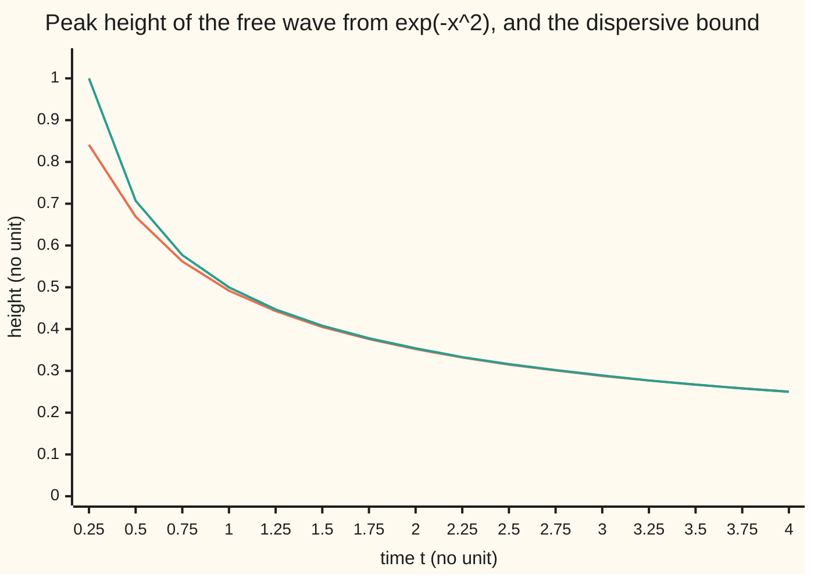
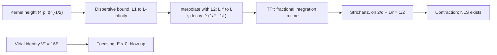

# Strichartz estimates: dispersion averaged over time, and when a nonlinear Schrödinger wave exists, scatters or blows up

[Syllabus](../../../SYLLABUS.md) → [Harmonic analysis](../README.md) → [Multipliers and Estimates for PDE](../README.md#s07) → Strichartz estimates

---

## General Overview

Release a quantum particle from a trap at time 0. Its wave starts as the bell $`f(x) = e^{-x^2}`$ on a line, and then moves by the free Schrödinger equation $`i u_t + u_{xx} = 0`$. Here $`u(t, x)`$ is the wave, a complex number at each time $`t`$ and place $`x`$, in units that make every constant 1.

The wave spreads. Its peak height is 1 at the start, 0.840896 at $`t = 0.25`$, 0.492479 at $`t = 1`$ and 0.176734 at $`t = 8`$. The **mass** $`\int \lvert u\rvert^2 dx`$ never changes: it stays 1.253314. The height falls because the same amount spreads over more room.

Each frequency in the wave travels at its own speed, so the parts separate. That is **dispersion**. A general bound caps the height of any wave at time $`t`$: at most $`(4\pi\lvert t\rvert)^{-1/2}`$ times its starting 1-norm $`\int\lvert f\rvert`$. For the bell this bound is $`(4\lvert t\rvert)^{-1/2}`$, and the peak reaches 0.999756 of it by $`t = 8`$.

A height bound at each instant is too weak for nonlinear equations: it blows up at $`t = 0`$, and it needs the 1-norm $`\int\lvert f\rvert`$, which the mass does not control. **Strichartz estimates** fix both by averaging over all time. For the bell, $`\int\int\lvert u\rvert^6\,dx\,dt = \pi^{3/2}/(4\sqrt 6) = 0.568315`$, a finite number for a wave that lives forever. Its sixth root, 0.910119, is 0.812958 times the **L² size** $`\lVert f\rVert_2 = 1.119515`$, the square root of the mass, and no starting wave does better.

With that averaged bound, a nonlinear Schrödinger equation (NLS) can be solved by repeated substitution for a short time. The same tools, with one identity about the wave's spread, show that a strong enough attracting nonlinearity makes some waves blow up. For the bell at amplitude 2 under the quintic attracting equation, that happens before $`t = 0.173377`$.

**The free Schrödinger flow lowers every wave's height like $`\lvert t\rvert^{-1/2}`$; averaged over time with the TT\* argument and fractional integration in time, that decay becomes a bound on space-time norms by the L² size, exactly on the pairs fixed by scaling; that bound makes nonlinear Schrödinger equations solvable by contraction for short times and for small waves forever, while the virial identity forces blow-up for focusing waves of negative energy and finite spread, once the push's power σ times the dimension d is at least 2.**

**What kind of fact this is:** the equations are models. Inside them, the dispersive bound, the Strichartz estimates on the line, local existence by contraction and Glassey's blow-up are theorems, proved on this card in Why it works. Fractional integration is proved on its own card; its best constant here is Lieb's general formula (1983, cited there), taken in one dimension. Scattering is proved in outline for small waves. The best Strichartz constant (Foschi, 2007) and the endpoint case in higher dimensions (Keel and Tao, 1998) are stated with sources.

### The picture: the bell's peak against the dispersive bound



Orange: the peak $`\lvert u(t, 0)\rvert`$. Teal: the bound $`(4t)^{-1/2}`$. The bound is loose at first, 1.000 against 0.841 at $`t = 0.25`$. By $`t = 4`$ the two agree to three decimals, so the bound cannot be lowered for large times.

---

## The formula

Notation first. $`\Delta`$ is the second derivative in $`x`$ (in $`d`$ dimensions, the Laplacian, the sum of the second derivatives). The **free flow** $`e^{it\Delta}`$ takes a start $`f`$ to the solution $`u(t) = e^{it\Delta}f`$ of $`iu_t + \Delta u = 0`$. On the Fourier side it multiplies $`\hat f(\xi)`$ by $`e^{-4\pi^2 i t\xi^2}`$, with $`\xi`$ the frequency. $`\lVert g\rVert_r = (\int\lvert g\rvert^r dx)^{1/r}`$ is the $`r`$-norm in space, and $`r'`$ is its conjugate, $`1/r + 1/r' = 1`$. A **space-time norm** takes the $`r`$-norm at each time, then the $`q`$-norm of those over time:

```math
\lVert u\rVert_{L^q_t L^r_x} = \Big(\int \lVert u(t)\rVert_r^{\,q}\,dt\Big)^{1/q}
```

**The dispersive bound.** For every $`t \ne 0`$,

```math
\lVert e^{it\Delta}f\rVert_\infty \;\le\; (4\pi\lvert t\rvert)^{-d/2}\,\lVert f\rVert_1
```

**Read it aloud:** at time t the free wave is nowhere higher than its starting 1-norm divided by the square root of four pi t, per dimension.

**The Strichartz estimate.** A pair $`(q, r)`$ is **admissible** when $`2 \le q, r \le \infty`$ and

```math
\frac{2}{q} + \frac{d}{r} = \frac{d}{2}, \qquad \lVert e^{it\Delta}f\rVert_{L^q_t L^r_x} \le S\,\lVert f\rVert_2, \qquad \Big\lVert \int_{s<t} e^{i(t-s)\Delta}F(s)\,ds\Big\rVert_{L^q_t L^r_x} \le K\,\lVert F\rVert_{L^{q'}_t L^{r'}_x}
```

**Read it aloud:** on an admissible pair, the free wave's space-time size is at most S times its L² size, and a wave pushed by a force F has size at most K times the force's size in the conjugate norms.

In two dimensions the pair $`(2, \infty)`$ is excluded. On the line ($`d = 1`$) the pairs run from $`(4, \infty)`$ to $`(\infty, 2)`$, and $`(6, 6)`$ sits between. Steps 1 to 3 prove the estimate for every pair on the line except $`(\infty, 2)`$, which is the fixed mass; $`(6, 6)`$ carries the numbers.

**The nonlinear Schrödinger equation.** With $`\mu = +1`$ (repelling, called **defocusing**) or $`\mu = -1`$ (attracting, called **focusing**) and power $`\sigma`$ (cubic $`\sigma = 1`$, quintic $`\sigma = 2`$):

```math
i u_t + \Delta u = \mu\,\lvert u\rvert^{2\sigma}u, \qquad M = \int\lvert u\rvert^2, \qquad E = \int \tfrac12\lvert\nabla u\rvert^2 + \frac{\mu}{2\sigma + 2}\lvert u\rvert^{2\sigma + 2}, \qquad V(t) = \int \lvert x\rvert^2\lvert u\rvert^2
```

**Read it aloud:** the wave changes by its bending plus a push from its own height; its mass M and energy E stay fixed; V is the spread of the wave about the origin.

Why both stay fixed: the equation says $`-\Delta u + \mu\lvert u\rvert^{2\sigma}u = iu_t`$. Differentiating $`E`$ and integrating by parts gives $`dE/dt = \mathrm{Re}\int\overline{(iu_t)}\,u_t = \mathrm{Re}\big(-i\int\lvert u_t\rvert^2\big) = 0`$. Likewise $`dM/dt = 2\,\mathrm{Re}\int\bar u\,u_t = 2\,\mathrm{Re}\big(-i\int(\lvert\nabla u\rvert^2 + \mu\lvert u\rvert^{2\sigma + 2})\big) = 0`$, since the last integral is real.

| Symbol | Plain meaning | In our example | Push it up and the answer… |
| --- | --- | --- | --- |
| $`u`$, $`t`$, $`x`$, $`s`$, $`u_+`$ | the wave; time; place (no units); an earlier time inside an integral; the start of the free wave a scattering solution approaches | peak $`\lvert u(1, 0)\rvert`$ = 0.492479 | later $`t`$: lower peak |
| $`f`$, $`A`$ | starting wave; its amplitude | $`A e^{-x^2}`$, $`A = 1`$ (free) or 2 (blow-up) | larger $`A`$: nonlinearity matters sooner |
| $`\Delta`$, $`\nabla`$, $`e^{it\Delta}`$, $`\xi`$ | second derivative; gradient (on the line, $`d/dx`$); free flow; frequency | multiplier $`e^{-4\pi^2 it\xi^2}`$ | — |
| $`d`$ | number of space dimensions | 1 | more dimensions: faster decay, like $`\lvert t\rvert^{-d/2}`$ |
| $`\lVert\cdot\rVert_r`$, $`r'`$ | size in space; conjugate exponent | $`\lVert f\rVert_2`$ = 1.119515 | — |
| $`(q, r)`$, $`\lVert\cdot\rVert_{L^q_tL^r_x}`$ | admissible pair; space-time size | (6, 6); $`\lVert u\rVert_{L^6}`$ = 0.910119 | off the line $`2/q + 1/r = 1/2`$: no bound |
| $`S`$ | Strichartz constant for the free wave | best 0.812958; proof gives 0.918427 | — |
| $`C_{HLS}`$, $`\alpha`$, $`\Gamma`$, $`K`$ | fractional-integration constant; its kernel's power is $`\alpha - 1`$; the Gamma function; constant for a forced wave | 1.961067; $`\alpha = 2/3`$; 0.843508 | — |
| $`\mu`$, $`\sigma`$ | sign of the push; power of the push | $`\mu = -1`$, $`\sigma = 2`$ (focusing quintic) | — |
| $`M`$, $`E`$, $`V`$ | mass; energy; spread $`\int x^2\lvert u\rvert^2`$ | at $`A = 2`$: 5.013257; −5.211785; $`V(0)`$ = 1.253314 | lower $`E`$: earlier blow-up |
| $`T`$, $`F`$, $`\Phi`$, $`I`$, $`R`$ | the free-flow map $`f \mapsto u`$ in TT\* (later, the end of the time span); a force; the Duhamel map (not the normal CDF here); time span $`[0, T]`$; ball radius | $`R = 2\eta`$ | longer $`I`$: larger $`\eta`$ |
| $`\eta`$, $`\eta_*`$, $`T_*`$ | free wave's $`L^6`$ size on a time span; contraction threshold; blow-up deadline | $`\eta_*`$ = 0.293392; $`T_*`$ = 0.173377 | — |

### When it holds

- **The pair is admissible.** Off the scaling line no constant works. The bell's $`\int\int\lvert u\rvert^4`$ (pair (4, 4)) is 1.941804 up to $`\lvert t\rvert < 10`$ and 7.043267 up to $`10^6`$, and keeps growing.
- **The flow is free, or nearly so.** The proof needs the kernel's height $`(4\pi\lvert t\rvert)^{-1/2}`$. A trapping potential, or a bounded domain, can stop the decay: the box on [Two evolutions](../../18-Functional%20analysis/05-Unbounded%20Operators%20and%20Semigroups/09-the-heat-and-schrodinger-semigroups.md) comes back whole.
- **The nonlinear wave is small, or the time is short.** Contraction needs the free wave's $`L^6`$ size on the time span below $`\eta_*`$ = 0.293392. For the bell that allows all time only up to $`A`$ = 0.322366.
- **Blow-up needs focusing, negative energy, finite spread and $`\sigma d \ge 2`$.** The cubic on the line has $`\sigma d = 1`$: its virial second derivative is +11.746791 at $`A = 2`$ although its energy is −1.038279, and it never blows up.

---

## Why it works

### Step 0: decay at each time, then pay for it by averaging

The free flow is a convolution with an explicit kernel whose height is $`(4\pi\lvert t\rvert)^{-1/2}`$. That gives decay at each time. Interpolation trades some of that decay for norms other than 1 and $`\infty`$. The traded decay is too slow to integrate over time, but fractional integration in time handles exactly that rate. A duality trick, TT\*, turns the result into a bound by the L² size.



The chart is schematic.

### Step 1: the kernel and the dispersive bound

The heat flow on the line is a convolution with $`(4\pi s)^{-1/2}e^{-x^2/(4s)}`$. The free Schrödinger flow is the heat flow at the imaginary time $`s = it`$ ([Schrodinger and Klein-Gordon](../../19-Partial%20differential%20equations/05-Waves/07-schrodinger-and-klein-gordon-in-outline.md)). So

```math
e^{it\Delta}f(x) = \int \frac{e^{i(x-y)^2/(4t)}}{(4\pi i t)^{1/2}}\,f(y)\,dy, \qquad \lvert e^{it\Delta}f(x)\rvert \le (4\pi\lvert t\rvert)^{-1/2}\int\lvert f(y)\rvert\,dy
```

The kernel has height exactly $`(4\pi\lvert t\rvert)^{-1/2}`$ everywhere, and the size of an integral is at most the integral of the size. The kernel is the Fourier integral $`\int e^{-4\pi^2 it\xi^2 + 2\pi i x\xi}d\xi`$. Its phase has one stationary point, and for a quadratic phase the leading term of [Stationary phase](../06-Maximal%20Functions%20and%20Beyond/12-oscillatory-integrals-and-stationary-phase.md) is the whole answer.

For the bell, [Two pairs worth memorising](../02-The%20Fourier%20Transform/03-gaussian-and-sinc-transform-pairs.md) gives the solution in closed form:

```math
u(t, x) = (1 + 4it)^{-1/2}\exp\!\Big(-\frac{x^2}{1 + 4it}\Big), \qquad \lvert u(t, x)\rvert = (1 + 16t^2)^{-1/4}\,e^{-x^2/(1 + 16t^2)}
```

Its 1-norm is $`\int\lvert f\rvert = \sqrt\pi`$, so the bound reads $`(4\lvert t\rvert)^{-1/2}`$. The peak $`(1 + 16t^2)^{-1/4}`$ is below it, and the ratio tends to 1.

### Step 2: interpolate between the two easy bounds

Two bounds hold at each time. From $`L^1`$ to $`L^\infty`$ the constant is $`(4\pi\lvert t\rvert)^{-1/2}`$ (Step 1). From $`L^2`$ to $`L^2`$ it is 1, because the flow multiplies the spectrum by numbers of size 1 ([Two evolutions](../../18-Functional%20analysis/05-Unbounded%20Operators%20and%20Semigroups/09-the-heat-and-schrodinger-semigroups.md)). [Interpolation](../06-Maximal%20Functions%20and%20Beyond/04-interpolation-riesz-thorin-and-marcinkiewicz.md) (Riesz-Thorin) gives every size between:

```math
\lVert e^{it\Delta}g\rVert_r \le (4\pi\lvert t\rvert)^{-(1/2 - 1/r)}\,\lVert g\rVert_{r'}, \qquad 2 \le r \le \infty
```

At $`r = 6`$ the decay is $`(4\pi\lvert t\rvert)^{-1/3}`$. That is too slow to integrate over all time: $`\int\lvert t\rvert^{-1/3}dt`$ diverges at infinity. But it is exactly the kernel of a fractional integral.

### Step 3: TT\* and fractional integration in time

Write $`Tf = e^{it\Delta}f`$, a map from starting waves to space-time functions. Its adjoint is $`T^*F = \int e^{-is\Delta}F(s)\,ds`$. Since the flows compose, $`e^{it\Delta}e^{-is\Delta} = e^{i(t-s)\Delta}`$, and

```math
TT^*F(t) = \int e^{i(t-s)\Delta}F(s)\,ds, \qquad \lVert T^*F\rVert_2^2 = \langle TT^*F, F\rangle
```

So $`T`$ is bounded from $`L^2`$ to $`L^q_tL^r_x`$ exactly when $`TT^*`$ is bounded from $`L^{q'}_tL^{r'}_x`$ to $`L^q_tL^r_x`$, and $`\lVert T\rVert^2 = \lVert TT^*\rVert`$. This is the **TT\* argument**: a bound for a map follows from a bound for the map followed by its adjoint, which has a kernel we know.

By Step 2, at each time $`t`$,

```math
\lVert TT^*F(t)\rVert_r \le (4\pi)^{-(1/2 - 1/r)}\int \frac{\lVert F(s)\rVert_{r'}}{\lvert t - s\rvert^{1/2 - 1/r}}\,ds
```

The right side is the one-dimensional Riesz potential of $`s \mapsto \lVert F(s)\rVert_{r'}`$, with kernel $`\lvert t\rvert^{\alpha - 1}`$ and $`\alpha = 1/2 + 1/r`$. [Fractional integration](../06-Maximal%20Functions%20and%20Beyond/08-riesz-potentials-and-hardy-littlewood-sobolev.md) maps $`L^{q'}`$ to $`L^q`$ exactly when $`1/q = 1/q' - \alpha`$, which rearranges to $`2/q + 1/r = 1/2`$. That is the admissibility rule: it falls out of the proof.

At $`(6, 6)`$ the kernel is $`\lvert t\rvert^{-1/3}`$. Lieb's formula for the best constant, which [Fractional integration](../06-Maximal%20Functions%20and%20Beyond/08-riesz-potentials-and-hardy-littlewood-sobolev.md) states in three dimensions and cites, gives in one dimension $`C_{HLS} = \pi^{-1/6}\Gamma(1/3)/\Gamma(5/6)`$ = 1.961067 from $`L^{6/5}`$ to $`L^6`$. So $`K = (4\pi)^{-1/3}C_{HLS}`$ = 0.843508 and $`S \le \sqrt K`$ = 0.918427. The same bound holds when the time integral runs only over $`s < t`$, since the integrand is the same and only its range shrinks. That is the forced estimate with $`K`$.

### Step 4: what the bell says about the constant

For the bell, $`\int\lvert u\rvert^6dx = (1 + 16t^2)^{-1}\sqrt{\pi/6}`$, and $`\int dt/(1 + 16t^2) = \pi/4`$. So $`\int\int\lvert u\rvert^6 = \pi^{3/2}/(4\sqrt 6)`$ = 0.568315, and

```math
\frac{\lVert u\rVert_{L^6_{t,x}}}{\lVert f\rVert_2} = \Big(\frac{\pi^{3/2}/(4\sqrt 6)}{(\pi/2)^{3/2}}\Big)^{1/6} = 12^{-1/12} = 0.812958
```

Foschi proved in 2007 that this is the largest possible ratio: on the line, Gaussians are the best starting waves for (6, 6). The proof's constant, 0.918427, is larger. Two bells with centres 3 apart reach at most 0.768965.

### Step 5: Duhamel's formula and contraction

Take the focusing quintic on the line, $`iu_t + u_{xx} = -\lvert u\rvert^4u`$. Treat the push as a force and add up its effect, which is **Duhamel's formula**:

```math
u = \Phi(u), \qquad \Phi(u)(t) = e^{it\Delta}f + i\int_0^t e^{i(t-s)\Delta}\big(\lvert u\rvert^4u\big)(s)\,ds
```

Work in $`L^6_{t,x}`$ on a time span $`I = [0, T]`$. The key fact is that the force's norm is a power of the wave's norm: $`\lVert\,\lvert u\rvert^4u\,\rVert_{L^{6/5}} = \lVert u\rVert_{L^6}^5`$. So with $`\eta = \lVert e^{it\Delta}f\rVert_{L^6(I)}`$,

```math
\lVert\Phi(u)\rVert_{L^6(I)} \le \eta + K\lVert u\rVert_{L^6(I)}^5, \qquad \lVert\Phi(u) - \Phi(v)\rVert_{L^6(I)} \le 10K\,R^4\,\lVert u - v\rVert_{L^6(I)}
```

The second bound holds on the ball $`\lVert u\rVert, \lVert v\rVert \le R`$. With $`R = 2\eta`$, $`\Phi`$ maps the ball into itself and shrinks distances by the factor $`160K\eta^4`$. That factor is below 1 when $`\eta < \eta_* = (160K)^{-1/4}`$ = 0.293392. The fixed point is the solution, and it is unique in the ball ([Banach's fixed point theorem](../../17-Topology/01-Metric%20Spaces/08-banach-fixed-point-in-metric-spaces.md)).

<details>
<summary>Detailed proof: the two contraction bounds and the threshold</summary>

The forced estimate of Step 3 restricted to $`I`$ gives the first bound, since $`\lVert\,\lvert u\rvert^4u\,\rVert_{6/5} = (\int\lvert u\rvert^6)^{5/6}`$.

For the second, the map $`w \mapsto \lvert w\rvert^4w`$ has derivative of size $`5\lvert w\rvert^4`$, so along the segment from $`v`$ to $`u`$:

$`\displaystyle \big\lvert\,\lvert u\rvert^4u - \lvert v\rvert^4v\,\big\rvert \le 5\big(\lvert u\rvert^4 + \lvert v\rvert^4\big)\lvert u - v\rvert .`$

Hölder's inequality with exponents $`6/4`$ and $`6`$ in the $`6/5`$-norm gives $`\lVert\,\lvert u\rvert^4\lvert u - v\rvert\,\rVert_{6/5} \le \lVert u\rVert_6^4\lVert u - v\rVert_6`$. On the ball this is at most $`R^4\lVert u - v\rVert_6`$, twice over, so the Lipschitz constant is $`10KR^4`$.

With $`R = 2\eta`$: the ball maps into itself if $`\eta + 32K\eta^5 \le 2\eta`$, that is $`32K\eta^4 \le 1`$. The Lipschitz constant is $`10K(2\eta)^4 = 160K\eta^4`$, below 1 when $`\eta < \eta_*`$. The second condition is the stronger one. Iterating $`\Phi`$ from $`e^{it\Delta}f`$ converges in $`L^6(I)`$, and the dual estimate puts the limit in $`C(I; L^2)`$ (continuous in time, with finite mass at each time).

</details>

Every start in $`L^2`$ has $`\eta \to 0`$ as $`T \to 0`$, so a solution exists for a short time. For the bell at amplitude $`A`$, $`\eta^6 = A^6\sqrt{\pi/6}\,\arctan(4T)/4`$. At $`A = 2`$ the guaranteed time is only 0.000014. On all of time $`\eta = A \times 0.910119`$, so every $`A`$ below 0.322366 gives a solution for all time.

**The cubic is different.** For $`iu_t + u_{xx} = \mu\lvert u\rvert^2u`$, use the pair (8, 4), with $`S`$ and $`K`$ now its constants. Hölder in time gives $`\lVert\,\lvert u\rvert^2u\,\rVert_{L^{8/7}_tL^{4/3}_x} \le T^{1/2}\lVert u\rVert_{L^8_tL^4_x}^3`$. On the ball of radius $`R = 2S\lVert f\rVert_2`$ the Lipschitz factor is at most $`6KT^{1/2}R^2`$, below 1 once $`T < (24KS^2\lVert f\rVert_2^2)^{-2}`$. So the contraction time depends only on the mass. Mass is conserved, so the argument restarts with the same $`T`$ forever. The cubic on the line never blows up. The quintic gets no such factor: its time depends on the shape of $`f`$, not just its mass, so restarting can fail.

### Step 6: scattering in outline

If a solution has finite $`L^6_{t,x}`$ size on all of $`[0, \infty)`$, it **scatters**: there is a free wave $`e^{it\Delta}u_+`$ with $`\lVert u(t) - e^{it\Delta}u_+\rVert_2 \to 0`$. The proof applies the dual estimate to the tail of Duhamel's integral, whose size is at most $`S\lVert u\rVert_{L^6(t, \infty)}^5 \to 0`$. So the small bells, $`A`$ below 0.322366, end up moving as free waves. The sources treat larger data.

### Step 7: the virial identity and blow-up

Let $`V(t) = \int x^2\lvert u\rvert^2dx`$. Differentiating twice and using the equation gives, for the focusing equation in $`d`$ dimensions,

```math
V''(t) = 16E - \frac{4(\sigma d - 2)}{\sigma + 1}\int\lvert u\rvert^{2\sigma + 2}dx
```

When $`\sigma d \ge 2`$ the last term only lowers $`V''`$, so $`V'' \le 16E`$. On the line the quintic has $`\sigma d = 2`$ exactly, and $`V'' = 16E`$. For a real start, $`V'(0) = 0`$, so

```math
V(t) = V(0) + 8E\,t^2
```

If $`E < 0`$, this hits zero at $`T_* = \sqrt{V(0)/(8\lvert E\rvert)}`$. But $`V`$ cannot reach zero while the mass stays fixed: $`M \le 2\sqrt{V}\,\lVert u_x\rVert_2`$ (integrate $`\lvert u\rvert^2 = \partial_x(x)\lvert u\rvert^2`$ by parts). So $`\lVert u_x\rVert_2`$ must become infinite before $`T_*`$. This is **Glassey's argument** (1977).

For the bell at amplitude 2: $`\int\lvert f_x\rvert^2`$ = 5.013257 and $`\int\lvert f\rvert^6`$ = 46.310480, so $`E`$ = −5.211785 and $`V(0)`$ = 1.253314. Hence $`T_*`$ = 0.173377. The energy is negative exactly when $`A > 27^{1/8}`$ = 1.509804. A grid solution of the equation follows $`V(0) + 8Et^2`$ to four decimals up to $`t = 0.04`$: 1.186619 against 1.186603.

<details>
<summary>Detailed proof: the virial identity</summary>

Write the equation as $`u_t = i u_{xx} + i\lvert u\rvert^{2\sigma}u`$ (focusing). Then $`\partial_t\lvert u\rvert^2 = 2\,\mathrm{Re}(\bar u u_t) = -2\,\partial_x\mathrm{Im}(\bar u u_x)`$, because the push term is real times $`\lvert u\rvert^2`$ and drops out. Integrating by parts once:

$`\displaystyle V'(t) = 4\int x\,\mathrm{Im}(\bar u u_x)\,dx .`$

Differentiate again, substitute the equation, and integrate by parts until no derivative falls on $`x`$. The bending term gives $`8\int\lvert u_x\rvert^2`$. The push term gives $`-\frac{4\sigma}{\sigma + 1}\int\lvert u\rvert^{2\sigma + 2}`$ on the line, $`d`$ times that in $`d`$ dimensions:

$`\displaystyle V''(t) = 8\int\lvert\nabla u\rvert^2 - \frac{4\sigma d}{\sigma + 1}\int\lvert u\rvert^{2\sigma + 2} .`$

Now $`16E = 8\int\lvert\nabla u\rvert^2 - \frac{8}{\sigma + 1}\int\lvert u\rvert^{2\sigma + 2}`$, and subtracting gives the form in Step 7. The computation needs $`u`$ smooth with finite spread; the full justification for $`H^1`$ solutions (finite mass and finite $`\int\lvert\nabla u\rvert^2`$) is in the sources.

</details>

---

## Worked numbers, by hand

The free bell, then the quintic bell at $`A = 2`$.

| Step | Arithmetic | Value |
| --- | --- | --- |
| peak at $`t = 1`$ | $`(1 + 16)^{-1/4}`$ | 0.492479 |
| bound at $`t = 1`$ | $`(4 \times 1)^{-1/2}`$ | 0.500000 |
| $`\int\lvert u\rvert^6dx`$ at time $`t`$ | $`(1 + 16t^2)^{-3/2}\sqrt{\pi(1 + 16t^2)/6}`$ | $`\sqrt{\pi/6}/(1 + 16t^2)`$ |
| over all time | $`\sqrt{\pi/6} \times \pi/4`$ | 0.568315 |
| space-time size | $`0.568315^{1/6}`$ | 0.910119 |
| L² size | $`(\pi/2)^{1/4}`$ | 1.119515 |
| ratio | $`0.910119/1.119515`$ | **0.812958** |
| quintic energy, $`A = 2`$ | $`\tfrac12 \times 5.013257 - 46.310480/6`$ | −5.211785 |
| blow-up deadline | $`\sqrt{1.253314/(8 \times 5.211785)}`$ | **0.173377** |

The bell's space-time size is 0.812958 times its L² size, the best any start can do. At amplitude 2 the focusing quintic bell cannot survive past 0.173377.

### What breaks if you drop a piece

| Mistake | Comes out at | What went wrong |
| --- | --- | --- |
| Use the pair (4, 4), off the scaling line | 1.941804 up to $`\lvert t\rvert < 10`$, 7.043267 up to $`10^6`$ | the integral grows like $`\log T`$; no constant can bound it |
| Expect the wave's L² size to decay | mass 1.253314 at $`t`$ = 0, 1 and 8 | dispersion lowers height, not size; Strichartz bounds a different norm |
| Run the global contraction at $`A = 2`$ | threshold amplitude 0.322366 | the free wave's $`L^6`$ size is far above $`\eta_*`$; the wave in fact blows up before 0.173377 |
| Apply Glassey's argument to the cubic | $`V''(0)`$ = +11.746791 although $`E`$ = −1.038279 | $`\sigma d = 1 < 2`$: the extra term is positive and the concavity fails |

---

## Code, from first principles, and it actually runs

The code computes the free bell three ways: the closed form, the Fourier integral $`\int\hat f(\xi)e^{-4\pi^2it\xi^2}d\xi`$ by Simpson's rule, and a finite-difference check that the closed form solves the equation. The space-time integral is reached two ways, a double Simpson sum with its time tail bounded, against the closed form. The constants come from $`\Gamma(1/3) = 3\int_0^\infty e^{-y^3}dy`$, written out, and Lieb's constant is checked a second way through $`\Gamma(5/6) = 6\int_0^\infty z^4e^{-z^6}dz`$. The virial law is checked by solving the focusing quintic on a grid with a fourth-order Runge-Kutta step (RK4), which also confirms that mass and energy stay fixed.

### Python

```python
# Strichartz estimates and nonlinear Schrodinger -- the check behind the card.  Standard library only.
# Free flow i u_t + u_xx = 0 from f(x) = exp(-x^2); quintic NLS i u_t + u_xx = -|u|^4 u (focusing).
from math import pi, sqrt, exp, atan, atan2, tan, asinh, cos, sin

def simpson(f, a, b, n):
    h = (b - a) / n
    s = f(a) + f(b)
    for i in range(1, n):
        s += (4 if i % 2 else 2) * f(a + i * h)
    return s * h / 3

def acc(values):                     # plain left-to-right sum, so the Rust twin adds in the same order
    s = 0.0
    for v in values:
        s += v
    return s

def u_free(t, x):                    # closed form (1+4it)^(-1/2) exp(-x^2/(1+4it)), as (re, im)
    a = 1 + 16 * t * t
    mod = a ** -0.25 * exp(-x * x / a)
    ph = 4 * t * x * x / a - 0.5 * atan2(4 * t, 1)
    return mod * cos(ph), mod * sin(ph)

def absu(t, x):
    re, im = u_free(t, x)
    return sqrt(re * re + im * im)

def peak_spectral(t):                # road 2: integral of f-hat(xi) exp(-4 pi^2 i t xi^2), f-hat = sqrt(pi) exp(-pi^2 xi^2)
    g = lambda c: simpson(lambda s: sqrt(pi) * exp(-pi * pi * s * s) * c(4 * pi * pi * t * s * s), -2.2, 2.2, 8000)
    return sqrt(g(cos) ** 2 + g(sin) ** 2)

print("free flow from exp(-x^2): peak |u(t,0)| against the dispersive bound (4|t|)^(-1/2)")
print("     t   peak closed  peak spectral      bound  peak/bound")
for t in (0.25, 0.5, 1.0, 2.0, 4.0, 8.0):
    pc, ps, b = absu(t, 0.0), peak_spectral(t), (4 * t) ** -0.5
    assert abs(pc - ps) < 1e-9, "closed form vs spectral integral"
    assert pc <= b, "dispersive bound"
    print(f"{t:6.2f} {pc:13.6f} {ps:14.6f} {b:10.6f} {pc / b:11.6f}")
t0, x0, h = 0.7, 0.4, 1e-4           # road 3: the closed form solves the equation (finite differences)
ut = [(u_free(t0 + h, x0)[k] - u_free(t0 - h, x0)[k]) / (2 * h) for k in (0, 1)]
uxx = [(u_free(t0, x0 + h)[k] - 2 * u_free(t0, x0)[k] + u_free(t0, x0 - h)[k]) / (h * h) for k in (0, 1)]
resid = sqrt((uxx[0] - ut[1]) ** 2 + (uxx[1] + ut[0]) ** 2)      # i u_t + u_xx, real and imaginary parts
assert resid < 1e-5, "closed form must solve i u_t + u_xx = 0"
print(f"residual of i u_t + u_xx at t = 0.7, x = 0.4: {resid:.10f}")
masses = [simpson(lambda x: absu(t, x) ** 2, -8 * sqrt(1 + 16 * t * t), 8 * sqrt(1 + 16 * t * t), 2000) for t in (0.0, 1.0, 8.0)]
assert max(abs(m - sqrt(pi / 2)) for m in masses) < 1e-9, "mass is conserved"
print("mass at t = 0, 1, 8:", " ".join(f"{m:.6f}" for m in masses), f"  sqrt(pi/2) = {sqrt(pi / 2):.6f}")

def l6_x(t, shift=0.0):               # integral over x of |u|^6, for one bump or two bumps 'shift' apart
    w = 4 * sqrt(1 + 16 * t * t)
    def g(x):
        a, b = u_free(t, x), u_free(t, x - shift)
        re, im = a[0] + (b[0] if shift else 0), a[1] + (b[1] if shift else 0)
        return (re * re + im * im) ** 3
    return simpson(g, -w, w + shift, 240)
T = 50.0
I6_num = 2 * simpson(l6_x, 0.0, T, 4000)
tail_exact = sqrt(pi / 6) * (pi / 2 - atan(4 * T)) / 2
tail_bound = sqrt(pi / 6) / (8 * T)
I6 = pi ** 1.5 / (4 * sqrt(6))
assert tail_exact <= tail_bound and abs(I6_num + tail_exact - I6) < 1e-8, "space-time integral, two roads"
L6, f2 = I6 ** (1 / 6), (pi / 2) ** 0.25
sharp = 12 ** (-1 / 12)
gamma13 = 3 * simpson(lambda y: exp(-y ** 3), 0.0, 8.0, 4000)                   # Gamma(1/3) = 3 int e^(-y^3)
C_hls = pi ** (-1 / 6) * sqrt(3) * gamma13 ** 3 / (2 ** (4 / 3) * pi ** 1.5)    # Lieb, n = 1, kernel |t|^(-1/3)
gamma56 = 6 * simpson(lambda z: z ** 4 * exp(-z ** 6), 0.0, 4.0, 4000)            # Gamma(5/6) = 6 int z^4 e^(-z^6)
assert abs(C_hls - pi ** (-1 / 6) * gamma13 / gamma56) < 1e-9, "Lieb's constant: duplication form against Gamma(5/6)"
K = (4 * pi) ** (-1 / 3) * C_hls
S_proof = sqrt(K)
assert abs(L6 / f2 - sharp) < 1e-9, "the Gaussian meets the sharp constant 12^(-1/12)"
assert sharp < S_proof, "the proof's constant is larger than the sharp one"
rows = [("int |u|^6 numeric, |t| <= 50", I6_num), ("  tail beyond 50, exact", tail_exact),
        ("  tail bound sqrt(pi/6)/(8T)", tail_bound), ("  numeric + tail", I6_num + tail_exact),
        ("  closed form pi^1.5/(4 sqrt 6)", I6), ("||u||_L6 space-time", L6), ("||f||_2", f2),
        ("ratio ||u||_L6 / ||f||_2", L6 / f2), ("sharp constant 12^(-1/12)", sharp),
        ("Gamma(1/3)", gamma13), ("HLS constant, kernel |t|^(-1/3)", C_hls),
        ("K = (4 pi)^(-1/3) C_HLS", K), ("proof's Strichartz constant sqrt K", S_proof)]
I6_two = 2 * simpson(lambda t: l6_x(t, 3.0), 0.0, T, 4000) + 2 ** 6 * tail_exact   # tail: |u| <= sum of two
f2_two = sqrt(2 * sqrt(pi / 2) * (1 + exp(-4.5)))
assert I6_two ** (1 / 6) / f2_two < sharp, "two bumps fall below the Gaussian's ratio"
rows += [("two bumps 3 apart: ratio (tail bounded)", I6_two ** (1 / 6) / f2_two)]
L4 = lambda T: sqrt(pi) / 4 * asinh(4 * T)                                         # int_{|t|<T} int |u|^4
L4_num = 2 * simpson(lambda t: simpson(lambda x: absu(t, x) ** 4, -5 * sqrt(1 + 16 * t * t), 5 * sqrt(1 + 16 * t * t), 400), 0.0, 10.0, 2000)
assert abs(L4_num - L4(10.0)) < 1e-7, "L4 space-time, two roads"
rows += [("wrong pair (4,4): int |u|^4, |t| < 10 numeric", L4_num)] + [(f"  formula, |t| < {T}", L4(T)) for T in (10, 100, 1000, 1000000)]
p4 = lambda t: absu(t, 0.0) ** 4
L4inf = 2 * (simpson(p4, 0.0, 10.0, 4000) + simpson(p4, 10.0, 1e4, 20000))
assert abs(L4inf - pi / 4) < 2 / (16 * 1e4), "endpoint pair (4, inf): int peak^4 dt = pi/4, tail under 1/(8T)"
rows += [("pair (4,inf): int peak^4 dt, |t| < 10^4", L4inf), ("  pi/4", pi / 4)]
eta = (160 * K) ** -0.25                                                            # contraction radius
A = 2.0
T_loc = tan(4 * eta ** 6 / (A ** 6 * sqrt(pi / 6))) / 4
assert abs(10 * K * (2 * eta) ** 4 - 1) < 1e-12 and eta + K * (2 * eta) ** 5 <= 2 * eta, "eta*: Lipschitz factor 10K R^4 = 1 at R = 2 eta, ball kept"
assert abs(A ** 6 * simpson(l6_x, 0.0, T_loc, 40) - eta ** 6) < 1e-9 * eta ** 6, "T_loc: the bell's L6 size on [0, T_loc], integrated, is eta*"
rows += [("contraction threshold eta*", eta), ("small-data amplitude eta*/||u||_L6", eta / L6), ("A = 2: guaranteed time T_loc", T_loc)]
grad2, int6, int4 = A * A * sqrt(pi / 2), A ** 6 * sqrt(pi / 6), A ** 4 * sqrt(pi / 4)
E, V0 = grad2 / 2 - int6 / 6, A * A * sqrt(pi / 2) / 4
Tstar = sqrt(V0 / (-8 * E))
rows += [("A = 2: int |u_x|^2", grad2), ("A = 2: int |u|^6", int6), ("quintic energy E", E), ("variance V(0)", V0),
         ("blow-up before T* = sqrt(V0/(8|E|))", Tstar), ("E < 0 once A > 27^(1/8)", 27 ** 0.125),
         ("cubic: energy E3", grad2 / 2 - int4 / 4), ("cubic: V''(0) = 8 int|u_x|^2 - 2 int|u|^4", 8 * grad2 - 2 * int4)]
for name, v in rows:
    print(f"{name:<46} {v:14.6f}")

# road 3 for the virial law: solve the focusing quintic by finite differences and RK4
N, L = 601, 6.0
dx = 2 * L / (N - 1)
xs = [-L + i * dx for i in range(N)]
re, im = [A * exp(-x * x) for x in xs], [0.0] * N
def rhs(re, im):                     # u_t = i (u_xx + |u|^4 u)
    wr, wi = [0.0] * N, [0.0] * N
    for i in range(1, N - 1):
        m4 = (re[i] * re[i] + im[i] * im[i]) ** 2
        wr[i] = (re[i + 1] - 2 * re[i] + re[i - 1]) / dx ** 2 + m4 * re[i]
        wi[i] = (im[i + 1] - 2 * im[i] + im[i - 1]) / dx ** 2 + m4 * im[i]
    return [-v for v in wi], wr
def stats(re, im):
    m2 = [re[i] ** 2 + im[i] ** 2 for i in range(N)]
    g = acc((re[i + 1] - re[i]) ** 2 + (im[i + 1] - im[i]) ** 2 for i in range(N - 1)) / dx
    return acc(m2) * dx, g / 2 - acc(v ** 3 for v in m2) * dx / 6, acc(xs[i] ** 2 * m2[i] for i in range(N)) * dx
dt, steps = 1e-4, 100
print("focusing quintic, A = 2, grid dx = 0.02, RK4 dt = 0.0001")
print("     t        mass      energy  V numeric  V0 + 8 E t^2")
for k in range(5):
    M, En, V = stats(re, im)
    tk = k * dt * steps
    print(f"{tk:6.2f} {M:11.6f} {En:11.6f} {V:10.6f} {V0 + 8 * E * tk * tk:13.6f}")
    assert abs(V - (V0 + 8 * E * tk * tk)) < 1e-4 and abs(M - 4 * sqrt(pi / 2)) < 1e-6, "virial law and mass"
    for _ in range(steps):
        k1 = rhs(re, im)
        k2 = rhs([re[i] + dt / 2 * k1[0][i] for i in range(N)], [im[i] + dt / 2 * k1[1][i] for i in range(N)])
        k3 = rhs([re[i] + dt / 2 * k2[0][i] for i in range(N)], [im[i] + dt / 2 * k2[1][i] for i in range(N)])
        k4 = rhs([re[i] + dt * k3[0][i] for i in range(N)], [im[i] + dt * k3[1][i] for i in range(N)])
        re = [re[i] + dt / 6 * (k1[0][i] + 2 * k2[0][i] + 2 * k3[0][i] + k4[0][i]) for i in range(N)]
        im = [im[i] + dt / 6 * (k1[1][i] + 2 * k2[1][i] + 2 * k3[1][i] + k4[1][i]) for i in range(N)]
ts = [0.25 * k for k in range(1, 17)]
print("chart t     ", " ".join(f"{t:g}" for t in ts))
print("chart peak  ", " ".join(f"{absu(t, 0.0):.3f}" for t in ts))
print("chart bound ", " ".join(f"{(4 * t) ** -0.5:.3f}" for t in ts))
print("ALL CHECKS PASS")
```

**Ran 2026-11-24 on macOS, Python 3.14.10, standard library only. All checks passed. Output, pasted from the run:**

```
free flow from exp(-x^2): peak |u(t,0)| against the dispersive bound (4|t|)^(-1/2)
     t   peak closed  peak spectral      bound  peak/bound
  0.25      0.840896       0.840896   1.000000    0.840896
  0.50      0.668740       0.668740   0.707107    0.945742
  1.00      0.492479       0.492479   0.500000    0.984958
  2.00      0.352186       0.352186   0.353553    0.996131
  4.00      0.249756       0.249756   0.250000    0.999026
  8.00      0.176734       0.176734   0.176777    0.999756
residual of i u_t + u_xx at t = 0.7, x = 0.4: 0.0000000212
mass at t = 0, 1, 8: 1.253314 1.253314 1.253314   sqrt(pi/2) = 1.253314
int |u|^6 numeric, |t| <= 50                         0.566506
  tail beyond 50, exact                              0.001809
  tail bound sqrt(pi/6)/(8T)                         0.001809
  numeric + tail                                     0.568315
  closed form pi^1.5/(4 sqrt 6)                      0.568315
||u||_L6 space-time                                  0.910119
||f||_2                                              1.119515
ratio ||u||_L6 / ||f||_2                             0.812958
sharp constant 12^(-1/12)                            0.812958
Gamma(1/3)                                           2.678939
HLS constant, kernel |t|^(-1/3)                      1.961067
K = (4 pi)^(-1/3) C_HLS                              0.843508
proof's Strichartz constant sqrt K                   0.918427
two bumps 3 apart: ratio (tail bounded)              0.768965
wrong pair (4,4): int |u|^4, |t| < 10 numeric        1.941804
  formula, |t| < 10                                  1.941804
  formula, |t| < 100                                 2.962042
  formula, |t| < 1000                                3.982348
  formula, |t| < 1000000                             7.043267
pair (4,inf): int peak^4 dt, |t| < 10^4              0.785386
  pi/4                                               0.785398
contraction threshold eta*                           0.293392
small-data amplitude eta*/||u||_L6                   0.322366
A = 2: guaranteed time T_loc                         0.000014
A = 2: int |u_x|^2                                   5.013257
A = 2: int |u|^6                                    46.310480
quintic energy E                                    -5.211785
variance V(0)                                        1.253314
blow-up before T* = sqrt(V0/(8|E|))                  0.173377
E < 0 once A > 27^(1/8)                              1.509804
cubic: energy E3                                    -1.038279
cubic: V''(0) = 8 int|u_x|^2 - 2 int|u|^4           11.746791
focusing quintic, A = 2, grid dx = 0.02, RK4 dt = 0.0001
     t        mass      energy  V numeric  V0 + 8 E t^2
  0.00    5.013257   -5.212036   1.253314      1.253314
  0.01    5.013257   -5.212036   1.249146      1.249145
  0.02    5.013257   -5.212036   1.236641      1.236636
  0.03    5.013257   -5.212036   1.215799      1.215789
  0.04    5.013257   -5.212036   1.186619      1.186603
chart t      0.25 0.5 0.75 1 1.25 1.5 1.75 2 2.25 2.5 2.75 3 3.25 3.5 3.75 4
chart peak   0.841 0.669 0.562 0.492 0.443 0.405 0.376 0.352 0.332 0.315 0.301 0.288 0.277 0.267 0.258 0.250
chart bound  1.000 0.707 0.577 0.500 0.447 0.408 0.378 0.354 0.333 0.316 0.302 0.289 0.277 0.267 0.258 0.250
ALL CHECKS PASS
```

### Rust

```rust
// Strichartz estimates and nonlinear Schrodinger -- the same check in Rust.  std only, no crates.
// Free flow i u_t + u_xx = 0 from f(x) = exp(-x^2); quintic NLS i u_t + u_xx = -|u|^4 u (focusing).
use std::f64::consts::PI;

fn simpson<F: Fn(f64) -> f64>(f: F, a: f64, b: f64, n: usize) -> f64 {
    let h = (b - a) / n as f64;
    let mut s = f(a) + f(b);
    for i in 1..n { s += if i % 2 == 1 { 4.0 } else { 2.0 } * f(a + i as f64 * h); }
    s * h / 3.0
}

fn u_free(t: f64, x: f64) -> (f64, f64) {   // closed form (1+4it)^(-1/2) exp(-x^2/(1+4it))
    let a = 1.0 + 16.0 * t * t;
    let m = a.powf(-0.25) * (-x * x / a).exp();
    let ph = 4.0 * t * x * x / a - 0.5 * (4.0 * t).atan2(1.0);
    (m * ph.cos(), m * ph.sin())
}

fn absu(t: f64, x: f64) -> f64 { let (re, im) = u_free(t, x); (re * re + im * im).sqrt() }

fn peak_spectral(t: f64) -> f64 {          // road 2: the Fourier side, f-hat = sqrt(pi) exp(-pi^2 xi^2)
    let g = |c: fn(f64) -> f64| simpson(|s| PI.sqrt() * (-PI * PI * s * s).exp() * c(4.0 * PI * PI * t * s * s), -2.2, 2.2, 8000);
    (g(f64::cos).powf(2.0) + g(f64::sin).powf(2.0)).sqrt()
}

fn l6_x(t: f64, shift: f64) -> f64 {       // integral over x of |u|^6, one bump or two bumps 'shift' apart
    let w = 4.0 * (1.0 + 16.0 * t * t).sqrt();
    let g = |x: f64| {
        let (a, b) = (u_free(t, x), u_free(t, x - shift));
        let (re, im) = if shift != 0.0 { (a.0 + b.0, a.1 + b.1) } else { a };
        (re * re + im * im).powf(3.0)
    };
    simpson(g, -w, w + shift, 240)
}

const N: usize = 601;
fn rhs(re: &[f64], im: &[f64], dx: f64) -> (Vec<f64>, Vec<f64>) {   // u_t = i (u_xx + |u|^4 u)
    let (mut wr, mut wi) = (vec![0.0; N], vec![0.0; N]);
    for i in 1..N - 1 {
        let m4 = (re[i] * re[i] + im[i] * im[i]).powf(2.0);
        wr[i] = (re[i + 1] - 2.0 * re[i] + re[i - 1]) / dx.powf(2.0) + m4 * re[i];
        wi[i] = (im[i + 1] - 2.0 * im[i] + im[i - 1]) / dx.powf(2.0) + m4 * im[i];
    }
    (wi.iter().map(|v| -v).collect(), wr)
}

fn stats(re: &[f64], im: &[f64], xs: &[f64], dx: f64) -> (f64, f64, f64) {
    let m2: Vec<f64> = (0..N).map(|i| re[i].powf(2.0) + im[i].powf(2.0)).collect();
    let (mut g, mut s, mut s6, mut sv) = (0.0, 0.0, 0.0, 0.0);
    for i in 0..N - 1 { g += (re[i + 1] - re[i]).powf(2.0) + (im[i + 1] - im[i]).powf(2.0); }
    for i in 0..N { s += m2[i]; s6 += m2[i].powf(3.0); sv += xs[i].powf(2.0) * m2[i]; }
    (s * dx, g / dx / 2.0 - s6 * dx / 6.0, sv * dx)
}

fn main() {
    println!("free flow from exp(-x^2): peak |u(t,0)| against the dispersive bound (4|t|)^(-1/2)");
    println!("     t   peak closed  peak spectral      bound  peak/bound");
    for t in [0.25, 0.5, 1.0, 2.0, 4.0, 8.0] {
        let (pc, ps, b) = (absu(t, 0.0), peak_spectral(t), (4.0 * t).powf(-0.5));
        assert!((pc - ps).abs() < 1e-9, "closed form vs spectral integral");
        assert!(pc <= b, "dispersive bound");
        println!("{:6.2} {:13.6} {:14.6} {:10.6} {:11.6}", t, pc, ps, b, pc / b);
    }
    let (t0, x0, h) = (0.7, 0.4, 1e-4);
    let c = |t: f64, x: f64, k: usize| if k == 0 { u_free(t, x).0 } else { u_free(t, x).1 };
    let ut: Vec<f64> = (0..2).map(|k| (c(t0 + h, x0, k) - c(t0 - h, x0, k)) / (2.0 * h)).collect();
    let uxx: Vec<f64> = (0..2).map(|k| (c(t0, x0 + h, k) - 2.0 * c(t0, x0, k) + c(t0, x0 - h, k)) / (h * h)).collect();
    let resid = ((uxx[0] - ut[1]).powf(2.0) + (uxx[1] + ut[0]).powf(2.0)).sqrt();
    assert!(resid < 1e-5, "closed form must solve i u_t + u_xx = 0");
    println!("residual of i u_t + u_xx at t = 0.7, x = 0.4: {:.10}", resid);
    let masses: Vec<f64> = [0.0_f64, 1.0, 8.0].iter().map(|&t| {
        let w = 8.0 * (1.0 + 16.0 * t * t).sqrt();
        simpson(|x| absu(t, x).powf(2.0), -w, w, 2000) }).collect();
    assert!(masses.iter().all(|m| (m - (PI / 2.0).sqrt()).abs() < 1e-9), "mass is conserved");
    let ms: Vec<String> = masses.iter().map(|m| format!("{:.6}", m)).collect();
    println!("mass at t = 0, 1, 8: {}   sqrt(pi/2) = {:.6}", ms.join(" "), (PI / 2.0).sqrt());

    let big_t = 50.0;
    let i6_num = 2.0 * simpson(|t| l6_x(t, 0.0), 0.0, big_t, 4000);
    let tail_exact = (PI / 6.0).sqrt() * (PI / 2.0 - (4.0 * big_t).atan()) / 2.0;
    let tail_bound = (PI / 6.0).sqrt() / (8.0 * big_t);
    let i6 = PI.powf(1.5) / (4.0 * 6f64.sqrt());
    assert!(tail_exact <= tail_bound && (i6_num + tail_exact - i6).abs() < 1e-8, "space-time integral, two roads");
    let (l6, f2) = (i6.powf(1.0 / 6.0), (PI / 2.0).powf(0.25));
    let sharp = 12f64.powf(-1.0 / 12.0);
    let gamma13 = 3.0 * simpson(|y: f64| (-y.powf(3.0)).exp(), 0.0, 8.0, 4000);
    let c_hls = PI.powf(-1.0 / 6.0) * 3f64.sqrt() * gamma13.powf(3.0) / (2f64.powf(4.0 / 3.0) * PI.powf(1.5));
    let gamma56 = 6.0 * simpson(|z: f64| z.powi(4) * (-z.powi(6)).exp(), 0.0, 4.0, 4000);   // Gamma(5/6) = 6 int z^4 e^(-z^6)
    assert!((c_hls - PI.powf(-1.0 / 6.0) * gamma13 / gamma56).abs() < 1e-9, "Lieb's constant: duplication form against Gamma(5/6)");
    let k = (4.0 * PI).powf(-1.0 / 3.0) * c_hls;
    let s_proof = k.sqrt();
    assert!((l6 / f2 - sharp).abs() < 1e-9, "the Gaussian meets the sharp constant 12^(-1/12)");
    assert!(sharp < s_proof, "the proof's constant is larger than the sharp one");
    let mut rows: Vec<(String, f64)> = vec![
        ("int |u|^6 numeric, |t| <= 50".into(), i6_num), ("  tail beyond 50, exact".into(), tail_exact),
        ("  tail bound sqrt(pi/6)/(8T)".into(), tail_bound), ("  numeric + tail".into(), i6_num + tail_exact),
        ("  closed form pi^1.5/(4 sqrt 6)".into(), i6), ("||u||_L6 space-time".into(), l6), ("||f||_2".into(), f2),
        ("ratio ||u||_L6 / ||f||_2".into(), l6 / f2), ("sharp constant 12^(-1/12)".into(), sharp),
        ("Gamma(1/3)".into(), gamma13), ("HLS constant, kernel |t|^(-1/3)".into(), c_hls),
        ("K = (4 pi)^(-1/3) C_HLS".into(), k), ("proof's Strichartz constant sqrt K".into(), s_proof)];
    let i6_two = 2.0 * simpson(|t| l6_x(t, 3.0), 0.0, big_t, 4000) + 2f64.powf(6.0) * tail_exact;
    let f2_two = (2.0 * (PI / 2.0).sqrt() * (1.0 + (-4.5f64).exp())).sqrt();
    assert!(i6_two.powf(1.0 / 6.0) / f2_two < sharp, "two bumps fall below the Gaussian's ratio");
    rows.push(("two bumps 3 apart: ratio (tail bounded)".into(), i6_two.powf(1.0 / 6.0) / f2_two));
    let l4 = |t: f64| PI.sqrt() / 4.0 * (4.0 * t).asinh();
    let l4_num = 2.0 * simpson(|t| { let w = 5.0 * (1.0 + 16.0 * t * t).sqrt(); simpson(|x| absu(t, x).powf(4.0), -w, w, 400) }, 0.0, 10.0, 2000);
    assert!((l4_num - l4(10.0)).abs() < 1e-7, "L4 space-time, two roads");
    rows.push(("wrong pair (4,4): int |u|^4, |t| < 10 numeric".into(), l4_num));
    for t in [10u64, 100, 1000, 1000000] { rows.push((format!("  formula, |t| < {}", t), l4(t as f64))); }
    let p4 = |t: f64| absu(t, 0.0).powf(4.0);
    let l4inf = 2.0 * (simpson(p4, 0.0, 10.0, 4000) + simpson(p4, 10.0, 1e4, 20000));
    assert!((l4inf - PI / 4.0).abs() < 2.0 / (16.0 * 1e4), "endpoint pair (4, inf): int peak^4 dt = pi/4, tail under 1/(8T)");
    rows.push(("pair (4,inf): int peak^4 dt, |t| < 10^4".into(), l4inf));
    rows.push(("  pi/4".into(), PI / 4.0));
    let eta = (160.0 * k).powf(-0.25);
    let a = 2.0_f64;
    let t_loc = (4.0 * eta.powf(6.0) / (a.powf(6.0) * (PI / 6.0).sqrt())).tan() / 4.0;
    assert!((10.0 * k * (2.0 * eta).powf(4.0) - 1.0).abs() < 1e-12 && eta + k * (2.0 * eta).powf(5.0) <= 2.0 * eta, "eta*: Lipschitz factor 10K R^4 = 1 at R = 2 eta, ball kept");
    assert!((a.powf(6.0) * simpson(|t| l6_x(t, 0.0), 0.0, t_loc, 40) - eta.powf(6.0)).abs() < 1e-9 * eta.powf(6.0), "T_loc: the bell's L6 size on [0, T_loc], integrated, is eta*");
    rows.push(("contraction threshold eta*".into(), eta));
    rows.push(("small-data amplitude eta*/||u||_L6".into(), eta / l6));
    rows.push(("A = 2: guaranteed time T_loc".into(), t_loc));
    let (grad2, int6, int4) = (a * a * (PI / 2.0).sqrt(), a.powf(6.0) * (PI / 6.0).sqrt(), a.powf(4.0) * (PI / 4.0).sqrt());
    let (e, v0) = (grad2 / 2.0 - int6 / 6.0, a * a * (PI / 2.0).sqrt() / 4.0);
    let t_star = (v0 / (-8.0 * e)).sqrt();
    for (n, v) in [("A = 2: int |u_x|^2", grad2), ("A = 2: int |u|^6", int6), ("quintic energy E", e), ("variance V(0)", v0),
                   ("blow-up before T* = sqrt(V0/(8|E|))", t_star), ("E < 0 once A > 27^(1/8)", 27f64.powf(0.125)),
                   ("cubic: energy E3", grad2 / 2.0 - int4 / 4.0), ("cubic: V''(0) = 8 int|u_x|^2 - 2 int|u|^4", 8.0 * grad2 - 2.0 * int4)] {
        rows.push((n.into(), v));
    }
    for (name, v) in &rows { println!("{:<46} {:14.6}", name, v); }

    // road 3 for the virial law: solve the focusing quintic by finite differences and RK4
    let l = 6.0;
    let dx = 2.0 * l / (N - 1) as f64;
    let xs: Vec<f64> = (0..N).map(|i| -l + i as f64 * dx).collect();
    let mut re: Vec<f64> = xs.iter().map(|x| a * (-x * x).exp()).collect();
    let mut im = vec![0.0; N];
    let (dt, steps) = (1e-4, 100);
    println!("focusing quintic, A = 2, grid dx = 0.02, RK4 dt = 0.0001");
    println!("     t        mass      energy  V numeric  V0 + 8 E t^2");
    for kk in 0..5 {
        let (m, en, v) = stats(&re, &im, &xs, dx);
        let tk = kk as f64 * dt * steps as f64;
        println!("{:6.2} {:11.6} {:11.6} {:10.6} {:13.6}", tk, m, en, v, v0 + 8.0 * e * tk * tk);
        assert!((v - (v0 + 8.0 * e * tk * tk)).abs() < 1e-4 && (m - 4.0 * (PI / 2.0).sqrt()).abs() < 1e-6, "virial law and mass");
        for _ in 0..steps {
            let step = |r: &[f64], i: &[f64], kr: &[f64], ki: &[f64], c: f64| -> (Vec<f64>, Vec<f64>) {
                ((0..N).map(|j| r[j] + c * kr[j]).collect(), (0..N).map(|j| i[j] + c * ki[j]).collect()) };
            let k1 = rhs(&re, &im, dx);
            let (r2, i2) = step(&re, &im, &k1.0, &k1.1, dt / 2.0);
            let k2 = rhs(&r2, &i2, dx);
            let (r3, i3) = step(&re, &im, &k2.0, &k2.1, dt / 2.0);
            let k3 = rhs(&r3, &i3, dx);
            let (r4, i4) = step(&re, &im, &k3.0, &k3.1, dt);
            let k4 = rhs(&r4, &i4, dx);
            re = (0..N).map(|j| re[j] + dt / 6.0 * (k1.0[j] + 2.0 * k2.0[j] + 2.0 * k3.0[j] + k4.0[j])).collect();
            im = (0..N).map(|j| im[j] + dt / 6.0 * (k1.1[j] + 2.0 * k2.1[j] + 2.0 * k3.1[j] + k4.1[j])).collect();
        }
    }
    let ts: Vec<f64> = (1..17).map(|k| 0.25 * k as f64).collect();
    println!("chart t      {}", ts.iter().map(|t| format!("{}", t)).collect::<Vec<_>>().join(" "));
    println!("chart peak   {}", ts.iter().map(|t| format!("{:.3}", absu(*t, 0.0))).collect::<Vec<_>>().join(" "));
    println!("chart bound  {}", ts.iter().map(|t| format!("{:.3}", (4.0 * t).powf(-0.5))).collect::<Vec<_>>().join(" "));
    println!("ALL CHECKS PASS");
}
```

**Ran 2026-11-24 on macOS, rustc 1.98.1, no crates. All checks passed. Output, pasted from the run:**

```
free flow from exp(-x^2): peak |u(t,0)| against the dispersive bound (4|t|)^(-1/2)
     t   peak closed  peak spectral      bound  peak/bound
  0.25      0.840896       0.840896   1.000000    0.840896
  0.50      0.668740       0.668740   0.707107    0.945742
  1.00      0.492479       0.492479   0.500000    0.984958
  2.00      0.352186       0.352186   0.353553    0.996131
  4.00      0.249756       0.249756   0.250000    0.999026
  8.00      0.176734       0.176734   0.176777    0.999756
residual of i u_t + u_xx at t = 0.7, x = 0.4: 0.0000000212
mass at t = 0, 1, 8: 1.253314 1.253314 1.253314   sqrt(pi/2) = 1.253314
int |u|^6 numeric, |t| <= 50                         0.566506
  tail beyond 50, exact                              0.001809
  tail bound sqrt(pi/6)/(8T)                         0.001809
  numeric + tail                                     0.568315
  closed form pi^1.5/(4 sqrt 6)                      0.568315
||u||_L6 space-time                                  0.910119
||f||_2                                              1.119515
ratio ||u||_L6 / ||f||_2                             0.812958
sharp constant 12^(-1/12)                            0.812958
Gamma(1/3)                                           2.678939
HLS constant, kernel |t|^(-1/3)                      1.961067
K = (4 pi)^(-1/3) C_HLS                              0.843508
proof's Strichartz constant sqrt K                   0.918427
two bumps 3 apart: ratio (tail bounded)              0.768965
wrong pair (4,4): int |u|^4, |t| < 10 numeric        1.941804
  formula, |t| < 10                                  1.941804
  formula, |t| < 100                                 2.962042
  formula, |t| < 1000                                3.982348
  formula, |t| < 1000000                             7.043267
pair (4,inf): int peak^4 dt, |t| < 10^4              0.785386
  pi/4                                               0.785398
contraction threshold eta*                           0.293392
small-data amplitude eta*/||u||_L6                   0.322366
A = 2: guaranteed time T_loc                         0.000014
A = 2: int |u_x|^2                                   5.013257
A = 2: int |u|^6                                    46.310480
quintic energy E                                    -5.211785
variance V(0)                                        1.253314
blow-up before T* = sqrt(V0/(8|E|))                  0.173377
E < 0 once A > 27^(1/8)                              1.509804
cubic: energy E3                                    -1.038279
cubic: V''(0) = 8 int|u_x|^2 - 2 int|u|^4           11.746791
focusing quintic, A = 2, grid dx = 0.02, RK4 dt = 0.0001
     t        mass      energy  V numeric  V0 + 8 E t^2
  0.00    5.013257   -5.212036   1.253314      1.253314
  0.01    5.013257   -5.212036   1.249146      1.249145
  0.02    5.013257   -5.212036   1.236641      1.236636
  0.03    5.013257   -5.212036   1.215799      1.215789
  0.04    5.013257   -5.212036   1.186619      1.186603
chart t      0.25 0.5 0.75 1 1.25 1.5 1.75 2 2.25 2.5 2.75 3 3.25 3.5 3.75 4
chart peak   0.841 0.669 0.562 0.492 0.443 0.405 0.376 0.352 0.332 0.315 0.301 0.288 0.277 0.267 0.258 0.250
chart bound  1.000 0.707 0.577 0.500 0.447 0.408 0.378 0.354 0.333 0.316 0.302 0.289 0.277 0.267 0.258 0.250
ALL CHECKS PASS
```

The double integral plus its tail lands on $`\pi^{3/2}/(4\sqrt 6)`$ to eight decimals. The grid's energy, −5.212036, differs from the exact −5.211785 by the grid's error, but it stays fixed to six decimals while the spread follows the virial law.

### Lean

Lean proves the dispersive bound on the line, the free bell's exact (6, 6) numbers, and the deadline step of Glassey's argument.

- Take any time $`t \ne 0`$ and any start $`f`$ with finite $`\int\lvert f\rvert`$. Then the kernel integral of Step 1 is nowhere higher than $`(4\pi\lvert t\rvert)^{-1/2}\int\lvert f\rvert`$.
- Take the free bell $`u`$ in its closed form from Step 1. Then $`\int\int\lvert u\rvert^6`$ over all time and place is exactly $`\pi^{3/2}/(4\sqrt 6)`$.
- For the same bell, the space-time size divided by the L² size is exactly $`12^{-1/12}`$.
- Suppose the spread has $`V'' \le 16E`$ with $`E < 0`$, $`V'(0) = 0`$, and $`V > 0`$ on $`[0, T]`$. Then $`T < T_*`$: the spread cannot stay positive up to the deadline.
- Lean also checks the rule $`2/q + 1/r = 1/2`$ for (6, 6) and (8, 4), and its failure for (4, 4).
- It checks the contraction constants 160 and 32, and the energy test $`A^8 > 27`$ at amplitudes 2 and 3/2.

The Strichartz constants, the grid solution of the quintic, the cubic's virial test and every decimal are left to the Python and Rust checks.

```lean
-- Strichartz estimates: the free Schrödinger kernel gives the dispersive bound, the free bell's space-time 6-norm is exactly 12^(-1/12) times its L² size, and Glassey's virial argument sets a deadline for blow-up.
import Mathlib.Analysis.SpecialFunctions.Gaussian.GaussianIntegral
import Mathlib.Analysis.SpecialFunctions.ImproperIntegrals
import Mathlib.Analysis.SpecialFunctions.Pow.Real
import Mathlib.Analysis.Calculus.Deriv.Basic

open Real MeasureTheory

lemma free_bell_norm_six (t x : ℝ) :
    ‖(1 + 4 * Complex.I * (t : ℂ)) ^ (-(1 / 2 : ℂ)) *
        Complex.exp (-(x : ℂ) ^ 2 / (1 + 4 * Complex.I * (t : ℂ)))‖ ^ 6 =
      ((1 + 16 * t ^ 2) * √(1 + 16 * t ^ 2))⁻¹ * Real.exp (-(6 / (1 + 16 * t ^ 2)) * x ^ 2) := by
  set s : ℝ := 1 + 16 * t ^ 2 with hs
  have hs0 : 0 < s := by positivity
  have hz : (1 + 4 * Complex.I * (t : ℂ)) = ((1 : ℝ) : ℂ) + ((4 * t : ℝ) : ℂ) * Complex.I := by
    push_cast; ring
  have hnz : ‖(1 + 4 * Complex.I * (t : ℂ))‖ = √s := by
    rw [hz, Complex.norm_add_mul_I, hs]; ring_nf
  have h12 : (-(1 / 2 : ℂ)) = ((-(1 / 2) : ℝ) : ℂ) := by push_cast; ring
  have hre : (-(x : ℂ) ^ 2 / (1 + 4 * Complex.I * (t : ℂ))).re = -x ^ 2 / s := by
    rw [Complex.div_re, Complex.normSq_apply]
    simp [hs, ← Complex.ofReal_pow]
    ring
  rw [norm_mul, h12, Complex.norm_cpow_real, hnz, Complex.norm_exp, hre, mul_pow,
    ← Real.rpow_natCast (√s ^ _), ← Real.rpow_mul (Real.sqrt_nonneg _)]
  have hsq : 0 < √s := Real.sqrt_pos.mpr hs0
  have h3 : √s ^ ((-(1 / 2) : ℝ) * ((6 : ℕ) : ℝ)) = (s * √s)⁻¹ := by
    have : ((-(1 / 2) : ℝ) * ((6 : ℕ) : ℝ)) = -((3 : ℕ) : ℝ) := by norm_num
    rw [this, Real.rpow_neg hsq.le, Real.rpow_natCast]
    congr 1
    rw [pow_succ, Real.sq_sqrt hs0.le]
  rw [h3, ← Real.exp_nat_mul]
  congr 2
  push_cast
  field_simp

#print axioms free_bell_norm_six

lemma free_bell_integral :
    (∫ t : ℝ, ∫ x : ℝ, ‖(1 + 4 * Complex.I * (t : ℂ)) ^ (-(1 / 2 : ℂ)) *
        Complex.exp (-(x : ℂ) ^ 2 / (1 + 4 * Complex.I * (t : ℂ)))‖ ^ 6) =
        π ^ (3 / 2 : ℝ) / (4 * √6) := by
  have hin : ∀ t : ℝ, (∫ x : ℝ, ‖(1 + 4 * Complex.I * (t : ℂ)) ^ (-(1 / 2 : ℂ)) *
        Complex.exp (-(x : ℂ) ^ 2 / (1 + 4 * Complex.I * (t : ℂ)))‖ ^ 6) =
        √(π / 6) * (1 + (4 * t) ^ 2)⁻¹ := by
    intro t
    simp_rw [free_bell_norm_six]
    rw [integral_const_mul, integral_gaussian]
    have hs0 : 0 < 1 + 16 * t ^ 2 := by positivity
    have hsq : 0 < √(1 + 16 * t ^ 2) := Real.sqrt_pos.mpr hs0
    have : π / (6 / (1 + 16 * t ^ 2)) = (π / 6) * (1 + 16 * t ^ 2) := by field_simp
    rw [this, Real.sqrt_mul (by positivity)]
    have h4 : (1 + (4 * t) ^ 2) = 1 + 16 * t ^ 2 := by ring
    rw [h4]
    field_simp
  simp_rw [hin]
  rw [integral_const_mul, Measure.integral_comp_mul_left (fun y : ℝ => (1 + y ^ 2)⁻¹) 4,
    integral_univ_inv_one_add_sq]
  have hp : π ^ (3 / 2 : ℝ) = π * √π := by
    rw [show (3 / 2 : ℝ) = 1 + 1 / 2 by norm_num, Real.rpow_add pi_pos, Real.rpow_one,
      Real.sqrt_eq_rpow]
  rw [hp, Real.sqrt_div pi_pos.le]
  have h6 : 0 < √(6 : ℝ) := by positivity
  norm_num
  field_simp

#print axioms free_bell_integral

lemma gauss_l2_sq : (∫ x : ℝ, ‖Complex.exp (-(x : ℂ) ^ 2)‖ ^ 2) = √(π / 2) := by
  have : ∀ x : ℝ, ‖Complex.exp (-(x : ℂ) ^ 2)‖ ^ 2 = Real.exp (-2 * x ^ 2) := by
    intro x
    rw [Complex.norm_exp, ← Complex.ofReal_pow, ← Complex.ofReal_neg, Complex.ofReal_re, sq,
      ← Real.exp_add]
    ring_nf
  simp_rw [this]
  exact integral_gaussian 2

#print axioms gauss_l2_sq

/-- The dispersive bound on the line: for every time `t ≠ 0` and every starting wave `f` with
finite 1-norm, the free Schrödinger flow, written as the kernel `e^{i(x-y)²/(4t)} / (4πit)^{1/2}`
integrated against `f`, is at every place `x` no higher than `(4π|t|)^{-1/2}` times `∫|f|`. -/
theorem dispersive_bound (t : ℝ) (ht : t ≠ 0) (f : ℝ → ℂ) (hf : Integrable f) (x : ℝ) :
    ‖∫ y : ℝ, Complex.exp (Complex.I * (((x - y) ^ 2 / (4 * t) : ℝ) : ℂ)) /
        (4 * (π : ℂ) * Complex.I * (t : ℂ)) ^ (1 / 2 : ℂ) * f y‖ ≤
      (4 * π * |t|) ^ (-(1 / 2 : ℝ)) * ∫ y : ℝ, ‖f y‖ := by
  have hk : ∀ y : ℝ, ‖Complex.exp (Complex.I * (((x - y) ^ 2 / (4 * t) : ℝ) : ℂ)) /
        (4 * (π : ℂ) * Complex.I * (t : ℂ)) ^ (1 / 2 : ℂ) * f y‖ =
        (4 * π * |t|) ^ (-(1 / 2 : ℝ)) * ‖f y‖ := by
    intro y
    have h12 : (1 / 2 : ℂ) = ((1 / 2 : ℝ) : ℂ) := by push_cast; ring
    rw [norm_mul, norm_div, Complex.norm_exp_I_mul_ofReal, h12, Complex.norm_cpow_real]
    have : ‖4 * (π : ℂ) * Complex.I * (t : ℂ)‖ = 4 * π * |t| := by
      simp [Complex.norm_real, abs_of_pos pi_pos]
    rw [this, Real.rpow_neg (by positivity), one_div]
  calc _ ≤ ∫ y : ℝ, ‖Complex.exp (Complex.I * (((x - y) ^ 2 / (4 * t) : ℝ) : ℂ)) /
        (4 * (π : ℂ) * Complex.I * (t : ℂ)) ^ (1 / 2 : ℂ) * f y‖ := norm_integral_le_integral_norm _
    _ = _ := by simp_rw [hk]; exact integral_const_mul _ _

/-- The free bell `u(t, x) = (1 + 4it)^{-1/2} e^{-x²/(1 + 4it)}`, the free wave from `e^{-x²}`:
its space-time integral `∫∫|u|⁶ dx dt` over all time is `π^{3/2}/(4√6)`, and its sixth root is
exactly `12^{-1/12}` times the starting L² size `(∫|u(0, x)|² dx)^{1/2}`. -/
theorem free_bell_strichartz_ratio :
    (∫ t : ℝ, ∫ x : ℝ, ‖(1 + 4 * Complex.I * (t : ℂ)) ^ (-(1 / 2 : ℂ)) *
        Complex.exp (-(x : ℂ) ^ 2 / (1 + 4 * Complex.I * (t : ℂ)))‖ ^ 6) =
        π ^ (3 / 2 : ℝ) / (4 * √6) ∧
      (∫ t : ℝ, ∫ x : ℝ, ‖(1 + 4 * Complex.I * (t : ℂ)) ^ (-(1 / 2 : ℂ)) *
        Complex.exp (-(x : ℂ) ^ 2 / (1 + 4 * Complex.I * (t : ℂ)))‖ ^ 6) ^ (1 / 6 : ℝ) /
        (∫ x : ℝ, ‖Complex.exp (-(x : ℂ) ^ 2)‖ ^ 2) ^ (1 / 2 : ℝ) =
        (12 : ℝ) ^ (-(1 / 12 : ℝ)) := by
  refine ⟨free_bell_integral, ?_⟩
  rw [free_bell_integral, gauss_l2_sq]
  set A : ℝ := π ^ (3 / 2 : ℝ) / (4 * √6) with hA
  set B : ℝ := √(π / 2) with hB
  have hA0 : 0 < A := by positivity
  have hB0 : 0 < B := by positivity
  have hL0 : 0 ≤ A ^ (1 / 6 : ℝ) / B ^ (1 / 2 : ℝ) := by positivity
  have hA2 : A ^ 2 = π ^ 3 / 96 := by
    have hp : π ^ (3 / 2 : ℝ) = π * √π := by
      rw [show (3 / 2 : ℝ) = 1 + 1 / 2 by norm_num, Real.rpow_add pi_pos, Real.rpow_one,
        Real.sqrt_eq_rpow]
    rw [hA, hp, div_pow, mul_pow, mul_pow, Real.sq_sqrt pi_pos.le,
      Real.sq_sqrt (by norm_num : (0:ℝ) ≤ 6)]
    ring
  have hB6 : B ^ 6 = π ^ 3 / 8 := by
    have : B ^ 6 = (B ^ 2) ^ 3 := by ring
    rw [this, hB, Real.sq_sqrt (by positivity)]
    ring
  have h12 : (A ^ (1 / 6 : ℝ) / B ^ (1 / 2 : ℝ)) ^ (12 : ℕ) = 1 / 12 := by
    rw [div_pow, ← Real.rpow_natCast (A ^ (1 / 6 : ℝ)), ← Real.rpow_mul hA0.le,
      ← Real.rpow_natCast (B ^ (1 / 2 : ℝ)), ← Real.rpow_mul hB0.le]
    have e1 : (1 / 6 : ℝ) * ((12 : ℕ) : ℝ) = ((2 : ℕ) : ℝ) := by norm_num
    have e2 : (1 / 2 : ℝ) * ((12 : ℕ) : ℝ) = ((6 : ℕ) : ℝ) := by norm_num
    rw [e1, e2, Real.rpow_natCast, Real.rpow_natCast, hA2, hB6]
    have := pi_pos
    field_simp
    norm_num
  calc A ^ (1 / 6 : ℝ) / B ^ (1 / 2 : ℝ)
      = ((A ^ (1 / 6 : ℝ) / B ^ (1 / 2 : ℝ)) ^ (12 : ℕ)) ^ ((12 : ℕ)⁻¹ : ℝ) :=
        (Real.pow_rpow_inv_natCast hL0 (by norm_num)).symm
    _ = (12 : ℝ) ^ (-(1 / 12 : ℝ)) := by
        rw [h12, Real.rpow_neg (by norm_num), one_div, Real.inv_rpow (by norm_num)]
        norm_num

/-- Glassey's argument: if the spread `V(t)` has `V'' ≤ 16E` with negative energy `E < 0`
(focusing, `σd ≥ 2`), and `V'(0) = 0` (a real start), then `V` cannot stay positive on a time
span `[0, T]` that reaches the deadline `T* = √(V(0)/(8|E|))`: the wave blows up before `T*`. -/
theorem glassey_blowup_before_deadline (V V' V'' : ℝ → ℝ) (E T : ℝ) (hE : E < 0) (hT : 0 ≤ T)
    (hV : ∀ t ∈ Set.Icc 0 T, HasDerivAt V (V' t) t)
    (hV' : ∀ t ∈ Set.Icc 0 T, HasDerivAt V' (V'' t) t)
    (hV''_le : ∀ t ∈ Set.Icc 0 T, V'' t ≤ 16 * E)
    (hV'0 : V' 0 = 0) (hpos : ∀ t ∈ Set.Icc 0 T, 0 < V t) :
    T < √(V 0 / (8 * |E|)) := by
  have hD : Convex ℝ (Set.Icc (0:ℝ) T) := convex_Icc 0 T
  have h1 : AntitoneOn (fun t => V' t - 16 * E * t) (Set.Icc 0 T) := by
    have hd : ∀ t ∈ Set.Icc 0 T, HasDerivAt (fun t => V' t - 16 * E * t) (V'' t - 16 * E) t := by
      intro t ht
      have := (hV' t ht).sub ((hasDerivAt_id' t).const_mul (16 * E))
      convert this using 1
      ring
    refine antitoneOn_of_hasDerivWithinAt_nonpos hD
      (fun t ht => (hd t ht).continuousAt.continuousWithinAt)
      (fun t ht => (hd t (interior_subset ht)).hasDerivWithinAt)
      (fun t ht => by linarith [hV''_le t (interior_subset ht)])
  have h0 : (0:ℝ) ∈ Set.Icc 0 T := ⟨le_rfl, hT⟩
  have hV'le : ∀ t ∈ Set.Icc 0 T, V' t - 16 * E * t ≤ 0 := by
    intro t ht
    have := h1 h0 ht ht.1
    simp only [hV'0, mul_zero, sub_zero] at this
    exact this
  have h2 : AntitoneOn (fun t => V t - 8 * E * t ^ 2) (Set.Icc 0 T) := by
    have hd : ∀ t ∈ Set.Icc 0 T, HasDerivAt (fun t => V t - 8 * E * t ^ 2) (V' t - 16 * E * t) t := by
      intro t ht
      have := (hV t ht).sub ((hasDerivAt_pow 2 t).const_mul (8 * E))
      convert this using 1
      push_cast; ring
    refine antitoneOn_of_hasDerivWithinAt_nonpos hD
      (fun t ht => (hd t ht).continuousAt.continuousWithinAt)
      (fun t ht => (hd t (interior_subset ht)).hasDerivWithinAt)
      (fun t ht => hV'le t (interior_subset ht))
  have hTm : T ∈ Set.Icc 0 T := ⟨hT, le_rfl⟩
  have h3 := h2 h0 hTm hT
  simp only at h3
  have hVT := hpos T hTm
  have habs : |E| = -E := abs_of_neg hE
  have hlt : T ^ 2 < V 0 / (8 * |E|) := by
    rw [lt_div_iff₀ (by rw [habs]; linarith), habs]
    nlinarith
  calc T = √(T ^ 2) := (Real.sqrt_sq hT).symm
    _ < _ := Real.sqrt_lt_sqrt (sq_nonneg T) hlt

-- Admissible pairs on the line, 2/q + 1/r = 1/2: (6, 6) and (8, 4) are on the line, (4, 4) is not.
example : (2 : ℚ) / 6 + 1 / 6 = 1 / 2 := by norm_num
example : (2 : ℚ) / 8 + 1 / 4 = 1 / 2 := by norm_num
example : (2 : ℚ) / 4 + 1 / 4 ≠ 1 / 2 := by norm_num
-- The contraction constants: Lipschitz factor 10 K (2η)⁴ = 160 K η⁴, ball kept when 32 K η⁴ ≤ 1.
example : 10 * 2 ^ 4 = 160 ∧ 2 ^ 5 = 32 := by decide
-- The quintic bell's energy is negative once A⁸ > 27; amplitude 2 qualifies, 3/2 does not.
example : (27 : ℕ) < 2 ^ 8 := by decide
example : ((3 : ℚ) / 2) ^ 8 < 27 := by norm_num

#print axioms dispersive_bound
#print axioms free_bell_strichartz_ratio
#print axioms glassey_blowup_before_deadline
```

**Checked 2026-11-24 on macOS, Lean 4.36.0-rc2, Mathlib v4.36.0-rc2. Every proof is complete and uses only Lean's standard axioms. Output, pasted from the run:**

```
'free_bell_norm_six' depends on axioms: [propext, Classical.choice, Quot.sound]
'free_bell_integral' depends on axioms: [propext, Classical.choice, Quot.sound]
'gauss_l2_sq' depends on axioms: [propext, Classical.choice, Quot.sound]
'dispersive_bound' depends on axioms: [propext, Classical.choice, Quot.sound]
'free_bell_strichartz_ratio' depends on axioms: [propext, Classical.choice, Quot.sound]
'glassey_blowup_before_deadline' depends on axioms: [propext, Classical.choice, Quot.sound]
```

> [!TIP]
> **Try changing**
> - Guess first: does a second bell help the ratio? Set `shift` to 3.0, as the code does. Answer: the ratio falls to at most 0.768965, below the bell's 0.812958.
> - Guess first: at amplitude 1.5 does Glassey's argument apply? Change `A`. Answer: no. The energy turns negative only above 1.509804.
> - Guess first: does the cubic bell at $`A = 2`$ blow up? Answer: no. Its energy is −1.038279, but $`V''(0)`$ = +11.746791, so the spread is not forced down.

---

## The usual mistake

> [!warning]
> **Reading dispersion as loss.** The free wave keeps its mass, 1.253314, at every time. Only its height falls. A Strichartz estimate does not say the wave fades; it says the wave cannot stay concentrated for long, measured by an average over all time.
>
> Smaller traps:
> - **Using a pair off the scaling line.** (4, 4) fails on the line: 7.043267 up to $`\lvert t\rvert < 10^6`$ and still rising. The rule is $`2/q + d/r = d/2`$.
> - **Taking the local time for a prediction.** At $`A = 2`$ the contraction guarantees only 0.000014. The wave lasts longer than that, but not past 0.173377.
> - **Forgetting the sign of the push.** Glassey's argument needs focusing. With $`\mu = +1`$ the energy is positive and $`V`$ grows.
> - **Moving the virial argument to a subcritical power.** On the line the cubic has $`\sigma d = 1`$. Its $`V''(0)`$ is +11.746791 at negative energy, and the argument proves nothing.

---

## Where you meet it in real life

- **Light in optical fibre.** The cubic NLS on the line models a pulse in fibre ([Solitons](../../19-Partial%20differential%20equations/07-Nonlinear%20PDE%20and%20Fluids/06-nonlinear-schrodinger-and-solitons-in-outline.md)). Step 5's mass argument is why such a pulse never collapses to a point.
- **Self-focusing laser beams.** A beam in a Kerr medium (a material whose refractive index rises with the light's intensity) obeys the focusing cubic in two dimensions, where $`\sigma d = 2`$, as for this card's quintic on the line. Glassey's argument shows that such beams, with negative energy, collapse.
- **Cold atom clouds.** Bose-Einstein condensates follow the cubic NLS. With attracting atoms in three dimensions, $`\sigma d = 3 > 2`$, and clouds of negative energy collapse.
- **The wave equation.** Its solutions live on the light cone rather than a paraboloid. The decay comes from [Stationary phase](../06-Maximal%20Functions%20and%20Beyond/12-oscillatory-integrals-and-stationary-phase.md) on the cone, at a rate $`t^{-(d-1)/2}`$ for waves with frequencies near one value, and the pairs obey $`2/q + (d-1)/r \le (d-1)/2`$. Strichartz's 1977 paper treated both surfaces as restriction problems.

> **Say it back**
> The free Schrödinger flow keeps a wave's mass and lowers its height like $`\lvert t\rvert^{-1/2}`$, because its kernel has exactly that height. Interpolation, the TT\* argument and fractional integration in time turn this into a bound on space-time norms by the L² size, on the pairs $`2/q + d/r = d/2`$. For the bell $`e^{-x^2}`$ the (6, 6) ratio is $`12^{-1/12}`$ = 0.812958, the best possible. With that bound, Duhamel's formula is a contraction for short times or small waves, and the small ones scatter. For focusing waves with $`\sigma d \ge 2`$, the virial identity bends the spread down, so negative energy forces blow-up: before 0.173377 for the quintic bell at amplitude 2.

---

## What this builds on

- [Fractional integration](../06-Maximal%20Functions%20and%20Beyond/08-riesz-potentials-and-hardy-littlewood-sobolev.md): the Hardy-Littlewood-Sobolev inequality, used in time in Step 3, and Lieb's best constant.
- [Interpolation](../06-Maximal%20Functions%20and%20Beyond/04-interpolation-riesz-thorin-and-marcinkiewicz.md): Riesz-Thorin, which joins the $`L^1`$-to-$`L^\infty`$ decay with $`L^2`$ conservation in Step 2.
- [Stationary phase](../06-Maximal%20Functions%20and%20Beyond/12-oscillatory-integrals-and-stationary-phase.md): why the kernel's height is $`(4\pi\lvert t\rvert)^{-1/2}`$, and the decay on the cone for waves.
- [Two pairs worth memorising](../02-The%20Fourier%20Transform/03-gaussian-and-sinc-transform-pairs.md): the bell's transform, which gives the free bell in closed form.
- [Schrodinger and Klein-Gordon](../../19-Partial%20differential%20equations/05-Waves/07-schrodinger-and-klein-gordon-in-outline.md): the free equation, its spreading packet and its fixed total.
- [Solitons](../../19-Partial%20differential%20equations/07-Nonlinear%20PDE%20and%20Fluids/06-nonlinear-schrodinger-and-solitons-in-outline.md): the nonlinear Schrödinger equation as a model, and the balance of dispersion against the push.
- [Two evolutions](../../18-Functional%20analysis/05-Unbounded%20Operators%20and%20Semigroups/09-the-heat-and-schrodinger-semigroups.md): the Schrödinger flow as a group of size-keeping operators, used in TT\*.
- [Fourier multipliers](01-mihlin-hormander-multiplier-theorem.md): the free flow is the multiplier $`e^{-4\pi^2it\xi^2}`$, whose derivatives grow with $`\xi`$, so that card's test gives no $`L^p`$ bound at a fixed time; the time average replaces it.
- [Restriction and Kakeya in outline](../06-Maximal%20Functions%20and%20Beyond/06-restriction-and-kakeya-in-outline.md): Strichartz estimates are restriction estimates for the paraboloid; the (6, 6) estimate is the dual form of the one for the parabola.
- [Banach's fixed point theorem](../../17-Topology/01-Metric%20Spaces/08-banach-fixed-point-in-metric-spaces.md): a shrinking map on a complete space has one fixed point, which is the solution in Step 5.

## Where this goes next

Later work combines Strichartz estimates with three tools from earlier on this shelf:

- [Littlewood-Paley](02-littlewood-paley-theory.md): splitting a wave into octave bands, which wave-equation Strichartz estimates and solutions with derivatives need.
- [Pseudodifferential operators](05-pseudodifferential-operators.md): operators whose symbols change with position, the setting for Strichartz estimates with variable coefficients.
- [Paraproducts](03-paraproducts-and-the-coifman-meyer-theorem.md): products sorted by frequency, used to estimate nonlinear terms like $`\lvert u\rvert^2u`$ in spaces with derivatives.

The question this card leaves open: its tools say nothing about the focusing quintic bells with amplitude between 0.322366 and 1.509804, so which of them live forever?

---

## Sources

Verified 2026-11-24: every link below resolves to the publisher's page.

- Strichartz, Robert S. "Restrictions of Fourier transforms to quadratic surfaces and decay of solutions of wave equations." *Duke Mathematical Journal* 44, no. 3 (1977): 705–714. [doi:10.1215/S0012-7094-77-04430-1](https://doi.org/10.1215/S0012-7094-77-04430-1). The original estimates, as restriction to the paraboloid and the cone.
- Keel, Markus, and Terence Tao. "Endpoint Strichartz estimates." *American Journal of Mathematics* 120, no. 5 (1998): 955–980. [doi:10.1353/ajm.1998.0039](https://doi.org/10.1353/ajm.1998.0039). The full set of admissible pairs, including the endpoint $`q = 2`$ in three or more dimensions.
- Glassey, R. T. "On the blowing up of solutions to the Cauchy problem for nonlinear Schrödinger equations." *Journal of Mathematical Physics* 18, no. 9 (1977): 1794–1797. [doi:10.1063/1.523491](https://doi.org/10.1063/1.523491). The virial identity and the blow-up argument of Step 7.
- Foschi, Damiano. "Maximizers for the Strichartz inequality." *Journal of the European Mathematical Society* 9, no. 4 (2007): 739–774. [doi:10.4171/JEMS/95](https://doi.org/10.4171/JEMS/95). The best constant $`12^{-1/12}`$ on the line, attained by Gaussians.
- Tao, Terence. *Nonlinear Dispersive Equations: Local and Global Analysis*. CBMS Regional Conference Series in Mathematics 106, American Mathematical Society, 2006. [doi:10.1090/cbms/106](https://doi.org/10.1090/cbms/106). Chapters 2 and 3: the TT\* proof, Duhamel's formula and contraction, scattering and the virial identity in full.
