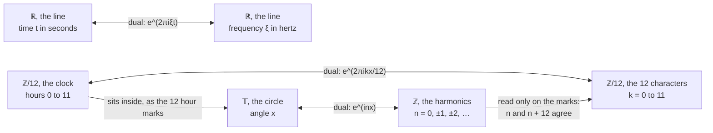

# Pontryagin duality: the line, the circle, the integers and the clock as one Fourier theory

[Syllabus](../../../SYLLABUS.md) → [Harmonic analysis](../README.md) → [Harmonic Analysis on Groups](../README.md#s08) → Pontryagin duality

---

## General Overview

A 12-hour clock face holds the group ℤ/12: the hours 0 to 11, added with wrap-round, so 9 + 5 reads 2. It has 12 **characters**, one for each k from 0 to 11. Character k turns hour x into a point on the unit circle of complex numbers: it spins k times round the circle while the hour hand goes round once. Character 1 sends 3 o'clock to i, a quarter turn.

The library already has three other Fourier theories: series on the circle, the transform on the line ℝ, and the discrete Fourier transform (DFT) of 12 hourly readings. Each has its own formula and its own factor of 1/2π or 1/N.

**Pontryagin duality** makes them one theory. Every group of a broad kind has a **dual group**, the set of its characters. The line's dual is the line, the circle's is the integers ℤ, ℤ's is the circle, and the clock's is a clock. One inversion formula and one energy identity cover all four, and the dual of the dual is the group itself.

The same idea turns Poisson summation into a statement about a subgroup and its **annihilator**: the characters that read 1 on the whole subgroup. For the bell curve $`e^{-\pi x^2}`$ and the subgroup ℤ of the line, the sum over ℤ is 1.08643481121331. The sum of its transform over the annihilator, also ℤ, agrees to 15 digits.

**Every locally compact abelian group has a dual group of characters; with Haar measures paired on the two sides, one Fourier transform inverts and keeps energy on every such group, the dual of the dual is the group itself, and Poisson summation says that summing over a subgroup equals summing the transform over its annihilator.**

**What kind of fact this is:** theorems. The duals of the four groups, the dual of a product, the compactness of a discrete group's dual and the Poisson formula in outline are proved on this card in Why it works. Plancherel and the double-dual theorem are stated, with key ideas and sources, and checked on the four groups.

### The picture: four groups and their duals



ℤ and the circle are one pair read both ways. The two lower arrows show duality turning a subgroup into a quotient: the clock sits inside the circle, so its dual is ℤ with harmonics 12 apart merged. That merging is aliasing.

---

## The formula

Notation first, in words.

- A **locally compact abelian group** $`G`$ (LCA group) is a commutative group ($`x + y = y + x`$) with a topology in which adding is continuous, every point has a neighbourhood with compact closure, and two different points have separate neighbourhoods (Hausdorff). ℤ and the clock carry the discrete topology, in which every set is open.
- 𝕋 is the circle. As a group it is the angles $`-\pi \le x < \pi`$ added with wrap-round, or equally the complex numbers $`e^{ix}`$ of size 1, multiplied.
- A **character** of $`G`$ is a continuous map $`\chi`$ (read "chi") from $`G`$ to 𝕋 that turns addition into multiplication: $`\chi(x+y) = \chi(x)\,\chi(y)`$.
- The **dual group** $`\widehat G`$ (read "G hat") is the set of all characters, multiplied point by point. Its topology is the **compact-open topology**: a sequence of characters approaches $`\chi`$ when its members become uniformly close to $`\chi`$ on every compact set of $`G`$.
- **Haar measure** $`dx`$ on $`G`$ is the measure of size that shifting does not change, fixed up to one constant factor ([Haar measure](02-haar-measure.md)). The dual group has its own, $`d\chi`$.

The **Fourier transform** of an integrable $`f`$ on $`G`$, and its **inversion**:

```math
\hat f(\chi) = \int_G f(x)\,\overline{\chi(x)}\,dx, \qquad f(x) = \int_{\widehat G} \hat f(\chi)\,\chi(x)\,d\chi .
```

**Read it aloud:** the transform at a character weighs the signal against that character's conjugate and adds up over the group; the signal comes back as the sum of every character, each weighted by its transform.

The **Plancherel identity**, which holds for exactly one choice of $`d\chi`$ once $`dx`$ is fixed:

```math
\int_G \lvert f(x)\rvert^2\,dx = \int_{\widehat G} \lvert \hat f(\chi)\rvert^2\,d\chi .
```

**Read it aloud:** the signal's energy on the group equals its transform's energy on the dual group.

**Pontryagin's double-dual theorem.** The map $`\alpha`$ that sends $`x`$ to "evaluate at $`x`$" is an isomorphism of topological groups from $`G`$ onto the dual of $`\widehat G`$:

```math
\alpha(x)(\chi) = \chi(x), \qquad \alpha : G \to \widehat{\widehat G} \ \text{ one to one, onto, continuous both ways.}
```

**Read it aloud:** every character of the dual group is "read the character at some point of G", for exactly one point.

**Poisson summation.** For a closed subgroup $`H`$ of $`G`$, the **annihilator** is $`H^\perp = \{\chi : \chi(h) = 1 \text{ for every } h \text{ in } H\}`$ (read "H perp"). For suitable $`f`$:

```math
\int_H f(h)\,dh = \int_{H^\perp} \hat f(\chi)\,d\chi .
```

**Read it aloud:** the signal summed over the subgroup equals its transform summed over the characters that ignore the subgroup.

### The four pairs, with measures that match

| $`G`$ | $`\widehat G`$ | character | $`dx`$ on $`G`$ | $`d\chi`$ on $`\widehat G`$ |
| --- | --- | --- | --- | --- |
| ℝ, time $`t`$ | ℝ, frequency $`\xi`$ | $`e^{2\pi i \xi t}`$ | $`dt`$ | $`d\xi`$ |
| 𝕋, angle $`x`$ | ℤ, harmonic $`n`$ | $`e^{inx}`$ | $`dx/2\pi`$ | 1 at each $`n`$ |
| ℤ, index $`n`$ | 𝕋, angle $`x`$ | $`e^{inx}`$ | 1 at each $`n`$ | $`dx/2\pi`$ |
| ℤ/12, hour $`x`$ | ℤ/12, index $`k`$ | $`e^{2\pi i k x/12}`$ | 1 at each hour | 1/12 at each $`k`$ |

Each row, put into the one formula, gives a familiar one: the wing's transform $`\hat f(\xi) = \int f(t)\,e^{-2\pi i \xi t}\,dt`$, the circle's coefficients with their $`1/2\pi`$, and the DFT with $`1/12`$ before the inverse. The rule behind the last two columns: multiply $`dx`$ by a constant and $`d\chi`$ must be divided by it. [Fourier analysis on a finite abelian group](01-fourier-analysis-on-finite-abelian-groups.md) puts the clock's weights the other way round, 1/12 at each hour and 1 at each character, so its transforms are this card's divided by 12; both pairings follow the rule.

| Symbol | Plain meaning | In our example | Push it up and the answer… |
| --- | --- | --- | --- |
| $`G`$, $`G_1`$, $`G_2`$, $`x`$, $`y`$ | an LCA group, or the two factors of a product; members | the clock; hours 0 to 11 | — |
| $`\widehat G`$, $`\chi`$, $`\chi_k`$ | the dual group; a character; the clock's character $`k`$ | 12 characters | — |
| $`\psi`$, $`w`$, $`\alpha`$ | a character of the dual; its value at $`\chi_1`$; the evaluation map | 12 matches out of 12 | — |
| 𝕋, $`z`$, $`i`$ | the circle, angles or unit complex numbers; a character's value at 1; the imaginary unit | $`\chi_1(3) = i`$ | — |
| $`t`$, $`\xi`$, $`t_1`$, $`t_2`$, $`\xi_1`$, $`\xi_2`$ | time in seconds; frequency in hertz; the same in the plane | $`\xi`$ = 0.5 Hz | faster spin of $`e^{2\pi i\xi t}`$ |
| $`n`$, $`k`$, $`j`$, $`N`$ | an integer or harmonic; a clock character index; a mark number; the clock size | $`N`$ = 12 | more characters, finer dual |
| $`f`$, $`\hat f`$, $`\tilde f`$ | a signal on $`G`$; its transform on $`\widehat G`$; the reversed conjugate $`\overline{f(-x)}`$ | $`f(x) = x`$, $`\hat f(0)`$ = 66 | — |
| $`dx`$, $`d\chi`$, $`dh`$ | Haar measures on $`G`$, on $`\widehat G`$ and on $`H`$, paired | weight 1 and weight 1/12 | one up, the other must come down |
| $`H`$, $`H^\perp`$, $`F`$ | a closed subgroup; its annihilator; $`f`$ added along each slid copy of $`H`$ | 0, 3, 6, 9; and 0, 4, 8 | bigger $`H`$, smaller $`H^\perp`$ |
| $`T`$ | spacing of a subgroup $`T\mathbb{Z}`$ of the line | $`T`$ = 1 and 2 | annihilator spacing $`1/T`$ shrinks |
| $`\ell`$, $`c`$, $`a`$ | in Step 2: a short length; the integral of $`\chi`$ over it; the rate $`\chi'(0)`$ | 0.3 s; —; 3.141593i | — |
| $`f * g`$, $`L^1(G)`$ | convolution, $`\int_G f(y)\,g(x-y)\,dy`$; the integrable functions on $`G`$ | $`g`$ = 1 on 0, 3, 6, 9 | — |

### When it holds

- **Abelian.** The operation must commute. The six shuffles of three objects, written $`S_3`$, do not, and they have only 2 characters: too few to rebuild a function on 6 members. A spike at one swap has energy 1, but its 2 transform values give only 1/3.
- **Locally compact.** Haar measure is built only for locally compact groups, and every integral here needs it. The rationals ℚ with their usual distances fail this, so they have no Haar measure: no shift-proof measure that is finite on compact sets and positive on open ones.
- **Measures paired.** Inversion and Plancherel hold with constant 1 only for the dual measure. Counting measure on both sides of the clock makes the dual energy 6072, twelve times the true 506.
- **Poisson needs a decaying, continuous signal and a closed subgroup**, with matched measures on $`H`$ and $`H^\perp`$. Drop the weight 2 on the points of 2ℤ and the subgroup side reads 1.000006974685 against 2.000013949369.

---

## Why it works

### Step 0: a character is a pure tone for the group

Shift a character by $`y`$ and it is only multiplied by a constant: $`\chi(x + y) = \chi(y)\,\chi(x)`$. A delay acts on a pure tone the same way, as a phase. A Fourier theory writes any signal as a sum of pure tones, so it needs enough characters and a fair way to add up over the group, Haar measure. Abelian groups have both.

### Step 1: the duals of the clock, of ℤ and of a product

A character of ℤ is fixed by one number, $`z = \chi(1)`$, because $`\chi(n) = z^n`$. Any $`z`$ on the circle works. So the dual of ℤ is the circle, with $`z = e^{ix}`$ and $`\chi(n) = e^{inx}`$.

On the clock, 12 steps of one hour return to 0, so $`z^{12} = \chi(12) = \chi(0) = 1`$. There are exactly 12 such $`z`$, the 12th roots of 1, and $`\chi_k(x) = e^{2\pi i k x/12}`$. Characters multiply by adding their indices, $`\chi_a\chi_b = \chi_{a+b}`$, so the dual is again a clock ([Fourier analysis on a finite abelian group](01-fourier-analysis-on-finite-abelian-groups.md)).

The clock sits in the circle as the 12 marks $`x = 2\pi j/12`$. Read on the marks only, $`e^{13ix}`$ and $`e^{ix}`$ agree to within 0.000000000000. The integers that read 1 on every mark are …, −24, −12, 0, 12, 24, …, the clock's annihilator in ℤ. So the clock's dual is ℤ with that annihilator divided out. In general, the dual of a subgroup is the dual group divided by the subgroup's annihilator.

For a product $`G_1 \times G_2`$, $`\chi(x_1, x_2) = \chi(x_1, 0)\,\chi(0, x_2)`$: one character of each factor, multiplied. So the dual of a product is the product of the duals, and the plane's characters are $`e^{2\pi i(\xi_1 t_1 + \xi_2 t_2)}`$.

### Step 2: the duals of the line and the circle

A character of the line is only assumed continuous. One integral makes it smooth. Since $`\chi(0) = 1`$ and $`\chi`$ is continuous, pick a short length $`\ell`$ on which $`\chi`$ stays close to 1. Then its integral $`c = \int_0^\ell \chi(s)\,ds`$ is not 0. Shift by $`t`$ inside the integral:

```math
\chi(t)\,c = \int_0^\ell \chi(t + s)\,ds = \int_t^{t+\ell} \chi(s)\,ds .
```

The right side is differentiable in $`t`$, by the fundamental theorem of calculus, so $`\chi`$ is too. Differentiating gives $`\chi'(t) = \chi(t)\,a`$ with the constant $`a = (\chi(\ell) - 1)/c`$. So $`\chi(t) = e^{at}`$. Its size is always 1, which forces $`a`$ to be imaginary: $`a = 2\pi i\xi`$ for one real $`\xi`$. The dual of the line is the line of frequencies.

In the check, with $`\xi`$ = 0.5 Hz and $`\ell`$ = 0.3 s, the rebuilt rate is 3.141593i, which is $`2\pi\xi`$.

A character of the circle is a character of the line that repeats every $`2\pi`$. Then $`e^{2\pi i \xi \cdot 2\pi} = 1`$, so $`2\pi\xi`$ is a whole number $`n`$ and $`\chi(x) = e^{inx}`$. The dual of the circle is ℤ.

### Step 3: discrete groups have compact duals

For a discrete group, compact sets are finite, so the compact-open topology is plain pointwise closeness. A character is then a point of the product of circles $`\prod_{x \in G} \mathbb{T}`$, one circle for each member of $`G`$. That product is compact by Tychonoff's theorem ([Compactness with no distances, and Tychonoff](../../17-Topology/02-Topological%20Spaces/06-compactness-and-tychonoff.md)). The rule $`\chi(x + y) = \chi(x)\chi(y)`$ is a closed condition, since each instance compares two continuous coordinates. A closed piece of a compact space is compact, so the dual is compact. That is why ℤ's dual, the circle, is compact. In the other direction, a compact group has a discrete dual, as the circle has ℤ.

### Step 4: the transform is the Gelfand transform of the group algebra

Integrable functions on $`G`$ form a commutative algebra $`L^1(G)`$ under convolution. With the size $`\int \lvert f\rvert\,dx`$ it is a Banach algebra ([Banach algebras](../../18-Functional%20analysis/06-Banach%20Algebras%20and%20Fixed%20Points/01-banach-algebras-and-the-gelfand-transform.md)), with a unit adjoined when $`G`$ is not discrete.

Each character gives a map $`f \mapsto \hat f(\chi)`$ that respects products, since the transform of a convolution is the product of transforms. On the clock the gap between $`\widehat{f * g}`$ and $`\hat f\,\hat g`$ is 0.000000000. Conversely, every nonzero product-respecting linear map of $`L^1(G)`$ to the complex numbers is one of these, for exactly one character. So the dual group is the algebra's character space, and the Fourier transform is its Gelfand transform. The weak-star topology there (two such maps are close when their values at each integrable function are close) is the compact-open topology here, and weak-star compactness ([Weak convergence](../../18-Functional%20analysis/02-Hilbert%20Spaces/09-weak-convergence-and-banach-alaoglu.md)) makes the dual locally compact.

**Plancherel, stated.** Fix Haar measure $`dx`$ on $`G`$. There is exactly one Haar measure $`d\chi`$ on $`\widehat G`$ such that $`\int \lvert f\rvert^2\,dx = \int \lvert\hat f\rvert^2\,d\chi`$ for every $`f`$ that is both integrable and square-integrable. The transform then extends to an energy-keeping map from all square-integrable functions on $`G`$ onto those on $`\widehat G`$, and inversion holds for integrable $`f`$ with integrable $`\hat f`$ (Folland, ch. 4; Rudin, ch. 1).

The key idea: $`f * \tilde f`$, with $`\tilde f(x) = \overline{f(-x)}`$, is positive definite (its values at the differences of any finitely many points, set out as a matrix, have no negative eigenvalues), so [Bochner's theorem](../06-Maximal%20Functions%20and%20Beyond/05-bochner-and-positive-definite-functions.md), true on every LCA group, writes it as characters integrated against a measure. Those measures fit together into $`d\chi`$, and reading $`f * \tilde f`$ at 0 gives the identity.

### Step 5: the double dual

Each $`x`$ gives a character of the dual group, $`\alpha(x)(\chi) = \chi(x)`$.

**The double-dual theorem, stated.** For every LCA group $`G`$, $`\alpha`$ is an isomorphism of groups and a homeomorphism (continuous both ways) from $`G`$ onto the dual of $`\widehat G`$ (Pontrjagin, 1934, for compact groups with a countable base of open sets and for countable discrete groups; Folland, ch. 4, for every LCA group). The key idea has two halves. First, characters separate points. If every character read 1 at some $`x \ne 0`$, every signal would have the same transform as its shift by $`x`$, and inversion would make the two equal, which fails for a narrow bump. So $`\alpha`$ is one to one. The other half shows the image is closed and is everything; it uses Plancherel on the dual group, and Folland gives it in full.

On the clock it is a finite search. A character $`\psi`$ of the dual is fixed by $`w = \psi(\chi_1)`$, a 12th root of 1. For each of the 12 choices, exactly one hour $`x`$ has $`\chi_k(x) = w^k`$ for every $`k`$. The 12 characters of the dual are evaluation at hours 0 to 11, in order. Characters separate hours: $`\lvert\chi_1(x) - 1\rvert`$ is at least 0.517638 for every hour other than 0.

The clock also matches its dual by $`x \mapsto \chi_x`$, but that needs a chosen root, $`e^{2\pi i/12}`$. The double-dual map needs no choice, and only it exists for every LCA group.

### Step 6: Poisson summation from the subgroup and its annihilator

Let $`H`$ be a closed subgroup. Add $`f`$ up along each slid copy of $`H`$:

```math
F(x + H) = \int_H f(x + h)\,dh .
```

$`F`$ lives on the quotient $`G/H`$, the group of slid copies ([Cosets and Lagrange's theorem](../../03-Algebra/08-Groups/04-cosets-and-lagranges-theorem.md)). The characters of $`G/H`$ are those of $`G`$ that read 1 on $`H`$, which is $`H^\perp`$. Integrating over $`H`$ and then over $`G/H`$ integrates over $`G`$, so $`\hat F = \hat f`$ on $`H^\perp`$. Inversion on $`G/H`$, read at the copy $`H`$ itself, gives the formula.

The weights come from the measures: $`dx`$ splits as $`dh`$ times a measure on $`G/H`$, and $`H^\perp`$ carries that measure's dual. The conditions on $`f`$ are those that make inversion valid; [Poisson summation and sampling](../02-The%20Fourier%20Transform/08-poisson-summation-and-sampling.md) proves the line case in full.

<details>
<summary>Detailed check of the weights: ℤ in ℝ, 2ℤ in ℝ, and the clock</summary>

**ℤ in the line.** Counting measure on ℤ leaves ℝ/ℤ a circle of total size 1, whose dual measure is counting on its characters $`e^{2\pi i k t}`$. The annihilator of ℤ is ℤ, and

$`\displaystyle \sum_{n} e^{-\pi n^2} = \sum_{k} \hat f(k), \qquad \hat f(k) = e^{-\pi k^2}.`$

**2ℤ in the line.** Weight 2 on each point of 2ℤ leaves ℝ/2ℤ, of length 2, with total size 1, so the annihilator $`\tfrac12\mathbb{Z}`$ carries counting measure:

$`\displaystyle 2\sum_n f(2n) = \sum_k \hat f(k/2).`$

**The clock.** Counting measure on $`H = \{0, 3, 6, 9\}`$ leaves a quotient of 3 members of weight 1, so $`H^\perp = \{0, 4, 8\}`$ carries weight 1/3:

$`\displaystyle \sum_{h \in H} f(h) = \tfrac13 \sum_{k \in H^\perp} \hat f(k).`$

</details>

---

## Worked numbers, by hand

The clock, with the signal $`f(x) = x`$, the hour number itself, and the line with the bell curve.

| Step | Arithmetic | Value |
| --- | --- | --- |
| character 1 at 3 o'clock | $`e^{2\pi i \cdot 3/12} = e^{i\pi/2}`$ | $`i`$ |
| energy on the clock | $`0^2 + 1^2 + \dots + 11^2`$ | 506 |
| transform at $`k = 0`$ | $`0 + 1 + \dots + 11`$ | 66 |
| its share of the dual energy | $`66^2 \times 1/12`$ | 363 |
| all 12 shares, weight 1/12 each | the code adds the other 11 | **506** |
| annihilator of 0, 3, 6, 9 | $`k`$ with $`3k`$ a multiple of 12 | 0, 4, 8 |
| sum of $`f`$ over $`H`$ | $`0 + 3 + 6 + 9`$ | 18 |
| transform at 4 and at 8 | conjugates: $`-6 \pm 3.464102i`$ | sum −12 |
| Poisson on the clock | $`\tfrac13(66 - 12)`$ | **18** |
| bell curve over ℤ | $`1 + 2e^{-\pi} + 2e^{-4\pi} + \dots`$, $`\lvert n\rvert \le 6`$ | **1.08643481121331** |
| transform over the annihilator ℤ | each $`\hat f(k)`$ by its integral | **1.08643481121331** |

Plancherel gives 506 on both sides; Poisson gives 18 on the clock and agrees to 15 digits on the line: two identities, holding on two different groups. The bell curve is its own transform, so on ℤ the two sums have the same terms and the 15-digit match mainly confirms $`\hat f(k) = e^{-\pi k^2}`$. The real test is 2ℤ, where the sides are different sums, $`2\sum_n e^{-4\pi n^2}`$ and $`\sum_k e^{-\pi k^2/4}`$, and both read 2.000013949369. The checks test Plancherel on the other three pairs too, each with its own signal:

| Pair | Signal | Energy on $`G`$ | Energy on $`\widehat G`$ |
| --- | --- | --- | --- |
| ℝ ↔ ℝ | $`e^{-\lvert t\rvert}`$, transform $`2/(1 + 4\pi^2\xi^2)`$ | 1.000000000 | 0.999999998 on $`\lvert\xi\rvert \le`$ 100 Hz, tail below 0.000000001711 |
| 𝕋 ↔ ℤ | $`x`$, coefficients $`i(-1)^n/n`$ | $`\pi^2/3`$ = 3.289868 | $`\sum 1/n^2`$ = 3.289848134 for $`0 < \lvert n\rvert \le`$ 100000, gap 0.000020000 within the tail bound |
| ℤ ↔ 𝕋 | $`c_n = 2^{-\lvert n\rvert}`$, transform $`0.75/(1.25 - \cos x)`$ | 1.666666666667 | 1.666666666667 from 64 points of the circle |
| ℤ/12 ↔ ℤ/12 | the hour $`x`$ | 506 | 506 |

Inversion closes the loop on ℤ: $`c_3`$ comes back from the circle as 0.125. On the line, $`\hat f(0.5)`$ by the defining integral is 0.183999337, matching the closed form $`2/(1+\pi^2)`$.

### What breaks if you drop a piece

| Mistake | Comes out at | What went wrong |
| --- | --- | --- |
| Counting measure on both sides of the clock | dual energy 6072, not 506 | the measures were not paired: their weights multiply to 1, not 1/12 |
| All of ℤ as the clock's dual, $`k`$ = 0 to 23 | dual energy 1012 | $`k`$ and $`k + 12`$ are one character; the subgroup's dual is a quotient |
| No weight 2 on the points of 2ℤ | 1.000006974685 against 2.000013949369 | the subgroup's measure must fit the annihilator's |
| The shuffles $`S_3`$, not abelian | 2 characters for 6 members; energy 1 becomes 1/3 | characters alone cannot rebuild a non-commutative group's functions |

The code prints all four.

---

## Code, from first principles, and it actually runs

The Python imports only `math` and `cmath`; the Rust uses `std` and a small complex-number struct. Both find the clock's characters and double dual by search, rebuild the line's frequency by Step 2's integral, and test Plancherel on all four pairs, each energy computed on the group and again on its dual. Poisson is checked three ways: over ℤ against the transform, each value from its defining integral by the trapezoid rule; over 2ℤ; and on the clock. Every truncated sum prints its cut-off and a tail bound. The trapezoid rule is exact to rounding here because its error is the transform's Poisson copies 16, 32, … hertz away, far below rounding.

### Python

```python
# Pontryagin duality -- the check behind the card.  Standard library only, and
# only cmath and math from it.  Four groups with their duals: the 12-hour clock
# Z/12, the circle, the integers Z and the line R.  Every transform is written out.
import cmath, math
PI, N = math.pi, 12

def fx(x, d=6):                                  # fixed decimals, no "-0"
    return f"{0.0 if abs(x) < 0.5 * 10 ** -d else x:.{d}f}"

def fc(z):
    return f"{fx(z.real)} {'-' if z.imag < -5e-7 else '+'} {fx(abs(z.imag))}i"

def simpson(g, a, b, m):                         # Simpson's rule, m even
    h = (b - a) / m
    s = g(a) + g(b) + sum((4 if j % 2 else 2) * g(a + j * h) for j in range(1, m))
    return s * h / 3

def chi(k, x):                                   # character k of the clock at hour x
    return cmath.exp(2j * PI * k * x / N)

def dft(f):                                      # f-hat(k): sum over hours, counting measure
    return [sum(f[x] * chi(k, x).conjugate() for x in range(N)) for k in range(N)]

# 1. The clock's dual: a character is fixed by z = chi(1), and z^12 must be 1.
roots = [cmath.exp(2j * PI * k / N) for k in range(N)]
print(f"clock: characters found {len(roots)}; chi_1 at hour 3 = {fc(chi(1, 3))}; chi_2 at hour 3 = {fc(chi(2, 3))}")
mult = max(abs(chi(a, x) * chi(b, x) - chi((a + b) % N, x)) for a in range(N) for b in range(N) for x in range(N))
print(f"chi_a times chi_b = chi_(a+b), largest gap {fx(mult, 12)}")
# 2. The double dual: a character psi of the dual is fixed by w = psi(chi_1), w^12 = 1;
# find for each such psi the one hour x with chi_k(x) = w^k for every k.
match = []
for w in roots:
    hits = [x for x in range(N) if max(abs(chi(k, x) - w ** k) for k in range(N)) < 1e-9]
    match.append(hits)
print(f"double dual: {len(match)} characters of the dual, each equal to evaluation at hours {[h[0] for h in match]}")
sep = [abs(chi(1, x) - 1) for x in range(1, N)]
print(f"characters separate hours: smallest |chi_1(x) - 1| over x = 1..11 is {fx(min(sep))}")
# 3. The clock inside the circle: marks at angle 2 pi x / 12.
marks = [2 * PI * x / N for x in range(N)]
gap13 = max(abs(cmath.exp(13j * a) - cmath.exp(1j * a)) for a in marks)
ann = [n for n in range(-30, 31) if max(abs(cmath.exp(1j * n * a) - 1) for a in marks) < 1e-9]
print(f"circle characters on the 12 marks: e^(13ix) minus e^(ix), largest gap {fx(gap13, 12)}; annihilator in Z, |n| <= 30: {ann}")
# 4. The line's characters: chi(t) = e^(2 pi i xi t) with xi = 0.5 Hz, rebuilt from
# chi(delta) and the integral over [0, delta], as in Step 2.
xi, dl = 0.5, 0.3
c = simpson(lambda t: cmath.exp(2j * PI * xi * t), 0, dl, 200)
a = (cmath.exp(2j * PI * xi * dl) - 1) / c
print(f"line: chi'(0) rebuilt from chi(0.3) and its integral = {fc(a)}, and 2 pi xi = {fx(2 * PI * xi)}")
# 5. Plancherel and inversion on each pair.
f = list(range(N))
F = dft(f)
e_g, e_d = sum(v * v for v in f), sum(abs(v) ** 2 for v in F) / N
inv = max(abs(sum(F[k] * chi(k, x) for k in range(N)) / N - f[x]) for x in range(N))
print(f"Z/12, f(x) = x: energy on the clock {e_g}; on the dual, weight 1/12 each: {fx(e_d)}; inversion error {fx(inv, 12)}")
print(f"  f-hat(0) = {fx(F[0].real)}, its share {fx(abs(F[0]) ** 2 / N)}; f-hat(4) = {fc(F[4])}; f-hat(8) = {fc(F[8])}")
M = 20000
saw = sum(((j + 0.5) * 2 * PI / M - PI) ** 2 for j in range(M)) / M
c3 = sum(x * cmath.exp(-3j * x) for x in [(j + 0.5) * 2 * PI / M - PI for j in range(M)]) / M
K = 100000
basel = 2 * sum(1 / (n * n) for n in range(1, K + 1))
print(f"circle, f(x) = x: f-hat(3) = {fc(c3)}; energy (1/2 pi) int x^2 dx = {fx(saw)}; pi^2/3 = {fx(PI * PI / 3)}")
print(f"  on Z: sum of 1/n^2 over 0 < |n| <= {K} = {fx(basel, 9)}; gap {fx(PI * PI / 3 - basel, 9)}, tail bound 2/{K} = {fx(2 / K, 9)}")
cz = 2 * sum(0.25 ** n for n in range(1, 61)) + 1
P = lambda x: 0.75 / (1.25 - math.cos(x))
ez = sum(P(2 * PI * j / 64) ** 2 for j in range(64)) / 64
c3z = sum(P(2 * PI * j / 64) * math.cos(3 * 2 * PI * j / 64) for j in range(64)) / 64
print(f"Z, c_n = 2^-|n|: energy {fx(cz, 12)}; on the circle, 64 points: {fx(ez, 12)}; c_3 rebuilt = {fx(c3z, 12)}")
fl = simpson(lambda t: math.exp(-2 * abs(t)), -40, 40, 80000)
fh = simpson(lambda t: math.exp(-abs(t)) * math.cos(2 * PI * xi * t), -40, 40, 80000)
X = 100.0
fhe = simpson(lambda s: (2 / (1 + 4 * PI * PI * s * s)) ** 2, -X, X, 200000)
print(f"R, f(t) = e^-|t|: energy {fx(fl, 9)}; f-hat(0.5) by the integral {fx(fh, 9)}, by 2/(1 + pi^2) {fx(2 / (1 + PI * PI), 9)}")
print(f"  energy of f-hat on |xi| <= {X:.0f} Hz: {fx(fhe, 9)}; tail bound 1/(6 pi^4 X^3) = {fx(1 / (6 * PI ** 4 * X ** 3), 12)}")
# 6. The Fourier transform turns convolution into multiplication (Gelfand).
g = [1 if x % 3 == 0 else 0 for x in range(N)]
conv = [sum(f[y] * g[(x - y) % N] for y in range(N)) for x in range(N)]
G, C = dft(g), dft(conv)
print(f"clock convolution: (f * g)-hat minus f-hat g-hat, largest gap {fx(max(abs(C[k] - F[k] * G[k]) for k in range(N)), 9)}")
# 7. Poisson summation: a subgroup H and its annihilator.
gs = lambda x: math.exp(-PI * x * x)
def ghat(s):                                     # trapezoid, step 1/16 on [-8, 8]
    return sum(gs(j / 16) * math.cos(2 * PI * s * j / 16) for j in range(-128, 129)) / 16
lhs = sum(gs(n) for n in range(-6, 7))
rhs = sum(ghat(k) for k in range(-6, 7))
print(f"Poisson, H = Z in R: sum of e^(-pi n^2), |n| <= 6 = {lhs:.14f}; tail below {3 * math.exp(-49 * PI):.1e}")
print(f"  sum over the annihilator Z of f-hat(k), each by the integral = {rhs:.14f}; gap {fx(abs(lhs - rhs), 12)}")
l2 = 2 * sum(gs(2 * n) for n in range(-6, 7))
r2 = sum(ghat(k / 2) for k in range(-12, 13))
print(f"Poisson, H = 2Z: 2 x sum of f(2n) = {l2:.12f}; sum over (1/2)Z of f-hat = {r2:.12f}")
H = [0, 3, 6, 9]
Hp = [k for k in range(N) if all(abs(chi(k, h) - 1) < 1e-9 for h in H)]
ps = sum(F[k] for k in Hp) * len(H) / N
print(f"Poisson on the clock: H = {H}, annihilator {Hp}; sum of f on H = {sum(f[h] for h in H)}; |H|/12 x sum of f-hat there = {fc(ps)}")
# 8. What breaks.
print(f"mistake 1, counting measure on both sides: dual energy {fx(e_d * N)}, not {e_g}")
print(f"mistake 2, all of Z as the clock's dual, k = 0..23: dual energy {fx(sum(abs(F[k % N]) ** 2 for k in range(24)) / N)}")
print(f"mistake 3, no weight 2 on the points of 2Z: {l2 / 2:.12f}, not {r2:.12f}")
# S3, the six shuffles of three things, is not abelian: its characters
# send r (a 3-cycle) and s (a swap) to sixth roots with r^3 = s^2 = 1, s r s = r^-1.
six = [cmath.exp(2j * PI * k / 6) for k in range(6)]
s3 = [(u, v) for u in six for v in six if abs(u ** 3 - 1) < 1e-9 and abs(v * v - 1) < 1e-9 and abs(v * u * v - 1 / u) < 1e-9]
print(f"mistake 4, S3 is not abelian: characters found {len(s3)} for 6 members; delta at a swap: energy 1, dual energy {fx(len(s3) / 6)}")
assert len(set(h[0] for h in match)) == N and all(len(h) == 1 for h in match)      # double dual
assert ann == [-24, -12, 0, 12, 24] and abs(a - 2j * PI * xi) < 1e-9 and min(sep) > 0.5
assert abs(e_d - 506) < 1e-9 and inv < 1e-9 and abs(c3 - 1j * (-1) ** 3 / 3) < 1e-6
assert abs(saw - PI * PI / 3) < 1e-6 and 0 < PI * PI / 3 - basel < 2 / K
assert abs(ez - 5 / 3) < 1e-12 and abs(cz - 5 / 3) < 1e-12 and abs(c3z - 0.125) < 1e-12
assert abs(fh - 2 / (1 + PI * PI)) < 1e-9 and abs(fl - 1) < 1e-9 and abs(fhe + 1 / (6 * PI ** 4 * X ** 3) - 1) < 1e-9
assert abs(lhs - rhs) < 1e-15 and abs(l2 - r2) < 1e-14 and Hp == [0, 4, 8] and abs(ps - 18) < 1e-9
assert len(s3) == 2
print("ALL CHECKS PASS")
```

**Ran 2026-11-24 on macOS, Python 3.14.10, standard library only. All checks passed. Output, pasted from the run:**

```
clock: characters found 12; chi_1 at hour 3 = 0.000000 + 1.000000i; chi_2 at hour 3 = -1.000000 + 0.000000i
chi_a times chi_b = chi_(a+b), largest gap 0.000000000000
double dual: 12 characters of the dual, each equal to evaluation at hours [0, 1, 2, 3, 4, 5, 6, 7, 8, 9, 10, 11]
characters separate hours: smallest |chi_1(x) - 1| over x = 1..11 is 0.517638
circle characters on the 12 marks: e^(13ix) minus e^(ix), largest gap 0.000000000000; annihilator in Z, |n| <= 30: [-24, -12, 0, 12, 24]
line: chi'(0) rebuilt from chi(0.3) and its integral = 0.000000 + 3.141593i, and 2 pi xi = 3.141593
Z/12, f(x) = x: energy on the clock 506; on the dual, weight 1/12 each: 506.000000; inversion error 0.000000000000
  f-hat(0) = 66.000000, its share 363.000000; f-hat(4) = -6.000000 + 3.464102i; f-hat(8) = -6.000000 - 3.464102i
circle, f(x) = x: f-hat(3) = 0.000000 - 0.333333i; energy (1/2 pi) int x^2 dx = 3.289868; pi^2/3 = 3.289868
  on Z: sum of 1/n^2 over 0 < |n| <= 100000 = 3.289848134; gap 0.000020000, tail bound 2/100000 = 0.000020000
Z, c_n = 2^-|n|: energy 1.666666666667; on the circle, 64 points: 1.666666666667; c_3 rebuilt = 0.125000000000
R, f(t) = e^-|t|: energy 1.000000000; f-hat(0.5) by the integral 0.183999337, by 2/(1 + pi^2) 0.183999337
  energy of f-hat on |xi| <= 100 Hz: 0.999999998; tail bound 1/(6 pi^4 X^3) = 0.000000001711
clock convolution: (f * g)-hat minus f-hat g-hat, largest gap 0.000000000
Poisson, H = Z in R: sum of e^(-pi n^2), |n| <= 6 = 1.08643481121331; tail below 4.2e-67
  sum over the annihilator Z of f-hat(k), each by the integral = 1.08643481121331; gap 0.000000000000
Poisson, H = 2Z: 2 x sum of f(2n) = 2.000013949369; sum over (1/2)Z of f-hat = 2.000013949369
Poisson on the clock: H = [0, 3, 6, 9], annihilator [0, 4, 8]; sum of f on H = 18; |H|/12 x sum of f-hat there = 18.000000 + 0.000000i
mistake 1, counting measure on both sides: dual energy 6072.000000, not 506
mistake 2, all of Z as the clock's dual, k = 0..23: dual energy 1012.000000
mistake 3, no weight 2 on the points of 2Z: 1.000006974685, not 2.000013949369
mistake 4, S3 is not abelian: characters found 2 for 6 members; delta at a swap: energy 1, dual energy 0.333333
ALL CHECKS PASS
```

### Rust

Same numbers, same labels, built with `rustc --edition 2021 -O`.

```rust
// Pontryagin duality -- the same check as the Python, in Rust.  No crates.  Four
// groups with their duals: the 12-hour clock Z/12, the circle, the integers Z and
// the line R.  A complex number is a small struct; every transform is written out.
use std::f64::consts::PI;
const N: usize = 12;

#[derive(Clone, Copy)]
struct C { re: f64, im: f64 }
impl C {
    fn add(self, o: C) -> C { C { re: self.re + o.re, im: self.im + o.im } }
    fn sub(self, o: C) -> C { C { re: self.re - o.re, im: self.im - o.im } }
    fn mul(self, o: C) -> C { C { re: self.re * o.re - self.im * o.im, im: self.re * o.im + self.im * o.re } }
    fn scale(self, s: f64) -> C { C { re: self.re * s, im: self.im * s } }
    fn div(self, o: C) -> C { let d = o.re * o.re + o.im * o.im; self.mul(o.conj()).scale(1.0 / d) }
    fn conj(self) -> C { C { re: self.re, im: -self.im } }
    fn abs(self) -> f64 { self.re.hypot(self.im) }
    fn pow(self, k: usize) -> C { let mut z = C { re: 1.0, im: 0.0 }; for _ in 0..k { z = z.mul(self) } z }
}
fn cis(t: f64) -> C { C { re: t.cos(), im: t.sin() } }           // e^(it)
fn re(x: f64) -> C { C { re: x, im: 0.0 } }

fn fx(x: f64, d: usize) -> String {                                // fixed decimals, no "-0"
    let x = if x.abs() < 0.5 * 10f64.powi(-(d as i32)) { 0.0 } else { x };
    format!("{:.*}", d, x)
}
fn fc(z: C) -> String { format!("{} {} {}i", fx(z.re, 6), if z.im < -5e-7 { "-" } else { "+" }, fx(z.im.abs(), 6)) }

fn simpson<F: Fn(f64) -> f64>(g: F, a: f64, b: f64, m: usize) -> f64 {   // m even
    let h = (b - a) / m as f64;
    let mut t = 0.0;
    for j in 1..m { t += if j % 2 == 1 { 4.0 } else { 2.0 } * g(a + j as f64 * h) }
    (g(a) + g(b) + t) * h / 3.0
}
fn chi(k: usize, x: usize) -> C { cis(2.0 * PI * k as f64 * x as f64 / N as f64) }   // character k at hour x
fn dft(f: &[C]) -> Vec<C> {                                         // counting measure on the hours
    (0..N).map(|k| (0..N).fold(re(0.0), |s, x| s.add(f[x].mul(chi(k, x).conj())))).collect()
}
fn gs(x: f64) -> f64 { (-PI * x * x).exp() }
fn ghat(s: f64) -> f64 {                                            // trapezoid, step 1/16 on [-8, 8]
    let mut t = 0.0;
    for j in -128i32..129 { let x = j as f64 / 16.0; t += gs(x) * (2.0 * PI * s * x).cos() }
    t / 16.0
}

fn main() {
    // 1. The clock's dual, and its multiplication.
    let roots: Vec<C> = (0..N).map(|k| cis(2.0 * PI * k as f64 / N as f64)).collect();
    println!("clock: characters found {}; chi_1 at hour 3 = {}; chi_2 at hour 3 = {}", roots.len(), fc(chi(1, 3)), fc(chi(2, 3)));
    let mut mult: f64 = 0.0;
    for a in 0..N { for b in 0..N { for x in 0..N { mult = mult.max(chi(a, x).mul(chi(b, x)).sub(chi((a + b) % N, x)).abs()) } } }
    println!("chi_a times chi_b = chi_(a+b), largest gap {}", fx(mult, 12));
    // 2. The double dual.
    let matched: Vec<Vec<usize>> = roots.iter().map(|&w| (0..N).filter(|&x|
        (0..N).map(|k| chi(k, x).sub(w.pow(k)).abs()).fold(0.0, f64::max) < 1e-9).collect()).collect();
    let firsts: Vec<usize> = matched.iter().map(|h| h[0]).collect();
    println!("double dual: {} characters of the dual, each equal to evaluation at hours {:?}", matched.len(), firsts);
    let sep = (1..N).map(|x| chi(1, x).sub(re(1.0)).abs()).fold(f64::INFINITY, f64::min);
    println!("characters separate hours: smallest |chi_1(x) - 1| over x = 1..11 is {}", fx(sep, 6));
    // 3. The clock inside the circle.
    let marks: Vec<f64> = (0..N).map(|x| 2.0 * PI * x as f64 / N as f64).collect();
    let gap13 = marks.iter().map(|&a| cis(13.0 * a).sub(cis(a)).abs()).fold(0.0, f64::max);
    let ann: Vec<i32> = (-30..31).filter(|&n| marks.iter().map(|&a| cis(n as f64 * a).sub(re(1.0)).abs()).fold(0.0, f64::max) < 1e-9).collect();
    println!("circle characters on the 12 marks: e^(13ix) minus e^(ix), largest gap {}; annihilator in Z, |n| <= 30: {:?}", fx(gap13, 12), ann);
    // 4. The line's characters, rebuilt from chi(delta) and the integral over [0, delta].
    let (xi, dl) = (0.5, 0.3);
    let c = C { re: simpson(|t| (2.0 * PI * xi * t).cos(), 0.0, dl, 200), im: simpson(|t| (2.0 * PI * xi * t).sin(), 0.0, dl, 200) };
    let a = cis(2.0 * PI * xi * dl).sub(re(1.0)).div(c);
    println!("line: chi'(0) rebuilt from chi(0.3) and its integral = {}, and 2 pi xi = {}", fc(a), fx(2.0 * PI * xi, 6));
    // 5. Plancherel and inversion on each pair.
    let f: Vec<C> = (0..N).map(|x| re(x as f64)).collect();
    let ff = dft(&f);
    let e_g: usize = (0..N).map(|x| x * x).sum();
    let e_d = ff.iter().fold(0.0, |s, z| s + z.abs().powi(2)) / N as f64;
    let inv = (0..N).map(|x| (0..N).fold(re(0.0), |s, k| s.add(ff[k].mul(chi(k, x)))).scale(1.0 / N as f64).sub(f[x]).abs()).fold(0.0, f64::max);
    println!("Z/12, f(x) = x: energy on the clock {}; on the dual, weight 1/12 each: {}; inversion error {}", e_g, fx(e_d, 6), fx(inv, 12));
    println!("  f-hat(0) = {}, its share {}; f-hat(4) = {}; f-hat(8) = {}", fx(ff[0].re, 6), fx(ff[0].abs().powi(2) / N as f64, 6), fc(ff[4]), fc(ff[8]));
    let m = 20000;
    let pts: Vec<f64> = (0..m).map(|j| (j as f64 + 0.5) * 2.0 * PI / m as f64 - PI).collect();
    let saw = pts.iter().fold(0.0, |s, x| s + x * x) / m as f64;
    let c3 = pts.iter().fold(re(0.0), |s, &x| s.add(cis(-3.0 * x).scale(x))).scale(1.0 / m as f64);
    let k = 100000;
    let basel = 2.0 * (1..k + 1).fold(0.0, |s, n| s + 1.0 / (n as f64 * n as f64));
    println!("circle, f(x) = x: f-hat(3) = {}; energy (1/2 pi) int x^2 dx = {}; pi^2/3 = {}", fc(c3), fx(saw, 6), fx(PI * PI / 3.0, 6));
    println!("  on Z: sum of 1/n^2 over 0 < |n| <= {} = {}; gap {}, tail bound 2/{} = {}", k, fx(basel, 9), fx(PI * PI / 3.0 - basel, 9), k, fx(2.0 / k as f64, 9));
    let cz = 2.0 * (1..61).fold(0.0, |s, n| s + 0.25f64.powi(n)) + 1.0;
    let p = |x: f64| 0.75 / (1.25 - x.cos());
    let ez = (0..64).fold(0.0, |s, j| s + p(2.0 * PI * j as f64 / 64.0).powi(2)) / 64.0;
    let c3z = (0..64).fold(0.0, |s, j| s + p(2.0 * PI * j as f64 / 64.0) * (3.0 * 2.0 * PI * j as f64 / 64.0).cos()) / 64.0;
    println!("Z, c_n = 2^-|n|: energy {}; on the circle, 64 points: {}; c_3 rebuilt = {}", fx(cz, 12), fx(ez, 12), fx(c3z, 12));
    let fl = simpson(|t: f64| (-2.0 * t.abs()).exp(), -40.0, 40.0, 80000);
    let fh = simpson(|t: f64| (-t.abs()).exp() * (2.0 * PI * xi * t).cos(), -40.0, 40.0, 80000);
    let xx = 100.0;
    let fhe = simpson(|s| (2.0 / (1.0 + 4.0 * PI * PI * s * s)).powi(2), -xx, xx, 200000);
    let tail = 1.0 / (6.0 * PI.powi(4) * xx * xx * xx);
    println!("R, f(t) = e^-|t|: energy {}; f-hat(0.5) by the integral {}, by 2/(1 + pi^2) {}", fx(fl, 9), fx(fh, 9), fx(2.0 / (1.0 + PI * PI), 9));
    println!("  energy of f-hat on |xi| <= {:.0} Hz: {}; tail bound 1/(6 pi^4 X^3) = {}", xx, fx(fhe, 9), fx(tail, 12));
    // 6. Convolution becomes multiplication (Gelfand).
    let g: Vec<C> = (0..N).map(|x| re(if x % 3 == 0 { 1.0 } else { 0.0 })).collect();
    let conv: Vec<C> = (0..N).map(|x| (0..N).fold(re(0.0), |s, y| s.add(f[y].mul(g[(x + N - y) % N])))).collect();
    let (gg, cc) = (dft(&g), dft(&conv));
    let cgap = (0..N).map(|k| cc[k].sub(ff[k].mul(gg[k])).abs()).fold(0.0, f64::max);
    println!("clock convolution: (f * g)-hat minus f-hat g-hat, largest gap {}", fx(cgap, 9));
    // 7. Poisson summation: a subgroup H and its annihilator.
    let lhs = (-6..7).fold(0.0, |s, n| s + gs(n as f64));
    let rhs = (-6..7).fold(0.0, |s, k| s + ghat(k as f64));
    println!("Poisson, H = Z in R: sum of e^(-pi n^2), |n| <= 6 = {:.14}; tail below {:.1e}", lhs, 3.0 * (-49.0 * PI).exp());
    println!("  sum over the annihilator Z of f-hat(k), each by the integral = {:.14}; gap {}", rhs, fx((lhs - rhs).abs(), 12));
    let l2 = 2.0 * (-6..7).fold(0.0, |s, n| s + gs(2.0 * n as f64));
    let r2 = (-12..13).fold(0.0, |s, k| s + ghat(k as f64 / 2.0));
    println!("Poisson, H = 2Z: 2 x sum of f(2n) = {:.12}; sum over (1/2)Z of f-hat = {:.12}", l2, r2);
    let h = [0usize, 3, 6, 9];
    let hp: Vec<usize> = (0..N).filter(|&k| h.iter().all(|&y| chi(k, y).sub(re(1.0)).abs() < 1e-9)).collect();
    let ps = hp.iter().fold(re(0.0), |s, &k| s.add(ff[k])).scale(h.len() as f64 / N as f64);
    println!("Poisson on the clock: H = {:?}, annihilator {:?}; sum of f on H = {}; |H|/12 x sum of f-hat there = {}", h, hp, h.iter().sum::<usize>(), fc(ps));
    // 8. What breaks.
    println!("mistake 1, counting measure on both sides: dual energy {}, not {}", fx(e_d * N as f64, 6), e_g);
    println!("mistake 2, all of Z as the clock's dual, k = 0..23: dual energy {}", fx((0..24).fold(0.0, |s, k| s + ff[k % N].abs().powi(2)) / N as f64, 6));
    println!("mistake 3, no weight 2 on the points of 2Z: {:.12}, not {:.12}", l2 / 2.0, r2);
    // S3: characters send r (a 3-cycle) and s (a swap) to sixth roots, r^3 = s^2 = 1, s r s = r^-1.
    let six: Vec<C> = (0..6).map(|k| cis(2.0 * PI * k as f64 / 6.0)).collect();
    let mut s3 = 0;
    for &u in &six { for &v in &six {
        if u.pow(3).sub(re(1.0)).abs() < 1e-9 && v.mul(v).sub(re(1.0)).abs() < 1e-9 && v.mul(u).mul(v).sub(u.conj()).abs() < 1e-9 { s3 += 1 }
    } }
    println!("mistake 4, S3 is not abelian: characters found {} for 6 members; delta at a swap: energy 1, dual energy {}", s3, fx(s3 as f64 / 6.0, 6));
    assert!(firsts.iter().enumerate().all(|(i, &x)| x == i) && matched.iter().all(|h| h.len() == 1)); // double dual
    assert!(ann == vec![-24, -12, 0, 12, 24] && a.sub(C { re: 0.0, im: 2.0 * PI * xi }).abs() < 1e-9 && sep > 0.5);
    assert!((e_d - 506.0).abs() < 1e-9 && inv < 1e-9 && c3.sub(C { re: 0.0, im: -1.0 / 3.0 }).abs() < 1e-6);
    assert!((saw - PI * PI / 3.0).abs() < 1e-6 && PI * PI / 3.0 - basel > 0.0 && PI * PI / 3.0 - basel < 2.0 / k as f64);
    assert!((ez - 5.0 / 3.0).abs() < 1e-12 && (cz - 5.0 / 3.0).abs() < 1e-12 && (c3z - 0.125).abs() < 1e-12);
    assert!((fh - 2.0 / (1.0 + PI * PI)).abs() < 1e-9 && (fl - 1.0).abs() < 1e-9 && (fhe + tail - 1.0).abs() < 1e-9);
    assert!((lhs - rhs).abs() < 1e-15 && (l2 - r2).abs() < 1e-14 && hp == vec![0, 4, 8] && ps.sub(re(18.0)).abs() < 1e-9);
    assert!(s3 == 2);
    println!("ALL CHECKS PASS");
}
```

**Ran 2026-11-24 on macOS, rustc 1.98.1, no crates. All checks passed. Output, pasted from the run:**

```
clock: characters found 12; chi_1 at hour 3 = 0.000000 + 1.000000i; chi_2 at hour 3 = -1.000000 + 0.000000i
chi_a times chi_b = chi_(a+b), largest gap 0.000000000000
double dual: 12 characters of the dual, each equal to evaluation at hours [0, 1, 2, 3, 4, 5, 6, 7, 8, 9, 10, 11]
characters separate hours: smallest |chi_1(x) - 1| over x = 1..11 is 0.517638
circle characters on the 12 marks: e^(13ix) minus e^(ix), largest gap 0.000000000000; annihilator in Z, |n| <= 30: [-24, -12, 0, 12, 24]
line: chi'(0) rebuilt from chi(0.3) and its integral = 0.000000 + 3.141593i, and 2 pi xi = 3.141593
Z/12, f(x) = x: energy on the clock 506; on the dual, weight 1/12 each: 506.000000; inversion error 0.000000000000
  f-hat(0) = 66.000000, its share 363.000000; f-hat(4) = -6.000000 + 3.464102i; f-hat(8) = -6.000000 - 3.464102i
circle, f(x) = x: f-hat(3) = 0.000000 - 0.333333i; energy (1/2 pi) int x^2 dx = 3.289868; pi^2/3 = 3.289868
  on Z: sum of 1/n^2 over 0 < |n| <= 100000 = 3.289848134; gap 0.000020000, tail bound 2/100000 = 0.000020000
Z, c_n = 2^-|n|: energy 1.666666666667; on the circle, 64 points: 1.666666666667; c_3 rebuilt = 0.125000000000
R, f(t) = e^-|t|: energy 1.000000000; f-hat(0.5) by the integral 0.183999337, by 2/(1 + pi^2) 0.183999337
  energy of f-hat on |xi| <= 100 Hz: 0.999999998; tail bound 1/(6 pi^4 X^3) = 0.000000001711
clock convolution: (f * g)-hat minus f-hat g-hat, largest gap 0.000000000
Poisson, H = Z in R: sum of e^(-pi n^2), |n| <= 6 = 1.08643481121331; tail below 4.2e-67
  sum over the annihilator Z of f-hat(k), each by the integral = 1.08643481121331; gap 0.000000000000
Poisson, H = 2Z: 2 x sum of f(2n) = 2.000013949369; sum over (1/2)Z of f-hat = 2.000013949369
Poisson on the clock: H = [0, 3, 6, 9], annihilator [0, 4, 8]; sum of f on H = 18; |H|/12 x sum of f-hat there = 18.000000 + 0.000000i
mistake 1, counting measure on both sides: dual energy 6072.000000, not 506
mistake 2, all of Z as the clock's dual, k = 0..23: dual energy 1012.000000
mistake 3, no weight 2 on the points of 2Z: 1.000006974685, not 2.000013949369
mistake 4, S3 is not abelian: characters found 2 for 6 members; delta at a swap: energy 1, dual energy 0.333333
ALL CHECKS PASS
```

The two outputs match line for line.

### Lean

Lean proves the double-dual theorem, Plancherel and Poisson summation for every finite abelian group, the clock among them.

- Take any finite abelian group $`G`$. Then the evaluation map $`\alpha`$ is an isomorphism of groups from $`G`$ onto the dual of $`\widehat G`$.
- Put weight 1 at each member of a finite abelian group, and 1 over its size at each character. Then the signal's energy equals its transform's energy.
- Take a subgroup $`H`$ of a finite abelian group $`G`$. Then summing $`f`$ over $`H`$ gives the transform summed over $`H^\perp`$, scaled by the size of $`H`$ over that of $`G`$.
- Lean also checks the clock's whole-number steps, such as 506, 66, 18, the annihilator 0, 4, 8 and the 2 characters of $`S_3`$.

The line, the circle, ℤ, inversion, convolution and every decimal are left to the Python and Rust checks.

```lean
-- Pontryagin duality: for every finite abelian group, such as the 12-hour clock, evaluation is an isomorphism onto the dual of the dual, Plancherel holds with weight 1/|G| on the characters, and summing over a subgroup equals |H|/|G| times the transform summed over its annihilator.
import Mathlib.Analysis.Fourier.FiniteAbelian.PontryaginDuality

open Finset ComplexConjugate

/-- **The double-dual theorem, for a finite abelian group.** For a finite abelian group `G`
(with the discrete topology, so it is locally compact), the map `α` that sends `x` to
"evaluate at `x`", `α x χ = χ x`, is an isomorphism of groups from `G` onto the dual of its
dual group: every character of the dual group is "read the character at some point of `G`",
for exactly one point. For a finite group every character `G → ℂ` lands on the unit circle,
so these are the card's characters to `𝕋`. -/
theorem double_dual_evaluation_isomorphism (G : Type*) [AddCommGroup G] [Finite G] :
    ∃ α : G ≃+ AddChar (AddChar G ℂ) ℂ, ∀ (x : G) (χ : AddChar G ℂ), α x χ = χ x := by
  exact ⟨AddChar.doubleDualEquiv, fun x χ => rfl⟩

/-- **Plancherel with paired measures, for a finite abelian group.** Put counting measure on
`G` and weight `1/|G|` at each character. Then the signal's energy on the group equals the
energy of its transform `f̂(χ) = ∑ₓ f(x) · conj (χ x)` on the dual group. -/
theorem plancherel_finite_abelian (G : Type*) [AddCommGroup G] [Fintype G] (f : G → ℂ) :
    ∑ x, ‖f x‖ ^ 2 =
      (Fintype.card G : ℝ)⁻¹ * ∑ χ : AddChar G ℂ, ‖∑ x, f x * conj (χ x)‖ ^ 2 := by
  classical
  have hG : (Fintype.card G : ℂ) ≠ 0 := Nat.cast_ne_zero.2 Fintype.card_ne_zero
  apply Complex.ofReal_injective
  push_cast
  simp_rw [← Complex.mul_conj', map_sum, map_mul, Complex.conj_conj, sum_mul, mul_sum]
  have key : ∀ x y : G, ∑ χ : AddChar G ℂ, f x * conj (χ x) * (conj (f y) * χ y)
      = f x * conj (f y) * (if y - x = 0 then (Fintype.card G : ℂ) else 0) := by
    intro x y
    rw [← AddChar.sum_apply_eq_ite, mul_sum]
    refine sum_congr rfl fun χ _ => ?_
    rw [sub_eq_add_neg, AddChar.map_add_eq_mul, AddChar.map_neg_eq_conj]
    ring
  rw [sum_comm]
  apply Finset.sum_congr rfl
  intro y _
  rw [sum_comm]
  simp_rw [← Finset.mul_sum (univ : Finset (AddChar G ℂ)), key, sub_eq_zero, mul_ite, mul_zero, sum_ite_eq', mem_univ, ite_true]
  field_simp

open scoped Classical in
/-- **Poisson summation on a finite abelian group.** For a subgroup `H` of `G`, its annihilator
is the set of characters that read 1 on every point of `H`. With counting measure on `H` and
weight `|H|/|G|` on each character of the annihilator, the signal summed over the subgroup
equals its transform `f̂(χ) = ∑ₓ f(x) · conj (χ x)` summed over the annihilator. -/
theorem poisson_summation_subgroup_annihilator (G : Type*) [AddCommGroup G] [Fintype G]
    (H : AddSubgroup G) (f : G → ℂ) :
    ∑ h : H, f h =
      ((Nat.card H : ℂ) / Fintype.card G) *
        ∑ χ ∈ (univ.filter fun χ : AddChar G ℂ => ∀ h ∈ H, χ h = 1),
          ∑ x, f x * conj (χ x) := by
  set A := (univ.filter fun χ : AddChar G ℂ => ∀ h ∈ H, χ h = 1) with hA
  -- a character outside the subgroup
  have hsep : ∀ x : G, x ∉ H → ∃ χ ∈ A, χ x ≠ 1 := by
    intro x hx
    have hne : (QuotientAddGroup.mk x : G ⧸ H) ≠ 0 := by
      rwa [Ne, QuotientAddGroup.eq_zero_iff]
    obtain ⟨ψ, hψ⟩ := AddChar.exists_apply_ne_zero.2 hne
    refine ⟨ψ.compAddMonoidHom (QuotientAddGroup.mk' H), ?_, hψ⟩
    simp only [hA, mem_filter, mem_univ, true_and, AddChar.compAddMonoidHom_apply,
      QuotientAddGroup.mk'_apply]
    intro h hh
    rw [(QuotientAddGroup.eq_zero_iff h).2 hh, AddChar.map_zero_eq_one]
  have hS : ∀ x : G, ∑ χ ∈ A, χ x = if x ∈ H then (A.card : ℂ) else 0 := by
    intro x
    split_ifs with hx
    · rw [← nsmul_one, ← sum_const]
      refine sum_congr rfl fun χ hχ => ?_
      exact (mem_filter.1 hχ).2 x hx
    · obtain ⟨χ₀, hχ₀, hne⟩ := hsep x hx
      have : ∑ χ ∈ A, χ x = χ₀ x * ∑ χ ∈ A, χ x := by
        rw [mul_sum]
        refine sum_nbij' (fun χ => -χ₀ + χ) (fun χ => χ₀ + χ) ?_ ?_ ?_ ?_ ?_
        · intro χ hχ
          simp only [hA, mem_filter, mem_univ, true_and] at hχ ⊢
          intro h hh
          rw [AddChar.add_apply, AddChar.neg_apply, (mem_filter.1 hχ₀).2 (-h) (neg_mem hh),
            hχ h hh, one_mul]
        · intro χ hχ
          simp only [hA, mem_filter, mem_univ, true_and] at hχ ⊢
          intro h hh
          rw [AddChar.add_apply, (mem_filter.1 hχ₀).2 h hh, hχ h hh, one_mul]
        · intro χ _; simp
        · intro χ _; simp
        · intro χ _
          rw [AddChar.add_apply, AddChar.neg_apply, ← mul_assoc, ← AddChar.map_add_eq_mul,
            add_neg_cancel, AddChar.map_zero_eq_one, one_mul]
      have h1 : (1 - χ₀ x) * ∑ χ ∈ A, χ x = 0 := by rw [sub_mul, one_mul, ← this, sub_self]
      exact (mul_eq_zero.1 h1).resolve_left (sub_ne_zero.2 (Ne.symm hne))
  -- the size of the annihilator
  have hcard : (A.card : ℂ) * Nat.card H = Fintype.card G := by
    have e1 : ∑ x : G, ∑ χ ∈ A, χ x = (A.card : ℂ) * Nat.card H := by
      simp_rw [hS, sum_ite, sum_const_zero, add_zero, sum_const, nsmul_eq_mul]
      rw [mul_comm]
      congr 2
      rw [Nat.card_eq_fintype_card, ← Fintype.card_subtype]
    have e2 : ∑ x : G, ∑ χ ∈ A, χ x = Fintype.card G := by
      rw [sum_comm]
      simp_rw [AddChar.sum_eq_ite]
      rw [sum_ite, sum_const_zero, add_zero, sum_const, nsmul_eq_mul]
      have : filter (fun χ => χ = 0) A = {0} := by
        ext χ
        simp only [hA, mem_filter, mem_univ, true_and, mem_singleton]
        constructor
        · exact fun h => h.2
        · rintro rfl; exact ⟨fun h _ => AddChar.zero_apply h, rfl⟩
      rw [this, card_singleton, Nat.cast_one, one_mul]
    rw [← e1, e2]
  have hG : (Fintype.card G : ℂ) ≠ 0 := Nat.cast_ne_zero.2 Fintype.card_ne_zero
  have hRHS : ∑ χ ∈ A, ∑ x, f x * conj (χ x) = (A.card : ℂ) * ∑ h : H, f h := by
    rw [sum_comm]
    simp_rw [← mul_sum, ← AddChar.map_neg_eq_conj, hS, neg_mem_iff, mul_ite, mul_zero]
    rw [← sum_filter, mul_comm, sum_mul]
    exact sum_subtype _ (by simp) _
  rw [hRHS, ← mul_assoc, div_mul_eq_mul_div, mul_comm (Nat.card H : ℂ), hcard, div_self hG,
    one_mul]

/-! ### The card's whole-number worked examples on the clock `ℤ/12` -/

-- Energy of `f(x) = x` on the clock: 0² + 1² + ⋯ + 11² = 506.
example : ∑ x ∈ range 12, x ^ 2 = 506 := by decide

-- The transform at `k = 0`: 0 + 1 + ⋯ + 11 = 66, and its share of the dual energy, 66²/12 = 363.
example : ∑ x ∈ range 12, x = 66 := by decide
example : (66 ^ 2 : ℚ) / 12 = 363 := by norm_num

-- The annihilator of `H = {0, 3, 6, 9}`: the `k` with `3k` a multiple of 12 are 0, 4, 8.
example : (univ.filter fun k : ZMod 12 => ∀ h ∈ ({0, 3, 6, 9} : Finset (ZMod 12)), k * h = 0)
    = {0, 4, 8} := by decide

-- Poisson on the clock: the sum of `f` over `H` is 18, and `(66 + (−12)) / 3 = 18`.
example : 0 + 3 + 6 + 9 = 18 := by norm_num
example : ((66 : ℚ) + (-12)) / 3 = 18 := by norm_num

-- The double dual by search: for each 12th root `w = e^(2πij/12)`, exactly one hour `x` has
-- `χ_k(x) = w^k` for every `k`, that is `k x ≡ k j (mod 12)`.
example : ∀ j : ZMod 12, (univ.filter fun x : ZMod 12 => ∀ k : ZMod 12, k * x = k * j) = {j} := by
  decide

-- The clock's annihilator in `ℤ`, for `|n| ≤ 30`: −24, −12, 0, 12, 24.
example : ((Icc (-30 : ℤ) 30).filter fun n => (12 : ℤ) ∣ n) = {-24, -12, 0, 12, 24} := by decide

-- What breaks: counting measure on both sides gives 12 × 506 = 6072, and all of `k = 0..23`
-- gives 2 × 506 = 1012.
example : 12 * 506 = 6072 := by norm_num
example : 2 * 506 = 1012 := by norm_num

-- What breaks: `S₃` is not abelian. A character sends the 3-cycle `r` and the swap `s` to
-- sixth roots `e^(2πiu/6)`, `e^(2πiv/6)` with `r³ = s² = 1` and `s r s = r⁻¹`; only 2 exist.
example : (univ.filter fun p : ZMod 6 × ZMod 6 =>
    3 * p.1 = 0 ∧ 2 * p.2 = 0 ∧ p.2 + p.1 + p.2 = -p.1).card = 2 := by decide

#print axioms double_dual_evaluation_isomorphism
#print axioms plancherel_finite_abelian
#print axioms poisson_summation_subgroup_annihilator
```

**Checked 2026-11-24 on macOS, Lean 4.36.0-rc2, Mathlib v4.36.0-rc2. Every proof is complete and uses only Lean's standard axioms. Output, pasted from the run:**

```
'double_dual_evaluation_isomorphism' depends on axioms: [propext, Classical.choice, Quot.sound]
'plancherel_finite_abelian' depends on axioms: [propext, Classical.choice, Quot.sound]
'poisson_summation_subgroup_annihilator' depends on axioms: [propext, Classical.choice, Quot.sound]
```

> [!TIP]
> **Try changing**
> Guess first, then run it. Some asserts are pinned to the card's numbers, so expect one to stop the program.
> - **A smaller subgroup.** Set `H = [0, 6]`. Guess the annihilator first. It is 0, 2, 4, 6, 8, 10: halve the subgroup and the annihilator doubles. Both Poisson sides read 6, and the assert pinned to 0, 4, 8 stops the run.
> - **A different signal.** Set `f = [x * x for x in range(N)]`. Both energies read 39974 and Poisson gives 126 on both sides; the assert pinned to 506 stops it.
> - **A shorter cut-off.** Set `K = 1000`. The sum of $`1/n^2`$ falls to 3.287869133, a gap of 0.001999000 under the tail bound 0.002000000, and every check still passes.

---

## The usual mistake

> [!warning]
> **Taking the dual of a group to be the group itself.** It is true for the line and the clock, which hides the rule. The dual of ℤ is the circle, a compact group, not ℤ; the dual of the circle is ℤ. Even for the clock, matching hour $`x`$ to character $`\chi_x`$ depends on choosing $`e^{2\pi i/12}`$. What holds for every LCA group, with no choice, is that the dual of the dual is the group.
>
> - **Mismatched measures.** Counting measure on both sides of the clock gives a dual energy of 6072, not 506.
> - **Too many characters.** Every integer taken as its own clock character doubles the energy over 0 to 23, to 1012.
> - **Unweighted Poisson.** The bell curve over 2ℤ without weight 2 gives 1.000006974685, half of 2.000013949369.
> - **Hertz against angle.** The line's character is $`e^{2\pi i \xi t}`$ with $`\xi`$ in hertz; the circle's is $`e^{inx}`$ with $`x`$ an angle. Mixing the two moves a factor $`2\pi`$ into the wrong place.

---

## Where you meet it in real life

- **Digital audio.** The DFT inside every FFT ([The DFT and the FFT](../../13-Engineering%20mathematics/05-Signals/02-discrete-fourier-transform-and-the-fft.md)) is the clock row with N in place of 12. Its 1/N and its aliasing are the clock's measure and annihilator.
- **Crystallography.** A crystal's atoms repeat on a lattice, a subgroup of space. X-ray diffraction spots land on the reciprocal lattice, the lattice's annihilator: Poisson summation in three dimensions.
- **Error-correcting codes.** A linear binary code is a subgroup of the n-bit strings, and its dual code is its annihilator. Poisson summation there gives the MacWilliams identity, which reads the dual code's weights off the code's.
- **Quantum computing.** Shor's algorithm ([Shor and Grover](../../24-Computability%20and%20complexity/05-Algebraic%2C%20Interactive%20and%20Quantum/07-shors-and-grovers-algorithms.md)) finds a period on a clock of size N. Its quantum Fourier transform lands on the annihilator of the period's subgroup.
- **Number theory.** Varying the bell curve's width gives the theta function, whose Poisson symmetry proves zeta's functional equation ([The functional equation](../../21-Algebraic%20and%20analytic%20number%20theory/02-The%20Zeta%20Function%20and%20the%20Prime%20Number%20Theorem/02-functional-equation-proved.md)).

> **Say it back**
> A character of an abelian group turns its addition into multiplication of unit complex numbers, and the characters form the dual group. The line's dual is the line, the circle's is ℤ, ℤ's is the circle, and the clock's is a clock. With Haar measures paired, one formula inverts the transform and keeps energy on all four. The dual of the dual is the group itself. Poisson summation says that summing over a subgroup equals summing the transform over its annihilator.

---

## What this builds on

- [Fourier analysis on a finite abelian group](01-fourier-analysis-on-finite-abelian-groups.md): the clock's characters and transform.
- [Haar measure](02-haar-measure.md): the shift-proof measure on each side.
- [Fourier inversion](../02-The%20Fourier%20Transform/04-fourier-inversion-theorem.md): inversion on the line, proved.
- [Plancherel](../02-The%20Fourier%20Transform/05-plancherel-and-l2.md): energy kept on the line.
- [Poisson summation and sampling](../02-The%20Fourier%20Transform/08-poisson-summation-and-sampling.md): the subgroup Tℤ of the line, proved in full.
- [Convergence in energy](../01-Fourier%20Series%20in%20Depth/05-l2-convergence-and-riesz-fischer.md): the circle row, Parseval with its $`1/2\pi`$.
- [Banach algebras](../../18-Functional%20analysis/06-Banach%20Algebras%20and%20Fixed%20Points/01-banach-algebras-and-the-gelfand-transform.md): the Gelfand transform, which the Fourier transform turns out to be.
- [Compactness with no distances, and Tychonoff](../../17-Topology/02-Topological%20Spaces/06-compactness-and-tychonoff.md): the product of circles that makes a discrete group's dual compact.

## Where this goes next

- [Peter-Weyl](04-peter-weyl-theorem.md): the next card drops "abelian" for compact groups, replacing characters by matrix-valued representations, which repairs the $`S_3`$ failure above.
- [Gauss sums](../../21-Algebraic%20and%20analytic%20number%20theory/03-Characters%20and%20L-functions/06-gauss-sums.md): the clock's additive characters weighed against multiplicative ones.
- [The functional equation](../../21-Algebraic%20and%20analytic%20number%20theory/02-The%20Zeta%20Function%20and%20the%20Prime%20Number%20Theorem/02-functional-equation-proved.md): Poisson summation for the bell curve, put to work on zeta.
- Tate's thesis and adeles (planned, wing 21): the same Fourier theory on the adeles, a self-dual LCA group built from every prime at once, giving the functional equations of L-functions.
- The structure of LCA groups (planned, wing 23): every LCA group is built from lines, a compact part and a discrete part.

Duality says the dual group determines the group; which properties of a group can be read straight off its dual, such as compactness, connectedness and having no small subgroups, is the question this card leaves open.

---

## Sources

Verified 2026-11-24: every link below resolves to the publisher's page.

- Pontrjagin, L. "The Theory of Topological Commutative Groups." *Annals of Mathematics* 35, no. 2 (1934): 361–388. [doi:10.2307/1968438](https://doi.org/10.2307/1968438). The original duality paper.
- Folland, Gerald B. *A Course in Abstract Harmonic Analysis*, 2nd ed. Chapman & Hall/CRC, 2016. [Publisher page](https://www.routledge.com/A-Course-in-Abstract-Harmonic-Analysis/Folland/p/book/9781498727136). Chapter 4: the dual group, the Fourier transform with Plancherel, and the duality theorem with proof.
- Rudin, Walter. *Fourier Analysis on Groups*. Wiley Classics Library, 1990 (first published 1962). [Publisher page](https://www.wiley-vch.de/de/fachgebiete/mathematik-und-statistik/fourier-analysis-on-groups-978-0-471-52364-2). Chapter 1, the basic theorems: characters, inversion, Plancherel and duality.
- Katznelson, Yitzhak. *An Introduction to Harmonic Analysis*, 3rd ed. Cambridge University Press, 2004. [Publisher page](https://www.cambridge.org/core/books/an-introduction-to-harmonic-analysis/67C4CE356E7420BA17F3F1337291EF82). Chapter VII, a short survey of Fourier analysis on LCA groups, and chapter VIII on commutative Banach algebras.
