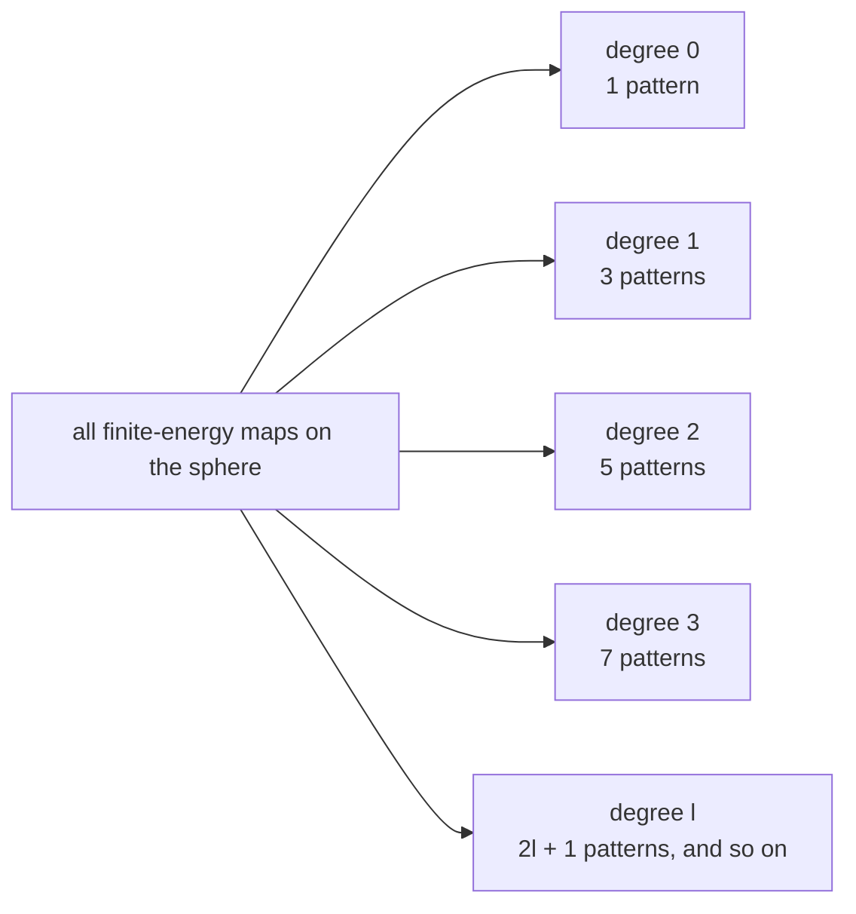

# Peter-Weyl: Fourier series on a compact group, with the matrix entries of its representations as the waves

[Syllabus](../../../SYLLABUS.md) → [Harmonic analysis](../README.md) → [Harmonic Analysis on Groups](../README.md#s08) → Peter-Weyl

---

## General Overview

Global weather models store a map of the whole Earth as **spherical harmonics**: standard wave patterns on a sphere. The patterns come in **degrees** $`\ell = 0, 1, 2, 3, \ldots`$, from smooth to fine, and degree $`\ell`$ has $`2\ell + 1`$ of them: 1, 3, 5, 7. Up to degree 3 a map is 16 numbers.

Take an illustrative globe: 30 °C on the equator, −10 °C at both poles, $`T = 30 - 40 z^2`$. Here $`z`$ is the height above the equator's plane on a sphere of radius 1. The pattern splits exactly into degree 0, its average of 16.67 °C, and degree 2, the equator-to-pole contrast.

Tilt the pattern 30°. The north pole now reads 0 °C, and almost every point changes. The energy in each degree does not: 277.78 °C² in degree 0 and 142.22 °C² in degree 2, before and after. A rotation moves a pattern inside its degree, never between degrees.

The degrees are the **irreducible representations** of the rotations: the smallest sets of patterns that rotations shuffle among themselves. The Peter-Weyl theorem says the same holds on every **compact group**, a group whose members form a compact space (for a group of matrices: a closed, bounded set). Peter and Weyl proved it in 1927 for compact Lie groups, the compact groups that are also smooth, such as the rotations; it reached every compact group once Haar measure existed. The waves are the matrix entries of its irreducible representations.

For a finite group the theorem is a count. The six symmetries of a triangle have irreducible pieces of size 1, 1 and 2, and $`1^2 + 1^2 + 2^2 = 6`$: six matrix entries, exactly enough to rebuild any function on the six moves.

**On a compact group, averaging with Haar measure makes every representation keep lengths, and the matrix entries of the irreducible ones, each scaled by the square root of its size, form an orthonormal basis of the finite-energy functions on the group: a Fourier series whose waves are matrix entries.**

**What kind of fact this is:** a theorem, proved on this card in Why it works, with completeness in a fold. Two facts about rotations are stated with a named source: each degree of spherical harmonics is irreducible under rotations, and these are all of the rotations' irreducible pieces.

### The picture: the globe's maps, split by degree



A rotation sends every box into itself. The temperature pattern lives in the boxes for degrees 0 and 2, and tilting it keeps it there.

---

## The formula

New notation, in words first.

- A **compact group** $`G`$: a group with a topology in which multiplying and undoing are continuous and the whole group is compact: every cover by open sets has a finite part that still covers ([Compactness with no distances, and Tychonoff](../../17-Topology/02-Topological%20Spaces/06-compactness-and-tychonoff.md)). For a group of matrices, compact means closed and bounded. Examples: a finite group, the circle, the rotations $`SO(3)`$ of a ball.
- The **Haar average** $`\int_G f(g)\,dg`$: the fair average over the group, of total 1, unchanged when every member is shifted by one fixed member ([Haar measure](02-haar-measure.md)). On a compact group, shifts from the left and from the right both leave it unchanged. On a finite group it is the plain mean; on the circle it is the wing's $`\frac{1}{2\pi}\int_{-\pi}^{\pi}`$.
- A **representation** $`\pi`$ gives each member $`g`$ a $`d_\pi`$-by-$`d_\pi`$ matrix $`\pi(g)`$, continuous in $`g`$, with $`\pi(gh) = \pi(g)\,\pi(h)`$ ([Representations](../../03-Algebra/12-Group%20Representations/01-representations-and-maschkes-theorem.md)). Its **matrix entry** $`\pi_{ij}(g)`$, row $`i`$ and column $`j`$, is a function on the group.
- **Unitary**: every $`\pi(g)`$ keeps lengths, $`\pi(g)^*\pi(g) = I`$, where $`^*`$ is the conjugate transpose. **Irreducible**: no smaller subspace, other than zero, is sent into itself by every $`\pi(g)`$.
- $`\widehat{G}`$, "G-dual": the irreducible unitary representations, counting two as one when a change of basis turns one into the other. For the 12-hour clock, the 12 characters of [Fourier analysis on a finite abelian group](01-fourier-analysis-on-finite-abelian-groups.md).
- $`\langle f_1, f_2\rangle = \int_G f_1(g)\,\overline{f_2(g)}\,dg`$, linear in $`f_1`$; the energy of $`f`$ is $`\lVert f\rVert_2^2 = \langle f, f\rangle`$, and $`L^2(G)`$ holds the functions of finite energy.

**Averaging makes a representation unitary.** For any inner product $`\langle u, v\rangle`$ on the space $`\pi`$ acts on:

```math
\langle u, v\rangle_\pi = \int_G \langle \pi(g)\,u,\ \pi(g)\,v\rangle\, dg
```

**Read it aloud:** move both vectors by every member, take their inner product each time, and average; every $`\pi(g)`$ keeps the result.

**The entries are orthogonal (Schur).** For irreducible unitary $`\pi`$ and $`\sigma`$:

```math
\int_G \pi_{ij}(g)\,\overline{\sigma_{kl}(g)}\,dg = \frac{\delta_{\pi\sigma}\,\delta_{ik}\,\delta_{jl}}{d_\pi}
```

**Read it aloud:** two matrix entries are perpendicular unless they are the same entry of the same piece, and then its energy is one over the piece's size.

**They are complete (Peter-Weyl).** The functions $`\sqrt{d_\pi}\,\pi_{ij}`$, over all $`\pi`$ in $`\widehat{G}`$ and all $`i, j`$, are an orthonormal basis of $`L^2(G)`$:

```math
f = \sum_{\pi \in \widehat{G}} d_\pi \sum_{i,j=1}^{d_\pi} \langle f, \pi_{ij}\rangle\, \pi_{ij}, \qquad \lVert f\rVert_2^2 = \sum_{\pi \in \widehat{G}} d_\pi \sum_{i,j=1}^{d_\pi} \lvert\langle f, \pi_{ij}\rangle\rvert^2
```

**Read it aloud:** every finite-energy function is the sum of its matrix-entry waves, each weighted by its piece's size, and its energy is the matching sum of squares. The sum converges in energy, as on the circle; at a single point it need not.

**The two cases on this card:**

```math
\sum_{\pi \in \widehat{G}} d_\pi^2 = \lvert G\rvert \ \text{ for finite } G, \qquad L^2(S^2) = H_0 \oplus H_1 \oplus H_2 \oplus \cdots, \quad \dim H_\ell = 2\ell + 1
```

**Read it aloud:** a finite group's squared piece sizes add up to its size; maps on the sphere split into degrees, each degree once, with $`2\ell + 1`$ patterns in degree $`\ell`$.

On the triangle, $`1 + 1 + 4 = 6`$. On the globe, $`T`$ has energy 420 °C², with 277.78 in $`H_0`$ and 142.22 in $`H_2`$.

| Symbol | Plain meaning | In our example | Push it up and the answer… |
| --- | --- | --- | --- |
| $`G`$, $`\lvert G\rvert`$; $`g`$, $`h`$, $`e`$ | compact group, its size if finite; members; the member that does nothing | $`S_3`$, size 6; $`SO(3)`$ | more or bigger pieces |
| $`\int_G f\,dg`$ | Haar average: fair, total 1, shift-proof | mean over 6 moves | — |
| $`\pi`$, $`\sigma`$, $`d_\pi`$ | irreducible representations; matrix size | sizes 1, 1, 2; $`2\ell + 1`$ on $`SO(3)`$ | $`d_\pi^2`$ more waves |
| $`\pi_{ij}`$; $`i, j, k, l`$ | matrix entry as a function; row and column labels | $`\sqrt 3\,R_{33}`$ | — |
| $`^*`$, $`^{\mathsf T}`$, $`\mathrm{tr}`$, $`I`$; $`M`$; $`X`$, $`X_0`$, $`E_{jl}`$ | conjugate transpose, transpose, trace, identity; averaged inner product; a matrix, its average, a single 1 | $`M`$ = `[[1.333333, -0.666667], [-0.666667, 1.333333]]` | — |
| $`f`$, $`f_1`$, $`f_2`$; $`u`$, $`v`$; $`\langle\cdot,\cdot\rangle`$, $`\lVert f\rVert_2`$, $`L^2(G)`$ | functions; vectors; inner product; root energy; finite-energy functions | $`\lVert T\rVert_2^2`$ = 420 °C² | — |
| $`\delta_{ik}`$, $`\delta_{\pi\sigma}`$ | 1 if the labels agree, else 0 (not the Dirac delta) | — | — |
| $`\widehat{G}`$ | the irreducible unitary representations | 1, sign, 2-by-2 for $`S_3`$ | — |
| $`S^2`$, $`\ell`$, $`H_\ell`$; $`S`$ | unit sphere; degree; degree-$`\ell`$ spherical harmonics; a spin about the pole | $`\dim H_2 = 5`$ | finer patterns |
| $`T`$; $`x, y, z`$, $`\mathbf{x}`$, $`\mathbf{y}`$; $`E_\ell`$, $`P_\ell`$ | temperature, °C; points on $`S^2`$; energy in degree $`\ell`$, °C²; Legendre polynomial | $`T = 30 - 40z^2`$; $`E_2`$ = 142.22 | more energy there |
| $`A`$, $`B`$; $`R`$, $`R_{33}`$, $`\alpha, \beta, \gamma`$; $`N`$, $`F`$ | triangle's turn and swap; a rotation, its corner entry, Euler angles; north pole, a sphere map on rotations | $`R_{33} = \cos\beta`$ | — |
| $`\varphi`$, $`\varphi_m`$, $`K`$; $`R_h`$, $`V`$, $`c(h)`$, $`n`$; $`\lambda`$, $`w_n`$ | bump, shrinking bumps, smoothing; right shift, shift-closed space, its matrix, its dimension; eigenvalue, eigenvector | Step 4 only | narrower bump, less smoothing |

### When it holds

- **The group is compact.** Otherwise no average of total 1 exists. The shear `[[1, 1], [0, 1]]` on the whole numbers stretches (0, 1) to length 100.005000 in 100 steps, so it keeps no inner product.
- **The average is Haar's.** Averaging Euler angles evenly gives 1.500000 for the mean of $`3R_{33}^2`$, not 1.000000.
- **The representation is unitary, or averaged first.** Otherwise the entries are not orthogonal: 0.666667 where 0.5 is due.
- **Each piece carries its weight $`d_\pi`$.** Without it, a single move is rebuilt as 0.666667 instead of 1.
- **Convergence is in energy.** As on the circle ([Convergence in energy](../01-Fourier%20Series%20in%20Depth/05-l2-convergence-and-riesz-fischer.md)), the series converges in $`L^2(G)`$; a value at one point is not promised.

---

## Why it works

### Step 0: one trick, used three times

A Haar average does not notice when every member is shifted by $`h`$. So whatever it produces is unchanged by the group. The proof averages three things:

1. An inner product, giving one every move keeps: every representation can be made unitary.
2. A matrix, giving one that commutes with the moves: Schur's lemma makes the entries of different pieces perpendicular.
3. A function against a bump, giving a smoothing operator whose eigenspaces are finite and made of matrix entries: nothing is missing.

### Step 1: make every representation keep lengths

Use two corners of the triangle, 120° apart, as basis vectors. The turn by 120° and the swap of the two corners are then integer matrices:

```math
A = \begin{pmatrix} 0 & -1 \\ 1 & -1 \end{pmatrix}, \qquad B = \begin{pmatrix} 0 & 1 \\ 1 & 0 \end{pmatrix}
```

Multiplying them in all ways gives 6 matrices, all of $`S_3`$. Measured as plain coordinates, they do not keep lengths: $`A`$ sends (1, 1), of length $`\sqrt 2`$, to (−1, 0), of length 1.

Average $`g^{\mathsf T} g`$ over the six moves, $`^{\mathsf T}`$ being the transpose. The result is $`M`$ = `[[1.333333, -0.666667], [-0.666667, 1.333333]]`, and every move keeps $`u^{\mathsf T} M v`$: $`g^{\mathsf T} M g = M`$ for all six. $`M`$ is $`4/3`$ times `[[1, -1/2], [-1/2, 1]]`, the dot products of two unit vectors 120° apart. Averaging recovered the corners' true geometry.

The general proof replaces $`g`$ by $`gh`$ inside the average, which Haar measure allows:

```math
\langle \pi(h)u, \pi(h)v\rangle_\pi = \int_G \langle \pi(gh)u, \pi(gh)v\rangle\,dg = \langle u, v\rangle_\pi
```

It is positive, as an average of squared lengths. In an orthonormal basis for it, every $`\pi(g)`$ is unitary. Then the part at right angles to a kept subspace is kept too, so every representation splits into irreducible pieces, as [Representations](../../03-Algebra/12-Group%20Representations/01-representations-and-maschkes-theorem.md) proved for finite groups.

### Step 2: matrix entries of different pieces are perpendicular

For irreducible unitary $`\pi`$, $`\sigma`$ and any matrix $`X`$ of the right shape, average round the group:

```math
X_0 = \int_G \pi(g)\, X\, \sigma(g)^{-1}\, dg
```

The same shift shows $`\pi(h)X_0 = X_0\,\sigma(h)`$. By [Schur's lemma and orthogonality](../../03-Algebra/12-Group%20Representations/02-schurs-lemma-and-character-orthogonality.md), $`X_0 = 0`$ between different pieces, and $`X_0 = (\mathrm{tr}\,X / d_\pi)\,I`$ within one.

Unitarity turns $`\sigma(g)^{-1}`$ into the conjugate transpose $`\sigma(g)^*`$. A matrix $`X`$ with a single 1 then makes each entry of $`X_0`$ an average of one entry times the conjugate of another: the orthogonality formula.

<details>
<summary>Detailed proof: from the averaged matrix to the orthogonality of entries</summary>

Let $`X = E_{jl}`$, with 1 in row $`j`$, column $`l`$, and 0 elsewhere. Entry $`(i, k)`$ of $`X_0`$ is

$`\displaystyle (X_0)_{ik} = \int_G \pi_{ij}(g)\,\big(\sigma(g)^{-1}\big)_{lk}\,dg = \int_G \pi_{ij}(g)\,\overline{\sigma_{kl}(g)}\,dg`$

The second equality is unitarity: entry $`(l, k)`$ of $`\sigma(g)^{-1} = \sigma(g)^*`$ is the conjugate of entry $`(k, l)`$ of $`\sigma(g)`$.

Different pieces give $`X_0 = 0`$, so every such average is 0. If $`\pi = \sigma`$, then $`X_0 = (\mathrm{tr}\,E_{jl}/d_\pi)\,I`$, and the trace of $`E_{jl}`$ is 1 when $`j = l`$, else 0:

$`\displaystyle \int_G \pi_{ij}(g)\,\overline{\pi_{kl}(g)}\,dg = \frac{\delta_{ik}\,\delta_{jl}}{d_\pi}`$

Schur's lemma needs only that $`X_0`$ commutes with the moves, which the shift inside the Haar average gives. Nothing used finiteness.

</details>

The checks confirm it on three groups: on $`S_3`$, the constant, the sign and $`\sqrt 2`$ times the four entries of the averaged 2-by-2 piece; on the clock, the 12 characters; on $`SO(3)`$, with Haar measure $`\sin\beta\,d\alpha\,d\beta\,d\gamma / 8\pi^2`$ in Euler angles (a rotation written as a turn by $`\gamma`$ about the vertical axis, then a tilt by $`\beta`$ about a horizontal one, then a turn by $`\alpha`$ about the vertical axis), the constant and $`\sqrt 3`$ times the nine rotation entries.

### Step 3: for a finite group, counting finishes it

Orthonormal functions are independent, and a finite group has only $`\lvert G\rvert`$ independent functions, so $`\sum d_\pi^2 \le \lvert G\rvert`$. Equality comes from the group acting on its own functions, which holds each piece $`d_\pi`$ times ([Character tables](../../03-Algebra/12-Group%20Representations/03-character-tables.md)).

On $`S_3`$: 6 matrices and $`1 + 1 + 4 = 6`$ orthonormal entries, so they are a basis. The function equal to 1 on the swap $`B`$ and 0 elsewhere is rebuilt exactly from six coefficients, and its energy and the sum of its squared coefficients are both 0.166667.

An infinite group has no count to compare with, so completeness needs Step 4.

### Step 4: nothing is missing, by a compact operator

Suppose $`f`$ has finite energy and is perpendicular to every matrix entry. Then $`f = 0`$:

1. **Smooth.** Take a continuous bump $`\varphi`$ with $`\varphi(g^{-1}) = \overline{\varphi(g)}`$, and $`Kf = \varphi * f`$, where $`(\varphi * f)(g) = \int_G \varphi(h)\,f(h^{-1}g)\,dh`$. Its kernel is continuous on the compact $`G \times G`$, so $`K`$ is compact ([Compact operators](../../18-Functional%20analysis/03-Bounded%20Operators/05-compact-operators.md)) and, by the bump's symmetry, symmetric.
2. **Split.** By [Compact and symmetric](../../18-Functional%20analysis/03-Bounded%20Operators/08-spectral-theorem-for-compact-self-adjoint-operators.md), $`K`$ has an orthonormal basis of eigenvectors, with a finite-dimensional eigenspace for each eigenvalue other than 0.
3. **Recognise.** $`K`$ smooths from the left, so it commutes with right shifts $`f(g) \mapsto f(gh)`$. Each eigenspace is then a finite representation, and its functions are matrix entries (fold).
4. **Conclude.** $`f`$ is perpendicular to those eigenspaces, so $`Kf = 0`$. As the bump, of total 1, shrinks onto the identity, $`\varphi * f \to f`$ in energy ([Approximate identities](../03-Convolution%20and%20Approximate%20Identities/03-approximate-identities.md)), so $`f = 0`$.

<details>
<summary>Detailed proof: a finite shift-closed space holds only matrix entries</summary>

Let $`V`$ be a finite-dimensional space of continuous functions, closed under right shifts $`(R_h f)(g) = f(gh)`$. An eigenvector with eigenvalue $`\lambda \ne 0`$ is continuous, since it equals $`\lambda^{-1}`$ times its smoothing.

With a basis $`f_1, \ldots, f_n`$ of $`V`$, write each shift in the basis:

$`\displaystyle R_h f_j = \sum_{i=1}^{n} c_{ij}(h)\, f_i`$

Since $`R_{h h'} = R_h R_{h'}`$, the matrices $`c(h)`$ form a representation. Evaluate at $`e`$:

$`\displaystyle f_j(h) = (R_h f_j)(e) = \sum_{i=1}^{n} f_i(e)\, c_{ij}(h)`$

So each $`f_j`$ is a combination of entries of $`c`$, which by Step 1 splits into irreducible unitary pieces.

$`K`$ commutes with right shifts: $`K(R_h f)(g) = \int \varphi(k)\,f(k^{-1}gh)\,dk = (R_h Kf)(g)`$. So each eigenspace is such a $`V`$.

The spectral theorem writes $`Kf = \sum \lambda_n \langle f, w_n\rangle w_n`$ over the eigenvectors $`w_n`$ with $`\lambda_n \ne 0`$. Each $`w_n`$ is a combination of matrix entries, so $`Kf = 0`$.

Last, take symmetric bumps $`\varphi_m \ge 0`$ of total 1, zero outside shrinking neighbourhoods of $`e`$. Continuous functions are dense in $`L^2(G)`$ and uniformly continuous on a compact group, so $`\lVert \varphi_m * f - f\rVert_2 \to 0`$. Each $`\varphi_m * f`$ is 0, so $`f = 0`$.

</details>

### Step 5: the sphere is the rotations seen from one point

Fix the north pole $`N`$. A map $`f`$ on the sphere gives a function on rotations, $`F(R) = f(RN)`$. It is unchanged when a spin $`S`$ about the pole acts before $`R`$: $`F(RS) = f(RSN) = f(RN)`$. So $`L^2(S^2)`$ sits inside $`L^2(SO(3))`$, and Peter-Weyl splits it.

The pieces are **harmonic polynomials**: $`H_\ell`$ holds the polynomials in $`x, y, z`$ with every term of degree $`\ell`$ and Laplacian zero, read on the sphere. A rotation keeps the degree and the Laplacian, so it maps $`H_\ell`$ into itself. There are $`(\ell + 1)(\ell + 2)/2`$ terms of degree $`\ell`$, and the Laplacian maps them onto the $`\ell(\ell - 1)/2`$ terms of degree $`\ell - 2`$:

```math
\dim H_\ell = \frac{(\ell+1)(\ell+2)}{2} - \frac{\ell(\ell-1)}{2} = 2\ell + 1
```

**Read it aloud:** the terms of degree $`\ell`$, minus those the Laplacian uses up, leave $`2\ell + 1`$ harmonic patterns.

Bröcker and tom Dieck (Sources) prove that each $`H_\ell`$ is irreducible under rotations and that these are all of $`SO(3)`$'s irreducible pieces. Each holds exactly one pattern unchanged by spins about the pole, $`P_\ell(z)`$, so each appears in the sphere once. $`SO(3)`$ itself holds $`(2\ell + 1)^2`$ entries per degree: 1, 9, 25, 49.

[The Laplacian in round coordinates, and the modes it splits into](../../19-Partial%20differential%20equations/04-Laplace%2C%20Poisson%20and%20Potentials/07-laplacian-in-polar-and-spherical-coordinates.md) met the same $`H_\ell`$ as the sphere's modes, with eigenvalue $`-\ell(\ell + 1)`$; it writes $`n`$ for $`\ell`$.

A rotation acts on $`H_\ell`$ by a unitary matrix, so it keeps each degree's energy. The projection onto $`H_\ell`$ is smoothing against $`(2\ell + 1)\,P_\ell(\mathbf{x}\cdot\mathbf{y})`$, a Legendre polynomial of the angle between two points; the code uses it as a road.

---

## Worked numbers, by hand

The globe, $`T = 30 - 40z^2`$ °C. One fact does the work: for a point spread evenly over the sphere, the height $`z`$ is spread evenly over −1 to 1 (Archimedes: equal slices of height have equal area). So the mean of $`z^2`$ is 1/3 and the mean of $`z^4`$ is 1/5.

| Step | Arithmetic | Value |
| --- | --- | --- |
| split $`z^2`$ | $`z^2 = \tfrac13 + (z^2 - \tfrac13)`$ | constant plus degree 2 |
| degree 2 is harmonic | on the sphere $`z^2 - \tfrac13 = (2z^2 - x^2 - y^2)/3`$, Laplacian $`(4 - 2 - 2)/3`$ | 0 |
| degree-0 part | $`30 - 40/3 = 50/3`$ | 16.666667 °C |
| $`E_0`$ | $`(50/3)^2 = 2500/9`$ | 277.777778 °C² |
| $`E_2`$ | $`1600 \times (\tfrac15 - \tfrac29 + \tfrac19) = 1600 \times \tfrac{4}{45} = 1280/9`$ | 142.222222 °C² |
| total energy | $`900 - 2400 \times \tfrac13 + 1600 \times \tfrac15`$ | 420 °C² |
| tilted 30°: north pole | $`30 - 40\cos^2 30^\circ = 30 - 30`$ | 0 °C |
| tilted energies | rotation is unitary on each $`H_\ell`$ | **277.777778 and 142.222222 °C²** |

The tilted globe has new values almost everywhere, but the same energy in each degree, wherever its poles point.

The energies as bars, one block per 10 °C², the same for both orientations:

```
degree 0  ████████████████████████████  277.777778
degree 1                                  0.000000
degree 2  ██████████████                142.222222
degree 3                                  0.000000
```

### What breaks if you drop a piece

| Mistake | Comes out at | What went wrong |
| --- | --- | --- |
| Skip the averaging: use the corner-basis matrices as they are | mean of the squared top-left entry 0.666667, not 0.5 | the matrices do not keep lengths, so their entries are not orthogonal |
| Drop the $`d_\pi`$ weights in the series | the swap rebuilt as 0.666667, not 1 | an entry of a size-$`d`$ piece has energy $`1/d`$, not 1 |
| Average Euler angles evenly instead of with $`\sin\beta`$ | mean of $`3R_{33}^2`$ = 1.500000, not 1.000000 | even angles crowd rotations near the pole; that is not Haar measure |
| A group that is not compact: the shear on the whole numbers | lengths 1.414214, 10.049876, 100.005000 after 1, 10, 100 steps | no average of total 1, so no kept inner product and no splitting |

The code prints all four.

---

## Code, from first principles, and it actually runs

The code checks the card's claims by finite computation, on four roads. Exact counts and hand fractions: the 6 matrices, $`1 + 1 + 4`$, the harmonic counts as monomials minus the Laplacian's rank (this confirms only that the Laplacian is onto; the Legendre kernel is the independent check on $`2\ell + 1`$), 2500/9 and 1280/9. Haar averages: plain means on $`S_3`$ and the clock, Gauss-Legendre quadrature written out on $`SO(3)`$ and the sphere. The Legendre kernel $`(2\ell + 1)P_\ell`$, which gives each degree's energy and size without building a harmonic polynomial. And Parseval: the energies by degree must add up to the mean square taken point by point. The quadrature is exact here. Each integrand is a low-degree polynomial in $`\cos\beta`$, the quadrature's variable, apart from terms with an odd power of $`\sin\beta`$; every such term also carries a wave such as $`\cos\alpha`$, which the 8 equally spaced values of $`\alpha`$, or of $`\gamma`$, sum to exactly 0. The sphere works the same way, with its 12 longitudes.

### Python

```python
# Peter-Weyl -- the check behind the card.  Standard library only: math.  Haar averages are
# sums on finite groups and Gauss-Legendre quadrature, written out, on SO(3) and the sphere.
# Roads: exact counts and hand fractions; Haar averages; each degree's Legendre kernel; Parseval.
import math

def mul(a, b):                        # matrix product
    return [[sum(a[i][k] * b[k][j] for k in range(len(b))) for j in range(len(b[0]))]
            for i in range(len(a))]

tp = lambda a: [list(r) for r in zip(*a)]                       # transpose

def gram_gap(funcs, w):               # largest |<e_j, e_k> - (1 if j = k else 0)|
    return max(abs(sum(wi * fj[i] * fk[i] for i, wi in enumerate(w)) - (j == k))
               for j, fj in enumerate(funcs) for k, fk in enumerate(funcs))

def legendre(n, t):                   # P_n(t), by Bonnet's rule
    p0, p1 = 1.0, t
    for k in range(1, n):
        p0, p1 = p1, ((2 * k + 1) * t * p1 - k * p0) / (k + 1)
    return p1 if n else 1.0

def gauss(n):                         # Gauss-Legendre nodes and weights on [-1, 1]
    out = []
    for i in range(n):
        t = math.cos(math.pi * (i + 0.75) / (n + 0.5))
        for _ in range(50):           # Newton's method on P_n
            d = n * (t * legendre(n, t) - legendre(n - 1, t)) / (t * t - 1)
            t -= legendre(n, t) / d
        out.append((t, 2 / ((1 - t * t) * d * d)))
    return out

def rank(rows):                       # Gaussian elimination, partial pivoting
    rows, r = [list(x) for x in rows], 0
    for c in range(len(rows[0]) if rows else 0):
        p = max(range(r, len(rows)), key=lambda i: abs(rows[i][c]), default=None)
        if p is None or abs(rows[p][c]) < 1e-9:
            continue
        rows[r], rows[p] = rows[p], rows[r]
        for i in range(r + 1, len(rows)):
            f = rows[i][c] / rows[r][c]
            rows[i] = [x - f * y for x, y in zip(rows[i], rows[r])]
        r += 1
    return r

clean = lambda v: 0.0 if abs(v) < 5e-7 else v                   # print -0.000000 as 0.000000
yn = lambda c: "yes" if c else "no"
# ---- 1. the triangle's six symmetries S3, in the basis of two corners 120 degrees apart ----
A, B = [[0, -1], [1, -1]], [[0, 1], [1, 0]]          # turn by 120 degrees; swap the corners
G = [[[1, 0], [0, 1]]]
for g in G:                                          # grows while read: closure under A, B
    for s in (A, B):
        if mul(g, s) not in G:
            G.append(mul(g, s))
n = len(G)
M = [[sum(mul(tp(g), g)[i][j] for g in G) / n for j in range(2)] for i in range(2)]
inv_gap = max(abs(mul(mul(tp(g), M), g)[i][j] - M[i][j]) for g in G for i in range(2) for j in range(2))
raw11 = sum(g[0][0] ** 2 for g in G) / n
l11 = math.sqrt(M[0][0]); l21 = M[1][0] / l11; l22 = math.sqrt(M[1][1] - l21 * l21)
U = [mul(mul([[l11, l21], [0, l22]], g), [[1 / l11, -l21 / (l11 * l22)], [0, 1 / l22]]) for g in G]
sign = [g[0][0] * g[1][1] - g[0][1] * g[1][0] for g in G]
ents = [[u[i][j] for u in U] for i in range(2) for j in range(2)]
basis = [[1.0] * n, [float(s) for s in sign]] + [[math.sqrt(2) * v for v in e] for e in ents]
gap6 = gram_gap(basis, [1 / n] * n)
f = [1.0 if g == B else 0.0 for g in G]              # the single move B: swap two corners
c = [sum(fi * ei for fi, ei in zip(f, e)) / n for e in basis]
rebuilt = [sum(ck * e[k] for ck, e in zip(c, basis)) for k in range(n)]
plain = [[1.0] * n, [float(s) for s in sign]] + ents  # the entries without the factor sqrt(2)
at_b = sum(sum(fi * ei for fi, ei in zip(f, e)) / n * e[G.index(B)] for e in plain)
print(f"S3: closure of the turn and the swap gives {n} matrices; 1^2 + 1^2 + 2^2 = {1 + 1 + 4}")
print(f"Haar average of g^T g: [[{M[0][0]:.6f}, {M[0][1]:.6f}], [{M[1][0]:.6f}, {M[1][1]:.6f}]]")
print(f"every move keeps that inner product: {yn(inv_gap < 1e-12)}")
print(f"before averaging, mean of (entry 1,1)^2 = {raw11:.6f}, not 1/2 = 0.500000")
print(f"after: 1, sign, sqrt(2) x 4 entries are orthonormal on S3: {yn(gap6 < 1e-12)}")
print(f"single swap rebuilt from 6 coefficients, worst error below 1e-12: "
      f"{yn(max(abs(a - b) for a, b in zip(rebuilt, f)) < 1e-12)}")
print(f"Parseval: sum of squared coefficients {sum(x * x for x in c):.6f} = mean of f^2 {sum(x * x for x in f) / n:.6f}")
print(f"mistake, no sqrt(d) weight: rebuilt value at the swap {at_b:.6f}, not 1")
# ---- 2. the 12-hour clock Z/12: twelve characters, each a 1-by-1 matrix ----
gap12 = max(abs(sum(math.cos(2 * math.pi * (j - k) * m / 12) for m in range(12)) / 12 - (j == k))
            + abs(sum(math.sin(2 * math.pi * (j - k) * m / 12) for m in range(12)) / 12)
            for j in range(12) for k in range(12))
print(f"Z/12: 12 characters orthonormal: {yn(gap12 < 1e-12)}; 12 x 1^2 = {12 * 1}")
# ---- 3. rotations SO(3): Haar measure in Euler angles is sin(beta), over 8 pi^2 ----
rz = lambda a: [[math.cos(a), -math.sin(a), 0], [math.sin(a), math.cos(a), 0], [0, 0, 1]]
ry = lambda b: [[math.cos(b), 0, math.sin(b)], [0, 1, 0], [-math.sin(b), 0, math.cos(b)]]
Rs, w = [], []
for t, wt in gauss(6):                               # t = cos(beta), so sin(beta) d(beta) = dt
    for i in range(8):
        for j in range(8):
            Rs.append(mul(mul(rz(2 * math.pi * i / 8), ry(math.acos(t))), rz(2 * math.pi * j / 8)))
            w.append(wt / 2 / 64)
so3 = [[1.0] * len(Rs)] + [[math.sqrt(3) * R[i][j] for R in Rs] for i in range(3) for j in range(3)]
gap10 = gram_gap(so3, w)
uniform = sum(3 * math.cos(math.pi * (k + 0.5) / 12) ** 2 for k in range(12)) / 12
haar33 = sum(wi * 3 * R[2][2] ** 2 for wi, R in zip(w, Rs))
print(f"SO(3): Haar mass {sum(w):.6f}; 1 and sqrt(3) x 9 rotation entries orthonormal: {yn(gap10 < 1e-12)}")
print(f"mistake, Euler angles averaged evenly: mean of 3 R33^2 = {uniform:.6f}, Haar gives {haar33:.6f}")
# ---- 4. degree-l spherical harmonics: harmonic polynomials, counted two ways ----
monos = lambda d: [(a, b, d - a - b) for a in range(d + 1) for b in range(d + 1 - a)]
gl8 = gauss(8)
for l in range(5):
    tgt = monos(l - 2) if l >= 2 else []
    lap = [[sum(e[q] * (e[q] - 1) for q in range(3)
                if tuple(e[r] - 2 * (r == q) for r in range(3)) == m) for m in tgt] for e in monos(l)]
    harm = len(monos(l)) - (rank(lap) if tgt else 0)
    hs = (2 * l + 1) ** 2 * sum(wt * legendre(l, t) ** 2 for t, wt in gl8) / 2
    print(f"degree {l}: {len(monos(l))} monomials, harmonic {harm}, Legendre kernel {hs:.6f}, SO(3) block {(2 * l + 1) ** 2}")
    assert harm == 2 * l + 1 and abs(hs - harm) < 1e-9
print(f"up to degree 3: sphere {sum(2 * l + 1 for l in range(4))} numbers, SO(3) {sum((2 * l + 1) ** 2 for l in range(4))}")
# ---- 5. a globe's temperature, 30 - 40 z^2 degC (illustrative), and the same pattern tilted 30 degrees ----
pts, pw = [], []
for t, wt in gauss(6):
    for k in range(12):
        ph = 2 * math.pi * k / 12
        pts.append((math.sqrt(1 - t * t) * math.cos(ph), math.sqrt(1 - t * t) * math.sin(ph), t))
        pw.append(wt / 2 / 12)
temp = lambda p: 30 - 40 * p[2] ** 2
tilt = lambda p: 30 - 40 * (p[2] * math.cos(math.pi / 6) - p[0] * math.sin(math.pi / 6)) ** 2
for name, T in (("upright", temp), ("tilted 30 deg", tilt)):
    v = [T(p) for p in pts]
    E = [(2 * l + 1) * sum(pw[a] * pw[b] * legendre(l, sum(x * y for x, y in zip(pts[a], pts[b]))) * v[a] * v[b]
                           for a in range(len(pts)) for b in range(len(pts))) for l in range(4)]
    ms = sum(wi * x * x for wi, x in zip(pw, v))
    print(f"{name}: north pole {clean(T((0, 0, 1))):.6f} degC; energy by degree 0-3: "
          + ", ".join(f"{clean(e):.6f}" for e in E) + f"; total {sum(E):.6f}; mean square {ms:.6f}")
    assert abs(E[0] - 2500 / 9) < 1e-9 and abs(E[2] - 1280 / 9) < 1e-9     # hand fractions
    assert abs(E[1]) < 1e-9 and abs(E[3]) < 1e-9 and abs(sum(E) - ms) < 1e-9 and abs(ms - 420) < 1e-9
print(f"hand fractions: 50/3 = {50 / 3:.6f}; (50/3)^2 = 2500/9 = {2500 / 9:.6f}; 1280/9 = {1280 / 9:.6f}; sum 420")
# ---- 6. no compact group, no average: the shear [[1, 1], [0, 1]] on the whole numbers ----
v, lens = [0, 1], []
for k in range(1, 101):
    v = [v[0] + v[1], v[1]]
    lens += [math.sqrt(v[0] ** 2 + v[1] ** 2)] if k in (1, 10, 100) else []
print("mistake, shear on the integers: length of S^n (0, 1) at n = 1, 10, 100: " + ", ".join(f"{x:.6f}" for x in lens))
assert n == 1 + 1 + 2 * 2 and inv_gap < 1e-12 and abs(raw11 - 0.5) > 0.1  # count; average works; raw fails
assert gap6 < 1e-12 and gap12 < 1e-12 and gap10 < 1e-12                    # Schur orthogonality, three groups
assert abs(sum(x * x for x in c) - 1 / 6) < 1e-12 and abs(at_b - 1) > 0.1
assert abs(uniform - 1.5) < 1e-12 and abs(haar33 - 1) < 1e-12 and lens[2] > 100
print("ALL CHECKS PASS")
```

**Ran 2026-11-24 on macOS, Python 3.14.10, standard library only. All checks passed. Output, pasted from the run:**

```
S3: closure of the turn and the swap gives 6 matrices; 1^2 + 1^2 + 2^2 = 6
Haar average of g^T g: [[1.333333, -0.666667], [-0.666667, 1.333333]]
every move keeps that inner product: yes
before averaging, mean of (entry 1,1)^2 = 0.666667, not 1/2 = 0.500000
after: 1, sign, sqrt(2) x 4 entries are orthonormal on S3: yes
single swap rebuilt from 6 coefficients, worst error below 1e-12: yes
Parseval: sum of squared coefficients 0.166667 = mean of f^2 0.166667
mistake, no sqrt(d) weight: rebuilt value at the swap 0.666667, not 1
Z/12: 12 characters orthonormal: yes; 12 x 1^2 = 12
SO(3): Haar mass 1.000000; 1 and sqrt(3) x 9 rotation entries orthonormal: yes
mistake, Euler angles averaged evenly: mean of 3 R33^2 = 1.500000, Haar gives 1.000000
degree 0: 1 monomials, harmonic 1, Legendre kernel 1.000000, SO(3) block 1
degree 1: 3 monomials, harmonic 3, Legendre kernel 3.000000, SO(3) block 9
degree 2: 6 monomials, harmonic 5, Legendre kernel 5.000000, SO(3) block 25
degree 3: 10 monomials, harmonic 7, Legendre kernel 7.000000, SO(3) block 49
degree 4: 15 monomials, harmonic 9, Legendre kernel 9.000000, SO(3) block 81
up to degree 3: sphere 16 numbers, SO(3) 84
upright: north pole -10.000000 degC; energy by degree 0-3: 277.777778, 0.000000, 142.222222, 0.000000; total 420.000000; mean square 420.000000
tilted 30 deg: north pole 0.000000 degC; energy by degree 0-3: 277.777778, 0.000000, 142.222222, 0.000000; total 420.000000; mean square 420.000000
hand fractions: 50/3 = 16.666667; (50/3)^2 = 2500/9 = 277.777778; 1280/9 = 142.222222; sum 420
mistake, shear on the integers: length of S^n (0, 1) at n = 1, 10, 100: 1.414214, 10.049876, 100.005000
ALL CHECKS PASS
```

### Rust

Same numbers, same labels, built with `rustc --edition 2021 -O`.

```rust
// Peter-Weyl -- the same check as the Python, in Rust.  No crates.  Haar averages are
// sums on finite groups and Gauss-Legendre quadrature, written out, on SO(3) and the sphere.
// Roads: exact counts and hand fractions; Haar averages; each degree's Legendre kernel; Parseval.
use std::f64::consts::PI;
type Mat = Vec<Vec<f64>>;

fn mul(a: &Mat, b: &Mat) -> Mat {                    // matrix product
    (0..a.len()).map(|i| (0..b[0].len()).map(|j| (0..b.len()).fold(0.0, |s, k| s + a[i][k] * b[k][j])).collect()).collect()
}
fn tp(a: &Mat) -> Mat { (0..a[0].len()).map(|j| (0..a.len()).map(|i| a[i][j]).collect()).collect() }
fn gram_gap(funcs: &[Vec<f64>], w: &[f64]) -> f64 { // largest |<e_j, e_k> - (1 if j = k else 0)|
    funcs.iter().enumerate().flat_map(|(j, fj)| funcs.iter().enumerate().map(move |(k, fk)|
        (w.iter().enumerate().fold(0.0, |s, (i, wi)| s + wi * fj[i] * fk[i]) - if j == k { 1.0 } else { 0.0 }).abs())).fold(0.0, f64::max)
}
fn legendre(n: usize, t: f64) -> f64 {               // P_n(t), by Bonnet's rule
    let (mut p0, mut p1) = (1.0, t);
    for k in 1..n { let kf = k as f64; (p0, p1) = (p1, ((2.0 * kf + 1.0) * t * p1 - kf * p0) / (kf + 1.0)) }
    if n > 0 { p1 } else { 1.0 }
}
fn gauss(n: usize) -> Vec<(f64, f64)> {              // Gauss-Legendre nodes and weights on [-1, 1]
    let nf = n as f64;
    (0..n).map(|i| {
        let mut t = (PI * (i as f64 + 0.75) / (nf + 0.5)).cos();
        let mut d = 1.0;
        for _ in 0..50 {                             // Newton's method on P_n
            d = nf * (t * legendre(n, t) - legendre(n - 1, t)) / (t * t - 1.0);
            t -= legendre(n, t) / d;
        }
        (t, 2.0 / ((1.0 - t * t) * d * d))
    }).collect()
}
fn rank(mut rows: Mat) -> usize {                    // Gaussian elimination, partial pivoting
    let (mut r, cols) = (0, if rows.is_empty() { 0 } else { rows[0].len() });
    for c in 0..cols {
        if r >= rows.len() { break }
        let p = (r..rows.len()).max_by(|&a, &b| rows[a][c].abs().partial_cmp(&rows[b][c].abs()).unwrap()).unwrap();
        if rows[p][c].abs() < 1e-9 { continue }
        rows.swap(r, p);
        for i in r + 1..rows.len() {
            let f = rows[i][c] / rows[r][c];
            rows[i] = (0..cols).map(|q| rows[i][q] - f * rows[r][q]).collect();
        }
        r += 1;
    }
    r
}
fn clean(v: f64) -> f64 { if v.abs() < 5e-7 { 0.0 } else { v } }   // print -0.000000 as 0.000000
fn yn(c: bool) -> &'static str { if c { "yes" } else { "no" } }
fn monos(d: i64) -> Vec<[i64; 3]> { (0..=d).flat_map(|a| (0..=d - a).map(move |b| [a, b, d - a - b])).collect() }
fn join(v: &[f64]) -> String { v.iter().map(|x| format!("{:.6}", x)).collect::<Vec<_>>().join(", ") }
fn main() {
    // ---- 1. the triangle's six symmetries S3, in the basis of two corners 120 degrees apart ----
    let a: Mat = vec![vec![0.0, -1.0], vec![1.0, -1.0]];  // turn by 120 degrees
    let bm: Mat = vec![vec![0.0, 1.0], vec![1.0, 0.0]];   // swap the corners
    let mut g: Vec<Mat> = vec![vec![vec![1.0, 0.0], vec![0.0, 1.0]]];
    let mut idx = 0;
    while idx < g.len() {                                 // grows while read: closure under A, B
        for s in [&a, &bm] { let h = mul(&g[idx], s); if !g.contains(&h) { g.push(h) } }
        idx += 1;
    }
    let (n, nf) = (g.len(), g.len() as f64);
    let m: Mat = (0..2).map(|i| (0..2).map(|j| g.iter().fold(0.0, |s, x| s + mul(&tp(x), x)[i][j]) / nf).collect()).collect();
    let mut inv_gap: f64 = 0.0;
    for x in &g { let y = mul(&mul(&tp(x), &m), x); for i in 0..2 { for j in 0..2 { inv_gap = inv_gap.max((y[i][j] - m[i][j]).abs()) } } }
    let raw11 = g.iter().fold(0.0, |s, x| s + x[0][0] * x[0][0]) / nf;
    let l11 = m[0][0].sqrt(); let l21 = m[1][0] / l11; let l22 = (m[1][1] - l21 * l21).sqrt();
    let lt: Mat = vec![vec![l11, l21], vec![0.0, l22]];
    let lti: Mat = vec![vec![1.0 / l11, -l21 / (l11 * l22)], vec![0.0, 1.0 / l22]];
    let u: Vec<Mat> = g.iter().map(|x| mul(&mul(&lt, x), &lti)).collect();
    let sign: Vec<f64> = g.iter().map(|x| x[0][0] * x[1][1] - x[0][1] * x[1][0]).collect();
    let ents: Vec<Vec<f64>> = (0..4).map(|e| u.iter().map(|x| x[e / 2][e % 2]).collect()).collect();
    let mut basis: Vec<Vec<f64>> = vec![vec![1.0; n], sign.clone()];
    for e in &ents { basis.push(e.iter().map(|v| 2f64.sqrt() * v).collect()) }
    let gap6 = gram_gap(&basis, &vec![1.0 / nf; n]);
    let ib = g.iter().position(|x| *x == bm).unwrap();
    let f: Vec<f64> = (0..n).map(|k| if k == ib { 1.0 } else { 0.0 }).collect(); // the single move B
    let dot = |e: &Vec<f64>| f.iter().zip(e).fold(0.0, |s, (fi, ei)| s + fi * ei) / nf;
    let c: Vec<f64> = basis.iter().map(|e| dot(e)).collect();
    let rebuilt: Vec<f64> = (0..n).map(|k| c.iter().zip(&basis).fold(0.0, |s, (ck, e)| s + ck * e[k])).collect();
    let mut plain: Vec<Vec<f64>> = vec![vec![1.0; n], sign.clone()];       // entries without sqrt(2)
    plain.extend(ents.iter().cloned());
    let at_b = plain.iter().fold(0.0, |s, e| s + dot(e) * e[ib]);
    let worst = rebuilt.iter().zip(&f).fold(0.0f64, |s, (x, y)| s.max((x - y).abs()));
    let csq = c.iter().fold(0.0, |s, x| s + x * x);
    println!("S3: closure of the turn and the swap gives {} matrices; 1^2 + 1^2 + 2^2 = {}", n, 1 + 1 + 4);
    println!("Haar average of g^T g: [[{:.6}, {:.6}], [{:.6}, {:.6}]]", m[0][0], m[0][1], m[1][0], m[1][1]);
    println!("every move keeps that inner product: {}", yn(inv_gap < 1e-12));
    println!("before averaging, mean of (entry 1,1)^2 = {:.6}, not 1/2 = 0.500000", raw11);
    println!("after: 1, sign, sqrt(2) x 4 entries are orthonormal on S3: {}", yn(gap6 < 1e-12));
    println!("single swap rebuilt from 6 coefficients, worst error below 1e-12: {}", yn(worst < 1e-12));
    println!("Parseval: sum of squared coefficients {:.6} = mean of f^2 {:.6}", csq, f.iter().fold(0.0, |s, x| s + x * x) / nf);
    println!("mistake, no sqrt(d) weight: rebuilt value at the swap {:.6}, not 1", at_b);
    // ---- 2. the 12-hour clock Z/12: twelve characters, each a 1-by-1 matrix ----
    let mut gap12: f64 = 0.0;
    for j in 0..12 { for k in 0..12 {
        let ang = |q: i32| 2.0 * PI * ((j - k) * q) as f64 / 12.0;
        let re = (0..12).fold(0.0, |s, q| s + ang(q).cos()) / 12.0 - if j == k { 1.0 } else { 0.0 };
        let im = (0..12).fold(0.0, |s, q| s + ang(q).sin()) / 12.0;
        gap12 = gap12.max(re.abs() + im.abs());
    } }
    println!("Z/12: 12 characters orthonormal: {}; 12 x 1^2 = {}", yn(gap12 < 1e-12), 12 * 1);
    // ---- 3. rotations SO(3): Haar measure in Euler angles is sin(beta), over 8 pi^2 ----
    let rz = |t: f64| -> Mat { vec![vec![t.cos(), -t.sin(), 0.0], vec![t.sin(), t.cos(), 0.0], vec![0.0, 0.0, 1.0]] };
    let ry = |t: f64| -> Mat { vec![vec![t.cos(), 0.0, t.sin()], vec![0.0, 1.0, 0.0], vec![-t.sin(), 0.0, t.cos()]] };
    let (mut rs, mut w): (Vec<Mat>, Vec<f64>) = (Vec::new(), Vec::new());
    for (t, wt) in gauss(6) {                             // t = cos(beta), so sin(beta) d(beta) = dt
        for i in 0..8 { for j in 0..8 {
            rs.push(mul(&mul(&rz(2.0 * PI * i as f64 / 8.0), &ry(t.acos())), &rz(2.0 * PI * j as f64 / 8.0)));
            w.push(wt / 2.0 / 64.0);
        } }
    }
    let mut so3: Vec<Vec<f64>> = vec![vec![1.0; rs.len()]];
    for e in 0..9 { so3.push(rs.iter().map(|r| 3f64.sqrt() * r[e / 3][e % 3]).collect()) }
    let gap10 = gram_gap(&so3, &w);
    let uniform = (0..12).fold(0.0, |s, k| s + 3.0 * (PI * (k as f64 + 0.5) / 12.0).cos().powi(2)) / 12.0;
    let haar33 = w.iter().zip(&rs).fold(0.0, |s, (wi, r)| s + wi * 3.0 * r[2][2].powi(2));
    println!("SO(3): Haar mass {:.6}; 1 and sqrt(3) x 9 rotation entries orthonormal: {}", w.iter().sum::<f64>(), yn(gap10 < 1e-12));
    println!("mistake, Euler angles averaged evenly: mean of 3 R33^2 = {:.6}, Haar gives {:.6}", uniform, haar33);
    // ---- 4. degree-l spherical harmonics: harmonic polynomials, counted two ways ----
    let gl8 = gauss(8);
    for l in 0..5i64 {
        let tgt = if l >= 2 { monos(l - 2) } else { Vec::new() };
        let lap: Mat = monos(l).iter().map(|e| tgt.iter().map(|mm| (0..3).filter(|&q| (0..3).all(|r| e[r] - if r == q { 2 } else { 0 } == mm[r]))
            .map(|q| (e[q] * (e[q] - 1)) as f64).sum::<f64>()).collect()).collect();
        let harm = monos(l).len() - if tgt.is_empty() { 0 } else { rank(lap) };
        let hs = ((2 * l + 1) * (2 * l + 1)) as f64 * gl8.iter().fold(0.0, |s, (t, wt)| s + wt * legendre(l as usize, *t).powi(2)) / 2.0;
        println!("degree {}: {} monomials, harmonic {}, Legendre kernel {:.6}, SO(3) block {}", l, monos(l).len(), harm, hs, (2 * l + 1) * (2 * l + 1));
        assert!(harm as i64 == 2 * l + 1 && (hs - harm as f64).abs() < 1e-9);
    }
    println!("up to degree 3: sphere {} numbers, SO(3) {}", (0..4).map(|l| 2 * l + 1).sum::<i64>(), (0..4).map(|l| (2 * l + 1) * (2 * l + 1)).sum::<i64>());
    // ---- 5. a globe's temperature, 30 - 40 z^2 degC (illustrative), and the same pattern tilted 30 degrees ----
    let (mut pts, mut pw): (Vec<[f64; 3]>, Vec<f64>) = (Vec::new(), Vec::new());
    for (t, wt) in gauss(6) {
        for k in 0..12 {
            let ph = 2.0 * PI * k as f64 / 12.0;
            pts.push([(1.0 - t * t).sqrt() * ph.cos(), (1.0 - t * t).sqrt() * ph.sin(), t]);
            pw.push(wt / 2.0 / 12.0);
        }
    }
    let temp = |p: &[f64; 3]| 30.0 - 40.0 * p[2].powi(2);
    let tilt = |p: &[f64; 3]| 30.0 - 40.0 * (p[2] * (PI / 6.0).cos() - p[0] * (PI / 6.0).sin()).powi(2);
    let pats: [(&str, &dyn Fn(&[f64; 3]) -> f64); 2] = [("upright", &temp), ("tilted 30 deg", &tilt)];
    for (name, tf) in pats {
        let v: Vec<f64> = pts.iter().map(|p| tf(p)).collect();
        let e: Vec<f64> = (0..4).map(|l| (2 * l + 1) as f64 * (0..pts.len()).fold(0.0, |s, i| (0..pts.len()).fold(s, |s, j| {
            let d = pts[i][0] * pts[j][0] + pts[i][1] * pts[j][1] + pts[i][2] * pts[j][2];
            s + pw[i] * pw[j] * legendre(l, d) * v[i] * v[j] }))).collect();
        let ms = pw.iter().zip(&v).fold(0.0, |s, (wi, x)| s + wi * x * x);
        let tot: f64 = e.iter().sum();
        let ec: Vec<f64> = e.iter().map(|x| clean(*x)).collect();
        println!("{}: north pole {:.6} degC; energy by degree 0-3: {}; total {:.6}; mean square {:.6}", name, clean(tf(&[0.0, 0.0, 1.0])), join(&ec), tot, ms);
        assert!((e[0] - 2500.0 / 9.0).abs() < 1e-9 && (e[2] - 1280.0 / 9.0).abs() < 1e-9);      // hand fractions
        assert!(e[1].abs() < 1e-9 && e[3].abs() < 1e-9 && (tot - ms).abs() < 1e-9 && (ms - 420.0).abs() < 1e-9);
    }
    println!("hand fractions: 50/3 = {:.6}; (50/3)^2 = 2500/9 = {:.6}; 1280/9 = {:.6}; sum 420", 50.0 / 3.0, 2500.0 / 9.0, 1280.0 / 9.0);
    // ---- 6. no compact group, no average: the shear [[1, 1], [0, 1]] on the whole numbers ----
    let (mut v, mut lens) = ([0.0f64, 1.0], Vec::new());
    for k in 1..=100 {
        v = [v[0] + v[1], v[1]];
        if [1, 10, 100].contains(&k) { lens.push((v[0] * v[0] + v[1] * v[1]).sqrt()) }
    }
    println!("mistake, shear on the integers: length of S^n (0, 1) at n = 1, 10, 100: {}", join(&lens));
    assert!(n == 1 + 1 + 2 * 2 && inv_gap < 1e-12 && (raw11 - 0.5).abs() > 0.1);  // count; average works; raw fails
    assert!(gap6 < 1e-12 && gap12 < 1e-12 && gap10 < 1e-12);                     // Schur orthogonality, three groups
    assert!((csq - 1.0 / 6.0).abs() < 1e-12 && (at_b - 1.0).abs() > 0.1);
    assert!((uniform - 1.5).abs() < 1e-12 && (haar33 - 1.0).abs() < 1e-12 && lens[2] > 100.0);
    println!("ALL CHECKS PASS");
}
```

**Ran 2026-11-24 on macOS, rustc 1.98.1, no crates. All checks passed. Output, pasted from the run:**

```
S3: closure of the turn and the swap gives 6 matrices; 1^2 + 1^2 + 2^2 = 6
Haar average of g^T g: [[1.333333, -0.666667], [-0.666667, 1.333333]]
every move keeps that inner product: yes
before averaging, mean of (entry 1,1)^2 = 0.666667, not 1/2 = 0.500000
after: 1, sign, sqrt(2) x 4 entries are orthonormal on S3: yes
single swap rebuilt from 6 coefficients, worst error below 1e-12: yes
Parseval: sum of squared coefficients 0.166667 = mean of f^2 0.166667
mistake, no sqrt(d) weight: rebuilt value at the swap 0.666667, not 1
Z/12: 12 characters orthonormal: yes; 12 x 1^2 = 12
SO(3): Haar mass 1.000000; 1 and sqrt(3) x 9 rotation entries orthonormal: yes
mistake, Euler angles averaged evenly: mean of 3 R33^2 = 1.500000, Haar gives 1.000000
degree 0: 1 monomials, harmonic 1, Legendre kernel 1.000000, SO(3) block 1
degree 1: 3 monomials, harmonic 3, Legendre kernel 3.000000, SO(3) block 9
degree 2: 6 monomials, harmonic 5, Legendre kernel 5.000000, SO(3) block 25
degree 3: 10 monomials, harmonic 7, Legendre kernel 7.000000, SO(3) block 49
degree 4: 15 monomials, harmonic 9, Legendre kernel 9.000000, SO(3) block 81
up to degree 3: sphere 16 numbers, SO(3) 84
upright: north pole -10.000000 degC; energy by degree 0-3: 277.777778, 0.000000, 142.222222, 0.000000; total 420.000000; mean square 420.000000
tilted 30 deg: north pole 0.000000 degC; energy by degree 0-3: 277.777778, 0.000000, 142.222222, 0.000000; total 420.000000; mean square 420.000000
hand fractions: 50/3 = 16.666667; (50/3)^2 = 2500/9 = 277.777778; 1280/9 = 142.222222; sum 420
mistake, shear on the integers: length of S^n (0, 1) at n = 1, 10, 100: 1.414214, 10.049876, 100.005000
ALL CHECKS PASS
```

The two outputs match line for line.

### Lean

Lean proves the three facts of The formula for every compact group with its Haar average, but not Step 5's facts about rotations.

- Take any continuous representation $`\pi`$ of $`G`$. Then the Haar average of $`\pi(g)^*\pi(g)`$ is an inner product that every move keeps. So some change of basis makes every $`\pi(g)`$ unitary.
- Take irreducible unitary $`\pi`$ and $`\sigma`$ that no change of basis turns into each other. Then every entry of $`\pi`$ is perpendicular to every entry of $`\sigma`$.
- Take an irreducible unitary $`\pi`$. Then each of its entries has energy $`1/d_\pi`$, and two different entries are perpendicular.
- Take a compact group $`G`$ with its Haar average. Then some list holds each member of $`\widehat{G}`$ exactly once. On that list, the functions $`\sqrt{d_\pi}\,\pi_{ij}`$ form an orthonormal basis of $`L^2(G)`$.
- So every finite-energy function is the sum of its matrix-entry waves, converging in energy.
- Lean checks the triangle exactly: its six moves, the average $`M`$ every move keeps, and both values of 2/3 in What breaks.
- It checks the harmonic counts of Step 5 as arithmetic: 1, 3, 5, 7 and 9 for degrees 0 to 4.
- It checks the globe: energies 2500/9 and 1280/9 °C², total 420 °C², and the tilted north pole at 0 °C.
- It checks the shear: after 10 steps (0, 1) becomes (10, 1), and the squared lengths are 2, 101 and 10001.

The Haar averages on $`SO(3)`$ and the sphere, the Legendre kernel and every decimal are left to the Python and Rust checks.

```lean
-- Peter-Weyl: on a compact group with its Haar average, averaging makes every representation keep lengths, matrix entries of irreducible pieces are orthogonal with energy one over the size, and the entries scaled by the square root of the size form an orthonormal basis of the finite-energy functions.
import Mathlib.MeasureTheory.Measure.Haar.Basic
import Mathlib.MeasureTheory.Function.L2Space
import Mathlib.Analysis.InnerProductSpace.l2Space
import Mathlib.LinearAlgebra.UnitaryGroup
import Mathlib.LinearAlgebra.Matrix.PosDef
import Mathlib.Analysis.SpecialFunctions.Trigonometric.Basic
import Mathlib.Tactic.NormNum
import Mathlib.MeasureTheory.Measure.Haar.Unique
import Mathlib.Analysis.Matrix.Order
import Mathlib.Analysis.SpecialFunctions.ContinuousFunctionalCalculus.Rpow.Basic
import Mathlib.LinearAlgebra.Eigenspace.Triangularizable
import Mathlib.Analysis.Complex.Polynomial.Basic
import Mathlib.MeasureTheory.Function.ContinuousMapDense
import Mathlib.Topology.UniformSpace.Ascoli
import Mathlib.Analysis.InnerProductSpace.Spectrum
import Mathlib.Analysis.Normed.Operator.Compact.Basic
import Mathlib.MeasureTheory.Integral.Prod

open MeasureTheory Matrix
open scoped ComplexOrder

universe u

namespace PeterWeyl

variable {G : Type u} [Group G] [TopologicalSpace G] [IsTopologicalGroup G] [CompactSpace G]
  [MeasurableSpace G] [BorelSpace G]

/-- A continuous unitary representation of size `n`: each member `g` gets an `n`-by-`n` matrix
`π g`, with `π (g * h) = π g * π h` (built into `G →* _`), continuous in `g`, and every `π g`
keeps lengths: `(π g)ᴴ * π g = 1`. -/
def IsContUnitaryRep {n : ℕ} (π : G →* Matrix (Fin n) (Fin n) ℂ) : Prop :=
  Continuous (fun g => π g) ∧ ∀ g, π g ∈ Matrix.unitaryGroup (Fin n) ℂ

/-- Irreducible: the space `ℂⁿ` is not zero, and no subspace other than zero and the whole space
is sent into itself by every `π g`. -/
def IsIrred {n : ℕ} (π : G →* Matrix (Fin n) (Fin n) ℂ) : Prop :=
  0 < n ∧ ∀ W : Submodule ℂ (Fin n → ℂ), (∀ g, ∀ v ∈ W, π g *ᵥ v ∈ W) → W = ⊥ ∨ W = ⊤

/-- Two representations count as one when a change of basis `T` turns one into the other:
`T (π g v) = σ g (T v)` for every member `g` and vector `v`. -/
def Equivalent {n m : ℕ} (π : G →* Matrix (Fin n) (Fin n) ℂ)
    (σ : G →* Matrix (Fin m) (Fin m) ℂ) : Prop :=
  ∃ T : (Fin n → ℂ) ≃ₗ[ℂ] (Fin m → ℂ), ∀ g v, T (π g *ᵥ v) = σ g *ᵥ T v

/-! ### Helper lemmas for the proofs below -/

lemma haar_rightInvariant (μ : Measure G) [μ.IsHaarMeasure] [IsProbabilityMeasure μ] :
    μ.IsMulRightInvariant := by
  constructor
  intro g
  have h := Measure.isMulInvariant_eq_smul_of_compactSpace (μ.map (· * g)) μ
  have hu := congrArg (fun ν : Measure G => ν Set.univ) h
  simp only [Measure.smul_apply, measure_univ] at hu
  simp at hu
  have hc : Measure.haarScalarFactor (μ.map (· * g)) μ = 1 := by
    exact_mod_cast hu.symm
  rw [h, hc, one_smul]

lemma integrable_of_cont {μ : Measure G} [IsFiniteMeasure μ] {f : G → ℂ} (hf : Continuous f) :
    Integrable f μ :=
  hf.integrable_of_hasCompactSupport (HasCompactSupport.of_compactSpace f)

section MatInt
variable {a b c d : Type*} [Fintype a] [Fintype b] [Fintype c] [Fintype d]

lemma mul_of_integral_mul (μ : Measure G) (F : G → Matrix a b ℂ)
    (hF : ∀ i j, Integrable (fun g => F g i j) μ) (A : Matrix c a ℂ) (B : Matrix b d ℂ) :
    A * Matrix.of (fun i j => ∫ g, F g i j ∂μ) * B = Matrix.of fun i j => ∫ g, (A * F g * B) i j ∂μ := by
  ext i j
  simp only [Matrix.mul_apply, Matrix.of_apply]
  rw [integral_finsetSum]
  · refine Finset.sum_congr rfl fun l _ => ?_
    simp_rw [Finset.sum_mul]
    rw [integral_finsetSum]
    · refine Finset.sum_congr rfl fun k _ => ?_
      rw [← integral_const_mul, ← integral_mul_const]
    · intro k _
      exact ((hF k l).const_mul _).mul_const _
  · intro l _
    simp_rw [Finset.sum_mul]
    exact integrable_finsetSum _ fun k _ => ((hF k l).const_mul _).mul_const _


lemma dot_of_integral (μ : Measure G) (F : G → Matrix a b ℂ)
    (hF : ∀ i j, Integrable (fun g => F g i j) μ) (u : a → ℂ) (v : b → ℂ) :
    u ⬝ᵥ (Matrix.of (fun i j => ∫ g, F g i j ∂μ) *ᵥ v) = ∫ g, u ⬝ᵥ (F g *ᵥ v) ∂μ := by
  simp only [dotProduct, mulVec, of_apply]
  rw [integral_finsetSum]
  · refine Finset.sum_congr rfl fun i _ => ?_
    rw [integral_const_mul, integral_finsetSum]
    · congr 1
      refine Finset.sum_congr rfl fun j _ => ?_
      rw [integral_mul_const]
    · intro j _; exact (hF i j).mul_const _
  · intro i _
    exact (integrable_finsetSum _ fun j _ => (hF i j).mul_const _).const_mul _

end MatInt

open scoped MatrixOrder in
lemma exists_sqrt_of_posDef {n : ℕ} {M : Matrix (Fin n) (Fin n) ℂ} (hM : M.PosDef) :
    ∃ P : Matrix (Fin n) (Fin n) ℂ, IsUnit P ∧ Pᴴ = P ∧ P * P = M := by
  have h0 : 0 ≤ M := nonneg_iff_posSemidef.mpr hM.posSemidef
  refine ⟨CFC.sqrt M, ?_, ?_, CFC.sqrt_mul_sqrt_self M h0⟩
  · rw [CFC.isUnit_sqrt_iff M h0]; exact hM.isUnit
  · exact (CFC.sqrt_nonneg M).isSelfAdjoint

lemma rep_inv_mul {n : ℕ} (π : G →* Matrix (Fin n) (Fin n) ℂ) (g : G) : π g⁻¹ * π g = 1 := by
  rw [← map_mul, inv_mul_cancel, map_one]

lemma rep_mul_inv {n : ℕ} (π : G →* Matrix (Fin n) (Fin n) ℂ) (g : G) : π g * π g⁻¹ = 1 := by
  rw [← map_mul, mul_inv_cancel, map_one]

lemma haar_unitary_aux (μ : Measure G) [μ.IsHaarMeasure] [IsProbabilityMeasure μ]
    {n : ℕ} (π : G →* Matrix (Fin n) (Fin n) ℂ) (hπ : Continuous fun g => π g) :
    let M : Matrix (Fin n) (Fin n) ℂ := Matrix.of fun i j => ∫ g, ((π g)ᴴ * π g) i j ∂μ
    M.PosDef ∧ (∀ h, (π h)ᴴ * M * π h = M) ∧
      ∃ P : Matrix (Fin n) (Fin n) ℂ, IsUnit P ∧
        ∀ g, P * π g * P⁻¹ ∈ Matrix.unitaryGroup (Fin n) ℂ := by
  intro M
  have hcont : ∀ i j, Continuous fun g => ((π g)ᴴ * π g) i j := fun i j =>
    ((hπ.matrix_conjTranspose).matrix_mul hπ).matrix_elem i j
  have hint : ∀ i j, Integrable (fun g => ((π g)ᴴ * π g) i j) μ := fun i j =>
    integrable_of_cont (hcont i j)
  have hinv : ∀ h, (π h)ᴴ * M * π h = M := by
    intro h
    have := mul_of_integral_mul μ (fun g => (π g)ᴴ * π g) hint (π h)ᴴ (π h)
    rw [this]
    ext i j
    simp only [M, of_apply]
    have hr := haar_rightInvariant μ
    rw [← integral_mul_right_eq_self (μ := μ) (fun g => ((π g)ᴴ * π g) i j) h]
    congr 1; ext g
    simp [map_mul, conjTranspose_mul, Matrix.mul_assoc]
  have hherm : M.IsHermitian := by
    ext i j
    simp only [M, conjTranspose_apply, of_apply]
    rw [show star (∫ g, ((π g)ᴴ * π g) j i ∂μ) = (starRingEnd ℂ) (∫ g, ((π g)ᴴ * π g) j i ∂μ)
      from rfl, ← integral_conj]
    congr 1; ext g
    rw [show (starRingEnd ℂ) (((π g)ᴴ * π g) j i) = ((π g)ᴴ * π g)ᴴ i j from rfl,
      conjTranspose_mul, conjTranspose_conjTranspose]
  have hpos : ∀ ⦃x : Fin n → ℂ⦄, x ≠ 0 → 0 < star x ⬝ᵥ (M *ᵥ x) := by
    intro x hx
    rw [dot_of_integral μ _ hint]
    have e : ∀ g, star x ⬝ᵥ (((π g)ᴴ * π g) *ᵥ x) =
        ((∑ k, Complex.normSq ((π g *ᵥ x) k) : ℝ) : ℂ) := by
      intro g
      rw [← mulVec_mulVec, dotProduct_mulVec, ← star_mulVec]
      simp only [dotProduct, Pi.star_apply, Complex.ofReal_sum]
      refine Finset.sum_congr rfl fun k _ => ?_
      rw [mul_comm]; exact Complex.mul_conj _
    simp_rw [e]
    rw [integral_complex_ofReal]
    have hc : Continuous fun g => ∑ k, Complex.normSq ((π g *ᵥ x) k) := by
      refine continuous_finsetSum _ fun k _ => Complex.continuous_normSq.comp ?_
      exact (continuous_apply k).comp (hπ.matrix_mulVec continuous_const)
    obtain ⟨k, hk⟩ : ∃ k, x k ≠ 0 := Function.ne_iff.mp hx
    have h1 : (fun g => ∑ k, Complex.normSq ((π g *ᵥ x) k)) 1 ≠ 0 := by
      simp only [map_one, one_mulVec]
      refine ne_of_gt (lt_of_lt_of_le (Complex.normSq_pos.mpr hk) ?_)
      exact Finset.single_le_sum (f := fun k => Complex.normSq (x k))
        (fun k _ => Complex.normSq_nonneg _) (Finset.mem_univ k)
    have := integral_pos_of_integrable_nonneg_ne_zero (μ := μ) hc
      (hc.integrable_of_hasCompactSupport (HasCompactSupport.of_compactSpace _))
      (fun g => Finset.sum_nonneg fun k _ => Complex.normSq_nonneg _) h1
    exact_mod_cast this
  have hM : M.PosDef := PosDef.of_dotProduct_mulVec_pos hherm hpos
  refine ⟨hM, hinv, ?_⟩
  obtain ⟨P, hPu, hPh, hPP⟩ := exists_sqrt_of_posDef hM
  refine ⟨P, hPu, fun g => ?_⟩
  rw [mem_unitaryGroup_iff']
  have hPi : P⁻¹ * P = 1 := Matrix.nonsing_inv_mul P ((Matrix.isUnit_iff_isUnit_det P).mp hPu)
  have hPi' : P * P⁻¹ = 1 := Matrix.mul_nonsing_inv P ((Matrix.isUnit_iff_isUnit_det P).mp hPu)
  have hs : star (P * π g * P⁻¹) = P⁻¹ * (π g)ᴴ * P := by
    rw [star_eq_conjTranspose, conjTranspose_mul, conjTranspose_mul, conjTranspose_nonsing_inv,
      hPh, Matrix.mul_assoc]
  rw [hs]
  calc P⁻¹ * (π g)ᴴ * P * (P * π g * P⁻¹) = P⁻¹ * ((π g)ᴴ * (P * P) * π g) * P⁻¹ := by
        simp only [Matrix.mul_assoc]
    _ = 1 := by rw [hPP, hinv, ← hPP, ← Matrix.mul_assoc, hPi, Matrix.one_mul, hPi']


lemma rep_inv_eq_star {n : ℕ} {π : G →* Matrix (Fin n) (Fin n) ℂ}
    (hπ : ∀ g, π g ∈ Matrix.unitaryGroup (Fin n) ℂ) (g : G) : π g⁻¹ = star (π g) := by
  have h1 : star (π g) * π g = 1 := mem_unitaryGroup_iff'.mp (hπ g)
  calc π g⁻¹ = (star (π g) * π g) * π g⁻¹ := by rw [h1, Matrix.one_mul]
    _ = star (π g) := by rw [Matrix.mul_assoc, rep_mul_inv, Matrix.mul_one]

lemma equivalent_symm {n m : ℕ} {π : G →* Matrix (Fin n) (Fin n) ℂ}
    {σ : G →* Matrix (Fin m) (Fin m) ℂ} : Equivalent π σ → Equivalent σ π := by
  rintro ⟨T, hT⟩
  refine ⟨T.symm, fun g v => ?_⟩
  apply T.injective
  rw [hT, LinearEquiv.apply_symm_apply, LinearEquiv.apply_symm_apply]

lemma schur_zero {n m : ℕ} (π : G →* Matrix (Fin n) (Fin n) ℂ) (σ : G →* Matrix (Fin m) (Fin m) ℂ)
    (hπi : IsIrred π) (hσi : IsIrred σ) (T : Matrix (Fin n) (Fin m) ℂ)
    (hT : ∀ h, π h * T = T * σ h) (hne : ¬ Equivalent σ π) : T = 0 := by
  let L := Matrix.toLin' T
  have hk := hσi.2 (LinearMap.ker L) (fun g v hv => by
    simp only [L, LinearMap.mem_ker, Matrix.toLin'_apply] at hv ⊢
    rw [mulVec_mulVec, ← hT, ← mulVec_mulVec, hv, mulVec_zero])
  have hr := hπi.2 (LinearMap.range L) (fun g v hv => by
    obtain ⟨w, rfl⟩ := hv
    exact ⟨σ g *ᵥ w, by simp only [L, Matrix.toLin'_apply, mulVec_mulVec, hT]⟩)
  have hL : L = 0 → T = 0 := fun h => (Matrix.toLin').map_eq_zero_iff.mp h
  rcases hk with hk | hk
  · rcases hr with hr | hr
    · exact hL (LinearMap.range_eq_bot.mp hr)
    · exfalso; apply hne
      have hb : Function.Bijective L := ⟨LinearMap.ker_eq_bot.mp hk, LinearMap.range_eq_top.mp hr⟩
      refine ⟨LinearEquiv.ofBijective L hb, fun g v => ?_⟩
      change T *ᵥ (σ g *ᵥ v) = π g *ᵥ (T *ᵥ v)
      rw [mulVec_mulVec, mulVec_mulVec, hT]
  · exact hL (LinearMap.ker_eq_top.mp hk)

lemma schur_scalar {n : ℕ} (π : G →* Matrix (Fin n) (Fin n) ℂ)
    (hπi : IsIrred π) (T : Matrix (Fin n) (Fin n) ℂ)
    (hT : ∀ h, π h * T = T * π h) : ∃ c : ℂ, T = c • 1 := by
  have : Nontrivial (Fin n → ℂ) := by
    have : Nonempty (Fin n) := ⟨⟨0, hπi.1⟩⟩
    infer_instance
  obtain ⟨c, hc⟩ := Module.End.exists_eigenvalue (Matrix.toLin' T)
  obtain ⟨v, hv⟩ := hc.exists_hasEigenvector
  refine ⟨c, ?_⟩
  let S := T - c • (1 : Matrix (Fin n) (Fin n) ℂ)
  have hS : ∀ h, π h * S = S * π h := by
    intro h; simp only [S, Matrix.mul_sub, Matrix.sub_mul, hT, Matrix.mul_smul, Matrix.smul_mul,
      Matrix.mul_one, Matrix.one_mul]
  have hk := hπi.2 (LinearMap.ker (Matrix.toLin' S)) (fun g w hw => by
    simp only [LinearMap.mem_ker, Matrix.toLin'_apply] at hw ⊢
    rw [mulVec_mulVec, ← hS, ← mulVec_mulVec, hw, mulVec_zero])
  have hvS : v ∈ LinearMap.ker (Matrix.toLin' S) := by
    have := hv.apply_eq_smul
    simp only [Matrix.toLin'_apply] at this
    simp only [LinearMap.mem_ker, Matrix.toLin'_apply, S, sub_mulVec, this, smul_mulVec,
      one_mulVec, sub_self]
  rcases hk with hk | hk
  · rw [hk] at hvS
    exact absurd ((Submodule.mem_bot ℂ).mp hvS) hv.2
  · have : S = 0 := (Matrix.toLin').map_eq_zero_iff.mp (LinearMap.ker_eq_top.mp hk)
    exact sub_eq_zero.mp this

/-- The averaged matrix `∫ π g X σ(g⁻¹) dg`. -/
lemma avg_intertwine (μ : Measure G) [μ.IsHaarMeasure] [IsProbabilityMeasure μ]
    {n m : ℕ} (π : G →* Matrix (Fin n) (Fin n) ℂ) (σ : G →* Matrix (Fin m) (Fin m) ℂ)
    (hπ : Continuous fun g => π g) (hσ : Continuous fun g => σ g) (X : Matrix (Fin n) (Fin m) ℂ)
    (h : G) :
    π h * Matrix.of (fun i k => ∫ g, (π g * X * σ g⁻¹) i k ∂μ) =
      Matrix.of (fun i k => ∫ g, (π g * X * σ g⁻¹) i k ∂μ) * σ h := by
  have hint : ∀ i k, Integrable (fun g => (π g * X * σ g⁻¹) i k) μ := fun i k =>
    integrable_of_cont (((hπ.matrix_mul continuous_const).matrix_mul
      (hσ.comp continuous_inv)).matrix_elem i k)
  have e := mul_of_integral_mul μ _ hint (π h) (σ h⁻¹)
  have e2 : (Matrix.of fun i j => ∫ g, (π h * (π g * X * σ g⁻¹) * σ h⁻¹) i j ∂μ) =
      Matrix.of (fun i k => ∫ g, (π g * X * σ g⁻¹) i k ∂μ) := by
    ext i k
    simp only [of_apply]
    rw [← integral_mul_left_eq_self (μ := μ) (fun g => (π g * X * σ g⁻¹) i k) h]
    congr 1; ext g
    simp only [_root_.mul_inv_rev, map_mul, Matrix.mul_assoc]
  rw [e2] at e
  calc _ = (π h * Matrix.of (fun i k => ∫ g, (π g * X * σ g⁻¹) i k ∂μ) * σ h⁻¹) * σ h := by
        rw [Matrix.mul_assoc _ (σ h⁻¹), rep_inv_mul, Matrix.mul_one]
    _ = _ := by rw [e]

lemma avg_trace (μ : Measure G) [μ.IsHaarMeasure] [IsProbabilityMeasure μ]
    {n : ℕ} (π : G →* Matrix (Fin n) (Fin n) ℂ)
    (hπ : Continuous fun g => π g) (X : Matrix (Fin n) (Fin n) ℂ) :
    (Matrix.of (fun i k => ∫ g, (π g * X * π g⁻¹) i k ∂μ)).trace = X.trace := by
  have hint : ∀ i k, Integrable (fun g => (π g * X * π g⁻¹) i k) μ := fun i k =>
    integrable_of_cont (((hπ.matrix_mul continuous_const).matrix_mul
      (hπ.comp continuous_inv)).matrix_elem i k)
  simp only [Matrix.trace, Matrix.diag, of_apply]
  rw [← integral_finsetSum _ (fun i _ => hint i i)]
  have : ∀ g, ∑ i, (π g * X * π g⁻¹) i i = ∑ i, X i i := by
    intro g
    change (π g * X * π g⁻¹).trace = X.trace
    rw [Matrix.trace_mul_comm, ← Matrix.mul_assoc, rep_inv_mul, Matrix.one_mul]
  simp_rw [this]
  simp

lemma schur_aux (μ : Measure G) [μ.IsHaarMeasure] [IsProbabilityMeasure μ]
    {n m : ℕ} (π : G →* Matrix (Fin n) (Fin n) ℂ) (σ : G →* Matrix (Fin m) (Fin m) ℂ)
    (hπ : IsContUnitaryRep π) (hπi : IsIrred π) (hσ : IsContUnitaryRep σ) (hσi : IsIrred σ) :
    (¬ Equivalent π σ → ∀ i j k l, ∫ g, π g i j * star (σ g k l) ∂μ = 0) ∧
      ∀ i j k l, ∫ g, π g i j * star (π g k l) ∂μ = if i = k ∧ j = l then 1 / (n : ℂ) else 0 := by
  have entry : ∀ {m' : ℕ} (σ' : G →* Matrix (Fin m') (Fin m') ℂ), IsContUnitaryRep σ' →
      ∀ i j k l, ∫ g, π g i j * star (σ' g k l) ∂μ =
        (Matrix.of (fun i k => ∫ g, (π g * Matrix.single j l (1 : ℂ) * σ' g⁻¹) i k ∂μ)) i k := by
    intro m' σ' hσ' i j k l
    simp only [of_apply]
    congr 1; ext g
    rw [rep_inv_eq_star hσ'.2]
    simp [Matrix.mul_apply, Matrix.single_apply, Matrix.star_apply, ite_and, Finset.sum_ite_eq]
  refine ⟨fun hne i j k l => ?_, fun i j k l => ?_⟩
  · rw [entry σ hσ]
    rw [schur_zero π σ hπi hσi _ (avg_intertwine μ π σ hπ.1 hσ.1 _)
      (fun h => hne (equivalent_symm h))]
    rfl
  · rw [entry π hπ]
    obtain ⟨c, hc⟩ := schur_scalar π hπi _ (avg_intertwine μ π π hπ.1 hπ.1 (Matrix.single j l (1 : ℂ)))
    have ht := avg_trace μ π hπ.1 (Matrix.single j l (1 : ℂ))
    rw [hc] at ht ⊢
    have htr : (Matrix.single j l (1 : ℂ)).trace = if j = l then 1 else 0 := by
      split_ifs with hjl
      · subst hjl; exact Matrix.trace_single_eq_same _ _
      · exact Matrix.trace_single_eq_of_ne _ _ _ hjl
    simp only [Matrix.trace_smul, Matrix.trace_one, Fintype.card_fin, htr,
      smul_eq_mul] at ht
    have hn : (n : ℂ) ≠ 0 := by exact_mod_cast hπi.1.ne'
    have hc' : c = (if j = l then 1 else 0) / n := by
      rw [eq_div_iff hn]; rw [← ht]
    simp only [Matrix.smul_apply, Matrix.one_apply, hc', smul_eq_mul]
    split_ifs <;> simp_all


section Hilb
open Filter
open scoped InnerProductSpace
variable (μ : Measure G) [μ.IsHaarMeasure] [IsProbabilityMeasure μ]

/-- Continuous functions as elements of `L²`. -/
noncomputable abbrev toH : C(G, ℂ) →L[ℂ] Lp ℂ 2 μ := ContinuousMap.toLp 2 μ ℂ

lemma toH_ae (φ : C(G, ℂ)) : ⇑(toH μ φ) =ᵐ[μ] φ := ContinuousMap.coeFn_toLp μ φ

lemma toH_inner (φ χ : C(G, ℂ)) :
    ⟪toH μ φ, toH μ χ⟫_ℂ = ∫ x, χ x * (starRingEnd ℂ) (φ x) ∂μ :=
  ContinuousMap.inner_toLp μ φ χ

lemma toH_inj {φ χ : C(G, ℂ)} (h : toH μ φ = toH μ χ) : φ = χ := by
  have h1 : (φ : G → ℂ) =ᵐ[μ] χ := (toH_ae μ φ).symm.trans (h ▸ toH_ae μ χ)
  have := (Continuous.ae_eq_iff_eq μ φ.continuous χ.continuous).mp h1
  ext x; exact congrFun this x

lemma toH_dense : DenseRange (toH μ) := ContinuousMap.toLp_denseRange ℂ μ ℂ (by norm_num)

lemma mp_right (h : G) : MeasurePreserving (· * h) μ μ := by
  have := haar_rightInvariant μ
  exact measurePreserving_mul_right μ h

/-- Right translation `f ↦ f(· h)` on `L²`. -/
noncomputable def R (h : G) : Lp ℂ 2 μ →ₗᵢ[ℂ] Lp ℂ 2 μ :=
  Lp.compMeasurePreservingₗᵢ ℂ (· * h) (mp_right μ h)

lemma R_ae (h : G) (f : Lp ℂ 2 μ) : ⇑(R μ h f) =ᵐ[μ] (⇑f) ∘ (· * h) :=
  Lp.coeFn_compMeasurePreserving f (mp_right μ h)

lemma R_toH (h : G) (φ : C(G, ℂ)) :
    R μ h (toH μ φ) = toH μ (φ.comp (ContinuousMap.mulRight h)) := by
  apply Lp.ext
  refine (R_ae μ h _).trans ?_
  refine ((mp_right μ h).quasiMeasurePreserving.ae_eq_comp (toH_ae μ φ)).trans ?_
  exact (toH_ae μ (φ.comp (ContinuousMap.mulRight h))).symm

lemma R_mul (g h : G) (f : Lp ℂ 2 μ) : R μ (g * h) f = R μ g (R μ h f) := by
  apply Lp.ext
  refine (R_ae μ _ _).trans ?_
  refine EventuallyEq.trans ?_ (R_ae μ g _).symm
  have := (mp_right μ g).quasiMeasurePreserving.ae_eq_comp (R_ae μ h f)
  refine EventuallyEq.trans ?_ this.symm
  exact Filter.Eventually.of_forall fun x => by simp [mul_assoc]

lemma R_one (f : Lp ℂ 2 μ) : R μ 1 f = f := by
  apply Lp.ext
  refine (R_ae μ _ _).trans ?_
  exact Filter.Eventually.of_forall fun x => by simp

lemma R_inv_R (h : G) (f : Lp ℂ 2 μ) : R μ h (R μ h⁻¹ f) = f := by
  rw [← R_mul, mul_inv_cancel, R_one]

lemma R_R_inv (h : G) (f : Lp ℂ 2 μ) : R μ h⁻¹ (R μ h f) = f := by
  rw [← R_mul, inv_mul_cancel, R_one]

lemma R_inner (h : G) (f g : Lp ℂ 2 μ) : ⟪R μ h f, R μ h g⟫_ℂ = ⟪f, g⟫_ℂ :=
  LinearIsometry.inner_map_map _ _ _

lemma R_adj (h : G) (f g : Lp ℂ 2 μ) : ⟪R μ h f, g⟫_ℂ = ⟪f, R μ h⁻¹ g⟫_ℂ := by
  conv_lhs => rw [← R_inv_R μ h g]
  rw [R_inner]

lemma cont_mulRight (φ : C(G, ℂ)) : Continuous fun h : G => φ.comp (ContinuousMap.mulRight h) := by
  let F : C(G × G, ℂ) := ⟨fun p => φ (p.2 * p.1), by fun_prop⟩
  have : (fun h : G => φ.comp (ContinuousMap.mulRight h)) = ContinuousMap.curry F := by
    ext h x; rfl
  rw [this]; exact (ContinuousMap.curry F).continuous

lemma R_cont (φ : C(G, ℂ)) : Continuous fun h => R μ h (toH μ φ) := by
  simp_rw [R_toH]
  exact (toH μ).continuous.comp (cont_mulRight φ)


/-- The kernel `x ↦ (y ↦ conj ψ(x y⁻¹))`. -/
noncomputable def kerC (ψ : C(G, ℂ)) : C(G, C(G, ℂ)) :=
  ContinuousMap.curry ⟨fun p : G × G => (starRingEnd ℂ) (ψ (p.1 * p.2⁻¹)), by fun_prop⟩

lemma kerC_apply (ψ : C(G, ℂ)) (x y : G) : kerC ψ x y = (starRingEnd ℂ) (ψ (x * y⁻¹)) := rfl

/-- `Φ x` is the function `y ↦ conj ψ(x y⁻¹)` in `L²`. -/
noncomputable def Φ (ψ : C(G, ℂ)) (x : G) : Lp ℂ 2 μ := toH μ (kerC ψ x)

lemma Φ_cont (ψ : C(G, ℂ)) : Continuous (Φ μ ψ) := (toH μ).continuous.comp (kerC ψ).continuous

lemma Φ_bound (ψ : C(G, ℂ)) : ∃ C, ∀ x, ‖Φ μ ψ x‖ ≤ C := by
  obtain ⟨C, hC⟩ := isCompact_univ.exists_bound_of_continuousOn (Φ_cont μ ψ).continuousOn
  exact ⟨C, fun x => hC x (Set.mem_univ x)⟩

/-- `x ↦ ⟪Φ x, f⟫ = ∫ ψ(x y⁻¹) f(y) dy`, a continuous function. -/
noncomputable def Jfun (ψ : C(G, ℂ)) (f : Lp ℂ 2 μ) : C(G, ℂ) :=
  ⟨fun x => ⟪Φ μ ψ x, f⟫_ℂ, (Φ_cont μ ψ).inner continuous_const⟩

noncomputable def Jlin (ψ : C(G, ℂ)) : Lp ℂ 2 μ →ₗ[ℂ] C(G, ℂ) where
  toFun := Jfun μ ψ
  map_add' f g := by ext x; simp [Jfun, inner_add_right]
  map_smul' c f := by ext x; simp [Jfun, inner_smul_right]

noncomputable def J (ψ : C(G, ℂ)) : Lp ℂ 2 μ →L[ℂ] C(G, ℂ) :=
  (Jlin μ ψ).mkContinuousOfExistsBound (by
    obtain ⟨C, hC⟩ := Φ_bound μ ψ
    refine ⟨max C 0, fun f => ?_⟩
    rw [ContinuousMap.norm_le _ (by positivity)]
    intro x
    calc ‖⟪Φ μ ψ x, f⟫_ℂ‖ ≤ ‖Φ μ ψ x‖ * ‖f‖ := norm_inner_le_norm _ _
      _ ≤ max C 0 * ‖f‖ := by gcongr; exact (hC x).trans (le_max_left _ _))

lemma J_apply (ψ : C(G, ℂ)) (f : Lp ℂ 2 μ) (x : G) : J μ ψ f x = ⟪Φ μ ψ x, f⟫_ℂ := rfl

/-- The convolution operator `f ↦ ∫ ψ(x y⁻¹) f(y) dy` on `L²`. -/
noncomputable def K (ψ : C(G, ℂ)) : Lp ℂ 2 μ →L[ℂ] Lp ℂ 2 μ := (toH μ).comp (J μ ψ)

lemma K_apply (ψ : C(G, ℂ)) (f : Lp ℂ 2 μ) : K μ ψ f = toH μ (J μ ψ f) := rfl

lemma J_compact (ψ : C(G, ℂ)) : IsCompactOperator (J μ ψ) := by
  obtain ⟨C, hC⟩ := Φ_bound μ ψ
  let T : Set (G → ℂ) := {f | ∀ x, ‖f x‖ ≤ C ∧ ∀ y, ‖f x - f y‖ ≤ ‖Φ μ ψ x - Φ μ ψ y‖}
  let S : Set C(G, ℂ) := {φ | (φ : G → ℂ) ∈ T}
  have hTc : ∀ f ∈ T, Continuous f := by
    intro f hf
    rw [continuous_iff_continuousAt]; intro x₀
    rw [ContinuousAt, tendsto_iff_norm_sub_tendsto_zero]
    have h := (Φ_cont μ ψ).tendsto x₀
    rw [tendsto_iff_norm_sub_tendsto_zero] at h
    exact squeeze_zero (fun _ => norm_nonneg _) (fun x => (hf x).2 x₀) h
  have himg : ContinuousMap.toFun '' S = T := by
    ext f; constructor
    · rintro ⟨φ, hφ, rfl⟩; exact hφ
    · intro hf; exact ⟨⟨f, hTc f hf⟩, hf, rfl⟩
  have hTcl : IsClosed T := by
    have : T = (⋂ x, {f : G → ℂ | ‖f x‖ ≤ C}) ∩
        ⋂ x, ⋂ y, {f : G → ℂ | ‖f x - f y‖ ≤ ‖Φ μ ψ x - Φ μ ψ y‖} := by
      ext f; simp [T, forall_and]
    rw [this]
    exact (isClosed_iInter fun x => isClosed_le (by fun_prop) continuous_const).inter
      (isClosed_iInter fun x => isClosed_iInter fun y => isClosed_le (by fun_prop) continuous_const)
  have hTsub : T ⊆ Set.pi Set.univ (fun _ => Metric.closedBall (0 : ℂ) C) := by
    intro f hf x _; simpa using (hf x).1
  have hTk : IsCompact T :=
    (isCompact_univ_pi fun _ => isCompact_closedBall 0 C).of_isClosed_subset hTcl hTsub
  have hS : IsCompact S := by
    apply ArzelaAscoli.isCompact_of_equicontinuous S (himg ▸ hTk)
    intro x₀
    rw [Metric.equicontinuousAt_iff_right]
    intro ε hε
    have h := Metric.tendsto_nhds.mp ((Φ_cont μ ψ).tendsto x₀) ε hε
    filter_upwards [h] with x hx
    rintro ⟨φ, hφ⟩
    rw [dist_eq_norm]
    calc ‖φ x₀ - φ x‖ ≤ ‖Φ μ ψ x₀ - Φ μ ψ x‖ := (hφ x₀).2 x
      _ < ε := by rwa [dist_comm, dist_eq_norm] at hx
  rw [isCompactOperator_iff_exists_mem_nhds_image_subset_compact]
  refine ⟨Metric.ball 0 1, Metric.ball_mem_nhds 0 one_pos, S, hS, ?_⟩
  rintro _ ⟨f, hf, rfl⟩
  have hf1 : ‖f‖ < 1 := by simpa using hf
  intro x
  refine ⟨?_, fun y => ?_⟩
  · calc ‖⟪Φ μ ψ x, f⟫_ℂ‖ ≤ ‖Φ μ ψ x‖ * ‖f‖ := norm_inner_le_norm _ _
      _ ≤ C * 1 := mul_le_mul (hC x) hf1.le (norm_nonneg _) (le_trans (norm_nonneg _) (hC x))
      _ = C := mul_one C
  · change ‖⟪Φ μ ψ x, f⟫_ℂ - ⟪Φ μ ψ y, f⟫_ℂ‖ ≤ _
    rw [← inner_sub_left]
    calc _ ≤ ‖Φ μ ψ x - Φ μ ψ y‖ * ‖f‖ := norm_inner_le_norm _ _
      _ ≤ ‖Φ μ ψ x - Φ μ ψ y‖ * 1 := by gcongr
      _ = _ := mul_one _

lemma K_compact (ψ : C(G, ℂ)) : IsCompactOperator (K μ ψ) :=
  (J_compact μ ψ).clm_comp (toH μ)


/-- `ψ(y⁻¹) = conj ψ(y)`: the kernel is Hermitian. -/
def Adm (ψ : C(G, ℂ)) : Prop := ∀ y, ψ y⁻¹ = (starRingEnd ℂ) (ψ y)

lemma J_toH (ψ φ : C(G, ℂ)) (x : G) : J μ ψ (toH μ φ) x = ∫ y, φ y * ψ (x * y⁻¹) ∂μ := by
  rw [J_apply, Φ, toH_inner]
  simp [kerC_apply]

lemma K_symm (ψ : C(G, ℂ)) (hψ : Adm ψ) :
    (K μ ψ : Lp ℂ 2 μ →ₗ[ℂ] Lp ℂ 2 μ).IsSymmetric := by
  intro f g
  refine DenseRange.induction_on₂ (p := fun f g => ⟪K μ ψ f, g⟫_ℂ = ⟪f, K μ ψ g⟫_ℂ)
    (toH_dense μ) ?_ ?_ f g
  · exact isClosed_eq (((K μ ψ).continuous.comp continuous_fst).inner continuous_snd)
      (continuous_fst.inner ((K μ ψ).continuous.comp continuous_snd))
  · intro φ χ
    rw [K_apply, K_apply, toH_inner, toH_inner]
    simp_rw [J_toH]
    have e1 : ∀ x, χ x * (starRingEnd ℂ) (∫ y, φ y * ψ (x * y⁻¹) ∂μ) =
        ∫ y, χ x * (starRingEnd ℂ) (φ y) * ψ (y * x⁻¹) ∂μ := by
      intro x
      rw [← integral_conj, ← integral_const_mul]
      congr 1; ext y
      rw [map_mul, ← hψ, _root_.mul_inv_rev, inv_inv]; ring
    have e2 : ∀ y, (∫ x, χ x * ψ (y * x⁻¹) ∂μ) * (starRingEnd ℂ) (φ y) =
        ∫ x, χ x * (starRingEnd ℂ) (φ y) * ψ (y * x⁻¹) ∂μ := by
      intro y
      rw [← integral_mul_const]
      congr 1; ext x; ring
    simp_rw [e1, e2]
    exact integral_integral_swap_of_hasCompactSupport
      (f := fun x y => χ x * (starRingEnd ℂ) (φ y) * ψ (y * x⁻¹)) (by fun_prop)
      (HasCompactSupport.of_compactSpace _)

/-- A matrix entry of a continuous representation, as a continuous function. -/
def coefC {n : ℕ} (σ : G →* Matrix (Fin n) (Fin n) ℂ) (hσ : Continuous fun g => σ g)
    (j k : Fin n) : C(G, ℂ) := ⟨fun g => σ g j k, hσ.matrix_elem j k⟩

lemma coefC_apply {n : ℕ} (σ : G →* Matrix (Fin n) (Fin n) ℂ) (hσ : Continuous fun g => σ g)
    (j k : Fin n) (g : G) : coefC σ hσ j k g = σ g j k := rfl

lemma coefC_mulRight {n : ℕ} (σ : G →* Matrix (Fin n) (Fin n) ℂ) (hσ : Continuous fun g => σ g)
    (j k : Fin n) (h : G) :
    (coefC σ hσ j k).comp (ContinuousMap.mulRight h) = ∑ l, σ h l k • coefC σ hσ j l := by
  ext x
  simp [coefC_apply, map_mul, Matrix.mul_apply, mul_comm]

lemma J_coefC (ψ : C(G, ℂ)) {n : ℕ} (σ : G →* Matrix (Fin n) (Fin n) ℂ)
    (hσ : Continuous fun g => σ g) (j k : Fin n) :
    J μ ψ (toH μ (coefC σ hσ j k)) =
      ∑ l, (∫ w, σ w j l * ψ w⁻¹ ∂μ) • coefC σ hσ l k := by
  have := haar_rightInvariant μ
  ext x
  rw [J_toH]
  rw [← integral_mul_right_eq_self (μ := μ) (fun y => coefC σ hσ j k y * ψ (x * y⁻¹)) x]
  have e : ∀ w, coefC σ hσ j k (w * x) * ψ (x * (w * x)⁻¹) =
      ∑ l, σ w j l * ψ w⁻¹ * σ x l k := by
    intro w
    rw [coefC_apply, map_mul, Matrix.mul_apply, Finset.sum_mul]
    have : x * (w * x)⁻¹ = w⁻¹ := by group
    rw [this]
    refine Finset.sum_congr rfl fun l _ => by ring
  simp_rw [e]
  rw [integral_finsetSum]
  · simp only [ContinuousMap.coe_sum, ContinuousMap.coe_smul, Finset.sum_apply, Pi.smul_apply,
      smul_eq_mul, coefC_apply]
    refine Finset.sum_congr rfl fun l _ => ?_
    rw [integral_mul_const]
  · intro l _
    refine Integrable.mul_const ?_ _
    exact integrable_of_cont ((hσ.matrix_elem j l).mul (ψ.continuous.comp continuous_inv))

lemma kerC_mulRight (ψ : C(G, ℂ)) (x h : G) :
    (kerC ψ x).comp (ContinuousMap.mulRight h⁻¹) = kerC ψ (x * h) := by
  ext y
  simp only [ContinuousMap.comp_apply, ContinuousMap.coe_mulRight, kerC_apply]
  congr 2; group

lemma J_R (ψ : C(G, ℂ)) (h : G) (f : Lp ℂ 2 μ) :
    J μ ψ (R μ h f) = (J μ ψ f).comp (ContinuousMap.mulRight h) := by
  ext x
  rw [J_apply]
  have := R_adj μ h⁻¹ (Φ μ ψ x) f
  rw [inv_inv] at this
  rw [← this, Φ, R_toH, kerC_mulRight]
  rfl

lemma K_R (ψ : C(G, ℂ)) (h : G) (f : Lp ℂ 2 μ) : K μ ψ (R μ h f) = R μ h (K μ ψ f) := by
  rw [K_apply, K_apply, J_R, R_toH]

lemma K_eq_zero (ψ : C(G, ℂ)) (hψ : Adm ψ) (f : Lp ℂ 2 μ) (hf : K μ ψ f = 0) :
    ⟪toH μ ψ, f⟫_ℂ = 0 := by
  have h0 : J μ ψ f = 0 := by
    apply toH_inj μ
    rw [← K_apply, hf, map_zero]
  have h1 := congrArg (fun φ : C(G, ℂ) => φ 1) h0
  simp only [J_apply, ContinuousMap.zero_apply] at h1
  have : kerC ψ 1 = ψ := by
    ext y; rw [kerC_apply, one_mul, hψ, Complex.conj_conj]
  rwa [Φ, this] at h1


/-- The span of the matrix entries of `σ` in `L²`. -/
noncomputable def coefSpan {n : ℕ} (σ : G →* Matrix (Fin n) (Fin n) ℂ)
    (hσ : Continuous fun g => σ g) : Submodule ℂ (Lp ℂ 2 μ) :=
  Submodule.span ℂ (Set.range fun p : Fin n × Fin n => toH μ (coefC σ hσ p.1 p.2))

lemma coef_mem_of_equiv {n m : ℕ} (σ : G →* Matrix (Fin n) (Fin n) ℂ)
    (τ : G →* Matrix (Fin m) (Fin m) ℂ) (hσ : Continuous fun g => σ g)
    (hτ : Continuous fun g => τ g) (he : Equivalent σ τ) (a b : Fin n) :
    toH μ (coefC σ hσ a b) ∈ coefSpan μ τ hτ := by
  obtain ⟨T, hT⟩ := he
  let A := LinearMap.toMatrix' (T : (Fin n → ℂ) →ₗ[ℂ] (Fin m → ℂ))
  let B := LinearMap.toMatrix' (T.symm : (Fin m → ℂ) →ₗ[ℂ] (Fin n → ℂ))
  have key : ∀ g, B * τ g * A = σ g := by
    intro g
    apply Matrix.toLin'.injective
    apply LinearMap.ext; intro v
    rw [Matrix.toLin'_apply, Matrix.toLin'_apply, ← mulVec_mulVec, ← mulVec_mulVec]
    simp only [A, B, LinearMap.toMatrix'_mulVec, LinearEquiv.coe_coe]
    rw [← hT, LinearEquiv.symm_apply_apply]
  have hc : coefC σ hσ a b = ∑ c, ∑ d, (B a c * A d b) • coefC τ hτ c d := by
    ext g
    simp only [coefC_apply, ContinuousMap.coe_sum, ContinuousMap.coe_smul, Finset.sum_apply,
      Pi.smul_apply, smul_eq_mul]
    rw [← key g]
    simp only [Matrix.mul_apply, Finset.sum_mul]
    rw [Finset.sum_comm]
    refine Finset.sum_congr rfl fun d _ => Finset.sum_congr rfl fun c _ => by ring
  rw [hc, map_sum]
  refine Submodule.sum_mem _ fun c _ => ?_
  rw [map_sum]
  refine Submodule.sum_mem _ fun d _ => ?_
  rw [map_smul]
  exact Submodule.smul_mem _ _ (Submodule.subset_span ⟨(c, d), rfl⟩)


lemma irred_piece (U : Submodule ℂ (Lp ℂ 2 μ)) [FiniteDimensional ℂ U] (hU : U ≠ ⊥)
    (hR : ∀ h, ∀ u ∈ U, R μ h u ∈ U)
    (hmin : ∀ U' ≤ U, (∀ h, ∀ u ∈ U', R μ h u ∈ U') → U' = ⊥ ∨ U' = U)
    (hc : ∀ u ∈ U, ∃ φ, u = toH μ φ) :
    ∃ (n : ℕ) (σ : G →* Matrix (Fin n) (Fin n) ℂ) (hσ : IsContUnitaryRep σ),
      IsIrred σ ∧ U ≤ coefSpan μ σ hσ.1 := by
  classical
  set n := Module.finrank ℂ U with hn
  let ob : OrthonormalBasis (Fin n) ℂ U := stdOrthonormalBasis ℂ U
  let b : Fin n → Lp ℂ 2 μ := fun j => (ob j : Lp ℂ 2 μ)
  have hb : ∀ j, b j ∈ U := fun j => (ob j).2
  have hbo : ∀ i j, ⟪b i, b j⟫_ℂ = if i = j then 1 else 0 := by
    intro i j
    have := (orthonormal_iff_ite.mp ob.orthonormal) i j
    simpa [b, Submodule.coe_inner] using this
  have hexp : ∀ u ∈ U, u = ∑ k, ⟪b k, u⟫_ℂ • b k := by
    intro u hu
    have h1 := congrArg Subtype.val (ob.sum_repr' ⟨u, hu⟩)
    simpa [b, Submodule.coe_inner] using h1.symm
  let c : G → Matrix (Fin n) (Fin n) ℂ := fun h => Matrix.of fun k j => ⟪b k, R μ h (b j)⟫_ℂ
  have hE : ∀ h j, R μ h (b j) = ∑ k, c h k j • b k := fun h j => hexp _ (hR h _ (hb j))
  have hmul : ∀ g h, c (g * h) = c g * c h := by
    intro g h; ext k j
    simp only [c, of_apply, Matrix.mul_apply]
    rw [R_mul]
    conv_lhs => rw [hE h j, map_sum, inner_sum]
    refine Finset.sum_congr rfl fun l _ => ?_
    rw [map_smul, inner_smul_right, mul_comm]; rfl
  have hone : c 1 = 1 := by
    ext k j; simp only [c, of_apply, R_one, hbo, Matrix.one_apply]
  let σ : G →* Matrix (Fin n) (Fin n) ℂ := { toFun := c, map_one' := hone, map_mul' := hmul }
  have hσc : ∀ h, σ h = c h := fun h => rfl
  choose φ hφ using fun j => hc (b j) (hb j)
  have hcont : Continuous fun g => σ g := by
    refine continuous_pi fun k => continuous_pi fun j => ?_
    change Continuous fun h => ⟪b k, R μ h (b j)⟫_ℂ
    rw [hφ j]
    exact continuous_const.inner (R_cont μ (φ j))
  have hunit : ∀ g, σ g ∈ Matrix.unitaryGroup (Fin n) ℂ := by
    intro g
    rw [mem_unitaryGroup_iff']
    ext a a'
    simp only [Matrix.mul_apply, Matrix.star_apply, hσc, c, of_apply, Matrix.one_apply]
    have h1 := ob.sum_inner_mul_inner ⟨R μ g (b a), hR g _ (hb a)⟩ ⟨R μ g (b a'), hR g _ (hb a')⟩
    simp only [Submodule.coe_inner] at h1
    rw [← hbo, ← R_inner μ g, ← h1]
    refine Finset.sum_congr rfl fun k _ => ?_
    rw [show star ⟪b k, R μ g (b a)⟫_ℂ = (starRingEnd ℂ) ⟪b k, R μ g (b a)⟫_ℂ from rfl,
      inner_conj_symm]
  have hn0 : 0 < n := by
    rw [hn]; apply Nat.pos_of_ne_zero; intro h0; exact hU (Submodule.finrank_eq_zero.mp h0)
  let ι : (Fin n → ℂ) →ₗ[ℂ] Lp ℂ 2 μ := Fintype.linearCombination ℂ b
  have hι : ∀ v, ι v = ∑ k, v k • b k := fun v => Fintype.linearCombination_apply ℂ b v
  have hιU : ∀ v, ι v ∈ U := fun v => by
    rw [hι]; exact Submodule.sum_mem _ fun k _ => Submodule.smul_mem _ _ (hb k)
  have hιR : ∀ h v, R μ h (ι v) = ι (σ h *ᵥ v) := by
    intro h v
    rw [hι, hι, map_sum]
    simp_rw [map_smul, hE, Finset.smul_sum, smul_smul]
    rw [Finset.sum_comm]
    refine Finset.sum_congr rfl fun k _ => ?_
    simp only [mulVec, dotProduct, Finset.sum_smul]
    refine Finset.sum_congr rfl fun j _ => ?_
    rw [hσc, mul_comm]
  have hli : LinearIndependent ℂ b :=
    ob.orthonormal.linearIndependent.map' U.subtype (Submodule.ker_subtype U)
  have hιinj : Function.Injective ι := by
    rw [← LinearMap.ker_eq_bot, LinearMap.ker_eq_bot']
    intro v hv
    rw [hι] at hv
    funext k; exact Fintype.linearIndependent_iff.mp hli v hv k
  have hirr : IsIrred σ := by
    refine ⟨hn0, fun W hW => ?_⟩
    have hle : W.map ι ≤ U := by rintro _ ⟨v, _, rfl⟩; exact hιU v
    have hinv : ∀ h, ∀ u ∈ W.map ι, R μ h u ∈ W.map ι := by
      rintro h _ ⟨v, hv, rfl⟩; exact ⟨σ h *ᵥ v, hW h v hv, (hιR h v).symm⟩
    rcases hmin _ hle hinv with h0 | h1
    · left
      rw [eq_bot_iff]; intro v hv
      have : ι v ∈ W.map ι := ⟨v, hv, rfl⟩
      rw [h0, Submodule.mem_bot] at this
      rw [Submodule.mem_bot]; exact hιinj (this.trans (map_zero ι).symm)
    · right
      rw [eq_top_iff]; intro v _
      have : ι v ∈ W.map ι := h1 ▸ hιU v
      obtain ⟨v', hv', he⟩ := this
      rwa [← hιinj he]
  refine ⟨n, σ, ⟨hcont, hunit⟩, hirr, ?_⟩
  have hbj : ∀ j, b j ∈ coefSpan μ σ hcont := by
    intro j
    have hpt : ∀ h x, φ j (x * h) = ∑ k, c h k j * φ k x := by
      intro h
      have e1 := hE h j
      rw [hφ j, R_toH] at e1
      have e2 : ∑ k, c h k j • b k = toH μ (∑ k, c h k j • φ k) := by
        rw [map_sum]; simp_rw [map_smul, ← hφ]
      rw [e2] at e1
      have e3 := toH_inj μ e1
      intro x
      have := congrArg (fun F : C(G, ℂ) => F x) e3
      simpa using this
    have hφj : φ j = ∑ k, φ k 1 • coefC σ hcont k j := by
      ext h
      have := hpt h 1
      rw [one_mul] at this
      rw [this]
      simp [coefC_apply, hσc, mul_comm]
    rw [hφ j, hφj, map_sum]
    exact Submodule.sum_mem _ fun k _ => by
      rw [map_smul]; exact Submodule.smul_mem _ _ (Submodule.subset_span ⟨(k, j), rfl⟩)
  intro u hu
  rw [hexp u hu]
  exact Submodule.sum_mem _ fun k _ => Submodule.smul_mem _ _ (hbj k)


lemma orth_of_adm (f : Lp ℂ 2 μ) (hf : ∀ ψ : C(G, ℂ), Adm ψ → ⟪toH μ ψ, f⟫_ℂ = 0) : f = 0 := by
  have hall : ∀ φ : C(G, ℂ), ⟪toH μ φ, f⟫_ℂ = 0 := by
    intro φ
    let φs : C(G, ℂ) := ⟨fun y => (starRingEnd ℂ) (φ y⁻¹), by fun_prop⟩
    let ψ1 : C(G, ℂ) := φ + φs
    let ψ2 : C(G, ℂ) := Complex.I • (φ - φs)
    have h1 : Adm ψ1 := by
      intro y
      simp only [ψ1, φs, ContinuousMap.add_apply, ContinuousMap.coe_mk, inv_inv, map_add,
        Complex.conj_conj]
      ring
    have h2 : Adm ψ2 := by
      intro y
      simp only [ψ2, φs, ContinuousMap.smul_apply, ContinuousMap.sub_apply, ContinuousMap.coe_mk,
        inv_inv, smul_eq_mul, map_mul, map_sub, Complex.conj_conj, Complex.conj_I]
      ring
    have h3 : (2 : ℂ) • φ = ψ1 - Complex.I • ψ2 := by
      ext y
      simp only [ψ1, ψ2, ContinuousMap.smul_apply, ContinuousMap.sub_apply, ContinuousMap.add_apply,
        smul_eq_mul]
      ring_nf
      rw [Complex.I_sq]; ring
    have h4 : ⟪toH μ ((2 : ℂ) • φ), f⟫_ℂ = 0 := by
      rw [h3, map_sub, map_smul, inner_sub_left, inner_smul_left, hf ψ1 h1, hf ψ2 h2]
      simp
    rw [map_smul, inner_smul_left] at h4
    simpa using h4
  have : ⟪f, f⟫_ℂ = 0 := by
    refine DenseRange.induction_on (p := fun g => ⟪g, f⟫_ℂ = 0) (toH_dense μ) f ?_ hall
    exact isClosed_eq (continuous_id.inner continuous_const) continuous_const
  exact inner_self_eq_zero.mp this

lemma complete_aux (S : Submodule ℂ (Lp ℂ 2 μ))
    (hK : ∀ ψ, ∀ s ∈ S, K μ ψ s ∈ S) (hRS : ∀ h, ∀ s ∈ S, R μ h s ∈ S)
    (hirr : ∀ (n : ℕ) (σ : G →* Matrix (Fin n) (Fin n) ℂ) (hσ : IsContUnitaryRep σ),
      IsIrred σ → coefSpan μ σ hσ.1 ≤ S) :
    Sᗮ = ⊥ := by
  rw [Submodule.eq_bot_iff]; intro f hf
  have hWK : ∀ ψ, Adm ψ → ∀ w ∈ Sᗮ, K μ ψ w ∈ Sᗮ := by
    intro ψ hψ w hw
    rw [Submodule.mem_orthogonal]; intro s hs
    have := K_symm μ ψ hψ s w
    simp only [ContinuousLinearMap.coe_coe] at this
    rw [← this]
    exact (Submodule.mem_orthogonal _ _).mp hw _ (hK ψ s hs)
  have hWR : ∀ h, ∀ w ∈ Sᗮ, R μ h w ∈ Sᗮ := by
    intro h w hw
    rw [Submodule.mem_orthogonal]; intro s hs
    have := R_adj μ h⁻¹ s w
    rw [inv_inv] at this
    rw [← this]
    exact (Submodule.mem_orthogonal _ _).mp hw _ (hRS _ s hs)
  refine orth_of_adm μ f fun ψ hψ => K_eq_zero μ ψ hψ f ?_
  let KW : Sᗮ →L[ℂ] Sᗮ := (K μ ψ).restrict (hWK ψ hψ)
  have hcomp : IsCompactOperator KW := (K_compact μ ψ).restrict' (hWK ψ hψ)
  have hsym : (KW : Sᗮ →ₗ[ℂ] Sᗮ).IsSymmetric := (K_symm μ ψ hψ).restrict_invariant (hWK ψ hψ)
  have hKW : KW = 0 := by
    rw [← ContinuousLinearMap.eq_zero_of_forall_hasEigenvalue_eq_zero hcomp hsym]
    intro l hl
    by_contra hl0
    have hfin := ContinuousLinearMap.finite_dimensional_eigenspace hcomp l hl0
    let E := Module.End.eigenspace (KW : Module.End ℂ Sᗮ) l
    let E' : Submodule ℂ (Lp ℂ 2 μ) := E.map (Sᗮ).subtype
    have hE'mem : ∀ x ∈ E', x ∈ Sᗮ ∧ K μ ψ x = l • x := by
      rintro _ ⟨w, hw, rfl⟩
      refine ⟨w.2, ?_⟩
      have := Module.End.mem_eigenspace_iff.mp hw
      exact congrArg Subtype.val this
    have hE'of : ∀ x (hx : x ∈ Sᗮ), K μ ψ x = l • x → x ∈ E' := by
      intro x hx hKx
      exact ⟨⟨x, hx⟩, Module.End.mem_eigenspace_iff.mpr (Subtype.ext hKx), rfl⟩
    have hE'ne : E' ≠ ⊥ := by
      obtain ⟨v, hv, hv0⟩ := Submodule.exists_mem_ne_zero_of_ne_bot
        (Module.End.hasEigenvalue_iff.mp hl)
      intro hbot
      have : (v : Lp ℂ 2 μ) ∈ E' := ⟨v, hv, rfl⟩
      rw [hbot, Submodule.mem_bot] at this
      exact hv0 (Subtype.ext this)
    have hE'R : ∀ h, ∀ u ∈ E', R μ h u ∈ E' := by
      intro h u hu
      obtain ⟨hu1, hu2⟩ := hE'mem u hu
      refine hE'of _ (hWR h u hu1) ?_
      rw [K_R, hu2, map_smul]
    have hE'c : ∀ u ∈ E', ∃ φ, u = toH μ φ := by
      intro u hu
      obtain ⟨_, hu2⟩ := hE'mem u hu
      refine ⟨l⁻¹ • J μ ψ u, ?_⟩
      rw [map_smul, ← K_apply, hu2, smul_smul, inv_mul_cancel₀ hl0, one_smul]
    have hE'fin : FiniteDimensional ℂ E' := Module.Finite.map _ _
    have hex : ∃ m, ∃ U : Submodule ℂ (Lp ℂ 2 μ), U ≤ E' ∧ U ≠ ⊥ ∧
        (∀ h, ∀ u ∈ U, R μ h u ∈ U) ∧ Module.finrank ℂ U = m :=
      ⟨_, E', le_rfl, hE'ne, hE'R, rfl⟩
    classical
    obtain ⟨U, hUE, hU0, hUR, hUm⟩ := Nat.find_spec hex
    have hUfin : FiniteDimensional ℂ U := Submodule.finiteDimensional_of_le hUE
    have hmin : ∀ U' ≤ U, (∀ h, ∀ u ∈ U', R μ h u ∈ U') → U' = ⊥ ∨ U' = U := by
      intro U' hU' hU'R
      by_cases h0 : U' = ⊥
      · left; exact h0
      · right
        apply Submodule.eq_of_le_of_finrank_le hU'
        rw [hUm]
        exact Nat.find_min' hex ⟨U', hU'.trans hUE, h0, hU'R, rfl⟩
    obtain ⟨n, σ, hσ, hσi, hUle⟩ :=
      irred_piece μ U hU0 hUR hmin (fun u hu => hE'c u (hUE hu))
    have hUS : U ≤ S := hUle.trans (hirr n σ hσ hσi)
    apply hU0
    rw [eq_bot_iff]; intro u hu
    have h1 : u ∈ Sᗮ := (hE'mem u (hUE hu)).1
    rw [Submodule.mem_bot]
    exact inner_self_eq_zero.mp ((Submodule.mem_orthogonal _ _).mp h1 u (hUS hu))
  have := congrArg (fun T : Sᗮ →L[ℂ] Sᗮ => ((T ⟨f, hf⟩ : Sᗮ) : Lp ℂ 2 μ)) hKW
  simpa [KW] using this

end Hilb


section Index

/-- Continuous unitary irreducible representations of every size. -/
def IrrRep (G : Type u) [Group G] [TopologicalSpace G] : Type u :=
  {p : Σ n : ℕ, G →* Matrix (Fin n) (Fin n) ℂ // IsContUnitaryRep p.2 ∧ IsIrred p.2}

/-- Two of them are related when they are equivalent. -/
def irrSetoid : Setoid (IrrRep G) where
  r p q := Equivalent p.1.2 q.1.2
  iseqv := ⟨fun _ => ⟨LinearEquiv.refl ℂ _, fun _ _ => rfl⟩, fun h => equivalent_symm h,
    fun ⟨T, hT⟩ ⟨T', hT'⟩ => ⟨T.trans T', fun g v => by simp [hT, hT']⟩⟩

lemma peter_weyl_aux (μ : Measure G) [μ.IsHaarMeasure] [IsProbabilityMeasure μ] :
    ∃ (ι : Type u) (d : ι → ℕ) (π : ∀ i, G →* Matrix (Fin (d i)) (Fin (d i)) ℂ),
      (∀ i, IsContUnitaryRep (π i) ∧ IsIrred (π i)) ∧
      (∀ i j, Equivalent (π i) (π j) → i = j) ∧
      (∀ (n : ℕ) (σ : G →* Matrix (Fin n) (Fin n) ℂ),
        IsContUnitaryRep σ → IsIrred σ → ∃ i, Equivalent σ (π i)) ∧
      ∃ b : HilbertBasis (Σ i, Fin (d i) × Fin (d i)) ℂ (Lp ℂ 2 μ),
        ∀ i j k, ⇑(b ⟨i, (j, k)⟩) =ᵐ[μ] fun g => (Real.sqrt (d i) : ℂ) * π i g j k := by
  classical
  let ι := Quotient (irrSetoid (G := G))
  let d : ι → ℕ := fun i => i.out.1.1
  let π : ∀ i, G →* Matrix (Fin (d i)) (Fin (d i)) ℂ := fun i => i.out.1.2
  have hπ : ∀ i, IsContUnitaryRep (π i) ∧ IsIrred (π i) := fun i => i.out.2
  have hinj : ∀ i j, Equivalent (π i) (π j) → i = j := fun i j h =>
    Quotient.out_equiv_out.mp h
  have hall : ∀ (n : ℕ) (σ : G →* Matrix (Fin n) (Fin n) ℂ),
      IsContUnitaryRep σ → IsIrred σ → ∃ i, Equivalent σ (π i) := by
    intro n σ h1 h2
    let p : IrrRep G := ⟨⟨n, σ⟩, h1, h2⟩
    exact ⟨Quotient.mk _ p, equivalent_symm (Quotient.mk_out (s := irrSetoid) p)⟩
  refine ⟨ι, d, π, hπ, hinj, hall, ?_⟩
  let sq : ι → ℂ := fun i => (Real.sqrt (d i) : ℂ)
  have hsq : ∀ i, sq i * (starRingEnd ℂ) (sq i) = d i := by
    intro i
    simp only [sq, Complex.conj_ofReal]
    rw [← Complex.ofReal_mul, Real.mul_self_sqrt (Nat.cast_nonneg _)]
    simp
  have hsq0 : ∀ i, sq i ≠ 0 := by
    intro i h
    have := hsq i
    rw [h, zero_mul] at this
    exact (Nat.cast_ne_zero.mpr (hπ i).2.1.ne') this.symm
  let e : (Σ i, Fin (d i) × Fin (d i)) → Lp ℂ 2 μ := fun p =>
    toH μ (sq p.1 • coefC (π p.1) (hπ p.1).1.1 p.2.1 p.2.2)
  have hon : Orthonormal ℂ e := by
    rw [orthonormal_iff_ite]
    rintro ⟨i, j, k⟩ ⟨i', j', k'⟩
    simp only [e]
    rw [toH_inner]
    simp only [ContinuousMap.smul_apply, coefC_apply, smul_eq_mul]
    by_cases hii : i = i'
    · subst hii
      have hs := (schur_aux μ (π i) (π i) (hπ i).1 (hπ i).2 (hπ i).1 (hπ i).2).2 j' k' j k
      have e1 : ∀ x, sq i * π i x j' k' * (starRingEnd ℂ) (sq i * π i x j k) =
          (d i : ℂ) * (π i x j' k' * star (π i x j k)) := by
        intro x
        rw [← hsq i, map_mul]
        change _ = _ * (_ * (starRingEnd ℂ) _)
        ring
      simp_rw [e1]
      rw [integral_const_mul, hs]
      have hd : (d i : ℂ) ≠ 0 := Nat.cast_ne_zero.mpr (hπ i).2.1.ne'
      by_cases hjk : j' = j ∧ k' = k
      · obtain ⟨rfl, rfl⟩ := hjk
        simp [hd]
      · rw [if_neg hjk, mul_zero, if_neg]
        intro heq
        apply hjk
        simp only [Sigma.mk.injEq, heq_eq_eq, true_and, Prod.mk.injEq] at heq
        exact ⟨heq.1.symm, heq.2.symm⟩
    · have hne : ¬ Equivalent (π i') (π i) := fun h => hii (hinj _ _ h).symm
      have hs := (schur_aux μ (π i') (π i) (hπ i').1 (hπ i').2 (hπ i).1 (hπ i).2).1 hne j' k' j k
      have e1 : ∀ x, sq i' * π i' x j' k' * (starRingEnd ℂ) (sq i * π i x j k) =
          (sq i' * (starRingEnd ℂ) (sq i)) * (π i' x j' k' * star (π i x j k)) := by
        intro x
        rw [map_mul]
        change _ = _ * (_ * (starRingEnd ℂ) _)
        ring
      simp_rw [e1]
      rw [integral_const_mul, hs, mul_zero, if_neg]
      intro heq
      exact hii (congrArg Sigma.fst heq)
  set S := Submodule.span ℂ (Set.range e) with hS
  have hcoef : ∀ i (a b : Fin (d i)), toH μ (coefC (π i) (hπ i).1.1 a b) ∈ S := by
    intro i a b
    have : toH μ (coefC (π i) (hπ i).1.1 a b) = (sq i)⁻¹ • e ⟨i, (a, b)⟩ := by
      simp only [e, map_smul, smul_smul, inv_mul_cancel₀ (hsq0 i), one_smul]
    rw [this]
    exact Submodule.smul_mem _ _ (Submodule.subset_span ⟨_, rfl⟩)
  have hgen : ∀ T : Lp ℂ 2 μ →ₗ[ℂ] Lp ℂ 2 μ, (∀ p, T (e p) ∈ S) → ∀ s ∈ S, T s ∈ S := by
    intro T hT s hs
    have : S ≤ S.comap T := Submodule.span_le.mpr (by rintro _ ⟨p, rfl⟩; exact hT p)
    exact this hs
  have hK : ∀ ψ, ∀ s ∈ S, K μ ψ s ∈ S := by
    intro ψ
    refine hgen (K μ ψ : Lp ℂ 2 μ →ₗ[ℂ] Lp ℂ 2 μ) ?_
    rintro ⟨i, j, k⟩
    simp only [e, ContinuousLinearMap.coe_coe, map_smul, K_apply, J_coefC, map_sum]
    exact Submodule.smul_mem _ _ (Submodule.sum_mem _ fun l _ => Submodule.smul_mem _ _
      (hcoef i l k))
  have hRS : ∀ h, ∀ s ∈ S, R μ h s ∈ S := by
    intro h
    refine hgen (R μ h : Lp ℂ 2 μ →ₗ[ℂ] Lp ℂ 2 μ) ?_
    rintro ⟨i, j, k⟩
    change R μ h (toH μ (sq i • coefC (π i) (hπ i).1.1 j k)) ∈ S
    simp only [map_smul]
    rw [R_toH, coefC_mulRight, map_sum]
    exact Submodule.smul_mem _ _ (Submodule.sum_mem _ fun l _ => Submodule.smul_mem _ _
      (hcoef i j l))
  have hirr : ∀ (n : ℕ) (σ : G →* Matrix (Fin n) (Fin n) ℂ) (hσ : IsContUnitaryRep σ),
      IsIrred σ → coefSpan μ σ hσ.1 ≤ S := by
    intro n σ hσ hσi
    obtain ⟨i, hi⟩ := hall n σ hσ hσi
    refine Submodule.span_le.mpr ?_
    rintro _ ⟨⟨a, b⟩, rfl⟩
    have h1 := coef_mem_of_equiv μ σ (π i) hσ.1 (hπ i).1.1 hi a b
    exact (Submodule.span_le.mpr (by rintro _ ⟨⟨c, d'⟩, rfl⟩; exact hcoef i c d') :
      coefSpan μ (π i) (hπ i).1.1 ≤ S) h1
  have hsp : (Submodule.span ℂ (Set.range e))ᗮ = ⊥ := complete_aux μ S hK hRS hirr
  refine ⟨HilbertBasis.mkOfOrthogonalEqBot hon hsp, fun i j k => ?_⟩
  rw [HilbertBasis.coe_mkOfOrthogonalEqBot]
  exact toH_ae μ _

end Index

/-- **Peter-Weyl: the matrix entries are a Fourier basis.** Let `G` be a compact group and `μ` its
Haar average (shift-proof, total 1). Then there is a list `π i` of continuous, unitary,
irreducible representations, of sizes `d i`, no two of them equivalent and every continuous
unitary irreducible representation equivalent to one on the list (this list is `Ĝ`), such that
the functions `g ↦ √(d i) · (π i g) j k`, over every `i` and every row `j` and column `k`, form
an orthonormal basis of `L²(G)`: every finite-energy function is the sum, converging in energy,
of its matrix-entry waves, and its energy is the sum of the squared coefficients. -/
theorem matrix_entries_form_orthonormal_basis
    (μ : Measure G) [μ.IsHaarMeasure] [IsProbabilityMeasure μ] :
    ∃ (ι : Type u) (d : ι → ℕ) (π : ∀ i, G →* Matrix (Fin (d i)) (Fin (d i)) ℂ),
      (∀ i, IsContUnitaryRep (π i) ∧ IsIrred (π i)) ∧
      (∀ i j, Equivalent (π i) (π j) → i = j) ∧
      (∀ (n : ℕ) (σ : G →* Matrix (Fin n) (Fin n) ℂ),
        IsContUnitaryRep σ → IsIrred σ → ∃ i, Equivalent σ (π i)) ∧
      ∃ b : HilbertBasis (Σ i, Fin (d i) × Fin (d i)) ℂ (Lp ℂ 2 μ),
        ∀ i j k, ⇑(b ⟨i, (j, k)⟩) =ᵐ[μ] fun g => (Real.sqrt (d i) : ℂ) * π i g j k := by
  exact peter_weyl_aux μ

/-- **Averaging makes a representation keep lengths.** Let `π` be any continuous representation
of the compact group `G` by `n`-by-`n` complex matrices, and average `(π g)ᴴ (π g)` with Haar
measure: `M = ∫ (π g)ᴴ (π g) dg`, so that `uᴴ M v = ∫ ⟨π g u, π g v⟩ dg`. Then `M` is positive
definite (an inner product) and every move keeps it: `(π h)ᴴ M (π h) = M`. Hence, in a basis
orthonormal for `M`, every `π g` is unitary: some invertible `P` makes every `P (π g) P⁻¹`
unitary. -/
theorem haar_average_makes_representation_unitary
    (μ : Measure G) [μ.IsHaarMeasure] [IsProbabilityMeasure μ]
    {n : ℕ} (π : G →* Matrix (Fin n) (Fin n) ℂ) (hπ : Continuous fun g => π g) :
    let M : Matrix (Fin n) (Fin n) ℂ := Matrix.of fun i j => ∫ g, ((π g)ᴴ * π g) i j ∂μ
    M.PosDef ∧ (∀ h, (π h)ᴴ * M * π h = M) ∧
      ∃ P : Matrix (Fin n) (Fin n) ℂ, IsUnit P ∧
        ∀ g, P * π g * P⁻¹ ∈ Matrix.unitaryGroup (Fin n) ℂ := by
  exact haar_unitary_aux μ π hπ

/-- **The entries are orthogonal (Schur).** For continuous unitary irreducible representations
`π` (size `n`) and `σ` (size `m`) of the compact group `G`, with Haar average `μ`: if `π` and `σ`
are not equivalent, every entry of `π` is perpendicular to every entry of `σ`,
`∫ π_ij(g) · conj σ_kl(g) dg = 0`; and two entries of `π` itself satisfy
`∫ π_ij(g) · conj π_kl(g) dg = δ_ik δ_jl / n`. -/
theorem schur_orthogonality_of_entries
    (μ : Measure G) [μ.IsHaarMeasure] [IsProbabilityMeasure μ]
    {n m : ℕ} (π : G →* Matrix (Fin n) (Fin n) ℂ) (σ : G →* Matrix (Fin m) (Fin m) ℂ)
    (hπ : IsContUnitaryRep π) (hπi : IsIrred π) (hσ : IsContUnitaryRep σ) (hσi : IsIrred σ) :
    (¬ Equivalent π σ → ∀ i j k l, ∫ g, π g i j * star (σ g k l) ∂μ = 0) ∧
      ∀ i j k l, ∫ g, π g i j * star (π g k l) ∂μ = if i = k ∧ j = l then 1 / (n : ℂ) else 0 := by
  exact schur_aux μ π σ hπ hπi hσ hσi

/-! ### The card's worked numbers -/

/-- The triangle's turn `A` and swap `B`, in the basis of two corners 120° apart. -/
def triA : Matrix (Fin 2) (Fin 2) ℤ := !![0, -1; 1, -1]
def triB : Matrix (Fin 2) (Fin 2) ℤ := !![0, 1; 1, 0]

/-- The six symmetries of the triangle: `1, A, A², B, AB, A²B`. -/
def triSix : List (Matrix (Fin 2) (Fin 2) ℤ) := [1, triA, triA ^ 2, triB, triA * triB, triA ^ 2 * triB]

-- The turn has order 3, the swap order 2, and `B A B = A²`: so these six are closed under
-- multiplying, and they are six different matrices.
example : triA ^ 3 = 1 ∧ triB ^ 2 = 1 ∧ triB * triA * triB = triA ^ 2 := by decide
example : triSix.Nodup ∧ triSix.length = 6 := by decide
example : ∀ g ∈ triSix, ∀ h ∈ triSix, g * h ∈ triSix := by decide

-- The sum-of-squares rule for the triangle: 1² + 1² + 2² = 6, the size of S₃.
example : (1 : ℕ) ^ 2 + 1 ^ 2 + 2 ^ 2 = 6 ∧ Fintype.card (Equiv.Perm (Fin 3)) = 6 := by decide

-- A does not keep plain lengths: it sends (1, 1), squared length 2, to (−1, 0), squared length 1.
example : triA *ᵥ ![1, 1] = ![-1, 0] := by decide

-- Averaging gᵀ g over the six moves: the sum is [[8, −4], [−4, 8]], so M = [[4/3, −2/3], [−2/3, 4/3]].
example : (triSix.map fun g => gᵀ * g).sum = !![8, -4; -4, 8] := by decide

-- Every move keeps the averaged inner product: gᵀ M g = M (checked on 6M = [[8, −4], [−4, 8]]).
example : ∀ g ∈ triSix, gᵀ * !![8, -4; -4, 8] * g = !![8, -4; -4, 8] := by decide

-- Before averaging, the mean of the squared top-left entry is 4/6 = 2/3, not 1/2.
example : (triSix.map fun g => g 0 0 ^ 2).sum = 4 := by decide
example : (4 : ℚ) / 6 = 2 / 3 ∧ (2 / 3 : ℚ) ≠ 1 / 2 := by norm_num

-- The single swap: without the weights d_π, its value at the swap is rebuilt as 2/3, not 1:
-- 1/6 from the constant, 1/6 from the sign, and 2/6 from the four entries of the 2-by-2 piece
-- (their squares at the swap add to 2, since that matrix is unitary).
example : (1 / 6 : ℚ) + 1 / 6 + 1 / 3 = 2 / 3 := by norm_num

-- The 12-hour clock: 12 characters, each a 1-by-1 matrix: 12 × 1² = 12.
example : 12 * 1 ^ 2 = 12 := by norm_num

-- Spherical harmonics: (ℓ + 1)(ℓ + 2)/2 terms of degree ℓ, minus the ℓ(ℓ − 1)/2 of degree ℓ − 2,
-- leave 2ℓ + 1: 1, 3, 5, 7, 9 for ℓ = 0 to 4.
example : ∀ l ∈ Finset.range 5, (l + 1) * (l + 2) / 2 - l * (l - 1) / 2 = 2 * l + 1 := by decide
example : (List.range 5).map (fun l => (l + 1) * (l + 2) / 2) = [1, 3, 6, 10, 15] := by decide

-- Up to degree 3: the sphere holds 1 + 3 + 5 + 7 = 16 numbers, the rotations 1 + 9 + 25 + 49 = 84.
example : ((List.range 4).map fun l => 2 * l + 1).sum = 16 ∧
    ((List.range 4).map fun l => (2 * l + 1) ^ 2).sum = 84 := by decide

-- The globe T = 30 − 40 z²: degree-0 part 50/3 °C, E₀ = 2500/9, E₂ = 1280/9, total 420 °C².
example : (30 : ℚ) - 40 / 3 = 50 / 3 ∧ (50 / 3 : ℚ) ^ 2 = 2500 / 9 ∧
    1600 * ((1 : ℚ) / 5 - 2 / 9 + 1 / 9) = 1280 / 9 ∧
    900 - 2400 * (1 / 3 : ℚ) + 1600 * (1 / 5) = 420 ∧ (2500 / 9 : ℚ) + 1280 / 9 = 420 := by
  norm_num

-- Tilted 30°: the north pole reads 30 − 40 cos² 30° = 0 °C.
example : (30 : ℝ) - 40 * Real.cos (Real.pi / 6) ^ 2 = 0 := by
  rw [Real.cos_pi_div_six, div_pow, Real.sq_sqrt (by norm_num)]; norm_num

-- The shear [[1, 1], [0, 1]] on the whole numbers sends (0, 1) to (n, 1) after n steps:
-- squared lengths 2, 101, 10001 after 1, 10, 100 steps.
example : (!![1, 1; 0, 1] : Matrix (Fin 2) (Fin 2) ℤ) ^ 10 *ᵥ ![0, 1] = ![10, 1] := by decide
example : (1 : ℤ) ^ 2 + 1 ^ 2 = 2 ∧ (10 : ℤ) ^ 2 + 1 ^ 2 = 101 ∧ (100 : ℤ) ^ 2 + 1 ^ 2 = 10001 := by
  norm_num

#print axioms haar_rightInvariant
#print axioms integrable_of_cont
#print axioms mul_of_integral_mul
#print axioms dot_of_integral
#print axioms exists_sqrt_of_posDef
#print axioms rep_inv_mul
#print axioms rep_mul_inv
#print axioms haar_unitary_aux
#print axioms rep_inv_eq_star
#print axioms equivalent_symm
#print axioms schur_zero
#print axioms schur_scalar
#print axioms avg_intertwine
#print axioms avg_trace
#print axioms schur_aux
#print axioms toH_ae
#print axioms toH_inner
#print axioms toH_inj
#print axioms toH_dense
#print axioms mp_right
#print axioms R_ae
#print axioms R_toH
#print axioms R_mul
#print axioms R_one
#print axioms R_inv_R
#print axioms R_R_inv
#print axioms R_inner
#print axioms R_adj
#print axioms cont_mulRight
#print axioms R_cont
#print axioms kerC_apply
#print axioms Φ_cont
#print axioms Φ_bound
#print axioms J_apply
#print axioms K_apply
#print axioms J_compact
#print axioms K_compact
#print axioms J_toH
#print axioms K_symm
#print axioms coefC_apply
#print axioms coefC_mulRight
#print axioms J_coefC
#print axioms kerC_mulRight
#print axioms J_R
#print axioms K_R
#print axioms K_eq_zero
#print axioms coef_mem_of_equiv
#print axioms irred_piece
#print axioms orth_of_adm
#print axioms complete_aux
#print axioms peter_weyl_aux
#print axioms matrix_entries_form_orthonormal_basis
#print axioms haar_average_makes_representation_unitary
#print axioms schur_orthogonality_of_entries

end PeterWeyl
```

**Checked 2026-11-24 on macOS, Lean 4.36.0-rc2, Mathlib v4.36.0-rc2. Every proof is complete and uses only Lean's standard axioms. Output, pasted from the run:**

```
'PeterWeyl.haar_rightInvariant' depends on axioms: [propext, Classical.choice, Quot.sound]
'PeterWeyl.integrable_of_cont' depends on axioms: [propext, Classical.choice, Quot.sound]
'PeterWeyl.mul_of_integral_mul' depends on axioms: [propext, Classical.choice, Quot.sound]
'PeterWeyl.dot_of_integral' depends on axioms: [propext, Classical.choice, Quot.sound]
'PeterWeyl.exists_sqrt_of_posDef' depends on axioms: [propext, Classical.choice, Quot.sound]
'PeterWeyl.rep_inv_mul' depends on axioms: [propext, Classical.choice, Quot.sound]
'PeterWeyl.rep_mul_inv' depends on axioms: [propext, Classical.choice, Quot.sound]
'PeterWeyl.haar_unitary_aux' depends on axioms: [propext, Classical.choice, Quot.sound]
'PeterWeyl.rep_inv_eq_star' depends on axioms: [propext, Classical.choice, Quot.sound]
'PeterWeyl.equivalent_symm' depends on axioms: [propext, Classical.choice, Quot.sound]
'PeterWeyl.schur_zero' depends on axioms: [propext, Classical.choice, Quot.sound]
'PeterWeyl.schur_scalar' depends on axioms: [propext, Classical.choice, Quot.sound]
'PeterWeyl.avg_intertwine' depends on axioms: [propext, Classical.choice, Quot.sound]
'PeterWeyl.avg_trace' depends on axioms: [propext, Classical.choice, Quot.sound]
'PeterWeyl.schur_aux' depends on axioms: [propext, Classical.choice, Quot.sound]
'PeterWeyl.toH_ae' depends on axioms: [propext, Classical.choice, Quot.sound]
'PeterWeyl.toH_inner' depends on axioms: [propext, Classical.choice, Quot.sound]
'PeterWeyl.toH_inj' depends on axioms: [propext, Classical.choice, Quot.sound]
'PeterWeyl.toH_dense' depends on axioms: [propext, Classical.choice, Quot.sound]
'PeterWeyl.mp_right' depends on axioms: [propext, Classical.choice, Quot.sound]
'PeterWeyl.R_ae' depends on axioms: [propext, Classical.choice, Quot.sound]
'PeterWeyl.R_toH' depends on axioms: [propext, Classical.choice, Quot.sound]
'PeterWeyl.R_mul' depends on axioms: [propext, Classical.choice, Quot.sound]
'PeterWeyl.R_one' depends on axioms: [propext, Classical.choice, Quot.sound]
'PeterWeyl.R_inv_R' depends on axioms: [propext, Classical.choice, Quot.sound]
'PeterWeyl.R_R_inv' depends on axioms: [propext, Classical.choice, Quot.sound]
'PeterWeyl.R_inner' depends on axioms: [propext, Classical.choice, Quot.sound]
'PeterWeyl.R_adj' depends on axioms: [propext, Classical.choice, Quot.sound]
'PeterWeyl.cont_mulRight' depends on axioms: [propext, Classical.choice, Quot.sound]
'PeterWeyl.R_cont' depends on axioms: [propext, Classical.choice, Quot.sound]
'PeterWeyl.kerC_apply' depends on axioms: [propext, Classical.choice, Quot.sound]
'PeterWeyl.Φ_cont' depends on axioms: [propext, Classical.choice, Quot.sound]
'PeterWeyl.Φ_bound' depends on axioms: [propext, Classical.choice, Quot.sound]
'PeterWeyl.J_apply' depends on axioms: [propext, Classical.choice, Quot.sound]
'PeterWeyl.K_apply' depends on axioms: [propext, Classical.choice, Quot.sound]
'PeterWeyl.J_compact' depends on axioms: [propext, Classical.choice, Quot.sound]
'PeterWeyl.K_compact' depends on axioms: [propext, Classical.choice, Quot.sound]
'PeterWeyl.J_toH' depends on axioms: [propext, Classical.choice, Quot.sound]
'PeterWeyl.K_symm' depends on axioms: [propext, Classical.choice, Quot.sound]
'PeterWeyl.coefC_apply' depends on axioms: [propext, Classical.choice, Quot.sound]
'PeterWeyl.coefC_mulRight' depends on axioms: [propext, Classical.choice, Quot.sound]
'PeterWeyl.J_coefC' depends on axioms: [propext, Classical.choice, Quot.sound]
'PeterWeyl.kerC_mulRight' depends on axioms: [propext, Classical.choice, Quot.sound]
'PeterWeyl.J_R' depends on axioms: [propext, Classical.choice, Quot.sound]
'PeterWeyl.K_R' depends on axioms: [propext, Classical.choice, Quot.sound]
'PeterWeyl.K_eq_zero' depends on axioms: [propext, Classical.choice, Quot.sound]
'PeterWeyl.coef_mem_of_equiv' depends on axioms: [propext, Classical.choice, Quot.sound]
'PeterWeyl.irred_piece' depends on axioms: [propext, Classical.choice, Quot.sound]
'PeterWeyl.orth_of_adm' depends on axioms: [propext, Classical.choice, Quot.sound]
'PeterWeyl.complete_aux' depends on axioms: [propext, Classical.choice, Quot.sound]
'PeterWeyl.peter_weyl_aux' depends on axioms: [propext, Classical.choice, Quot.sound]
'PeterWeyl.matrix_entries_form_orthonormal_basis' depends on axioms: [propext, Classical.choice, Quot.sound]
'PeterWeyl.haar_average_makes_representation_unitary' depends on axioms: [propext, Classical.choice, Quot.sound]
'PeterWeyl.schur_orthogonality_of_entries' depends on axioms: [propext, Classical.choice, Quot.sound]
```

> [!TIP]
> **Try changing**
> Guess first, then run it.
> - **Tilt a quarter turn.** Change both `math.pi / 6` to `math.pi / 2`. Answer: the north pole sits on the old equator and reads 30.000000 °C; the energies stay 277.777778 and 142.222222, and every assert passes.
> - **Make the poles differ.** Change `p[2] ** 2` in `temp` to `p[2] ** 3`. Guess which degrees fill. Answer: degree 2 empties; degrees 0, 1 and 3 hold 900.000000, 192.000000 and 36.571429, total 1128.571429, and the hand-fraction assert stops the run.
> - **Starve the rotation average.** In section 3, change `gauss(6)` to `gauss(1)`. Answer: the mass is still 1.000000, but one tilt angle cannot average $`\cos^2\beta`$, so the rotation entries print "no" and an assert at the end stops the run.

---

## The usual mistake

> [!warning]
> **Treating the sphere as the rotation group.** The sphere is rotations seen from one point, so it holds each piece once: $`2\ell + 1`$ patterns per degree, 16 up to degree 3. The rotations hold each piece $`d_\pi`$ times: $`(2\ell + 1)^2`$ entries per degree, 84 up to degree 3. Mixing the counts gives the wrong number of coefficients and the wrong weights.
>
> - **Not averaging first.** Entries are orthogonal only for a representation that keeps lengths: 0.666667 where 0.5 is due.
> - **Dropping the size weights.** The single swap is rebuilt as 0.666667 instead of 1.
> - **Using any average.** Even Euler angles give 1.500000 instead of 1.000000.
> - **Going beyond compact groups.** The shear stretches (0, 1) to length 100.005000; the theorem says nothing there.

---

## Where you meet it in real life

- **Weather models.** Global spectral models store the atmosphere as spherical harmonics up to a fixed degree. The cut-off treats every direction alike, because rotations never move energy between degrees.
- **The cosmic microwave background.** Maps of the early universe's afterglow are summarised by their energy in each degree, which does not depend on how the map is turned.
- **The Earth's gravity.** Geodesy writes the field outside the Earth as spherical harmonics, each with its own power of the distance.
- **Atoms.** The $`2\ell + 1`$ orbitals of a subshell (1 s, 3 p, 5 d, 7 f) are one $`H_\ell`$.
- **Molecules.** For a finite symmetry group the theorem is the sum-of-squares rule, used to sort a molecule's vibrations.

> **Say it back**
> A compact group has a fair average, Haar measure, of total 1. Averaging an inner product makes every representation keep lengths. Averaging a matrix, with Schur's lemma, makes entries of different irreducible pieces perpendicular, each of energy one over its size. A compact smoothing operator shows nothing is missing, so the scaled entries are an orthonormal basis: a Fourier series on the group. For a triangle's six symmetries that is $`1 + 1 + 4 = 6`$; for the rotations of a ball it is the spherical harmonics, $`2\ell + 1`$ per degree, with each degree's energy unchanged by rotation.

---

## What this builds on

- [Haar measure](02-haar-measure.md): the fair, shift-proof average of total 1 that every step uses.
- [Pontryagin duality](03-pontryagin-duality.md): the abelian case, where every piece has size 1 and the entries are the characters.
- [Convergence in energy](../01-Fourier%20Series%20in%20Depth/05-l2-convergence-and-riesz-fischer.md): completeness on the circle, and what convergence in energy means.
- [Character tables](../../03-Algebra/12-Group%20Representations/03-character-tables.md): the finite sum-of-squares rule.
- [Compact operators](../../18-Functional%20analysis/03-Bounded%20Operators/05-compact-operators.md): why smoothing with a continuous kernel is compact.
- [Compact and symmetric](../../18-Functional%20analysis/03-Bounded%20Operators/08-spectral-theorem-for-compact-self-adjoint-operators.md): the finite eigenspaces that Step 4 turns into matrix entries.
- [The Laplacian in round coordinates, and the modes it splits into](../../19-Partial%20differential%20equations/04-Laplace%2C%20Poisson%20and%20Potentials/07-laplacian-in-polar-and-spherical-coordinates.md): spherical harmonics as the sphere's own modes.

## Where this goes next

- [Rotation group](../../23-Differential%20geometry%20and%20Lie%20groups/06-Lie%20Groups/04-rotations-so3-and-quaternions.md): the rotations of a ball as a smooth group, and its four-number description.
- [Representation](../../23-Differential%20geometry%20and%20Lie%20groups/06-Lie%20Groups/05-representations-in-outline.md): representations of smooth groups, where the pieces of $`SO(3)`$ are found by their weights.
- [Group action and homogeneous space](../../23-Differential%20geometry%20and%20Lie%20groups/06-Lie%20Groups/06-homogeneous-spaces-and-group-actions.md): the sphere as rotations modulo spins about one axis, the move in Step 5.
- [Volume form and Laplace-Beltrami](../../23-Differential%20geometry%20and%20Lie%20groups/05-Riemannian%20Geometry/08-volume-form-and-the-laplace-beltrami-operator.md): the Laplacian on a curved space, whose modes generalise the $`H_\ell`$.
- [Highest weights](../../23-Differential%20geometry%20and%20Lie%20groups/08-Roots%2C%20Weights%20and%20Representations/04-highest-weight-theorem-and-weyl-dimension-formula.md): every irreducible representation is fixed by its top weight, and Weyl's formula gives its size.

Peter-Weyl needs compactness. What replaces the sum over pieces for a group like the motions of the plane, whose irreducible pieces come in a continuous family with no entry of finite energy, is left open here.

---

## Sources

Verified 2026-11-24: every link below resolves to the publisher's page.

- Peter, F., and H. Weyl. "Die Vollständigkeit der primitiven Darstellungen einer geschlossenen kontinuierlichen Gruppe." *Mathematische Annalen* 97 (1927): 737–755. [doi:10.1007/BF01447892](https://doi.org/10.1007/BF01447892). The original completeness theorem, proved by an integral operator.
- Folland, Gerald B. *A Course in Abstract Harmonic Analysis*, 2nd ed. Chapman and Hall/CRC, 2016. [doi:10.1201/b19172](https://doi.org/10.1201/b19172). The compact-groups chapter: averaging, Schur orthogonality and Peter-Weyl by compact operators, as on this card.
- Bröcker, Theodor, and Tammo tom Dieck. *Representations of Compact Lie Groups*. Springer GTM 98, 1985. [doi:10.1007/978-3-662-12918-0](https://doi.org/10.1007/978-3-662-12918-0). Peter-Weyl, and the irreducible representations of $`SO(3)`$ as harmonic polynomials, the fact stated in Step 5.
- Axler, Sheldon, Paul Bourdon, and Wade Ramey. *Harmonic Function Theory*, 2nd ed. Springer GTM 137, 2001. [doi:10.1007/978-1-4757-8137-3](https://doi.org/10.1007/978-1-4757-8137-3). The dimension $`2\ell + 1`$ and the split of $`L^2(S^2)`$ into spherical harmonics.
