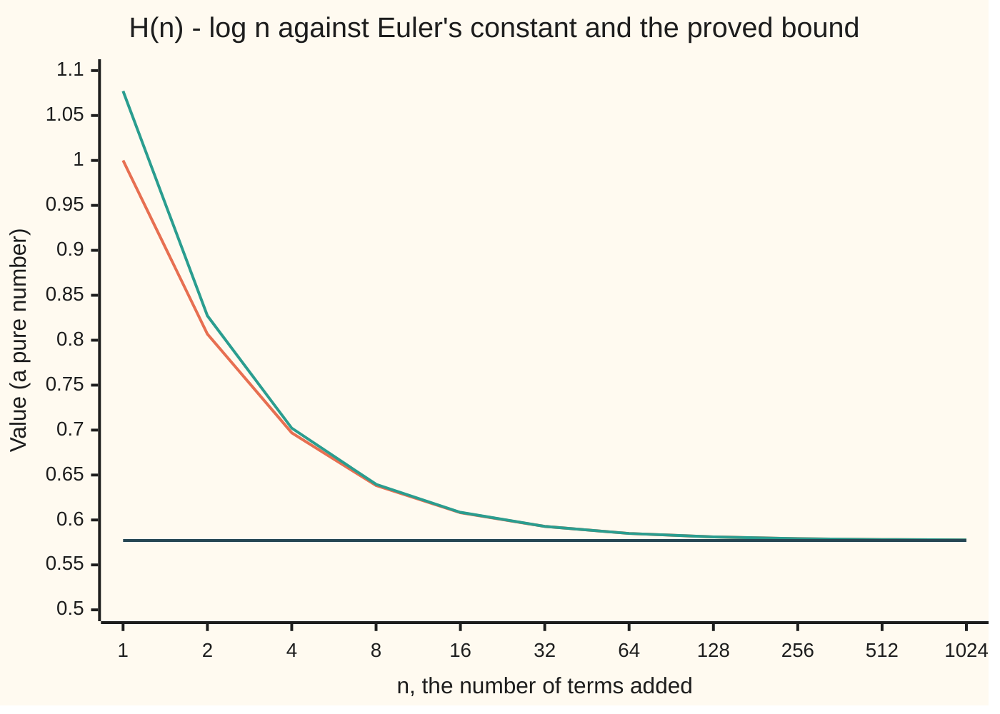

# Big O and twiddle: how to say 'about this size' so the claim can be proved

[Syllabus](../../../SYLLABUS.md) → [Algebraic and analytic number theory](../README.md) → [Arithmetic Functions Again](../README.md#s01) → Big O and twiddle

---

## General Overview

Add up 1 + 1/2 + 1/3 + … + 1/1,000,000. The total is 14.3927267. The natural log of a million is 13.8155106. The two are close, but how close, and close in what sense?

There are four honest answers, and each says more than the one before:

1. Their ratio heads for 1. At a million it is 1.0418.
2. Their difference stays bounded. At a million it is 0.5772162.
3. The difference settles on one number, Euler's constant 0.5772157.
4. After that number is taken off, what is left shrinks like 1 over the size. At a million it is 0.0000005, half of one millionth.

Number theory needs all four levels. A prime count has no simple exact formula, so its claims take the form "main term plus an error term": a simple formula, plus a stated limit on how wrong that formula can be. This card gives the notation for each level and says exactly what each one promises.

**An asymptotic claim compares two quantities as the size grows, and each notation, twiddle, big O and little o, is a precise promise about their ratio or their difference that a proof can deliver and a count can test.**

**What kind of fact this is:** O, o, ~ and ≪ are definitions. The four claims about the sum of 1/n are a theorem, proved on this card in Why it works, with an explicit constant. The divisor-sum estimate is proved here too. The prime-count error term is a proved theorem quoted with its source. The counts to a million are evidence, never proof.

### The picture: the gap settles, and the bound closes on it



The orange line is the gap: the sum of the first n reciprocals minus log n. The green line is the proved ceiling, Euler's constant plus 1/(2n). The flat dark line is Euler's constant, 0.5772. The gap always lies strictly between the dark line and the green line, and the two close on each other. From n = 32 on they agree to four decimals. Both checks print every point.

---

## The formula

The [Big-O](../../14-Applied%20and%20computational/01-Algorithms%20and%20Growth/01-big-o-and-growth-rates.md) card defines O, Ω and Θ: a ceiling, a floor and an exact rate of growth, each up to a fixed multiple. This card keeps O and adds three things. Here the size is x, a real number that grows without limit, and sums run over the whole numbers n up to x. Every log on this wing is the natural log, written ln on earlier wings.

```math
f = O(g) \iff |f(x)| \le C\,g(x) \text{ for all } x \ge x_0, \qquad f = o(g) \iff \frac{f(x)}{g(x)} \to 0, \qquad f \sim g \iff \frac{f(x)}{g(x)} \to 1
```

**Read it aloud:** f is big O of g when a fixed multiple of g caps the size of f from some point on; f is little o of g when f becomes a vanishing share of g; f is twiddle g when the two agree in ratio, in the long run.

Three more points about the notation:

- **f ≪ g** means exactly f = O(g). It is read "f is at most of the order of g". It avoids the misleading equals sign.
- **f ~ g is the same as f = g + o(g).** The difference is a vanishing share of g. The difference itself may still grow. Here ~ is not the "distributed as" of the probability wing.
- **An error term** is the O( ) part of a statement such as "main term + O(error)". Its constant C is **explicit** when a number is given. Otherwise the proof only shows that some constant exists. This card says which, each time.

The card's main example is the four-level claim about the **harmonic sum** H(x), the sum of 1/n for n from 1 to x:

```math
H(x) = \log x + \gamma + O\!\left(\frac{1}{x}\right), \qquad \text{explicitly} \quad 0 < H(x) - \log x - \gamma < \frac{1}{2x} \text{ for every whole number } x \ge 1
```

**Read it aloud:** the sum of the first x reciprocals is log x plus Euler's constant, wrong by less than one over twice x, and always too big.

At x = 1,000,000 the leftover is 0.00000049999992, and half of one millionth is 0.0000005. The bound is very nearly tight.

| Symbol | Plain meaning | In our example | Push it up and the answer… |
| --- | --- | --- | --- |
| $`x`$ | the size; sums run over whole numbers up to it | 1,000,000 | every estimate is tested further out |
| $`f`$, $`g`$ | the quantity studied, and the simpler yardstick it is compared with | H(x) and log x | — |
| $`O(g)`$, $`f \ll g`$; $`\Omega`$, $`\Theta`$ | at most a fixed multiple of g in size, from some point on; Ω and Θ are the floor and the exact rate from Big-O | H(x) − log x = O(1) | — |
| $`o(g)`$ | a vanishing share of g: the ratio to g tends to 0 | H(x) − log x − γ = o(1) | — |
| $`f \sim g`$ | "twiddle": the ratio f/g tends to 1 | H(x) ~ log x, ratio 1.041780 | the ratio creeps toward 1 |
| $`C`$, $`x_0`$ | the fixed multiple in a big-O claim, and the size from which it holds | 1/2 and 1 for the leftover in H(x) at whole numbers x; C = 1 for real x | a larger C is a weaker claim |
| $`\log x`$, $`t`$, $`\log_2 x`$ | the natural log, the area under 1/t from 1 to x; t is the variable along that curve; log₂ is the base-2 log, met only as a mistake | 13.8155105580 | grows by log 2 = 0.6931 each time x doubles |
| $`H(x)`$, $`n`$, $`k`$, $`a(n)`$ | the harmonic sum 1 + 1/2 + … + 1/x; n and k count terms; a(n) is the gap H(n) − log n | H = 14.3927267229 | grows like log x |
| $`\gamma`$ | Euler's constant: the limit of the gap H(x) − log x | 0.5772156649 | — |
| $`\tau(n)`$, $`d`$, $`D(x)`$, $`\lfloor x/d \rfloor`$ | the number of divisors d of n; their running total; x/d rounded down | τ(720720) = 240; D = 13,970,034 | D grows like x log x |
| $`\pi(x)`$ | the number of primes up to x | 78,498 | grows like x/log x |

### When it holds

- **The size grows without limit.** Every ~, o and O claim here is about large x. At x = 10 the ratio H/log x is still 1.272. A ~ claim alone promises nothing at any one size.
- **The constant is one fixed number.** If C may grow with x, every function is O of every other, and the claim is empty.
- **An explicit bound holds only on its stated range.** The proved prime-count bound in Step 5 starts at x = 59. At x = 58 it fails.
- **The main term comes first.** Without the γ, the leftover in H(x) is not O(1/x): times x it is 577,216.2 at a million, and growing.
- **Comparisons need a positive yardstick.** The ratios in o and ~ need g(x) above 0 for large x, which holds for log x, x and x/log x.

---

## Why it works

### Step 0: compare the sum with an area

Each term 1/n is the area of a box of width 1 and height 1/n. Set the first box, of height 1, aside. Stand each later box, of height 1/(k + 1), on [k, k + 1]. The curve 1/t falls from 1/k to 1/(k + 1) there, so every box fits under the curve. The area under the curve from 1 to n is log n.

So the boxes on [1, n] fill that area except for thin gaps between the curve and the box tops, and H(n) − log n = 1 − (the gaps on [1, n]). The whole proof is three facts about those gaps. Their total stays below 1. Their total settles on one number, so H(n) − log n settles too, on γ = 1 − (all the gaps). And the gaps past n, which are exactly the leftover H(n) − log n − γ, add to less than 1/(2n).

### Step 1: twiddle and O(1), from boxes above and below

Boxes standing on [n, n + 1] with height 1/n lie above the curve, so H(n) > log(n + 1). Slide each box one step left, as in Step 0, and all but the first lie below the curve, so H(n) ≤ 1 + log n. Together:

```math
0 < H(n) - \log n \le 1
```

That is H(x) = log x + O(1), with C = 1. Divide by log x: the ratio H/log x lies between 1 and 1 + 1/log x, so it tends to 1. That is H(x) ~ log x.

The ratio closes slowly: 1.272035 at 10, 1.083633 at 1,000, 1.041780 at a million. The extra part is a bounded amount divided by log x, and log x grows slowly.

### Step 2: the gap settles, which defines γ

Go from n to n + 1. The gap a(n) = H(n) − log n gains 1/(n + 1) and loses log(n + 1) − log n, the area under the curve on [n, n + 1]. That area is more than 1/(n + 1), because the curve stays above its value at n + 1. So the gap falls at every step.

A falling sequence that never drops below 0 settles on a limit. This is the completeness of the real numbers: the number line has no holes for the sequence to slip through. That limit is **Euler's constant** γ. So H(x) = log x + γ + o(1).

This is stronger than Step 1. O(1) said the gap stays in a band. o(1), after γ is taken off, says the leftover shrinks to nothing.

### Step 3: how fast, with the constant 1/2

The fall from a(k) to a(k + 1) is Step 0's gap on [k, k + 1]: the thin region between the curve 1/t and the level 1/(k + 1). The curve bends upward, so it lies below the straight line joining its two ends. The region is therefore inside a triangle of width 1 and height 1/k − 1/(k + 1).

Those triangles telescope (consecutive terms cancel). Their total from k = n onward is half of 1/n. The fall from a(n) all the way down to γ is the sum of these regions, so:

```math
0 < H(n) - \log n - \gamma < \frac{1}{2n}
```

<details>
<summary>Detailed proof: the leftover lies between 0 and 1/(2n)</summary>

Write the fall at step k as an integral:

$`\displaystyle a(k) - a(k+1) = \int_k^{k+1} \left( \frac{1}{t} - \frac{1}{k+1} \right) dt`$

The integrand is positive for t < k + 1, so each fall is positive. The function 1/t is convex, so on [k, k + 1] it lies below the chord from (k, 1/k) to (k + 1, 1/(k + 1)). The integrand is then at most the chord minus 1/(k + 1), a straight line from 1/k − 1/(k + 1) down to 0. Its integral is a triangle:

$`\displaystyle 0 < a(k) - a(k+1) < \frac{1}{2} \left( \frac{1}{k} - \frac{1}{k+1} \right)`$

The inequality is strict because 1/t is strictly convex. Add from k = n to k = m − 1. The right side telescopes:

$`\displaystyle 0 < a(n) - a(m) < \frac{1}{2} \left( \frac{1}{n} - \frac{1}{m} \right)`$

Let m grow. Then a(m) tends to γ and 1/m to 0, which gives 0 ≤ a(n) − γ ≤ 1/(2n). A limit can turn strict inequalities into non-strict ones, so keep the first fall apart. The falls are positive, so a(n) − γ ≥ a(n) − a(n + 1) > 0. And the same limit at n + 1 gives:

$`\displaystyle a(n) - \gamma = \big(a(n) - a(n+1)\big) + \big(a(n+1) - \gamma\big) < \frac{1}{2} \left( \frac{1}{n} - \frac{1}{n+1} \right) + \frac{1}{2(n+1)} = \frac{1}{2n}`$

</details>

So, at whole numbers x, H(x) = log x + γ + O(1/x), with the explicit constant C = 1/2 from x₀ = 1. The check confirms the two-sided bound at every n from 1 to 1,000,000, using γ quoted from a table.

For real x the constant changes. Between n and n + 1 the sum stands still while log x climbs, so the error falls steadily, from the leftover at n toward the leftover at n + 1 minus 1/(n + 1). That end is negative, and times x it lies between −1 and −1/2; the lowest is −0.5407, just below x = 2. So for every real x ≥ 1 the claim H(x) = log x + γ + O(1/x) holds from x₀ = 1 with C = 1, but not with C = 1/2. The check tests that range just below every whole number up to a million.

Knowing the shape of the error lets one remove it. If a(n) is γ + 1/(2n) plus something smaller, then 2a(2000) − a(1000) cancels the 1/(2n) part. The check gets 0.5772157066 that way, against 0.5777155816 from a(1000) alone and the quoted 0.5772156649.

### Step 4: arithmetic with O, o and ~, used on the divisor sum

Error terms combine by a few rules. Each follows from the definition by adding or multiplying the constants:

- O(f) + O(f) = O(f), and a fixed multiple of O(f) is O(f).
- x times O(1/x) is O(1).
- A sum of x terms, each O(1) with one shared constant, is O(x).
- The equals sign runs one way only. 1/x = O(1) is true; O(1) = O(1/x) is false.

Little o and twiddle follow from limits of ratios:

- o(g) is also O(g): a vanishing share is a bounded one. The reverse fails: 1 = O(1), but 1 is not o(1).
- o(1) times O(1) is o(1), and o(g) + o(g) = o(g).
- Twiddle survives products, quotients and fixed powers. From π(x) ~ x/log x and H(x) ~ log x, multiplying side by side gives π(x) H(x) ~ x.
- Twiddle does not survive differences. f ~ g says only that f − g is o(g). H(x) ~ log x, yet H(x) − log x tends to γ, not 0; π(x) ~ x/log x, yet their gap grows without limit (What breaks, below).

Now the shelf's running example: τ(n), the number of divisors of n, and its running total D(x). Each d up to x divides exactly ⌊x/d⌋ of the numbers up to x. So D(x) is the sum of ⌊x/d⌋ over d, a formula due to Dirichlet. Each ⌊x/d⌋ is x/d minus a part between 0 and 1. With Step 1:

```math
D(x) = \sum_{d \le x} \left\lfloor \frac{x}{d} \right\rfloor = x\,H(x) + O(x) = x \log x + O(x)
```

Each step uses a rule above: x errors of size below 1 make O(x), and x times O(1) is O(x). Tracked exactly, the constant is 1: x log x − x < D(x) ≤ x log x + x. The check confirms this sandwich at every x up to a million.

At a million, D = 13,970,034 by a divisor sieve and again by Dirichlet's floor count. x log x is 13,815,510.558, so the error is 154,523.44. That sits well inside the O(x) allowance of 1,000,000. The error is in fact close to (2γ − 1)x = 154,431.33. Pinning that second term, with an error O(√x), is the job of [Average orders](05-average-orders-and-the-hyperbola-method.md).

### Step 5: what O(x/log² x) promises for the primes

The prime number theorem says π(x) ~ x/log x. A sharper form, proved, adds an error term:

```math
\pi(x) = \frac{x}{\log x} + O\!\left(\frac{x}{\log^2 x}\right)
```

Divide by the main term. The relative error is O(1/log x): it shrinks, but only as fast as 1/log x. At a million, log x is about 13.8, so the claim allows a relative error of a fixed multiple of 1/13.8, and no better. The actual figure is 8.45 percent: the ratio π(x)/(x/log x) is 1.0845.

The constant here is explicit. Rosser and Schoenfeld proved in 1962 that the gap π(x) − x/log x, divided by x/log² x, lies between 1/2 and 3/2 for every x ≥ 59. The code computes that scaled gap at every whole x from 59 to a million. It stays between 0.5976 (at x = 66) and 1.2761 (at x = 1,627). That agrees with the theorem but does not prove it: the proof is the paper's, and a count to a million is evidence only.

The full proof of the prime number theorem is on a later card, [The prime number theorem](../02-The%20Zeta%20Function%20and%20the%20Prime%20Number%20Theorem/05-prime-number-theorem-proved.md). [Chebyshev's bounds](08-chebyshev-bounds.md) proves a weaker fact on this shelf: π(x) is trapped between two fixed multiples of x/log x, that is, π(x) = Θ(x/log x).

---

## Worked numbers, by hand

The four claims about H(x), at x = 1,000,000:

| Step | Arithmetic | Value |
| --- | --- | --- |
| the sum | 1 + 1/2 + … + 1/1,000,000 | 14.3927267229 |
| the main term | log 1,000,000 = 6 × log 10 | 13.8155105580 |
| twiddle: the ratio | 14.3927267229 ÷ 13.8155105580 | 1.041780 |
| O(1): the gap | 14.3927267229 − 13.8155105580 | 0.577216165 |
| o(1): the gap minus γ | 0.577216165 − 0.5772156649 | 0.00000049999992 |
| O(1/x): times x | 0.00000049999992 × 1,000,000 | **0.49999992, under 1/2** |

The sum overshoots log x + γ by just under half of one millionth, exactly the size the proved bound allows.

The same ladder at three sizes:

| Claim | x = 10 | x = 1,000 | x = 1,000,000 |
| --- | --- | --- | --- |
| H/log x, tends to 1 | 1.272035 | 1.083633 | 1.041780 |
| H − log x, tends to γ | 0.626383161 | 0.577715582 | 0.577216165 |
| (H − log x − γ) × x, stays below 0.5 | 0.49167496 | 0.49991667 | 0.49999992 |

### What breaks if you drop a piece

| Mistake | Comes out at | What went wrong |
| --- | --- | --- |
| Reading π(x) ~ x/log x as "the gap shrinks" | gaps 23.24, 143.26, 906.11, 6,115.59 at 10³ to 10⁶ | ~ is about the ratio; the gap grows without limit |
| Dropping γ and claiming H(x) − log x = O(1/x) | (H − log x) × x = 577,216.2 at a million, and growing | the main term was incomplete; the leftover is O(1), not O(1/x) |
| Using log₂ in a main term | H(x)/log₂ x = 0.7221, heading to log 2 = 0.6931 | the base is free only inside O( ); in a main term or a ~ it matters |
| Using the Rosser–Schoenfeld lower bound at x = 58 | π(58) = 16, scaled gap 0.4877, below the proved 1/2 | an explicit bound holds only from its stated x₀ = 59 |

---

## Code, from first principles, and it actually runs

Each claim on the card meets a second road. The harmonic sum is added term by term, with compensated summation (each addition's rounding error is carried into the next), so a million additions lose no digits. Taking log x + γ, a number near 14, off the sum does lose digits, so the leftover is printed to 8 significant digits. It is tested against log x + γ and the proved bound at every n to a million, and for real x just below every whole number. Euler's constant is quoted from a table (OEIS A001620) and rebuilt by cancelling the 1/(2n) term. The divisor sum comes from a sieve and from Dirichlet's floor count, then meets its proved sandwich at every x. The prime count comes from the sieve of Eratosthenes and meets the published counts and the Rosser–Schoenfeld range at every x from 59. Python's `math` supplies only `log`.

### Python

```python
# Big O and twiddle -- the check behind the card.  Standard library only:
# math supplies log and nothing else.  Every number on the card is printed.
# Roads: the harmonic sum H(x), added term by term, against log x + gamma and
# the proved bound 1/(2x); Euler's constant gamma, quoted from a table, against
# a rebuild that cancels the 1/(2x) term; the divisor sum D(x) by a sieve and by
# Dirichlet's floor count; the prime count pi(x) by Eratosthenes against x/log x
# and the explicit bounds of Rosser and Schoenfeld (1962), at every x to X.
from math import log

X = 10**6
GAMMA = 0.5772156649015329               # Euler's constant, quoted from OEIS A001620

def ff(v, d):
    return f"{v:.{d}f}"

# ---- road 1: H(n) added term by term, compensated so no digits are lost ----
h = comp = 0.0
H, bound_ok, real_ok, below = {}, True, True, (0.0, 0)
for n in range(1, X + 1):
    y = 1.0 / n - comp
    t = h + y
    comp = (t - h) - y
    h = t
    err = h - log(n) - GAMMA             # the error term after log n + gamma
    bound_ok = bound_ok and 0.0 < err < 0.5 / n
    if n > 1:                            # real x just below n: the sum is still H(n - 1)
        v = err * n - 1                  # (H - log x - gamma) * x as x rises to n
        real_ok = real_ok and -1 < v < -0.5
        below = min(below, (v, n))
    if n in (10, 1000, 2000, X) or n & (n - 1) == 0:
        H[n] = h
gap = lambda n: H[n] - log(n)
print("harmonic sum H(x) = 1 + 1/2 + ... + 1/x; log is the natural log; gamma =", ff(GAMMA, 10))
print(f"x = {X}: H(x) = {ff(H[X], 10)}, log x = {ff(log(X), 10)}, log x + gamma = {ff(log(X) + GAMMA, 10)}")
print(f"claim ladder at x = 10, 1000, {X}:")
xs = (10, 1000, X)
print("  H/log x:", ", ".join(ff(H[x] / log(x), 6) for x in xs))
print("  H - log x:", ", ".join(ff(gap(x), 9) for x in xs))
# the leftover is a difference of two numbers near 14: only 8 significant digits survive it
print("  H - log x - gamma:", ", ".join(ff(gap(x) - GAMMA, 7 + len(str(x))) for x in xs))
print("  (H - log x - gamma) * x:", ", ".join(ff((gap(x) - GAMMA) * x, 8) for x in xs), "; proved bound 0.5")
print(f"0 < H(n) - log n - gamma < 1/(2n) for every n from 1 to {X}: {'yes' if bound_ok else 'no'}")
print(f"real x just below each whole number 2 to {X}: -1 < (H - log x - gamma) * x < -1/2: "
      f"{'yes' if real_ok else 'no'}; lowest {ff(below[0], 4)}, just below x = {below[1]}")
pts = [2**k for k in range(11)]
print(f"figure, n, H - log n, gamma + 1/(2n); gamma line {ff(GAMMA, 4)}:",
      " | ".join(f"{n} {ff(gap(n), 4)} {ff(GAMMA + 0.5 / n, 4)}" for n in pts))
rebuilt = 2 * gap(2000) - gap(1000)      # a(n) = gamma + 1/(2n) + ..., so the 1/(2n) cancels
print(f"gamma rebuilt as 2 a(2000) - a(1000) = {ff(rebuilt, 10)}; a(1000) alone {ff(gap(1000), 10)}")

# ---- road 2: the divisor sum, by a sieve and by Dirichlet's floor count ----
tau = [0] * (X + 1)
for d in range(1, X + 1):
    for m in range(d, X + 1, d):
        tau[m] += 1
D, run, sandwich = sum(tau), 0, True
for x in range(1, X + 1):
    run += tau[x]
    sandwich = sandwich and x * log(x) - x < run <= x * log(x) + x
floor_count = sum(X // d for d in range(1, X + 1))
top = max(tau)
print(f"divisor sum D(x) = tau(1) + ... + tau(x) at x = {X}: sieve {D}, floor count {floor_count}")
print(f"  x log x = {ff(X * log(X), 3)}, D - x log x = {ff(D - X * log(X), 2)}, (2 gamma - 1) x = {ff((2 * GAMMA - 1) * X, 2)}")
print(f"  x log x - x < D(x) <= x log x + x at every x from 1 to {X}: {'yes' if sandwich else 'no'}")
print(f"  average D/x = {ff(D / X, 6)}; largest tau {top}, first at {tau.index(top)}; tau(999983) = {tau[999983]}")

# ---- road 3: the prime count by Eratosthenes, against x/log x ----
sieve = bytearray([1]) * (X + 1)
sieve[0] = sieve[1] = 0
for p in range(2, int(X**0.5) + 1):
    if sieve[p]:
        sieve[p * p::p] = bytearray(len(range(p * p, X + 1, p)))
pi, cnt, lo, hi, rs_ok, at = {}, 0, (9.0, 0), (0.0, 0), True, {}
for x in range(2, X + 1):
    cnt += sieve[x]
    L = log(x)
    s = (cnt - x / L) * L * L / x        # the error over x/log^2 x
    if x >= 59:
        lo, hi = min(lo, (s, x)), max(hi, (s, x))
        rs_ok = rs_ok and 0.5 < s < 1.5
    if x in (58, 1000, 10**4, 10**5, X):
        pi[x], at[x] = cnt, s
print("prime count pi(x) by the sieve of Eratosthenes:")
for x in (1000, 10**4, 10**5, X):
    m = x / log(x)
    print(f"  x = {x}: pi {pi[x]}, x/log x {ff(m, 2)}, ratio {ff(pi[x] / m, 4)}, "
          f"gap {ff(pi[x] - m, 2)}, gap/(x/log^2 x) {ff(at[x], 4)}")
print(f"  gap/(x/log^2 x) from x = 59 to {X}: min {ff(lo[0], 4)} at {lo[1]}, max {ff(hi[0], 4)} at {hi[1]}; proved 0.5 to 1.5")

# ---- what breaks, and where it is used ----
print(f"mistake, gamma dropped: (H - log x) * x = {ff(gap(X) * X, 1)} at x = {X}, and growing")
print(f"mistake, log2 in the main term: H(x)/log2 x = {ff(H[X] / (log(X) / log(2)), 4)}, heading to log 2 = {ff(log(2), 4)}")
print(f"mistake, bound used below x = 59: at x = 58, pi = {pi[58]}, gap/(x/log^2 x) = {ff(at[58], 4)}")
qs = lambda n, Hn: 2 * (n + 1) * Hn - 4 * n                     # quicksort's average comparisons
H8 = sum(1 / k for k in range(1, 9))
approx = 2 * X * log(X) - (4 - 2 * GAMMA) * X
print(f"quicksort average 2(n+1)H(n) - 4n: n = 8: {ff(qs(8, H8), 4)}; n = {X}: {ff(qs(X, H[X]), 1)}")
print(f"  2n log n - (4 - 2 gamma) n = {ff(approx, 1)}; difference {ff(qs(X, H[X]) - approx, 3)}; "
      f"2 log n + 2 gamma + 1 = {ff(2 * log(X) + 2 * GAMMA + 1, 3)}")
print(f"near 2^1024: log x = {ff(1024 * log(2), 2)}, so 1 number in {round(1024 * log(2))} is prime, 1 odd number in {round(512 * log(2))}")

assert bound_ok                                              # proved error bound, met by the sum
assert abs(rebuilt - GAMMA) < 1e-7                           # gamma two ways
assert D == floor_count == 13970034 and sandwich             # two counts, inside the proved sandwich
assert [pi[x] for x in (1000, 10**4, 10**5, X)] == [168, 1229, 9592, 78498]   # published counts
assert rs_ok and at[58] < 0.5                                # proved range holds from 59, fails at 58
assert abs((qs(X, H[X]) - approx) - (2 * log(X) + 2 * GAMMA + 1)) < 1e-3
assert real_ok                                               # real x: C = 1 holds, C = 1/2 fails
print("ALL CHECKS PASS")
```

**Ran 2026-11-15 on macOS, Python 3.14.10, standard library only. All checks passed. Output, pasted from the run:**

```
harmonic sum H(x) = 1 + 1/2 + ... + 1/x; log is the natural log; gamma = 0.5772156649
x = 1000000: H(x) = 14.3927267229, log x = 13.8155105580, log x + gamma = 14.3927262229
claim ladder at x = 10, 1000, 1000000:
  H/log x: 1.272035, 1.083633, 1.041780
  H - log x: 0.626383161, 0.577715582, 0.577216165
  H - log x - gamma: 0.049167496, 0.00049991667, 0.00000049999992
  (H - log x - gamma) * x: 0.49167496, 0.49991667, 0.49999992 ; proved bound 0.5
0 < H(n) - log n - gamma < 1/(2n) for every n from 1 to 1000000: yes
real x just below each whole number 2 to 1000000: -1 < (H - log x - gamma) * x < -1/2: yes; lowest -0.5407, just below x = 2
figure, n, H - log n, gamma + 1/(2n); gamma line 0.5772: 1 1.0000 1.0772 | 2 0.8069 0.8272 | 4 0.6970 0.7022 | 8 0.6384 0.6397 | 16 0.6081 0.6085 | 32 0.5928 0.5928 | 64 0.5850 0.5850 | 128 0.5811 0.5811 | 256 0.5792 0.5792 | 512 0.5782 0.5782 | 1024 0.5777 0.5777
gamma rebuilt as 2 a(2000) - a(1000) = 0.5772157066; a(1000) alone 0.5777155816
divisor sum D(x) = tau(1) + ... + tau(x) at x = 1000000: sieve 13970034, floor count 13970034
  x log x = 13815510.558, D - x log x = 154523.44, (2 gamma - 1) x = 154431.33
  x log x - x < D(x) <= x log x + x at every x from 1 to 1000000: yes
  average D/x = 13.970034; largest tau 240, first at 720720; tau(999983) = 2
prime count pi(x) by the sieve of Eratosthenes:
  x = 1000: pi 168, x/log x 144.76, ratio 1.1605, gap 23.24, gap/(x/log^2 x) 1.1087
  x = 10000: pi 1229, x/log x 1085.74, ratio 1.1320, gap 143.26, gap/(x/log^2 x) 1.2153
  x = 100000: pi 9592, x/log x 8685.89, ratio 1.1043, gap 906.11, gap/(x/log^2 x) 1.2010
  x = 1000000: pi 78498, x/log x 72382.41, ratio 1.0845, gap 6115.59, gap/(x/log^2 x) 1.1673
  gap/(x/log^2 x) from x = 59 to 1000000: min 0.5976 at 66, max 1.2761 at 1627; proved 0.5 to 1.5
mistake, gamma dropped: (H - log x) * x = 577216.2 at x = 1000000, and growing
mistake, log2 in the main term: H(x)/log2 x = 0.7221, heading to log 2 = 0.6931
mistake, bound used below x = 59: at x = 58, pi = 16, gap/(x/log^2 x) = 0.4877
quicksort average 2(n+1)H(n) - 4n: n = 8: 16.9214; n = 1000000: 24785482.2
  2n log n - (4 - 2 gamma) n = 24785452.4; difference 29.785; 2 log n + 2 gamma + 1 = 29.785
near 2^1024: log x = 709.78, so 1 number in 710 is prime, 1 odd number in 355
ALL CHECKS PASS
```

### Rust

Same numbers, same labels, built with `rustc --edition 2021 -O`.

```rust
// Big O and twiddle -- the same check as the Python, in Rust.  No crates.
// Every number on the card is printed.  Roads: the harmonic sum H(x), added
// term by term, against log x + gamma and the proved bound 1/(2x); Euler's
// constant gamma, quoted from a table, against a rebuild that cancels the
// 1/(2x) term; the divisor sum D(x) by a sieve and by Dirichlet's floor count;
// the prime count pi(x) by Eratosthenes against x/log x and the explicit
// bounds of Rosser and Schoenfeld (1962), at every x to X.
use std::collections::HashMap;

const X: usize = 1_000_000;
const GAMMA: f64 = 0.5772156649015329;   // Euler's constant, quoted from OEIS A001620

fn ff(v: f64, d: usize) -> String { format!("{:.*}", d, v) }
fn yn(b: bool) -> &'static str { if b { "yes" } else { "no" } }
fn join(v: Vec<String>, sep: &str) -> String { v.join(sep) }

fn main() {
    let ln = |x: f64| x.ln();
    // ---- road 1: H(n) added term by term, compensated so no digits are lost ----
    let (mut h, mut comp, mut bound_ok) = (0.0f64, 0.0f64, true);
    let (mut real_ok, mut below) = (true, (0.0f64, 0usize));
    let mut hh: HashMap<usize, f64> = HashMap::new();
    for n in 1..=X {
        let y = 1.0 / n as f64 - comp;
        let t = h + y;
        comp = (t - h) - y;
        h = t;
        let err = h - ln(n as f64) - GAMMA;          // the error term after log n + gamma
        bound_ok = bound_ok && 0.0 < err && err < 0.5 / n as f64;
        if n > 1 {                                    // real x just below n: the sum is still H(n - 1)
            let v = err * n as f64 - 1.0;             // (H - log x - gamma) * x as x rises to n
            real_ok = real_ok && -1.0 < v && v < -0.5;
            if v < below.0 { below = (v, n); }
        }
        if [10, 1000, 2000, X].contains(&n) || n & (n - 1) == 0 { hh.insert(n, h); }
    }
    let gap = |n: usize| hh[&n] - ln(n as f64);
    let xf = X as f64;
    println!("harmonic sum H(x) = 1 + 1/2 + ... + 1/x; log is the natural log; gamma = {}", ff(GAMMA, 10));
    println!("x = {}: H(x) = {}, log x = {}, log x + gamma = {}", X, ff(hh[&X], 10), ff(ln(xf), 10), ff(ln(xf) + GAMMA, 10));
    println!("claim ladder at x = 10, 1000, {}:", X);
    let xs = [10usize, 1000, X];
    println!("  H/log x: {}", join(xs.iter().map(|&x| ff(hh[&x] / ln(x as f64), 6)).collect(), ", "));
    println!("  H - log x: {}", join(xs.iter().map(|&x| ff(gap(x), 9)).collect(), ", "));
    // the leftover is a difference of two numbers near 14: only 8 significant digits survive it
    println!("  H - log x - gamma: {}", join(xs.iter().map(|&x| ff(gap(x) - GAMMA, 7 + x.to_string().len())).collect(), ", "));
    println!("  (H - log x - gamma) * x: {} ; proved bound 0.5",
             join(xs.iter().map(|&x| ff((gap(x) - GAMMA) * x as f64, 8)).collect(), ", "));
    println!("0 < H(n) - log n - gamma < 1/(2n) for every n from 1 to {}: {}", X, yn(bound_ok));
    println!("real x just below each whole number 2 to {}: -1 < (H - log x - gamma) * x < -1/2: {}; lowest {}, just below x = {}",
             X, yn(real_ok), ff(below.0, 4), below.1);
    let pts: Vec<String> = (0..11).map(|k| {
        let n = 1usize << k;
        format!("{} {} {}", n, ff(gap(n), 4), ff(GAMMA + 0.5 / n as f64, 4))
    }).collect();
    println!("figure, n, H - log n, gamma + 1/(2n); gamma line {}: {}", ff(GAMMA, 4), join(pts, " | "));
    let rebuilt = 2.0 * gap(2000) - gap(1000);       // a(n) = gamma + 1/(2n) + ..., so the 1/(2n) cancels
    println!("gamma rebuilt as 2 a(2000) - a(1000) = {}; a(1000) alone {}", ff(rebuilt, 10), ff(gap(1000), 10));

    // ---- road 2: the divisor sum, by a sieve and by Dirichlet's floor count ----
    let mut tau = vec![0u32; X + 1];
    for d in 1..=X {
        let mut m = d;
        while m <= X { tau[m] += 1; m += d; }
    }
    let d_sum: u64 = tau.iter().map(|&t| t as u64).sum();
    let (mut run, mut sandwich) = (0u64, true);
    for x in 1..=X {
        run += tau[x] as u64;
        let (xl, r) = (x as f64 * ln(x as f64), run as f64);
        sandwich = sandwich && xl - (x as f64) < r && r <= xl + x as f64;
    }
    let floor_count: u64 = (1..=X).map(|d| (X / d) as u64).sum();
    let top = *tau.iter().max().unwrap();
    let first = tau.iter().position(|&t| t == top).unwrap();
    println!("divisor sum D(x) = tau(1) + ... + tau(x) at x = {}: sieve {}, floor count {}", X, d_sum, floor_count);
    println!("  x log x = {}, D - x log x = {}, (2 gamma - 1) x = {}",
             ff(xf * ln(xf), 3), ff(d_sum as f64 - xf * ln(xf), 2), ff((2.0 * GAMMA - 1.0) * xf, 2));
    println!("  x log x - x < D(x) <= x log x + x at every x from 1 to {}: {}", X, yn(sandwich));
    println!("  average D/x = {}; largest tau {}, first at {}; tau(999983) = {}",
             ff(d_sum as f64 / xf, 6), top, first, tau[999983]);

    // ---- road 3: the prime count by Eratosthenes, against x/log x ----
    let mut sieve = vec![true; X + 1];
    sieve[0] = false;
    sieve[1] = false;
    let mut p = 2;
    while p * p <= X {
        if sieve[p] { let mut m = p * p; while m <= X { sieve[m] = false; m += p; } }
        p += 1;
    }
    let (mut cnt, mut lo, mut hi, mut rs_ok) = (0u64, (9.0f64, 0usize), (0.0f64, 0usize), true);
    let (mut pi, mut at): (HashMap<usize, u64>, HashMap<usize, f64>) = (HashMap::new(), HashMap::new());
    for x in 2..=X {
        if sieve[x] { cnt += 1; }
        let l = ln(x as f64);
        let s = (cnt as f64 - x as f64 / l) * l * l / x as f64;   // the error over x/log^2 x
        if x >= 59 {
            if s < lo.0 { lo = (s, x); }
            if s > hi.0 { hi = (s, x); }
            rs_ok = rs_ok && 0.5 < s && s < 1.5;
        }
        if [58, 1000, 10_000, 100_000, X].contains(&x) { pi.insert(x, cnt); at.insert(x, s); }
    }
    println!("prime count pi(x) by the sieve of Eratosthenes:");
    for &x in [1000usize, 10_000, 100_000, X].iter() {
        let m = x as f64 / ln(x as f64);
        let c = pi[&x] as f64;
        println!("  x = {}: pi {}, x/log x {}, ratio {}, gap {}, gap/(x/log^2 x) {}",
                 x, pi[&x], ff(m, 2), ff(c / m, 4), ff(c - m, 2), ff(at[&x], 4));
    }
    println!("  gap/(x/log^2 x) from x = 59 to {}: min {} at {}, max {} at {}; proved 0.5 to 1.5",
             X, ff(lo.0, 4), lo.1, ff(hi.0, 4), hi.1);

    // ---- what breaks, and where it is used ----
    println!("mistake, gamma dropped: (H - log x) * x = {} at x = {}, and growing", ff(gap(X) * xf, 1), X);
    println!("mistake, log2 in the main term: H(x)/log2 x = {}, heading to log 2 = {}",
             ff(hh[&X] / (ln(xf) / ln(2.0)), 4), ff(ln(2.0), 4));
    println!("mistake, bound used below x = 59: at x = 58, pi = {}, gap/(x/log^2 x) = {}", pi[&58], ff(at[&58], 4));
    let qs = |n: f64, hn: f64| 2.0 * (n + 1.0) * hn - 4.0 * n;   // quicksort's average comparisons
    let h8: f64 = (1..9).map(|k| 1.0 / k as f64).sum();
    let approx = 2.0 * xf * ln(xf) - (4.0 - 2.0 * GAMMA) * xf;
    let diff = qs(xf, hh[&X]) - approx;
    let tail = 2.0 * ln(xf) + 2.0 * GAMMA + 1.0;
    println!("quicksort average 2(n+1)H(n) - 4n: n = 8: {}; n = {}: {}", ff(qs(8.0, h8), 4), X, ff(qs(xf, hh[&X]), 1));
    println!("  2n log n - (4 - 2 gamma) n = {}; difference {}; 2 log n + 2 gamma + 1 = {}",
             ff(approx, 1), ff(diff, 3), ff(tail, 3));
    println!("near 2^1024: log x = {}, so 1 number in {} is prime, 1 odd number in {}",
             ff(1024.0 * ln(2.0), 2), (1024.0 * ln(2.0)).round() as i64, (512.0 * ln(2.0)).round() as i64);

    assert!(bound_ok);                                            // proved error bound, met by the sum
    assert!((rebuilt - GAMMA).abs() < 1e-7);                      // gamma two ways
    assert!(d_sum == floor_count && floor_count == 13970034 && sandwich);
    assert!([1000usize, 10_000, 100_000, X].iter().map(|x| pi[x]).collect::<Vec<u64>>() == vec![168, 1229, 9592, 78498]);
    assert!(rs_ok && at[&58] < 0.5);                              // proved range holds from 59, fails at 58
    assert!((diff - tail).abs() < 1e-3);
    assert!(real_ok);                                             // real x: C = 1 holds, C = 1/2 fails
    println!("ALL CHECKS PASS");
}
```

**Ran 2026-11-15 on macOS, rustc 1.98.1, no crates. All checks passed. Output, pasted from the run:**

```
harmonic sum H(x) = 1 + 1/2 + ... + 1/x; log is the natural log; gamma = 0.5772156649
x = 1000000: H(x) = 14.3927267229, log x = 13.8155105580, log x + gamma = 14.3927262229
claim ladder at x = 10, 1000, 1000000:
  H/log x: 1.272035, 1.083633, 1.041780
  H - log x: 0.626383161, 0.577715582, 0.577216165
  H - log x - gamma: 0.049167496, 0.00049991667, 0.00000049999992
  (H - log x - gamma) * x: 0.49167496, 0.49991667, 0.49999992 ; proved bound 0.5
0 < H(n) - log n - gamma < 1/(2n) for every n from 1 to 1000000: yes
real x just below each whole number 2 to 1000000: -1 < (H - log x - gamma) * x < -1/2: yes; lowest -0.5407, just below x = 2
figure, n, H - log n, gamma + 1/(2n); gamma line 0.5772: 1 1.0000 1.0772 | 2 0.8069 0.8272 | 4 0.6970 0.7022 | 8 0.6384 0.6397 | 16 0.6081 0.6085 | 32 0.5928 0.5928 | 64 0.5850 0.5850 | 128 0.5811 0.5811 | 256 0.5792 0.5792 | 512 0.5782 0.5782 | 1024 0.5777 0.5777
gamma rebuilt as 2 a(2000) - a(1000) = 0.5772157066; a(1000) alone 0.5777155816
divisor sum D(x) = tau(1) + ... + tau(x) at x = 1000000: sieve 13970034, floor count 13970034
  x log x = 13815510.558, D - x log x = 154523.44, (2 gamma - 1) x = 154431.33
  x log x - x < D(x) <= x log x + x at every x from 1 to 1000000: yes
  average D/x = 13.970034; largest tau 240, first at 720720; tau(999983) = 2
prime count pi(x) by the sieve of Eratosthenes:
  x = 1000: pi 168, x/log x 144.76, ratio 1.1605, gap 23.24, gap/(x/log^2 x) 1.1087
  x = 10000: pi 1229, x/log x 1085.74, ratio 1.1320, gap 143.26, gap/(x/log^2 x) 1.2153
  x = 100000: pi 9592, x/log x 8685.89, ratio 1.1043, gap 906.11, gap/(x/log^2 x) 1.2010
  x = 1000000: pi 78498, x/log x 72382.41, ratio 1.0845, gap 6115.59, gap/(x/log^2 x) 1.1673
  gap/(x/log^2 x) from x = 59 to 1000000: min 0.5976 at 66, max 1.2761 at 1627; proved 0.5 to 1.5
mistake, gamma dropped: (H - log x) * x = 577216.2 at x = 1000000, and growing
mistake, log2 in the main term: H(x)/log2 x = 0.7221, heading to log 2 = 0.6931
mistake, bound used below x = 59: at x = 58, pi = 16, gap/(x/log^2 x) = 0.4877
quicksort average 2(n+1)H(n) - 4n: n = 8: 16.9214; n = 1000000: 24785482.2
  2n log n - (4 - 2 gamma) n = 24785452.4; difference 29.785; 2 log n + 2 gamma + 1 = 29.785
near 2^1024: log x = 709.78, so 1 number in 710 is prime, 1 odd number in 355
ALL CHECKS PASS
```

The two outputs match line for line.

### Lean

Lean proves the four claims about H(x), the bound on its leftover and the divisor-sum sandwich, plus two exact counts.

- Take any whole number n ≥ 1. Then H(n) − log n − γ lies strictly between 0 and 1/(2n).
- Let the size x grow without limit. Then H(x) ~ log x, and H(x) − log x = O(1).
- Let x grow without limit again. Then H(x) − log x − γ = o(1), and it is also O(1/x).
- Take any whole number x ≥ 1. Then x log x − x < D(x) ≤ x log x + x.
- 720720 = 2^4 × 3^2 × 5 × 7 × 11 × 13, and τ(720720) = 240.
- There are exactly 16 primes up to 58: π(58) = 16.

The constant C = 1 for real x, every decimal value and the prime-count figures are left to the Python and Rust checks.

```lean
-- Big O and twiddle: the harmonic sum H(n) = 1 + 1/2 + … + 1/n overshoots log n + γ by more than 0 and less than 1/(2n) at every whole n ≥ 1, it climbs the four-level ladder H ~ log x, H − log x = O(1), H − log x − γ = o(1) and = O(1/x), and the divisor sum D(n) lies between n log n − n and n log n + n.
import Mathlib.NumberTheory.Harmonic.EulerMascheroni
import Mathlib.Analysis.Asymptotics.AsymptoticEquivalent
import Mathlib.NumberTheory.ArithmeticFunction.Misc
import Mathlib.NumberTheory.PrimeCounting
import Mathlib.NumberTheory.Harmonic.Bounds
import Mathlib.Analysis.SpecialFunctions.Trigonometric.DerivHyp
import Mathlib.Algebra.Order.Floor.Semifield

open Asymptotics Filter Real

theorem log_succ_div_lt_trapezoid (k : ℕ) :
    log (((k : ℝ) + 2) / (k + 1)) < 1 / (2 * ((k : ℝ) + 1)) + 1 / (2 * ((k : ℝ) + 2)) := by
  have hk : (0 : ℝ) < (k : ℝ) + 1 := by positivity
  have hx1 : (1 : ℝ) < ((k : ℝ) + 2) / (k + 1) := by
    rw [lt_div_iff₀ hk]; linarith
  have hpos : 0 < log (((k : ℝ) + 2) / (k + 1)) := log_pos hx1
  have h := Real.self_lt_sinh_iff.2 hpos
  rw [sinh_log (by positivity)] at h
  refine h.trans_le (le_of_eq ?_)
  field_simp
  ring

theorem harmonic_shift_strictMono :
    StrictMono (fun k : ℕ => (harmonic (k + 1) : ℝ) - log ((k : ℝ) + 1) - 1 / (2 * ((k : ℝ) + 1))) := by
  refine strictMono_nat_of_lt_succ (fun k => ?_)
  have h := log_succ_div_lt_trapezoid k
  rw [log_div (by positivity) (by positivity)] at h
  simp only [harmonic_succ (k + 1), Rat.cast_add, Rat.cast_inv, Rat.cast_natCast]
  push_cast
  have e1 : (k : ℝ) + 1 + 1 = k + 2 := by ring
  rw [e1]
  have e2 : ((k + 2 : ℝ))⁻¹ = 1 / (2 * ((k : ℝ) + 2)) + 1 / (2 * ((k : ℝ) + 2)) := by
    field_simp; ring
  rw [e2]
  linarith

theorem harmonic_shift_tendsto :
    Tendsto (fun k : ℕ => (harmonic (k + 1) : ℝ) - log ((k : ℝ) + 1) - 1 / (2 * ((k : ℝ) + 1)))
      atTop (nhds eulerMascheroniConstant) := by
  have h1 := tendsto_harmonic_sub_log.comp (tendsto_add_atTop_nat 1)
  have h2 : Tendsto (fun k : ℕ => 1 / (2 * ((k : ℝ) + 1))) atTop (nhds 0) := by
    have := (tendsto_natCast_atTop_atTop (R := ℝ))
    have h3 : Tendsto (fun k : ℕ => 2 * ((k : ℝ) + 1)) atTop atTop := by
      apply Tendsto.const_mul_atTop (by norm_num)
      exact tendsto_atTop_add_const_right _ 1 this
    refine h3.inv_tendsto_atTop.congr (fun k => ?_)
    simp [one_div]
  have := h1.sub h2
  simp only [sub_zero] at this
  refine this.congr (fun k => ?_)
  simp [Function.comp]

theorem harmonic_shift_lt (k : ℕ) :
    (harmonic (k + 1) : ℝ) - log ((k : ℝ) + 1) - 1 / (2 * ((k : ℝ) + 1)) < eulerMascheroniConstant :=
  (harmonic_shift_strictMono (Nat.lt_succ_self k)).trans_le
    (harmonic_shift_strictMono.monotone.ge_of_tendsto harmonic_shift_tendsto (k + 1))

/-- The harmonic sum with an explicit error term. For every whole number n ≥ 1, the sum
H(n) = 1 + 1/2 + … + 1/n is log n plus Euler's constant γ, always too big, and wrong by less
than one over twice n: 0 < H(n) − log n − γ < 1/(2n). So H(x) = log x + γ + O(1/x) at whole
numbers, with the explicit constant C = 1/2 from x₀ = 1. -/
theorem harmonic_sub_log_sub_eulerMascheroni_bounds (n : ℕ) (hn : 1 ≤ n) :
    0 < (harmonic n : ℝ) - log n - eulerMascheroniConstant ∧
      (harmonic n : ℝ) - log n - eulerMascheroniConstant < 1 / (2 * n) := by
  constructor
  · have h := eulerMascheroniConstant_lt_eulerMascheroniSeq' n
    simp only [eulerMascheroniSeq', show n ≠ 0 by omega, ite_false] at h
    linarith
  · obtain ⟨k, rfl⟩ : ∃ k, n = k + 1 := ⟨n - 1, by omega⟩
    have h := harmonic_shift_lt k
    push_cast
    linarith

theorem harmonic_floor_error_le (x : ℝ) (hx : 2 ≤ x) :
    |(harmonic ⌊x⌋₊ : ℝ) - log x - eulerMascheroniConstant| ≤ 2 * (1 / x) := by
  set m := ⌊x⌋₊ with hm
  have hm2 : 2 ≤ m := by rw [hm]; exact Nat.le_floor (by exact_mod_cast hx)
  have hmx : (m : ℝ) ≤ x := Nat.floor_le (by linarith)
  have hxm : x < (m : ℝ) + 1 := Nat.lt_floor_add_one x
  have hm2r : (2 : ℝ) ≤ m := by exact_mod_cast hm2
  have hmpos : (0 : ℝ) < m := by linarith
  obtain ⟨he1, he2⟩ := harmonic_sub_log_sub_eulerMascheroni_bounds m (by omega)
  have hd0 : 0 ≤ log x - log m := sub_nonneg.2 (log_le_log hmpos hmx)
  have hd1 : log x - log m ≤ 1 / m := by
    rw [← log_div (by linarith) hmpos.ne']
    have := log_le_sub_one_of_pos (x := x / m) (by positivity)
    have h2 : x / m - 1 ≤ 1 / m := by
      rw [div_sub_one hmpos.ne', div_le_div_iff_of_pos_right hmpos]; linarith
    linarith
  have hmx2 : 1 / (m : ℝ) ≤ 2 * (1 / x) := by
    rw [mul_one_div, div_le_div_iff₀ hmpos (by linarith)]; linarith
  have h2m : 1 / (2 * (m : ℝ)) ≤ 1 / m := by
    apply one_div_le_one_div_of_le hmpos; linarith
  rw [abs_le]
  constructor <;> linarith

/-- The four-level ladder for the harmonic sum H(x) = ∑_{n ≤ x} 1/n, as the real size x grows
without limit:
1. twiddle: H(x) ~ log x, the ratio tends to 1;
2. big O: H(x) − log x = O(1), the difference stays bounded;
3. little o: H(x) − log x − γ = o(1), the difference settles on Euler's constant γ;
4. the error term: H(x) − log x − γ = O(1/x), what is left shrinks like 1 over the size. -/
theorem harmonic_asymptotic_ladder :
    (fun x : ℝ => (harmonic ⌊x⌋₊ : ℝ)) ~[atTop] (fun x => log x) ∧
      (fun x : ℝ => (harmonic ⌊x⌋₊ : ℝ) - log x) =O[atTop] (fun _ => (1 : ℝ)) ∧
      (fun x : ℝ => (harmonic ⌊x⌋₊ : ℝ) - log x - eulerMascheroniConstant)
        =o[atTop] (fun _ => (1 : ℝ)) ∧
      (fun x : ℝ => (harmonic ⌊x⌋₊ : ℝ) - log x - eulerMascheroniConstant)
        =O[atTop] (fun x => 1 / x) := by
  have h4 : (fun x : ℝ => (harmonic ⌊x⌋₊ : ℝ) - log x - eulerMascheroniConstant)
      =O[atTop] (fun x => 1 / x) := by
    refine IsBigO.of_bound 2 ?_
    filter_upwards [eventually_ge_atTop (2 : ℝ)] with x hx
    rw [Real.norm_eq_abs, Real.norm_eq_abs, abs_of_pos (by positivity : (0 : ℝ) < 1 / x)]
    exact harmonic_floor_error_le x hx
  have hinv : (fun x : ℝ => 1 / x) =o[atTop] (fun _ => (1 : ℝ)) := by
    rw [isLittleO_one_iff]
    simpa [one_div] using tendsto_inv_atTop_zero
  have h3 := h4.trans_isLittleO hinv
  have h2 : (fun x : ℝ => (harmonic ⌊x⌋₊ : ℝ) - log x) =O[atTop] (fun _ => (1 : ℝ)) := by
    have := h3.isBigO.add (isBigO_const_const eulerMascheroniConstant (one_ne_zero) atTop)
    refine this.congr_left (fun x => ?_)
    ring
  have h1 : (fun x : ℝ => (harmonic ⌊x⌋₊ : ℝ)) ~[atTop] (fun x => log x) :=
    h2.trans_isLittleO isLittleO_const_log_atTop
  exact ⟨h1, h2, h3, h4⟩

theorem sum_card_divisors_eq_sum_div (n : ℕ) :
    ∑ k ∈ Finset.Icc 1 n, (Nat.divisors k).card = ∑ d ∈ Finset.Icc 1 n, n / d := by
  have h1 : ∀ k ∈ Finset.Icc 1 n,
      (Nat.divisors k).card = ∑ d ∈ Finset.Icc 1 n, if d ∣ k then 1 else 0 := by
    intro k hk
    rw [Finset.mem_Icc] at hk
    rw [← Finset.card_filter]
    congr 1
    ext d
    simp only [Nat.mem_divisors, Finset.mem_filter, Finset.mem_Icc]
    constructor
    · rintro ⟨hd, hk0⟩
      exact ⟨⟨Nat.pos_of_dvd_of_pos hd (by omega), (Nat.le_of_dvd (by omega) hd).trans hk.2⟩, hd⟩
    · rintro ⟨_, hd⟩
      exact ⟨hd, by omega⟩
  rw [Finset.sum_congr rfl h1, Finset.sum_comm]
  refine Finset.sum_congr rfl (fun d _ => ?_)
  rw [← Finset.card_filter, ← Nat.Ioc_filter_dvd_card_eq_div]
  congr 2

/-- The divisor sum with an explicit O(x) error. Let τ(k) be the number of divisors of k and
D(n) = τ(1) + τ(2) + … + τ(n) their running total. For every whole number n ≥ 1,
n log n − n < D(n) ≤ n log n + n, so D(x) = x log x + O(x) with constant 1. -/
theorem divisor_sum_sandwich (n : ℕ) (hn : 1 ≤ n) :
    (n : ℝ) * log n - n < ((∑ k ∈ Finset.Icc 1 n, (Nat.divisors k).card : ℕ) : ℝ) ∧
      ((∑ k ∈ Finset.Icc 1 n, (Nat.divisors k).card : ℕ) : ℝ) ≤ (n : ℝ) * log n + n := by
  rw [sum_card_divisors_eq_sum_div, Nat.cast_sum]
  have hH : (harmonic n : ℝ) = ∑ d ∈ Finset.Icc 1 n, (1 / (d : ℝ)) := by
    simp [harmonic_eq_sum_Icc]
  have hnH : ∑ d ∈ Finset.Icc 1 n, ((n : ℝ) / d) = n * harmonic n := by
    rw [hH, Finset.mul_sum]
    refine Finset.sum_congr rfl (fun d _ => ?_)
    ring
  have hnpos : (0 : ℝ) < n := by exact_mod_cast hn
  have hfl : ∀ d : ℕ, (((n / d : ℕ)) : ℝ) = (⌊(n : ℝ) / d⌋₊ : ℝ) := by
    intro d; rw [Nat.floor_div_eq_div]
  constructor
  · have hlow : ∑ d ∈ Finset.Icc 1 n, ((n : ℝ) / d - 1) < ∑ d ∈ Finset.Icc 1 n, (((n / d : ℕ)) : ℝ) := by
      apply Finset.sum_lt_sum_of_nonempty ⟨1, by simp [hn]⟩
      intro d _
      rw [hfl d]
      linarith [Nat.lt_floor_add_one ((n : ℝ) / d)]
    rw [Finset.sum_sub_distrib, hnH] at hlow
    simp only [Finset.sum_const, Nat.card_Icc, add_tsub_cancel_right, nsmul_eq_mul, mul_one] at hlow
    have h1 := log_add_one_le_harmonic n
    have h2 : log n < log ((n + 1 : ℕ) : ℝ) := by
      apply log_lt_log hnpos; push_cast; linarith
    nlinarith
  · have hup : ∑ d ∈ Finset.Icc 1 n, (((n / d : ℕ)) : ℝ) ≤ ∑ d ∈ Finset.Icc 1 n, ((n : ℝ) / d) := by
      apply Finset.sum_le_sum
      intro d _
      exact Nat.cast_div_le
    rw [hnH] at hup
    have h1 := harmonic_le_one_add_log n
    nlinarith

-- τ(720720) = 240: 720720 = 2^4 · 3^2 · 5 · 7 · 11 · 13, the largest divisor count up to a million.
example : (2 : ℕ) ^ 4 * 3 ^ 2 * 5 * 7 * 11 * 13 = 720720 := by norm_num
example : (Nat.divisors 720720).card = 240 := by
  rw [show 720720 = 16 * (9 * (5 * (7 * (11 * 13)))) by norm_num,
    Nat.Coprime.card_divisors_mul (by decide), Nat.Coprime.card_divisors_mul (by decide),
    Nat.Coprime.card_divisors_mul (by decide), Nat.Coprime.card_divisors_mul (by decide),
    Nat.Coprime.card_divisors_mul (by decide)]
  decide

-- The Rosser–Schoenfeld bound starts at x = 59; at x = 58 the prime count is π(58) = 16.
example : Nat.primeCounting 58 = 16 := by
  simp [Nat.primeCounting, Nat.primeCounting', Nat.count_eq_card_filter_range]
  decide

#print axioms harmonic_sub_log_sub_eulerMascheroni_bounds
#print axioms harmonic_asymptotic_ladder
#print axioms divisor_sum_sandwich
#print axioms log_succ_div_lt_trapezoid
#print axioms harmonic_shift_strictMono
#print axioms harmonic_shift_tendsto
#print axioms harmonic_shift_lt
#print axioms harmonic_floor_error_le
#print axioms sum_card_divisors_eq_sum_div
```

**Checked 2026-11-15 on macOS, Lean 4.36.0-rc2, Mathlib v4.36.0-rc2. Every proof is complete and uses only Lean's standard axioms. Output, pasted from the run:**

```
'harmonic_sub_log_sub_eulerMascheroni_bounds' depends on axioms: [propext, Classical.choice, Quot.sound]
'harmonic_asymptotic_ladder' depends on axioms: [propext, Classical.choice, Quot.sound]
'divisor_sum_sandwich' depends on axioms: [propext, Classical.choice, Quot.sound]
'log_succ_div_lt_trapezoid' depends on axioms: [propext, Classical.choice, Quot.sound]
'harmonic_shift_strictMono' depends on axioms: [propext, Classical.choice, Quot.sound]
'harmonic_shift_tendsto' depends on axioms: [propext, Classical.choice, Quot.sound]
'harmonic_shift_lt' depends on axioms: [propext, Classical.choice, Quot.sound]
'harmonic_floor_error_le' depends on axioms: [propext, Classical.choice, Quot.sound]
'sum_card_divisors_eq_sum_div' depends on axioms: [propext, Classical.choice, Quot.sound]
```

> [!TIP]
> **Try changing**
> Guess first, then run it. Some asserts are pinned to the card's numbers, so expect them to stop the program.
> - **Guess first:** does four-digit γ still pass a bound of half a millionth? Set `GAMMA = 0.5772`. The every-n line reports "no", and the first assert stops it: four digits leave an error in the fifth decimal, far above 1/(2n) at large n.
> - **Guess first:** is 1/2 the best constant from n = 1? Change `0.5 / n` to `0.4 / n`. The every-n line reports "no" at once: at n = 1 the leftover, 1 − γ, is already above 0.4.
> - **Guess first:** what does the scaled prime gap do below 59? Change `if x >= 59:` to `if x >= 2:`. The minimum becomes −0.4529 at x = 2, and the fifth assert stops it.
> - **Guess first:** how far is the ratio from 1 at a tenth of the size? Set `X = 10**5` and change each `999983` to `99991`. H/log x is 1.050137, D(x) is 1,166,750 with the largest τ 128, first at 83,160, and the third assert stops it, since it pins the million count.

---

## The usual mistake

> [!warning]
> **Reading f ~ g as "f and g are close".** Twiddle promises only that the ratio tends to 1. π(10⁶) = 78,498 and x/log x = 72,382.41 have ratio 1.0845, heading for 1, while their gap of 6,115.59 grows at every power of ten. To say how close, state an error term: π(x) = x/log x + O(x/log² x).
>
> - **Dropping the constant term.** H(x) = log x + O(1) is true but leaves 0.5772 unaccounted for at every size. Claiming the leftover is O(1/x) without γ is false: times x it is 577,216.2 at a million.
> - **Choosing the log base in a main term.** Inside O( ) the base only changes C. In H(x) ~ log x it is the natural log: with log₂ the ratio is 0.7221 at a million and tends to 0.6931.
> - **Reading one term off an average.** D(x)/x = 13.970034 says the average number of divisors up to a million is about 14. It says nothing about any one number: τ(720720) = 240, and the prime 999,983 has τ = 2.
> - **Treating the equals sign as two-way.** 1/x = O(1) and 5 = O(1) do not make 1/x equal to 5. An O( ) names a set of allowed errors, so it can be replaced by a wider set, never a narrower one.

---

## Where you meet it in real life

- **Cryptographic key generation.** The prime number theorem says primes near x have average density 1/log x. Near 2¹⁰²⁴, log x is 709.78, so about 1 number in 710 is prime, or 1 odd number in 355. Key generators plan on testing a few hundred random odd candidates per prime.
- **Algorithm analysis.** Quicksort's average number of comparisons is exactly 2(n + 1)H(n) − 4n ([Sorting and searching](../../14-Applied%20and%20computational/01-Algorithms%20and%20Growth/05-sorting-and-searching.md)): 16.9214 for 8 items. Put in H(n) = log n + γ + O(1/n) and it becomes 2n log n − (4 − 2γ)n + O(log n). At a million items the exact value is 24,785,482.2, the two-term formula gives 24,785,452.4, and the difference of 29.785 equals 2 log n + 2γ + 1, the O(log n) part.
- **Numerical computing.** Knowing that an error is c/x plus something smaller lets software cancel it by combining two runs, as Step 3 did for γ. This is Richardson extrapolation, used in numerical integration and in solving differential equations.

> **Say it back**
> Twiddle, f ~ g, says the ratio of f to g tends to 1; the difference may still grow. Little o says one quantity becomes a vanishing share of another. Big O, or ≪, says a fixed multiple caps the size, and an honest claim says whether that multiple is known. The harmonic sum shows all levels at once: H(x) ~ log x, H(x) = log x + O(1), H(x) = log x + γ + o(1), and H(x) = log x + γ + O(1/x), with constant 1/2 at whole numbers and 1 for real x. The same tools give D(x) = x log x + O(x) and say exactly what the prime count's O(x/log² x) allows.

---

## What this builds on

- [Log laws and log scales](../../01-Foundations/03-Powers%2C%20Roots%20and%20Logarithms/06-log-laws-and-log-scales.md): log 1,000,000 = 6 × log 10, and why a log grows by a fixed step each time x doubles.
- [Infinite series](../../06-Calculus%20and%20analysis/06-Series/01-series-convergence.md): limits of running totals, and the harmonic series that has no sum yet whose gap from log x settles.
- [Big-O](../../14-Applied%20and%20computational/01-Algorithms%20and%20Growth/01-big-o-and-growth-rates.md): O, Ω and Θ, the fixed constant c and the starting size, used here without re-teaching.
- [Sorting and searching](../../14-Applied%20and%20computational/01-Algorithms%20and%20Growth/05-sorting-and-searching.md): the n log n floor for comparison sorting and the exact quicksort average used above.

## Where this goes next

- [Multiplicative functions](02-multiplicative-functions-and-dirichlet-convolution.md): τ(n) and its relatives, the functions whose sums these error terms measure.
- [Average orders](05-average-orders-and-the-hyperbola-method.md): sharpens D(x) = x log x + O(x) to x log x + (2γ − 1)x + O(√x).
- [Partial summation](06-abel-and-partial-summation.md): moves an error term from a running total to a weighted sum.
- [Chebyshev's bounds](08-chebyshev-bounds.md) and [Mertens' theorems](09-mertens-theorems.md): the first proved O and ~ statements about primes.
- [Sieving by inclusion-exclusion](../04-Sieves%20and%20Prime%20Gaps/01-the-legendre-sieve-and-the-parity-problem.md): where a main term is easy and the error term decides everything.

The question this card leaves open is how small the prime count's error term can be made. With wing 07's logarithmic integral as the main term, the Riemann hypothesis is equivalent to an error of O(√x log x); it is open as of 2026-11-15, and the next shelf's card [The Riemann hypothesis](../02-The%20Zeta%20Function%20and%20the%20Prime%20Number%20Theorem/09-riemann-hypothesis-statement-and-equivalents.md) states it exactly.

---

## Sources

Verified 2026-11-15: every link below resolves to the publisher's page.

- Apostol, Tom M. *Introduction to Analytic Number Theory*. Springer, 1976. [doi:10.1007/978-1-4757-5579-4](https://doi.org/10.1007/978-1-4757-5579-4). Chapter 3 sets out big O, the estimate H(x) = log x + γ + O(1/x) and Dirichlet's divisor sum.
- Rosser, J. Barkley, and Lowell Schoenfeld. "Approximate formulas for some functions of prime numbers." *Illinois Journal of Mathematics* 6, no. 1 (1962). [doi:10.1215/ijm/1255631807](https://doi.org/10.1215/ijm/1255631807). The explicit bounds that put the scaled prime gap between 1/2 and 3/2 from x = 59.
- OEIS Foundation. "A001620: Decimal expansion of Euler's constant (or the Euler-Mascheroni constant), gamma." [oeis.org/A001620](https://oeis.org/A001620). The table the checks quote γ from.
