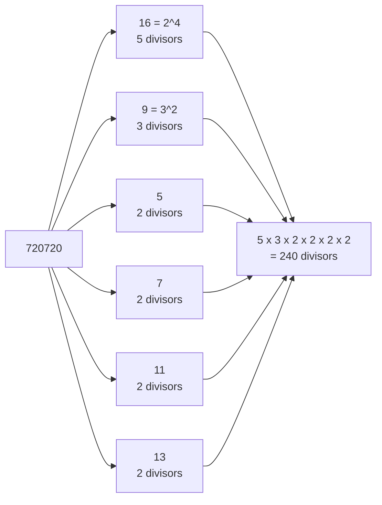

# Multiplicative functions: rules that split across coprime parts, and how to combine them

[Syllabus](../../../SYLLABUS.md) → [Algebraic and analytic number theory](../README.md) → [Arithmetic Functions Again](../README.md#s01) → Multiplicative functions

---

## General Overview

The number 720720 has 240 divisors. No whole number below it has that many, and no number up to a million has more. Four others up to a million tie with it: 831600, 942480, 982800 and 997920.

Listing 240 divisors by hand is slow. The [Counting divisors](../../02-Number%20theory/01-Divisibility%20and%20Primes/08-counting-divisors.md) card gives a shortcut: factor the number into primes, add one to each exponent, and multiply. For 720720 = 2⁴ × 3² × 5 × 7 × 11 × 13 that gives 5 × 3 × 2 × 2 × 2 × 2 = 240.

This card explains why that shortcut works, and why it works for more than counting. 720720 splits into six blocks, 16, 9, 5, 7, 11 and 13, and no two blocks share a prime. The divisor count of the whole is the product of the divisor counts of the blocks. The sum of the divisors splits the same way, and so does Euler's totient, the count of numbers up to n that share no factor with n. A rule that splits like this is called **multiplicative**.

There is also a way to combine two such rules, called **Dirichlet convolution**: add up one rule times the other over every way of writing n as a product of two numbers. Combining two multiplicative rules gives another multiplicative rule. So an identity between multiplicative rules needs checking only on prime powers, numbers like 16 or 13 that have a single prime.

**A multiplicative function is fixed by its values on prime powers, so it can be rebuilt for any number from that number's factorisation; and because Dirichlet convolution keeps this property, identities and inverses can be found one prime at a time.**

**What kind of fact this is:** a theorem, proved on this card in Why it works; "multiplicative" and the convolution are definitions. The checks to a million are evidence that agrees with the proof, not part of it. The claim that 720720 is the smallest number with 240 divisors is a finite count, and the sieve settles it outright.

### The picture: 720720 cut into prime-power blocks



Each block contributes its own count. The blocks share no prime, so the counts multiply.

---

## The formula

Notation first, in words. An **arithmetic function** gives one number for each whole number n = 1, 2, 3, and so on. Two numbers are **coprime** when their greatest common divisor, gcd, is 1: they share no prime. The letter p always means a prime. The mark $`p^a \parallel n`$, read "p to the a exactly divides n", means $`p^a`$ divides n but $`p^{a+1}`$ does not; so $`2^4 \parallel 720720`$.

An arithmetic function f is **multiplicative** when f(1) = 1 and $`f(mn) = f(m)\,f(n)`$ every time m and n are coprime. It is **completely multiplicative** when that product rule holds for all m and n, coprime or not. The main formula rebuilds a multiplicative function from its prime powers:

```math
f(n) = \prod_{p^a \parallel n} f(p^a)
```

**Read it aloud:** f at n is the product of f at each prime-power block of n.

The prime-power values of the four functions on this card:

```math
\tau(p^a) = a + 1, \qquad \sigma_k(p^a) = 1 + p^k + p^{2k} + \dots + p^{ak} = \frac{p^{k(a+1)} - 1}{p^k - 1}, \qquad \varphi(p^a) = p^{a-1}(p - 1)
```

**Read it aloud:** a prime power has one more divisor than its exponent; its divisors' k-th powers form a geometric series; and of the numbers up to $`p^a`$, all but the multiples of p are coprime to it.

Dirichlet convolution is taught on the [Dirichlet series](../../07-Complex%20analysis/09-Special%20Functions%20and%20the%20Zeta%20Function/06-dirichlet-series-and-mobius-inversion.md) card. In one line: $`(f * g)(n)`$ adds $`f(d)\,g(n/d)`$ over every divisor d of n, and that card proves that the convolution of two multiplicative functions is multiplicative. The new work here is the identities and inverses:

```math
\varphi * \mathbf{1} = \mathrm{id}, \qquad f * f^{-1} = \varepsilon, \qquad f^{-1}(n) = -\frac{1}{f(1)} \sum_{d \mid n,\ d < n} f(n/d)\, f^{-1}(d)
```

**Read it aloud:** adding the totient over the divisors of n gives n back; a function convolved with its inverse gives the identity ε; and the inverse at n is built from its values at the smaller divisors.

| Symbol | Plain meaning | In our example | Push it up and the answer… |
| --- | --- | --- | --- |
| $`n`$, $`m`$, $`d`$ | whole numbers; $`d`$ divides $`n`$ | n = 720720; d runs over its 240 divisors | more divisors to add over |
| $`p`$, $`a`$ | a prime and its exponent, with $`p^a \parallel n`$ | 2 and 4, since $`2^4 \parallel 720720`$ | a bigger block, a bigger factor |
| $`\gcd(m, n)`$ | greatest common divisor | gcd(360, 2002) = 2 | above 1, the product rule may fail |
| $`f`$, $`g`$ | arithmetic functions: one number per $`n`$ | τ, σ, φ | — |
| $`f * g`$ | Dirichlet convolution: $`f(d)\,g(n/d)`$ added over divisors | $`(\varphi * \mathbf 1)(720720) = 720720`$ | — |
| $`\mathbf 1`$, $`\mathrm{id}`$, $`\mathrm{id}_k`$, $`\varepsilon`$ | the constant 1; $`\mathrm{id}(n) = n`$; $`\mathrm{id}_k(n) = n^k`$; ε is 1 at 1 and 0 elsewhere | ε is the "do nothing": $`f * \varepsilon = f`$ | — |
| $`\tau`$ | divisor count | τ(720720) = 240 | grows with every exponent |
| $`\sigma_k`$, $`\sigma`$ | sum of the k-th powers of the divisors; $`\sigma = \sigma_1`$ | σ(720720) = 3,249,792; σ₂(720720) = 836,657,822,000 | larger k: the biggest divisors dominate |
| $`\varphi`$ | Euler's totient: numbers up to n coprime to n | φ(720720) = 138,240 | each new prime removes a share |
| $`\mu`$ | Möbius function: $`(-1)^r`$ for r distinct primes, 0 if a square divides | μ(30) = −1 | a repeated prime makes it 0 |
| $`f^{-1}`$ | Dirichlet inverse: $`f * f^{-1} = \varepsilon`$ | $`\varphi^{-1}(720720) = 5760`$ | — |

### When it holds

- **The parts must be coprime.** 360 × 2002 = 720720, but both are even. τ(360) × τ(2002) = 24 × 16 = 384, not 240: the shared 2 is counted twice.
- **f(1) = 1.** The product rule with m = 1 forces f(1) = 1 unless f is zero everywhere. Requiring f(1) = 1 rules out the zero function.
- **Any coprime split works; prime powers are the safe default.** 16 × 45045 works, since those share no prime, but 360 × 2002 does not: gcd(360, 2002) = 2. Splitting all the way to prime-power blocks is coprime by construction.
- **An inverse needs f(1) ≠ 0.** At n = 1 the convolution is $`f(1)\,f^{-1}(1)`$, which must equal 1. Every multiplicative function passes, since f(1) = 1.
- **The shortcut $`f^{-1} = \mu f`$ needs complete multiplicativity.** Here μf is the value-by-value product μ(n) f(n). It gives the inverse of id, but not of τ: τ's inverse at 4 is 1, while μ(4) is 0.

---

## Why it works

### Step 0: a divisor of a coprime product is a divisor of each part, multiplied

Take 720720 = 16 × 45045. Every divisor of 720720 is one divisor of 16 times one divisor of 45045, in exactly one way. That is because the primes of a divisor sort themselves: its 2s go to the 16, the rest to the 45045. Unique factorisation, from wing 02, guarantees the sorting is unique.

So the divisors of 720720 are a grid: 5 choices for the power of 2, 48 for the rest. A sum over the divisors of a multiplicative function's values, such as $`\tau`$, $`\sigma_k`$ or $`\varphi * \mathbf 1`$, splits along that grid. Each grid point's term is a value at a divisor of 16 times a value at a divisor of 45045, and a sum of such products over a grid is the product of the two sums.

### Step 1: a multiplicative function is fixed by its prime powers

Write n as its prime-power blocks, $`n = p_1^{a_1} \cdots p_r^{a_r}`$. The blocks are pairwise coprime. Peel off one block at a time: the first block is coprime to the product of the rest, so f splits there. Repeating r times gives the main formula.

So two multiplicative functions that agree on every prime power agree everywhere. This is the working tool of the card: to prove an identity between multiplicative functions, check it on $`p^a`$ alone.

### Step 2: τ, σ_k and φ are multiplicative, and their prime-power values

- **τ and σ_k.** $`\sigma_k = \mathrm{id}_k * \mathbf 1`$, where $`\mathrm{id}_k(n) = n^k`$ is completely multiplicative. The [Dirichlet series](../../07-Complex%20analysis/09-Special%20Functions%20and%20the%20Zeta%20Function/06-dirichlet-series-and-mobius-inversion.md) card proves convolution keeps multiplicativity, so σ_k is multiplicative; τ is the case k = 0.
- **Their values at $`p^a`$.** The divisors of $`p^a`$ are $`1, p, \dots, p^a`$. There are a + 1 of them, and their k-th powers form a geometric series.
- **φ.** The [Euler's totient](../../02-Number%20theory/04-Powers%20on%20the%20Clock/03-eulers-totient.md) card shows φ splits over coprime parts. Among $`1, \dots, p^a`$, the multiples of p are the ones sharing a factor, and there are $`p^{a-1}`$ of them. That leaves $`p^a - p^{a-1} = p^{a-1}(p-1)`$.

For 720720 the blocks give:

| Block $`p^a`$ | τ | σ | σ₂ | φ |
| --- | ---: | ---: | ---: | ---: |
| 16 | 5 | 31 | 341 | 8 |
| 9 | 3 | 13 | 91 | 6 |
| 5 | 2 | 6 | 26 | 4 |
| 7 | 2 | 8 | 50 | 6 |
| 11 | 2 | 12 | 122 | 10 |
| 13 | 2 | 14 | 170 | 12 |

Multiply down each column to get the value at 720720.

### Step 3: adding φ over the divisors gives n back

Both sides of $`\varphi * \mathbf 1 = \mathrm{id}`$ are multiplicative, so by Step 1 it is enough to check $`p^a`$. The divisors are $`1, p, \dots, p^a`$, and the sum telescopes:

```math
1 + (p - 1) + (p^2 - p) + \dots + (p^a - p^{a-1}) = p^a
```

**Read it aloud:** each bracket cancels the start of the next, and only the top power survives.

At 16 this is 1 + 1 + 2 + 4 + 8 = 16. The other five blocks work the same way, and the product is 720720.

<details>
<summary>A second proof: sort 1 to n by their gcd with n</summary>

Take any m from 1 to n, and let g = gcd(m, n). Write m = g × k. Then k runs from 1 to n/g and shares no factor with n/g.

So the numbers with gcd exactly g are counted by $`\varphi(n/g)`$. Every m has one gcd, which is a divisor of n. Adding over the divisors:

$`\displaystyle n = \sum_{g \mid n} \varphi(n/g) = \sum_{d \mid n} \varphi(d).`$

This road never mentions primes, so it is a true second proof.

</details>

### Step 4: inverses, built from the bottom up

The inverse $`f^{-1}`$ is the function with $`f * f^{-1} = \varepsilon`$. At n = 1 this says $`f(1) f^{-1}(1) = 1`$. At larger n, the term with d = n holds $`f(1) f^{-1}(n)`$, and every other term uses $`f^{-1}`$ at a smaller divisor. So the recursion in The formula fixes $`f^{-1}(n)`$ once the smaller values are known.

If f is multiplicative, so is $`f^{-1}`$, and it can be found one prime at a time.

<details>
<summary>Detailed proof: the inverse of a multiplicative function is multiplicative</summary>

Let f be multiplicative. Define g at prime powers by the recursion at $`p^a`$ alone: g(1) = 1, and for a ≥ 1,

$`\displaystyle g(p^a) = -\sum_{j=1}^{a} f(p^j)\, g(p^{a-j}).`$

Extend g to all n by the main formula, so g is multiplicative. Then $`f * g`$ is multiplicative. At $`p^a`$ with a ≥ 1 its value is $`\sum_{j=0}^{a} f(p^j) g(p^{a-j}) = 0`$, by the choice of g. At 1 it is 1. So $`f * g`$ agrees with ε on all prime powers, and ε is multiplicative, so $`f * g = \varepsilon`$.

The inverse is unique, because the recursion has one answer at each n. So $`f^{-1} = g`$, which is multiplicative.

</details>

Three inverses on this card:

- **The inverse of 1 is μ.** This is the Möbius function, and its uses belong to [The Mobius function](03-mobius-inversion.md).
- **A completely multiplicative f has inverse μf.** $`(\mu f * f)(n)`$ adds $`\mu(d) f(d) f(n/d)`$, and $`f(d) f(n/d) = f(n)`$ for every divisor d, coprime or not. What is left is $`f(n)\sum_{d \mid n}\mu(d) = f(n)\varepsilon(n) = \varepsilon(n)`$. So $`\mathrm{id}^{-1}(30) = \mu(30) \times 30 = -30`$.
- **The inverse of φ.** Möbius inversion of Step 3 gives $`\varphi = \mu * \mathrm{id}`$. Convolution is commutative (swap d and n/d) and associative ([Dirichlet series](../../07-Complex%20analysis/09-Special%20Functions%20and%20the%20Zeta%20Function/06-dirichlet-series-and-mobius-inversion.md) proves it), so the inverse of a convolution is the convolution of the inverses: $`(f * g)^{-1} = f^{-1} * g^{-1}`$. So $`\varphi^{-1} = \mathbf 1 * \mu\,\mathrm{id}`$. At $`p^a`$ that is $`1 + \mu(p)\,p = 1 - p`$, since higher powers of p carry μ = 0. So $`\varphi^{-1}(n)`$ is the product of $`(1 - p)`$ over the distinct primes of n.

For τ = 1 * 1 the same reasoning gives $`\tau^{-1} = \mu * \mu`$. Its values at $`1, p, p^2, p^3`$ are 1, −2, 1, 0, and 0 above that. τ is not completely multiplicative, so μτ is the wrong guess: at 4 it gives 0, not 1.

---

## Worked numbers, by hand

| Step | Arithmetic | Value |
| --- | --- | --- |
| factorise | 720720 = 16 × 9 × 5 × 7 × 11 × 13 | 2⁴ × 3² × 5 × 7 × 11 × 13 |
| τ(720720) | (4 + 1)(2 + 1)(1 + 1)(1 + 1)(1 + 1)(1 + 1) = 5 × 3 × 2 × 2 × 2 × 2 | **240** |
| σ(720720) | 31 × 13 × 6 × 8 × 12 × 14 | **3,249,792** |
| φ(720720) | 8 × 6 × 4 × 6 × 10 × 12 | **138,240** |
| (φ * 1)(16) | 1 + 1 + 2 + 4 + 8 | 16 |
| (φ * 1)(720720) | 16 × 9 × 5 × 7 × 11 × 13 | **720,720** |
| φ⁻¹(720720) | (1 − 2)(1 − 3)(1 − 5)(1 − 7)(1 − 11)(1 − 13) = (−1)(−2)(−4)(−6)(−10)(−12) | **5,760** |

Six small products replace a list of 240 divisors, a sum of 240 numbers and a scan of 720720 numbers for common factors. Only 138,240 of those 720,720 numbers are coprime to it, because it has six small primes.

### What breaks if you drop a piece

| Mistake | Comes out at | What went wrong |
| --- | --- | --- |
| Split 720720 as 360 × 2002 for τ | 24 × 16 = 384, not 240 | Both parts are even, so they are not coprime |
| The same split for φ | 96 × 720 = 69,120, not 138,240 | The shared 2 is thrown out twice |
| φ(p^a) taken as p^a − 1 | 345,600, not 138,240 | That rule is for a prime; at 16 it gives 15, not 8 |
| φ times 1 value by value, not convolved | 138,240, not 720,720 | Convolution adds over all 240 divisor pairs |

The code prints all four.

---

## Code, from first principles, and it actually runs

Nothing is imported. The code takes three independent roads. Road one lists the divisors of 720720 and counts them, adds them and tests all 720720 numbers for a common factor. Road two rebuilds τ, σ, σ₂ and φ from their prime-power values. Road three sieves every n up to a million: τ by adding 1 at every multiple of every d, which is $`\mathbf 1 * \mathbf 1`$ done literally, against τ rebuilt from a smallest-prime-factor table, and φ * 1 against n. The inverses are found by the recursion and checked against their prime-power formulas on all 240 divisors.

### Python

```python
# Multiplicative functions and Dirichlet convolution -- the check behind the card.
# Nothing is imported.  The number is 720720 = 2^4 * 3^2 * 5 * 7 * 11 * 13.
# Road one lists divisors and counts by brute force.  Road two rebuilds each
# function from its values at prime powers.  Road three sieves every n up to a
# million.  Dirichlet inverses come by a recursion and by prime powers.
N0, LIMIT = 720720, 10**6

def gcd(a, b):                                   # Euclid's algorithm, written out
    while b:
        a, b = b, a % b
    return a

def factor(n):                                   # trial division: [(p, a), ...]
    out, p = [], 2
    while p * p <= n:
        a = 0
        while n % p == 0:
            n, a = n // p, a + 1
        if a:
            out.append((p, a))
        p += 1
    return out + [(n, 1)] if n > 1 else out

def divisors(n):                                 # brute force: try every d up to sqrt(n)
    small = [d for d in range(1, int(n ** 0.5) + 1) if n % d == 0]
    return sorted(set(small + [n // d for d in small]))

def rebuild(n, at_pp):                           # product of the values at each p^a exactly dividing n
    out = 1
    for p, a in factor(n):
        out *= at_pp(p, a)
    return out

tau_pp = lambda p, a: a + 1
sigma_pp = lambda p, a: (p ** (a + 1) - 1) // (p - 1)
sigma2_pp = lambda p, a: (p ** (2 * a + 2) - 1) // (p * p - 1)
phi_pp = lambda p, a: p ** (a - 1) * (p - 1)
mu_pp = lambda p, a: -1 if a == 1 else 0

def conv(f, g, n):                               # Dirichlet convolution at n
    return sum(f(d) * g(n // d) for d in divisors(n))

def inverse(f, ds):                              # Dirichlet inverse on a divisor-closed list, f(1) = 1
    inv = {}
    for m in ds:
        inv[m] = 1 if m == 1 else -sum(f(m // d) * inv[d] for d in ds if d < m and m % d == 0)
    return inv

def yn(claim):
    return "yes" if claim else "no"

def first_failure(f, pairs):                     # first pair (m, n) with f(mn) != f(m) f(n)
    for m, n in pairs:
        if f(m * n) != f(m) * f(n):
            return f"no, {m} x {n} gives {f(m * n)} against {f(m) * f(n)}"
    return "yes"

ds = divisors(N0)
brute = {"tau": len(ds), "sigma": sum(ds), "sigma_2": sum(d * d for d in ds),
         "phi": sum(1 for m in range(1, N0 + 1) if gcd(m, N0) == 1)}
pp = {"tau": tau_pp, "sigma": sigma_pp, "sigma_2": sigma2_pp, "phi": phi_pp}
print(f"720720 = {' * '.join(f'{p}^{a}' for p, a in factor(N0))}")
print("p^a   tau  sigma  sigma_2  phi")
for p, a in factor(N0):
    print(f"{p ** a:<5} {tau_pp(p, a):>3} {sigma_pp(p, a):>6} {sigma2_pp(p, a):>8} {phi_pp(p, a):>4}")
for name in brute:
    print(f"{name}(720720): by listing {brute[name]}, from prime powers {rebuild(N0, pp[name])}")
    assert brute[name] == rebuild(N0, pp[name])         # road one against road two, four functions
print(f"720720 = 16 x {N0 // 16}: {len(ds)} divisors = 5 x {len(divisors(N0 // 16))}; gcd(360, 2002) = {gcd(360, 2002)}")

tau = [0] * (LIMIT + 1)                          # road three: 1 * 1 summed literally, for every n
for d in range(1, LIMIT + 1):
    for m in range(d, LIMIT + 1, d):
        tau[m] += 1
spf = list(range(LIMIT + 1))                     # smallest prime factor of every n
for p in range(2, int(LIMIT ** 0.5) + 1):
    if spf[p] == p:
        for m in range(p * p, LIMIT + 1, p):
            if spf[m] == m:
                spf[m] = p
phi = list(range(LIMIT + 1))                     # phi by the product sieve: n times (1 - 1/p)
for p in range(2, LIMIT + 1):
    if spf[p] == p:
        for m in range(p, LIMIT + 1, p):
            phi[m] -= phi[m] // p
phi_sum = [0] * (LIMIT + 1)                      # (phi * 1)(n), summed literally
for d in range(1, LIMIT + 1):
    for m in range(d, LIMIT + 1, d):
        phi_sum[m] += phi[d]

def tau_from_spf(n):                             # road two again, using the smallest-factor table
    out = 1
    while n > 1:
        p, a = spf[n], 0
        while n % p == 0:
            n, a = n // p, a + 1
        out *= a + 1
    return out

coprime = [(m, n) for m in range(2, 101) for n in range(m, 101) if gcd(m, n) == 1]
every = [(m, n) for m in range(2, 101) for n in range(m, 101)]
omega = lambda n: len(factor(n))
print("f(mn) = f(m) f(n) on all coprime m, n up to 100:")
for name, f in [("tau", lambda n: tau[n]), ("sigma", lambda n: rebuild(n, sigma_pp)),
                ("phi", lambda n: phi[n]), ("n + 1", lambda n: n + 1), ("distinct-prime count", omega)]:
    print(f"  {name}: {first_failure(f, coprime)}")
print("f(mn) = f(m) f(n) on all m, n up to 100, coprime or not:")
print(f"  n^2: {first_failure(lambda n: n * n, every)}; tau: {first_failure(lambda n: tau[n], every)}")
agree = all(tau[n] == tau_from_spf(n) for n in range(1, LIMIT + 1))
top = max(tau)
champs = [n for n in range(1, LIMIT + 1) if tau[n] == top]
print(f"tau to 1000000, divisor sieve against prime-power rebuild: {'all agree' if agree else 'MISMATCH'}")
print(f"largest tau to 1000000: {top}, at {champs}")
print(f"(phi * 1)(720720) over its {len(ds)} divisors: {conv(lambda n: phi[n], lambda n: 1, N0)}")
print(f"(phi * 1)(n) = n for every n to 1000000: {yn(all(phi_sum[n] == n for n in range(1, LIMIT + 1)))}")
print(f"(id * 1)(720720) = {conv(lambda n: n, lambda n: 1, N0)}; (1 * 1)(720720) = {conv(lambda n: 1, lambda n: 1, N0)}")
assert agree and champs[0] == N0 and top == brute["tau"]                 # sieve against rebuild
assert all(phi_sum[n] == n for n in range(1, LIMIT + 1))                 # phi * 1 = id, every n
assert conv(lambda n: n, lambda n: 1, N0) == rebuild(N0, sigma_pp) == 3249792   # id * 1 against prime powers

inv_phi, inv_tau, inv_one, inv_id = [inverse(f, ds) for f in (lambda n: phi[n], lambda n: tau[n], lambda n: 1, lambda n: n)]
print(f"at 1, 2, 4, 8, 16: phi {[phi[2 ** k] for k in range(5)]}, tau inverse by recursion {[inv_tau[2 ** k] for k in range(5)]}")
print(f"phi inverse at 720720: by recursion {inv_phi[N0]}, product of (1 - p) {rebuild(N0, lambda p, a: 1 - p)}")
print(f"id inverse at 30: {inv_id[30]}; 1's inverse at 30: {inv_one[30]}")
eps = lambda n: 1 if n == 1 else 0
checks = [all(inv_phi[d] == rebuild(d, lambda p, a: 1 - p) for d in ds),
          all(inv_tau[d] == rebuild(d, lambda p, a: [1, -2, 1][a] if a < 3 else 0) for d in ds),
          all(inv_one[d] == rebuild(d, mu_pp) for d in ds),
          all(inv_id[d] == d * rebuild(d, mu_pp) for d in ds),
          all(conv(lambda n: phi[n], lambda n: inv_phi[n], d) == eps(d) for d in ds)]
print(f"recursion against prime powers on all 240 divisors (phi, tau, 1, id), and phi * inverse = epsilon: {' '.join(yn(c) for c in checks)}")
assert all(checks)                                                       # two roads to each inverse

print(f"mistake 1, tau(360) x tau(2002) = {tau[360]} x {tau[2002]} = {tau[360] * tau[2002]}, not {tau[N0]}")
print(f"mistake 2, phi(360) x phi(2002) = {phi[360]} x {phi[2002]} = {phi[360] * phi[2002]}, not {phi[N0]}")
print(f"mistake 3, phi(p^a) taken as p^a - 1: {rebuild(N0, lambda p, a: p ** a - 1)}, not {phi[N0]}")
print(f"mistake 4, phi times 1 value by value: {phi[N0] * 1} at 720720, not {phi_sum[N0]}")
print("ALL CHECKS PASS")
```

**Ran 2026-11-15 on macOS, Python 3.14.10, standard library only. All checks passed. Output, pasted from the run:**

```
720720 = 2^4 * 3^2 * 5^1 * 7^1 * 11^1 * 13^1
p^a   tau  sigma  sigma_2  phi
16      5     31      341    8
9       3     13       91    6
5       2      6       26    4
7       2      8       50    6
11      2     12      122   10
13      2     14      170   12
tau(720720): by listing 240, from prime powers 240
sigma(720720): by listing 3249792, from prime powers 3249792
sigma_2(720720): by listing 836657822000, from prime powers 836657822000
phi(720720): by listing 138240, from prime powers 138240
720720 = 16 x 45045: 240 divisors = 5 x 48; gcd(360, 2002) = 2
f(mn) = f(m) f(n) on all coprime m, n up to 100:
  tau: yes
  sigma: yes
  phi: yes
  n + 1: no, 2 x 3 gives 7 against 12
  distinct-prime count: no, 2 x 3 gives 2 against 1
f(mn) = f(m) f(n) on all m, n up to 100, coprime or not:
  n^2: yes; tau: no, 2 x 2 gives 3 against 4
tau to 1000000, divisor sieve against prime-power rebuild: all agree
largest tau to 1000000: 240, at [720720, 831600, 942480, 982800, 997920]
(phi * 1)(720720) over its 240 divisors: 720720
(phi * 1)(n) = n for every n to 1000000: yes
(id * 1)(720720) = 3249792; (1 * 1)(720720) = 240
at 1, 2, 4, 8, 16: phi [1, 1, 2, 4, 8], tau inverse by recursion [1, -2, 1, 0, 0]
phi inverse at 720720: by recursion 5760, product of (1 - p) 5760
id inverse at 30: -30; 1's inverse at 30: -1
recursion against prime powers on all 240 divisors (phi, tau, 1, id), and phi * inverse = epsilon: yes yes yes yes yes
mistake 1, tau(360) x tau(2002) = 24 x 16 = 384, not 240
mistake 2, phi(360) x phi(2002) = 96 x 720 = 69120, not 138240
mistake 3, phi(p^a) taken as p^a - 1: 345600, not 138240
mistake 4, phi times 1 value by value: 138240 at 720720, not 720720
ALL CHECKS PASS
```

### Rust

Same numbers, same labels, built with `rustc --edition 2021 -O`.

```rust
// Multiplicative functions and Dirichlet convolution -- the same check as the
// Python, in Rust.  No crates.  The number is 720720 = 2^4 * 3^2 * 5 * 7 * 11 * 13.
// Road one lists divisors and counts by brute force.  Road two rebuilds each
// function from its values at prime powers.  Road three sieves every n up to a
// million.  Dirichlet inverses come by a recursion and by prime powers.
const N0: i64 = 720720;
const LIMIT: usize = 1_000_000;

fn gcd(mut a: i64, mut b: i64) -> i64 {          // Euclid's algorithm, written out
    while b != 0 { (a, b) = (b, a % b) }
    a
}

fn factor(mut n: i64) -> Vec<(i64, u32)> {       // trial division: [(p, a), ...]
    let (mut out, mut p) = (Vec::new(), 2);
    while p * p <= n {
        let mut a = 0;
        while n % p == 0 { n /= p; a += 1 }
        if a > 0 { out.push((p, a)) }
        p += 1;
    }
    if n > 1 { out.push((n, 1)) }
    out
}

fn divisors(n: i64) -> Vec<i64> {                // brute force: try every d up to sqrt(n)
    let mut out = Vec::new();
    let mut d = 1;
    while d * d <= n {
        if n % d == 0 { out.push(d); if d * d != n { out.push(n / d) } }
        d += 1;
    }
    out.sort();
    out
}

fn rebuild(n: i64, at_pp: &dyn Fn(i64, u32) -> i64) -> i64 {   // product over p^a exactly dividing n
    factor(n).iter().map(|&(p, a)| at_pp(p, a)).product()
}

fn tau_pp(_p: i64, a: u32) -> i64 { a as i64 + 1 }
fn sigma_pp(p: i64, a: u32) -> i64 { (p.pow(a + 1) - 1) / (p - 1) }
fn sigma2_pp(p: i64, a: u32) -> i64 { (p.pow(2 * a + 2) - 1) / (p * p - 1) }
fn phi_pp(p: i64, a: u32) -> i64 { p.pow(a - 1) * (p - 1) }
fn mu_pp(_p: i64, a: u32) -> i64 { if a == 1 { -1 } else { 0 } }

fn conv(f: &dyn Fn(i64) -> i64, g: &dyn Fn(i64) -> i64, n: i64) -> i64 {   // Dirichlet convolution at n
    divisors(n).iter().map(|&d| f(d) * g(n / d)).sum()
}

fn inverse(f: &dyn Fn(i64) -> i64, ds: &[i64]) -> std::collections::HashMap<i64, i64> {
    let mut inv = std::collections::HashMap::new();   // Dirichlet inverse, f(1) = 1
    for &m in ds {
        let v = if m == 1 { 1 } else {
            -ds.iter().filter(|&&d| d < m && m % d == 0).map(|&d| f(m / d) * inv[&d]).sum::<i64>()
        };
        inv.insert(m, v);
    }
    inv
}

fn yn(claim: bool) -> &'static str { if claim { "yes" } else { "no" } }

fn first_failure(f: &dyn Fn(i64) -> i64, pairs: &[(i64, i64)]) -> String {
    for &(m, n) in pairs {
        if f(m * n) != f(m) * f(n) {
            return format!("no, {} x {} gives {} against {}", m, n, f(m * n), f(m) * f(n));
        }
    }
    "yes".to_string()
}

fn main() {
    let ds = divisors(N0);
    let names = ["tau", "sigma", "sigma_2", "phi"];
    let brute = [ds.len() as i64, ds.iter().sum(), ds.iter().map(|d| d * d).sum(),
                 (1..=N0).filter(|&m| gcd(m, N0) == 1).count() as i64];
    let pps: [&dyn Fn(i64, u32) -> i64; 4] = [&tau_pp, &sigma_pp, &sigma2_pp, &phi_pp];
    let fs = factor(N0);
    let parts: Vec<String> = fs.iter().map(|(p, a)| format!("{}^{}", p, a)).collect();
    println!("720720 = {}", parts.join(" * "));
    println!("p^a   tau  sigma  sigma_2  phi");
    for &(p, a) in &fs {
        println!("{:<5} {:>3} {:>6} {:>8} {:>4}", p.pow(a), tau_pp(p, a), sigma_pp(p, a), sigma2_pp(p, a), phi_pp(p, a));
    }
    for i in 0..4 {
        let r = rebuild(N0, pps[i]);
        println!("{}(720720): by listing {}, from prime powers {}", names[i], brute[i], r);
        assert!(brute[i] == r);                       // road one against road two, four functions
    }
    println!("720720 = 16 x {}: {} divisors = 5 x {}; gcd(360, 2002) = {}", N0 / 16, ds.len(), divisors(N0 / 16).len(), gcd(360, 2002));

    let mut tau = vec![0i64; LIMIT + 1];              // road three: 1 * 1 summed literally
    for d in 1..=LIMIT { let mut m = d; while m <= LIMIT { tau[m] += 1; m += d } }
    let mut spf: Vec<usize> = (0..=LIMIT).collect();  // smallest prime factor of every n
    let mut p = 2;
    while p * p <= LIMIT {
        if spf[p] == p { let mut m = p * p; while m <= LIMIT { if spf[m] == m { spf[m] = p } m += p } }
        p += 1;
    }
    let mut phi: Vec<i64> = (0..=LIMIT as i64).collect();   // phi by the product sieve
    for p in 2..=LIMIT {
        if spf[p] == p { let mut m = p; while m <= LIMIT { phi[m] -= phi[m] / p as i64; m += p } }
    }
    let mut phi_sum = vec![0i64; LIMIT + 1];          // (phi * 1)(n), summed literally
    for d in 1..=LIMIT { let mut m = d; while m <= LIMIT { phi_sum[m] += phi[d]; m += d } }
    let tau_from_spf = |mut n: usize| -> i64 {        // road two again, from the smallest-factor table
        let mut out = 1;
        while n > 1 { let (p, mut a) = (spf[n], 0); while n % p == 0 { n /= p; a += 1 } out *= a + 1 }
        out
    };

    let mut coprime = Vec::new();
    let mut every = Vec::new();
    for m in 2..=100i64 { for n in m..=100 { every.push((m, n)); if gcd(m, n) == 1 { coprime.push((m, n)) } } }
    let tf = |n: i64| tau[n as usize];
    let pf = |n: i64| phi[n as usize];
    let sf = |n: i64| rebuild(n, &sigma_pp);
    let np1 = |n: i64| n + 1;
    let omega = |n: i64| factor(n).len() as i64;
    let cands: [(&str, &dyn Fn(i64) -> i64); 5] =
        [("tau", &tf), ("sigma", &sf), ("phi", &pf), ("n + 1", &np1), ("distinct-prime count", &omega)];
    println!("f(mn) = f(m) f(n) on all coprime m, n up to 100:");
    for (name, f) in cands.iter() { println!("  {}: {}", name, first_failure(*f, &coprime)) }
    println!("f(mn) = f(m) f(n) on all m, n up to 100, coprime or not:");
    println!("  n^2: {}; tau: {}", first_failure(&|n| n * n, &every), first_failure(&tf, &every));
    let agree = (1..=LIMIT).all(|n| tau[n] == tau_from_spf(n));
    let top = *tau.iter().max().unwrap();
    let champs: Vec<usize> = (1..=LIMIT).filter(|&n| tau[n] == top).collect();
    let id_all = (1..=LIMIT).all(|n| phi_sum[n] == n as i64);
    let one = |_n: i64| 1i64;
    let id = |n: i64| n;
    println!("tau to 1000000, divisor sieve against prime-power rebuild: {}", if agree { "all agree" } else { "MISMATCH" });
    println!("largest tau to 1000000: {}, at {:?}", top, champs);
    println!("(phi * 1)(720720) over its {} divisors: {}", ds.len(), conv(&pf, &one, N0));
    println!("(phi * 1)(n) = n for every n to 1000000: {}", yn(id_all));
    println!("(id * 1)(720720) = {}; (1 * 1)(720720) = {}", conv(&id, &one, N0), conv(&one, &one, N0));
    assert!(agree && champs[0] as i64 == N0 && top == brute[0]);      // sieve against rebuild
    assert!(id_all);                                                  // phi * 1 = id, every n
    let sigma_pp_n0 = rebuild(N0, &sigma_pp);
    assert!(conv(&id, &one, N0) == sigma_pp_n0 && sigma_pp_n0 == 3249792);   // id * 1 against prime powers

    let (inv_phi, inv_tau, inv_one, inv_id) = (inverse(&pf, &ds), inverse(&tf, &ds), inverse(&one, &ds), inverse(&id, &ds));
    let one_minus_p = |p: i64, _a: u32| 1 - p;
    let tau_inv_pp = |_p: i64, a: u32| if a < 3 { [1, -2, 1][a as usize] } else { 0 };
    let tv: Vec<i64> = (0..5).map(|k| inv_tau[&(1i64 << k)]).collect();
    let pv: Vec<i64> = (0..5).map(|k| phi[1usize << k]).collect();
    println!("at 1, 2, 4, 8, 16: phi {:?}, tau inverse by recursion {:?}", pv, tv);
    println!("phi inverse at 720720: by recursion {}, product of (1 - p) {}", inv_phi[&N0], rebuild(N0, &one_minus_p));
    println!("id inverse at 30: {}; 1's inverse at 30: {}", inv_id[&30], inv_one[&30]);
    let checks = [ds.iter().all(|&d| inv_phi[&d] == rebuild(d, &one_minus_p)),
                  ds.iter().all(|&d| inv_tau[&d] == rebuild(d, &tau_inv_pp)),
                  ds.iter().all(|&d| inv_one[&d] == rebuild(d, &mu_pp)),
                  ds.iter().all(|&d| inv_id[&d] == d * rebuild(d, &mu_pp)),
                  ds.iter().all(|&d| conv(&pf, &|n| inv_phi[&n], d) == if d == 1 { 1 } else { 0 })];
    let words: Vec<&str> = checks.iter().map(|&c| yn(c)).collect();
    println!("recursion against prime powers on all 240 divisors (phi, tau, 1, id), and phi * inverse = epsilon: {}", words.join(" "));
    assert!(checks.iter().all(|&c| c));                               // two roads to each inverse

    println!("mistake 1, tau(360) x tau(2002) = {} x {} = {}, not {}", tau[360], tau[2002], tau[360] * tau[2002], tau[N0 as usize]);
    println!("mistake 2, phi(360) x phi(2002) = {} x {} = {}, not {}", phi[360], phi[2002], phi[360] * phi[2002], phi[N0 as usize]);
    println!("mistake 3, phi(p^a) taken as p^a - 1: {}, not {}", rebuild(N0, &|p, a| p.pow(a) - 1), phi[N0 as usize]);
    println!("mistake 4, phi times 1 value by value: {} at 720720, not {}", phi[N0 as usize] * 1, phi_sum[N0 as usize]);
    println!("ALL CHECKS PASS");
}
```

**Ran 2026-11-15 on macOS, rustc 1.98.1, no crates. All checks passed. Output, pasted from the run:**

```
720720 = 2^4 * 3^2 * 5^1 * 7^1 * 11^1 * 13^1
p^a   tau  sigma  sigma_2  phi
16      5     31      341    8
9       3     13       91    6
5       2      6       26    4
7       2      8       50    6
11      2     12      122   10
13      2     14      170   12
tau(720720): by listing 240, from prime powers 240
sigma(720720): by listing 3249792, from prime powers 3249792
sigma_2(720720): by listing 836657822000, from prime powers 836657822000
phi(720720): by listing 138240, from prime powers 138240
720720 = 16 x 45045: 240 divisors = 5 x 48; gcd(360, 2002) = 2
f(mn) = f(m) f(n) on all coprime m, n up to 100:
  tau: yes
  sigma: yes
  phi: yes
  n + 1: no, 2 x 3 gives 7 against 12
  distinct-prime count: no, 2 x 3 gives 2 against 1
f(mn) = f(m) f(n) on all m, n up to 100, coprime or not:
  n^2: yes; tau: no, 2 x 2 gives 3 against 4
tau to 1000000, divisor sieve against prime-power rebuild: all agree
largest tau to 1000000: 240, at [720720, 831600, 942480, 982800, 997920]
(phi * 1)(720720) over its 240 divisors: 720720
(phi * 1)(n) = n for every n to 1000000: yes
(id * 1)(720720) = 3249792; (1 * 1)(720720) = 240
at 1, 2, 4, 8, 16: phi [1, 1, 2, 4, 8], tau inverse by recursion [1, -2, 1, 0, 0]
phi inverse at 720720: by recursion 5760, product of (1 - p) 5760
id inverse at 30: -30; 1's inverse at 30: -1
recursion against prime powers on all 240 divisors (phi, tau, 1, id), and phi * inverse = epsilon: yes yes yes yes yes
mistake 1, tau(360) x tau(2002) = 24 x 16 = 384, not 240
mistake 2, phi(360) x phi(2002) = 96 x 720 = 69120, not 138240
mistake 3, phi(p^a) taken as p^a - 1: 345600, not 138240
mistake 4, phi times 1 value by value: 138240 at 720720, not 720720
ALL CHECKS PASS
```

The two outputs match line for line.

### Lean

Lean proves the three theorems of Why it works for every whole number, and checks the worked numbers for 720720.

- Take a multiplicative f and any whole number n ≥ 1. Then f(n) is the product of f at each prime-power block of n.
- Adding φ over the divisors of n gives n back, for every n ≥ 1: φ * 1 = id.
- Suppose f is multiplicative and f * g = ε. Then g, the inverse of f, is multiplicative too.
- The six blocks 16, 9, 5, 7, 11 and 13 multiply back to 720720, and 16 × 45045 is a coprime split.
- Every value in the Step 2 table checks, and so do the four column products.
- At 720720 itself, τ = 240, σ = 3,249,792, σ₂ = 836,657,822,000 and φ = 138,240 check, each found from the blocks.
- 45045 has 48 divisors, and (φ * 1)(16) = 1 + 1 + 2 + 4 + 8 = 16.
- The product of the six brackets (1 − p) is 5,760, and μ(30) × 30 = −30.
- μ * μ takes the values 1, −2, 1, 0 at 1, 2, 4, 8, and μτ at 4 is 0.
- The broken versions come out at 384, 69,120 and 345,600, not 240 or 138,240.

The sieve to a million, the product-rule tests up to 100 and the inverse recursion are left to the Python and Rust checks.

```lean
-- Multiplicative functions: a multiplicative function is fixed by its values on prime powers, adding Euler's totient over the divisors of n gives n back, and the Dirichlet inverse of a multiplicative function is again multiplicative.
import Mathlib.NumberTheory.ArithmeticFunction.Misc
import Mathlib.NumberTheory.ArithmeticFunction.Moebius
import Mathlib.Data.Nat.Totient
import Mathlib.Tactic.NormNum.Prime

open Finset ArithmeticFunction
open scoped ArithmeticFunction.Moebius

/-- Helper: a multiplicative function at 720720 is the product of its values on the six
prime-power blocks 16, 9, 5, 7, 11, 13. -/
theorem mult_720720 {R : Type*} [CommMonoidWithZero R] (f : ArithmeticFunction R)
    (hf : f.IsMultiplicative) : f 720720 = f 16 * f 9 * f 5 * f 7 * f 11 * f 13 := by
  rw [show (720720 : ℕ) = 16 * (9 * (5 * (7 * (11 * 13)))) by norm_num,
    hf.map_mul_of_coprime (by decide), hf.map_mul_of_coprime (by decide),
    hf.map_mul_of_coprime (by decide), hf.map_mul_of_coprime (by decide),
    hf.map_mul_of_coprime (by decide)]
  simp only [mul_assoc]

/-- Helper: the totient of 720720 is the product of the totients of its six prime-power blocks. -/
theorem totient_720720 : Nat.totient 720720 =
    Nat.totient 16 * Nat.totient 9 * Nat.totient 5 * Nat.totient 7 * Nat.totient 11 *
      Nat.totient 13 := by
  rw [show (720720 : ℕ) = 16 * (9 * (5 * (7 * (11 * 13)))) by norm_num,
    Nat.totient_mul (by decide), Nat.totient_mul (by decide),
    Nat.totient_mul (by decide), Nat.totient_mul (by decide),
    Nat.totient_mul (by decide)]
  simp only [mul_assoc]

/-- A multiplicative function is fixed by its prime powers. Let f be an arithmetic function with
f(1) = 1 and f(mn) = f(m) f(n) whenever m and n are coprime. Then for every whole number n ≥ 1,
f(n) is the product of f(p^a) over the prime-power blocks p^a of n, where a is the exponent of
the prime p in n (so p^a exactly divides n). -/
theorem multiplicative_eq_prod_over_prime_power_blocks {R : Type*} [CommRing R]
    (f : ArithmeticFunction R) (hf : f.IsMultiplicative) {n : ℕ} (hn : 0 < n) :
    f n = ∏ p ∈ n.primeFactors, f (p ^ n.factorization p) := by
  exact IsMultiplicative.multiplicative_factorization f hf hn.ne'

/-- Adding Euler's totient over the divisors gives n back, φ * 1 = id: for every whole number
n ≥ 1, the sum of φ(d) over all divisors d of n equals n. -/
theorem sum_totient_over_divisors_eq_self (n : ℕ) (hn : 0 < n) :
    ∑ d ∈ n.divisors, Nat.totient d = n := by
  exact Nat.sum_totient n

/-- The inverse of a multiplicative function is multiplicative. If f is multiplicative and g is
its Dirichlet inverse, meaning f * g = ε (Mathlib's `1` for arithmetic functions: 1 at 1 and 0
elsewhere), then g is multiplicative too, so it can be found one prime at a time. -/
theorem dirichlet_inverse_of_multiplicative_is_multiplicative {R : Type*} [CommRing R]
    (f g : ArithmeticFunction R) (hf : f.IsMultiplicative) (hfg : f * g = 1) :
    g.IsMultiplicative := by
  classical
  have hg1 : g 1 = 1 := by
    have h1 := congrArg (fun F : ArithmeticFunction R => F 1) hfg
    simpa [mul_apply, hf.map_one] using h1
  obtain ⟨h, hdef⟩ : ∃ h : ArithmeticFunction R,
      ∀ n, n ≠ 0 → h n = n.factorization.prod fun p k => g (p ^ k) :=
    ⟨⟨fun n => if n = 0 then 0 else n.factorization.prod fun p k => g (p ^ k), by simp⟩,
      fun n hn => ite_eq_right_of_eq_false _ _ (eq_false hn)⟩
  have hh : h.IsMultiplicative := by
    rw [IsMultiplicative.iff_ne_zero]
    refine ⟨by rw [hdef 1 one_ne_zero]; simp, ?_⟩
    intro m n hm hn hmn
    rw [hdef _ (mul_ne_zero hm hn), hdef m hm, hdef n hn, Nat.factorization_mul_of_coprime hmn,
      Finsupp.prod_add_index_of_disjoint]
    simpa [Nat.support_factorization] using hmn.disjoint_primeFactors
  have hpow : ∀ p j : ℕ, p.Prime → h (p ^ j) = g (p ^ j) := by
    intro p j hp
    rw [hdef _ (pow_ne_zero _ hp.ne_zero), hp.factorization_pow,
      Finsupp.prod_single_index (by simpa using hg1)]
  have hfh : f * h = 1 := by
    rw [IsMultiplicative.eq_iff_eq_on_prime_powers _ (hf.mul hh) _ isMultiplicative_one]
    intro p i hp
    rw [← hfg, mul_apply, mul_apply]
    refine Finset.sum_congr rfl fun x hx => ?_
    rw [Nat.mem_divisorsAntidiagonal] at hx
    obtain ⟨j, -, hj⟩ := (Nat.dvd_prime_pow hp).1 (Dvd.intro_left _ hx.1)
    rw [hj, hpow p j hp]
  have hgh : g = h := by
    calc g = g * (f * h) := by rw [hfh, mul_one]
      _ = (f * g) * h := by rw [← mul_assoc, mul_comm g f]
      _ = h := by rw [hfg, one_mul]
  rw [hgh]
  exact hh

-- 720720 cut into prime-power blocks: 2^4 × 3^2 × 5 × 7 × 11 × 13 = 16 × 9 × 5 × 7 × 11 × 13.
example : (720720 : ℕ) = 2 ^ 4 * 3 ^ 2 * 5 * 7 * 11 * 13 ∧ (720720 : ℕ) = 16 * 9 * 5 * 7 * 11 * 13 := by
  norm_num
-- The blocks share no prime, and 720720 = 16 × 45045 is a coprime split.
example : Nat.Coprime 16 45045 ∧ 16 * 45045 = 720720 := by decide
-- The block 16: τ = 5, σ = 31, σ₂ = 341, φ = 8.
example : #(Nat.divisors 16) = 5 ∧ ∑ d ∈ Nat.divisors 16, d = 31 ∧
    ∑ d ∈ Nat.divisors 16, d ^ 2 = 341 ∧ Nat.totient 16 = 8 := by decide
-- The block 9: τ = 3, σ = 13, σ₂ = 91, φ = 6.
example : #(Nat.divisors 9) = 3 ∧ ∑ d ∈ Nat.divisors 9, d = 13 ∧
    ∑ d ∈ Nat.divisors 9, d ^ 2 = 91 ∧ Nat.totient 9 = 6 := by decide
-- The four prime blocks 5, 7, 11, 13: τ = 2; σ = 6, 8, 12, 14; σ₂ = 26, 50, 122, 170; φ = 4, 6, 10, 12.
example : #(Nat.divisors 5) = 2 ∧ ∑ d ∈ Nat.divisors 5, d = 6 ∧
    ∑ d ∈ Nat.divisors 5, d ^ 2 = 26 ∧ Nat.totient 5 = 4 := by decide
example : #(Nat.divisors 7) = 2 ∧ ∑ d ∈ Nat.divisors 7, d = 8 ∧
    ∑ d ∈ Nat.divisors 7, d ^ 2 = 50 ∧ Nat.totient 7 = 6 := by decide
example : #(Nat.divisors 11) = 2 ∧ ∑ d ∈ Nat.divisors 11, d = 12 ∧
    ∑ d ∈ Nat.divisors 11, d ^ 2 = 122 ∧ Nat.totient 11 = 10 := by decide
example : #(Nat.divisors 13) = 2 ∧ ∑ d ∈ Nat.divisors 13, d = 14 ∧
    ∑ d ∈ Nat.divisors 13, d ^ 2 = 170 ∧ Nat.totient 13 = 12 := by decide
-- Multiply down each column: 240, 3,249,792, 836,657,822,000 and 138,240.
example : 5 * 3 * 2 * 2 * 2 * 2 = 240 ∧ 31 * 13 * 6 * 8 * 12 * 14 = 3249792 ∧
    341 * 91 * 26 * 50 * 122 * 170 = 836657822000 ∧ 8 * 6 * 4 * 6 * 10 * 12 = 138240 := by
  norm_num
-- The values at 720720 itself: τ = 240, σ = 3,249,792, σ₂ = 836,657,822,000, φ = 138,240.
example : #(Nat.divisors 720720) = 240 := by
  rw [← sigma_zero_apply, mult_720720 _ isMultiplicative_sigma]
  simp only [sigma_zero_apply]
  decide
example : ∑ d ∈ Nat.divisors 720720, d = 3249792 := by
  rw [← sigma_one_apply, mult_720720 _ isMultiplicative_sigma]
  simp only [sigma_one_apply]
  decide
example : ∑ d ∈ Nat.divisors 720720, d ^ 2 = 836657822000 := by
  rw [← sigma_apply, mult_720720 _ isMultiplicative_sigma]
  simp only [sigma_apply]
  decide
example : Nat.totient 720720 = 138240 := by
  rw [totient_720720]
  decide
-- 720720 = 16 × 45045: 240 divisors = 5 × 48.
example : #(Nat.divisors 45045) = 48 := by decide +kernel
-- (φ * 1)(16) = 1 + 1 + 2 + 4 + 8 = 16, and the six blocks multiply back to 720720.
example : ∑ d ∈ Nat.divisors 16, Nat.totient d = 16 ∧ 1 + 1 + 2 + 4 + 8 = 16 := by decide
example : 16 * 9 * 5 * 7 * 11 * 13 = 720720 := by norm_num
-- φ⁻¹(720720) = (1 − 2)(1 − 3)(1 − 5)(1 − 7)(1 − 11)(1 − 13) = 5760.
example : ((1 - 2) * (1 - 3) * (1 - 5) * (1 - 7) * (1 - 11) * (1 - 13) : ℤ) = 5760 ∧
    ((-1) * (-2) * (-4) * (-6) * (-10) * (-12) : ℤ) = 5760 := by norm_num
-- id⁻¹(30) = μ(30) × 30 = −30.
example : μ 30 * 30 = -30 := by decide +kernel
-- τ⁻¹ = μ * μ takes the values 1, −2, 1, 0 at 1, 2, 4, 8; μτ at 4 gives 0, not 1.
example : ((μ : ArithmeticFunction ℤ) * μ) 1 = 1 ∧ ((μ : ArithmeticFunction ℤ) * μ) 2 = -2 ∧
    ((μ : ArithmeticFunction ℤ) * μ) 4 = 1 ∧ ((μ : ArithmeticFunction ℤ) * μ) 8 = 0 := by
  decide +kernel
example : μ 4 * (#(Nat.divisors 4) : ℤ) = 0 := by decide +kernel
-- What breaks: 360 × 2002 = 720720 but gcd(360, 2002) = 2, and τ(360) × τ(2002) = 24 × 16 = 384.
example : 360 * 2002 = 720720 ∧ Nat.gcd 360 2002 = 2 := by decide
example : #(Nat.divisors 360) = 24 ∧ #(Nat.divisors 2002) = 16 ∧ 24 * 16 = 384 := by decide +kernel
-- The same split for φ: φ(360) × φ(2002) = 96 × 720 = 69,120, not 138,240.
example : Nat.totient 360 = 96 ∧ Nat.totient 2002 = 720 ∧ 96 * 720 = 69120 := by decide +kernel
-- φ(p^a) taken as p^a − 1: 15 × 8 × 4 × 6 × 10 × 12 = 345,600.
example : 15 * 8 * 4 * 6 * 10 * 12 = 345600 := by norm_num

#print axioms mult_720720
#print axioms totient_720720
#print axioms multiplicative_eq_prod_over_prime_power_blocks
#print axioms sum_totient_over_divisors_eq_self
#print axioms dirichlet_inverse_of_multiplicative_is_multiplicative
```

**Checked 2026-11-15 on macOS, Lean 4.36.0-rc2, Mathlib v4.36.0-rc2. Every proof is complete and uses only Lean's standard axioms. Output, pasted from the run:**

```
'mult_720720' depends on axioms: [propext]
'totient_720720' depends on axioms: [propext, Classical.choice, Quot.sound]
'multiplicative_eq_prod_over_prime_power_blocks' depends on axioms: [propext, Classical.choice, Quot.sound]
'sum_totient_over_divisors_eq_self' depends on axioms: [propext, Classical.choice, Quot.sound]
'dirichlet_inverse_of_multiplicative_is_multiplicative' depends on axioms: [propext, Classical.choice, Quot.sound]
```

> [!TIP]
> **Try changing**
> Guess first, then run it.
> - **Another 240-divisor number.** Set `N0` to 831600. Guess τ, then check: 2⁴ × 3³ × 5² × 7 × 11 gives 5 × 4 × 3 × 2 × 2 = 240, and φ comes out at 172,800. The labels still say 720720. The sieve assert then stops the run, because 720720 is still the smallest.
> - **Test a new rule.** Add `("2^count", lambda n: 2 ** omega(n))` to the list of candidates. Guess: it passes. Two raised to the number of distinct primes is multiplicative, though the count itself is not.
> - **Break a prime-power value.** Change `phi_pp` to `p ** a - 1`. The first assert stops it: 345,600 from prime powers against 138,240 by listing.
> - **Invert a completely multiplicative rule.** Print `inverse(lambda n: n * n, ds)[30]`. Guess μ(30) × 900 = −900; the recursion agrees.

---

## The usual mistake

> [!warning]
> **Splitting across parts that share a prime.** 360 × 2002 = 720720, so it is tempting to multiply τ(360) = 24 by τ(2002) = 16. That gives 384, but τ(720720) = 240. Both parts hold a 2, so the divisor grid of Step 0 is not a grid: 2 × 1 and 1 × 2 name the same divisor. Always split into prime-power blocks, which are coprime by construction.
>
> - **The same split for φ.** φ(360) × φ(2002) = 96 × 720 = 69,120, half the true 138,240.
> - **The prime rule at a prime power.** φ(p) = p − 1 is for a prime only. Used at every block it gives 345,600.
> - **Convolution read as a product of values.** φ(720720) × 1 is 138,240. The convolution adds over all 240 divisors and gives 720,720.
> - **μf as every inverse.** It works only for completely multiplicative f. For τ at 4 it gives 0; the true inverse there is 1.

---

## Where you meet it in real life

- **Public-key cryptography.** RSA, the public-key code named for its inventors Rivest, Shamir and Adleman, needs φ of a product of two large primes p and q. Multiplicativity gives it at once as (p − 1)(q − 1). That is easy for whoever knows the two primes; no fast way is known to get it from the product alone.
- **Roots of unity and the fast Fourier transform.** The n points evenly spaced on a circle, used by the fast Fourier transform, sort by their exact period. φ(d) of them have period d, for each divisor d of n. That count is $`\varphi * \mathbf 1 = \mathrm{id}`$.
- **Numbers chosen to divide well.** 360 degrees in a circle has 24 divisors. Ramanujan called a number highly composite when it has more divisors than any smaller number, and 720720 is one; the sieve here confirms it to a million.
- **Tables of arithmetic functions.** Number theorists and programmers fill tables of τ, φ or μ for every n up to a limit with a smallest-prime-factor sieve, as the code does. Multiplicativity makes each entry cost a few steps.
- **Euler products.** A Dirichlet series with multiplicative coefficients factors into one bracket per prime. That is why zeta and the L-functions of later shelves have Euler products.

> **Say it back**
> A multiplicative function splits over coprime parts: f(mn) = f(m) f(n) when m and n share no prime. It is therefore fixed by its prime powers, so τ, σ and φ at 720720 are six small products: 240, 3,249,792 and 138,240. Dirichlet convolution keeps the property, so identities such as φ * 1 = id need checking only at $`p^a`$. Every function with f(1) ≠ 0 has an inverse under convolution, built by recursion; for φ it is the product of (1 − p), 5,760 at 720720. Splitting across parts that share a prime gives wrong answers, such as 384 divisors for 720720.

---

## What this builds on

- [Big O and twiddle](01-asymptotic-notation-and-error-terms.md): the language for asking how fast τ(n) and φ(n) grow, which the shelf's later cards answer.
- [Counting divisors](../../02-Number%20theory/01-Divisibility%20and%20Primes/08-counting-divisors.md): the rule (exponent + 1) multiplied, which this card shows is multiplicativity at work.
- [Euler's totient](../../02-Number%20theory/04-Powers%20on%20the%20Clock/03-eulers-totient.md): φ, its product formula, and that it splits over coprime parts.
- [Dirichlet series](../../07-Complex%20analysis/09-Special%20Functions%20and%20the%20Zeta%20Function/06-dirichlet-series-and-mobius-inversion.md): the convolution, the proof that it keeps multiplicativity, and τ = 1 * 1.

## Where this goes next

- [The Mobius function](03-mobius-inversion.md): μ as the inverse of 1, and how it undoes any divisor sum.
- [Dirichlet characters](../03-Characters%20and%20L-functions/01-dirichlet-characters.md): completely multiplicative functions that repeat with a period, the building blocks of Dirichlet's theorem on primes.
- [Typical numbers have about log log n distinct prime factors](../08-Additive%20Combinatorics%20and%20Probabilistic%20Number%20Theory/01-hardy-ramanujan-and-typical-prime-factor-counts.md): the count of distinct primes, which fails the product rule, studied on average.

Other cards on this shelf use these tools: [Average orders](05-average-orders-and-the-hyperbola-method.md) finds the typical size of τ(n), and [Squarefree numbers](07-squarefree-numbers-and-their-density.md) counts the n where μ(n) is not 0.

The record of 240 divisors sits at 720720, yet most numbers near it have far fewer: how many divisors does a typical number have?

---

## Sources

Verified 2026-11-15: every link below resolves to the publisher's page.

- Apostol, Tom M. *Introduction to Analytic Number Theory*. Springer, 1976. [DOI 10.1007/978-1-4757-5579-4](https://doi.org/10.1007/978-1-4757-5579-4). Chapter 2 defines multiplicative functions, Dirichlet multiplication and inverses, and proves φ * 1 = id.
- Montgomery, Hugh L., and Robert C. Vaughan. *Multiplicative Number Theory I: Classical Theory*. Cambridge University Press, 2006. [DOI 10.1017/CBO9780511618314](https://doi.org/10.1017/CBO9780511618314). Arithmetic functions as the start of analytic number theory, with the convolution ring.
- Tenenbaum, Gérald. *Introduction to Analytic and Probabilistic Number Theory*, 3rd ed. American Mathematical Society, 2015. [DOI 10.1090/gsm/163](https://doi.org/10.1090/gsm/163). Multiplicative functions and their prime-power values, and the inverse of a multiplicative function.
- Ramanujan, S. "Highly composite numbers." *Proceedings of the London Mathematical Society* s2-14 (1915), 347–409. [DOI 10.1112/plms/s2_14.1.347](https://doi.org/10.1112/plms/s2_14.1.347). Defines highly composite numbers, the class that includes 720720.
