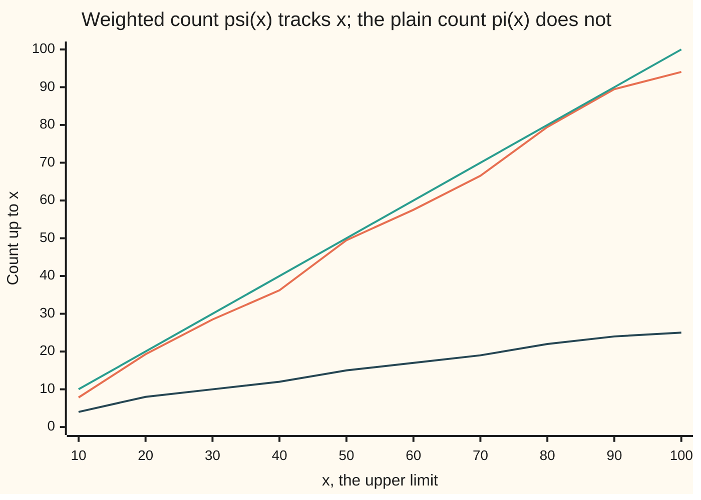

# The von Mangoldt function: weighting prime powers by logs so the sums behave

[Syllabus](../../../SYLLABUS.md) → [Algebraic and analytic number theory](../README.md) → [Arithmetic Functions Again](../README.md#s01) → The von Mangoldt function

---

## General Overview

There are 25 primes up to 100. That number sits far from 100, and it drifts further away as the range grows: 78,498 primes up to a million. A plain count of primes has no simple size.

Now change what each prime is worth. Give each prime p the weight log p instead of 1. Give the powers 4, 8, 16, 32 and 64 the weight log 2 each, because they are powers of 2. Do the same for every prime and prime power up to 100. The weighted total is 94.05: close to 100 itself. At a million it is 999,586.60, about 0.04 percent short of a million.

Why this works: near a number x, about one number in every log x is prime. Weighting each prime by log x cancels that thinning, so the weighted count grows like x. The weights also turn sums over divisors into exact identities, which plain counts never give. And the weighted total has a concrete meaning: 94.05 is the natural log of the least common multiple of 1, 2, …, 100, a 41-digit number.

**The von Mangoldt function gives each prime power the log of its prime; with those weights, the log of every whole number is the sum of the weights of its divisors, the weighted prime count up to x grows like x, and minus zeta's logarithmic derivative is the Dirichlet series of these weights.**

**What kind of fact this is:** the identities (divisor sum, Möbius form, the Dirichlet series, and the conversions between counts) are theorems, proved on this card in Why it works, except the formula for π from θ, which is proved on [Partial summation](06-abel-and-partial-summation.md). The statement that the weighted count up to x divided by x tends to 1 is the prime number theorem: proved in 1896, quoted here and not proved on this card.

### The picture: plain count against weighted count, up to 100



Orange: the weighted count ψ(x), defined below. Green: the line y = x. Dark: the plain prime count π(x), 4 at 10 and 25 at 100. The primes-only weighted count θ(x), also defined below, runs between them: 5.35 at 10, 83.73 at 100.

---

## The formula

Notation first, in words. Here log means the natural log, ln, as on [Big O and twiddle](01-asymptotic-notation-and-error-terms.md). The letter p always stands for a prime. The bar in d | n reads "d divides n". The function Λ(n), "big lambda of n", is von Mangoldt's function. Two running totals use it:

- θ(x), "Chebyshev's theta of x": the sum of log p over primes p up to x. This card introduces it.
- ψ(x), "psi of x": the sum of Λ(n) over whole numbers n up to x. It is θ(x) plus the weights of the prime powers p², p³, … up to x.

```math
\Lambda(n) = \begin{cases} \log p & \text{if } n = p^k \text{ for a prime } p \text{ and some } k \ge 1 \\ 0 & \text{otherwise} \end{cases} \qquad\qquad \sum_{d \mid n} \Lambda(d) = \log n
```

**Read it aloud:** big lambda of n is log p when n is a power of the prime p, and zero otherwise; adding big lambda over all divisors of n gives log n.

Möbius inversion turns the divisor sum around. Here μ(d), "mu of d", is the Möbius function of [The Mobius function](03-mobius-inversion.md): 0 if a square above 1 divides d, otherwise +1 or −1 for an even or odd number of prime factors.

```math
\Lambda(n) = -\sum_{d \mid n} \mu(d) \log d, \qquad\qquad -\frac{\zeta'(s)}{\zeta(s)} = \sum_{n=1}^{\infty} \frac{\Lambda(n)}{n^{s}} \quad (\mathrm{Re}\, s > 1)
```

**Read it aloud:** big lambda is minus the sum of mu of d times log d over the divisors of n; and minus zeta's slope over zeta is the series with big lambda of n over n to the s.

The three counts convert into one another exactly:

```math
\psi(x) = \sum_{k \ge 1} \theta\big(x^{1/k}\big), \qquad\qquad \pi(x) = \frac{\theta(x)}{\log x} + \int_2^x \frac{\theta(t)}{t \log^2 t}\, dt
```

**Read it aloud:** psi of x is theta of x plus theta of root x plus theta of cube root x, and so on; the prime count is theta of x over log x, plus a correction integral built from theta.

| Symbol | Plain meaning | In our example | Push it up and the answer… |
| --- | --- | --- | --- |
| $`n`$, $`d`$, $`p`$, $`k`$ | a whole number; one of its divisors; a prime; the power p is raised to | n = 720720, where 2^4 divides n | more divisors to add |
| $`\log`$, $`\log_2`$ | natural log (ln); log to base 2 | log 2 = 0.6931 | — |
| $`1`$, $`*`$ | the function equal to 1 at every n; Dirichlet convolution, a sum over factor pairs d × (n/d) | 1 * Λ = log | — |
| $`\Lambda(n)`$ | log p at n = p^k, else 0 | Λ(8) = log 2 = 0.6931 | — |
| $`\mu(d)`$ | Möbius sign: 0, +1 or −1 | the signs in Step 2 | — |
| $`x`$, $`t`$ | the upper limit; a variable running up to it | x = 100 | all counts grow |
| $`\pi(x)`$ | number of primes up to x | π(100) = 25 | grows like x / log x |
| $`\theta(x)`$ | sum of log p over primes up to x | θ(100) = 83.73 | grows like x |
| $`\psi(x)`$ | sum of Λ(n) up to x | ψ(100) = 94.05 | grows like x |
| $`s`$, $`\mathrm{Re}\, s`$ | the input of a Dirichlet series; its real part, above 1 | s = 2 | terms shrink faster |
| $`\zeta(s)`$, $`\zeta'(s)`$ | zeta and its derivative | ζ(2) = 1.644934, −ζ′(2) = 0.937548 | — |
| $`\lfloor y \rfloor`$ | the whole-number part of y | ⌊100/d⌋ in Step 4 | — |

### When it holds

- **The weight sits on every prime power, not only on primes.** Drop p², p³, … and the divisor sum fails: at n = 8 it gives 0.6931, not log 8 = 2.0794.
- **The weight is log p, not log n.** Give 8 the weight log 8 and the total up to 100 becomes 114.59; the divisor identity also breaks.
- **The Dirichlet series needs real part of s above 1.** There the series converges absolutely and ζ(s) has no zeros. Left of that line the series diverges, and −ζ′/ζ means the continued function, not this sum.
- **The conversion to π uses the true θ, a staircase that jumps at each prime.** With it the formula returns π(100) = 25 and π(10^6) = 78,498 exactly. Put the smooth guess θ(t) = t inside and it returns only an estimate of π(x), as [Partial summation](06-abel-and-partial-summation.md) shows.
- **"ψ(x)/x tends to 1" is the prime number theorem, not an identity.** The identities hold at every x; the limit needs zeta's zero-free line, proved on shelf 02.

---

## Why it works

### Step 0: one log per prime factor

Write n as a product of primes. Its log is the sum of the logs of those primes, counted with repeats: log 720720 = 4 log 2 + 2 log 3 + log 5 + log 7 + log 11 + log 13. The von Mangoldt function hands out exactly those logs, one per prime factor, by placing them on the prime-power divisors of n. Everything else follows from this bookkeeping.

### Step 1: the divisor sum is log n

Take $`n = p_1^{a_1} \cdots p_r^{a_r}`$. Its divisors that are prime powers are p, p², …, p^a for each prime p in the list; every other divisor has Λ equal to 0. Each of those a divisors of p contributes log p, so p contributes a log p in total. Adding over the primes gives the log of the product, log n.

For 720720 = 2^4 × 3^2 × 5 × 7 × 11 × 13: it has 240 divisors, and 10 of them are prime powers (2, 4, 8, 16, 3, 9, 5, 7, 11, 13). Their weights add to 13.488006, which is log 720720.

In convolution language from [Multiplicative functions](02-multiplicative-functions-and-dirichlet-convolution.md), this says 1 * Λ = log, where 1 is the function that is 1 at every n and * is Dirichlet convolution, the sum over factor pairs d × (n/d).

### Step 2: Möbius inversion gives Λ from log

[The Mobius function](03-mobius-inversion.md) proves that μ undoes 1: if g = 1 * f then f = μ * g. Apply it with f = Λ and g = log:

```math
\Lambda(n) = \sum_{d \mid n} \mu(d) \log\frac{n}{d} = \log n \sum_{d \mid n} \mu(d) - \sum_{d \mid n} \mu(d)\log d = -\sum_{d \mid n} \mu(d)\log d
```

The middle sum of μ(d) is 0 for every n above 1, and log 1 = 0 covers n = 1. The checks confirm both forms for every n up to 10,000.

### Step 3: the logarithmic derivative is the same identity

A Dirichlet series turns convolution into multiplication: the series of f * g is the series of f times the series of g. Now read each piece of 1 * Λ = log as a series:

- The series of 1 is ζ(s), the sum of 1/n^s.
- The series of log is −ζ′(s), because the derivative of n^(−s) in s is −log n · n^(−s).
- So ζ(s) times the series of Λ equals −ζ′(s).

Divide by ζ(s), which has no zeros where the real part of s is above 1. The result is −ζ′(s)/ζ(s) = Σ Λ(n)/n^s. [Zeta's zeros and the primes](../../07-Complex%20analysis/09-Special%20Functions%20and%20the%20Zeta%20Function/09-zeros-of-zeta-and-the-primes.md) reaches the same series from the log of the Euler product; this is a second road, by convolution.

At s = 2 the checks compute both sides independently. Zeta and its slope come from the sums 1/n² and log n / n², with an Euler–Maclaurin tail (a correction that estimates the terms past the cutoff by an integral): ζ(2) = 1.644934 and −ζ′(2) = 0.937548, ratio 0.56996. The series of Λ(n)/n² up to a million, plus its tail of about 1/10^6, also gives 0.56996.

### Step 4: why the weighted sums behave

Add Step 1 over every n up to x. Each Λ(d) appears once for every multiple of d up to x, which is ⌊x/d⌋ times:

```math
\sum_{n \le x} \log n = \log(\lfloor x \rfloor!) = \sum_{d \le x} \Lambda(d) \left\lfloor \frac{x}{d} \right\rfloor
```

At x = 100 both sides are 363.739376. The left side is log 100!, which Stirling's formula pins to x log x − x plus a small error. So the weighted counts sit inside an exact identity with a known size. The plain count π(x) has no identity like this.

[Chebyshev's bounds](08-chebyshev-bounds.md) traps π(x) between two multiples of x / log x. Its tool is the number of ways to choose n things from 2n. That card reads the prime factors of this number with Legendre's formula, which counts how often each prime divides a factorial: it is this identity, sorted prime by prime. A second exact fact has the same flavour: ψ(x) is the log of the least common multiple of 1 to x, since that number holds each prime p to the highest power p^k not above x. The checks build lcm(1, …, 100) by Euclid's algorithm alone, never naming a prime: 41 digits, log 94.045311, the same as ψ(100).

### Step 5: moving between ψ, θ and π

Three counts, three exact conversions.

1. **ψ from θ.** The prime powers p^k up to x are the primes up to x^(1/k). So ψ(x) = θ(x) + θ(√x) + θ(x^(1/3)) + …, a finite sum. At 100: 83.73 + 5.35 + 1.79 + 1.79 + 0.69 + 0.69 = 94.05.
2. **ψ minus θ is small.** The extra terms start at θ(√x), which is about √x. The gap is 10.32 at 100 and 1,102.42 at a million, near √x = 1,000. Against x, it fades.
3. **π from θ.** θ is a sum of log p, and π is a sum of 1. Since 1 = log p × (1/log p), [Partial summation](06-abel-and-partial-summation.md) trades the weight 1/log p for an integral against the running total θ. That gives the second formula in The formula, proved there in its Step 4.

Because θ is flat between primes, the integral is exact piece by piece: the antiderivative of 1/(t log² t) is −1/log t. The checks rebuild π(100) = 25.000000 and π(10^6) = 78,498.000000 from θ alone. The same trade the other way rebuilds θ(100) = 83.728390 from π.

<details>
<summary>Detailed proof: the three counts share one limit</summary>

Claim: ψ(x)/x, θ(x)/x and π(x) log x / x either all tend to 1 or none does.

ψ to θ. Each θ(y) is at most y log y, and θ(x^(1/k)) is 0 once x^(1/k) is below 2, so at most log₂ x extra terms appear. Each is at most √x log x. So

$`\displaystyle 0 \le \psi(x) - \theta(x) \le \sqrt{x}\,(\log x)(\log_2 x),`$

and divided by x this tends to 0.

θ and π. [Partial summation](06-abel-and-partial-summation.md) proves, in its Step 6, that θ(x)/x tends to 1 exactly when π(x) log x / x does: after scaling, the correction integral in each conversion formula tends to 0. So all three ratios share one limit.

</details>

### Step 6: what the table shows, and where proof ends

The checks run all three counts to a million:

| x | π(x) | θ(x) | ψ(x) | ψ − θ | ψ(x)/x | π(x) log x / x |
| --- | ---: | ---: | ---: | ---: | ---: | ---: |
| 100 | 25 | 83.73 | 94.05 | 10.32 | 0.9405 | 1.1513 |
| 1,000 | 168 | 956.25 | 996.68 | 40.44 | 0.9967 | 1.1605 |
| 10,000 | 1,229 | 9,895.99 | 10,013.40 | 117.41 | 1.0013 | 1.1320 |
| 100,000 | 9,592 | 99,685.39 | 100,051.56 | 366.17 | 1.0005 | 1.1043 |
| 1,000,000 | 78,498 | 998,484.18 | 999,586.60 | 1,102.42 | 0.9996 | 1.0845 |

ψ(x)/x is 0.9996 at a million, about 0.04 percent below 1. π(x) log x / x is still 8.45 percent high: its correction integral is about x / log² x, which shrinks against x only as slowly as 1/log x. That is why analytic number theory works with ψ.

The table is evidence, not proof. The proof that ψ(x)/x tends to 1 is the prime number theorem, from Hadamard and de la Vallée Poussin in 1896. It needs zeta to have no zeros on the line where the real part of s is 1, and it is the subject of shelf 02's cards.

---

## Worked numbers, by hand

| Step | Arithmetic | Value |
| --- | --- | --- |
| primes up to 100 | count 2, 3, 5, …, 97 | 25 |
| primes-only weights | log 2 + log 3 + … + log 97 | θ(100) = 83.73 |
| prime powers p², p³, … | 4, 8, 16, 32, 64 (log 2 each); 9, 27, 81 (log 3 each); 25 (log 5); 49 (log 7) | 10.32 |
| the weighted count | 83.73 + 10.32 | **ψ(100) = 94.05** |
| the same by θ at roots | 83.73 + 5.35 + 1.79 + 1.79 + 0.69 + 0.69 | 94.05 |
| the same as a log | log of lcm(1, …, 100), a 41-digit number | 94.045311 |
| plain count, scaled | 25 × log 100 | 115.13 |

The weighted count lands 6 percent below 100. The plain count must be multiplied by log 100 to reach the right size, and even then it overshoots by 15 percent.

### What breaks if you drop a piece

| Mistake | Comes out at | What went wrong |
| --- | --- | --- |
| Weight primes only | θ(100) = 83.73; the divisor sum of 8 gives 0.6931, not 2.0794 | the identity needs every prime power |
| Weight log n at each prime power | 114.59, not 94.05 | 8 would carry log 8, three times its share |
| Weight 1 at each prime power | 35 | that is a count again: no log, no size x |
| Logs to base 10 | 40.84, not 94.05 | the density of primes is 1 in ln x, not log₁₀ x |

The code prints all four.

---

## Code, from first principles, and it actually runs

The code sieves the smallest prime factor of every number up to a million, then reads Λ, μ, π, θ and ψ off it. It takes six independent roads: the sieve against trial division for π(100); ψ(100) against the log of an lcm built by Euclid's algorithm; ψ against θ at roots and against log 100!; Λ against the Möbius form and the divisor sum for every n up to 10,000; π against θ by partial summation, both ways; and the Dirichlet series against zeta's slope by Euler–Maclaurin.

### Python

```python
# The von Mangoldt function -- the check behind the card.  Standard library
# only.  Lambda(n) is ln p when n is a power of a prime p, and 0 otherwise.
# Every prime here comes from a sieve written out below; nothing imported
# knows a prime.  Roads: the sieve, trial division, an lcm built by Euclid's
# gcd, Mobius signs, partial summation, and zeta by Euler-Maclaurin.
from math import log

N = 10**6
spf = list(range(N + 1))                 # smallest prime factor of each n
for p in range(2, 1001):
    if spf[p] == p:
        for m in range(p * p, N + 1, p):
            if spf[m] == m: spf[m] = p

def lam(n):                              # von Mangoldt, from the sieve
    if n < 2: return 0.0
    p, m = spf[n], n
    while m % p == 0:
        m //= p
    return log(p) if m == 1 else 0.0

def mu(n):                               # Mobius: 0 if a square divides n
    s = 1
    while n > 1:
        p, n = spf[n], n // spf[n]
        if n % p == 0: return 0
        s = -s
    return s

def gcd(a, b):                           # Euclid, written out
    while b: a, b = b, a % b
    return a

def is_prime(n): return n > 1 and all(n % d for d in range(2, int(n**0.5) + 1))

marks = list(range(10, 101, 10)) + [1000, 10**4, 10**5, 10**6]
pi = th = ps = 0
at, primes, L = {}, [], [0.0] * (N + 1)
for n in range(2, N + 1):
    L[n] = lam(n)
    ps += L[n]
    if spf[n] == n:
        pi, th = pi + 1, th + log(n)
        primes.append(n)
    if n in marks:
        at[n] = (pi, th, ps)

pi100, th100, ps100 = at[100]
trial = sum(1 for n in range(2, 101) if is_prime(n))
print(f"primes to 100: sieve {pi100}, trial division {trial}")
print(f"psi(100) = {ps100:.2f}; theta(100) = {th100:.2f}; prime powers p^2, p^3, ... add {ps100 - th100:.2f}")
big = 1
for n in range(1, 101):                  # lcm(1..100) by gcd; never names a prime
    big = big * n // gcd(big, n)
print(f"lcm(1..100), built by gcd: {len(str(big))} digits, ln = {log(big):.6f}; psi(100) = {ps100:.6f}")

def theta_upto(m): return sum(log(p) for p in primes if p <= m)

def iroot(x, k):                         # largest m with m^k <= x
    m = int(round(x ** (1 / k)))
    while m ** k > x: m -= 1
    while (m + 1) ** k <= x: m += 1
    return m

parts = [theta_upto(iroot(100, k)) for k in range(1, 7)]
print("psi(100) as theta(100) + theta(10) + theta(4) + theta(3) + theta(2) + theta(2) = "
      + " + ".join(f"{t:.2f}" for t in parts) + f" = {sum(parts):.2f}")
cheb = sum(L[d] * (100 // d) for d in range(2, 101))
lnfact = sum(log(n) for n in range(2, 101))
print(f"sum of Lambda(d) floor(100/d) = {cheb:.6f}; ln(100!) = {lnfact:.6f}")
H = 720720
divs = [d for d in range(1, H + 1) if H % d == 0]
pp = [d for d in divs if L[d] > 0]
print(f"720720: {len(divs)} divisors, {len(pp)} of them prime powers; their Lambda add to "
      f"{sum(L[d] for d in pp):.6f}; ln 720720 = {log(H):.6f}")

M = 10**4
one_lam, mu_log = [0.0] * (M + 1), [0.0] * (M + 1)
for d in range(1, M + 1):
    for m in range(d, M + 1, d):
        one_lam[m] += L[d]               # (1 * Lambda)(m)
        mu_log[m] -= mu(d) * log(d)      # minus sum of mu(d) ln d over d dividing m
e1 = max(abs(one_lam[n] - log(n)) for n in range(1, M + 1))
e2 = max(abs(mu_log[n] - L[n]) for n in range(1, M + 1))
print(f"up to {M}: sum of Lambda(d) over d | n equals ln n: {'yes' if e1 < 1e-12 else 'no'}")
print(f"up to {M}: minus sum of mu(d) ln d over d | n equals Lambda(n): {'yes' if e2 < 1e-12 else 'no'}")

def pi_from_theta(x):                    # partial summation, theta -> pi
    ps_ = [p for p in primes if p <= x]
    t, out = 0.0, 0.0
    for i, p in enumerate(ps_):
        t += log(p)
        nxt = ps_[i + 1] if i + 1 < len(ps_) else x
        out += t * (1 / log(p) - 1 / log(nxt))
    return t / log(x) + out

def theta_from_pi(x):                    # partial summation, pi -> theta
    ps_ = [p for p in primes if p <= x]
    out = 0.0
    for i, p in enumerate(ps_):
        nxt = ps_[i + 1] if i + 1 < len(ps_) else x
        out += (i + 1) * (log(nxt) - log(p))
    return len(ps_) * log(x) - out

r100, r6, t100 = pi_from_theta(100), pi_from_theta(N), theta_from_pi(100)
print(f"pi from theta by partial summation: pi(100) = {r100:.6f}, pi(10^6) = {r6:.6f}")
print(f"theta from pi by partial summation: theta(100) = {t100:.6f}")

dsum = sum(L[n] / n**2 for n in range(2, N + 1)) + 1 / N   # tail ~ 1/N since psi ~ x
K = 1000
z2 = sum(1 / n**2 for n in range(1, K + 1)) + 1 / K - 1 / (2 * K**2) + 1 / (6 * K**3)
lk = log(K)
dz2 = sum(log(n) / n**2 for n in range(2, K + 1)) + (lk + 1) / K - lk / (2 * K**2) - (1 - 2 * lk) / (12 * K**3)
print(f"zeta(2) = {z2:.6f}; -zeta'(2) = {dz2:.6f}; -zeta'(2)/zeta(2) = {dz2 / z2:.5f}")
print(f"sum of Lambda(n)/n^2 to 10^6, plus tail 1/10^6 = {dsum:.5f}")

print("x | pi(x) | theta(x) | psi(x) | psi - theta | psi/x | pi ln x / x")
for x in [100, 1000, 10**4, 10**5, 10**6]:
    a, b, c = at[x]
    print(f"{x} | {a} | {b:.2f} | {c:.2f} | {c - b:.2f} | {c / x:.4f} | {a * log(x) / x:.4f}")
print("chart x: " + ", ".join(str(x) for x in marks[:10]))
print("chart psi: " + ", ".join(f"{at[x][2]:.2f}" for x in marks[:10]))
print("chart theta: " + ", ".join(f"{at[x][1]:.2f}" for x in marks[:10]))
print("chart pi: " + ", ".join(str(at[x][0]) for x in marks[:10]))

npp = sum(1 for n in range(2, 101) if L[n] > 0)
whole = sum(log(n) for n in range(2, 101) if L[n] > 0)
print(f"mistake 1, primes only: theta(100) = {th100:.2f}, not {ps100:.2f}; at n = 8 the divisor sum gives {log(2):.4f}, not ln 8 = {log(8):.4f}")
print(f"mistake 2, weight ln n at each prime power: {whole:.2f}, not {ps100:.2f}")
print(f"mistake 3, weight 1 at each prime power: {npp}; pi(100) x ln 100 = {pi100 * log(100):.2f}")
print(f"mistake 4, log base 10: {ps100 / log(10):.2f}, not {ps100:.2f}")

assert pi100 == trial == 25                                   # sieve against trial division
assert abs(log(big) - ps100) < 1e-9                           # lcm road against Lambda road
assert abs(sum(parts) - ps100) < 1e-9 and abs(cheb - lnfact) < 1e-9
assert e1 < 1e-9 and e2 < 1e-9                                # 1*Lambda = ln, mu*ln = Lambda
assert abs(r100 - 25) < 1e-9 and abs(r6 - at[N][0]) < 1e-6 and abs(t100 - th100) < 1e-9
assert abs(dsum - dz2 / z2) < 1e-5                            # Dirichlet series = -zeta'/zeta
print("ALL CHECKS PASS")
```

**Ran 2026-11-15 on macOS, Python 3.14.10, standard library only. All checks passed. Output, pasted from the run:**

```
primes to 100: sieve 25, trial division 25
psi(100) = 94.05; theta(100) = 83.73; prime powers p^2, p^3, ... add 10.32
lcm(1..100), built by gcd: 41 digits, ln = 94.045311; psi(100) = 94.045311
psi(100) as theta(100) + theta(10) + theta(4) + theta(3) + theta(2) + theta(2) = 83.73 + 5.35 + 1.79 + 1.79 + 0.69 + 0.69 = 94.05
sum of Lambda(d) floor(100/d) = 363.739376; ln(100!) = 363.739376
720720: 240 divisors, 10 of them prime powers; their Lambda add to 13.488006; ln 720720 = 13.488006
up to 10000: sum of Lambda(d) over d | n equals ln n: yes
up to 10000: minus sum of mu(d) ln d over d | n equals Lambda(n): yes
pi from theta by partial summation: pi(100) = 25.000000, pi(10^6) = 78498.000000
theta from pi by partial summation: theta(100) = 83.728390
zeta(2) = 1.644934; -zeta'(2) = 0.937548; -zeta'(2)/zeta(2) = 0.56996
sum of Lambda(n)/n^2 to 10^6, plus tail 1/10^6 = 0.56996
x | pi(x) | theta(x) | psi(x) | psi - theta | psi/x | pi ln x / x
100 | 25 | 83.73 | 94.05 | 10.32 | 0.9405 | 1.1513
1000 | 168 | 956.25 | 996.68 | 40.44 | 0.9967 | 1.1605
10000 | 1229 | 9895.99 | 10013.40 | 117.41 | 1.0013 | 1.1320
100000 | 9592 | 99685.39 | 100051.56 | 366.17 | 1.0005 | 1.1043
1000000 | 78498 | 998484.18 | 999586.60 | 1102.42 | 0.9996 | 1.0845
chart x: 10, 20, 30, 40, 50, 60, 70, 80, 90, 100
chart psi: 7.83, 19.27, 28.48, 36.21, 49.49, 57.53, 66.54, 79.46, 89.47, 94.05
chart theta: 5.35, 16.09, 22.59, 29.64, 40.96, 49.01, 57.32, 70.25, 79.15, 83.73
chart pi: 4, 8, 10, 12, 15, 17, 19, 22, 24, 25
mistake 1, primes only: theta(100) = 83.73, not 94.05; at n = 8 the divisor sum gives 0.6931, not ln 8 = 2.0794
mistake 2, weight ln n at each prime power: 114.59, not 94.05
mistake 3, weight 1 at each prime power: 35; pi(100) x ln 100 = 115.13
mistake 4, log base 10: 40.84, not 94.05
ALL CHECKS PASS
```

### Rust

Same numbers, same labels, built with `rustc --edition 2021 -O`. A small base-2^32 number type holds the 41-digit lcm.

```rust
// The von Mangoldt function -- the same check as the Python, in Rust.  No
// crates.  Lambda(n) is ln p when n is a power of a prime p, and 0 otherwise.
// Every prime here comes from a sieve written out below; nothing imported
// knows a prime.  Roads: the sieve, trial division, an lcm built by Euclid's
// gcd, Mobius signs, partial summation, and zeta by Euler-Maclaurin.
const N: usize = 1_000_000;

fn lam(spf: &[usize], n: usize) -> f64 {           // von Mangoldt, from the sieve
    if n < 2 { return 0.0 }
    let (p, mut m) = (spf[n], n);
    while m % p == 0 { m /= p }
    if m == 1 { (p as f64).ln() } else { 0.0 }
}

fn mu(spf: &[usize], mut n: usize) -> i64 {        // Mobius: 0 if a square divides n
    let mut s = 1;
    while n > 1 {
        let p = spf[n]; n /= p;
        if n % p == 0 { return 0 }
        s = -s;
    }
    s
}

fn gcd(mut a: u64, mut b: u64) -> u64 { while b != 0 { (a, b) = (b, a % b) } a }   // Euclid

fn is_prime(n: usize) -> bool { n > 1 && (2..).take_while(|d| d * d <= n).all(|d| n % d != 0) }

// A big whole number as base-2^32 limbs, lowest first: just enough for lcm(1..100).
fn big_mod(a: &[u32], m: u64) -> u64 { a.iter().rev().fold(0, |r, &l| ((r << 32) | l as u64) % m) }
fn big_mul(a: &mut Vec<u32>, m: u64) {
    let mut carry = 0u64;
    for l in a.iter_mut() { let t = *l as u64 * m + carry; *l = t as u32; carry = t >> 32 }
    while carry > 0 { a.push(carry as u32); carry >>= 32 }
}
fn big_div(a: &mut Vec<u32>, m: u64) -> u64 {
    let mut r = 0u64;
    for l in a.iter_mut().rev() { let t = (r << 32) | *l as u64; *l = (t / m) as u32; r = t % m }
    while a.len() > 1 && *a.last().unwrap() == 0 { a.pop(); }
    r
}
fn big_ln(a: &[u32]) -> f64 {
    let k = a.len();
    let top = a[k - 1] as f64 * 4294967296.0 + a[k - 2] as f64;
    top.ln() + 32.0 * (k as f64 - 2.0) * 2f64.ln()
}
fn big_digits(a: &[u32]) -> usize {
    let (mut b, mut d) = (a.to_vec(), 0);
    while !(b.len() == 1 && b[0] == 0) { big_div(&mut b, 10); d += 1 }
    d
}

fn iroot(x: u64, k: u32) -> u64 { let mut m = 1; while (m + 1u64).pow(k) <= x { m += 1 } m }   // largest m^k <= x

fn main() {
    let mut spf: Vec<usize> = (0..=N).collect();
    for p in 2..=1000 {
        if spf[p] == p { let mut m = p * p; while m <= N { if spf[m] == m { spf[m] = p } m += p } }
    }
    let mut marks: Vec<usize> = (10..=100).step_by(10).collect();
    marks.extend([1000, 10_000, 100_000, 1_000_000]);
    let (mut pi, mut th, mut ps) = (0usize, 0.0f64, 0.0f64);
    let mut at = std::collections::HashMap::new();
    let mut primes: Vec<usize> = Vec::new();
    let mut l = vec![0.0f64; N + 1];
    for n in 2..=N {
        l[n] = lam(&spf, n);
        ps += l[n];
        if spf[n] == n { pi += 1; th += (n as f64).ln(); primes.push(n) }
        if marks.contains(&n) { at.insert(n, (pi, th, ps)); }
    }
    let (pi100, th100, ps100) = at[&100];
    let trial = (2..=100).filter(|&n| is_prime(n)).count();
    println!("primes to 100: sieve {}, trial division {}", pi100, trial);
    println!("psi(100) = {:.2}; theta(100) = {:.2}; prime powers p^2, p^3, ... add {:.2}", ps100, th100, ps100 - th100);
    let mut big = vec![1u32];
    for n in 1..=100u64 { let g = gcd(big_mod(&big, n), n); big_mul(&mut big, n / g) }   // never names a prime
    let lnbig = big_ln(&big);
    println!("lcm(1..100), built by gcd: {} digits, ln = {:.6}; psi(100) = {:.6}", big_digits(&big), lnbig, ps100);
    let theta_upto = |m: u64| -> f64 { primes.iter().filter(|&&p| p as u64 <= m).map(|&p| (p as f64).ln()).sum() };
    let parts: Vec<f64> = (1..=6).map(|k| theta_upto(iroot(100, k))).collect();
    let joined: Vec<String> = parts.iter().map(|t| format!("{:.2}", t)).collect();
    let psum: f64 = parts.iter().sum();
    println!("psi(100) as theta(100) + theta(10) + theta(4) + theta(3) + theta(2) + theta(2) = {} = {:.2}", joined.join(" + "), psum);
    let cheb: f64 = (2..=100).map(|d| l[d] * (100 / d) as f64).sum();
    let lnfact: f64 = (2..=100).map(|n| (n as f64).ln()).sum();
    println!("sum of Lambda(d) floor(100/d) = {:.6}; ln(100!) = {:.6}", cheb, lnfact);
    let h = 720720usize;
    let divs: Vec<usize> = (1..=h).filter(|d| h % d == 0).collect();
    let pp: Vec<usize> = divs.iter().copied().filter(|&d| l[d] > 0.0).collect();
    let ppsum: f64 = pp.iter().map(|&d| l[d]).sum();
    println!("720720: {} divisors, {} of them prime powers; their Lambda add to {:.6}; ln 720720 = {:.6}",
             divs.len(), pp.len(), ppsum, (h as f64).ln());
    let m = 10_000usize;
    let (mut one_lam, mut mu_log) = (vec![0.0f64; m + 1], vec![0.0f64; m + 1]);
    for d in 1..=m {
        let (md, ld) = (mu(&spf, d) as f64, (d as f64).ln());
        let mut k = d;
        while k <= m { one_lam[k] += l[d]; mu_log[k] -= md * ld; k += d }
    }
    let e1 = (1..=m).map(|n| (one_lam[n] - (n as f64).ln()).abs()).fold(0.0, f64::max);
    let e2 = (1..=m).map(|n| (mu_log[n] - l[n]).abs()).fold(0.0, f64::max);
    let yn = |c: bool| if c { "yes" } else { "no" };
    println!("up to {}: sum of Lambda(d) over d | n equals ln n: {}", m, yn(e1 < 1e-12));
    println!("up to {}: minus sum of mu(d) ln d over d | n equals Lambda(n): {}", m, yn(e2 < 1e-12));
    let upto = |x: usize| -> Vec<usize> { primes.iter().copied().filter(|&p| p <= x).collect() };
    let pi_from_theta = |x: usize| -> f64 {         // partial summation, theta -> pi
        let ps_ = upto(x);
        let (mut t, mut out) = (0.0f64, 0.0f64);
        for (i, &p) in ps_.iter().enumerate() {
            t += (p as f64).ln();
            let nxt = if i + 1 < ps_.len() { ps_[i + 1] } else { x };
            out += t * (1.0 / (p as f64).ln() - 1.0 / (nxt as f64).ln());
        }
        t / (x as f64).ln() + out
    };
    let theta_from_pi = |x: usize| -> f64 {         // partial summation, pi -> theta
        let ps_ = upto(x);
        let mut out = 0.0f64;
        for (i, &p) in ps_.iter().enumerate() {
            let nxt = if i + 1 < ps_.len() { ps_[i + 1] } else { x };
            out += (i + 1) as f64 * ((nxt as f64).ln() - (p as f64).ln());
        }
        ps_.len() as f64 * (x as f64).ln() - out
    };
    let (r100, r6, t100) = (pi_from_theta(100), pi_from_theta(N), theta_from_pi(100));
    println!("pi from theta by partial summation: pi(100) = {:.6}, pi(10^6) = {:.6}", r100, r6);
    println!("theta from pi by partial summation: theta(100) = {:.6}", t100);
    let dsum: f64 = (2..=N).map(|n| l[n] / (n as f64).powi(2)).sum::<f64>() + 1.0 / N as f64;
    let kk = 1000.0f64;
    let z2: f64 = (1..=1000).map(|n| 1.0 / (n as f64).powi(2)).sum::<f64>() + 1.0 / kk - 1.0 / (2.0 * kk * kk) + 1.0 / (6.0 * kk.powi(3));
    let lk = kk.ln();
    let dz2: f64 = (2..=1000).map(|n| (n as f64).ln() / (n as f64).powi(2)).sum::<f64>()
        + (lk + 1.0) / kk - lk / (2.0 * kk * kk) - (1.0 - 2.0 * lk) / (12.0 * kk.powi(3));
    println!("zeta(2) = {:.6}; -zeta'(2) = {:.6}; -zeta'(2)/zeta(2) = {:.5}", z2, dz2, dz2 / z2);
    println!("sum of Lambda(n)/n^2 to 10^6, plus tail 1/10^6 = {:.5}", dsum);
    println!("x | pi(x) | theta(x) | psi(x) | psi - theta | psi/x | pi ln x / x");
    for &x in &[100usize, 1000, 10_000, 100_000, 1_000_000] {
        let (a, b, c) = at[&x];
        let xf = x as f64;
        println!("{} | {} | {:.2} | {:.2} | {:.2} | {:.4} | {:.4}", x, a, b, c, c - b, c / xf, a as f64 * xf.ln() / xf);
    }
    let ten = &marks[..10];
    let row = |f: &dyn Fn(usize) -> String| ten.iter().map(|&x| f(x)).collect::<Vec<_>>().join(", ");
    println!("chart x: {}", row(&|x| x.to_string()));
    println!("chart psi: {}", row(&|x| format!("{:.2}", at[&x].2)));
    println!("chart theta: {}", row(&|x| format!("{:.2}", at[&x].1)));
    println!("chart pi: {}", row(&|x| at[&x].0.to_string()));
    let npp = (2..=100).filter(|&n| l[n] > 0.0).count();
    let whole: f64 = (2..=100).filter(|&n| l[n] > 0.0).map(|n| (n as f64).ln()).sum();
    println!("mistake 1, primes only: theta(100) = {:.2}, not {:.2}; at n = 8 the divisor sum gives {:.4}, not ln 8 = {:.4}",
             th100, ps100, 2f64.ln(), 8f64.ln());
    println!("mistake 2, weight ln n at each prime power: {:.2}, not {:.2}", whole, ps100);
    println!("mistake 3, weight 1 at each prime power: {}; pi(100) x ln 100 = {:.2}", npp, pi100 as f64 * 100f64.ln());
    println!("mistake 4, log base 10: {:.2}, not {:.2}", ps100 / 10f64.ln(), ps100);
    assert!(pi100 == trial && trial == 25);                       // sieve against trial division
    assert!((lnbig - ps100).abs() < 1e-9);                        // lcm road against Lambda road
    assert!((psum - ps100).abs() < 1e-9 && (cheb - lnfact).abs() < 1e-9);
    assert!(e1 < 1e-9 && e2 < 1e-9);                              // 1*Lambda = ln, mu*ln = Lambda
    assert!((r100 - 25.0).abs() < 1e-9 && (r6 - at[&N].0 as f64).abs() < 1e-6 && (t100 - th100).abs() < 1e-9);
    assert!((dsum - dz2 / z2).abs() < 1e-5);                      // Dirichlet series = -zeta'/zeta
    println!("ALL CHECKS PASS");
}
```

**Ran 2026-11-15 on macOS, rustc 1.98.1, no crates. All checks passed. Output, pasted from the run:**

```
primes to 100: sieve 25, trial division 25
psi(100) = 94.05; theta(100) = 83.73; prime powers p^2, p^3, ... add 10.32
lcm(1..100), built by gcd: 41 digits, ln = 94.045311; psi(100) = 94.045311
psi(100) as theta(100) + theta(10) + theta(4) + theta(3) + theta(2) + theta(2) = 83.73 + 5.35 + 1.79 + 1.79 + 0.69 + 0.69 = 94.05
sum of Lambda(d) floor(100/d) = 363.739376; ln(100!) = 363.739376
720720: 240 divisors, 10 of them prime powers; their Lambda add to 13.488006; ln 720720 = 13.488006
up to 10000: sum of Lambda(d) over d | n equals ln n: yes
up to 10000: minus sum of mu(d) ln d over d | n equals Lambda(n): yes
pi from theta by partial summation: pi(100) = 25.000000, pi(10^6) = 78498.000000
theta from pi by partial summation: theta(100) = 83.728390
zeta(2) = 1.644934; -zeta'(2) = 0.937548; -zeta'(2)/zeta(2) = 0.56996
sum of Lambda(n)/n^2 to 10^6, plus tail 1/10^6 = 0.56996
x | pi(x) | theta(x) | psi(x) | psi - theta | psi/x | pi ln x / x
100 | 25 | 83.73 | 94.05 | 10.32 | 0.9405 | 1.1513
1000 | 168 | 956.25 | 996.68 | 40.44 | 0.9967 | 1.1605
10000 | 1229 | 9895.99 | 10013.40 | 117.41 | 1.0013 | 1.1320
100000 | 9592 | 99685.39 | 100051.56 | 366.17 | 1.0005 | 1.1043
1000000 | 78498 | 998484.18 | 999586.60 | 1102.42 | 0.9996 | 1.0845
chart x: 10, 20, 30, 40, 50, 60, 70, 80, 90, 100
chart psi: 7.83, 19.27, 28.48, 36.21, 49.49, 57.53, 66.54, 79.46, 89.47, 94.05
chart theta: 5.35, 16.09, 22.59, 29.64, 40.96, 49.01, 57.32, 70.25, 79.15, 83.73
chart pi: 4, 8, 10, 12, 15, 17, 19, 22, 24, 25
mistake 1, primes only: theta(100) = 83.73, not 94.05; at n = 8 the divisor sum gives 0.6931, not ln 8 = 2.0794
mistake 2, weight ln n at each prime power: 114.59, not 94.05
mistake 3, weight 1 at each prime power: 35; pi(100) x ln 100 = 115.13
mistake 4, log base 10: 40.84, not 94.05
ALL CHECKS PASS
```

The two outputs match line for line.

### Lean

Lean proves four of the card's identities for every case they cover, and three of its counts exactly.

- Take any whole number n. Then the weights Λ(d) over the divisors d of n add up to log n.
- Take any whole number n. Then Λ(n) is minus the sum of μ(d) log d over the divisors d of n.
- Suppose the real part of s is above 1. Then the series of Λ(n)/n^s converges absolutely, and its sum is −ζ′(s)/ζ(s).
- Take x ≥ 0 and a whole number N with x below 2^(N+1). Then ψ(x) = θ(x) + θ(x^(1/2)) + ⋯ + θ(x^(1/N)).
- There are exactly 25 primes up to 100.
- 720720 = 2^4 × 3^2 × 5 × 7 × 11 × 13. Its prime-power divisors 2, 4, 8, 16, 3, 9, 5, 7, 11 and 13 all divide it. The next powers 32, 27, 25, 49, 121 and 169 do not.
- The least common multiple of 1, 2, …, 100 has 41 digits.

Every decimal value, the π-from-θ formula and Step 4's floor identity are left to the Python and Rust checks.

```lean
-- The von Mangoldt function: the divisor sum of Λ is log n, Λ is minus the sum of μ(d) log d, minus zeta's logarithmic derivative is the Dirichlet series of Λ, and ψ is the sum of θ at the roots of x.
import Mathlib.NumberTheory.Chebyshev
import Mathlib.NumberTheory.LSeries.Dirichlet
import Mathlib.NumberTheory.PrimeCounting

open ArithmeticFunction Chebyshev
open scoped ArithmeticFunction.Moebius

/-- The von Mangoldt function gives each prime power p^k the weight log p and every other
number the weight 0. With these weights, for every whole number n the weights of the divisors
of n add up to log n; and, turned around by Möbius inversion, Λ(n) is minus the sum of
μ(d) log d over the divisors d of n. -/
theorem vonMangoldt_divisor_sum_eq_log_and_moebius_form (n : ℕ) :
    (∑ d ∈ n.divisors, Λ d = Real.log n) ∧
      Λ n = -∑ d ∈ n.divisors, (μ d : ℝ) * Real.log d := by
  refine ⟨vonMangoldt_sum, ?_⟩
  have h := sum_moebius_mul_log_eq (n := n)
  simp only [ArithmeticFunction.log_apply] at h
  linarith

/-- Where the real part of s is above 1, the series of Λ(n)/n^s converges absolutely and
minus zeta's logarithmic derivative, −ζ′(s)/ζ(s), equals that series.
(The n = 0 term is 0, since Λ(0) = 0, so the sum is the card's sum from n = 1.) -/
theorem neg_logDeriv_riemannZeta_eq_sum_vonMangoldt (s : ℂ) (hs : 1 < s.re) :
    Summable (fun n : ℕ => ‖(Λ n : ℂ) / (n : ℂ) ^ s‖) ∧
      -deriv riemannZeta s / riemannZeta s = ∑' n : ℕ, (Λ n : ℂ) / (n : ℂ) ^ s := by
  have hsum := LSeriesSummable_vonMangoldt hs
  have hterm : ∀ n : ℕ, LSeries.term (fun n => (Λ n : ℂ)) s n = (Λ n : ℂ) / (n : ℂ) ^ s := by
    intro n
    rcases eq_or_ne n 0 with rfl | hn
    · simp
    · exact LSeries.term_of_ne_zero hn _ _
  have hfun : LSeries.term (fun n => (Λ n : ℂ)) s = fun n : ℕ => (Λ n : ℂ) / (n : ℂ) ^ s :=
    funext hterm
  refine ⟨?_, ?_⟩
  · have h : Summable (LSeries.term (fun n => (Λ n : ℂ)) s) := hsum
    rw [hfun] at h
    exact h.norm
  · rw [← LSeries_vonMangoldt_eq_deriv_riemannZeta_div hs]
    simp only [LSeries]
    rw [hfun]

/-- ψ from θ: the weighted count ψ(x) is θ(x) + θ(x^(1/2)) + θ(x^(1/3)) + ⋯. The sum is
finite: once 2^(N+1) is above x, every root x^(1/k) with k > N is below 2 and adds nothing,
so stopping at any such N gives ψ(x) exactly. -/
theorem psi_eq_sum_theta_at_roots (x : ℝ) (hx : 0 ≤ x) (N : ℕ) (hN : x < 2 ^ (N + 1)) :
    ψ x = ∑ k ∈ Finset.Icc 1 N, θ (x ^ ((1 : ℝ) / k)) := by
  apply psi_eq_sum_theta' hx
  rcases hx.eq_or_lt with h0 | hpos
  · subst h0; simp
  · have hl2 : 0 < Real.log 2 := Real.log_pos one_lt_two
    have hlt : Real.log x < ((N + 1 : ℕ) : ℝ) * Real.log 2 := by
      rw [← Real.log_rpow two_pos, Real.rpow_natCast]
      exact Real.log_lt_log hpos (by exact_mod_cast hN)
    have : Real.log x / Real.log 2 < ((N + 1 : ℕ) : ℝ) := by
      rw [div_lt_iff₀ hl2]; exact hlt
    have := (Nat.floor_lt' (Nat.succ_ne_zero N)).mpr this
    omega

-- There are 25 primes up to 100.
example : Nat.primeCounting 100 = 25 := by
  simp [Nat.primeCounting, Nat.primeCounting', Nat.count_eq_card_filter_range]
  decide

-- 720720 = 2^4 × 3^2 × 5 × 7 × 11 × 13, so its prime-power divisors are 2, 4, 8, 16, 3, 9,
-- 5, 7, 11 and 13: each divides it, and the next powers 32, 27, 25, 49, 121, 169 do not.
example : 720720 = 2 ^ 4 * 3 ^ 2 * 5 * 7 * 11 * 13 := by norm_num
example : (2 ∣ 720720 ∧ 4 ∣ 720720 ∧ 8 ∣ 720720 ∧ 16 ∣ 720720 ∧ 3 ∣ 720720 ∧ 9 ∣ 720720 ∧
    5 ∣ 720720 ∧ 7 ∣ 720720 ∧ 11 ∣ 720720 ∧ 13 ∣ 720720) ∧
    ¬ 32 ∣ 720720 ∧ ¬ 27 ∣ 720720 ∧ ¬ 25 ∣ 720720 ∧ ¬ 49 ∣ 720720 ∧
    ¬ 121 ∣ 720720 ∧ ¬ 169 ∣ 720720 := by decide

-- The least common multiple of 1, 2, …, 100, whose log is ψ(100), has 41 digits.
set_option maxRecDepth 100000 in
example : 10 ^ 40 ≤ (Finset.Icc 1 100).lcm id ∧ (Finset.Icc 1 100).lcm id < 10 ^ 41 := by
  decide

#print axioms vonMangoldt_divisor_sum_eq_log_and_moebius_form
#print axioms neg_logDeriv_riemannZeta_eq_sum_vonMangoldt
#print axioms psi_eq_sum_theta_at_roots
```

**Checked 2026-11-15 on macOS, Lean 4.36.0-rc2, Mathlib v4.36.0-rc2. Every proof is complete and uses only Lean's standard axioms. Output, pasted from the run:**

```
'vonMangoldt_divisor_sum_eq_log_and_moebius_form' depends on axioms: [propext, Classical.choice, Quot.sound]
'neg_logDeriv_riemannZeta_eq_sum_vonMangoldt' depends on axioms: [propext, Classical.choice, Quot.sound]
'psi_eq_sum_theta_at_roots' depends on axioms: [propext, Classical.choice, Quot.sound]
```

> [!TIP]
> **Try changing**
> Guess first, then run it.
> - **Guess first: stop the lcm at 97.** Change `range(1, 101)` in the lcm loop to `range(1, 98)`. Nothing changes: 41 digits, log 94.045311, and every check passes, because 98, 99 and 100 are not prime powers and add no new factor.
> - **Guess first: stop the lcm at 96.** Use `range(1, 97)`. The prime 97 drops out: 39 digits, log 89.470600, and the lcm assert stops the run.
> - **Guess first: Λ forgets the prime powers.** In `lam`, change `m == 1` to `n == p`. Both divisor checks print "no", the Dirichlet sum falls to 0.49309, and the lcm assert stops the run.
> - **Guess first: a cruder zeta.** Set `K = 10`. The Euler–Maclaurin tail still carries it: −ζ′(2) reads 0.937549, the ratio still 0.56996, and every check passes.

---

## The usual mistake

> [!warning]
> **Thinking the weighted count is a different, rival way to count primes.** It is the same information in a better-behaved form. Partial summation turns θ into π exactly: 25.000000 from θ(100), 78,498.000000 from θ(10^6). The weights do not add or remove primes; they make the running total grow like x, so its error terms are easy to see.
>
> - **Dropping the prime powers.** θ(100) = 83.73 is not ψ(100) = 94.05, and without p², p³, … the divisor sum of 8 gives 0.6931 instead of log 8 = 2.0794.
> - **Weighting by the number, not its prime.** log 8 for 8 gives a total of 114.59.
> - **Scaling the plain count afterwards.** 25 × log 100 = 115.13, 15 percent above 100; the scaled count overshoots at every size in the table.
> - **Using base-10 logs.** 40.84 at 100, less than half of x.

---

## Where you meet it in real life

- **Prime-number research.** Most proofs about the distribution of primes, starting with the prime number theorem, state their result for ψ or a weighted sum like it and convert to π at the end by partial summation.
- **Choosing primes for encryption keys.** Key generators pick random large numbers and test them until one is prime. ψ(x) close to x says each prime near x carries weight log x, so about one number in log x is prime, which sets how many tests to expect.
- **The least common multiple.** ψ(x) = log lcm(1, …, x) bounds how large a common denominator can get, for example when the fractions 1, 1/2, …, 1/x are added exactly.
- **The explicit formula.** This formula, on [Zeta's zeros and the primes](../../07-Complex%20analysis/09-Special%20Functions%20and%20the%20Zeta%20Function/09-zeros-of-zeta-and-the-primes.md), writes ψ(x), not π(x), as a sum of waves, one per zero of zeta.

> **Say it back**
> The von Mangoldt function puts log p on every power of the prime p and 0 elsewhere. Its divisor sums give log n, so Möbius inversion writes it as minus the sum of μ(d) log d, and as Dirichlet series this is −ζ′/ζ. Its running total ψ(x) is 94.05 at 100, close to x, while there are only 25 primes. Partial summation converts between ψ, θ and π exactly, so nothing is lost. The prime number theorem says ψ(x)/x tends to 1; the checks show 0.9996 at a million.

---

## What this builds on

- [The Mobius function](03-mobius-inversion.md): μ undoes the divisor sum, which turns 1 * Λ = log into Λ = μ * log.
- [The zeta function](../../07-Complex%20analysis/09-Special%20Functions%20and%20the%20Zeta%20Function/05-zeta-function-and-euler-product.md): ζ(s) as the Dirichlet series of 1, nonzero where the real part of s is above 1.
- [Logarithms](../../01-Foundations/03-Powers%2C%20Roots%20and%20Logarithms/05-logarithms.md): the log of a product is the sum of the logs, which is Step 0.
- [Zeta's zeros and the primes](../../07-Complex%20analysis/09-Special%20Functions%20and%20the%20Zeta%20Function/09-zeros-of-zeta-and-the-primes.md): Λ, ψ and −ζ′/ζ first appear there, read off the Euler product with a check at s = 2.

## Where this goes next

- [Average orders](05-average-orders-and-the-hyperbola-method.md): the next card sums other arithmetic functions, such as the divisor count, up to x.
- [Chebyshev's bounds](08-chebyshev-bounds.md): traps π(x) between two multiples of x / log x. It reads the prime factors of a binomial coefficient with Legendre's formula, the identity of Step 4 sorted prime by prime.
- [Zeta of a complex variable](../02-The%20Zeta%20Function%20and%20the%20Prime%20Number%20Theorem/01-zeta-and-the-euler-product-revisited.md): −ζ′/ζ near the line Re s = 1, where it grows like 1/(Re s − 1): the road to the prime number theorem.

The checks show ψ(x)/x about 0.04 percent from 1 at a million, but no identity on this card forces the limit: what keeps the zeros of zeta off the line where the real part of s is 1?

---

## Sources

Verified 2026-11-15: every link below resolves to the publisher's page.

- Apostol, Tom M. *Introduction to Analytic Number Theory*. Springer, 1976. [doi:10.1007/978-1-4757-5579-4](https://doi.org/10.1007/978-1-4757-5579-4). Chapters 2 and 4 define Λ, prove the divisor sum and Λ = μ * log, and prove that ψ, θ and π log x share their limit.
- Davenport, Harold. *Multiplicative Number Theory*, 2nd ed. Springer, 1980. [doi:10.1007/978-1-4757-5927-3](https://doi.org/10.1007/978-1-4757-5927-3). Works with ψ and −ζ′/ζ throughout, on the way to the prime number theorem.
- Montgomery, Hugh L., and Robert C. Vaughan. *Multiplicative Number Theory I: Classical Theory*. Cambridge University Press, 2006. [doi:10.1017/CBO9780511618314](https://doi.org/10.1017/CBO9780511618314). Chebyshev's identity with ⌊x/d⌋, partial summation between π and θ, and the Dirichlet series of Λ.
