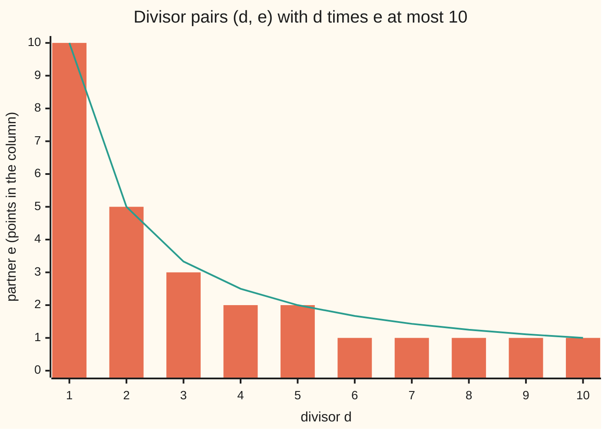
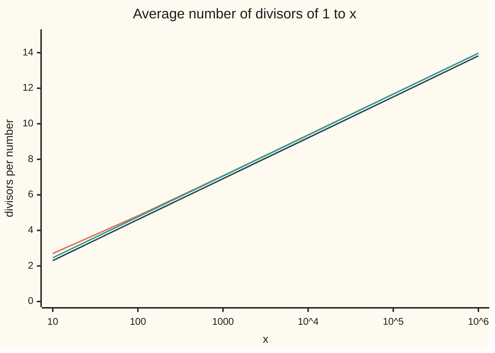

# Average orders: the typical divisor count, found by summing along a hyperbola

[Syllabus](../../../SYLLABUS.md) → [Algebraic and analytic number theory](../README.md) → [Arithmetic Functions Again](../README.md#s01) → Average orders

---

## General Overview

Take every whole number from 1 to a million and count its divisors. The number 1 has one divisor. The number 12 has six: 1, 2, 3, 4, 6 and 12. The number 720720 has 240, the most in the range, a record it shares with four larger numbers, the last of them 997920.

Add up all million counts and the total is 13,970,034. That is an average of 13.97 divisors per number: about 14 each.

This card predicts that total without listing a single divisor. The formula x log x + (2γ − 1)x, with log the natural logarithm and γ = 0.5772 (Euler's constant), gives 13,969,941.89. It is off by 92 in 14 million. The card also proves how far off the formula can ever be: never more than 2√x + 5.

The trick is a change of picture. Each divisor d of n pairs with a partner e, so that d times e is n. Count all such pairs with d times e at most x, and every divisor of every number up to x is counted once.

Those pairs are the whole-number points under the curve d times e = x, a hyperbola. Dirichlet counted them from both axes at once, up to √x on each side, and subtracted the square he had counted twice. That needs 1,000 divisions instead of a million, and it shrinks the error from the size of x to the size of √x.

The same trick gives the **average order** of a function: a simple formula whose running total matches the function's running total to leading order, meaning the ratio of the two totals tends to 1. The divisor count τ(n) has average order log n. Euler's totient φ(n) (how many numbers up to n share no factor with n) has average order 6n/π².



Orange bars: column d holds ⌊10/d⌋ points, the partners e = 1, 2, … that keep d times e at most 10. Green line: the hyperbola e = 10/d. The bars add to 27, the total number of divisors of 1 to 10. Only the first three columns are tall; the hyperbola trick counts those three columns, the same three rows, and subtracts the 3-by-3 square: 2 × 18 − 9 = 27.

**The divisor counts of the numbers up to x add to x log x + (2γ − 1)x, with an error below 2√x + 5, because each divisor pair is a whole-number point under the hyperbola d times e = x, and counting those points from both axes at once leaves only about √x roundings.**

**What kind of fact this is:** a theorem of Dirichlet, proved on this card in Why it works, with an explicit constant; the totient total is a theorem proved in Step 5. Whether the error is really as small as x to the power 1/4 plus any small amount is the Dirichlet divisor problem, open as of 2026-11-15.

---

## The formula

```math
D(x) = \sum_{n \le x} \tau(n) = x\log x + (2\gamma - 1)\,x + \Delta(x), \qquad |\Delta(x)| < 2\sqrt{x} + 5 \ \text{ for every } x \ge 1
```

**Read it aloud:** the divisor counts of 1 to x add to x times log x, plus two-gamma-minus-one times x, plus an error smaller than twice the square root of x, plus five.

The exact count behind it, Dirichlet's hyperbola identity, with m the whole part of √x:

```math
D(x) = 2\sum_{d \le m} \left\lfloor \frac{x}{d} \right\rfloor - m^2, \qquad m = \lfloor \sqrt{x} \rfloor
```

**Read it aloud:** the divisor counts of 1 to x add to twice the sum of x over d, rounded down, for d from 1 to m, minus m squared, where m is the square root of x rounded down.

The totient, by the same counting:

```math
\Phi(x) = \sum_{n \le x} \varphi(n) = \frac{3}{\pi^2}\,x^2 + E(x), \qquad |E(x)| \le x\log x + 1.5\,x \ \text{ for whole } x \ge 1
```

**Read it aloud:** the totients of 1 to x add to three x squared over pi squared, plus an error no larger than x log x plus one and a half x, for every whole x from 1 up.

| Symbol | Plain meaning | In our example | Push it up and the answer… |
| --- | --- | --- | --- |
| $`x`$, $`y`$ | how far the count runs; any cut point between 1 and x | x = 1,000,000 | total grows like x log x |
| $`n`$, $`k`$; $`d`$, $`e`$ | whole numbers; a divisor and its partner, d times e = n | 12 = 3 × 4 | — |
| $`\tau(n)`$, $`D(x)`$ | the number of divisors of n; τ(1) + … + τ(x), the points with d times e at most x | τ(720720) = 240; D = 13,970,034 | D grows like x log x |
| $`m`$, $`\delta`$ | ⌊√x⌋, where the hyperbola is cut; the leftover √x − m | m = 1,000, δ = 0 | more columns, but only √x of them |
| $`\gamma`$ | Euler's constant, the limit of H(m) − log m | 0.5772156649 | — |
| $`\log`$, $`t`$ | the natural logarithm, base e; the variable under the curve 1/t | log 10^6 = 13.8155 | — |
| $`H(m)`$, $`a_m`$ | the harmonic sum 1 + 1/2 + … + 1/m; its excess over log m + γ | H(10^6) = 14.3927 | H grows like log m; a_m shrinks |
| $`\Delta(x)`$, $`R`$, $`P_1`$, $`P_2`$ | the error, D(x) minus the formula; the parts lost to rounding down; two pieces of the error in the fold | Δ = 92.11 | Δ wobbles, always under 2√x + 5 |
| $`\varphi(n)`$, $`\Phi(x)`$, $`E(x)`$, id | totient; its running total (this Φ is not the normal-curve Φ); the error in 3x²/π²; the function id(n) = n | Φ(10^6) = 303,963,552,392; E = 1,464.99 | Φ grows like x² |
| $`\mu`$, $`\Lambda`$, $`\zeta(s)`$ | Möbius function; von Mangoldt function; the zeta function of a complex s | 6/π² = 0.607927 = 1/ζ(2) | — |
| $`*`$; $`u`$, $`v`$, $`U`$, $`V`$ | Dirichlet convolution; two arithmetic functions and their running totals | τ = 1 * 1 | — |
| $`\sim`$, $`O`$ | "the ratio tends to 1"; "at most a constant times" | D(x) ~ x log x | — |

### When it holds

- **Exact floors.** Column d holds ⌊x/d⌋ points, rounded down. Drop the rounding and a million columns overshoot by 422,692.72, an error the size of x.
- **The square comes off once.** Columns and rows both contain the m-by-m square. Forget to subtract it and the total is 14,970,034, a million too many.
- **The function is a convolution of two functions with known totals.** τ = 1 * 1, and the total of the constant 1 up to t is just ⌊t⌋. For the totient one side, μ, has no simple total, so only one side is summed and the proved error bound grows to x log x.
- **Totals, not single values.** The formula is about the sum. It says nothing about one n: the median divisor count up to a million is 8, and 720720 has 240.

---

## Why it works

### Step 0: divisors are lattice points under a hyperbola

Write each divisor d of n with its partner e = n/d. Running n from 1 to x lists every pair of whole numbers (d, e) with d times e at most x, each once. These are the lattice points (points with whole-number coordinates) on or under the hyperbola d times e = x. So D(x) is a count of lattice points, and a lattice count can be organised however is convenient.

### Step 1: counting by columns gives only the leading term

Column d holds the points (d, 1), (d, 2), …, up to e = ⌊x/d⌋. So

```math
D(x) = \sum_{d \le x} \left\lfloor \frac{x}{d} \right\rfloor
```

Drop the floors and this becomes x H(x), which is x log x + γx plus a little. But each floor drops up to 1, and there are x columns. The error is therefore of size x, the same size as the second term. Column counting proves D(x) = x log x + O(x) and cannot see the 2γ − 1. At a million, x H(x) = 14,392,726.72, over by 422,692.72.

The overshoot, 0.4227x, is close to (1 − γ)x = 0.4228x: the average loss to rounding down is not one half.

### Step 2: cut at √x and count from both axes

A point with both d and e above √x has d times e above x, so it is not under the hyperbola. Every point therefore has d at most m or e at most m, where m = ⌊√x⌋.

- Points with d at most m: the first m columns, $`\sum_{d \le m} \lfloor x/d \rfloor`$.
- Points with e at most m: the first m rows. By the symmetry d ↔ e, the same total.
- Points with both: the m-by-m square, counted in both lists.

So D(x) = 2 × (first m columns) − m². At x = 10, m = 3: 2 × (10 + 5 + 3) − 9 = 27. At a million, m = 1,000: 2 × 7,485,017 − 1,000,000 = 13,970,034. The identity is exact, and it is the third road in the code.

### Step 3: now only √x roundings are lost

Only m ≈ √x floors appear, so rounding costs less than 2m in all. The rest is the harmonic sum: by comparing 1 + 1/2 + … + 1/m with the area under 1/t ([The integral](../../06-Calculus%20and%20analysis/04-Integrals/01-riemann-integral.md)), H(m) = log m + γ + a_m with a_m between 0 and 1/(2m).

Take x a perfect square for the shape of the argument, so m = √x and log m = ½ log x:

```math
2x\left(\tfrac{1}{2}\log x + \gamma\right) - x = x\log x + (2\gamma - 1)\,x
```

The −x is the subtracted square m² = x. That is where the −1 in 2γ − 1 comes from.

The error pieces are the roundings (under 2√x), the tail 2x a_m (about √x), and the gap between m and √x when x is not a square (under 5). The fold makes each one exact.

A second way to see the constant: the mean of log n over n up to x is log x − 1 (the area under log t, divided by x). So τ(n) behaves on average like log n + 2γ, and averaging the log n costs the −1.

A third way, through [The zeta function](../../07-Complex%20analysis/09-Special%20Functions%20and%20the%20Zeta%20Function/05-zeta-function-and-euler-product.md): the sum of τ(n)/n^s is ζ(s)², and its double pole at s = 1 is what produces x log x rather than a plain multiple of x.

<details>
<summary>Detailed proof: the error is always below 2√x + 5</summary>

**Euler's constant.** For each k, the area under 1/t from k to k + 1 lies above 1/(k + 1) and below the trapezoid (1/k + 1/(k + 1))/2, because 1/t falls and curves upward. Add the differences from k = m onwards:

$`\displaystyle 0 < a_m = H(m) - \log m - \gamma = \sum_{k \ge m}\left(\int_k^{k+1}\frac{dt}{t} - \frac{1}{k+1}\right) < \sum_{k \ge m} \frac{1}{2}\left(\frac{1}{k} - \frac{1}{k+1}\right) = \frac{1}{2m}`$

**Split the error.** Write ⌊x/d⌋ = x/d minus a part below 1, and let R be the sum of those parts for d up to m, so 0 ≤ R < m. Put √x = m + δ with 0 ≤ δ < 1. Then the hyperbola identity gives

$`\displaystyle \Delta(x) = \underbrace{(x - m^2) - 2x\log\left(1 + \frac{\delta}{m}\right)}_{P_1} + \underbrace{2x\,a_m}_{P_2} - 2R`$

**Bound each piece.** Since $`\delta/m - \delta^2/(2m^2) \le \log(1 + \delta/m) \le \delta/m`$ and x = (m + δ)², a line of algebra gives

$`\displaystyle -3\delta^2 - \frac{2\delta^3}{m} \le P_1 \le -3\delta^2 - \frac{2\delta^3}{m} + \delta^2\left(1 + \frac{\delta}{m}\right)^2`$

so −5 < P₁ < 1. Next, 0 < P₂ < x/m = m + 2δ + δ²/m < m + 3. Last, −2m < −2R ≤ 0.

**Add.** Δ(x) < 1 + (m + 3) = m + 4 ≤ √x + 4, and Δ(x) > −5 − 2m ≥ −2√x − 5. So |Δ(x)| < 2√x + 5 for every x ≥ 1.

</details>

### Step 4: the general hyperbola method

The divisor count is a Dirichlet convolution (see [Multiplicative functions](02-multiplicative-functions-and-dirichlet-convolution.md)): τ = 1 * 1, where (u * v)(n) adds u(d)v(e) over the pairs with d times e = n. For any u and v with running totals U and V, and any cut y between 1 and x, the same three-part count gives

```math
\sum_{n \le x} (u * v)(n) = \sum_{d \le y} u(d)\,V\!\left(\frac{x}{d}\right) + \sum_{e \le x/y} v(e)\,U\!\left(\frac{x}{e}\right) - U(y)\,V\!\left(\frac{x}{y}\right)
```

Each sum makes about one rounding error per term, so the errors are about y + x/y. That is smallest at y = √x, which is why the cut sits there. For τ, U(t) = V(t) = ⌊t⌋ and the formula is Step 2.

### Step 5: the totient, by summing one side

Every n is the sum of φ(d) over its divisors d, so by [The Mobius function](03-mobius-inversion.md) φ = μ * id, where id(n) = n. The total of id up to t is ⌊t⌋(⌊t⌋ + 1)/2, about t²/2. μ has no simple total, so sum over μ's side only:

```math
\Phi(x) = \sum_{d \le x} \mu(d)\,\frac{\lfloor x/d \rfloor\,(\lfloor x/d \rfloor + 1)}{2} = \frac{x^2}{2}\sum_{d \le x}\frac{\mu(d)}{d^2} + (\text{at most } x/d \text{ per term})
```

The term errors add to at most x H(x). The sum of μ(d)/d² over all d is 1/ζ(2) = 6/π², and stopping at x changes it by less than 1/x, which costs x/2 more. Since H(x) ≤ log x + 1, |E(x)| ≤ x log x + 1.5x. So Φ(x) ~ 3x²/π², and since 6n/π² adds to the same leading term, φ(n) has average order 6n/π².

This matches [The zeta function](../../07-Complex%20analysis/09-Special%20Functions%20and%20the%20Zeta%20Function/05-zeta-function-and-euler-product.md)'s coprime count. The coprime ordered pairs up to 1,000 are 2Φ(1000) − 1 = 2 × 304,192 − 1 = 608,383, the number that card counts.

### Step 6: where proof ends and evidence begins

Proved here: |Δ(x)| < 2√x + 5 for every x. Counted here: at every whole x up to a million, |Δ(x)|/√x is never above 0.9607 (at x = 12), and at a million it is 0.0921. On this evidence the true error is much smaller than the proof allows.

- **Proved, sharper:** Huxley (2003) showed Δ(x) is at most a constant times x^(131/416) times a power of log x; 131/416 is about 0.315.
- **Proved, a floor:** Hardy (1917) showed Δ(x) is sometimes larger than a constant times x^(1/4). No exponent below 1/4 can work.
- **Open as of 2026-11-15:** whether every exponent above 1/4 works. A count to a million is evidence, never proof.



Orange: the true average D(x)/x. Green: log x + 2γ − 1, on top of orange from x = 1,000 on. Dark blue: log x alone, a steady 0.1544 below green.

| x | D(x) | average | log x + 2γ − 1 | ratio D/formula | Δ(x) | Δ/√x |
| ---: | ---: | ---: | ---: | ---: | ---: | ---: |
| 10 | 27 | 2.7000 | 2.4570 | 1.098894 | 2.43 | 0.7684 |
| 100 | 482 | 4.8200 | 4.7596 | 1.012690 | 6.04 | 0.6040 |
| 1,000 | 7,069 | 7.0690 | 7.0622 | 1.000965 | 6.81 | 0.2155 |
| 10,000 | 93,668 | 9.3668 | 9.3648 | 1.000217 | 20.28 | 0.2028 |
| 100,000 | 1,166,750 | 11.6675 | 11.6674 | 1.000012 | 14.32 | 0.0453 |
| 1,000,000 | 13,970,034 | 13.9700 | 13.9699 | 1.000007 | 92.11 | 0.0921 |

The ratio tends to 1, and the difference stays tiny next to √x.

---

## Worked numbers, by hand

| Step | Arithmetic | Value |
| --- | --- | --- |
| x = 10: first 3 columns | ⌊10/1⌋ + ⌊10/2⌋ + ⌊10/3⌋ = 10 + 5 + 3 | 18 |
| x = 10: hyperbola | 2 × 18 − 3 × 3 | 27 |
| x = 10: formula | log 10 + 2γ − 1 = 2.3026 + 0.1544 | 2.4570 per number, against 2.7000 |
| x = 10^6: first 1,000 columns | ⌊10^6/1⌋ + ⌊10^6/2⌋ + … + ⌊10^6/1000⌋ | 7,485,017 |
| x = 10^6: hyperbola | 2 × 7,485,017 − 1,000 × 1,000 | 13,970,034 |
| Formula, first term | x log x = 10^6 × 13.8155 | 13,815,510.56 |
| Formula, second term | (2γ − 1)x = 0.1544313298 × 10^6 | 154,431.33 |
| Formula total | 13,815,510.56 + 154,431.33 | 13,969,941.89 |
| Error | 13,970,034 − 13,969,941.89 | 92.11, under the bound 2,005 |
| Average | 13,970,034 / 1,000,000 | **13.97 divisors per number** |

Numbers up to a million have about 14 divisors each, and the formula lands within 92 of the exact total of almost 14 million.

### What breaks if you drop a piece

| Mistake | Comes out at | What went wrong |
| --- | --- | --- |
| Count columns and rows, keep the square | 14,970,034 | the 1,000-by-1,000 square is counted twice |
| Drop the floors: x H(x) | 14,392,726.72, over by 422,692.72 | a million roundings, about (1 − γ)x in all |
| Use log x alone as the average | 13.8155 per number; short by 154,523.44 = 154.5√x | the 2γ − 1 is missing, an error the size of x |
| Read the average as the typical count | median 8; 656,837 numbers (65.7 percent) have fewer than 14 | the total is a sum, pulled up by rare numbers like 720720 |

---

## Code, from first principles, and it actually runs

The code builds τ(n) for every n up to a million with a divisor sieve, and φ(n) with a sieve over the primes. It reaches D(10^6) by three independent roads: the sieve total, the million-column sum, and the 1,000-column hyperbola. It computes Euler's constant from the harmonic sum, compares the formula at six sizes, and tests the bound 2√x + 5 at every x up to a million. It factors 720720 by trial division, counts coprime pairs with Euclid's algorithm against 2Φ(1000) − 1, and tests the totient bound.

### Python

```python
# Average orders and the hyperbola method -- the check behind the card.  Standard library only.
# D(x) = tau(1) + ... + tau(x) counts the lattice points (a, b) with a*b <= x.  Three roads to D(10^6):
# a divisor sieve, the column sum of floor(x/d), and Dirichlet's hyperbola cut at sqrt(x).  Then the
# formula x log x + (2 gamma - 1) x, its error against the proved bound 2 sqrt(x) + 5, and the totient.
import math

N = 10 ** 6
tau = [0] * (N + 1)                            # road 1: tau(m) = number of divisors, by a sieve
for d in range(1, N + 1):
    for m in range(d, N + 1, d):
        tau[m] += 1
phi = list(range(N + 1))                       # Euler's totient by a sieve over the primes
for p in range(2, N + 1):
    if phi[p] == p:                            # p untouched so far, so p is prime
        for m in range(p, N + 1, p):
            phi[m] -= phi[m] // p
D = [0] * (N + 1)                              # D[x] = tau(1) + ... + tau(x)
for x in range(1, N + 1):
    D[x] = D[x - 1] + tau[x]

def isqrt(x):                                  # largest m with m*m <= x
    m = int(math.sqrt(x))
    while m * m > x: m -= 1
    while (m + 1) * (m + 1) <= x: m += 1
    return m

def column_sum(x):                             # road 2: column d holds floor(x/d) points
    return sum(x // d for d in range(1, x + 1))

def hyperbola(x):                              # road 3: columns d <= m, rows b <= m, minus the m-by-m square
    m = isqrt(x)
    return 2 * sum(x // d for d in range(1, m + 1)) - m * m

n = 10000                                      # Euler's constant from H(n) - log n with Euler-Maclaurin terms
g = sum(1 / k for k in range(1, n + 1)) - math.log(n) - 1 / (2 * n) + 1 / (12 * n * n)
c = 2 * g - 1

def predicted(x): return x * math.log(x) + c * x

cols = [10 // d for d in range(1, 11)]
print(f"x = 10, columns floor(10/d): {cols}, total {sum(cols)}; hyperbola 2 x ({cols[0]} + {cols[1]} + {cols[2]}) - 3 x 3 = {hyperbola(10)}")
print(f"x = 10: average {D[10] / 10:.4f}; log 10 = {math.log(10):.4f}, log 10 + 2 gamma - 1 = {math.log(10) + c:.4f}")
print("chart, columns floor(10/d) as bars; hyperbola 10/d: " + ", ".join(f"{10 / d:.2f}" for d in range(1, 11)))
print(f"Euler's constant gamma {g:.10f}, 2 gamma - 1 = {c:.10f}")
h = sum(N // d for d in range(1, 1001))
print(f"x = 10^6: sieve {D[N]}, column sum {column_sum(N)}, hyperbola 2 x {h} - 1000 x 1000 = {hyperbola(N)}")
print(f"x = 10^6: average {D[N] / N:.6f}; x log x {N * math.log(N):.2f}, (2 gamma - 1) x {c * N:.2f}, predicted {predicted(N):.2f}")
print(f"x = 10^6: error Delta = {D[N] - predicted(N):.2f}, sqrt x = {math.sqrt(N):.0f}, Delta / sqrt x = {(D[N] - predicted(N)) / math.sqrt(N):.4f}, bound 2 sqrt x + 5 = {2 * math.sqrt(N) + 5:.0f}")
print("x | D(x) | average | log x + 2 gamma - 1 | ratio D/predicted | Delta | Delta/sqrt x")
xs = [10, 100, 1000, 10 ** 4, 10 ** 5, 10 ** 6]
for x in xs:
    dl = D[x] - predicted(x)
    print(f"{x} | {D[x]} | {D[x] / x:.4f} | {math.log(x) + c:.4f} | {D[x] / predicted(x):.6f} | {dl:.2f} | {dl / math.sqrt(x):.4f}")
print("chart, average D(x)/x: " + ", ".join(f"{D[x] / x:.2f}" for x in xs))
print("chart, log x + 2 gamma - 1: " + ", ".join(f"{math.log(x) + c:.2f}" for x in xs))
print("chart, log x alone: " + ", ".join(f"{math.log(x):.2f}" for x in xs))
worst, wx, ok = 0.0, 0, True
for x in range(1, N + 1):
    dl = D[x] - predicted(x)
    ok = ok and abs(dl) < 2 * math.sqrt(x) + 5
    if abs(dl) / math.sqrt(x) > worst: worst, wx = abs(dl) / math.sqrt(x), x
print(f"every x up to 10^6: |Delta| < 2 sqrt x + 5 is {ok}; largest |Delta|/sqrt x = {worst:.4f}, at x = {wx}")
k, f, e = 720720, [], 1                        # 720720 by trial division, then tau from the exponents
for p in range(2, 14):
    a = 0
    while k % p == 0: k, a = k // p, a + 1
    if a: f.append(f"{p}^{a}"); e *= a + 1
print(f"720720 = {' '.join(f)}: tau by exponents {e}, by sieve {tau[720720]}, largest tau up to 10^6 {max(tau)}")
mx = max(tau)
top = [m for m in range(1, N + 1) if tau[m] == mx]
print(f"numbers up to 10^6 with {mx} divisors: {len(top)}: {', '.join(map(str, top))}")
srt = sorted(tau[1:])
few = sum(1 for v in tau[1:] if v < 14)
print(f"median tau up to 10^6: {srt[N // 2 - 1]}; numbers with fewer than 14 divisors: {few} ({100 * few / N:.1f} percent)")
print(f"mistake, count columns and rows but not the square: {2 * h}")
H = sum(1 / d for d in range(1, N + 1))
print(f"mistake, drop the floors: H(10^6) = {H:.4f}, x H(x) = {N * H:.2f}, over by {N * H - D[N]:.2f} = {(N * H - D[N]) / N:.4f} x; 1 - gamma = {1 - g:.4f}")
print(f"mistake, average log x alone: {math.log(N):.4f}, total {N * math.log(N):.2f}, short by {D[N] - N * math.log(N):.2f} = {(D[N] - N * math.log(N)) / math.sqrt(N):.1f} sqrt x")
P1000 = sum(phi[1:1001])
cop = sum(1 for a in range(1, 1001) for b in range(1, 1001) if math.gcd(a, b) == 1)
print(f"totient: phi(1) + ... + phi(1000) = {P1000}, 3 x^2 / pi^2 = {3 * 10 ** 6 / math.pi ** 2:.2f}; 2 x {P1000} - 1 = {2 * P1000 - 1}; coprime pairs by gcd {cop}")
PN, main = sum(phi[1:]), 3 * N * N / math.pi ** 2
bound = N * math.log(N) + 1.5 * N
print(f"totient: Phi(10^6) = {PN}, 3 x^2 / pi^2 = {main:.2f}, difference {PN - main:.2f}, proved bound x log x + 1.5x = {bound:.2f}")
print(f"totient: average phi(n)/n up to 10^6 {sum(phi[m] / m for m in range(1, N + 1)) / N:.6f}, 6/pi^2 {6 / math.pi ** 2:.6f}")
assert D[N] == column_sum(N) == hyperbola(N) and all(D[x] == hyperbola(x) for x in range(1, 2001))   # three roads agree
assert ok and worst < 2                        # Dirichlet's root-x error bound holds at every x up to 10^6
assert abs(g - 0.5772156649) < 1e-9 and abs(D[N] / N - (math.log(N) + c)) < (2 * math.sqrt(N) + 5) / N  # the average
assert e == tau[720720] == 240 and top[0] == 720720 and 2 * P1000 - 1 == cop and abs(PN - main) < bound   # 720720; totient
print("ALL CHECKS PASS")
```

**Ran 2026-11-15 on macOS, Python 3.14.10, standard library only. All checks passed. Output, pasted from the run:**

```
x = 10, columns floor(10/d): [10, 5, 3, 2, 2, 1, 1, 1, 1, 1], total 27; hyperbola 2 x (10 + 5 + 3) - 3 x 3 = 27
x = 10: average 2.7000; log 10 = 2.3026, log 10 + 2 gamma - 1 = 2.4570
chart, columns floor(10/d) as bars; hyperbola 10/d: 10.00, 5.00, 3.33, 2.50, 2.00, 1.67, 1.43, 1.25, 1.11, 1.00
Euler's constant gamma 0.5772156649, 2 gamma - 1 = 0.1544313298
x = 10^6: sieve 13970034, column sum 13970034, hyperbola 2 x 7485017 - 1000 x 1000 = 13970034
x = 10^6: average 13.970034; x log x 13815510.56, (2 gamma - 1) x 154431.33, predicted 13969941.89
x = 10^6: error Delta = 92.11, sqrt x = 1000, Delta / sqrt x = 0.0921, bound 2 sqrt x + 5 = 2005
x | D(x) | average | log x + 2 gamma - 1 | ratio D/predicted | Delta | Delta/sqrt x
10 | 27 | 2.7000 | 2.4570 | 1.098894 | 2.43 | 0.7684
100 | 482 | 4.8200 | 4.7596 | 1.012690 | 6.04 | 0.6040
1000 | 7069 | 7.0690 | 7.0622 | 1.000965 | 6.81 | 0.2155
10000 | 93668 | 9.3668 | 9.3648 | 1.000217 | 20.28 | 0.2028
100000 | 1166750 | 11.6675 | 11.6674 | 1.000012 | 14.32 | 0.0453
1000000 | 13970034 | 13.9700 | 13.9699 | 1.000007 | 92.11 | 0.0921
chart, average D(x)/x: 2.70, 4.82, 7.07, 9.37, 11.67, 13.97
chart, log x + 2 gamma - 1: 2.46, 4.76, 7.06, 9.36, 11.67, 13.97
chart, log x alone: 2.30, 4.61, 6.91, 9.21, 11.51, 13.82
every x up to 10^6: |Delta| < 2 sqrt x + 5 is True; largest |Delta|/sqrt x = 0.9607, at x = 12
720720 = 2^4 3^2 5^1 7^1 11^1 13^1: tau by exponents 240, by sieve 240, largest tau up to 10^6 240
numbers up to 10^6 with 240 divisors: 5: 720720, 831600, 942480, 982800, 997920
median tau up to 10^6: 8; numbers with fewer than 14 divisors: 656837 (65.7 percent)
mistake, count columns and rows but not the square: 14970034
mistake, drop the floors: H(10^6) = 14.3927, x H(x) = 14392726.72, over by 422692.72 = 0.4227 x; 1 - gamma = 0.4228
mistake, average log x alone: 13.8155, total 13815510.56, short by 154523.44 = 154.5 sqrt x
totient: phi(1) + ... + phi(1000) = 304192, 3 x^2 / pi^2 = 303963.55; 2 x 304192 - 1 = 608383; coprime pairs by gcd 608383
totient: Phi(10^6) = 303963552392, 3 x^2 / pi^2 = 303963550927.01, difference 1464.99, proved bound x log x + 1.5x = 15315510.56
totient: average phi(n)/n up to 10^6 0.607927, 6/pi^2 0.607927
ALL CHECKS PASS
```

### Rust

Same numbers, same labels, built with `rustc --edition 2021 -O`.

```rust
// Average orders and the hyperbola method -- the same check as the Python, in Rust.  No crates.
// D(x) = tau(1) + ... + tau(x) counts the lattice points (a, b) with a*b <= x.  Three roads to D(10^6):
// a divisor sieve, the column sum of floor(x/d), and Dirichlet's hyperbola cut at sqrt(x).  Then the
// formula x log x + (2 gamma - 1) x, its error against the proved bound 2 sqrt(x) + 5, and the totient.
fn isqrt(x: u64) -> u64 { // largest m with m*m <= x
    let mut m = (x as f64).sqrt() as u64;
    while m * m > x { m -= 1; }
    while (m + 1) * (m + 1) <= x { m += 1; }
    m
}
fn column_sum(x: u64) -> u64 { (1..=x).map(|d| x / d).sum() } // road 2: column d holds floor(x/d) points
fn hyperbola(x: u64) -> u64 { // road 3: columns d <= m, rows b <= m, minus the m-by-m square
    let m = isqrt(x);
    2 * (1..=m).map(|d| x / d).sum::<u64>() - m * m
}
fn gcd(a: u64, b: u64) -> u64 { if b == 0 { a } else { gcd(b, a % b) } }
fn main() {
    let n = 1_000_000usize;
    let mut tau = vec![0u64; n + 1]; // road 1: tau(m) = number of divisors, by a sieve
    for d in 1..=n { let mut m = d; while m <= n { tau[m] += 1; m += d; } }
    let mut phi: Vec<u64> = (0..=n as u64).collect(); // Euler's totient by a sieve over the primes
    for p in 2..=n {
        if phi[p] == p as u64 { let mut m = p; while m <= n { phi[m] -= phi[m] / p as u64; m += p; } }
    }
    let mut dd = vec![0u64; n + 1]; // D[x] = tau(1) + ... + tau(x)
    for x in 1..=n { dd[x] = dd[x - 1] + tau[x]; }
    let k = 10000u64; // Euler's constant from H(n) - log n with Euler-Maclaurin terms
    let mut hk = 0.0f64;
    for j in 1..=k { hk += 1.0 / j as f64; }
    let kf = k as f64;
    let g = hk - kf.ln() - 1.0 / (2.0 * kf) + 1.0 / (12.0 * kf * kf);
    let c = 2.0 * g - 1.0;
    let predicted = |x: f64| x * x.ln() + c * x;
    let nf = n as f64;
    let nu = n as u64;
    let cols: Vec<u64> = (1..=10).map(|d| 10 / d).collect();
    let cs: Vec<String> = cols.iter().map(|v| v.to_string()).collect();
    println!("x = 10, columns floor(10/d): [{}], total {}; hyperbola 2 x ({} + {} + {}) - 3 x 3 = {}", cs.join(", "), cols.iter().sum::<u64>(), cols[0], cols[1], cols[2], hyperbola(10));
    println!("x = 10: average {:.4}; log 10 = {:.4}, log 10 + 2 gamma - 1 = {:.4}", dd[10] as f64 / 10.0, 10f64.ln(), 10f64.ln() + c);
    println!("chart, columns floor(10/d) as bars; hyperbola 10/d: {}", (1..=10).map(|d| format!("{:.2}", 10.0 / d as f64)).collect::<Vec<_>>().join(", "));
    println!("Euler's constant gamma {:.10}, 2 gamma - 1 = {:.10}", g, c);
    let h: u64 = (1..=1000u64).map(|d| nu / d).sum();
    println!("x = 10^6: sieve {}, column sum {}, hyperbola 2 x {} - 1000 x 1000 = {}", dd[n], column_sum(nu), h, hyperbola(nu));
    println!("x = 10^6: average {:.6}; x log x {:.2}, (2 gamma - 1) x {:.2}, predicted {:.2}", dd[n] as f64 / nf, nf * nf.ln(), c * nf, predicted(nf));
    let dl = dd[n] as f64 - predicted(nf);
    println!("x = 10^6: error Delta = {:.2}, sqrt x = {:.0}, Delta / sqrt x = {:.4}, bound 2 sqrt x + 5 = {:.0}", dl, nf.sqrt(), dl / nf.sqrt(), 2.0 * nf.sqrt() + 5.0);
    println!("x | D(x) | average | log x + 2 gamma - 1 | ratio D/predicted | Delta | Delta/sqrt x");
    let xs = [10usize, 100, 1000, 10000, 100000, 1000000];
    for &x in &xs {
        let xf = x as f64;
        let dl = dd[x] as f64 - predicted(xf);
        println!("{} | {} | {:.4} | {:.4} | {:.6} | {:.2} | {:.4}", x, dd[x], dd[x] as f64 / xf, xf.ln() + c, dd[x] as f64 / predicted(xf), dl, dl / xf.sqrt());
    }
    let line = |f: &dyn Fn(usize) -> f64| xs.iter().map(|&x| format!("{:.2}", f(x))).collect::<Vec<_>>().join(", ");
    println!("chart, average D(x)/x: {}", line(&|x| dd[x] as f64 / x as f64));
    println!("chart, log x + 2 gamma - 1: {}", line(&|x| (x as f64).ln() + c));
    println!("chart, log x alone: {}", line(&|x| (x as f64).ln()));
    let (mut worst, mut wx, mut ok) = (0.0f64, 0usize, true);
    for x in 1..=n {
        let xf = x as f64;
        let dl = dd[x] as f64 - predicted(xf);
        ok = ok && dl.abs() < 2.0 * xf.sqrt() + 5.0;
        if dl.abs() / xf.sqrt() > worst { worst = dl.abs() / xf.sqrt(); wx = x; }
    }
    println!("every x up to 10^6: |Delta| < 2 sqrt x + 5 is {}; largest |Delta|/sqrt x = {:.4}, at x = {}", if ok { "True" } else { "False" }, worst, wx);
    let (mut kk, mut f, mut e) = (720720u64, Vec::new(), 1u64); // 720720 by trial division, then tau from the exponents
    for p in 2..14u64 {
        let mut a = 0;
        while kk % p == 0 { kk /= p; a += 1; }
        if a > 0 { f.push(format!("{}^{}", p, a)); e *= a + 1; }
    }
    println!("720720 = {}: tau by exponents {}, by sieve {}, largest tau up to 10^6 {}", f.join(" "), e, tau[720720], tau.iter().max().unwrap());
    let mx = *tau.iter().max().unwrap();
    let top: Vec<usize> = (1..=n).filter(|&m| tau[m] == mx).collect();
    println!("numbers up to 10^6 with {} divisors: {}: {}", mx, top.len(), top.iter().map(|v| v.to_string()).collect::<Vec<_>>().join(", "));
    let mut srt: Vec<u64> = tau[1..].to_vec();
    srt.sort();
    let few = tau[1..].iter().filter(|&&v| v < 14).count();
    println!("median tau up to 10^6: {}; numbers with fewer than 14 divisors: {} ({:.1} percent)", srt[n / 2 - 1], few, 100.0 * few as f64 / nf);
    println!("mistake, count columns and rows but not the square: {}", 2 * h);
    let mut hh = 0.0f64;
    for d in 1..=n { hh += 1.0 / d as f64; }
    let over = nf * hh - dd[n] as f64;
    println!("mistake, drop the floors: H(10^6) = {:.4}, x H(x) = {:.2}, over by {:.2} = {:.4} x; 1 - gamma = {:.4}", hh, nf * hh, over, over / nf, 1.0 - g);
    let short = dd[n] as f64 - nf * nf.ln();
    println!("mistake, average log x alone: {:.4}, total {:.2}, short by {:.2} = {:.1} sqrt x", nf.ln(), nf * nf.ln(), short, short / nf.sqrt());
    let p1000: u64 = phi[1..=1000].iter().sum();
    let mut cop = 0u64;
    for a in 1..=1000u64 { for b in 1..=1000u64 { if gcd(a, b) == 1 { cop += 1; } } }
    let pi2 = std::f64::consts::PI * std::f64::consts::PI;
    println!("totient: phi(1) + ... + phi(1000) = {}, 3 x^2 / pi^2 = {:.2}; 2 x {} - 1 = {}; coprime pairs by gcd {}", p1000, 3e6 / pi2, p1000, 2 * p1000 - 1, cop);
    let pn: u64 = phi[1..].iter().sum();
    let main_t = 3e12 / pi2;
    let bound = nf * nf.ln() + 1.5 * nf;
    println!("totient: Phi(10^6) = {}, 3 x^2 / pi^2 = {:.2}, difference {:.2}, proved bound x log x + 1.5x = {:.2}", pn, main_t, pn as f64 - main_t, bound);
    let mut avg = 0.0f64;
    for m in 1..=n { avg += phi[m] as f64 / m as f64; }
    println!("totient: average phi(n)/n up to 10^6 {:.6}, 6/pi^2 {:.6}", avg / nf, 6.0 / pi2);
    assert!(dd[n] == column_sum(nu) && dd[n] == hyperbola(nu) && (1..=2000).all(|x| dd[x] == hyperbola(x as u64))); // three roads agree
    assert!(ok && worst < 2.0); // Dirichlet's root-x error bound holds at every x up to 10^6
    assert!((g - 0.5772156649).abs() < 1e-9 && (dd[n] as f64 / nf - (nf.ln() + c)).abs() < (2.0 * nf.sqrt() + 5.0) / nf); // the average
    assert!(e == tau[720720] && e == 240 && top[0] == 720720 && 2 * p1000 - 1 == cop && (pn as f64 - main_t).abs() < bound); // 720720; totient
    println!("ALL CHECKS PASS");
}
```

**Ran 2026-11-15 on macOS, rustc 1.98.1, no crates. All checks passed. Output, pasted from the run:**

```
x = 10, columns floor(10/d): [10, 5, 3, 2, 2, 1, 1, 1, 1, 1], total 27; hyperbola 2 x (10 + 5 + 3) - 3 x 3 = 27
x = 10: average 2.7000; log 10 = 2.3026, log 10 + 2 gamma - 1 = 2.4570
chart, columns floor(10/d) as bars; hyperbola 10/d: 10.00, 5.00, 3.33, 2.50, 2.00, 1.67, 1.43, 1.25, 1.11, 1.00
Euler's constant gamma 0.5772156649, 2 gamma - 1 = 0.1544313298
x = 10^6: sieve 13970034, column sum 13970034, hyperbola 2 x 7485017 - 1000 x 1000 = 13970034
x = 10^6: average 13.970034; x log x 13815510.56, (2 gamma - 1) x 154431.33, predicted 13969941.89
x = 10^6: error Delta = 92.11, sqrt x = 1000, Delta / sqrt x = 0.0921, bound 2 sqrt x + 5 = 2005
x | D(x) | average | log x + 2 gamma - 1 | ratio D/predicted | Delta | Delta/sqrt x
10 | 27 | 2.7000 | 2.4570 | 1.098894 | 2.43 | 0.7684
100 | 482 | 4.8200 | 4.7596 | 1.012690 | 6.04 | 0.6040
1000 | 7069 | 7.0690 | 7.0622 | 1.000965 | 6.81 | 0.2155
10000 | 93668 | 9.3668 | 9.3648 | 1.000217 | 20.28 | 0.2028
100000 | 1166750 | 11.6675 | 11.6674 | 1.000012 | 14.32 | 0.0453
1000000 | 13970034 | 13.9700 | 13.9699 | 1.000007 | 92.11 | 0.0921
chart, average D(x)/x: 2.70, 4.82, 7.07, 9.37, 11.67, 13.97
chart, log x + 2 gamma - 1: 2.46, 4.76, 7.06, 9.36, 11.67, 13.97
chart, log x alone: 2.30, 4.61, 6.91, 9.21, 11.51, 13.82
every x up to 10^6: |Delta| < 2 sqrt x + 5 is True; largest |Delta|/sqrt x = 0.9607, at x = 12
720720 = 2^4 3^2 5^1 7^1 11^1 13^1: tau by exponents 240, by sieve 240, largest tau up to 10^6 240
numbers up to 10^6 with 240 divisors: 5: 720720, 831600, 942480, 982800, 997920
median tau up to 10^6: 8; numbers with fewer than 14 divisors: 656837 (65.7 percent)
mistake, count columns and rows but not the square: 14970034
mistake, drop the floors: H(10^6) = 14.3927, x H(x) = 14392726.72, over by 422692.72 = 0.4227 x; 1 - gamma = 0.4228
mistake, average log x alone: 13.8155, total 13815510.56, short by 154523.44 = 154.5 sqrt x
totient: phi(1) + ... + phi(1000) = 304192, 3 x^2 / pi^2 = 303963.55; 2 x 304192 - 1 = 608383; coprime pairs by gcd 608383
totient: Phi(10^6) = 303963552392, 3 x^2 / pi^2 = 303963550927.01, difference 1464.99, proved bound x log x + 1.5x = 15315510.56
totient: average phi(n)/n up to 10^6 0.607927, 6/pi^2 0.607927
ALL CHECKS PASS
```

The two outputs match line for line.

### Lean

Lean proves the card's three theorems for every x they cover, and checks three of its counts exactly.

- Take any real number x ≥ 1. Then D(x) differs from x log x + (2γ − 1)x by less than 2√x + 5.
- Take any whole number x, and let m = ⌊√x⌋. Then D(x) + m² = 2(⌊x/1⌋ + ⌊x/2⌋ + … + ⌊x/m⌋).
- Take any whole number x ≥ 1. Then Φ(x) differs from 3x²/π² by at most x log x + 1.5x.
- The number 12 has six divisors, and the divisor counts of 1 to 10 add to 27.
- At x = 10, m = 3 and the hyperbola gives 2 × 18 − 9 = 27.
- At a million, m = 1,000 and the first 1,000 columns hold 7,485,017 points. So the hyperbola gives 13,970,034.

Every decimal value, the sieve totals and the worst error up to a million are left to the Python and Rust checks.

```lean
-- Average orders: the divisor counts of 1 to x add to x log x + (2γ − 1)x with an error below 2√x + 5, by Dirichlet's hyperbola count, and the totients of 1 to x add to 3x²/π² with an error at most x log x + 1.5x.
import Mathlib.NumberTheory.Harmonic.EulerMascheroni
import Mathlib.NumberTheory.Divisors
import Mathlib.Data.Nat.Totient
import Mathlib.Analysis.SpecialFunctions.Pow.Real
import Mathlib.Analysis.SpecialFunctions.Trigonometric.Basic
import Mathlib.NumberTheory.Harmonic.Bounds
import Mathlib.NumberTheory.ArithmeticFunction.Misc
import Mathlib.NumberTheory.LSeries.Dirichlet
import Mathlib.NumberTheory.LSeries.HurwitzZetaValues
import Mathlib.Analysis.PSeries
import Mathlib.Algebra.Order.Floor.Semifield

open Finset Real

theorem hyperbola_count (x : ℕ) :
    (∑ n ∈ Icc 1 x, (Nat.divisors n).card) + Nat.sqrt x ^ 2
      = 2 * ∑ d ∈ Icc 1 (Nat.sqrt x), x / d := by
  set m := Nat.sqrt x with hm
  have hmx : m * m ≤ x := Nat.sqrt_le x
  have hxm : x < (m + 1) * (m + 1) := Nat.lt_succ_sqrt x
  have hD : ∑ n ∈ Icc 1 x, (Nat.divisors n).card = ∑ a ∈ Icc 1 x, x / a := by
    have := ArithmeticFunction.sum_Ioc_sigma0_eq_sum_div x
    have hI : Icc 1 x = Ioc 0 x := by ext; simp only [mem_Icc, mem_Ioc]; omega
    simpa [ArithmeticFunction.sigma_zero_apply, hI] using this
  have hsplit : ∑ a ∈ Icc 1 x, x / a = ∑ a ∈ Icc 1 m, x / a + ∑ a ∈ Icc (m + 1) x, x / a := by
    have hm1 : m ≤ x := le_trans (Nat.le_mul_self m) hmx
    rw [← Finset.sum_union]
    · congr 1
      ext a; simp only [mem_Icc, mem_union]; omega
    · rw [Finset.disjoint_left]; intro a ha hb; simp only [mem_Icc] at ha hb; omega
  -- double counting
  have hswap : ∑ a ∈ Icc (m + 1) x, ∑ b ∈ Icc 1 m, (if a * b ≤ x then 1 else 0)
      = ∑ b ∈ Icc 1 m, ∑ a ∈ Icc (m + 1) x, (if a * b ≤ x then 1 else 0) := Finset.sum_comm
  have hL : ∀ a ∈ Icc (m + 1) x, ∑ b ∈ Icc 1 m, (if a * b ≤ x then 1 else 0) = x / a := by
    intro a ha
    simp only [mem_Icc] at ha
    rw [Finset.sum_boole]
    have : (Icc 1 m).filter (fun b => a * b ≤ x) = Icc 1 (x / a) := by
      ext b
      simp only [mem_filter, mem_Icc]
      have hle : x / a ≤ m := by
        have : x / a < m + 1 := by
          rw [Nat.div_lt_iff_lt_mul (by omega)]
          nlinarith
        omega
      constructor
      · rintro ⟨⟨h1, _⟩, h3⟩
        exact ⟨h1, (Nat.le_div_iff_mul_le (by omega)).2 (by rw [mul_comm]; exact h3)⟩
      · rintro ⟨h1, h2⟩
        have := (Nat.le_div_iff_mul_le (by omega)).1 h2
        exact ⟨⟨h1, le_trans h2 hle⟩, by rw [mul_comm]; exact this⟩
    rw [this]; simp
  have hR : ∀ b ∈ Icc 1 m, ∑ a ∈ Icc (m + 1) x, (if a * b ≤ x then 1 else 0) = x / b - m := by
    intro b hb
    simp only [mem_Icc] at hb
    rw [Finset.sum_boole]
    have : (Icc (m + 1) x).filter (fun a => a * b ≤ x) = Icc (m + 1) (x / b) := by
      ext a
      simp only [mem_filter, mem_Icc]
      have hle : x / b ≤ x := Nat.div_le_self x b
      constructor
      · rintro ⟨⟨h1, _⟩, h3⟩
        exact ⟨h1, (Nat.le_div_iff_mul_le (by omega)).2 h3⟩
      · rintro ⟨h1, h2⟩
        exact ⟨⟨h1, le_trans h2 hle⟩, (Nat.le_div_iff_mul_le (by omega)).1 h2⟩
    rw [this]; simp
  have hge : ∀ b ∈ Icc 1 m, m ≤ x / b := by
    intro b hb
    simp only [mem_Icc] at hb
    rw [Nat.le_div_iff_mul_le (by omega)]
    nlinarith
  rw [Finset.sum_congr rfl hL, Finset.sum_congr rfl hR] at hswap
  have key : ∑ b ∈ Icc 1 m, (x / b - m) + m * m = ∑ b ∈ Icc 1 m, x / b := by
    have : ∑ b ∈ Icc 1 m, (x / b - m) + ∑ b ∈ Icc 1 m, m = ∑ b ∈ Icc 1 m, x / b := by
      rw [← Finset.sum_add_distrib]
      exact Finset.sum_congr rfl (fun b hb => Nat.sub_add_cancel (hge b hb))
    simpa using this
  rw [hD, hsplit, hswap, sq]
  omega

#print axioms hyperbola_count

theorem hasSum_moebius_div_sq :
    HasSum (fun n : ℕ => ((ArithmeticFunction.moebius n : ℤ) : ℝ) / (n : ℝ) ^ 2) (6 / π ^ 2) := by
  have hs : 1 < (2 : ℂ).re := by norm_num
  have h1 := LSeries_one_mul_Lseries_moebius hs
  rw [LSeries_one_eq_riemannZeta hs, riemannZeta_two] at h1
  have hL : LSeries (fun n => ((ArithmeticFunction.moebius n : ℤ) : ℂ)) 2 = ((6 / π ^ 2 : ℝ) : ℂ) := by
    have hpi : (π : ℂ) ≠ 0 := by exact_mod_cast Real.pi_ne_zero
    push_cast
    field_simp
    linear_combination 6 * h1
  have hsum := (ArithmeticFunction.LSeriesSummable_moebius_iff.mpr hs).LSeriesHasSum
  rw [hL] at hsum
  rw [← Complex.hasSum_ofReal]
  unfold LSeriesHasSum at hsum
  convert hsum using 1
  ext n
  rcases eq_or_ne n 0 with rfl | hn
  · simp
  · rw [LSeries.term_of_ne_zero hn]
    push_cast
    congr 1
    norm_cast

#print axioms hasSum_moebius_div_sq

theorem sum_Ioc_cast_id (k : ℕ) : ∑ m ∈ Ioc 0 k, (m : ℝ) = (k : ℝ) * ((k : ℝ) + 1) / 2 := by
  induction k with
  | zero => simp
  | succ k ih =>
    rw [Finset.sum_Ioc_succ_top (Nat.zero_le k), ih]
    push_cast; ring

#print axioms sum_Ioc_cast_id

theorem totient_sum_moebius (N : ℕ) :
    ∑ n ∈ Icc 1 N, (Nat.totient n : ℝ)
      = ∑ d ∈ Icc 1 N, ((ArithmeticFunction.moebius d : ℤ) : ℝ)
          * (((N / d : ℕ) : ℝ) * (((N / d : ℕ) : ℝ) + 1) / 2) := by
  have hI : Icc 1 N = Ioc 0 N := by ext; simp only [mem_Icc, mem_Ioc]; omega
  set f : ArithmeticFunction ℝ := (ArithmeticFunction.moebius : ArithmeticFunction ℝ)
  set g : ArithmeticFunction ℝ := ((ArithmeticFunction.id : ArithmeticFunction ℕ) : ArithmeticFunction ℝ)
  have hinv : ∀ n > 0, ∑ x ∈ n.divisorsAntidiagonal,
      ((ArithmeticFunction.moebius x.fst : ℤ) : ℝ) * ((x.snd : ℕ) : ℝ) = (Nat.totient n : ℝ) := by
    apply (ArithmeticFunction.sum_eq_iff_sum_mul_moebius_eq (f := fun n => (Nat.totient n : ℝ))
      (g := fun n => (n : ℝ))).1
    intro n _
    exact_mod_cast Nat.sum_totient n
  have hfg : ∀ n ∈ Ioc 0 N, (f * g) n = (Nat.totient n : ℝ) := by
    intro n hn
    rw [← hinv n (by simp only [mem_Ioc] at hn; omega), ArithmeticFunction.mul_apply]
    simp [f, g]
  have := ArithmeticFunction.sum_Ioc_mul_eq_sum_sum f g N
  rw [Finset.sum_congr rfl hfg] at this
  rw [hI, this]
  refine Finset.sum_congr rfl (fun d _ => ?_)
  rw [← sum_Ioc_cast_id]
  simp [f, g]

#print axioms totient_sum_moebius

theorem moebius_tail_le (N : ℕ) :
    |∑' i : ℕ, ((ArithmeticFunction.moebius (i + (N + 1)) : ℤ) : ℝ) / (((i + (N + 1) : ℕ) : ℝ)) ^ 2|
      ≤ 2 / ((N : ℝ) + 1) := by
  set b : ℕ → ℝ := fun i => 1 / (((i + (N + 1) : ℕ) : ℝ)) ^ 2 with hbdef
  have hb : Summable b := by
    have h := (summable_nat_add_iff (N + 1)).2 (Real.summable_one_div_nat_pow.2 (by norm_num : 1 < 2))
    simpa [hbdef] using h
  have hb0 : ∀ i, 0 ≤ b i := fun i => by positivity
  have hbsum : ∑' i, b i ≤ 2 / ((N : ℝ) + 1) := by
    refine Real.tsum_le_of_sum_range_le hb0 (fun n => ?_)
    have h := sum_Ioo_inv_sq_le (α := ℝ) N (n + (N + 1))
    have heq : ∑ i ∈ range n, b i = ∑ j ∈ Ioo N (n + (N + 1)), ((j : ℝ) ^ 2)⁻¹ := by
      have hI : Ioo N (n + (N + 1)) = Ico (N + 1) (n + (N + 1)) := by
        ext; simp only [mem_Ioo, mem_Ico]; omega
      rw [hI, Finset.sum_Ico_eq_sum_range]
      refine Finset.sum_congr (by congr 1; omega) (fun i _ => ?_)
      simp only [hbdef, one_div]
      congr 2
      push_cast; ring
    rw [heq]; exact h
  have := tsum_of_norm_bounded hb.hasSum (f := fun i : ℕ =>
      ((ArithmeticFunction.moebius (i + (N + 1)) : ℤ) : ℝ) / (((i + (N + 1) : ℕ) : ℝ)) ^ 2)
    (fun i => by
      rw [Real.norm_eq_abs, abs_div, abs_of_nonneg (by positivity : (0:ℝ) ≤ (((i + (N + 1) : ℕ) : ℝ)) ^ 2)]
      simp only [hbdef]
      gcongr
      exact_mod_cast ArithmeticFunction.abs_moebius_le_one)
  rw [Real.norm_eq_abs] at this
  linarith

#print axioms moebius_tail_le

theorem floor_tri_err (N d : ℕ) (hd : 0 < d) :
    |((N / d : ℕ) : ℝ) * (((N / d : ℕ) : ℝ) + 1) / 2 - ((N : ℝ) / d) ^ 2 / 2| ≤ (N : ℝ) / d / 2 := by
  have hfl := Nat.floor_div_eq_div (K := ℝ) N d
  set y : ℝ := (N : ℝ) / d
  set k : ℝ := ((N / d : ℕ) : ℝ)
  have hy0 : 0 ≤ y := by positivity
  have hk1 : k ≤ y := by simp only [k]; rw [← hfl]; exact Nat.floor_le hy0
  have hk2 : y < k + 1 := by simp only [k]; rw [← hfl]; exact Nat.lt_floor_add_one y
  have hk0 : 0 ≤ k := by positivity
  rw [abs_le]
  constructor <;> nlinarith

#print axioms floor_tri_err

theorem divisor_poly_aux (m f : ℝ) (hm : 1 ≤ m) (hf0 : 0 ≤ f) (hf1 : f < 1) :
    2 * (m + f) ^ 2 * f < m * (2 * (m + f) + 5 - 2 * m + (m + f) ^ 2 - m ^ 2) := by
  have hm0 : 0 ≤ m := by linarith
  have hA : m * f * f ≤ m * f := by
    have := mul_le_mul_of_nonneg_left hf1.le (mul_nonneg hm0 hf0); linarith
  have hC : m * f ≤ m := by
    have := mul_le_mul_of_nonneg_left hf1.le hm0; linarith
  have hB : f * f * f ≤ 1 := by
    have h1 : f * f ≤ 1 := by nlinarith
    have h2 : f * f * f ≤ f * f := by
      have := mul_le_mul_of_nonneg_left hf1.le (mul_nonneg hf0 hf0); linarith
    linarith
  have : m * (2 * (m + f) + 5 - 2 * m + (m + f) ^ 2 - m ^ 2) - 2 * (m + f) ^ 2 * f
      = 5 * m + 2 * (m * f) - 3 * (m * f * f) - 2 * (f * f * f) := by ring
  linarith

#print axioms divisor_poly_aux

/-- Dirichlet's divisor theorem with an explicit constant: for every real x ≥ 1, the divisor
counts τ(1) + … + τ(x) (all whole n up to x) differ from x log x + (2γ − 1)x, with γ Euler's
constant, by less than 2√x + 5. -/
theorem divisor_sum_error_lt_two_sqrt_add_five (x : ℝ) (hx : 1 ≤ x) :
    |(∑ n ∈ Icc 1 ⌊x⌋₊, ((Nat.divisors n).card : ℝ))
        - (x * Real.log x + (2 * Real.eulerMascheroniConstant - 1) * x)|
      < 2 * Real.sqrt x + 5 := by
  set N := ⌊x⌋₊ with hNdef
  have hx0 : (0 : ℝ) ≤ x := by linarith
  have hN1 : 1 ≤ N := Nat.le_floor (by simpa using hx)
  have hNx : (N : ℝ) ≤ x := Nat.floor_le hx0
  have hxN : x < N + 1 := Nat.lt_floor_add_one x
  set m := Nat.sqrt N with hmdef
  have hm1 : 1 ≤ m := Nat.le_sqrt.2 (by omega)
  have hmN : m * m ≤ N := Nat.sqrt_le N
  have hNm : N < (m + 1) * (m + 1) := Nat.lt_succ_sqrt N
  have hmNr : (m : ℝ) * m ≤ N := by exact_mod_cast hmN
  have hNmr : (N : ℝ) + 1 ≤ ((m : ℝ) + 1) * ((m : ℝ) + 1) := by exact_mod_cast hNm
  have hm1r : (1 : ℝ) ≤ m := by exact_mod_cast hm1
  set s := Real.sqrt x with hsdef
  have hs0 : 0 ≤ s := Real.sqrt_nonneg x
  have hs2 : s ^ 2 = x := Real.sq_sqrt hx0
  have hms : (m : ℝ) ≤ s := by
    by_contra h; have h := lt_of_not_ge h; nlinarith
  have hsm : s < m + 1 := by
    by_contra h; have h := le_of_not_gt h; nlinarith
  have hspos : 0 < s := by linarith
  -- hyperbola identity in ℝ
  have hD : (∑ n ∈ Icc 1 N, ((Nat.divisors n).card : ℝ)) + (m : ℝ) ^ 2
      = 2 * ∑ d ∈ Icc 1 m, ((N / d : ℕ) : ℝ) := by
    have := hyperbola_count N
    rw [← hmdef] at this
    exact_mod_cast this
  set H := ∑ d ∈ Icc 1 m, ((d : ℕ) : ℝ)⁻¹ with hHdef
  have hdiv : ∀ d ∈ Icc 1 m, ((N / d : ℕ) : ℝ) ≤ x / d ∧ x / d - 1 < ((N / d : ℕ) : ℝ) := by
    intro d hd
    rw [hNdef, ← Nat.floor_div_natCast]
    exact ⟨Nat.floor_le (by positivity), by linarith [Nat.lt_floor_add_one (x / d)]⟩
  have hne : (Icc 1 m).Nonempty := ⟨1, by simp only [mem_Icc]; omega⟩
  have hSle : ∑ d ∈ Icc 1 m, ((N / d : ℕ) : ℝ) ≤ x * H := by
    rw [hHdef, Finset.mul_sum]
    refine Finset.sum_le_sum (fun d hd => ?_)
    rw [← div_eq_mul_inv]; exact (hdiv d hd).1
  have hSgt : x * H - m < ∑ d ∈ Icc 1 m, ((N / d : ℕ) : ℝ) := by
    have : x * H - m = ∑ d ∈ Icc 1 m, (x / d - 1) := by
      rw [Finset.sum_sub_distrib, hHdef, Finset.mul_sum]
      simp [div_eq_mul_inv]
    rw [this]
    exact Finset.sum_lt_sum_of_nonempty hne (fun d hd => (hdiv d hd).2)
  have hHc : ((harmonic m : ℚ) : ℝ) = H := by
    rw [harmonic_eq_sum_Icc]; push_cast; rfl
  have hγ1 : H - Real.log ((m : ℝ) + 1) < Real.eulerMascheroniConstant := by
    have := Real.eulerMascheroniSeq_lt_eulerMascheroniConstant m
    rw [Real.eulerMascheroniSeq, hHc] at this
    exact this
  have hγ2 : Real.eulerMascheroniConstant < H - Real.log m := by
    have := Real.eulerMascheroniConstant_lt_eulerMascheroniSeq' m
    rw [Real.eulerMascheroniSeq', ite_eq_right (by omega), hHc] at this
    exact this
  have hlogx : Real.log x = 2 * Real.log s := by
    rw [hsdef, Real.log_sqrt hx0]; ring
  have hmpos : (0 : ℝ) < m := by linarith
  have hU : Real.log ((m : ℝ) + 1) - Real.log s ≤ ((m : ℝ) + 1) / s - 1 := by
    rw [← Real.log_div (by positivity) hspos.ne']
    exact Real.log_le_sub_one_of_pos (by positivity)
  have hLo : Real.log s - Real.log m ≤ s / m - 1 := by
    rw [← Real.log_div hspos.ne' hmpos.ne']
    exact Real.log_le_sub_one_of_pos (by positivity)
  have hU' : x * (Real.log ((m : ℝ) + 1) - Real.log s) ≤ s * ((m : ℝ) + 1) - s ^ 2 := by
    have h := mul_le_mul_of_nonneg_left hU hx0
    have : x * (((m : ℝ) + 1) / s - 1) = s * ((m : ℝ) + 1) - s ^ 2 := by
      rw [← hs2]; field_simp
    linarith
  have hL' : x * (Real.log s - Real.log m) ≤ s ^ 2 * (s - m) / m := by
    have h := mul_le_mul_of_nonneg_left hLo hx0
    have : x * (s / m - 1) = s ^ 2 * (s - m) / m := by
      rw [← hs2]; field_simp
    linarith
  have hpoly : 2 * (s ^ 2 * (s - m) / m) < 2 * s + 5 - 2 * m + s ^ 2 - (m : ℝ) ^ 2 := by
    rw [show 2 * (s ^ 2 * (s - m) / m) = 2 * s ^ 2 * (s - m) / m by ring,
      div_lt_iff₀ hmpos]
    have h := divisor_poly_aux (m : ℝ) (s - m) hm1r (by linarith) (by linarith)
    have e1 : ((m : ℝ) + (s - m)) = s := by ring
    rw [e1] at h
    linarith
  have hx1 : 0 < x := by linarith
  have hg1 := mul_lt_mul_of_pos_left hγ1 hx1
  have hg2 := mul_lt_mul_of_pos_left hγ2 hx1
  rw [hlogx, abs_lt]
  constructor
  · -- lower
    linarith
  · -- upper
    nlinarith [sq_nonneg (s - m)]

/-- Dirichlet's hyperbola identity: with m = ⌊√x⌋, the divisor counts of 1 to x add to twice the
sum of ⌊x/d⌋ for d from 1 to m, minus m². Stated as D(x) + m² = 2 (⌊x/1⌋ + … + ⌊x/m⌋). -/
theorem divisor_sum_hyperbola_identity (x : ℕ) :
    (∑ n ∈ Icc 1 x, (Nat.divisors n).card) + Nat.sqrt x ^ 2
      = 2 * ∑ d ∈ Icc 1 (Nat.sqrt x), x / d := by
  exact hyperbola_count x

/-- The totient's average order: for every whole x ≥ 1, the totients φ(1) + … + φ(x) differ from
3x²/π² by at most x log x + 1.5x. -/
theorem totient_sum_error_le (x : ℕ) (hx : 1 ≤ x) :
    |(∑ n ∈ Icc 1 x, (Nat.totient n : ℝ)) - 3 * (x : ℝ) ^ 2 / Real.pi ^ 2|
      ≤ (x : ℝ) * Real.log x + 3 / 2 * (x : ℝ) := by
  set a : ℕ → ℝ := fun n => ((ArithmeticFunction.moebius n : ℤ) : ℝ) / (n : ℝ) ^ 2 with hadef
  have hS := hasSum_moebius_div_sq
  have hsplit := hS.summable.sum_add_tsum_nat_add (x + 1)
  rw [hS.tsum_eq] at hsplit
  set T := ∑' i, a (i + (x + 1)) with hT
  have hTb : |T| ≤ 2 / ((x : ℝ) + 1) := by
    have := moebius_tail_le x
    simpa [hT, hadef] using this
  have hrange : ∑ i ∈ range (x + 1), a i = ∑ d ∈ Icc 1 x, a d := by
    rw [Finset.range_eq_Ico, Finset.sum_eq_sum_Ico_succ_bot (by omega)]
    have : Ico (0 + 1) (x + 1) = Icc 1 x := by ext; simp only [mem_Ico, mem_Icc]; omega
    rw [this]
    simp [hadef]
  rw [hrange] at hsplit
  have hpi : (Real.pi : ℝ) ≠ 0 := Real.pi_ne_zero
  have hmain : (∑ n ∈ Icc 1 x, (Nat.totient n : ℝ)) - 3 * (x : ℝ) ^ 2 / Real.pi ^ 2
      = ∑ d ∈ Icc 1 x, ((ArithmeticFunction.moebius d : ℤ) : ℝ) *
          (((x / d : ℕ) : ℝ) * (((x / d : ℕ) : ℝ) + 1) / 2 - ((x : ℝ) / d) ^ 2 / 2)
        - (x : ℝ) ^ 2 / 2 * T := by
    have h3 : 3 * (x : ℝ) ^ 2 / Real.pi ^ 2 = (x : ℝ) ^ 2 / 2 * (6 / Real.pi ^ 2) := by
      field_simp; ring
    rw [totient_sum_moebius, h3, ← hsplit, mul_add, Finset.mul_sum]
    simp only [mul_sub, Finset.sum_sub_distrib, hadef]
    have : ∑ i ∈ Icc 1 x, ((ArithmeticFunction.moebius i : ℤ) : ℝ) * (((x : ℝ) / i) ^ 2 / 2)
        = ∑ i ∈ Icc 1 x, (x : ℝ) ^ 2 / 2 * (((ArithmeticFunction.moebius i : ℤ) : ℝ) / (i : ℝ) ^ 2) := by
      refine Finset.sum_congr rfl (fun i _ => ?_)
      ring
    rw [this]; ring
  have hsum : |∑ d ∈ Icc 1 x, ((ArithmeticFunction.moebius d : ℤ) : ℝ) *
          (((x / d : ℕ) : ℝ) * (((x / d : ℕ) : ℝ) + 1) / 2 - ((x : ℝ) / d) ^ 2 / 2)|
        ≤ (x : ℝ) / 2 * (1 + Real.log x) := by
    refine (Finset.abs_sum_le_sum_abs _ _).trans ?_
    have hH := harmonic_le_one_add_log x
    rw [harmonic_eq_sum_Icc] at hH
    push_cast at hH
    calc ∑ d ∈ Icc 1 x, |((ArithmeticFunction.moebius d : ℤ) : ℝ) *
          (((x / d : ℕ) : ℝ) * (((x / d : ℕ) : ℝ) + 1) / 2 - ((x : ℝ) / d) ^ 2 / 2)|
        ≤ ∑ d ∈ Icc 1 x, (x : ℝ) / 2 * (d : ℝ)⁻¹ := by
          refine Finset.sum_le_sum (fun d hd => ?_)
          have hd0 : 0 < d := by simp only [mem_Icc] at hd; omega
          rw [abs_mul]
          have h1 : |((ArithmeticFunction.moebius d : ℤ) : ℝ)| ≤ 1 := by
            exact_mod_cast ArithmeticFunction.abs_moebius_le_one
          have h2 := floor_tri_err x d hd0
          have h3 : (x : ℝ) / d / 2 = (x : ℝ) / 2 * (d : ℝ)⁻¹ := by ring
          rw [← h3]
          calc _ ≤ 1 * ((x : ℝ) / d / 2) := by
                apply mul_le_mul h1 h2 (abs_nonneg _) (by norm_num)
            _ = _ := one_mul _
      _ = (x : ℝ) / 2 * ∑ d ∈ Icc 1 x, (d : ℝ)⁻¹ := by rw [Finset.mul_sum]
      _ ≤ (x : ℝ) / 2 * (1 + Real.log x) := by gcongr
  have hx0 : (1 : ℝ) ≤ x := by exact_mod_cast hx
  have hlog : 0 ≤ Real.log x := Real.log_nonneg hx0
  have htail : |(x : ℝ) ^ 2 / 2 * T| ≤ (x : ℝ) := by
    rw [abs_mul, abs_of_nonneg (by positivity : (0:ℝ) ≤ (x : ℝ) ^ 2 / 2)]
    calc (x : ℝ) ^ 2 / 2 * |T| ≤ (x : ℝ) ^ 2 / 2 * (2 / ((x : ℝ) + 1)) := by gcongr
      _ ≤ (x : ℝ) := by
        rw [show (x : ℝ) ^ 2 / 2 * (2 / ((x : ℝ) + 1)) = (x : ℝ) ^ 2 / ((x : ℝ) + 1) by
          field_simp]
        rw [div_le_iff₀ (by positivity)]
        nlinarith
  rw [hmain]
  calc _ ≤ |∑ d ∈ Icc 1 x, ((ArithmeticFunction.moebius d : ℤ) : ℝ) *
          (((x / d : ℕ) : ℝ) * (((x / d : ℕ) : ℝ) + 1) / 2 - ((x : ℝ) / d) ^ 2 / 2)|
        + |(x : ℝ) ^ 2 / 2 * T| := abs_sub _ _
    _ ≤ _ := by nlinarith

-- The number 12 has six divisors: 1, 2, 3, 4, 6 and 12.
example : (Nat.divisors 12).card = 6 := by decide

-- The divisor counts of 1 to 10 add to 27.
example : ∑ n ∈ Icc 1 10, (Nat.divisors n).card = 27 := by decide

-- At x = 10, m = 3 and the hyperbola gives 2 × (10 + 5 + 3) − 3 × 3 = 27.
example : Nat.sqrt 10 = 3 ∧ 2 * ∑ d ∈ Icc 1 3, 10 / d - 3 * 3 = 27 :=
  ⟨(Nat.eq_sqrt.2 (by norm_num)).symm, by decide⟩

-- At x = 10^6, m = 1,000, the first 1,000 columns hold 7,485,017 points and the hyperbola gives 13,970,034.
example : Nat.sqrt (10 ^ 6) = 1000 ∧ ∑ d ∈ Icc 1 1000, 10 ^ 6 / d = 7485017 ∧
    2 * 7485017 - 1000 * 1000 = 13970034 :=
  ⟨(Nat.eq_sqrt.2 (by norm_num)).symm, by decide +kernel, by norm_num⟩

#print axioms divisor_sum_error_lt_two_sqrt_add_five
#print axioms divisor_sum_hyperbola_identity
#print axioms totient_sum_error_le
```

**Checked 2026-11-15 on macOS, Lean 4.36.0-rc2, Mathlib v4.36.0-rc2. Every proof is complete and uses only Lean's standard axioms. Output, pasted from the run:**

```
'hyperbola_count' depends on axioms: [propext, Classical.choice, Quot.sound]
'hasSum_moebius_div_sq' depends on axioms: [propext, Classical.choice, Quot.sound]
'sum_Ioc_cast_id' depends on axioms: [propext, Classical.choice, Quot.sound]
'totient_sum_moebius' depends on axioms: [propext, Classical.choice, Quot.sound]
'moebius_tail_le' depends on axioms: [propext, Classical.choice, Quot.sound]
'floor_tri_err' depends on axioms: [propext, Classical.choice, Quot.sound]
'divisor_poly_aux' depends on axioms: [propext, Classical.choice, Quot.sound]
'divisor_sum_error_lt_two_sqrt_add_five' depends on axioms: [propext, Classical.choice, Quot.sound]
'divisor_sum_hyperbola_identity' depends on axioms: [propext, Classical.choice, Quot.sound]
'totient_sum_error_le' depends on axioms: [propext, Classical.choice, Quot.sound]
```

> [!TIP]
> **Try changing**
> - Guess first: drop the −1 from 2γ − 1. Change `c = 2 * g - 1` to `c = 2 * g`. The prediction at a million rises to 14,969,941.89 and Δ becomes −999,907.89, about −x: the −1 was the subtracted square. The bound check prints False and the second assert stops the run.
> - Guess first: what happens if `- m * m` is deleted from `hyperbola`. The first assert fails; the total becomes the 14,970,034 of the mistake line.
> - Guess first: how large the worst error is once small x are left out. In the loop that tracks `worst`, change `range(1, N + 1)` to `range(1000, N + 1)`. The largest |Δ|/√x drops from 0.9607 at x = 12 to 0.5478 at x = 1260: small x wobble most.
> - Guess first: how many digits of γ the formula needs. Change `n = 10000` to `n = 10`, the number of harmonic terms behind Euler's constant. γ comes out as 0.5772164943, off by less than a millionth. Δ at a million moves only from 92.11 to 90.45, but the third assert, which checks γ to nine decimals, stops the run.

---

## The usual mistake

> [!warning]
> **Reading the average as the typical number of divisors.** The average up to a million is 13.97, but the median is 8 and 65.7 percent of the numbers have fewer than 14 divisors. A few numbers with huge counts, such as 720720 = 2^4 × 3^2 × 5 × 7 × 11 × 13 with 240, pull the mean up. An average order describes running totals, not a typical member.
>
> - **Forgetting the square.** Columns plus rows give 14,970,034, a million too many.
> - **Taking log x as the average.** Average order log n is a statement about totals; the mean up to x is log x + 2γ − 1. log x alone gives 13.8155, short by 154,523.44 in total.
> - **Counting all columns and trusting the second term.** x H(x) = 14,392,726.72 is over by 422,692.72: dropped floors cost an amount the size of x.
> - **Taking the count for a proof.** |Δ(x)| stays below √x up to a million (worst 0.9607√x), yet the proved bound is 2√x + 5 and the x^(1/4) conjecture is open.

---

## Where you meet it in real life

- **Sieve loops in programs.** A loop over every d and its multiples d, 2d, 3d, … up to N runs D(N) times: 13,970,034 steps for N = 10^6, which is exactly the check's divisor sieve. That is why such sieves cost about N log N.
- **Fast exact sums.** The hyperbola identity computes D(x) with √x divisions instead of x: 1,000 instead of a million here. Programs that total arithmetic functions to huge x use the same cut.
- **Fractions in lowest terms.** The fractions a/b in lowest terms with 0 < a ≤ b ≤ 1,000 number Φ(1000) = 304,192. So about 6 in 10 fractions a/b with a and b up to 1,000 are already in lowest terms.
- **Lattice point problems.** Counting whole-number points in a circle has the same shape: an area plus an error of unknown true exponent, studied with the same tools.

> **Say it back**
> Every divisor pair of a number up to x is a lattice point under the hyperbola d times e = x. Counting those points by columns proves only the x log x term. Cutting at √x and counting columns and rows, minus the square counted twice, leaves about √x roundings. That gives x log x + (2γ − 1)x with an error below 2√x + 5, so the numbers up to a million average 13.97 divisors. The totient, summed one side at a time, adds to 3x²/π² with an error below x log x + 1.5x.

---

## What this builds on

- [The von Mangoldt function](04-von-mangoldt-and-the-logarithmic-derivative.md): log n is the sum of Λ(d) over the divisors of n, so the total of log n up to x is the sum of Λ(d)⌊x/d⌋, the same column count as Step 1.
- [The integral](../../06-Calculus%20and%20analysis/04-Integrals/01-riemann-integral.md): comparing 1 + 1/2 + … + 1/m with the area under 1/t gives log m and Euler's constant.
- [The zeta function](../../07-Complex%20analysis/09-Special%20Functions%20and%20the%20Zeta%20Function/05-zeta-function-and-euler-product.md): the coprime share 6/π² behind the totient's average, and the series ζ(s)² whose double pole produces x log x.

The sibling cards [Big O and twiddle](01-asymptotic-notation-and-error-terms.md) (the notation ~ and O), [Multiplicative functions](02-multiplicative-functions-and-dirichlet-convolution.md) (convolution) and [The Mobius function](03-mobius-inversion.md) (φ = μ * id) supply the tools named in Steps 4 and 5.

## Where this goes next

- [Partial summation](06-abel-and-partial-summation.md): turns a known running total such as D(x) into weighted totals such as the sum of τ(n)/n, by trading the sum for an integral.

The same counting reappears in [Squarefree numbers](07-squarefree-numbers-and-their-density.md) and [Chebyshev's bounds](08-chebyshev-bounds.md). The question left open is the true size of Δ(x): its exponent lies somewhere between 1/4 and 131/416, and no one knows where.

---

## Sources

Verified 2026-11-15: every link below resolves to the publisher's page.

- Apostol, Tom M. *Introduction to Analytic Number Theory*. Springer, 1976. [doi:10.1007/978-1-4757-5579-4](https://doi.org/10.1007/978-1-4757-5579-4). Chapter 3: average orders, the divisor sum with its √x error, and the totient sum.
- NIST Digital Library of Mathematical Functions, §27.11. [DLMF 27.11](https://dlmf.nist.gov/27.11). The asymptotic formulas for the totals of τ(n) and φ(n).
- Hardy, G. H. "On Dirichlet's divisor problem." *Proceedings of the London Mathematical Society* s2-15 (1917): 1–25. [doi:10.1112/plms/s2-15.1.1](https://doi.org/10.1112/plms/s2-15.1.1). The error is sometimes as large as a constant times x^(1/4).
- Huxley, M. N. "Exponential sums and lattice points III." *Proceedings of the London Mathematical Society* 87 (2003): 591–609. [doi:10.1112/S0024611503014485](https://doi.org/10.1112/S0024611503014485). The exponent 131/416 for the divisor problem.
