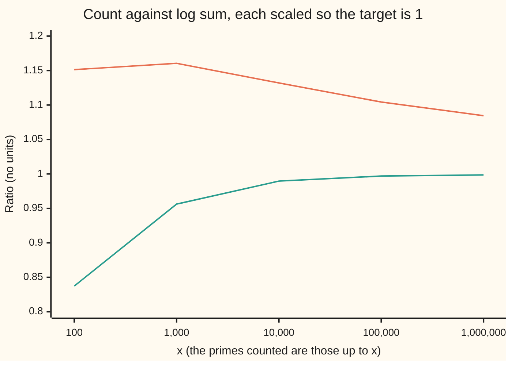

# Partial summation: trading a weighted sum for an integral against a running total

[Syllabus](../../../SYLLABUS.md) → [Algebraic and analytic number theory](../README.md) → [Arithmetic Functions Again](../README.md#s01) → Partial summation

---

## General Overview

A sieve finds 78,498 primes below a million. Number theorists often want a different total: the sum of the logarithms of those same primes. It comes to 998,484.175.

Why the second total? Every whole number n up to a million has a "chance" of about one in log n of being prime, where log is the natural logarithm, so each prime p is weighted by log p to undo that thinning. With that weight the total of the primes up to a number x grows like x itself, a straight line. The plain count grows like x/log x, a curve that bends. Straight lines are easier to prove things about, so proofs about primes are run on the log sum, and the answers are then turned back into counts.

The first guess at the conversion is to give every prime the logarithm of a million, 13.8155: 78,498 × 13.8155 gives 1,084,489.948. That is 8.614 percent too high, because most primes below a million are much smaller than a million and have smaller logarithms.

Partial summation measures the overshoot exactly. It is an area: 86,005.773, the area under the running prime count divided by t, from 2 to a million. Subtract it and the true log sum comes out to the last decimal.

The same trick runs backwards. Divide the log sum by log 1,000,000, add a second area, and the count 78,498 comes back exactly.

**Partial summation rewrites a weighted sum as the final running total times the final weight, minus the area under the running total multiplied by how fast the weight changes.**

**What kind of fact this is:** a theorem, an exact identity for every finite sum, proved on this card in Why it works. The code checks it to three decimals at a million; that check is a test of the arithmetic, not extra evidence for the identity. The card also proves that the two forms of the prime number theorem, θ(x) ~ x and π(x) ~ x/log x, imply each other. The theorem itself is proved on [The prime number theorem](../02-The%20Zeta%20Function%20and%20the%20Prime%20Number%20Theorem/05-prime-number-theorem-proved.md) card, not here.

### The picture: two ways of measuring the primes

Both lines are ratios that the prime number theorem sends to 1. The log sum gets there much faster.



The orange line, on top, is the count scaled: π(x) log x / x. The green line, below, is the log sum scaled: θ(x)/x. At a million they still differ by 0.0860. Partial summation says exactly what that gap is: the area 86,005.773 divided by a million.

---

## The formula

Notation first, in words. An **arithmetic function** $`a(n)`$ attaches a number to each whole number n; here it is 1 at a prime and 0 elsewhere. Its **running total** $`A(x)`$ adds $`a(n)`$ over every whole number n up to x. This card introduces A(x); for the prime indicator, A(x) is the prime count π(x) of wing 02.

A smooth weight $`f`$ multiplies each term. **Abel's identity**, the formula of partial summation, says that for $`y < x`$:

```math
\sum_{y < n \le x} a(n)\,f(n) \;=\; A(x)\,f(x) \;-\; A(y)\,f(y) \;-\; \int_y^x A(t)\,f'(t)\,dt
```

**Read it aloud:** the weighted sum equals the final running total times the final weight, minus the starting total times the starting weight, minus the area under the running total times the slope of the weight.

Two choices of $`a`$ and $`f`$ give the two directions of this card. Here $`\theta(x)`$, Chebyshev's theta function from [The von Mangoldt function](04-von-mangoldt-and-the-logarithmic-derivative.md), is the sum of log p over all primes p up to x, and log is the natural logarithm, as everywhere in this wing.

**Count to log sum.** Take a(n) = 1 on primes and $`f(t) = \log t`$:

```math
\theta(x) = \pi(x)\log x - \int_2^x \frac{\pi(t)}{t}\,dt
```

**Read it aloud:** the log sum is the count times the largest logarithm, minus the area under the count divided by t.

**Log sum to count.** Take a(n) = log n on primes, so that A is θ, and $`f(t) = 1/\log t`$:

```math
\pi(x) = \frac{\theta(x)}{\log x} + \int_2^x \frac{\theta(t)}{t\,\log^2 t}\,dt
```

**Read it aloud:** the count is the log sum divided by the largest logarithm, plus the area under the log sum divided by t times the square of log t.

| Symbol | Plain meaning | In our example | Push it up and the answer… |
| --- | --- | --- | --- |
| $`n`$, $`p`$, $`k`$, $`p_k`$ | a whole number; a prime; a counter; the k-th prime | n up to a million; p_4 = 7 | — |
| $`a(n)`$ | the arithmetic function: the amount attached to n | 1 at each prime (count to log sum) | each term grows |
| $`A(x)`$ | running total of a(n) for n up to x | π(x) = 78,498, or θ(x) | the first term grows |
| $`f(t)`$ | the smooth weight on each term | log t, or 1/log t | the sum grows |
| $`f'(t)`$ | the slope of the weight | 1/t, or −1/(t log² t) | the area taken off grows |
| $`x`$, $`y`$ | top and bottom of the range | x = 1,000,000; y below 2 | more terms |
| $`t`$ | the variable of the integral, any real number | runs from 2 to a million | — |
| $`\pi(x)`$ | the number of primes up to x | 78,498 | — |
| $`\theta(x)`$ | sum of log p over primes up to x | 998,484.175 | — |
| $`\log`$ | natural logarithm, base e | log 1,000,000 = 13.8155 | — |
| $`\mathrm{Li}(x)`$ | offset logarithmic integral: area under 1/log t from 2 to x | 78,626.504 | — |
| $`\sim`$, $`\ll`$ | f ~ g: f/g tends to 1; f ≪ g: f is at most a constant times g | θ(x) ~ x | — |

### When it holds

- **The weight has a continuous slope from y to x.** Then the integral with $`f'`$ is an ordinary integral. Let the weight jump and the formula misses the jump. With weight 1 for primes up to 500,000 and 2 above, the true sum is 115,458; the slope-only formula gives 156,996. The jump adds its own term, minus A(500,000) = 41,538 times the jump of 1, and that restores 115,458.
- **The starting term is kept.** The term $`A(y)f(y)`$ is zero when y is below the first n with a(n) ≠ 0. For primes that means y below 2. Start at y = 2 and drop the term, and the prime 2 falls out of the sum.
- **A(t) is the true running total at every real t, not a smooth stand-in.** A(t) is a staircase: flat between whole numbers, jumping at each n where a(n) ≠ 0. Put the smooth guess θ(t) = t into the log-sum-to-count formula and the identity becomes an estimate: 78,629.389 instead of 78,498.
- **The identity is exact for any numbers a(n).** No growth or sign condition is needed, since the sum is finite. Turning a size estimate on one side into one on the other is different: it needs a bound on the integral, as Step 6 below shows.

---

## Why it works

### Step 0: summing against a running total is integrating

Each term a(n) is a jump of the running total: a(n) = A(n) − A(n − 1). So the weighted sum is "weight times jump" added up, which is an integral against A. Integrals of a product can be moved with integration by parts, and this is that move.

### Step 1: the sum is a Stieltjes integral

[Stieltjes integrals](../../06-Calculus%20and%20analysis/08-Multiple%20Integrals/06-riemann-stieltjes-integral.md) integrate f against a running total, and each jump of the running total turns into one term. A jumps by a(n) at each n, so

```math
\sum_{y < n \le x} a(n)\,f(n) = \int_y^x f(t)\,dA(t)
```

The same card notes that integration by parts holds for such integrals. With $`dA`$ swapped for $`df = f'(t)\,dt`$, that is Abel's identity. The steps below prove it without the Stieltjes machinery.

### Step 2: write each weight as its end value minus a slope integral

The fundamental theorem of calculus gives, for each n between y and x:

```math
f(n) = f(x) - \int_n^x f'(t)\,dt
```

Multiply by a(n) and add over n. The first part gives $`(A(x) - A(y))\,f(x)`$. The second part adds $`a(n)\,f'(t)`$ over every pair with n ≤ t. For a fixed t, the a(n) with y < n ≤ t add up to $`A(t) - A(y)`$. Collect terms and Abel's identity appears. The fold has the algebra.

<details>
<summary>Detailed proof: Abel's identity in four lines</summary>

Let $`y < x`$, let $`f`$ have a continuous derivative on $`[y, x]`$, and let $`a(n)`$ be any numbers.

$`\displaystyle \sum_{y<n\le x} a(n) f(n) = \sum_{y<n\le x} a(n)\Bigl(f(x) - \int_n^x f'(t)\,dt\Bigr) = \bigl(A(x)-A(y)\bigr) f(x) - \int_y^x \Bigl(\sum_{y<n\le t} a(n)\Bigr) f'(t)\,dt`$

The swap of the finite sum and the integral is allowed because there are finitely many terms. The inner sum is $`A(t) - A(y)`$, so

$`\displaystyle \sum_{y<n\le x} a(n) f(n) = \bigl(A(x)-A(y)\bigr) f(x) - \int_y^x A(t) f'(t)\,dt + A(y)\bigl(f(x)-f(y)\bigr)`$

The two $`A(y)f(x)`$ terms cancel, which leaves $`A(x)f(x) - A(y)f(y) - \int_y^x A(t) f'(t)\,dt`$. $`\blacksquare`$

</details>

### Step 3: count to log sum

Take a(n) = 1 at primes, 0 elsewhere, so A(t) = π(t). Take f(t) = log t, so f'(t) = 1/t. Pick y = 1.5: there are no primes up to 1.5, so A(y) = 0, and π(t) = 0 from 1.5 to 2. The left side is θ(x). Abel's identity gives θ(x) = π(x) log x − the integral of π(t)/t from 2 to x.

### Step 4: log sum to count

Take a(n) = log n at primes, 0 elsewhere, so A(t) = θ(t). Take f(t) = 1/log t; its slope is $`f'(t) = -1/(t\log^2 t)`$. The left side adds log p × 1/log p = 1 per prime: it is π(x). The minus sign in Abel's identity meets the minus sign in f', which is why this formula has a plus.

### Step 5: on a staircase the integral is a finite sum

π(t) is flat between primes. If $`p_k`$ is the k-th prime, π(t) = k from $`p_k`$ up to the next prime $`p_{k+1}`$. The area of π(t)/t over that stretch is $`k\log(p_{k+1}/p_k)`$.

So the integral is a finite list of logarithms, and the code computes it exactly. The same holds for θ(t)/(t log² t), whose piece over a stretch is θ(p_k) times $`1/\log p_k - 1/\log p_{k+1}`$.

### Step 6: both directions for sizes, not just exact values

The prime number theorem has two standard forms. Write f ~ g, read "f/g tends to 1", as on [Big O and twiddle](01-asymptotic-notation-and-error-terms.md), and f ≪ g for "f is at most a constant times g".

**Theorem.** θ(x) ~ x holds exactly when π(x) ~ x/log x holds. [The von Mangoldt function](04-von-mangoldt-and-the-logarithmic-derivative.md) states the same equivalence and cites this proof for it.

- **If π(t) ~ t/log t.** Then π(t)/t ≤ 2/log t for all large t. Split the integral in Step 3 at √x. Below √x, π(t) ≤ t, so that part is at most √x. Above √x, π(t)/t ≤ 2/log t ≤ 4/log x, so that part is at most 4x/log x. The whole integral is ≪ x/log x. Divide Step 3 by x: θ(x)/x is π(x) log x / x minus something ≪ 1/log x, so it tends to 1.
- **If θ(t) ~ t.** Then θ(t) ≤ 2t for all large t. Split the integral in Step 4 at √x. Below √x, θ(t) ≤ t log t, since there are at most t primes and each log p ≤ log t, so that part is at most √x/log 2. Above √x, the integrand is at most 2/log² t ≤ 8/log² x, so that part is at most 8x/log² x. Multiply Step 4 by log x / x: π(x) log x / x is θ(x)/x plus something ≪ 1/log x, so it tends to 1.

The proof needs no knowledge of how big π or θ really is. It only converts one claim into the other. The picture shows the conversion at work. The two scaled lines differ by exactly the area divided by x: 0.0860 at a million. That gap is the "≪ 1/log x" term, and it closes slowly.

---

## Worked numbers, by hand

Take x = 10, with the four primes 2, 3, 5 and 7. Steps 3 and 5 give θ(10) from π; Steps 4 and 5 run it back.

| Step | Arithmetic | Value |
| --- | --- | --- |
| π = 1 from 2 to 3 | 1 × log(3/2) | 0.4055 |
| π = 2 from 3 to 5 | 2 × log(5/3) | 1.0217 |
| π = 3 from 5 to 7 | 3 × log(7/5) | 1.0094 |
| π = 4 from 7 to 10 | 4 × log(10/7) | 1.4267 |
| area under π(t)/t | 0.4055 + 1.0217 + 1.0094 + 1.4267 | 3.8632 |
| count times largest log | π(10) log 10 = 4 × log 10 | 9.2103 |
| θ(10) by Abel | 9.2103 − 3.8632 | **5.3471** |
| θ(10) directly | log 2 + log 3 + log 5 + log 7 = log 210 | 5.3471 |
| back: θ(10)/log 10 | 5.3471 / log 10 | 2.3222 |
| back: area under θ(t)/(t log² t) | four staircase pieces, as in Step 5 | 1.6778 |
| π(10) by Abel | 2.3222 + 1.6778 | **4.0000** |

The log of the product of the primes up to 10 comes out of their count and an area, and the count comes back out of the log sum. At a million the same steps, by machine, give 1,084,489.948 − 86,005.773 = 998,484.175, and in reverse 72,272.695 + 6,225.305 = 78,498.000.

The reverse direction also explains the shortfall of x/log x. Split θ(x) into x plus its error: π(x) = x/log x + (θ(x) − x)/log x + the area. At a million that is 72,382.414 − 109.719 + 6,225.305. The 7.791 percent that x/log x misses comes from the area term; θ falling short of x takes 109.719 back off.

### What breaks if you drop a piece

| Mistake | Comes out at | What went wrong |
| --- | --- | --- |
| θ(x) taken as π(x) log x | 1,084,489.948 | The area is dropped: every prime treated as if it were near a million, 8.614 percent high |
| The area added, not taken away | 1,170,495.721 | Sign of integration by parts reversed |
| π(x) taken as θ(x)/log x | 72,272.695 | The area is dropped the other way: small primes have small logs, 7.931 percent low |
| Weight jumping from 1 to 2 at 500,000, slope term only | 156,996, not 115,458 | The weight has no slope at the jump; the jump term −41,538 is missing |

---

## Code, from first principles, and it actually runs

Both programs sieve the primes up to a million and build the two running totals, π(n) and θ(n), for every n. They then reach θ(1,000,000) by three independent roads: (1) adding log p directly; (2) Abel's identity, with the integral done exactly on the staircase; (3) Abel's identity, with the integral done by a midpoint rule that samples π(t) blindly at 400,000 points and knows nothing about where the primes are. They run the same three roads backwards to recover 78,498. A Simpson rule computes Li(x), the offset logarithmic integral, to confirm that the smooth substitution θ(t) = t gives Li(x) + 2/log 2.

### Python

```python
# Partial summation (Abel's identity) in both directions: prime count pi(x) <-> log sum theta(x).
# Roads: a direct sum over sieved primes; Abel's identity with its integral done exactly on the steps;
# Abel's identity with the integral done by a midpoint rule that knows nothing about where the steps are.
from math import log, exp

X = 1_000_000
sieve = bytearray([1]) * (X + 1)
sieve[0] = sieve[1] = 0
for i in range(2, int(X ** 0.5) + 1):
    if sieve[i]:
        sieve[i * i :: i] = bytearray(len(range(i * i, X + 1, i)))
primes = [n for n in range(X + 1) if sieve[n]]
pc = [0] * (X + 1)     # pc[n] = pi(n), the running count
th = [0.0] * (X + 1)   # th[n] = theta(n), the running log sum
c, s = 0, 0.0
for n in range(X + 1):
    if sieve[n]:
        c += 1
        s += log(n)
    pc[n], th[n] = c, s

def add(values):   # plain left-to-right sum (Python's sum() compensates; Rust's loop does not)
    total = 0.0
    for v in values:
        total += v
    return total

def abel_theta(x, ps):
    """theta(x) = pi(x) log x - integral_2^x pi(t)/t dt, integral exact: pi(t) = k on [p_k, p_k+1)."""
    integral = add(k * (log(ps[k]) - log(ps[k - 1])) for k in range(1, len(ps)))
    integral += len(ps) * (log(x) - log(ps[-1]))
    return len(ps) * log(x) - integral, integral

def abel_pi(x, ps):
    """pi(x) = theta(x)/log x + integral_2^x theta(t)/(t log^2 t) dt; on a step, antiderivative is -1/log t."""
    run, integral = 0.0, 0.0
    for k in range(len(ps)):
        run += log(ps[k])
        top = ps[k + 1] if k + 1 < len(ps) else x
        integral += run * (1 / log(ps[k]) - 1 / log(top))
    return run / log(x) + integral, integral

def midpoint(g, a, b, m):
    h = (b - a) / m
    return h * add(g(a + (i + 0.5) * h) for i in range(m))

def simpson(g, a, b, m):
    h = (b - a) / m
    return h / 3 * (g(a) + g(b) + add((4 if i % 2 else 2) * g(a + i * h) for i in range(1, m)))

# ---- by hand: x = 10, primes 2, 3, 5, 7 ----
small = [2, 3, 5, 7]
th10, i10 = abel_theta(10, small)
pi10, j10 = abel_pi(10, small)
print("hand, x = 10, primes 2 3 5 7")
ends = small + [10]
for k in range(1, 5):
    label = f"hand, pi = {k} on [{ends[k-1]}, {ends[k]}): {k} log({ends[k]}/{ends[k-1]})"
    print(f"{label:<36} {k * log(ends[k] / ends[k-1]):10.4f}")
print(f"hand, pi(10) log 10                  {4 * log(10):10.4f}")
print(f"hand, integral of pi(t)/t, 2 to 10   {i10:10.4f}")
print(f"hand, theta(10) by Abel              {th10:10.4f}")
print(f"hand, theta(10) = log 210            {log(210):10.4f}")
print(f"hand, theta(10)/log 10               {th10 / log(10):10.4f}")
print(f"hand, integral theta/(t log^2 t)     {j10:10.4f}")
print(f"hand, pi(10) by Abel                 {pi10:10.4f}")

# ---- a million: count -> log sum ----
L = log(X)
theta_direct = th[X]
theta_abel, int1 = abel_theta(X, primes)
int1_mid = midpoint(lambda u: pc[int(exp(u))], log(2), L, 400_000)
print()
print(f"pi(1000000) by sieve                 {len(primes):14d}")
print(f"1 theta, direct sum of log p         {theta_direct:14.3f}")
print(f"  log x                              {L:14.4f}")
print(f"  pi(x) log x                        {len(primes) * L:14.3f}")
print(f"  integral pi(t)/t, exact steps      {int1:14.3f}")
print(f"  integral pi(t)/t, midpoint rule    {int1_mid:14.3f}")
print(f"  area / x, the gap between ratios   {int1 / X:14.4f}")
print(f"2 theta by Abel, exact steps         {theta_abel:14.3f}")
print(f"3 theta by Abel, midpoint rule       {len(primes) * L - int1_mid:14.3f}")
# ---- a million: log sum -> count ----
pi_abel, int2 = abel_pi(X, primes)
int2_mid = midpoint(lambda u: th[int(exp(u))] / (u * u), log(2), L, 400_000)
print(f"  theta(x)/log x                     {theta_direct / L:14.3f}")
print(f"  integral theta/(t log^2 t), steps  {int2:14.3f}")
print(f"  integral, midpoint rule            {int2_mid:14.3f}")
print(f"2 pi by Abel, exact steps            {pi_abel:14.3f}")
print(f"3 pi by Abel, midpoint rule          {theta_direct / L + int2_mid:14.3f}")
# ---- where x/log x loses 7.8 percent: pi = x/log x + (theta - x)/log x + integral ----
li_off = simpson(lambda u: exp(u) / u, log(2), L, 20_000)
sub = X / L + simpson(lambda u: exp(u) / (u * u), log(2), L, 20_000)
print(f"  x/log x                            {X / L:14.3f}")
print(f"  (theta(x) - x)/log x               {(theta_direct - X) / L:14.3f}")
print(f"  theta(t) = t put in: x/log x + int {sub:14.3f}")
print(f"  Li(x) by Simpson                   {li_off:14.3f}")
print(f"  Li(x) + 2/log 2                    {li_off + 2 / log(2):14.3f}")

# ---- the two ratios at several sizes ----
print()
print(f"{'x':>9} {'pi(x)':>7} {'theta(x)':>12} {'theta/x':>8} {'x - theta':>10} {'pi log x/x':>11}")
for x in (100, 1000, 10_000, 100_000, X):
    print(f"{x:>9} {pc[x]:>7} {th[x]:>12.3f} {th[x] / x:>8.4f} {x - th[x]:>10.3f} {pc[x] * log(x) / x:>11.4f}")

# ---- what breaks ----
half = pc[X // 2]
jump_true = sum(1 if p <= X // 2 else 2 for p in primes)   # weight 1 up to 500,000, then 2
jump_naive = 2 * len(primes)                               # A(x) f(x), f' = 0 away from the jump
jump_stieltjes = jump_naive - half * 1                     # the jump of size 1 adds -A(500000) x 1
print()
print(f"wrong: theta = pi(x) log x           {len(primes) * L:14.3f}")
print(f"  overshoot, percent of theta        {100 * (len(primes) * L - theta_direct) / theta_direct:14.3f}")
print(f"wrong: integral added, not taken     {len(primes) * L + int1:14.3f}")
print(f"wrong: pi = theta(x)/log x           {theta_direct / L:14.3f}")
print(f"  shortfall, percent of pi(x)        {100 * (len(primes) - theta_direct / L) / len(primes):14.3f}")
print(f"  x/log x shortfall, percent         {100 * (len(primes) - X / L) / len(primes):14.3f}")
print(f"jump weight: A(500000) = pi(500000)  {half:14d}")
print(f"jump weight: true sum                {jump_true:14d}")
print(f"jump weight: f' only, jump ignored   {jump_naive:14d}")
print(f"jump weight: jump term -A(500000)    {jump_stieltjes:14d}")
# ---- try changing ----
recip_direct = add(1 / p for p in primes)
recip_abel = len(primes) / X + add(k * (1 / primes[k - 1] - 1 / primes[k]) for k in range(1, len(primes))) \
    + len(primes) * (1 / primes[-1] - 1 / X)
print(f"try: sum of 1/p, direct              {recip_direct:14.6f}")
print(f"try: sum of 1/p, Abel                {recip_abel:14.6f}")
print(f"try: theta by midpoint, 4000 steps  {len(primes) * L - midpoint(lambda u: pc[int(exp(u))], log(2), L, 4000):14.3f}")

assert len(primes) == 78498,                        "the published count of primes below a million"
assert abs(th10 - log(210)) < 1e-12,                "hand case: Abel equals the log of 2*3*5*7"
assert abs(theta_abel - theta_direct) < 1e-6,       "Abel with exact steps vs direct sum"
assert abs(len(primes) * L - int1_mid - theta_direct) < 0.5, "Abel by blind midpoint rule vs direct sum"
assert abs(pi_abel - len(primes)) < 1e-6,           "reverse direction returns the sieve count"
assert abs(theta_direct / L + int2_mid - len(primes)) < 0.5, "reverse, midpoint rule"
assert abs(sub - (li_off + 2 / log(2))) < 1e-6,     "theta = t gives Li(x) + 2/log 2"
assert jump_stieltjes == jump_true != jump_naive,   "a jump in the weight needs its own term"
assert abs(recip_abel - recip_direct) < 1e-9,       "sum of 1/p two ways"
print("ALL CHECKS PASS")
```

**Ran 2026-11-15 on macOS, Python 3.14.10, standard library only. All checks passed. Output, pasted from the run:**

```
hand, x = 10, primes 2 3 5 7
hand, pi = 1 on [2, 3): 1 log(3/2)       0.4055
hand, pi = 2 on [3, 5): 2 log(5/3)       1.0217
hand, pi = 3 on [5, 7): 3 log(7/5)       1.0094
hand, pi = 4 on [7, 10): 4 log(10/7)     1.4267
hand, pi(10) log 10                      9.2103
hand, integral of pi(t)/t, 2 to 10       3.8632
hand, theta(10) by Abel                  5.3471
hand, theta(10) = log 210                5.3471
hand, theta(10)/log 10                   2.3222
hand, integral theta/(t log^2 t)         1.6778
hand, pi(10) by Abel                     4.0000

pi(1000000) by sieve                          78498
1 theta, direct sum of log p             998484.175
  log x                                     13.8155
  pi(x) log x                           1084489.948
  integral pi(t)/t, exact steps           86005.773
  integral pi(t)/t, midpoint rule         86005.767
  area / x, the gap between ratios           0.0860
2 theta by Abel, exact steps             998484.175
3 theta by Abel, midpoint rule           998484.180
  theta(x)/log x                          72272.695
  integral theta/(t log^2 t), steps        6225.305
  integral, midpoint rule                  6225.305
2 pi by Abel, exact steps                 78498.000
3 pi by Abel, midpoint rule               78498.000
  x/log x                                 72382.414
  (theta(x) - x)/log x                     -109.719
  theta(t) = t put in: x/log x + int      78629.389
  Li(x) by Simpson                        78626.504
  Li(x) + 2/log 2                         78629.389

        x   pi(x)     theta(x)  theta/x  x - theta  pi log x/x
      100      25       83.728   0.8373     16.272      1.1513
     1000     168      956.245   0.9562     43.755      1.1605
    10000    1229     9895.991   0.9896    104.009      1.1320
   100000    9592    99685.389   0.9969    314.611      1.1043
  1000000   78498   998484.175   0.9985   1515.825      1.0845

wrong: theta = pi(x) log x              1084489.948
  overshoot, percent of theta                 8.614
wrong: integral added, not taken        1170495.721
wrong: pi = theta(x)/log x                72272.695
  shortfall, percent of pi(x)                 7.931
  x/log x shortfall, percent                  7.791
jump weight: A(500000) = pi(500000)           41538
jump weight: true sum                        115458
jump weight: f' only, jump ignored           156996
jump weight: jump term -A(500000)            115458
try: sum of 1/p, direct                    2.887328
try: sum of 1/p, Abel                      2.887328
try: theta by midpoint, 4000 steps      998484.315
ALL CHECKS PASS
```

### Rust

```rust
// Partial summation (Abel's identity) in both directions: prime count pi(x) <-> log sum theta(x).
// Roads: a direct sum over sieved primes; Abel's identity with its integral done exactly on the steps;
// Abel's identity with the integral done by a midpoint rule that knows nothing about where the steps are.
const X: usize = 1_000_000;

// theta(x) = pi(x) log x - integral_2^x pi(t)/t dt, integral exact: pi(t) = k on [p_k, p_k+1).
fn abel_theta(x: f64, ps: &[usize]) -> (f64, f64) {
    let mut integral = 0.0;
    for k in 1..ps.len() {
        integral += k as f64 * ((ps[k] as f64).ln() - (ps[k - 1] as f64).ln());
    }
    let n = ps.len() as f64;
    integral += n * (x.ln() - (ps[ps.len() - 1] as f64).ln());
    (n * x.ln() - integral, integral)
}

// pi(x) = theta(x)/log x + integral_2^x theta(t)/(t log^2 t) dt; on a step, antiderivative is -1/log t.
fn abel_pi(x: f64, ps: &[usize]) -> (f64, f64) {
    let (mut run, mut integral) = (0.0, 0.0);
    for k in 0..ps.len() {
        run += (ps[k] as f64).ln();
        let top = if k + 1 < ps.len() { ps[k + 1] as f64 } else { x };
        integral += run * (1.0 / (ps[k] as f64).ln() - 1.0 / top.ln());
    }
    (run / x.ln() + integral, integral)
}

fn midpoint(g: &dyn Fn(f64) -> f64, a: f64, b: f64, m: usize) -> f64 {
    let h = (b - a) / m as f64;
    let mut s = 0.0;
    for i in 0..m {
        s += g(a + (i as f64 + 0.5) * h);
    }
    h * s
}

fn simpson(g: &dyn Fn(f64) -> f64, a: f64, b: f64, m: usize) -> f64 {
    let h = (b - a) / m as f64;
    let mut s = 0.0;
    for i in 1..m {
        s += (if i % 2 == 1 { 4.0 } else { 2.0 }) * g(a + i as f64 * h);
    }
    h / 3.0 * (g(a) + g(b) + s)
}

fn main() {
    let mut sieve = vec![true; X + 1];
    (sieve[0], sieve[1]) = (false, false);
    let mut i = 2;
    while i * i <= X {
        if sieve[i] {
            let mut j = i * i;
            while j <= X {
                sieve[j] = false;
                j += i;
            }
        }
        i += 1;
    }
    let primes: Vec<usize> = (0..=X).filter(|&n| sieve[n]).collect();
    let (mut pc, mut th) = (vec![0usize; X + 1], vec![0.0f64; X + 1]);
    let (mut c, mut s) = (0usize, 0.0f64);
    for n in 0..=X {
        if sieve[n] {
            c += 1;
            s += (n as f64).ln();
        }
        pc[n] = c;
        th[n] = s;
    }
    let np = primes.len() as f64;

    // ---- by hand: x = 10, primes 2, 3, 5, 7 ----
    let small = [2usize, 3, 5, 7];
    let (th10, i10) = abel_theta(10.0, &small);
    let (pi10, j10) = abel_pi(10.0, &small);
    println!("hand, x = 10, primes 2 3 5 7");
    let ends = [2usize, 3, 5, 7, 10];
    for k in 1..5 {
        let label = format!("hand, pi = {} on [{}, {}): {} log({}/{})", k, ends[k - 1], ends[k], k, ends[k], ends[k - 1]);
        println!("{:<36} {:10.4}", label, k as f64 * (ends[k] as f64 / ends[k - 1] as f64).ln());
    }
    println!("hand, pi(10) log 10                  {:10.4}", 4.0 * 10f64.ln());
    println!("hand, integral of pi(t)/t, 2 to 10   {:10.4}", i10);
    println!("hand, theta(10) by Abel              {:10.4}", th10);
    println!("hand, theta(10) = log 210            {:10.4}", 210f64.ln());
    println!("hand, theta(10)/log 10               {:10.4}", th10 / 10f64.ln());
    println!("hand, integral theta/(t log^2 t)     {:10.4}", j10);
    println!("hand, pi(10) by Abel                 {:10.4}", pi10);

    // ---- a million: count -> log sum ----
    let xf = X as f64;
    let l = xf.ln();
    let theta_direct = th[X];
    let (theta_abel, int1) = abel_theta(xf, &primes);
    let int1_mid = midpoint(&|u: f64| pc[u.exp() as usize] as f64, 2f64.ln(), l, 400_000);
    println!();
    println!("pi(1000000) by sieve                 {:14}", primes.len());
    println!("1 theta, direct sum of log p         {:14.3}", theta_direct);
    println!("  log x                              {:14.4}", l);
    println!("  pi(x) log x                        {:14.3}", np * l);
    println!("  integral pi(t)/t, exact steps      {:14.3}", int1);
    println!("  integral pi(t)/t, midpoint rule    {:14.3}", int1_mid);
    println!("  area / x, the gap between ratios   {:14.4}", int1 / xf);
    println!("2 theta by Abel, exact steps         {:14.3}", theta_abel);
    println!("3 theta by Abel, midpoint rule       {:14.3}", np * l - int1_mid);
    // ---- a million: log sum -> count ----
    let (pi_abel, int2) = abel_pi(xf, &primes);
    let int2_mid = midpoint(&|u: f64| th[u.exp() as usize] / (u * u), 2f64.ln(), l, 400_000);
    println!("  theta(x)/log x                     {:14.3}", theta_direct / l);
    println!("  integral theta/(t log^2 t), steps  {:14.3}", int2);
    println!("  integral, midpoint rule            {:14.3}", int2_mid);
    println!("2 pi by Abel, exact steps            {:14.3}", pi_abel);
    println!("3 pi by Abel, midpoint rule          {:14.3}", theta_direct / l + int2_mid);
    // ---- where x/log x loses 7.8 percent: pi = x/log x + (theta - x)/log x + integral ----
    let li_off = simpson(&|u: f64| u.exp() / u, 2f64.ln(), l, 20_000);
    let sub = xf / l + simpson(&|u: f64| u.exp() / (u * u), 2f64.ln(), l, 20_000);
    println!("  x/log x                            {:14.3}", xf / l);
    println!("  (theta(x) - x)/log x               {:14.3}", (theta_direct - xf) / l);
    println!("  theta(t) = t put in: x/log x + int {:14.3}", sub);
    println!("  Li(x) by Simpson                   {:14.3}", li_off);
    println!("  Li(x) + 2/log 2                    {:14.3}", li_off + 2.0 / 2f64.ln());

    // ---- the two ratios at several sizes ----
    println!();
    println!("{:>9} {:>7} {:>12} {:>8} {:>10} {:>11}", "x", "pi(x)", "theta(x)", "theta/x", "x - theta", "pi log x/x");
    for &x in &[100usize, 1000, 10_000, 100_000, X] {
        let f = x as f64;
        println!("{:>9} {:>7} {:>12.3} {:>8.4} {:>10.3} {:>11.4}", x, pc[x], th[x], th[x] / f, f - th[x], pc[x] as f64 * f.ln() / f);
    }

    // ---- what breaks ----
    let half = pc[X / 2];
    let jump_true: usize = primes.iter().map(|&p| if p <= X / 2 { 1 } else { 2 }).sum();
    let jump_naive = 2 * primes.len();
    let jump_stieltjes = jump_naive - half;
    println!();
    println!("wrong: theta = pi(x) log x           {:14.3}", np * l);
    println!("  overshoot, percent of theta        {:14.3}", 100.0 * (np * l - theta_direct) / theta_direct);
    println!("wrong: integral added, not taken     {:14.3}", np * l + int1);
    println!("wrong: pi = theta(x)/log x           {:14.3}", theta_direct / l);
    println!("  shortfall, percent of pi(x)        {:14.3}", 100.0 * (np - theta_direct / l) / np);
    println!("  x/log x shortfall, percent         {:14.3}", 100.0 * (np - xf / l) / np);
    println!("jump weight: A(500000) = pi(500000)  {:14}", half);
    println!("jump weight: true sum                {:14}", jump_true);
    println!("jump weight: f' only, jump ignored   {:14}", jump_naive);
    println!("jump weight: jump term -A(500000)    {:14}", jump_stieltjes);
    // ---- try changing ----
    let recip_direct = primes.iter().fold(0.0, |acc, &p| acc + 1.0 / p as f64);
    let mut steps = 0.0;
    for k in 1..primes.len() {
        steps += k as f64 * (1.0 / primes[k - 1] as f64 - 1.0 / primes[k] as f64);
    }
    let recip_abel = np / xf + steps + np * (1.0 / primes[primes.len() - 1] as f64 - 1.0 / xf);
    println!("try: sum of 1/p, direct              {:14.6}", recip_direct);
    println!("try: sum of 1/p, Abel                {:14.6}", recip_abel);
    let coarse = midpoint(&|u: f64| pc[u.exp() as usize] as f64, 2f64.ln(), l, 4000);
    println!("try: theta by midpoint, 4000 steps  {:14.3}", np * l - coarse);

    assert!(primes.len() == 78498, "the published count of primes below a million");
    assert!((th10 - 210f64.ln()).abs() < 1e-12, "hand case: Abel equals the log of 2*3*5*7");
    assert!((theta_abel - theta_direct).abs() < 1e-6, "Abel with exact steps vs direct sum");
    assert!((np * l - int1_mid - theta_direct).abs() < 0.5, "Abel by blind midpoint rule vs direct sum");
    assert!((pi_abel - np).abs() < 1e-6, "reverse direction returns the sieve count");
    assert!((theta_direct / l + int2_mid - np).abs() < 0.5, "reverse, midpoint rule");
    assert!((sub - (li_off + 2.0 / 2f64.ln())).abs() < 1e-6, "theta = t gives Li(x) + 2/log 2");
    assert!(jump_stieltjes == jump_true && jump_true != jump_naive, "a jump in the weight needs its own term");
    assert!((recip_abel - recip_direct).abs() < 1e-9, "sum of 1/p two ways");
    println!("ALL CHECKS PASS");
}
```

**Ran 2026-11-15 on macOS, rustc 1.98.1, no crates. All checks passed. Output, pasted from the run:**

```
hand, x = 10, primes 2 3 5 7
hand, pi = 1 on [2, 3): 1 log(3/2)       0.4055
hand, pi = 2 on [3, 5): 2 log(5/3)       1.0217
hand, pi = 3 on [5, 7): 3 log(7/5)       1.0094
hand, pi = 4 on [7, 10): 4 log(10/7)     1.4267
hand, pi(10) log 10                      9.2103
hand, integral of pi(t)/t, 2 to 10       3.8632
hand, theta(10) by Abel                  5.3471
hand, theta(10) = log 210                5.3471
hand, theta(10)/log 10                   2.3222
hand, integral theta/(t log^2 t)         1.6778
hand, pi(10) by Abel                     4.0000

pi(1000000) by sieve                          78498
1 theta, direct sum of log p             998484.175
  log x                                     13.8155
  pi(x) log x                           1084489.948
  integral pi(t)/t, exact steps           86005.773
  integral pi(t)/t, midpoint rule         86005.767
  area / x, the gap between ratios           0.0860
2 theta by Abel, exact steps             998484.175
3 theta by Abel, midpoint rule           998484.180
  theta(x)/log x                          72272.695
  integral theta/(t log^2 t), steps        6225.305
  integral, midpoint rule                  6225.305
2 pi by Abel, exact steps                 78498.000
3 pi by Abel, midpoint rule               78498.000
  x/log x                                 72382.414
  (theta(x) - x)/log x                     -109.719
  theta(t) = t put in: x/log x + int      78629.389
  Li(x) by Simpson                        78626.504
  Li(x) + 2/log 2                         78629.389

        x   pi(x)     theta(x)  theta/x  x - theta  pi log x/x
      100      25       83.728   0.8373     16.272      1.1513
     1000     168      956.245   0.9562     43.755      1.1605
    10000    1229     9895.991   0.9896    104.009      1.1320
   100000    9592    99685.389   0.9969    314.611      1.1043
  1000000   78498   998484.175   0.9985   1515.825      1.0845

wrong: theta = pi(x) log x              1084489.948
  overshoot, percent of theta                 8.614
wrong: integral added, not taken        1170495.721
wrong: pi = theta(x)/log x                72272.695
  shortfall, percent of pi(x)                 7.931
  x/log x shortfall, percent                  7.791
jump weight: A(500000) = pi(500000)           41538
jump weight: true sum                        115458
jump weight: f' only, jump ignored           156996
jump weight: jump term -A(500000)            115458
try: sum of 1/p, direct                    2.887328
try: sum of 1/p, Abel                      2.887328
try: theta by midpoint, 4000 steps      998484.315
ALL CHECKS PASS
```

### Lean

Lean proves Abel's identity, both prime formulas and Step 6's theorem in every case the card states, plus the small counts below.

- Suppose y < x, and the weight f has a continuous slope f' from y to x. Then Abel's identity holds exactly, for any numbers a(n).
- Take x ≥ 2. Then θ(x) = π(x) log x minus the area under π(t)/t from 2 to x.
- Take x ≥ 2. Then π(x) = θ(x)/log x plus the area under θ(t)/(t log² t) from 2 to x.
- θ(x) ~ x holds exactly when π(x) ~ x/log x holds.
- The primes up to 10 are exactly 2, 3, 5 and 7, so π(10) = 4.
- The product of the primes up to 10 is 2 × 3 × 5 × 7 = 210.
- Take π(500,000) = 41,538 and π(1,000,000) = 78,498 as given. Then the jumping weight gives 115,458, the slope-only formula gives 2 × 78,498 = 156,996, and 156,996 − 41,538 = 115,458.

Every decimal value, the prime counts up to a million and the staircase sums of Step 5 are left to the Python and Rust checks.

```lean
-- Partial summation: Abel's identity turns a weighted sum into the final running total times the final weight minus an integral, and it carries the prime count π(x) to the log sum θ(x) and back, so θ(x) ~ x exactly when π(x) ~ x/log x.
import Mathlib.NumberTheory.Chebyshev
import Mathlib.NumberTheory.PrimeCounting
import Mathlib.Analysis.Asymptotics.AsymptoticEquivalent
import Mathlib.NumberTheory.AbelSummation

open Chebyshev Asymptotics Filter

/-- Helper: Abel's identity when the starting point y is nonnegative, from Mathlib's
`sum_mul_eq_sub_sub_integral_mul`. -/
theorem abel_identity_of_nonneg (a : ℕ → ℝ) {f f' : ℝ → ℝ} {y x : ℝ} (hy : 0 ≤ y) (hyx : y ≤ x)
    (hf : ∀ t ∈ Set.Icc y x, HasDerivAt f (f' t) t) (hf' : ContinuousOn f' (Set.Icc y x)) :
    ∑ n ∈ (Finset.Icc 1 ⌊x⌋₊).filter (fun n : ℕ => y < (n : ℝ)), a n * f n =
      (∑ n ∈ Finset.Icc 1 ⌊x⌋₊, a n) * f x - (∑ n ∈ Finset.Icc 1 ⌊y⌋₊, a n) * f y
        - ∫ t in y..x, (∑ n ∈ Finset.Icc 1 ⌊t⌋₊, a n) * f' t := by
  set c : ℕ → ℝ := fun n => if n = 0 then 0 else a n with hc
  have hA : ∀ m : ℕ, ∑ n ∈ Finset.Icc 1 m, a n = ∑ n ∈ Finset.Icc 0 m, c n := by
    intro m
    rw [Finset.Icc_eq_cons_Ioc (Nat.zero_le _), Finset.sum_cons, ← Finset.Icc_add_one_left_eq_Ioc]
    simp only [hc, ↓reduceIte, zero_add]
    refine Finset.sum_congr rfl fun n hn => ?_
    have : n ≠ 0 := by simp at hn; omega
    simp [this]
  have hderiv : ∀ t ∈ Set.Icc y x, deriv f t = f' t := fun t ht => (hf t ht).deriv
  have key := sum_mul_eq_sub_sub_integral_mul c hy hyx
    (fun t ht => (hf t ht).differentiableAt)
    (hf'.integrableOn_Icc.congr_fun (fun t ht => (hderiv t ht).symm) measurableSet_Icc)
  have hL : ∑ n ∈ (Finset.Icc 1 ⌊x⌋₊).filter (fun n : ℕ => y < (n : ℝ)), a n * f n =
      ∑ k ∈ Finset.Ioc ⌊y⌋₊ ⌊x⌋₊, f k * c k := by
    have hs : (Finset.Icc 1 ⌊x⌋₊).filter (fun n : ℕ => y < (n : ℝ)) = Finset.Ioc ⌊y⌋₊ ⌊x⌋₊ := by
      ext n
      simp only [Finset.mem_filter, Finset.mem_Icc, Finset.mem_Ioc, Nat.floor_lt hy]
      constructor
      · rintro ⟨⟨_, h2⟩, h3⟩; exact ⟨h3, h2⟩
      · rintro ⟨h3, h2⟩
        refine ⟨⟨?_, h2⟩, h3⟩
        have : (0 : ℝ) < n := lt_of_le_of_lt hy h3
        exact_mod_cast this
    rw [hs]
    refine Finset.sum_congr rfl fun n hn => ?_
    have : n ≠ 0 := by simp at hn; omega
    simp [hc, this, mul_comm]
  rw [hL, key, hA, hA, intervalIntegral.integral_of_le hyx]
  rw [MeasureTheory.setIntegral_congr_fun measurableSet_Ioc
    (g := fun t => (∑ n ∈ Finset.Icc 1 ⌊t⌋₊, a n) * f' t)
    (fun t ht => by simp only; rw [hderiv t (Set.Ioc_subset_Icc_self ht), hA, mul_comm])]
  ring

#print axioms abel_identity_of_nonneg

/-- Helper: π(x) − θ(x)/log x is small next to x/log x. -/
theorem primeCounting_sub_theta_div_log_isLittleO :
    (fun x : ℝ => (Nat.primeCounting ⌊x⌋₊ : ℝ) - θ x / Real.log x) =o[atTop]
      (fun x => x / Real.log x) := by
  refine integral_theta_div_log_sq_isLittleO.congr' ?_ (EventuallyEq.refl _ _)
  filter_upwards [eventually_ge_atTop 2] with x hx
  rw [primeCounting_eq_theta_div_log_add_integral hx]
  ring

#print axioms primeCounting_sub_theta_div_log_isLittleO

/-- Abel's identity. Let a(n) be any numbers, one for each whole number n ≥ 1, and let
A(t) = ∑_{1 ≤ n ≤ t} a(n) be their running total. If the weight f has a continuous slope f'
on [y, x], with y < x, then the weighted sum over y < n ≤ x equals the final running total
times the final weight, minus the starting total times the starting weight, minus the area
under the running total times the slope of the weight:
∑_{y < n ≤ x} a(n) f(n) = A(x) f(x) − A(y) f(y) − ∫_y^x A(t) f'(t) dt. -/
theorem abel_identity (a : ℕ → ℝ) {f f' : ℝ → ℝ} {y x : ℝ} (hyx : y < x)
    (hf : ∀ t ∈ Set.Icc y x, HasDerivAt f (f' t) t) (hf' : ContinuousOn f' (Set.Icc y x)) :
    ∑ n ∈ (Finset.Icc 1 ⌊x⌋₊).filter (fun n : ℕ => y < (n : ℝ)), a n * f n =
      (∑ n ∈ Finset.Icc 1 ⌊x⌋₊, a n) * f x - (∑ n ∈ Finset.Icc 1 ⌊y⌋₊, a n) * f y
        - ∫ t in y..x, (∑ n ∈ Finset.Icc 1 ⌊t⌋₊, a n) * f' t := by
  rcases le_or_gt 0 y with hy | hy
  · exact abel_identity_of_nonneg a hy hyx.le hf hf'
  have hzero : ∀ t : ℝ, t ≤ 0 → (∑ n ∈ Finset.Icc 1 ⌊t⌋₊, a n) * f' t = 0 := by
    intro t ht
    simp [Nat.floor_eq_zero.mpr (lt_of_le_of_lt ht one_pos)]
  have hAy : ∑ n ∈ Finset.Icc 1 ⌊y⌋₊, a n = 0 := by
    simp [Nat.floor_eq_zero.mpr (lt_trans hy one_pos)]
  rcases le_or_gt x 0 with hx | hx
  · have hfx : ⌊x⌋₊ = 0 := Nat.floor_eq_zero.mpr (lt_of_le_of_lt hx one_pos)
    have hI : ∫ t in y..x, (∑ n ∈ Finset.Icc 1 ⌊t⌋₊, a n) * f' t = ∫ t in y..x, (0 : ℝ) :=
      intervalIntegral.integral_congr fun t ht => by
        rw [Set.uIcc_of_le hyx.le] at ht
        exact hzero t (ht.2.trans hx)
    rw [hI, hAy, hfx]
    simp
  · have h0 := abel_identity_of_nonneg a le_rfl hx.le
      (fun t ht => hf t ⟨hy.le.trans ht.1, ht.2⟩)
      (hf'.mono fun t ht => ⟨hy.le.trans ht.1, ht.2⟩)
    have hs : (Finset.Icc 1 ⌊x⌋₊).filter (fun n : ℕ => y < (n : ℝ)) =
        (Finset.Icc 1 ⌊x⌋₊).filter (fun n : ℕ => (0 : ℝ) < (n : ℝ)) := by
      ext n
      simp only [Finset.mem_filter, Finset.mem_Icc]
      constructor
      · rintro ⟨⟨h1, h2⟩, _⟩
        exact ⟨⟨h1, h2⟩, by exact_mod_cast h1⟩
      · rintro ⟨⟨h1, h2⟩, h3⟩
        exact ⟨⟨h1, h2⟩, hy.trans h3⟩
    have hint0 : IntervalIntegrable (fun t => (∑ n ∈ Finset.Icc 1 ⌊t⌋₊, a n) * f' t)
        MeasureTheory.volume y 0 := by
      rw [intervalIntegrable_iff_integrableOn_Icc_of_le hy.le]
      exact (MeasureTheory.integrableOn_zero).congr_fun
        (fun t ht => (hzero t ht.2).symm) measurableSet_Icc
    have hzero' : ∫ t in y..0, (∑ n ∈ Finset.Icc 1 ⌊t⌋₊, a n) * f' t = 0 := by
      rw [intervalIntegral.integral_congr (g := fun _ => (0 : ℝ)) fun t ht => by
        rw [Set.uIcc_of_le hy.le] at ht
        exact hzero t ht.2]
      simp
    have hint1 : IntervalIntegrable (fun t => (∑ n ∈ Finset.Icc 1 ⌊t⌋₊, a n) * f' t)
        MeasureTheory.volume 0 x := by
      rw [intervalIntegrable_iff_integrableOn_Icc_of_le hx.le]
      have h := integrableOn_mul_sum_Icc a (m := 1) le_rfl
        ((hf'.mono fun t (ht : t ∈ Set.Icc 0 x) => ⟨hy.le.trans ht.1, ht.2⟩).integrableOn_Icc)
      simpa only [mul_comm] using h
    rw [← intervalIntegral.integral_add_adjacent_intervals hint0 hint1, hzero', zero_add, hs,
      hAy, h0]
    simp

/-- The two directions of partial summation for primes, for every x ≥ 2.
Count to log sum: θ(x) = π(x) log x − ∫_2^x π(t)/t dt.
Log sum to count: π(x) = θ(x)/log x + ∫_2^x θ(t)/(t log² t) dt. -/
theorem theta_and_primeCounting_by_partial_summation {x : ℝ} (hx : 2 ≤ x) :
    θ x = (Nat.primeCounting ⌊x⌋₊ : ℝ) * Real.log x
        - ∫ t in (2 : ℝ)..x, (Nat.primeCounting ⌊t⌋₊ : ℝ) / t ∧
      (Nat.primeCounting ⌊x⌋₊ : ℝ) = θ x / Real.log x
        + ∫ t in (2 : ℝ)..x, θ t / (t * Real.log t ^ 2) := by
  exact ⟨theta_eq_primeCounting_mul_log_sub_integral hx,
    primeCounting_eq_theta_div_log_add_integral hx⟩

/-- The two forms of the prime number theorem imply each other: θ(x) ~ x holds exactly when
π(x) ~ x/log x holds, as x → ∞. -/
theorem theta_equiv_id_iff_primeCounting_equiv_div_log :
    (fun x : ℝ => θ x) ~[atTop] (fun x => x) ↔
      (fun x : ℝ => (Nat.primeCounting ⌊x⌋₊ : ℝ)) ~[atTop] (fun x => x / Real.log x) := by
  have hE := primeCounting_sub_theta_div_log_isLittleO
  constructor
  · intro h
    have h1 : (fun x : ℝ => θ x / Real.log x) ~[atTop] (fun x => x / Real.log x) :=
      h.div IsEquivalent.refl
    have h2 := h1.add_isLittleO hE
    refine h2.congr_left (Eventually.of_forall fun x => ?_)
    simp
  · intro h
    have h1 : (fun x : ℝ => θ x / Real.log x) ~[atTop] (fun x => x / Real.log x) := by
      have h2 := h.sub_isLittleO hE
      refine h2.congr_left (Eventually.of_forall fun x => ?_)
      simp
    have h3 := h1.mul (IsEquivalent.refl (u := fun x : ℝ => Real.log x))
    refine (h3.congr_left ?_).congr_right ?_
    · filter_upwards [eventually_gt_atTop 1] with x hx
      have : Real.log x ≠ 0 := (Real.log_pos hx).ne'
      simp only [Pi.mul_apply]
      field_simp
    · filter_upwards [eventually_gt_atTop 1] with x hx
      have : Real.log x ≠ 0 := (Real.log_pos hx).ne'
      simp only [Pi.mul_apply]
      field_simp

-- The hand case x = 10: the primes up to 10 are 2, 3, 5 and 7, so π(10) = 4.
example : (Finset.range 11).filter Nat.Prime = {2, 3, 5, 7} := by decide
example : Nat.primeCounting 10 = 4 := by
  simp [Nat.primeCounting, Nat.primeCounting', Nat.count_eq_card_filter_range]
  decide

-- θ(10) = log 2 + log 3 + log 5 + log 7 = log 210, the log of the product of the primes up to 10.
example : primorial 10 = 210 := by decide
example : 2 * 3 * 5 * 7 = 210 := by norm_num

-- The jumping weight: 1 for primes up to 500,000, 2 above. With π(500,000) = 41,538 and
-- π(1,000,000) = 78,498, the true sum is 115,458; the slope-only formula gives 2 × 78,498 = 156,996;
-- the jump term −41,538 × 1 restores 115,458.
example : 41538 * 1 + (78498 - 41538) * 2 = 115458 := by norm_num
example : 2 * 78498 = 156996 := by norm_num
example : 156996 - 41538 * 1 = 115458 := by norm_num

#print axioms abel_identity
#print axioms theta_and_primeCounting_by_partial_summation
#print axioms theta_equiv_id_iff_primeCounting_equiv_div_log
```

**Checked 2026-11-15 on macOS, Lean 4.36.0-rc2, Mathlib v4.36.0-rc2. Every proof is complete and uses only Lean's standard axioms. Output, pasted from the run:**

```
'abel_identity_of_nonneg' depends on axioms: [propext, Classical.choice, Quot.sound]
'primeCounting_sub_theta_div_log_isLittleO' depends on axioms: [propext, Classical.choice, Quot.sound]
'abel_identity' depends on axioms: [propext, Classical.choice, Quot.sound]
'theta_and_primeCounting_by_partial_summation' depends on axioms: [propext, Classical.choice, Quot.sound]
'theta_equiv_id_iff_primeCounting_equiv_div_log' depends on axioms: [propext, Classical.choice, Quot.sound]
```

> [!TIP]
> **Try changing**
> - Guess first: is the log sum or the count closer to its target at x = 500,000? Add `X // 2` to the list of x in the table loop, after `100_000`. The new row gives θ(x)/x = 0.9986 and π(x) log x / x = 1.0902: the log sum is far closer.
> - Guess first: what is the sum of 1/p over the primes up to a million? Use a(n) = 1 at primes and f(t) = 1/t, so the identity becomes π(x)/x plus the area under π(t)/t². Both roads give 2.887328.
> - Guess first: how far off is the blind midpoint rule with fewer points? The `try: theta by midpoint` line already uses 4,000 points, 100 times fewer than road 3, and gives 998,484.315 against the true 998,484.175. Change both 4000s on that line to 400: it gives 998,485.683, still close. Each of the 78,498 jumps can cost up to half the spacing between sample points, but the jumps fall on both sides of those points, so their errors mostly cancel.
> - Guess first: move the weight's jump from 500,000 down to 250,000. Change both `X // 2` in the what-breaks block to `X // 4`; the printed labels still say 500000. The slope-only line stays at 156,996, because it never sees the jump. The true sum rises to 134,952, and taking off A(250,000) = 22,044 for the jump matches it again.

---

## The usual mistake

> [!warning]
> **Reading the identity as an approximation.** Abel's identity is exact. θ(x) is not "about" π(x) log x: the area term is 86,005.773 at a million, and the identity accounts for it to the last decimal. Drop it and θ comes out at 1,084,489.948.
>
> Smaller traps:
> - **The sign.** The area is subtracted in the count-to-log-sum direction. Adding it gives 1,170,495.721. In the reverse direction the slope of 1/log t is negative, so the area is added.
> - **A smooth stand-in for the staircase.** Putting θ(t) = t inside the integral gives 78,629.389, not 78,498. That is a good estimate, but it is no longer the identity.
> - **A weight with a jump.** The slope-only formula gives 156,996 instead of 115,458. A jump in the weight needs its own term, as on the Stieltjes card.
> - **Proof against evidence.** The code matching to three decimals tests the arithmetic. The ratios in the table drifting toward 1 are evidence for the prime number theorem, not a proof of it; this card proves only that its two forms imply each other.

---

## Where you meet it in real life

- **Every passage between prime counts.** Many proofs about the primes are run on a weighted count such as θ(x) and converted to the plain count π(x) by partial summation. [The prime number theorem](../02-The%20Zeta%20Function%20and%20the%20Prime%20Number%20Theorem/05-prime-number-theorem-proved.md) ends this way: it proves the weighted form, and this card's Step 4 turns it into the count.
- **Sums over primes.** The sum of 1/p up to a million, 2.887328, comes from π(x) by partial summation; [Mertens' theorems](09-mertens-theorems.md) find its size this way.
- **Average orders.** Once [Average orders](05-average-orders-and-the-hyperbola-method.md) knows the total of the divisor counts up to x, partial summation gives the total of each divisor count divided by its n, with no new counting.
- **Dirichlet series.** A Dirichlet series adds a(n) divided by a power of n, as the zeta function does. [Multiplicative functions](02-multiplicative-functions-and-dirichlet-convolution.md) multiplies such series, and [The Mobius function](03-mobius-inversion.md) inverts them. With that power of 1/t as the weight, partial summation turns the series into an integral of A(t). This is how the size of A(t) decides where the series converges.
- **Series with slowly changing weights.** Abel introduced summation by parts in 1826 to test when a series converges. The same step, with every a(n) = 1, so that A(t) is the whole-number part of t, starts the Euler–Maclaurin formula that numerical analysts use to sum smooth functions.

> **Say it back**
> Partial summation turns a weighted sum into the final running total times the final weight, minus the area under the running total times the slope of the weight. It is integration by parts, with a staircase as the running total. With the primes up to a million it turns the count 78,498 into the log sum 998,484.175 exactly, and turns the log sum back into the count. The same identity proves that θ(x) ~ x and π(x) ~ x/log x say the same thing. It proves neither one.

---

## What this builds on

- [Average orders](05-average-orders-and-the-hyperbola-method.md): running totals of arithmetic functions and their sizes. This card adds the tool that moves a weight on or off such a total.
- [The integral](../../06-Calculus%20and%20analysis/04-Integrals/01-riemann-integral.md): the area under a curve as a limit of rectangle sums, which is what the integral of A(t) f'(t) means here.
- [Improper integrals](../../06-Calculus%20and%20analysis/04-Integrals/07-improper-integrals.md): integrals out to infinity, used when x is sent to infinity, as in the Dirichlet-series form above.
- [Stieltjes integrals](../../06-Calculus%20and%20analysis/08-Multiple%20Integrals/06-riemann-stieltjes-integral.md): integrating against a running total with jumps, where each jump becomes one term. Abel's identity is its integration by parts.

## Where this goes next

- [Squarefree numbers](07-squarefree-numbers-and-their-density.md): the next card on this shelf. It counts numbers with no repeated prime factor and uses running totals to find their share of all numbers.
- [Chebyshev's bounds](08-chebyshev-bounds.md): traps π(x) between two constant multiples of x/log x, straight from the prime factors of a binomial coefficient. This card's identity then carries such bounds into [Mertens' theorems](09-mertens-theorems.md), the sizes of sums over primes.
- [The prime number theorem](../02-The%20Zeta%20Function%20and%20the%20Prime%20Number%20Theorem/05-prime-number-theorem-proved.md): proves the theorem in a weighted form; this card's Step 6 turns θ(x) ~ x into π(x) ~ x/log x.

The question this card leaves open: the identity converts any size estimate exactly, so how large is θ(x) − x really, and how small can that error be proved to be?

---

## Sources

Verified 2026-11-15: every link below resolves to the publisher's page.

- Abel, N. H. "Untersuchungen über die Reihe 1 + (m/1)x + …" *Journal für die reine und angewandte Mathematik* 1 (1826): 311–339. [doi:10.1515/crll.1826.1.311](https://doi.org/10.1515/crll.1826.1.311). Introduces summation by parts, to prove his convergence theorem for power series.
- Apostol, Tom M. *Introduction to Analytic Number Theory*. Springer, 1976. [doi:10.1007/978-1-4757-5579-4](https://doi.org/10.1007/978-1-4757-5579-4). Chapter 4 states Abel's identity, derives both formulas linking π(x) and θ(x), and proves the equivalence of the two forms of the prime number theorem.
- Montgomery, Hugh L., and Robert C. Vaughan. *Multiplicative Number Theory I: Classical Theory*. Cambridge University Press, 2006. [doi:10.1017/CBO9780511618314](https://doi.org/10.1017/CBO9780511618314). Treats partial summation as Riemann–Stieltjes integration by parts, the viewpoint of Step 1.
